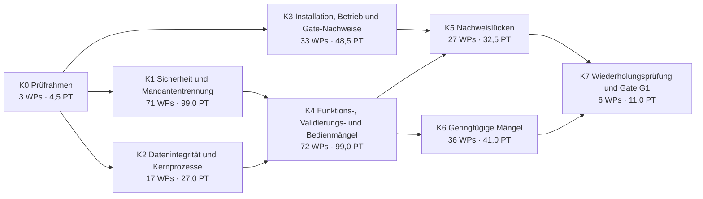

# Korrekturplan G1 – Behebung der Befunde des Phase-1-Abnahmeaudits

Stand: 2026-10-19 · Grundlage: Phase-1-Abnahmeaudit vom 2026-10-18 ([`PHASE1_AUDIT_REPORT.md`](../../../audit/phase1-final/PHASE1_AUDIT_REPORT.md), [`PHASE1_WP_AUDIT_MATRIX.md`](../../../audit/phase1-final/PHASE1_WP_AUDIT_MATRIX.md), [`PHASE1_FINDINGS.md`](../../../audit/phase1-final/PHASE1_FINDINGS.md)), der Phase-1-Plan [`../implementierungsplan.md`](../implementierungsplan.md) und seine Entscheidungen [`../entscheidungen.md`](../entscheidungen.md).

Dieser Plan ändert keinen Produktivcode. Er zerlegt die Korrektur aller nicht bestandenen Phase-1-WPs und aller Befunde des Abnahmeaudits in Arbeitspakete (WP) für je eine Agent-Session. Begleitdokumente:

- [`entscheidungen.md`](entscheidungen.md): Entscheidungsbedarf der Korrektur (E-59 ff.). Entscheidungen E-01 bis E-58 gelten weiter.
- [`abdeckung-befunde.csv`](abdeckung-befunde.csv): jeder der 354 Befunde mit Korrektur-WPs, abschließendem WP oder Zurückstellung.
- [`abdeckung-wps.csv`](abdeckung-wps.csv): jeder der 149 nicht bestandenen Phase-1-WPs mit den Korrektur-WPs, die ihn auf BESTANDEN bringen, dem verbindlichen Retest und dem WP der Wiederholungsprüfung.

## Ausgangslage

- **Audit-Ergebnis: NICHT ABNAHMEFÄHIG – NO-GO für Phase 2.** Von 213 WPs sind 64 BESTANDEN, 102 TEILWEISE BESTANDEN und 47 FEHLGESCHLAGEN. Es gibt 354 Befunde (einschließlich des nachgetragenen F-354): 16 P0, 30 P1, 134 P2, 174 P3.
- **Kodierte Defekte:** 116 Go-, 9 Shell- und 11 Frontend-Defekttests sowie 26 rote Real-Stack-E2E-Tests schlagen fehl, bis ihr Befund behoben ist (Audit-Bericht, Abschnitte 5 und 6). Sie sind die Abnahmekriterien dieses Plans.
- **Verhältnis zu den anderen Plänen:** Der Phase-1-Plan endet mit WP-242 und der G1-Nachbesserung WP-332 bis WP-335; der Phase-2-Plan (WP-243 bis WP-331) setzt einen bestandenen Gate G1 voraus. Dieser Plan liegt dazwischen: Phase 2 beginnt erst nach dem Gate-WP dieses Plans ([E-59](entscheidungen.md#e-59)). Die Nummern setzen die globale Folge ab WP-336 fort, weil die Traceability-Prüfung WP-Nummern über alle Pläne eindeutig verlangt.
- **Audit-Status ist der Befund vom 2026-10-18.** Die Spalte „Abnahme“ der Anforderungstabellen zeigt den Status des Quell-WP in der Auditmatrix; Befundtexte (Reproduktion, Soll, Ist, Ursache, Empfehlung, Retest) stehen in `PHASE1_FINDINGS.md` und werden hier nicht wiederholt.

## Umfang und Abgrenzung

- **Im Umfang:** alle 149 TEILWEISE BESTANDENEN und FEHLGESCHLAGENEN WPs, alle 16 P0-, 30 P1- und 134 P2-Befunde (Pflicht) sowie die Triage aller 174 P3-Befunde: 170 werden in einem WP mitbehoben, 4 sind begründet zurückgestellt ([E-60](entscheidungen.md#e-60), Abschnitt [Zurückgestellte Befunde](#zurückgestellte-befunde)).
- **Mitbehandelt:** Befunde, die bestandene WPs berühren, ohne deren Akzeptanzkriterien zu verletzen (in der Matrix „verknüpft“), und die Abnahme der im Audit nicht geprüften G1-Pflicht-WPs WP-214, WP-240 bis WP-242 und WP-332 bis WP-335.
- **Nicht Bestandteil:** Phase-2-Umfang ([P2]-Funktionen, Phase-2-Plan) und die nach E-03 verschobenen Funktionen. Ein abgeschaltetes Spätphasen-Modul wird nur korrigiert, wenn ein Phase-1-Akzeptanzkriterium (z. B. Mandantentrennung) verletzt ist.
- **265 Arbeitspakete** WP-336 bis WP-600 mit zusammen **362,5 PT**.
- **Reihenfolge:** K0 vorab; danach K1 bis K3 nach Schwere mit Vorrang, K4 bis K6 sobald ihre Voraussetzungen gemergt sind; K7 zum Schluss. Innerhalb einer Klasse laufen WPs parallel, sobald ihre Voraussetzungen gemergt sind.

## Überblick

### Meilensteine

| Meilenstein | WPs | Anzahl | PT | Ausstiegskriterium |
|---|---|---:|---:|---|
| [K0 Prüfrahmen](#k0-prüfrahmen) | WP-336 – WP-338 | 3 | 4,5 | Traceability liest den Korrekturplan; Defekttests laufen als Ratchet in CI; Real-Stack-E2E läuft in CI gegen die installierte Instanz. |
| [K1 Sicherheit und Mandantentrennung](#k1-sicherheit-und-mandantentrennung) | WP-339 – WP-409 | 71 | 99,0 | Alle P0 und die P1/P2 mit Sicherheits- oder Isolationswirkung behoben; ihre Defekttests grün und überführt. |
| [K2 Datenintegrität und Kernprozesse](#k2-datenintegrität-und-kernprozesse) | WP-410 – WP-426 | 17 | 27,0 | Alle übrigen P1 behoben: keine stillen Datenverluste, Kernprozesse (CI-Anlage, Sitzung, Discovery, Reconciliation) im Real-Stack grün. |
| [K3 Installation, Betrieb und Gate-Nachweise](#k3-installation-betrieb-und-gate-nachweise) | WP-427 – WP-459 | 33 | 48,5 | Installer-, Zertifikats-, K8s-, Backup- und Monitoring-Befunde behoben; Gate- und Abnahmedokumente führen jeden betroffenen Punkt mit Zwischenstand (offen mit Korrektur-WP oder belegt PASS); den Endstand stellt K7 her. |
| [K4 Funktions-, Validierungs- und Bedienmängel](#k4-funktions--validierungs--und-bedienmängel) | WP-460 – WP-531 | 72 | 99,0 | Alle übrigen P2 behoben. |
| [K5 Nachweislücken](#k5-nachweislücken) | WP-532 – WP-558 | 27 | 32,5 | Jede offene Nachweislücke der Auditmatrix durch einen ausgeführten Test geschlossen. |
| [K6 Geringfügige Mängel](#k6-geringfügige-mängel) | WP-559 – WP-594 | 36 | 41,0 | P3-Befunde behoben oder mit Begründung zurückgestellt (E-60). |
| [K7 Wiederholungsprüfung und Gate G1](#k7-wiederholungsprüfung-und-gate-g1) | WP-595 – WP-600 | 6 | 11,0 | Wiederholungsprüfung aller 149 nicht bestandenen WPs bestanden; Gate G1 erneut entschieden. |
| **Summe** | | **265** | **362,5** | |



Die Kanten zeigen die Priorität, keine harte Sperre: Ein WP darf beginnen, sobald seine eigenen Voraussetzungen gemergt sind. Harte Sperren sind nur WP-336 und WP-337 (vor allen anderen WPs, Konvention 11) und WP-600 (nach allen anderen WPs). WP-338 sperrt nur die WPs, die es als Voraussetzung nennen. WP-595 (`t5-rc-evidence`) wartet nicht auf die Lieferungs-WPs WP-457, WP-453, WP-454, WP-455 (externe Lieferungen A-02, A-07, A-11); die Wiederholungsprüfung WP-598 und das Gate WP-600 dagegen schon.

**Kritischer Pfad** (längste Kette über Voraussetzungen, 29,0 PT): WP-336 (`k-trace`) → WP-337 (`k-ratchet`) → WP-339 (`t1-compliance-scope`) → WP-341 (`t1-doc-window-writes`) → WP-342 (`t1-review-scope`) → WP-391 (`t1-team-scope`) → WP-394 (`t6-invite-ceiling`) → WP-421 (`t6-invite-event`) → WP-422 (`t5-k8s-required-env`) → WP-447 (`t5-worker-metrics`) → WP-503 (`t6-jobqueue-kinds`) → WP-514 (`t7-job-cancel`) → WP-517 (`t7-bulk-validation`) → WP-520 (`t7-bulk-ui`) → WP-521 (`t7-jobcenter-ui`) → WP-595 (`t5-rc-evidence`) → WP-596 (`k-reaudit-1`) → WP-600 (`k-gate`). Bei paralleler Umsetzung bestimmt er die Mindestdauer; die Gesamtdauer hängt von der Zahl paralleler Sessions ab.

### Schwere Befunde (P0/P1) und ihre Korrektur

| Befund | Prio | Titel | Korrektur-WP |
|---|---|---|---|
| [F-001](../../../audit/phase1-final/PHASE1_FINDINGS.md#f-001) | P0 | Compliance-Auswertung durch client-gescopten Principal liefert und überschreibt Ergebnisse anderer Clients | [WP-339](#wp-339--compliance-auswertung-nur-für-org-weite-principals-keine-cross-client-ergebnisse) |
| [F-002](../../../audit/phase1-final/PHASE1_FINDINGS.md#f-002) | P0 | Site-Scope-Bypass im Rack-Kanal: site-fremde Racks lesbar und löschbar | [WP-340](#wp-340--rack-sichtbarkeit-über-den-location-scope-kein-site-bypass-kein-mounts-existenzorakel) |
| [F-003](../../../audit/phase1-final/PHASE1_FINDINGS.md#f-003) | P0 | Review-Items ohne Kandidaten-CIs leaken über Clients; review_item ohne DB-seitigen Client/Site-Scope | [WP-342](#wp-342--review_item-mit-abgeleitetem-client-site-scope-kandidatenlose-items-fail-closed) |
| [F-004](../../../audit/phase1-final/PHASE1_FINDINGS.md#f-004) | P0 | Geteilte Dokumente und Wartungsfenster: teilgescopter Principal ändert/löscht sie, FK-Kaskade entfernt Links anderer Clients | [WP-341](#wp-341--dokumente-und-wartungsfenster-schreiben-nur-bei-vollständig-sichtbaren-links-exakte-zähler) |
| [F-005](../../../audit/phase1-final/PHASE1_FINDINGS.md#f-005) | P0 | MFA für org_admins aus Signup, Einladung, Operator-Pfad und Gruppe reticora-admin nicht erzwungen | [WP-367](#wp-367--mfa-pflicht-im-login-pfad-org_admin-aus-idp-gruppe-oder-default-rolle-setzt-mfa_required-in-keycloak) (Teil: [WP-357](#wp-357--mfa-pflicht-für-org_admin-signup--und-operator-konten-realm-gruppe-reticora-admin-e2e-login-helfer-mit-otp), [WP-358](#wp-358--mfa-pflicht-bei-jeder-org_admin-vergabe-rollenzuweisung-einladungsannahme-erstlogin-und-bestandsabgleich-setzen-mfa_required-in-keycloak)) |
| [F-006](../../../audit/phase1-final/PHASE1_FINDINGS.md#f-006) | P0 | API-Key-Rotation/-Widerruf durch Nicht-Owner: Rechteausweitung und Übernahme fremder Keys | [WP-354](#wp-354--api-keys-rotation-und-widerruf-nur-durch-owner-oder-rechteinhaber-bindung-an-einen-service-account-nie-breiter-als-der-ersteller) |
| [F-007](../../../audit/phase1-final/PHASE1_FINDINGS.md#f-007) | P0 | API-Key-Bindung an Service-Account ohne Scope-Prüfung: client-gebundener Ersteller erhält org-weiten Key | [WP-354](#wp-354--api-keys-rotation-und-widerruf-nur-durch-owner-oder-rechteinhaber-bindung-an-einen-service-account-nie-breiter-als-der-ersteller) |
| [F-008](../../../audit/phase1-final/PHASE1_FINDINGS.md#f-008) | P0 | Service-Account-Rollenzuweisung ohne Rechte-/Scope-Prüfung; Route verlangt nur user:manage | [WP-355](#wp-355--service-account-rollen-nur-mit-rolemanage-und-innerhalb-der-eigenen-rechte) |
| [F-009](../../../audit/phase1-final/PHASE1_FINDINGS.md#f-009) | P0 | Webhook-Filter liefert merge-/relationship-Events anderer Clients an client-gebundene Service-Accounts | [WP-356](#wp-356--gebundene-webhook-subscriptions-erhalten-nur-ereignisse-lesbarer-objekte-scope-serverseitig-leserechte-wie-rls-fail-closed-bei-unbekanntem-scope) |
| [F-010](../../../audit/phase1-final/PHASE1_FINDINGS.md#f-010) | P0 | WMI-Plugin sendet Credentials im Klartext (HTTP Basic über http://ziel:5985; HTTPS-Modus mit InsecureSkipVerify) | [WP-378](#wp-378--collector-credentials-je-scope-und-je-art-keine-protokoll-aliasse) (Teil: [WP-377](#wp-377--wmi-zugangsdaten-nur-über-geprüftes-tls-winrm-5986-capin-je-netz)) |
| [F-011](../../../audit/phase1-final/PHASE1_FINDINGS.md#f-011) | P0 | NAS-Plugin sendet Synology-Konto und Passwort in der URL über http://ziel:5000 und an ungeprüftes HTTPS (5001) | [WP-379](#wp-379--nas-synology-anmeldung-per-post-über-geprüftes-tls-eigene-credential-art) |
| [F-012](../../../audit/phase1-final/PHASE1_FINDINGS.md#f-012) | P0 | Erneuerungsendpunkt ist nicht an den Collector gebunden: ein Principal mit discovery:ingest stellt sich ein Collector-Zertifikat für den eigenen Schlüssel aus | [WP-375](#wp-375--zertifikatserneuerung-nur-über-die-mtls-identität-des-collectors-http-erneuerung-entfernen) |
| [F-013](../../../audit/phase1-final/PHASE1_FINDINGS.md#f-013) | P0 | Collector ignoriert credential_ids je Scope: das erste Credential je Protokoll gilt für alle Scopes (auch über Client-Grenzen) | [WP-378](#wp-378--collector-credentials-je-scope-und-je-art-keine-protokoll-aliasse) |
| [F-014](../../../audit/phase1-final/PHASE1_FINDINGS.md#f-014) | P0 | Site-Grant setzt Client-Scope auf NULL: Site-Nutzer lesen Kontakte, Credentials, Assets und unplatzierte CIs fremder Clients | [WP-392](#wp-392--site-scope-für-assets-und-mengenartikel-ten-02-und-real-stack-nachweis-der-hierarchie) (Teil: [WP-390](#wp-390--site-grant-auf-den-client-des-standorts-begrenzen-rba-03-ten-09-auch-für-service-accounts)) |
| [F-015](../../../audit/phase1-final/PHASE1_FINDINGS.md#f-015) | P0 | Keine Grant-Obergrenze: client-gescopter user:manage-Inhaber erzeugt org-weite org_admin-Einladungen und -Rollenzuweisungen | [WP-394](#wp-394--grant-obergrenze-für-einladungen-und-rollenzuweisungen-rollescope-abgleich) |
| [F-016](../../../audit/phase1-final/PHASE1_FINDINGS.md#f-016) | P0 | CI-Dialog 'CI erstellen' nutzt hart kodierte Typ-Keys: sendet 'server' als ci_type_id (400) und bietet keine Laufzeit-/Org-Typen | [WP-397](#wp-397--ci-dialog-lädt-typen-aus-get-ci-types-und-erfasst-typattribute-ci-03-met-04) (Teil: [WP-396](#wp-396--ci-typreferenz-nur-auf-system--oder-eigenen-org-typ-422-ci_type_id)) |
| [F-017](../../../audit/phase1-final/PHASE1_FINDINGS.md#f-017) | P1 | Rollenzuweisung nicht entziehbar: kein DELETE /role-assignments/{id} | [WP-395](#wp-395--rollenzuweisung-entziehen-delete-role-assignmentsid-für-standard--und-custom-rollen-mit-grant-obergrenze-audit-und-wirkung-beim-nächsten-refresh) |
| [F-018](../../../audit/phase1-final/PHASE1_FINDINGS.md#f-018) | P1 | OpenAPI-Validator weist jeden SPA-Refresh (POST /auth/refresh ohne Body/Content-Type) mit 400 ab; gleiche Abweichung bei weiteren bodylosen POSTs | [WP-366](#wp-366--spa-session-single-flight-refresh-refresh-beim-start-statt-login-redirect-429-ohne-abmeldung) (Teil: [WP-364](#wp-364--validierungsstufe-aus-openapi-ableiten-cookie-only-refresh-und-bodylose-posts-erreichen-den-handler-test-der-maingo-kette)) |
| [F-019](../../../audit/phase1-final/PHASE1_FINDINGS.md#f-019) | P1 | Abgewiesene Requests einer Credential leeren das Org-Budget (eine Integration sperrt die ganze Org) | [WP-410](#wp-410--ratelimits-credential-budget-vor-org-budget-session-bucket-über-refresh-hinweg-sid) |
| [F-020](../../../audit/phase1-final/PHASE1_FINDINGS.md#f-020) | P1 | Manuelle Massen-Statusänderung (POST /cis/bulk set_status) ist kein manueller Schreibvorgang: kein Override, keine Versionserhöhung, unter Status-Override still verworfen und als ok gemeldet | [WP-368](#wp-368--bulk-statusänderung-als-manueller-schreibvorgang-override-version-ehrlicher-ergebnisbericht) |
| [F-021](../../../audit/phase1-final/PHASE1_FINDINGS.md#f-021) | P1 | Override setzen/aufheben erhöht ci.version nicht: veralteter If-Match-PATCH überschreibt den neueren geschützten Override | [WP-413](#wp-413--ci-detail-nach-override-setzenaufheben-aktuell-override-gegen-offenen-editor-im-real-stack) (Teil: [WP-412](#wp-412--override-setzenaufheben-erhöht-die-ci-version-clearoverride-bildet-fehler-korrekt-ab)) |
| [F-022](../../../audit/phase1-final/PHASE1_FINDINGS.md#f-022) | P1 | Auflösung „new“ bei resurrected_device erzeugt org-weites CI ohne Identität: fremde Client-Sichtbarkeit und endlose Review-Schleife | [WP-369](#wp-369--resurrected_device-neues-ci-client-identität-und-scope-übernehmen) |
| [F-023](../../../audit/phase1-final/PHASE1_FINDINGS.md#f-023) | P1 | DELETE /sites\|/buildings\|/rooms/{id} löscht Standorte mit Kindern (204, Kaskade) statt 409 (LOC-11) | [WP-411](#wp-411--standortlöschung-409-statt-kaskade-auf-allen-löschpfaden-netzobjekte-der-site-und-location_change-bleiben-erhalten) |
| [F-024](../../../audit/phase1-final/PHASE1_FINDINGS.md#f-024) | P1 | Site-Löschung kaskadiert VLANs/Enrollment-Tokens und entzieht Subnetzen, Collectoren, Discovery-Scopes, ci_merge still die Site | [WP-411](#wp-411--standortlöschung-409-statt-kaskade-auf-allen-löschpfaden-netzobjekte-der-site-und-location_change-bleiben-erhalten) |
| [F-025](../../../audit/phase1-final/PHASE1_FINDINGS.md#f-025) | P1 | Deaktivierter Collector liefert weiter: offene NATS-Verbindung bleibt bestehen, EdgeIngest, scopes.result und subnets.report ohne Statusprüfung | [WP-381](#wp-381--deaktivierter-collector-bestehende-edge-verbindung-binnen-sekunden-trennen) (Teil: [WP-380](#wp-380--deaktivierter-oder-unbekannter-collector-edge-daten-abweisen-patch-auf-fremden-collector-404)) |
| [F-026](../../../audit/phase1-final/PHASE1_FINDINGS.md#f-026) | P1 | Keine automatische Zertifikatserneuerung; Collector verlieren 90 Tage nach dem Enrollment die Konnektivität | [WP-414](#wp-414--collector-erneuert-sein-zertifikat-ab-60--über-den-mtls-kanal-ehrliche-verbindungsmeldung) |
| [F-027](../../../audit/phase1-final/PHASE1_FINDINGS.md#f-027) | P1 | Falsche Credential-Auswahl im Bundle: ohne aktive Scopes alle Client- und Org-Credentials, ein Scope ohne credential_ids leert das Bundle | [WP-384](#wp-384--nachweis-real-stack-vorschlag-bestätigen-scope-und-bundle-mit-credentials-scan-mit-bundle-credential) (Teil: [WP-376](#wp-376--credential-bundle-nur-scope-relevante-credentials-scope-ohne-credentials-nutzt-client-org-credentials)) |
| [F-028](../../../audit/phase1-final/PHASE1_FINDINGS.md#f-028) | P1 | Credentials der Art 'wmi' erreichen das WMI-Plugin nie; SSH-Credentials gehen an WMI- und NAS-Ziele | [WP-378](#wp-378--collector-credentials-je-scope-und-je-art-keine-protokoll-aliasse) |
| [F-029](../../../audit/phase1-final/PHASE1_FINDINGS.md#f-029) | P1 | WMI Collect meldet Erfolg mit leeren Feldern bei 401, Transportfehler oder protokollkonformer WinRM-Antwort; der Scope-Lauf zeigt ok | [WP-415](#wp-415--wmi-fehler-und-401-mit-ursache-melden-enumeratepull-nach-dsp0226) |
| [F-030](../../../audit/phase1-final/PHASE1_FINDINGS.md#f-030) | P1 | Jedes gesweepte Gerät erhält ein (wiederkehrendes) falsches unclassified_device-Review, auch wenn SNMP, SSH oder Redfish es klassifiziert haben | [WP-417](#wp-417--unclassified_device-nur-für-wirklich-unklassifizierte-geräte-verworfenes-review-bleibt-verworfen) |
| [F-031](../../../audit/phase1-final/PHASE1_FINDINGS.md#f-031) | P1 | scope_suggested umgeht discovery:manage und ist über Client-Grenzen sichtbar und verwerfbar | [WP-382](#wp-382--scope_suggested-annehmen-und-verwerfen-nur-mit-discoverymanage-sichtbarkeit-je-client) |
| [F-032](../../../audit/phase1-final/PHASE1_FINDINGS.md#f-032) | P1 | Ausgelieferter Collector liefert keine LLDP-/CDP-/FDB-Nachbarn (TOP-01-Eingang fehlt in Produktion) | [WP-416](#wp-416--snmp-plugin-liefert-lldp--und-fdb-nachbarn) |
| [F-033](../../../audit/phase1-final/PHASE1_FINDINGS.md#f-033) | P1 | certbot certonly kann das Let's-Encrypt-Zertifikat nicht ablegen, weil der Bootstrap-Platzhalter letsencrypt/live/<domain>/ belegt | [WP-420](#wp-420--pebble-integrationstest-des-tls-domain-pfads-ausstellung-wiederholung-lesbarkeit-issuer-prüfung) (Teil: [WP-419](#wp-419--acme-ausstellung-ohne-lineage-konflikt-und-nginx-lesbares-schlüsselmaterial)) |
| [F-034](../../../audit/phase1-final/PHASE1_FINDINGS.md#f-034) | P1 | Von certbot ausgestellter Schlüssel und Kette sind für den unprivilegierten nginx-Nutzer (uid 101) des Frontends unlesbar | [WP-420](#wp-420--pebble-integrationstest-des-tls-domain-pfads-ausstellung-wiederholung-lesbarkeit-issuer-prüfung) (Teil: [WP-419](#wp-419--acme-ausstellung-ohne-lineage-konflikt-und-nginx-lesbares-schlüsselmaterial)) |
| [F-035](../../../audit/phase1-final/PHASE1_FINDINGS.md#f-035) | P1 | OIDC-Issuer-Prüfung läuft vor dem Start des Frontends (Issuer-Proxy), daher brechen Domain-/TLS-Installationen ab | [WP-420](#wp-420--pebble-integrationstest-des-tls-domain-pfads-ausstellung-wiederholung-lesbarkeit-issuer-prüfung) (Teil: [WP-385](#wp-385--installer-strikte-issuer-prüfung-erst-nach-dem-start-von-server-und-frontend)) |
| [F-036](../../../audit/phase1-final/PHASE1_FINDINGS.md#f-036) | P1 | K8s-Manifeste liefern das durch WP-097 verpflichtende RETICORA_OIDC_ISSUER_URL nicht; Server beendet sich in base, staging und prod beim Start | [WP-422](#wp-422--kubernetes-vollständige-pflichtkonfiguration-oidc-in-allen-overlays-veröffentlichte-release-images) |
| [F-037](../../../audit/phase1-final/PHASE1_FINDINGS.md#f-037) | P1 | CI-13-Reaktivierung über die Produktions-Decorator-Kette aus main.go liefert 501; gelöschtes, wiedergesehenes Gerät bleibt gelöscht (SR-11) | [WP-418](#wp-418--ci-reaktivierung-über-die-produktions-decorator-kette-sr-11-und-ki-indexer-hinter-dem-modul-gate) |
| [F-038](../../../audit/phase1-final/PHASE1_FINDINGS.md#f-038) | P1 | Gate-Checkliste führt CI-13 [B] als PASS trotz offenem und reproduziertem Defekt SR-11 | [WP-451](#wp-451--gate-checkliste-ehrlich-und-maschinell-geprüft-konsistenzprüfung---final-modus-ausnahmeliste-gate-010203) |
| [F-039](../../../audit/phase1-final/PHASE1_FINDINGS.md#f-039) | P1 | Kein Pentest-Bericht und keine Befundliste im Repository (Lieferung A-07 fehlt) | [WP-453](#wp-453--pentest-nachweis-g1-ablegen-lieferung-a-07) |
| [F-040](../../../audit/phase1-final/PHASE1_FINDINGS.md#f-040) | P1 | Review und Gate führen TEN-09-Isolation als vollständig und 'kein offenes Critical', obwohl ein Site-Scope-Bypass im Rack-Kanal reproduziert ist | [WP-452](#wp-452--sicherheitsreview-g1-korrigieren-sr-11-high-neue-befunde-sr-12sr-13-p0-befunde-des-audits-kanal--scope-dev-advisories) (Teil: [WP-451](#wp-451--gate-checkliste-ehrlich-und-maschinell-geprüft-konsistenzprüfung---final-modus-ausnahmeliste-gate-010203)) |
| [F-041](../../../audit/phase1-final/PHASE1_FINDINGS.md#f-041) | P1 | Einladungen versenden keine E-Mail: invitation.created (NTF-05 'Einladung') wird nie erzeugt | [WP-421](#wp-421--einladung-erzeugt-invitationcreated-mit-annahmelink-ntf-05) |
| [F-042](../../../audit/phase1-final/PHASE1_FINDINGS.md#f-042) | P1 | Manuelle verifizierte Port-Kanten werden bei Discovery-Interface-Entfernung per ON DELETE CASCADE still gelöscht | [WP-424](#wp-424--manuelle-port-kanten-überleben-den-interface-abgleich-rel-05-fehlerabbildung-der-interface-routen) |
| [F-043](../../../audit/phase1-final/PHASE1_FINDINGS.md#f-043) | P1 | EVT-02-Typen relationship.created, relationship.removed (API), collector.enrolled, review.resolved werden nie erzeugt | [WP-400](#wp-400--produzenten-für-relationshipcreatedremoved-collectorenrolled-und-reviewresolved-in-der-mutations-transaktion) |
| [F-044](../../../audit/phase1-final/PHASE1_FINDINGS.md#f-044) | P1 | Entitlement-Warnung/-Ablauf und Zertifikatsablauf: JOB-02-Läufe nicht eingeplant, Events entitlement.warning/expired und certificate.expiring nie erzeugt | [WP-425](#wp-425--job-02-läufe-entitlement-warnung-ablauf-und-zertifikatsablauf-mit-events) |
| [F-045](../../../audit/phase1-final/PHASE1_FINDINGS.md#f-045) | P1 | Werte mit Anführungszeichen oder Steuerzeichen (Zeilenumbruch, Tab) brechen jeden auditierten Write mit Wert-Snapshot (CI-Create/-Update/-Delete/-Restore, Metamodell) mit 400 ab: audit_entry_hash castet den JSON-Text nach bytea | [WP-423](#wp-423--audit_entry_hash-hasht-das-kanonische-json-als-utf-8-aud-04-abweichende-bestandsketten-neu-verkettet) |
| [F-046](../../../audit/phase1-final/PHASE1_FINDINGS.md#f-046) | P1 | Collector-Metrik-Uploads (Sweep, UPS, SNMP-Poll) werden ohne Credential gesendet, mit 401 abgewiesen und erreichen den Server nie | [WP-426](#wp-426--collector-metriken-über-den-mtls-edge-metrics-statt-unauthentisiertem-http) |

### Stand der Entscheidungen

Für die Korrektur entstehen 37 neue Entscheidungen ([E-59](entscheidungen.md#e-59) bis [E-95](entscheidungen.md#e-95)). Alle tragen eine Empfehlung als Übergangsregel, sodass kein WP gesperrt ist; widerspricht der Auftraggeber, wird das betroffene WP vor Beginn angepasst. Die WP-Blöcke nennen die Entscheidung im Feld „Entscheidungsbedarf“. Ausnahme: WP-388 (`t5-install-default`) beginnt erst, wenn E-69 mit Option 1 entschieden ist; bei Option 2 oder 3 entfällt es mit Vermerk. Unabhängig von Entscheidungen warten WP-457 (`t5-abn01-ab`), WP-453 (`t5-pentest-evidence`), WP-454 (`t5-subprocessors`), WP-455 (`t5-v2-ids`) auf die externen Lieferungen A-02, A-07 und A-11.

### Alle Arbeitspakete

| WP | Schlüssel | Titel | Meilenstein | PT | Befunde (schließt) | Voraussetzungen |
|---|---|---|---|---:|---|---|
| [WP-336](#wp-336--traceability-prüfung-liest-den-korrekturplan) | `k-trace` | Traceability-Prüfung liest den Korrekturplan | K0 | 1,0 | – | – |
| [WP-337](#wp-337--defekttests-in-ci-erwartungsliste-und-ratchet) | `k-ratchet` | Defekttests in CI: Erwartungsliste und Ratchet | K0 | 1,5 | – | WP-336 |
| [WP-338](#wp-338--real-stack-e2e-in-ci-gegen-die-installierte-instanz) | `k-e2e-real-ci` | Real-Stack-E2E in CI gegen die installierte Instanz | K0 | 2,0 | – | WP-337 |
| [WP-339](#wp-339--compliance-auswertung-nur-für-org-weite-principals-keine-cross-client-ergebnisse) | `t1-compliance-scope` | Compliance-Auswertung nur für org-weite Principals; keine Cross-Client-Ergebnisse | K1 | 1,0 | F-001 | – |
| [WP-340](#wp-340--rack-sichtbarkeit-über-den-location-scope-kein-site-bypass-kein-mounts-existenzorakel) | `t1-rack-site-scope` | Rack-Sichtbarkeit über den Location-Scope; kein Site-Bypass, kein Mounts-Existenzorakel | K1 | 1,0 | F-002 | – |
| [WP-341](#wp-341--dokumente-und-wartungsfenster-schreiben-nur-bei-vollständig-sichtbaren-links-exakte-zähler) | `t1-doc-window-writes` | Dokumente und Wartungsfenster: Schreiben nur bei vollständig sichtbaren Links; exakte Zähler | K1 | 2,0 | F-004, F-048 | WP-339 |
| [WP-342](#wp-342--review_item-mit-abgeleitetem-client-site-scope-kandidatenlose-items-fail-closed) | `t1-review-scope` | review_item mit abgeleitetem Client-/Site-Scope; kandidatenlose Items fail-closed | K1 | 2,0 | F-003 | WP-340, WP-341 |
| [WP-343](#wp-343--fehlervertrag-api-03-i-klassifizierung-uuid-nul-validierung-cmdb-kern-handler) | `t1-err-core` | Fehlervertrag API-03 I: Klassifizierung, UUID-/NUL-Validierung, CMDB-Kern-Handler | K1 | 1,5 | – | – |
| [WP-344](#wp-344--metrik-serien-nur-für-sichtbare-cis-metricnames-prädikat-und-404-in-cimetrics) | `t1-metric-names` | Metrik-Serien nur für sichtbare CIs: MetricNames-Prädikat und 404 in CIMetrics | K1 | 0,5 | F-052 | – |
| [WP-345](#wp-345--kanten-scope-folgt-ci-verschiebungen-gescopter-principals-kanten-zu-org-weiten-cis-nach-entscheidung) | `t1-edge-scope` | Kanten-Scope folgt CI-Verschiebungen gescopter Principals; Kanten zu org-weiten CIs nach Entscheidung | K1 | 1,5 | F-050 | WP-341, WP-344 |
| [WP-346](#wp-346--opensearch-reindex-nach-rack-platzierung-und-pg-gegenprüfung-der-treffer) | `t1-opensearch-placement` | OpenSearch: Reindex nach Rack-Platzierung und PG-Gegenprüfung der Treffer | K1 | 1,5 | F-054 | – |
| [WP-347](#wp-347--generische-job-api-gespiegelte-export-jobs-nur-für-den-ersteller) | `t1-export-job-visibility` | Generische Job-API: gespiegelte Export-Jobs nur für den Ersteller | K1 | 1,0 | F-059 | – |
| [WP-348](#wp-348--installer-dedizierter-laufzeit-login-ohne-superuserbypassrls) | `t1-runtime-login` | Installer: dedizierter Laufzeit-Login ohne SUPERUSER/BYPASSRLS | K1 | 1,5 | – | WP-338 |
| [WP-349](#wp-349--integrationstests-und-ci-öffnen-app-pools-über-einen-login-ohne-superuserbypassrls) | `t1-runtime-login-tests` | Integrationstests und CI öffnen App-Pools über einen Login ohne SUPERUSER/BYPASSRLS | K1 | 1,0 | – | – |
| [WP-350](#wp-350--metrik-views-mit-client-site-scope-adr-0001-punkt-4) | `t1-metric-views` | Metrik-Views mit Client-/Site-Scope (ADR 0001 Punkt 4) | K1 | 1,5 | F-051 | WP-344, WP-349 |
| [WP-351](#wp-351--werkzeuge-lasttest-und-server-starttest-ohne-superuser-laufzeitpool) | `t1-runtime-login-tools` | Werkzeuge, Lasttest und Server-Starttest ohne Superuser-Laufzeitpool | K1 | 1,0 | – | WP-349 |
| [WP-352](#wp-352--startprüfung-prüft-session_user-truncate-guard-für-mandantentabellen) | `t1-role-contract` | Startprüfung prüft session_user; TRUNCATE-Guard für Mandantentabellen | K1 | 1,5 | F-057 | WP-348, WP-349, WP-351 |
| [WP-353](#wp-353--rls-matrix-für-vererbte-tabellen-mit-gescopten-principals-disposal_record-db-gescopt) | `t1-module-rls-hardening` | RLS-Matrix für vererbte Tabellen mit gescopten Principals; disposal_record DB-gescopt | K1 | 1,5 | F-354 | WP-341 |
| [WP-354](#wp-354--api-keys-rotation-und-widerruf-nur-durch-owner-oder-rechteinhaber-bindung-an-einen-service-account-nie-breiter-als-der-ersteller) | `t2-apikey-authz` | API-Keys: Rotation und Widerruf nur durch Owner oder Rechteinhaber; Bindung an einen Service-Account nie breiter als der Ersteller | K1 | 1,5 | F-006, F-007 | – |
| [WP-355](#wp-355--service-account-rollen-nur-mit-rolemanage-und-innerhalb-der-eigenen-rechte) | `t2-sa-role-ceiling` | Service-Account-Rollen nur mit role:manage und innerhalb der eigenen Rechte | K1 | 1,0 | F-008 | WP-354 |
| [WP-356](#wp-356--gebundene-webhook-subscriptions-erhalten-nur-ereignisse-lesbarer-objekte-scope-serverseitig-leserechte-wie-rls-fail-closed-bei-unbekanntem-scope) | `t2-webhook-bound-scope` | Gebundene Webhook-Subscriptions erhalten nur Ereignisse lesbarer Objekte: Scope serverseitig, Leserechte wie RLS, fail-closed bei unbekanntem Scope | K1 | 1,5 | F-009 | – |
| [WP-357](#wp-357--mfa-pflicht-für-org_admin-signup--und-operator-konten-realm-gruppe-reticora-admin-e2e-login-helfer-mit-otp) | `t2-mfa-accounts` | MFA-Pflicht für org_admin: Signup- und Operator-Konten, Realm-Gruppe reticora-admin, E2E-Login-Helfer mit OTP | K1 | 1,5 | – | WP-338 |
| [WP-358](#wp-358--mfa-pflicht-bei-jeder-org_admin-vergabe-rollenzuweisung-einladungsannahme-erstlogin-und-bestandsabgleich-setzen-mfa_required-in-keycloak) | `t2-mfa-role-sync` | MFA-Pflicht bei jeder org_admin-Vergabe: Rollenzuweisung, Einladungsannahme, Erstlogin und Bestandsabgleich setzen mfa_required in Keycloak | K1 | 2,0 | – | WP-338, WP-357 |
| [WP-359](#wp-359--deaktivierung-und-anonymisierung-session-widerruf-erst-nach-org-gebundener-änderung-in-derselben-transaktion-service-account-keys-nach-entscheidung) | `t2-deactivation-tenant` | Deaktivierung und Anonymisierung: Session-Widerruf erst nach org-gebundener Änderung in derselben Transaktion; Service-Account-Keys nach Entscheidung | K1 | 1,5 | F-060 | – |
| [WP-360](#wp-360--ki-ask-nur-mit-org-opt-in-und-ai-entitlement-air-gap--und-wiring-tests-versioniert) | `t2-ai-ask-consent` | KI-Ask nur mit Org-Opt-in und ai-Entitlement; Air-Gap- und Wiring-Tests versioniert | K1 | 1,0 | F-073 | – |
| [WP-361](#wp-361--personalisierte-operator-anmeldung-realm-gruppe-operators-acrloa-für-mfa-real-stack-test-mit-otp) | `t2-operator-oidc` | Personalisierte Operator-Anmeldung: Realm-Gruppe operators, acr/LoA für MFA, Real-Stack-Test mit OTP | K1 | 2,0 | F-069 | WP-338, WP-357 |
| [WP-362](#wp-362--break-glass-nutzung-alarmiert-prometheus-regel-promtool-test-und-shelltest-in-der-ci) | `t2-break-glass-alert` | Break-Glass-Nutzung alarmiert: Prometheus-Regel, promtool-Test und Shelltest in der CI | K1 | 0,5 | F-068 | – |
| [WP-363](#wp-363--authz-nutzt-die-rba-01-schlüssel-citypemanage-und-notificationmanage-tote-schlüssel-bereinigt-guard-test-je-schlüssel) | `t2-rba01-keys` | Authz nutzt die RBA-01-Schlüssel citype:manage und notification:manage; tote Schlüssel bereinigt, Guard-Test je Schlüssel | K1 | 1,0 | F-067 | WP-355 |
| [WP-364](#wp-364--validierungsstufe-aus-openapi-ableiten-cookie-only-refresh-und-bodylose-posts-erreichen-den-handler-test-der-maingo-kette) | `t2-refresh-chain` | Validierungsstufe aus OpenAPI ableiten: cookie-only Refresh und bodylose POSTs erreichen den Handler; Test der main.go-Kette | K1 | 1,5 | – | WP-338 |
| [WP-365](#wp-365--agent-keine-redirects-auf-klartext-agent-credential-über-die-echte-auth-kette-belegt-binary-aus-dem-repository-entfernt) | `t2-agent-redirect` | Agent: keine Redirects auf Klartext, Agent-Credential über die echte Auth-Kette belegt, Binary aus dem Repository entfernt | K1 | 1,0 | F-064 | WP-364 |
| [WP-366](#wp-366--spa-session-single-flight-refresh-refresh-beim-start-statt-login-redirect-429-ohne-abmeldung) | `t2-spa-session` | SPA-Session: Single-Flight-Refresh, Refresh beim Start statt Login-Redirect, 429 ohne Abmeldung | K1 | 1,5 | F-065, F-066, F-018 | WP-338, WP-364 |
| [WP-367](#wp-367--mfa-pflicht-im-login-pfad-org_admin-aus-idp-gruppe-oder-default-rolle-setzt-mfa_required-in-keycloak) | `t2-mfa-login-path` | MFA-Pflicht im Login-Pfad: org_admin aus IdP-Gruppe oder Default-Rolle setzt mfa_required in Keycloak | K1 | 1,0 | F-005 | WP-358 |
| [WP-368](#wp-368--bulk-statusänderung-als-manueller-schreibvorgang-override-version-ehrlicher-ergebnisbericht) | `t3-bulk-manual` | Bulk-Statusänderung als manueller Schreibvorgang: Override, Version, ehrlicher Ergebnisbericht | K1 | 1,0 | F-020 | – |
| [WP-369](#wp-369--resurrected_device-neues-ci-client-identität-und-scope-übernehmen) | `t3-resurrect-new` | resurrected_device „neues CI“: Client, Identität und Scope übernehmen | K1 | 1,0 | F-022 | WP-342 |
| [WP-370](#wp-370--parent_ci_id-nur-auf-sichtbare-cis-desselben-clients-oder-org-weite-cis) | `t3-parent-scope` | parent_ci_id nur auf sichtbare CIs desselben Clients oder org-weite CIs | K1 | 0,5 | F-086 | – |
| [WP-371](#wp-371--vlan-bezüge-von-subnetz-und-interface-nur-auf-sichtbare-vlans-des-clients) | `t3-vlan-ref-scope` | VLAN-Bezüge von Subnetz und Interface nur auf sichtbare VLANs des Clients | K1 | 1,0 | F-088 | – |
| [WP-372](#wp-372--vrf-schreibvorgänge-nur-für-org-weit-berechtigte-principals-restrictive-policies) | `t3-vrf-write-scope` | VRF-Schreibvorgänge nur für org-weit berechtigte Principals (RESTRICTIVE-Policies) | K1 | 1,0 | F-089 | WP-371 |
| [WP-373](#wp-373--review-auflösung-resolved_by-und-audit-akteur-immer-der-principal) | `t3-review-actor` | Review-Auflösung: resolved_by und Audit-Akteur immer der Principal | K1 | 1,0 | F-091 | WP-342 |
| [WP-374](#wp-374--nats-server-in-der-ci-edge-integrationstests-ohne-stilles-überspringen-cross-org-fall) | `t4-natsedge-ci` | nats-server in der CI: Edge-Integrationstests ohne stilles Überspringen, Cross-Org-Fall | K1 | 0,5 | – | – |
| [WP-375](#wp-375--zertifikatserneuerung-nur-über-die-mtls-identität-des-collectors-http-erneuerung-entfernen) | `t4-pki-renew-server` | Zertifikatserneuerung nur über die mTLS-Identität des Collectors; HTTP-Erneuerung entfernen | K1 | 2,0 | F-012 | WP-374 |
| [WP-376](#wp-376--credential-bundle-nur-scope-relevante-credentials-scope-ohne-credentials-nutzt-client-org-credentials) | `t4-bundle-select` | Credential-Bundle: nur Scope-relevante Credentials; Scope ohne Credentials nutzt Client-/Org-Credentials | K1 | 1,5 | – | WP-374 |
| [WP-377](#wp-377--wmi-zugangsdaten-nur-über-geprüftes-tls-winrm-5986-capin-je-netz) | `t4-wmi-tls` | WMI: Zugangsdaten nur über geprüftes TLS (WinRM 5986, CA/Pin je Netz) | K1 | 1,5 | – | – |
| [WP-378](#wp-378--collector-credentials-je-scope-und-je-art-keine-protokoll-aliasse) | `t4-cred-scope` | Collector: Credentials je Scope und je Art, keine Protokoll-Aliasse | K1 | 2,0 | F-013, F-028, F-010 | WP-376, WP-377 |
| [WP-379](#wp-379--nas-synology-anmeldung-per-post-über-geprüftes-tls-eigene-credential-art) | `t4-nas-tls` | NAS (Synology): Anmeldung per POST über geprüftes TLS, eigene Credential-Art | K1 | 2,0 | F-011 | WP-377, WP-378 |
| [WP-380](#wp-380--deaktivierter-oder-unbekannter-collector-edge-daten-abweisen-patch-auf-fremden-collector-404) | `t4-collector-disable-data` | Deaktivierter oder unbekannter Collector: Edge-Daten abweisen; PATCH auf fremden Collector 404 | K1 | 1,0 | – | WP-342, WP-376 |
| [WP-381](#wp-381--deaktivierter-collector-bestehende-edge-verbindung-binnen-sekunden-trennen) | `t4-collector-disable-kick` | Deaktivierter Collector: bestehende Edge-Verbindung binnen Sekunden trennen | K1 | 1,5 | F-025 | WP-338, WP-374, WP-380 |
| [WP-382](#wp-382--scope_suggested-annehmen-und-verwerfen-nur-mit-discoverymanage-sichtbarkeit-je-client) | `t4-scope-suggested-authz` | scope_suggested: Annehmen und Verwerfen nur mit discovery:manage, Sichtbarkeit je Client | K1 | 1,0 | F-031 | WP-342, WP-380 |
| [WP-383](#wp-383--scope-ziele-ohne-ipv6-zone-offline-detektor-kanten-cleanup-und-collector-status-fehlerisoliert-je-org) | `t4-scope-zone-isolation` | Scope-Ziele ohne IPv6-Zone; Offline-Detektor, Kanten-Cleanup und Collector-Status fehlerisoliert je Org | K1 | 1,5 | F-108 | – |
| [WP-384](#wp-384--nachweis-real-stack-vorschlag-bestätigen-scope-und-bundle-mit-credentials-scan-mit-bundle-credential) | `t4-e2e-onboarding-bundle` | Nachweis Real-Stack: Vorschlag bestätigen, Scope und Bundle mit Credentials, Scan mit Bundle-Credential | K1 | 2,0 | F-027 | WP-338, WP-378, WP-382 |
| [WP-385](#wp-385--installer-strikte-issuer-prüfung-erst-nach-dem-start-von-server-und-frontend) | `t5-issuer-order` | Installer: strikte Issuer-Prüfung erst nach dem Start von Server und Frontend | K1 | 1,0 | – | – |
| [WP-386](#wp-386--installer-wiederholung-wendet-rotierte-keycloak-zugangsdaten-und-realm-einstellungen-an) | `t5-kc-rotation` | Installer-Wiederholung wendet rotierte Keycloak-Zugangsdaten und Realm-Einstellungen an | K1 | 2,0 | F-125 | WP-385 |
| [WP-387](#wp-387--signaturprüfung-vor-der-installation-release-modus-collector-download-quellbezug-und-toolchain-tec-15) | `t5-install-signature` | Signaturprüfung vor der Installation: Release-Modus, Collector-Download, Quellbezug und Toolchain (TEC-15) | K1 | 2,0 | F-131 | WP-386 |
| [WP-388](#wp-388--installer-standard-auf-signierte-release-artefakte-umstellen-quellbuild-nur-per-schalter) | `t5-install-default` | Installer-Standard auf signierte Release-Artefakte umstellen, Quellbuild nur per Schalter | K1 | 1,0 | – | WP-387 |
| [WP-389](#wp-389--scan-abdeckung-aller-release-images-sla-prüfung-der-scan-ausnahmen-reproduzierbares-db-image) | `t5-image-scan` | Scan-Abdeckung aller Release-Images, SLA-Prüfung der Scan-Ausnahmen, reproduzierbares DB-Image | K1 | 1,5 | F-124 | – |
| [WP-390](#wp-390--site-grant-auf-den-client-des-standorts-begrenzen-rba-03-ten-09-auch-für-service-accounts) | `t6-site-grant-scope` | Site-Grant auf den Client des Standorts begrenzen (RBA-03, TEN-09), auch für Service-Accounts | K1 | 2,0 | – | – |
| [WP-391](#wp-391--team-scope-zuweisbar-role_assignment-mit-team-dimension-grantteams-befüllt) | `t1-team-scope` | Team-Scope zuweisbar: role_assignment mit Team-Dimension, Grant.Teams befüllt | K1 | 2,0 | F-049 | WP-342, WP-349, WP-390 |
| [WP-392](#wp-392--site-scope-für-assets-und-mengenartikel-ten-02-und-real-stack-nachweis-der-hierarchie) | `t6-asset-site-scope` | Site-Scope für Assets und Mengenartikel (TEN-02) und Real-Stack-Nachweis der Hierarchie | K1 | 1,5 | F-141, F-014 | WP-338, WP-390 |
| [WP-393](#wp-393--site_id-für-räume-und-racks-asset-site-in-der-suche-katalogregel-für-tabellen-mit-standortbezug) | `t1-located-site-scope` | site_id für Räume und Racks, Asset-Site in der Suche; Katalogregel für Tabellen mit Standortbezug | K1 | 1,5 | F-053 | WP-340, WP-345, WP-392 |
| [WP-394](#wp-394--grant-obergrenze-für-einladungen-und-rollenzuweisungen-rollescope-abgleich) | `t6-invite-ceiling` | Grant-Obergrenze für Einladungen und Rollenzuweisungen; Rolle/Scope-Abgleich | K1 | 1,5 | F-015, F-305 | WP-354, WP-358, WP-391 |
| [WP-395](#wp-395--rollenzuweisung-entziehen-delete-role-assignmentsid-für-standard--und-custom-rollen-mit-grant-obergrenze-audit-und-wirkung-beim-nächsten-refresh) | `t2-role-assignment-revoke` | Rollenzuweisung entziehen: DELETE /role-assignments/{id} für Standard- und Custom-Rollen mit Grant-Obergrenze, Audit und Wirkung beim nächsten Refresh | K1 | 1,5 | F-017 | WP-338, WP-354, WP-358, WP-391, WP-394 |
| [WP-396](#wp-396--ci-typreferenz-nur-auf-system--oder-eigenen-org-typ-422-ci_type_id) | `t6-ci-type-ref` | CI-Typreferenz nur auf System- oder eigenen Org-Typ (422 ci_type_id) | K1 | 1,0 | F-144 | – |
| [WP-397](#wp-397--ci-dialog-lädt-typen-aus-get-ci-types-und-erfasst-typattribute-ci-03-met-04) | `t6-ci-form-types` | CI-Dialog lädt Typen aus GET /ci-types und erfasst Typattribute (CI-03, MET-04) | K1 | 2,0 | F-016 | WP-338, WP-396 |
| [WP-398](#wp-398--benachrichtigungs-administration-unter-notificationmanage-webhook-url-und-zustellinhalte-redigiert) | `t6-ntf-authz` | Benachrichtigungs-Administration unter notification:manage; Webhook-URL und Zustellinhalte redigiert | K1 | 1,0 | F-154 | – |
| [WP-399](#wp-399--smtp-kanäle-secret-nicht-an-neues-ziel-egress-policy-für-mandanteneigenes-smtp-sec-08) | `t6-ntf-secrets` | SMTP-Kanäle: Secret nicht an neues Ziel, Egress-Policy für mandanteneigenes SMTP (SEC-08) | K1 | 1,5 | F-152, F-153 | WP-398 |
| [WP-400](#wp-400--produzenten-für-relationshipcreatedremoved-collectorenrolled-und-reviewresolved-in-der-mutations-transaktion) | `t6-domain-events` | Produzenten für relationship.created/removed, collector.enrolled und review.resolved in der Mutations-Transaktion | K1 | 1,5 | F-043 | WP-373 |
| [WP-401](#wp-401--post-relationships-mit-fremdem-oder-unbekanntem-ci--422-statt-500-doppelklick-im-beziehungsdialog) | `t6-rel-errors` | POST /relationships mit fremdem oder unbekanntem CI → 422 statt 500; Doppelklick im Beziehungsdialog | K1 | 1,5 | F-145 | WP-338, WP-400 |
| [WP-402](#wp-402--ci-metriken-scope-nachweis-der-route-f-167-und-fehlerzustand-der-provenienz) | `t7-ci-metrics-scope` | CI-Metriken: Scope-Nachweis der Route (F-167) und Fehlerzustand der Provenienz | K1 | 1,0 | F-167 | WP-343, WP-344 |
| [WP-403](#wp-403--topologie-mit-unbekannter-oder-fremder-root-404-statt-500-grenz--und-isolationstests) | `t7-topology-root` | Topologie mit unbekannter oder fremder Root: 404 statt 500; Grenz- und Isolationstests | K1 | 1,5 | F-161 | WP-338, WP-401 |
| [WP-404](#wp-404--job-api-und-jobdaten-im-client-site-scope-des-erzeugers) | `t7-job-scope` | Job-API und Jobdaten im Client-/Site-Scope des Erzeugers | K1 | 2,0 | F-163 | WP-347, WP-368 |
| [WP-405](#wp-405--filter-ast-abgesicherte-casts-wertvalidierung-je-feldart-kein-sql-fehlertext) | `t7-filter-ast-values` | Filter-AST: abgesicherte Casts, Wertvalidierung je Feldart, kein SQL-Fehlertext | K1 | 1,0 | F-165, F-179 | – |
| [WP-406](#wp-406--fehlervertrag-api-03-ii-identität-rollen-racks-suche-sichten-monitoring) | `t1-err-ident-loc` | Fehlervertrag API-03 II: Identität, Rollen, Racks, Suche, Sichten, Monitoring | K1 | 1,5 | – | WP-340, WP-343, WP-344, WP-391, WP-394, WP-405 |
| [WP-407](#wp-407--fehlervertrag-api-03-iii-asset--lager--und-modul-handler) | `t1-err-modules` | Fehlervertrag API-03 III: Asset-, Lager- und Modul-Handler | K1 | 2,0 | – | WP-339, WP-343, WP-406 |
| [WP-408](#wp-408--architekturregel-gegen-rohe-repository-fehler-in-handlern-api-03) | `t1-err-guard` | Architekturregel gegen rohe Repository-Fehler in Handlern (API-03) | K1 | 1,5 | F-047 | WP-407 |
| [WP-409](#wp-409--kanalmatrix-vollständig-tabellengetrieben-alle-kanäle--scopes-exakte-negativstatus) | `t1-channel-matrix` | Kanalmatrix vollständig: tabellengetrieben, alle Kanäle × Scopes, exakte Negativstatus | K1 | 2,0 | F-058 | WP-340, WP-342, WP-344, WP-347, WP-391, WP-393, WP-401, WP-403, WP-404, WP-407 |
| [WP-410](#wp-410--ratelimits-credential-budget-vor-org-budget-session-bucket-über-refresh-hinweg-sid) | `t2-ratelimit-budgets` | Ratelimits: Credential-Budget vor Org-Budget, Session-Bucket über Refresh hinweg (sid) | K2 | 1,5 | F-019, F-076 | WP-364 |
| [WP-411](#wp-411--standortlöschung-409-statt-kaskade-auf-allen-löschpfaden-netzobjekte-der-site-und-location_change-bleiben-erhalten) | `t3-loc-delete-409` | Standortlöschung: 409 statt Kaskade auf allen Löschpfaden; Netzobjekte der Site und location_change bleiben erhalten | K2 | 1,5 | F-023, F-024 | WP-338 |
| [WP-412](#wp-412--override-setzenaufheben-erhöht-die-ci-version-clearoverride-bildet-fehler-korrekt-ab) | `t3-override-version` | Override setzen/aufheben erhöht die CI-Version; ClearOverride bildet Fehler korrekt ab | K2 | 1,5 | – | WP-368 |
| [WP-413](#wp-413--ci-detail-nach-override-setzenaufheben-aktuell-override-gegen-offenen-editor-im-real-stack) | `t3-override-clear-ui` | CI-Detail nach Override setzen/aufheben aktuell; Override gegen offenen Editor im Real-Stack | K2 | 1,0 | F-100, F-021 | WP-338, WP-412 |
| [WP-414](#wp-414--collector-erneuert-sein-zertifikat-ab-60--über-den-mtls-kanal-ehrliche-verbindungsmeldung) | `t4-pki-renew-collector` | Collector erneuert sein Zertifikat ab 60 % über den mTLS-Kanal; ehrliche Verbindungsmeldung | K2 | 1,5 | F-026 | WP-338, WP-374, WP-375, WP-381 |
| [WP-415](#wp-415--wmi-fehler-und-401-mit-ursache-melden-enumeratepull-nach-dsp0226) | `t4-wmi-errors` | WMI: Fehler und 401 mit Ursache melden, Enumerate/Pull nach DSP0226 | K2 | 1,5 | F-029 | WP-377, WP-378 |
| [WP-416](#wp-416--snmp-plugin-liefert-lldp--und-fdb-nachbarn) | `t4-snmp-neighbors` | SNMP-Plugin liefert LLDP- und FDB-Nachbarn | K2 | 1,5 | F-032 | – |
| [WP-417](#wp-417--unclassified_device-nur-für-wirklich-unklassifizierte-geräte-verworfenes-review-bleibt-verworfen) | `t4-classify-review` | unclassified_device nur für wirklich unklassifizierte Geräte; verworfenes Review bleibt verworfen | K2 | 2,0 | F-030 | WP-342, WP-378, WP-380 |
| [WP-418](#wp-418--ci-reaktivierung-über-die-produktions-decorator-kette-sr-11-und-ki-indexer-hinter-dem-modul-gate) | `t5-sr11-decorator` | CI-Reaktivierung über die Produktions-Decorator-Kette (SR-11) und KI-Indexer hinter dem Modul-Gate | K2 | 1,5 | F-037 | WP-346, WP-360 |
| [WP-419](#wp-419--acme-ausstellung-ohne-lineage-konflikt-und-nginx-lesbares-schlüsselmaterial) | `t5-acme-lineage` | ACME-Ausstellung ohne Lineage-Konflikt und nginx-lesbares Schlüsselmaterial | K2 | 1,5 | – | WP-385 |
| [WP-420](#wp-420--pebble-integrationstest-des-tls-domain-pfads-ausstellung-wiederholung-lesbarkeit-issuer-prüfung) | `t5-acme-pebble` | Pebble-Integrationstest des TLS-Domain-Pfads (Ausstellung, Wiederholung, Lesbarkeit, Issuer-Prüfung) | K2 | 1,5 | F-033, F-034, F-035 | WP-419 |
| [WP-421](#wp-421--einladung-erzeugt-invitationcreated-mit-annahmelink-ntf-05) | `t6-invite-event` | Einladung erzeugt invitation.created mit Annahmelink (NTF-05) | K2 | 2,0 | F-041 | WP-338, WP-394, WP-398 |
| [WP-422](#wp-422--kubernetes-vollständige-pflichtkonfiguration-oidc-in-allen-overlays-veröffentlichte-release-images) | `t5-k8s-required-env` | Kubernetes: vollständige Pflichtkonfiguration (OIDC) in allen Overlays, veröffentlichte Release-Images | K2 | 1,5 | F-036 | WP-421 |
| [WP-423](#wp-423--audit_entry_hash-hasht-das-kanonische-json-als-utf-8-aud-04-abweichende-bestandsketten-neu-verkettet) | `t6-audit-hash-utf8` | audit_entry_hash hasht das kanonische JSON als UTF-8 (AUD-04); abweichende Bestandsketten neu verkettet | K2 | 1,5 | F-045 | WP-338 |
| [WP-424](#wp-424--manuelle-port-kanten-überleben-den-interface-abgleich-rel-05-fehlerabbildung-der-interface-routen) | `t6-manual-edge-keep` | Manuelle Port-Kanten überleben den Interface-Abgleich (REL-05); Fehlerabbildung der Interface-Routen | K2 | 1,5 | F-042 | – |
| [WP-425](#wp-425--job-02-läufe-entitlement-warnung-ablauf-und-zertifikatsablauf-mit-events) | `t6-job02-notices` | JOB-02-Läufe Entitlement-Warnung/-Ablauf und Zertifikatsablauf mit Events | K2 | 2,0 | F-044 | – |
| [WP-426](#wp-426--collector-metriken-über-den-mtls-edge-metrics-statt-unauthentisiertem-http) | `t7-metrics-edge` | Collector-Metriken über den mTLS-Edge (`.metrics`) statt unauthentisiertem HTTP | K2 | 2,0 | F-046 | WP-338, WP-380, WP-402 |
| [WP-427](#wp-427--rollback-in-geteilten-clustern-000056-down-ohne-clusterweiten-drop-role-roundtrip-in-eigener-datenbank) | `t1-mig56-down` | Rollback in geteilten Clustern: 000056-Down ohne clusterweiten DROP ROLE; Roundtrip in eigener Datenbank | K3 | 1,0 | F-193 | – |
| [WP-428](#wp-428--keycloak-realm-bei-upgrade-policies-mfa-gruppen-und-operator-einstellungen-idempotent-anwenden-installer-admin-gegen-echten-keycloak-24-rollenmodell-dokumentiert) | `t2-kc-upgrade` | Keycloak-Realm bei Upgrade: Policies, MFA-Gruppen und Operator-Einstellungen idempotent anwenden; Installer-Admin gegen echten Keycloak 24; Rollenmodell dokumentiert | K3 | 2,0 | F-061 | WP-338, WP-357, WP-361, WP-385 |
| [WP-429](#wp-429--edge-pki-export-konsistent-bei-mehreren-repliken-schlüssel-nicht-weltlesbar) | `t4-edge-pki-export` | Edge-PKI-Export: konsistent bei mehreren Repliken, Schlüssel nicht weltlesbar | K3 | 1,0 | F-104 | WP-374 |
| [WP-430](#wp-430--edge-pki-ca-roll-over-mit-zwei-trust-ankern-ohne-ausfall-und-ohne-neustart) | `t4-pki-rollover-export` | Edge-PKI: CA-Roll-over mit zwei Trust-Ankern ohne Ausfall und ohne Neustart | K3 | 1,5 | F-102 | WP-374, WP-375, WP-381, WP-414, WP-429 |
| [WP-431](#wp-431--compose-nur-804434222-öffentlich-firewall-matrix-an-deployment-und-kanäle-angleichen) | `t4-compose-ports` | Compose: nur 80/443/4222 öffentlich; Firewall-Matrix an Deployment und Kanäle angleichen | K3 | 1,0 | F-103 | WP-338, WP-381, WP-414 |
| [WP-432](#wp-432--collector-installation-einheitlicher-binary-name-und-identitätspfad-cosign-für-auto-updates) | `t4-col-install` | Collector-Installation: einheitlicher Binary-Name und Identitätspfad, cosign für Auto-Updates | K3 | 1,5 | F-110 | WP-338 |
| [WP-433](#wp-433--sim-01-demo-nutzbar-demo-nutzer-im-dev-realm-standort-und-suchindex-der-seed-cis) | `t4-seed-demo` | SIM-01-Demo nutzbar: Demo-Nutzer im Dev-Realm, Standort und Suchindex der Seed-CIs | K3 | 1,5 | F-113 | WP-338 |
| [WP-434](#wp-434--identitätssuche-mit-macs-indexbasiert-unter-rls-seitentabelle) | `t4-identity-mac-index` | Identitätssuche mit MACs indexbasiert unter RLS (Seitentabelle) | K3 | 2,0 | – | – |
| [WP-435](#wp-435--indizierte-attributfilter-unter-rls-indexfähig) | `t4-attr-filter-index` | Indizierte Attributfilter unter RLS indexfähig | K3 | 1,5 | F-114 | WP-434 |
| [WP-436](#wp-436--explain-prüfung-nach-abn-02-auf-produkt-sql-mit-indexnamen-deterministisch) | `t4-explain-budget` | EXPLAIN-Prüfung nach ABN-02 auf Produkt-SQL mit Indexnamen, deterministisch | K3 | 1,0 | F-115 | WP-434, WP-435 |
| [WP-437](#wp-437--lastszenarien-globale-suche-attributfilter-beziehungssuche-wiederentdeckung-integritätsprüfung-nach-dem-lauf) | `t4-load-scenarios` | Lastszenarien: globale Suche, Attributfilter, Beziehungssuche, Wiederentdeckung; Integritätsprüfung nach dem Lauf | K3 | 2,0 | F-116, F-118 | WP-433, WP-434 |
| [WP-438](#wp-438--get-cis-unter-mischlast-ursache-belegen-p95--500-ms-für-liste-und-suche) | `t4-cilist-perf` | GET /cis unter Mischlast: Ursache belegen, p95 < 500 ms für Liste und Suche | K3 | 2,0 | F-117 | WP-435, WP-437 |
| [WP-439](#wp-439--lastbericht-drei-archivierte-läufe-1000-recordss-und-nfr-01-volumina-folge-wps-mit-kennung) | `t4-load-report` | Lastbericht: drei archivierte Läufe, 1.000 Records/s und NFR-01-Volumina, Folge-WPs mit Kennung | K3 | 1,5 | F-279 | WP-436, WP-437, WP-438 |
| [WP-440](#wp-440--erneuerte-zertifikate-ohne-frontend-neustart-ausliefern-health-prüfung-aller-replikate) | `t5-acme-renewal` | Erneuerte Zertifikate ohne Frontend-Neustart ausliefern; Health-Prüfung aller Replikate | K3 | 1,5 | F-139 | WP-420 |
| [WP-441](#wp-441--kubernetes-smoke-in-kind-pod-ready-mit-master-key-negativfälle) | `t5-k8s-kind-smoke` | Kubernetes-Smoke in kind: Pod Ready mit Master-Key, Negativfälle | K3 | 1,5 | – | WP-422 |
| [WP-442](#wp-442--readiness-smtp-prüfung-und-normalisierte-objektspeicher-adresse) | `t5-readiness` | Readiness: SMTP-Prüfung und normalisierte Objektspeicher-Adresse | K3 | 1,0 | F-126, F-127 | WP-418 |
| [WP-443](#wp-443--backup-bucket-replikation-in-terraform-erzwungen-versionierung-zur-laufzeit-geprüft-scheduler-validiert) | `t5-backup-enforce` | Backup-Bucket: Replikation in Terraform erzwungen, Versionierung zur Laufzeit geprüft, Scheduler validiert | K3 | 2,0 | F-129 | WP-389 |
| [WP-444](#wp-444--kubernetes-wal-archivierung-der-datenbankseite-mit-pgbackrest) | `t5-k8s-wal` | Kubernetes: WAL-Archivierung der Datenbankseite mit pgBackRest | K3 | 2,0 | F-128 | WP-441, WP-443 |
| [WP-445](#wp-445--restore-nachweis-diskriminierende-rpo-prüfung-und-messwerte-aus-dem-standardlauf) | `t5-restore-rpo` | Restore-Nachweis: diskriminierende RPO-Prüfung und Messwerte aus dem Standardlauf | K3 | 1,0 | F-130 | – |
| [WP-446](#wp-446--ladbare-alertmanager-konfiguration-promtool-regeltests-nosuccess-für-nie-erfolgreiche-worker) | `t5-alerting-config` | Ladbare Alertmanager-Konfiguration, promtool-Regeltests, NoSuccess für nie erfolgreiche Worker | K3 | 1,0 | F-132 | – |
| [WP-447](#wp-447--metrikvertrag-für-alle-registrierten-worker-offline-detector-unter-der-schalterkonvention) | `t5-worker-metrics` | Metrikvertrag für alle registrierten Worker; Offline-Detector unter der Schalterkonvention | K3 | 2,0 | F-133 | WP-422, WP-425, WP-442, WP-446 |
| [WP-448](#wp-448--betriebsalarme-über-ntf-kanäle-alertmanager-webhook-brücke) | `t5-ntf-bridge` | Betriebsalarme über NTF-Kanäle: Alertmanager-Webhook-Brücke | K3 | 2,0 | F-134 | WP-447 |
| [WP-449](#wp-449--ausfallsuite-smtp-szenario-und-lastbasierter-nachweis-kein-stiller-datenverlust) | `t5-outage-smtp-load` | Ausfallsuite: SMTP-Szenario und lastbasierter Nachweis 'kein stiller Datenverlust' | K3 | 2,0 | F-135, F-136 | WP-442 |
| [WP-450](#wp-450--traceability-nur-testdateien-als-nachweis-ausnahmeliste-statt-selbstverweisen) | `t5-trace-evidence` | Traceability: nur Testdateien als Nachweis, Ausnahmeliste statt Selbstverweisen | K3 | 1,5 | F-121 | – |
| [WP-451](#wp-451--gate-checkliste-ehrlich-und-maschinell-geprüft-konsistenzprüfung---final-modus-ausnahmeliste-gate-010203) | `t5-gate-consistency` | Gate-Checkliste ehrlich und maschinell geprüft: Konsistenzprüfung, --final-Modus, Ausnahmeliste (GATE-01/02/03) | K3 | 2,0 | F-038 | WP-450 |
| [WP-452](#wp-452--sicherheitsreview-g1-korrigieren-sr-11-high-neue-befunde-sr-12sr-13-p0-befunde-des-audits-kanal--scope-dev-advisories) | `t5-review-g1` | Sicherheitsreview G1 korrigieren: SR-11 High, neue Befunde SR-12/SR-13, P0-Befunde des Audits, Kanal × Scope, Dev-Advisories | K3 | 1,0 | F-119, F-040 | WP-340, WP-418, WP-451 |
| [WP-453](#wp-453--pentest-nachweis-g1-ablegen-lieferung-a-07) | `t5-pentest-evidence` | Pentest-Nachweis G1 ablegen (Lieferung A-07) | K3 | 0,5 | F-039 | WP-450, WP-451 |
| [WP-454](#wp-454--subprozessorenliste-ablegen-lieferung-a-11-nfr-09) | `t5-subprocessors` | Subprozessorenliste ablegen (Lieferung A-11, NFR-09) | K3 | 0,5 | F-137 | WP-450, WP-451 |
| [WP-455](#wp-455--v2-texte-zu-aut-05-aut-06-net-04-übernehmen-und-abgleichen-lieferung-a-02) | `t5-v2-ids` | v2-Texte zu AUT-05, AUT-06, NET-04 übernehmen und abgleichen (Lieferung A-02) | K3 | 1,0 | F-120 | WP-450, WP-451 |
| [WP-456](#wp-456--abn-01-de-impact-inhaltlich-prüfen-konfliktprotokoll-auf-eine-eingefrorene-real-stack-spec-stützen) | `t5-abn01-de` | ABN-01 (d)/(e): Impact inhaltlich prüfen, Konfliktprotokoll auf eine eingefrorene Real-Stack-Spec stützen | K3 | 1,0 | F-298, F-299 | WP-338, WP-451 |
| [WP-457](#wp-457--abn-01-ab-v2-szenariotexte-einfrieren-und-schritt-für-schritt-protokollieren-lieferung-a-02) | `t5-abn01-ab` | ABN-01 (a)/(b): v2-Szenariotexte einfrieren und Schritt für Schritt protokollieren (Lieferung A-02) | K3 | 2,0 | F-138 | WP-450, WP-456 |
| [WP-458](#wp-458--log-aufbewahrung-30-tage-in-den-auslieferungen-nfr-06) | `t6-log-retention` | Log-Aufbewahrung 30 Tage in den Auslieferungen (NFR-06) | K3 | 1,5 | F-150 | – |
| [WP-459](#wp-459--abgeleitete-secrets-unabhängig-vom-master-key-rotation-ohne-nats-edge-neustart-sec-06) | `t6-rotation-derived` | Abgeleitete Secrets unabhängig vom Master-Key: Rotation ohne nats-edge-Neustart (SEC-06) | K3 | 2,0 | F-158 | – |
| [WP-460](#wp-460--strukturierte-suche-mit-leserecht-post-searchquery-auf-searchread) | `t1-structured-search-read` | Strukturierte Suche mit Leserecht: POST /search/query auf search:read | K4 | 1,0 | F-055 | WP-338 |
| [WP-461](#wp-461--iga-genehmigung-und-provisioning-task-atomar-keine-verschluckten-schreibfehler) | `t1-iga-approve-atomic` | IGA: Genehmigung und Provisioning-Task atomar; keine verschluckten Schreibfehler | K4 | 1,0 | F-056 | WP-407 |
| [WP-462](#wp-462--pre-auth-limit-erfolgreiche-refreshes-zählen-nicht-atomare-zulassung-header-auch-auf-401429-vor-dem-limiter) | `t2-preauth-budget` | Pre-Auth-Limit: erfolgreiche Refreshes zählen nicht, atomare Zulassung, Header auch auf 401/429 vor dem Limiter | K4 | 1,0 | F-063 | WP-366, WP-410 |
| [WP-463](#wp-463--org-ki-opt-in-über-patch-org-setzbar-nur-org-weit-berechtigt-auditiert) | `t2-ai-optin-api` | Org-KI-Opt-in über PATCH /org setzbar, nur org-weit berechtigt, auditiert | K4 | 1,0 | F-074 | WP-360 |
| [WP-464](#wp-464--ent-07-dashboard-banner-für-ablaufwarnungen-1471-tage-und-real-stack-nachweis) | `t2-ent-expiry-warning` | ENT-07: Dashboard-Banner für Ablaufwarnungen 14/7/1 Tage und Real-Stack-Nachweis | K4 | 1,0 | F-071 | WP-338, WP-425 |
| [WP-465](#wp-465--webhook-seite-zeigt-ablehnungen-egress-validierung-403-und-bietet-aktionen-nur-mit-webhookmanage-an) | `t2-webhook-ui-errors` | Webhook-Seite zeigt Ablehnungen (Egress, Validierung, 403) und bietet Aktionen nur mit webhook:manage an | K4 | 1,0 | F-062 | WP-338 |
| [WP-466](#wp-466--cursor-pagination-der-b-listen-credentials-permissions-rollen--und-team-unterlisten-data-nie-null-pg-keyset-test) | `t2-pagination-core` | Cursor-Pagination der [B]-Listen credentials, permissions, Rollen- und Team-Unterlisten; data nie null; PG-Keyset-Test | K4 | 1,5 | F-214 | WP-395 |
| [WP-467](#wp-467--cursor-pagination-der-modul-listen-monitoring-documentslinks-und-aiconversations-vertrag-ohne-nackte-arrays) | `t2-pagination-modules` | Cursor-Pagination der Modul-Listen monitoring, documents/links und ai/conversations; Vertrag ohne nackte Arrays | K4 | 1,0 | F-075 | WP-360, WP-466 |
| [WP-468](#wp-468--ci-listen-export-über-exports-job-statt-deprecated-link-exportcis) | `t2-ci-export` | CI-Listen-Export über /exports-Job statt deprecated Link /export/cis | K4 | 1,0 | F-077 | WP-338 |
| [WP-469](#wp-469--audit-viewer-liest-die-felder-des-api-vertrags-timestamp-resource_type-resource_id) | `t2-audit-viewer` | Audit-Viewer liest die Felder des API-Vertrags (timestamp, resource_type, resource_id) | K4 | 0,5 | F-078 | WP-338 |
| [WP-470](#wp-470--fehlende-planfeatures-bei-organisationen-mit-teilzeilen-nachprovisionieren) | `t2-ent-provisioning` | Fehlende Planfeatures bei Organisationen mit Teilzeilen nachprovisionieren | K4 | 0,5 | F-210 | – |
| [WP-471](#wp-471--entitlement-gates-rack_view-api_access-und-notifications_email-in-rest-graphql-und-zustellung) | `t2-ent-gates` | Entitlement-Gates rack_view, api_access und notifications_email in REST, GraphQL und Zustellung | K4 | 1,5 | F-070 | WP-470 |
| [WP-472](#wp-472--quoten-max_users-max_api_keys-und-max_collectors-in-allen-rest-schreibpfaden-einschließlich-enrollment-und-erstlogin-benachrichtigung-bei-unlicensed_ci-belegt) | `t2-ent-quotas` | Quoten max_users, max_api_keys und max_collectors in allen REST-Schreibpfaden einschließlich Enrollment und Erstlogin; Benachrichtigung bei unlicensed_ci belegt | K4 | 1,5 | F-072 | WP-354, WP-358, WP-400, WP-471 |
| [WP-473](#wp-473--einheitliche-historie-location_change-vereint-standorthistorie-über-den-typ-location) | `t3-history-location` | Einheitliche Historie: location_change vereint; Standorthistorie über den Typ location | K4 | 1,0 | F-093 | WP-411 |
| [WP-474](#wp-474--standortbaum-ui-umbenennen-und-verschieben-löschbestätigung-409-mit-abhängigkeitsarten) | `t3-loc-tree-ui` | Standortbaum-UI: Umbenennen und Verschieben, Löschbestätigung, 409 mit Abhängigkeitsarten | K4 | 2,0 | F-079 | WP-338, WP-411 |
| [WP-475](#wp-475--ci-historie-für-alle-leserollen-änderungen-mit-objekt-leserecht-audit-einträge-mit-auditread) | `t3-history-access` | CI-Historie für alle Leserollen: Änderungen mit Objekt-Leserecht, Audit-Einträge mit audit:read | K4 | 1,5 | F-094 | WP-338, WP-473, WP-474 |
| [WP-476](#wp-476--patch-cisid-null-löscht-typisierte-felder-rfc-7396-interne-fehler-nicht-als-404) | `t3-ci-mergepatch-null` | PATCH /cis/{id}: null löscht typisierte Felder (RFC 7396); interne Fehler nicht als 404 | K4 | 1,5 | F-080 | WP-338, WP-370, WP-412 |
| [WP-477](#wp-477--ci-bearbeitung-im-ui-nur-geänderte-felder-leeren-speichert-null-if-match-auch-für-instanzattribute) | `t3-ci-edit-ui` | CI-Bearbeitung im UI: nur geänderte Felder, Leeren speichert null, If-Match auch für Instanzattribute | K4 | 1,5 | F-081, F-082 | WP-338, WP-397, WP-476 |
| [WP-478](#wp-478--override-endpunkt-weist-reservierte-namensräume-ab-source-policy-aus-der-rangtabelle) | `t3-override-reserved` | Override-Endpunkt weist reservierte Namensräume ab; source-policy aus der Rangtabelle | K4 | 1,5 | F-092 | WP-373, WP-412 |
| [WP-479](#wp-479--review-auflösung-merge-bei-probable_duplicate-über-den-ci-12-merge) | `t3-review-merge` | Review-Auflösung merge bei probable_duplicate über den CI-12-Merge | K4 | 1,0 | F-096 | WP-369 |
| [WP-480](#wp-480--cihealth-in-g1-eigener-health-worker-unabhängig-vom-modul-alerting) | `t3-health-worker` | ci.health in G1: eigener Health-Worker unabhängig vom Modul alerting | K4 | 1,0 | F-087 | WP-447 |
| [WP-481](#wp-481--ingest-fehler-je-record-isolieren-queue-und-http) | `t3-ingest-poison` | Ingest: Fehler je Record isolieren (Queue und HTTP) | K4 | 1,5 | F-090 | WP-338 |
| [WP-482](#wp-482--spool-verlustzähler-restart-fest-atomares-schreiben-quarantäne-korrupter-einträge) | `t3-spool-durable` | Spool: Verlustzähler restart-fest, atomares Schreiben, Quarantäne korrupter Einträge | K4 | 1,0 | F-084 | – |
| [WP-483](#wp-483--collector-zustellung-poison-batches-quarantänisieren-jeden-verlust-zählen-server-macht-verluste-sichtbar) | `t3-spool-poison` | Collector-Zustellung: Poison-Batches quarantänisieren, jeden Verlust zählen, Server macht Verluste sichtbar | K4 | 2,0 | F-085 | WP-481, WP-482 |
| [WP-484](#wp-484--agent-telemetrie-folgt-dem-merge-endpoint_agent-umhängen-merged_into-folgen-transiente-fehler-zurückgeben) | `t3-agent-merge` | Agent-Telemetrie folgt dem Merge: endpoint_agent umhängen, merged_into folgen, transiente Fehler zurückgeben | K4 | 1,0 | F-083 | WP-476 |
| [WP-485](#wp-485--unmerge-409-bei-späteren-survivor-änderungen-force-zur-bewussten-wiederherstellung) | `t3-unmerge-conflict` | Unmerge: 409 bei späteren Survivor-Änderungen, force zur bewussten Wiederherstellung | K4 | 1,0 | F-097 | WP-370, WP-484 |
| [WP-486](#wp-486--asset-verknüpfung-ohne-standortverlust-committeter-http-422-nachweis-der-asset-eigenen-felder) | `t3-asset-link-location` | Asset-Verknüpfung ohne Standortverlust; committeter HTTP-422-Nachweis der asset-eigenen Felder | K4 | 1,0 | F-239 | WP-476 |
| [WP-487](#wp-487--aud-03-ci_change-mit-change_kind-korrelation-und-änderungsgruppen-im-schreibpfad-vokabular-type_changed) | `t3-aud03-schema` | AUD-03: ci_change mit change_kind, Korrelation und Änderungsgruppen im Schreibpfad; Vokabular type_changed | K4 | 1,5 | – | WP-475, WP-476, WP-486 |
| [WP-488](#wp-488--aud-03-lesesicht-historie-je-änderungsgruppe-mit-field_changes-und-filter-change_kind) | `t3-aud03-history` | AUD-03-Lesesicht: Historie je Änderungsgruppe mit field_changes und Filter change_kind | K4 | 1,0 | – | WP-338, WP-475, WP-487 |
| [WP-489](#wp-489--aud-03-im-ingest-eine-änderung-und-ein-event-je-record-reklassifizierung-in-derselben-transaktion) | `t3-aud03-ingest` | AUD-03 im Ingest: eine Änderung und ein Event je Record; Reklassifizierung in derselben Transaktion | K4 | 1,5 | F-095 | WP-481, WP-487, WP-488 |
| [WP-490](#wp-490--blast-radius-kennzeichnet-heuristik-treffer-dependencies-folgt-impact_direction-depth-wird-validiert) | `t3-impact-heuristic` | Blast Radius kennzeichnet Heuristik-Treffer; /dependencies folgt impact_direction; depth wird validiert | K4 | 1,5 | F-099 | – |
| [WP-491](#wp-491--impact-im-ui-heuristik-marker-im-blast-radius-ausfallsimulation-nach-impact_direction) | `t3-impact-ui` | Impact im UI: Heuristik-Marker im Blast Radius; Ausfallsimulation nach impact_direction | K4 | 1,0 | F-098, F-254 | WP-338, WP-475, WP-490 |
| [WP-492](#wp-492--snmpv3-usmstats-reports-als-auth_failed-melden) | `t4-snmpv3-auth` | SNMPv3: usmStats-Reports als auth_failed melden | K4 | 1,0 | F-105 | WP-415, WP-416 |
| [WP-493](#wp-493--collector-bootstrap-über-reticora_enroll_token-und-reticora_cloud_url) | `t4-col-env-enroll` | Collector-Bootstrap über RETICORA_ENROLL_TOKEN und RETICORA_CLOUD_URL | K4 | 1,0 | F-101 | WP-414 |
| [WP-494](#wp-494--scope-expansion-vollständig-oder-gemeldet-sweep-ressourcen-begrenzt-keine-container-netze-als-vorschlag) | `t4-scope-expansion` | Scope-Expansion vollständig oder gemeldet; Sweep-Ressourcen begrenzt; keine Container-Netze als Vorschlag | K4 | 1,5 | F-106 | WP-378, WP-417 |
| [WP-495](#wp-495--scope-zeitpläne-überstehen-start-und-neustart-cron-in-der-zeitzone-der-org) | `t4-scope-schedule` | Scope-Zeitpläne überstehen Start und Neustart; Cron in der Zeitzone der Org | K4 | 1,5 | F-109 | WP-376, WP-415, WP-494 |
| [WP-496](#wp-496--scope-formular-mit-name-site-vrf-plugins-und-credentials-fehlerrückmeldung-löschbestätigung-discovery-metriken-dokumentiert) | `t4-scope-form-ui` | Scope-Formular mit Name, Site, VRF, Plugins und Credentials; Fehlerrückmeldung, Löschbestätigung, Discovery-Metriken dokumentiert | K4 | 1,5 | F-107, F-267 | WP-338, WP-376, WP-495 |
| [WP-497](#wp-497--kanten-cleanup-frist-für-cron-scopes-aus-dem-tatsächlichen-laufabstand) | `t4-cleanup-cron` | Kanten-Cleanup: Frist für Cron-Scopes aus dem tatsächlichen Laufabstand | K4 | 1,0 | F-111 | WP-383 |
| [WP-498](#wp-498--versorgungskette-redundanzkennung-unabhängig-von-batch-und-lane-hersteller-tabellen-fail-closed-belegt) | `t4-power-redundancy` | Versorgungskette: Redundanzkennung unabhängig von Batch und Lane, Hersteller-Tabellen, fail-closed belegt | K4 | 2,0 | F-112 | WP-338 |
| [WP-499](#wp-499--lint-altlast-sichtbar-und-gedeckelt-toolchain-vertragstest-strikte-skip-prüfung-im-db-job) | `t5-lint-baseline` | Lint-Altlast sichtbar und gedeckelt, Toolchain-Vertragstest, strikte Skip-Prüfung im DB-Job | K4 | 1,5 | F-123 | WP-374 |
| [WP-500](#wp-500--409-mit-feldbezug-für-standort-duplikate-und-rackhöhe-unter-belegten-he) | `t6-location-conflicts` | 409 mit Feldbezug für Standort-Duplikate und Rackhöhe unter belegten HE | K4 | 1,5 | F-140, F-302 | WP-338 |
| [WP-501](#wp-501--discovery-validiert-typisierte-ci-spalten-wie-manuelle-writes-ungültige-werte-verwerfen-statt-batch-abbrechen) | `t6-ci-ingest-typed` | Discovery validiert typisierte CI-Spalten wie manuelle Writes; ungültige Werte verwerfen statt Batch abbrechen | K4 | 1,5 | F-143 | – |
| [WP-502](#wp-502--discovery-jobs-im-generischen-jobmodell-adapter-verdrahten-status-spiegeln) | `t6-discovery-job-tracking` | Discovery-Jobs im generischen Jobmodell (Adapter verdrahten, Status spiegeln) | K4 | 1,0 | F-146 | WP-400 |
| [WP-503](#wp-503--bulk--und-snapshot-jobs-über-die-nats-work-queue-timeout-reaper) | `t6-jobqueue-kinds` | Bulk- und Snapshot-Jobs über die NATS-Work-Queue; Timeout-Reaper | K4 | 2,0 | F-147 | WP-425, WP-447 |
| [WP-504](#wp-504--route-audit-lückenlos-audit-intent-vor-der-mutation-nachtrag-per-scheduler) | `t6-route-audit-gapless` | Route-Audit lückenlos: Audit-Intent vor der Mutation, Nachtrag per Scheduler | K4 | 2,0 | F-149 | WP-425 |
| [WP-505](#wp-505--route-audit-speichert-alt--und-neuwerte-aud-07-personenbezogene-werte-als-surrogat) | `t6-route-audit-values` | Route-Audit speichert Alt- und Neuwerte (AUD-07), personenbezogene Werte als Surrogat | K4 | 1,5 | F-148 | WP-423, WP-504 |
| [WP-506](#wp-506--webhook-consumer-at-least-once-fehler-propagieren-idempotente-zustellung-je-event-und-abo) | `t6-webhook-consumer` | Webhook-Consumer at-least-once: Fehler propagieren, idempotente Zustellung je Event und Abo | K4 | 1,5 | F-151 | – |
| [WP-507](#wp-507--client-kontakte-als-empfängerquelle-ntf-03-und-site-scope-nachweis) | `t6-ntf-client-contacts` | Client-Kontakte als Empfängerquelle (NTF-03) und Site-Scope-Nachweis | K4 | 1,0 | F-155 | WP-390 |
| [WP-508](#wp-508--ntf-04-digest-nicht-kritische-kategorien-gebündelt-zustellen) | `t6-ntf-digest` | NTF-04-Digest: nicht kritische Kategorien gebündelt zustellen | K4 | 2,0 | F-156 | WP-399, WP-425 |
| [WP-509](#wp-509--standardkanäle-für-neue-und-bestehende-organisationen-in-app-zentrales-smtp) | `t6-ntf-default-channel` | Standardkanäle für neue und bestehende Organisationen (In-App, zentrales SMTP) | K4 | 1,0 | F-157 | WP-338 |
| [WP-510](#wp-510--einladungen-in-der-nutzerverwaltung-und-öffentliche-annahmeseite) | `t6-invite-ui` | Einladungen in der Nutzerverwaltung und öffentliche Annahmeseite | K4 | 2,0 | F-142 | WP-338, WP-421 |
| [WP-511](#wp-511--ci-typ-admin-fehler-beim-setzen-von-searchableunique-sichtbar-flags-bestehender-attribute-änderbar) | `t6-attr-flags-ui` | CI-Typ-Admin: Fehler beim Setzen von searchable/unique sichtbar, Flags bestehender Attribute änderbar | K4 | 1,5 | F-159, F-325 | WP-338 |
| [WP-512](#wp-512--pdu-messwerte-und-interface-zähler-aller-schnittstellen) | `t7-power-metrics` | PDU-Messwerte und Interface-Zähler aller Schnittstellen | K4 | 1,5 | F-168 | WP-426, WP-498 |
| [WP-513](#wp-513--redundanz-postfilter-versorger-jenseits-der-analysetiefe-berücksichtigen) | `t7-impact-redundancy` | Redundanz-Postfilter: Versorger jenseits der Analysetiefe berücksichtigen | K4 | 1,5 | F-160 | WP-490 |
| [WP-514](#wp-514--job-cancel-stoppt-laufende-arbeit-cibulk-snapshot-im-queue--und-in-process-pfad-oder-wird-mit-409-abgelehnt) | `t7-job-cancel` | Job-Cancel stoppt laufende Arbeit (ci.bulk, Snapshot) im Queue- und In-Process-Pfad oder wird mit 409 abgelehnt | K4 | 1,5 | – | WP-404, WP-503 |
| [WP-515](#wp-515--export-abbruch-über-die-job-api-ergebnis-des-gespiegelten-exportjobs) | `t7-export-cancel` | Export-Abbruch über die Job-API, Ergebnis des gespiegelten Exportjobs | K4 | 1,0 | – | WP-514 |
| [WP-516](#wp-516--state-snapshot-replayt-die-reale-änderungsspur-404-für-unbekannte-entitäten) | `t7-snapshot-replay` | State-Snapshot replayt die reale Änderungsspur; 404 für unbekannte Entitäten | K4 | 1,5 | F-164 | WP-487, WP-503 |
| [WP-517](#wp-517--bulk-id-validierung-im-bericht-api-grenz--und-isolationstests) | `t7-bulk-validation` | Bulk: ID-Validierung im Bericht, API-Grenz- und Isolationstests | K4 | 1,0 | F-327 | WP-338, WP-368, WP-514 |
| [WP-518](#wp-518--gespeicherte-sichten-teil-patch-erhält-die-freigabe-bearbeitungsrechte-rollenprüfung) | `t7-saved-views-api` | Gespeicherte Sichten: Teil-PATCH erhält die Freigabe, Bearbeitungsrechte, Rollenprüfung | K4 | 1,5 | F-166, F-335, F-337 | WP-405, WP-460 |
| [WP-519](#wp-519--tastaturbedienung-tabellenmuster-für-die-ci-liste-fokusrückgabe-der-palette-tests-je-baustein) | `t7-ui-keyboard` | Tastaturbedienung: Tabellenmuster für die CI-Liste, Fokusrückgabe der Palette, Tests je Baustein | K4 | 1,5 | F-170, F-171 | – |
| [WP-520](#wp-520--bulk-aus-der-ci-liste-über-25-zeilen-jobbericht-in-der-ui-real-stack-nachweise) | `t7-bulk-ui` | Bulk aus der CI-Liste über 25 Zeilen, Jobbericht in der UI, Real-Stack-Nachweise | K4 | 1,5 | F-328 | WP-338, WP-368, WP-515, WP-517, WP-519 |
| [WP-521](#wp-521--jobcenter-und-benachrichtigungen-cancel-nur-wo-möglich-ergebnis-nur-wo-vorhanden-fehlerzustände) | `t7-jobcenter-ui` | Jobcenter und Benachrichtigungen: Cancel nur wo möglich, Ergebnis nur wo vorhanden, Fehlerzustände | K4 | 1,5 | F-162, F-347, F-348 | WP-338, WP-514, WP-515, WP-520 |
| [WP-522](#wp-522--wcag-aa-kontrast-und-axe-prüfung-aller-routen-mit-daten-hell-und-dunkel) | `t7-a11y-contrast` | WCAG-AA-Kontrast und axe-Prüfung aller Routen mit Daten, hell und dunkel | K4 | 1,5 | F-172 | – |
| [WP-523](#wp-523--lokalisierte-typbezeichnung-im-ci-detail-übersetzte-formularmeldungen-real-stack-sprachwechsel) | `t7-i18n-labels` | Lokalisierte Typbezeichnung im CI-Detail, übersetzte Formularmeldungen, Real-Stack-Sprachwechsel | K4 | 1,5 | F-175 | WP-338, WP-397 |
| [WP-524](#wp-524--ci-detail-berücksichtigt-den-gewählten-scope-hinweis-gescopte-beziehungen) | `t7-ui-scope-detail` | CI-Detail berücksichtigt den gewählten Scope (Hinweis, gescopte Beziehungen) | K4 | 1,5 | F-169 | WP-338, WP-523 |
| [WP-525](#wp-525--statuswerte-über-den-katalog-teil-1-inventar--ticket--auftrags--und-raumplanseiten-source-scan) | `t7-i18n-status-a` | Statuswerte über den Katalog (Teil 1): Inventar-, Ticket-, Auftrags- und Raumplanseiten, Source-Scan | K4 | 1,5 | – | WP-522 |
| [WP-526](#wp-526--raumplan-bereichs--und-ci-prüfung-der-koordinaten-tastaturverschiebung-ohne-verlorene-schritte-if-match) | `t7-room-layout` | Raumplan: Bereichs- und CI-Prüfung der Koordinaten, Tastaturverschiebung ohne verlorene Schritte, If-Match | K4 | 2,0 | F-341, F-342 | WP-338, WP-525 |
| [WP-527](#wp-527--statuswerte-über-den-katalog-teil-2-übrige-seiten-und-lint-regel-für-srcpages) | `t7-i18n-status-b` | Statuswerte über den Katalog (Teil 2): übrige Seiten und Lint-Regel für src/pages/** | K4 | 1,5 | F-174 | WP-523, WP-525 |
| [WP-528](#wp-528--review-neu-anlegen-für-unclassified_device-typ-auflösen-oder-abfragen-klare-422) | `t7-review-new` | Review „Neu anlegen“ für unclassified_device: Typ auflösen oder abfragen, klare 422 | K4 | 2,0 | F-176 | WP-342, WP-369 |
| [WP-529](#wp-529--onboarding-suite-scope-bestätigung-als-pflichtschritt-jobdatei-download-signup-einstieg) | `t7-onboarding-suite` | Onboarding-Suite: Scope-Bestätigung als Pflichtschritt, Jobdatei-Download, Signup-Einstieg | K4 | 2,0 | F-177, F-353, F-351 | WP-338, WP-468 |
| [WP-530](#wp-530--e2e-mock-backend-strikt-und-gegen-die-openapi-validiert) | `t7-e2e-strict-mocks` | E2E-Mock-Backend strikt und gegen die OpenAPI validiert | K4 | 2,0 | F-178 | WP-397, WP-468, WP-519 |
| [WP-531](#wp-531--browsermatrix-evidenz-aller-sechs-projekte-in-ci-und-vorversions-job) | `t7-browser-matrix` | Browsermatrix: Evidenz aller sechs Projekte in CI und Vorversions-Job | K4 | 1,5 | F-173 | WP-519, WP-522, WP-523, WP-526, WP-527, WP-530 |
| [WP-532](#wp-532--real-stack-e2e-in-allen-browserprojekten) | `k-e2e-real-browsers` | Real-Stack-E2E in allen Browserprojekten | K5 | 1,0 | – | WP-338 |
| [WP-533](#wp-533--nachweis-ableitung-der-ci-kindtabellen-discovery_result-relationship_suppression-rack_mount-backfill-000061) | `t1-ev-child-derivation` | Nachweis Ableitung der CI-Kindtabellen: discovery_result, relationship_suppression, rack_mount; Backfill 000061 | K5 | 1,0 | – | – |
| [WP-534](#wp-534--nachweis-opensearch-scope-gegen-einen-echten-opensearch-dienst-in-ci) | `t1-ev-opensearch-real` | Nachweis OpenSearch-Scope gegen einen echten OpenSearch-Dienst in CI | K5 | 1,0 | – | WP-346, WP-349 |
| [WP-535](#wp-535--real-stack-nachweis-mit-client-gescoptem-nutzer-login-listen-beziehungsformular-export) | `t1-ev-client-real-stack` | Real-Stack-Nachweis mit client-gescoptem Nutzer: Login, Listen, Beziehungsformular, Export | K5 | 1,5 | – | WP-338, WP-340, WP-347, WP-401 |
| [WP-536](#wp-536--isolationsnachweise-cmdb-kern-und-identität-callback-history-credentials-api-keys-collector-saved-view-audit) | `t1-ev-core-isolation` | Isolationsnachweise CMDB-Kern und Identität: Callback, History, Credentials, API-Keys, Collector, Saved View, Audit | K5 | 1,5 | – | WP-343 |
| [WP-537](#wp-537--isolationsnachweise-asset-und-lager-fremd-updates-für-zuweisung-komposition-bestellung-verbrauch-bestand-inventur) | `t1-ev-asset-isolation` | Isolationsnachweise Asset und Lager: Fremd-Updates für Zuweisung, Komposition, Bestellung, Verbrauch, Bestand, Inventur | K5 | 1,0 | – | – |
| [WP-538](#wp-538--isolationsnachweise-module-fehlerpfade-deskschlüsselschulungdokument-wartungsbenachrichtigung-ai-schreibseite) | `t1-ev-module-isolation` | Isolationsnachweise Module: Fehlerpfade Desk/Schlüssel/Schulung/Dokument, Wartungsbenachrichtigung, AI-Schreibseite | K5 | 1,5 | – | WP-340, WP-341 |
| [WP-539](#wp-539--nachweis-collector-lauf-gegen-tls-redfish-mit-scope-capin-und-protokollgetrennten-credentials) | `t2-redfish-tls-evidence` | Nachweis: Collector-Lauf gegen TLS-Redfish mit Scope-CA/Pin und protokollgetrennten Credentials | K5 | 0,5 | – | – |
| [WP-540](#wp-540--wartungsbenachrichtigung-idempotent-ui-ordnet-cis-zu-und-zeigt-den-gespeicherten-status) | `t3-maint-notify` | Wartungsbenachrichtigung idempotent; UI ordnet CIs zu und zeigt den gespeicherten Status | K5 | 1,5 | F-235, F-236 | – |
| [WP-541](#wp-541--real-stack-nachweis-wartungsankündigung-ui--api--db-mit-status-pending) | `t3-maint-e2e` | Real-Stack-Nachweis Wartungsankündigung: UI → API → DB mit Status pending | K5 | 1,0 | – | WP-338, WP-540 |
| [WP-542](#wp-542--nachweis-dis-08-fehlerzustand-aus-realem-lauf-in-der-ui-metrics-exposition) | `t4-dis08-nachweis` | Nachweis DIS-08: Fehlerzustand aus realem Lauf in der UI, /metrics-Exposition | K5 | 1,5 | – | WP-338, WP-384, WP-492, WP-496 |
| [WP-543](#wp-543--nachweis-real-stack-discovery-kante-entfernen-und-unterdrücken-kein-neuanlegen) | `t4-rel-suppress-nachweis` | Nachweis Real-Stack: Discovery-Kante entfernen und unterdrücken, kein Neuanlegen | K5 | 0,5 | – | WP-338 |
| [WP-544](#wp-544--nachweis-der-compose-backup-kette-und-der-objektspeicher-versionierung-mit-minio) | `t5-backup-chain-evidence` | Nachweis der Compose-Backup-Kette und der Objektspeicher-Versionierung mit MinIO | K5 | 1,0 | – | WP-443, WP-499 |
| [WP-545](#wp-545--echte-cosign-prüfung-im-release-workflow-und-prüfanleitung-für-betreiber) | `t5-release-evidence` | Echte cosign-Prüfung im Release-Workflow und Prüfanleitung für Betreiber | K5 | 1,0 | – | WP-389 |
| [WP-546](#wp-546--nachweis-auto-update-selbstupdate-mit-zwei-versionen-newupdatechecker-echte-cosign-prüfung) | `t4-col-update-nachweis` | Nachweis Auto-Update: Selbstupdate mit zwei Versionen, newUpdateChecker, echte cosign-Prüfung | K5 | 1,5 | – | WP-338, WP-432, WP-545 |
| [WP-547](#wp-547--nachweise-schlüsselrotation-real-stack-rotation-ca-rewrap-atomizität-rotateorgdek) | `t6-rotation-evidence` | Nachweise Schlüsselrotation: Real-Stack-Rotation, CA-Rewrap, Atomizität RotateOrgDEK | K5 | 1,0 | – | WP-338, WP-459 |
| [WP-548](#wp-548--retention-metrik-rollups-400-tage-outbox-anker-ohne-daten-konfigurierbare-stream-retention) | `t6-retention-data` | Retention: Metrik-Rollups 400 Tage, Outbox-Anker ohne Daten, konfigurierbare Stream-Retention | K5 | 1,5 | F-317, F-318, F-321 | WP-421 |
| [WP-549](#wp-549--reviewcreated-in-der-mutations-transaktion-mit-clientsite-merge-konflikt-reviews-benachrichtigen) | `t6-review-events` | review.created in der Mutations-Transaktion mit Client/Site; Merge-Konflikt-Reviews benachrichtigen | K5 | 1,5 | F-323, F-324 | WP-342, WP-400 |
| [WP-550](#wp-550--exportcompleted-jobfailed-und-webhookdead-in-der-mutations-transaktion-outboxappend) | `t6-emit-in-tx` | export.completed, job.failed und webhook.dead in der Mutations-Transaktion (Outbox.Append) | K5 | 1,5 | F-319 | WP-506 |
| [WP-551](#wp-551--nachweis-genau-ein-produzent-je-ereignistyp-evt-02-und-ntf-05-in-der-mutations-transaktion) | `t6-evt02-producers` | Nachweis: genau ein Produzent je Ereignistyp (EVT-02 und NTF-05) in der Mutations-Transaktion | K5 | 1,0 | – | WP-400, WP-421, WP-425, WP-506, WP-548, WP-549, WP-550 |
| [WP-552](#wp-552--topologie-ui-fehlerzustand-statt-client-fallback-typlabels-real-stack-nachweis) | `t7-topology-ui-e2e` | Topologie-UI: Fehlerzustand statt Client-Fallback, Typlabels, Real-Stack-Nachweis | K5 | 1,5 | – | WP-338, WP-403, WP-491, WP-513 |
| [WP-553](#wp-553--revert-am-job-vermerken-revert--und-metrik-nachweise-auf-postgresql) | `t7-job-revert-state` | Revert am Job vermerken; Revert- und Metrik-Nachweise auf PostgreSQL | K5 | 1,0 | F-329 | WP-514, WP-515 |
| [WP-554](#wp-554--review-merge-job-retry-status-router-nachweis-entscheidung-synchron--mirror) | `t7-review-merge-job` | Review-Merge-Job: Retry-Status, Router-Nachweis, Entscheidung synchron + Mirror | K5 | 1,5 | F-330, F-331 | WP-479, WP-514, WP-516 |
| [WP-555](#wp-555--gespeicherte-sichten-sortcolumns-wirksam-freigabe-in-der-ui-real-stack-rollenfreigabe) | `t7-saved-views-ui` | Gespeicherte Sichten: sort/columns wirksam, Freigabe in der UI, Real-Stack-Rollenfreigabe | K5 | 1,5 | F-336 | WP-338, WP-518 |
| [WP-556](#wp-556--scope-umschalter-gespeicherte-auswahl-jenseits-200-listenparität-real-stack-nachweis) | `t7-ui-scope-lists` | Scope-Umschalter: gespeicherte Auswahl jenseits 200, Listenparität, Real-Stack-Nachweis | K5 | 1,0 | – | WP-524 |
| [WP-557](#wp-557--review-inbox-paging-kandidatennamen-real-stack-nachweis-für-merge-und-new) | `t7-review-inbox-e2e` | Review-Inbox: Paging, Kandidatennamen, Real-Stack-Nachweis für merge und new | K5 | 1,5 | F-345, F-346 | WP-338, WP-528 |
| [WP-558](#wp-558--ins-04-localhost-redirect-über-einen-tls-origin-ohne-localhost-prüfen) | `t7-onboarding-tls-origin` | INS-04 „Localhost-Redirect“ über einen TLS-Origin ohne localhost prüfen | K5 | 1,0 | F-352 | WP-420, WP-529 |
| [WP-559](#wp-559--tst-02-zuordnung-zertifikatserneuerung-auf-testcollectorpki-ci-prüft-zieltests-auf-pass) | `t1-tst02-mapping` | TST-02-Zuordnung: Zertifikatserneuerung auf TestCollectorPKI, CI prüft Zieltests auf pass | K6 | 0,5 | F-194 | WP-499, WP-534 |
| [WP-560](#wp-560--dokument-blobs-altdatenbericht-je-dokument-ui-ohne-storage-key-toter-agent-client) | `t1-doc-blob-cleanup` | Dokument-Blobs: Altdatenbericht je Dokument, UI ohne Storage-Key, toter Agent-Client | K6 | 1,5 | F-187, F-188 | WP-341, WP-427, WP-460, WP-538 |
| [WP-561](#wp-561--tenant-guard-typbasiert-kommentierte-freigabeliste-für-withsystem) | `t1-tenant-guard` | Tenant-Guard typbasiert; kommentierte Freigabeliste für WithSystem | K6 | 1,5 | F-190, F-191 | WP-352 |
| [WP-562](#wp-562--webhooks-rotatesecret-im-request-scope-retry-claim-fehlertolerant-und-fair) | `t1-webhook-scope` | Webhooks: RotateSecret im Request-Scope; Retry-Claim fehlertolerant und fair | K6 | 1,0 | F-183, F-184 | – |
| [WP-563](#wp-563--ssrf-prüfung-beim-speichern-für-iga-update-und-benachrichtigungs-webhook-ipv6-übergangspräfixe-gesperrt) | `t2-egress-save` | SSRF-Prüfung beim Speichern für IGA-Update und Benachrichtigungs-Webhook; IPv6-Übergangspräfixe gesperrt | K6 | 1,0 | F-203, F-204, F-205 | WP-338, WP-399 |
| [WP-564](#wp-564--operator-entitlement-schreiben-audit-atomar-mit-der-änderung-nur-ent-02-schlüssel) | `t2-operator-entitlement-write` | Operator-Entitlement-Schreiben: Audit atomar mit der Änderung, nur ENT-02-Schlüssel | K6 | 1,0 | F-208, F-209 | WP-470 |
| [WP-565](#wp-565--completelist-endpunkte-api-keys-einladungen-service-accounts-attributdefinitionen-operator-orgs-auf-höchstens-200-begrenzen-und-paginieren) | `t2-complete-lists` | CompleteList-Endpunkte (API-Keys, Einladungen, Service-Accounts, Attributdefinitionen, Operator-Orgs) auf höchstens 200 begrenzen und paginieren | K6 | 1,0 | F-215 | WP-466, WP-472 |
| [WP-566](#wp-566--attributfilter-searchable-und-datentyp-je-ci-typ-statt-org-weit-je-key) | `t2-filter-searchable` | Attributfilter: searchable und Datentyp je CI-Typ statt org-weit je Key | K6 | 1,0 | F-216 | WP-338, WP-435 |
| [WP-567](#wp-567--ci-restore-innerhalb-der-konfigurierten-retention-409-im-vertrag-include-signalisiert-kappung) | `t2-ci-restore` | CI-Restore innerhalb der konfigurierten Retention, 409 im Vertrag, include signalisiert Kappung | K6 | 1,0 | F-221, F-222, F-223 | WP-338 |
| [WP-568](#wp-568--api-lebenszyklus-robust-spec-pflicht-in-produktion-expandierter-successor-link-header-auch-auf-401403-problemjson-im-vertrag) | `t2-lifecycle-headers` | API-Lebenszyklus robust: Spec-Pflicht in Produktion, expandierter Successor-Link, Header auch auf 401/403; problem+json im Vertrag | K6 | 1,0 | F-218, F-219, F-220, F-213 | WP-364, WP-462 |
| [WP-569](#wp-569--sammel-wp-log-redaktion-für-maps-structs-und-keyvalue-webhook-url-nur-für-webhookmanage-idempotenz-speichert-keine-5xx) | `t2-hardening-misc` | Sammel-WP: Log-Redaktion für Maps, Structs und key=value; Webhook-URL nur für webhook:manage; Idempotenz speichert keine 5xx | K6 | 1,0 | F-202, F-206 | – |
| [WP-570](#wp-570--erstlogin-bootstrap-zulassung-serialisiert-lokalisierte-ablehnung-org-attribut-durch-benutzer-nicht-änderbar) | `t2-first-login` | Erstlogin: Bootstrap-Zulassung serialisiert, lokalisierte Ablehnung, Org-Attribut durch Benutzer nicht änderbar | K6 | 1,0 | F-198, F-197 | WP-338, WP-364 |
| [WP-571](#wp-571--benutzerverwaltung-deaktivieren-reaktivieren-und-löschen-in-der-ui-systemrollen-als-system-gekennzeichnet) | `t2-user-admin-ui` | Benutzerverwaltung: Deaktivieren, Reaktivieren und Löschen in der UI; Systemrollen als System gekennzeichnet | K6 | 1,5 | F-196, F-201 | WP-338, WP-359, WP-510, WP-570 |
| [WP-572](#wp-572--ci-merge-als-job-nachweisen-ci_mergejob_id-retention-für-snapshots-und-tombstones) | `t3-merge-job-retention` | CI-Merge als Job nachweisen: ci_merge.job_id; Retention für Snapshots und Tombstones | K6 | 1,0 | F-251 | WP-479, WP-485 |
| [WP-573](#wp-573--strukturbeziehungen-nur-speicherbare-typen-im-formular-saved-view-filter-sehen-projektionen) | `t3-struct-p3` | Strukturbeziehungen: nur speicherbare Typen im Formular; Saved-View-Filter sehen Projektionen | K6 | 1,0 | F-242, F-244 | WP-405 |
| [WP-574](#wp-574--migrationssicherheit-000056-down-auf-altinstallationen-reparatur-zyklischer-parent_ci_id) | `t3-migration-guards` | Migrationssicherheit: 000056-down auf Altinstallationen, Reparatur zyklischer parent_ci_id | K6 | 1,0 | F-243, F-224 | – |
| [WP-575](#wp-575--dashboard-eskalation-offener-reviews-älter-als-14-tage-rec-08) | `t3-review-escalation-widget` | Dashboard: Eskalation offener Reviews älter als 14 Tage (REC-08) | K6 | 1,0 | F-247 | WP-338, WP-413 |
| [WP-576](#wp-576--override_conflict-für-workflow-und-agent-unterdrückung-endet-mit-dem-nächsten-wertwechsel) | `t3-conflict-sources` | override_conflict für Workflow und Agent; Unterdrückung endet mit dem nächsten Wertwechsel | K6 | 1,5 | F-231, F-248 | WP-338, WP-484 |
| [WP-577](#wp-577--ci-detail-standort-site-und-raum-mit-namen-formatierte-zeiten-vollständige-read-only-asset-karte) | `t3-ci-detail-readable` | CI-Detail: Standort, Site und Raum mit Namen, formatierte Zeiten, vollständige read-only Asset-Karte | K6 | 1,5 | F-237, F-238 | WP-338, WP-475, WP-477, WP-523 |
| [WP-578](#wp-578--rack-platzierung-historie-audit-und-version-für-alle-cis-eines-gemeinsamen-assets) | `t3-rack-placement-history` | Rack-Platzierung: Historie, Audit und Version für alle CIs eines gemeinsamen Assets | K6 | 1,0 | F-240, F-241 | WP-338 |
| [WP-579](#wp-579--rack-layout-leere-liste-statt-null-anzeigefelder-im-layout-kein-1n-im-frontend) | `t3-rack-layout` | Rack-Layout: leere Liste statt null, Anzeigefelder im Layout, kein 1+N im Frontend | K6 | 1,5 | F-253, F-252 | WP-338 |
| [WP-580](#wp-580--discovery-restmängel-last_seen_at-aus-observed_at-seriennummer-case-insensitiv-manuelle-ips-und-interfaces-bleiben) | `t3-discovery-p3` | Discovery-Restmängel: last_seen_at aus observed_at, Seriennummer case-insensitiv, manuelle IPs und Interfaces bleiben | K6 | 2,0 | F-245, F-246, F-249 | WP-371, WP-434, WP-489 |
| [WP-581](#wp-581--profilfeld-systemtemplate-auf-den-template-katalog-abbilden) | `t4-profile-template` | Profilfeld systemTemplate auf den Template-Katalog abbilden | K6 | 0,5 | F-263 | WP-417 |
| [WP-582](#wp-582--topologie-confidence-reihenfolgeunabhängig-unknown_relationship-review-lebenszyklus-belegt) | `t4-topo-confidence` | Topologie-Confidence reihenfolgeunabhängig; unknown_relationship-Review-Lebenszyklus belegt | K6 | 1,0 | F-269 | WP-498 |
| [WP-583](#wp-583--beziehungen-provenienz-geschützt-systemquellen-reserviert-fehlerabbildung-beim-löschen) | `t4-rel-provenance` | Beziehungen: Provenienz geschützt, Systemquellen reserviert, Fehlerabbildung beim Löschen | K6 | 1,0 | F-270, F-271, F-272, F-274 | WP-401, WP-498 |
| [WP-584](#wp-584--suppression-mit-bestätigung-grund-und-akteur-auflisten-und-aufheben) | `t4-suppression-lifecycle` | Suppression mit Bestätigung, Grund und Akteur; auflisten und aufheben | K6 | 1,5 | F-273 | WP-338, WP-543, WP-583 |
| [WP-585](#wp-585--cionline-bei-rückkehr-einer-ci-registrierung-des-offline-detektors-testbar) | `t4-offline-online` | ci.online bei Rückkehr einer CI; Registrierung des Offline-Detektors testbar | K6 | 1,0 | F-268 | WP-425, WP-447 |
| [WP-586](#wp-586--fail-closed-konfiguration-simulation-nur-in-entwicklungtest-produktion-nur-mit-nats-queue) | `t4-p3-fail-closed` | Fail-closed-Konfiguration: Simulation nur in Entwicklung/Test, Produktion nur mit NATS-Queue | K6 | 0,5 | F-276, F-282 | WP-338 |
| [WP-587](#wp-587--ausfallsuite-compose-basiertes-szenario-server-für-den-collector-unerreichbar) | `t5-outage-collector` | Ausfallsuite: Compose-basiertes Szenario 'Server für den Collector unerreichbar' | K6 | 1,0 | F-296 | WP-449 |
| [WP-588](#wp-588--abonnements-empfänger-i18n-und-org-branding-der-benachrichtigungen-ntf-03) | `t6-ntf-templates` | Abonnements, Empfänger-i18n und Org-Branding der Benachrichtigungen (NTF-03) | K6 | 2,0 | F-322 | WP-507, WP-508 |
| [WP-589](#wp-589--attribute_definitionvalidation-als-met-45-regel-ast-instanzdefinitionen-nach-entscheidung) | `t6-attrdef-ast` | attribute_definition.validation als MET-45-Regel-AST; Instanzdefinitionen nach Entscheidung | K6 | 1,5 | F-307, F-306 | WP-511 |
| [WP-590](#wp-590--schema_version-bei-typed-column-writes-org-globale-definitionen-nach-entscheidung) | `t6-schema-version` | schema_version bei Typed-Column-Writes; org-globale Definitionen nach Entscheidung | K6 | 1,0 | F-309, F-308 | – |
| [WP-591](#wp-591--signup-slug-erschöpfung-ohne-500-gleitendes-ip-fenster) | `t6-signup-minor` | Signup: Slug-Erschöpfung ohne 500, gleitendes IP-Fenster | K6 | 1,0 | F-303, F-304 | WP-509 |
| [WP-592](#wp-592--sammel-wp-migration-000110-beziehungstyp-einschränkungen-lease-des-export-workers) | `t6-p3-sammel` | Sammel-WP: Migration 000110, Beziehungstyp-Einschränkungen, Lease des Export-Workers | K6 | 1,5 | F-310, F-313, F-315 | WP-401, WP-550 |
| [WP-593](#wp-593--sammel-wp-backend-bff-topologiekomplexität-bff-als-api-only-dokumentiert-csv-formelschutz) | `t7-p3-backend` | Sammel-WP Backend: BFF-Topologiekomplexität, BFF als API-only dokumentiert, CSV-Formelschutz | K6 | 1,0 | F-333, F-332, F-338 | – |
| [WP-594](#wp-594--such-treffer-für-locations-und-kontakte-führen-zur-entität) | `t7-search-deeplinks` | Such-Treffer für Locations und Kontakte führen zur Entität | K6 | 1,0 | F-334 | WP-338, WP-519 |
| [WP-595](#wp-595--nachweisläufe-auf-dem-g1-release-kandidaten-endgültige-statuspflege-und-finaler-gate-check) | `t5-rc-evidence` | Nachweisläufe auf dem G1-Release-Kandidaten, endgültige Statuspflege und finaler Gate-Check | K7 | 1,5 | F-122 | 253 WPs (siehe Block) |
| [WP-596](#wp-596--wiederholungsprüfung-mandantentrennung-authentisierung-und-autorisierung) | `k-reaudit-1` | Wiederholungsprüfung Mandantentrennung, Authentisierung und Autorisierung | K7 | 2,0 | – | 80 WPs (siehe Block) |
| [WP-597](#wp-597--wiederholungsprüfung-datenmodell-ingest-collector-und-last) | `k-reaudit-2` | Wiederholungsprüfung Datenmodell, Ingest, Collector und Last | K7 | 2,0 | – | 86 WPs (siehe Block) |
| [WP-598](#wp-598--wiederholungsprüfung-installation-betrieb-fundament-epic-b-und-oberfläche) | `k-reaudit-3` | Wiederholungsprüfung Installation, Betrieb, Fundament (Epic B) und Oberfläche | K7 | 2,0 | – | 112 WPs (siehe Block) |
| [WP-599](#wp-599--abnahmeprüfung-der-nicht-auditierten-g1-pflicht-wps-wp-214-wp-240--wp-242-wp-332--wp-335) | `k-audit-ext` | Abnahmeprüfung der nicht auditierten G1-Pflicht-WPs (WP-214, WP-240 – WP-242, WP-332 – WP-335) | K7 | 2,0 | – | WP-338, WP-595 |
| [WP-600](#wp-600--gate-g1-nach-der-korrektur-checkliste-sicherheitsreview-und-freigabeentscheidung) | `k-gate` | Gate G1 nach der Korrektur: Checkliste, Sicherheitsreview und Freigabeentscheidung | K7 | 1,5 | – | WP-532, WP-595, WP-596, WP-597, WP-598, WP-599 |

## Konventionen für alle WPs

Die Konventionen 1 bis 10 des Phase-1-Plans ([`../implementierungsplan.md`](../implementierungsplan.md#konventionen-für-alle-wps)) gelten unverändert (ein WP = ein PR mit 0,5–2 PT und höchstens ca. 15 Dateien; Migrationen mit nächster freier Nummer, Stand 000138, up/down und Roundtrip; neue Mandantentabellen mit ENABLE + FORCE RLS; API spec-first mit Paritätstest und `npm run generate:api`; Tests gegen PostgreSQL nur mit `TEST_DATABASE_URL`; Traceability-Zeilen; DoD-01; Abgrenzung). Zusätzlich:

11. **Prüfrahmen zuerst:** Jedes WP ab K1 setzt WP-336 (`k-trace`) und WP-337 (`k-ratchet`) voraus, ohne dass der Block sie nennt. Bis WP-336 gemergt ist, werden PRs dieses Plans mit „Arbeitspakete: keine“ und WP-Nummer im Titel eingebracht.
12. **Befund vor Beginn lesen:** Reproduktion, Soll, Ist, Ursache, Empfehlung und Retest jedes Befunds aus `PHASE1_FINDINGS.md`. Ist die Ursache dort als Hypothese markiert, bestätigt das WP sie zuerst durch einen Test, der vor dem Fix rot ist.
13. **Defekttests überführen (Ratchet):** Jedes WP, das einen Befund behebt, macht dessen kodierenden Test grün, überführt ihn in die reguläre Suite (Go: Testfunktion in eine reguläre `_test.go` oder Build-Tag entfernen, wenn die Datei keine roten Tests mehr enthält; Frontend: `.auditdefect.tsx` → `.test.tsx` bzw. `.auditdefect.ts` → `.test.ts`; Shell: Aufnahme in den regulären CI-Job; Real-Stack-E2E bleibt in `frontend/e2e-real/`) und löscht seine Zeile in `tests/audit/expected-failures.txt`. Tests, die das Fehlverhalten als erwartet kodieren, werden umgeschrieben. Ein Befund ohne kodierenden Test erhält einen regulären Test, der vor dem Fix rot ist.
14. **Retest im PR:** Der PR nennt die Befund-IDs (F-nnn) in der Zusammenfassung und belegt den verbindlichen Retest des Befunds mit Befehl und Ergebnis; die Real-Stack-Nachweise verweisen auf den CI-Lauf von `install-smoke.yml`.
15. **Keine Lockerung:** Assertions der Defekttests und Real-Stack-Specs werden nicht an beobachtetes Verhalten angepasst. Erweist sich eine Assertion als fachlich falsch, entscheidet der Auftraggeber (neue Entscheidung), bevor sie geändert wird.
16. **Statusänderungen** der Phase-1-WPs entstehen nur durch die Wiederholungsprüfung (K7), nicht im Korrektur-PR. Neue Befunde während der Umsetzung erhalten IDs ab F-355 und ein eigenes WP (Konvention 10).

### Format eines WP-Blocks

Wie im Phase-1-Plan; zusätzlich die Tabelle **Befunde** (ID mit Link auf `PHASE1_FINDINGS.md`, Priorität, Titel, Beitrag *schließt*/*Teil*/*mit*) und das Feld **Schließt Audit-WPs**. Beitrag *mit* heißt: Ein P3-Befund wird im selben PR mitbehoben, weil er dieselben Dateien betrifft. In der Anforderungstabelle steht statt Audit-Status und Severity des Vorab-Audits der Abnahmestatus des Quell-WP; „Anforderungstext“ und „Befundquelle“ stammen aus dem Block des Quell-WP.

## K0 Prüfrahmen

**Ausstieg:** Traceability liest den Korrekturplan; Defekttests laufen als Ratchet in CI; Real-Stack-E2E läuft in CI gegen die installierte Instanz.

### WP-336 – Traceability-Prüfung liest den Korrekturplan

**Schlüssel:** `k-trace` · **Meilenstein:** K0 Prüfrahmen · **Epic (Traceability):** A · **Aufwand:** 1,0 PT

**Voraussetzungen (gemergt):** keine

| ID | Tag | Abnahme (Quell-WP) | Beitrag | Quell-WP | Befundquelle | Anforderungstext |
|---|---|---|---|---|---|---|
| GLO-11 | [Q] | TEILWEISE BESTANDEN | Teil | [WP-005](../../../audit/phase1-final/PHASE1_WP_AUDIT_MATRIX.md#wp-005) | `docs/audit/08-frontend-monitoring-nfr-tests.md:31` | `docs/spec/katalog-v3/00-grundlagen.md:101` |
| DOD-01 | [Q] | TEILWEISE BESTANDEN | Teil | [WP-005](../../../audit/phase1-final/PHASE1_WP_AUDIT_MATRIX.md#wp-005) | `docs/audit/08-frontend-monitoring-nfr-tests.md:70` | `docs/spec/katalog-v3/08-frontend-monitoring-nfr-tests.md:73` |

**Befunde:** keine (Rahmen- bzw. Nachweis-WP)

**Beitrag zu Audit-WPs:** Prüfrahmen bzw. Voraussetzung für 20 Audit-WPs (Zuordnung in `abdeckung-wps.csv`).

**Problem:** `ParsePlan` (`backend/internal/traceability/traceability.go:265`) und `TestTraceabilityFile` (`traceability_test.go:279`) lesen nur `docs/plan/implementierungsplan.md`. Die WP-Nummern dieses Plans (ab WP-336) wären für die CI „not a work package“; jeder Korrektur-PR würde am Job `traceability` scheitern oder müsste ohne WP-Nummer laufen. Der Phase-2-Plan sieht dieselbe Erweiterung erst in WP-243 (`p2-trace`) vor, der nach diesem Plan liegt.

**Akzeptanzkriterien:**

- [ ] `TestTraceabilityFile` liest `docs/plan/implementierungsplan.md` und `docs/plan/g1-korrektur/implementierungsplan.md`; eine WP-Nummer, die in beiden Plänen vorkommt, ist ein Fehler mit Nennung beider Dateien.
- [ ] Fehlermeldungen nennen die Plandatei, in der ein WP gesucht wurde („not a work package of docs/plan/…“ mit beiden Pfaden).
- [ ] `TRACEABILITY_WPS` mit einer Nummer dieses Plans (z. B. WP-336) verlangt die Traceability-Zeilen aus dessen Block; eine unbekannte Nummer bleibt ein Fehler.
- [ ] PR-Vorlage und Kommentar des CI-Jobs `traceability` nennen beide Pläne; die Vorlage erklärt, dass Korrektur-WPs ihre Befund-IDs (F-nnn) in der Zusammenfassung nennen.
- [ ] Hinweis für WP-243 (`p2-trace`): Der Block im Phase-2-Plan bleibt unverändert; bei seiner Umsetzung liest die Prüfung alle drei Pläne (Nachtrag im Phase-2-Plan, Abschnitt „Annahme“).
- [ ] `go test ./internal/traceability/` grün; `docs/traceability.csv` enthält die Zeilen dieses WPs.

**Dateien (5 Einträge, Migration = 2):**

- backend/internal/traceability/traceability.go
- backend/internal/traceability/traceability_test.go
- .github/workflows/ci.yml
- .github/pull_request_template.md
- docs/traceability.csv

**Migration/RLS:** keine Migration.

**Tests:**

- `traceability_test.go`: zwei Plandateien, doppelte WP-Nummer über Pläne, Pflichtzeilen eines Korrektur-WPs, Fehlertext mit Plandatei.

**Traceability (`docs/traceability.csv`):**

```text
GLO-11;[Q];A;backend/internal/traceability/traceability_test.go;WP-336
DOD-01;[Q];A;backend/internal/traceability/traceability_test.go;WP-336
```

**Entscheidungsbedarf:** [E-30](../entscheidungen.md#e-30)

**Nicht Bestandteil:** Phase-2-Plan (WP-243); Abdeckungsdateien (`abdeckung-befunde.csv` und `abdeckung-wps.csv` dieses Plans sind befund- bzw. WP-basiert und werden nicht von der Prüfung gelesen).

### WP-337 – Defekttests in CI: Erwartungsliste und Ratchet

**Schlüssel:** `k-ratchet` · **Meilenstein:** K0 Prüfrahmen · **Epic (Traceability):** A · **Aufwand:** 1,5 PT

**Voraussetzungen (gemergt):** WP-336 (`k-trace`)

| ID | Tag | Abnahme (Quell-WP) | Beitrag | Quell-WP | Befundquelle | Anforderungstext |
|---|---|---|---|---|---|---|
| TST-04 | [Q] | TEILWEISE BESTANDEN | Teil | [WP-001](../../../audit/phase1-final/PHASE1_WP_AUDIT_MATRIX.md#wp-001) | `docs/audit/08-frontend-monitoring-nfr-tests.md:69` | `docs/spec/katalog-v3/08-frontend-monitoring-nfr-tests.md:69` |
| TST-02 | [B] | BESTANDEN | Teil | [WP-003](../../../audit/phase1-final/PHASE1_WP_AUDIT_MATRIX.md#wp-003) | `docs/audit/08-frontend-monitoring-nfr-tests.md:67` | `docs/spec/katalog-v3/08-frontend-monitoring-nfr-tests.md:65` |

**Befunde:** keine (Rahmen- bzw. Nachweis-WP)

**Beitrag zu Audit-WPs:** Prüfrahmen bzw. Voraussetzung für 65 Audit-WPs (Zuordnung in `abdeckung-wps.csv`).

**Problem:** Das Abnahmeaudit hat 116 Go-Defekttests (Build-Tag `auditdefect`), 9 Shell-Defekttests (`tests/audit/*.test.sh`) und 11 Frontend-Defekttests (`*.auditdefect.tsx`, `frontend/vitest.auditdefect.config.ts`) versioniert. Sie laufen nur manuell; der Fortschritt der Korrektur ist nicht messbar, eine Behebung ohne Überführung des Tests bleibt unbemerkt, und ein Rückfall eines behobenen Defekts fällt nicht auf.

**Akzeptanzkriterien:**

- [ ] `tests/audit/expected-failures.txt` (neu) listet jeden heute roten Defekttest als Zeile `art;ort;test;befund` (art `go`, `sh`, `vitest`, `e2e-real`); Ausgangsbestand = Stand des Audits (`audit/phase1-final/evidence/audit-tests/`), jede Zeile mit Befund-ID aus `PHASE1_FINDINGS.md`.
- [ ] `tests/audit/run-auditdefect.sh` (neu) führt die Go-Defekttests je Modul (`backend`, `collector`, `edgecore`) mit `-tags auditdefect -json`, die Shell-Defekttests und `npx vitest run -c vitest.auditdefect.config.ts --reporter=json` aus und vergleicht mit der Liste: gelistet und grün → Fehler „überführen“ (Test in die reguläre Suite verschieben, Zeile löschen); nicht gelistet und rot → Fehler „Rückfall“; Abbruch vor der ersten Assertion (Build-Fehler, Panic, Setup) → Fehler; gelistet und rot → zulässig.
- [ ] CI-Job `auditdefect` in `.github/workflows/ci.yml` mit denselben Diensten wie der Job `migrations` (TimescaleDB, NATS JetStream, Redis; frische Datenbank je Lauf) ruft das Skript blockierend auf und lädt den Vergleich als Artefakt hoch.
- [ ] Selbsttest `tests/audit/run-auditdefect.test.sh` (neu) mit Fixture-Ergebnissen: grün+gelistet → rc ≠ 0, rot+ungelistet → rc ≠ 0, konsistent → rc 0; läuft im Job `auditdefect` von `ci.yml` (siehe unten).
- [ ] `tests/audit/README.md` (neu) beschreibt die Überführung je Testart (Go: Funktion in reguläre `_test.go` verschieben oder Build-Tag entfernen, wenn die Datei keine roten Tests mehr enthält; Frontend: `.auditdefect.tsx` → `.test.tsx`; Shell: Aufnahme in den regulären Job; Zeile in der Erwartungsliste löschen).
- [ ] Erster CI-Lauf grün mit vollständiger Erwartungsliste (Nachweis: Lauf-ID im PR).
- [ ] Format je Testart, festgelegt im Kopf von `tests/audit/expected-failures.txt` und in `tests/audit/README.md`: `go` → ort = Modul/Paketpfad (z. B. `backend/internal/discovery`), test = Testname (Subtests mit `/`); `sh` → ort = Skriptpfad, test = Fall-ID (Text vor dem ersten `:` einer Zeile `ok …` bzw. `FAIL …`; mehrere Zeilen derselben Fall-ID bilden einen Fall, der rot ist, sobald eine Zeile FAIL ist; eine FAIL-Zeile ohne Fall-ID ist ein Setup-Fehler); `vitest` → ort = Datei, test = vollständiger Testname; `e2e-real` → ort = `<projekt>:<spec-datei>` (bis WP-532 (`k-e2e-real-browsers`) nur `chromium`), test = vollständiger Titel. Selbsttest in `tests/audit/run-auditdefect.test.sh`: Fixture eines Shell-Defekttests mit zwei Fällen, davon einer rot → genau dieser Fall wird als rot gewertet; FAIL-Zeile ohne Fall-ID → rc ≠ 0.
- [ ] Der Vergleich prüft auch die Gegenrichtung: Eine Zeile, deren Test im Lauf ihrer Art nicht vorkommt (Datei gelöscht, Test verschoben oder umbenannt, Build-Tag entfernt), ist der Fehler „verwaist – Zeile löschen“. Ein gelisteter Test, der übersprungen wird (skip), ist der Fehler „nicht ausgeführt“. Jeder Lauf vergleicht nur die Zeilen der Arten, die er ausführt: Job `auditdefect` go, sh und vitest, `install-smoke.yml` e2e-real. Go-Defekttests sind genau die Testfunktionen aus Dateien mit `//go:build auditdefect`. Selbsttest-Fälle: verwaiste Zeile → rc ≠ 0; gelisteter Test mit skip → rc ≠ 0; e2e-real-Zeile im Job `auditdefect` → ignoriert, rc 0.
- [ ] Der Job `auditdefect` stellt die Laufzeitvoraussetzungen der Defekttests bereit, damit kein Test aus Setup-Gründen rot und damit fälschlich „erwartet rot“ ist: `migrate up` vor den Tests und `-p 1` wie im Job `migrations`; `TEST_DATABASE_URL`, `TEST_NATS_URL` und `TEST_REDIS_URL`; nats-server über die workflowweiten Variablen `NATS_SERVER_VERSION` (2.10.x wie das Image `nats:2.10-alpine`) und `NATS_SERVER_SHA256` in `ci.yml` und einen einheitlichen Installationsschritt (Download, Prüfsummenprüfung, `TEST_NATS_SERVER_BIN` gesetzt), den WP-374 (`t4-natsedge-ci`) für die Jobs `migrations` und `go-modules` (collector) unverändert übernimmt, denn `backend/internal/discovery/collector_pki_auditdefect_test.go:258` und `collector/collectorcmd/lifecycle_auditdefect_test.go:214` brechen sonst per `t.Fatal` ab; kustomize v5.8.1 (`KUSTOMIZE`), terraform (`TERRAFORM`), amtool (`AMTOOL`), shellcheck, PyYAML, jq und `docker compose` für `tests/audit/*.test.sh` (`ops-config.test.sh` meldet sonst „kustomize available (set KUSTOMIZE)“ bzw. „terraform available“ als FAIL). Nachweis im ersten CI-Lauf (Lauf-ID im PR): keine FAIL-Zeile der Form „… available (set …)“ bzw. „… are required“ und kein Go-Test mit der Meldung „TEST_… is required“.
- [ ] `tests/audit/run-auditdefect.test.sh` läuft im Job `auditdefect` von `ci.yml` ohne Pfadfilter, nicht im pfadgefilterten Job `installer-script-tests` von `install-smoke.yml`, dessen Filter `tests/audit/**` erst mit WP-338 (`k-e2e-real-ci`) enthält. Nachweis: Ein PR, der nur `tests/audit/run-auditdefect.sh` ändert, führt den Selbsttest aus (Lauf-ID im PR). `tests/audit/README.md` nennt für das Frontend beide Überführungen: `.auditdefect.tsx` → `.test.tsx` und `.auditdefect.ts` → `.test.ts` (z. B. `src/auth/session.auditdefect.ts`, `src/api/deprecatedPaths.auditdefect.ts`).

**Dateien (7 Einträge, Migration = 2):**

- tests/audit/expected-failures.txt (neu)
- tests/audit/run-auditdefect.sh (neu)
- tests/audit/run-auditdefect.test.sh (neu)
- tests/audit/README.md (neu)
- .github/workflows/ci.yml
- frontend/package.json
- docs/traceability.csv

**Migration/RLS:** keine Migration.

**Tests:**

- `tests/audit/run-auditdefect.test.sh`: drei Fixture-Fälle (überführen, Rückfall, konsistent) und Setup-Fehler.
- CI-Job `auditdefect` gegen echte Dienste.

**Traceability (`docs/traceability.csv`):**

```text
TST-04;[Q];A;tests/audit/run-auditdefect.test.sh;WP-337
TST-02;[B];A;tests/audit/run-auditdefect.test.sh;WP-337
```

**Entscheidungsbedarf:** keiner

**Nicht Bestandteil:** Behebung einzelner Defekte; Real-Stack-E2E (WP-338 (`k-e2e-real-ci`)).

### WP-338 – Real-Stack-E2E in CI gegen die installierte Instanz

**Schlüssel:** `k-e2e-real-ci` · **Meilenstein:** K0 Prüfrahmen · **Epic (Traceability):** C · **Aufwand:** 2,0 PT

**Voraussetzungen (gemergt):** WP-337 (`k-ratchet`)

| ID | Tag | Abnahme (Quell-WP) | Beitrag | Quell-WP | Befundquelle | Anforderungstext |
|---|---|---|---|---|---|---|
| TST-03 | [B]; Teilumfang [P2] | TEILWEISE BESTANDEN | Teil | [WP-200](../../../audit/phase1-final/PHASE1_WP_AUDIT_MATRIX.md#wp-200) | `docs/audit/08-frontend-monitoring-nfr-tests.md:68` | `docs/spec/katalog-v3/08-frontend-monitoring-nfr-tests.md:67` |
| TST-04 | [Q] | TEILWEISE BESTANDEN | Teil | [WP-001](../../../audit/phase1-final/PHASE1_WP_AUDIT_MATRIX.md#wp-001) | `docs/audit/08-frontend-monitoring-nfr-tests.md:69` | `docs/spec/katalog-v3/08-frontend-monitoring-nfr-tests.md:69` |

**Befunde:** keine (Rahmen- bzw. Nachweis-WP)

**Beitrag zu Audit-WPs:** Prüfrahmen bzw. Voraussetzung für 65 Audit-WPs (Zuordnung in `abdeckung-wps.csv`).

**Problem:** Die Real-Stack-Suite `frontend/e2e-real/` (7 Specs, 82 Tests, davon 26 rot mit bestätigtem Defekt) läuft nur lokal gegen einen von Hand aufgebauten Stack (`frontend/e2e-real/README.md`). Der CI-Job `e2e` prüft gegen ein gemocktes Backend, dessen Mocks die Fehlannahmen des Frontends übernehmen (Audit-Bericht 5.3); `install-smoke.yml` führt nur `e2e/onboarding.spec.ts` aus. Ohne CI-Lauf können die Korrektur-WPs ihre UI → API → DB-Nachweise nicht belegen.

**Akzeptanzkriterien:**

- [ ] `install-smoke.yml` führt im Job der Referenzplattform (ubuntu-24.04) nach der Onboarding-Suite `npx playwright test -c e2e-real/playwright.real.config.ts` gegen die frisch installierte Instanz aus; Server, Keycloak, Mailpit und Collector-Binary stellt `frontend/e2e/fixtures/setup-onboarding.sh` bereit, die Variablen (`BASE_URL`, `E2E_SERVER_URL`, `E2E_KEYCLOAK_URL`, `E2E_KEYCLOAK_ADMIN*`, `E2E_MAILPIT_URL`, `E2E_COLLECTOR_BIN`) stehen im Workflow.
- [ ] Das Ergebnis (Playwright-JSON-Reporter) läuft durch den Vergleich aus WP-337 (`k-ratchet`) mit den `e2e-real`-Zeilen von `tests/audit/expected-failures.txt` (26 Tests mit Befund-ID); die 56 heute grünen Tests müssen grün bleiben, ein grün gewordener gelisteter Test verlangt das Löschen seiner Zeile.
- [ ] Der Workflow startet zusätzlich bei Änderungen unter `backend/**`, `frontend/src/**`, `frontend/e2e-real/**` und `deploy/**`; Bericht und Trace werden als Artefakt hochgeladen.
- [ ] `frontend/e2e-real/README.md` beschreibt den CI-Lauf und die lokale Ausführung; Specs bleiben unverändert in ihren Assertions.
- [ ] Nachweis: ein CI-Lauf mit 56 grünen und 26 erwartet roten Tests (Lauf-ID im PR).
- [ ] Signup-Budget je Mandant im CI-Lauf: Das Budget beträgt 5 Signups je Client-IP und Stunde (E-33, `SignupsPerIPHour = 5` in `backend/internal/signup/protect.go:34`). Die Specs geben jedem Mandanten per `X-Real-IP` eine eigene Adresse (`tenant-isolation.spec.ts:46-52`, `roles-authz.spec.ts:245-252`). Das nginx der installierten Instanz überschreibt den Header jedoch mit `$remote_addr` (`frontend/nginx.conf:87`, `:96`). `setup-onboarding.sh` erzeugt deshalb aus `frontend/nginx.conf` eine Testvariante, die ein vom Client gesetztes `X-Real-IP` weitergibt (Fallback `$remote_addr`), und `frontend/e2e/fixtures/docker-compose.e2e.yml` mountet sie in den Frontend-Container. `frontend/nginx.conf` und die Produkt-Overlays bleiben unverändert. Nachweis im CI-Lauf: `tenant-isolation.spec.ts` und `roles-authz.spec.ts` legen alle Mandanten an, und `/api/v1/signup` liefert keine Antwort 429.
- [ ] `setup-onboarding.sh` exportiert zusätzlich `E2E_DATABASE_URL` (PostgreSQL der installierten Instanz über `127.0.0.1:5432`, Zugangsdaten aus ihrer `.env`) sowie `E2E_KEYCLOAK_URL`, `E2E_KEYCLOAK_ADMIN` und `E2E_KEYCLOAK_ADMIN_PASSWORD` (aus der `.env`). Der Runner hat `psql`, sodass `support/roles-authz.ts` (`databaseReachable`, `psql`) und `support/locations-racks.ts` (`dbRows`) die Datenbank erreichen. Kein Test wird übersprungen; ein `skip` (z. B. `roles-authz.spec.ts:458` bei `!databaseReachable()`) gilt im Ratchet-Vergleich als rot. Nachweis: Playwright-JSON des CI-Laufs mit 0 skipped. `frontend/e2e-real/README.md` führt `E2E_DATABASE_URL` in der Tabelle „Expected stack“.
- [ ] Die Pfadfilter von `install-smoke.yml` (push und pull_request) enthalten zusätzlich: `collector/**` und `edgecore/**` (daraus baut `setup-onboarding.sh` das Collector-Binary der Discovery-Specs), `frontend/e2e/support/**` (von Real-Stack-Specs genutzte Hilfen, z. B. `totp.ts`), `frontend/package.json`, `frontend/package-lock.json` sowie `tests/audit/**` (Erwartungsliste, Vergleichsskript, nach `installer-script-tests` überführte Shell-Defekttests). Nachweis: Ein PR, der nur `tests/audit/expected-failures.txt` bzw. nur eine Datei unter `collector/` ändert, startet den Real-Stack-Lauf (Lauf-ID im PR).
- [ ] Eingefrorene ABN-01-Artefakte: Wird frontend/e2e/fixtures/setup-onboarding.sh für die Real-Stack-Variablen erweitert, steht die neue Prüfsumme in docs/acceptance/artefakte/SHA256SUMS. docs/acceptance/abn-01.md vermerkt die Änderung. 'sha256sum -c docs/acceptance/artefakte/SHA256SUMS' meldet OK, und ./tests/rep01-structure.test.sh ist im CI-Job gate grün.

**Dateien (11 Einträge, Migration = 2):**

- .github/workflows/install-smoke.yml
- frontend/e2e-real/playwright.real.config.ts
- frontend/e2e-real/support/stack.ts
- frontend/e2e-real/README.md
- frontend/e2e/fixtures/setup-onboarding.sh
- tests/audit/run-auditdefect.sh (angelegt in WP-337)
- tests/audit/expected-failures.txt (angelegt in WP-337)
- docs/traceability.csv
- frontend/e2e/fixtures/docker-compose.e2e.yml
- docs/acceptance/artefakte/SHA256SUMS
- docs/acceptance/abn-01.md

**Migration/RLS:** keine Migration.

**Tests:**

- CI-Lauf der Real-Stack-Suite auf der installierten Instanz mit Ratchet-Vergleich.

**Traceability (`docs/traceability.csv`):**

```text
TST-03;[B], Teilumfang [P2];C;frontend/e2e-real/stack-smoke.spec.ts;WP-338
TST-04;[Q];C;frontend/e2e-real/stack-smoke.spec.ts;WP-338
```

**Entscheidungsbedarf:** keiner

**Nicht Bestandteil:** Neue Specs (entstehen in den Korrektur-WPs); Browser außer Chromium (WP-532 (`k-e2e-real-browsers`)).

## K1 Sicherheit und Mandantentrennung

**Ausstieg:** Alle P0 und die P1/P2 mit Sicherheits- oder Isolationswirkung behoben; ihre Defekttests grün und überführt.

### WP-339 – Compliance-Auswertung nur für org-weite Principals; keine Cross-Client-Ergebnisse

**Schlüssel:** `t1-compliance-scope` · **Meilenstein:** K1 Sicherheit und Mandantentrennung · **Epic (Traceability):** B · **Aufwand:** 1,0 PT

**Voraussetzungen (gemergt):** keine (außer den Prüfrahmen-WPs, Konvention 11)

| ID | Tag | Abnahme (Quell-WP) | Beitrag | Quell-WP | Befundquelle | Anforderungstext |
|---|---|---|---|---|---|---|
| TEN-06 | [B] | FEHLGESCHLAGEN | Teil | [WP-020](../../../audit/phase1-final/PHASE1_WP_AUDIT_MATRIX.md#wp-020) | `docs/audit/02-mandanten-auth-entitlements.md:39` | `docs/spec/katalog-v3/02-mandanten-auth-entitlements.md:19` |

**Befunde:**

| Befund | Prio | Titel | Beitrag | Betroffene WPs |
|---|---|---|---|---|
| [F-001](../../../audit/phase1-final/PHASE1_FINDINGS.md#f-001) | P0 | Compliance-Auswertung durch client-gescopten Principal liefert und überschreibt Ergebnisse anderer Clients | schließt | WP-020 |

**Schließt Audit-WPs:** [WP-020](../../../audit/phase1-final/PHASE1_WP_AUDIT_MATRIX.md#wp-020) (FEHLGESCHLAGEN, Teil)

**Problem:** `compliance/evaluator.go:28-35` ersetzt den Request-Scope durch `database.OrgWideScope`, `compliance/handler.go:129-134` liefert die vollständige `EvaluationResponse`, und `ReplaceResults` (`pg_repository.go:160-172`) löscht alle Ergebnisse der Organisation. Ein client-gescopter Principal mit `compliance:write` (Standardrolle engineer) erhält damit CI-ID, Typ, Status und Details der CIs von Client 2 und überschreibt deren `compliance_result`-Zeilen (F-001, P0; TEN-06, TEN-09). `TestComplianceScope` (`compliance_scope_integration_test.go:32-42`) kodiert den Cross-Client-Write als erwartet. Übrige Evaluate-Fehler gibt `compliance/handler.go:131` als 500 mit `err.Error()` zurück.

**Akzeptanzkriterien:**

- [ ] Die Auswertung bleibt eine org-weite Operation, wird aber nicht mehr stellvertretend ausgeführt: `Evaluator.Evaluate` ersetzt keinen Request-Scope mehr; ist der Scope in einer Dimension (Client, Site, Team) nicht org-weit, liefert es `compliance.ErrOrgWideScopeRequired`, und `POST /api/v1/compliance/evaluations` antwortet 403 (RFC 7807, generische Meldung, kein `err.Error()`), ohne zu lesen oder zu schreiben (E-09: nur org-weite Principals schreiben org-weite Ergebnisse; E-08: kein impliziter org-weiter Zugriff). Übrige Fehler von `Evaluate` meldet der Handler über `api.WriteRepoError` statt `api.WriteError(…, 500, err.Error())` (`compliance/handler.go:131`).
- [ ] Org-weite Principals und Systemaufrufer ohne Request-Scope verhalten sich wie bisher (alle CIs der Organisation, Ergebnisse ersetzt).
- [ ] Spec-first: `api/openapi.yaml` dokumentiert 403 für `POST /api/v1/compliance/evaluations`; `npm run generate:api` aktualisiert `frontend/src/api/generated/schema.d.ts`; `TestRoutesAndSpecificationAreInParity` grün.
- [ ] Retest F-001: `cd backend && TEST_DATABASE_URL=… go test -count=1 -run '^TestComplianceEvaluationStaysInCallerScope$' ./internal/tenant/rls/` grün – Client-1-Principal und ein team-gescopter Principal (Teams = {T1}) erhalten 403, die Antwort nennt das Client-2-CI nicht, `id`/`evaluated_at` der Client-2-Zeile unverändert; Positivkontrolle org-weiter Principal 200 mit beiden CIs; `GET /compliance/results` als Client 1 weiterhin nur eigenes CI.
- [ ] Ratchet: `TestAuditT1ComplianceEvaluationStaysInCallerScope` ist als `TestComplianceEvaluationStaysInCallerScope` in die reguläre Datei `tenant/rls/compliance_channel_integration_test.go` überführt (Funktion aus `audit_t1_cross_client_writes_auditdefect_test.go` entfernt), die Zeile in `tests/audit/expected-failures.txt` ist gelöscht.
- [ ] Das Fehlverhalten kodierende `TestComplianceScope` ist umgeschrieben: `Evaluate` mit Client-1-Kontext liefert `ErrOrgWideScopeRequired` und lässt beide gespeicherten Ergebnisse unverändert; `Evaluate` mit org-weitem Kontext speichert beide; Lesen ohne Scope bleibt `ErrNoTenantScope`.
- [ ] Regression: bestehende Unit- und Integrationstests der geänderten Pakete (`go test` mit `TEST_DATABASE_URL`) grün; `go vet` und `golangci-lint` ohne neue Meldungen.

**Dateien (10 Einträge, Migration = 2):**

- backend/internal/compliance/evaluator.go
- backend/internal/compliance/handler.go
- backend/internal/compliance/model.go
- backend/internal/compliance/compliance_scope_integration_test.go
- backend/internal/tenant/rls/compliance_channel_integration_test.go (neu)
- backend/internal/tenant/rls/audit_t1_cross_client_writes_auditdefect_test.go
- api/openapi.yaml
- frontend/src/api/generated/schema.d.ts
- tests/audit/expected-failures.txt (aus WP-337 (`k-ratchet`))
- docs/traceability.csv

**Migration/RLS:** keine Migration.

**Tests:**

- `compliance/compliance_scope_integration_test.go` (`TestComplianceScope`, umgeschrieben).
- `tenant/rls/compliance_channel_integration_test.go` (`TestComplianceEvaluationStaysInCallerScope`, über den PG-Router).

**Traceability (`docs/traceability.csv`):**

```text
TEN-06;[B];B;backend/internal/tenant/rls/compliance_channel_integration_test.go;WP-339
```

**Entscheidungsbedarf:** [E-08](../entscheidungen.md#e-08); [E-09](../entscheidungen.md#e-09)

**Nicht Bestandteil:** Übrige Fehlerpfade von `compliance/handler.go` (Zeilen 54, 91, 144, 156, 176; WP-407 (`t1-err-modules`)); Kappung 100 Regeln × 100 CIs des Evaluators (Robustheit, kein Befund).

### WP-340 – Rack-Sichtbarkeit über den Location-Scope; kein Site-Bypass, kein Mounts-Existenzorakel

**Schlüssel:** `t1-rack-site-scope` · **Meilenstein:** K1 Sicherheit und Mandantentrennung · **Epic (Traceability):** B · **Aufwand:** 1,0 PT

**Voraussetzungen (gemergt):** keine (außer den Prüfrahmen-WPs, Konvention 11)

| ID | Tag | Abnahme (Quell-WP) | Beitrag | Quell-WP | Befundquelle | Anforderungstext |
|---|---|---|---|---|---|---|
| TEN-06 | [B] | FEHLGESCHLAGEN | Teil | [WP-014](../../../audit/phase1-final/PHASE1_WP_AUDIT_MATRIX.md#wp-014) | `docs/audit/02-mandanten-auth-entitlements.md:39` | `docs/spec/katalog-v3/02-mandanten-auth-entitlements.md:19` |
| TEN-09 | [Q] | FEHLGESCHLAGEN | Teil | [WP-208](../../../audit/phase1-final/PHASE1_WP_AUDIT_MATRIX.md#wp-208) | `docs/audit/02-mandanten-auth-entitlements.md:42` | `docs/spec/katalog-v3/02-mandanten-auth-entitlements.md:25` |

**Befunde:**

| Befund | Prio | Titel | Beitrag | Betroffene WPs |
|---|---|---|---|---|
| [F-002](../../../audit/phase1-final/PHASE1_FINDINGS.md#f-002) | P0 | Site-Scope-Bypass im Rack-Kanal: site-fremde Racks lesbar und löschbar | schließt | WP-014, WP-208, WP-209, WP-213 |
| [F-180](../../../audit/phase1-final/PHASE1_FINDINGS.md#f-180) | P3 | GET /api/v1/racks/{id}/mounts eines Racks außerhalb des Scopes antwortet 200 (leer) statt 404 (Existenzorakel) | mit | WP-014, WP-208 |

**Schließt Audit-WPs:** [WP-014](../../../audit/phase1-final/PHASE1_WP_AUDIT_MATRIX.md#wp-014) (FEHLGESCHLAGEN, Teil), [WP-208](../../../audit/phase1-final/PHASE1_WP_AUDIT_MATRIX.md#wp-208) (FEHLGESCHLAGEN, Teil), [WP-209](../../../audit/phase1-final/PHASE1_WP_AUDIT_MATRIX.md#wp-209) (TEILWEISE BESTANDEN, Teil), [WP-213](../../../audit/phase1-final/PHASE1_WP_AUDIT_MATRIX.md#wp-213) (FEHLGESCHLAGEN, Teil)

**Problem:** `rackVisible` (`rack/pg_repository.go:58-60`) verbindet room und building per LEFT JOIN und lässt `building.site_id IS NULL` zu: Ist das building für einen site-gescopten Principal unsichtbar, liefert der JOIN NULL und das Rack wird sichtbar. Site-fremde Racks (auch anderer Clients) sind über Liste, Detail, Layout und GraphQL `rackLayout` lesbar und per DELETE löschbar; der location-Eintrag verwaist (F-002, P0). `ListMounts` (`:247-252`) prüft die Existenz nur über `organization_id` und antwortet für fremde Racks 200 statt 404 (F-180). `deskVisible` (`desk/pg_repository.go:62`) verwendet dasselbe Muster.

**Akzeptanzkriterien:**

- [ ] `rackVisible` prüft die Sichtbarkeit über die 1:1-Location-Zeile des Racks (`EXISTS (SELECT 1 FROM location WHERE location.id = rack.id)`; die location-Policy erzwingt Org-, Client- und Site-Scope, 000062 Abschnitt 6) statt über den LEFT JOIN; `mountVisible` und alle Aufrufer (`ListRacks`, `GetRack`, `UpdateRack`, `DeleteRack`, `requireVisible`, GraphQL `rackLayout`) nutzen das neue Prädikat.
- [ ] `ListMounts` prüft die Existenz mit `rackVisible`; ein Rack außerhalb des Scopes liefert `ErrRackNotFound` → 404 (F-180).
- [ ] `deskVisible` wird gleich korrigiert (Raum über dessen Location-Zeile); `TestDeskRepositoryClientScope` erhält einen site-gescopten Fall (Desk in Site 2 für Site-1-Principal unsichtbar, Buchung abgewiesen).
- [ ] Ein verweigertes DELETE lässt rack- und location-Zeile bestehen (1/1); ein erlaubtes DELETE durch den org-weiten Principal entfernt beide (0/0).
- [ ] Retest F-002/F-180: `cd backend && TEST_DATABASE_URL=… go test -count=1 -run '^TestRackChannelSiteScope$' ./internal/tenant/rls/` grün für alle 5 Principals (Org, Client, Site, Client+Site, Org B): Liste/Detail/Layout/Mounts/GraphQL nach Scope, verweigertes DELETE 404 mit rack/location 1/1; ein Principal mit `clients=[c1]`, `sites=[s1]` sieht das Rack von Client 2/Site 2 nicht (Probe `probe_rack_cross_client.sql` als Testfall); `TestAuditT1LocationChannelBelowSites` bleibt grün.
- [ ] Ratchet: `TestAuditT1RackChannelSiteScope` als `TestRackChannelSiteScope` in die reguläre Datei `tenant/rls/rack_channel_scope_integration_test.go` überführt (Funktion aus `audit_t1_review_rack_scope_auditdefect_test.go` entfernt), Zeile in `tests/audit/expected-failures.txt` gelöscht.
- [ ] `TestRackRepositoryClientScope` deckt zusätzlich site-gescopte und client+site-gescopte Principals für ListRacks/GetRack/DeleteRack/ListMounts ab.
- [ ] Regression: bestehende Unit- und Integrationstests der geänderten Pakete (`go test` mit `TEST_DATABASE_URL`) grün; `go vet` und `golangci-lint` ohne neue Meldungen.

**Dateien (8 Einträge, Migration = 2):**

- backend/internal/rack/pg_repository.go
- backend/internal/desk/pg_repository.go
- backend/internal/rack/rack_scope_integration_test.go
- backend/internal/desk/desk_scope_integration_test.go
- backend/internal/tenant/rls/rack_channel_scope_integration_test.go (neu)
- backend/internal/tenant/rls/audit_t1_review_rack_scope_auditdefect_test.go
- tests/audit/expected-failures.txt (aus WP-337 (`k-ratchet`))
- docs/traceability.csv

**Migration/RLS:** keine Migration (DB-seitige site_id für rack/room in WP-393 (`t1-located-site-scope`)).

**Tests:**

- `rack/rack_scope_integration_test.go`, `desk/desk_scope_integration_test.go` (site- und client+site-gescopte Principals).
- `tenant/rls/rack_channel_scope_integration_test.go` (`TestRackChannelSiteScope`, REST und GraphQL).

**Traceability (`docs/traceability.csv`):**

```text
TEN-06;[B];B;backend/internal/rack/rack_scope_integration_test.go;WP-340
TEN-09;[Q];B;backend/internal/tenant/rls/rack_channel_scope_integration_test.go;WP-340
```

**Entscheidungsbedarf:** keiner

**Nicht Bestandteil:** Fehlertexte von `mountWriteError` (WP-406 (`t1-err-ident-loc`)); denormalisierte `site_id` an room/rack (WP-393 (`t1-located-site-scope`)) und asset (WP-392 (`t6-asset-site-scope`), F-141); Kabel (cableVisible unverändert).

### WP-341 – Dokumente und Wartungsfenster: Schreiben nur bei vollständig sichtbaren Links; exakte Zähler

**Schlüssel:** `t1-doc-window-writes` · **Meilenstein:** K1 Sicherheit und Mandantentrennung · **Epic (Traceability):** B · **Aufwand:** 2,0 PT

**Voraussetzungen (gemergt):** WP-339 (`t1-compliance-scope`)

| ID | Tag | Abnahme (Quell-WP) | Beitrag | Quell-WP | Befundquelle | Anforderungstext |
|---|---|---|---|---|---|---|
| MGT-01 | [P2] | FEHLGESCHLAGEN | Teil | [WP-028](../../../audit/phase1-final/PHASE1_WP_AUDIT_MATRIX.md#wp-028) | `docs/audit/09-module-phase2plus.md:44` | `docs/spec/katalog-v3/09-module-phase2plus.md:40` |
| MGT-04 | [P3] | FEHLGESCHLAGEN | Teil | [WP-028](../../../audit/phase1-final/PHASE1_WP_AUDIT_MATRIX.md#wp-028) | `docs/audit/09-module-phase2plus.md:47` | `docs/spec/katalog-v3/09-module-phase2plus.md:46` |
| TEN-06 | [B] | TEILWEISE BESTANDEN | Teil | [WP-019](../../../audit/phase1-final/PHASE1_WP_AUDIT_MATRIX.md#wp-019) | `docs/audit/02-mandanten-auth-entitlements.md:39` | `docs/spec/katalog-v3/02-mandanten-auth-entitlements.md:19` |

**Befunde:**

| Befund | Prio | Titel | Beitrag | Betroffene WPs |
|---|---|---|---|---|
| [F-004](../../../audit/phase1-final/PHASE1_FINDINGS.md#f-004) | P0 | Geteilte Dokumente und Wartungsfenster: teilgescopter Principal ändert/löscht sie, FK-Kaskade entfernt Links anderer Clients | schließt | WP-019, WP-020, WP-028 |
| [F-048](../../../audit/phase1-final/PHASE1_FINDINGS.md#f-048) | P2 | Unverlinkte (org-weite) Dokumente und Wartungsfenster durch client-gescopte Principals anleg-, änder-, lösch- und kaperbar (E-09) | schließt | WP-019, WP-020, WP-028 |
| [F-185](../../../audit/phase1-final/PHASE1_FINDINGS.md#f-185) | P3 | link_count/ci_count driften unter RLS und sind direkt schreibbar; Dokumente können für alle unsichtbar oder fremden Clients sichtbar werden | mit | WP-028 |

**Schließt Audit-WPs:** [WP-019](../../../audit/phase1-final/PHASE1_WP_AUDIT_MATRIX.md#wp-019) (TEILWEISE BESTANDEN, Teil), [WP-020](../../../audit/phase1-final/PHASE1_WP_AUDIT_MATRIX.md#wp-020) (FEHLGESCHLAGEN, Teil), [WP-028](../../../audit/phase1-final/PHASE1_WP_AUDIT_MATRIX.md#wp-028) (FEHLGESCHLAGEN, Teil)

**Problem:** Die Policies von document und maintenance_window (000064:275-287) lassen eine Zeile zu, sobald ein Link sichtbar ist oder keiner existiert (`link_count = 0`); WITH CHECK und die restriktiven `*_scoped_update/delete`-Policies (000079) prüfen nur die Org. Die Go-Prädikate `documentVisible` (`document/pg_repository.go:80-81`) und `windowVisible` (`maintenance/pg_repository.go:41-43`) werden auch für UPDATE/DELETE verwendet. Ein Client-1-Principal benennt geteilte Dokumente/Fenster um, storniert und löscht sie; die FK-Kaskade entfernt die Links von Client 2 (F-004, P0). Unverlinkte (org-weite) Zeilen sind durch gescopte Principals anleg-, änder-, lösch- und durch Verlinken kaperbar (F-048, E-09). Die Zählertrigger (000064:160-193, SECURITY INVOKER) überspringen Dekremente unter RLS, und `link_count`/`ci_count` sind direkt schreibbar (F-185). `UploadContent` (`document/handler.go:236-292`) prüft nur das Lese-Prädikat (`GetByID`) und schreibt den Blob auf den festen Schlüssel `org/<org>/documents/<id>/<version>`; `SetStorage` (`pg_repository.go:304-323`) erhöht die Version nicht – ein Client-1-Principal überschreibt so den Inhalt geteilter und org-weiter Dokumente. F-185 ist mitgeplant, weil die Policy „link_count = sichtbare Links“ exakte Zähler voraussetzt.

**Akzeptanzkriterien:**

- [ ] Migration: restriktive UPDATE- und DELETE-Policies auf document und maintenance_window – für Principals mit eingeschränktem Client- oder Site-Scope nur, wenn `link_count > 0` und `link_count` = Anzahl der unter RLS sichtbaren Links (analog `ci_count`); org-weite Principals unverändert. WITH CHECK und ein aufgeschobener Constraint-Trigger (nur bei INSERT) verhindern, dass ein gescopter Principal eine Zeile ohne Link anlegt (E-09); Link-Löschungen per FK-Kaskade (z. B. `maintenance_window_ci` beim Löschen eines CI, `000048_maintenance.up.sql:21`) bleiben zulässig und brechen das Löschen eines CI durch gescopte Principals nicht ab (Testfall).
- [ ] `require_visible_parent` lehnt für gescopte Principals Links auf Zeilen mit `link_count = 0` ab (kein Kapern org-weiter Dokumente/Fenster).
- [ ] Zählerintegrität (F-185): Die Zählerfunktionen aktualisieren `link_count`/`ci_count` unabhängig vom Scope des Aufrufers über die Hilfsfunktionen `app_scope_widen()`/`app_scope_restore()` (neu; setzen Client-/Site-Scope für die Dauer der Aktualisierung auf NULL, `app.org_id` bleibt, fester `search_path`); ein BEFORE-UPDATE-Trigger weist direkte Änderungen an `link_count`/`ci_count` mit 42501 ab. Probe `probe_doc_link_count.sql` als Testfall: A2 `link_count` 0, A3 = 1, Teil B abgewiesen. Der Schutz-Trigger lässt Zähleränderungen nur bei `pg_trigger_depth() > 1` zu, also nur aus den Zählertriggern (kein setzbarer GUC).
- [ ] Go: `documentWritable`/`windowWritable` ersetzen die Lese-Prädikate in Update/Delete (`document/pg_repository.go:326-337`, `maintenance/pg_repository.go:181`, `:200`); fremde oder geteilte Zeilen liefern 404, eigene 200/204. `UploadContent` (`document/handler.go:236-292`) prüft vor `blobs.Put` die Schreibbarkeit über eine Repository-Methode mit `documentWritable`; `SetStorage` (`document/pg_repository.go:304-323`) nutzt `documentWritable`.
- [ ] Gescopte Principals: `POST /api/v1/documents` und `POST /api/v1/maintenance-windows` ohne Link bzw. ohne `ci_ids` → 403 (E-09, fail-closed, generische Meldung; Übergangsregel der Entscheidung E-61, kein `links`-Feld im Create); org-weite Principals unverändert. 403 in `api/openapi.yaml` dokumentiert, `npm run generate:api` aktualisiert `frontend/src/api/generated/schema.d.ts`, `TestRoutesAndSpecificationAreInParity` grün.
- [ ] Retest F-004/F-048: `cd backend && TEST_DATABASE_URL=… go test -count=1 -run '^(TestDocumentWritesOutsideScope|TestMaintenanceWindowWritesOutsideScope)$' ./internal/tenant/rls/` grün – geteilte und org-weite Zeilen: PATCH/DELETE durch Client 1 403/404, Titel/Status unverändert, Client-2-Links 1; POST ohne Link verweigert; Link auf org-weites Dokument verweigert, Client 2 sieht es weiter (200); Positivkontrollen eigenes Dokument/Fenster 200/204, Org-Admin 200. Probes `probe_doc_shared_delete.sql`, `probe_window_shared_delete.sql` ohne Fremdlöschung. Upload im selben Test: Client 1 `PUT /api/v1/documents/{geteilt|org-weit}/content` → 404, Objekt im Blob-Store, `storage_key` und `file_size` unverändert; eigenes Dokument → 200.
- [ ] Ratchet: `TestAuditT1DocumentWritesOutsideScope` und `TestAuditT1MaintenanceWindowWritesOutsideScope` in die reguläre Datei `tenant/rls/module_object_writes_integration_test.go` überführt; `audit_t1_cross_client_writes_auditdefect_test.go` enthält danach keine Testfunktion mehr und wird gelöscht; beide Zeilen in `tests/audit/expected-failures.txt` gelöscht.
- [ ] `TestModuleTablesInheritObjectScope` erhält Negativtests für UPDATE/DELETE geteilter und unverlinkter Zeilen sowie die Zählerfälle; Migration up/down und Roundtrip grün.
- [ ] Regression: bestehende Unit- und Integrationstests der geänderten Pakete (`go test` mit `TEST_DATABASE_URL`) grün; `go vet` und `golangci-lint` ohne neue Meldungen.

**Dateien (13 Einträge, Migration = 2):**

- backend/migrations/<nächste Nr.>_document_window_write_scope.up.sql (neu)
- backend/migrations/<nächste Nr.>_document_window_write_scope.down.sql (neu)
- backend/internal/document/pg_repository.go
- backend/internal/document/handler.go
- backend/internal/maintenance/pg_repository.go
- backend/internal/maintenance/handler.go
- backend/internal/tenant/rls/module_object_integration_test.go
- backend/internal/tenant/rls/module_object_writes_integration_test.go (neu)
- backend/internal/tenant/rls/audit_t1_cross_client_writes_auditdefect_test.go (gelöscht)
- api/openapi.yaml
- frontend/src/api/generated/schema.d.ts
- tests/audit/expected-failures.txt (aus WP-337 (`k-ratchet`))
- docs/traceability.csv

**Migration/RLS:** Restriktive UPDATE/DELETE-Policies (alle Links sichtbar) und E-09-Anlageregel für document und maintenance_window, aufgeschobener Constraint-Trigger, angepasster `require_visible_parent`, Zählerfunktionen mit `app_scope_widen()`/`app_scope_restore()`, Schutz-Trigger für die Zählerspalten (`pg_trigger_depth() > 1`); ENABLE + FORCE bleibt; up/down mit Roundtrip.

**Tests:**

- `tenant/rls/module_object_writes_integration_test.go` (HTTP über den PG-Router; geteilte, org-weite und eigene Zeilen).
- `tenant/rls/module_object_integration_test.go` (DB-Ebene als App-Rolle, Zählerintegrität).

**Traceability (`docs/traceability.csv`):**

```text
MGT-01;[P2];B;backend/internal/tenant/rls/module_object_integration_test.go;WP-341
MGT-04;[P3];B;backend/internal/tenant/rls/module_object_integration_test.go;WP-341
TEN-06;[B];B;backend/internal/tenant/rls/module_object_writes_integration_test.go;WP-341
```

**Entscheidungsbedarf:** [E-09](../entscheidungen.md#e-09); [E-03](../entscheidungen.md#e-03); [E-61](entscheidungen.md#e-61) Anlage von Dokumenten durch client- oder site-gescopte Principals (offen, Empfehlung als Übergangsregel)

**Nicht Bestandteil:** Unlink-Endpunkt; `links` im POST /api/v1/documents (Option 1 der Entscheidung E-61, Folge-WP nach Freigabe); Frontend-Formular für Dokumente (WP-560 (`t1-doc-blob-cleanup`)); disposal_record und Matrix der vererbten Tabellen (WP-353 (`t1-module-rls-hardening`)).

### WP-342 – review_item mit abgeleitetem Client-/Site-Scope; kandidatenlose Items fail-closed

**Schlüssel:** `t1-review-scope` · **Meilenstein:** K1 Sicherheit und Mandantentrennung · **Epic (Traceability):** B · **Aufwand:** 2,0 PT

**Voraussetzungen (gemergt):** WP-340 (`t1-rack-site-scope`), WP-341 (`t1-doc-window-writes`)

| ID | Tag | Abnahme (Quell-WP) | Beitrag | Quell-WP | Befundquelle | Anforderungstext |
|---|---|---|---|---|---|---|
| TEN-06 | [B] | TEILWEISE BESTANDEN | Teil | [WP-013](../../../audit/phase1-final/PHASE1_WP_AUDIT_MATRIX.md#wp-013) | `docs/audit/02-mandanten-auth-entitlements.md:39` | `docs/spec/katalog-v3/02-mandanten-auth-entitlements.md:19` |
| TEN-02 | [B] | TEILWEISE BESTANDEN | Teil | [WP-025](../../../audit/phase1-final/PHASE1_WP_AUDIT_MATRIX.md#wp-025) | `docs/audit/02-mandanten-auth-entitlements.md:35` | `docs/spec/katalog-v3/02-mandanten-auth-entitlements.md:6` |
| TEN-05 | [B] | TEILWEISE BESTANDEN | Teil | [WP-025](../../../audit/phase1-final/PHASE1_WP_AUDIT_MATRIX.md#wp-025) | `docs/audit/02-mandanten-auth-entitlements.md:38` | `docs/spec/katalog-v3/02-mandanten-auth-entitlements.md:12` |
| TEN-09 | [Q] | FEHLGESCHLAGEN | Teil | [WP-208](../../../audit/phase1-final/PHASE1_WP_AUDIT_MATRIX.md#wp-208) | `docs/audit/02-mandanten-auth-entitlements.md:42` | `docs/spec/katalog-v3/02-mandanten-auth-entitlements.md:25` |

**Befunde:**

| Befund | Prio | Titel | Beitrag | Betroffene WPs |
|---|---|---|---|---|
| [F-003](../../../audit/phase1-final/PHASE1_FINDINGS.md#f-003) | P0 | Review-Items ohne Kandidaten-CIs leaken über Clients; review_item ohne DB-seitigen Client/Site-Scope | schließt | WP-013, WP-025, WP-208 |

**Schließt Audit-WPs:** [WP-013](../../../audit/phase1-final/PHASE1_WP_AUDIT_MATRIX.md#wp-013) (TEILWEISE BESTANDEN, Teil), [WP-025](../../../audit/phase1-final/PHASE1_WP_AUDIT_MATRIX.md#wp-025) (TEILWEISE BESTANDEN, Teil), [WP-208](../../../audit/phase1-final/PHASE1_WP_AUDIT_MATRIX.md#wp-208) (FEHLGESCHLAGEN, Teil)

**Problem:** review_item hat weder client_id noch site_id (000061 hat die Tabelle ausgelassen; Policy `review_item_isolation` nur Org). Das Go-Prädikat `visible` (`reviews/pg_repository.go:29-32`, „alle Kandidaten sichtbar“) ist für leere `candidate_ci_ids` vakuum-wahr. Items ohne Kandidaten (unclassified_device aus `discovery/discovery.go:1174-1190`/`:1236-1253`, unlicensed_ci aus `discovery/unlicensed.go:223-236`, scope_suggested aus `discovery/scope_handler.go:212-222`) legen Gerätename, Management-IP, Seriennummer, raw_data, Collector und CIDR anderer Clients offen und sind von ihnen verwerfbar (F-003, P0; REST, GraphQL `reviewInbox`).

**Akzeptanzkriterien:**

- [ ] Migration: review_item erhält `client_id`/`site_id` (FK mit Org-Bezug), einen BEFORE-INSERT/UPDATE-Trigger und Backfill. Mit Kandidaten werden die Werte aus den Kandidaten-CIs abgeleitet (gemeinsamer Client/Site, sonst NULL); ohne Kandidaten übernimmt der Trigger den vom Erzeuger gesetzten Wert nur, wenn er zur Organisation gehört. Backfill für Bestandszeilen ohne Kandidaten aus `payload->>'client_id'`/`payload->>'site_id'` bzw. dem Collector aus `payload->>'collector_id'`. Kandidatenlose Items ohne ableitbaren Client sind nur für Principals mit org-weitem Client-Scope sichtbar (restriktive Policy, fail-closed nach E-08). Nachführung: Ändert ein Kandidaten-CI `client_id`/`site_id`, leitet ein eigener Trigger `propagate_review_item_scope` (AFTER UPDATE OF client_id, site_id ON ci, analog `propagate_ci_scope`, das hier unverändert bleibt) die review_item-Zeilen mit diesem Kandidaten neu ab (WP-025: korrekt auch bei Verschiebungen). Ableitung und Nachführung laufen mit org-weitem Scope-Fenster (`app_scope_widen()`/`app_scope_restore()` aus WP-341 (`t1-doc-window-writes`)), damit sie nicht unter der RLS des Schreibenden Zeilen überspringen (Muster F-050).
- [ ] Policies nach TEN-05 (Client- und Site-Prädikat in USING und WITH CHECK) plus restriktive SELECT-/UPDATE-Policy „alle Kandidaten sichtbar“; E-09: gescopte Principals lösen org-weite Items (client_id NULL) nicht auf. Das Go-Prädikat `visible` wird zusätzlich fail-closed (kandidatenlose Items nur bei passendem client_id/site_id).
- [ ] Die Erzeuger setzen den Scope: unclassified_device und unlicensed_ci aus dem Client/der Site des Ingest-Records bzw. des Collectors, scope_suggested aus `collector.client_id`/`site_id`; `reviews.Item` trägt die Felder intern (`json:"-"`, keine API-Änderung).
- [ ] Retest F-003: `cd backend && TEST_DATABASE_URL=… go test -count=1 -run '^(TestReviewItemsWithoutCandidatesStayInClientScope|TestReviewItemRowsCarryClientScope)$' ./internal/tenant/rls/` grün – Client 1 sieht und löst keine Items von Client 2 (Liste ohne Marker, Detail 404, Resolve 404, Status bleibt `open`, GraphQL `reviewInbox` ohne die Items); Direkt-SELECT unter Client-1-Scope liefert 0 Zeilen; org-weiter Principal sieht beide. `probe_review_no_candidate.sql` liefert 0; `TestAuditT1OrgWideChannelWrites` bleibt grün. Testfall Verschiebung: Kandidat von C1 nach C2 verschoben → Client-2-Principal sieht das Item, Client 1 nicht.
- [ ] `TestDiscoveryRepositoryClientScope` ist um ein kandidatenloses Item eines Client-2-Collectors erweitert (Liste leer, Resolve abgewiesen, Status `open`) – offener Nachweis WP-013.
- [ ] Ratchet: `TestAuditT1ReviewItemsWithoutCandidatesStayInClientScope` (aus `audit_t1_review_rack_scope_auditdefect_test.go`, Datei danach gelöscht) und `TestAuditT1ReviewItemRowsCarryClientScope` (aus `audit_t1_team_scope_auditdefect_test.go`) in die reguläre Datei `tenant/rls/review_item_scope_integration_test.go` überführt; beide Zeilen in `tests/audit/expected-failures.txt` gelöscht.
- [ ] Migration up/down und `TestMigrationsRoundtrip` grün; `TestRLSCatalog` erkennt review_item als client-/site-gescopte Tabelle; `docs/schema-baseline.md` nachgeführt.
- [ ] Regression: bestehende Unit- und Integrationstests der geänderten Pakete (`go test` mit `TEST_DATABASE_URL`) grün; `go vet` und `golangci-lint` ohne neue Meldungen.

**Dateien (14 Einträge, Migration = 2):**

- backend/migrations/<nächste Nr.>_review_item_scope.up.sql (neu)
- backend/migrations/<nächste Nr.>_review_item_scope.down.sql (neu)
- backend/internal/reviews/pg_repository.go
- backend/internal/reviews/model.go
- backend/internal/discovery/discovery.go
- backend/internal/discovery/unlicensed.go
- backend/internal/discovery/scope_handler.go
- backend/internal/discovery/discovery_scope_integration_test.go
- backend/internal/tenant/rls/review_item_scope_integration_test.go (neu)
- backend/internal/tenant/rls/audit_t1_review_rack_scope_auditdefect_test.go (gelöscht)
- backend/internal/tenant/rls/audit_t1_team_scope_auditdefect_test.go
- docs/schema-baseline.md
- tests/audit/expected-failures.txt (aus WP-337 (`k-ratchet`))
- docs/traceability.csv

**Migration/RLS:** Neue Spalten `client_id`/`site_id` an review_item, Ableitungstrigger, Nachführungstrigger auf ci (`propagate_review_item_scope`, mit `app_scope_widen()`/`app_scope_restore()`), Backfill, Policies nach TEN-05 mit E-09-Schreibregel und restriktiver Kandidaten-Policy; ENABLE + FORCE bleibt; up/down mit Roundtrip.

**Tests:**

- `tenant/rls/review_item_scope_integration_test.go` (REST, GraphQL, Direkt-SELECT; Positiv-/Negativkontrollen).
- `discovery/discovery_scope_integration_test.go` (kandidatenloses Item eines Client-2-Collectors).

**Traceability (`docs/traceability.csv`):**

```text
TEN-06;[B];B;backend/internal/discovery/discovery_scope_integration_test.go;WP-342
TEN-02;[B];B;backend/internal/tenant/rls/review_item_scope_integration_test.go;WP-342
TEN-05;[B];B;backend/internal/tenant/rls/review_item_scope_integration_test.go;WP-342
TEN-09;[Q];B;backend/internal/tenant/rls/review_item_scope_integration_test.go;WP-342
```

**Entscheidungsbedarf:** [E-09](../entscheidungen.md#e-09); [E-08](../entscheidungen.md#e-08)

**Nicht Bestandteil:** Review-Kanal in der Kanalmatrix (WP-409 (`t1-channel-matrix`)); Konflikt- und Merge-Logik der Reviews (WP-479 (`t3-review-merge`), WP-576 (`t3-conflict-sources`)); `discovery:manage` für scope_suggested (F-031, WP-382 (`t4-scope-suggested-authz`), setzt dieses WP voraus; die Collector-Bindung des Vorschlags in `discovery/scope_handler.go` liefert dieses WP); resolved_by aus dem Principal (F-091, WP-373 (`t3-review-actor`), gleiche Dateien `reviews/model.go` und `reviews/pg_repository.go`, setzt dieses WP voraus).

### WP-343 – Fehlervertrag API-03 I: Klassifizierung, UUID-/NUL-Validierung, CMDB-Kern-Handler

**Schlüssel:** `t1-err-core` · **Meilenstein:** K1 Sicherheit und Mandantentrennung · **Epic (Traceability):** B · **Aufwand:** 1,5 PT

**Voraussetzungen (gemergt):** keine (außer den Prüfrahmen-WPs, Konvention 11)

| ID | Tag | Abnahme (Quell-WP) | Beitrag | Quell-WP | Befundquelle | Anforderungstext |
|---|---|---|---|---|---|---|
| TEN-06 | [B] | FEHLGESCHLAGEN | Teil | [WP-010](../../../audit/phase1-final/PHASE1_WP_AUDIT_MATRIX.md#wp-010) | `docs/audit/02-mandanten-auth-entitlements.md:39` | `docs/spec/katalog-v3/02-mandanten-auth-entitlements.md:19` |

**Befunde:**

| Befund | Prio | Titel | Beitrag | Betroffene WPs |
|---|---|---|---|---|
| [F-047](../../../audit/phase1-final/PHASE1_FINDINGS.md#f-047) | P2 | Handler geben rohe pgx/PostgreSQL-Fehlertexte (SQLSTATE, Constraint-, Tabellen-, RLS-Policy-Namen) und falsche Statuscodes zurück | Teil | WP-010, WP-011, WP-012, WP-014, WP-015, WP-016, WP-017, WP-018, WP-020, WP-021, WP-208 |

**Schließt Audit-WPs:** [WP-010](../../../audit/phase1-final/PHASE1_WP_AUDIT_MATRIX.md#wp-010) (FEHLGESCHLAGEN, Teil), [WP-011](../../../audit/phase1-final/PHASE1_WP_AUDIT_MATRIX.md#wp-011) (FEHLGESCHLAGEN, Teil), [WP-012](../../../audit/phase1-final/PHASE1_WP_AUDIT_MATRIX.md#wp-012) (FEHLGESCHLAGEN, Teil), [WP-013](../../../audit/phase1-final/PHASE1_WP_AUDIT_MATRIX.md#wp-013) (TEILWEISE BESTANDEN, Teil), [WP-014](../../../audit/phase1-final/PHASE1_WP_AUDIT_MATRIX.md#wp-014) (FEHLGESCHLAGEN, Teil), [WP-015](../../../audit/phase1-final/PHASE1_WP_AUDIT_MATRIX.md#wp-015) (FEHLGESCHLAGEN, Teil), [WP-016](../../../audit/phase1-final/PHASE1_WP_AUDIT_MATRIX.md#wp-016) (FEHLGESCHLAGEN, Teil), [WP-017](../../../audit/phase1-final/PHASE1_WP_AUDIT_MATRIX.md#wp-017) (FEHLGESCHLAGEN, Teil), [WP-018](../../../audit/phase1-final/PHASE1_WP_AUDIT_MATRIX.md#wp-018) (FEHLGESCHLAGEN, Teil), [WP-020](../../../audit/phase1-final/PHASE1_WP_AUDIT_MATRIX.md#wp-020) (FEHLGESCHLAGEN, Teil), [WP-021](../../../audit/phase1-final/PHASE1_WP_AUDIT_MATRIX.md#wp-021) (FEHLGESCHLAGEN, Teil), [WP-208](../../../audit/phase1-final/PHASE1_WP_AUDIT_MATRIX.md#wp-208) (FEHLGESCHLAGEN, Teil)

**Problem:** Handler schreiben `err.Error()` per `api.WriteError` statt `api.WriteRepoError`; `api.ClassifyDBError` (`api/dberrors.go:44`) kennt SQLSTATE 22021 (ungültige Bytefolge/NUL) nicht, und pgx-Kodierfehler (z. B. int4-Überlauf) sind keine `PgError`. Betroffen in diesem Schnitt: `relationshiptype/handler.go` (writeError-Default 409), `citype/handler.go:320-324`, `lifecycle/handler.go` (Create 409, `:165-167` 422 mit Rohtext), `override/handler.go:176-178`, `privacy/handler.go:68-71`, `:87-90` – SQLSTATE-, Constraint- und Treibertexte an Clients (F-047, Subtests WP-010/WP-011 von `TestAuditT1RepositoryErrorsAreSanitized`).

**Akzeptanzkriterien:**

- [ ] `api.ClassifyDBError` bildet 22021 auf 400 („a field value has an invalid format or is out of range“) ab; neue Helfer `api.ParseUUIDParam`/`api.RequireUUID` (400 bzw. 404 für Pfadparameter, 422 Feldfehler für Body-Felder) und `api.RejectNUL` für Textfelder; Unit-Tests in `api/dberrors_test.go` und `api/params_test.go`.
- [ ] relationshiptype, citype, lifecycle, override und privacy melden Repository-Fehler nur noch über bekannte Sentinels mit festen Texten oder `api.WriteRepoError`; Duplikat 409 ohne Constraint-Namen, `applies_to` unbekannt 422 Feldfehler, `retention_days` außerhalb 1..2147483647 400/422 Feldfehler, NUL 400.
- [ ] Neue reguläre Datei `tenant/rls/error_sanitization_integration_test.go` mit `TestRepositoryErrorsAreSanitized` (Leck-Marker wie `t1LeakMarkers`); die 6 Fälle WP-010/WP-011 sind aus der Tabelle von `audit_t1_error_sanitization_auditdefect_test.go` dorthin verschoben und grün (erwartete Status wie im Defekttest). Die Zeile von `TestAuditT1RepositoryErrorsAreSanitized` bleibt in `tests/audit/expected-failures.txt`, bis WP-407 (`t1-err-modules`) den letzten Fall überführt. `t1LeakMarkers` wird aus der Defektdatei (`audit_t1_error_sanitization_auditdefect_test.go:45`) in `tenant/rls/error_sanitization_integration_test.go` verschoben (eine Deklaration, vom Defekttest weiter genutzt); `go vet ./internal/tenant/rls/` und `go vet -tags auditdefect ./internal/tenant/rls/` kompilieren.
- [ ] Retest (Teil F-047): `cd backend && TEST_DATABASE_URL=… go test -count=1 -run '^TestRepositoryErrorsAreSanitized$' ./internal/tenant/rls/` grün für WP-010_relationship_type_duplicate, WP-010_ci_type_with_a_NUL_byte, WP-011_lifecycle_definition_duplicate, _invalid_applies_to, _source_policy_with_a_NUL_byte, _privacy_retention_days_beyond_int4; Router-Probe `SP/work/verify-B02/router-probe.log`-Fälle ohne `SQLSTATE`/`ERROR:`.
- [ ] Offener Nachweis WP-013: Ein Fall „discovery-scope mit NUL im Namen“ im selben Test liefert 400 statt generischem 500 (22021-Abbildung).
- [ ] Regression: bestehende Unit- und Integrationstests der geänderten Pakete (`go test` mit `TEST_DATABASE_URL`) grün; `go vet` und `golangci-lint` ohne neue Meldungen.

**Dateien (12 Einträge, Migration = 2):**

- backend/internal/api/dberrors.go
- backend/internal/api/dberrors_test.go
- backend/internal/api/params.go (neu)
- backend/internal/api/params_test.go (neu)
- backend/internal/relationshiptype/handler.go
- backend/internal/citype/handler.go
- backend/internal/lifecycle/handler.go
- backend/internal/override/handler.go
- backend/internal/privacy/handler.go
- backend/internal/tenant/rls/error_sanitization_integration_test.go (neu)
- backend/internal/tenant/rls/audit_t1_error_sanitization_auditdefect_test.go
- docs/traceability.csv

**Migration/RLS:** keine Migration.

**Tests:**

- `api/dberrors_test.go`, `api/params_test.go` (Unit).
- `tenant/rls/error_sanitization_integration_test.go` (PG-Router, Fälle WP-010/011/013).

**Traceability (`docs/traceability.csv`):**

```text
TEN-06;[B];B;backend/internal/tenant/rls/error_sanitization_integration_test.go;WP-343
```

**Entscheidungsbedarf:** keiner

**Nicht Bestandteil:** Fehlerpfade der Pakete user, permission, rack, savedview, search, monitoring (WP-406 (`t1-err-ident-loc`)) und der Asset-/Modulpakete (WP-407 (`t1-err-modules`)); POST /relationships 500 (F-145, WP-401 (`t6-rel-errors`)).

### WP-344 – Metrik-Serien nur für sichtbare CIs: MetricNames-Prädikat und 404 in CIMetrics

**Schlüssel:** `t1-metric-names` · **Meilenstein:** K1 Sicherheit und Mandantentrennung · **Epic (Traceability):** B · **Aufwand:** 0,5 PT

**Voraussetzungen (gemergt):** keine (außer den Prüfrahmen-WPs, Konvention 11)

| ID | Tag | Abnahme (Quell-WP) | Beitrag | Quell-WP | Befundquelle | Anforderungstext |
|---|---|---|---|---|---|---|
| MON-01 | [B] | TEILWEISE BESTANDEN | Teil | [WP-040](../../../audit/phase1-final/PHASE1_WP_AUDIT_MATRIX.md#wp-040) | `docs/audit/08-frontend-monitoring-nfr-tests.md:32` | `docs/spec/katalog-v3/08-frontend-monitoring-nfr-tests.md:4` |
| TEN-06 | [B] | FEHLGESCHLAGEN | Teil | [WP-016](../../../audit/phase1-final/PHASE1_WP_AUDIT_MATRIX.md#wp-016) | `docs/audit/02-mandanten-auth-entitlements.md:39` | `docs/spec/katalog-v3/02-mandanten-auth-entitlements.md:19` |

**Befunde:**

| Befund | Prio | Titel | Beitrag | Betroffene WPs |
|---|---|---|---|---|
| [F-052](../../../audit/phase1-final/PHASE1_FINDINGS.md#f-052) | P2 | Metrik-Serienamen eines fremden Client-CI über GET /api/v1/cis/{id}/metrics sichtbar | schließt | WP-016, WP-040 |

**Schließt Audit-WPs:** [WP-016](../../../audit/phase1-final/PHASE1_WP_AUDIT_MATRIX.md#wp-016) (FEHLGESCHLAGEN, Teil), [WP-040](../../../audit/phase1-final/PHASE1_WP_AUDIT_MATRIX.md#wp-040) (TEILWEISE BESTANDEN, Teil), [WP-190](../../../audit/phase1-final/PHASE1_WP_AUDIT_MATRIX.md#wp-190) (FEHLGESCHLAGEN, Teil)

**Problem:** `MetricNames` (`monitoring/pg_store.go:230-236`, eingeführt mit WP-190) fehlt das Prädikat `ci_id IN (SELECT id FROM ci)` aus `metricWhere` (`:187-191`), und `CIMetrics` (`monitoring/monitoring.go:836-872`) prüft die CI-Sichtbarkeit nicht. `GET /api/v1/cis/{id}/metrics` liefert einem Client-1-Principal 200 mit den Serienamen eines Client-2-CI (F-052).

**Akzeptanzkriterien:**

- [ ] `MetricNames` filtert mit demselben Sichtbarkeitsprädikat wie `metricWhere`; `CIMetrics` prüft vorab die Sichtbarkeit des CI im Request-Scope (`MetricStore.CIVisible` bzw. ci-Repository) und antwortet für unsichtbare oder unbekannte CIs 404; `api/openapi.yaml` dokumentiert 404 für `GET /api/v1/cis/{id}/metrics`, `schema.d.ts` regeneriert.
- [ ] Retest F-052: `cd backend && TEST_DATABASE_URL=… go test -count=1 -run '^TestCIMetricsEndpointScope$' ./internal/tenant/rls/` und `-run '^TestMetricNamesHonourScope$' ./internal/monitoring/` grün – Client-1/Site-1: 404 bzw. keine Namen für das Client-2-CI; org-weiter Principal sieht die Namen weiterhin; `TestAuditT1MetricReadPathsHonourScope` und `TestMetricStoreUsesBarrierViews` bleiben grün.
- [ ] Offener Nachweis WP-040: Ingest einer Probe für ein fremdes bzw. unsichtbares CI wird abgewiesen (Testfall in `audit_t1_metric_scope_integration_test.go`, Zeile nicht gespeichert).
- [ ] Ratchet: `TestAuditT1CIMetricsEndpointScope` als `TestCIMetricsEndpointScope` nach `tenant/rls/ci_metrics_channel_integration_test.go` (neu) und `TestAuditT1MetricNamesHonourScope` als `TestMetricNamesHonourScope` nach `monitoring/audit_t1_metric_scope_integration_test.go` überführt; beide Zeilen in `tests/audit/expected-failures.txt` gelöscht.
- [ ] Regression: bestehende Unit- und Integrationstests der geänderten Pakete (`go test` mit `TEST_DATABASE_URL`) grün; `go vet` und `golangci-lint` ohne neue Meldungen.

**Dateien (10 Einträge, Migration = 2):**

- backend/internal/monitoring/pg_store.go
- backend/internal/monitoring/monitoring.go
- backend/internal/monitoring/audit_t1_metric_scope_integration_test.go
- backend/internal/monitoring/audit_t1_metric_scope_auditdefect_test.go
- backend/internal/tenant/rls/ci_metrics_channel_integration_test.go (neu)
- backend/internal/tenant/rls/audit_t1_scope_derivation_auditdefect_test.go
- api/openapi.yaml
- frontend/src/api/generated/schema.d.ts
- tests/audit/expected-failures.txt (aus WP-337 (`k-ratchet`))
- docs/traceability.csv

**Migration/RLS:** keine Migration (DB-seitiger Scope der Views in WP-350 (`t1-metric-views`)).

**Tests:**

- `monitoring/audit_t1_metric_scope_integration_test.go` (Store: MetricNames, Ingest-Ablehnung).
- `tenant/rls/ci_metrics_channel_integration_test.go` (PG-Router).

**Traceability (`docs/traceability.csv`):**

```text
MON-01;[B];B;backend/internal/monitoring/audit_t1_metric_scope_integration_test.go;WP-344
TEN-06;[B];B;backend/internal/tenant/rls/ci_metrics_channel_integration_test.go;WP-344
```

**Entscheidungsbedarf:** keiner

**Nicht Bestandteil:** Fehlertexte von CreateAlert (WP-406 (`t1-err-ident-loc`)); Views (WP-350 (`t1-metric-views`)); Metrics-Kanal der Kanalmatrix (WP-409 (`t1-channel-matrix`)).

### WP-345 – Kanten-Scope folgt CI-Verschiebungen gescopter Principals; Kanten zu org-weiten CIs nach Entscheidung

**Schlüssel:** `t1-edge-scope` · **Meilenstein:** K1 Sicherheit und Mandantentrennung · **Epic (Traceability):** B · **Aufwand:** 1,5 PT

**Voraussetzungen (gemergt):** WP-341 (`t1-doc-window-writes`), WP-344 (`t1-metric-names`)

| ID | Tag | Abnahme (Quell-WP) | Beitrag | Quell-WP | Befundquelle | Anforderungstext |
|---|---|---|---|---|---|---|
| TEN-02 | [B] | TEILWEISE BESTANDEN | Teil | [WP-025](../../../audit/phase1-final/PHASE1_WP_AUDIT_MATRIX.md#wp-025) | `docs/audit/02-mandanten-auth-entitlements.md:35` | `docs/spec/katalog-v3/02-mandanten-auth-entitlements.md:6` |
| TEN-05 | [B] | TEILWEISE BESTANDEN | Teil | [WP-025](../../../audit/phase1-final/PHASE1_WP_AUDIT_MATRIX.md#wp-025) | `docs/audit/02-mandanten-auth-entitlements.md:38` | `docs/spec/katalog-v3/02-mandanten-auth-entitlements.md:12` |
| IMP-07 | [B] | TEILWEISE BESTANDEN | Teil | [WP-025](../../../audit/phase1-final/PHASE1_WP_AUDIT_MATRIX.md#wp-025) | `docs/audit/04-ci-netz-rack-beziehungen-impact.md:76` | `docs/spec/katalog-v3/04-ci-netz-rack-beziehungen-impact.md:116` |

**Befunde:**

| Befund | Prio | Titel | Beitrag | Betroffene WPs |
|---|---|---|---|---|
| [F-050](../../../audit/phase1-final/PHASE1_FINDINGS.md#f-050) | P2 | Abgeleiteter Kanten-Scope veraltet, wenn ein client- oder site-gescopter Principal ein CI verschiebt | schließt | WP-025 |
| [F-182](../../../audit/phase1-final/PHASE1_FINDINGS.md#f-182) | P3 | Client-gescopter Principal kann keine Beziehung zu einem sichtbaren org-weiten (client NULL) CI anlegen | mit | WP-025 |

**Schließt Audit-WPs:** [WP-025](../../../audit/phase1-final/PHASE1_WP_AUDIT_MATRIX.md#wp-025) (TEILWEISE BESTANDEN, Teil)

**Problem:** Die Propagationstrigger (`propagate_ci_scope`, 000061:131-148, SECURITY INVOKER) und `derive_edge_scope` laufen unter der RLS des Verschiebenden: Verschiebt ein client- oder site-gescopter Principal ein CI, bleiben Kanten zu Endpunkten außerhalb seines Scopes unsichtbar und werden übersprungen; ihr `source_/target_`-Scope veraltet, und Beobachter sehen Kanten mit IDs unsichtbarer CIs (F-050). Die strikte Zwei-Endpunkt-WITH-CHECK (000061:239-241, 000063:84-86) verhindert Kanten vom eigenen CI zu sichtbarer org-weiter Infrastruktur (F-182, Entscheidung offen). Die offenen WP-025-Nachweise zur Ableitungstabelle und zum Backfill liefert WP-533 (`t1-ev-child-derivation`).

**Akzeptanzkriterien:**

- [ ] Migration: `propagate_ci_scope`, `propagate_interface_scope`, `propagate_subnet_scope` und `derive_edge_scope` laufen mit `app_scope_widen()`/`app_scope_restore()` (aus WP-341 (`t1-doc-window-writes`)), also mit dem Client-/Site-Fenster der ganzen eigenen Organisation; `app.org_id` bleibt, fester `search_path`; der Aufrufer erhält dadurch keine zusätzlichen Zeilen zurück.
- [ ] Entscheidung E-62, Standard (Option 1 bis zur Freigabe): Ein Testfall in `ci_children_integration_test.go` pinnt die Abweisung einer Kante bzw. eines Interfaces vom eigenen CI zu einem sichtbaren org-weiten CI durch einen client-gescopten Principal (42501 auf DB-Ebene, generisches 403/404 über die API). Liegt die Freigabe von Option 2 vor dem Merge vor: WITH CHECK von ci_relationship, relationship_suppression und network_interface erlaubt `(source NULL oder im Scope) AND (target NULL oder im Scope) AND mindestens ein Endpunkt nicht NULL und im Scope` (analog Site), und der Testfall erwartet Erfolg; andernfalls folgt Option 2 als eigenes Folge-WP. *Umgesetzt:* Die Abweisung (Option 1) war in a6fbaa0 gepinnt; nach der Entscheidung für Option 2 (Auftraggeber, 2026-10-20) ist Option 2 als Folge-Commit zu WP-345 umgesetzt (Migration 000142_edge_orgwide_endpoint, `TestCIChildEdgeToOrgWideCI` erwartet Erfolg, `TestCIChildEdgeToOrgWideCISite`).
- [ ] Retest F-050: `cd backend && TEST_DATABASE_URL=… go test -count=1 -run '^TestEdgeScopeFollowsScopedMove$' ./internal/tenant/rls/` grün – Kanten-Scope folgt c2 bzw. s2, Beobachter (Clients 1+3 bzw. Sites 1+3) sieht 0 Kanten mit dem unsichtbaren CI; Kontrolle org-weite Verschiebung unverändert; Probes `probe_edge_stale_after_move.sql`, `probe_edge_stale_site.sql` bestätigen. Retest F-182: `probe_edge_orgwide.sql` gemäß Entscheidung.
- [ ] Ratchet: `TestAuditT1EdgeScopeFollowsScopedMove` als `TestEdgeScopeFollowsScopedMove` nach `tenant/rls/edge_scope_integration_test.go` (neu) überführt; Zeile in `tests/audit/expected-failures.txt` gelöscht.
- [ ] Migration up/down und Roundtrip grün; `docs/schema-baseline.md` nachgeführt.
- [ ] Regression: bestehende Unit- und Integrationstests der geänderten Pakete (`go test` mit `TEST_DATABASE_URL`) grün; `go vet` und `golangci-lint` ohne neue Meldungen.

**Dateien (8 Einträge, Migration = 2):**

- backend/migrations/<nächste Nr.>_scope_propagation_definer.up.sql (neu)
- backend/migrations/<nächste Nr.>_scope_propagation_definer.down.sql (neu)
- backend/internal/tenant/rls/ci_children_integration_test.go
- backend/internal/tenant/rls/edge_scope_integration_test.go (neu)
- backend/internal/tenant/rls/audit_t1_scope_derivation_auditdefect_test.go
- docs/schema-baseline.md
- tests/audit/expected-failures.txt (aus WP-337 (`k-ratchet`))
- docs/traceability.csv

**Migration/RLS:** Propagations- und Ableitungsfunktionen mit org-weitem Scope-Fenster (Hilfsfunktionen aus WP-341 (`t1-doc-window-writes`)); WITH CHECK der Kantentabellen nur bei Freigabe von Option 2 der Entscheidung E-62 vor dem Merge; up/down mit Roundtrip.

**Tests:**

- `tenant/rls/edge_scope_integration_test.go` (gescopter Verschieber, Client und Site).
- `tenant/rls/ci_children_integration_test.go` (Kante zu org-weitem Endpunkt gemäß E-62).

**Traceability (`docs/traceability.csv`):**

```text
TEN-02;[B];B;backend/internal/tenant/rls/ci_children_integration_test.go;WP-345
TEN-05;[B];B;backend/internal/tenant/rls/ci_children_integration_test.go;WP-345
IMP-07;[B];B;backend/internal/tenant/rls/edge_scope_integration_test.go;WP-345
```

**Entscheidungsbedarf:** [E-62](entscheidungen.md#e-62) Beziehungen zwischen eigenem CI und org-weitem CI (entschieden: Option 2, Auftraggeber 2026-10-20); [E-09](../entscheidungen.md#e-09)

**Nicht Bestandteil:** POST /relationships 500 bei fremdem CI (F-145, WP-401 (`t6-rel-errors`)); `has_relationship`-Filter in `savedview/filter.go` (durch die Kanten-Policy abgedeckt). Ableitungs-Regressionstabelle und Backfill-Test 000061 (WP-533 (`t1-ev-child-derivation`)); Option 2 von E-62 ohne Freigabe (Folge-WP).

### WP-346 – OpenSearch: Reindex nach Rack-Platzierung und PG-Gegenprüfung der Treffer

**Schlüssel:** `t1-opensearch-placement` · **Meilenstein:** K1 Sicherheit und Mandantentrennung · **Epic (Traceability):** B · **Aufwand:** 1,5 PT

**Voraussetzungen (gemergt):** keine (außer den Prüfrahmen-WPs, Konvention 11)

| ID | Tag | Abnahme (Quell-WP) | Beitrag | Quell-WP | Befundquelle | Anforderungstext |
|---|---|---|---|---|---|---|
| TEC-12 | [P5] | TEILWEISE BESTANDEN | Teil | [WP-033](../../../audit/phase1-final/PHASE1_WP_AUDIT_MATRIX.md#wp-033) | `docs/audit/01-installation-stack.md:61` | `docs/spec/katalog-v3/01-installation-stack.md:10` |

**Befunde:**

| Befund | Prio | Titel | Beitrag | Betroffene WPs |
|---|---|---|---|---|
| [F-054](../../../audit/phase1-final/PHASE1_FINDINGS.md#f-054) | P2 | OpenSearch-Dokumente behalten nach Rack-Platzierung eine veraltete Site; site-beschränkte Nutzer finden weggezogene CIs | schließt | WP-033 |

**Schließt Audit-WPs:** [WP-033](../../../audit/phase1-final/PHASE1_WP_AUDIT_MATRIX.md#wp-033) (TEILWEISE BESTANDEN, Teil)

**Problem:** Der Remote-Index wird nur von `ci.NewIndexingRepository` (`cmd/server/main.go:327`, `ci/indexing_repository.go:71-78`) und `ReindexTenant` geschrieben. `rack/placement.go:59` setzt `ci.location_id` (bzw. `asset.location_id`) per SQL ohne Indexer; die PG-Propagation (000067) aktualisiert nur `search_document`. `visibleTo` (`search/opensearch.go:284-321`) prüft nur die gespeicherten Dokumentfelder: Ein Site-A-Principal findet ein nach Site B gezogenes CI weiter, Site-B-Principals verpassen es (F-054; OpenSearch im k8s-Prod-Overlay aktiv).

**Akzeptanzkriterien:**

- [ ] `rack.NewIndexingRepository` (neu) umhüllt das Rack-Repository: nach erfolgreichem CreateMount, UpdateMount und DeleteMount (Commit) werden das platzierte CI und – bei Asset-Bindung – alle CIs des Assets neu indiziert; Verdrahtung in `cmd/server/main.go` analog zum CI-Repository; Indexfehler werden geloggt und als Metrik gezählt, die Schreiboperation bleibt erfolgreich. Bei Asset-Bindung wird zusätzlich das Asset-Dokument neu indiziert.
- [ ] `HybridBackend.Query` prüft Remote-Treffer vor der Rückgabe gegen `search_document` im Request-Scope (`(entity_type, entity_id)` unter RLS; 000067 hält `client_id`/`site_id` bei Verschiebungen aktuell) und verwirft nicht sichtbare Treffer aller Entity-Typen (ci, asset, document, ticket, contact, compliance, location, reservation); Defense-in-Depth für alle übrigen scope-ändernden Pfade.
- [ ] Retest F-054: `cd backend && TEST_DATABASE_URL=… go test -count=1 -run '^TestOpenSearchFollowsRackPlacement$' ./internal/search/` grün – Remote-Dokument trägt `site_id` = B, Site-A-Principal ohne Treffer, Site-B-Principal mit Treffer; zusätzlich UnmountCI (Rückkehr in den Raum) und Client-Wechsel über den CI-Service gegen den Remote-Fake geprüft. Testfall Location-Verschiebung (Raum nach Site B, ohne Reindex): Site-A-Principal ohne Treffer (Gegenprüfung); Asset- und Ticket-Treffer bleiben für berechtigte Principals erhalten.
- [ ] Offener Nachweis WP-033: Probe `TestProbeB05HybridReindexCarriesScope` als regulärer Test `TestHybridReindexCarriesScope` in `search/hybrid_integration_test.go`.
- [ ] Ratchet: `TestAuditT1OpenSearchFollowsRackPlacement` als `TestOpenSearchFollowsRackPlacement` nach `search/opensearch_placement_integration_test.go` (neu) überführt; `audit_t1_opensearch_scope_auditdefect_test.go` gelöscht; Zeile in `tests/audit/expected-failures.txt` gelöscht.
- [ ] Regression: bestehende Unit- und Integrationstests der geänderten Pakete (`go test` mit `TEST_DATABASE_URL`) grün; `go vet` und `golangci-lint` ohne neue Meldungen.

**Dateien (8 Einträge, Migration = 2):**

- backend/internal/rack/indexing_repository.go (neu)
- backend/cmd/server/main.go
- backend/internal/search/hybrid.go
- backend/internal/search/hybrid_integration_test.go
- backend/internal/search/opensearch_placement_integration_test.go (neu)
- backend/internal/search/audit_t1_opensearch_scope_auditdefect_test.go (gelöscht)
- tests/audit/expected-failures.txt (aus WP-337 (`k-ratchet`))
- docs/traceability.csv

**Migration/RLS:** keine Migration.

**Tests:**

- `search/opensearch_placement_integration_test.go` (Mount, Unmount, Client-Wechsel; HybridBackend mit OpenSearch-Fake und PG).
- `search/hybrid_integration_test.go` (PG-Gegenprüfung, Reindex mit Scope).

**Traceability (`docs/traceability.csv`):**

```text
TEC-12;[P5];B;backend/internal/search/opensearch_placement_integration_test.go;WP-346
```

**Entscheidungsbedarf:** [E-03](../entscheidungen.md#e-03)

**Nicht Bestandteil:** Test gegen echtes OpenSearch (WP-534 (`t1-ev-opensearch-real`)); RAG-Chunks (unverändert); Feldrechte RBA-07.

### WP-347 – Generische Job-API: gespiegelte Export-Jobs nur für den Ersteller

**Schlüssel:** `t1-export-job-visibility` · **Meilenstein:** K1 Sicherheit und Mandantentrennung · **Epic (Traceability):** B · **Aufwand:** 1,0 PT

**Voraussetzungen (gemergt):** keine (außer den Prüfrahmen-WPs, Konvention 11)

| ID | Tag | Abnahme (Quell-WP) | Beitrag | Quell-WP | Befundquelle | Anforderungstext |
|---|---|---|---|---|---|---|
| EXP-01 | [B]; DATEV [P2] | TEILWEISE BESTANDEN | Teil | [WP-035](../../../audit/phase1-final/PHASE1_WP_AUDIT_MATRIX.md#wp-035) | `docs/audit/07-api-suche-jobs-lebenszyklus.md:47` | `docs/spec/katalog-v3/07-api-suche-jobs-lebenszyklus.md:50` |
| TEN-06 | [B] | TEILWEISE BESTANDEN | Teil | [WP-035](../../../audit/phase1-final/PHASE1_WP_AUDIT_MATRIX.md#wp-035) | `docs/audit/02-mandanten-auth-entitlements.md:39` | `docs/spec/katalog-v3/02-mandanten-auth-entitlements.md:19` |
| TEN-09 | [Q] | FEHLGESCHLAGEN | Teil | [WP-208](../../../audit/phase1-final/PHASE1_WP_AUDIT_MATRIX.md#wp-208) | `docs/audit/02-mandanten-auth-entitlements.md:42` | `docs/spec/katalog-v3/02-mandanten-auth-entitlements.md:25` |

**Befunde:**

| Befund | Prio | Titel | Beitrag | Betroffene WPs |
|---|---|---|---|---|
| [F-059](../../../audit/phase1-final/PHASE1_FINDINGS.md#f-059) | P2 | In das generische Job-Modell gespiegelte Export-Jobs sind über GET /api/v1/jobs und /jobs/{id} für andere Nutzer und Clients sichtbar | schließt | WP-035, WP-208 |

**Schließt Audit-WPs:** [WP-035](../../../audit/phase1-final/PHASE1_WP_AUDIT_MATRIX.md#wp-035) (TEILWEISE BESTANDEN, Teil), [WP-208](../../../audit/phase1-final/PHASE1_WP_AUDIT_MATRIX.md#wp-208) (FEHLGESCHLAGEN, Teil)

**Problem:** Der Export-Worker spiegelt Export-Jobs in das generische Job-Modell (`export/worker.go:79-82`, `job_handler.go:98`). `jobs/handler.go:69-122` und `jobs/pg_repository.go` filtern nur per Org-RLS; die Ersteller-Regel `ownJob` (`export/pg_job_repository.go:24`) greift dort nicht. Ein Nutzer eines anderen Clients mit `job:read` sieht Existenz, Ersteller, Status und Zeitstempel fremder Exporte über `GET /api/v1/jobs` und `/jobs/{id}` (F-059; WP-035 AK2). Offen (WP-035): Site-/Team-Snapshot-Test.

**Akzeptanzkriterien:**

- [ ] `jobs.PGRepository` List/Get/Result/Cancel blenden Jobs mit `ref_table = 'export_job'` aus, deren `created_by` nicht der `app.user_id` der Transaktion ist (gleiche Regel wie `ownJob`; fail-closed ohne User-ID); System- und Worker-Pfade (WithSystem bzw. org-weiter Worker-Scope) bleiben unverändert.
- [ ] Repo-Test in `jobs/pg_repository_integration_test.go`: Nutzer B sieht den Export-Job von A weder in List noch per Get (`ErrNotFound`); A sieht ihn; andere Job-Arten unverändert. Auch ein org-weiter org_admin mit `job:read` sieht fremde Export-Jobs nicht (gleiche Regel wie `ownJob`; EXP-01 definiert keine Ausnahme).
- [ ] Retest F-059: neuer API-Test `TestExportJobsStayWithTheirCreator` in `tenant/rls/export_job_channel_integration_test.go` (neu): A (Client 1) erstellt einen Export, Worker verarbeitet ihn; B (anderer Nutzer, Client 2, `job:read`) erhält ihn nicht in `GET /api/v1/jobs`, `GET /api/v1/jobs/{id}` 404, `/jobs/{id}/result` 404; A sieht ihn (200); ein org-weiter org_admin mit `job:read` erhält ihn ebenfalls nicht (404, Festlegung nach EXP-01). Vor dem Fix rot (Probe `TestProbeV05ExportJobsVisibleInGenericJobs`), danach grün.
- [ ] Offener Nachweis WP-035: `TestExportJobRunsWithCreatorScope` um Site- und Team-Snapshot erweitert (Export eines site- bzw. team-gescopten Nutzers enthält nur Zeilen seines Scopes).
- [ ] Regression: bestehende Unit- und Integrationstests der geänderten Pakete (`go test` mit `TEST_DATABASE_URL`) grün; `go vet` und `golangci-lint` ohne neue Meldungen.

**Dateien (5 Einträge, Migration = 2):**

- backend/internal/jobs/pg_repository.go
- backend/internal/jobs/pg_repository_integration_test.go
- backend/internal/tenant/rls/export_job_channel_integration_test.go (neu)
- backend/internal/export/scope_integration_test.go
- docs/traceability.csv

**Migration/RLS:** keine Migration.

**Tests:**

- `tenant/rls/export_job_channel_integration_test.go` (PG-Router mit Export-Worker).
- `jobs/pg_repository_integration_test.go`, `export/scope_integration_test.go`.

**Traceability (`docs/traceability.csv`):**

```text
EXP-01;[B], DATEV [P2];B;backend/internal/export/scope_integration_test.go;WP-347
TEN-06;[B];B;backend/internal/jobs/pg_repository_integration_test.go;WP-347
TEN-09;[Q];B;backend/internal/tenant/rls/export_job_channel_integration_test.go;WP-347
```

**Entscheidungsbedarf:** keiner

**Nicht Bestandteil:** Real-Stack-Export eines client-gescopten Nutzers (WP-535 (`t1-ev-client-real-stack`)); Admin-Sicht auf fremde Exporte (in EXP-01 nicht vorgesehen; Erweiterung nur per Folgeentscheidung).

### WP-348 – Installer: dedizierter Laufzeit-Login ohne SUPERUSER/BYPASSRLS

**Schlüssel:** `t1-runtime-login` · **Meilenstein:** K1 Sicherheit und Mandantentrennung · **Epic (Traceability):** B · **Aufwand:** 1,5 PT

**Voraussetzungen (gemergt):** WP-338 (`k-e2e-real-ci`)

| ID | Tag | Abnahme (Quell-WP) | Beitrag | Quell-WP | Befundquelle | Anforderungstext |
|---|---|---|---|---|---|---|
| TEN-03 | [B] | TEILWEISE BESTANDEN | Teil | [WP-064](../../../audit/phase1-final/PHASE1_WP_AUDIT_MATRIX.md#wp-064) | `docs/audit/02-mandanten-auth-entitlements.md:36` | `docs/spec/katalog-v3/02-mandanten-auth-entitlements.md:8` |

**Befunde:**

| Befund | Prio | Titel | Beitrag | Betroffene WPs |
|---|---|---|---|---|
| [F-057](../../../audit/phase1-final/PHASE1_FINDINGS.md#f-057) | P2 | Server meldet sich in der paketierten Installation als SUPERUSER an; Rollenprüfung prüft nur current_user, RESET ROLE umgeht RLS | Teil | WP-064 |

**Schließt Audit-WPs:** [WP-064](../../../audit/phase1-final/PHASE1_WP_AUDIT_MATRIX.md#wp-064) (TEILWEISE BESTANDEN, Teil)

**Problem:** Die paketierte Compose-Installation startet PostgreSQL mit `POSTGRES_USER=reticora` (Bootstrap-Superuser, `deploy/docker-compose/docker-compose.yml:47-49`) und verbindet den Server mit genau diesem Login (`:287`). `NewPool` setzt `SET ROLE reticora_app`; jede App-Session ist ein `RESET ROLE` vom Superuser entfernt (F-057). Bevor die Startprüfung das verweigert (WP-352 (`t1-role-contract`)), müssen Installer und k8s-Manifeste einen dedizierten Laufzeit-Login bereitstellen. `install-smoke.yml` ändert auch WP-338 (`k-e2e-real-ci`) (Voraussetzung).

**Akzeptanzkriterien:**

- [ ] `install-cloud.sh` legt nach den Migrationen (weiterhin mit dem Bootstrap-Login) den Login `reticora_runtime` an: `LOGIN NOSUPERUSER NOBYPASSRLS NOCREATEDB NOCREATEROLE`, nur Mitglied von `reticora_app`, Passwort `RETICORA_DB_APP_PASSWORD` (generiert, in `.env`, idempotent über `sync_role_password`).
- [ ] `docker-compose.yml`: `RETICORA_DATABASE_URL` des Servers nutzt `reticora_runtime`; der Bootstrap-Login dient nur Migrationen und Backups.
- [ ] `deploy/k8s/base/deployment.yaml`, das Staging-Overlay (`deploy/k8s/overlays/staging/kustomization.yaml`, ersetzt die env-Liste des Servers) und `deploy/README.md` beschreiben getrennte Secrets für Migrations- und Laufzeit-Login; das Laufzeit-Secret verweist auf einen Login ohne SUPERUSER/BYPASSRLS.
- [ ] `tests/install-cloud-helpers.test.sh` prüft die Rollenanlage (SQL-Text, Idempotenz, Passwort-Rotation) gegen Fixtures; `install-smoke.yml` assertet nach der Installation per psql über `tests/install-smoke-health.sh`: `session_user` der Server-Verbindungen (`pg_stat_activity`, application_name des Servers) ist `reticora_runtime` mit `rolsuper = false` und `rolbypassrls = false` (lokal NICHT TESTBAR, Nachweis CI-Lauf-ID im PR).
- [ ] Upgrade bestehender Installationen: ein erneuter `install-cloud.sh`-Lauf stellt auf den Laufzeit-Login um, ohne Datenverlust (Testfall im Helper-Test).
- [ ] Regression: `bash tests/install-cloud-helpers.test.sh` und `bash tests/install-smoke-health.test.sh` grün; `shellcheck` ohne neue Meldungen.

**Dateien (9 Einträge, Migration = 2):**

- install-cloud.sh
- deploy/docker-compose/docker-compose.yml
- deploy/k8s/base/deployment.yaml
- deploy/k8s/overlays/staging/kustomization.yaml
- deploy/README.md
- tests/install-cloud-helpers.test.sh
- tests/install-smoke-health.sh
- .github/workflows/install-smoke.yml
- docs/traceability.csv

**Migration/RLS:** keine Migration (Rollenanlage durch den Installer; `reticora_app`/`reticora_owner` aus 000056/000078 unverändert).

**Tests:**

- `tests/install-cloud-helpers.test.sh` (Rollenanlage, Idempotenz).
- `install-smoke.yml` (session_user des Servers ohne Superuser).

**Traceability (`docs/traceability.csv`):**

```text
TEN-03;[B];B;tests/install-cloud-helpers.test.sh;WP-348
```

**Entscheidungsbedarf:** keiner

**Nicht Bestandteil:** Startprüfung des Servers (WP-352 (`t1-role-contract`)); Testfixtures und CI-DB-Job (WP-349 (`t1-runtime-login-tests`)); Werkzeuge und Lasttest (WP-351 (`t1-runtime-login-tools`)); Keycloak-Datenbank.

### WP-349 – Integrationstests und CI öffnen App-Pools über einen Login ohne SUPERUSER/BYPASSRLS

**Schlüssel:** `t1-runtime-login-tests` · **Meilenstein:** K1 Sicherheit und Mandantentrennung · **Epic (Traceability):** B · **Aufwand:** 1,0 PT

**Voraussetzungen (gemergt):** keine (außer den Prüfrahmen-WPs, Konvention 11)

| ID | Tag | Abnahme (Quell-WP) | Beitrag | Quell-WP | Befundquelle | Anforderungstext |
|---|---|---|---|---|---|---|
| TEN-03 | [B] | TEILWEISE BESTANDEN | Teil | [WP-064](../../../audit/phase1-final/PHASE1_WP_AUDIT_MATRIX.md#wp-064) | `docs/audit/02-mandanten-auth-entitlements.md:36` | `docs/spec/katalog-v3/02-mandanten-auth-entitlements.md:8` |

**Befunde:**

| Befund | Prio | Titel | Beitrag | Betroffene WPs |
|---|---|---|---|---|
| [F-057](../../../audit/phase1-final/PHASE1_FINDINGS.md#f-057) | P2 | Server meldet sich in der paketierten Installation als SUPERUSER an; Rollenprüfung prüft nur current_user, RESET ROLE umgeht RLS | Teil | WP-064 |

**Schließt Audit-WPs:** [WP-064](../../../audit/phase1-final/PHASE1_WP_AUDIT_MATRIX.md#wp-064) (TEILWEISE BESTANDEN, Teil)

**Problem:** Die Integrationstests öffnen ihre App-Pools mit `database.NewPool` über `TEST_DATABASE_URL`, im CI-DB-Job der Bootstrap-Superuser `reticora` (`ci.yml:82`, `:146`): `database/scopetest/scopetest.go:104` und elf Testdateien mit direktem `NewPool`. Nach der session_user-Prüfung aus WP-352 (`t1-role-contract`) (F-057) verweigert `NewPool` diesen Login; ohne vorherige Umstellung fällt die gesamte PostgreSQL-Testsuite aus.

**Akzeptanzkriterien:**

- [ ] Der DB-Job in `.github/workflows/ci.yml` legt nach den Migrationen den Login `reticora_test_runtime` an (`LOGIN NOSUPERUSER NOBYPASSRLS NOCREATEDB NOCREATEROLE`, nur Mitglied von `reticora_app`) und setzt `TEST_APP_DATABASE_URL`; `TEST_DATABASE_URL` bleibt der Admin-Login für Seeding und Fixtures.
- [ ] `scopetest.AppDSN(t)` (neu, `scopetest.go`) liefert `TEST_APP_DATABASE_URL`; fehlt die Variable, legt der Helper den Login idempotent über den Admin-Pool an und leitet die DSN aus `TEST_DATABASE_URL` ab (lokales `make test-db` ohne Zusatzvariable). `scopetest.Seed` öffnet `f.App` über `AppDSN`.
- [ ] Die elf Testdateien mit direktem `NewPool` (`server/health_test.go`, `tenant/rls/isolation_integration_test.go`, `client_policies_integration_test.go`, `global_rows_integration_test.go`, `database/tenant_scope_integration_test.go`, `monitoring/timescale_rls_spike_integration_test.go`, `operator/audit_integration_test.go`, `composition/cycle_integration_test.go`, `override/batch_plan_integration_test.go`, `permission/scope_integration_test.go`, `signup/signup_integration_test.go`) öffnen App-Pools über `scopetest.AppDSN`; Admin-Verbindungen für Seeding bleiben auf `TEST_DATABASE_URL`.
- [ ] `TestAppDSNIsNotEscalatable` (`scopetest/scopetest_integration_test.go`, neu): `session_user` des App-Pools hat `rolsuper = false` und `rolbypassrls = false` und erreicht keine Rolle mit diesen Attributen; Negativkontrolle: die Admin-DSN wird als eskalierbar erkannt.
- [ ] Nachweis: `grep -rn 'database.NewPool(' --include='*_test.go' backend/` nennt nur Aufrufe mit `AppDSN` (Liste im PR; ausgenommen die Positiv-/Negativtests der Rollenprüfung in `database/`); der DB-Job läuft mit gleicher Zahl an `pass` wie vorher und ohne neue `skip` (bestehende Prüfung „TEST_DATABASE_URL not set“ bleibt).
- [ ] Regression: bestehende Unit- und Integrationstests der geänderten Pakete (`go test` mit `TEST_DATABASE_URL`) grün; `go vet` und `golangci-lint` ohne neue Meldungen.

**Dateien (15 Einträge, Migration = 2):**

- .github/workflows/ci.yml
- backend/internal/database/scopetest/scopetest.go
- backend/internal/database/scopetest/scopetest_integration_test.go (neu)
- backend/internal/server/health_test.go
- backend/internal/tenant/rls/isolation_integration_test.go
- backend/internal/tenant/rls/client_policies_integration_test.go
- backend/internal/tenant/rls/global_rows_integration_test.go
- backend/internal/database/tenant_scope_integration_test.go
- backend/internal/monitoring/timescale_rls_spike_integration_test.go
- backend/internal/operator/audit_integration_test.go
- backend/internal/composition/cycle_integration_test.go
- backend/internal/override/batch_plan_integration_test.go
- backend/internal/permission/scope_integration_test.go
- backend/internal/signup/signup_integration_test.go
- docs/traceability.csv

**Migration/RLS:** keine Migration (Testlogin wird im CI-Job bzw. vom Helper angelegt; `reticora_app` aus 000056 unverändert).

**Tests:**

- `database/scopetest/scopetest_integration_test.go` (`TestAppDSNIsNotEscalatable`).
- Alle PostgreSQL-Integrationstests im CI-DB-Job über den Laufzeit-Testlogin.

**Traceability (`docs/traceability.csv`):**

```text
TEN-03;[B];B;backend/internal/database/scopetest/scopetest_integration_test.go;WP-349
```

**Entscheidungsbedarf:** keiner

**Nicht Bestandteil:** Startprüfung selbst (WP-352 (`t1-role-contract`)); Werkzeuge, Lasttest und Server-Starttest (WP-351 (`t1-runtime-login-tools`)); Installer (WP-348 (`t1-runtime-login`)).

### WP-350 – Metrik-Views mit Client-/Site-Scope (ADR 0001 Punkt 4)

**Schlüssel:** `t1-metric-views` · **Meilenstein:** K1 Sicherheit und Mandantentrennung · **Epic (Traceability):** B · **Aufwand:** 1,5 PT

**Voraussetzungen (gemergt):** WP-344 (`t1-metric-names`), WP-349 (`t1-runtime-login-tests`)

| ID | Tag | Abnahme (Quell-WP) | Beitrag | Quell-WP | Befundquelle | Anforderungstext |
|---|---|---|---|---|---|---|
| TEC-06 | [B]; [Q] Spike | TEILWEISE BESTANDEN | Teil | [WP-039](../../../audit/phase1-final/PHASE1_WP_AUDIT_MATRIX.md#wp-039) | `docs/audit/01-installation-stack.md:59` | `docs/spec/katalog-v3/01-installation-stack.md:6` |
| MON-01 | [B] | TEILWEISE BESTANDEN | Teil | [WP-039](../../../audit/phase1-final/PHASE1_WP_AUDIT_MATRIX.md#wp-039) | `docs/audit/08-frontend-monitoring-nfr-tests.md:32` | `docs/spec/katalog-v3/08-frontend-monitoring-nfr-tests.md:4` |
| TEN-02 | [B] | TEILWEISE BESTANDEN | Teil | [WP-025](../../../audit/phase1-final/PHASE1_WP_AUDIT_MATRIX.md#wp-025) | `docs/audit/02-mandanten-auth-entitlements.md:35` | `docs/spec/katalog-v3/02-mandanten-auth-entitlements.md:6` |

**Befunde:**

| Befund | Prio | Titel | Beitrag | Betroffene WPs |
|---|---|---|---|---|
| [F-051](../../../audit/phase1-final/PHASE1_FINDINGS.md#f-051) | P2 | Metrik-Views nur org-begrenzt: metric_sample ohne Client-/Site-Scope auf DB-Ebene | schließt | WP-025, WP-039, WP-040 |

**Schließt Audit-WPs:** [WP-025](../../../audit/phase1-final/PHASE1_WP_AUDIT_MATRIX.md#wp-025) (TEILWEISE BESTANDEN, Teil), [WP-039](../../../audit/phase1-final/PHASE1_WP_AUDIT_MATRIX.md#wp-039) (TEILWEISE BESTANDEN, schließt), [WP-040](../../../audit/phase1-final/PHASE1_WP_AUDIT_MATRIX.md#wp-040) (TEILWEISE BESTANDEN, Teil)

**Problem:** `metric_sample_v` und `metric_sample_1h_v` (Migration 000071) filtern nur `organization_id = app.org_id`; ADR `docs/decisions/0001-timescale-rls.md` Punkt 4 (Z. 98-99) stellt Client/Site zurück. Ein Client-1- bzw. Site-1-Principal liest per WithTenant die Samples von Client-2-CIs direkt aus beiden Views (F-051). Der Scope hängt allein an Prädikaten der Store-Abfragen; eine fehlende (F-052) führt direkt zum Leck. WP-039 AK1 verlangt eine org- und scope-begrenzte Variante, WP-025 AK1 den Scope für metric_sample.

**Akzeptanzkriterien:**

- [ ] Neue Migration ersetzt beide Views (gleiche Spalten, `security_barrier`, `WITH CASCADED CHECK OPTION` für die Rohdaten-View) um das Prädikat `ci_id IS NULL OR EXISTS (SELECT 1 FROM ci WHERE ci.id = …ci_id AND <Client-/Site-Bedingung nach TEN-05 über app.client_scope/app.site_scope>)`; die Bedingung wird explizit über die Scope-GUCs formuliert und hängt damit nicht vom View-Owner ab. Rechte der App-Rolle unverändert (nur Views).
- [ ] Entscheidung E-63 (Sub-Select statt Denormalisierung) ist in ADR 0001 als Punkt 4 neu gefasst, mit Messwerten: p95 der Store-Abfragen raw/5m/1h für einen Client-Principal bei 10.000 CIs und 30 Tagen Samples vor/nach (Testlauf dokumentiert).
- [ ] `TestSecurityBarrierViewsIsolateMetrics` (Spike-Test) erhält client- und site-gescopte Principals für beide Views (Lesen; Einfügen über die Rohdaten-View für ein fremdes CI abgewiesen).
- [ ] Retest F-051: `cd backend && TEST_DATABASE_URL=… go test -count=1 -run '^TestMetricViewsHonourScope$' ./internal/monitoring/` grün (Client-1/Site-1 lesen 0 Zeilen des Client-2-CI aus beiden Views; org-weit 2); `TestAuditT1MetricReadPathsHonourScope` und `TestMetricStoreUsesBarrierViews` bleiben grün.
- [ ] Ratchet: `TestAuditT1MetricViewsHonourScope` als `TestMetricViewsHonourScope` nach `monitoring/audit_t1_metric_scope_integration_test.go` überführt; `audit_t1_metric_scope_auditdefect_test.go` gelöscht; Zeile in `tests/audit/expected-failures.txt` gelöscht.
- [ ] Migration up/down und Roundtrip grün; `docs/schema-baseline.md` nachgeführt.
- [ ] Regression: bestehende Unit- und Integrationstests der geänderten Pakete (`go test` mit `TEST_DATABASE_URL`) grün; `go vet` und `golangci-lint` ohne neue Meldungen.

**Dateien (9 Einträge, Migration = 2):**

- backend/migrations/<nächste Nr.>_metric_views_scope.up.sql (neu)
- backend/migrations/<nächste Nr.>_metric_views_scope.down.sql (neu)
- docs/decisions/0001-timescale-rls.md
- backend/internal/monitoring/timescale_rls_spike_integration_test.go
- backend/internal/monitoring/audit_t1_metric_scope_integration_test.go
- backend/internal/monitoring/audit_t1_metric_scope_auditdefect_test.go (gelöscht)
- docs/schema-baseline.md
- tests/audit/expected-failures.txt (aus WP-337 (`k-ratchet`))
- docs/traceability.csv

**Migration/RLS:** Views `metric_sample_v`/`metric_sample_1h_v` neu mit Client-/Site-Prädikat über die Scope-GUCs; Hypertable und Aggregat bleiben ohne RLS (ADR); down stellt die Org-only-Views wieder her; Roundtrip.

**Tests:**

- `monitoring/timescale_rls_spike_integration_test.go` (Views × org/client/site).
- `monitoring/audit_t1_metric_scope_integration_test.go` (`TestMetricViewsHonourScope`).

**Traceability (`docs/traceability.csv`):**

```text
TEC-06;[B], [Q] Spike;B;backend/internal/monitoring/timescale_rls_spike_integration_test.go;WP-350
MON-01;[B];B;backend/internal/monitoring/timescale_rls_spike_integration_test.go;WP-350
TEN-02;[B];B;backend/internal/monitoring/audit_t1_metric_scope_integration_test.go;WP-350
```

**Entscheidungsbedarf:** [E-63](entscheidungen.md#e-63) Client-/Site-Scope für Metriken (WP-025 AK1 gegenüber ADR 0001 Punkt 4) (offen, Empfehlung als Übergangsregel)

**Nicht Bestandteil:** Denormalisierte client_id/site_id in metric_sample (nur bei abweichender Entscheidung, eigenes WP); Kompressions- und Retention-Parameter.

### WP-351 – Werkzeuge, Lasttest und Server-Starttest ohne Superuser-Laufzeitpool

**Schlüssel:** `t1-runtime-login-tools` · **Meilenstein:** K1 Sicherheit und Mandantentrennung · **Epic (Traceability):** B · **Aufwand:** 1,0 PT

**Voraussetzungen (gemergt):** WP-349 (`t1-runtime-login-tests`)

| ID | Tag | Abnahme (Quell-WP) | Beitrag | Quell-WP | Befundquelle | Anforderungstext |
|---|---|---|---|---|---|---|
| TEN-03 | [B] | TEILWEISE BESTANDEN | Teil | [WP-064](../../../audit/phase1-final/PHASE1_WP_AUDIT_MATRIX.md#wp-064) | `docs/audit/02-mandanten-auth-entitlements.md:36` | `docs/spec/katalog-v3/02-mandanten-auth-entitlements.md:8` |

**Befunde:**

| Befund | Prio | Titel | Beitrag | Betroffene WPs |
|---|---|---|---|---|
| [F-057](../../../audit/phase1-final/PHASE1_FINDINGS.md#f-057) | P2 | Server meldet sich in der paketierten Installation als SUPERUSER an; Rollenprüfung prüft nur current_user, RESET ROLE umgeht RLS | Teil | WP-064 |

**Schließt Audit-WPs:** [WP-064](../../../audit/phase1-final/PHASE1_WP_AUDIT_MATRIX.md#wp-064) (TEILWEISE BESTANDEN, Teil)

**Problem:** `cmd/seed`, `cmd/audit-verify` und `cmd/audit-seed` öffnen ihre Verbindung mit `database.NewPool` und laufen mit dem Migrations-/Admin-Login (`Makefile:159`); `.github/workflows/load.yml:87-101` startet Seed und Server mit der Superuser-`DATABASE_URL`; `cmd/server/startup_failclosed_integration_test.go` startet den Server mit `TEST_DATABASE_URL`. Nach der session_user-Prüfung aus WP-352 (`t1-role-contract`) (F-057) brechen diese Pfade ab.

**Akzeptanzkriterien:**

- [ ] `database.NewAdminPool` (neu, `pool.go`): gleiche Pool-Konfiguration wie `NewPool`, jedoch ohne die Laufzeit-Login-Prüfung; Doku-Kommentar: nur für Kommandozeilenwerkzeuge mit Migrations-/Admin-Login. `cmd/seed`, `cmd/audit-verify` und `cmd/audit-seed` nutzen ihn; `cmd/server` nutzt weiterhin `NewPool`.
- [ ] Architekturregel `TestAdminPoolCallersAreListed` (`database/tenantguard_test.go`): `NewAdminPool` wird nur aus den in `tenantguard_allowlist.go` mit Begründung gelisteten Dateien aufgerufen (die drei Werkzeuge); ein Aufruf aus `cmd/server` oder `internal/` oder ein veralteter Eintrag lässt den Test scheitern.
- [ ] `load.yml`: Nach `migrate up` legt der Job den Laufzeit-Login an (gleiches SQL wie der CI-DB-Job aus WP-349 (`t1-runtime-login-tests`)), der Seed läuft mit dem Migrationslogin über `NewAdminPool`, der Server startet mit dem Laufzeit-Login; Nachweis: Lauf-ID des Lastjobs im PR.
- [ ] `cmd/server/startup_failclosed_integration_test.go` startet den Server mit `scopetest.AppDSN` statt `TEST_DATABASE_URL`; die bestehenden Fail-closed-Fälle bleiben grün.
- [ ] Regression: `go test ./cmd/... ./internal/database/` (mit `TEST_DATABASE_URL`) grün; `make seed` mit dem Admin-Login lokal lauffähig; `go vet` und `golangci-lint` ohne neue Meldungen.

**Dateien (9 Einträge, Migration = 2):**

- backend/internal/database/pool.go
- backend/cmd/seed/main.go
- backend/cmd/audit-verify/main.go
- backend/cmd/audit-seed/main.go
- backend/internal/database/tenantguard_allowlist.go
- backend/internal/database/tenantguard_test.go
- backend/cmd/server/startup_failclosed_integration_test.go
- .github/workflows/load.yml
- docs/traceability.csv

**Migration/RLS:** keine Migration.

**Tests:**

- `database/tenantguard_test.go` (`TestAdminPoolCallersAreListed`).
- `cmd/server/startup_failclosed_integration_test.go` (Serverstart mit Laufzeit-Login).
- Lastjob `load.yml` (Seed mit Admin-, Server mit Laufzeit-Login).

**Traceability (`docs/traceability.csv`):**

```text
TEN-03;[B];B;backend/internal/database/tenantguard_test.go;WP-351
```

**Entscheidungsbedarf:** keiner

**Nicht Bestandteil:** Startprüfung selbst (WP-352 (`t1-role-contract`)); typbasierter Tenant-Guard (WP-561 (`t1-tenant-guard`)); Installer (WP-348 (`t1-runtime-login`)).

### WP-352 – Startprüfung prüft session_user; TRUNCATE-Guard für Mandantentabellen

**Schlüssel:** `t1-role-contract` · **Meilenstein:** K1 Sicherheit und Mandantentrennung · **Epic (Traceability):** B · **Aufwand:** 1,5 PT

**Voraussetzungen (gemergt):** WP-348 (`t1-runtime-login`), WP-349 (`t1-runtime-login-tests`), WP-351 (`t1-runtime-login-tools`)

| ID | Tag | Abnahme (Quell-WP) | Beitrag | Quell-WP | Befundquelle | Anforderungstext |
|---|---|---|---|---|---|---|
| TEN-03 | [B] | TEILWEISE BESTANDEN | schließt | [WP-064](../../../audit/phase1-final/PHASE1_WP_AUDIT_MATRIX.md#wp-064) | `docs/audit/02-mandanten-auth-entitlements.md:36` | `docs/spec/katalog-v3/02-mandanten-auth-entitlements.md:8` |
| DB-04 | nicht geliefert | TEILWEISE BESTANDEN | Teil | [WP-064](../../../audit/phase1-final/PHASE1_WP_AUDIT_MATRIX.md#wp-064) | `docs/audit/03-datenmodell-standorte-metamodell.md:35` | `docs/spec/katalog-v3/03-datenmodell-standorte-metamodell.md:4` |

**Befunde:**

| Befund | Prio | Titel | Beitrag | Betroffene WPs |
|---|---|---|---|---|
| [F-057](../../../audit/phase1-final/PHASE1_FINDINGS.md#f-057) | P2 | Server meldet sich in der paketierten Installation als SUPERUSER an; Rollenprüfung prüft nur current_user, RESET ROLE umgeht RLS | schließt | WP-064 |
| [F-192](../../../audit/phase1-final/PHASE1_FINDINGS.md#f-192) | P3 | reticora_owner (per SET ROLE aus reticora_app erreichbar) kann Mandantentabellen trotz FORCE RLS organisationsübergreifend per TRUNCATE leeren | mit | WP-064 |

**Schließt Audit-WPs:** [WP-064](../../../audit/phase1-final/PHASE1_WP_AUDIT_MATRIX.md#wp-064) (TEILWEISE BESTANDEN, Teil)

**Problem:** `roleContractQuery` (`database/role_check.go:42-43`) startet die Erreichbarkeitsrekursion bei `current_user` (nach `SET ROLE`); `session_user`, `rolsuper` und `rolbypassrls` des Logins werden nicht geprüft, ebenso wenig in `VerifyRLSEnforced` (`pool.go:135`). `NewPool` akzeptiert eine Session, die per `RESET ROLE` SUPERUSER/BYPASSRLS zurückerhält (F-057); `TestRoleContractStartupCheck:144` akzeptiert den Superuser-Login als erwartet. `reticora_owner` (per SET ROLE erreichbar) kann Mandantentabellen trotz FORCE RLS organisationsübergreifend per TRUNCATE leeren; weder Event-Trigger noch Rollenprüfung decken das ab (F-192). Nach dem Fix verweigert `NewPool` jeden Superuser-Login; Testfixtures, Werkzeuge, Lasttest und Installer stellen die WP-349 (`t1-runtime-login-tests`), WP-351 (`t1-runtime-login-tools`) und WP-348 (`t1-runtime-login`) vorher um.

**Akzeptanzkriterien:**

- [ ] `VerifyRoleContract` und `VerifyRLSEnforced` prüfen zusätzlich `session_user`: SUPERUSER, BYPASSRLS oder eine von `session_user` erreichbare Rolle mit diesen Attributen (geerbt oder per SET ROLE) → `RoleContractError` mit Nennung des Session-Users; der Server startet nicht. `docs/README.md` (Server-Konfiguration, `RETICORA_DATABASE_URL`) beschreibt, dass der Login selbst kein SUPERUSER/BYPASSRLS sein und keine solche Rolle erreichen darf.
- [ ] Migration: Statement-Level-`BEFORE TRUNCATE`-Guard-Trigger auf allen Mandantentabellen (organization und Tabellen mit organization_id), der für `reticora_app` und `reticora_owner` mit 42501 abbricht; ein Event-Trigger (bzw. die bestehende Owner-DDL-Sperre aus 000078) verhindert das Entfernen des Guards als `reticora_owner`; `VerifyRoleContract` meldet Mandantentabellen ohne Guard. `metric_sample` (Hypertable) und `metric_sample_1h` (Continuous Aggregate): Guard-Wirkung getestet oder, falls TimescaleDB dort keinen Statement-Level-TRUNCATE-Trigger zulässt, als `ViewProtectedTables`-Ausnahme begründet.
- [ ] Retest F-057: `cd backend && TEST_DATABASE_URL=… go test -count=1 -run '^TestStartupRefusesEscalatableLogin$' ./internal/database/` grün (RoleContractError nennt den Session-User); `TestAuditT1DedicatedLoginRolePassesContract` bleibt grün; `TestRoleContractStartupCheck` ist umgeschrieben (Superuser-Login wird abgewiesen statt akzeptiert, :144).
- [ ] Retest F-192: Integrationstest `TestOwnerCannotTruncateTenantTables` in `role_check_integration_test.go`: als `reticora_owner` nach `SET ROLE` → TRUNCATE auf eine Mandantentabelle 42501, Zeilen beider Orgs bleiben; DROP TRIGGER des Guards als Owner abgewiesen; eine Tabelle ohne Guard wird von `VerifyRoleContract` gemeldet. Probe `truncate_probe.sql` liefert keine Löschung.
- [ ] Kein `database.NewPool`-Aufruf in CI läuft mit Superuser-Login (grep-Nachweis im PR; Tests über `scopetest.AppDSN`, Werkzeuge über `database.NewAdminPool`); DB-Job, `load.yml` und install-smoke grün (Lauf-IDs im PR).
- [ ] Ratchet: `TestAuditT1StartupRefusesEscalatableLogin` als `TestStartupRefusesEscalatableLogin` nach `database/audit_t1_login_role_integration_test.go` überführt; Defektdatei gelöscht; Zeile in `tests/audit/expected-failures.txt` gelöscht.
- [ ] Migration up/down und Roundtrip grün; `docs/schema-baseline.md` nachgeführt.
- [ ] Regression: bestehende Unit- und Integrationstests der geänderten Pakete (`go test` mit `TEST_DATABASE_URL`) grün; `go vet` und `golangci-lint` ohne neue Meldungen.

**Dateien (11 Einträge, Migration = 2):**

- backend/internal/database/role_check.go
- backend/internal/database/pool.go
- backend/internal/database/role_check_integration_test.go
- backend/internal/database/audit_t1_login_role_integration_test.go
- backend/internal/database/audit_t1_role_contract_auditdefect_test.go (gelöscht)
- backend/migrations/<nächste Nr.>_tenant_truncate_guard.up.sql (neu)
- backend/migrations/<nächste Nr.>_tenant_truncate_guard.down.sql (neu)
- docs/schema-baseline.md
- docs/README.md
- tests/audit/expected-failures.txt (aus WP-337 (`k-ratchet`))
- docs/traceability.csv

**Migration/RLS:** TRUNCATE-Guard-Trigger auf allen Mandantentabellen, Schutz gegen Entfernen durch den Owner; up/down mit Roundtrip.

**Tests:**

- `database/role_check_integration_test.go` (Session-User-Prüfung, TRUNCATE-Guard).
- `database/audit_t1_login_role_integration_test.go` (`TestStartupRefusesEscalatableLogin`, Positivfall dedizierter Login).

**Traceability (`docs/traceability.csv`):**

```text
TEN-03;[B];B;backend/internal/database/role_check_integration_test.go;WP-352
DB-04;nicht geliefert;B;backend/internal/database/role_check_integration_test.go;WP-352
```

**Entscheidungsbedarf:** keiner

**Nicht Bestandteil:** Installer (WP-348 (`t1-runtime-login`)); Testfixtures (WP-349 (`t1-runtime-login-tests`)); Werkzeuge und Lasttest (WP-351 (`t1-runtime-login-tools`)); Down-Migration 000056 (WP-427 (`t1-mig56-down`)).

### WP-353 – RLS-Matrix für vererbte Tabellen mit gescopten Principals; disposal_record DB-gescopt

**Schlüssel:** `t1-module-rls-hardening` · **Meilenstein:** K1 Sicherheit und Mandantentrennung · **Epic (Traceability):** B · **Aufwand:** 1,5 PT

**Voraussetzungen (gemergt):** WP-341 (`t1-doc-window-writes`)

| ID | Tag | Abnahme (Quell-WP) | Beitrag | Quell-WP | Befundquelle | Anforderungstext |
|---|---|---|---|---|---|---|
| MGT-02 | [P2] | FEHLGESCHLAGEN | schließt | [WP-028](../../../audit/phase1-final/PHASE1_WP_AUDIT_MATRIX.md#wp-028) | `docs/audit/09-module-phase2plus.md:45` | `docs/spec/katalog-v3/09-module-phase2plus.md:42` |
| TEN-09 | [Q] | TEILWEISE BESTANDEN | Teil | [WP-065](../../../audit/phase1-final/PHASE1_WP_AUDIT_MATRIX.md#wp-065) | `docs/audit/02-mandanten-auth-entitlements.md:42` | `docs/spec/katalog-v3/02-mandanten-auth-entitlements.md:25` |
| TST-02 | [B] | TEILWEISE BESTANDEN | Teil | [WP-065](../../../audit/phase1-final/PHASE1_WP_AUDIT_MATRIX.md#wp-065) | `docs/audit/08-frontend-monitoring-nfr-tests.md:67` | `docs/spec/katalog-v3/08-frontend-monitoring-nfr-tests.md:65` |

**Befunde:**

| Befund | Prio | Titel | Beitrag | Betroffene WPs |
|---|---|---|---|---|
| [F-354](../../../audit/phase1-final/PHASE1_FINDINGS.md#f-354) | P2 | RLS-Matrix (TestRLSMatrix) überspringt client-, site- und team-gescopte Principals auf den vererbten Tabellen document, maintenance_window und training_assignment und verdeckt damit F-004/F-048 | schließt | WP-065 |
| [F-186](../../../audit/phase1-final/PHASE1_FINDINGS.md#f-186) | P3 | Traceability meldet MGT-02 (Disposal) durch WP-028 geschlossen, disposal_record behält aber eine reine Org-Policy | mit | WP-028 |

**Schließt Audit-WPs:** [WP-028](../../../audit/phase1-final/PHASE1_WP_AUDIT_MATRIX.md#wp-028) (FEHLGESCHLAGEN, Teil), [WP-065](../../../audit/phase1-final/PHASE1_WP_AUDIT_MATRIX.md#wp-065) (TEILWEISE BESTANDEN, Teil)

**Problem:** `TestRLSMatrix` überspringt für die vererbten Tabellen document, maintenance_window und training_assignment alle gescopten Principals (`matrix_integration_test.go:255`, `if tbl.inherited && p.scoped() { continue }`); genau dort bestand der Cross-Client-Schreibdefekt F-004/F-048 unentdeckt (F-354, P2; WP-065 AK1). Die NULL-Lesesemantik ist im Repo-Test nur „maybe“. disposal_record behält eine reine Org-Policy, die Traceability meldet MGT-02 dennoch durch WP-028 geschlossen (`traceability.csv:124`, `abdeckung.csv:163`; F-186). Offen (WP-028): Site-Scope- und Propagationstests für Modultabellen. key_assignment.site_id ist nicht ableitbar (key_item ohne Standort, `location TEXT` in 000050) und wird in `docs/schema-baseline.md` begründet; document und maintenance_window bleiben Mehrobjektzeilen ohne eigene client_id, ihr Scope ergibt sich über die Links (WP-341 (`t1-doc-window-writes`)).

**Akzeptanzkriterien:**

- [ ] `TestRLSMatrix` prüft vererbte Tabellen mit allen Principals: Seeding über die echten Elternzeilen mit aktiven Triggern (statt `session_replication_role=replica`), SELECT/INSERT/UPDATE/DELETE für Org, Client, Site, Team, Mehrfach und NULL; die Skip-Zeile entfällt. Die NULL-Lesesemantik nach TEN-05 ist strikt gepinnt (Verifier-Variante `strict.log`, 0 Verstöße).
- [ ] Migration: disposal_record erhält `client_id`/`site_id` aus dem Asset (Trigger, Backfill, Propagation bei Asset-Verschiebung) und Policies nach TEN-05; `disposal/pg_repository.go` entfernt den Kommentar „no client column yet“ und behält das Go-Prädikat als Defense-in-Depth; `traceability.csv` und `docs/plan/abdeckung.csv` ordnen MGT-02 dem neuen Test zu.
- [ ] Retest F-186: `TestModuleTablesInheritObjectScope` erhält den Fall disposal_record: Client-1-Principal selektiert die Zeile eines Client-2-Assets direkt → 0; INSERT mit Bezug auf ein Client-2-Asset → 42501; `TestDisposalRepositoryClientScope` bleibt grün.
- [ ] Offener Nachweis WP-028: Site-Scope- und Propagationstests für document_link, ticket, ticket_comment und maintenance_window_ci (Client und Site) sowie key_assignment (nur Client; key_item trägt keinen Standort): Die Verschiebung des referenzierten Objekts ändert die abgeleiteten Spalten; der Principal des alten Scopes sieht danach 0 Zeilen.
- [ ] Retest F-354: `cd backend && TEST_DATABASE_URL=… go test -count=1 -run '^TestRLSMatrix$' ./internal/tenant/rls/` grün einschließlich der gescopten Subtests für document, maintenance_window und training_assignment; Gegenprobe im PR: auf dem Stand vor WP-341 (`t1-doc-window-writes`) sind UPDATE/DELETE geteilter Zeilen rot.
- [ ] Migration up/down und Roundtrip grün; `docs/schema-baseline.md` nachgeführt, einschließlich der Begründung der Abweichungen von WP-028 AK1 (key_assignment ohne site_id, weil nicht ableitbar; document und maintenance_window ohne eigene client_id, Scope über die Links).
- [ ] Regression: bestehende Unit- und Integrationstests der geänderten Pakete (`go test` mit `TEST_DATABASE_URL`) grün; `go vet` und `golangci-lint` ohne neue Meldungen.

**Dateien (10 Einträge, Migration = 2):**

- backend/internal/tenant/rls/matrix_integration_test.go
- backend/internal/tenant/rls/fixtures_test.go
- backend/internal/tenant/rls/module_object_integration_test.go
- backend/migrations/<nächste Nr.>_disposal_record_scope.up.sql (neu)
- backend/migrations/<nächste Nr.>_disposal_record_scope.down.sql (neu)
- backend/internal/disposal/pg_repository.go
- backend/internal/disposal/disposal_scope_integration_test.go
- docs/plan/abdeckung.csv
- docs/schema-baseline.md
- docs/traceability.csv

**Migration/RLS:** Spalten `client_id`/`site_id` an disposal_record mit Ableitung aus dem Asset, Backfill, Propagation und Policies nach TEN-05; up/down mit Roundtrip.

**Tests:**

- `tenant/rls/matrix_integration_test.go` (vererbte Tabellen × gescopte Principals, strikte NULL-Semantik).
- `tenant/rls/module_object_integration_test.go` (disposal_record, Site-Scope und Propagation).

**Traceability (`docs/traceability.csv`):**

```text
MGT-02;[P2];B;backend/internal/tenant/rls/module_object_integration_test.go;WP-353
TEN-09;[Q];B;backend/internal/tenant/rls/matrix_integration_test.go;WP-353
TST-02;[B];B;backend/internal/tenant/rls/matrix_integration_test.go;WP-353
```

**Entscheidungsbedarf:** [E-09](../entscheidungen.md#e-09)

**Nicht Bestandteil:** Katalogregel für fehlende Scope-Spalten (WP-393 (`t1-located-site-scope`)); Kanalmatrix (WP-409 (`t1-channel-matrix`)).

### WP-354 – API-Keys: Rotation und Widerruf nur durch Owner oder Rechteinhaber; Bindung an einen Service-Account nie breiter als der Ersteller

**Schlüssel:** `t2-apikey-authz` · **Meilenstein:** K1 Sicherheit und Mandantentrennung · **Epic (Traceability):** B · **Aufwand:** 1,5 PT

**Voraussetzungen (gemergt):** keine (außer den Prüfrahmen-WPs, Konvention 11)

| ID | Tag | Abnahme (Quell-WP) | Beitrag | Quell-WP | Befundquelle | Anforderungstext |
|---|---|---|---|---|---|---|
| AUT-04 | [B] | FEHLGESCHLAGEN | schließt | [WP-067](../../../audit/phase1-final/PHASE1_WP_AUDIT_MATRIX.md#wp-067) | `docs/audit/02-mandanten-auth-entitlements.md:47` | `docs/spec/katalog-v3/02-mandanten-auth-entitlements.md:37` |
| API-05 | [B] | FEHLGESCHLAGEN | Teil | [WP-067](../../../audit/phase1-final/PHASE1_WP_AUDIT_MATRIX.md#wp-067) | `docs/audit/07-api-suche-jobs-lebenszyklus.md:30` | `docs/spec/katalog-v3/07-api-suche-jobs-lebenszyklus.md:12` |
| RBA-08 | [B] | FEHLGESCHLAGEN | Teil | [WP-069](../../../audit/phase1-final/PHASE1_WP_AUDIT_MATRIX.md#wp-069) | `docs/audit/02-mandanten-auth-entitlements.md:61` | `docs/spec/katalog-v3/02-mandanten-auth-entitlements.md:83` |

**Befunde:**

| Befund | Prio | Titel | Beitrag | Betroffene WPs |
|---|---|---|---|---|
| [F-006](../../../audit/phase1-final/PHASE1_FINDINGS.md#f-006) | P0 | API-Key-Rotation/-Widerruf durch Nicht-Owner: Rechteausweitung und Übernahme fremder Keys | schließt | WP-067 |
| [F-007](../../../audit/phase1-final/PHASE1_FINDINGS.md#f-007) | P0 | API-Key-Bindung an Service-Account ohne Scope-Prüfung: client-gebundener Ersteller erhält org-weiten Key | schließt | WP-067, WP-069 |

**Schließt Audit-WPs:** [WP-067](../../../audit/phase1-final/PHASE1_WP_AUDIT_MATRIX.md#wp-067) (FEHLGESCHLAGEN, schließt), [WP-069](../../../audit/phase1-final/PHASE1_WP_AUDIT_MATRIX.md#wp-069) (FEHLGESCHLAGEN, Teil)

**Problem:** `APIKeyHandler.Rotate` und `Revoke` (`backend/internal/identity/apikey_handler.go:184-229`, Store `apikey_store.go:208-245`) prüfen weder Owner noch Rechte: jeder Halter von `apikey:manage` rotiert oder widerruft jeden Key der Organisation. Ein client-gebundener Benutzer mit {ci:read, apikey:manage} rotiert den org-weiten Admin-Key und erhält einen Nachfolger mit `user:manage`/`role:manage` (F-006, probe-v09 V1b/V1c). `Create` übernimmt `service_account_id` ungeprüft (`apikey_handler.go:145-157`); `Validate` (`apikey.go:218-227`) gibt dem Key die Grants des Service-Accounts, sodass ein client-1-gebundener Ersteller einen org-weiten Key erhält (F-007, V2a/V2c). Der Handler wird in `server/router.go:396` nur mit dem Store gebaut; die Resolver für Owner- und Service-Account-Grants hängen nur am APIKeyService (`cmd/server/main.go:640`).

**Akzeptanzkriterien:**

- [ ] Neue Funktion `identity.GrantCeiling` (`identity/ceiling.go`): prüft, ob ein Principal jede Permission einer Ziel-Grant-Menge in einem Scope hält, der den Ziel-Scope umfasst (org-weit ⊇ Client ⊇ Site, je Permission über `PermissionScopes`), und liefert die nicht gedeckten Permissions. Ein Principal mit `Scope == nil` wird so behandelt wie in `middleware.TenantScopeFor` (org-weit, eingeschränkt nur über `ClientScope`). Unit-Test `TestGrantCeiling` in `identity/ceiling_test.go` mit org-weiten, Client-, Site-, Permission-Scope-Fällen und einem Fall mit `Scope == nil`.
- [ ] Rotate und Revoke sind nur erlaubt, wenn der Aufrufer Owner des Keys ist (`created_by` = Subject, keine Service-Account-Bindung) oder die Key-Permissions im effektiven Scope des Key-Inhabers (Benutzer bzw. Service-Account) mit `GrantCeiling` abdeckt; sonst 403 problem+json, Key unverändert. Key einer fremden Organisation → 404.
- [ ] Create mit `service_account_id`: der Service-Account muss in der Organisation existieren (sonst 404), und die Schnittmenge aus angefragten Key-Permissions und Service-Account-Grants muss im Scope des Erstellers liegen; sonst 403. Ohne Bindung bleibt die bestehende Teilmengenprüfung.
- [ ] Verdrahtung: `APIKeyHandler` erhält `WithOwnerAccess(repos.Permission)` und `WithServiceAccountAccess(user.ServiceAccountAccess{Repo: repos.ServiceAccounts})`, verdrahtet in `server/router.go` (bisher `identity.NewAPIKeyHandler(repos.APIKeys)`) wie der APIKeyService in `cmd/server/main.go:640`. Ohne Resolver gilt fail-closed: Rotieren und Widerrufen darf nur der Owner, eine Bindung an einen Service-Account ergibt 403. `TestServiceAccounts` (`user/service_account_integration_test.go`) baut den Handler mit beiden Resolvern und bleibt grün.
- [ ] Defekttests grün und überführt: `TestAuditT2APIKeyRotateRevokeOnlyByEntitledCaller` und `TestAuditT2KeyBindingNeverBroadensCreatorScope` (Retest: `cd backend && TEST_DATABASE_URL=… go test -count=1 -v -run '^TestAuditT2APIKeyRotateRevokeOnlyByEntitledCaller$|^TestAuditT2KeyBindingNeverBroadensCreatorScope$' ./internal/identity/` → PASS) aus `identity/t2_apikey_authz_auditdefect_test.go` samt Fixture (`newT2KeyFixture`, `call`, `createKey`, `permStrings`, `effectiveClients`) nach `identity/apikey_authz_integration_test.go` (neu, ohne Build-Tag) verschoben, nicht kopiert; die Fixture nutzt die Verdrahtung aus Kriterium 4. Der Guard `t.Fatal` bei fehlendem `TEST_DATABASE_URL` wird `t.Skip` mit der Meldung „TEST_DATABASE_URL not set“; im Job `migrations` laufen die Tests ohne Skip (Prüfschritt „Summarize PostgreSQL test run“ in `.github/workflows/ci.yml`). Beide Zeilen aus `tests/audit/expected-failures.txt` entfernt. `TestAuditT2ServiceAccountRolesWithinCallerRights` bleibt bis WP-355 (`t2-sa-role-ceiling`) in der Defektdatei und nutzt die verschobene Fixture.
- [ ] Negativ- und Positivfälle in `apikey_authz_integration_test.go` (PG): client-gebundener {ci:read, apikey:manage}-Benutzer rotiert bzw. widerruft den Admin-Key → 403, Key bleibt gültig; Owner rotiert den eigenen Key → 201 mit Überlappung; org_admin widerruft einen fremden Key → 204; Bindung eines client-1-Erstellers an einen org-weiten Service-Account → 403, an einen Service-Account mit client-1-Scope → 201 und `Validate` liefert nur den client-1-Scope; Key einer fremden Organisation → 404.
- [ ] Die OpenAPI-Beschreibung von `createAPIKey`, `revokeAPIKey` und `rotateAPIKey` nennt die Owner- und Obergrenzen-Regel und 404 für fremde Organisationen (403 ist bereits dokumentiert); `schema.d.ts` neu generiert (`npm run generate:api`); `TestRoutesAndSpecificationAreInParity` grün.
- [ ] Regression: `TestT2AuditAPIKeysThroughProductionChain`, `TestAPIKeyLifecycle`, `TestAPIKeyStoreScope`, `TestAPIKeyAuthenticationPopulatesPrincipal`, `TestServiceAccounts` und die übrigen Tests von `./internal/identity/`, `./internal/user/` und `./internal/server/` grün.

**Dateien (12 Einträge, Migration = 2):**

- backend/internal/identity/apikey_handler.go
- backend/internal/identity/apikey_store.go
- backend/internal/identity/ceiling.go (neu)
- backend/internal/identity/ceiling_test.go (neu)
- backend/internal/identity/apikey_authz_integration_test.go (neu)
- backend/internal/identity/t2_apikey_authz_auditdefect_test.go
- backend/internal/server/router.go
- backend/internal/user/service_account_integration_test.go
- api/openapi.yaml
- frontend/src/api/generated/schema.d.ts
- tests/audit/expected-failures.txt (angelegt in WP-337)
- docs/traceability.csv

**Migration/RLS:** keine Migration.

**Tests:**

- `identity/ceiling_test.go`: Scope-Abdeckung je Ebene und je Permission, Principal mit `Scope == nil`.
- `identity/apikey_authz_integration_test.go` (PG): Rotate/Revoke durch Owner, Rechteinhaber und Unberechtigte; Bindung an Service-Accounts mit engerem und breiterem Scope; fremde Organisation; Fixture mit Resolver-Verdrahtung.
- `user/service_account_integration_test.go` (PG): `TestServiceAccounts` mit verdrahtetem Handler.

**Traceability (`docs/traceability.csv`):**

```text
AUT-04;[B];B;backend/internal/identity/apikey_authz_integration_test.go;WP-354
API-05;[B];B;backend/internal/identity/apikey_authz_integration_test.go;WP-354
RBA-08;[B];B;backend/internal/identity/apikey_authz_integration_test.go;WP-354
```

**Entscheidungsbedarf:** [E-13](../entscheidungen.md#e-13)

**Nicht Bestandteil:** Rollenzuweisung an Service-Accounts (WP-355 (`t2-sa-role-ceiling`)); Grant-Obergrenze für Einladungen und Benutzer-Rollenzuweisungen (Befund F-015, WP-394 (`t6-invite-ceiling`); kann `identity.GrantCeiling` nutzen); Quote `max_api_keys` (WP-472 (`t2-ent-quotas`)).

### WP-355 – Service-Account-Rollen nur mit role:manage und innerhalb der eigenen Rechte

**Schlüssel:** `t2-sa-role-ceiling` · **Meilenstein:** K1 Sicherheit und Mandantentrennung · **Epic (Traceability):** B · **Aufwand:** 1,0 PT

**Voraussetzungen (gemergt):** WP-354 (`t2-apikey-authz`)

| ID | Tag | Abnahme (Quell-WP) | Beitrag | Quell-WP | Befundquelle | Anforderungstext |
|---|---|---|---|---|---|---|
| RBA-08 | [B] | FEHLGESCHLAGEN | Teil | [WP-069](../../../audit/phase1-final/PHASE1_WP_AUDIT_MATRIX.md#wp-069) | `docs/audit/02-mandanten-auth-entitlements.md:61` | `docs/spec/katalog-v3/02-mandanten-auth-entitlements.md:83` |
| API-05 | [B] | FEHLGESCHLAGEN | Teil | [WP-069](../../../audit/phase1-final/PHASE1_WP_AUDIT_MATRIX.md#wp-069) | `docs/audit/07-api-suche-jobs-lebenszyklus.md:30` | `docs/spec/katalog-v3/07-api-suche-jobs-lebenszyklus.md:12` |

**Befunde:**

| Befund | Prio | Titel | Beitrag | Betroffene WPs |
|---|---|---|---|---|
| [F-008](../../../audit/phase1-final/PHASE1_FINDINGS.md#f-008) | P0 | Service-Account-Rollenzuweisung ohne Rechte-/Scope-Prüfung; Route verlangt nur user:manage | schließt | WP-069 |

**Schließt Audit-WPs:** [WP-069](../../../audit/phase1-final/PHASE1_WP_AUDIT_MATRIX.md#wp-069) (FEHLGESCHLAGEN, Teil)

**Problem:** `PUT /api/v1/service-accounts/{id}/roles` ist auf `user:manage` gemappt (`backend/internal/server/authz.go:152`, `server/testdata/route_permissions.txt:503`), und `SetServiceAccountRoles` (`backend/internal/user/service_account.go:318-346`) prüft weder Rechte noch Scope des Aufrufers. Ein Halter von `user:manage` ohne `role:manage` weist einem Service-Account org-weit `role:manage` zu und erhält darüber einen Admin-Key (F-008, probe-v09 V4b/V4c). RBA-08 verlangt, dass Service-Accounts wie Benutzer behandelt werden.

**Akzeptanzkriterien:**

- [ ] `PUT /service-accounts/{id}/roles` verlangt `role:manage` (Mapping in `authz.go`, Zeile in `route_permissions.txt`); die übrigen Service-Account-Routen bleiben bei `user:manage`/`user:read`.
- [ ] `SetServiceAccountRoles` erhält den Principal des Aufrufers; jede Zuweisung (Rolle mit `scope_client_id`/`scope_site_id`) muss mit `identity.GrantCeiling` gedeckt sein (Rollen-Permissions ⊆ Rechte des Aufrufers im Zielscope, Zielscope ⊆ Scope des Aufrufers); sonst 403 mit der Liste der nicht gedeckten Permissions, keine Änderung und kein Audit-Eintrag `service_account.roles_changed`.
- [ ] Auch das Entfernen unterliegt der Obergrenze: `SetServiceAccountRoles` löscht vor dem Einfügen alle Zuweisungen (`user/service_account.go:325`); jede bestehende Zuweisung, die in der neuen Liste fehlt, muss ebenso mit `identity.GrantCeiling` gedeckt sein, sonst 403 mit der nicht gedeckten Zuweisung, Zuweisungen unverändert, kein Audit-Eintrag `service_account.roles_changed`. Test in `user/service_account_integration_test.go` (PG): Service-Account mit org-weiter engineer-Zuweisung; ein client-1-Admin mit role:manage im client-1-Scope sendet eine Liste ohne diese Zuweisung (Negativfall) → 403, Zuweisungen per Direkt-SELECT unverändert; der org-weite org_admin entfernt dieselbe Zuweisung (Positivfall) → 200.
- [ ] Defekttests grün und überführt: `TestAuditT2ServiceAccountRolesWithinCallerRights` (`./internal/identity/`) und `TestAuditT2ServiceAccountRoleAssignmentNeedsRoleManage` (`./internal/server/`) PASS (Retest aus F-008); verschoben nach `identity/apikey_authz_integration_test.go` (nutzt die mit WP-354 (`t2-apikey-authz`) überführte Fixture samt `t.Skip`-Guard; läuft im Job `migrations` ohne Skip) bzw. `server/t2_auth_chain_test.go`; `identity/t2_apikey_authz_auditdefect_test.go` enthält danach keinen Test mehr und wird gelöscht; Zeilen aus `tests/audit/expected-failures.txt` entfernt.
- [ ] Gemeinsame Defektdatei `server/t2_auth_chain_auditdefect_test.go`: das WP verschiebt seinen Test samt der benötigten Hilfsfunktionen (`authorizeAs`, verschoben, nicht kopiert) in die reguläre Datei `server/t2_auth_chain_test.go`. Das WP, das den letzten Test der Datei überführt (WP-364 (`t2-refresh-chain`), WP-363 (`t2-rba01-keys`) oder WP-355 (`t2-sa-role-ceiling`)), löscht sie.
- [ ] Positiv- und Negativfälle in `user/service_account_integration_test.go` (PG): org_admin weist engineer org-weit zu → 200; client-1-Admin mit role:manage im client-1-Scope weist engineer im client-1-Scope zu → 200, org-weit → 403; Aufrufer ohne role:manage → 403; Service-Account einer fremden Organisation → 404.
- [ ] Die OpenAPI-Beschreibung von `setServiceAccountRoles` nennt `role:manage` und die Grant-Obergrenze (403 ist bereits dokumentiert); `schema.d.ts` neu generiert; `TestRoutesAndSpecificationAreInParity`, `TestServiceAccounts`, `TestT2ServiceAccountTenantIsolation` und der Routentabellen-Test grün.

**Dateien (13 Einträge, Migration = 2):**

- backend/internal/user/service_account.go
- backend/internal/user/service_account_handler.go
- backend/internal/server/authz.go
- backend/internal/server/testdata/route_permissions.txt
- backend/internal/user/service_account_integration_test.go
- backend/internal/identity/t2_apikey_authz_auditdefect_test.go (entfernt)
- backend/internal/identity/apikey_authz_integration_test.go (angelegt in WP-354)
- backend/internal/server/t2_auth_chain_auditdefect_test.go
- backend/internal/server/t2_auth_chain_test.go
- api/openapi.yaml
- frontend/src/api/generated/schema.d.ts
- tests/audit/expected-failures.txt (angelegt in WP-337)
- docs/traceability.csv

**Migration/RLS:** keine Migration.

**Tests:**

- `user/service_account_integration_test.go` (PG): Zuweisungen innerhalb und außerhalb der Aufruferrechte, ohne role:manage, fremde Organisation.
- `server/t2_auth_chain_test.go`: Route über die Produktionskette verlangt role:manage.
- `user/service_account_integration_test.go` (PG): Entfernen einer org-weiten Zuweisung durch einen client-gescopten role:manage-Inhaber → 403 und unverändert, durch den org-weiten org_admin → 200.

**Traceability (`docs/traceability.csv`):**

```text
RBA-08;[B];B;backend/internal/user/service_account_integration_test.go;WP-355
API-05;[B];B;backend/internal/user/service_account_integration_test.go;WP-355
```

**Entscheidungsbedarf:** [E-01](../entscheidungen.md#e-01)

**Nicht Bestandteil:** Webhook-Filter gebundener Subscriptions (WP-356 (`t2-webhook-bound-scope`)); Grant-Obergrenze von Benutzer-Rollenzuweisung und Einladungen (F-015, WP-394 (`t6-invite-ceiling`)).

### WP-356 – Gebundene Webhook-Subscriptions erhalten nur Ereignisse lesbarer Objekte: Scope serverseitig, Leserechte wie RLS, fail-closed bei unbekanntem Scope

**Schlüssel:** `t2-webhook-bound-scope` · **Meilenstein:** K1 Sicherheit und Mandantentrennung · **Epic (Traceability):** B · **Aufwand:** 1,5 PT

**Voraussetzungen (gemergt):** keine (außer den Prüfrahmen-WPs, Konvention 11)

| ID | Tag | Abnahme (Quell-WP) | Beitrag | Quell-WP | Befundquelle | Anforderungstext |
|---|---|---|---|---|---|---|
| RBA-08 | [B] | FEHLGESCHLAGEN | Teil | [WP-069](../../../audit/phase1-final/PHASE1_WP_AUDIT_MATRIX.md#wp-069) | `docs/audit/02-mandanten-auth-entitlements.md:61` | `docs/spec/katalog-v3/02-mandanten-auth-entitlements.md:83` |

**Befunde:**

| Befund | Prio | Titel | Beitrag | Betroffene WPs |
|---|---|---|---|---|
| [F-009](../../../audit/phase1-final/PHASE1_FINDINGS.md#f-009) | P0 | Webhook-Filter liefert merge-/relationship-Events anderer Clients an client-gebundene Service-Accounts | schließt | WP-069 |

**Schließt Audit-WPs:** [WP-069](../../../audit/phase1-final/PHASE1_WP_AUDIT_MATRIX.md#wp-069) (FEHLGESCHLAGEN, Teil)

**Problem:** `Dispatcher.mayDeliver` (`backend/internal/webhook/dispatcher.go:105-150`) liest client_id/site_id nur aus Top-Level-Feldern des Payloads; `CanReadEvent` (`backend/internal/user/service_account.go:89-92`) wertet ein fehlendes Feld als org-weites Objekt (`id == ""` → erlaubt). `ci.merged` und `relationship.removed` tragen keine client_id; die Subscription eines client-1-Service-Accounts erhält Ereignisse über Client-2-CIs (F-009, probe-v09 V3). WP-069 verlangt die Filterung auf die Leserechte des Service-Accounts; das Merge-Opfer ist nach dem Merge nur soft-gelöscht (`ci/merge.go:291`).

**Akzeptanzkriterien:**

- [ ] Objektscope je Ereignis: trägt der Payload kein client_id/site_id, löst der Dispatcher den Scope serverseitig über die referenzierten CI-IDs auf (`ci_id`, `source_ci_id`, `target_ci_id`, beide IDs eines Merge) – in der Tenant-Transaktion der Organisation über `database.WithTenant`; bei mehreren Objekten muss der Service-Account jedes Objekt lesen dürfen. Die Auflösung liest soft-gelöschte CIs mit (`deleted_at` wird ignoriert, Merge-Opfer über `ci` bzw. `ci_merge`).
- [ ] Fail-closed nur bei nicht auflösbarem Scope (unbekannte Payload-Form, Zeile nicht vorhanden, Lesefehler): Zustellung nur an ungebundene Subscriptions und an Service-Accounts mit org-weitem Leserecht. Ein aufgelöstes Objekt mit client_id/site_id NULL wird wie beim Lesen über RLS behandelt (USING aus Migration 000058 lässt gescopte Leser geteilte Zeilen lesen; E-09 regelt nur das Schreiben) und auch an client- und site-gebundene Leser zugestellt.
- [ ] Defekttest `TestAuditT2BoundSubscriptionGetsOnlyReadableClientEvents` PASS (Retest: `cd backend && TEST_DATABASE_URL=… go test -count=1 -v -run '^TestAuditT2BoundSubscriptionGetsOnlyReadableClientEvents$' ./internal/webhook/`); Build-Tag entfernt, Datei in `webhook/bound_filter_integration_test.go` umbenannt; der Guard `t.Fatal` bei fehlendem `TEST_DATABASE_URL` wird `t.Skip` mit der Meldung „TEST_DATABASE_URL not set“, im Job `migrations` läuft der Test ohne Skip (Prüfschritt „Summarize PostgreSQL test run“ in `ci.yml`); Zeile aus `tests/audit/expected-failures.txt` entfernt.
- [ ] Neuer Integrationstest `webhook/dispatcher_integration_test.go` (PG und NATS, `TEST_DATABASE_URL`): echte Outbox-Ereignisse `ci.updated`, `ci.merged`, `relationship.created`, `relationship.removed` über CIs von Client 1 und Client 2 laufen über Publisher und Dispatcher an einen httptest-Empfänger: der Client-1-Service-Account erhält genau die Client-1-Ereignisse, der Client-2-Service-Account genau die Client-2-Ereignisse, die ungebundene Subscription alle; ein Merge über beide Clients erreicht nur org-weite Empfänger; ein Merge zweier Client-1-CIs → der Client-1-Service-Account erhält `ci.merged`; `ci.updated` eines CI ohne Client → auch der Client-1-Service-Account erhält es.
- [ ] Regression: `TestDispatcherFiltersBoundSubscriptions`, `TestDispatcherDefaultClientBlocksInternalDestinations` und die übrigen Tests von `./internal/webhook/` und `./internal/user/` grün.
- [ ] Vollständigkeit je Ereignistyp: Der Tabellentest `TestEventScopeResolution` (`webhook/scope_test.go`, neu) deckt jeden abonnierbaren Typ aus `webhook/webhook.go` ab, dem `EventReadPermission` eine Lese-Permission zuordnet: ci.*, relationship.*, ci_type.*, ci_attribute.changed, lifecycle.transitioned, override.changed, asset.movement, inventory.movement, reservation.*, composition.*, discovery.completed, reconciliation.policy_changed. Je Typ ist die Scope-Quelle festgelegt (Payload-Feld, Objekt-ID oder ausdrücklich org-weit), oder der Typ gilt als nicht auflösbar. Ein Payload ohne client_id/site_id und ohne auflösbare Objekt-ID gilt in `CanReadEvent` (`user/service_account.go:88-90`, bisher `id == ""` → erlaubt) nicht mehr als org-weit. Er geht nur an ungebundene oder org-weit lesende Subscriptions. Negativfall: Client-1-Service-Account erhält ein solches Ereignis nicht; Positivfall: ungebundene Subscription erhält es.

**Dateien (11 Einträge, Migration = 2):**

- backend/internal/webhook/dispatcher.go
- backend/internal/webhook/scope.go (neu)
- backend/internal/user/service_account.go
- backend/internal/webhook/t2_bound_filter_auditdefect_test.go (entfernt)
- backend/internal/webhook/bound_filter_integration_test.go (neu)
- backend/internal/webhook/dispatcher_test.go
- backend/internal/webhook/dispatcher_integration_test.go (neu)
- backend/cmd/server/main.go
- tests/audit/expected-failures.txt (angelegt in WP-337)
- docs/traceability.csv
- backend/internal/webhook/scope_test.go (neu)

**Migration/RLS:** keine Migration; Scope-Auflösung liest CIs nur über `database.WithTenant`.

**Tests:**

- `webhook/bound_filter_integration_test.go` (PG): Filter mit und ohne Scope im Payload, mehrere Objekte, Objekt ohne Client, nicht auflösbar.
- `webhook/dispatcher_integration_test.go` (PG+NATS): Outbox → Publisher → Dispatcher → HTTP mit echten Payloads, Merge innerhalb Client 1, CI ohne Client.

**Traceability (`docs/traceability.csv`):**

```text
RBA-08;[B];B;backend/internal/webhook/dispatcher_integration_test.go;WP-356
```

**Entscheidungsbedarf:** [E-01](../entscheidungen.md#e-01); [E-09](../entscheidungen.md#e-09)

**Nicht Bestandteil:** Payload-Filterung nach Feldrechten (RBA-07, [P2]); Fehler- und Retry-Verhalten des Dispatchers (F-151, F-184, F-319, F-320 anderer Gruppen).

### WP-357 – MFA-Pflicht für org_admin: Signup- und Operator-Konten, Realm-Gruppe reticora-admin, E2E-Login-Helfer mit OTP

**Schlüssel:** `t2-mfa-accounts` · **Meilenstein:** K1 Sicherheit und Mandantentrennung · **Epic (Traceability):** B · **Aufwand:** 1,5 PT

**Voraussetzungen (gemergt):** WP-338 (`k-e2e-real-ci`)

| ID | Tag | Abnahme (Quell-WP) | Beitrag | Quell-WP | Befundquelle | Anforderungstext |
|---|---|---|---|---|---|---|
| AUT-09 | [B] | FEHLGESCHLAGEN | Teil | [WP-044](../../../audit/phase1-final/PHASE1_WP_AUDIT_MATRIX.md#wp-044) | `docs/audit/02-mandanten-auth-entitlements.md:52` | `docs/spec/katalog-v3/02-mandanten-auth-entitlements.md:45` |

**Befunde:**

| Befund | Prio | Titel | Beitrag | Betroffene WPs |
|---|---|---|---|---|
| [F-005](../../../audit/phase1-final/PHASE1_FINDINGS.md#f-005) | P0 | MFA für org_admins aus Signup, Einladung, Operator-Pfad und Gruppe reticora-admin nicht erzwungen | Teil | WP-044 |

**Schließt Audit-WPs:** [WP-044](../../../audit/phase1-final/PHASE1_WP_AUDIT_MATRIX.md#wp-044) (FEHLGESCHLAGEN, Teil)

**Problem:** Der Realm erzwingt OTP für Benutzer mit der Realm-Rolle `mfa_required` (Flow `browser-mfa`, `deploy/keycloak/realm-reticora.json:214-241`); nur der Installer-Admin erhält sie (`install-cloud.sh:1535-1541`). `KeycloakAccounts.CreateAccount` (Self-Signup, erster org_admin) und `InviteAccount` (Operator-Pfad, TLC-02) legen Konten ohne Realm-Rolle und ohne `CONFIGURE_TOTP` an (`backend/internal/signup/keycloak.go:89-123`); die Gruppe `reticora-admin`, die `identity/rbac.go:76` auf org_admin abbildet, hat in beiden Realm-Exporten keine Realm-Rolle (F-005). Weil danach jedes Signup-Konto OTP einrichten muss, brauchen die Login-Helfer der Real-Stack-Suite (`frontend/e2e-real/support/stack.ts`, `keycloakLogin`/`signupTenant`) und der Onboarding-Suite (`frontend/e2e/onboarding.spec.ts`, `install-smoke.yml`, ausgelöst durch Änderungen unter `deploy/keycloak/**`) einen OTP-Schritt.

**Akzeptanzkriterien:**

- [ ] `CreateAccount` (Signup) und `InviteAccount` (Operator-Pfad) weisen dem neuen Konto die Realm-Rolle `mfa_required` zu (Admin-API `role-mappings/realm`) und setzen `CONFIGURE_TOTP` als Required Action; schlägt die Zuweisung fehl, wird das Konto gelöscht und der Fehler zurückgegeben (kein org_admin ohne MFA). `CreateInvitedAccount` legt Konten weiter ohne MFA-Rolle an (Rollenabhängigkeit folgt in WP-358 (`t2-mfa-role-sync`)).
- [ ] Beide Realm-Exporte (`realm-reticora.json`, `realm-reticora-dev.json`): Gruppe `reticora-admin` mit `realmRoles: ["mfa_required"]`. Bewusst `mfa_required` statt `org_admin`, damit keine zweite Quelle für App-Rechte entsteht.
- [ ] Defekttests grün und überführt: `TestAuditT2FirstOrgAdminAccountRequiresMFA` und `TestAuditT2RealmAdminGroupRequiresMFA` (Retest: `cd backend && go test -count=1 -v -run 'TestAuditT2FirstOrgAdminAccountRequiresMFA|TestAuditT2RealmAdminGroupRequiresMFA' ./internal/signup/` → PASS) nach `signup/mfa_test.go` (neu, ohne Build-Tag) verschoben, Defektdatei gelöscht, Zeilen aus `tests/audit/expected-failures.txt` entfernt.
- [ ] Negativfälle in `signup/keycloak_test.go` (Fake-Admin-API): Fehler bei der Rollenzuweisung → Konto gelöscht, Fehler an den Aufrufer; eingeladenes Konto über `CreateInvitedAccount` → keine `mfa_required`-Zuweisung; `TestSignup*` in `signup/service_test.go` grün.
- [ ] `keycloakLogin` (`frontend/e2e-real/support/stack.ts` und `frontend/e2e/onboarding.spec.ts`) richtet bei `CONFIGURE_TOTP` das OTP ein: Secret aus der Keycloak-Seite, je Konto gespeichert (workerübergreifend lesbar), Code nach RFC 6238 aus `frontend/e2e/support/totp.ts` (neu). Spätere Logins geben den Code ein; ein bereits verwendeter Code wird nicht erneut gesendet (Warten auf das nächste Zeitfenster). Onboarding-Test 5 durchläuft den OTP-Schritt. Real-Stack-Suite (CI-Job aus WP-338 (`k-e2e-real-ci`)) und Onboarding-Suite (`install-smoke.yml`) laufen in CI mit unveränderter Zahl grüner Tests (Lauf-IDs im PR).
- [ ] `deploy/keycloak/README.md` (Abschnitt MFA) nennt, welche Konten `mfa_required` erhalten (Installer-Admin, Signup-Admin, Konto aus dem Operator-Pfad, Mitglieder von `reticora-admin`) und dass diese beim ersten Login OTP einrichten.
- [ ] Eingefrorenes ABN-01-Artefakt: frontend/e2e/onboarding.spec.ts steht mit neuer Prüfsumme in docs/acceptance/artefakte/SHA256SUMS, docs/acceptance/abn-01.md vermerkt die Änderung (WP-Schlüssel, Grund). Grün sind „sha256sum --quiet -c docs/acceptance/artefakte/SHA256SUMS“ und ./tests/rep01-structure.test.sh (Prüfung „ABN-01 frozen artefacts“, CI-Job in .github/workflows/ci.yml).
- [ ] Eingefrorene ABN-01-Artefakte: Die geänderte frontend/e2e/onboarding.spec.ts (keycloakLogin mit TOTP) steht mit neuer Prüfsumme in docs/acceptance/artefakte/SHA256SUMS. docs/acceptance/abn-01.md vermerkt die Änderung. 'sha256sum -c docs/acceptance/artefakte/SHA256SUMS' meldet OK, und ./tests/rep01-structure.test.sh ist im CI-Job gate grün.

**Dateien (14 Einträge, Migration = 2):**

- backend/internal/signup/keycloak.go
- backend/internal/signup/keycloak_test.go
- backend/internal/signup/t2_mfa_auditdefect_test.go (entfernt)
- backend/internal/signup/mfa_test.go (neu)
- deploy/keycloak/realm-reticora.json
- deploy/keycloak/realm-reticora-dev.json
- deploy/keycloak/README.md
- frontend/e2e/support/totp.ts (neu)
- frontend/e2e-real/support/stack.ts
- frontend/e2e/onboarding.spec.ts
- tests/audit/expected-failures.txt (angelegt in WP-337)
- docs/traceability.csv
- docs/acceptance/artefakte/SHA256SUMS
- docs/acceptance/abn-01.md

**Migration/RLS:** keine Migration.

**Tests:**

- `signup/mfa_test.go`: Signup- und Operator-Konto mit `mfa_required`, Realm-Gruppe in beiden Exporten.
- `signup/keycloak_test.go`: Rollback bei Zuweisungsfehler; Einladungskonto ohne MFA-Rolle.
- Real-Stack-Suite und Onboarding-Suite (`install-smoke.yml`) mit OTP-fähigem `keycloakLogin`, unveränderte Zahl grüner Tests.

**Traceability (`docs/traceability.csv`):**

```text
AUT-09;[B];B;backend/internal/signup/mfa_test.go;WP-357
```

**Entscheidungsbedarf:** [E-14](../entscheidungen.md#e-14)

**Nicht Bestandteil:** MFA bei späterer org_admin-Vergabe, für eingeladene org_admins und für Bestands-Admins (WP-358 (`t2-mfa-role-sync`)); Übernahme in bestehende Realms und Dokumentation des Rollenmodells (F-200, WP-428 (`t2-kc-upgrade`)); Demo-Admin des Dev-Realms (F-113, WP-433 (`t4-seed-demo`), gleiche Datei `realm-reticora-dev.json`).

### WP-358 – MFA-Pflicht bei jeder org_admin-Vergabe: Rollenzuweisung, Einladungsannahme, Erstlogin und Bestandsabgleich setzen mfa_required in Keycloak

**Schlüssel:** `t2-mfa-role-sync` · **Meilenstein:** K1 Sicherheit und Mandantentrennung · **Epic (Traceability):** B · **Aufwand:** 2,0 PT

**Voraussetzungen (gemergt):** WP-338 (`k-e2e-real-ci`), WP-357 (`t2-mfa-accounts`)

| ID | Tag | Abnahme (Quell-WP) | Beitrag | Quell-WP | Befundquelle | Anforderungstext |
|---|---|---|---|---|---|---|
| AUT-09 | [B] | FEHLGESCHLAGEN | Teil | [WP-044](../../../audit/phase1-final/PHASE1_WP_AUDIT_MATRIX.md#wp-044) | `docs/audit/02-mandanten-auth-entitlements.md:52` | `docs/spec/katalog-v3/02-mandanten-auth-entitlements.md:45` |

**Befunde:**

| Befund | Prio | Titel | Beitrag | Betroffene WPs |
|---|---|---|---|---|
| [F-005](../../../audit/phase1-final/PHASE1_FINDINGS.md#f-005) | P0 | MFA für org_admins aus Signup, Einladung, Operator-Pfad und Gruppe reticora-admin nicht erzwungen | Teil | WP-044 |

**Schließt Audit-WPs:** [WP-044](../../../audit/phase1-final/PHASE1_WP_AUDIT_MATRIX.md#wp-044) (FEHLGESCHLAGEN, Teil)

**Problem:** Außer beim Signup entsteht ein App-org_admin über `POST /role-assignments` bzw. `/roles/assign` (`backend/internal/user/handler.go:712-754`, AssignRole), über die Annahme einer org_admin-Einladung (`user/invitation_handler.go:198`, `CreateInvitedAccount`) und beim Erstlogin mit offener Einladung (`resolveLogin`, `user/pg_repository.go:1137-1188`, direktes `INSERT INTO role_assignment`). Alle Wege ändern nur die Datenbank; das Keycloak-Konto erhält keine `mfa_required`-Rolle, der Benutzer meldet sich nur mit Passwort an (Real-Stack onboarding Test 5, V/kc-signup-admin-mfa.txt; F-005). Bestehende org_admins (vor dem Fix per Signup, Beförderung oder Einladung entstanden) behalten den Login nur mit Passwort.

**Akzeptanzkriterien:**

- [ ] Schnittstelle `user.MFAEnforcer` (`user/mfa.go`, neu) mit `RequireMFA(ctx, oidcSubject) error` und einer Suche des Kontos über die E-Mail (Admin-API `users?email=…&exact=true`); Implementierung in `signup.KeycloakAccounts` (Realm-Rolle `mfa_required` zuweisen, idempotent); Verdrahtung über `server.Options` in `cmd/server/main.go`. Ohne `RETICORA_KEYCLOAK_ADMIN_CLIENT_ID` verdrahtet `cmd/server/main.go` außerhalb von `development` eine fail-closed-Variante (jede org_admin-Vergabe → 503); ein Handler ohne Enforcer (Handler- und Server-Tests) ruft nichts auf. `deploy/keycloak/README.md` nennt die Voraussetzung.
- [ ] AssignRole: die Vergabe der Standardrolle org_admin ruft vor dem Commit `RequireMFA` für das Konto des Zielbenutzers; Fehler → 503 problem+json, keine Zuweisung. Andere Rollen rufen den Enforcer nicht auf. Zielbenutzer ohne oidc_subject (per `POST /users` angelegt, nie angemeldet): KC-Konto über die E-Mail ermitteln; gibt es keins, wird `RequireMFA` beim ersten Login in `resolveLogin` (Verknüpfung des Subjects) nachgeholt.
- [ ] Einladungsannahme mit Rolle org_admin: `CreateInvitedAccount` erhält die Rolle und weist `mfa_required` zu; Fehler → Konto gelöscht, Annahme 503, Einladung bleibt offen.
- [ ] Erstlogin mit offener org_admin-Einladung (`resolveLogin`) ruft `RequireMFA` für das Subject vor dem Commit; Fehler → Login 503, keine Zuweisung, Einladung bleibt offen.
- [ ] Abgleich Bestand: Systemjob beim Start, idempotent; liest je Organisation über `database.WithTenant` jeden aktiven Benutzer mit Standardrolle org_admin und oidc_subject und weist ihm `mfa_required` zu; Fehler werden je Benutzer geloggt, der Lauf bricht nicht ab.
- [ ] Tests `user/role_assignment_mfa_test.go` (neu, Fake-Enforcer; PG-Variante mit `TEST_DATABASE_URL`): org_admin-Zuweisung → Enforcer genau einmal mit dem oidc_subject, 201; engineer → kein Aufruf; Enforcer-Fehler → 503 und keine Zuweisung in der DB; Benutzer einer fremden Organisation → 404 ohne Aufruf; Erstlogin mit org_admin-Einladung → Enforcer genau einmal, Fehler → keine Zuweisung, Einladung offen; Benutzer ohne oidc_subject (E-Mail-Suche trifft bzw. trifft nicht, Nachholen beim ersten Login); Bestandsabgleich (PG) mit zwei Organisationen ruft den Enforcer genau für die org_admins auf. `signup/keycloak_test.go`: `RequireMFA` gegen die Fake-Admin-API idempotent (zweiter Aufruf ohne neue Zuweisung).
- [ ] Real-Stack-Test `frontend/e2e-real/mfa-admin.spec.ts` (neu, TOTP-Hilfe aus `frontend/e2e/support/totp.ts`, RFC 6238): (a) Self-Signup-Admin, (b) per Einladung angenommener org_admin, (c) per `POST /role-assignments` zum org_admin beförderter Viewer müssen beim nächsten Login `CONFIGURE_TOTP` durchlaufen und erreichen die App erst mit gültigem OTP; Kontrolle: ein Viewer meldet sich ohne OTP an. Damit ist der Retest aus F-005 („Signup-/Einladungs-Admin muss CONFIGURE_TOTP durchlaufen“) belegt.
- [ ] OpenAPI dokumentiert 503 für Rollenzuweisung, Einladungsannahme und Login-Callback; `TestRoutesAndSpecificationAreInParity` und die Tests von `./internal/user/`, `./internal/signup/` und `./internal/server/` grün.

**Dateien (15 Einträge, Migration = 2):**

- backend/internal/user/mfa.go (neu)
- backend/internal/user/handler.go
- backend/internal/user/invitation.go
- backend/internal/user/invitation_handler.go
- backend/internal/user/pg_repository.go
- backend/internal/user/role_assignment_mfa_test.go (neu)
- backend/internal/signup/keycloak.go
- backend/internal/signup/keycloak_test.go
- backend/internal/server/router.go
- backend/cmd/server/main.go
- api/openapi.yaml
- frontend/src/api/generated/schema.d.ts
- frontend/e2e-real/mfa-admin.spec.ts (neu)
- deploy/keycloak/README.md
- docs/traceability.csv

**Migration/RLS:** keine Migration; Bestandsabgleich liest je Organisation über `database.WithTenant`.

**Tests:**

- `user/role_assignment_mfa_test.go`: Enforcer-Aufruf nur bei org_admin, Erstlogin mit Einladung, Benutzer ohne oidc_subject, Bestandsabgleich, Fehler fail-closed, fremde Organisation.
- `signup/keycloak_test.go`: `RequireMFA` idempotent gegen Fake-Admin-API.
- `frontend/e2e-real/mfa-admin.spec.ts`: drei Wege zum org_admin mit OTP-Pflicht, Viewer ohne OTP.

**Traceability (`docs/traceability.csv`):**

```text
AUT-09;[B];B;frontend/e2e-real/mfa-admin.spec.ts;WP-358
```

**Entscheidungsbedarf:** [E-14](../entscheidungen.md#e-14)

**Nicht Bestandteil:** Grant-Obergrenze von AssignRole und Einladungen (F-015, WP-394 (`t6-invite-ceiling`); gleiche Funktionen, setzt dieses WP voraus); Quotenprüfung und Bootstrap-Serialisierung in `resolveLogin` (WP-472 (`t2-ent-quotas`), WP-570 (`t2-first-login`); gleiche Funktion; WP-472 (`t2-ent-quotas`) setzt dieses WP voraus, mit WP-570 (`t2-first-login`) besteht keine Abhängigkeit, das später gemergte WP gleicht `resolveLogin` an); Entzug von `mfa_required` beim Rollenentzug (bewusst nicht, MFA bleibt bestehen); MFA per Org-Policy für weitere Rollen (AUT-09 zweiter Teil, kein Befund); MFA für org_admin aus IdP-Gruppe oder Default-Rolle im Login-Pfad (WP-367 (`t2-mfa-login-path`)); AMR-Prüfung im Backend (Teil 3 der Ursache von F-005: das Backend prüft AMR nur für Operatoren, `identity/oidc.go:54-57`) bleibt unverändert, weil der Realm weder acr noch amr ausgibt (F-069); die MFA-Pflicht wird über die Keycloak-Rolle `mfa_required` durchgesetzt.

### WP-359 – Deaktivierung und Anonymisierung: Session-Widerruf erst nach org-gebundener Änderung in derselben Transaktion; Service-Account-Keys nach Entscheidung

**Schlüssel:** `t2-deactivation-tenant` · **Meilenstein:** K1 Sicherheit und Mandantentrennung · **Epic (Traceability):** B · **Aufwand:** 1,5 PT

**Voraussetzungen (gemergt):** keine (außer den Prüfrahmen-WPs, Konvention 11)

| ID | Tag | Abnahme (Quell-WP) | Beitrag | Quell-WP | Befundquelle | Anforderungstext |
|---|---|---|---|---|---|---|
| TLC-04 | [B] | TEILWEISE BESTANDEN | schließt | [WP-042](../../../audit/phase1-final/PHASE1_WP_AUDIT_MATRIX.md#wp-042) | `docs/audit/07-api-suche-jobs-lebenszyklus.md:52` | `docs/spec/katalog-v3/07-api-suche-jobs-lebenszyklus.md:62` |
| AUT-02 | [B] | TEILWEISE BESTANDEN | Teil | [WP-042](../../../audit/phase1-final/PHASE1_WP_AUDIT_MATRIX.md#wp-042) | `docs/audit/02-mandanten-auth-entitlements.md:45` | `docs/spec/katalog-v3/02-mandanten-auth-entitlements.md:33` |

**Befunde:**

| Befund | Prio | Titel | Beitrag | Betroffene WPs |
|---|---|---|---|---|
| [F-060](../../../audit/phase1-final/PHASE1_FINDINGS.md#f-060) | P2 | Deaktivierung/Anonymisierung eines fremden Benutzers widerruft dessen Sessions trotz 404 (mandantenübergreifender Zwangs-Logout) | schließt | WP-042 |
| [F-195](../../../audit/phase1-final/PHASE1_FINDINGS.md#f-195) | P3 | Deaktivierung widerruft auch die vom Benutzer erzeugten Service-Account-API-Keys | mit | WP-042 |

**Schließt Audit-WPs:** [WP-042](../../../audit/phase1-final/PHASE1_WP_AUDIT_MATRIX.md#wp-042) (TEILWEISE BESTANDEN, Teil)

**Problem:** `UpdateUser` und `Anonymize` (`backend/internal/user/handler.go:219-225`, `:354`) rufen `revokeSessions(id)` vor `repo.UpdateUser`/`AnonymizeUser`, also vor der org-gebundenen Prüfung und außerhalb der Transaktion; `SessionRevocations.RevokeUser` (`identity/session.go:63-74`) schlüsselt nur nach User-ID. Ein Org-A-Admin erhält für einen Org-B-Benutzer 404, dessen Sessions sind trotzdem gesperrt, wiederholbar (F-060, V/xtenant-revoke.log). `RevokeUserAPIKeys` (`identity/apikey_store.go:262-271`) widerruft zudem Keys, die der Benutzer für Service-Accounts angelegt hat, ohne dokumentierte Entscheidung (F-195).

**Akzeptanzkriterien:**

- [ ] Neue Repository-Methoden `UpdateUserTx`/`AnonymizeUserTx(ctx, orgID, id, …, onDeactivate)` nehmen einen Hook `onDeactivate(ctx, tx)` entgegen, der nach dem org-gebundenen `SELECT … FOR UPDATE` und vor dem Commit läuft; die bestehenden Signaturen `UpdateUser`/`AnonymizeUser` bleiben für `privacy` (`privacy/privacy.go:57,220`, Aufbewahrungslauf) erhalten. Der Handler widerruft Sessions nur in diesem Hook (Fehler → Rollback, 503) und nach dem Commit ein zweites Mal (Refresh-Lücke). Unbekannter oder fremder Benutzer → 404 ohne Schreibzugriff auf die Widerrufsliste.
- [ ] Defekttest `TestAuditT2ForeignDeactivationRevokesNothing` PASS mit allen Subtests (Retest: `cd backend && TEST_DATABASE_URL=… go test -count=1 -v -run '^TestAuditT2ForeignDeactivationRevokesNothing$' ./internal/user/`); Build-Tag entfernt, Datei in `user/deactivation_tenant_integration_test.go` umbenannt; der Guard `t.Fatal` bei fehlendem `TEST_DATABASE_URL` wird `t.Skip` mit der Meldung „TEST_DATABASE_URL not set“, im Job `migrations` läuft der Test ohne Skip (Prüfschritt „Summarize PostgreSQL test run“ in `ci.yml`); Zeile aus `tests/audit/expected-failures.txt` entfernt.
- [ ] Service-Account-Keys nach Entscheidung E-64: Integrationstest in `identity/deactivation_integration_test.go` mit einem Benutzer-Key und einem Service-Account-Key, beide von A angelegt; erwartetes Ergebnis je Key gemäß Entscheidung (Übergangsregel: beide widerrufen); die OpenAPI-Beschreibung von `PATCH /users/{id}` und `POST /users/{id}/anonymize` nennt das Verhalten.
- [ ] `TestT2DeactivationFullChain` und `TestDeactivationEndsAccess` weiter PASS; das inhaltliche Review der Full-Chain-Assertions (Bearer und X-API-Key 401 nach Deaktivierung, anderer Benutzer 200, Benutzer einer fremden Organisation unberührt) ist im PR mit Ergebnis „ok“ dokumentiert.
- [ ] Regression: Tests von `./internal/user/`, `./internal/identity/` und `./internal/privacy/` grün.

**Dateien (12 Einträge, Migration = 2):**

- backend/internal/user/handler.go
- backend/internal/user/pg_repository.go
- backend/internal/user/repository.go
- backend/internal/identity/apikey_store.go
- backend/internal/user/t2_deactivation_tenant_auditdefect_test.go (entfernt)
- backend/internal/user/deactivation_tenant_integration_test.go (neu)
- backend/internal/identity/deactivation_integration_test.go
- backend/internal/identity/t2_deactivation_fullchain_integration_test.go
- api/openapi.yaml
- frontend/src/api/generated/schema.d.ts
- tests/audit/expected-failures.txt (angelegt in WP-337)
- docs/traceability.csv

**Migration/RLS:** keine Migration.

**Tests:**

- `user/deactivation_tenant_integration_test.go` (PG+Redis): fremde Deaktivierung/Anonymisierung ohne Wirkung, eigene sofort wirksam.
- `identity/deactivation_integration_test.go`: Benutzer- und Service-Account-Key nach Entscheidung.

**Traceability (`docs/traceability.csv`):**

```text
TLC-04;[B];B;backend/internal/user/deactivation_tenant_integration_test.go;WP-359
AUT-02;[B];B;backend/internal/identity/deactivation_integration_test.go;WP-359
```

**Entscheidungsbedarf:** [E-01](../entscheidungen.md#e-01); [E-64](entscheidungen.md#e-64) Widerruf von Service-Account-Keys bei Deaktivierung des anlegenden Benutzers (offen, Empfehlung als Übergangsregel)

**Nicht Bestandteil:** UI für Deaktivieren/Reaktivieren/Löschen (WP-571 (`t2-user-admin-ui`)); Anonymisierung im Aufbewahrungslauf (`privacy`, Signatur unverändert); rohe pgx-Fehlertexte der Handler (F-047, WP-343 (`t1-err-core`), WP-406 (`t1-err-ident-loc`), WP-407 (`t1-err-modules`), WP-408 (`t1-err-guard`)).

### WP-360 – KI-Ask nur mit Org-Opt-in und ai-Entitlement; Air-Gap- und Wiring-Tests versioniert

**Schlüssel:** `t2-ai-ask-consent` · **Meilenstein:** K1 Sicherheit und Mandantentrennung · **Epic (Traceability):** B · **Aufwand:** 1,0 PT

**Voraussetzungen (gemergt):** keine (außer den Prüfrahmen-WPs, Konvention 11)

| ID | Tag | Abnahme (Quell-WP) | Beitrag | Quell-WP | Befundquelle | Anforderungstext |
|---|---|---|---|---|---|---|
| AI-02 | [A] | TEILWEISE BESTANDEN | Teil | [WP-076](../../../audit/phase1-final/PHASE1_WP_AUDIT_MATRIX.md#wp-076) | `docs/audit/09-module-phase2plus.md:74` | `docs/spec/katalog-v3/09-module-phase2plus.md:104` |

**Befunde:**

| Befund | Prio | Titel | Beitrag | Betroffene WPs |
|---|---|---|---|---|
| [F-073](../../../audit/phase1-final/PHASE1_FINDINGS.md#f-073) | P2 | KI-Ask-Pfad sendet Mandantendaten ohne Org-Opt-in an den Provider | schließt | WP-076 |

**Schließt Audit-WPs:** [WP-076](../../../audit/phase1-final/PHASE1_WP_AUDIT_MATRIX.md#wp-076) (TEILWEISE BESTANDEN, Teil)

**Problem:** `Handler.Ask` (`backend/internal/ai/handler.go:60-110`) prüft nur, ob ein Provider konfiguriert ist; `Retriever.Retrieve` (`ai/retrieval.go:71-72`) bettet die Frage über den Provider ein, der Handler sendet CI-Kontext an `/chat/completions`, auch bei `ai_opt_in=false` (F-073, SPV/fakellm/calls.log). Die Zustimmung (`ai.OrgConsent`, `ci_indexer.go:55-70`) gilt nur im Indexer. Wiring und Air-Gap-Abschaltung sind nur mit nicht versionierten Real-Binary-Probes belegt.

**Akzeptanzkriterien:**

- [ ] `Ask` prüft vor Konversationsanlage, Retrieval und Provideraufruf `OrgConsent.AllowsExternalAI(org)`; ohne Opt-in oder ohne aktives `ai`-Entitlement → 403 problem+json (Typ `ai-opt-in-required`), kein Provideraufruf, keine Konversation. Der Retriever bettet ohne Zustimmung nicht ein.
- [ ] Defekttest `TestAuditT2AIAskRequiresOrgOptIn` PASS (Retest: `cd backend && TEST_DATABASE_URL=… go test -count=1 -v -run '^TestAuditT2AIAskRequiresOrgOptIn$' ./internal/server/`), samt `t2CountingProvider` nach `server/t2_ai_optin_test.go` (neu) verschoben, nicht kopiert; der Guard `t.Fatal` bei fehlendem `TEST_DATABASE_URL` wird `t.Skip` mit der Meldung „TEST_DATABASE_URL not set“, im Job `migrations` läuft der Test ohne Skip (Prüfschritt „Summarize PostgreSQL test run“ in `ci.yml`); Zeile aus `tests/audit/expected-failures.txt` entfernt.
- [ ] Positivfall im selben Test: Opt-in und Entitlement → 200, der Fake-Provider erhält genau einen Embedding- und einen Chat-Aufruf; gleichzeitig bleibt Organisation B ohne Opt-in bei 403.
- [ ] Air-Gap und Wiring versioniert: `ai/provider_test.go` (neu): `NewProvider(…, airGapped=true, …)` → `Enabled()` und `EmbeddingsEnabled()` false, kein HTTP-Aufruf am Fake-Server; `server/t2_ai_optin_test.go` baut den Router mit derselben Consent-Verdrahtung wie `cmd/server/main.go` (gemeinsame Hilfsfunktion statt Kopie).
- [ ] OpenAPI dokumentiert 403 für `POST /api/v1/ai/ask`; Regression: `TestCIChunkIndexerEmbedsOnlyWithOptInAndAddon`, `TestAIOptInIsPerOrganization`, Tests von `./internal/ai/` grün.

**Dateien (12 Einträge, Migration = 2):**

- backend/internal/ai/handler.go
- backend/internal/ai/retrieval.go
- backend/internal/ai/handler_test.go
- backend/internal/ai/provider_test.go (neu)
- backend/internal/server/router.go
- backend/cmd/server/main.go
- backend/internal/server/t2_ai_optin_auditdefect_test.go
- backend/internal/server/t2_ai_optin_test.go (neu)
- api/openapi.yaml
- frontend/src/api/generated/schema.d.ts
- tests/audit/expected-failures.txt (angelegt in WP-337)
- docs/traceability.csv

**Migration/RLS:** keine Migration.

**Tests:**

- `server/t2_ai_optin_test.go` (PG): Ask ohne und mit Opt-in, zwei Organisationen.
- `ai/provider_test.go`: Air-Gap ohne externen Aufruf.
- `ai/handler_test.go`: 403 ohne Zustimmung.

**Traceability (`docs/traceability.csv`):**

```text
AI-02;[A];B;backend/internal/server/t2_ai_optin_test.go;WP-360
```

**Entscheidungsbedarf:** [E-03](../entscheidungen.md#e-03)

**Nicht Bestandteil:** Setzen des Opt-in (WP-463 (`t2-ai-optin-api`)); KI-Oberfläche (Modul im G1-Release nach E-03 abgeschaltet).

### WP-361 – Personalisierte Operator-Anmeldung: Realm-Gruppe operators, acr/LoA für MFA, Real-Stack-Test mit OTP

**Schlüssel:** `t2-operator-oidc` · **Meilenstein:** K1 Sicherheit und Mandantentrennung · **Epic (Traceability):** B · **Aufwand:** 2,0 PT

**Voraussetzungen (gemergt):** WP-338 (`k-e2e-real-ci`), WP-357 (`t2-mfa-accounts`)

| ID | Tag | Abnahme (Quell-WP) | Beitrag | Quell-WP | Befundquelle | Anforderungstext |
|---|---|---|---|---|---|---|
| SEC-07 | [B] | TEILWEISE BESTANDEN | Teil | [WP-070](../../../audit/phase1-final/PHASE1_WP_AUDIT_MATRIX.md#wp-070) | `docs/audit/06-audit-sicherheit-events.md:29` | `docs/spec/katalog-v3/06-audit-sicherheit-events.md:36` |

**Befunde:**

| Befund | Prio | Titel | Beitrag | Betroffene WPs |
|---|---|---|---|---|
| [F-069](../../../audit/phase1-final/PHASE1_FINDINGS.md#f-069) | P2 | Personalisierter Operator-OIDC-Login mit ausgeliefertem Realm unmöglich (kein acr/amr, keine Gruppe operators) | schließt | WP-070 |

**Schließt Audit-WPs:** [WP-070](../../../audit/phase1-final/PHASE1_WP_AUDIT_MATRIX.md#wp-070) (TEILWEISE BESTANDEN, Teil)

**Problem:** `Handler.issue` (`backend/internal/operator/handler.go:105-121`) verlangt die IdP-Gruppe `operators` und MFA über `amr`/`acr` (`operator/auth.go:33-60`). Der ausgelieferte Realm hat weder eine Gruppe `operators` noch einen acr-/amr-Mapper oder LoA-Stufen; das reale ID-Token enthält weder acr noch amr (verify-B09/kc/idtoken-claims.txt). Jeder OIDC-Operatorlogin endet mit 403, nutzbar ist nur das geteilte Break-Glass-Token (F-069).

**Akzeptanzkriterien:**

- [ ] Beide Realm-Exporte: Gruppe `operators` mit Realm-Rolle `operator` (enthält `mfa_required`); Flow `browser-mfa` mit LoA-Bedingungen (Passwort = 1, OTP = 2) und `acr.loa.map`; Client-Scope `acr` als Default-Scope des Reticora-Clients, sodass das ID-Token nach OTP `acr=2` trägt. Die Autorisierungs-URL des Operatorlogins enthält `acr_values=2`; sie ist im README dokumentiert und wird im Spec-Helfer in `frontend/e2e-real/support/stack.ts` gebaut.
- [ ] `operator/operator_test.go`: ID-Token mit Gruppe `operators` und `acr=2` → 200; `acr=1` → 403; ohne Gruppe → 403; Break-Glass unverändert.
- [ ] Neuer Real-Stack-Test `frontend/e2e-real/operator-login.spec.ts` (neu, TOTP-Hilfe aus `frontend/e2e/support/totp.ts`; vor dem Fix rot): ein Benutzer in `operators` richtet OTP ein, `POST /api/v1/admin/auth/callback` → 200, `GET /api/v1/admin/me` → 200 mit `kind=oidc`, `operator_audit` enthält den Login; Tenant-Admin ohne Gruppe → 403. Der Fall „ohne zweiten Faktor (acr=1) → 403“ ist im echten Stack nicht herstellbar (die Rolle `operator` enthält `mfa_required`, `browser-mfa` erzwingt OTP) und bleibt beim Unit-Test aus Kriterium 2. Damit ist der Retest aus F-069 belegt.
- [ ] `deploy/keycloak/README.md` beschreibt die Einrichtung von Operatoren (Gruppe, OTP, `RETICORA_OPERATOR_GROUP`, acr-Werte, Autorisierungs-URL mit `acr_values=2`).
- [ ] Regression: `TestOperatorLoginRequiresGroupAndMFA`, `TestOperatorPathAdmitsOperatorsOnly`, `signup/mfa_test.go` und die Real-Stack-Suite grün.

**Dateien (8 Einträge, Migration = 2):**

- deploy/keycloak/realm-reticora.json
- deploy/keycloak/realm-reticora-dev.json
- deploy/keycloak/README.md
- backend/internal/operator/handler.go
- backend/internal/operator/operator_test.go
- frontend/e2e-real/operator-login.spec.ts (neu)
- frontend/e2e-real/support/stack.ts
- docs/traceability.csv

**Migration/RLS:** keine Migration.

**Tests:**

- `operator/operator_test.go`: Gruppe und acr-Stufen einschließlich acr=1 → 403.
- `frontend/e2e-real/operator-login.spec.ts`: Operatorlogin mit OTP und Tenant-Admin ohne Gruppe gegen echten Keycloak.

**Traceability (`docs/traceability.csv`):**

```text
SEC-07;[B];B;frontend/e2e-real/operator-login.spec.ts;WP-361
```

**Entscheidungsbedarf:** [E-01](../entscheidungen.md#e-01)

**Nicht Bestandteil:** Übernahme in bestehende Realms (WP-428 (`t2-kc-upgrade`)); Break-Glass-Alarm (WP-362 (`t2-break-glass-alert`)); Audit-Atomarität (WP-564 (`t2-operator-entitlement-write`)); Operator-Oberfläche.

### WP-362 – Break-Glass-Nutzung alarmiert: Prometheus-Regel, promtool-Test und Shelltest in der CI

**Schlüssel:** `t2-break-glass-alert` · **Meilenstein:** K1 Sicherheit und Mandantentrennung · **Epic (Traceability):** B · **Aufwand:** 0,5 PT

**Voraussetzungen (gemergt):** keine (außer den Prüfrahmen-WPs, Konvention 11)

| ID | Tag | Abnahme (Quell-WP) | Beitrag | Quell-WP | Befundquelle | Anforderungstext |
|---|---|---|---|---|---|---|
| SEC-07 | [B] | TEILWEISE BESTANDEN | Teil | [WP-070](../../../audit/phase1-final/PHASE1_WP_AUDIT_MATRIX.md#wp-070) | `docs/audit/06-audit-sicherheit-events.md:29` | `docs/spec/katalog-v3/06-audit-sicherheit-events.md:36` |

**Befunde:**

| Befund | Prio | Titel | Beitrag | Betroffene WPs |
|---|---|---|---|---|
| [F-068](../../../audit/phase1-final/PHASE1_FINDINGS.md#f-068) | P2 | Break-Glass-'Alarm' nur Logzeile und Zähler; keine Alarmregel ausgeliefert | schließt | WP-070 |

**Schließt Audit-WPs:** [WP-070](../../../audit/phase1-final/PHASE1_WP_AUDIT_MATRIX.md#wp-070) (TEILWEISE BESTANDEN, Teil)

**Problem:** Der Zähler `reticora_operator_break_glass_total` (`backend/internal/operator/auth.go:84-100`) wird von keiner Regel unter `deploy/monitoring/` ausgewertet (`grep operator_break_glass deploy/` leer); SEC-07 verlangt, dass jede Nutzung des Break-Glass-Tokens alarmiert (F-068, `tests/audit/t2-break-glass-alert.test.sh` FAILS). Ohne Alarm bleibt ein Missbrauch des geteilten Operator-Tokens, das organisationsübergreifend Entitlements schreibt, unbemerkt; deshalb K1 (Sicherheitskontrolle nach SEC-07), obwohl das Ergebnis eine Monitoring-Regel ist.

**Akzeptanzkriterien:**

- [ ] `deploy/monitoring/operator-rules.yaml` (neu, PrometheusRule wie `slo-rules.yaml`): Alert `ReticoraOperatorBreakGlassUsed` mit `increase(reticora_operator_break_glass_total[5m]) > 0`, `severity: critical`, Annotation mit Runbook-Verweis; `alertmanager.yaml` leitet critical an den On-Call-Empfänger (Route geprüft, bei Bedarf ergänzt).
- [ ] promtool-Unit-Test `deploy/monitoring/tests/operator-rules.test.yaml` (neu): eine Nutzung → Alert feuert innerhalb von 5 min; keine Nutzung → kein Alert; `promtool test rules` läuft im CI-Job `gate` (Regelgruppen aus der PrometheusRule extrahiert).
- [ ] `./tests/audit/t2-break-glass-alert.test.sh` → PASS (Retest aus F-068) und im regulären CI-Job `gate` aufgerufen; Zeile aus `tests/audit/expected-failures.txt` entfernt.
- [ ] `docs/ops/workers.md` (Abschnitt Alarme) nennt den Alert und das Vorgehen nach einer Break-Glass-Nutzung.

**Dateien (8 Einträge, Migration = 2):**

- deploy/monitoring/operator-rules.yaml (neu)
- deploy/monitoring/tests/operator-rules.test.yaml (neu)
- deploy/monitoring/alertmanager.yaml
- tests/audit/t2-break-glass-alert.test.sh
- .github/workflows/ci.yml
- docs/ops/workers.md
- tests/audit/expected-failures.txt (angelegt in WP-337)
- docs/traceability.csv

**Migration/RLS:** keine Migration.

**Tests:**

- promtool-Regeltest `deploy/monitoring/tests/operator-rules.test.yaml`.
- `tests/audit/t2-break-glass-alert.test.sh` im CI-Job `gate`.

**Traceability (`docs/traceability.csv`):**

```text
SEC-07;[B];B;tests/audit/t2-break-glass-alert.test.sh;WP-362
```

**Entscheidungsbedarf:** [E-01](../entscheidungen.md#e-01)

**Nicht Bestandteil:** Personalisierte Operatoren (WP-361 (`t2-operator-oidc`)); Audit-Atomarität (WP-564 (`t2-operator-entitlement-write`)).

### WP-363 – Authz nutzt die RBA-01-Schlüssel citype:manage und notification:manage; tote Schlüssel bereinigt, Guard-Test je Schlüssel

**Schlüssel:** `t2-rba01-keys` · **Meilenstein:** K1 Sicherheit und Mandantentrennung · **Epic (Traceability):** B · **Aufwand:** 1,0 PT

**Voraussetzungen (gemergt):** WP-355 (`t2-sa-role-ceiling`)

| ID | Tag | Abnahme (Quell-WP) | Beitrag | Quell-WP | Befundquelle | Anforderungstext |
|---|---|---|---|---|---|---|
| RBA-01 | [B] | FEHLGESCHLAGEN | schließt | [WP-068](../../../audit/phase1-final/PHASE1_WP_AUDIT_MATRIX.md#wp-068) | `docs/audit/02-mandanten-auth-entitlements.md:54` | `docs/spec/katalog-v3/02-mandanten-auth-entitlements.md:51` |

**Befunde:**

| Befund | Prio | Titel | Beitrag | Betroffene WPs |
|---|---|---|---|---|
| [F-067](../../../audit/phase1-final/PHASE1_FINDINGS.md#f-067) | P2 | Authz ignoriert die RBA-01-Schlüssel citype:manage und notification:manage | schließt | WP-068 |
| [F-199](../../../audit/phase1-final/PHASE1_FINDINGS.md#f-199) | P3 | Permission credential:decrypt ist geseedet, steuert aber keine Route | mit | WP-045 |
| [F-211](../../../audit/phase1-final/PHASE1_FINDINGS.md#f-211) | P3 | org_admin behält den toten Schlüssel entitlement:manage | mit | WP-074 |

**Schließt Audit-WPs:** [WP-068](../../../audit/phase1-final/PHASE1_WP_AUDIT_MATRIX.md#wp-068) (FEHLGESCHLAGEN, schließt)

**Problem:** `backend/internal/server/authz.go:185` mappt `ci-types` auf das Duplikat `ci_type:manage` (`identity/types.go:107`, `permission/catalog.go:95`) statt auf `citype:manage`; Benachrichtigungskanäle und -zustellungen laufen unter `webhook:read`/`webhook:manage` (`authz.go:80-81,139-140`). Eine Custom-Rolle mit `citype:manage` erhält 403, ein Halter von `webhook:manage` verwaltet Kanäle (F-067). `credential:decrypt` ist geseedet, steuert aber keine Route mehr (F-199); `entitlement:manage` (RBA-02: org_admin) steuert keine Tenant-Route (F-211). `permission/role_matrix.go` (StandardRoles, engineer mit `credential:decrypt`) und `permission/role_matrix_integration_test.go:29-30` kodieren den Altzustand.

**Akzeptanzkriterien:**

- [ ] Schreibrouten von `ci-types` verlangen `citype:manage`; `notification-channels` und `notification-deliveries` verlangen lesend und schreibend `notification:manage` (RBA-02: nur org_admin); das eigene Benachrichtigungs-Postfach bleibt unverändert; `route_permissions.txt` angepasst.
- [ ] Migration (nächste freie Nummer, up/down, Roundtrip grün): `role_permission`, `role.permissions` (Seed- und organisationseigene Rollen) und `custom_role.permissions` von `ci_type:manage` auf `citype:manage` umstellen, `ci_type:manage` aus `permission` entfernen; `credential:decrypt` aus `role_permission`, `role.permissions`, `custom_role.permissions` und `permission` entfernen (Route seit WP-047 entfernt); down stellt beides wieder her. Go-Katalog (`permission/catalog.go`, `identity/types.go`) synchron; `StandardRoles` (`permission/role_matrix.go`) und die rba02-Matrix in `role_matrix_integration_test.go` enthalten weder `ci_type:manage` noch `credential:decrypt` (Test umgeschrieben).
- [ ] Defekttest `TestAuditT2RBA01KeysGateCITypesAndNotificationChannels` PASS (Retest: `cd backend && go test -count=1 -v -run '^TestAuditT2RBA01KeysGateCITypesAndNotificationChannels$' ./internal/server/`), nach `server/authz_catalog_test.go` verschoben; Zeile aus `tests/audit/expected-failures.txt` entfernt; `server/t2_auth_chain_auditdefect_test.go` wird gelöscht, wenn sie danach keine Tests mehr enthält.
- [ ] Gemeinsame Defektdatei `server/t2_auth_chain_auditdefect_test.go`: das WP verschiebt seinen Test samt der benötigten Hilfsfunktionen (verschoben, nicht kopiert; `authorizeAs` liegt nach WP-355 (`t2-sa-role-ceiling`) bereits in `server/t2_auth_chain_test.go`) in die reguläre Datei. Das WP, das den letzten Test der Datei überführt (WP-364 (`t2-refresh-chain`), WP-363 (`t2-rba01-keys`) oder WP-355 (`t2-sa-role-ceiling`)), löscht sie.
- [ ] Guard-Test `TestRBA01KeysGateTheirActions` erweitert: jeder RBA-01-Schlüssel steuert mindestens eine Route, jeder Katalogschlüssel ist genutzt oder in einer begründeten Ausnahmeliste (F-199); einzige Ausnahme `entitlement:manage` mit Prüfung, dass keine Tenant-Route ihn verlangt (ENT-04: Schreiben nur über den Operatorpfad; F-211).
- [ ] Regression: `TestSQLCatalogueEqualsGoCatalogue`, `TestCatalogueHoldsTheRBA01Keys`, `TestStandardRolesMatchTheRoleMatrix` und `role_matrix_integration_test.go` (umgeschrieben) grün.

**Dateien (13 Einträge, Migration = 2):**

- backend/internal/server/authz.go
- backend/internal/server/testdata/route_permissions.txt
- backend/internal/server/authz_catalog_test.go
- backend/internal/server/t2_auth_chain_auditdefect_test.go
- backend/internal/permission/catalog.go
- backend/internal/permission/catalog_test.go
- backend/internal/permission/role_matrix.go
- backend/internal/permission/role_matrix_integration_test.go
- backend/internal/identity/types.go
- backend/migrations/<nächste Nr.>_rba01_key_cleanup.up.sql (neu)
- backend/migrations/<nächste Nr.>_rba01_key_cleanup.down.sql (neu)
- tests/audit/expected-failures.txt (angelegt in WP-337)
- docs/traceability.csv

**Migration/RLS:** Datenmigration der Rechte (role_permission, role.permissions, custom_role.permissions, permission); up/down, Roundtrip grün; keine neue Tabelle.

**Tests:**

- `server/authz_catalog_test.go`: RBA-01-Schlüssel steuern ihre Routen, Guard-Test je Schlüssel.
- `permission/role_matrix_integration_test.go` (PG): rba02-Matrix ohne `ci_type:manage` und `credential:decrypt`.
- Migrations-Roundtrip im CI-Job `migrations`.

**Traceability (`docs/traceability.csv`):**

```text
RBA-01;[B];B;backend/internal/server/authz_catalog_test.go;WP-363
```

**Entscheidungsbedarf:** [E-01](../entscheidungen.md#e-01)

**Nicht Bestandteil:** Redaktion von Kanal-URL-Tokens und Zustellinhalten (F-154, WP-398 (`t6-ntf-authz`)); das Routen-Mapping von F-154 ist hier mit umgesetzt.

### WP-364 – Validierungsstufe aus OpenAPI ableiten: cookie-only Refresh und bodylose POSTs erreichen den Handler; Test der main.go-Kette

**Schlüssel:** `t2-refresh-chain` · **Meilenstein:** K1 Sicherheit und Mandantentrennung · **Epic (Traceability):** B · **Aufwand:** 1,5 PT

**Voraussetzungen (gemergt):** WP-338 (`k-e2e-real-ci`)

**Vorgezogen:** nach Schwere K2 Datenintegrität und Kernprozesse; als Voraussetzung von WP-365 (`t2-agent-redirect`), WP-366 (`t2-spa-session`) in K1 eingeordnet.

| ID | Tag | Abnahme (Quell-WP) | Beitrag | Quell-WP | Befundquelle | Anforderungstext |
|---|---|---|---|---|---|---|
| AUT-02 | [B] | FEHLGESCHLAGEN | Teil | [WP-066](../../../audit/phase1-final/PHASE1_WP_AUDIT_MATRIX.md#wp-066) | `docs/audit/02-mandanten-auth-entitlements.md:45` | `docs/spec/katalog-v3/02-mandanten-auth-entitlements.md:33` |
| API-04 | [B] | TEILWEISE BESTANDEN | Teil | [WP-050](../../../audit/phase1-final/PHASE1_WP_AUDIT_MATRIX.md#wp-050) | `docs/audit/07-api-suche-jobs-lebenszyklus.md:29` | `docs/spec/katalog-v3/07-api-suche-jobs-lebenszyklus.md:10` |

**Befunde:**

| Befund | Prio | Titel | Beitrag | Betroffene WPs |
|---|---|---|---|---|
| [F-018](../../../audit/phase1-final/PHASE1_FINDINGS.md#f-018) | P1 | OpenAPI-Validator weist jeden SPA-Refresh (POST /auth/refresh ohne Body/Content-Type) mit 400 ab; gleiche Abweichung bei weiteren bodylosen POSTs | Teil | WP-009, WP-050, WP-066 |

**Schließt Audit-WPs:** [WP-009](../../../audit/phase1-final/PHASE1_WP_AUDIT_MATRIX.md#wp-009) (TEILWEISE BESTANDEN, Teil), [WP-050](../../../audit/phase1-final/PHASE1_WP_AUDIT_MATRIX.md#wp-050) (TEILWEISE BESTANDEN, Teil), [WP-066](../../../audit/phase1-final/PHASE1_WP_AUDIT_MATRIX.md#wp-066) (FEHLGESCHLAGEN, Teil)

**Problem:** `registerKnownRoutes` (`backend/internal/middleware/openapi.go:233,301`) führt `POST /api/v1/auth/refresh` als `bodyJSON`, obwohl die Operation `refreshSession` keinen requestBody hat; jede registrierte POST-Route verlangt `Content-Type: application/json` (`openapi.go:93-100`). Der Cookie-only-Refresh der SPA (`frontend/src/auth/session.ts:22-25`) erhält 400 vor dem Handler, die SPA löscht die Session (refresh-curl.log, roles-authz 14 FAIL); dasselbe gilt für `/audit/verify` und `/webhooks/{id}/test` (F-018). Die Kette aus `cmd/server/main.go:658-677` ist nur über Testkopien geprüft; `TestT2AuditLogoutThroughProductionChain` sendet den Refresh nach dem Logout nur wegen des Defekts mit Body.

**Akzeptanzkriterien:**

- [ ] Die Validierungsregeln (Pflicht-Body, erlaubte Content-Types, Pflicht-Query-Parameter) werden beim Laden aus `requestBody` und `parameters` der OpenAPI-Datei abgeleitet; die handgepflegte Registry ist nur Fallback ohne Spec und nie strenger als der Vertrag. Content-Type wird nur geprüft, wenn ein Body gesendet wird oder die Operation einen Pflicht-Body hat.
- [ ] Defekttests grün und überführt: `TestAuditT2RefreshPassesOpenAPIValidation` und `TestAuditT2ValidatorRegistryMatchesOpenAPIRequestBodies` (`./internal/middleware/`) sowie `TestAuditT2CookieOnlyRefreshThroughProductionChain` (`./internal/server/`) PASS (Retest aus F-018); verschoben nach `middleware/openapi_test.go` bzw. `server/t2_auth_chain_test.go`; Zeilen aus `tests/audit/expected-failures.txt` entfernt. In `TestT2AuditLogoutThroughProductionChain` wird der Refresh nach dem Logout cookie-only gesendet (ohne Body und Content-Type), erwartet 401; der Kommentar zum Validator entfällt.
- [ ] Gemeinsame Defektdatei `server/t2_auth_chain_auditdefect_test.go`: das WP verschiebt seinen Test samt der benötigten Hilfsfunktionen (verschoben, nicht kopiert) in die reguläre Datei `server/t2_auth_chain_test.go`. Das WP, das den letzten Test der Datei überführt (WP-364 (`t2-refresh-chain`), WP-363 (`t2-rba01-keys`) oder WP-355 (`t2-sa-role-ceiling`)), löscht sie. `middleware/t2_auth_ratelimit_auditdefect_test.go` behält die Tests von WP-410 (`t2-ratelimit-budgets`) und WP-462 (`t2-preauth-budget`).
- [ ] Die Middleware-Kette wird in `cmd/server/main.go` von einer Funktion `newHTTPHandler(…)` gebaut, die der Server verwendet. Test in `cmd/server/main_test.go`: Reihenfolge Pre-Auth → Auth → Tenant → Entitlement → Rate-Limit → Authz → Validierung → Idempotenz → Handler über Marker-Handler; cookie-only `POST /auth/refresh` → 200 mit rotiertem Cookie; Logout → 204 und Widerruf; `POST /cis` ohne Body → 400 (Positivkontrolle der Validierung).
- [ ] Real-Stack-Nachweis auf API-Ebene: neuer Test `14a` in `frontend/e2e-real/roles-authz.spec.ts` sendet mit dem Refresh-Cookie einer echten Anmeldung `POST /api/v1/auth/refresh` ohne Body und ohne Content-Type → 200 mit neuem Token und rotiertem `Set-Cookie` (vor dem Fix 400). Der vollständige SPA-Test 14 (Retest-Teil aus F-018) wird mit WP-366 (`t2-spa-session`) grün, weil er zusätzlich den Single-Flight-Refresh braucht.
- [ ] Regression: `TestT2AuditLogoutThroughProductionChain` (cookie-only), `TestRouteMiddlewareRunsAfterAuthorization`, `TestPreAuthLimitCountsFailedAuthentication` und die Tests von `./internal/middleware/`, `./internal/server/`, `./cmd/server/` grün.

**Dateien (10 Einträge, Migration = 2):**

- backend/internal/middleware/openapi.go
- backend/internal/middleware/openapi_test.go
- backend/internal/middleware/t2_auth_ratelimit_auditdefect_test.go
- backend/internal/server/t2_auth_chain_auditdefect_test.go
- backend/internal/server/t2_auth_chain_test.go
- backend/cmd/server/main.go
- backend/cmd/server/main_test.go
- frontend/e2e-real/roles-authz.spec.ts
- tests/audit/expected-failures.txt (angelegt in WP-337)
- docs/traceability.csv

**Migration/RLS:** keine Migration.

**Tests:**

- `middleware/openapi_test.go`: Registry gleich OpenAPI, Refresh ohne Body, Pflicht-Body weiter erzwungen.
- `server/t2_auth_chain_test.go`: Cookie-only-Refresh und Logout über die Produktionskette ohne Body.
- Real-Stack `roles-authz.spec.ts` Test 14a (Cookie-only-Refresh auf API-Ebene).
- `cmd/server/main_test.go`: Reihenfolge und Refresh/Logout über die echte Kette.

**Traceability (`docs/traceability.csv`):**

```text
AUT-02;[B];B;backend/internal/server/t2_auth_chain_test.go;WP-364
API-04;[B];B;backend/cmd/server/main_test.go;WP-364
```

**Entscheidungsbedarf:** [E-01](../entscheidungen.md#e-01)

**Nicht Bestandteil:** Single-Flight und Start-Refresh der SPA sowie Real-Stack-Test 14 (WP-366 (`t2-spa-session`)); Ratelimit-Budgets (WP-410 (`t2-ratelimit-budgets`), WP-462 (`t2-preauth-budget`)); Deprecation-Header (WP-568 (`t2-lifecycle-headers`)).

### WP-365 – Agent: keine Redirects auf Klartext, Agent-Credential über die echte Auth-Kette belegt, Binary aus dem Repository entfernt

**Schlüssel:** `t2-agent-redirect` · **Meilenstein:** K1 Sicherheit und Mandantentrennung · **Epic (Traceability):** B · **Aufwand:** 1,0 PT

**Voraussetzungen (gemergt):** WP-364 (`t2-refresh-chain`)

| ID | Tag | Abnahme (Quell-WP) | Beitrag | Quell-WP | Befundquelle | Anforderungstext |
|---|---|---|---|---|---|---|
| AGT-03 | [P4] | TEILWEISE BESTANDEN | schließt | [WP-051](../../../audit/phase1-final/PHASE1_WP_AUDIT_MATRIX.md#wp-051) | `docs/audit/09-module-phase2plus.md:61` | `docs/spec/katalog-v3/09-module-phase2plus.md:78` |

**Befunde:**

| Befund | Prio | Titel | Beitrag | Betroffene WPs |
|---|---|---|---|---|
| [F-064](../../../audit/phase1-final/PHASE1_FINDINGS.md#f-064) | P2 | Agent folgt https→http-Redirects und sendet Bearer-Token im Klartext | schließt | WP-051 |
| [F-207](../../../audit/phase1-final/PHASE1_FINDINGS.md#f-207) | P3 | Kompiliertes Agent-Binary im Repository | mit | WP-051 |

**Schließt Audit-WPs:** [WP-051](../../../audit/phase1-final/PHASE1_WP_AUDIT_MATRIX.md#wp-051) (TEILWEISE BESTANDEN, schließt)

**Problem:** `httpClientFor` (`backend/cmd/agent/main.go:147-165`) setzt kein `CheckRedirect`; antwortet der TLS-Endpunkt mit 302/307 auf `http://`, folgt der Agent und sendet den Bearer-Token im Klartext (F-064, V/agent-probes.log). Das Agent-Credential ist nur auf Handlerebene geprüft, nicht über AuthMiddleware und PostgreSQL; die Kette entsteht in `cmd/server/main.go` und ist erst mit `newHTTPHandler` (WP-364 (`t2-refresh-chain`)) ohne Testkopie prüfbar. Das kompilierte Binary `backend/agent` (25 MB) ist versioniert (F-207). Das Modul `agents` ist im G1-Release abgeschaltet (E-03), die Transportsicherheit bleibt nach E-03 verpflichtend.

**Akzeptanzkriterien:**

- [ ] Direkter Kanal (TLS und mTLS): `CheckRedirect` lehnt jeden Redirect auf ein anderes Schema als https ab, erlaubt höchstens 3 Redirects und entfernt `Authorization` bei Host-Wechsel; der Fehler wird geloggt, die Telemetrie gespoolt.
- [ ] Defekttest `TestAuditT2AgentRefusesRedirectToPlainHTTP` PASS (Retest: `cd backend && go test -count=1 -v -run '^TestAuditT2AgentRefusesRedirectToPlainHTTP$' ./cmd/agent/`), nach `cmd/agent/t2_transport_test.go` überführt; Zeile aus `tests/audit/expected-failures.txt` entfernt; `TestT2AgentDirectChannelIsTLSOnly` und `TestT2AgentRelayChannelIsTLSOnly` inhaltlich geprüft (Review „ok“ im PR).
- [ ] Neuer Integrationstest `backend/cmd/server/agent_auth_integration_test.go` (PG, `TEST_DATABASE_URL`, ohne die Variable `t.Skip`; Modul `agents` in der Testkonfiguration aktiv): nutzt `newHTTPHandler` (Produktionskette aus WP-364 (`t2-refresh-chain`)); Enrollment → Agent-Credential; Telemetrie mit diesem Credential über die Kette → 202 und Zeile in PG; Credential eines Agenten der Organisation B für einen Agenten der Organisation A → 401/404; widerrufenes Credential → 401.
- [ ] `git ls-files backend/agent` ist leer; `.gitignore` enthält `/backend/agent`.
- [ ] Regression: `TestEnrollmentIssuesAgentCredential`, `TestTelemetryRequiresTheMatchingAgentCredential`, `TestAgentRelayIsTLSOnlyAndForwardsTheAgentCredential` und die Tests von `./cmd/agent/` und `./cmd/server/` grün.

**Dateien (8 Einträge, Migration = 2):**

- backend/cmd/agent/main.go
- backend/cmd/agent/t2_redirect_auditdefect_test.go (entfernt)
- backend/cmd/agent/t2_transport_test.go
- backend/cmd/server/agent_auth_integration_test.go (neu)
- backend/agent (entfernt)
- .gitignore
- tests/audit/expected-failures.txt (angelegt in WP-337)
- docs/traceability.csv

**Migration/RLS:** keine Migration.

**Tests:**

- `cmd/agent/t2_transport_test.go`: Redirect auf http abgewiesen, https-Redirect ohne Authorization bei Host-Wechsel.
- `cmd/server/agent_auth_integration_test.go` (PG): Agent-Credential durch die Produktionskette (`newHTTPHandler`), fremdes und widerrufenes Credential.

**Traceability (`docs/traceability.csv`):**

```text
AGT-03;[P4];B;backend/cmd/agent/t2_transport_test.go;WP-365
```

**Entscheidungsbedarf:** [E-03](../entscheidungen.md#e-03)

**Nicht Bestandteil:** Signierte Pakete und Self-Update (AGT-04, [P4]); Relay über den Collector (unverändert).

### WP-366 – SPA-Session: Single-Flight-Refresh, Refresh beim Start statt Login-Redirect, 429 ohne Abmeldung

**Schlüssel:** `t2-spa-session` · **Meilenstein:** K1 Sicherheit und Mandantentrennung · **Epic (Traceability):** B · **Aufwand:** 1,5 PT

**Voraussetzungen (gemergt):** WP-338 (`k-e2e-real-ci`), WP-364 (`t2-refresh-chain`)

| ID | Tag | Abnahme (Quell-WP) | Beitrag | Quell-WP | Befundquelle | Anforderungstext |
|---|---|---|---|---|---|---|
| AUT-02 | [B] | FEHLGESCHLAGEN | Teil | [WP-066](../../../audit/phase1-final/PHASE1_WP_AUDIT_MATRIX.md#wp-066) | `docs/audit/02-mandanten-auth-entitlements.md:45` | `docs/spec/katalog-v3/02-mandanten-auth-entitlements.md:33` |
| AUT-10 | [B] | TEILWEISE BESTANDEN | Teil | [WP-050](../../../audit/phase1-final/PHASE1_WP_AUDIT_MATRIX.md#wp-050) | `docs/audit/02-mandanten-auth-entitlements.md:53` | `docs/spec/katalog-v3/02-mandanten-auth-entitlements.md:47` |

**Befunde:**

| Befund | Prio | Titel | Beitrag | Betroffene WPs |
|---|---|---|---|---|
| [F-018](../../../audit/phase1-final/PHASE1_FINDINGS.md#f-018) | P1 | OpenAPI-Validator weist jeden SPA-Refresh (POST /auth/refresh ohne Body/Content-Type) mit 400 ab; gleiche Abweichung bei weiteren bodylosen POSTs | schließt | WP-009, WP-050, WP-066 |
| [F-063](../../../audit/phase1-final/PHASE1_FINDINGS.md#f-063) | P2 | Erfolgreiche Refreshes verbrauchen das Pre-Auth-Budget je IP; SPA meldet bei 429 ab | Teil | WP-050 |
| [F-065](../../../audit/phase1-final/PHASE1_FINDINGS.md#f-065) | P2 | Parallele 401 lösen parallele Refreshes aus, Reuse-Erkennung widerruft die Familie | schließt | WP-066 |
| [F-066](../../../audit/phase1-final/PHASE1_FINDINGS.md#f-066) | P2 | Abgelaufene gespeicherte Session führt ohne Refresh-Versuch zu /login | schließt | WP-066 |

**Schließt Audit-WPs:** [WP-009](../../../audit/phase1-final/PHASE1_WP_AUDIT_MATRIX.md#wp-009) (TEILWEISE BESTANDEN, Teil), [WP-050](../../../audit/phase1-final/PHASE1_WP_AUDIT_MATRIX.md#wp-050) (TEILWEISE BESTANDEN, Teil), [WP-066](../../../audit/phase1-final/PHASE1_WP_AUDIT_MATRIX.md#wp-066) (FEHLGESCHLAGEN, Teil)

**Problem:** `fetchURL` (`frontend/src/api/client.ts:392-410`) startet bei jedem 401 einen eigenen Refresh; parallele Refreshes mit dem alten Cookie lösen die Reuse-Erkennung aus und widerrufen die Familie (F-065, session.auditdefect.ts „expected 3 to be 1“). `RequireAuth` (`frontend/src/App.tsx:385`) entscheidet nur anhand des gespeicherten `expiresAt` (`auth/authStore.ts:29-71`) und leitet ohne Refresh-Versuch auf /login (F-066, roles-authz 14b). `refreshSession` (`auth/session.ts:28-31`) löscht die Session auch bei 429 (F-063, SPA-Anteil).

**Akzeptanzkriterien:**

- [ ] `refreshSession` ist Single-Flight: gleichzeitige Aufrufe teilen ein In-flight-Promise; drei parallele 401 → genau ein `POST /auth/refresh`, danach drei Wiederholungen mit dem neuen Token.
- [ ] Start und Navigation: ist das gespeicherte Token abgelaufen und ein Benutzer gespeichert, ruft `RequireAuth` vor dem Redirect `refreshSession()`; Erfolg → Zielseite, 401 → /login. Der Store plant zusätzlich einen Refresh etwa 60 s vor `expiresAt`.
- [ ] 429 auf `/auth/refresh` löscht die Session nicht; die SPA wartet `Retry-After` (höchstens 60 s) und versucht es einmal erneut; nur 401/403 beenden die Session.
- [ ] Defekttests grün und überführt: `src/auth/session.auditdefect.ts` → `src/auth/session.test.ts`, `src/auth/bootRefresh.auditdefect.tsx` → `src/auth/bootRefresh.test.tsx` (Retest: `cd frontend && npx vitest run src/auth/session.test.ts src/auth/bootRefresh.test.tsx` → PASS); zusätzliche Fälle für 429 in `session.test.ts`; Zeilen aus `tests/audit/expected-failures.txt` entfernt.
- [ ] Real-Stack: `npx playwright test -c e2e-real/playwright.real.config.ts roles-authz -g '14'` (Tests 14 und 14b) → PASS (Retests aus F-018 und F-066); Zeilen aus `tests/audit/expected-failures.txt` entfernt.
- [ ] Regression: `npm run lint`, `npm run typecheck`, `npx vitest run` grün.
- [ ] Abschluss F-018: Der verbindliche Retest aus PHASE1_FINDINGS.md ist vollständig grün, einschließlich der drei in WP-364 (`t2-refresh-chain`) überführten Go-Defekttests; die e2e-real-Zeilen roles-authz 14 und 14b sind aus `tests/audit/expected-failures.txt` gelöscht (Lauf-ID im PR).

**Dateien (11 Einträge, Migration = 2):**

- frontend/src/auth/session.ts
- frontend/src/api/client.ts
- frontend/src/auth/authStore.ts
- frontend/src/App.tsx
- frontend/src/auth/session.auditdefect.ts (entfernt)
- frontend/src/auth/session.test.ts (neu)
- frontend/src/auth/bootRefresh.auditdefect.tsx (entfernt)
- frontend/src/auth/bootRefresh.test.tsx (neu)
- frontend/src/api/client.test.ts
- tests/audit/expected-failures.txt (angelegt in WP-337)
- docs/traceability.csv

**Migration/RLS:** keine Migration.

**Tests:**

- `src/auth/session.test.ts`: Single-Flight, 429-Backoff.
- `src/auth/bootRefresh.test.tsx`: Refresh beim Start.
- Real-Stack `roles-authz.spec.ts` Tests 14 und 14b.

**Traceability (`docs/traceability.csv`):**

```text
AUT-02;[B];B;frontend/src/auth/bootRefresh.test.tsx;WP-366
AUT-10;[B];B;frontend/src/auth/session.test.ts;WP-366
```

**Entscheidungsbedarf:** [E-01](../entscheidungen.md#e-01)

**Nicht Bestandteil:** Serverseitiges Grace-Window der Reuse-Erkennung; Zählung im Pre-Auth-Limiter (WP-462 (`t2-preauth-budget`)).

### WP-367 – MFA-Pflicht im Login-Pfad: org_admin aus IdP-Gruppe oder Default-Rolle setzt mfa_required in Keycloak

**Schlüssel:** `t2-mfa-login-path` · **Meilenstein:** K1 Sicherheit und Mandantentrennung · **Epic (Traceability):** B · **Aufwand:** 1,0 PT

**Voraussetzungen (gemergt):** WP-358 (`t2-mfa-role-sync`)

| ID | Tag | Abnahme (Quell-WP) | Beitrag | Quell-WP | Befundquelle | Anforderungstext |
|---|---|---|---|---|---|---|
| AUT-09 | [B] | FEHLGESCHLAGEN | Teil | [WP-044](../../../audit/phase1-final/PHASE1_WP_AUDIT_MATRIX.md#wp-044) | `docs/audit/02-mandanten-auth-entitlements.md:52` | `docs/spec/katalog-v3/02-mandanten-auth-entitlements.md:45` |

**Befunde:**

| Befund | Prio | Titel | Beitrag | Betroffene WPs |
|---|---|---|---|---|
| [F-005](../../../audit/phase1-final/PHASE1_FINDINGS.md#f-005) | P0 | MFA für org_admins aus Signup, Einladung, Operator-Pfad und Gruppe reticora-admin nicht erzwungen | schließt | WP-044 |

**Schließt Audit-WPs:** [WP-044](../../../audit/phase1-final/PHASE1_WP_AUDIT_MATRIX.md#wp-044) (FEHLGESCHLAGEN, Teil)

**Problem:** Außer über Datenbank-Zuweisungen und Einladungen (WP-358 (`t2-mfa-role-sync`)) entsteht ein org_admin im Login-Pfad: `identity.Handler.applyAccess` (`backend/internal/identity/handler.go:470-494`) bildet die IdP-Gruppen `org_admin` und `reticora-admin` über `StandardRolesForGroups` (`identity/rbac.go:75-77`) auf die Standardrolle org_admin ab, und die Erstlogin-Provisionierung weist mit `RETICORA_DEFAULT_PROVISION_ROLE=org_admin` die Rolle über `EnsureRole` zu (`identity/handler.go:431-434`). Keiner dieser Wege weist dem Keycloak-Konto die Rolle `mfa_required` zu (WP-357 (`t2-mfa-accounts`) korrigiert nur die Realm-Gruppe `reticora-admin`); ein so entstandener org_admin meldet sich nur mit Passwort an (F-005). Mit der fail-closed-Variante aus WP-358 (`t2-mfa-role-sync`) (ohne `RETICORA_KEYCLOAK_ADMIN_CLIENT_ID` außerhalb von `development`) würde ein Aufruf für die Gruppe `reticora-admin` jeden Login des Installer-Admins mit 503 beenden: Der Installer nimmt ihn in diese Gruppe auf (`install-cloud.sh:1543-1546`), das Standard-Compose läuft mit `RETICORA_ENVIRONMENT: production` (`deploy/docker-compose/docker-compose.yml:304`) und setzt den Admin-Client nicht (nur `frontend/e2e/fixtures/docker-compose.e2e.yml:21`); Festlegung in Entscheidung E-65.

**Akzeptanzkriterien:**

- [ ] Login-Pfad: Ergibt die Rechteauflösung beim Login (`exchangeAndIssue`, `identity/handler.go:381-445`, nach `applyAccess`) die Standardrolle org_admin über die IdP-Gruppe `org_admin` (`identity/rbac.go:75`; der Realm liefert `groups` über `oidc-group-membership-mapper`) oder über die Erstlogin-Provisionierung (`EnsureRole` mit `RETICORA_DEFAULT_PROVISION_ROLE=org_admin`, `identity/handler.go:431-434`), ruft der Handler über eine Schnittstelle im Paket identity `RequireMFA` mit `idToken.Subject` auf (idempotent). Bei einem Fehler antwortet der Login mit 503 (Sentinel, abgebildet in `writeIdentityError`, `identity/handler.go:546`) und stellt keine Sitzung aus. Die Gruppe `reticora-admin` löst nach Option 1 der Entscheidung E-65 keinen Aufruf aus (drittes Kriterium). Der Refresh (`Handler.Refresh`, `identity/handler.go:200-268`) ruft den Enforcer nicht auf: Er hat kein ID-Token, `mfa_required` wirkt erst beim nächsten Keycloak-Login, und Gruppenänderungen kommen nur mit einem neuen ID-Token. Test in `identity/handler_test.go` mit Fake-Enforcer: Login mit der Gruppe `/org_admin` ohne DB-Zuweisung → Enforcer genau einmal mit dem OIDC-Subject (Negativfall vor dem Fix: kein Aufruf); Gruppe `/reticora-viewer` → kein Aufruf; Default-Rolle org_admin beim Erstlogin → genau ein Aufruf; Enforcer-Fehler → 503; Refresh eines org_admin aus Gruppe `/org_admin` → kein Aufruf. Bestehende Tests von `./internal/identity/` bleiben grün.
- [ ] Subject des Aufrufs ist das OIDC-Subject des ID-Tokens (`idToken.Subject`), das nur beim Login vorliegt; `claims.Subject` ist nach der Provisionierung die app_user-ID (`identity/handler.go:415-435`). Die Schnittstelle im Paket identity verlangt nur `RequireMFA(ctx, oidcSubject) error`, sodass der Enforcer aus WP-358 (`t2-mfa-role-sync`) (`signup.KeycloakAccounts`, Verdrahtung über `server.Options`) sie erfüllt; `server/router.go` übergibt ihn an den Identity-Handler, ohne Enforcer (Handler- und Server-Tests) ruft der Handler nichts auf.
- [ ] Ohne Admin-Client nach Option 1 der Entscheidung E-65 (Übergangsregel): Die Gruppe `reticora-admin`, die `mfa_required` nach WP-357 (`t2-mfa-accounts`) über den Realm trägt, löst im Login-Pfad keinen Aufruf aus. `config.Validate` (`config/config.go:413`) meldet außerhalb von `development` `RETICORA_DEFAULT_PROVISION_ROLE=org_admin` ohne `RETICORA_KEYCLOAK_ADMIN_CLIENT_ID` als Startfehler. Tests: `identity/handler_test.go` mit fail-closed-Enforcer – Login eines Mitglieds von `/reticora-admin` → 200 mit Sitzung und kein Aufruf (Positivfall), Login mit der Gruppe `/org_admin` → 503 ohne Sitzung (Negativfall); `config/config_test.go` – production mit Default-Rolle org_admin ohne Admin-Client → Fehler, der beide Schlüssel nennt; mit Admin-Client, mit Default-Rolle viewer bzw. in development → fehlerfrei. Der Lauf der Onboarding-Suite (`install-smoke.yml`; Installer-Admin in `reticora-admin`, Standard-Compose ohne Admin-Client) bleibt grün (Lauf-ID im PR).
- [ ] Regression: `go test ./internal/identity/ ./internal/server/ ./internal/config/` grün; `go vet` und `golangci-lint` ohne neue Meldungen; `docs/traceability.csv` enthält die Zeile dieses WPs.
- [ ] Abschluss F-005: Der verbindliche Retest aus PHASE1_FINDINGS.md ist vollständig grün, einschließlich der in WP-357 (`t2-mfa-accounts`) und WP-358 (`t2-mfa-role-sync`) überführten Teile (MFA-Defekttests in `backend/internal/signup/`, Real-Stack `frontend/e2e-real/mfa-admin.spec.ts`); Lauf-IDs im PR.

**Dateien (6 Einträge, Migration = 2):**

- backend/internal/identity/handler.go
- backend/internal/identity/handler_test.go
- backend/internal/server/router.go
- backend/internal/config/config.go
- backend/internal/config/config_test.go
- docs/traceability.csv

**Migration/RLS:** keine Migration.

**Tests:**

- `identity/handler_test.go` (Fake-Enforcer): Login mit Gruppe `/org_admin` ohne DB-Zuweisung → genau ein Aufruf mit dem OIDC-Subject; Gruppe `/reticora-viewer` → kein Aufruf; Default-Rolle org_admin beim Erstlogin → genau ein Aufruf; Enforcer-Fehler → 503 ohne Sitzung; Refresh eines org_admin aus Gruppe `/org_admin` → kein Aufruf.
- `identity/handler_test.go` (fail-closed-Enforcer): Mitglied von `/reticora-admin` → 200 ohne Aufruf; Gruppe `/org_admin` → 503 ohne Sitzung.
- `config/config_test.go`: Default-Rolle org_admin ohne Admin-Client außerhalb von development → Startfehler; mit Admin-Client, Default-Rolle viewer bzw. in development → fehlerfrei.
- Onboarding-Suite (`install-smoke.yml`) grün.

**Traceability (`docs/traceability.csv`):**

```text
AUT-09;[B];B;backend/internal/identity/handler_test.go;WP-367
```

**Entscheidungsbedarf:** [E-14](../entscheidungen.md#e-14); [E-65](entscheidungen.md#e-65) MFA-Pflicht im Login-Pfad ohne Keycloak-Admin-Client (AUT-09) (offen, Empfehlung als Übergangsregel)

**Nicht Bestandteil:** Rollenzuweisung, Einladungsannahme, Erstlogin mit offener Einladung, Bestandsabgleich und Enforcer-Implementierung (WP-358 (`t2-mfa-role-sync`)); Realm-Rolle der Gruppe `reticora-admin` (WP-357 (`t2-mfa-accounts`)); Konfiguration des Admin-Clients durch Installer und Compose (Option 2 der Entscheidung E-65); AMR-Prüfung im Backend (unverändert, siehe WP-358 (`t2-mfa-role-sync`), F-069).

### WP-368 – Bulk-Statusänderung als manueller Schreibvorgang: Override, Version, ehrlicher Ergebnisbericht

**Schlüssel:** `t3-bulk-manual` · **Meilenstein:** K1 Sicherheit und Mandantentrennung · **Epic (Traceability):** D · **Aufwand:** 1,0 PT

**Voraussetzungen (gemergt):** keine (außer den Prüfrahmen-WPs, Konvention 11)

**Vorgezogen:** nach Schwere K2 Datenintegrität und Kernprozesse; als Voraussetzung von WP-404 (`t7-job-scope`) in K1 eingeordnet.

| ID | Tag | Abnahme (Quell-WP) | Beitrag | Quell-WP | Befundquelle | Anforderungstext |
|---|---|---|---|---|---|---|
| CI-04 | [B] | FEHLGESCHLAGEN | Teil | [WP-057](../../../audit/phase1-final/PHASE1_WP_AUDIT_MATRIX.md#wp-057) | `docs/audit/04-ci-netz-rack-beziehungen-impact.md:33` | `docs/spec/katalog-v3/04-ci-netz-rack-beziehungen-impact.md:20` |
| OVR-01 | [B] | FEHLGESCHLAGEN | Teil | [WP-057](../../../audit/phase1-final/PHASE1_WP_AUDIT_MATRIX.md#wp-057) | `docs/audit/05-collector-discovery-reconciliation.md:66` | `docs/spec/katalog-v3/05-collector-discovery-reconciliation.md:80` |
| API-07 | [B] | FEHLGESCHLAGEN | Teil | [WP-061](../../../audit/phase1-final/PHASE1_WP_AUDIT_MATRIX.md#wp-061) | `docs/audit/07-api-suche-jobs-lebenszyklus.md:32` | `docs/spec/katalog-v3/07-api-suche-jobs-lebenszyklus.md:16` |

**Befunde:**

| Befund | Prio | Titel | Beitrag | Betroffene WPs |
|---|---|---|---|---|
| [F-020](../../../audit/phase1-final/PHASE1_FINDINGS.md#f-020) | P1 | Manuelle Massen-Statusänderung (POST /cis/bulk set_status) ist kein manueller Schreibvorgang: kein Override, keine Versionserhöhung, unter Status-Override still verworfen und als ok gemeldet | schließt | WP-057, WP-061, WP-181 |

**Schließt Audit-WPs:** [WP-057](../../../audit/phase1-final/PHASE1_WP_AUDIT_MATRIX.md#wp-057) (FEHLGESCHLAGEN, Teil), [WP-061](../../../audit/phase1-final/PHASE1_WP_AUDIT_MATRIX.md#wp-061) (FEHLGESCHLAGEN, Teil), [WP-181](../../../audit/phase1-final/PHASE1_WP_AUDIT_MATRIX.md#wp-181) (FEHLGESCHLAGEN, Teil)

**Problem:** `ci/bulk.go:152` ruft `s.Update(ctx, orgID, id, UpdateRequest{Status: &status})` ohne `Manual`. Unter einem Status-Override entfernt `dropOverriddenFields` (`ci/pg_repository.go:783-788`) den Status, das leere SET gilt als Erfolg (:847-850), das Item wird als ok gemeldet (PROBE3b). Ohne Override wird der Status ohne Override und ohne Versionserhöhung (:852-856) geschrieben; ein veralteter PATCH mit If-Match auf Version 1 überschreibt ihn (bulk_probe 'version 1->1', PROBE2).

**Akzeptanzkriterien:**

- [ ] `runBulk` schreibt mit `Manual{Author: Principal des Requests bzw. CreatedBy des Jobs, Reason: bulk set_status}`: der Status wird auch unter bestehendem Override gesetzt und erhält einen neuen geschützten Override (OVR-03), ci.version +1, ci_change und Audit je CI – synchron und im Job-Pfad ab 100 IDs.
- [ ] Nach Entscheidung E-66 (Option 1) läuft die Bulk-Änderung mit If-Match `*`: bei require_if_match kein 412; ein danach gesendeter PATCH auf status mit dem alten If-Match → 409 mit fields=[status].
- [ ] Der Ergebnisbericht meldet ok nur, wenn der gespeicherte Status dem verlangten entspricht; ein nicht angewendetes Item ist error mit Code und Grund (Partial-Failure-Report nach API-08).
- [ ] Nachweis: `TestAuditT3BulkStatusIsManualWrite` und `TestAuditT7BulkReportMatchesStoredStatus` (Subtests :194, :214, :231) nach `ci/bulk_integration_test.go` verschoben und PASS (Retest `go test -count=1 -run 'TestAuditT3BulkStatusIsManualWrite|TestAuditT7BulkReportMatchesStoredStatus' ./internal/ci/`). Negativfall: Discovery unter Override bleibt verworfen (`TestManualPatchCreatesOverridesDiscoveryKeeps` grün).
- [ ] Überführung: beide Funktionen aus den getaggten Dateien entfernt; die Hilfsfunktionen auditT3CIRouter/newAuditT3CIRouter/auditT3Tag (`audit_t3_manual_writes_auditdefect_test.go:50-101`) nach `ci/audit_t3_ci_harness_test.go` und auditT7BulkEnv mit Methoden (`audit_t7_bulk_jobs_auditdefect_test.go:54-189`) nach `ci/audit_t7_bulk_harness_test.go` verschoben, nicht kopiert (beide neu, ungetaggt); übrige Tests der Dateien bleiben getaggt; zwei Zeilen aus `tests/audit/expected-failures.txt` entfernt; bestehende Tests von `internal/ci` grün.
- [ ] `go vet ./internal/ci/` und `go vet -tags auditdefect ./internal/ci/` fehlerfrei (keine doppelte Deklaration); die verbleibenden getaggten Tests (TestAuditT3OverrideWritesRaiseVersion, TestAuditT3MergePatchNullClearsTypedField, die T7-Tests) sind weiter rot laut `tests/audit/expected-failures.txt`.

**Dateien (9 Einträge, Migration = 2):**

- backend/internal/ci/bulk.go
- backend/internal/ci/bulk_test.go
- backend/internal/ci/bulk_integration_test.go
- backend/internal/ci/audit_t3_manual_writes_auditdefect_test.go
- backend/internal/ci/audit_t7_bulk_jobs_auditdefect_test.go
- backend/internal/ci/audit_t3_ci_harness_test.go (neu, ungetaggt)
- backend/internal/ci/audit_t7_bulk_harness_test.go (neu, ungetaggt)
- tests/audit/expected-failures.txt (angelegt in WP-337)
- docs/traceability.csv

**Migration/RLS:** keine Migration.

**Tests:**

- `ci/bulk_integration_test.go`: Bulk unter Override, Version und 409 danach, Job-Pfad, ehrlicher Bericht.
- `ci/bulk_test.go`: Manual und Autor im synchronen und Job-Pfad.

**Traceability (`docs/traceability.csv`):**

```text
CI-04;[B];D;backend/internal/ci/bulk_integration_test.go;WP-368
OVR-01;[B];D;backend/internal/ci/bulk_integration_test.go;WP-368
API-07;[B];D;backend/internal/ci/bulk_integration_test.go;WP-368
```

**Entscheidungsbedarf:** [E-66](entscheidungen.md#e-66) API-07/API-08: Bulk-Statusänderung bei erzwungenem If-Match (offen, Empfehlung als Übergangsregel); [E-25](../entscheidungen.md#e-25)

**Nicht Bestandteil:** Job-Abbruch, Job-Scope und weitere Bulk-Befunde (F-162: WP-514 (`t7-job-cancel`), WP-515 (`t7-export-cancel`), WP-521 (`t7-jobcenter-ui`); F-327: WP-517 (`t7-bulk-validation`); F-147: WP-503 (`t6-jobqueue-kinds`)) in `bulk.go` – Reihenfolge abstimmen; die T7-Tests in `audit_t7_bulk_jobs_auditdefect_test.go` nutzen danach `audit_t7_bulk_harness_test.go`.

### WP-369 – resurrected_device „neues CI“: Client, Identität und Scope übernehmen

**Schlüssel:** `t3-resurrect-new` · **Meilenstein:** K1 Sicherheit und Mandantentrennung · **Epic (Traceability):** D · **Aufwand:** 1,0 PT

**Voraussetzungen (gemergt):** WP-342 (`t1-review-scope`)

| ID | Tag | Abnahme (Quell-WP) | Beitrag | Quell-WP | Befundquelle | Anforderungstext |
|---|---|---|---|---|---|---|
| CI-13 | [B] | FEHLGESCHLAGEN | schließt | [WP-087](../../../audit/phase1-final/PHASE1_WP_AUDIT_MATRIX.md#wp-087) | `docs/audit/04-ci-netz-rack-beziehungen-impact.md:42` | `docs/spec/katalog-v3/04-ci-netz-rack-beziehungen-impact.md:38` |

**Befunde:**

| Befund | Prio | Titel | Beitrag | Betroffene WPs |
|---|---|---|---|---|
| [F-022](../../../audit/phase1-final/PHASE1_FINDINGS.md#f-022) | P1 | Auflösung „new“ bei resurrected_device erzeugt org-weites CI ohne Identität: fremde Client-Sichtbarkeit und endlose Review-Schleife | schließt | WP-087 |

**Schließt Audit-WPs:** [WP-087](../../../audit/phase1-final/PHASE1_WP_AUDIT_MATRIX.md#wp-087) (FEHLGESCHLAGEN, schließt)

**Problem:** `resolveCIReview` ActionNew (`discovery/review.go:164-187`) baut ein ci.Item ohne ClientID, PrimaryMAC, HardwareUUID und Fingerprint; der Review-Payload enthält keine client_id. Das neue CI ist org-weit (client_id NULL, primary_mac NULL) und für Principals anderer Clients lesbar; der Clientfilter der Identitätsprüfung (`identity.go:182`) und die fehlenden Merkmale treffen es nie wieder, das Gerät bleibt bei jeder Sichtung im Review (TestVerifyB11ResurrectNew). Derselbe Code gilt für ambiguous_identity.

**Akzeptanzkriterien:**

- [ ] Beim Anlegen von resurrected_device- und ambiguous_identity-Reviews sowie unclassified_device (Grund unknown_ci_type, Payload in `discovery.go:1175`) speichert der Payload client_id ("" bei org-weiter Sichtung), site_id/location_id und die Identitätsmerkmale (primary_mac, hardware_uuid, serial_number, fingerprint) des Records; ActionNew legt das CI über den Discovery-Anlagepfad (Normalisierung, Provenienz, Scope wie eine Neuanlage) mit diesen Werten an.
- [ ] Nachweis: `TestAuditT3ResurrectedNewKeepsClientAndIdentity` (verschoben nach `discovery/resurrect_test.go`) PASS: neues CI mit client_id = Client1 und primary_mac; ein Client2-Principal erhält 404; die nächste Sichtung aktualisiert dieses CI, kein neues Review.
- [ ] Client-Isolation der Auflösung: ein client-gescopter Principal von Client2 kann das Review von Client1 nicht auflösen (404). Payload mit client_id = '' (org-weite Sichtung) → org-weites CI (Positivfall). Payload ohne Schlüssel client_id (Altbestand): Client aus den Kandidaten-CIs, wenn alle denselben Client haben; sonst 422 mit Hinweis ‚Review verwerfen, nächste Sichtung abwarten‘. Gleiches gilt für unclassified_device (Test: Sichtung von Client1 mit unbekanntem Typ → new → CI mit client_id = Client1).
- [ ] Maßgebliche Quelle für Client und Site des neuen CIs in ActionNew sind die Spalten `review_item.client_id`/`site_id` (aus WP-342 (`t1-review-scope`), intern in `reviews.Item`); die Payload-Felder client_id/site_id gelten nur für Altbestand, dessen Spalten nicht gesetzt sind (Regeln aus dem vorigen Kriterium). Test in `discovery/resurrect_test.go`: Item mit Spalte client_id = Client1 und abweichendem Payload-Wert (Client2) → neues CI mit client_id = Client1; Item ohne Spaltenwert mit Payload client_id = Client1 → CI mit client_id = Client1.
- [ ] Überführung: Testfunktion aus `audit_t3_review_resolution_auditdefect_test.go` entfernt (der zweite Test bleibt bis WP-479 (`t3-review-merge`) getaggt), Zeile aus `tests/audit/expected-failures.txt` gelöscht; TestDeletedDeviceSeenAgainIsReviewed und TestResurrectedDeviceIsReactivatedOrNew grün.

**Dateien (7 Einträge, Migration = 2):**

- backend/internal/discovery/review.go
- backend/internal/discovery/identity.go
- backend/internal/discovery/discovery.go
- backend/internal/discovery/resurrect_test.go
- backend/internal/discovery/audit_t3_review_resolution_auditdefect_test.go
- tests/audit/expected-failures.txt (angelegt in WP-337)
- docs/traceability.csv

**Migration/RLS:** keine Migration; Anlage über `database.WithTenant` mit dem Client des Records (E-09).

**Tests:**

- `discovery/resurrect_test.go`: new übernimmt Client und Identität (resurrected_device, ambiguous_identity, unclassified_device), Client2-Isolation, Folgesichtung, org-weite Sichtung (client_id ''), Altbestand ohne Schlüssel client_id (einheitlicher Kandidaten-Client bzw. 422).
- `discovery/resurrect_test.go`: Spalte review_item.client_id hat Vorrang vor dem Payload-Wert; Payload nur für Altbestand ohne Spaltenwert.

**Traceability (`docs/traceability.csv`):**

```text
CI-13;[B];D;backend/internal/discovery/resurrect_test.go;WP-369
```

**Entscheidungsbedarf:** [E-09](../entscheidungen.md#e-09); [E-20](../entscheidungen.md#e-20)

**Nicht Bestandteil:** Reaktivierung über die Produktions-Decorator-Kette (F-037, WP-418 (`t5-sr11-decorator`); gleiche Funktion `resolveCIReview` – Reihenfolge abstimmen); merge bei probable_duplicate (WP-479 (`t3-review-merge`)); Spalten review_item.client_id/site_id selbst (F-003, WP-342 (`t1-review-scope`), Voraussetzung); weitere Änderungen in `discovery/discovery.go` (WP-481 (`t3-ingest-poison`), WP-489 (`t3-aud03-ingest`), WP-479 (`t3-review-merge`), WP-483 (`t3-spool-poison`), WP-580 (`t3-discovery-p3`)) – Reihenfolge abstimmen.

### WP-370 – parent_ci_id nur auf sichtbare CIs desselben Clients oder org-weite CIs

**Schlüssel:** `t3-parent-scope` · **Meilenstein:** K1 Sicherheit und Mandantentrennung · **Epic (Traceability):** B · **Aufwand:** 0,5 PT

**Voraussetzungen (gemergt):** keine (außer den Prüfrahmen-WPs, Konvention 11)

| ID | Tag | Abnahme (Quell-WP) | Beitrag | Quell-WP | Befundquelle | Anforderungstext |
|---|---|---|---|---|---|---|
| DB-05 | nicht geliefert; CH12/PRI-10 | TEILWEISE BESTANDEN | Teil | [WP-079](../../../audit/phase1-final/PHASE1_WP_AUDIT_MATRIX.md#wp-079) | `docs/audit/03-datenmodell-standorte-metamodell.md:36` | `docs/spec/katalog-v3/03-datenmodell-standorte-metamodell.md:17` |
| AST-05 | [P2] | TEILWEISE BESTANDEN | Teil | [WP-079](../../../audit/phase1-final/PHASE1_WP_AUDIT_MATRIX.md#wp-079) | `docs/audit/09-module-phase2plus.md:33` | `docs/spec/katalog-v3/09-module-phase2plus.md:12` |

**Befunde:**

| Befund | Prio | Titel | Beitrag | Betroffene WPs |
|---|---|---|---|---|
| [F-086](../../../audit/phase1-final/PHASE1_FINDINGS.md#f-086) | P2 | Client-gescopter Principal kann parent_ci_id auf ein CI eines anderen Clients setzen | schließt | WP-079 |

**Schließt Audit-WPs:** [WP-079](../../../audit/phase1-final/PHASE1_WP_AUDIT_MATRIX.md#wp-079) (TEILWEISE BESTANDEN, schließt)

**Problem:** Create und Update (`ci/pg_repository.go`, `addStringField("parent_ci_id")`) schreiben parent_ci_id ohne Sichtbarkeitsprüfung; der Composite-FK prüft nur die Organisation und umgeht RLS. Ein Client1-Principal setzt ein Client2-CI als Parent (Overlay-Probe audit_db_13; Defekttest 'stored parent_ci_id = …1004').

**Akzeptanzkriterien:**

- [ ] Create und Update lesen den Parent in derselben Transaktion unter RLS; nicht sichtbar → ValidationError parent_ci_id (422 über den bestehenden `writeValidationError`); sichtbar, aber anderer Client als das CI und nicht org-weit → 422 parent_ci_id; org-weiter Parent oder gleicher Client → Erfolg. Ebenso CreateMany (Batch-Anlage, `insertCIs` in `ci/pg_repository.go:558-650`, von Discovery genutzt), oder dort wird parent_ci_id nachweislich nie gesetzt (Test).
- [ ] Nachweis: `TestAuditT3ParentMustBeVisibleToScopedPrincipal` (verschoben nach `ci/ci_scope_integration_test.go`) PASS mit Kontrollfall org-weiter Parent; zusätzlicher Fall Create mit fremdem Parent → 422, nichts gespeichert.
- [ ] Überführung: Testfunktion aus `audit_t3_integrity_auditdefect_test.go` entfernt (zweiter Test bleibt bis WP-485 (`t3-unmerge-conflict`) getaggt), Zeile aus `tests/audit/expected-failures.txt` gelöscht; TestStructureIsProjected und die Tests von `internal/ci` grün.

**Dateien (5 Einträge, Migration = 2):**

- backend/internal/ci/pg_repository.go
- backend/internal/ci/ci_scope_integration_test.go
- backend/internal/ci/audit_t3_integrity_auditdefect_test.go
- tests/audit/expected-failures.txt (angelegt in WP-337)
- docs/traceability.csv

**Migration/RLS:** keine Migration; Prüfung unter RLS in der Schreibtransaktion (E-09 für org-weite Parents).

**Tests:**

- `ci/ci_scope_integration_test.go`: fremder Parent bei Update, Create und CreateMany → 422 bzw. nie gesetzt, org-weiter und gleicher Client → Erfolg.

**Traceability (`docs/traceability.csv`):**

```text
DB-05;nicht geliefert, CH12/PRI-10;B;backend/internal/ci/ci_scope_integration_test.go;WP-370
AST-05;[P2];B;backend/internal/ci/ci_scope_integration_test.go;WP-370
```

**Entscheidungsbedarf:** [E-09](../entscheidungen.md#e-09)

**Nicht Bestandteil:** Zyklen aus Altdaten (WP-574 (`t3-migration-guards`)); Formular und Saved Views (WP-573 (`t3-struct-p3`)).

### WP-371 – VLAN-Bezüge von Subnetz und Interface nur auf sichtbare VLANs des Clients

**Schlüssel:** `t3-vlan-ref-scope` · **Meilenstein:** K1 Sicherheit und Mandantentrennung · **Epic (Traceability):** B · **Aufwand:** 1,0 PT

**Voraussetzungen (gemergt):** keine (außer den Prüfrahmen-WPs, Konvention 11)

| ID | Tag | Abnahme (Quell-WP) | Beitrag | Quell-WP | Befundquelle | Anforderungstext |
|---|---|---|---|---|---|---|
| NET-08 | [B] | TEILWEISE BESTANDEN | schließt | [WP-081](../../../audit/phase1-final/PHASE1_WP_AUDIT_MATRIX.md#wp-081) | `docs/audit/04-ci-netz-rack-beziehungen-impact.md:56` | `docs/spec/katalog-v3/04-ci-netz-rack-beziehungen-impact.md:70` |
| NET-01 | [B] | TEILWEISE BESTANDEN | Teil | [WP-081](../../../audit/phase1-final/PHASE1_WP_AUDIT_MATRIX.md#wp-081) | `docs/audit/04-ci-netz-rack-beziehungen-impact.md:49` | `docs/spec/katalog-v3/04-ci-netz-rack-beziehungen-impact.md:56` |
| NET-02 | [B] | TEILWEISE BESTANDEN | Teil | [WP-081](../../../audit/phase1-final/PHASE1_WP_AUDIT_MATRIX.md#wp-081) | `docs/audit/04-ci-netz-rack-beziehungen-impact.md:50` | `docs/spec/katalog-v3/04-ci-netz-rack-beziehungen-impact.md:58` |
| DB-05 | nicht geliefert; CH12/PRI-10 | TEILWEISE BESTANDEN | Teil | [WP-081](../../../audit/phase1-final/PHASE1_WP_AUDIT_MATRIX.md#wp-081) | `docs/audit/03-datenmodell-standorte-metamodell.md:36` | `docs/spec/katalog-v3/03-datenmodell-standorte-metamodell.md:17` |

**Befunde:**

| Befund | Prio | Titel | Beitrag | Betroffene WPs |
|---|---|---|---|---|
| [F-088](../../../audit/phase1-final/PHASE1_FINDINGS.md#f-088) | P2 | Subnetze und Interfaces können VLANs eines anderen Clients referenzieren | schließt | WP-081 |

**Schließt Audit-WPs:** [WP-081](../../../audit/phase1-final/PHASE1_WP_AUDIT_MATRIX.md#wp-081) (TEILWEISE BESTANDEN, schließt)

**Problem:** CreateSubnet/UpdateSubnet und CreateInterface/UpdateInterface (`ipam/pg_repository.go:135-138,172,428,481`) schreiben vlan_id ungeprüft; der FK prüft ohne RLS. Unter ClientCtx(Client1) liefert GetVLAN(v2) 'not found', CreateSubnet bzw. CreateInterface mit v2 aber err=nil (Defekttest, SQL-Probe).

**Akzeptanzkriterien:**

- [ ] Vor dem Schreiben von vlan_id wird das VLAN in derselben Transaktion unter RLS gelesen: nicht sichtbar → 422 vlan_id; Client des VLAN weicht vom Client des Subnetzes bzw. CI ab und das VLAN ist nicht org-weit → 422 vlan_id.
- [ ] Nachweis: `TestAuditT3VLANReferenceMustBeVisible` (verschoben nach `ipam/vlan_integration_test.go`) PASS; RLS-Schreibpfadtest: org-weiter Principal und gleicher Client → Erfolg, fremder Client → 422, kein Datensatz geschrieben.
- [ ] PG-HTTP-Test `server/vlan_routes_integration_test.go` (neu): POST/GET/PATCH/DELETE /api/v1/vlans als Client1 → 201/200/200/204; VLAN von Client2 → 404; Subnetz und Interface mit fremdem vlan_id → 422 mit Feldbezug.
- [ ] Überführung: Testfunktion aus `audit_t3_client_scope_auditdefect_test.go` entfernt (VRF-Test bleibt bis WP-372 (`t3-vrf-write-scope`) getaggt); auditT3Site/auditT3Str (`ipam/audit_t3_client_scope_auditdefect_test.go:36-53`) nach `ipam/audit_t3_scope_harness_test.go` (neu, ungetaggt) verschoben, nicht kopiert; Zeile aus `tests/audit/expected-failures.txt` gelöscht; TestVLANCatalog, TestMigration91ConvertsVLANNumbers, TestVLANResourceCRUD grün.
- [ ] `go vet ./internal/ipam/` und `go vet -tags auditdefect ./internal/ipam/` fehlerfrei; der verbleibende getaggte VRF-Test ist weiter rot laut `tests/audit/expected-failures.txt`.

**Dateien (8 Einträge, Migration = 2):**

- backend/internal/ipam/pg_repository.go
- backend/internal/ipam/handler.go
- backend/internal/ipam/vlan_integration_test.go
- backend/internal/ipam/audit_t3_client_scope_auditdefect_test.go
- backend/internal/ipam/audit_t3_scope_harness_test.go (neu, ungetaggt)
- backend/internal/server/vlan_routes_integration_test.go (neu)
- tests/audit/expected-failures.txt (angelegt in WP-337)
- docs/traceability.csv

**Migration/RLS:** keine Migration; Sichtbarkeitsprüfung unter RLS in der Schreibtransaktion (E-09).

**Tests:**

- `ipam/vlan_integration_test.go`: fremdes, org-weites und eigenes VLAN für Subnetz und Interface.
- `server/vlan_routes_integration_test.go`: CRUD /vlans und 404/422 über den vollen Router.

**Traceability (`docs/traceability.csv`):**

```text
NET-08;[B];B;backend/internal/ipam/vlan_integration_test.go;WP-371
NET-01;[B];B;backend/internal/ipam/vlan_integration_test.go;WP-371
NET-02;[B];B;backend/internal/ipam/vlan_integration_test.go;WP-371
DB-05;nicht geliefert, CH12/PRI-10;B;backend/internal/server/vlan_routes_integration_test.go;WP-371
```

**Entscheidungsbedarf:** [E-24](../entscheidungen.md#e-24); [E-09](../entscheidungen.md#e-09)

**Nicht Bestandteil:** VRF-Schreibrechte (WP-372 (`t3-vrf-write-scope`)); IP-Entfernung durch Discovery (WP-580 (`t3-discovery-p3`)); weitere Befunde in `ipam/pg_repository.go` (F-042 WP-424 (`t6-manual-edge-keep`), F-214 WP-466 (`t2-pagination-core`)) – Reihenfolge abstimmen.

### WP-372 – VRF-Schreibvorgänge nur für org-weit berechtigte Principals (RESTRICTIVE-Policies)

**Schlüssel:** `t3-vrf-write-scope` · **Meilenstein:** K1 Sicherheit und Mandantentrennung · **Epic (Traceability):** B · **Aufwand:** 1,0 PT

**Voraussetzungen (gemergt):** WP-371 (`t3-vlan-ref-scope`)

| ID | Tag | Abnahme (Quell-WP) | Beitrag | Quell-WP | Befundquelle | Anforderungstext |
|---|---|---|---|---|---|---|
| TEN-10 | [B] | TEILWEISE BESTANDEN | schließt | [WP-082](../../../audit/phase1-final/PHASE1_WP_AUDIT_MATRIX.md#wp-082) | `docs/audit/02-mandanten-auth-entitlements.md:43` | `docs/spec/katalog-v3/02-mandanten-auth-entitlements.md:27` |
| NET-02 | [B] | TEILWEISE BESTANDEN | Teil | [WP-082](../../../audit/phase1-final/PHASE1_WP_AUDIT_MATRIX.md#wp-082) | `docs/audit/04-ci-netz-rack-beziehungen-impact.md:50` | `docs/spec/katalog-v3/04-ci-netz-rack-beziehungen-impact.md:58` |
| NET-03 | [B] | TEILWEISE BESTANDEN | Teil | [WP-082](../../../audit/phase1-final/PHASE1_WP_AUDIT_MATRIX.md#wp-082) | `docs/audit/04-ci-netz-rack-beziehungen-impact.md:51` | `docs/spec/katalog-v3/04-ci-netz-rack-beziehungen-impact.md:60` |

**Befunde:**

| Befund | Prio | Titel | Beitrag | Betroffene WPs |
|---|---|---|---|---|
| [F-089](../../../audit/phase1-final/PHASE1_FINDINGS.md#f-089) | P2 | Client-gescopte Principals können org-weite VRFs anlegen, umbenennen (auch 'global') und löschen | schließt | WP-082 |

**Schließt Audit-WPs:** [WP-082](../../../audit/phase1-final/PHASE1_WP_AUDIT_MATRIX.md#wp-082) (TEILWEISE BESTANDEN, schließt)

**Problem:** Für vrf existiert nur die Policy vrf_isolation (`000092_vrf_model.up.sql:13-32`, Org-Ebene); client-gescopte Principals legen org-weite VRFs an, benennen sie um (auch 'global') und löschen sie (`ipam/vrf.go:93-123`; Defekttest 'UpdateVRF of the default VRF … renamed-by-client1').

**Akzeptanzkriterien:**

- [ ] Migration: RESTRICTIVE-Policies für INSERT, UPDATE und DELETE auf vrf verlangen leeren app.client_scope und app.site_scope (Muster vlan_scoped_update/vlan_scoped_delete, 000091:61-80); ENABLE + FORCE RLS bleibt, Lesen unverändert.
- [ ] CreateVRF unter Client-Scope → 403 (RLS-Verletzung 42501 abgebildet), UpdateVRF/DeleteVRF → 404; Positivfall OrgCtx: Anlegen, Umbenennen und Löschen einer Nicht-Default-VRF erfolgreich, Default-VRF weiterhin nicht löschbar. Nachweis: `TestAuditT3VRFWritesNeedOrgScope` (verschoben nach `ipam/vrf_integration_test.go`, mit OrgCtx-Positivfall) PASS.
- [ ] Überführung: `audit_t3_client_scope_auditdefect_test.go` ohne rote Tests → entfernt; Zeile aus `tests/audit/expected-failures.txt` gelöscht; `docs/schema-baseline.md` nennt die Policies; Roundtrip sowie TestVRFModel, TestVRFResourceCRUD, TestIPAddressesFollowNET03 grün.

**Dateien (8 Einträge, Migration = 2):**

- backend/migrations/<nächste Nr.>_vrf_scoped_writes.up.sql (neu)
- backend/migrations/<nächste Nr.>_vrf_scoped_writes.down.sql (neu)
- backend/internal/ipam/vrf.go
- backend/internal/ipam/vrf_integration_test.go
- backend/internal/ipam/audit_t3_client_scope_auditdefect_test.go (entfernt)
- docs/schema-baseline.md
- tests/audit/expected-failures.txt (angelegt in WP-337)
- docs/traceability.csv

**Migration/RLS:** Neue Migration `<nächste Nr.>_vrf_scoped_writes` (up/down): drei RESTRICTIVE-Policies (INSERT, UPDATE, DELETE) über die Scope-GUCs; vrf bleibt ENABLE + FORCE RLS; down entfernt die Policies.

**Tests:**

- `ipam/vrf_integration_test.go`: Client-Scope 403/404, OrgCtx-Positivfall, Default-VRF.
- Migration-Roundtrip.

**Traceability (`docs/traceability.csv`):**

```text
TEN-10;[B];B;backend/internal/ipam/vrf_integration_test.go;WP-372
NET-02;[B];B;backend/internal/ipam/vrf_integration_test.go;WP-372
NET-03;[B];B;backend/internal/ipam/vrf_integration_test.go;WP-372
```

**Entscheidungsbedarf:** [E-08](../entscheidungen.md#e-08); [E-09](../entscheidungen.md#e-09)

**Nicht Bestandteil:** VLAN-Bezüge (WP-371 (`t3-vlan-ref-scope`)); Berechtigung vrf:manage (erfüllt).

### WP-373 – Review-Auflösung: resolved_by und Audit-Akteur immer der Principal

**Schlüssel:** `t3-review-actor` · **Meilenstein:** K1 Sicherheit und Mandantentrennung · **Epic (Traceability):** D · **Aufwand:** 1,0 PT

**Voraussetzungen (gemergt):** WP-342 (`t1-review-scope`)

| ID | Tag | Abnahme (Quell-WP) | Beitrag | Quell-WP | Befundquelle | Anforderungstext |
|---|---|---|---|---|---|---|
| REC-08 | [B] | TEILWEISE BESTANDEN | schließt | [WP-088](../../../audit/phase1-final/PHASE1_WP_AUDIT_MATRIX.md#wp-088) | `docs/audit/05-collector-discovery-reconciliation.md:59` | `docs/spec/katalog-v3/05-collector-discovery-reconciliation.md:64` |
| API-05 | [B] | TEILWEISE BESTANDEN | Teil | [WP-088](../../../audit/phase1-final/PHASE1_WP_AUDIT_MATRIX.md#wp-088) | `docs/audit/07-api-suche-jobs-lebenszyklus.md:30` | `docs/spec/katalog-v3/07-api-suche-jobs-lebenszyklus.md:12` |

**Befunde:**

| Befund | Prio | Titel | Beitrag | Betroffene WPs |
|---|---|---|---|---|
| [F-091](../../../audit/phase1-final/PHASE1_FINDINGS.md#f-091) | P2 | resolved_by und unlicensed_ci-Audit-Actor per Request-Body fälschbar | schließt | WP-088 |

**Schließt Audit-WPs:** [WP-088](../../../audit/phase1-final/PHASE1_WP_AUDIT_MATRIX.md#wp-088) (TEILWEISE BESTANDEN, Teil)

**Problem:** `reviews/handler.go:101-103` setzt ResolvedBy nur, wenn der Body keinen Wert liefert; `Resolution.ResolvedBy` (`reviews/model.go:142`) ist Teil des Request-Schemas; der Audit-Akteur der unlicensed_ci-Auflösung kommt aus dem Body (`reviews/pg_repository.go:177-184`). U1 löst mit resolved_by=U2 auf → 200, gespeichert und auditiert wird U2 (Full-Router-Probe).

**Akzeptanzkriterien:**

- [ ] resolved_by und der Audit-Akteur aller Review-Typen (einschließlich unlicensed_ci) stammen immer aus dem Principal (Benutzer bzw. Service-Account); resolved_by ist nicht mehr Teil des Request-Schemas `ReviewItemResolveRequest`; ein Body mit resolved_by → 400 (eigener Request-Typ ohne resolved_by, `api.ReadJSON` mit DisallowUnknownFields), auf /review-items/{id}/resolve und auf der veralteten Route /discovery/review-items/{id}/resolve.
- [ ] Nachweis: `TestAuditT3ResolvedByIsThePrincipal` (verschoben nach `server/audit_t3_review_routes_integration_test.go`) PASS: gespeichert und auditiert ist U1; Positivfall ohne resolved_by → 200 mit resolved_by = U1; TestAuditT3ReviewResolveRequiresPermission bleibt grün.
- [ ] OpenAPI ohne resolved_by im Request, `npm run generate:api`, Frontend-Typecheck grün; Testfunktion aus `audit_t3_router_auditdefect_test.go` entfernt (zweiter Test bleibt bis WP-478 (`t3-override-reserved`) getaggt), Zeile aus `tests/audit/expected-failures.txt` gelöscht; TestReviewModel, TestReviewRepositoryOnPostgreSQL, TestTST01ReviewResolution grün.

**Dateien (9 Einträge, Migration = 2):**

- backend/internal/reviews/handler.go
- backend/internal/reviews/model.go
- backend/internal/reviews/pg_repository.go
- backend/internal/server/audit_t3_review_routes_integration_test.go
- backend/internal/server/audit_t3_router_auditdefect_test.go
- api/openapi.yaml
- frontend/src/api/generated/schema.d.ts (generiert)
- tests/audit/expected-failures.txt (angelegt in WP-337)
- docs/traceability.csv

**Migration/RLS:** keine Migration.

**Tests:**

- `server/audit_t3_review_routes_integration_test.go`: Spoof-Versuch → 400 auf beiden Resolve-Routen, Principal als resolved_by und Audit-Akteur.

**Traceability (`docs/traceability.csv`):**

```text
REC-08;[B];D;backend/internal/server/audit_t3_review_routes_integration_test.go;WP-373
API-05;[B];D;backend/internal/server/audit_t3_review_routes_integration_test.go;WP-373
```

**Entscheidungsbedarf:** [E-25](../entscheidungen.md#e-25)

**Nicht Bestandteil:** Review-RLS (F-003, WP-342 (`t1-review-scope`), Voraussetzung) und Scope der Auflösung (F-031, WP-382 (`t4-scope-suggested-authz`)) in denselben Dateien – Reihenfolge abstimmen; Dashboard-Eskalation (WP-575 (`t3-review-escalation-widget`)).

### WP-374 – nats-server in der CI: Edge-Integrationstests ohne stilles Überspringen, Cross-Org-Fall

**Schlüssel:** `t4-natsedge-ci` · **Meilenstein:** K1 Sicherheit und Mandantentrennung · **Epic (Traceability):** D · **Aufwand:** 0,5 PT

**Voraussetzungen (gemergt):** keine (außer den Prüfrahmen-WPs, Konvention 11)

**Vorgezogen:** nach Schwere K5 Nachweislücken; als Voraussetzung von WP-376 (`t4-bundle-select`), WP-381 (`t4-collector-disable-kick`), WP-375 (`t4-pki-renew-server`) in K1 eingeordnet.

| ID | Tag | Abnahme (Quell-WP) | Beitrag | Quell-WP | Befundquelle | Anforderungstext |
|---|---|---|---|---|---|---|
| COL-08 | [B] | TEILWEISE BESTANDEN | Teil | [WP-146](../../../audit/phase1-final/PHASE1_WP_AUDIT_MATRIX.md#wp-146) | `docs/audit/05-collector-discovery-reconciliation.md:41` | `docs/spec/katalog-v3/05-collector-discovery-reconciliation.md:18` |
| PRI-07 | Grundsatz (ohne Tag) | TEILWEISE BESTANDEN | Teil | [WP-146](../../../audit/phase1-final/PHASE1_WP_AUDIT_MATRIX.md#wp-146) | `docs/audit/05-collector-discovery-reconciliation.md:32` | `docs/spec/katalog-v3/00-grundlagen.md:80` |

**Befunde:** keine (Rahmen- bzw. Nachweis-WP)

**Schließt Audit-WPs:** [WP-145](../../../audit/phase1-final/PHASE1_WP_AUDIT_MATRIX.md#wp-145) (FEHLGESCHLAGEN, Teil), [WP-146](../../../audit/phase1-final/PHASE1_WP_AUDIT_MATRIX.md#wp-146) (TEILWEISE BESTANDEN, Teil)

**Problem:** Der echte Server-Teil von `TestCollectorNATSEndpointAuthorization` (`natsedge_integration_test.go:216-218`) wird ohne `TEST_NATS_SERVER_BIN` per `t.Log` übersprungen; die CI stellt kein nats-server-Binary bereit, ein Cross-Org-Fall fehlt (offener Nachweis WP-146). Die überführten Edge-Tests aus WP-375 (`t4-pki-renew-server`), WP-381 (`t4-collector-disable-kick`), WP-414 (`t4-pki-renew-collector`), WP-429 (`t4-edge-pki-export`) und WP-430 (`t4-pki-rollover-export`) brauchen das Binary im Backend- und im Collector-Modul sowie die gemeinsamen Hilfen der Defekttest-Datei `collector_pki_auditdefect_test.go` ohne Build-Tag; dieses WP stellt beides vorab bereit, damit die Edge-WPs unabhängig voneinander starten.

**Akzeptanzkriterien:**

- [ ] `.github/workflows/ci.yml`: Der Job mit PostgreSQL (`migrations`) und der Go-Job des Moduls `collector` (Matrix `go-modules`) nutzen den einheitlichen Installationsschritt für nats-server aus WP-337 (`k-ratchet`) mit den workflowweiten Variablen `NATS_SERVER_VERSION` und `NATS_SERVER_SHA256`; dieses WP pinnt keine eigene Version oder Prüfsumme; `TEST_NATS_SERVER_BIN` ist gesetzt.
- [ ] `natsedge_integration_test.go`: ohne Binary `t.Skip` statt `t.Log`; mit `CI=true` ohne Binary `t.Fatal`; der Job prüft in der JSON-Ausgabe, dass kein natsedge-Test übersprungen wurde (Übergang: WP-499 (`t5-lint-baseline`) ersetzt diesen Schritt durch die allgemeine Skip-Regel von `scripts/ci/db-test-summary.sh` und entfernt ihn).
- [ ] Neuer Fall: der Collector von Org A kann auf `collector.<orgB>.<id>.>` weder publizieren noch abonnieren (Permissions Violation); Kontrolle: der eigene Subject-Baum funktioniert.
- [ ] Die gemeinsamen Hilfen von `collector_pki_auditdefect_test.go` (`auditEdge`, `auditEnroll`, `auditFreePort`) liegen ohne Tag in `edge_helpers_integration_test.go` (neu); die fünf Defekttests der Datei kompilieren weiter mit `-tags auditdefect` und bleiben rot (Ratchet-Erwartungsliste unverändert, `go vet -tags auditdefect ./internal/discovery/` grün).
- [ ] Nachweis: CI-Lauf mit ausgeführtem `TestCollectorNATSEndpointAuthorization` inklusive Cross-Org-Fall (Lauf-ID im PR); `tests/nats-mtls.test.sh` bleibt 3/3 grün.

**Dateien (5 Einträge, Migration = 2):**

- .github/workflows/ci.yml
- backend/internal/discovery/natsedge_integration_test.go
- backend/internal/discovery/edge_helpers_integration_test.go (neu)
- backend/internal/discovery/collector_pki_auditdefect_test.go
- docs/traceability.csv

**Migration/RLS:** keine Migration.

**Tests:**

- `discovery/natsedge_integration_test.go`: TestCollectorNATSEndpointAuthorization mit echtem nats-server und Cross-Org-Fall in der CI.

**Traceability (`docs/traceability.csv`):**

```text
COL-08;[B];D;backend/internal/discovery/natsedge_integration_test.go;WP-374
PRI-07;Grundsatz (ohne Tag);D;backend/internal/discovery/natsedge_integration_test.go;WP-374
```

**Entscheidungsbedarf:** keiner

**Nicht Bestandteil:** Inhaltliche Änderungen am Edge-Endpunkt; Überführung der Defekttests (jeweiliges Edge-WP).

### WP-375 – Zertifikatserneuerung nur über die mTLS-Identität des Collectors; HTTP-Erneuerung entfernen

**Schlüssel:** `t4-pki-renew-server` · **Meilenstein:** K1 Sicherheit und Mandantentrennung · **Epic (Traceability):** D · **Aufwand:** 2,0 PT

**Voraussetzungen (gemergt):** WP-374 (`t4-natsedge-ci`)

| ID | Tag | Abnahme (Quell-WP) | Beitrag | Quell-WP | Befundquelle | Anforderungstext |
|---|---|---|---|---|---|---|
| COL-04 | [B] | FEHLGESCHLAGEN | Teil | [WP-145](../../../audit/phase1-final/PHASE1_WP_AUDIT_MATRIX.md#wp-145) | `docs/audit/05-collector-discovery-reconciliation.md:37` | `docs/spec/katalog-v3/05-collector-discovery-reconciliation.md:10` |
| COL-02 | [B] | TEILWEISE BESTANDEN | Teil | [WP-147](../../../audit/phase1-final/PHASE1_WP_AUDIT_MATRIX.md#wp-147) | `docs/audit/05-collector-discovery-reconciliation.md:35` | `docs/spec/katalog-v3/05-collector-discovery-reconciliation.md:6` |

**Befunde:**

| Befund | Prio | Titel | Beitrag | Betroffene WPs |
|---|---|---|---|---|
| [F-012](../../../audit/phase1-final/PHASE1_FINDINGS.md#f-012) | P0 | Erneuerungsendpunkt ist nicht an den Collector gebunden: ein Principal mit discovery:ingest stellt sich ein Collector-Zertifikat für den eigenen Schlüssel aus | schließt | WP-145, WP-147 |

**Schließt Audit-WPs:** [WP-145](../../../audit/phase1-final/PHASE1_WP_AUDIT_MATRIX.md#wp-145) (FEHLGESCHLAGEN, Teil), [WP-147](../../../audit/phase1-final/PHASE1_WP_AUDIT_MATRIX.md#wp-147) (TEILWEISE BESTANDEN, Teil)

**Problem:** `POST /api/v1/collectors/{id}/certificate` (Handler `ca.go:445-475`, Route `discovery.go:698`, `authz.go:262` nur `discovery:ingest`) stellt jedem Principal mit `discovery:ingest` ein Collector-Zertifikat mit fremder Collector-ID als CN für den eigenen Schlüssel aus. `PGRepository.RenewCertificate` (`pg_repository.go:708-737`) prüft weder den Besitz des aktuellen Schlüssels noch die Bindung Aufrufer↔Collector; das legitime Zertifikat bleibt gültig, `BundleGate` akzeptiert das neue Zertifikat und das Bundle lässt sich mit dem Angreiferschlüssel öffnen (F-012, P0, Rechteausweitung eines auf `[discovery:ingest]` beschränkten API-Keys). Der HTTP-Pfad hat keinen Produktionsaufrufer (Real-Stack 401); COL-04 verlangt die Erneuerung über den bestehenden Kanal (mTLS-NATS). Das Kern-NATS, an dem der neue Erneuerungsdienst lauscht, hat keine Authentifizierung (`deploy/docker-compose/nats.conf`: kein authorization-Block, Leafnode 7422); das mitgesendete Zertifikat ist öffentlich und allein kein Identitätsnachweis, daher verlangt die Erneuerung eine Signatur mit dem aktuellen Schlüssel (Empfehlung F-012).

**Akzeptanzkriterien:**

- [ ] Die Route `POST /api/v1/collectors/{id}/certificate` ist aus `discovery.go`, `authz.go` (Routentabelle und `collectorRoutes`), `api/openapi.yaml` und `frontend/src/api/generated/schema.d.ts` entfernt; `TestRoutesAndSpecificationAreInParity` grün. Negativfall: Session- und API-Key-Principal mit `[discovery:ingest]` → 404/405, keine neue Zeile in `collector_certificate`, kein Audit `collector.certificate_issued` (der Retest-Wortlaut „→ 403“ wird wegen der entfernten Route als „404/405 ohne Ausstellung“ geprüft).
- [ ] Neuer NATS-Dienst `renew_edge.go` auf `collector.<org>.<id>.certificate.renew`, in `cmd/server/main.go` neben `ServeBundles` verdrahtet. Die Anfrage enthält CSR, aktuelles Zertifikat, Zeitstempel und eine Signatur über (CSR, Zeitstempel, NATS-Subject) mit dem aktuellen privaten Schlüssel. Der Server prüft das Zertifikat über `EdgeAuthorizer.Authorize` (Kette zur Collector-CA, nicht gesperrt, Collector nicht disabled), die Signatur gegen dessen öffentlichen Schlüssel, das Zeitfenster ±5 min sowie CN = `<id>` und O = `<org>` von Zertifikat-Subject und CSR. Vor 60 % der Laufzeit lehnt er mit `renewal_not_due` ab. Er signiert 90 Tage, antwortet mit `certificate_pem` und `ca_bundle_pem` (aktive und vorherige CA) und auditiert `collector.certificate_issued` (Seriennummer, Vorgänger).
- [ ] Vorgänger: verbindet sich der Collector erstmals mit dem neuen Zertifikat (der Callout `EdgeAuthorizer.Authorize` in `natsedge.go` sieht die neue Seriennummer), werden ältere, nicht gesperrte Zertifikate desselben Collectors gesperrt (CRL); spätestens 7 Tage nach Ausstellung des Nachfolgers sperrt der Edge-Lauf (`RunEdge`) sie. Test in `renew_edge_integration_test.go`: nach der ersten Verbindung mit dem Nachfolger ist der Vorgänger gesperrt, vorher nicht.
- [ ] `TestAuditCertificateRenewalBoundToCollector` wird nach `renew_edge_integration_test.go` (ohne Build-Tag, echter nats-server über `TEST_NATS_SERVER_BIN` aus WP-374 (`t4-natsedge-ci`)) überführt und um NATS-Fälle erweitert: (a) HTTP-Erneuerung für einen nie enrollten und einen enrollten Collector → ≥ 400 ohne Ausstellung; (b) Anfrage auf dem Subject von Collector X mit dem Zertifikat von Collector Y → abgewiesen; (c) Positivfall: X erneuert bei 61 % mit eigenem Zertifikat und eigener Signatur → neues Zertifikat CN = X mit dem CSR-Schlüssel, Antwort enthält `ca_bundle_pem`; (d) öffentliches Zertifikat von X mit einer Signatur durch einen fremden Schlüssel → abgewiesen, keine Zeile in `collector_certificate`; (e) Anfrage bei 50 % → `renewal_not_due`; (f) Zeitstempel älter als 5 min → abgewiesen. Kontrolle: das legitime Zertifikat von X ist nach (a), (b) und (d) nicht gesperrt. Retest F-012: der Test besteht mit `TEST_DATABASE_URL` und `TEST_NATS_SERVER_BIN`.
- [ ] Der überführte Test nutzt die gemeinsamen Hilfen aus `edge_helpers_integration_test.go` (WP-374 (`t4-natsedge-ci`)); die verbleibenden Defekttests von `collector_pki_auditdefect_test.go` kompilieren weiter mit `-tags auditdefect`.
- [ ] Upgrade-Hinweis in `docs/betrieb/collector-ca.md` (neu; Abschnitt „Upgrade: vor dem Fix über HTTP ausgestellte Collector-Zertifikate“): Vor dem Fix erneuerte kein Collector selbst (F-026), jede Ausstellung nach der Registrierung lief über `POST /api/v1/collectors/{id}/certificate`. Der Hinweis beschreibt die Erkennung über (a) die Audit-Einträge der Route (`audit_log.action = 'collectors.certificate'`, `changes->>'route'`, Akteur, Zeitpunkt, Collector-ID) und (b) die Ausstellungsdaten in `collector_certificate`: jede vor dem Upgrade angelegte Zeile eines Collectors außer der bei der Registrierung ausgestellten (gleiche Transaktion wie die `collector`-Zeile, `pg_repository.go:648-686`), auch für Collectors ohne Registrierung. Sperre: betroffenen Collector deaktivieren (sperrt alle seine Zertifikate, `pg_repository.go:214`, CRL) und neu registrieren; die Credentials der Scopes dieses Collectors rotieren (Nutzerwirkung F-012). Nachweis: die Erkennungsabfrage des Hinweises läuft als Fall in `renew_edge_integration_test.go` – eine vor dem Stichtag per Repository angelegte Zweitausstellung wird gefunden, das Registrierungszertifikat nicht.
- [ ] `TestCollectorPKI` (`ca_test.go:138`) prüft die Erneuerung über den NATS-Dienst statt über HTTP (Test, der das Fehlverhalten kodiert, umgeschrieben); Zeile aus `tests/audit/expected-failures.txt` entfernt; `go test ./internal/discovery/ ./internal/server/` (mit `TEST_DATABASE_URL`) grün.

**Dateien (15 Einträge, Migration = 2):**

- backend/internal/discovery/discovery.go
- backend/internal/discovery/ca.go
- backend/internal/discovery/renew_edge.go (neu)
- backend/internal/discovery/natsedge.go
- backend/internal/discovery/pg_repository.go
- backend/internal/discovery/ca_test.go
- backend/internal/discovery/renew_edge_integration_test.go (neu)
- backend/internal/discovery/collector_pki_auditdefect_test.go
- backend/internal/server/authz.go
- backend/cmd/server/main.go
- api/openapi.yaml
- frontend/src/api/generated/schema.d.ts
- tests/audit/expected-failures.txt (angelegt in WP-337)
- docs/betrieb/collector-ca.md (neu)
- docs/traceability.csv

**Migration/RLS:** keine Migration (Sperre über die bestehenden CRL-Spalten von `collector_certificate`).

**Tests:**

- `discovery/renew_edge_integration_test.go`: TestAuditCertificateRenewalBoundToCollector (überführt) mit HTTP-, Fremd-Subject-, Fremdsignatur-, Zeitfenster- und 50-%-Fall sowie Positivfall; Vorgängersperre nach Verbindung mit dem neuen Zertifikat; Erkennungsabfrage des Upgrade-Hinweises (Zweitausstellung vor dem Stichtag gefunden, Registrierungszertifikat nicht).
- `discovery/ca_test.go`: TestCollectorPKI ohne HTTP-Erneuerung.
- `server/parity_test.go`: TestRoutesAndSpecificationAreInParity.

**Traceability (`docs/traceability.csv`):**

```text
COL-04;[B];D;backend/internal/discovery/renew_edge_integration_test.go;WP-375
COL-02;[B];D;backend/internal/discovery/renew_edge_integration_test.go;WP-375
```

**Entscheidungsbedarf:** keiner

**Nicht Bestandteil:** Erneuerungslogik im Collector (WP-414 (`t4-pki-renew-collector`)); CA-Roll-over (WP-430 (`t4-pki-rollover-export`)) und PKI-Export (WP-429 (`t4-edge-pki-export`)); Trennung bestehender Verbindungen bei disabled (WP-381 (`t4-collector-disable-kick`)); Authentifizierung des Kern-NATS (Besitznachweis im Dienst genügt für F-012).

### WP-376 – Credential-Bundle: nur Scope-relevante Credentials; Scope ohne Credentials nutzt Client-/Org-Credentials

**Schlüssel:** `t4-bundle-select` · **Meilenstein:** K1 Sicherheit und Mandantentrennung · **Epic (Traceability):** D · **Aufwand:** 1,5 PT

**Voraussetzungen (gemergt):** WP-374 (`t4-natsedge-ci`)

| ID | Tag | Abnahme (Quell-WP) | Beitrag | Quell-WP | Befundquelle | Anforderungstext |
|---|---|---|---|---|---|---|
| COL-02 | [B] | TEILWEISE BESTANDEN | Teil | [WP-147](../../../audit/phase1-final/PHASE1_WP_AUDIT_MATRIX.md#wp-147) | `docs/audit/05-collector-discovery-reconciliation.md:35` | `docs/spec/katalog-v3/05-collector-discovery-reconciliation.md:6` |
| DIS-09 | [B] | FEHLGESCHLAGEN | Teil | [WP-153](../../../audit/phase1-final/PHASE1_WP_AUDIT_MATRIX.md#wp-153) | `docs/audit/05-collector-discovery-reconciliation.md:50` | `docs/spec/katalog-v3/05-collector-discovery-reconciliation.md:38` |
| INS-06 | [B] | TEILWEISE BESTANDEN | Teil | [WP-156](../../../audit/phase1-final/PHASE1_WP_AUDIT_MATRIX.md#wp-156) | `docs/audit/01-installation-stack.md:76` | `docs/spec/katalog-v3/01-installation-stack.md:39` |

**Befunde:**

| Befund | Prio | Titel | Beitrag | Betroffene WPs |
|---|---|---|---|---|
| [F-027](../../../audit/phase1-final/PHASE1_FINDINGS.md#f-027) | P1 | Falsche Credential-Auswahl im Bundle: ohne aktive Scopes alle Client- und Org-Credentials, ein Scope ohne credential_ids leert das Bundle | Teil | WP-147, WP-153, WP-156 |
| [F-264](../../../audit/phase1-final/PHASE1_FINDINGS.md#f-264) | P3 | Scope-Credentials werden nur auf die Org geprüft: ein Credential von Client 2 lässt sich an einen Scope von Client 1 binden | mit | WP-153 |

**Schließt Audit-WPs:** [WP-147](../../../audit/phase1-final/PHASE1_WP_AUDIT_MATRIX.md#wp-147) (TEILWEISE BESTANDEN, Teil), [WP-153](../../../audit/phase1-final/PHASE1_WP_AUDIT_MATRIX.md#wp-153) (FEHLGESCHLAGEN, Teil), [WP-156](../../../audit/phase1-final/PHASE1_WP_AUDIT_MATRIX.md#wp-156) (TEILWEISE BESTANDEN, Teil)

**Problem:** `BundleGate.VerifyBundleTarget` (`natsedge.go:446-458`) setzt `CredentialIDs` nur, wenn der Collector mindestens einen aktiven Scope hat, und dann als Vereinigung der Scope-IDs; `BundleTarget.relevant` (`credential/bundle.go:161-171`) wertet nil als „alle Client- und Org-Credentials“. Ein Collector ohne aktive Scopes erhält alle Credentials, ein Scope ohne `credential_ids` (UI-Formular, angenommener Vorschlag) leert das Bundle; nach „Scopes bestätigen“ verschwinden binnen 15 min alle Credentials vom Collector (F-027, P1). `checkCredentials` (`scope.go:418-431`) prüft nur die Org; ein Credential von Client 2 lässt sich an einen Scope von Client 1 binden (F-264). Die Semantik des leeren Falls legt die Entscheidung E-67 fest.

**Akzeptanzkriterien:**

- [ ] Auswahlregel nach E-67 (Übergangsregel Option A): `VerifyBundleTarget` (`natsedge.go:446-458`) setzt `CredentialIDs` immer (nie nil) als Vereinigung der effektiven Listen der aktiven Scopes: Scope mit `credential_ids` → genau diese, ebenfalls gefiltert auf `client_id IS NULL OR = scope.client_id` (Altbestände vor dem F-264-Fix); Scope ohne `credential_ids` → Credentials mit `client_id IS NULL` oder `= scope.client_id`. Ohne aktiven Scope bleibt die Liste leer. Der nil-Zweig in `BundleTarget.relevant()` (`credential/bundle.go:161-171`) entfällt; `credential/bundle_test.go` prüft leere Liste und explizite IDs.
- [ ] `CollectorScopes` (`scope_handler.go:342`) sendet je Scope die effektive Liste `credential_ids` nach dieser Regel, damit der Collector je Scope auflöst (WP-378 (`t4-cred-scope`)); Test in `bundle_selection_integration_test.go`.
- [ ] `checkCredentials` verlangt `credential.client_id IS NULL OR = scope.client_id`; PG-Test in `scope_integration_test.go`: Org-Principal bindet das SSH-Credential von Client 2 an einen Scope des Collectors von Client 1 → 422 mit Feld `credential_ids`; org-weites Credential → 201 (Retest F-264).
- [ ] `TestAuditBundleCredentialSelection` wird nach `bundle_selection_integration_test.go` (ohne Tag, Hilfen aus `edge_helpers_integration_test.go` von WP-374 (`t4-natsedge-ci`)) überführt und besteht in allen vier Fällen (kein Scope → [], nur deaktivierter Scope → [], Scope ohne IDs → Org-Credential, Scope mit IDs → genau diese); zusätzliche Fälle: Scope ohne IDs mit Client 1 erhält kein Credential von Client 2; Scope von Client 1 mit explizitem Credential von Client 2 (direkt in der DB angelegt) → nicht im Bundle. Retest F-027 (Teil e2e-real in WP-384 (`t4-e2e-onboarding-bundle`)). Das WP entfernt nur seine eigene Testfunktion aus `collector_pki_auditdefect_test.go`.
- [ ] Das Audit `credential.bundle_delivered` nennt die gelieferten IDs (leere Liste bei leerem Bundle).
- [ ] Zeile aus `tests/audit/expected-failures.txt` entfernt; `TestSealBundle`, `TestBundleSelectsScopeCredentials` (Erwartung „nil = alle“ angepasst) und `TestDiscoveryScopes` grün.

**Dateien (10 Einträge, Migration = 2):**

- backend/internal/discovery/natsedge.go
- backend/internal/credential/bundle.go
- backend/internal/credential/bundle_test.go
- backend/internal/discovery/scope_handler.go
- backend/internal/discovery/scope.go
- backend/internal/discovery/scope_integration_test.go
- backend/internal/discovery/bundle_selection_integration_test.go (neu)
- backend/internal/discovery/collector_pki_auditdefect_test.go
- tests/audit/expected-failures.txt (angelegt in WP-337)
- docs/traceability.csv

**Migration/RLS:** keine Migration.

**Tests:**

- `discovery/bundle_selection_integration_test.go`: TestAuditBundleCredentialSelection (überführt) plus Client-Trennung, Altbestand mit fremdem expliziten Credential und effektive IDs im Scope-Kanal.
- `discovery/scope_integration_test.go`: fremdes Client-Credential → 422.
- `credential/bundle_test.go`: leere Liste und explizite IDs (kein nil-Zweig).

**Traceability (`docs/traceability.csv`):**

```text
COL-02;[B];D;backend/internal/discovery/bundle_selection_integration_test.go;WP-376
DIS-09;[B];D;backend/internal/discovery/scope_integration_test.go;WP-376
INS-06;[B];D;backend/internal/discovery/bundle_selection_integration_test.go;WP-376
```

**Entscheidungsbedarf:** [E-67](entscheidungen.md#e-67) Credentials eines Discovery-Scopes ohne credential_ids (offen, Empfehlung als Übergangsregel)

**Nicht Bestandteil:** Auflösung je Scope im Collector (WP-378 (`t4-cred-scope`)); Credential-Auswahl im UI (WP-496 (`t4-scope-form-ui`)); Real-Stack-Nachweis (WP-384 (`t4-e2e-onboarding-bundle`)).

### WP-377 – WMI: Zugangsdaten nur über geprüftes TLS (WinRM 5986, CA/Pin je Netz)

**Schlüssel:** `t4-wmi-tls` · **Meilenstein:** K1 Sicherheit und Mandantentrennung · **Epic (Traceability):** D · **Aufwand:** 1,5 PT

**Voraussetzungen (gemergt):** keine (außer den Prüfrahmen-WPs, Konvention 11)

| ID | Tag | Abnahme (Quell-WP) | Beitrag | Quell-WP | Befundquelle | Anforderungstext |
|---|---|---|---|---|---|---|
| DIS-04 | [B] | FEHLGESCHLAGEN | Teil | [WP-152](../../../audit/phase1-final/PHASE1_WP_AUDIT_MATRIX.md#wp-152) | `docs/audit/05-collector-discovery-reconciliation.md:45` | `docs/spec/katalog-v3/05-collector-discovery-reconciliation.md:28` |

**Befunde:**

| Befund | Prio | Titel | Beitrag | Betroffene WPs |
|---|---|---|---|---|
| [F-010](../../../audit/phase1-final/PHASE1_FINDINGS.md#f-010) | P0 | WMI-Plugin sendet Credentials im Klartext (HTTP Basic über http://ziel:5985; HTTPS-Modus mit InsecureSkipVerify) | Teil | WP-048, WP-152 |

**Schließt Audit-WPs:** [WP-048](../../../audit/phase1-final/PHASE1_WP_AUDIT_MATRIX.md#wp-048) (FEHLGESCHLAGEN, Teil), [WP-152](../../../audit/phase1-final/PHASE1_WP_AUDIT_MATRIX.md#wp-152) (FEHLGESCHLAGEN, Teil)

**Problem:** `wmi.New` (`plugins/wmi/wmi.go:42`, `:47`) setzt `UseHTTPS=false` und `InsecureSkipVerify=true`; `:155-162` bauen `http://ziel:5985`, `:209` sendet HTTP Basic: jeder Host im gescannten Bereich und jeder Mitschneider erhält das privilegierte Windows-Konto im Klartext, Port 5986 akzeptiert selbstsignierte Zertifikate (F-010, P0; zusammengeführt mit L-T2-13, betrifft auch WP-048). Redfish löst das Problem bereits mit `TLSScope` (CA-Bundle oder SPKI-Pin je Netz, `redfish.go:44-124`). Das WP ist unabhängig von WP-378 (`t4-cred-scope`) (nur der Parser in `collectorcmd.go` wird von beiden berührt) und startet sofort.

**Akzeptanzkriterien:**

- [ ] `TLSScope` und der Client-Bau mit Zertifikatsprüfung (System-Roots, CA-Bundle oder SPKI-Pin je Netz) liegen in `collector/plugins/tlsscope.go`; Redfish nutzt ihn ohne Verhaltensänderung (bestehende Redfish-TLS-Tests grün, `tlsscope_test.go` deckt Root, CA, Pin, falschen Pin ab).
- [ ] WMI verbindet nur über HTTPS 5986 mit Zertifikatsprüfung; ohne passenden Trust (kein System-Root, kein TLS-Scope) wird kein Credential gesendet und der Lauf meldet `tls_untrusted`; Anfragen mit Credentials gehen nie an 5985. Kein Klartext-Opt-in (wie Redfish, COL-02).
- [ ] `RETICORA_WMI_TLS_SCOPES` (Format wie `RETICORA_REDFISH_TLS_SCOPES`, Parser `collectorcmd.go:1421-1450` verallgemeinert) konfiguriert Ausnahmen; Parser-Test in `collectorcmd_test.go`; Variable in `deploy/README.md` dokumentiert.
- [ ] `TestAuditWMICredentialTransport` wird nach `wmi_test.go` überführt und besteht: 0 Requests mit Passwort auf 5985; selbstsigniertes Zertifikat ohne Pin → abgewiesen, mit passendem Pin → Anfrage. Retest F-010: `go test ./plugins/wmi/` PASS.
- [ ] Die übrigen Hilfen der Defekttest-Datei liegen ohne Tag in `wmi_helpers_test.go`; Zeile aus `expected-failures.txt` entfernt; `go test ./plugins/... ./collectorcmd/` grün.

**Dateien (12 Einträge, Migration = 2):**

- collector/plugins/tlsscope.go (neu)
- collector/plugins/tlsscope_test.go (neu)
- collector/plugins/redfish/redfish.go
- collector/plugins/wmi/wmi.go
- collector/plugins/wmi/wmi_test.go
- collector/plugins/wmi/wmi_helpers_test.go (neu)
- collector/plugins/wmi/wmi_auditdefect_test.go
- collector/collectorcmd/collectorcmd.go
- collector/collectorcmd/collectorcmd_test.go
- deploy/README.md
- tests/audit/expected-failures.txt (angelegt in WP-337)
- docs/traceability.csv

**Migration/RLS:** keine Migration.

**Tests:**

- `plugins/wmi/wmi_test.go`: TestAuditWMICredentialTransport (überführt).
- `plugins/tlsscope_test.go`: Root, CA, Pin, falscher Pin.
- `collectorcmd_test.go`: Parser `RETICORA_WMI_TLS_SCOPES`.

**Traceability (`docs/traceability.csv`):**

```text
DIS-04;[B];D;collector/plugins/wmi/wmi_test.go;WP-377
```

**Entscheidungsbedarf:** keiner

**Nicht Bestandteil:** Fehlerbehandlung und Enumerate/Pull (WP-415 (`t4-wmi-errors`)); NTLM/Kerberos mit Nachrichtenverschlüsselung über 5985 (WMI ist nach DIS-04 Best Effort).

### WP-378 – Collector: Credentials je Scope und je Art, keine Protokoll-Aliasse

**Schlüssel:** `t4-cred-scope` · **Meilenstein:** K1 Sicherheit und Mandantentrennung · **Epic (Traceability):** D · **Aufwand:** 2,0 PT

**Voraussetzungen (gemergt):** WP-376 (`t4-bundle-select`), WP-377 (`t4-wmi-tls`)

| ID | Tag | Abnahme (Quell-WP) | Beitrag | Quell-WP | Befundquelle | Anforderungstext |
|---|---|---|---|---|---|---|
| DIS-04 | [B] | FEHLGESCHLAGEN | Teil | [WP-152](../../../audit/phase1-final/PHASE1_WP_AUDIT_MATRIX.md#wp-152) | `docs/audit/05-collector-discovery-reconciliation.md:45` | `docs/spec/katalog-v3/05-collector-discovery-reconciliation.md:28` |
| DIS-09 | [B] | FEHLGESCHLAGEN | Teil | [WP-153](../../../audit/phase1-final/PHASE1_WP_AUDIT_MATRIX.md#wp-153) | `docs/audit/05-collector-discovery-reconciliation.md:50` | `docs/spec/katalog-v3/05-collector-discovery-reconciliation.md:38` |
| COL-02 | [B] | TEILWEISE BESTANDEN | Teil | [WP-147](../../../audit/phase1-final/PHASE1_WP_AUDIT_MATRIX.md#wp-147) | `docs/audit/05-collector-discovery-reconciliation.md:35` | `docs/spec/katalog-v3/05-collector-discovery-reconciliation.md:6` |

**Befunde:**

| Befund | Prio | Titel | Beitrag | Betroffene WPs |
|---|---|---|---|---|
| [F-010](../../../audit/phase1-final/PHASE1_FINDINGS.md#f-010) | P0 | WMI-Plugin sendet Credentials im Klartext (HTTP Basic über http://ziel:5985; HTTPS-Modus mit InsecureSkipVerify) | schließt | WP-048, WP-152 |
| [F-013](../../../audit/phase1-final/PHASE1_FINDINGS.md#f-013) | P0 | Collector ignoriert credential_ids je Scope: das erste Credential je Protokoll gilt für alle Scopes (auch über Client-Grenzen) | schließt | WP-147, WP-153 |
| [F-028](../../../audit/phase1-final/PHASE1_FINDINGS.md#f-028) | P1 | Credentials der Art 'wmi' erreichen das WMI-Plugin nie; SSH-Credentials gehen an WMI- und NAS-Ziele | schließt | WP-152 |

**Schließt Audit-WPs:** [WP-048](../../../audit/phase1-final/PHASE1_WP_AUDIT_MATRIX.md#wp-048) (FEHLGESCHLAGEN, Teil), [WP-147](../../../audit/phase1-final/PHASE1_WP_AUDIT_MATRIX.md#wp-147) (TEILWEISE BESTANDEN, Teil), [WP-152](../../../audit/phase1-final/PHASE1_WP_AUDIT_MATRIX.md#wp-152) (FEHLGESCHLAGEN, Teil), [WP-153](../../../audit/phase1-final/PHASE1_WP_AUDIT_MATRIX.md#wp-153) (FEHLGESCHLAGEN, Teil)

**Problem:** `bundleContent.namespaced` (`collectorcmd/bundle.go:105-130`) flacht das Bundle auf Protokollschlüssel ab, das erste Credential je Protokoll gewinnt; `runDueDiscovery` (`collectorcmd.go:449`) übergibt allen Pässen dieselbe Menge, `collectorScope.CredentialIDs` (`scopes.go:38`) wird nie gelesen: Ziele des Scopes von Client 2 werden mit dem Geheimnis von Client 1 abgefragt (F-013, P0; org-weite Collector mit Scopes mehrerer Clients sind zulässig, Migration 000129:75-77). Die Aliasse `wmi→ssh` und `nas→ssh` (`plugins/plugin.go:74-78`) widersprechen dem Namespace `wmi` (`bundle.go:105-108`): WMI-Credentials erreichen das Plugin nie, das SSH-Konto geht an WMI- und NAS-Ziele (F-028). Dieselbe Ursache kodiert der T2-Defekttest `TestAuditT2CredentialsArePerProtocol` (zu F-010).

**Akzeptanzkriterien:**

- [ ] Der Bundle-Cache hält die Credentials nach ID (Art, Geheimnis); je Pass werden nur die IDs aus `scope.CredentialIDs` (effektive Liste vom Server, WP-376 (`t4-bundle-select`)) aufgelöst und je Art auf den Plugin-Namespace abgebildet; lokal konfigurierte `RETICORA_*`-Credentials gelten nur für den Fallback-Pass ohne Server-Scopes.
- [ ] `credentialAliases` enthält nur noch `power → snmp`; `CredentialsFor("wmi")` ohne `wmi.*` liefert eine leere Menge, nie das SSH-Konto; das NAS-Plugin erhält bis WP-379 (`t4-nas-tls`) keine Credentials (fail-closed).
- [ ] `TestAuditPerScopeCredentials` und `TestAuditCredentialKindRouting` werden nach `collectorcmd/discovery_credentials_test.go` (ohne Tag) überführt und bestehen (Ziel des Scopes von Client 2 erhält nur `c2-secret`; WMI erhält `wmi-secret`; kein Plugin außer ssh erhält das SSH-Konto); `TestAuditT2CredentialsArePerProtocol` wird nach `collector/plugins/plugin_test.go` überführt und besteht. Retests F-013 und F-028. `t2_credentials_auditdefect_test.go` gelöscht (einziger Test überführt).
- [ ] Vertragstest: `collector/collectorcmd/testdata/credential-kinds.json` (neu) listet jede Backend-Art mit Plugin-Namespace; ein `collectorcmd`-Test prüft, dass jede Art auf genau einen Namespace abgebildet wird, `backend/internal/credential/credential_test.go` prüft, dass die Datei genau `validKinds` enthält (Abweichung in einem Modul → rot).
- [ ] Nachweis „Klartext nur im Speicher“ (COL-02, WP-147): Test in `bundle_test.go` öffnet ein Bundle, führt einen Discovery-Lauf mit Spool aus und prüft, dass kein Geheimnis in Dateien unter dem Datenverzeichnis des Collectors (Spool, Keystore, Temp) und in den mitgeschnittenen Logs vorkommt.
- [ ] Die gemeinsamen Hilfen von `discovery_auditdefect_test.go` (`auditSpy`, `auditUsePlugins`, `auditInstallBundle`, `auditCaptureScopeRuns`, `auditUploadSink`, `auditLoopback`) liegen ohne Tag in `discovery_helpers_test.go`; Zeilen aus `expected-failures.txt` entfernt; `go test ./collectorcmd/ ./plugins/...` und `go test ./internal/credential/` grün.
- [ ] Alle Verbraucher der Credential-Menge sind umgestellt, nicht nur `collectorcmd.go:449`. Die Power-Abfrage im Pass (`pollPowerValues`, `collectorcmd.go:466`) nutzt die SNMP-Credentials des Passes statt `plugins.CredentialsFor("snmp", credentialsFor(cfg))`. Metrik-Poller (`collectorcmd.go:1036`) und Trap-Empfänger (`collectorcmd.go:1009`) nutzen nur lokal konfigurierte Credentials oder die Credentials des Server-Scopes, zu dem das Ziel gehört, nie ein beliebiges Bundle-Credential. `credentialsFor` (`bundle.go:145-153`) liefert keine abgeflachte Bundle-Menge mehr. Test in `collectorcmd/discovery_credentials_test.go`: Ein Power-Ziel im Scope von Client 2 wird nur mit der Community von Client 2 abgefragt (Negativfall: keine Abfrage mit `c1-community`). Der Metrik-Poller für ein lokal konfiguriertes Netz erhält kein Credential eines Server-Scopes (Negativ), wohl aber die lokale Community (Positiv).
- [ ] Abschluss F-010: Der verbindliche Retest aus PHASE1_FINDINGS.md ist vollständig grün: `TestAuditWMICredentialTransport` (überführt in WP-377 (`t4-wmi-tls`)) und `TestAuditT2CredentialsArePerProtocol` (überführt in diesem WP); beide Zeilen fehlen in `tests/audit/expected-failures.txt`.

**Dateien (13 Einträge, Migration = 2):**

- collector/collectorcmd/bundle.go
- collector/plugins/plugin.go
- collector/collectorcmd/collectorcmd.go
- collector/collectorcmd/bundle_test.go
- collector/collectorcmd/discovery_helpers_test.go (neu)
- collector/collectorcmd/discovery_credentials_test.go (neu)
- collector/collectorcmd/discovery_auditdefect_test.go
- collector/plugins/plugin_test.go (neu)
- collector/plugins/t2_credentials_auditdefect_test.go (gelöscht)
- collector/collectorcmd/testdata/credential-kinds.json (neu)
- backend/internal/credential/credential_test.go
- tests/audit/expected-failures.txt (angelegt in WP-337)
- docs/traceability.csv

**Migration/RLS:** keine Migration.

**Tests:**

- `collectorcmd/discovery_credentials_test.go`: TestAuditPerScopeCredentials, TestAuditCredentialKindRouting (überführt).
- `plugins/plugin_test.go`: TestAuditT2CredentialsArePerProtocol (überführt).
- Vertragstest Credential-Art → Plugin (collector und backend).
- `collectorcmd/bundle_test.go`: Klartext weder auf Disk noch im Log.

**Traceability (`docs/traceability.csv`):**

```text
DIS-04;[B];D;collector/collectorcmd/discovery_credentials_test.go;WP-378
DIS-09;[B];D;collector/collectorcmd/discovery_credentials_test.go;WP-378
COL-02;[B];D;collector/collectorcmd/bundle_test.go;WP-378
```

**Entscheidungsbedarf:** [E-67](entscheidungen.md#e-67) Credentials eines Discovery-Scopes ohne credential_ids (offen, Empfehlung als Übergangsregel)

**Nicht Bestandteil:** Transportsicherheit von WMI und NAS (WP-377 (`t4-wmi-tls`), WP-379 (`t4-nas-tls`)); neue Credential-Art für NAS (WP-379 (`t4-nas-tls`)).

### WP-379 – NAS (Synology): Anmeldung per POST über geprüftes TLS, eigene Credential-Art

**Schlüssel:** `t4-nas-tls` · **Meilenstein:** K1 Sicherheit und Mandantentrennung · **Epic (Traceability):** D · **Aufwand:** 2,0 PT

**Voraussetzungen (gemergt):** WP-377 (`t4-wmi-tls`), WP-378 (`t4-cred-scope`)

| ID | Tag | Abnahme (Quell-WP) | Beitrag | Quell-WP | Befundquelle | Anforderungstext |
|---|---|---|---|---|---|---|
| DIS-04 | [B] | FEHLGESCHLAGEN | Teil | [WP-152](../../../audit/phase1-final/PHASE1_WP_AUDIT_MATRIX.md#wp-152) | `docs/audit/05-collector-discovery-reconciliation.md:45` | `docs/spec/katalog-v3/05-collector-discovery-reconciliation.md:28` |

**Befunde:**

| Befund | Prio | Titel | Beitrag | Betroffene WPs |
|---|---|---|---|---|
| [F-011](../../../audit/phase1-final/PHASE1_FINDINGS.md#f-011) | P0 | NAS-Plugin sendet Synology-Konto und Passwort in der URL über http://ziel:5000 und an ungeprüftes HTTPS (5001) | schließt | WP-152 |

**Schließt Audit-WPs:** [WP-152](../../../audit/phase1-final/PHASE1_WP_AUDIT_MATRIX.md#wp-152) (FEHLGESCHLAGEN, Teil)

**Problem:** `nas.go:47-60` nutzt `http://ziel:5000` bzw. HTTPS 5001 mit `InsecureSkipVerify`; `:214-217` und `:257` setzen Konto und Passwort in den Query-String von `auth.cgi`: Zugangsdaten gehen mitlesbar übers Netz und landen in Access-Logs von Geräten und Proxys (F-011, P0). Nach dem Entfernen des Alias `nas→ssh` (WP-378 (`t4-cred-scope`)) fehlt dem NAS-Plugin eine eigene Credential-Art; COL-02 „Typen wie v2“ ist ohne v2-Text offen (E-02), daher Entscheidung E-68.

**Akzeptanzkriterien:**

- [ ] Login über `POST /webapi/auth.cgi` (Konto und Passwort nur im Body) ausschließlich über HTTPS 5001 mit Zertifikatsprüfung über `plugins.TLSScope` (`RETICORA_NAS_TLS_SCOPES`); kein Request mit Credentials auf Port 5000; Session-ID und Passwort erscheinen in keinem Log.
- [ ] Credential-Art `nas` (Benutzer/Passwort) nach E-68 (Übergangsregel Option A): Migration erweitert die CHECK-Constraint von `credential.kind`; `validKinds` (`credential.go`), OpenAPI-Enum (`openapi.yaml:18123`, `:18145`) und `schema.d.ts` ergänzt; der Collector bildet `nas` auf den Namespace `nas` ab; `testdata/credential-kinds.json` ergänzt, Vertragstest aus WP-378 (`t4-cred-scope`) grün.
- [ ] `TestAuditNASCredentialTransport` wird nach `nas_test.go` überführt und besteht (kein Passwort in der URL, nichts auf 5000; ungeprüftes Zertifikat abgewiesen; mit Pin Login per POST); `TestCollectSynologyEndToEnd` bleibt grün (Fixture auf POST und TLS umgestellt). Retest F-011.
- [ ] Migration-Roundtrip grün; Credential-Anlage mit `kind: nas` → 201, unbekannte Art → 422 (`credential/handler_test.go`).
- [ ] Zeile aus `expected-failures.txt` entfernt; `go test ./plugins/nas/ ./collectorcmd/` und `go test ./internal/credential/` grün. `nas_auditdefect_test.go` gelöscht (Hilfe `auditNASListen` in `nas_test.go` übernommen).

**Dateien (14 Einträge, Migration = 2):**

- collector/plugins/nas/nas.go
- collector/plugins/nas/nas_test.go
- collector/plugins/nas/nas_auditdefect_test.go (gelöscht)
- collector/collectorcmd/bundle.go
- collector/collectorcmd/collectorcmd.go
- collector/collectorcmd/testdata/credential-kinds.json (angelegt in WP-378)
- backend/internal/credential/credential.go
- backend/internal/credential/handler_test.go
- backend/migrations/<nächste Nr.>_credential_kind_nas.up.sql (neu)
- backend/migrations/<nächste Nr.>_credential_kind_nas.down.sql (neu)
- api/openapi.yaml
- frontend/src/api/generated/schema.d.ts
- tests/audit/expected-failures.txt (angelegt in WP-337)
- docs/traceability.csv

**Migration/RLS:** Neue Migration: CHECK-Constraint von `credential.kind` um `nas` erweitert (DROP/ADD CONSTRAINT); down bricht mit Meldung ab, solange eine Zeile die Art nutzt, sonst Rückbau. Keine neue Tabelle; RLS unverändert.

**Tests:**

- `plugins/nas/nas_test.go`: TestAuditNASCredentialTransport (überführt), TestCollectSynologyEndToEnd.
- `credential/handler_test.go`: Art nas → 201, unbekannt → 422.
- Migration-Roundtrip.

**Traceability (`docs/traceability.csv`):**

```text
DIS-04;[B];D;collector/plugins/nas/nas_test.go;WP-379
```

**Entscheidungsbedarf:** [E-68](entscheidungen.md#e-68) Credential-Art für das NAS-Plugin (Synology DSM) (offen, Empfehlung als Übergangsregel); [E-02](../entscheidungen.md#e-02)

**Nicht Bestandteil:** Credential-Verwaltungsseite im Frontend; weitere Arten aus den v2-Texten (E-02).

### WP-380 – Deaktivierter oder unbekannter Collector: Edge-Daten abweisen; PATCH auf fremden Collector 404

**Schlüssel:** `t4-collector-disable-data` · **Meilenstein:** K1 Sicherheit und Mandantentrennung · **Epic (Traceability):** D · **Aufwand:** 1,0 PT

**Voraussetzungen (gemergt):** WP-342 (`t1-review-scope`), WP-376 (`t4-bundle-select`)

| ID | Tag | Abnahme (Quell-WP) | Beitrag | Quell-WP | Befundquelle | Anforderungstext |
|---|---|---|---|---|---|---|
| DIS-09 | [B] | FEHLGESCHLAGEN | Teil | [WP-153](../../../audit/phase1-final/PHASE1_WP_AUDIT_MATRIX.md#wp-153) | `docs/audit/05-collector-discovery-reconciliation.md:50` | `docs/spec/katalog-v3/05-collector-discovery-reconciliation.md:38` |
| COL-01 | [B] | BESTANDEN | Teil | [WP-143](../../../audit/phase1-final/PHASE1_WP_AUDIT_MATRIX.md#wp-143) | `docs/audit/05-collector-discovery-reconciliation.md:34` | `docs/spec/katalog-v3/05-collector-discovery-reconciliation.md:4` |

**Befunde:**

| Befund | Prio | Titel | Beitrag | Betroffene WPs |
|---|---|---|---|---|
| [F-025](../../../audit/phase1-final/PHASE1_FINDINGS.md#f-025) | P1 | Deaktivierter Collector liefert weiter: offene NATS-Verbindung bleibt bestehen, EdgeIngest, scopes.result und subnets.report ohne Statusprüfung | Teil | WP-145, WP-153 |
| [F-257](../../../audit/phase1-final/PHASE1_FINDINGS.md#f-257) | P3 | PATCH /collectors/{id} antwortet bei unbekanntem oder fremdem Collector mit 500 statt 404 | mit | WP-143 |

**Schließt Audit-WPs:** [WP-145](../../../audit/phase1-final/PHASE1_WP_AUDIT_MATRIX.md#wp-145) (FEHLGESCHLAGEN, Teil), [WP-153](../../../audit/phase1-final/PHASE1_WP_AUDIT_MATRIX.md#wp-153) (FEHLGESCHLAGEN, Teil)

**Problem:** `EdgeIngest` (`edge_ingest.go:74-101`), `EdgeHeartbeat`, `RecordCollectorScopeRun` und `SuggestScopes` (`scope_handler.go:193-233`, `:369-391`) prüfen den Collector-Status nicht; unbekannte und deaktivierte Collector werden angenommen und ihre Daten persistiert (F-025, P1, Datenteil). `UpdateCollector` liefert bei unbekannter oder fremder ID `fmt.Errorf("not found")` → 500 (`pg_repository.go:190`, F-257). Die Trennung bestehender Verbindungen ist unabhängig davon und folgt in WP-381 (`t4-collector-disable-kick`).

**Akzeptanzkriterien:**

- [ ] `EdgeIngest`, Heartbeat über den Edge (`EdgeHeartbeat`), `scopes.result` und `subnets.report` weisen unbekannte und deaktivierte Collector ab (403 bzw. Fehlerantwort), nichts wird persistiert (keine CI, kein `last_seen_at`, kein Scope-Lauf, kein Vorschlag); aktive Collector bleiben unverändert (Positivkontrolle).
- [ ] `TestAuditEdgeIngestRefusesDisabledOrUnknownCollector` (aus `ingest_auditdefect_test.go`) und `TestAuditDisabledCollectorScopeChannelRefused` werden nach `edge_status_integration_test.go` (ohne Tag) überführt und bestehen. Retest F-025 (Datenteil) mit `TEST_DATABASE_URL`.
- [ ] F-257: `UpdateCollector` liefert `api.ErrNotFound`; PATCH auf eine Zufalls-UUID und auf einen Collector einer fremden Org → 404, DB unverändert; eigener Collector → 200 (Test in `edge_status_integration_test.go`).
- [ ] `disabled_collector_channel_auditdefect_test.go` gelöscht; Zeilen aus `expected-failures.txt` entfernt; `go test ./internal/discovery/` grün (`TestDiscoveryScopes`, `TestAuditScopeChannelOverNATS` unverändert grün).
- [ ] Die Statusprüfung (unbekannt oder disabled → Abweisung, nichts persistiert) liegt im Dispatcher von `ServeCollectorEdge` (edge_ingest.go) und `ServeCollectorScopes` (scope_handler.go) vor dem Aufruf des Handlers. So gilt sie für jedes registrierte Suffix, auch für später hinzukommende wie `.metrics` aus WP-426 (`t7-metrics-edge`). Nachweis: tabellengetriebener Fall in `edge_status_integration_test.go` über alle registrierten Suffixe (.ingest, .heartbeat, .scopes.result, .subnets.report) mit deaktiviertem und unbekanntem Collector → Fehlerantwort und keine neue Zeile. Aktiver Collector → unveränderte Antwort (Positivkontrolle).

**Dateien (9 Einträge, Migration = 2):**

- backend/internal/discovery/edge_ingest.go
- backend/internal/discovery/scope_handler.go
- backend/internal/discovery/pg_repository.go
- backend/internal/discovery/discovery.go
- backend/internal/discovery/edge_status_integration_test.go (neu)
- backend/internal/discovery/ingest_auditdefect_test.go
- backend/internal/discovery/disabled_collector_channel_auditdefect_test.go (gelöscht)
- tests/audit/expected-failures.txt (angelegt in WP-337)
- docs/traceability.csv

**Migration/RLS:** keine Migration.

**Tests:**

- `discovery/edge_status_integration_test.go`: TestAuditEdgeIngestRefusesDisabledOrUnknownCollector, TestAuditDisabledCollectorScopeChannelRefused (überführt), Heartbeat und subnets.report, PATCH 404.

**Traceability (`docs/traceability.csv`):**

```text
DIS-09;[B];D;backend/internal/discovery/edge_status_integration_test.go;WP-380
COL-01;[B];D;backend/internal/discovery/edge_status_integration_test.go;WP-380
```

**Entscheidungsbedarf:** keiner

**Nicht Bestandteil:** Trennung bestehender Verbindungen (WP-381 (`t4-collector-disable-kick`)); Log-Meldung des Collectors bei Abweisung (F-258, WP-414 (`t4-pki-renew-collector`)).

### WP-381 – Deaktivierter Collector: bestehende Edge-Verbindung binnen Sekunden trennen

**Schlüssel:** `t4-collector-disable-kick` · **Meilenstein:** K1 Sicherheit und Mandantentrennung · **Epic (Traceability):** D · **Aufwand:** 1,5 PT

**Voraussetzungen (gemergt):** WP-338 (`k-e2e-real-ci`), WP-374 (`t4-natsedge-ci`), WP-380 (`t4-collector-disable-data`)

| ID | Tag | Abnahme (Quell-WP) | Beitrag | Quell-WP | Befundquelle | Anforderungstext |
|---|---|---|---|---|---|---|
| COL-04 | [B] | FEHLGESCHLAGEN | Teil | [WP-145](../../../audit/phase1-final/PHASE1_WP_AUDIT_MATRIX.md#wp-145) | `docs/audit/05-collector-discovery-reconciliation.md:37` | `docs/spec/katalog-v3/05-collector-discovery-reconciliation.md:10` |

**Befunde:**

| Befund | Prio | Titel | Beitrag | Betroffene WPs |
|---|---|---|---|---|
| [F-025](../../../audit/phase1-final/PHASE1_FINDINGS.md#f-025) | P1 | Deaktivierter Collector liefert weiter: offene NATS-Verbindung bleibt bestehen, EdgeIngest, scopes.result und subnets.report ohne Statusprüfung | schließt | WP-145, WP-153 |

**Schließt Audit-WPs:** [WP-145](../../../audit/phase1-final/PHASE1_WP_AUDIT_MATRIX.md#wp-145) (FEHLGESCHLAGEN, Teil), [WP-153](../../../audit/phase1-final/PHASE1_WP_AUDIT_MATRIX.md#wp-153) (FEHLGESCHLAGEN, Teil)

**Problem:** Der Auth-Callout (`natsedge.go:91-153`) prüft den Collector-Status nur beim CONNECT; `UpdateCollector` (`pg_repository.go:184-218`) ändert nur die Zeile: eine offene Verbindung bleibt bestehen und publiziert bis zum Ablauf des vom Callout ausgestellten Nutzer-JWT (24 h, `natsedge.go:147`) weiter (F-025, P1, Verbindungsteil). Bei aktivem `auth_callout` geht jeder Nutzer, der nicht in `auth_users` steht, an den Callout, und mit `verify: true`/`handshake_first` (`natsedge.go:201-202`) braucht jede Verbindung ein Client-Zertifikat. nats-edge liest `edge.conf` nur beim Start; auf bestehenden Installationen wirkt ein neuer Nutzer erst nach einem Neustart des Endpunkts.

**Akzeptanzkriterien:**

- [ ] Statuswechsel auf `disabled` (PATCH `/collectors/{id}`) trennt bestehende Edge-Verbindungen des Collectors innerhalb von 5 s: `edgeConf` generiert einen Nutzer im Konto `SYS` (Passwort aus `EdgeSecrets` abgeleitet), der in `auth_callout.auth_users` steht; der Edge-Worker (`RunEdge`) verbindet sich als dieser Nutzer mit dem internen Client-Zertifikat (`IssueInternalClient`, wie `serveEdgeAuth`), empfängt den Statuswechsel über ein internes NATS-Ereignis (auch von anderen Repliken), ermittelt die Verbindung über `$SYS.REQ.SERVER.PING.CONNZ` (Konto `COLLECTORS`, Nutzer = Collector-ID) und trennt sie über `$SYS.REQ.SERVER.<id>.KICK`; ein Fehlschlag wird als `discovery.collector.kick_failed` geloggt und wiederholt.
- [ ] Fallback: die Gültigkeit der vom Callout ausgestellten Nutzer-JWTs sinkt von 24 h auf ≤ 15 min (`natsedge.go:147`); nach Ablauf verbindet sich der Collector neu und durchläuft den Callout, der deaktivierte Collector wird dabei abgewiesen. Positivkontrolle: ein aktiver Collector bleibt über einen Ablauf hinweg ohne Datenverlust verbunden (Neuverbindung, Spool).
- [ ] Upgrade-Pfad: ein erneuter Lauf von `install-cloud.sh` auf einer bestehenden Installation erzeugt nats-edge nach dem Start des Servers neu (`up -d --force-recreate nats-edge`), damit die neu geschriebene `edge.conf` gilt; `tests/install-cloud-helpers.test.sh` prüft den Aufruf.
- [ ] `TestAuditDisabledCollectorConnectionCut` wird nach `natsedge_integration_test.go` (echter nats-server, Hilfen aus WP-374 (`t4-natsedge-ci`)) überführt und besteht. Zusätzlicher Fall: `edge.conf` ohne SYS-Nutzer → `discovery.collector.kick_failed` wird geloggt, und mit per Test-Option auf 2 s verkürzter JWT-Gültigkeit ist die Verbindung nach dem Ablauf beendet und die Neuverbindung abgewiesen. Retest F-025 (Verbindungsteil) mit `TEST_DATABASE_URL` und `TEST_NATS_SERVER_BIN`.
- [ ] Real-Stack-Variante von D08 ohne Neustart in `frontend/e2e-real/discovery-override.spec.ts`: ein laufender simulierter Collector wird in der UI deaktiviert; innerhalb von 10 s kein weiterer persistierter Ingest (`last_seen_at` und CI-Anzahl über zwei Simulationszyklen unverändert); Kontrolle: vor dem Deaktivieren steigt `last_seen_at`.
- [ ] Zeile aus `expected-failures.txt` entfernt; `go test ./internal/discovery/` grün; `TestCollectorNATSEndpointAuthorization` und `tests/nats-mtls.test.sh` grün.

**Dateien (10 Einträge, Migration = 2):**

- backend/internal/discovery/natsedge.go
- backend/internal/discovery/discovery.go
- backend/cmd/server/main.go
- backend/internal/discovery/natsedge_integration_test.go
- backend/internal/discovery/collector_pki_auditdefect_test.go
- frontend/e2e-real/discovery-override.spec.ts
- install-cloud.sh
- tests/install-cloud-helpers.test.sh
- tests/audit/expected-failures.txt (angelegt in WP-337)
- docs/traceability.csv

**Migration/RLS:** keine Migration.

**Tests:**

- `discovery/natsedge_integration_test.go`: TestAuditDisabledCollectorConnectionCut (überführt, echter nats-server), Kick-Fehlschlag mit JWT-Ablauf.
- `tests/install-cloud-helpers.test.sh`: Neuerzeugung von nats-edge beim Update.
- `frontend/e2e-real/discovery-override.spec.ts`: D08 ohne Neustart.

**Traceability (`docs/traceability.csv`):**

```text
COL-04;[B];D;backend/internal/discovery/natsedge_integration_test.go;WP-381
```

**Entscheidungsbedarf:** keiner

**Nicht Bestandteil:** Statusprüfung der Edge-Handler (WP-380 (`t4-collector-disable-data`)); Firewall-Matrix (WP-431 (`t4-compose-ports`)); Neustart von nats-edge bei K8s-Upgrades (der JWT-Ablauf von ≤ 15 min begrenzt die Wirkung).

### WP-382 – scope_suggested: Annehmen und Verwerfen nur mit discovery:manage, Sichtbarkeit je Client

**Schlüssel:** `t4-scope-suggested-authz` · **Meilenstein:** K1 Sicherheit und Mandantentrennung · **Epic (Traceability):** D · **Aufwand:** 1,0 PT

**Voraussetzungen (gemergt):** WP-342 (`t1-review-scope`), WP-380 (`t4-collector-disable-data`)

| ID | Tag | Abnahme (Quell-WP) | Beitrag | Quell-WP | Befundquelle | Anforderungstext |
|---|---|---|---|---|---|---|
| DIS-09 | [B] | FEHLGESCHLAGEN | Teil | [WP-153](../../../audit/phase1-final/PHASE1_WP_AUDIT_MATRIX.md#wp-153) | `docs/audit/05-collector-discovery-reconciliation.md:50` | `docs/spec/katalog-v3/05-collector-discovery-reconciliation.md:38` |
| API-05 | [B] | FEHLGESCHLAGEN | Teil | [WP-153](../../../audit/phase1-final/PHASE1_WP_AUDIT_MATRIX.md#wp-153) | `docs/audit/07-api-suche-jobs-lebenszyklus.md:30` | `docs/spec/katalog-v3/07-api-suche-jobs-lebenszyklus.md:12` |
| INS-06 | [B] | TEILWEISE BESTANDEN | Teil | [WP-156](../../../audit/phase1-final/PHASE1_WP_AUDIT_MATRIX.md#wp-156) | `docs/audit/01-installation-stack.md:76` | `docs/spec/katalog-v3/01-installation-stack.md:39` |

**Befunde:**

| Befund | Prio | Titel | Beitrag | Betroffene WPs |
|---|---|---|---|---|
| [F-031](../../../audit/phase1-final/PHASE1_FINDINGS.md#f-031) | P1 | scope_suggested umgeht discovery:manage und ist über Client-Grenzen sichtbar und verwerfbar | schließt | WP-153, WP-156 |

**Schließt Audit-WPs:** [WP-153](../../../audit/phase1-final/PHASE1_WP_AUDIT_MATRIX.md#wp-153) (FEHLGESCHLAGEN, Teil), [WP-156](../../../audit/phase1-final/PHASE1_WP_AUDIT_MATRIX.md#wp-156) (TEILWEISE BESTANDEN, Teil)

**Problem:** `POST /api/v1/review-items/{id}/resolve` verlangt nur `review:resolve` (`reviews/handler.go:89-110`); die Wirkung `resolveScopeSuggested` (`scope_handler.go:252`) legt ohne `discovery:manage` einen Scope an und löst damit Netzscans aus. `review_item`-RLS gilt nur je Org, und `SuggestScopes` (`scope_handler.go:193-233`) bindet den Vorschlag nicht an den Client des Collectors: ein Client-1-Principal listet Vorschläge von Client 2 und verwirft sie dauerhaft (F-031, P1). Die Spalten `client_id`/`site_id` an `review_item` mit Client-Policies und die Bindung von scope_suggested an den Collector führt WP-342 (`t1-review-scope`) (F-003) ein (Voraussetzung dieses WP).

**Akzeptanzkriterien:**

- [ ] Die Voraussetzung WP-342 (`t1-review-scope`) ist gemergt (`client_id`/`site_id` an `review_item`, Policies nach E-09, scope_suggested wird an den Collector gebunden). Dieses WP ändert `SuggestScopes` nicht. Der Integrationstest belegt die Bindung: ein Vorschlag eines Client-2-Collectors trägt `client_id` von Client 2; ein org-weiter Collector erzeugt einen Vorschlag mit `client_id` NULL, den nur org-weite Principals sehen.
- [ ] `resolveScopeSuggested` verlangt für `accept` und `dismiss` `discovery:manage` (`identity.PermissionsFromContext`/`HasPermission`); ohne → 403 Problem, das Review bleibt offen, kein Scope entsteht.
- [ ] `TestAuditScopeSuggestedAuthzAndClientIsolation` wird nach `backend/internal/server/scope_suggested_authz_integration_test.go` (ohne Tag) überführt und besteht: client_technician accept/dismiss → 403; Client-1-Principal sieht den Vorschlag von Client 2 nicht in der Liste, resolve → 404; org_admin accept → 200 mit angelegtem Scope (Kontrolle). Retest F-031.
- [ ] Onboarding für org_admin unverändert (Vitest `OnboardingPage`, `DiscoveryPage` grün); Zeile aus `expected-failures.txt` entfernt; `go test ./internal/server/ ./internal/discovery/ ./internal/reviews/` grün. `scope_suggested_authz_auditdefect_test.go` gelöscht.

**Dateien (5 Einträge, Migration = 2):**

- backend/internal/discovery/scope_handler.go
- backend/internal/server/scope_suggested_authz_integration_test.go (neu)
- backend/internal/server/scope_suggested_authz_auditdefect_test.go (gelöscht)
- tests/audit/expected-failures.txt (angelegt in WP-337)
- docs/traceability.csv

**Migration/RLS:** keine Migration in diesem WP (Spalten, Policies und Bindung an `review_item` liefert WP-342 (`t1-review-scope`)).

**Tests:**

- `server/scope_suggested_authz_integration_test.go`: TestAuditScopeSuggestedAuthzAndClientIsolation (überführt) über den vollständigen Router, Bindung an Client 2 und org-weiter Vorschlag.

**Traceability (`docs/traceability.csv`):**

```text
DIS-09;[B];D;backend/internal/server/scope_suggested_authz_integration_test.go;WP-382
API-05;[B];D;backend/internal/server/scope_suggested_authz_integration_test.go;WP-382
INS-06;[B];D;backend/internal/server/scope_suggested_authz_integration_test.go;WP-382
```

**Entscheidungsbedarf:** [E-09](../entscheidungen.md#e-09)

**Nicht Bestandteil:** Client-/Site-Scope für andere Review-Arten (T1, F-003); Real-Stack-Nachweis der Bestätigung (WP-384 (`t4-e2e-onboarding-bundle`)).

### WP-383 – Scope-Ziele ohne IPv6-Zone; Offline-Detektor, Kanten-Cleanup und Collector-Status fehlerisoliert je Org

**Schlüssel:** `t4-scope-zone-isolation` · **Meilenstein:** K1 Sicherheit und Mandantentrennung · **Epic (Traceability):** D · **Aufwand:** 1,5 PT

**Voraussetzungen (gemergt):** keine (außer den Prüfrahmen-WPs, Konvention 11)

| ID | Tag | Abnahme (Quell-WP) | Beitrag | Quell-WP | Befundquelle | Anforderungstext |
|---|---|---|---|---|---|---|
| DIS-09 | [B] | FEHLGESCHLAGEN | Teil | [WP-153](../../../audit/phase1-final/PHASE1_WP_AUDIT_MATRIX.md#wp-153) | `docs/audit/05-collector-discovery-reconciliation.md:50` | `docs/spec/katalog-v3/05-collector-discovery-reconciliation.md:38` |
| API-05 | [B] | FEHLGESCHLAGEN | Teil | [WP-153](../../../audit/phase1-final/PHASE1_WP_AUDIT_MATRIX.md#wp-153) | `docs/audit/07-api-suche-jobs-lebenszyklus.md:30` | `docs/spec/katalog-v3/07-api-suche-jobs-lebenszyklus.md:12` |
| REC-09 | [B] | FEHLGESCHLAGEN | Teil | [WP-157](../../../audit/phase1-final/PHASE1_WP_AUDIT_MATRIX.md#wp-157) | `docs/audit/05-collector-discovery-reconciliation.md:60` | `docs/spec/katalog-v3/05-collector-discovery-reconciliation.md:66` |
| LCY-05 | [B] | FEHLGESCHLAGEN | Teil | [WP-157](../../../audit/phase1-final/PHASE1_WP_AUDIT_MATRIX.md#wp-157) | `docs/audit/04-ci-netz-rack-beziehungen-impact.md:47` | `docs/spec/katalog-v3/04-ci-netz-rack-beziehungen-impact.md:50` |
| TOP-02 | [B] | FEHLGESCHLAGEN | Teil | [WP-159](../../../audit/phase1-final/PHASE1_WP_AUDIT_MATRIX.md#wp-159) | `docs/audit/05-collector-discovery-reconciliation.md:65` | `docs/spec/katalog-v3/05-collector-discovery-reconciliation.md:76` |
| COL-01 | [B] | BESTANDEN | Teil | [WP-143](../../../audit/phase1-final/PHASE1_WP_AUDIT_MATRIX.md#wp-143) | `docs/audit/05-collector-discovery-reconciliation.md:34` | `docs/spec/katalog-v3/05-collector-discovery-reconciliation.md:4` |

**Befunde:**

| Befund | Prio | Titel | Beitrag | Betroffene WPs |
|---|---|---|---|---|
| [F-108](../../../audit/phase1-final/PHASE1_FINDINGS.md#f-108) | P2 | Zoniertes IPv6-Scope-Ziel wird akzeptiert; Offline-Detektor und Kanten-Cleanup brechen für alle danach sortierten Orgs ab | schließt | WP-153, WP-157, WP-159 |
| [F-256](../../../audit/phase1-final/PHASE1_FINDINGS.md#f-256) | P3 | Der Collector-Statuslauf bricht beim ersten Org-Fehler für alle restlichen Orgs ab | mit | WP-143 |

**Schließt Audit-WPs:** [WP-153](../../../audit/phase1-final/PHASE1_WP_AUDIT_MATRIX.md#wp-153) (FEHLGESCHLAGEN, Teil), [WP-157](../../../audit/phase1-final/PHASE1_WP_AUDIT_MATRIX.md#wp-157) (FEHLGESCHLAGEN, Teil), [WP-159](../../../audit/phase1-final/PHASE1_WP_AUDIT_MATRIX.md#wp-159) (FEHLGESCHLAGEN, Teil)

**Problem:** `NormalizeScopeTarget` (`scope.go:248-283`) akzeptiert zonierte IPv6-Ziele (`fe80::1%eth0`), PostgreSQL `inet` nicht; die ungeschützten Casts in `lifecycle/offline.go:144-147` und `relationship/cleanup.go:180-183` werfen 22P02, und `Run` kehrt beim ersten Org-Fehler zurück (`offline.go:82-86`, `cleanup.go:132-136`): jeder Tenant-Admin schaltet Offline-Erkennung und Topologie-Cleanup für alle danach sortierten Orgs still ab (F-108, P2 mit Isolationswirkung). Dasselbe Muster bricht den Collector-Statuslauf ab (`collector_status.go:170-174`, F-256).

**Akzeptanzkriterien:**

- [ ] `NormalizeScopeTarget` lehnt Ziele mit Zone (`%`) für host und range ab → 422 mit Feld `target`; Unit-Test in `scope_handler_test.go`; cidr-Verhalten unverändert.
- [ ] Das SQL in `offline.go` und `cleanup.go` castet `s.target` erst nach einem Guard (keine Zone, syntaktisch Adresse/Bereich); Altbestände mit Zone werden übersprungen und je Lauf einmal als Warnung `discovery.scope.invalid_target` mit Scope-ID geloggt.
- [ ] `Run` von Offline-Detektor, Kanten-Cleanup und Collector-Statuslauf läuft bei Org-Fehlern weiter, sammelt die Fehler (`errors.Join`) und liefert sie am Ende; die Summen enthalten die erfolgreichen Orgs.
- [ ] `TestAuditZonedScopeTargetRefused` und `TestAuditBadScopeIsolated` werden nach `zone_isolation_integration_test.go` (ohne Tag) überführt und bestehen (POST zoniert → 422; die 400 h alte CI von Org B wird `unknown`, die 30 Tage alte Kante von Org B entfernt, obwohl Org A einen zonierten Altbestand-Scope hat). Retest F-108.
- [ ] F-256: Integrationstest in `collector_status_integration_test.go`: Lizenzfehler in Org 1 → der stumme Collector von Org 2 wird `offline` mit `collector.offline`, `Run` liefert einen zusammengeführten Fehler.
- [ ] Regression: `TestOfflineDetector`, `TestDiscoveryEdgeCleanup`, `TestAuditCleanupDeadlinePerScopeKind`, `TestAuditOfflineDetectorSwitchAndSchedules` grün; Zeilen aus `expected-failures.txt` entfernt. `zone_isolation_auditdefect_test.go` gelöscht.

**Dateien (12 Einträge, Migration = 2):**

- backend/internal/discovery/scope.go
- backend/internal/discovery/scope_handler_test.go
- backend/internal/lifecycle/offline.go
- backend/internal/lifecycle/offline_integration_test.go
- backend/internal/relationship/cleanup.go
- backend/internal/relationship/cleanup_integration_test.go
- backend/internal/discovery/collector_status.go
- backend/internal/discovery/collector_status_integration_test.go
- backend/internal/discovery/zone_isolation_integration_test.go (neu)
- backend/internal/discovery/zone_isolation_auditdefect_test.go (gelöscht)
- tests/audit/expected-failures.txt (angelegt in WP-337)
- docs/traceability.csv

**Migration/RLS:** keine Migration (Altbestände werden im Lauf übersprungen).

**Tests:**

- `discovery/zone_isolation_integration_test.go`: TestAuditZonedScopeTargetRefused, TestAuditBadScopeIsolated (überführt).
- `lifecycle/offline_integration_test.go`, `relationship/cleanup_integration_test.go`: zwei Orgs, Fehler in Org A.
- `discovery/collector_status_integration_test.go`: Lizenzfehler in Org 1.

**Traceability (`docs/traceability.csv`):**

```text
DIS-09;[B];D;backend/internal/discovery/zone_isolation_integration_test.go;WP-383
API-05;[B];D;backend/internal/discovery/zone_isolation_integration_test.go;WP-383
REC-09;[B];D;backend/internal/lifecycle/offline_integration_test.go;WP-383
LCY-05;[B];D;backend/internal/lifecycle/offline_integration_test.go;WP-383
TOP-02;[B];D;backend/internal/relationship/cleanup_integration_test.go;WP-383
COL-01;[B];D;backend/internal/discovery/collector_status_integration_test.go;WP-383
```

**Entscheidungsbedarf:** keiner

**Nicht Bestandteil:** Cleanup-Frist für Cron-Scopes (WP-497 (`t4-cleanup-cron`)); ci.online (WP-585 (`t4-offline-online`)).

### WP-384 – Nachweis Real-Stack: Vorschlag bestätigen, Scope und Bundle mit Credentials, Scan mit Bundle-Credential

**Schlüssel:** `t4-e2e-onboarding-bundle` · **Meilenstein:** K1 Sicherheit und Mandantentrennung · **Epic (Traceability):** D · **Aufwand:** 2,0 PT

**Voraussetzungen (gemergt):** WP-338 (`k-e2e-real-ci`), WP-378 (`t4-cred-scope`), WP-382 (`t4-scope-suggested-authz`)

| ID | Tag | Abnahme (Quell-WP) | Beitrag | Quell-WP | Befundquelle | Anforderungstext |
|---|---|---|---|---|---|---|
| COL-02 | [B] | TEILWEISE BESTANDEN | Teil | [WP-147](../../../audit/phase1-final/PHASE1_WP_AUDIT_MATRIX.md#wp-147) | `docs/audit/05-collector-discovery-reconciliation.md:35` | `docs/spec/katalog-v3/05-collector-discovery-reconciliation.md:6` |
| DIS-09 | [B] | FEHLGESCHLAGEN | Teil | [WP-153](../../../audit/phase1-final/PHASE1_WP_AUDIT_MATRIX.md#wp-153) | `docs/audit/05-collector-discovery-reconciliation.md:50` | `docs/spec/katalog-v3/05-collector-discovery-reconciliation.md:38` |
| INS-06 | [B] | TEILWEISE BESTANDEN | Teil | [WP-156](../../../audit/phase1-final/PHASE1_WP_AUDIT_MATRIX.md#wp-156) | `docs/audit/01-installation-stack.md:76` | `docs/spec/katalog-v3/01-installation-stack.md:39` |

**Befunde:**

| Befund | Prio | Titel | Beitrag | Betroffene WPs |
|---|---|---|---|---|
| [F-027](../../../audit/phase1-final/PHASE1_FINDINGS.md#f-027) | P1 | Falsche Credential-Auswahl im Bundle: ohne aktive Scopes alle Client- und Org-Credentials, ein Scope ohne credential_ids leert das Bundle | schließt | WP-147, WP-153, WP-156 |

**Schließt Audit-WPs:** [WP-147](../../../audit/phase1-final/PHASE1_WP_AUDIT_MATRIX.md#wp-147) (TEILWEISE BESTANDEN, Teil), [WP-153](../../../audit/phase1-final/PHASE1_WP_AUDIT_MATRIX.md#wp-153) (FEHLGESCHLAGEN, Teil), [WP-156](../../../audit/phase1-final/PHASE1_WP_AUDIT_MATRIX.md#wp-156) (TEILWEISE BESTANDEN, Teil)

**Problem:** Die reale Bestätigung eines Scope-Vorschlags ist nur per Mock belegt; nie lief ein nicht-leeres Credential-Bundle end-to-end bis zu einem Scan; der Real-Stack-Collector läuft nur im simulate-Modus (offene Nachweise WP-147, WP-153, WP-156; e2e-Retest von F-027).

**Akzeptanzkriterien:**

- [ ] Spec `frontend/e2e-real/onboarding-bundle.spec.ts` mit nicht simuliertem Collector (`E2E_COLLECTOR_BIN`, `RETICORA_SIMULATE` leer): (a) Enrollment mit dem Code aus der UI, der Vorschlag erscheint, Bestätigen in der UI → `GET /discovery-scopes?collector_id=…` liefert den Scope, das Review `scope_suggested` ist resolved/accept; (b) mit einem org-weiten `snmp_v2c`-Credential enthält das nächste Bundle dieses Credential (Audit `credential.bundle_delivered` mit dessen ID) – Retest F-027 „Bundle enthält weiter die Credentials“.
- [ ] (c) Host-Scope mit explizitem `snmp_v2c`-Credential auf den SNMP-Fake `collector/internal/fakesnmp` (neu, Go, mit kleinem `collector/cmd/fakesnmp`; antwortet nur mit der richtigen Community auf sysDescr/sysObjectID/sysName; PDU-Verarbeitung nach dem Vorbild des Testagenten in `collector/plugins/snmp/v3_agent_test.go`; von `support/stack.ts` gebaut und gestartet, nicht im Release-Build; in der CI UDP 161 über `net.ipv4.ip_unprivileged_port_start=0`): nach dem Lauf existiert die CI mit Quelle snmp; der Fake hat genau die Community des Credentials gesehen und kein anderes Geheimnis. `fakesnmp_test.go`: richtige Community → Antwort, falsche → keine Antwort.
- [ ] Negativfall: ein Scope mit dem Credential eines anderen Clients wird mit 422 abgelehnt (WP-376 (`t4-bundle-select`)).
- [ ] Nachweis: Lauf-ID des Real-Stack-Jobs im PR; `frontend/e2e-real/README.md` beschreibt Fixture und CI-Voraussetzung.
- [ ] Abschluss F-027: Der verbindliche Retest aus PHASE1_FINDINGS.md ist vollständig grün: `TestAuditBundleCredentialSelection` (überführt in WP-376 (`t4-bundle-select`)) und der Real-Stack-Fall „Vorschlag bestätigen → Bundle enthält weiter die Credentials“; Lauf-IDs im PR.

**Dateien (7 Einträge, Migration = 2):**

- frontend/e2e-real/onboarding-bundle.spec.ts (neu)
- collector/internal/fakesnmp/fakesnmp.go (neu)
- collector/internal/fakesnmp/fakesnmp_test.go (neu)
- collector/cmd/fakesnmp/main.go (neu)
- frontend/e2e-real/support/stack.ts
- frontend/e2e-real/README.md
- docs/traceability.csv

**Migration/RLS:** keine Migration.

**Tests:**

- `frontend/e2e-real/onboarding-bundle.spec.ts`: Bestätigung, Bundle-Audit, Scan mit Bundle-Credential, fremdes Credential 422.
- `collector/internal/fakesnmp/fakesnmp_test.go`: Community-Prüfung des Fakes.

**Traceability (`docs/traceability.csv`):**

```text
COL-02;[B];D;frontend/e2e-real/onboarding-bundle.spec.ts;WP-384
DIS-09;[B];D;frontend/e2e-real/onboarding-bundle.spec.ts;WP-384
INS-06;[B];D;frontend/e2e-real/onboarding-bundle.spec.ts;WP-384
```

**Entscheidungsbedarf:** [E-67](entscheidungen.md#e-67) Credentials eines Discovery-Scopes ohne credential_ids (offen, Empfehlung als Übergangsregel)

**Nicht Bestandteil:** Produktivcode (der SNMP-Fake ist Testinfrastruktur, nicht im Release-Build `./cmd/collector`); Onboarding-Abnahmesuite `frontend/e2e/onboarding.spec.ts` (T7, F-177).

### WP-385 – Installer: strikte Issuer-Prüfung erst nach dem Start von Server und Frontend

**Schlüssel:** `t5-issuer-order` · **Meilenstein:** K1 Sicherheit und Mandantentrennung · **Epic (Traceability):** A · **Aufwand:** 1,0 PT

**Voraussetzungen (gemergt):** keine (außer den Prüfrahmen-WPs, Konvention 11)

**Vorgezogen:** nach Schwere K2 Datenintegrität und Kernprozesse; als Voraussetzung von WP-386 (`t5-kc-rotation`) in K1 eingeordnet.

| ID | Tag | Abnahme (Quell-WP) | Beitrag | Quell-WP | Befundquelle | Anforderungstext |
|---|---|---|---|---|---|---|
| INS-02 | [B] | FEHLGESCHLAGEN | Teil | [WP-095](../../../audit/phase1-final/PHASE1_WP_AUDIT_MATRIX.md#wp-095) | `docs/audit/01-installation-stack.md:72` | `docs/spec/katalog-v3/01-installation-stack.md:31` |

**Befunde:**

| Befund | Prio | Titel | Beitrag | Betroffene WPs |
|---|---|---|---|---|
| [F-035](../../../audit/phase1-final/PHASE1_FINDINGS.md#f-035) | P1 | OIDC-Issuer-Prüfung läuft vor dem Start des Frontends (Issuer-Proxy), daher brechen Domain-/TLS-Installationen ab | Teil | WP-095 |

**Schließt Audit-WPs:** [WP-095](../../../audit/phase1-final/PHASE1_WP_AUDIT_MATRIX.md#wp-095) (FEHLGESCHLAGEN, Teil)

**Problem:** check_issuer_from_host und check_issuer_from_container hängen an validate_keycloak_bootstrap (install-cloud.sh:1057-1105), das start_stack (:1385) vor 'compose up -d server frontend' (:1389) aufruft. Der Default-Issuer https://<domain>/realms/reticora (:603) wird vom Frontend-nginx (/realms/-Proxy, frontend/nginx.conf:111, nginx-tls.conf.template:86) bedient und ist zu diesem Zeitpunkt unerreichbar: Jede Erstinstallation und Wiederholung mit Domain bricht ab. create_initial_admin läuft heute vor dem Serverstart (:1386) und nutzt nur die Keycloak-Admin-API. Die Shell-Tests stubben curl ohne frontend-bedienten Issuer.

**Akzeptanzkriterien:**

- [ ] start_stack prüft Realm und Keycloak-Health weiter vor dem Serverstart; create_initial_admin bleibt dort (es hängt nicht am Issuer). Die strikten Prüfungen check_issuer_from_host und check_issuer_from_container laufen erst nach 'up -d server frontend', wait_for_service server und wait_for_service frontend und vor print_summary; Fehlschlag bricht mit rc 1 und Hinweis auf docs/troubleshooting-installation.md ab. Der Reihenfolgefall prüft create_initial_admin < up -d server frontend < wait_for_service frontend < check_issuer_from_host < check_issuer_from_container < print_summary.
- [ ] Retest F-035: ./tests/install-cloud-issuer-order.test.sh meldet 3 passed, 0 failed: Domain-Issuer → start_stack rc 0, beide Prüfungen nach dem Frontend-Start (Positivfall); dauerhaft unerreichbarer Domain-Issuer → rc 1 mit Doku-Hinweis (Negativfall); IP-Issuer weiterhin geprüft, unerreichbar → rc 1.
- [ ] tests/install-cloud-helpers.test.sh: die 8 bestehenden 'issuer:'-Fälle bleiben grün; neuer Fall mit curl-Stub, der den Domain-Issuer erst nach 'up -d server frontend' beantwortet, und Reihenfolgefall aus AK1.
- [ ] Ratchet: tests/audit/install-cloud-issuer-order.test.sh nach tests/install-cloud-issuer-order.test.sh verschoben und im Job installer-script-tests von .github/workflows/install-smoke.yml ausgeführt; Eintrag aus tests/audit/expected-failures.txt entfernt.
- [ ] docs/troubleshooting-installation.md beschreibt die Reihenfolge der Prüfungen und die Fehlermeldung.
- [ ] Regression: tests/install-cloud-helpers.test.sh, tests/install-preflight.test.sh, tests/install-smoke-health.test.sh grün; install-smoke-Matrix (HTTP-Standardpfad) im PR grün.

**Dateien (7 Einträge, Migration = 2):**

- install-cloud.sh
- tests/audit/install-cloud-issuer-order.test.sh → tests/install-cloud-issuer-order.test.sh (verschoben)
- tests/install-cloud-helpers.test.sh
- .github/workflows/install-smoke.yml
- docs/troubleshooting-installation.md
- tests/audit/expected-failures.txt (angelegt in WP-337)
- docs/traceability.csv

**Migration/RLS:** Keine Migration.

**Tests:**

- tests/install-cloud-issuer-order.test.sh (3 Fälle)
- tests/install-cloud-helpers.test.sh (issuer-Fälle, frontend-bedienter Issuer, Reihenfolge)
- install-smoke.yml Matrix (Regression)

**Traceability (`docs/traceability.csv`):**

```text
INS-02;[B];A;tests/install-cloud-issuer-order.test.sh;WP-385
```

**Entscheidungsbedarf:** keiner

**Nicht Bestandteil:** Real-Stack-Nachweis im TLS-Domain-Pfad (WP-420 (`t5-acme-pebble`)); Rotation in create_initial_admin (WP-386 (`t5-kc-rotation`)); Änderungen an Keycloak-Realm oder nginx-Proxy.

### WP-386 – Installer-Wiederholung wendet rotierte Keycloak-Zugangsdaten und Realm-Einstellungen an

**Schlüssel:** `t5-kc-rotation` · **Meilenstein:** K1 Sicherheit und Mandantentrennung · **Epic (Traceability):** A · **Aufwand:** 2,0 PT

**Voraussetzungen (gemergt):** WP-385 (`t5-issuer-order`)

| ID | Tag | Abnahme (Quell-WP) | Beitrag | Quell-WP | Befundquelle | Anforderungstext |
|---|---|---|---|---|---|---|
| INS-05 | [B] | TEILWEISE BESTANDEN | schließt | [WP-096](../../../audit/phase1-final/PHASE1_WP_AUDIT_MATRIX.md#wp-096) | `docs/audit/01-installation-stack.md:75` | `docs/spec/katalog-v3/01-installation-stack.md:37` |

**Befunde:**

| Befund | Prio | Titel | Beitrag | Betroffene WPs |
|---|---|---|---|---|
| [F-125](../../../audit/phase1-final/PHASE1_FINDINGS.md#f-125) | P2 | Installer-Wiederholung wendet rotiertes Keycloak-Admin-Passwort, OIDC-Client-Secret und andere Realm-Änderungen nicht auf einen bestehenden Keycloak an | schließt | WP-096 |

**Schließt Audit-WPs:** [WP-096](../../../audit/phase1-final/PHASE1_WP_AUDIT_MATRIX.md#wp-096) (TEILWEISE BESTANDEN, schließt)

**Problem:** KEYCLOAK_ADMIN/KEYCLOAK_ADMIN_PASSWORD initialisieren den Master-Admin nur beim ersten Start; 'start --import-realm' (docker-compose.yml:217) überspringt bestehende Realms. Nach einer Rotation in der .env bricht create_initial_admin (install-cloud.sh:1510-1516) mit 'Could not log in to the Keycloak admin API' ab, das alte Admin-Passwort bleibt gültig (Sicherheitswirkung); ein rotiertes RETICORA_OIDC_CLIENT_SECRET und neue Redirect-URLs erreichen Keycloak nie (Login defekt). docs/troubleshooting-installation.md:152 verspricht dennoch 're-run the installer'. Ein vollständiger zweiter Installerlauf ist in CI nicht belegt. Fachlich hängt das WP nur an create_initial_admin bzw. start_stack (WP-385 (`t5-issuer-order`)), nicht an der ACME-Kette.

**Akzeptanzkriterien:**

- [ ] Der Installer sichert die bisherige .env vor dem Merge als .env.previous (Modus 0600) und erkennt rotierte Werte von KEYCLOAK_ADMIN_PASSWORD, RETICORA_OIDC_CLIENT_SECRET und RETICORA_OIDC_REDIRECT_URL bzw. Web-Origins.
- [ ] Rotation per kcadm: Anmeldung mit dem bisherigen Admin-Passwort (aus .env.previous, danach Versuch mit dem neuen), Setzen des neuen Passworts; 'kcadm update clients/<id> -r reticora' setzt secret, redirectUris und webOrigins aus dem gerenderten Realm; jede Rotation wird ohne Geheimwert protokolliert; Fehlschlag bricht mit Hinweis ab.
- [ ] Retest F-125: Keycloak-24-Integrationstest tests/install-reinstall.test.sh (Docker): Keycloak-Schritte des Installers mit Werten A; Admin-Passwort, Client-Secret und Redirect-URL in der .env rotieren; erneuter Lauf → kcadm-Login mit neuem Passwort rc 0, mit altem rc != 0; Client-Secret = .env; redirectUris enthalten die neue URL; client_credentials-Token mit neuem Secret 200, mit altem 401; dritter Lauf ohne Änderung erzeugt keinen kcadm-Schreibaufruf.
- [ ] Neuer Job reinstall in .github/workflows/install-smoke.yml (bestehende Jobs bleiben unverändert): Installation, dann DB-Passwörter beider Rollen und Keycloak-Werte rotieren und RETICORA_HTTP_BIND ergänzen; zweiter Lauf → tests/install-smoke-health.sh grün, OIDC-Login über den Token-Endpunkt und /readyz 200, RETICORA_HTTP_BIND erhalten; dritter Lauf rc 0 ohne protokollierte Rotation; Lauf im PR grün. Überschneidungen mit WP-419 (`t5-acme-lineage`), WP-420 (`t5-acme-pebble`) und WP-440 (`t5-acme-renewal`) in install-cloud.sh, install-smoke.yml und docs/troubleshooting-installation.md werden per Rebase gelöst.
- [ ] tests/install-cloud-helpers.test.sh: 're-run:' 5/5 bleiben grün; neue Fälle mit gestubbtem kcadm: rotierte Werte → genau ein Update je Wert, unveränderte → keines.
- [ ] docs/troubleshooting-installation.md (Abschnitt 6 und :152) beschreibt Umfang und Grenzen der Rotation korrekt.

**Dateien (6 Einträge, Migration = 2):**

- install-cloud.sh
- tests/install-cloud-helpers.test.sh
- tests/install-reinstall.test.sh (neu)
- .github/workflows/install-smoke.yml
- docs/troubleshooting-installation.md
- docs/traceability.csv

**Migration/RLS:** Keine Migration.

**Tests:**

- tests/install-reinstall.test.sh (Keycloak 24, Rotation von Admin-Passwort, Client-Secret, Redirect-URLs)
- tests/install-cloud-helpers.test.sh (Rotationserkennung, re-run-Fälle)
- install-smoke.yml Job reinstall (zweiter und dritter Installerlauf)

**Traceability (`docs/traceability.csv`):**

```text
INS-05;[B];A;tests/install-reinstall.test.sh;WP-386
```

**Entscheidungsbedarf:** keiner

**Nicht Bestandteil:** Rotation von RETICORA_MASTER_KEY und Session-Schlüsseln (E-15); Änderungen am Realm-Inhalt außer Secret, Redirect-URIs und Web-Origins.

### WP-387 – Signaturprüfung vor der Installation: Release-Modus, Collector-Download, Quellbezug und Toolchain (TEC-15)

**Schlüssel:** `t5-install-signature` · **Meilenstein:** K1 Sicherheit und Mandantentrennung · **Epic (Traceability):** A · **Aufwand:** 2,0 PT

**Voraussetzungen (gemergt):** WP-386 (`t5-kc-rotation`)

| ID | Tag | Abnahme (Quell-WP) | Beitrag | Quell-WP | Befundquelle | Anforderungstext |
|---|---|---|---|---|---|---|
| TEC-15 | [B] | TEILWEISE BESTANDEN | Teil | [WP-102](../../../audit/phase1-final/PHASE1_WP_AUDIT_MATRIX.md#wp-102) | `docs/audit/01-installation-stack.md:64` | `docs/spec/katalog-v3/01-installation-stack.md:16` |
| COL-06 | [B], Air-Gapped [O] | TEILWEISE BESTANDEN | Teil | [WP-102](../../../audit/phase1-final/PHASE1_WP_AUDIT_MATRIX.md#wp-102) | `docs/audit/05-collector-discovery-reconciliation.md:39` | `docs/spec/katalog-v3/05-collector-discovery-reconciliation.md:14` |

**Befunde:**

| Befund | Prio | Titel | Beitrag | Betroffene WPs |
|---|---|---|---|---|
| [F-131](../../../audit/phase1-final/PHASE1_FINDINGS.md#f-131) | P2 | Keine Signaturprüfung vor der Installation (TEC-15 'Signaturprüfung vor Installation') | schließt | WP-102 |

**Schließt Audit-WPs:** [WP-102](../../../audit/phase1-final/PHASE1_WP_AUDIT_MATRIX.md#wp-102) (TEILWEISE BESTANDEN, Teil)

**Problem:** WP-102 setzte nur die Updater-Seite von TEC-15 um. install-cloud.sh zieht im Registry-Modus Images ohne cosign verify (:1185) und baut postgres immer lokal; install-vm.sh lädt Quell-Tarball bzw. git clone (:480-505) und Go-Toolchain (:550-556) ungeprüft und baut den Collector lokal (:575); der Selbst-Bootstrap von install.sh (:187-210, git clone bzw. Tarball) prüft die Quelle ebenfalls nicht. Die signierten Release-Artefakte werden bei keiner Installation geprüft. Klasse K1: Lieferkettenkontrolle mit Sicherheitswirkung (P2), einheitlich mit WP-389 (`t5-image-scan`).

**Akzeptanzkriterien:**

- [ ] install-cloud.sh: Im Release-Modus (RETICORA_IMAGE_REGISTRY gesetzt) werden reticora-server, reticora-frontend und reticora-postgres vor dem Start per 'cosign verify' gegen die Identität des Release-Workflows (certificate-identity-regexp wie edgecore/update CosignVerifier, OIDC-Issuer token.actions.githubusercontent.com) geprüft und per Digest in die .env übernommen; Fehlschlag oder fehlendes cosign bricht vor 'compose up' ab (fail-closed); docker-compose.yml nutzt im Release-Modus das signierte postgres-Image (RETICORA_POSTGRES_IMAGE).
- [ ] install-vm.sh: Collector aus dem Release (Binary plus <file>.sigstore.json) wird vor dem Kopieren per 'cosign verify-blob' und sha256-Abgleich gegen das Release-Manifest geprüft; im Quellbuild-Pfad wird die Go-Toolchain gegen die sha256-Prüfsumme von go.dev geprüft.
- [ ] Quellbezug in install.sh und install-vm.sh: Ist REPO_REF ein Release-Tag v*, prüft der Installer das signierte Manifest (SHA256SUMS mit .sigstore.json per 'cosign verify-blob' gegen die Release-Identität) und vergleicht den Commit des ausgecheckten Tags (git rev-parse HEAD gegen SOURCE_COMMIT) bzw. die sha256 des Quell-Tarballs reticora-source-<tag>.tar.gz mit dem Manifest; eine Abweichung bricht vor dem Build ab. release.yml legt SOURCE_COMMIT und den per 'git archive' erzeugten Quell-Tarball in dist/ ab, nimmt beide in SHA256SUMS auf und signiert SHA256SUMS (ergänzender Schritt; Überschneidungen mit WP-389 (`t5-image-scan`) und WP-545 (`t5-release-evidence`) per Rebase). Ein Nicht-Tag-Ref bleibt bis zur Entscheidung E-69 zulässig und meldet 'Quelle nicht signaturgeprüft (kein Release-Tag)'.
- [ ] Der Standard (Release-Artefakte oder Quellbuild) folgt E-69; bis zur Entscheidung bleibt der Quellbuild Standard und meldet beim Start ausdrücklich 'nicht signaturgeprüft' (Übergangsregel); der Wechsel des Standards ist WP-388 (`t5-install-default`).
- [ ] Retest F-131: Fälle install_signature_install-vm und install_signature_install-cloud (aus tests/audit/ops-config.test.sh nach tests/install-signature.test.sh übernommen) grün; neue Fälle mit gestubbtem cosign und git: gültige Signatur → Installation läuft weiter (Positivfall); verify bzw. verify-blob rc 1, manipulierte Prüfsumme, falsche Identität oder fehlendes cosign → Abbruch vor der Installation mit Meldung; manipulierter Quell-Tarball oder abweichender Commit des Tags → Abbruch vor dem Build (Negativfälle), jeweils für install.sh, install-vm.sh und den Release-Modus von install-cloud.sh.
- [ ] Ratchet: Fälle aus tests/audit/ops-config.test.sh entfernt (Kopfkommentar bleibt bis zum Löschen der Datei; ist es der letzte Fall, wird die Datei gelöscht), Einträge aus tests/audit/expected-failures.txt entfernt; tests/install-signature.test.sh läuft im Job installer-script-tests.
- [ ] docs/troubleshooting-installation.md beschreibt Release-Modus, Quellprüfung, Prüfbefehle und Fehlerbilder; Regression: tests/install-cloud-helpers.test.sh und install-smoke-Matrix (Quellbuild) grün.

**Dateien (11 Einträge, Migration = 2):**

- install-cloud.sh
- install-vm.sh
- install.sh
- deploy/docker-compose/docker-compose.yml
- .github/workflows/release.yml
- tests/install-signature.test.sh (neu)
- tests/audit/ops-config.test.sh
- tests/audit/expected-failures.txt (angelegt in WP-337)
- .github/workflows/install-smoke.yml
- docs/troubleshooting-installation.md
- docs/traceability.csv

**Migration/RLS:** Keine Migration.

**Tests:**

- tests/install-signature.test.sh (cosign verify und verify-blob positiv/negativ, Quell-Tarball und Tag-Commit, Toolchain-Prüfsumme)
- tests/install-cloud-helpers.test.sh (Regression)
- install-smoke.yml Job installer-script-tests

**Traceability (`docs/traceability.csv`):**

```text
TEC-15;[B];A;tests/install-signature.test.sh;WP-387
COL-06;[B], Air-Gapped [O];A;tests/install-signature.test.sh;WP-387
```

**Entscheidungsbedarf:** [E-31](../entscheidungen.md#e-31); [E-69](entscheidungen.md#e-69) TEC-15: Installationsquelle für die Signaturprüfung vor der Installation (offen, Empfehlung als Übergangsregel)

**Nicht Bestandteil:** Wechsel des Standards auf signierte Release-Artefakte (WP-388 (`t5-install-default`)); Echt-cosign-Nachweis gegen ein veröffentlichtes Release (WP-545 (`t5-release-evidence`)); Offline-Bundle für Air-Gapped ([O], INS-08).

### WP-388 – Installer-Standard auf signierte Release-Artefakte umstellen, Quellbuild nur per Schalter

**Schlüssel:** `t5-install-default` · **Meilenstein:** K1 Sicherheit und Mandantentrennung · **Epic (Traceability):** A · **Aufwand:** 1,0 PT

**Voraussetzungen (gemergt):** WP-387 (`t5-install-signature`)

| ID | Tag | Abnahme (Quell-WP) | Beitrag | Quell-WP | Befundquelle | Anforderungstext |
|---|---|---|---|---|---|---|
| TEC-15 | [B] | TEILWEISE BESTANDEN | schließt | [WP-102](../../../audit/phase1-final/PHASE1_WP_AUDIT_MATRIX.md#wp-102) | `docs/audit/01-installation-stack.md:64` | `docs/spec/katalog-v3/01-installation-stack.md:16` |
| COL-06 | [B], Air-Gapped [O] | TEILWEISE BESTANDEN | Teil | [WP-102](../../../audit/phase1-final/PHASE1_WP_AUDIT_MATRIX.md#wp-102) | `docs/audit/05-collector-discovery-reconciliation.md:39` | `docs/spec/katalog-v3/05-collector-discovery-reconciliation.md:14` |

**Befunde:** keine (Rahmen- bzw. Nachweis-WP)

**Schließt Audit-WPs:** [WP-102](../../../audit/phase1-final/PHASE1_WP_AUDIT_MATRIX.md#wp-102) (TEILWEISE BESTANDEN, Teil)

**Problem:** Nach WP-387 (`t5-install-signature`) prüfen die Installer signierte Artefakte nur im Release-Modus bzw. bei einem Release-Tag; der Standardpfad bleibt ein nicht signaturgeprüfter Quellbuild (Übergangsregel E-69). TEC-15 'Signaturprüfung vor Installation' ist im Standardpfad damit nicht erfüllt.

**Akzeptanzkriterien:**

- [ ] Startbedingung: E-69 ist mit Option 1 entschieden. Bei Option 2 oder 3 entfällt das WP mit Vermerk in docs/plan/entscheidungen.md; der Abschluss von WP-102 stützt sich dann auf WP-387 (`t5-install-signature`), WP-545 (`t5-release-evidence`) und WP-595 (`t5-rc-evidence`).
- [ ] install.sh, install-cloud.sh und install-vm.sh installieren standardmäßig die signierten Release-Artefakte der angegebenen bzw. neuesten Release-Version (Images per 'cosign verify' mit Digest, Collector per 'cosign verify-blob', Quelle nur von einem Release-Tag mit Manifestprüfung; fail-closed). --build-from-source (bzw. RETICORA_BUILD_FROM_SOURCE=1) baut lokal und meldet 'nicht signaturgeprüft'; ein Nicht-Tag-Ref ohne diesen Schalter bricht mit Hinweis ab.
- [ ] tests/install-signature.test.sh: Standard ohne Schalter → cosign verify wird aufgerufen, kein lokaler Image-Build (Positivfall); verify rc 1 → Abbruch vor 'compose up'; --build-from-source → Warnung und lokaler Build; --ref main ohne Schalter → Abbruch mit Hinweis (Negativfälle).
- [ ] .github/workflows/install-smoke.yml: PR- und main-Läufe installieren mit --build-from-source (der Stand ist nicht veröffentlicht); auf Tags v* installiert ein zusätzlicher Job release-mode den Standardpfad gegen die soeben veröffentlichten Artefakte und führt tests/install-smoke-health.sh aus; der Nachweis auf dem RC-Tag erfolgt in WP-595 (`t5-rc-evidence`).
- [ ] docs/troubleshooting-installation.md und README.md (Installation) beschreiben Standard, Schalter und Fehlerbilder; Regression: tests/install-cloud-helpers.test.sh und install-smoke-Matrix grün.

**Dateien (10 Einträge, Migration = 2):**

- install.sh
- install-cloud.sh
- install-vm.sh
- tests/install-signature.test.sh (angelegt in WP-387)
- tests/install-cloud-helpers.test.sh
- .github/workflows/install-smoke.yml
- docs/troubleshooting-installation.md
- README.md
- docs/plan/entscheidungen.md
- docs/traceability.csv

**Migration/RLS:** Keine Migration.

**Tests:**

- tests/install-signature.test.sh (Standardpfad Release-Modus, --build-from-source, Nicht-Tag-Ref)
- install-smoke.yml Job release-mode (auf Tags v*)

**Traceability (`docs/traceability.csv`):**

```text
TEC-15;[B];A;tests/install-signature.test.sh;WP-388
```

**Entscheidungsbedarf:** [E-69](entscheidungen.md#e-69) TEC-15: Installationsquelle für die Signaturprüfung vor der Installation (offen, Empfehlung als Übergangsregel); [E-31](../entscheidungen.md#e-31)

**Nicht Bestandteil:** Offline-Bundle für Air-Gapped ([O], INS-08); Lauf des Jobs release-mode auf dem RC-Tag (WP-595 (`t5-rc-evidence`)).

### WP-389 – Scan-Abdeckung aller Release-Images, SLA-Prüfung der Scan-Ausnahmen, reproduzierbares DB-Image

**Schlüssel:** `t5-image-scan` · **Meilenstein:** K1 Sicherheit und Mandantentrennung · **Epic (Traceability):** A · **Aufwand:** 1,5 PT

**Voraussetzungen (gemergt):** keine (außer den Prüfrahmen-WPs, Konvention 11)

| ID | Tag | Abnahme (Quell-WP) | Beitrag | Quell-WP | Befundquelle | Anforderungstext |
|---|---|---|---|---|---|---|
| SEC-11 | [Q] | TEILWEISE BESTANDEN | Teil | [WP-004](../../../audit/phase1-final/PHASE1_WP_AUDIT_MATRIX.md#wp-004) | `docs/audit/06-audit-sicherheit-events.md:32` | `docs/spec/katalog-v3/06-audit-sicherheit-events.md:44` |
| TST-04 | [Q] | TEILWEISE BESTANDEN | Teil | [WP-004](../../../audit/phase1-final/PHASE1_WP_AUDIT_MATRIX.md#wp-004) | `docs/audit/08-frontend-monitoring-nfr-tests.md:69` | `docs/spec/katalog-v3/08-frontend-monitoring-nfr-tests.md:69` |

**Befunde:**

| Befund | Prio | Titel | Beitrag | Betroffene WPs |
|---|---|---|---|---|
| [F-124](../../../audit/phase1-final/PHASE1_FINDINGS.md#f-124) | P2 | Ausgeliefertes Image reticora-postgres wird nie auf Schwachstellen gescannt | schließt | WP-004 |
| [F-284](../../../audit/phase1-final/PHASE1_FINDINGS.md#f-284) | P3 | Ablauf von Scan-Ausnahmen wird nicht gegen den SEC-11-SLA-Deckel geprüft; Trivy behandelt Einträge ohne exp: als dauerhaft | mit | WP-004 |
| [F-291](../../../audit/phase1-final/PHASE1_FINDINGS.md#f-291) | P3 | pgBackRest-Tarball ohne Prüfsumme; Basisimage ungepinnt (auch im signierten Release-Image) | mit | WP-100 |
| [F-294](../../../audit/phase1-final/PHASE1_FINDINGS.md#f-294) | P3 | Release-Doku nennt drei Images, der Workflow baut und signiert vier | mit | WP-102 |

**Schließt Audit-WPs:** [WP-004](../../../audit/phase1-final/PHASE1_WP_AUDIT_MATRIX.md#wp-004) (TEILWEISE BESTANDEN, Teil), [WP-100](../../../audit/phase1-final/PHASE1_WP_AUDIT_MATRIX.md#wp-100) (TEILWEISE BESTANDEN, Teil), [WP-102](../../../audit/phase1-final/PHASE1_WP_AUDIT_MATRIX.md#wp-102) (TEILWEISE BESTANDEN, Teil)

**Problem:** Die image-scan-Matrix (ci.yml:455-470) scannt backend, collector und frontend; reticora-postgres wird in release.yml:117-129 gebaut, signiert und veröffentlicht, aber nie gescannt; es gibt keinen Strukturtest Release-Matrix ⊆ Scan-Matrix. Der Filter für security/scan-exceptions.txt (ci.yml:393-405) prüft nur exp >= heute, nicht den SEC-11-Deckel von 7 bzw. 30 Tagen; Einträge ohne exp: unterdrückt Trivy dauerhaft (F-284). deploy/docker-compose/postgres/Dockerfile nutzt timescale/timescaledb:latest-pg16 und lädt den pgBackRest-Tarball ohne Prüfsumme (F-291). docs/README.md:932 nennt drei statt vier Images (F-294). Klasse K1: Lieferkettenkontrolle mit Sicherheitswirkung (P2), einheitlich mit WP-387 (`t5-install-signature`).

**Akzeptanzkriterien:**

- [ ] Die image-scan-Matrix enthält {image: postgres, context: deploy/docker-compose/postgres, dockerfile: deploy/docker-compose/postgres/Dockerfile}; release.yml scannt jedes Image vor dem Push mit derselben Trivy-Schwelle (Critical/High mit verfügbarem Fix blockieren, E-31).
- [ ] Retest F-124: Strukturtest tests/ci-config.test.sh (neu, im CI-Job gate ausgeführt) übernimmt den Fall image_scan_coverage und ist grün; Negativfall mit Fixture (Release-Eintrag ohne Scan-Eintrag) → FAIL; der CI-Lauf des PR zeigt das Artefakt trivy-postgres.
- [ ] F-284: scripts/ci/check-scan-exceptions.sh läuft vor govulncheck, npm-audit und Trivy und verlangt je Nicht-Kommentarzeile von security/scan-exceptions.txt exp:, since:<Datum> und sev:critical|high mit exp <= since + 7 Tage (critical) bzw. + 30 Tage (high); Fälle in tests/ci-config.test.sh: Zeile ohne exp: → FAIL, High mit exp > since + 30 Tage → FAIL, gültige Zeile → ok.
- [ ] F-291: Das Dockerfile pinnt TIMESCALE_IMAGE per Version und Digest (2.17.2-pg16 wie in CI) und prüft den pgBackRest-Tarball per sha256 (ARG PGBACKREST_SHA256); statischer Fall in tests/ci-config.test.sh; CI-Image-Build grün.
- [ ] F-294: docs/README.md nennt alle vier signierten Images inkl. reticora-postgres; docs/security/abhaengigkeitsscans.md beschreibt Matrix, Ausnahmeformat und SLA-Prüfung.
- [ ] Ratchet: Fall image_scan_coverage aus tests/audit/ops-config.test.sh entfernt (ist es der letzte, wird die Datei gelöscht), Eintrag aus tests/audit/expected-failures.txt entfernt. Regression: Jobs govulncheck, npm-audit, image-scan und gate grün.

**Dateien (11 Einträge, Migration = 2):**

- .github/workflows/ci.yml
- .github/workflows/release.yml
- deploy/docker-compose/postgres/Dockerfile
- scripts/ci/check-scan-exceptions.sh (neu)
- tests/ci-config.test.sh (neu)
- security/scan-exceptions.txt
- docs/security/abhaengigkeitsscans.md
- docs/README.md
- tests/audit/ops-config.test.sh
- tests/audit/expected-failures.txt (angelegt in WP-337)
- docs/traceability.csv

**Migration/RLS:** Keine Migration.

**Tests:**

- tests/ci-config.test.sh (image_scan_coverage mit Negativfall, Ausnahme-SLA-Fälle, Dockerfile-Pin und sha256)
- CI-Jobs image-scan (inkl. postgres), govulncheck, npm-audit

**Traceability (`docs/traceability.csv`):**

```text
SEC-11;[Q];A;tests/ci-config.test.sh;WP-389
TST-04;[Q];A;tests/ci-config.test.sh;WP-389
```

**Entscheidungsbedarf:** [E-01](../entscheidungen.md#e-01); [E-31](../entscheidungen.md#e-31)

**Nicht Bestandteil:** Scan-Läufe auf dem Release-Kandidaten (WP-595 (`t5-rc-evidence`)); Bewertung der Dev-Advisories im Review (WP-452 (`t5-review-g1`)).

### WP-390 – Site-Grant auf den Client des Standorts begrenzen (RBA-03, TEN-09), auch für Service-Accounts

**Schlüssel:** `t6-site-grant-scope` · **Meilenstein:** K1 Sicherheit und Mandantentrennung · **Epic (Traceability):** B · **Aufwand:** 2,0 PT

**Voraussetzungen (gemergt):** keine (außer den Prüfrahmen-WPs, Konvention 11)

| ID | Tag | Abnahme (Quell-WP) | Beitrag | Quell-WP | Befundquelle | Anforderungstext |
|---|---|---|---|---|---|---|
| TEN-01 | [B], Reseller [P4] | FEHLGESCHLAGEN | Teil | [WP-109](../../../audit/phase1-final/PHASE1_WP_AUDIT_MATRIX.md#wp-109) | `docs/audit/02-mandanten-auth-entitlements.md:34` | `docs/spec/katalog-v3/02-mandanten-auth-entitlements.md:4` |
| RBA-03 | [B] | TEILWEISE BESTANDEN | Teil | [WP-009](../../../audit/phase1-final/PHASE1_WP_AUDIT_MATRIX.md#wp-009) | `docs/audit/02-mandanten-auth-entitlements.md:56` | `docs/spec/katalog-v3/02-mandanten-auth-entitlements.md:66` |
| TEN-09 | [Q] | TEILWEISE BESTANDEN | Teil | [WP-065](../../../audit/phase1-final/PHASE1_WP_AUDIT_MATRIX.md#wp-065) | `docs/audit/02-mandanten-auth-entitlements.md:42` | `docs/spec/katalog-v3/02-mandanten-auth-entitlements.md:25` |

**Befunde:**

| Befund | Prio | Titel | Beitrag | Betroffene WPs |
|---|---|---|---|---|
| [F-014](../../../audit/phase1-final/PHASE1_FINDINGS.md#f-014) | P0 | Site-Grant setzt Client-Scope auf NULL: Site-Nutzer lesen Kontakte, Credentials, Assets und unplatzierte CIs fremder Clients | Teil | WP-109 |

**Schließt Audit-WPs:** [WP-109](../../../audit/phase1-final/PHASE1_WP_AUDIT_MATRIX.md#wp-109) (FEHLGESCHLAGEN, Teil)

**Problem:** Eine Rollenzuweisung mit scope_site_id lässt die Client-Dimension unbeschränkt: permission.AccessGrants (pg_repository.go:205-215) setzt nur Sites, identity.unionDimension (principal.go:213-232) liefert für die unbeschränkte Dimension All, middleware.TenantScopeFor (auth.go:259-266) setzt den Client-Scope auf NULL. Ein Site-Nutzer liest Kontakte, Credentials, Assets und unplatzierte CIs fremder Clients (TEN-09 Critical). Dieselbe Ursache steckt in user.PGServiceAccounts.ServiceAccountGrants (service_account.go:348-391): API-Keys site-gescopter Service-Accounts lesen fremde Clients. TestHierarchyScopeOnPostgreSQL kodiert das Leck als erwartet (hierarchy_integration_test.go:105, asset2: true).

**Akzeptanzkriterien:**

- [ ] permission.AccessGrants leitet für jede Site-Zuweisung (role_assignment.scope_site_id, user_custom_role scope_type site) den Client des Standorts (site.client_id) ab und setzt Grant.Clients; eine Site ohne Client oder aus fremder Org gewährt nichts (fail-closed, E-08). Dieselbe Ableitung (scope_site_id → site.client_id) gilt in user.PGServiceAccounts.ServiceAccountGrants und im Memory-Repository (permission/repository.go). Zusätzlich behandelt identity.unionDimension/aggregateScope eine Grant mit Sites, aber ohne Clients, in der Client-Dimension als leer (fail-closed, E-08). Nur org-weite Grants setzen eine Dimension auf All (RBA-03); der Doku-Kommentar von ResolveAccess ist angepasst.
- [ ] Integrationstest TestServiceAccountSiteGrantConfinedToClient (user/service_account_integration_test.go): Der API-Key eines Service-Accounts mit Site-1-Rolle sieht den Kontakt von Client 2 nicht (Negativ), den Kontakt von Client 1 schon (Positiv).
- [ ] Defekttest TestAuditDefectSiteGrantConfinedToClientAndSite: alle Fälle außer 'site1: asset of client 1 at site 1b invisible (P2 TEN-02)' sind grün – Negativfall: Kontakt, Credential, Asset an Site 2 und unplatziertes CI von Client 2 für den Site-1-Principal unsichtbar; Positivfall: Kontakt/Credential/Asset/CI von Client 1 an Site 1 und org-weiter Kontakt sichtbar; site1+site2 sieht beide Clients. Diese Fälle werden als TestSiteGrantConfinedToClient in backend/internal/locations/sitescope_integration_test.go (ohne Build-Tag) überführt; der Restfall asset1b bleibt bis WP-392 (`t6-asset-site-scope`) im Defekttest, sein Eintrag in tests/audit/expected-failures.txt bleibt bestehen. Der Real-Stack-Teil des Retests (e2e-real Site-Session) liegt in WP-392 (`t6-asset-site-scope`) (T18).
- [ ] TestHierarchyScopeOnPostgreSQL erwartet für 'site 1' asset2: false (kodiertes Fehlverhalten korrigiert, hierarchy_integration_test.go:105-106).
- [ ] Unit-Test identity (principal_scope_test.go): ResolveAccess mit Site-Grant {Clients:[c1], Sites:[s1]} ergibt Scope Clients={c1}, Sites={s1}, PermissionScopes je Permission ebenso; ein org-weiter Grant ergibt weiterhin All; ein Grant mit Sites ohne Clients ergibt eine leere Client-Dimension.
- [ ] Retest: cd backend && TEST_DATABASE_URL=… go test -count=1 -run 'TestSiteGrantConfinedToClient|TestHierarchyScopeOnPostgreSQL' ./internal/locations/ und -run 'TestServiceAccountSiteGrantConfinedToClient' ./internal/user/ → PASS; go test -tags auditdefect -run 'TestAuditDefectSiteGrant' ./internal/locations/ zeigt nur noch den Fall asset1b rot.
- [ ] Regression: go test ./internal/identity/ ./internal/permission/ ./internal/middleware/ ./internal/locations/ ./internal/user/ ./internal/tenant/rls/ (mit TEST_DATABASE_URL) grün, TestRLSMatrix grün.

**Dateien (12 Einträge, Migration = 2):**

- backend/internal/permission/pg_repository.go
- backend/internal/permission/repository.go
- backend/internal/identity/principal.go
- backend/internal/identity/principal_scope_test.go
- backend/internal/permission/scope_integration_test.go
- backend/internal/user/service_account.go
- backend/internal/user/service_account_integration_test.go
- backend/internal/locations/sitescope_auditdefect_test.go
- backend/internal/locations/sitescope_integration_test.go (neu)
- backend/internal/locations/hierarchy_integration_test.go
- docs/traceability.csv
- tests/audit/expected-failures.txt (aus WP-337 (`k-ratchet`))

**Migration/RLS:** keine Migration; RLS-Policies unverändert, die Wirkung entsteht über korrekte Scope-GUCs (app.client_scope wird für Site-Principals und site-gescopte API-Keys gesetzt).

**Tests:**

- locations/sitescope_integration_test.go TestSiteGrantConfinedToClient (PG)
- locations/hierarchy_integration_test.go TestHierarchyScopeOnPostgreSQL
- user/service_account_integration_test.go TestServiceAccountSiteGrantConfinedToClient (PG)
- identity/principal_scope_test.go
- permission/scope_integration_test.go (Site-Zuweisung → Clients)

**Traceability (`docs/traceability.csv`):**

```text
TEN-01;[B], Reseller [P4];B;backend/internal/locations/sitescope_integration_test.go;WP-390
RBA-03;[B];B;backend/internal/identity/principal_scope_test.go;WP-390
TEN-09;[Q];B;backend/internal/locations/sitescope_integration_test.go;WP-390
```

**Entscheidungsbedarf:** [E-08](../entscheidungen.md#e-08); [E-11](../entscheidungen.md#e-11)

**Nicht Bestandteil:** site_id an asset/quantity_item und Real-Stack-Nachweis (WP-392 (`t6-asset-site-scope`)); Semantik gemischter Client- und Site-Grants über Dimensionen hinweg (unverändert); UI-Scope-Bedienung; Service-Account-Rechteeskalation (F-008, WP-355 (`t2-sa-role-ceiling`), gleiche Datei service_account.go; keine Abhängigkeit, das später gemergte WP gleicht die Datei an).

### WP-391 – Team-Scope zuweisbar: role_assignment mit Team-Dimension, Grant.Teams befüllt

**Schlüssel:** `t1-team-scope` · **Meilenstein:** K1 Sicherheit und Mandantentrennung · **Epic (Traceability):** B · **Aufwand:** 2,0 PT

**Voraussetzungen (gemergt):** WP-342 (`t1-review-scope`), WP-349 (`t1-runtime-login-tests`), WP-390 (`t6-site-grant-scope`)

| ID | Tag | Abnahme (Quell-WP) | Beitrag | Quell-WP | Befundquelle | Anforderungstext |
|---|---|---|---|---|---|---|
| RBA-03 | [B] | TEILWEISE BESTANDEN | schließt | [WP-009](../../../audit/phase1-final/PHASE1_WP_AUDIT_MATRIX.md#wp-009) | `docs/audit/02-mandanten-auth-entitlements.md:56` | `docs/spec/katalog-v3/02-mandanten-auth-entitlements.md:66` |
| TEN-04 | [B] | TEILWEISE BESTANDEN | Teil | [WP-009](../../../audit/phase1-final/PHASE1_WP_AUDIT_MATRIX.md#wp-009) | `docs/audit/02-mandanten-auth-entitlements.md:37` | `docs/spec/katalog-v3/02-mandanten-auth-entitlements.md:10` |

**Befunde:**

| Befund | Prio | Titel | Beitrag | Betroffene WPs |
|---|---|---|---|---|
| [F-049](../../../audit/phase1-final/PHASE1_FINDINGS.md#f-049) | P2 | Team-Scope kann nie vergeben werden: Rollenzuweisungen ohne Team-Dimension, app.team_scope für reale Nutzer immer 'alle' | schließt | WP-009 |
| [F-181](../../../audit/phase1-final/PHASE1_FINDINGS.md#f-181) | P3 | Client-Grant kombiniert mit Site-Grant schneidet die Dimensionen und verengt den Zugriff unter die Vereinigung der Rollen | mit | WP-009 |

**Schließt Audit-WPs:** [WP-009](../../../audit/phase1-final/PHASE1_WP_AUDIT_MATRIX.md#wp-009) (TEILWEISE BESTANDEN, Teil)

**Problem:** RBA-03 verlangt `role_assignment(role, scope_kind org|client|site|team, scope_id)`. role_assignment hat nur `scope_client_id`/`scope_site_id`, `user_custom_role` erlaubt `scope_type IN ('organization','client','site')`; `assignStandardRole` (`user/pg_repository.go:833-850`) antwortet „unsupported scope_type team“, und `AccessGrants` (`permission/pg_repository.go:165-227`) befüllt `Grant.Teams` nie. Produktiv gilt Teams = alle; die Team-Prädikate aus WP-029 wirken nicht (F-049). Gemischte Client- und Site-Grants werden je Dimension vereinigt und per AND geschnitten (F-181, Spezifikationsambiguität; `TestResolveAccessUnitesScopesPerDimension` asserted das Verhalten).

**Akzeptanzkriterien:**

- [ ] Migration: role_assignment erhält `scope_team_id` (FK auf team mit Org-Bezug), höchstens eine Scope-Spalte gesetzt (CHECK), Eindeutigkeit über alle Scope-Spalten (NULLS NOT DISTINCT); `user_custom_role.scope_type` erlaubt `team`. Die Migration dedupliziert vorhandene doppelte Zuweisungen vor dem Constraint (älteste Zeile bleibt, Anzahl als NOTICE); `assignStandardRole` (`user/pg_repository.go:833-850`, heute `ON CONFLICT (user_id, role_id, scope_client_id, scope_site_id)`, das bei NULL-Scopes nie greift) nutzt den neuen Constraint als ON-CONFLICT-Ziel. Testfall in `permission/scope_integration_test.go`: ein zweites `POST /api/v1/role-assignments` derselben org-weiten Zuweisung legt keine zweite Zeile an.
- [ ] Voraussetzung: WP-390 (`t6-site-grant-scope`) (F-014; ein Site-Grant setzt `Grant.Clients` = Client des Standorts) ist gemergt; es ändert dieselben Dateien (`permission/pg_repository.go`, `identity/principal.go`, `identity/principal_scope_test.go`, `permission/scope_integration_test.go`), die Team-Dimension setzt auf dessen Grant-Semantik auf.
- [ ] `POST /api/v1/role-assignments` mit `scope_type: team` und sichtbarem Team derselben Org legt die Zuweisung an (201); fremdes/unbekanntes Team 404/422. `AccessGrants` liefert für Team-Zuweisungen `Grant.Teams = [team]`; `ResolveAccess` vereinigt Teams je Dimension (RBA-03); Semantik der Team-Wirkung nach E-11 (Schnittmenge, Zeilen ohne Team sichtbar, nicht schreibbar).
- [ ] Gemischte Grants nach Entscheidung E-70: Integrationstest in `permission/scope_integration_test.go` mit Client-Rolle C1 und Site-Rolle S1 assertet die vereinbarte Sichtbarkeit von CIs in C1/S1, C1/S2 und C2/S1; `TestResolveAccessUnitesScopesPerDimension` und die API-Beschreibung von `scope_type` dokumentieren sie.
- [ ] Retest F-049: `cd backend && TEST_DATABASE_URL=… go test -count=1 -run '^TestTeamScopedAssignment$' ./internal/tenant/rls/` grün – 201, aufgelöster Team-Scope = {T1}; Ticket-Sicht nur T1 plus team-lose Zeilen (read-only).
- [ ] Ratchet: `TestAuditT1TeamScopedAssignment` als `TestTeamScopedAssignment` nach `tenant/rls/team_scope_integration_test.go` überführt; `audit_t1_team_scope_auditdefect_test.go` gelöscht (nach WP-342 (`t1-review-scope`) ohne weitere Funktion); Zeile in `tests/audit/expected-failures.txt` gelöscht.
- [ ] Spec: `api/openapi.yaml` nennt für `AssignRoleRequest.scope_type`/`RoleAssignment.scope_type` die Werte organization|client|site|team; `schema.d.ts` regeneriert; Migration up/down und Roundtrip grün; `docs/schema-baseline.md` nachgeführt.
- [ ] Regression: bestehende Unit- und Integrationstests der geänderten Pakete (`go test` mit `TEST_DATABASE_URL`) grün; `go vet` und `golangci-lint` ohne neue Meldungen.

**Dateien (14 Einträge, Migration = 2):**

- backend/migrations/<nächste Nr.>_role_assignment_team_scope.up.sql (neu)
- backend/migrations/<nächste Nr.>_role_assignment_team_scope.down.sql (neu)
- backend/internal/permission/pg_repository.go
- backend/internal/user/pg_repository.go
- backend/internal/identity/principal.go
- backend/internal/identity/principal_scope_test.go
- backend/internal/permission/scope_integration_test.go
- backend/internal/tenant/rls/team_scope_integration_test.go
- backend/internal/tenant/rls/audit_t1_team_scope_auditdefect_test.go (gelöscht)
- api/openapi.yaml
- frontend/src/api/generated/schema.d.ts
- docs/schema-baseline.md
- tests/audit/expected-failures.txt (aus WP-337 (`k-ratchet`))
- docs/traceability.csv

**Migration/RLS:** Spalte `scope_team_id` an role_assignment mit CHECK und neuer Eindeutigkeit, erweiterter CHECK an user_custom_role; Tabellen-RLS unverändert; up/down mit Roundtrip.

**Tests:**

- `permission/scope_integration_test.go` (Team-Zuweisung, gemischte Grants auf PG).
- `identity/principal_scope_test.go` (Unit).
- `tenant/rls/team_scope_integration_test.go` (`TestTeamScopedAssignment`).

**Traceability (`docs/traceability.csv`):**

```text
RBA-03;[B];B;backend/internal/permission/scope_integration_test.go;WP-391
TEN-04;[B];B;backend/internal/permission/scope_integration_test.go;WP-391
```

**Entscheidungsbedarf:** [E-11](../entscheidungen.md#e-11); [E-70](entscheidungen.md#e-70) Kombination von Client- und Site-Zuweisungen eines Nutzers (RBA-03) (offen, Empfehlung als Übergangsregel)

**Nicht Bestandteil:** Team-Scope für Service-Accounts und Einladungen; Rollen-UI; Grant-Obergrenze und Rolle/Scope-Abgleich für scope_type team (WP-394 (`t6-invite-ceiling`), übernimmt team nach diesem WP); Rollenentzug (D3, WP-395 (`t2-role-assignment-revoke`)); beide ändern ebenfalls `user/pg_repository.go` und setzen dieses WP voraus.

### WP-392 – Site-Scope für Assets und Mengenartikel (TEN-02) und Real-Stack-Nachweis der Hierarchie

**Schlüssel:** `t6-asset-site-scope` · **Meilenstein:** K1 Sicherheit und Mandantentrennung · **Epic (Traceability):** B · **Aufwand:** 1,5 PT

**Voraussetzungen (gemergt):** WP-338 (`k-e2e-real-ci`), WP-390 (`t6-site-grant-scope`)

| ID | Tag | Abnahme (Quell-WP) | Beitrag | Quell-WP | Befundquelle | Anforderungstext |
|---|---|---|---|---|---|---|
| TEN-01 | [B], Reseller [P4] | FEHLGESCHLAGEN | schließt | [WP-109](../../../audit/phase1-final/PHASE1_WP_AUDIT_MATRIX.md#wp-109) | `docs/audit/02-mandanten-auth-entitlements.md:34` | `docs/spec/katalog-v3/02-mandanten-auth-entitlements.md:4` |
| TEN-02 | [B] | TEILWEISE BESTANDEN | Teil | [WP-025](../../../audit/phase1-final/PHASE1_WP_AUDIT_MATRIX.md#wp-025) | `docs/audit/02-mandanten-auth-entitlements.md:35` | `docs/spec/katalog-v3/02-mandanten-auth-entitlements.md:6` |

**Befunde:**

| Befund | Prio | Titel | Beitrag | Betroffene WPs |
|---|---|---|---|---|
| [F-014](../../../audit/phase1-final/PHASE1_FINDINGS.md#f-014) | P0 | Site-Grant setzt Client-Scope auf NULL: Site-Nutzer lesen Kontakte, Credentials, Assets und unplatzierte CIs fremder Clients | schließt | WP-109 |
| [F-141](../../../audit/phase1-final/PHASE1_FINDINGS.md#f-141) | P2 | asset/quantity_item ohne denormalisierte site_id: Site-Scope greift nicht für platzierte Assets | schließt | WP-109 |

**Schließt Audit-WPs:** [WP-025](../../../audit/phase1-final/PHASE1_WP_AUDIT_MATRIX.md#wp-025) (TEILWEISE BESTANDEN, Teil), [WP-109](../../../audit/phase1-final/PHASE1_WP_AUDIT_MATRIX.md#wp-109) (FEHLGESCHLAGEN, schließt)

**Problem:** asset und quantity_item tragen location_id und client_id, aber keine abgeleitete site_id; die Asset-Policies prüfen nur app.client_scope. Ein Site-Principal sieht Assets aller Sites seines Clients (TEN-02), auch nach dem Fix von F-014. Der Real-Stack-Nachweis einer Site-Session ohne Fremddaten (Retest F-014 und WP-109) fehlt.

**Akzeptanzkriterien:**

- [ ] Migration: asset und quantity_item erhalten site_id (FK site), per BEFORE-INSERT/UPDATE-Trigger aus location_id abgeleitet wie ci_derive_location (geschriebene Werte werden überschrieben), Nachführung bei Verschiebung/Umhängen von Locations wie location_refresh_ci, Backfill der Bestandsdaten; die RLS-Policies (ENABLE + FORCE bleiben) erhalten die Site-Klausel über app.site_scope in USING und WITH CHECK mit denselben Prädikaten wie ci (000063); Schreiben mit site_id NULL nach E-09.
- [ ] Defekttest-Restfall 'site1: asset of client 1 at site 1b invisible' grün; TestAuditDefectSiteGrantConfinedToClientAndSite ist vollständig in backend/internal/locations/sitescope_integration_test.go überführt, sitescope_auditdefect_test.go gelöscht, Eintrag aus tests/audit/expected-failures.txt entfernt.
- [ ] RLS-Test (tenant/rls/site_policies_integration_test.go) um asset und quantity_item erweitert: Site-1-Principal liest Asset an Site 1 (Positiv), nicht an Site 1b oder Client 2 (Negativ); INSERT/UPDATE eines Assets an fremder Site scheitert an WITH CHECK; org-weiter Principal sieht alle.
- [ ] Real-Stack (tenant-isolation.spec.ts, neuer Test 'T18 site-scoped user sees only own client and site'; Real-Stack-Teil des Retests von F-014 (Client-Dimension) und F-141 (Site-Dimension)): Org-Admin lädt per API einen Nutzer mit der Org-Rolle viewer und scope_type site (Site 1 von Client A1) ein, Annahme per API, Login im Browser; Kontakt- und CMDB-Liste in der UI ohne Zeilen von Client A2 und Site 1b (Negativ), die eigenen sind sichtbar (Positiv); GET /api/v1/contacts/{fremde ID} und /cis/{fremde ID} → 404. Die Asset-Trennung belegen site_policies_integration_test.go und sitescope_integration_test.go, weil das Inventar-Modul nach E-03 abgeschaltet ist.
- [ ] Retest: cd backend && TEST_DATABASE_URL=… go test -count=1 -run 'TestAuditDefectSiteGrant|TestSiteGrant' ./internal/locations/ → PASS; cd frontend && npx playwright test -c e2e-real/playwright.real.config.ts tenant-isolation -g 'T18' → pass.
- [ ] Migrations-Roundtrip (up/down) grün; Regression go test ./internal/asset/ ./internal/locations/ ./internal/tenant/rls/ (mit TEST_DATABASE_URL) grün.

**Dateien (9 Einträge, Migration = 2):**

- backend/migrations/<nächste Nr.>_asset_site_scope.up.sql (neu)
- backend/migrations/<nächste Nr.>_asset_site_scope.down.sql (neu)
- backend/internal/locations/sitescope_auditdefect_test.go (gelöscht)
- backend/internal/locations/sitescope_integration_test.go (aus WP-390 (`t6-site-grant-scope`))
- backend/internal/tenant/rls/site_policies_integration_test.go
- docs/schema-baseline.md
- frontend/e2e-real/tenant-isolation.spec.ts
- docs/traceability.csv
- tests/audit/expected-failures.txt (aus WP-337 (`k-ratchet`))

**Migration/RLS:** Neue Spalte site_id an asset und quantity_item mit Trigger und Backfill; Policies mit Site-Klausel in USING und WITH CHECK, ENABLE + FORCE RLS bleiben; up/down, Roundtrip grün.

**Tests:**

- locations/sitescope_integration_test.go TestAuditDefectSiteGrantConfinedToClientAndSite (regulär)
- tenant/rls/site_policies_integration_test.go (asset, quantity_item)
- e2e-real tenant-isolation T18

**Traceability (`docs/traceability.csv`):**

```text
TEN-01;[B], Reseller [P4];B;backend/internal/locations/sitescope_integration_test.go;WP-392
TEN-02;[B];B;backend/internal/tenant/rls/site_policies_integration_test.go;WP-392
```

**Entscheidungsbedarf:** [E-09](../entscheidungen.md#e-09); [E-03](../entscheidungen.md#e-03)

**Nicht Bestandteil:** Fachliche Asset-Funktionen der Phase 2 (Modul bleibt nach E-03 abgeschaltet, nur die Mandantentrennung wird korrigiert); Asset-Liste im Real-Stack (Modul abgeschaltet); weitere Tabellen mit Location-Bezug außerhalb asset/quantity_item.

### WP-393 – site_id für Räume und Racks, Asset-Site in der Suche; Katalogregel für Tabellen mit Standortbezug

**Schlüssel:** `t1-located-site-scope` · **Meilenstein:** K1 Sicherheit und Mandantentrennung · **Epic (Traceability):** B · **Aufwand:** 1,5 PT

**Voraussetzungen (gemergt):** WP-340 (`t1-rack-site-scope`), WP-345 (`t1-edge-scope`), WP-392 (`t6-asset-site-scope`)

| ID | Tag | Abnahme (Quell-WP) | Beitrag | Quell-WP | Befundquelle | Anforderungstext |
|---|---|---|---|---|---|---|
| TEN-02 | [B] | TEILWEISE BESTANDEN | Teil | [WP-025](../../../audit/phase1-final/PHASE1_WP_AUDIT_MATRIX.md#wp-025) | `docs/audit/02-mandanten-auth-entitlements.md:35` | `docs/spec/katalog-v3/02-mandanten-auth-entitlements.md:6` |
| TEN-05 | [B] | BESTANDEN | Teil | [WP-027](../../../audit/phase1-final/PHASE1_WP_AUDIT_MATRIX.md#wp-027) | `docs/audit/02-mandanten-auth-entitlements.md:38` | `docs/spec/katalog-v3/02-mandanten-auth-entitlements.md:12` |
| TEN-09 | [Q] | TEILWEISE BESTANDEN | Teil | [WP-065](../../../audit/phase1-final/PHASE1_WP_AUDIT_MATRIX.md#wp-065) | `docs/audit/02-mandanten-auth-entitlements.md:42` | `docs/spec/katalog-v3/02-mandanten-auth-entitlements.md:25` |

**Befunde:**

| Befund | Prio | Titel | Beitrag | Betroffene WPs |
|---|---|---|---|---|
| [F-053](../../../audit/phase1-final/PHASE1_FINDINGS.md#f-053) | P2 | Assets, Rooms und Racks haben einen Standortbezug, aber keine site_id; site-gescopte Principals sehen sie in allen Sites | schließt | WP-027 |

**Schließt Audit-WPs:** [WP-025](../../../audit/phase1-final/PHASE1_WP_AUDIT_MATRIX.md#wp-025) (TEILWEISE BESTANDEN, Teil), [WP-065](../../../audit/phase1-final/PHASE1_WP_AUDIT_MATRIX.md#wp-065) (TEILWEISE BESTANDEN, Teil)

**Problem:** TEN-02 verlangt denormalisierte `site_id` für Tabellen mit Standortbezug; asset (location_id), room und rack tragen keine. Ein Site-1-Principal listet Assets der Site 2 (`GET /assets`, Detail 200) und selektiert room/rack/asset der Site 2 direkt (F-053; Rooms/Racks nur durch Go-Prädikate geschützt, vgl. F-002). Kein WP des Plans war Eigentümer. `search/scope_integration_test.go:96-104` kodiert die fehlende Site-Begrenzung als erwartet. Eine Katalogregel, die fehlende Scope-Spalten an Tabellen mit Standort-/CI-Bezug meldet, fehlt (WP-065, Härtung). Der Asset-Teil hat dieselbe Ursache wie F-141 und wird dort behoben (WP-392 (`t6-asset-site-scope`)); dieses WP liefert room/rack, die Such-Ableitung der Asset-Site und die Katalogregel.

**Akzeptanzkriterien:**

- [ ] Migration: room und rack erhalten `client_id`/`site_id` aus ihrer 1:1-Location-Zeile (Trigger, nicht vom Client setzbar; Backfill; Nachführung bei Verschiebung im Location-Baum); Policies mit Site-Prädikat nach TEN-05 (USING und WITH CHECK), E-09 für NULL. `asset.site_id` liefert WP-392 (`t6-asset-site-scope`) (F-141, gleiche Ursache, Voraussetzung dieses WP); dieses WP legt keine Spalte an asset an.
- [ ] Die Such-Ableitung `derive_search_document_scope` (000067) übernimmt für asset und reservation zusätzlich `asset.site_id` (Spalte aus WP-392 (`t6-asset-site-scope`)); `search/scope_integration_test.go:96-104` erwartet für den Site-1-Principal keine Assets der Site 2 mehr (Erwartung umgeschrieben).
- [ ] Katalogregel in `TestRLSCatalog`: Jede Mandantentabelle mit `location_id`, `room_id`, `rack_id` oder `ci_id` trägt `site_id` bzw. `client_id` oder steht in der neuen, typisierten Liste `DerivedScopeTables` (`known_gaps.go`, neben `ViewProtectedTables`: Tabelle → Ableitungspfad, Begründung, prüfender Test; z. B. cable über die Interfaces, desk über den Raum); ein Eintrag ohne prüfenden Test oder für eine Tabelle, die die Regel nicht meldet, lässt den Test scheitern; `KnownGaps` bleibt leer, `TestKnownGapsDocumented` grün (WP-065 AK2).
- [ ] Retest F-053: `cd backend && TEST_DATABASE_URL=… go test -count=1 -run '^TestSiteScopeOfLocatedTables$' ./internal/tenant/rls/` grün – `GET /assets` als Site 1 ohne Site-2-Asset, Detail 404, Direkt-SELECT room/rack/asset 0 Zeilen; Positivkontrolle Site-2-Principal sieht sie; `probe_site_scope_nosite_tables.sql` liefert 0/0/0. Der Asset-Teil des Tests wird mit WP-392 (`t6-asset-site-scope`) grün, room/rack und Suche mit diesem WP.
- [ ] Ratchet: `TestAuditT1SiteScopeOfLocatedTables` als `TestSiteScopeOfLocatedTables` nach `tenant/rls/located_site_scope_integration_test.go` (neu) überführt; `audit_t1_scope_derivation_auditdefect_test.go` gelöscht; Zeile in `tests/audit/expected-failures.txt` gelöscht.
- [ ] `TestRackChannelSiteScope`, `TestAuditT1LocationChannelBelowSites`, `TestAssetRepositoryClientScope` und der T6-Test `TestSiteGrantConfinedToClient` bleiben grün; Migration up/down und Roundtrip grün; `docs/schema-baseline.md` nachgeführt.
- [ ] Regression: bestehende Unit- und Integrationstests der geänderten Pakete (`go test` mit `TEST_DATABASE_URL`) grün; `go vet` und `golangci-lint` ohne neue Meldungen.

**Dateien (10 Einträge, Migration = 2):**

- backend/migrations/<nächste Nr.>_located_site_scope.up.sql (neu)
- backend/migrations/<nächste Nr.>_located_site_scope.down.sql (neu)
- backend/internal/search/scope_integration_test.go
- backend/internal/tenant/rls/catalog_integration_test.go
- backend/internal/tenant/rls/known_gaps.go
- backend/internal/tenant/rls/located_site_scope_integration_test.go (neu)
- backend/internal/tenant/rls/audit_t1_scope_derivation_auditdefect_test.go (gelöscht)
- docs/schema-baseline.md
- tests/audit/expected-failures.txt (aus WP-337 (`k-ratchet`))
- docs/traceability.csv

**Migration/RLS:** Spalten `client_id`/`site_id` an room und rack; Ableitungs- und Nachführungstrigger, Backfill, Site-Policies nach TEN-05 (ENABLE + FORCE bleibt); Such-Ableitung übernimmt `asset.site_id` aus T6; up/down mit Roundtrip.

**Tests:**

- `tenant/rls/located_site_scope_integration_test.go` (API und Direkt-SELECT).
- `tenant/rls/catalog_integration_test.go` (Katalogregel, `DerivedScopeTables`).
- `search/scope_integration_test.go` (Site-Fälle der Suche).

**Traceability (`docs/traceability.csv`):**

```text
TEN-02;[B];B;backend/internal/tenant/rls/located_site_scope_integration_test.go;WP-393
TEN-05;[B];B;backend/internal/tenant/rls/located_site_scope_integration_test.go;WP-393
TEN-09;[Q];B;backend/internal/tenant/rls/catalog_integration_test.go;WP-393
```

**Entscheidungsbedarf:** [E-09](../entscheidungen.md#e-09)

**Nicht Bestandteil:** `asset.site_id`, Asset-Policies und Real-Stack-Nachweis (WP-392 (`t6-asset-site-scope`), F-141); Kabel und Desks (Scope über Interfaces bzw. Raum, in `DerivedScopeTables` begründet); Vereinfachung von `rackVisible` (bleibt als Defense-in-Depth).

### WP-394 – Grant-Obergrenze für Einladungen und Rollenzuweisungen; Rolle/Scope-Abgleich

**Schlüssel:** `t6-invite-ceiling` · **Meilenstein:** K1 Sicherheit und Mandantentrennung · **Epic (Traceability):** B · **Aufwand:** 1,5 PT

**Voraussetzungen (gemergt):** WP-354 (`t2-apikey-authz`), WP-358 (`t2-mfa-role-sync`), WP-391 (`t1-team-scope`)

| ID | Tag | Abnahme (Quell-WP) | Beitrag | Quell-WP | Befundquelle | Anforderungstext |
|---|---|---|---|---|---|---|
| TLC-03 | [B] | TEILWEISE BESTANDEN | Teil | [WP-114](../../../audit/phase1-final/PHASE1_WP_AUDIT_MATRIX.md#wp-114) | `docs/audit/07-api-suche-jobs-lebenszyklus.md:51` | `docs/spec/katalog-v3/07-api-suche-jobs-lebenszyklus.md:60` |
| API-05 | [B] | TEILWEISE BESTANDEN | Teil | [WP-114](../../../audit/phase1-final/PHASE1_WP_AUDIT_MATRIX.md#wp-114) | `docs/audit/07-api-suche-jobs-lebenszyklus.md:30` | `docs/spec/katalog-v3/07-api-suche-jobs-lebenszyklus.md:12` |

**Befunde:**

| Befund | Prio | Titel | Beitrag | Betroffene WPs |
|---|---|---|---|---|
| [F-015](../../../audit/phase1-final/PHASE1_FINDINGS.md#f-015) | P0 | Keine Grant-Obergrenze: client-gescopter user:manage-Inhaber erzeugt org-weite org_admin-Einladungen und -Rollenzuweisungen | schließt | WP-114 |
| [F-305](../../../audit/phase1-final/PHASE1_FINDINGS.md#f-305) | P3 | Einladung akzeptiert Client-Rolle mit Org-Scope und erzeugt Nutzer ohne wirksame Rechte | schließt | WP-114 |

**Schließt Audit-WPs:** [WP-114](../../../audit/phase1-final/PHASE1_WP_AUDIT_MATRIX.md#wp-114) (TEILWEISE BESTANDEN, Teil)

**Problem:** checkInvitationTargets (user/invitation.go:235-262) gibt für scope_type org nil zurück und vergleicht nie mit den Rechten des Ausstellers; AssignRole (user/handler.go:712, registriert unter /role-assignments und dem Sunset-Pfad /roles/assign, handler.go:116) folgt demselben Muster. Ein client-gescopter user:manage-Inhaber erzeugt org-weite org_admin-Einladungen und -Rollenzuweisungen (Privilegieneskalation, P0). Zusätzlich wird eine Client-Rolle mit Org-Scope still angenommen und erzeugt Nutzer ohne wirksame Rechte (F-305).

**Akzeptanzkriterien:**

- [ ] Neue Prüfung user.checkGrantCeiling (grant_ceiling.go) bei POST /invitations, /invitations/{id}/renew, /role-assignments und /roles/assign (Sunset-Pfad, gleicher Handler; Standard- und Custom-Rolle): jede Permission der Zielrolle besitzt der handelnde Principal mit einem Scope, der den Zielscope umfasst (identity.Principal.Scope bzw. PermissionScopes), und der Zielscope (organization/client/site, Site ⊆ Client über site.client_id) liegt im Scope der Routen-Berechtigung (user:manage für Einladungen, role:manage für Zuweisungen); sonst 403 (RFC 7807), keine Zeile, kein Erfolgs-Audit.
- [ ] Defekttests TestAuditDefectInvitationGrantCeiling und TestAuditDefectRoleAssignmentGrantCeiling grün. Negativ: client-1-Delegate (org_admin mit scope_client_id=client1) erhält 403 für org_admin/org-Einladung, Einladung für client2 und org-weite Rollenzuweisung; zusätzlich neuer Fall TestRolesAssignSunsetPathGrantCeiling: org-weite Zuweisung derselben Delegate über POST /roles/assign → 403. Positiv: dieselbe Delegate lädt viewer/client1 ein und weist eine client1-Rolle zu (201); ein org-weiter org_admin bleibt bei 201.
- [ ] Renew prüft die Obergrenze gegen den erneuernden Principal (nicht gegen den ursprünglichen Aussteller): client-1-Delegate erneuert eine org-weite Einladung → 403.
- [ ] Rolle/Scope-Abgleich (F-305): role.scope client verlangt scope_type client, role.scope site verlangt scope_type site. Org-Rollen (role.scope org) sind mit jedem scope_type zulässig: org bzw. organization, client oder site. Andernfalls 422 field scope_type und keine Zeile. Integrationstest TestInvitationRoleScopeMismatch – Negativ: client_technician mit org → 422. Positiv: client_technician/client1 und viewer/site1 → 201. Derselbe Fall gilt für POST /role-assignments.
- [ ] Pre-Auth-Regressionstest (server/preauth_invitation_test.go): POST /api/v1/invitations/accept läuft durch das Pre-Auth-Limit; Überschreitung von einer IP → 429 mit Retry-After, eine andere IP bleibt unbeeinflusst (404/400 für ungültige Token).
- [ ] Beide Ceiling-Testfunktionen werden aus invitation_auditdefect_test.go nach invitation_integration_test.go verschoben (Namen unverändert), ihre Einträge aus tests/audit/expected-failures.txt entfernt; TestAuditDefectInvitationCreatedEvent bleibt bis WP-421 (`t6-invite-event`) im Defekttest.
- [ ] OpenAPI dokumentiert 403 an POST /invitations, /invitations/{id}/renew, /role-assignments und /roles/assign; TestRoutesAndSpecificationAreInParity und npm run generate:api:check grün.
- [ ] Retest: cd backend && TEST_DATABASE_URL=… go test -count=1 -run 'TestAuditDefect(Invitation|RoleAssignment)GrantCeiling|TestRolesAssignSunsetPathGrantCeiling|TestInvitationRoleScopeMismatch' ./internal/user/ → PASS; Regression go test ./internal/user/ ./internal/server/ grün; e2e-real roles-authz 01–04, 06, 07, 10 lokal gegen den Real-Stack nach frontend/e2e-real/README.md ausgeführt, nach WP-338 (`k-e2e-real-ci`) im CI-Job.
- [ ] Obergrenze für scope_type team (nach WP-391 (`t1-team-scope`)): checkGrantCeiling behandelt team als Zielscope. Ein client-1-Delegate (role:manage mit scope_client_id=client1) erhält für POST /role-assignments bzw. /roles/assign einer org_admin-Rolle mit scope_type team → 403 (RFC 7807), keine Zeile, kein Erfolgs-Audit. Ein org-weiter org_admin → 201. Rolle/Scope-Abgleich (F-305): Client- oder Site-Rolle mit scope_type team → 422 field scope_type. Nachweis: TestRoleAssignmentGrantCeilingTeamScope (user/grant_ceiling_test.go bzw. Integrationstest) grün.
- [ ] Die Obergrenzenprüfung läuft in AssignRole vor dem Repository-Aufruf und vor der Keycloak-Synchronisation aus WP-358 (`t2-mfa-role-sync`). Bei 403 (org_admin-Zuweisung durch einen client-1-Delegate) verzeichnet der Fake-Keycloak keinen Rollenaufruf, also keine mfa_required-Rolle. Bei 201 durch einen org-weiten org_admin verzeichnet er genau einen. Testfall in user/role_assignment_mfa_test.go grün.
- [ ] Eine einzige Obergrenzen-Implementierung: `user.checkGrantCeiling` delegiert die Abdeckungsprüfung an `identity.GrantCeiling` (aus WP-354 (`t2-apikey-authz`)) und ergänzt nur die Auflösung Site → Client über `site.client_id`. Es gibt keine zweite Implementierung der Regel „Permission ⊆ Aufruferrechte im Zielscope“. `identity/ceiling_test.go` (`TestGrantCeiling`) und `user/grant_ceiling_test.go` sind grün.
- [ ] Rollendefinitionen als Grant-Pfad (F-015, „niemand vergibt Rechte über die eigenen hinaus“): `PATCH /api/v1/roles/{id}` mit `permissions` (`user/handler.go:673`, `UpdateRole`) und `PUT /api/v1/roles/{id}/permissions` (`permission/handler.go:85`, `ReplaceRole`; ändert heute ohne Prüfung auch Standardrollen wie viewer für alle ihre org-weiten Zuweisungen) sind nur zulässig, wenn der Aufrufer jede hinzugefügte Permission org-weit hält. Sonst antwortet die API mit 403 (RFC 7807), `role_permission` bleibt unverändert, und es entsteht kein Erfolgs-Audit. Test (PG) in `permission/permission_scope_integration_test.go`: Ein client-1-Delegate (org_admin mit scope_client_id=client1) erweitert die Standardrolle viewer bzw. eine Custom-Rolle um `role:manage` → 403, Permissions unverändert. Ein org-weiter org_admin → 200. OpenAPI dokumentiert 403 an beiden Routen.

**Dateien (15 Einträge, Migration = 2):**

- backend/internal/user/grant_ceiling.go (neu)
- backend/internal/user/grant_ceiling_test.go (neu)
- backend/internal/user/invitation.go
- backend/internal/user/invitation_handler.go
- backend/internal/user/handler.go
- backend/internal/user/pg_repository.go
- backend/internal/user/invitation_auditdefect_test.go
- backend/internal/user/invitation_integration_test.go
- backend/internal/server/preauth_invitation_test.go (neu)
- api/openapi.yaml
- frontend/src/api/generated/schema.d.ts
- docs/traceability.csv
- tests/audit/expected-failures.txt (aus WP-337 (`k-ratchet`))
- backend/internal/permission/handler.go
- backend/internal/permission/permission_scope_integration_test.go

**Migration/RLS:** keine Migration.

**Tests:**

- user/invitation_integration_test.go TestAuditDefectInvitationGrantCeiling, TestAuditDefectRoleAssignmentGrantCeiling, TestRolesAssignSunsetPathGrantCeiling, TestInvitationRoleScopeMismatch (PG)
- user/grant_ceiling_test.go (Tabellentest Rechte/Scopes)
- server/preauth_invitation_test.go

**Traceability (`docs/traceability.csv`):**

```text
TLC-03;[B];B;backend/internal/user/invitation_integration_test.go;WP-394
API-05;[B];B;backend/internal/user/grant_ceiling_test.go;WP-394
```

**Entscheidungsbedarf:** [E-13](../entscheidungen.md#e-13); [E-25](../entscheidungen.md#e-25)

**Nicht Bestandteil:** Einladungs-Event und Mail (WP-421 (`t6-invite-event`)), Einladungs-UI (WP-510 (`t6-invite-ui`)); Änderungen an der Rollenmatrix; Scope von List/Revoke der Einladungen für client-gescopte user:manage-Inhaber (ListInvitations ohne Client-Filter) und nachträgliche Erweiterung von Custom-Rollen über PATCH /roles/{id} – beides erhält als neuer Befund eine ID ab F-355 und ein eigenes WP (Konvention 16).

### WP-395 – Rollenzuweisung entziehen: DELETE /role-assignments/{id} für Standard- und Custom-Rollen mit Grant-Obergrenze, Audit und Wirkung beim nächsten Refresh

**Schlüssel:** `t2-role-assignment-revoke` · **Meilenstein:** K1 Sicherheit und Mandantentrennung · **Epic (Traceability):** B · **Aufwand:** 1,5 PT

**Voraussetzungen (gemergt):** WP-338 (`k-e2e-real-ci`), WP-354 (`t2-apikey-authz`), WP-358 (`t2-mfa-role-sync`), WP-391 (`t1-team-scope`), WP-394 (`t6-invite-ceiling`)

| ID | Tag | Abnahme (Quell-WP) | Beitrag | Quell-WP | Befundquelle | Anforderungstext |
|---|---|---|---|---|---|---|
| AUT-02 | [B] | FEHLGESCHLAGEN | Teil | [WP-066](../../../audit/phase1-final/PHASE1_WP_AUDIT_MATRIX.md#wp-066) | `docs/audit/02-mandanten-auth-entitlements.md:45` | `docs/spec/katalog-v3/02-mandanten-auth-entitlements.md:33` |
| API-05 | [B] | TEILWEISE BESTANDEN | Teil | [WP-168](../../../audit/phase1-final/PHASE1_WP_AUDIT_MATRIX.md#wp-168) | `docs/audit/07-api-suche-jobs-lebenszyklus.md:30` | `docs/spec/katalog-v3/07-api-suche-jobs-lebenszyklus.md:12` |

**Befunde:**

| Befund | Prio | Titel | Beitrag | Betroffene WPs |
|---|---|---|---|---|
| [F-017](../../../audit/phase1-final/PHASE1_FINDINGS.md#f-017) | P1 | Rollenzuweisung nicht entziehbar: kein DELETE /role-assignments/{id} | schließt | WP-009, WP-046, WP-066, WP-168 |

**Schließt Audit-WPs:** [WP-009](../../../audit/phase1-final/PHASE1_WP_AUDIT_MATRIX.md#wp-009) (TEILWEISE BESTANDEN, Teil), [WP-066](../../../audit/phase1-final/PHASE1_WP_AUDIT_MATRIX.md#wp-066) (FEHLGESCHLAGEN, Teil), [WP-168](../../../audit/phase1-final/PHASE1_WP_AUDIT_MATRIX.md#wp-168) (TEILWEISE BESTANDEN, Teil)

**Problem:** Die Ressource `role-assignments` (API-05) hat nur GET und POST (`backend/internal/user/handler.go:88-120`, `user/model.go:97-101`); `DELETE /api/v1/role-assignments/{id}` antwortet 404. Gewährte Rollen, auch org_admin, sind nur durch Deaktivierung des Benutzers rücknehmbar (roles-authz 13 FAIL). Zuweisungen liegen in zwei Tabellen: `role_assignment` (Standardrollen) und `user_custom_role` (Custom-Rollen, `user/pg_repository.go:790-830`); `ListUserRoles` liefert beide per UNION ALL (`:886`). AUT-02 verlangt, dass Rollenänderungen spätestens beim nächsten Refresh wirken (F-017).

**Akzeptanzkriterien:**

- [ ] Spec-first: `DELETE /api/v1/role-assignments/{id}` (204, 401, 403, 404) in `api/openapi.yaml`; Mapping `role:manage` über die bestehende Schreibzuordnung von `role-assignments`, Zeile in `server/testdata/route_permissions.txt`; `TestRoutesAndSpecificationAreInParity` grün; `npm run generate:api`.
- [ ] `RevokeRoleAssignment(orgID, id)` sucht die ID org-gebunden in `role_assignment` oder `user_custom_role` und löscht dort in `database.WithTenant`; der Audit-Eintrag `role_assignment.revoked` (Wer, Tabelle, Rolle, Scope) entsteht in derselben Transaktion; unbekannte ID oder fremde Organisation → 404.
- [ ] Grant-Obergrenze: der Aufrufer muss die Permissions der Rolle (Standard- oder Custom-Rolle) im Scope der Zuweisung decken (`identity.GrantCeiling`), sonst 403.
- [ ] Integrationstest `user/role_assignment_integration_test.go` (neu, PG): engineer-Zuweisung entziehen → 204, `GET /role-assignments?user_id=` ohne engineer, nächster Refresh ohne `ci:write`, `POST /cis` → 403; Entzug einer Custom-Rollen-Zuweisung → 204, deren Rechte fehlen beim nächsten Refresh; fremde Organisation → 404; Aufrufer ohne role:manage → 403; client-gebundener Admin entzieht eine org-weite Zuweisung → 403.
- [ ] Real-Stack: `npx playwright test -c e2e-real/playwright.real.config.ts roles-authz -g '13 an admin can revoke'` → PASS (Retest aus F-017); Zeile aus `tests/audit/expected-failures.txt` entfernt.
- [ ] Regression: Tests von `./internal/user/` und `./internal/server/` grün.
- [ ] Positivfall und Symmetrie der Grant-Obergrenze. Der Entzug nutzt dieselbe Prüfung wie POST /role-assignments (aus WP-394 (`t6-invite-ceiling`), keine zweite Regel). Integrationstest `user/role_assignment_integration_test.go`: Ein client-1-Delegate (org_admin mit scope_client_id=client1) entzieht eine client1-Zuweisung, die er auch zuweisen dürfte → 204, die Zeile ist entfernt und der Audit-Eintrag `role_assignment.revoked` liegt vor. Derselbe Delegate entzieht eine org-weite Zuweisung → 403, die Zeile bleibt.

**Dateien (10 Einträge, Migration = 2):**

- api/openapi.yaml
- frontend/src/api/generated/schema.d.ts
- backend/internal/server/testdata/route_permissions.txt
- backend/internal/user/handler.go
- backend/internal/user/pg_repository.go
- backend/internal/user/repository.go
- backend/internal/user/model.go
- backend/internal/user/role_assignment_integration_test.go (neu)
- tests/audit/expected-failures.txt (angelegt in WP-337)
- docs/traceability.csv

**Migration/RLS:** keine Migration; Löschen nur über `database.WithTenant`.

**Tests:**

- `user/role_assignment_integration_test.go` (PG): Entzug von Standard- und Custom-Rollen, Wirkung beim Refresh, 403/404.
- Real-Stack `roles-authz.spec.ts` Test 13.

**Traceability (`docs/traceability.csv`):**

```text
AUT-02;[B];B;backend/internal/user/role_assignment_integration_test.go;WP-395
API-05;[B];B;backend/internal/user/role_assignment_integration_test.go;WP-395
```

**Entscheidungsbedarf:** [E-25](../entscheidungen.md#e-25)

**Nicht Bestandteil:** Rollen aus IdP-Gruppen (`reticora-admin` usw.) werden in Keycloak entzogen, nicht über diese Ressource; UI-Aktion zum Entziehen; Aussperrschutz für den letzten org_admin (keine Anforderung, kein Befund); Grant-Obergrenze der Zuweisung (F-015, WP-394 (`t6-invite-ceiling`)).

### WP-396 – CI-Typreferenz nur auf System- oder eigenen Org-Typ (422 ci_type_id)

**Schlüssel:** `t6-ci-type-ref` · **Meilenstein:** K1 Sicherheit und Mandantentrennung · **Epic (Traceability):** B · **Aufwand:** 1,0 PT

**Voraussetzungen (gemergt):** keine (außer den Prüfrahmen-WPs, Konvention 11)

| ID | Tag | Abnahme (Quell-WP) | Beitrag | Quell-WP | Befundquelle | Anforderungstext |
|---|---|---|---|---|---|---|
| CI-01 | [B], Teilfelder [P2]/[P3] | TEILWEISE BESTANDEN | schließt | [WP-120](../../../audit/phase1-final/PHASE1_WP_AUDIT_MATRIX.md#wp-120) | `docs/audit/04-ci-netz-rack-beziehungen-impact.md:30` | `docs/spec/katalog-v3/04-ci-netz-rack-beziehungen-impact.md:4` |
| TEN-09 | [Q] | TEILWEISE BESTANDEN | Teil | [WP-065](../../../audit/phase1-final/PHASE1_WP_AUDIT_MATRIX.md#wp-065) | `docs/audit/02-mandanten-auth-entitlements.md:42` | `docs/spec/katalog-v3/02-mandanten-auth-entitlements.md:25` |

**Befunde:**

| Befund | Prio | Titel | Beitrag | Betroffene WPs |
|---|---|---|---|---|
| [F-016](../../../audit/phase1-final/PHASE1_FINDINGS.md#f-016) | P0 | CI-Dialog 'CI erstellen' nutzt hart kodierte Typ-Keys: sendet 'server' als ci_type_id (400) und bietet keine Laufzeit-/Org-Typen | Teil | WP-046, WP-117, WP-119, WP-120, WP-191, WP-194, WP-201, WP-239 |
| [F-144](../../../audit/phase1-final/PHASE1_FINDINGS.md#f-144) | P2 | POST /cis akzeptiert privaten CI-Typ einer fremden Organisation | schließt | WP-120 |

**Schließt Audit-WPs:** [WP-117](../../../audit/phase1-final/PHASE1_WP_AUDIT_MATRIX.md#wp-117) (FEHLGESCHLAGEN, Teil), [WP-119](../../../audit/phase1-final/PHASE1_WP_AUDIT_MATRIX.md#wp-119) (TEILWEISE BESTANDEN, Teil), [WP-120](../../../audit/phase1-final/PHASE1_WP_AUDIT_MATRIX.md#wp-120) (TEILWEISE BESTANDEN, Teil), [WP-191](../../../audit/phase1-final/PHASE1_WP_AUDIT_MATRIX.md#wp-191) (TEILWEISE BESTANDEN, Teil), [WP-194](../../../audit/phase1-final/PHASE1_WP_AUDIT_MATRIX.md#wp-194) (FEHLGESCHLAGEN, Teil), [WP-201](../../../audit/phase1-final/PHASE1_WP_AUDIT_MATRIX.md#wp-201) (TEILWEISE BESTANDEN, Teil)

**Problem:** ci_ci_type_id_fkey ist einspaltig; FKs umgehen RLS. POST /cis von Org B mit dem privaten Typ von Org A antwortet 201, die Zeile referenziert den fremden Typ (Typregeln umgehbar, Existenzorakel 201 vs. 422). Ein Nicht-UUID-Wert ('server') liefert 400 statt eines feldbezogenen 422 (Backend-Teil von F-016).

**Akzeptanzkriterien:**

- [ ] ci.Service.Create und Update (Typwechsel) prüfen in der Schreibtransaktion: ci_type_id ist eine UUID und referenziert einen aktiven Typ mit organization_id IS NULL oder = Org des CI; sonst 422 mit violations [{field: ci_type_id}], keine Zeile, kein Audit-/Outbox-Eintrag. Unbekannte und fremde private UUID liefern dieselbe Antwort (kein Existenzorakel); 'server' → 422 field ci_type_id statt 400.
- [ ] Migration: Constraint-Trigger auf ci (INSERT/UPDATE OF ci_type_id) erzwingt ci_type.organization_id IS NULL OR = ci.organization_id für alle Schreibpfade (Import, Discovery, Bulk); Verletzung 23514 → 422 field ci_type_id; die Migration bricht ab, falls Bestandszeilen fremde Typen referenzieren (Prüfabfrage, erwartet 0).
- [ ] Defekttest TestAuditDefectForeignPrivateCITypeRejected grün. Testfunktion TestAuditDefectForeignPrivateCITypeRejected aus audit_t6_router_auditdefect_test.go nach backend/internal/server/ci_type_ref_integration_test.go verschoben, Name unverändert. Enthält die Datei danach keine Testfunktion mehr, wird sie gelöscht. go vet -tags auditdefect ./internal/server/ läuft fehlerfrei; Eintrag aus tests/audit/expected-failures.txt entfernt. Positiv: eigener Org-Typ und System-Typ 201; Negativ: Org B mit A-Typ 422 und keine Zeile.
- [ ] Handler-Test: POST /cis {ci_type_id:'server'} → 422 field ci_type_id (ci/handler_test.go).
- [ ] Retest: cd backend && TEST_DATABASE_URL=… go test -count=1 -run 'TestAuditDefectForeignPrivateCIType' ./internal/server/ → PASS; Regression go test ./internal/ci/ ./internal/server/ (mit TEST_DATABASE_URL) und Migrations-Roundtrip grün.

**Dateien (11 Einträge, Migration = 2):**

- backend/internal/ci/service.go
- backend/internal/ci/handler.go
- backend/internal/ci/handler_test.go
- backend/migrations/<nächste Nr.>_ci_type_org_check.up.sql (neu)
- backend/migrations/<nächste Nr.>_ci_type_org_check.down.sql (neu)
- backend/internal/server/audit_t6_router_auditdefect_test.go (Testfunktion TestAuditDefectForeignPrivateCITypeRejected entfernt; ohne verbleibende Testfunktion gelöscht)
- backend/internal/server/ci_type_ref_integration_test.go (neu)
- api/openapi.yaml
- frontend/src/api/generated/schema.d.ts
- docs/traceability.csv
- tests/audit/expected-failures.txt (aus WP-337 (`k-ratchet`))

**Migration/RLS:** Constraint-Trigger auf ci (organisationsgleicher oder System-Typ) mit Bestandsprüfung; keine neue Tabelle; up/down, Roundtrip grün.

**Tests:**

- server/ci_type_ref_integration_test.go TestAuditDefectForeignPrivateCITypeRejected (PG)
- ci/handler_test.go (Nicht-UUID → 422)

**Traceability (`docs/traceability.csv`):**

```text
CI-01;[B], Teilfelder [P2]/[P3];B;backend/internal/server/ci_type_ref_integration_test.go;WP-396
TEN-09;[Q];B;backend/internal/server/ci_type_ref_integration_test.go;WP-396
```

**Entscheidungsbedarf:** [E-01](../entscheidungen.md#e-01)

**Nicht Bestandteil:** CI-Dialog im Frontend (WP-397 (`t6-ci-form-types`)); Validierung typisierter Spalten im Discovery-Pfad (WP-501 (`t6-ci-ingest-typed`)).

### WP-397 – CI-Dialog lädt Typen aus GET /ci-types und erfasst Typattribute (CI-03, MET-04)

**Schlüssel:** `t6-ci-form-types` · **Meilenstein:** K1 Sicherheit und Mandantentrennung · **Epic (Traceability):** B · **Aufwand:** 2,0 PT

**Voraussetzungen (gemergt):** WP-338 (`k-e2e-real-ci`), WP-396 (`t6-ci-type-ref`)

| ID | Tag | Abnahme (Quell-WP) | Beitrag | Quell-WP | Befundquelle | Anforderungstext |
|---|---|---|---|---|---|---|
| CI-03 | [B] | FEHLGESCHLAGEN | Teil | [WP-117](../../../audit/phase1-final/PHASE1_WP_AUDIT_MATRIX.md#wp-117) | `docs/audit/04-ci-netz-rack-beziehungen-impact.md:32` | `docs/spec/katalog-v3/04-ci-netz-rack-beziehungen-impact.md:18` |
| MET-04 | B/G1 | TEILWEISE BESTANDEN | schließt | [WP-119](../../../audit/phase1-final/PHASE1_WP_AUDIT_MATRIX.md#wp-119) | `docs/audit/03-datenmodell-standorte-metamodell.md:51` | `docs/spec/katalog-v3/03-datenmodell-standorte-metamodell.md:69` |
| CI-01 | [B], Teilfelder [P2]/[P3] | TEILWEISE BESTANDEN | Teil | [WP-120](../../../audit/phase1-final/PHASE1_WP_AUDIT_MATRIX.md#wp-120) | `docs/audit/04-ci-netz-rack-beziehungen-impact.md:30` | `docs/spec/katalog-v3/04-ci-netz-rack-beziehungen-impact.md:4` |
| TST-03 | [B]; Teilumfang [P2] | TEILWEISE BESTANDEN | Teil | [WP-201](../../../audit/phase1-final/PHASE1_WP_AUDIT_MATRIX.md#wp-201) | `docs/audit/08-frontend-monitoring-nfr-tests.md:68` | `docs/spec/katalog-v3/08-frontend-monitoring-nfr-tests.md:67` |

**Befunde:**

| Befund | Prio | Titel | Beitrag | Betroffene WPs |
|---|---|---|---|---|
| [F-016](../../../audit/phase1-final/PHASE1_FINDINGS.md#f-016) | P0 | CI-Dialog 'CI erstellen' nutzt hart kodierte Typ-Keys: sendet 'server' als ci_type_id (400) und bietet keine Laufzeit-/Org-Typen | schließt | WP-046, WP-117, WP-119, WP-120, WP-191, WP-194, WP-201, WP-239 |

**Schließt Audit-WPs:** [WP-117](../../../audit/phase1-final/PHASE1_WP_AUDIT_MATRIX.md#wp-117) (FEHLGESCHLAGEN, Teil), [WP-119](../../../audit/phase1-final/PHASE1_WP_AUDIT_MATRIX.md#wp-119) (TEILWEISE BESTANDEN, Teil), [WP-120](../../../audit/phase1-final/PHASE1_WP_AUDIT_MATRIX.md#wp-120) (TEILWEISE BESTANDEN, Teil), [WP-191](../../../audit/phase1-final/PHASE1_WP_AUDIT_MATRIX.md#wp-191) (TEILWEISE BESTANDEN, Teil), [WP-194](../../../audit/phase1-final/PHASE1_WP_AUDIT_MATRIX.md#wp-194) (FEHLGESCHLAGEN, Teil), [WP-201](../../../audit/phase1-final/PHASE1_WP_AUDIT_MATRIX.md#wp-201) (TEILWEISE BESTANDEN, Teil), [WP-208](../../../audit/phase1-final/PHASE1_WP_AUDIT_MATRIX.md#wp-208) (FEHLGESCHLAGEN, Teil)

**Problem:** CIFormModal.tsx:30 kodiert acht Typ-Keys (ciTypeValues), baut daraus die Optionen (:66-75) und sendet den Key als ci_type_id (:146); das Backend erwartet eine UUID (22P02 → 400). Jede manuelle CI-Anlage über die UI scheitert, Laufzeit- und Org-Typen (MET-04) sowie die logischen MET-03-Typen sind nicht wählbar, Typattribute nicht erfassbar; gemockte e2e verdecken den Fehler.

**Akzeptanzkriterien:**

- [ ] CIFormModal lädt die aktiven Typen über useCITypes (System- und eigene Org-Typen, GET /api/v1/ci-types); Option value = type.id, Label = display_name in der UI-Sprache (Fallback key); ciTypeValues entfällt; im Bearbeiten-Modus ist der gespeicherte Typ vorausgewählt.
- [ ] Nach der Typwahl rendert der Dialog die Attribute des effektiven Typschemas (GET /api/v1/ci-types/{id}, DynamicForm) und sendet sie in attributes; 422-violations der API werden feldgenau angezeigt (auch ci_type_id).
- [ ] Vitest: die Fälle aus CIFormModal.auditdefect.tsx ('offers the org type created at runtime (MET-04)', 'uses the API type ids as option values and posts the selected id (CI-03)') und CITypeLabels.auditdefect.tsx:113 und :140 sind grün und nach CIFormModal.test.tsx überführt; CIFormModal.auditdefect.tsx gelöscht; der Fall :153 (F-175, WP-523 (`t7-i18n-labels`)) bleibt in CITypeLabels.auditdefect.tsx; die vier Einträge sind aus tests/audit/expected-failures.txt entfernt. Negativfall: ohne Typwahl kein POST, Pflichtfehler am Feld.
- [ ] Die gemockte e2e/ci.spec.ts und e2e/support/backend.ts liefern UUID-Typ-IDs aus GET /ci-types; der Mock lehnt Nicht-UUID-ci_type_id mit 422 ab.
- [ ] Real-Stack grün: ci-lifecycle L01, L03a, tenant-isolation T16, roles-authz 12; die e2e-real-Zeilen dieser vier Tests (F-016) sind aus tests/audit/expected-failures.txt entfernt, und der Vergleich aus WP-338 (`k-e2e-real-ci`) läuft im PR ohne Fehler. Neuer Test ci-lifecycle 'L01b': Org-Typ per API zur Laufzeit anlegen → ohne Reload/Release im Dialog wählbar → POST /cis 201 mit dieser ci_type_id in der eigenen Org; Org B bietet den Typ nicht an (Negativ).
- [ ] Retest: cd frontend && npx vitest run src/pages/CIFormModal.test.tsx → PASS; npx playwright test -c e2e-real/playwright.real.config.ts ci-lifecycle -g 'L01|L03a', tenant-isolation -g 'T16', roles-authz -g '12' → pass.
- [ ] i18n de-DE/en-US für neue Texte; npm run lint, npm run typecheck und die bestehende Vitest-Suite grün.

**Dateien (12 Einträge, Migration = 2):**

- frontend/src/pages/CIFormModal.tsx
- frontend/src/pages/CIFormModal.test.tsx
- frontend/src/pages/CIFormModal.auditdefect.tsx (gelöscht)
- frontend/src/pages/CITypeLabels.auditdefect.tsx
- frontend/src/api/cmdbHooks.ts
- frontend/src/i18n/de-DE.json
- frontend/src/i18n/en-US.json
- frontend/e2e/ci.spec.ts
- frontend/e2e/support/backend.ts
- frontend/e2e-real/ci-lifecycle.spec.ts
- docs/traceability.csv
- tests/audit/expected-failures.txt (aus WP-337 (`k-ratchet`))

**Migration/RLS:** keine Migration.

**Tests:**

- frontend/src/pages/CIFormModal.test.tsx (Vitest)
- frontend/e2e/ci.spec.ts (gemockt, UUIDs)
- e2e-real ci-lifecycle L01, L01b, L03a; tenant-isolation T16; roles-authz 12

**Traceability (`docs/traceability.csv`):**

```text
CI-03;[B];B;frontend/src/pages/CIFormModal.test.tsx;WP-397
MET-04;B/G1;B;frontend/e2e-real/ci-lifecycle.spec.ts;WP-397
CI-01;[B], Teilfelder [P2]/[P3];B;frontend/src/pages/CIFormModal.test.tsx;WP-397
TST-03;[B], Teilumfang [P2];B;frontend/e2e-real/ci-lifecycle.spec.ts;WP-397
```

**Entscheidungsbedarf:** [E-03](../entscheidungen.md#e-03)

**Nicht Bestandteil:** Backend-422 für Nicht-UUID und fremde Typen (WP-396 (`t6-ci-type-ref`)); Leeren optionaler Felder im Bearbeiten-Dialog (F-081, WP-477 (`t3-ci-edit-ui`)) und Typlabel der Detailseite (F-175, WP-523 (`t7-i18n-labels`)); Werte mit Anführungszeichen (WP-423 (`t6-audit-hash-utf8`)).

### WP-398 – Benachrichtigungs-Administration unter notification:manage; Webhook-URL und Zustellinhalte redigiert

**Schlüssel:** `t6-ntf-authz` · **Meilenstein:** K1 Sicherheit und Mandantentrennung · **Epic (Traceability):** B · **Aufwand:** 1,0 PT

**Voraussetzungen (gemergt):** keine (außer den Prüfrahmen-WPs, Konvention 11)

| ID | Tag | Abnahme (Quell-WP) | Beitrag | Quell-WP | Befundquelle | Anforderungstext |
|---|---|---|---|---|---|---|
| NTF-01 | [B] | TEILWEISE BESTANDEN | Teil | [WP-137](../../../audit/phase1-final/PHASE1_WP_AUDIT_MATRIX.md#wp-137) | `docs/audit/07-api-suche-jobs-lebenszyklus.md:56` | `docs/spec/katalog-v3/07-api-suche-jobs-lebenszyklus.md:72` |
| NTF-04 | [B] | TEILWEISE BESTANDEN | Teil | [WP-139](../../../audit/phase1-final/PHASE1_WP_AUDIT_MATRIX.md#wp-139) | `docs/audit/07-api-suche-jobs-lebenszyklus.md:59` | `docs/spec/katalog-v3/07-api-suche-jobs-lebenszyklus.md:78` |
| API-05 | [B] | TEILWEISE BESTANDEN | Teil | [WP-139](../../../audit/phase1-final/PHASE1_WP_AUDIT_MATRIX.md#wp-139) | `docs/audit/07-api-suche-jobs-lebenszyklus.md:30` | `docs/spec/katalog-v3/07-api-suche-jobs-lebenszyklus.md:12` |
| RBA-02 | [B] | BESTANDEN | Teil | [WP-046](../../../audit/phase1-final/PHASE1_WP_AUDIT_MATRIX.md#wp-046) | `docs/audit/02-mandanten-auth-entitlements.md:55` | `docs/spec/katalog-v3/02-mandanten-auth-entitlements.md:53` |

**Befunde:**

| Befund | Prio | Titel | Beitrag | Betroffene WPs |
|---|---|---|---|---|
| [F-154](../../../audit/phase1-final/PHASE1_FINDINGS.md#f-154) | P2 | Benachrichtigungs-Administration unter webhook:read statt notification:manage; Webhook-URL-Token unredigiert für Viewer/Engineer lesbar | schließt | WP-137, WP-139 |

**Schließt Audit-WPs:** [WP-137](../../../audit/phase1-final/PHASE1_WP_AUDIT_MATRIX.md#wp-137) (TEILWEISE BESTANDEN, Teil), [WP-139](../../../audit/phase1-final/PHASE1_WP_AUDIT_MATRIX.md#wp-139) (TEILWEISE BESTANDEN, Teil), [WP-140](../../../audit/phase1-final/PHASE1_WP_AUDIT_MATRIX.md#wp-140) (TEILWEISE BESTANDEN, Teil)

**Problem:** server/authz.go:80-81,139-140 mappt /notification-channels und /notification-deliveries auf webhook:read bzw. webhook:manage; PermNotificationManage ist ungenutzt. Viewer und Engineer lesen Kanal-Konfigurationen mit Token-URLs (Redaktion in notify/handler.go:171-185 nur für password/secret), Empfänger-E-Mails, Betreffs und Inhalte. Nach F-041 enthielten die Zustellungen zusätzlich Einladungslinks.

**Akzeptanzkriterien:**

- [ ] authz.go: Lesen und Schreiben von /notification-channels und /notification-deliveries verlangen notification:manage (laut Rollenmatrix nur org_admin); webhook:read/webhook:manage gewähren keinen Zugriff mehr; TestRoutesAndSpecificationAreInParity grün.
- [ ] Kanalantworten redigieren bei provider webhook die url (enthält Token) sowie alle Secret-Felder: die Antwort zeigt die url als Schema und Host mit maskiertem Pfad und Query; PATCH mit unverändertem Platzhalter behält die gespeicherte url (wie bei password), getestet in notify/handler_test.go. Die Zustellliste liefert Empfänger, Kategorie, Status, Versuche und Fehler, aber keinen Body; Links und Token erscheinen in keiner Antwort.
- [ ] Defekttest TestAuditDefectNotificationAdministrationNeedsNotificationManage grün: Viewer und Engineer GET /notification-channels und /notification-deliveries → 403 (Negativ), org_admin 200 ohne Token in config.url (Positiv). Testfunktion aus audit_t6_router_auditdefect_test.go nach backend/internal/server/notification_authz_integration_test.go verschoben, Name unverändert. Enthält die Datei danach keine Testfunktion mehr, wird sie gelöscht. go vet -tags auditdefect ./internal/server/ läuft fehlerfrei; Eintrag aus tests/audit/expected-failures.txt entfernt.
- [ ] notify/handler_test.go: Redaktion je Provider (smtp password, webhook url und secret), Platzhalter-PATCH der url und Zustellliste ohne Body getestet.
- [ ] Regression: Inbox /notifications und /notifications/preferences für alle Rollen unverändert 200; go test ./internal/notify/ ./internal/server/ grün; e2e-real roles-authz 06 und bulk-jobs-export N01 lokal gegen den Real-Stack nach frontend/e2e-real/README.md ausgeführt, nach WP-338 (`k-e2e-real-ci`) im CI-Job.

**Dateien (9 Einträge, Migration = 2):**

- backend/internal/server/authz.go
- backend/internal/notify/handler.go
- backend/internal/notify/handler_test.go
- backend/internal/server/audit_t6_router_auditdefect_test.go (Testfunktion TestAuditDefectNotificationAdministrationNeedsNotificationManage entfernt; ohne verbleibende Testfunktion gelöscht)
- backend/internal/server/notification_authz_integration_test.go (neu)
- api/openapi.yaml
- frontend/src/api/generated/schema.d.ts
- docs/traceability.csv
- tests/audit/expected-failures.txt (aus WP-337 (`k-ratchet`))

**Migration/RLS:** keine Migration.

**Tests:**

- server/notification_authz_integration_test.go TestAuditDefectNotificationAdministrationNeedsNotificationManage (PG)
- notify/handler_test.go (Redaktion, Platzhalter-PATCH)

**Traceability (`docs/traceability.csv`):**

```text
NTF-01;[B];B;backend/internal/server/notification_authz_integration_test.go;WP-398
NTF-04;[B];B;backend/internal/server/notification_authz_integration_test.go;WP-398
API-05;[B];B;backend/internal/server/notification_authz_integration_test.go;WP-398
RBA-02;[B];B;backend/internal/server/notification_authz_integration_test.go;WP-398
```

**Entscheidungsbedarf:** [E-13](../entscheidungen.md#e-13)

**Nicht Bestandteil:** SMTP-Secret-Weitergabe und Egress (WP-399 (`t6-ntf-secrets`)); Kanal-Admin-UI.

### WP-399 – SMTP-Kanäle: Secret nicht an neues Ziel, Egress-Policy für mandanteneigenes SMTP (SEC-08)

**Schlüssel:** `t6-ntf-secrets` · **Meilenstein:** K1 Sicherheit und Mandantentrennung · **Epic (Traceability):** B · **Aufwand:** 1,5 PT

**Voraussetzungen (gemergt):** WP-398 (`t6-ntf-authz`)

| ID | Tag | Abnahme (Quell-WP) | Beitrag | Quell-WP | Befundquelle | Anforderungstext |
|---|---|---|---|---|---|---|
| NTF-01 | [B] | TEILWEISE BESTANDEN | schließt | [WP-137](../../../audit/phase1-final/PHASE1_WP_AUDIT_MATRIX.md#wp-137) | `docs/audit/07-api-suche-jobs-lebenszyklus.md:56` | `docs/spec/katalog-v3/07-api-suche-jobs-lebenszyklus.md:72` |
| TEC-13 | [B] | TEILWEISE BESTANDEN | schließt | [WP-137](../../../audit/phase1-final/PHASE1_WP_AUDIT_MATRIX.md#wp-137) | `docs/audit/01-installation-stack.md:62` | `docs/spec/katalog-v3/01-installation-stack.md:12` |
| REP-01 | [B] | TEILWEISE BESTANDEN | Teil | [WP-137](../../../audit/phase1-final/PHASE1_WP_AUDIT_MATRIX.md#wp-137) | `docs/audit/01-installation-stack.md:66` | `docs/spec/katalog-v3/01-installation-stack.md:22` |
| SEC-08 | [B] | TEILWEISE BESTANDEN | Teil | [WP-049](../../../audit/phase1-final/PHASE1_WP_AUDIT_MATRIX.md#wp-049) | `docs/audit/06-audit-sicherheit-events.md:30` | `docs/spec/katalog-v3/06-audit-sicherheit-events.md:38` |

**Befunde:**

| Befund | Prio | Titel | Beitrag | Betroffene WPs |
|---|---|---|---|---|
| [F-152](../../../audit/phase1-final/PHASE1_FINDINGS.md#f-152) | P2 | Gespeichertes SMTP-Passwort wird nach PATCH mit neuem Host an diesen gesendet | schließt | WP-137 |
| [F-153](../../../audit/phase1-final/PHASE1_FINDINGS.md#f-153) | P2 | Eigener SMTP-Kanal umgeht die Egress-Policy (interne Ziele, Cloud-Metadaten) | schließt | WP-137 |

**Schließt Audit-WPs:** [WP-137](../../../audit/phase1-final/PHASE1_WP_AUDIT_MATRIX.md#wp-137) (TEILWEISE BESTANDEN, schließt)

**Problem:** UpdateChannel stellt das gespeicherte SMTP-Passwort beim Platzhalter '********' unabhängig von Zieländerungen wieder her (TestNotificationAPI:44-50 kodiert das); ein webhook:manage-Inhaber leitet das Secret per PATCH auf einen eigenen Host um. Der mandanteneigene SMTP-Provider wählt mit plain net.Dialer (smtp.go:187-200) beliebige Ziele an, auch Cloud-Metadaten, private und Loopback-Adressen (SEC-08).

**Akzeptanzkriterien:**

- [ ] PATCH /notification-channels/{id}: ändert sich host, port, tls oder username (smtp) bzw. url (webhook), wird der Platzhalter für password/secret mit 400 field password abgelehnt; das Secret muss neu eingegeben werden; ohne Zieländerung bleibt der Platzhalter zulässig. TestNotificationAPI ist umgeschrieben (kodiert die Weitergabe nicht mehr).
- [ ] Der Provider smtp (mandanteneigen) verbindet über einen neuen egress-Dialer (platform/egress): Ziele in privaten, Loopback-, Link-Local- und Metadatennetzen (169.254.169.254, fd00:ec2::254) und Ports außer 25/465/587 werden ohne RETICORA_EGRESS_ALLOW_PRIVATE abgelehnt (Validate → 422 field host/port; Dial prüft die aufgelöste IP, Schutz gegen DNS-Rebinding); central_smtp (Betreiberkonfiguration) bleibt ausgenommen. docs/ops/workers.md bzw. der Release-Hinweis beschreibt RETICORA_EGRESS_ALLOW_PRIVATE=true für interne SMTP-Relays (dedizierte, On-Premises- und Air-Gapped-Installationen, notify/channel.go:34-35); der 422-Fehler beim Speichern nennt die Variable.
- [ ] Defekttests TestAuditDefectSMTPSecretNotReleasedToNewHost und TestAuditDefectSMTPChannelCloudMetadataBlocked grün und nach backend/internal/notify/channel_secret_test.go überführt (Defektdatei gelöscht, Einträge entfernt); zusätzlich Fälle 10.0.0.5, 127.0.0.1:22 und fd00::/8 im SaaS-Modus (abgelehnt) sowie öffentliches Ziel und AllowPrivate=true (erlaubt).
- [ ] egress_test.go: Dialer lehnt nach Auflösung private Ziele ab und erlaubt öffentliche.
- [ ] Retest: cd backend && go test -count=1 -run 'TestAuditDefectSMTP' ./internal/notify/ → PASS; Regression go test ./internal/notify/ ./internal/platform/egress/ grün; e2e-real N01 lokal gegen den Real-Stack nach frontend/e2e-real/README.md ausgeführt, nach WP-338 (`k-e2e-real-ci`) im CI-Job.

**Dateien (13 Einträge, Migration = 2):**

- backend/internal/platform/egress/egress.go
- backend/internal/platform/egress/egress_test.go
- backend/internal/notify/smtp.go
- backend/internal/notify/channel.go
- backend/internal/notify/handler.go
- backend/internal/notify/handler_test.go
- backend/internal/notify/channel_test.go
- backend/internal/notify/channel_secret_auditdefect_test.go (gelöscht)
- backend/internal/notify/channel_secret_test.go (neu)
- backend/cmd/server/main.go
- docs/ops/workers.md
- docs/traceability.csv
- tests/audit/expected-failures.txt (aus WP-337 (`k-ratchet`))

**Migration/RLS:** keine Migration.

**Tests:**

- notify/channel_secret_test.go TestAuditDefectSMTPSecretNotReleasedToNewHost, TestAuditDefectSMTPChannelCloudMetadataBlocked
- notify/channel_test.go (private/Loopback im SaaS-Modus)
- platform/egress/egress_test.go (Dialer)
- notify/handler_test.go TestNotificationAPI

**Traceability (`docs/traceability.csv`):**

```text
NTF-01;[B];B;backend/internal/notify/channel_secret_test.go;WP-399
TEC-13;[B];B;backend/internal/notify/channel_secret_test.go;WP-399
REP-01;[B];B;backend/internal/notify/channel_test.go;WP-399
SEC-08;[B];B;backend/internal/platform/egress/egress_test.go;WP-399
```

**Entscheidungsbedarf:** keiner

**Nicht Bestandteil:** Berechtigungen der Kanal-Routen (WP-398 (`t6-ntf-authz`)); Egress der Webhook-Zustellung (bereits WP-049).

### WP-400 – Produzenten für relationship.created/removed, collector.enrolled und review.resolved in der Mutations-Transaktion

**Schlüssel:** `t6-domain-events` · **Meilenstein:** K1 Sicherheit und Mandantentrennung · **Epic (Traceability):** B · **Aufwand:** 1,5 PT

**Voraussetzungen (gemergt):** WP-373 (`t3-review-actor`)

**Vorgezogen:** nach Schwere K2 Datenintegrität und Kernprozesse; als Voraussetzung von WP-401 (`t6-rel-errors`) in K1 eingeordnet.

| ID | Tag | Abnahme (Quell-WP) | Beitrag | Quell-WP | Befundquelle | Anforderungstext |
|---|---|---|---|---|---|---|
| EVT-02 | [B] | TEILWEISE BESTANDEN | Teil | [WP-136](../../../audit/phase1-final/PHASE1_WP_AUDIT_MATRIX.md#wp-136) | `docs/audit/06-audit-sicherheit-events.md:33 (gemeinsamer Originalprüfblock EVT-01 / EVT-02; keine unabhängige Einzelprüfung)` | `docs/spec/katalog-v3/06-audit-sicherheit-events.md:50` |
| EVT-01 | [B] | TEILWEISE BESTANDEN | Teil | [WP-136](../../../audit/phase1-final/PHASE1_WP_AUDIT_MATRIX.md#wp-136) | `docs/audit/06-audit-sicherheit-events.md:33 (gemeinsamer Originalprüfblock EVT-01 / EVT-02; keine unabhängige Einzelprüfung)` | `docs/spec/katalog-v3/06-audit-sicherheit-events.md:48` |

**Befunde:**

| Befund | Prio | Titel | Beitrag | Betroffene WPs |
|---|---|---|---|---|
| [F-043](../../../audit/phase1-final/PHASE1_FINDINGS.md#f-043) | P1 | EVT-02-Typen relationship.created, relationship.removed (API), collector.enrolled, review.resolved werden nie erzeugt | schließt | WP-136 |

**Schließt Audit-WPs:** [WP-136](../../../audit/phase1-final/PHASE1_WP_AUDIT_MATRIX.md#wp-136) (TEILWEISE BESTANDEN, Teil)

**Problem:** Outbox-Produzenten sind nur für CI und einige Systemjobs verdrahtet; server/repositories.go:142 nutzt für Beziehungen das Plain-PG-Repository ohne Events. POST/DELETE /relationships, EnrollCollector und ResolveReviewItem erzeugen kein Event (event_outbox total=0); Webhook- und NATS-Abonnenten erhalten nichts.

**Akzeptanzkriterien:**

- [ ] POST /relationships und DELETE /relationships/{id} schreiben relationship.created bzw. relationship.removed (Envelope nach EVT-01 mit entity_id = Kanten-ID und entity_seq) in derselben Transaktion wie die Kante; server/repositories.go verdrahtet das Relationship-Repository mit der Outbox.
- [ ] EnrollCollector (discovery/pg_repository.go) schreibt collector.enrolled, ResolveReviewItem (reviews/pg_repository.go) schreibt review.resolved, jeweils in der Mutations-Transaktion.
- [ ] Negativ: eine abgelehnte Mutation (409, 422, Rollback) erzeugt kein Event; Org B sieht keine Events von Org A.
- [ ] Defekttest TestAuditDefectDomainEventsEmitted grün (alle vier Typen); ein Webhook-Abo auf relationship.created erhält genau eine Zustellung. Testfunktion aus audit_t6_router_auditdefect_test.go nach backend/internal/server/domain_events_integration_test.go verschoben, Name unverändert. Enthält die Datei danach keine Testfunktion mehr, wird sie gelöscht. go vet -tags auditdefect ./internal/server/ läuft fehlerfrei; Eintrag aus tests/audit/expected-failures.txt entfernt.
- [ ] Retest: cd backend && TEST_DATABASE_URL=… go test -count=1 -run 'TestAuditDefectDomainEvents' ./internal/server/ → PASS; Regression go test ./internal/relationship/ ./internal/discovery/ ./internal/reviews/ ./internal/events/ (mit TEST_DATABASE_URL) grün.

**Dateien (9 Einträge, Migration = 2):**

- backend/internal/relationship/pg_repository.go
- backend/internal/discovery/pg_repository.go
- backend/internal/reviews/pg_repository.go
- backend/internal/server/repositories.go
- backend/internal/server/audit_t6_router_auditdefect_test.go (Testfunktion TestAuditDefectDomainEventsEmitted entfernt; ohne verbleibende Testfunktion gelöscht)
- backend/internal/server/domain_events_integration_test.go (neu)
- backend/internal/relationship/pg_repository_integration_test.go
- docs/traceability.csv
- tests/audit/expected-failures.txt (aus WP-337 (`k-ratchet`))

**Migration/RLS:** keine Migration.

**Tests:**

- server/domain_events_integration_test.go TestAuditDefectDomainEventsEmitted (PG)
- relationship/pg_repository_integration_test.go (Rollback ohne Event)

**Traceability (`docs/traceability.csv`):**

```text
EVT-02;[B];B;backend/internal/server/domain_events_integration_test.go;WP-400
EVT-01;[B];B;backend/internal/server/domain_events_integration_test.go;WP-400
```

**Entscheidungsbedarf:** [E-01](../entscheidungen.md#e-01)

**Nicht Bestandteil:** review.created in der Mutations-Transaktion (WP-549 (`t6-review-events`)); export.completed, job.failed, webhook.dead (WP-550 (`t6-emit-in-tx`)); Fehlerabbildung von POST /relationships (WP-401 (`t6-rel-errors`)).

### WP-401 – POST /relationships mit fremdem oder unbekanntem CI → 422 statt 500; Doppelklick im Beziehungsdialog

**Schlüssel:** `t6-rel-errors` · **Meilenstein:** K1 Sicherheit und Mandantentrennung · **Epic (Traceability):** B · **Aufwand:** 1,5 PT

**Voraussetzungen (gemergt):** WP-338 (`k-e2e-real-ci`), WP-400 (`t6-domain-events`)

**Vorgezogen:** nach Schwere K4 Funktions-, Validierungs- und Bedienmängel; als Voraussetzung von WP-409 (`t1-channel-matrix`), WP-403 (`t7-topology-root`) in K1 eingeordnet.

| ID | Tag | Abnahme (Quell-WP) | Beitrag | Quell-WP | Befundquelle | Anforderungstext |
|---|---|---|---|---|---|---|
| REL-02 | [B] | TEILWEISE BESTANDEN | schließt | [WP-128](../../../audit/phase1-final/PHASE1_WP_AUDIT_MATRIX.md#wp-128) | `docs/audit/04-ci-netz-rack-beziehungen-impact.md:62` | `docs/spec/katalog-v3/04-ci-netz-rack-beziehungen-impact.md:86` |
| REL-04 | [B] | TEILWEISE BESTANDEN | Teil | [WP-160](../../../audit/phase1-final/PHASE1_WP_AUDIT_MATRIX.md#wp-160) | `docs/audit/04-ci-netz-rack-beziehungen-impact.md:64` | `docs/spec/katalog-v3/04-ci-netz-rack-beziehungen-impact.md:90` |

**Befunde:**

| Befund | Prio | Titel | Beitrag | Betroffene WPs |
|---|---|---|---|---|
| [F-145](../../../audit/phase1-final/PHASE1_FINDINGS.md#f-145) | P2 | POST /relationships mit CI einer anderen Organisation oder unbekannter CI-ID antwortet 500 statt 404/422 | schließt | WP-010, WP-025, WP-128, WP-160, WP-163, WP-208 |
| [F-314](../../../audit/phase1-final/PHASE1_FINDINGS.md#f-314) | P3 | Beziehungsdialog bleibt nach Doppelklick trotz erfolgreicher Anlage mit Konfliktfehler offen (intermittierend) | mit | WP-128, WP-201 |

**Schließt Audit-WPs:** [WP-010](../../../audit/phase1-final/PHASE1_WP_AUDIT_MATRIX.md#wp-010) (FEHLGESCHLAGEN, Teil), [WP-025](../../../audit/phase1-final/PHASE1_WP_AUDIT_MATRIX.md#wp-025) (TEILWEISE BESTANDEN, Teil), [WP-128](../../../audit/phase1-final/PHASE1_WP_AUDIT_MATRIX.md#wp-128) (TEILWEISE BESTANDEN, Teil), [WP-160](../../../audit/phase1-final/PHASE1_WP_AUDIT_MATRIX.md#wp-160) (TEILWEISE BESTANDEN, Teil), [WP-208](../../../audit/phase1-final/PHASE1_WP_AUDIT_MATRIX.md#wp-208) (FEHLGESCHLAGEN, Teil)

**Problem:** INSERT … WHERE EXISTS trifft bei fremdem (RLS) oder unbekanntem CI keine Zeile; ErrNoRows wird zu fmt.Errorf('not found') (relationship/pg_repository.go:222), api.WriteRepoError mappt das auf 500 (tenant-isolation T14). Der Beziehungsdialog zeigt eine generische englische Meldung. Zusätzlich bleibt der Dialog nach Doppelklick intermittierend mit Konfliktfehler offen (F-314, Hypothese: mutate je Submit ohne Sperre).

**Akzeptanzkriterien:**

- [ ] Relationship-Create unterscheidet per Sentinel-Fehler: Quell- oder Ziel-CI nicht sichtbar (fremde Org, fremder Client, unbekannte UUID) → 422 violations field source_ci_id bzw. target_ci_id, gleiche Antwort für fremd und unbekannt; keine Zeile, kein Event.
- [ ] Integrationstest TestCreateRelationshipInvisibleCIIs422 (relationship_scope_integration_test.go): B→A-CI, A-CI→B und Zufalls-UUID → 422 mit Feld, nichts gespeichert (Negativ); eigene CIs → 201 (Positiv).
- [ ] Ursachenbestätigung F-314: ein Vitest-Fall reproduziert den Doppelklick (zwei mutate-Aufrufe) vor dem Fix; Ergebnis im PR dokumentiert. Danach ist Submit während isPending gesperrt, onSuccess hängt am useMutation-Hook; CIRelationshipsCard.test.tsx: Doppelklick → genau ein POST, Dialog schließt; 422 wird am Ziel-CI-Feld in UI-Sprache angezeigt.
- [ ] Real-Stack: tenant-isolation T14 grün (422 statt 500); ci-lifecycle L08 5× in Folge ohne Soft-Fehler (Soft-Assertions zu harten).
- [ ] OpenAPI dokumentiert 422 an POST /relationships; Parität grün.
- [ ] Retest: cd frontend && npx playwright test -c e2e-real/playwright.real.config.ts tenant-isolation -g 'T14' → pass; ci-lifecycle -g 'L08' --repeat-each=5 → pass; npx vitest run src/components/cmdb/CIRelationshipsCard.test.tsx → PASS; Regression go test ./internal/relationship/ grün.

**Dateien (11 Einträge, Migration = 2):**

- backend/internal/relationship/pg_repository.go
- backend/internal/relationship/relationship.go
- backend/internal/relationship/relationship_scope_integration_test.go
- frontend/src/components/cmdb/CIRelationshipsCard.tsx
- frontend/src/components/cmdb/CIRelationshipsCard.test.tsx
- frontend/src/i18n/de-DE.json
- frontend/src/i18n/en-US.json
- frontend/e2e-real/ci-lifecycle.spec.ts
- api/openapi.yaml
- frontend/src/api/generated/schema.d.ts
- docs/traceability.csv

**Migration/RLS:** keine Migration.

**Tests:**

- relationship/relationship_scope_integration_test.go TestCreateRelationshipInvisibleCIIs422 (PG)
- components/cmdb/CIRelationshipsCard.test.tsx
- e2e-real tenant-isolation T14, ci-lifecycle L08 (5×)

**Traceability (`docs/traceability.csv`):**

```text
REL-02;[B];B;backend/internal/relationship/relationship_scope_integration_test.go;WP-401
REL-04;[B];B;backend/internal/relationship/relationship_scope_integration_test.go;WP-401
```

**Entscheidungsbedarf:** [E-01](../entscheidungen.md#e-01)

**Nicht Bestandteil:** Durchsetzung von allowed_source_types/allowed_target_types (WP-592 (`t6-p3-sammel`)); Beziehungstypen mounted_in/located_in im Formular (F-242, WP-573 (`t3-struct-p3`)).

### WP-402 – CI-Metriken: Scope-Nachweis der Route (F-167) und Fehlerzustand der Provenienz

**Schlüssel:** `t7-ci-metrics-scope` · **Meilenstein:** K1 Sicherheit und Mandantentrennung · **Epic (Traceability):** C · **Aufwand:** 1,0 PT

**Voraussetzungen (gemergt):** WP-343 (`t1-err-core`), WP-344 (`t1-metric-names`)

| ID | Tag | Abnahme (Quell-WP) | Beitrag | Quell-WP | Befundquelle | Anforderungstext |
|---|---|---|---|---|---|---|
| MON-02 | [B] | FEHLGESCHLAGEN | Teil | [WP-190](../../../audit/phase1-final/PHASE1_WP_AUDIT_MATRIX.md#wp-190) | `docs/audit/08-frontend-monitoring-nfr-tests.md:33` | `docs/spec/katalog-v3/08-frontend-monitoring-nfr-tests.md:6` |

**Befunde:**

| Befund | Prio | Titel | Beitrag | Betroffene WPs |
|---|---|---|---|---|
| [F-167](../../../audit/phase1-final/PHASE1_FINDINGS.md#f-167) | P2 | GET /cis/{id}/metrics zeigt Metriknamen von CIs außerhalb des Client-Scopes und antwortet 200 für unsichtbare oder nicht existente CIs | schließt | WP-190 |
| [F-350](../../../audit/phase1-final/PHASE1_FINDINGS.md#f-350) | P3 | Provenienz-Abschnitt zeigt bei API-Fehler 'Noch keine Provenienz-Daten' | mit | WP-198 |

**Schließt Audit-WPs:** [WP-190](../../../audit/phase1-final/PHASE1_WP_AUDIT_MATRIX.md#wp-190) (FEHLGESCHLAGEN, Teil)

**Problem:** `GET /api/v1/cis/{id}/metrics` nennt einem client-beschränkten Principal die Seriennamen eines CIs außerhalb seines Scopes und antwortet für unsichtbare oder nicht existente CIs 200 (F-167): `MetricNames` (`backend/internal/monitoring/pg_store.go:230-247`) liest `metric_sample_v` ohne das CI-Prädikat von `metricWhere` (`pg_store.go:187`), `CIMetrics` (`monitoring.go:836-878`) prüft die Sichtbarkeit nicht. Die Ursache ist dieselbe wie bei F-052; Prädikat, 404, OpenAPI und Überführung der T1-Defekttests setzt WP-344 (`t1-metric-names`) um. Dieses WP liefert den verbindlichen F-167-Retest als PG-Routentest und behebt F-350: Der Provenienz-Abschnitt (`ProvenanceSection`, `CIDetailSections.tsx:219-305`) zeigt bei einem API-Fehler „Noch keine Provenienz-Daten“, weil ein `isError`-Zweig fehlt. `CIMetricsSection` rendert Fehler bereits (`CIDetailSections.tsx:520-521`).

**Akzeptanzkriterien:**

- [ ] Nachweis F-167 auf dem Stand nach WP-344 (`t1-metric-names`): PG-Routentest `TestCIMetricsRouteScopeAgainstPostgres` (`backend/internal/monitoring/ci_metrics_integration_test.go`, `TEST_DATABASE_URL`, echter Handler mit `PGMetricStore`): Client-1-Principal auf ein Client-2-CI mit `sweep_reachable`-Samples → 404, Body ohne `series`; Client 1 auf ein eigenes CI → 200 mit Punkten; org-weiter Principal auf das Client-2-CI → 200 mit Serie; unbekannte UUID → 404; `not-a-uuid` → 400. Liefert `not-a-uuid` auf diesem Stand 500, prüft `CIMetrics` die ID vorab mit `api.ParseUUIDParam` (aus WP-343 (`t1-err-core`)).
- [ ] Verbindlicher Retest F-167: `cd backend && TEST_DATABASE_URL=… go test -count=1 -run 'TestCIMetricsRouteScopeAgainstPostgres' ./internal/monitoring/` → PASS.
- [ ] Ursachenbestätigung F-350: Vitest `CIProvenanceSection.test.tsx` mit 500-Stub für die Provenienz ist vor dem Fix rot („Noch keine Provenienz-Daten“ sichtbar); Ausgabe im PR.
- [ ] `ProvenanceSection` rendert bei `isError` den Baustein `ErrorState` mit „Erneut versuchen“ (refetch) statt des Leerzustands; Vitest `CIProvenanceSection.test.tsx`: 500-Stub → Fehlertext mit Retry, kein „Noch keine Provenienz-Daten“, Klick auf „Erneut versuchen“ lädt erneut (Retest F-350). Regressionstest `CIMetricsSection.test.tsx`: 404-Stub → Fehlermeldung statt Linie (bereits vorhandenes Verhalten).
- [ ] Regression: bestehende Tests der berührten Pakete grün, `go vet`/golangci-lint bzw. `npm run lint` und `npm run typecheck` ohne neue Befunde.

**Dateien (6 Einträge, Migration = 2):**

- backend/internal/monitoring/ci_metrics_integration_test.go (neu)
- backend/internal/monitoring/monitoring.go (nur falls die UUID-Prüfung nach AK1 nötig ist)
- frontend/src/components/cmdb/CIDetailSections.tsx
- frontend/src/components/cmdb/CIMetricsSection.test.tsx
- frontend/src/components/cmdb/CIProvenanceSection.test.tsx (neu)
- docs/traceability.csv

**Migration/RLS:** keine Migration.

**Tests:**

- `monitoring/ci_metrics_integration_test.go`: `TestCIMetricsRouteScopeAgainstPostgres` (Client 1/Client 2/org-weit, unbekannt, ungültig).
- Vitest `CIProvenanceSection.test.tsx` (Fehlerzustand mit Retry), `CIMetricsSection.test.tsx` (404-Regression).

**Traceability (`docs/traceability.csv`):**

```text
MON-02;[B];C;backend/internal/monitoring/ci_metrics_integration_test.go;WP-402
```

**Entscheidungsbedarf:** keiner

**Nicht Bestandteil:** Prädikat in `MetricNames`, 404 in `CIMetrics`, OpenAPI-404 und Überführung der T1-Defekttests `TestAuditT1MetricNamesHonourScope`/`TestAuditT1CIMetricsEndpointScope` (WP-344 (`t1-metric-names`), F-052, Voraussetzung); View-Ebene `metric_sample_v`/`metric_sample_1h` (WP-350 (`t1-metric-views`)); Collector-Upload (WP-426 (`t7-metrics-edge`)). Voraussetzungen: WP-344 (`t1-metric-names`), WP-343 (`t1-err-core`).

### WP-403 – Topologie mit unbekannter oder fremder Root: 404 statt 500; Grenz- und Isolationstests

**Schlüssel:** `t7-topology-root` · **Meilenstein:** K1 Sicherheit und Mandantentrennung · **Epic (Traceability):** C · **Aufwand:** 1,5 PT

**Voraussetzungen (gemergt):** WP-338 (`k-e2e-real-ci`), WP-401 (`t6-rel-errors`)

**Vorgezogen:** nach Schwere K4 Funktions-, Validierungs- und Bedienmängel; als Voraussetzung von WP-409 (`t1-channel-matrix`) in K1 eingeordnet.

| ID | Tag | Abnahme (Quell-WP) | Beitrag | Quell-WP | Befundquelle | Anforderungstext |
|---|---|---|---|---|---|---|
| IMP-06 | [B] | TEILWEISE BESTANDEN | Teil | [WP-180](../../../audit/phase1-final/PHASE1_WP_AUDIT_MATRIX.md#wp-180) | `docs/audit/04-ci-netz-rack-beziehungen-impact.md:75` | `docs/spec/katalog-v3/04-ci-netz-rack-beziehungen-impact.md:114` |
| IMP-05 | [B] | TEILWEISE BESTANDEN | Teil | [WP-180](../../../audit/phase1-final/PHASE1_WP_AUDIT_MATRIX.md#wp-180) | `docs/audit/04-ci-netz-rack-beziehungen-impact.md:74` | `docs/spec/katalog-v3/04-ci-netz-rack-beziehungen-impact.md:112` |
| UI-06 | [B] | TEILWEISE BESTANDEN | Teil | [WP-195](../../../audit/phase1-final/PHASE1_WP_AUDIT_MATRIX.md#wp-195) | `docs/audit/08-frontend-monitoring-nfr-tests.md:41` | `docs/spec/katalog-v3/08-frontend-monitoring-nfr-tests.md:14` |

**Befunde:**

| Befund | Prio | Titel | Beitrag | Betroffene WPs |
|---|---|---|---|---|
| [F-161](../../../audit/phase1-final/PHASE1_FINDINGS.md#f-161) | P2 | GET /topology mit unbekannter oder fremder root_ci_id antwortet 500 statt 404 | schließt | WP-010, WP-031, WP-180, WP-195, WP-208 |

**Schließt Audit-WPs:** [WP-010](../../../audit/phase1-final/PHASE1_WP_AUDIT_MATRIX.md#wp-010) (FEHLGESCHLAGEN, Teil), [WP-180](../../../audit/phase1-final/PHASE1_WP_AUDIT_MATRIX.md#wp-180) (TEILWEISE BESTANDEN, Teil), [WP-195](../../../audit/phase1-final/PHASE1_WP_AUDIT_MATRIX.md#wp-195) (TEILWEISE BESTANDEN, Teil), [WP-208](../../../audit/phase1-final/PHASE1_WP_AUDIT_MATRIX.md#wp-208) (FEHLGESCHLAGEN, Teil)

**Problem:** `GET /api/v1/topology?root_ci_id=<unbekannt|fremde Org|fremder Client>` antwortet 500 statt 404 (F-161, zusammengeführt mit L-T1-17): `buildFromRootViaTraversal` und `buildFromRootIterative` geben den rohen `ciRepo.GetByID`-Fehler zurück (`backend/internal/topology/topology.go:273-276`, `:308-311`), `GetTopology` (:136-141) mappt nur `FieldError`, `api.WriteRepoError` fällt auf 500. Real-Stack T15 (`frontend/e2e-real/tenant-isolation.spec.ts:1148`) ist rot; die UI zeigt für veraltete Deep-Links einen generischen Ladefehler. Die Grenz- und Filterprüfung (2.000/2.001 Knoten) und die ci_ids-Grenze (100/101) sind nur als Verifier-Probes belegt.

**Akzeptanzkriterien:**

- [ ] Die Root-Suche liefert einen Sentinel-Fehler „ci not found“; `GetTopology` antwortet 404 wie `GetNeighbors` (`topology.go:153-157`), ohne Hinweis darauf, ob das CI in einer anderen Org/einem anderen Client existiert; `not-a-uuid` → 400.
- [ ] Integrationstest `TestTopologyRootAndLimitAgainstPostgres` (`backend/internal/topology/limit_integration_test.go`): unbekannte UUID, CI fremder Org und CI fremden Clients als `root_ci_id` → 404; eigenes CI → 200; 2.000 CIs ohne Root → 200 mit 2.000 Knoten, 2.001 → 422 mit Hinweis auf root_ci_id/site_id/client_id/ci_type, Root bei 2.001 CIs → 200, `site_id`/`client_id`/`ci_type`-Filter → nur passende Knoten, ungültige Filter → 400 (Probe TestProbeV25TopologyLimit als Repo-Test).
- [ ] `TestMultiImpactAgainstPostgres` erweitert: 100 IDs → 200, 101 → 422; `ci_ids` mit einem CI fremder Org bzw. fremden Clients → 404; nur eigene → 200.
- [ ] Real-Stack T15 grün, Zeile in `tests/audit/expected-failures.txt` gelöscht; verbindlicher Retest: `cd frontend && npx playwright test -c e2e-real/playwright.real.config.ts tenant -g 'T15'` → PASS.
- [ ] Nach WP-401 (`t6-rel-errors`) sind alle Subtests von `TestAuditT1ScopeRefusalsAreNot5xx` grün (Topologie hier, Relationship aus F-145); dieses WP verschiebt den Test als `TestScopeRefusalsAreNot5xx` in die reguläre Datei `backend/internal/tenant/rls/scope_refusal_status_integration_test.go` (die Defektdatei enthält nur diesen Test, Build-Tag entfernt) und löscht seine Zeile in `tests/audit/expected-failures.txt`.
- [ ] UI: `TopologyPage.tsx` zeigt bei 404 für `?root=` den Hinweis „CI nicht gefunden oder nicht sichtbar“ mit Rücksprung zur Gesamtansicht statt des generischen Ladefehlers; Vitest in `TopologyPage.test.tsx` (404-Stub → Hinweis, 500-Stub → Fehler).
- [ ] OpenAPI dokumentiert 404 für `GET /topology`; Paritätstest grün; `npm run generate:api`.
- [ ] Regression: bestehende Tests der berührten Pakete grün, `go vet`/golangci-lint bzw. `npm run lint` und `npm run typecheck` ohne neue Befunde.

**Dateien (13 Einträge, Migration = 2):**

- backend/internal/topology/topology.go
- backend/internal/topology/topology_test.go
- backend/internal/topology/limit_integration_test.go (neu)
- backend/internal/topology/multi_integration_test.go
- backend/internal/tenant/rls/audit_t1_scope_refusal_status_auditdefect_test.go (→ scope_refusal_status_integration_test.go, Build-Tag entfernt)
- api/openapi.yaml
- frontend/src/api/generated/schema.d.ts
- frontend/src/pages/TopologyPage.tsx
- frontend/src/pages/TopologyPage.test.tsx
- frontend/src/i18n/de-DE.json
- frontend/src/i18n/en-US.json
- tests/audit/expected-failures.txt (angelegt in WP-337)
- docs/traceability.csv

**Migration/RLS:** keine Migration.

**Tests:**

- `topology/limit_integration_test.go`: `TestTopologyRootAndLimitAgainstPostgres`.
- `topology/multi_integration_test.go`: ci_ids 100/101 und Cross-Tenant/-Client.
- `topology/topology_test.go`: Root nicht gefunden → 404 (Memory).
- Vitest `TopologyPage.test.tsx`: 404-Hinweis.
- Real-Stack `tenant-isolation.spec.ts` T15.
- `tenant/rls/scope_refusal_status_integration_test.go`: überführter `TestAuditT1ScopeRefusalsAreNot5xx`.

**Traceability (`docs/traceability.csv`):**

```text
IMP-06;[B];C;backend/internal/topology/limit_integration_test.go;WP-403
IMP-05;[B];C;backend/internal/topology/multi_integration_test.go;WP-403
UI-06;[B];C;frontend/src/pages/TopologyPage.test.tsx;WP-403
```

**Entscheidungsbedarf:** [E-01](../entscheidungen.md#e-01)

**Nicht Bestandteil:** parseDepth/depth-Validierung (WP-490 (`t3-impact-heuristic`), ebenfalls `topology.go`/`topology_test.go`); 500 bei `POST /relationships` mit fremdem Endpunkt (F-145, WP-401 (`t6-rel-errors`), Voraussetzung); tabellengetriebene Kanalmatrix (F-058, WP-409 (`t1-channel-matrix`)).

### WP-404 – Job-API und Jobdaten im Client-/Site-Scope des Erzeugers

**Schlüssel:** `t7-job-scope` · **Meilenstein:** K1 Sicherheit und Mandantentrennung · **Epic (Traceability):** C · **Aufwand:** 2,0 PT

**Voraussetzungen (gemergt):** WP-347 (`t1-export-job-visibility`), WP-368 (`t3-bulk-manual`)

| ID | Tag | Abnahme (Quell-WP) | Beitrag | Quell-WP | Befundquelle | Anforderungstext |
|---|---|---|---|---|---|---|
| API-09 | [B] | FEHLGESCHLAGEN | Teil | [WP-182](../../../audit/phase1-final/PHASE1_WP_AUDIT_MATRIX.md#wp-182) | `docs/audit/07-api-suche-jobs-lebenszyklus.md:34` | `docs/spec/katalog-v3/07-api-suche-jobs-lebenszyklus.md:20` |
| JOB-03 | [B] | FEHLGESCHLAGEN | Teil | [WP-182](../../../audit/phase1-final/PHASE1_WP_AUDIT_MATRIX.md#wp-182) | `docs/audit/07-api-suche-jobs-lebenszyklus.md:63` | `docs/spec/katalog-v3/07-api-suche-jobs-lebenszyklus.md:88` |

**Befunde:**

| Befund | Prio | Titel | Beitrag | Betroffene WPs |
|---|---|---|---|---|
| [F-163](../../../audit/phase1-final/PHASE1_FINDINGS.md#f-163) | P2 | Job-API ignoriert den Client-Scope: ein client-beschränkter Principal listet und liest Jobs und Ergebnisse anderer Clients | schließt | WP-182 |

**Schließt Audit-WPs:** [WP-182](../../../audit/phase1-final/PHASE1_WP_AUDIT_MATRIX.md#wp-182) (FEHLGESCHLAGEN, Teil)

**Problem:** Ein client-beschränkter Principal listet und liest Jobs, Parameter und Ergebnisse anderer Clients derselben Org und kann deren Jobs abbrechen (F-163; TEN-09-Kanal „job“): `List`/`Get`/`Result` (`backend/internal/jobs/handler.go:69-143`) filtern nur nach Organisation, das Repository liest immer mit `database.OrgWideScope` (`jobs/pg_repository.go:32-35`), die Policies `job_isolation`/`job_system_select` (Migration 000115) prüfen nur `organization_id`, `mayControl` (:147-157) ignoriert den Scope. Auch die BFF-Query `jobs` (`graphqlbff/resolver.go:351-369`) und gespiegelte Exportjobs sind betroffen.

**Akzeptanzkriterien:**

- [ ] Migration (nächste freie Nummer, up/down, Roundtrip grün): `job` erhält `scope_recorded`, `scope_clients`, `scope_sites`, `scope_teams` (UUID[], NULL = org-weit in dieser Dimension; Muster `000068_export_job_scope`); `job_isolation` (FOR ALL, USING und WITH CHECK) prüft zusätzlich zum Org-Prädikat über `app.client_scope`/`app.site_scope`/`app.team_scope`, dass der Aufrufer org-weit ist oder der Scope-Snapshot vollständig in seinem Scope liegt; Jobs ohne Snapshot (System, Altbestand) sehen nur org-weite Principals (E-09); ENABLE + FORCE bleiben, `job_system_select` unverändert.
- [ ] `Enqueue`/`Track` speichern den Scope des Erzeugers aus dem Request-Kontext; gespiegelte Jobs übernehmen den Scope ihres Quelldatensatzes (Export: Snapshot des `export_job`); Lesepfade (`List`, `Get`, `Result`, BFF `jobs`) laufen über `database.WithRequestTenant`; Worker, Reaper und Metrik-Collector bleiben org-weit bzw. System. Die Erstellerregel für Exportjobs aus WP-347 (`t1-export-job-visibility`) (`ref_table='export_job'` nur für den Ersteller) bleibt zusätzlich zum Scope-Snapshot wirksam.
- [ ] Defekttest `TestAuditT7JobAPIHonoursClientScope` grün (Client 2: GET /jobs ohne den Job, GET /jobs/{id}, /result, DELETE, /revert → 404; org-weiter Admin sieht ihn) und nach `backend/internal/ci/bulk_jobs_integration_test.go` (neu, regulär) verschoben; die gemeinsamen Helfer (`newAuditT7BulkEnv` u. a.) liegen genau einmal in einer ungetaggten `_test.go` (von WP-368 (`t3-bulk-manual`) übernommen, nicht dupliziert); `go vet ./internal/ci/` und `go vet -tags auditdefect ./internal/ci/` grün; Zeile in `tests/audit/expected-failures.txt` gelöscht. Verbindlicher Retest: `cd backend && TEST_DATABASE_URL=… go test -count=1 -v -run '^TestAuditT7JobAPIHonoursClientScope$' ./internal/ci/` → PASS.
- [ ] PG-Test `TestJobScopeAgainstPostgres` (`jobs/scope_integration_test.go`): Site-1-Principal sieht keinen Site-2-Job; Exportjob von Client 1 für Client 2 unsichtbar; ein Systemjob nur für org-weite Principals; WITH CHECK verhindert das Anlegen eines Jobs mit fremdem Scope.
- [ ] Kanal job: `TestChannelMatrix` (`tenant/rls/channel_matrix_integration_test.go`) erhält eine Inhaltszeile (ci.bulk-Job von Client 1 fehlt in `GET /api/v1/jobs` für Client 2); dieses WP wird vor WP-409 (`t1-channel-matrix`) gemergt, das die Zeile in `rls.Channels` übernimmt (dieses WP ist Voraussetzung von WP-409 (`t1-channel-matrix`)). `TestJobChannelHonoursScope` (`tenant/rls/job_channel_integration_test.go`) prüft REST und BFF (`POST /bff/graphql '{ jobs { id } }'`) als Client-2- und als org-weite Session (Probe f5).
- [ ] `mayControl` prüft zuerst die Sichtbarkeit (404 vor 403/409).
- [ ] Regression: bestehende Tests der berührten Pakete grün, `go vet`/golangci-lint bzw. `npm run lint` und `npm run typecheck` ohne neue Befunde.

**Dateien (13 Einträge, Migration = 2):**

- backend/migrations/<nächste Nr.>_job_scope.up.sql (neu)
- backend/migrations/<nächste Nr.>_job_scope.down.sql (neu)
- backend/internal/jobs/model.go
- backend/internal/jobs/pg_repository.go
- backend/internal/jobs/service.go
- backend/internal/jobs/handler.go
- backend/internal/jobs/scope_integration_test.go (neu)
- backend/internal/ci/bulk_jobs_integration_test.go (neu)
- backend/internal/ci/audit_t7_bulk_jobs_auditdefect_test.go
- backend/internal/tenant/rls/channel_matrix_integration_test.go
- backend/internal/tenant/rls/job_channel_integration_test.go (neu)
- tests/audit/expected-failures.txt (angelegt in WP-337)
- docs/traceability.csv

**Migration/RLS:** Neue Spalten auf `job`; `job_isolation` neu mit Org- und Scope-Prädikat in USING und WITH CHECK über die Scope-GUCs; ENABLE + FORCE RLS bleiben; up/down mit Roundtrip.

**Tests:**

- `ci/bulk_jobs_integration_test.go`: überführter `TestAuditT7JobAPIHonoursClientScope`.
- `jobs/scope_integration_test.go`: `TestJobScopeAgainstPostgres` (Site, Export-Spiegel, Systemjob, WITH CHECK).
- `tenant/rls`: `TestChannelMatrix` (Inhalt Kanal job), `TestJobChannelHonoursScope` (REST und BFF).

**Traceability (`docs/traceability.csv`):**

```text
API-09;[B];C;backend/internal/jobs/scope_integration_test.go;WP-404
JOB-03;[B];C;backend/internal/jobs/scope_integration_test.go;WP-404
```

**Entscheidungsbedarf:** [E-09](../entscheidungen.md#e-09); [E-25](../entscheidungen.md#e-25)

**Nicht Bestandteil:** Cancel-Semantik (WP-514 (`t7-job-cancel`), WP-515 (`t7-export-cancel`)); Revert-Status (WP-553 (`t7-job-revert-state`)); Erstellerregel der Exportjobs (WP-347 (`t1-export-job-visibility`), Voraussetzung); tabellengetriebener Umbau der Kanalmatrix (F-058, WP-409 (`t1-channel-matrix`)). Voraussetzungen: WP-368 (`t3-bulk-manual`), WP-347 (`t1-export-job-visibility`).

### WP-405 – Filter-AST: abgesicherte Casts, Wertvalidierung je Feldart, kein SQL-Fehlertext

**Schlüssel:** `t7-filter-ast-values` · **Meilenstein:** K1 Sicherheit und Mandantentrennung · **Epic (Traceability):** C · **Aufwand:** 1,0 PT

**Voraussetzungen (gemergt):** keine (außer den Prüfrahmen-WPs, Konvention 11)

| ID | Tag | Abnahme (Quell-WP) | Beitrag | Quell-WP | Befundquelle | Anforderungstext |
|---|---|---|---|---|---|---|
| SRC-03 | [P2]; Textsyntax [O] | TEILWEISE BESTANDEN | Teil | [WP-187](../../../audit/phase1-final/PHASE1_WP_AUDIT_MATRIX.md#wp-187) | `docs/audit/07-api-suche-jobs-lebenszyklus.md:41` | `docs/spec/katalog-v3/07-api-suche-jobs-lebenszyklus.md:38` |

**Befunde:**

| Befund | Prio | Titel | Beitrag | Betroffene WPs |
|---|---|---|---|---|
| [F-165](../../../audit/phase1-final/PHASE1_FINDINGS.md#f-165) | P2 | Numerischer AST-Vergleich auf einem dynamischen Attribut bricht die ganze Abfrage ab, sobald ein sichtbares CI einen nicht-numerischen Wert unter dem Schlüssel speichert | schließt | WP-187 |
| [F-179](../../../audit/phase1-final/PHASE1_FINDINGS.md#f-179) | P2 | Filter-AST validiert Wertformate nicht; DB-Fehlertext mit SQLSTATE wird in 400-Antworten offengelegt | schließt | WP-187 |

**Schließt Audit-WPs:** [WP-187](../../../audit/phase1-final/PHASE1_WP_AUDIT_MATRIX.md#wp-187) (TEILWEISE BESTANDEN, schließt)

**Problem:** Ein numerischer Vergleich auf einem dynamischen Attribut bricht die ganze Abfrage ab, sobald ein sichtbares CI unter dem Schlüssel einen nicht-numerischen Wert hat (F-165): `fieldKind` (`backend/internal/savedview/filter.go:342-351`) wählt die Art nach dem JSON-Typ des Vergleichswerts, `comparison` (:459-487) castet `(attributes->>key)::numeric` für jede Zeile. Werte werden nicht je Feldart validiert, `in`-Elemente gar nicht; `handler.go:224` gibt jeden Engine-Fehler als 400 mit PostgreSQL-Text und SQLSTATE zurück (F-179). Die Offenlegung interner Fehlertexte (F-179) hat Sicherheitswirkung und ist wie F-047 (WP-406 (`t1-err-ident-loc`)) K1; die Saved-View-Stellen von F-047 (`handler.go:222-225`, `filter.go:123-150`) sind dieselben Zeilen und werden hier behoben.

**Akzeptanzkriterien:**

- [ ] `comparison` castet dynamische Attribute nur unter Typprüfung (`CASE WHEN jsonb_typeof(attributes->'<key>') = 'number' THEN (attributes->>'<key>')::numeric END`, analog bool und Zeit); nicht passende Werte matchen nicht; das Ergebnis hängt nicht von der Auswertungsreihenfolge ab.
- [ ] `Validate` prüft Werte je Feldart (uuid, RFC-3339-Zeit/Datum, Zahl, bool) und jedes Element von `in` samt Typ (Objekte/Arrays sind ungültig); die UUID-Validierung umfasst auch die Werte von `upstream_of`/`downstream_of` (`filter.go:123-150`, 422 Feldfehler vor dem SQL); Verstoß → 422 mit Feld `where.<pfad>`; Engine-Fehler nach erfolgreicher Validierung werden geloggt und mit generischer Meldung beantwortet (`api.WriteRepoError`), ohne PostgreSQL-Text und ohne „SQLSTATE“; gilt auch für `filter_spec.where` beim Speichern einer Sicht.
- [ ] PG-Test `TestFilterASTMixedTypesAgainstPostgres` (`savedview/ast_integration_test.go`): `ram_gb` 64, 8, „16GB“ und ein CI ohne Schlüssel; `gte 16` → genau {64}; `eq 8` → {8}; `ne 8`, `in [8,64]`, `exists false` korrekt; kein Fehler (verbindlicher Retest F-165).
- [ ] HTTP-Negativvertrag `TestSearchQueryRejectsInvalidValues` (gleiche Datei): `client_id eq 'not-a-uuid'`, `created_at gt 'garbage'` bzw. 2020, `client_id in ['x']`, `attributes.ram in [{a:1}]`, `upstream_of 'x'` → 422 mit Feld `where.*`, Body ohne „SQLSTATE“ (verbindlicher Retest F-179).
- [ ] Committeter AST-Client-Scope-Test `TestFilterASTClientScopeAgainstPostgres`: Client-1-Principal mit OR-AST über Client-1- und Client-2-CIs → nur Client-1-Treffer (total 1); org-weit → beide.
- [ ] `filter_test.go` um Wertfälle je Feldart ergänzt; Retest: `cd backend && TEST_DATABASE_URL=… go test -count=1 -run 'TestFilterAST|TestSearchQueryRejectsInvalidValues' ./internal/savedview/` → PASS.
- [ ] Regression: bestehende Tests der berührten Pakete grün, `go vet`/golangci-lint bzw. `npm run lint` und `npm run typecheck` ohne neue Befunde.
- [ ] Ratchet (Teil F-047): Der Subtest „WP-015 structured search with an invalid upstream_of“ von `TestAuditT1RepositoryErrorsAreSanitized` (`tenant/rls/audit_t1_error_sanitization_auditdefect_test.go:104-105`) ist nach diesem WP grün; seine Zeile wird aus `tests/audit/expected-failures.txt` gelöscht. Die Überführung des Falls nach `TestRepositoryErrorsAreSanitized` erfolgt in WP-406 (`t1-err-ident-loc`).

**Dateien (6 Einträge, Migration = 2):**

- backend/internal/savedview/filter.go
- backend/internal/savedview/filter_test.go
- backend/internal/savedview/handler.go
- backend/internal/savedview/ast_integration_test.go
- docs/traceability.csv
- tests/audit/expected-failures.txt (angelegt in WP-337)

**Migration/RLS:** keine Migration.

**Tests:**

- `savedview/ast_integration_test.go`: `TestFilterASTMixedTypesAgainstPostgres`, `TestSearchQueryRejectsInvalidValues`, `TestFilterASTClientScopeAgainstPostgres`.
- `savedview/filter_test.go`: Wertvalidierung.

**Traceability (`docs/traceability.csv`):**

```text
SRC-03;[P2], Textsyntax [O];C;backend/internal/savedview/ast_integration_test.go;WP-405
```

**Entscheidungsbedarf:** keiner

**Nicht Bestandteil:** Übrige Stellen von F-047 (WP-343 (`t1-err-core`), WP-406 (`t1-err-ident-loc`), WP-407 (`t1-err-modules`)); Klick-Builder (WP-236, [P2]); Text-Syntax ([O]).

### WP-406 – Fehlervertrag API-03 II: Identität, Rollen, Racks, Suche, Sichten, Monitoring

**Schlüssel:** `t1-err-ident-loc` · **Meilenstein:** K1 Sicherheit und Mandantentrennung · **Epic (Traceability):** B · **Aufwand:** 1,5 PT

**Voraussetzungen (gemergt):** WP-340 (`t1-rack-site-scope`), WP-343 (`t1-err-core`), WP-344 (`t1-metric-names`), WP-391 (`t1-team-scope`), WP-394 (`t6-invite-ceiling`), WP-405 (`t7-filter-ast-values`)

| ID | Tag | Abnahme (Quell-WP) | Beitrag | Quell-WP | Befundquelle | Anforderungstext |
|---|---|---|---|---|---|---|
| TEN-06 | [B] | FEHLGESCHLAGEN | Teil | [WP-012](../../../audit/phase1-final/PHASE1_WP_AUDIT_MATRIX.md#wp-012) | `docs/audit/02-mandanten-auth-entitlements.md:39` | `docs/spec/katalog-v3/02-mandanten-auth-entitlements.md:19` |

**Befunde:**

| Befund | Prio | Titel | Beitrag | Betroffene WPs |
|---|---|---|---|---|
| [F-047](../../../audit/phase1-final/PHASE1_FINDINGS.md#f-047) | P2 | Handler geben rohe pgx/PostgreSQL-Fehlertexte (SQLSTATE, Constraint-, Tabellen-, RLS-Policy-Namen) und falsche Statuscodes zurück | Teil | WP-010, WP-011, WP-012, WP-014, WP-015, WP-016, WP-017, WP-018, WP-020, WP-021, WP-208 |

**Schließt Audit-WPs:** [WP-010](../../../audit/phase1-final/PHASE1_WP_AUDIT_MATRIX.md#wp-010) (FEHLGESCHLAGEN, Teil), [WP-011](../../../audit/phase1-final/PHASE1_WP_AUDIT_MATRIX.md#wp-011) (FEHLGESCHLAGEN, Teil), [WP-012](../../../audit/phase1-final/PHASE1_WP_AUDIT_MATRIX.md#wp-012) (FEHLGESCHLAGEN, Teil), [WP-014](../../../audit/phase1-final/PHASE1_WP_AUDIT_MATRIX.md#wp-014) (FEHLGESCHLAGEN, Teil), [WP-015](../../../audit/phase1-final/PHASE1_WP_AUDIT_MATRIX.md#wp-015) (FEHLGESCHLAGEN, Teil), [WP-016](../../../audit/phase1-final/PHASE1_WP_AUDIT_MATRIX.md#wp-016) (FEHLGESCHLAGEN, Teil), [WP-017](../../../audit/phase1-final/PHASE1_WP_AUDIT_MATRIX.md#wp-017) (FEHLGESCHLAGEN, Teil), [WP-018](../../../audit/phase1-final/PHASE1_WP_AUDIT_MATRIX.md#wp-018) (FEHLGESCHLAGEN, Teil), [WP-020](../../../audit/phase1-final/PHASE1_WP_AUDIT_MATRIX.md#wp-020) (FEHLGESCHLAGEN, Teil), [WP-021](../../../audit/phase1-final/PHASE1_WP_AUDIT_MATRIX.md#wp-021) (FEHLGESCHLAGEN, Teil), [WP-208](../../../audit/phase1-final/PHASE1_WP_AUDIT_MATRIX.md#wp-208) (FEHLGESCHLAGEN, Teil)

**Problem:** Rohe pgx-/PostgreSQL-Texte und falsche Status in `user/handler.go:532-533` (und weiteren Team-/Rollen-Handlern, u. a. :570, :588, :689, :705, :749), `permission/handler.go:95-98`, `rack/pg_repository.go:557-567` (mountWriteError) mit `rack/handler.go:65-77`, `savedview/handler.go:136-137`, `search/handler.go:37-41`, `monitoring/monitoring.go:585-588`: u. a. RLS-Policy-Text beim Rack-Mount eines fremden CI und beim Team-Mitglied-Schreiben durch einen Team-Principal (404 mit `team_member`-Policy), Duplikat-Team-Mitglied als 404, `22P02` bei ungültigen UUIDs, pgx-Scan-Text beim Alarm (F-047, Subtests WP-012/014/015/016; WP-208).

**Akzeptanzkriterien:**

- [ ] Team-, Rollen- und Rechte-Handler validieren UUID-Pfadparameter mit `api.ParseUUIDParam` (400/404) und melden Repository-Fehler über Sentinels (`user.ErrNotFound`, `user.ErrConflict`) bzw. `api.WriteRepoError`: Duplikat-Team-Mitglied 409 ohne Constraint-Namen, unsichtbares Team bzw. RLS-Verstoß 404 generisch (auch beim Schreiben durch einen Team-Principal, TestVerifyB27TeamScope).
- [ ] Rack-Mount: `ci_id` ungültig 422 Feldfehler, unbekannt/fremd 404 bzw. 422 ohne Policy-/FK-Text; `rack/handler.go` gibt für `ErrValidation`/`ErrConflict` nur feste Domänentexte aus.
- [ ] Saved Views: Duplikat 409 generisch; Update meldet Konflikte als 409 statt 404. Volltextsuche: `q` mit NUL 400.
- [ ] Monitoring-Alarm: Name mit NUL 400, `duration` außerhalb des zulässigen Bereichs 422 Feldfehler; kein pgx-Text.
- [ ] Die 14 Fälle WP-012 (6), WP-014 (3), WP-015 (3), WP-016 (2) sowie der Fall „Team-Mitglied eines fremden Teams durch Team-Principal“ stehen in `TestRepositoryErrorsAreSanitized` (`tenant/rls/error_sanitization_integration_test.go`) und sind aus der Defekttabelle entfernt. Retest (Teil F-047): `cd backend && TEST_DATABASE_URL=… go test -count=1 -run '^TestRepositoryErrorsAreSanitized$' ./internal/tenant/rls/` grün; Domänenmeldungen (z. B. Rack-Belegung) bleiben. Der Fall „structured search with an invalid upstream_of“ (WP-015) wird durch die Voraussetzung WP-405 (`t7-filter-ast-values`) grün und läuft im Retest mit.
- [ ] Regression: bestehende Unit- und Integrationstests der geänderten Pakete (`go test` mit `TEST_DATABASE_URL`) grün; `go vet` und `golangci-lint` ohne neue Meldungen.
- [ ] Offener Nachweis WP-015 (Saved-View-Update maskiert Konflikte als 404; heute bildet `savedview/handler.go` Update jeden Repository-Fehler auf 404 „saved view not found“ ab): Neuer Fall „WP-015 saved view renamed to an existing name“ in `TestRepositoryErrorsAreSanitized` (`tenant/rls/error_sanitization_integration_test.go`). `PATCH /api/v1/saved-views/{id}` mit dem Namen einer zweiten eigenen Sicht ergibt 409 ohne Constraint-Namen und ohne `SQLSTATE`, die Sicht bleibt unverändert (Name per Direkt-SELECT geprüft). `PATCH` mit unbekannter UUID ergibt 404, `PATCH` mit freiem Namen 200. Vor dem Fix rot (404), danach grün.

**Dateien (11 Einträge, Migration = 2):**

- backend/internal/user/handler.go
- backend/internal/user/pg_repository.go
- backend/internal/permission/handler.go
- backend/internal/rack/handler.go
- backend/internal/rack/pg_repository.go
- backend/internal/savedview/handler.go
- backend/internal/search/handler.go
- backend/internal/monitoring/monitoring.go
- backend/internal/tenant/rls/error_sanitization_integration_test.go (aus WP-343 (`t1-err-core`))
- backend/internal/tenant/rls/audit_t1_error_sanitization_auditdefect_test.go
- docs/traceability.csv

**Migration/RLS:** keine Migration.

**Tests:**

- `tenant/rls/error_sanitization_integration_test.go` (Fälle WP-012/014/015/016/208).
- Bestehende Paket-Tests `user`, `permission`, `rack`, `savedview`, `search`, `monitoring` grün.

**Traceability (`docs/traceability.csv`):**

```text
TEN-06;[B];B;backend/internal/tenant/rls/error_sanitization_integration_test.go;WP-406
```

**Entscheidungsbedarf:** keiner

**Nicht Bestandteil:** Doppelte Rollenzuweisung 201/201 (DB-Eindeutigkeit über alle Scope-Spalten in WP-391 (`t1-team-scope`)); Asset-/Modul-Handler (WP-407 (`t1-err-modules`)); Saved-View-Stellen von F-047 zu Engine-Fehlern und `upstream_of`/`downstream_of` (`savedview/handler.go:222-225`, `savedview/filter.go:123-150`; WP-405 (`t7-filter-ast-values`)).

### WP-407 – Fehlervertrag API-03 III: Asset-, Lager- und Modul-Handler

**Schlüssel:** `t1-err-modules` · **Meilenstein:** K1 Sicherheit und Mandantentrennung · **Epic (Traceability):** B · **Aufwand:** 2,0 PT

**Voraussetzungen (gemergt):** WP-339 (`t1-compliance-scope`), WP-343 (`t1-err-core`), WP-406 (`t1-err-ident-loc`)

| ID | Tag | Abnahme (Quell-WP) | Beitrag | Quell-WP | Befundquelle | Anforderungstext |
|---|---|---|---|---|---|---|
| TEN-06 | [B] | FEHLGESCHLAGEN | Teil | [WP-017](../../../audit/phase1-final/PHASE1_WP_AUDIT_MATRIX.md#wp-017) | `docs/audit/02-mandanten-auth-entitlements.md:39` | `docs/spec/katalog-v3/02-mandanten-auth-entitlements.md:19` |
| TKT-01 | [P2]; Pro [P4]; Monitoring/Findings/Automationen [P3] | FEHLGESCHLAGEN | Teil | [WP-020](../../../audit/phase1-final/PHASE1_WP_AUDIT_MATRIX.md#wp-020) | `docs/audit/09-module-phase2plus.md:56` | `docs/spec/katalog-v3/09-module-phase2plus.md:66` |
| WFL-01 | [P3] | FEHLGESCHLAGEN | Teil | [WP-021](../../../audit/phase1-final/PHASE1_WP_AUDIT_MATRIX.md#wp-021) | `docs/audit/09-module-phase2plus.md:65` | `docs/spec/katalog-v3/09-module-phase2plus.md:88` |

**Befunde:**

| Befund | Prio | Titel | Beitrag | Betroffene WPs |
|---|---|---|---|---|
| [F-047](../../../audit/phase1-final/PHASE1_FINDINGS.md#f-047) | P2 | Handler geben rohe pgx/PostgreSQL-Fehlertexte (SQLSTATE, Constraint-, Tabellen-, RLS-Policy-Namen) und falsche Statuscodes zurück | Teil | WP-010, WP-011, WP-012, WP-014, WP-015, WP-016, WP-017, WP-018, WP-020, WP-021, WP-208 |

**Schließt Audit-WPs:** [WP-010](../../../audit/phase1-final/PHASE1_WP_AUDIT_MATRIX.md#wp-010) (FEHLGESCHLAGEN, Teil), [WP-011](../../../audit/phase1-final/PHASE1_WP_AUDIT_MATRIX.md#wp-011) (FEHLGESCHLAGEN, Teil), [WP-012](../../../audit/phase1-final/PHASE1_WP_AUDIT_MATRIX.md#wp-012) (FEHLGESCHLAGEN, Teil), [WP-014](../../../audit/phase1-final/PHASE1_WP_AUDIT_MATRIX.md#wp-014) (FEHLGESCHLAGEN, Teil), [WP-015](../../../audit/phase1-final/PHASE1_WP_AUDIT_MATRIX.md#wp-015) (FEHLGESCHLAGEN, Teil), [WP-016](../../../audit/phase1-final/PHASE1_WP_AUDIT_MATRIX.md#wp-016) (FEHLGESCHLAGEN, Teil), [WP-017](../../../audit/phase1-final/PHASE1_WP_AUDIT_MATRIX.md#wp-017) (FEHLGESCHLAGEN, Teil), [WP-018](../../../audit/phase1-final/PHASE1_WP_AUDIT_MATRIX.md#wp-018) (FEHLGESCHLAGEN, Teil), [WP-020](../../../audit/phase1-final/PHASE1_WP_AUDIT_MATRIX.md#wp-020) (FEHLGESCHLAGEN, Teil), [WP-021](../../../audit/phase1-final/PHASE1_WP_AUDIT_MATRIX.md#wp-021) (FEHLGESCHLAGEN, Teil), [WP-208](../../../audit/phase1-final/PHASE1_WP_AUDIT_MATRIX.md#wp-208) (FEHLGESCHLAGEN, Teil)

**Problem:** Letzter Schnitt von F-047: `reservation/handler.go:161-163`, `:176-179` (Release einer unsichtbaren Reservation 409 statt 404), `asset/handler.go:257-259` (ParentOf mit ungültiger id), `movement/handler.go:150-152`, `:221-223`, `compliance/handler.go:54,91,144,156,176`, `ticket/handler.go:250-252`, `sla/handler.go:143-146`, `form/handler.go:45,85,127,141,195`, `workflow/handler.go:44,81,150`, `iga/handler.go:142,270,287,322,371,460` geben Tabellen-, Constraint-, RLS-Policy- und Syntaxtexte zurück (u. a. 500 mit `form_def`-Policy für einen client-gescopten Nutzer). Die Handler enthalten rund 67 `WriteError(…err.Error())`-Stellen (iga 19, workflow 9, form 9, compliance 8, movement 6, ticket 5, sla 4, asset 4, reservation 3), von denen nur die Repository-Pfade umgestellt werden; Validierungsfehler aus `api.ReadJSON` bleiben.

**Akzeptanzkriterien:**

- [ ] Die genannten Handler validieren UUID-Parameter/-Felder vor dem SQL und melden Repository-Fehler über Sentinels oder `api.WriteRepoError`: RLS-Verstoß 403/404 generisch, FK 422, Duplikat 409, ungültige id 400/404; Release einer fremden Reservation 404; Domänenmeldungen (z. B. „asset already has an active reservation“) bleiben 409.
- [ ] Die 12 Fälle WP-017 (4), WP-018 (2), WP-020 (3), WP-021 (3) stehen in `TestRepositoryErrorsAreSanitized`; `audit_t1_error_sanitization_auditdefect_test.go` ist gelöscht, die Zeile von `TestAuditT1RepositoryErrorsAreSanitized` in `tests/audit/expected-failures.txt` gelöscht.
- [ ] Retest F-047 (alle Fälle): `cd backend && TEST_DATABASE_URL=… go test -count=1 -run '^TestRepositoryErrorsAreSanitized$' ./internal/tenant/rls/` grün mit allen 35 Fällen (32 aus der Defekttabelle, Team-Mitglied, Saved-View-Update aus WP-406 (`t1-err-ident-loc`) und Fremd-Bewegung aus diesem WP; erwarteter Status, Bodies ohne `SQLSTATE`, `ERROR:`, Constraint-, Policy- und Tabellennamen); Router-Probes `SP/work/verify-B02/router-probe.log`, `SP/work/verify-B03/probes-all.log` ohne Leck; die Architekturregel und der abschließende Retest folgen in WP-408 (`t1-err-guard`).
- [ ] Regression: bestehende Unit- und Integrationstests der geänderten Pakete (`go test` mit `TEST_DATABASE_URL`) grün; `go vet` und `golangci-lint` ohne neue Meldungen.
- [ ] Offener Nachweis WP-018 („Fremd-Bewegung 404“; Evidenz C1-RECORD-C2 heute 400 „not found“): Neuer Fall „WP-018 stock movement of a client-2 asset by client 1“ in `TestRepositoryErrorsAreSanitized`. `POST /api/v1/stock-movements` als Client-1-Principal mit `asset_id` eines Client-2-Assets ergibt 404 mit generischer Meldung (kein 400, kein Tabellen- oder Constraint-Name), in `asset_movement` entsteht keine neue Zeile. Positivkontrolle: Bewegung eines Client-1-Assets ergibt 201.

**Dateien (13 Einträge, Migration = 2):**

- backend/internal/reservation/handler.go
- backend/internal/asset/handler.go
- backend/internal/movement/handler.go
- backend/internal/compliance/handler.go
- backend/internal/ticket/handler.go
- backend/internal/sla/handler.go
- backend/internal/form/handler.go
- backend/internal/workflow/handler.go
- backend/internal/iga/handler.go
- backend/internal/tenant/rls/error_sanitization_integration_test.go (aus WP-343 (`t1-err-core`))
- backend/internal/tenant/rls/audit_t1_error_sanitization_auditdefect_test.go (gelöscht)
- tests/audit/expected-failures.txt (aus WP-337 (`k-ratchet`))
- docs/traceability.csv

**Migration/RLS:** keine Migration.

**Tests:**

- `tenant/rls/error_sanitization_integration_test.go` (alle 35 Fälle: 32 aus der Defekttabelle, Team-Mitglied, Saved-View-Update, Fremd-Bewegung).

**Traceability (`docs/traceability.csv`):**

```text
TEN-06;[B];B;backend/internal/tenant/rls/error_sanitization_integration_test.go;WP-407
TKT-01;[P2], Pro [P4], Monitoring/Findings/Automationen [P3];B;backend/internal/tenant/rls/error_sanitization_integration_test.go;WP-407
WFL-01;[P3];B;backend/internal/tenant/rls/error_sanitization_integration_test.go;WP-407
```

**Entscheidungsbedarf:** keiner

**Nicht Bestandteil:** Architekturregel gegen Rohfehler (WP-408 (`t1-err-guard`)); übrige Evaluate-Fehler `compliance/handler.go:131` (WP-339 (`t1-compliance-scope`)); verschluckte IGA-Schreibfehler (WP-461 (`t1-iga-approve-atomic`), baut auf diesem WP auf); fachliche Änderungen der Module.

### WP-408 – Architekturregel gegen rohe Repository-Fehler in Handlern (API-03)

**Schlüssel:** `t1-err-guard` · **Meilenstein:** K1 Sicherheit und Mandantentrennung · **Epic (Traceability):** B · **Aufwand:** 1,5 PT

**Voraussetzungen (gemergt):** WP-407 (`t1-err-modules`)

| ID | Tag | Abnahme (Quell-WP) | Beitrag | Quell-WP | Befundquelle | Anforderungstext |
|---|---|---|---|---|---|---|
| TEN-06 | [B] | FEHLGESCHLAGEN | Teil | [WP-021](../../../audit/phase1-final/PHASE1_WP_AUDIT_MATRIX.md#wp-021) | `docs/audit/02-mandanten-auth-entitlements.md:39` | `docs/spec/katalog-v3/02-mandanten-auth-entitlements.md:19` |

**Befunde:**

| Befund | Prio | Titel | Beitrag | Betroffene WPs |
|---|---|---|---|---|
| [F-047](../../../audit/phase1-final/PHASE1_FINDINGS.md#f-047) | P2 | Handler geben rohe pgx/PostgreSQL-Fehlertexte (SQLSTATE, Constraint-, Tabellen-, RLS-Policy-Namen) und falsche Statuscodes zurück | schließt | WP-010, WP-011, WP-012, WP-014, WP-015, WP-016, WP-017, WP-018, WP-020, WP-021, WP-208 |

**Schließt Audit-WPs:** [WP-010](../../../audit/phase1-final/PHASE1_WP_AUDIT_MATRIX.md#wp-010) (FEHLGESCHLAGEN, Teil), [WP-011](../../../audit/phase1-final/PHASE1_WP_AUDIT_MATRIX.md#wp-011) (FEHLGESCHLAGEN, Teil), [WP-012](../../../audit/phase1-final/PHASE1_WP_AUDIT_MATRIX.md#wp-012) (FEHLGESCHLAGEN, Teil), [WP-014](../../../audit/phase1-final/PHASE1_WP_AUDIT_MATRIX.md#wp-014) (FEHLGESCHLAGEN, Teil), [WP-015](../../../audit/phase1-final/PHASE1_WP_AUDIT_MATRIX.md#wp-015) (FEHLGESCHLAGEN, Teil), [WP-016](../../../audit/phase1-final/PHASE1_WP_AUDIT_MATRIX.md#wp-016) (FEHLGESCHLAGEN, Teil), [WP-017](../../../audit/phase1-final/PHASE1_WP_AUDIT_MATRIX.md#wp-017) (FEHLGESCHLAGEN, Teil), [WP-018](../../../audit/phase1-final/PHASE1_WP_AUDIT_MATRIX.md#wp-018) (FEHLGESCHLAGEN, Teil), [WP-020](../../../audit/phase1-final/PHASE1_WP_AUDIT_MATRIX.md#wp-020) (FEHLGESCHLAGEN, Teil), [WP-021](../../../audit/phase1-final/PHASE1_WP_AUDIT_MATRIX.md#wp-021) (FEHLGESCHLAGEN, Teil), [WP-208](../../../audit/phase1-final/PHASE1_WP_AUDIT_MATRIX.md#wp-208) (FEHLGESCHLAGEN, Teil)

**Problem:** F-047 empfiehlt neben der Umstellung der Handler eine Lint-/Testregel gegen `err.Error()` in Repository-Fehlerpfaden. Repo-weit stehen rund 310 `api.WriteError(…err.Error())`-Aufrufe in 64 Dateien; ein Teil davon gibt Validierungsfehler aus `api.ReadJSON` oder Domänenvalidierungen zurück (zulässig), der Rest Repository-Fehler. Ohne prüfbare Regel können neue oder nicht umgestellte Handler das Muster wiederholen.

**Akzeptanzkriterien:**

- [ ] `server/handler_errors_test.go` (neu, `TestHandlersDoNotEchoRepositoryErrors`, AST-Scan über `backend/internal/` ohne `_test.go`): Gemeldet wird jeder Aufruf `api.WriteError(…, X.Error())`, sofern X nicht im selben Block aus `api.ReadJSON` oder einer mit `// validation:` kommentierten Funktion zugewiesen wurde.
- [ ] Allowlist im Test: Jeder Eintrag nennt Datei und Funktion sowie entweder eine Befund-ID (Rohfehler, noch offen) oder die Begründung `validation` (Fehlertext stammt aus einer Domänenvalidierung); eine neue Fundstelle, ein veralteter Eintrag oder ein Eintrag ohne Befund-ID bzw. Begründung lässt den Test scheitern. Fundstellen außerhalb von F-047 erhalten neue Befund-IDs (nächste freie nach F-354) und je ein eigenes Korrektur-WP (Konvention 8); bis dahin stehen sie mit dieser ID in der Allowlist.
- [ ] Fixture-Selbsttest `TestHandlerErrorRuleFixtures` über `server/testdata/handler_errors/`: ein Repository-Fehler mit `err.Error()` und ein Alias (`e := err`) im selben Block werden gemeldet; ein `api.ReadJSON`-Fehler und eine `// validation:`-Funktion nicht.
- [ ] Retest F-047 (abschließend): `cd backend && go test -count=1 -run '^(TestHandlersDoNotEchoRepositoryErrors|TestHandlerErrorRuleFixtures)$' ./internal/server/` grün, und `TestRepositoryErrorsAreSanitized` (alle 35 Fälle: 32 aus der Defekttabelle, Team-Mitglied, Saved-View-Update und Fremd-Bewegung, aus WP-343 (`t1-err-core`), WP-406 (`t1-err-ident-loc`), WP-407 (`t1-err-modules`)) bleibt grün; Gegenprobe im PR: auf dem Stand vor WP-407 (`t1-err-modules`) meldet die Regel die Repository-Pfade der neun Handler.
- [ ] Regression: bestehende Unit-Tests des Pakets `server` grün; `go vet` und `golangci-lint` ohne neue Meldungen.

**Dateien (4 Einträge, Migration = 2):**

- backend/internal/server/handler_errors_test.go (neu)
- backend/internal/server/testdata/handler_errors/flagged.go (neu)
- backend/internal/server/testdata/handler_errors/allowed.go (neu)
- docs/traceability.csv

**Migration/RLS:** keine Migration.

**Tests:**

- `server/handler_errors_test.go` (Architekturregel, Allowlist, Fixture-Selbsttest).

**Traceability (`docs/traceability.csv`):**

```text
TEN-06;[B];B;backend/internal/server/handler_errors_test.go;WP-408
```

**Entscheidungsbedarf:** keiner

**Nicht Bestandteil:** Umstellung der Handler selbst (WP-343 (`t1-err-core`), WP-406 (`t1-err-ident-loc`), WP-407 (`t1-err-modules`)); Behebung neu gefundener Stellen (eigene WPs mit neuer Befund-ID).

### WP-409 – Kanalmatrix vollständig: tabellengetrieben, alle Kanäle × Scopes, exakte Negativstatus

**Schlüssel:** `t1-channel-matrix` · **Meilenstein:** K1 Sicherheit und Mandantentrennung · **Epic (Traceability):** SR · **Aufwand:** 2,0 PT

**Voraussetzungen (gemergt):** WP-340 (`t1-rack-site-scope`), WP-342 (`t1-review-scope`), WP-344 (`t1-metric-names`), WP-347 (`t1-export-job-visibility`), WP-391 (`t1-team-scope`), WP-393 (`t1-located-site-scope`), WP-401 (`t6-rel-errors`), WP-403 (`t7-topology-root`), WP-404 (`t7-job-scope`), WP-407 (`t1-err-modules`)

| ID | Tag | Abnahme (Quell-WP) | Beitrag | Quell-WP | Befundquelle | Anforderungstext |
|---|---|---|---|---|---|---|
| TEN-09 | [Q] | FEHLGESCHLAGEN | schließt | [WP-208](../../../audit/phase1-final/PHASE1_WP_AUDIT_MATRIX.md#wp-208) | `docs/audit/02-mandanten-auth-entitlements.md:42` | `docs/spec/katalog-v3/02-mandanten-auth-entitlements.md:25` |
| TST-02 | [B] | FEHLGESCHLAGEN | Teil | [WP-208](../../../audit/phase1-final/PHASE1_WP_AUDIT_MATRIX.md#wp-208) | `docs/audit/08-frontend-monitoring-nfr-tests.md:67` | `docs/spec/katalog-v3/08-frontend-monitoring-nfr-tests.md:65` |

**Befunde:**

| Befund | Prio | Titel | Beitrag | Betroffene WPs |
|---|---|---|---|---|
| [F-058](../../../audit/phase1-final/PHASE1_FINDINGS.md#f-058) | P2 | Kanalmatrix deckt Locations unterhalb von Sites, org-weite Schreibpfade, GraphQL-Felder außer cis und exakte Negativstatus nicht ab | schließt | WP-208 |

**Schließt Audit-WPs:** [WP-010](../../../audit/phase1-final/PHASE1_WP_AUDIT_MATRIX.md#wp-010) (FEHLGESCHLAGEN, Teil), [WP-040](../../../audit/phase1-final/PHASE1_WP_AUDIT_MATRIX.md#wp-040) (TEILWEISE BESTANDEN, Teil), [WP-208](../../../audit/phase1-final/PHASE1_WP_AUDIT_MATRIX.md#wp-208) (FEHLGESCHLAGEN, Teil)

**Problem:** `TestChannelMatrix` (`channel_matrix_integration_test.go`) deckt Locations nur über `/sites` ab, prüft Review/Webhook/Job/Notification nur per GET (Jobs ohne Daten), GraphQL nur `cis`, überspringt unsichtbare Wurzeln per `continue` und akzeptiert bei Fremdverweisen jeden Nicht-2xx-Code inklusive 500; die Fixture-Tabelle `rls.Channels` (`matrix_fixtures.go:16`) ist ungenutzt. Die Matrix war grün, obwohl F-002 und F-161 bestanden (F-058; GATE-03 „Isolationstest vollständig“ unbelegt).

**Akzeptanzkriterien:**

- [ ] `TestChannelMatrix` läuft tabellengetrieben über `rls.Channels` × `rls.ScopeKinds` (Org, Client, Site, Team, Mehrfach, Org B) × Lesen/Schreiben; `rls.Channels` ist um Buildings, Rooms, Racks, Mounts, `rackLayout`, Metriken (`/cis/{id}/metrics`), Jobs mit Daten (gespiegelter Export-Job), Review-Items mit und ohne Kandidaten, Notifications und Webhooks mit Schreibpfaden erweitert; alle GraphQL-Query-Felder sind enthalten (Abgleich gegen das Schema, ein neues Feld ohne Matrixzeile lässt den Test scheitern).
- [ ] Jede Zeile nennt den exakten Status (200/201/204 bzw. 403/404/422); unsichtbare Wurzeln und Fremdverweise werden geprüft, nicht übersprungen; 5xx ist immer ein Fehler. Die vier Wellen-Regressionstests (`TestAuditT1OrgWideChannelWrites`, `TestAuditT1GraphQLFieldsHonourScope`, `TestAuditT1LocationChannelBelowSites`, `TestAuditT1TopologyChannelInvisibleRoots`) sind in die Matrix aufgegangen oder bleiben grün.
- [ ] Topologie-Wurzel und Fremdkante werden mit exaktem Status (404 bzw. 422) geprüft, nicht übersprungen. Voraussetzung: Merge nach den Korrektur-WPs von F-145 (WP-401 (`t6-rel-errors`)) und F-161 (WP-403 (`t7-topology-root`)).
- [ ] Retest F-058: `cd backend && TEST_DATABASE_URL=… go test -count=1 -run '^TestChannelMatrix$' ./internal/tenant/rls/` grün; Gegenprobe im PR: auf dem Stand vor WP-340 (`t1-rack-site-scope`) ist die Rack-Zeile rot.
- [ ] Regression: bestehende Unit- und Integrationstests der geänderten Pakete (`go test` mit `TEST_DATABASE_URL`) grün; `go vet` und `golangci-lint` ohne neue Meldungen.

**Dateien (5 Einträge, Migration = 2):**

- backend/internal/tenant/rls/channel_matrix_integration_test.go
- backend/internal/tenant/rls/matrix_fixtures.go
- backend/internal/tenant/rls/audit_t1_channel_writes_integration_test.go
- backend/internal/tenant/rls/audit_t1_graphql_scope_integration_test.go
- docs/traceability.csv

**Migration/RLS:** keine Migration.

**Tests:**

- `tenant/rls/channel_matrix_integration_test.go` (vollständige Matrix).

**Traceability (`docs/traceability.csv`):**

```text
TEN-09;[Q];SR;backend/internal/tenant/rls/channel_matrix_integration_test.go;WP-409
TST-02;[B];SR;backend/internal/tenant/rls/channel_matrix_integration_test.go;WP-409
```

**Entscheidungsbedarf:** keiner

**Nicht Bestandteil:** Behebung der Kanaldefekte selbst (eigene WPs); TST-02-Zuordnung und Zieltest-Prüfung (WP-559 (`t1-tst02-mapping`)); Real-Stack-Isolation (WP-338 (`k-e2e-real-ci`), WP-535 (`t1-ev-client-real-stack`)).

## K2 Datenintegrität und Kernprozesse

**Ausstieg:** Alle übrigen P1 behoben: keine stillen Datenverluste, Kernprozesse (CI-Anlage, Sitzung, Discovery, Reconciliation) im Real-Stack grün.

### WP-410 – Ratelimits: Credential-Budget vor Org-Budget, Session-Bucket über Refresh hinweg (sid)

**Schlüssel:** `t2-ratelimit-budgets` · **Meilenstein:** K2 Datenintegrität und Kernprozesse · **Epic (Traceability):** C · **Aufwand:** 1,5 PT

**Voraussetzungen (gemergt):** WP-364 (`t2-refresh-chain`)

| ID | Tag | Abnahme (Quell-WP) | Beitrag | Quell-WP | Befundquelle | Anforderungstext |
|---|---|---|---|---|---|---|
| API-04 | [B] | FEHLGESCHLAGEN | Teil | [WP-166](../../../audit/phase1-final/PHASE1_WP_AUDIT_MATRIX.md#wp-166) | `docs/audit/07-api-suche-jobs-lebenszyklus.md:29` | `docs/spec/katalog-v3/07-api-suche-jobs-lebenszyklus.md:10` |

**Befunde:**

| Befund | Prio | Titel | Beitrag | Betroffene WPs |
|---|---|---|---|---|
| [F-019](../../../audit/phase1-final/PHASE1_FINDINGS.md#f-019) | P1 | Abgewiesene Requests einer Credential leeren das Org-Budget (eine Integration sperrt die ganze Org) | schließt | WP-166 |
| [F-076](../../../audit/phase1-final/PHASE1_FINDINGS.md#f-076) | P2 | Session-Bucket je Access-Token, Reset bei jedem Refresh | schließt | WP-166 |

**Schließt Audit-WPs:** [WP-166](../../../audit/phase1-final/PHASE1_WP_AUDIT_MATRIX.md#wp-166) (FEHLGESCHLAGEN, Teil)

**Problem:** `RateLimits.take` (`backend/internal/middleware/ratelimit.go:111-143`) erhöht Credential- und Org-Zähler unbedingt; abgewiesene Requests einer Integration leeren das Org-Budget und sperren alle anderen Credentials der Organisation (F-019, „victim … [429 429 429], want [204 204 204]“). Der Session-Bucket hängt an der Token-ID (`middleware/auth.go:170-171`); jeder Refresh (`identity/handler.go:247,304-309`) beginnt ein neues Budget (F-076).

**Akzeptanzkriterien:**

- [ ] `take` zählt zuerst das Credential-Budget; nur ein dort zugelassener Request zählt gegen das Org-Budget; ein vom Credential-Budget abgewiesener Request verbraucht kein Org-Budget. Je Budget atomar (Increment und Vergleich auf dem Rückgabewert), für Memory- und Redis-Store.
- [ ] Session-Tokens tragen den Claim `sid` (Refresh-Familie, beim Login vergeben, beim Refresh übernommen); `principal.Credential = "session:" + sid`; Tokens ohne `sid` (Altbestand bis zum Ablauf, höchstens 15 min) fallen auf die Token-ID zurück. `TestSessionTokenFollowsAUT02` prüft `sid`.
- [ ] Defekttests grün und überführt: `TestAuditT2RefusedCredentialTrafficKeepsOrgBudget` und `TestAuditT2SessionBudgetSurvivesTokenRefresh` PASS mit Memory-Store und mit Redis (Retest: `TEST_REDIS_URL=redis://localhost:56379/0 go test -count=1 -v -run '^TestAuditT2RefusedCredentialTrafficKeepsOrgBudget$|^TestAuditT2SessionBudgetSurvivesTokenRefresh$' ./internal/middleware/`); verschoben nach `middleware/ratelimit_test.go` (Memory) und `middleware/ratelimit_redis_integration_test.go` (neu, Redis) samt der Hilfsfunktionen `awaitFreshWindow`, `auditSessionIssuer` und `auditRedisStore` (verschoben, nicht kopiert; `awaitFreshWindow` nutzt danach auch der bis WP-462 (`t2-preauth-budget`) in der Defektdatei verbleibende Test). `auditRedisStore` überspringt ohne `TEST_REDIS_URL` mit `t.Skip` statt `t.Fatal`; im Job `migrations` (`TEST_REDIS_URL` gesetzt) laufen die Redis-Fälle ohne Skip (Joblog im PR); Zeilen aus `tests/audit/expected-failures.txt` entfernt.
- [ ] Grenzwerttests in `ratelimit_test.go`: Credential A mit 700 Requests/min → ab Nr. 601 429 mit Scope `credential`, Credential B derselben Organisation weiter 204; Request Nr. 6.001 der Organisation → 429 mit Scope `organization`; X-RateLimit-* nennen das engere Budget.
- [ ] Regression: `TestRateLimitPerCredential`, `TestRateLimitPerOrganization`, `TestRateLimitHeadersAndDefaults`, `TestRateLimitFailsClosed`, Tests von `./internal/identity/` grün.

**Dateien (10 Einträge, Migration = 2):**

- backend/internal/middleware/ratelimit.go
- backend/internal/middleware/ratelimit_test.go
- backend/internal/middleware/ratelimit_redis_integration_test.go (neu)
- backend/internal/middleware/auth.go
- backend/internal/identity/session.go
- backend/internal/identity/handler.go
- backend/internal/identity/session_test.go
- backend/internal/middleware/t2_auth_ratelimit_auditdefect_test.go
- tests/audit/expected-failures.txt (angelegt in WP-337)
- docs/traceability.csv

**Migration/RLS:** keine Migration.

**Tests:**

- `middleware/ratelimit_test.go`: Budgets je Credential und Org, Session über Refresh.
- `middleware/ratelimit_redis_integration_test.go` (Redis, `TEST_REDIS_URL`, sonst Skip): dieselben Fälle auf dem geteilten Store.

**Traceability (`docs/traceability.csv`):**

```text
API-04;[B];C;backend/internal/middleware/ratelimit_test.go;WP-410
```

**Entscheidungsbedarf:** [E-01](../entscheidungen.md#e-01)

**Nicht Bestandteil:** Pre-Auth-Budget und Header vor dem Limiter (WP-462 (`t2-preauth-budget`)).

### WP-411 – Standortlöschung: 409 statt Kaskade auf allen Löschpfaden; Netzobjekte der Site und location_change bleiben erhalten

**Schlüssel:** `t3-loc-delete-409` · **Meilenstein:** K2 Datenintegrität und Kernprozesse · **Epic (Traceability):** B · **Aufwand:** 1,5 PT

**Voraussetzungen (gemergt):** WP-338 (`k-e2e-real-ci`)

| ID | Tag | Abnahme (Quell-WP) | Beitrag | Quell-WP | Befundquelle | Anforderungstext |
|---|---|---|---|---|---|---|
| LOC-11 | B/G1 | FEHLGESCHLAGEN | schließt | [WP-055](../../../audit/phase1-final/PHASE1_WP_AUDIT_MATRIX.md#wp-055) | `docs/audit/03-datenmodell-standorte-metamodell.md:47` | `docs/spec/katalog-v3/03-datenmodell-standorte-metamodell.md:58` |

**Befunde:**

| Befund | Prio | Titel | Beitrag | Betroffene WPs |
|---|---|---|---|---|
| [F-023](../../../audit/phase1-final/PHASE1_FINDINGS.md#f-023) | P1 | DELETE /sites\|/buildings\|/rooms/{id} löscht Standorte mit Kindern (204, Kaskade) statt 409 (LOC-11) | schließt | WP-055 |
| [F-024](../../../audit/phase1-final/PHASE1_FINDINGS.md#f-024) | P1 | Site-Löschung kaskadiert VLANs/Enrollment-Tokens und entzieht Subnetzen, Collectoren, Discovery-Scopes, ci_merge still die Site | schließt | WP-055 |
| [F-227](../../../audit/phase1-final/PHASE1_FINDINGS.md#f-227) | P3 | location_change-Historie wird mit dem Standort gelöscht (ON DELETE CASCADE) | mit | WP-055 |

**Schließt Audit-WPs:** [WP-053](../../../audit/phase1-final/PHASE1_WP_AUDIT_MATRIX.md#wp-053) (TEILWEISE BESTANDEN, Teil), [WP-055](../../../audit/phase1-final/PHASE1_WP_AUDIT_MATRIX.md#wp-055) (FEHLGESCHLAGEN, schließt)

**Problem:** `tenantapi/pg_repository.go:298` ruft `locations.CheckDeletable(…, subtree=true)` auf; `dependencyQuery` (`locations/dependencies.go:46-63`) zählt Kindstandorte nur bei `NOT $2`. DELETE /sites|/buildings|/rooms/{id} mit Kindern liefert deshalb 204, der Teilbaum verschwindet über `location.parent_id` (000062, ON DELETE CASCADE) bzw. `building.site_id`/`room.building_id`/`rack.room_id` (000001, CASCADE) ohne Audit (Real-Stack L05 zweimal rot; `move_integration_test.go:202-204` kodiert die Kaskade). Die Site-Löschung kaskadiert außerdem VLANs (000091) und Agent-Enrollment-Tokens (000070) und setzt `site_id` von Subnetz (000015), Collector (000127), Discovery-Scope (000129) und ci_merge (000131) still auf NULL. `location_change.location_id` hat ON DELETE CASCADE (000075:31): die Umzugshistorie geht mit dem Standort verloren.

**Akzeptanzkriterien:**

- [ ] DELETE /api/v1/sites|/buildings|/rooms/{id} eines Standorts mit Kindstandorten → 409 `DependencyProblem` mit `dependencies` ⊇ ['location']; Teilbaum, Pfade und Audit unverändert (Abfrage mit `subtree=false` bzw. Kinder immer als Abhängigkeit). Positivfall: leerer Raum → 204 mit Audit-Eintrag. Nachweis: `TestAuditT3LocationDeleteRefusesChildren` (verschoben nach `locations/move_integration_test.go`) PASS.
- [ ] Nach Entscheidung E-71 (Option 1): Site-Löschung → 409 mit den Arten `vlan`, `subnet`, `collector`, `discovery_scope`, `agent_enrollment_token` bzw. `ci_merge`, solange solche Objekte an der Site hängen. Abgelaufene oder widerrufene Enrollment-Tokens und ci_merge-Zeilen nach tombstone_until zählen nicht; eine gemeinsame Funktion in `locations/dependencies.go` entfernt sie in derselben Transaktion und wird von beiden Löschpfaden aufgerufen (`tenantapi/pg_repository.go` deleteLocation und `locations/pg_repository.go` Delete). Nachweis: `TestAuditT3SiteDeleteKeepsNetworkObjects` PASS (VLAN-Anzahl und `subnet.site_id` unverändert); Positivfälle: Site ohne Netzobjekte und Kinder → 204; DELETE /api/v1/locations/{siteId} einer Site mit nur einem abgelaufenen Token → 204, das Token ist entfernt.
- [ ] Backstop gegen unsichtbare Zeilen: die Site-Fremdschlüssel der genannten Tabellen sowie `location.site_id` (000062:27), `location.parent_id`, `building.site_id`, `room.building_id` und `rack.room_id` sind ON DELETE RESTRICT; der Selbstbezug einer Site (site_id = id) blockiert ihr eigenes Löschen nicht. `DeleteError` bildet die Tabellen location, building, room und rack auf die Art 'location' ab; jede gemeldete Art steht im OpenAPI-Enum. Nachweis (neuer Test in `move_integration_test.go`, vor dem Fix rot): Site mit einem für den client-gescopten Principal unsichtbaren Gebäude (per Fixture angelegt) → DELETE /api/v1/sites/{id} → 409 'location', Gebäude und Räume bleiben.
- [ ] Der FK location_change_location_id_fkey wird entfernt; location_id bleibt NOT NULL als Referenz ohne FK (wie ci_merge.survivor_id/victim_id in 000131); neue Snapshot-Spalte location_name mit Backfill aus location.name, die Triggerfunktion von trg_location_record_change (000075) schreibt sie mit. Retest F-227: Standort verschieben, leeren Standort löschen → die location_change-Zeile mit location_id = gelöschte ID und location_name ist noch vorhanden.
- [ ] `move_integration_test.go:202-204` (kodiert die Kaskade) ist auf 409 umgeschrieben; `api/openapi.yaml` (`DependencyProblem.dependencies.enum`) enthält die neuen Arten, `npm run generate:api` ausgeführt, `TestRoutesAndSpecificationAreInParity` grün.
- [ ] Retest: `cd backend && TEST_DATABASE_URL=… go test -count=1 -run 'TestAuditT3LocationDeleteRefusesChildren|TestAuditT3SiteDeleteKeepsNetworkObjects' ./internal/locations/` PASS ohne Build-Tag; `cd frontend && npx playwright test -c e2e-real/playwright.real.config.ts locations-racks -g "L05"` grün; die zugehörigen Zeilen (zwei Go-Tests, e2e-real L05) aus `tests/audit/expected-failures.txt` entfernt; Migration-Roundtrip (`internal/database/migrations_roundtrip_integration_test.go`) und die bestehenden Tests von `internal/locations`, `internal/tenantapi`, `internal/rack` grün (L04, L09, L10 bleiben grün).

**Dateien (12 Einträge, Migration = 2):**

- backend/internal/tenantapi/pg_repository.go
- backend/internal/locations/dependencies.go
- backend/internal/locations/pg_repository.go
- backend/migrations/<nächste Nr.>_location_delete_restrict.up.sql (neu)
- backend/migrations/<nächste Nr.>_location_delete_restrict.down.sql (neu)
- backend/internal/locations/move_integration_test.go
- backend/internal/locations/audit_t3_delete_rules_auditdefect_test.go (entfernt, Tests verschoben)
- api/openapi.yaml
- frontend/src/api/generated/schema.d.ts (generiert)
- docs/schema-baseline.md
- tests/audit/expected-failures.txt (angelegt in WP-337)
- docs/traceability.csv

**Migration/RLS:** Neue Migration `<nächste Nr.>_location_delete_restrict` (up/down): FK-Aktionen auf RESTRICT für die Site-Bezüge von vlan, subnet, collector, discovery_scope, agent_enrollment_token, ci_merge und für die Standorthierarchie (location.site_id (000062:27), location.parent_id, building.site_id, room.building_id, rack.room_id). Der FK location_change_location_id_fkey wird entfernt; location_id bleibt NOT NULL als Referenz ohne FK (wie ci_merge.survivor_id/victim_id in 000131); neue Snapshot-Spalte location_name mit Backfill aus location.name, die Triggerfunktion von trg_location_record_change wird per CREATE OR REPLACE um location_name ergänzt. down: verwaiste location_change-Zeilen löschen (im down kommentiert), FK mit CASCADE wieder anlegen, location_name und Triggeränderung zurücknehmen, alte FK-Aktionen wiederherstellen. RLS unverändert; location_change bleibt Mandantentabelle mit ENABLE + FORCE RLS.

**Tests:**

- `locations/move_integration_test.go`: Kinder-409 auf /sites, /buildings, /rooms; Netzobjekte-409; abgelaufenes Token und abgelaufener Tombstone werden auf beiden Löschpfaden entfernt (DELETE /locations/{siteId} → 204); Site mit unsichtbarem Gebäude → 409 'location', Gebäude und Räume bleiben (vor dem Fix rot); leere Site trotz Selbstbezug → 204; location_change mit location_id und location_name nach Löschung; umgeschriebener Kaskadentest.
- Real-Stack `frontend/e2e-real/locations-racks.spec.ts` L05 (bestehend) gegen den CI-Stack aus WP-338 (`k-e2e-real-ci`).
- Migration-Roundtrip.

**Traceability (`docs/traceability.csv`):**

```text
LOC-11;B/G1;B;backend/internal/locations/move_integration_test.go;WP-411
```

**Entscheidungsbedarf:** [E-71](entscheidungen.md#e-71) LOC-11: Löschen einer Site mit Netz- und Discovery-Objekten (offen, Empfehlung als Übergangsregel); [E-19](../entscheidungen.md#e-19)

**Nicht Bestandteil:** Anzeige der Abhängigkeitsarten im Standortbaum (WP-474 (`t3-loc-tree-ui`)); location_change in der Historie (WP-473 (`t3-history-location`)); Rack-Löschregeln (erfüllt).

### WP-412 – Override setzen/aufheben erhöht die CI-Version; ClearOverride bildet Fehler korrekt ab

**Schlüssel:** `t3-override-version` · **Meilenstein:** K2 Datenintegrität und Kernprozesse · **Epic (Traceability):** D · **Aufwand:** 1,5 PT

**Voraussetzungen (gemergt):** WP-368 (`t3-bulk-manual`)

| ID | Tag | Abnahme (Quell-WP) | Beitrag | Quell-WP | Befundquelle | Anforderungstext |
|---|---|---|---|---|---|---|
| OVR-01 | [B] | TEILWEISE BESTANDEN | schließt | [WP-060](../../../audit/phase1-final/PHASE1_WP_AUDIT_MATRIX.md#wp-060) | `docs/audit/05-collector-discovery-reconciliation.md:66` | `docs/spec/katalog-v3/05-collector-discovery-reconciliation.md:80` |
| CI-10 | [B] | TEILWEISE BESTANDEN | Teil | [WP-060](../../../audit/phase1-final/PHASE1_WP_AUDIT_MATRIX.md#wp-060) | `docs/audit/04-ci-netz-rack-beziehungen-impact.md:39` | `docs/spec/katalog-v3/04-ci-netz-rack-beziehungen-impact.md:32` |
| API-07 | [B] | FEHLGESCHLAGEN | Teil | [WP-061](../../../audit/phase1-final/PHASE1_WP_AUDIT_MATRIX.md#wp-061) | `docs/audit/07-api-suche-jobs-lebenszyklus.md:32` | `docs/spec/katalog-v3/07-api-suche-jobs-lebenszyklus.md:16` |

**Befunde:**

| Befund | Prio | Titel | Beitrag | Betroffene WPs |
|---|---|---|---|---|
| [F-021](../../../audit/phase1-final/PHASE1_FINDINGS.md#f-021) | P1 | Override setzen/aufheben erhöht ci.version nicht: veralteter If-Match-PATCH überschreibt den neueren geschützten Override | Teil | WP-061 |
| [F-232](../../../audit/phase1-final/PHASE1_FINDINGS.md#f-232) | P3 | DELETE /cis/{id}/fields/{name}/override bildet jeden Fehler auf 404 ab | mit | WP-060 |

**Schließt Audit-WPs:** [WP-060](../../../audit/phase1-final/PHASE1_WP_AUDIT_MATRIX.md#wp-060) (TEILWEISE BESTANDEN, Teil), [WP-061](../../../audit/phase1-final/PHASE1_WP_AUDIT_MATRIX.md#wp-061) (FEHLGESCHLAGEN, Teil)

**Problem:** `syncCIField` (`override/pg_repository.go:613-645`) schreibt den Override-Wert ohne `version = version + 1` und ohne ci_change in die ci-Zeile; `checkPrecondition` (`ci/pg_repository.go:1567-1599`) prüft nur ci_change.ci_version. Ein veralteter PATCH desselben Felds mit If-Match auf Version 1 wird mit 200 angenommen und überschreibt den geschützten Override (ciprobe B–E). `ClearOverride` (`override/handler.go:118-121`) bildet jeden Fehler auf 404 ab.

**Akzeptanzkriterien:**

- [ ] SetOverride und ClearOverride erhöhen in derselben Transaktion ci.version um 1, schreiben eine ci_change-Zeile (change_type override, field_name, ci_version = neue Version) und Audit; PUT und DELETE /cis/{id}/fields/{name}/override liefern das neue ETag.
- [ ] PG-Test (Retest F-021): GET (ETag Version 1) → PUT Override auf model → ETag Version 2; PATCH model mit If-Match Version 1 → 409 fields=[model], Override-Wert unverändert; PATCH eines anderen Felds mit If-Match Version 1 → 200 (feldgranular). Nachweis: `TestAuditT3OverrideWritesRaiseVersion` (verschoben nach `ci/concurrency_integration_test.go`) PASS; GET nach Clear liefert den beobachteten Wert und das neue ETag (`effective_view_integration_test.go`).
- [ ] ClearOverride: unbekanntes CI oder Feld → 404 über Sentinel, Repository-Fehler → 500 über `api.WriteRepoError`; Handler-Test mit fehlerhaftem Repository → 500 (Retest F-232, vor dem Fix rot).
- [ ] Überführung: Defekttestfunktion aus `audit_t3_manual_writes_auditdefect_test.go` entfernt (Hilfsfunktionen liegen seit WP-368 (`t3-bulk-manual`) in `audit_t3_ci_harness_test.go`); Zeile des Go-Tests aus `tests/audit/expected-failures.txt` gelöscht; Tests von `internal/override` und `internal/ci` (TestEffectiveViewAndOverrideClear, TestOverrideRepositoryClientScope, TestOptimisticConcurrency) grün.

**Dateien (10 Einträge, Migration = 2):**

- backend/internal/override/pg_repository.go
- backend/internal/override/handler.go
- backend/internal/override/handler_test.go (neu)
- backend/internal/ci/concurrency_integration_test.go
- backend/internal/ci/effective_view_integration_test.go
- backend/internal/ci/audit_t3_manual_writes_auditdefect_test.go
- api/openapi.yaml
- frontend/src/api/generated/schema.d.ts (generiert)
- tests/audit/expected-failures.txt (angelegt in WP-337)
- docs/traceability.csv

**Migration/RLS:** keine Migration; Schreibzugriffe in derselben `database.WithTenant`-Transaktion.

**Tests:**

- `ci/concurrency_integration_test.go`: Override erhöht Version, veralteter PATCH → 409.
- `ci/effective_view_integration_test.go`: effektiver Wert und ETag nach Clear.
- `override/handler_test.go`: 404/500-Abbildung.

**Traceability (`docs/traceability.csv`):**

```text
OVR-01;[B];D;backend/internal/ci/concurrency_integration_test.go;WP-412
CI-10;[B];D;backend/internal/ci/effective_view_integration_test.go;WP-412
API-07;[B];D;backend/internal/ci/concurrency_integration_test.go;WP-412
```

**Entscheidungsbedarf:** keiner

**Nicht Bestandteil:** Cache-Invalidierung im Frontend und Real-Stack D07/D09 (WP-413 (`t3-override-clear-ui`)); reservierte Namensräume am Override-Endpunkt (WP-478 (`t3-override-reserved`)); If-Match der Instanzattribute (WP-477 (`t3-ci-edit-ui`)).

### WP-413 – CI-Detail nach Override setzen/aufheben aktuell; Override gegen offenen Editor im Real-Stack

**Schlüssel:** `t3-override-clear-ui` · **Meilenstein:** K2 Datenintegrität und Kernprozesse · **Epic (Traceability):** D · **Aufwand:** 1,0 PT

**Voraussetzungen (gemergt):** WP-338 (`k-e2e-real-ci`), WP-412 (`t3-override-version`)

| ID | Tag | Abnahme (Quell-WP) | Beitrag | Quell-WP | Befundquelle | Anforderungstext |
|---|---|---|---|---|---|---|
| CI-10 | [B] | TEILWEISE BESTANDEN | Teil | [WP-060](../../../audit/phase1-final/PHASE1_WP_AUDIT_MATRIX.md#wp-060) | `docs/audit/04-ci-netz-rack-beziehungen-impact.md:39` | `docs/spec/katalog-v3/04-ci-netz-rack-beziehungen-impact.md:32` |
| API-07 | [B] | FEHLGESCHLAGEN | Teil | [WP-061](../../../audit/phase1-final/PHASE1_WP_AUDIT_MATRIX.md#wp-061) | `docs/audit/07-api-suche-jobs-lebenszyklus.md:32` | `docs/spec/katalog-v3/07-api-suche-jobs-lebenszyklus.md:16` |

**Befunde:**

| Befund | Prio | Titel | Beitrag | Betroffene WPs |
|---|---|---|---|---|
| [F-021](../../../audit/phase1-final/PHASE1_FINDINGS.md#f-021) | P1 | Override setzen/aufheben erhöht ci.version nicht: veralteter If-Match-PATCH überschreibt den neueren geschützten Override | schließt | WP-061 |
| [F-100](../../../audit/phase1-final/PHASE1_FINDINGS.md#f-100) | P2 | CI-Detail zeigt nach „Override aufheben“ bis zum Reload weiter den entfernten Override-Wert | schließt | WP-060 |

**Schließt Audit-WPs:** [WP-060](../../../audit/phase1-final/PHASE1_WP_AUDIT_MATRIX.md#wp-060) (TEILWEISE BESTANDEN, schließt), [WP-061](../../../audit/phase1-final/PHASE1_WP_AUDIT_MATRIX.md#wp-061) (FEHLGESCHLAGEN, Teil)

**Problem:** `useClearOverride` (`frontend/src/api/cmdbHooks.ts:296-301`) invalidiert nur ['ci-fields', ciId]; das CI-Detail zeigt nach „Override aufheben“ bis zum Reload den entfernten Wert (Real-Stack D07 rot). Der von WP-061 verlangte Real-Stack-Nachweis „Override gegen offenen Editor“ fehlt.

**Akzeptanzkriterien:**

- [ ] `useSetOverride` und `useClearOverride` invalidieren ['ci', ciId], ['cis'] und ['ci-fields', ciId]; Vitest `cmdbHooks.test.tsx` (neu, vor dem Fix rot) prüft die Invalidierung beider Hooks.
- [ ] Real-Stack D07 (`discovery-override.spec.ts`) vollständig grün: nach „Override aufheben“ zeigt das CI-Detail ohne Reload den beobachteten Wert; die Zeile e2e-real D07 aus `tests/audit/expected-failures.txt` gelöscht.
- [ ] e2e-real `discovery-override.spec.ts` neuer Test D09: Bearbeiten-Dialog offen, in einer zweiten Sitzung Override auf model gesetzt, Speichern im Dialog mit geändertem model → 409 mit sichtbarem Konflikthinweis; der Override bleibt.
- [ ] Regression: Vitest-Suite, `npm run lint`, `npm run typecheck` grün; e2e-real D02, D03, D04 bleiben grün.
- [ ] Abschluss F-021: Der verbindliche Retest aus PHASE1_FINDINGS.md ist vollständig grün: `TestAuditT3OverrideWritesRaiseVersion` (überführt in WP-412 (`t3-override-version`)) und Real-Stack D09 „Override gegen offenen Editor → 409“; Lauf-IDs im PR.

**Dateien (5 Einträge, Migration = 2):**

- frontend/src/api/cmdbHooks.ts
- frontend/src/api/cmdbHooks.test.tsx (neu)
- frontend/e2e-real/discovery-override.spec.ts
- tests/audit/expected-failures.txt (angelegt in WP-337)
- docs/traceability.csv

**Migration/RLS:** keine Migration.

**Tests:**

- Vitest `cmdbHooks.test.tsx`: Invalidierung nach Set und Clear.
- e2e-real `discovery-override.spec.ts` D07 (bestehend) und D09 (neu).

**Traceability (`docs/traceability.csv`):**

```text
CI-10;[B];D;frontend/src/api/cmdbHooks.test.tsx;WP-413
API-07;[B];D;frontend/e2e-real/discovery-override.spec.ts;WP-413
```

**Entscheidungsbedarf:** keiner

**Nicht Bestandteil:** Backend-Versionierung und ClearOverride-Fehlerabbildung (WP-412 (`t3-override-version`)); Konfliktanzeige der Instanzattribute (WP-477 (`t3-ci-edit-ui`)); D10 in derselben Spec (WP-575 (`t3-review-escalation-widget`)).

### WP-414 – Collector erneuert sein Zertifikat ab 60 % über den mTLS-Kanal; ehrliche Verbindungsmeldung

**Schlüssel:** `t4-pki-renew-collector` · **Meilenstein:** K2 Datenintegrität und Kernprozesse · **Epic (Traceability):** D · **Aufwand:** 1,5 PT

**Voraussetzungen (gemergt):** WP-338 (`k-e2e-real-ci`), WP-374 (`t4-natsedge-ci`), WP-375 (`t4-pki-renew-server`), WP-381 (`t4-collector-disable-kick`)

| ID | Tag | Abnahme (Quell-WP) | Beitrag | Quell-WP | Befundquelle | Anforderungstext |
|---|---|---|---|---|---|---|
| COL-04 | [B] | FEHLGESCHLAGEN | Teil | [WP-145](../../../audit/phase1-final/PHASE1_WP_AUDIT_MATRIX.md#wp-145) | `docs/audit/05-collector-discovery-reconciliation.md:37` | `docs/spec/katalog-v3/05-collector-discovery-reconciliation.md:10` |
| DIS-08 | [Q] | TEILWEISE BESTANDEN | Teil | [WP-155](../../../audit/phase1-final/PHASE1_WP_AUDIT_MATRIX.md#wp-155) | `docs/audit/05-collector-discovery-reconciliation.md:49` | `docs/spec/katalog-v3/05-collector-discovery-reconciliation.md:36` |

**Befunde:**

| Befund | Prio | Titel | Beitrag | Betroffene WPs |
|---|---|---|---|---|
| [F-026](../../../audit/phase1-final/PHASE1_FINDINGS.md#f-026) | P1 | Keine automatische Zertifikatserneuerung; Collector verlieren 90 Tage nach dem Enrollment die Konnektivität | schließt | WP-145 |
| [F-258](../../../audit/phase1-final/PHASE1_FINDINGS.md#f-258) | P3 | Der Collector protokolliert 'collector NATS endpoint connected over mTLS', obwohl der Endpunkt ihn abgewiesen hat (disabled/revoked) | mit | WP-145, WP-155 |

**Schließt Audit-WPs:** [WP-145](../../../audit/phase1-final/PHASE1_WP_AUDIT_MATRIX.md#wp-145) (FEHLGESCHLAGEN, Teil), [WP-155](../../../audit/phase1-final/PHASE1_WP_AUDIT_MATRIX.md#wp-155) (TEILWEISE BESTANDEN, Teil)

**Problem:** `CollectorClient.Renew` (`edgecore/enrollment/collector.go:127-150`) existiert nur als Bibliothek mit Bearer-HTTP und hat in `collectorcmd` keinen Aufrufer; jeder Collector verliert 90 Tage nach dem Enrollment die Konnektivität und muss mit neuer ID neu enrollt werden (F-026, P1). `runNATS` (`natsconn.go:83`, `:101-107`) protokolliert „connected over mTLS“ unbedingt, weil `RetryOnFailedConnect(true)` `nats.Connect` auch nach einer Abweisung ohne Fehler zurückkehren lässt (F-258).

**Akzeptanzkriterien:**

- [ ] Der Collector prüft beim Start und danach alle 24 h `NeedsRenewal` (60 %); fällig → neuer Schlüssel, CSR (CN = Collector-ID), Anfrage über `collector.<org>.<id>.certificate.renew` mit aktuellem Zertifikat, Zeitstempel und Signatur über (CSR, Zeitstempel, NATS-Subject) mit dem aktuellen Schlüssel (WP-375 (`t4-pki-renew-server`)); Zertifikat und CA-Bundle (`certificate_pem`, `ca_bundle_pem` der Antwort) werden atomar im Keystore gespeichert (Modus 0600), danach Neuverbindung mit dem neuen Paar; Fehler → Warnung mit Ursache und Wiederholung nach 1 h, das alte Zertifikat bleibt.
- [ ] `CollectorClient.Renew` nutzt eine Request-Funktion statt HTTP mit Bearer; Feld `Token` und der HTTP-Pfad entfallen; `TestCollectorEnrollAndRenew` (`enrollment_test.go:93`) prüft die Erneuerung über die Request-Funktion (Test, der den HTTP-Pfad kodiert, umgeschrieben).
- [ ] Unit-Test mit Fake-Uhr (`renew_test.go`): Tag 53 von 90 → keine Anfrage; Tag 55 → neues Zertifikat gespeichert, Modus 0600; abgelehnte Anfrage → altes Zertifikat bleibt. Retest F-026.
- [ ] `TestAuditCollectorRenewsCertificateAt60Percent` wird nach `collectorcmd/lifecycle_test.go` (ohne Tag, echter nats-server über `TEST_NATS_SERVER_BIN`) überführt und besteht; `TestAuditHelperCollectorMain`, `auditPKI`/`newAuditPKI`, `auditKeyPEM`, `auditCSRSink`, `auditStartCollector`, `auditTail` und `auditFreeTCPPort` liegen ohne Tag in `lifecycle_helpers_test.go` (der Unterprozess-Start über `TestAuditHelperCollectorMain` funktioniert ohne Tag).
- [ ] F-258: die Erfolgsmeldung erfolgt erst im `ConnectedHandler`; Abweisungen (`ErrorHandler`, `DisconnectErrHandler`) werden als `collector NATS endpoint refused` mit Ursache geloggt; `natsconn_test.go` mit echtem nats-server: gesperrter Collector → kein „connected“, ein „refused“. D08 in `discovery-override.spec.ts` prüft im Collector-Log „refused“ bzw. „authorization“ und keine Erfolgsmeldung (Retest F-258).
- [ ] Zeile aus `expected-failures.txt` entfernt; `go test ./collectorcmd/` (collector) und `go test ./enrollment/` (edgecore) grün.
- [ ] Nach einer erfolgreichen Erneuerung beendet der Collector die laufende NATS-Sitzung und startet sie mit den neu geladenen Credentials neu (`runNATS` in natsconn.go). Neu laufen die TLS-Konfiguration, `scopeChannel` bzw. Edge-Upload, `syncScopes`, `reportSubnets` und `syncBundle`. Die nächste Bundle-Anfrage trägt das neue Zertifikat, und das Bundle wird mit dem neuen Schlüssel geöffnet. Nachweis in `collectorcmd/lifecycle_test.go` (echter nats-server, TEST_NATS_SERVER_BIN): Nach der Erneuerung sieht der Auth-Callout die Seriennummer des neuen Zertifikats. Ein Bundle-Abruf mit dem neuen Zertifikat gelingt (Eintrag `credential bundle updated`), und ein Ingest über den Edge wird zugestellt. Ohne Sitzungsneustart ist der Test rot.

**Dateien (12 Einträge, Migration = 2):**

- collector/collectorcmd/renew.go (neu)
- collector/collectorcmd/renew_test.go (neu)
- collector/collectorcmd/natsconn.go
- collector/collectorcmd/natsconn_test.go
- edgecore/enrollment/collector.go
- edgecore/enrollment/enrollment_test.go
- collector/collectorcmd/lifecycle_auditdefect_test.go
- collector/collectorcmd/lifecycle_helpers_test.go (neu)
- collector/collectorcmd/lifecycle_test.go (neu)
- frontend/e2e-real/discovery-override.spec.ts
- tests/audit/expected-failures.txt (angelegt in WP-337)
- docs/traceability.csv

**Migration/RLS:** keine Migration.

**Tests:**

- `collectorcmd/renew_test.go`: Fake-Uhr Tag 53/55, Ablehnung.
- `collectorcmd/lifecycle_test.go`: TestAuditCollectorRenewsCertificateAt60Percent (überführt, echter nats-server).
- `collectorcmd/natsconn_test.go`: Abweisung ohne Erfolgsmeldung.
- `edgecore/enrollment/enrollment_test.go`: TestCollectorEnrollAndRenew.
- `frontend/e2e-real/discovery-override.spec.ts`: D08 Log-Prüfung.

**Traceability (`docs/traceability.csv`):**

```text
COL-04;[B];D;collector/collectorcmd/lifecycle_test.go;WP-414
DIS-08;[Q];D;collector/collectorcmd/natsconn_test.go;WP-414
```

**Entscheidungsbedarf:** keiner

**Nicht Bestandteil:** Env-Bootstrap (WP-493 (`t4-col-env-enroll`)); CA-Roll-over (WP-430 (`t4-pki-rollover-export`)).

### WP-415 – WMI: Fehler und 401 mit Ursache melden, Enumerate/Pull nach DSP0226

**Schlüssel:** `t4-wmi-errors` · **Meilenstein:** K2 Datenintegrität und Kernprozesse · **Epic (Traceability):** D · **Aufwand:** 1,5 PT

**Voraussetzungen (gemergt):** WP-377 (`t4-wmi-tls`), WP-378 (`t4-cred-scope`)

| ID | Tag | Abnahme (Quell-WP) | Beitrag | Quell-WP | Befundquelle | Anforderungstext |
|---|---|---|---|---|---|---|
| DIS-04 | [B] | FEHLGESCHLAGEN | Teil | [WP-152](../../../audit/phase1-final/PHASE1_WP_AUDIT_MATRIX.md#wp-152) | `docs/audit/05-collector-discovery-reconciliation.md:45` | `docs/spec/katalog-v3/05-collector-discovery-reconciliation.md:28` |
| DIS-08 | [Q] | TEILWEISE BESTANDEN | Teil | [WP-155](../../../audit/phase1-final/PHASE1_WP_AUDIT_MATRIX.md#wp-155) | `docs/audit/05-collector-discovery-reconciliation.md:49` | `docs/spec/katalog-v3/05-collector-discovery-reconciliation.md:36` |

**Befunde:**

| Befund | Prio | Titel | Beitrag | Betroffene WPs |
|---|---|---|---|---|
| [F-029](../../../audit/phase1-final/PHASE1_FINDINGS.md#f-029) | P1 | WMI Collect meldet Erfolg mit leeren Feldern bei 401, Transportfehler oder protokollkonformer WinRM-Antwort; der Scope-Lauf zeigt ok | schließt | WP-152, WP-155 |

**Schließt Audit-WPs:** [WP-152](../../../audit/phase1-final/PHASE1_WP_AUDIT_MATRIX.md#wp-152) (FEHLGESCHLAGEN, Teil), [WP-155](../../../audit/phase1-final/PHASE1_WP_AUDIT_MATRIX.md#wp-155) (TEILWEISE BESTANDEN, Teil)

**Problem:** `wsmanEnumerate` (`wmi.go:204-255`) verschluckt Transportfehler und HTTP-Status: Collect meldet bei 401, connection refused und bei einer protokollkonformen WinRM-Antwort (Enumerate + Pull) `err=nil` mit leeren Feldern; dem Enumerate fehlen `OptimizeEnumeration`, `Pull` und `MessageID`, die Fixture liefert die Daten direkt im Enumerate. Der Scope-Lauf meldet `records=1, error_count=0`, Windows-Server erscheinen ohne Seriennummer, Modell und OS (F-029, P1; DIS-04 und DIS-08).

**Akzeptanzkriterien:**

- [ ] Transportfehler, Nicht-2xx und SOAP-Fault ergeben Fehler; 401/403 → `plugins.ErrAuthFailed` (neu in `plugins/plugin.go`), Verbindungsfehler → `plugins.ErrUnreachable`; `runDueDiscovery` übernimmt die Ursache als `runError.Cause` (`auth_failed`, `unreachable`) mit Protokoll und Ziel, der Server speichert sie in `last_result` (bestehender Pfad `errors.go`).
- [ ] Enumerate mit `OptimizeEnumeration` und `MessageID`, danach `Pull` bis `EndOfSequence`; protokolltreuer Fake in `wmi_helpers_test.go`; `TestCollectParsesWSManResponses` auf Enumerate+Pull umgestellt (die Fixture mit Daten im Enumerate entfällt).
- [ ] `TestAuditWMIFailuresAreErrors` (nach `wmi_test.go`) und `TestAuditWMIAuthFailureReachesScopeRun` (nach `collectorcmd/discovery_errors_test.go`) überführt und grün: Scope-Lauf gegen dauerhaft 401 → `error_count=1`, `cause=auth_failed`, `protocol=wmi`, Ziel gesetzt; Kontrolle: erfolgreicher Pull liefert Seriennummer, Modell und OS. Retest F-029.
- [ ] `wmi_auditdefect_test.go` gelöscht; Zeilen aus `expected-failures.txt` entfernt; `go test ./plugins/... ./collectorcmd/` grün.

**Dateien (10 Einträge, Migration = 2):**

- collector/plugins/wmi/wmi.go
- collector/plugins/wmi/wmi_test.go
- collector/plugins/wmi/wmi_helpers_test.go (angelegt in WP-377)
- collector/plugins/wmi/wmi_auditdefect_test.go (gelöscht)
- collector/plugins/plugin.go
- collector/collectorcmd/collectorcmd.go
- collector/collectorcmd/discovery_errors_test.go (neu)
- collector/collectorcmd/discovery_auditdefect_test.go
- tests/audit/expected-failures.txt (angelegt in WP-337)
- docs/traceability.csv

**Migration/RLS:** keine Migration.

**Tests:**

- `plugins/wmi/wmi_test.go`: TestAuditWMIFailuresAreErrors (überführt), TestCollectParsesWSManResponses (Enumerate+Pull).
- `collectorcmd/discovery_errors_test.go`: TestAuditWMIAuthFailureReachesScopeRun (überführt).

**Traceability (`docs/traceability.csv`):**

```text
DIS-04;[B];D;collector/plugins/wmi/wmi_test.go;WP-415
DIS-08;[Q];D;collector/collectorcmd/discovery_errors_test.go;WP-415
```

**Entscheidungsbedarf:** keiner

**Nicht Bestandteil:** Weitere WMI-Klassen über die DeviceRecord-Felder hinaus; SNMPv3-Fehler (WP-492 (`t4-snmpv3-auth`)).

### WP-416 – SNMP-Plugin liefert LLDP- und FDB-Nachbarn

**Schlüssel:** `t4-snmp-neighbors` · **Meilenstein:** K2 Datenintegrität und Kernprozesse · **Epic (Traceability):** D · **Aufwand:** 1,5 PT

**Voraussetzungen (gemergt):** keine (außer den Prüfrahmen-WPs, Konvention 11)

| ID | Tag | Abnahme (Quell-WP) | Beitrag | Quell-WP | Befundquelle | Anforderungstext |
|---|---|---|---|---|---|---|
| TOP-01 | [B] | TEILWEISE BESTANDEN | Teil | [WP-158](../../../audit/phase1-final/PHASE1_WP_AUDIT_MATRIX.md#wp-158) | `docs/audit/05-collector-discovery-reconciliation.md:64` | `docs/spec/katalog-v3/05-collector-discovery-reconciliation.md:74` |

**Befunde:**

| Befund | Prio | Titel | Beitrag | Betroffene WPs |
|---|---|---|---|---|
| [F-032](../../../audit/phase1-final/PHASE1_FINDINGS.md#f-032) | P1 | Ausgelieferter Collector liefert keine LLDP-/CDP-/FDB-Nachbarn (TOP-01-Eingang fehlt in Produktion) | schließt | WP-158 |

**Schließt Audit-WPs:** [WP-158](../../../audit/phase1-final/PHASE1_WP_AUDIT_MATRIX.md#wp-158) (TEILWEISE BESTANDEN, Teil)

**Problem:** Das SNMP-Plugin (`collector/plugins/snmp`) fragt weder `lldpRemTable` (LLDP-MIB) noch BRIDGE-/Q-BRIDGE-MIB ab; nur `plugins/simulate/simulate.go:149` erzeugt `DeviceNeighbor`. Mit dem ausgelieferten Collector entsteht keine connected_to-Kante; der Eingang für TOP-01 (LLDP und FDB, DIS-05 neighbors) fehlt in Produktion und mit ihm die Logik von WP-158 bis WP-160 (F-032, P1). CDP gehört nach DIS-06 zum [P3]-Umfang.

**Akzeptanzkriterien:**

- [ ] `neighbors.go` walkt `lldpRemTable` mit `lldpLocPortTable` sowie `dot1qTpFdbTable` bzw. `dot1dTpFdbTable` mit `dot1dBasePortIfIndex`; lokale Ports werden über `ifName`/`ifDescr` als `LocalInterface` abgebildet; Ergebnis als `DeviceNeighbor` mit Quelle `lldp` oder `fdb` (Trunk-Erkennung bleibt im Backend).
- [ ] Nicht unterstützte Tabellen (noSuchObject/noSuchInstance) ergeben keine Nachbarn und keinen Fehler; je Tabelle eine Walk-Grenze von 10.000 Einträgen mit Warnung.
- [ ] `TestAuditSNMPCollectsNeighbors` wird nach `neighbors_test.go` überführt und besteht (LLDP-Nachbar dist-sw-2 mit LocalInterface, FDB-MAC mit Port); Kontrolle ohne MIB fehlerfrei. Retest F-032.
- [ ] `collectorcmd/devicerecord_conformance_test.go` prüft, dass `neighbors` im hochgeladenen DeviceRecord nach DIS-05 ankommt.
- [ ] Zeile aus `expected-failures.txt` entfernt; `go test ./plugins/snmp/ ./collectorcmd/` grün; `TestSNMPv3AuthPrivRoundTrip` unverändert grün. `neighbors_auditdefect_test.go` gelöscht (Fixture `auditNeighborMIB` in `neighbors_test.go` übernommen).

**Dateien (7 Einträge, Migration = 2):**

- collector/plugins/snmp/neighbors.go (neu)
- collector/plugins/snmp/neighbors_test.go (neu)
- collector/plugins/snmp/neighbors_auditdefect_test.go (gelöscht)
- collector/plugins/snmp/snmp.go
- collector/collectorcmd/devicerecord_conformance_test.go
- tests/audit/expected-failures.txt (angelegt in WP-337)
- docs/traceability.csv

**Migration/RLS:** keine Migration.

**Tests:**

- `plugins/snmp/neighbors_test.go`: TestAuditSNMPCollectsNeighbors (überführt), Q-BRIDGE, fehlende MIB, Walk-Grenze.
- `collectorcmd/devicerecord_conformance_test.go`: neighbors im Upload.

**Traceability (`docs/traceability.csv`):**

```text
TOP-01;[B];D;collector/plugins/snmp/neighbors_test.go;WP-416
```

**Entscheidungsbedarf:** keiner

**Nicht Bestandteil:** Confidence-Ableitung im Backend (WP-582 (`t4-topo-confidence`)); CDP-Cache (DIS-06, [P3]), die vorhandene Backend-Unterstützung für die Quelle cdp bleibt; mDNS/SSDP/Spanning Tree (DIS-06, [P3]).

### WP-417 – unclassified_device nur für wirklich unklassifizierte Geräte; verworfenes Review bleibt verworfen

**Schlüssel:** `t4-classify-review` · **Meilenstein:** K2 Datenintegrität und Kernprozesse · **Epic (Traceability):** D · **Aufwand:** 2,0 PT

**Voraussetzungen (gemergt):** WP-342 (`t1-review-scope`), WP-378 (`t4-cred-scope`), WP-380 (`t4-collector-disable-data`)

| ID | Tag | Abnahme (Quell-WP) | Beitrag | Quell-WP | Befundquelle | Anforderungstext |
|---|---|---|---|---|---|---|
| DIS-02 | [B], Profilliste (V) | FEHLGESCHLAGEN | Teil | [WP-151](../../../audit/phase1-final/PHASE1_WP_AUDIT_MATRIX.md#wp-151) | `docs/audit/05-collector-discovery-reconciliation.md:43` | `docs/spec/katalog-v3/05-collector-discovery-reconciliation.md:24` |

**Befunde:**

| Befund | Prio | Titel | Beitrag | Betroffene WPs |
|---|---|---|---|---|
| [F-030](../../../audit/phase1-final/PHASE1_FINDINGS.md#f-030) | P1 | Jedes gesweepte Gerät erhält ein (wiederkehrendes) falsches unclassified_device-Review, auch wenn SNMP, SSH oder Redfish es klassifiziert haben | schließt | WP-151 |

**Schließt Audit-WPs:** [WP-151](../../../audit/phase1-final/PHASE1_WP_AUDIT_MATRIX.md#wp-151) (FEHLGESCHLAGEN, Teil)

**Problem:** Sweep-Records ohne Evidenz (`sweep.go:249-262`) durchlaufen die Klassifikationskette und werden als `generic_device`/`fallback` hochgeladen (`classify.go:218-283`), zusätzlich zum SNMP-, SSH- oder Redfish-Record desselben Ziels. Der Server öffnet das Review vor der Identitätsauflösung und ohne Prüfung des CI-Typs (`discovery.go:1238-1256`, `review.go:103-105`) und mit `Open` statt `OpenUnlessDismissed`: jedes gesweepte Gerät erhält bei jedem Sweep ein falsches, wiederkehrendes unclassified_device-Review (F-030, P1). WP-342 (`t1-review-scope`) (F-003) setzt an derselben Stelle (`discovery.go:1236-1253`) client_id/site_id des Reviews; die Verschiebung hinter die Identitätsauflösung baut darauf auf (Voraussetzung dieses WP).

**Akzeptanzkriterien:**

- [ ] Collector: Records je Ziel und Lauf werden vor dem Upload zusammengeführt; ein Sweep-Record ohne Evidenz wird nur als `fallback` markiert, wenn kein anderes Protokoll das Ziel klassifiziert hat. `TestAuditClassifiedDeviceNotUploadedAsFallback` wird nach `collectorcmd/discovery_classify_test.go` überführt und besteht (nur `snmp:switch`, kein `sweep:generic_device/fallback`).
- [ ] Server: das Review entsteht erst nach der Identitätsauflösung und nur, wenn die aufgelöste CI danach `generic_device` ist; Öffnen über `OpenUnlessDismissed` (Deduplizierung je Objekt und Typ, REC-08). client_id/site_id des Reviews nach WP-342 (`t1-review-scope`) bleiben gesetzt, abgeleitet aus der aufgelösten CI; der Test prüft das für einen Client-2-Record.
- [ ] Auto-Resolve: wird eine CI mit offenem unclassified_device-Review später per SNMP, Redfish oder SSH höher klassifiziert, wird das Review mit Grund `reclassified` geschlossen; Test in `ingest_review_integration_test.go`.
- [ ] `TestAuditUnclassifiedReviewOnlyForUnclassifiedDevices` wird nach `ingest_review_integration_test.go` (ohne Tag) überführt und besteht (kein Review für eine als switch klassifizierte CI; ein verworfenes Review bleibt beim nächsten Sweep verworfen). Positivkontrolle: Gerät ohne Profiltreffer → genau ein offenes Review mit `reason=no_profile_match`. Retest F-030: `TestClassificationChain` und `TestTST01Reconciliation` grün.
- [ ] `ingest_auditdefect_test.go` gelöscht (der zweite Test ist in WP-380 (`t4-collector-disable-data`) überführt); Zeilen aus `expected-failures.txt` entfernt; `go test ./internal/discovery/` sowie `go test ./profiles/ ./plugins/sweep/ ./collectorcmd/` grün.

**Dateien (13 Einträge, Migration = 2):**

- collector/plugins/sweep/sweep.go
- collector/profiles/classify.go
- collector/profiles/classify_test.go
- collector/collectorcmd/collectorcmd.go
- collector/collectorcmd/discovery_classify_test.go (neu)
- collector/collectorcmd/discovery_auditdefect_test.go
- backend/internal/discovery/discovery.go
- backend/internal/discovery/review.go
- backend/internal/discovery/review_test.go
- backend/internal/discovery/ingest_review_integration_test.go (neu)
- backend/internal/discovery/ingest_auditdefect_test.go (gelöscht)
- tests/audit/expected-failures.txt (angelegt in WP-337)
- docs/traceability.csv

**Migration/RLS:** keine Migration.

**Tests:**

- `collectorcmd/discovery_classify_test.go`: TestAuditClassifiedDeviceNotUploadedAsFallback (überführt).
- `discovery/ingest_review_integration_test.go`: TestAuditUnclassifiedReviewOnlyForUnclassifiedDevices (überführt), Auto-Resolve, Positivkontrolle.
- `profiles/classify_test.go`, `discovery/review_test.go`.

**Traceability (`docs/traceability.csv`):**

```text
DIS-02;[B], Profilliste (V);D;backend/internal/discovery/ingest_review_integration_test.go;WP-417
```

**Entscheidungsbedarf:** keiner

**Nicht Bestandteil:** Abbildung von systemTemplate (WP-581 (`t4-profile-template`)); Änderung der Profilliste (E-21).

### WP-418 – CI-Reaktivierung über die Produktions-Decorator-Kette (SR-11) und KI-Indexer hinter dem Modul-Gate

**Schlüssel:** `t5-sr11-decorator` · **Meilenstein:** K2 Datenintegrität und Kernprozesse · **Epic (Traceability):** D · **Aufwand:** 1,5 PT

**Voraussetzungen (gemergt):** WP-346 (`t1-opensearch-placement`), WP-360 (`t2-ai-ask-consent`)

| ID | Tag | Abnahme (Quell-WP) | Beitrag | Quell-WP | Befundquelle | Anforderungstext |
|---|---|---|---|---|---|---|
| CI-13 | [B] | FEHLGESCHLAGEN | Teil | [WP-087](../../../audit/phase1-final/PHASE1_WP_AUDIT_MATRIX.md#wp-087) | `docs/audit/04-ci-netz-rack-beziehungen-impact.md:42` | `docs/spec/katalog-v3/04-ci-netz-rack-beziehungen-impact.md:38` |
| GATE-02 | [Q] | FEHLGESCHLAGEN | Teil | [WP-213](../../../audit/phase1-final/PHASE1_WP_AUDIT_MATRIX.md#wp-213) | `docs/audit/08-frontend-monitoring-nfr-tests.md:73` | `docs/spec/katalog-v3/08-frontend-monitoring-nfr-tests.md:87` |

**Befunde:**

| Befund | Prio | Titel | Beitrag | Betroffene WPs |
|---|---|---|---|---|
| [F-037](../../../audit/phase1-final/PHASE1_FINDINGS.md#f-037) | P1 | CI-13-Reaktivierung über die Produktions-Decorator-Kette aus main.go liefert 501; gelöschtes, wiedergesehenes Gerät bleibt gelöscht (SR-11) | schließt | WP-087, WP-213 |
| [F-301](../../../audit/phase1-final/PHASE1_FINDINGS.md#f-301) | P3 | KI-Chunk-Indexer (Add-on 'ai') ist in der G1-Voreinstellung aktiv | mit | WP-213 |

**Schließt Audit-WPs:** [WP-087](../../../audit/phase1-final/PHASE1_WP_AUDIT_MATRIX.md#wp-087) (FEHLGESCHLAGEN, Teil), [WP-209](../../../audit/phase1-final/PHASE1_WP_AUDIT_MATRIX.md#wp-209) (TEILWEISE BESTANDEN, Teil), [WP-213](../../../audit/phase1-final/PHASE1_WP_AUDIT_MATRIX.md#wp-213) (FEHLGESCHLAGEN, Teil)

**Problem:** In der Produktionsverdrahtung umhüllt ci.NewIndexingRepository das PG-CI-Repository zweimal (backend/cmd/server/main.go:327 Suchindex, :355 KI-Chunks). Der Decorator (backend/internal/ci/indexing_repository.go) implementiert RestoreDeleted, aber weder Restore(ctx, org, id) noch UniqueConflicts. discovery/review.go:134 prüft per Type-Assertion auf ciRestorer und antwortet beim Auflösen eines resurrected_device-Reviews mit merge 501; das CI bleibt gelöscht, das Review offen (SR-11, CI-13 [B]). Ohne UniqueConflicts entfällt in der Produktion auch die MET-15-Vorabprüfung (service.go:200, :309); nur der DB-Unique-Index fängt den Konflikt. resurrect_test.go testet nur das nackte Repository. Zusätzlich verdrahtet main.go:354-356 den KI-Chunk-Decorator unabhängig vom Modul-Gate (ParseModules erst :404), sodass in der G1-Voreinstellung ai_chunk-Zeilen entstehen (E-03, F-301).

**Akzeptanzkriterien:**

- [ ] Der Indexing-Decorator reicht jede optionale Schnittstelle durch, die Aufrufer per Type-Assertion prüfen: ciRestorer (discovery/review.go:134) bzw. ci.Restorer (Restore mit Neuindizierung, service.go:368), ci.UniqueChecker (UniqueConflicts, service.go:200, :309), ci.BatchCreator, ci.BatchReader, ci.NodeReader, ci.TypeChanger, ci.Merger, ci.Unmerger, ci.TombstoneReader, ci.ChangeReader und mergeVictimReader (Liste wie docs/security/review-g1.md:145). Unit-Test backend/internal/ci/indexing_repository_test.go TestIndexingRepositoryForwardsOptionalInterfaces prüft jede dieser Schnittstellen per Type-Assertion am einfach und am doppelt dekorierten Repository.
- [ ] Reflexiver Wächtertest TestIndexingRepositoryCoversPGRepositoryMethods (indexing_repository_test.go): jede exportierte Methode von *ci.PGRepository außer WithEvents existiert auch auf dem Decorator; Negativfall über einen Testtyp mit zusätzlicher exportierter Methode ohne Durchreichung → der Prüfer meldet sie.
- [ ] Die CI-Repository-Verdrahtung aus main.go ist in backend/internal/bootstrap/cirepo.go (z. B. NewCIRepository(base, search, aiRepo, provider, consent, modules)) ausgelagert; main.go ruft nur diese Funktion auf, ParseModules läuft davor.
- [ ] F-301: Der KI-Chunk-Decorator wird nur bei modules.Enabled("ai") verdrahtet. Unit-Test backend/internal/bootstrap/cirepo_test.go TestNewCIRepositoryWiresAIOnlyWithModule (Fake-KI-Repository erhält ohne Modul ai keinen UpsertChunk-Aufruf, mit Modul genau einen je CI-Änderung); Integrationsfall in ci_decorator_chain_integration_test.go: G1-Voreinstellung plus CI anlegen → count(ai_chunk) = 0, mit RETICORA_MODULES=ai → count > 0.
- [ ] Retest F-037: cd backend && TEST_DATABASE_URL=… go test -count=1 -v -run 'TestAuditT5CIReactivationThroughProductionDecoratorChain' ./internal/tenant/rls/ → PASS für die Variante main.go, die jetzt bootstrap.NewCIRepository statt einer Nachbildung nutzt: merge → 200, deleted_at IS NULL, Review resolved, Audit ci.restored, GET /api/v1/cis/{id} 200; Negativfall ci_id ohne Kandidatenstatus → 400; Kontrolle bare-pg weiterhin PASS.
- [ ] MET-15-Vorabprüfung in der Produktionskette: Integrationsfall in ci_decorator_chain_integration_test.go über bootstrap.NewCIRepository und den Router: ein zweites CI mit gleichem Wert eines eindeutigen Attributs → 409 mit Feldname aus ci.UniqueError im Body (Negativfall), ein anderer Wert → 201 (Positivfall).
- [ ] Ratchet: Defekttest ohne Build-Tag als backend/internal/tenant/rls/ci_decorator_chain_integration_test.go in die reguläre Suite überführt, Eintrag aus tests/audit/expected-failures.txt entfernt.
- [ ] Regression: go test ./internal/ci/... ./internal/discovery/... ./internal/tenant/rls/... ./internal/bootstrap/... ./cmd/server/... mit TEST_DATABASE_URL grün, TestUniqueAttributes und TestG1DefaultSwitchesLateModulesOff grün.
- [ ] bootstrap.NewCIRepository verwendet die gemeinsame Consent-Verdrahtung aus WP-360 (`t2-ai-ask-consent`); weder main.go noch bootstrap enthält eine zweite Kopie von ai.OrgConsent. server/t2_ai_optin_test.go baut den Router über dieselbe Funktion. Grün sind TestNewCIRepositoryWiresAIOnlyWithModule, die Tests aus WP-360 (`t2-ai-ask-consent`) und opensearch_placement_integration_test.go (Rack-Indexing aus WP-346 (`t1-opensearch-placement`) bleibt verdrahtet).

**Dateien (8 Einträge, Migration = 2):**

- backend/internal/ci/indexing_repository.go
- backend/internal/ci/indexing_repository_test.go
- backend/internal/bootstrap/cirepo.go (neu)
- backend/internal/bootstrap/cirepo_test.go (neu)
- backend/cmd/server/main.go
- backend/internal/tenant/rls/audit_t5_sr11_decorator_chain_auditdefect_test.go → backend/internal/tenant/rls/ci_decorator_chain_integration_test.go (überführt, ohne Build-Tag)
- tests/audit/expected-failures.txt (angelegt in WP-337)
- docs/traceability.csv

**Migration/RLS:** Keine Migration; RLS unverändert, Datenzugriffe weiter über database.WithTenant.

**Tests:**

- backend/internal/ci/indexing_repository_test.go: TestIndexingRepositoryForwardsOptionalInterfaces, TestIndexingRepositoryCoversPGRepositoryMethods
- backend/internal/bootstrap/cirepo_test.go: TestNewCIRepositoryWiresAIOnlyWithModule
- backend/internal/tenant/rls/ci_decorator_chain_integration_test.go: TestAuditT5CIReactivationThroughProductionDecoratorChain (Varianten bare-pg und main.go, ai_chunk-Fall, Unique-Konflikt 409/201)
- backend/internal/discovery/resurrect_test.go, backend/internal/ci/unique_attr_integration_test.go (Regression)

**Traceability (`docs/traceability.csv`):**

```text
CI-13;[B];D;backend/internal/tenant/rls/ci_decorator_chain_integration_test.go;WP-418
GATE-02;[Q];D;backend/internal/tenant/rls/ci_decorator_chain_integration_test.go;WP-418
```

**Entscheidungsbedarf:** [E-03](../entscheidungen.md#e-03)

**Nicht Bestandteil:** Weitere CI-13-Befunde (WP-087, F-022 in WP-369 (`t3-resurrect-new`)); Statuspflege von SR-11 in docs/security/review-g1.md (WP-452 (`t5-review-g1`)) und von CI-13 in docs/acceptance/g1-gate.md (WP-451 (`t5-gate-consistency`), endgültig WP-595 (`t5-rc-evidence`)).

### WP-419 – ACME-Ausstellung ohne Lineage-Konflikt und nginx-lesbares Schlüsselmaterial

**Schlüssel:** `t5-acme-lineage` · **Meilenstein:** K2 Datenintegrität und Kernprozesse · **Epic (Traceability):** A · **Aufwand:** 1,5 PT

**Voraussetzungen (gemergt):** WP-385 (`t5-issuer-order`)

| ID | Tag | Abnahme (Quell-WP) | Beitrag | Quell-WP | Befundquelle | Anforderungstext |
|---|---|---|---|---|---|---|
| INS-03 | [B] | FEHLGESCHLAGEN | Teil | [WP-094](../../../audit/phase1-final/PHASE1_WP_AUDIT_MATRIX.md#wp-094) | `docs/audit/01-installation-stack.md:73` | `docs/spec/katalog-v3/01-installation-stack.md:33` |
| TEC-09 | [B] | FEHLGESCHLAGEN | Teil | [WP-094](../../../audit/phase1-final/PHASE1_WP_AUDIT_MATRIX.md#wp-094) | `docs/audit/01-installation-stack.md:60` | `docs/spec/katalog-v3/01-installation-stack.md:8` |

**Befunde:**

| Befund | Prio | Titel | Beitrag | Betroffene WPs |
|---|---|---|---|---|
| [F-033](../../../audit/phase1-final/PHASE1_FINDINGS.md#f-033) | P1 | certbot certonly kann das Let's-Encrypt-Zertifikat nicht ablegen, weil der Bootstrap-Platzhalter letsencrypt/live/<domain>/ belegt | Teil | WP-094 |
| [F-034](../../../audit/phase1-final/PHASE1_FINDINGS.md#f-034) | P1 | Von certbot ausgestellter Schlüssel und Kette sind für den unprivilegierten nginx-Nutzer (uid 101) des Frontends unlesbar | Teil | WP-094 |

**Schließt Audit-WPs:** [WP-094](../../../audit/phase1-final/PHASE1_WP_AUDIT_MATRIX.md#wp-094) (FEHLGESCHLAGEN, Teil)

**Problem:** issue_tls_certificate (install-cloud.sh:923-961) ruft certbot certonly auf, während der Platzhalter aus bootstrap_tls_cert (:815-863) letsencrypt/live/<domain>/ belegt. certbot 2.11.0 verweigert in new_lineage ein nicht leeres live-Verzeichnis (CertStorageError), verbraucht eine Order und hinterlässt eine leere renewal-conf; die Wiederholung legt <domain>-0001 an und bricht in validate_tls_material (:947) ab. Von certbot angelegte Dateien (archive/ 0700, privkey 0600, root) sind für nginx (uid 101, docker-compose.yml:370) unlesbar; weder Installer noch Renew-Schleife (:415-426) passen Modi an. ./letsencrypt ist ein Bind-Mount, eine numerische Gruppe wirkt also auch auf dem Host. tests/install-cloud-helpers.test.sh:199-204 ersetzt certbot durch eine Dateikopie und verdeckt beides.

**Akzeptanzkriterien:**

- [ ] Vor certonly verschiebt issue_tls_certificate den Platzhalter (live/<domain>, archive/<domain>, renewal/<domain>.conf) in ein Sicherungsverzeichnis und stellt ihn bei Fehlschlag wieder her (alternativ: Platzhalter außerhalb des certbot-Baums und Umschalten von nginx über einen stabilen Pfad; die gewählte Variante ist im PR begründet). Nach Erfolg liegt in live/<domain>/fullchain.pem die ausgestellte Kette; ein Folgelauf mit gültigem ACME-Zertifikat stellt keine Order, legt keine -0001-Lineage an und bricht nicht ab.
- [ ] Deploy-Hook deploy/docker-compose/certbot-deploy-hook.sh wird beim certonly des Installers und in der Renew-Schleife des certbot-Dienstes per --deploy-hook ausgeführt und macht Schlüssel und Kette für nginx (uid 101) lesbar. Die Wahl ist im PR und in docs/troubleshooting-installation.md begründet: (a) Gruppe 101 mit Verzeichnissen 0750 und Schlüssel 0640, dokumentiert samt Wirkung auf eine gleichnummerige Host-Gruppe, oder (b) Kopie von fullchain.pem und privkey.pem mit Besitzer uid 101 in ein eigenes Verzeichnis (0700) als Quelle für nginx. In beiden Fällen ist der Schlüssel nicht weltlesbar.
- [ ] Retest F-033/F-034: ./tests/install-cloud-acme.test.sh: die 4 überführten Fälle grün (Erstinstallation liefert die ausgestellte Kette aus live/<domain>; Wiederholung idempotent ohne -0001 und ohne 2. Order; Schlüssel und Kette als uid 101 lesbar; Kontrolle 'failed challenge keeps the placeholder'); neuer Negativfall 'key is not world-readable': privkey.pem hat kein Weltleserecht und ist für eine uid außer 0 und 101 nicht lesbar.
- [ ] Der certbot-Stub in tests/install-cloud-helpers.test.sh:199-204 ist entfernt; der Fall prüft nur Entrypoint, Argumente und --deploy-hook des Aufrufs.
- [ ] Ratchet: tests/audit/install-cloud-acme.test.sh nach tests/install-cloud-acme.test.sh verschoben und im Job installer-script-tests von .github/workflows/install-smoke.yml ausgeführt, Eintrag aus tests/audit/expected-failures.txt entfernt; docs/troubleshooting-installation.md beschreibt Ausstellung, Sicherung des Platzhalters und Dateirechte.
- [ ] Regression: tests/install-cloud-helpers.test.sh und install-smoke-Matrix (HTTP-Standardpfad) im PR grün.
- [ ] F-034 (kein stiller Erfolg): Nach der Ausstellung prüft issue_tls_certificate zuerst mit `compose exec -T frontend nginx -t` (Frontend als uid 101), ob Kette und Schlüssel ladbar sind. Erst dann sendet es `nginx -s reload`. Scheitert die Prüfung, meldet der Installer statt „Let's Encrypt certificate issued“ bzw. „HTTPS is now active“ einen Fehler mit Verweis auf docs/troubleshooting-installation.md und endet mit rc ≠ 0. Nachweis in tests/install-cloud-acme.test.sh: (1) Negativfall „issued key unreadable → no success message“: Deploy-Hook deaktiviert, privkey 0600 root, Ergebnis rc ≠ 0 und keine Erfolgsmeldung. (2) Positivfall mit aktivem Deploy-Hook: nginx -t ok, Erfolgsmeldung, rc 0.

**Dateien (10 Einträge, Migration = 2):**

- install-cloud.sh
- deploy/docker-compose/docker-compose.yml
- deploy/docker-compose/certbot-deploy-hook.sh (neu)
- tests/audit/install-cloud-acme.test.sh → tests/install-cloud-acme.test.sh (verschoben)
- tests/install-cloud-helpers.test.sh
- .github/workflows/install-smoke.yml
- docs/troubleshooting-installation.md
- tests/audit/expected-failures.txt (angelegt in WP-337)
- docs/traceability.csv
- deploy/docker-compose/nginx-tls.conf.template

**Migration/RLS:** Keine Migration.

**Tests:**

- tests/install-cloud-acme.test.sh (4 überführte Fälle, Negativfall Weltleserecht)
- tests/install-cloud-helpers.test.sh (ohne certbot-Stub)
- install-smoke.yml Job installer-script-tests

**Traceability (`docs/traceability.csv`):**

```text
INS-03;[B];A;tests/install-cloud-acme.test.sh;WP-419
TEC-09;[B];A;tests/install-cloud-acme.test.sh;WP-419
```

**Entscheidungsbedarf:** keiner

**Nicht Bestandteil:** Pebble-Integrationstest und Job tls-domain-pebble (WP-420 (`t5-acme-pebble`)); Nachladen erneuerter Zertifikate durch nginx und Health-Auswertung skalierter Dienste (WP-440 (`t5-acme-renewal`)).

### WP-420 – Pebble-Integrationstest des TLS-Domain-Pfads (Ausstellung, Wiederholung, Lesbarkeit, Issuer-Prüfung)

**Schlüssel:** `t5-acme-pebble` · **Meilenstein:** K2 Datenintegrität und Kernprozesse · **Epic (Traceability):** A · **Aufwand:** 1,5 PT

**Voraussetzungen (gemergt):** WP-419 (`t5-acme-lineage`)

| ID | Tag | Abnahme (Quell-WP) | Beitrag | Quell-WP | Befundquelle | Anforderungstext |
|---|---|---|---|---|---|---|
| INS-02 | [B] | FEHLGESCHLAGEN | schließt | [WP-095](../../../audit/phase1-final/PHASE1_WP_AUDIT_MATRIX.md#wp-095) | `docs/audit/01-installation-stack.md:72` | `docs/spec/katalog-v3/01-installation-stack.md:31` |
| TEC-09 | [B] | FEHLGESCHLAGEN | Teil | [WP-094](../../../audit/phase1-final/PHASE1_WP_AUDIT_MATRIX.md#wp-094) | `docs/audit/01-installation-stack.md:60` | `docs/spec/katalog-v3/01-installation-stack.md:8` |

**Befunde:**

| Befund | Prio | Titel | Beitrag | Betroffene WPs |
|---|---|---|---|---|
| [F-033](../../../audit/phase1-final/PHASE1_FINDINGS.md#f-033) | P1 | certbot certonly kann das Let's-Encrypt-Zertifikat nicht ablegen, weil der Bootstrap-Platzhalter letsencrypt/live/<domain>/ belegt | schließt | WP-094 |
| [F-034](../../../audit/phase1-final/PHASE1_FINDINGS.md#f-034) | P1 | Von certbot ausgestellter Schlüssel und Kette sind für den unprivilegierten nginx-Nutzer (uid 101) des Frontends unlesbar | schließt | WP-094 |
| [F-035](../../../audit/phase1-final/PHASE1_FINDINGS.md#f-035) | P1 | OIDC-Issuer-Prüfung läuft vor dem Start des Frontends (Issuer-Proxy), daher brechen Domain-/TLS-Installationen ab | schließt | WP-095 |

**Schließt Audit-WPs:** [WP-092](../../../audit/phase1-final/PHASE1_WP_AUDIT_MATRIX.md#wp-092) (TEILWEISE BESTANDEN, Teil), [WP-094](../../../audit/phase1-final/PHASE1_WP_AUDIT_MATRIX.md#wp-094) (FEHLGESCHLAGEN, Teil), [WP-095](../../../audit/phase1-final/PHASE1_WP_AUDIT_MATRIX.md#wp-095) (FEHLGESCHLAGEN, schließt)

**Problem:** Ausstellung, Wiederholung, Lesbarkeit für nginx und die Issuer-Prüfungen im TLS-Domain-Pfad sind nur mit gestubbtem certbot bzw. curl belegt (tests/install-cloud-acme.test.sh, tests/install-cloud-issuer-order.test.sh); kein Lauf gegen einen echten ACME-Server (offene Nachweise WP-094, WP-095). Der ACME-Endpunkt ist im Installer nicht konfigurierbar; der certbot-Container vertraut nur öffentlichen CAs, RETICORA_TLS_CA_BUNDLE (install-cloud.sh:783-788) wirkt nur auf die openssl-Prüfungen.

**Akzeptanzkriterien:**

- [ ] install-cloud.sh liest RETICORA_ACME_SERVER (Standard: Let's-Encrypt-Produktion) und übergibt ihn als --server an certonly und an die Renew-Schleife; RETICORA_ACME_CA_BUNDLE wird in den certbot-Container gemountet und dort als REQUESTS_CA_BUNDLE gesetzt (Vertrauensanker für die ACME-TLS-Verbindung); RETICORA_TLS_CA_BUNDLE bleibt für die openssl-Prüfungen. Ohne die Variablen ist der Aufruf unverändert (Fall in tests/install-cloud-helpers.test.sh).
- [ ] Pebble-Integrationstest tests/install-acme-pebble.test.sh (Pebble mit challtestsrv aus tests/fixtures/pebble/, certbot/certbot:v2.11.0, Installer mit RETICORA_TLS_DOMAIN, RETICORA_ACME_SERVER, RETICORA_ACME_CA_BUNDLE und RETICORA_TLS_CA_BUNDLE): (a) Erstinstallation mit vorhandenem Bootstrap: live/<domain>/fullchain.pem verkettet zur Pebble-Root, validate_tls_material <domain> 1 besteht; (b) zweiter Installerlauf: Pebble-Order-Zähler unverändert, kein <domain>-0001, rc 0; (c) nach Ausstellung und nach 'certbot renew --force-renewal': 'docker compose exec frontend cat /etc/letsencrypt/live/<domain>/privkey.pem' (bzw. der Pfad aus der Variante von WP-419 (`t5-acme-lineage`)) gelingt, 'nginx -t' als uid 101 besteht, 'docker compose restart frontend' wird healthy und liefert die Pebble-Kette; (d) das Installer-Log enthält beide erfolgreichen Issuer-Prüfungen inkl. 'OIDC issuer is reachable from the backend container' (Nachweis F-035 im TLS-Domain-Pfad). Negativfall: Challenge scheitert (kein DNS-Eintrag in challtestsrv) → Platzhalter bleibt, Installer rc 0 mit Warnung.
- [ ] .github/workflows/install-smoke.yml: neuer Job tls-domain-pebble (ubuntu-24.04) führt tests/install-acme-pebble.test.sh aus und lädt das Protokoll als Artefakt hoch; Pfadfilter für push und pull_request um tests/fixtures/pebble/** ergänzt; Lauf im PR grün, Run-ID im PR.
- [ ] docs/troubleshooting-installation.md beschreibt RETICORA_ACME_SERVER und RETICORA_ACME_CA_BUNDLE (Staging- und Test-CAs).
- [ ] Regression: tests/install-cloud-acme.test.sh, tests/install-cloud-issuer-order.test.sh, tests/install-cloud-helpers.test.sh und install-smoke-Matrix grün.
- [ ] Abschluss F-033, F-034 und F-035: Die verbindlichen Retests aus PHASE1_FINDINGS.md sind vollständig grün, einschließlich der in WP-419 (`t5-acme-lineage`) und WP-385 (`t5-issuer-order`) überführten Shell-Tests (`tests/install-cloud-acme.test.sh`, `tests/install-cloud-issuer-order.test.sh`) und des Pebble-Laufs dieses WP; Lauf-IDs im PR.

**Dateien (9 Einträge, Migration = 2):**

- install-cloud.sh
- deploy/docker-compose/docker-compose.yml
- tests/install-cloud-helpers.test.sh
- tests/install-acme-pebble.test.sh (neu)
- tests/fixtures/pebble/pebble-config.json (neu)
- tests/fixtures/pebble/docker-compose.pebble.yml (neu)
- .github/workflows/install-smoke.yml
- docs/troubleshooting-installation.md
- docs/traceability.csv

**Migration/RLS:** Keine Migration.

**Tests:**

- tests/install-acme-pebble.test.sh (Erstinstallation, Wiederholung, uid 101 nach Ausstellung und Erneuerung, Issuer-Log, Challenge-Fehler)
- tests/install-cloud-helpers.test.sh (ACME-Server und CA-Bundle optional)
- install-smoke.yml Job tls-domain-pebble

**Traceability (`docs/traceability.csv`):**

```text
INS-02;[B];A;tests/install-acme-pebble.test.sh;WP-420
TEC-09;[B];A;tests/install-acme-pebble.test.sh;WP-420
```

**Entscheidungsbedarf:** keiner

**Nicht Bestandteil:** Nachladen erneuerter Zertifikate (WP-440 (`t5-acme-renewal`) ergänzt den Pebble-Test um den Erneuerungsfall); Matrixläufe auf dem Release-Kandidaten (WP-595 (`t5-rc-evidence`)).

### WP-421 – Einladung erzeugt invitation.created mit Annahmelink (NTF-05)

**Schlüssel:** `t6-invite-event` · **Meilenstein:** K2 Datenintegrität und Kernprozesse · **Epic (Traceability):** B · **Aufwand:** 2,0 PT

**Voraussetzungen (gemergt):** WP-338 (`k-e2e-real-ci`), WP-394 (`t6-invite-ceiling`), WP-398 (`t6-ntf-authz`)

| ID | Tag | Abnahme (Quell-WP) | Beitrag | Quell-WP | Befundquelle | Anforderungstext |
|---|---|---|---|---|---|---|
| NTF-05 | [B]; Zusätze [P2], [P3] | TEILWEISE BESTANDEN | Teil | [WP-140](../../../audit/phase1-final/PHASE1_WP_AUDIT_MATRIX.md#wp-140) | `docs/audit/07-api-suche-jobs-lebenszyklus.md:60` | `docs/spec/katalog-v3/07-api-suche-jobs-lebenszyklus.md:80` |
| TLC-03 | [B] | TEILWEISE BESTANDEN | Teil | [WP-114](../../../audit/phase1-final/PHASE1_WP_AUDIT_MATRIX.md#wp-114) | `docs/audit/07-api-suche-jobs-lebenszyklus.md:51` | `docs/spec/katalog-v3/07-api-suche-jobs-lebenszyklus.md:60` |

**Befunde:**

| Befund | Prio | Titel | Beitrag | Betroffene WPs |
|---|---|---|---|---|
| [F-041](../../../audit/phase1-final/PHASE1_FINDINGS.md#f-041) | P1 | Einladungen versenden keine E-Mail: invitation.created (NTF-05 'Einladung') wird nie erzeugt | schließt | WP-114, WP-140 |

**Schließt Audit-WPs:** [WP-114](../../../audit/phase1-final/PHASE1_WP_AUDIT_MATRIX.md#wp-114) (TEILWEISE BESTANDEN, Teil), [WP-140](../../../audit/phase1-final/PHASE1_WP_AUDIT_MATRIX.md#wp-140) (TEILWEISE BESTANDEN, Teil)

**Problem:** IssueInvitation (user/invitation.go:203-232) und RenewInvitation schreiben Zeile und Audit, aber kein invitation.created; die Subscription in notify/subscriptions.go:82-92 ist toter Code. Eingeladene erhalten keine Mail, das Token steht nur in der API-Antwort an den Admin (roles-authz 05: Mailpit leer).

**Akzeptanzkriterien:**

- [ ] IssueInvitation und RenewInvitation hängen in ihrer Transaktion genau ein invitation.created an (events.Outbox.Append) mit email, organization_name, expires_at und link = RETICORA_INVITATION_ACCEPT_URL + '?token=' + Token; abgelehnte Ausgaben (409 Duplikat, 403 Obergrenze, 422) und Rollbacks erzeugen kein Event.
- [ ] Konfiguration RETICORA_INVITATION_ACCEPT_URL (config.go, absolute URL, in production https); fehlt sie, antworten POST /invitations und /invitations/{id}/renew wie der Signup ohne Verify-URL mit 503 (Problem 'invitations not configured'); Dev/Test-Default http://localhost:5173/invitations/accept. Compose (deploy/docker-compose/docker-compose.yml) leitet die URL im Server-Env aus RETICORA_TLS_DOMAIN ab (https://${RETICORA_TLS_DOMAIN}/invitations/accept); docker compose config ist gültig. Die gemockte e2e-Fixture und die Real-Stack-Konfiguration (frontend/e2e-real/README.md, Stack des k-e2e-real-ci-Jobs) setzen die Variable. OpenAPI dokumentiert 503; roles-authz 01–04 bleiben 201.
- [ ] Webhook-Zustellungen von invitation.created enthalten weder link noch Token (Redaktion des Ereignisses in webhook.go; Test in whk01_test.go), damit Webhook-Empfänger Einladungen nicht annehmen können. link/token von invitation.created erscheinen in keiner API-Antwort (Zustellliste ohne Body nach WP-398 (`t6-ntf-authz`), Webhook-Zustellungen, Events) und werden nach KeepPublished mit den Outbox-Daten entfernt (Anker ohne Daten; Nachweis in WP-548 (`t6-retention-data`)).
- [ ] Defekttest TestAuditDefectInvitationCreatedEvent grün (Issue: genau ein Event mit email, organization_name, expires_at, link mit Token; 409-Duplikat: kein Event; Renew: neues Event mit neuem Token; Org B: 0 Events) und nach invitation_integration_test.go überführt; invitation_auditdefect_test.go gelöscht, Eintrag entfernt.
- [ ] Real-Stack roles-authz 05 grün: Mailpit erhält binnen 60 s die Mail mit Link und Ablaufdatum; notification_delivery-Status sent.
- [ ] Retest: cd backend && TEST_DATABASE_URL=… go test -count=1 -run 'TestAuditDefectInvitationCreatedEvent' ./internal/user/ → PASS; cd frontend && npx playwright test -c e2e-real/playwright.real.config.ts roles-authz -g '0[1-5]' → pass; Regression go test ./internal/user/ ./internal/notify/ ./internal/webhook/ ./internal/config/ grün, TestRoutesAndSpecificationAreInParity und npm run generate:api:check grün.
- [ ] Herleitung der Accept-URL: deploy/docker-compose/docker-compose.yml setzt RETICORA_INVITATION_ACCEPT_URL aus RETICORA_PUBLIC_BASE_URL (`${RETICORA_PUBLIC_BASE_URL}/invitations/accept`; der Installer schreibt den Wert in .env, install-cloud.sh:427), nicht aus RETICORA_TLS_DOMAIN. config.go verlangt eine absolute http(s)-URL, erzwingt bei RETICORA_ENVIRONMENT=production aber kein https, denn der HTTP-Standardpfad läuft mit production und http://<host>. Tests in config_test.go: http://192.0.2.10/invitations/accept in production ist gültig (Positivfall); „https:///invitations/accept“ und eine relative URL ergeben einen Validierungsfehler (Negativfall). `docker compose config` mit und ohne RETICORA_TLS_DOMAIN ergibt eine gültige absolute URL. Die install-smoke-Matrix (HTTP-Standardpfad) ist im PR grün.
- [ ] Ratchet für den Real-Stack-Teil: Neben der go-Zeile von TestAuditDefectInvitationCreatedEvent ist auch die e2e-real-Zeile für roles-authz Test 05 (F-041) aus tests/audit/expected-failures.txt entfernt. Der Vergleich aus WP-338 (`k-e2e-real-ci`) läuft im PR für roles-authz ohne Fehler.

**Dateien (16 Einträge, Migration = 2):**

- backend/internal/user/invitation.go
- backend/internal/user/invitation_handler.go
- backend/internal/user/invitation_auditdefect_test.go (gelöscht)
- backend/internal/user/invitation_integration_test.go
- backend/internal/config/config.go
- backend/internal/config/config_test.go
- backend/internal/server/router.go
- backend/internal/webhook/webhook.go
- backend/internal/webhook/whk01_test.go
- api/openapi.yaml
- frontend/src/api/generated/schema.d.ts
- deploy/docker-compose/docker-compose.yml
- frontend/e2e/fixtures/docker-compose.e2e.yml
- frontend/e2e-real/README.md (Stack-Variable; Real-Stack-Konfiguration aus WP-338 (`k-e2e-real-ci`))
- docs/traceability.csv
- tests/audit/expected-failures.txt (aus WP-337 (`k-ratchet`))

**Migration/RLS:** keine Migration.

**Tests:**

- user/invitation_integration_test.go TestAuditDefectInvitationCreatedEvent (PG)
- webhook/whk01_test.go (Redaktion invitation.created)
- config/config_test.go
- e2e-real roles-authz 01–05

**Traceability (`docs/traceability.csv`):**

```text
NTF-05;[B], Zusätze [P2], [P3];B;backend/internal/user/invitation_integration_test.go;WP-421
TLC-03;[B];B;backend/internal/user/invitation_integration_test.go;WP-421
```

**Entscheidungsbedarf:** [E-25](../entscheidungen.md#e-25)

**Nicht Bestandteil:** Annahmeseite und Einladungs-UI (WP-510 (`t6-invite-ui`)); Standard-Mailkanal neuer Organisationen (WP-509 (`t6-ntf-default-channel`)); Entfernen der Outbox-Nutzdaten nach KeepPublished (WP-548 (`t6-retention-data`)).

### WP-422 – Kubernetes: vollständige Pflichtkonfiguration (OIDC) in allen Overlays, veröffentlichte Release-Images

**Schlüssel:** `t5-k8s-required-env` · **Meilenstein:** K2 Datenintegrität und Kernprozesse · **Epic (Traceability):** A · **Aufwand:** 1,5 PT

**Voraussetzungen (gemergt):** WP-421 (`t6-invite-event`)

| ID | Tag | Abnahme (Quell-WP) | Beitrag | Quell-WP | Befundquelle | Anforderungstext |
|---|---|---|---|---|---|---|
| OPS-03 | [B]; [P5] | TEILWEISE BESTANDEN | Teil | [WP-099](../../../audit/phase1-final/PHASE1_WP_AUDIT_MATRIX.md#wp-099) | `docs/audit/01-installation-stack.md:81` | `docs/spec/katalog-v3/01-installation-stack.md:51` |
| OPS-01 | [B] | FEHLGESCHLAGEN | Teil | [WP-097](../../../audit/phase1-final/PHASE1_WP_AUDIT_MATRIX.md#wp-097) | `docs/audit/01-installation-stack.md:79` | `docs/spec/katalog-v3/01-installation-stack.md:47` |

**Befunde:**

| Befund | Prio | Titel | Beitrag | Betroffene WPs |
|---|---|---|---|---|
| [F-036](../../../audit/phase1-final/PHASE1_FINDINGS.md#f-036) | P1 | K8s-Manifeste liefern das durch WP-097 verpflichtende RETICORA_OIDC_ISSUER_URL nicht; Server beendet sich in base, staging und prod beim Start | schließt | WP-097, WP-099 |
| [F-293](../../../audit/phase1-final/PHASE1_FINDINGS.md#f-293) | P3 | K8s-Overlays referenzieren Images, die das Release nie veröffentlicht | mit | WP-102 |

**Schließt Audit-WPs:** [WP-097](../../../audit/phase1-final/PHASE1_WP_AUDIT_MATRIX.md#wp-097) (FEHLGESCHLAGEN, Teil), [WP-099](../../../audit/phase1-final/PHASE1_WP_AUDIT_MATRIX.md#wp-099) (TEILWEISE BESTANDEN, Teil), [WP-102](../../../audit/phase1-final/PHASE1_WP_AUDIT_MATRIX.md#wp-102) (TEILWEISE BESTANDEN, Teil)

**Problem:** Commit 75aa419 machte RETICORA_OIDC_ISSUER_URL außerhalb von development verpflichtend (backend/internal/config/config.go:382-387); deploy/k8s/base/deployment.yaml liefert ihn nicht, das staging-Overlay ersetzt die gesamte env-Liste per JSON6902 'replace' (overlays/staging/kustomization.yaml:24ff.), sodass jeder neue Pflichtschlüssel dort wiederholt werden müsste. Pods beenden sich in base, staging und prod mit exit 1. Die ConfigMap reticora-config existiert nicht (base/kustomization.yaml nennt nur reticora-secrets und reticora-session-key). Der CI-Job k8s-manifests (ci.yml:544-574) prüft nur Build und master-key, deploy/README.md nennt nur database-url und master-key. overlays/prod referenziert reticora-cmdb/server:1.0.0 statt der veröffentlichten Images ghcr.io/datahub-chiemgau/reticora-*:v<Version> (F-293).

**Akzeptanzkriterien:**

- [ ] base liefert RETICORA_OIDC_ISSUER_URL, RETICORA_OIDC_CLIENT_ID, RETICORA_OIDC_CLIENT_SECRET und RETICORA_OIDC_REDIRECT_URL über ConfigMap reticora-config bzw. Secret reticora-secrets (configMapKeyRef/secretKeyRef optional: false). staging ersetzt die env-Liste nicht mehr, sondern setzt nur abweichende Werte per Strategic-Merge-Patch (name-basiert); die Basisschlüssel (inkl. RETICORA_MASTER_KEY und OIDC) werden geerbt. reticora-config ist eine vom Betreiber bereitgestellte ConfigMap (Kommentar in base/kustomization.yaml und deploy/README.md) oder wird per configMapGenerator mit Platzhaltern erzeugt; die Wahl ist im PR begründet.
- [ ] base liefert zusätzlich RETICORA_INVITATION_ACCEPT_URL (absolute URL `https://<Host>/invitations/accept`) über die ConfigMap reticora-config; staging und prod erben bzw. setzen den Wert. Ohne die Variable antworten POST /invitations und /invitations/{id}/renew mit 503 (F-041, WP-421 (`t6-invite-event`)). `k8s_required_env_test.go` prüft den Schlüssel für base, staging und prod zusätzlich zu requiredOutsideDevelopment; das Fixture-Overlay ohne den Schlüssel meldet ihn als fehlend (Negativfall); deploy/README.md nennt ihn.
- [ ] Retest F-036: cd backend && KUSTOMIZE=$(go env GOPATH)/bin/kustomize go test -count=1 -v -run 'TestAuditT5K8sRenderedEnvSatisfiesStartCheck' ./internal/config/ → PASS 3/3 (base, staging, prod: jeder Schlüssel aus requiredOutsideDevelopment geliefert, Load() plus Validate(false) mit der gerenderten Env fehlerfrei); neuer Negativ-Subtest mit Fixture-Overlay ohne Issuer meldet den fehlenden Schlüssel.
- [ ] Ratchet: Test ohne Build-Tag als backend/internal/config/k8s_required_env_test.go überführt; ohne KUSTOMIZE Skip nur außerhalb von CI, mit CI=true Fehlschlag; Eintrag aus tests/audit/expected-failures.txt entfernt; der Job k8s-manifests führt den Test mit kustomize v5.8.1 aus.
- [ ] F-293: overlays/prod setzt images newName ghcr.io/datahub-chiemgau/reticora-server und ghcr.io/datahub-chiemgau/reticora-postgres mit newTag v1.0.0 (Tag-Schema aus release.yml); Assertion im Job k8s-manifests: jedes Image im prod-Build stammt aus ghcr.io/datahub-chiemgau/ mit Tag v*; Negativfall: Fixture mit reticora-cmdb/server → Assertion scheitert.
- [ ] deploy/README.md nennt alle Pflicht-Secrets und Konfigurationsschlüssel je Overlay (Quelle requiredOutsideDevelopment).
- [ ] Regression: Assertion 'master key secret reference' und go test ./internal/config/ grün.

**Dateien (9 Einträge, Migration = 2):**

- deploy/k8s/base/deployment.yaml
- deploy/k8s/base/kustomization.yaml
- deploy/k8s/overlays/staging/kustomization.yaml
- deploy/k8s/overlays/prod/kustomization.yaml
- deploy/README.md
- .github/workflows/ci.yml
- backend/internal/config/k8s_required_env_auditdefect_test.go → backend/internal/config/k8s_required_env_test.go (überführt)
- tests/audit/expected-failures.txt (angelegt in WP-337)
- docs/traceability.csv

**Migration/RLS:** Keine Migration.

**Tests:**

- backend/internal/config/k8s_required_env_test.go: TestAuditT5K8sRenderedEnvSatisfiesStartCheck (3 Overlays plus Negativ-Subtest); Schlüssel RETICORA_INVITATION_ACCEPT_URL in base/staging/prod, Fixture ohne Schlüssel meldet ihn
- CI-Job k8s-manifests: Build, master-key, Pflicht-Env, Image-Herkunft

**Traceability (`docs/traceability.csv`):**

```text
OPS-03;[B], [P5];A;backend/internal/config/k8s_required_env_test.go;WP-422
OPS-01;[B];A;backend/internal/config/k8s_required_env_test.go;WP-422
```

**Entscheidungsbedarf:** keiner

**Nicht Bestandteil:** Laufzeitnachweis im Cluster (WP-441 (`t5-k8s-kind-smoke`)); WAL-Archivierung (WP-444 (`t5-k8s-wal`)); Single-Runner (WP-131).

### WP-423 – audit_entry_hash hasht das kanonische JSON als UTF-8 (AUD-04); abweichende Bestandsketten neu verkettet

**Schlüssel:** `t6-audit-hash-utf8` · **Meilenstein:** K2 Datenintegrität und Kernprozesse · **Epic (Traceability):** B · **Aufwand:** 1,5 PT

**Voraussetzungen (gemergt):** WP-338 (`k-e2e-real-ci`)

| ID | Tag | Abnahme (Quell-WP) | Beitrag | Quell-WP | Befundquelle | Anforderungstext |
|---|---|---|---|---|---|---|
| AUD-04 | [B] | TEILWEISE BESTANDEN | schließt | [WP-132](../../../audit/phase1-final/PHASE1_WP_AUDIT_MATRIX.md#wp-132) | `docs/audit/06-audit-sicherheit-events.md:24` | `docs/spec/katalog-v3/06-audit-sicherheit-events.md:10` |
| CI-03 | [B] | FEHLGESCHLAGEN | Teil | [WP-117](../../../audit/phase1-final/PHASE1_WP_AUDIT_MATRIX.md#wp-117) | `docs/audit/04-ci-netz-rack-beziehungen-impact.md:32` | `docs/spec/katalog-v3/04-ci-netz-rack-beziehungen-impact.md:18` |
| MET-11 | B/G1; Teil P2/G2 | FEHLGESCHLAGEN | Teil | [WP-117](../../../audit/phase1-final/PHASE1_WP_AUDIT_MATRIX.md#wp-117) | `docs/audit/03-datenmodell-standorte-metamodell.md:55` | `docs/spec/katalog-v3/03-datenmodell-standorte-metamodell.md:79` |

**Befunde:**

| Befund | Prio | Titel | Beitrag | Betroffene WPs |
|---|---|---|---|---|
| [F-045](../../../audit/phase1-final/PHASE1_FINDINGS.md#f-045) | P1 | Werte mit Anführungszeichen oder Steuerzeichen (Zeilenumbruch, Tab) brechen jeden auditierten Write mit Wert-Snapshot (CI-Create/-Update/-Delete/-Restore, Metamodell) mit 400 ab: audit_entry_hash castet den JSON-Text nach bytea | schließt | WP-117, WP-120, WP-132, WP-133 |

**Schließt Audit-WPs:** [WP-117](../../../audit/phase1-final/PHASE1_WP_AUDIT_MATRIX.md#wp-117) (FEHLGESCHLAGEN, Teil), [WP-120](../../../audit/phase1-final/PHASE1_WP_AUDIT_MATRIX.md#wp-120) (TEILWEISE BESTANDEN, Teil), [WP-132](../../../audit/phase1-final/PHASE1_WP_AUDIT_MATRIX.md#wp-132) (TEILWEISE BESTANDEN, schließt), [WP-133](../../../audit/phase1-final/PHASE1_WP_AUDIT_MATRIX.md#wp-133) (TEILWEISE BESTANDEN, Teil)

**Problem:** audit_entry_hash (000039:41, 000117:55, 000118:53) castet das kanonische JSON per ::bytea. Der Text→bytea-Cast deutet Backslash-Sequenzen als Escape: die JSON-Escapes für Anführungszeichen, LF, TAB und Unicode werfen 22P02 (→ 400, die fachliche Transaktion rollt zurück), ein doppelter Backslash wird zu einem Byte (Hash ≠ SHA-256(kanonisches JSON), ≠ audit.ComputeHash). CIs mit Anführungszeichen oder Zeilenumbrüchen sind weder anleg- noch änderbar; bestehende solche CIs sind nicht mehr änder-, lösch- oder wiederherstellbar (verify-L12-bytea.log, ci-lifecycle L14).

**Akzeptanzkriterien:**

- [ ] Neue Migration ersetzt audit_entry_hash (gleiche Signatur, gleiche Feldreihenfolge und Kanonisierung) durch digest(convert_to(<kanonisches JSON>, 'UTF8'), 'sha256'); der Trigger audit_log_chain nutzt sie.
- [ ] Die Migration verkettet je Organisation ab dem ersten Eintrag, dessen gespeicherter Hash vom neu berechneten abweicht, in seq-Reihenfolge und in Batches neu (Vorgehen wie 000118, Append-only-Sperre nur innerhalb der Migration aufgehoben); Ketten ohne abweichenden Eintrag bleiben unverändert. Danach ist audit.Verify für jede Org intakt und Retention-Anker (audit.retention) bleiben prüfbar; die Laufzeit für 1 Mio. Einträge ist in docs/ops/workers.md dokumentiert.
- [ ] PG-Test TestAuditHashSpecialCharacters (audit/pg_roundtrip_integration_test.go): Einträge mit Anführungszeichen, LF, TAB, Unicode-Steuerzeichen und Backslash in changes, request_id und verschachtelten before/after-Snapshots werden gekettet; der gespeicherte Hash entspricht audit.ComputeHash; die Fälle aus verify-bytea.sql/verify-bytea2.sql laufen als Tabellentest ohne ERROR mit same_digest=t.
- [ ] PG-Test TestCIWritesWithQuotesAndControlChars (ci/special_chars_integration_test.go): CI-Create, -PATCH, -DELETE und -Restore mit Anführungszeichen, LF und TAB im Namen und in einem multiline-Attribut → 201/200/204/200; audit.Verify intakt.
- [ ] Migrationstest TestAuditRechainAfterHashFix (audit/rechain_integration_test.go): eine vor der Migration mit Backslash-Eintrag geschriebene Kette ist nach Up intakt, eine Kette ohne Backslash behält ihre Hashes; ein nach der Migration manipulierter Eintrag wird von audit-verify gemeldet (exit 1, Negativ); Down/Up-Roundtrip grün.
- [ ] Retest: cd frontend && npx playwright test -c e2e-real/playwright.real.config.ts ci-lifecycle -g 'L14' → pass; cd backend && TEST_DATABASE_URL=… go test -count=1 -run 'TestAuditHashSpecialCharacters|TestAuditRechainAfterHashFix|TestCIWritesWithQuotesAndControlChars' ./internal/audit/ ./internal/ci/ → PASS; Regression go test ./internal/audit/ ./internal/ci/ ./cmd/audit-verify/ grün, e2e-real L06 und T12 grün.
- [ ] Ratchet: Die e2e-real-Zeile ci-lifecycle L14 (F-045) ist aus tests/audit/expected-failures.txt entfernt. Der Vergleich aus WP-338 (`k-e2e-real-ci`) läuft im PR ohne Fehler: L14 ist grün, und keine gelistete Zeile ist grün geworden.
- [ ] Ratchet (d): Der Export-Test L10 in frontend/e2e-real/ci-lifecycle.spec.ts spart doppelte Anführungszeichen wegen des Defekts aus (Kommentar „Double quotes are covered by L14: such a CI cannot even be stored.“, :943). Er verwendet künftig einen Namen mit doppelten Anführungszeichen. Die heruntergeladene CSV enthält den Wert RFC-4180-konform (Feld in Anführungszeichen, " verdoppelt), und das erneute Einlesen ergibt den Originalnamen. Der Kommentar ist entfernt, L10 bleibt grün.
- [ ] TestAuditRechainAfterHashFix enthält zusätzlich eine Kette mit audit.retention-Eintrag (älteste Einträge entfernt, anchor_hash gesetzt) und einem Backslash-Eintrag nach dem Anker. Nach Up beginnt die Neuverkettung beim ersten verbliebenen Eintrag mit prev_hash = anchor_hash, und audit.Verify sowie cmd/audit-verify melden die Kette intakt (exit 0).

**Dateien (11 Einträge, Migration = 2):**

- backend/migrations/<nächste Nr.>_audit_hash_utf8.up.sql (neu)
- backend/migrations/<nächste Nr.>_audit_hash_utf8.down.sql (neu)
- backend/internal/audit/audit.go
- backend/internal/audit/pg_roundtrip_integration_test.go
- backend/internal/audit/rechain_integration_test.go (neu)
- backend/internal/ci/special_chars_integration_test.go (neu)
- backend/internal/database/migrations_roundtrip_integration_test.go
- docs/ops/workers.md
- docs/traceability.csv
- tests/audit/expected-failures.txt (angelegt in WP-337)
- frontend/e2e-real/ci-lifecycle.spec.ts

**Migration/RLS:** Neue Migration ersetzt die Funktion audit_entry_hash und verkettet abweichende Bestandsketten je Org ab dem ersten abweichenden Eintrag in Batches neu; keine neue Tabelle, RLS unverändert; up/down (Down stellt die Funktion aus 000118 wieder her), Roundtrip grün; bestehende Migrationen bleiben unverändert.

**Tests:**

- audit/pg_roundtrip_integration_test.go TestAuditHashSpecialCharacters (PG)
- audit/rechain_integration_test.go TestAuditRechainAfterHashFix (PG)
- ci/special_chars_integration_test.go TestCIWritesWithQuotesAndControlChars (PG)
- e2e-real ci-lifecycle L14

**Traceability (`docs/traceability.csv`):**

```text
AUD-04;[B];B;backend/internal/audit/pg_roundtrip_integration_test.go;WP-423
CI-03;[B];B;backend/internal/ci/special_chars_integration_test.go;WP-423
MET-11;B/G1, Teil P2/G2;B;backend/internal/ci/special_chars_integration_test.go;WP-423
```

**Entscheidungsbedarf:** [E-56](../entscheidungen.md#e-56)

**Nicht Bestandteil:** Umstellung der Kette auf asynchrone Outbox mit Single-Runner (F-316, zurückgestellt); Route-Audit-Inhalte (WP-504 (`t6-route-audit-gapless`), WP-505 (`t6-route-audit-values`)).

### WP-424 – Manuelle Port-Kanten überleben den Interface-Abgleich (REL-05); Fehlerabbildung der Interface-Routen

**Schlüssel:** `t6-manual-edge-keep` · **Meilenstein:** K2 Datenintegrität und Kernprozesse · **Epic (Traceability):** B · **Aufwand:** 1,5 PT

**Voraussetzungen (gemergt):** keine (außer den Prüfrahmen-WPs, Konvention 11)

| ID | Tag | Abnahme (Quell-WP) | Beitrag | Quell-WP | Befundquelle | Anforderungstext |
|---|---|---|---|---|---|---|
| REL-02 | [B] | TEILWEISE BESTANDEN | Teil | [WP-128](../../../audit/phase1-final/PHASE1_WP_AUDIT_MATRIX.md#wp-128) | `docs/audit/04-ci-netz-rack-beziehungen-impact.md:62` | `docs/spec/katalog-v3/04-ci-netz-rack-beziehungen-impact.md:86` |
| REL-05 | [B] | TEILWEISE BESTANDEN | Teil | [WP-160](../../../audit/phase1-final/PHASE1_WP_AUDIT_MATRIX.md#wp-160) | `docs/audit/04-ci-netz-rack-beziehungen-impact.md:65` | `docs/spec/katalog-v3/04-ci-netz-rack-beziehungen-impact.md:92` |
| NET-01 | [B] | BESTANDEN | Teil | [WP-123](../../../audit/phase1-final/PHASE1_WP_AUDIT_MATRIX.md#wp-123) | `docs/audit/04-ci-netz-rack-beziehungen-impact.md:49` | `docs/spec/katalog-v3/04-ci-netz-rack-beziehungen-impact.md:56` |

**Befunde:**

| Befund | Prio | Titel | Beitrag | Betroffene WPs |
|---|---|---|---|---|
| [F-042](../../../audit/phase1-final/PHASE1_FINDINGS.md#f-042) | P1 | Manuelle verifizierte Port-Kanten werden bei Discovery-Interface-Entfernung per ON DELETE CASCADE still gelöscht | schließt | WP-128 |
| [F-311](../../../audit/phase1-final/PHASE1_FINDINGS.md#f-311) | P3 | Interface-Anlage auf fremdem CI antwortet 500 statt 404 | mit | WP-123 |
| [F-312](../../../audit/phase1-final/PHASE1_FINDINGS.md#f-312) | P3 | Interface-Löschung scheitert (irreführende 404), wenn dieselbe Adresse ungebunden im selben VRF existiert | mit | WP-124 |

**Schließt Audit-WPs:** [WP-128](../../../audit/phase1-final/PHASE1_WP_AUDIT_MATRIX.md#wp-128) (TEILWEISE BESTANDEN, Teil)

**Problem:** source/target_interface_id referenzieren network_interface mit ON DELETE CASCADE (000114); missAndRemove (ipam/pg_repository.go:630-686, REC-07) löscht nach drei Fehlbeobachtungen auch Interfaces mit manuellen, verifizierten Kanten – die Kante verschwindet still in der Discovery-Transaktion, ohne ci_change oder Audit. Im selben Handler mappen CreateInterface und die Interface-Löschung Fehler falsch: fremdes CI → 500 (F-311), gleiche ungebundene Adresse im VRF → irreführende 404 (F-312).

**Akzeptanzkriterien:**

- [ ] Migration: Die FKs ci_relationship.source_interface_id/target_interface_id werden auf ON DELETE NO ACTION (Prüfung am Statementende) statt CASCADE umgestellt; eine stille Kaskade ist ausgeschlossen. Migrationstest: Hard-Delete eines CI, dessen Interface eine Kante trägt (Quell- und Zielseite), gelingt und entfernt die Kante (Kaskaden CI → network_interface (000015) und CI → ci_relationship (000056) im selben Statement).
- [ ] missAndRemove: Interfaces mit referenzierender manueller Kante (provenance manual oder verifiziert) werden nicht gelöscht, sondern bleiben mit miss_count als veraltet markiert; referenzierende Discovery-Kanten werden vor dem Löschen eines Interfaces explizit entfernt und mit ci_change relationship_removed protokolliert (AUD-03).
- [ ] Defekttest TestAuditDefectManualEdgeSurvivesInterfaceSync grün: nach drei Syncs ohne Gi1/0/1 bestehen manuelle Kante (rows=1) und Interface; eine Discovery-Kante am selben Interface ist entfernt und protokolliert. Testfunktion aus audit_t6_router_auditdefect_test.go nach backend/internal/server/manual_edge_integration_test.go verschoben, Name unverändert. Enthält die Datei danach keine Testfunktion mehr, wird sie gelöscht. go vet -tags auditdefect ./internal/server/ läuft fehlerfrei; Eintrag aus tests/audit/expected-failures.txt entfernt.
- [ ] DELETE /network-interfaces/{id} mit manueller Kante → 409 (Problem nennt die Kante), ohne Kante → 204; nur Discovery-Kante: Kante entfernt und als ci_change relationship_removed protokolliert, 204; ist dieselbe Adresse im VRF zusätzlich ungebunden vorhanden (F-312), wird die gebundene Adresszeile mit dem Interface gelöscht und die ungebundene bleibt → 204, nie 404; nicht gefunden → 404; übrige Fehler über api.WriteRepoError.
- [ ] POST /cis/{id}/interfaces auf ein CI einer fremden Org → 404 statt 500, keine Zeile (F-311); eigenes CI → 201.
- [ ] Retest: cd backend && TEST_DATABASE_URL=… go test -count=1 -run 'TestAuditDefectManualEdge' ./internal/server/ → PASS; go test -run 'TestInterface' ./internal/ipam/ (mit TEST_DATABASE_URL) → PASS (Fälle F-311, F-312, 409, nur Discovery-Kante); Regression ./internal/ipam ./internal/relationship ./internal/discovery und Migrations-Roundtrip grün.

**Dateien (11 Einträge, Migration = 2):**

- backend/migrations/<nächste Nr.>_relationship_interface_no_action.up.sql (neu)
- backend/migrations/<nächste Nr.>_relationship_interface_no_action.down.sql (neu)
- backend/internal/ipam/pg_repository.go
- backend/internal/ipam/handler.go
- backend/internal/ipam/interface_integration_test.go
- backend/internal/server/audit_t6_router_auditdefect_test.go (Testfunktion TestAuditDefectManualEdgeSurvivesInterfaceSync entfernt; ohne verbleibende Testfunktion gelöscht)
- backend/internal/server/manual_edge_integration_test.go (neu)
- api/openapi.yaml
- frontend/src/api/generated/schema.d.ts
- docs/traceability.csv
- tests/audit/expected-failures.txt (aus WP-337 (`k-ratchet`))

**Migration/RLS:** FK-Umstellung CASCADE → NO ACTION an ci_relationship (Prüfung am Statementende, CI-Hard-Delete bleibt möglich); keine neue Tabelle; up/down, Roundtrip grün.

**Tests:**

- server/manual_edge_integration_test.go TestAuditDefectManualEdgeSurvivesInterfaceSync (PG)
- ipam/interface_integration_test.go (409, nur Discovery-Kante, F-311, F-312)
- Migrationstest CI-Hard-Delete mit Interface-Kante

**Traceability (`docs/traceability.csv`):**

```text
REL-02;[B];B;backend/internal/server/manual_edge_integration_test.go;WP-424
REL-05;[B];B;backend/internal/server/manual_edge_integration_test.go;WP-424
NET-01;[B];B;backend/internal/ipam/interface_integration_test.go;WP-424
```

**Entscheidungsbedarf:** [E-01](../entscheidungen.md#e-01)

**Nicht Bestandteil:** Fehlerabbildung von POST /relationships (WP-401 (`t6-rel-errors`)); Migration 000110 (WP-592 (`t6-p3-sammel`)).

### WP-425 – JOB-02-Läufe Entitlement-Warnung/-Ablauf und Zertifikatsablauf mit Events

**Schlüssel:** `t6-job02-notices` · **Meilenstein:** K2 Datenintegrität und Kernprozesse · **Epic (Traceability):** B · **Aufwand:** 2,0 PT

**Voraussetzungen (gemergt):** keine (außer den Prüfrahmen-WPs, Konvention 11)

| ID | Tag | Abnahme (Quell-WP) | Beitrag | Quell-WP | Befundquelle | Anforderungstext |
|---|---|---|---|---|---|---|
| JOB-02 | [B]; Zusätze [P2], [P3] | TEILWEISE BESTANDEN | schließt | [WP-131](../../../audit/phase1-final/PHASE1_WP_AUDIT_MATRIX.md#wp-131) | `docs/audit/07-api-suche-jobs-lebenszyklus.md:62` | `docs/spec/katalog-v3/07-api-suche-jobs-lebenszyklus.md:86` |
| OPS-03 | [B]; [P5] | TEILWEISE BESTANDEN | Teil | [WP-131](../../../audit/phase1-final/PHASE1_WP_AUDIT_MATRIX.md#wp-131) | `docs/audit/01-installation-stack.md:81` | `docs/spec/katalog-v3/01-installation-stack.md:51` |
| NTF-05 | [B]; Zusätze [P2], [P3] | TEILWEISE BESTANDEN | Teil | [WP-140](../../../audit/phase1-final/PHASE1_WP_AUDIT_MATRIX.md#wp-140) | `docs/audit/07-api-suche-jobs-lebenszyklus.md:60` | `docs/spec/katalog-v3/07-api-suche-jobs-lebenszyklus.md:80` |
| EVT-02 | [B] | TEILWEISE BESTANDEN | Teil | [WP-136](../../../audit/phase1-final/PHASE1_WP_AUDIT_MATRIX.md#wp-136) | `docs/audit/06-audit-sicherheit-events.md:33 (gemeinsamer Originalprüfblock EVT-01 / EVT-02; keine unabhängige Einzelprüfung)` | `docs/spec/katalog-v3/06-audit-sicherheit-events.md:50` |
| ENT-07 | [B] | FEHLGESCHLAGEN | Teil | [WP-072](../../../audit/phase1-final/PHASE1_WP_AUDIT_MATRIX.md#wp-072) | `docs/audit/02-mandanten-auth-entitlements.md:68` | `docs/spec/katalog-v3/02-mandanten-auth-entitlements.md:112` |
| COL-04 | [B] | BESTANDEN | Teil | [WP-144](../../../audit/phase1-final/PHASE1_WP_AUDIT_MATRIX.md#wp-144) | `docs/audit/05-collector-discovery-reconciliation.md:37` | `docs/spec/katalog-v3/05-collector-discovery-reconciliation.md:10` |

**Befunde:**

| Befund | Prio | Titel | Beitrag | Betroffene WPs |
|---|---|---|---|---|
| [F-044](../../../audit/phase1-final/PHASE1_FINDINGS.md#f-044) | P1 | Entitlement-Warnung/-Ablauf und Zertifikatsablauf: JOB-02-Läufe nicht eingeplant, Events entitlement.warning/expired und certificate.expiring nie erzeugt | schließt | WP-131, WP-136, WP-140 |
| [F-071](../../../audit/phase1-final/PHASE1_FINDINGS.md#f-071) | P2 | ENT-07-Ablaufwarnungen fehlen (Banner, 14/7/1-Tage-Benachrichtigung) | Teil | WP-072 |

**Schließt Audit-WPs:** [WP-072](../../../audit/phase1-final/PHASE1_WP_AUDIT_MATRIX.md#wp-072) (FEHLGESCHLAGEN, Teil), [WP-131](../../../audit/phase1-final/PHASE1_WP_AUDIT_MATRIX.md#wp-131) (TEILWEISE BESTANDEN, schließt), [WP-136](../../../audit/phase1-final/PHASE1_WP_AUDIT_MATRIX.md#wp-136) (TEILWEISE BESTANDEN, Teil), [WP-140](../../../audit/phase1-final/PHASE1_WP_AUDIT_MATRIX.md#wp-140) (TEILWEISE BESTANDEN, Teil)

**Problem:** cmd/server/main.go:476-515 registriert keinen Lauf für Entitlement-Warnungen und Zertifikatserneuerung (JOB-02); entitlement.warning, entitlement.expired und certificate.expiring werden nirgends erzeugt (nur Deklarationen in envelope.go, notify/subscriptions.go, webhook.go). Keine Warnung vor Lizenzablauf oder ablaufenden Collector-Zertifikaten; Discovery kann unangekündigt stoppen. event_outbox hat keinen Idempotenzschlüssel (000120) und der Cleanup löscht veröffentlichte Events nach 30 Tagen (publisher.go:224-227); eine Deduplizierung über die Outbox trägt nicht.

**Akzeptanzkriterien:**

- [ ] Scheduler-Kind entitlement.notices (täglich, Single-Runner je Kind): je Entitlement mit valid_until entsteht entitlement.warning 14, 7 und 1 Tag vor Ablauf (ENT-07) genau einmal je Schwelle, nach Ablauf genau ein entitlement.expired; Dedup über notice_sent (dedup_key Entitlement-ID + valid_until + Schwelle bzw. Entitlement + expired); Event und notice_sent-Zeile entstehen in derselben Transaktion des Laufs (Outbox). Dieser Lauf ist der einzige Erzeuger von entitlement.warning; Banner und Real-Stack-Nachweis liefert WP-464 (`t2-ent-expiry-warning`).
- [ ] Scheduler-Kind certificate.notices: Collector-Zertifikate (collector.cert_not_after), die 60 % ihrer Laufzeit ohne Erneuerung überschritten haben (COL-04), und die aktive Collector-CA vor Ablauf erzeugen genau ein certificate.expiring je Zertifikat (notice_sent, dedup_key Fingerprint) mit client_id/site_id des Collectors.
- [ ] Beide Kinds sind in main.go registriert; die Registrierung der Systemjobs ist in eine testbare Funktion ausgelagert. Wiring-Test (cmd/server/main_test.go): registrierte Kinds ⊇ JOB-02-[B]-Liste (Offline-Detector, Kanten-Cleanup, Hard-Delete/Retention, Index-DDL, Zertifikatserneuerung, Entitlement-Warnungen); der Audit-Runner ist ausgenommen, weil die Kette synchron schreibt (E-56, F-316 zurückgestellt).
- [ ] PG-Tests TestEntitlementNotices und TestCertificateNotices (jobs/notices_integration_test.go): valid_until = now+7d → genau eine entitlement.warning je Org, zweiter Lauf 0 (idempotent); abgelaufen → entitlement.expired; Zertifikat nach Erneuerungspunkt → certificate.expiring, erneuertes Zertifikat → keins; Lauf nach Outbox-Cleanup (Fake-Uhr +31 Tage) → kein zweites entitlement.expired und kein zweites certificate.expiring; Org B unberührt; über EventConsumer erreicht die Warnung die user:manage-Inhaber der Org (Inbox-Eintrag).
- [ ] docs/ops/workers.md listet die neuen Läufe mit Zeitplan.
- [ ] Retest: cd backend && TEST_DATABASE_URL=… go test -count=1 -run 'TestEntitlementNotices|TestCertificateNotices' ./internal/jobs/ → PASS; go test -run 'TestSystemJobsCoverJOB02' ./cmd/server/ → PASS; Regression go test ./internal/jobs/ ./internal/notify/ ./cmd/server/ ./internal/tenant/rls/ (TestRLSMatrix, Katalogtest) und Migrations-Roundtrip grün.
- [ ] Übernommen aus WP-464 (`t2-ent-expiry-warning`) (F-071, Teil): Der Dedup-Schlüssel der Warnung ist Entitlement-ID + valid_until + Schwelle. Ein verlängertes valid_until löst die Schwellen 14/7/1 Tage für das neue Datum erneut aus; nach verpassten Läufen wird nur die jüngste fällige Schwelle nachgeholt (JOB-02, begrenztes Nachholen). TestEntitlementNotices (jobs/notices_integration_test.go) prüft: bei +14 d, +7 d und +1 d je genau eine Warnung; zweiter Lauf am selben Tag ohne Warnung; nach einer Verlängerung neue Warnung bei +14 d; erster Lauf erst bei +6 d → genau eine Warnung (Schwelle 7), keine für 14; Lauf nach 10 Tagen Pause genau eine Warnung (jüngste Schwelle); Org B ohne Ablauf ohne Warnung. Der Test ist Teil des Retests F-071.
- [ ] Die Darstellung in backend/internal/notify/subscriptions.go passt zu den neuen Payloads. entitlement.warning rendert eine Ablaufwarnung mit feature, valid_until und days_left (de, en). entitlement.expired nutzt feature und expired_at, certificate.expiring nutzt name und expires_at. Die Läufe liefern genau diese Felder. Test in notify/notifier_test.go: Betreff und Text für die Payloads aus TestEntitlementNotices und TestCertificateNotices enthalten Feature, Datum bzw. Zertifikatsname und weder „<nil>“ noch „%!“ (Negativfall: Payload ohne valid_until → Testfehler).

**Dateien (11 Einträge, Migration = 2):**

- backend/migrations/<nächste Nr.>_notice_sent.up.sql (neu)
- backend/migrations/<nächste Nr.>_notice_sent.down.sql (neu)
- backend/internal/jobs/entitlement_notices.go (neu)
- backend/internal/jobs/certificate_notices.go (neu)
- backend/internal/jobs/notices_integration_test.go (neu)
- backend/cmd/server/main.go
- backend/cmd/server/main_test.go
- docs/ops/workers.md
- docs/traceability.csv
- backend/internal/notify/subscriptions.go
- backend/internal/notify/notifier_test.go

**Migration/RLS:** Migration: Tabelle notice_sent (organization_id, kind, dedup_key, sent_at; UNIQUE (organization_id, kind, dedup_key); ENABLE + FORCE RLS, USING/WITH CHECK über die Org-GUC), Zugriff über WithTenant; up/down, Roundtrip grün.

**Tests:**

- jobs/notices_integration_test.go TestEntitlementNotices, TestCertificateNotices (PG)
- cmd/server/main_test.go TestSystemJobsCoverJOB02

**Traceability (`docs/traceability.csv`):**

```text
JOB-02;[B], Zusätze [P2], [P3];B;backend/cmd/server/main_test.go;WP-425
OPS-03;[B], [P5];B;backend/cmd/server/main_test.go;WP-425
NTF-05;[B], Zusätze [P2], [P3];B;backend/internal/jobs/notices_integration_test.go;WP-425
EVT-02;[B];B;backend/internal/jobs/notices_integration_test.go;WP-425
ENT-07;[B];B;backend/internal/jobs/notices_integration_test.go;WP-425
COL-04;[B];B;backend/internal/jobs/notices_integration_test.go;WP-425
```

**Entscheidungsbedarf:** [E-56](../entscheidungen.md#e-56)

**Nicht Bestandteil:** Collector-seitige Zertifikatserneuerung (besteht, discovery/ca.go:443); Dashboard-Banner und Real-Stack-Nachweis (ENT-07, UI; WP-464 (`t2-ent-expiry-warning`)); Audit-Runner nach AUD-04 (F-316).

### WP-426 – Collector-Metriken über den mTLS-Edge (`.metrics`) statt unauthentisiertem HTTP

**Schlüssel:** `t7-metrics-edge` · **Meilenstein:** K2 Datenintegrität und Kernprozesse · **Epic (Traceability):** C · **Aufwand:** 2,0 PT

**Voraussetzungen (gemergt):** WP-338 (`k-e2e-real-ci`), WP-380 (`t4-collector-disable-data`), WP-402 (`t7-ci-metrics-scope`)

| ID | Tag | Abnahme (Quell-WP) | Beitrag | Quell-WP | Befundquelle | Anforderungstext |
|---|---|---|---|---|---|---|
| MON-02 | [B] | FEHLGESCHLAGEN | Teil | [WP-190](../../../audit/phase1-final/PHASE1_WP_AUDIT_MATRIX.md#wp-190) | `docs/audit/08-frontend-monitoring-nfr-tests.md:33` | `docs/spec/katalog-v3/08-frontend-monitoring-nfr-tests.md:6` |

**Befunde:**

| Befund | Prio | Titel | Beitrag | Betroffene WPs |
|---|---|---|---|---|
| [F-046](../../../audit/phase1-final/PHASE1_FINDINGS.md#f-046) | P1 | Collector-Metrik-Uploads (Sweep, UPS, SNMP-Poll) werden ohne Credential gesendet, mit 401 abgewiesen und erreichen den Server nie | schließt | WP-190 |

**Schließt Audit-WPs:** [WP-190](../../../audit/phase1-final/PHASE1_WP_AUDIT_MATRIX.md#wp-190) (FEHLGESCHLAGEN, Teil)

**Problem:** Sweep-, UPS- und Poll-Samples erreichen in einer realen Installation nie den Server (F-046, P1): `postMetricsPayload` (`collector/collectorcmd/collectorcmd.go:1068-1115`) sendet nur `Content-Type`, `X-Organization-ID` und `X-Collector-ID`; die HTTP-API verlangt für jeden `/api/`-Pfad ein Bearer-Token (`backend/internal/middleware/auth.go:295-331`) und antwortet 401. Ingest und Heartbeat laufen über den mTLS-NATS-Edge (`collector/collectorcmd/edge.go:22-23`, `backend/internal/discovery/edge_ingest.go:135-165`), Metriken nicht. `uploadSamples` (`collectorcmd.go:1625-1632`) protokolliert nur eine Warnung und verwirft die Samples; die Collector-Tests posten an einen unauthentisierten httptest-Server (`schedule_test.go:133`). Auf dem Edge-Pfad gibt es keinen Principal (`edge_ingest.go:92-93` setzt nur die Organisation); eine org-weite Zuordnung per Management-IP (`ciAddressResolver`, `server/report_adapters.go:245-255`) würde Samples eines Client-1-Collectors einem Client-2-CI mit derselben IP zuordnen.

**Akzeptanzkriterien:**

- [ ] Collector: `postMetricsPayload` sendet Metrik- und Trap-Payloads über den Edge auf `collector.<org>.<id>.metrics` (neues Suffix `.metrics` in `edge.go`, `edgeRequest` wie für `.ingest`); ohne Edge-Kanal wird kein Request ohne Credential an die HTTP-API gesendet: die Samples bleiben in einem begrenzten Puffer (höchstens 10 Batches, ältester wird verworfen) und gehen beim nächsten Edge-Kontakt; jede Abweisung (Status ≥ 400) und jedes Verwerfen wird mit Status und Anzahl als Fehler geloggt.
- [ ] Server: `ServeCollectorEdge` beantwortet `.metrics` (Queue-Group wie `.ingest`); Organisation und Collector stammen aus dem vom Zertifikat autorisierten Subject; die Samples laufen durch dieselbe Zuordnung wie `POST /api/v1/monitoring/metrics` (Zuordnung per `target`, `assignCIs`, als gemeinsame Funktion aus `IngestMetrics` herausgelöst); Antwort `{status:202, ingested, unassigned}`; ohne Entitlement `monitoring` Status 403 mit Problemtyp wie im HTTP-Pfad (`entitlement/middleware.go:49`). Die Zuordnung läuft im Scope des Collectors: der Edge-Handler setzt client_id/site_id des Collectors wie beim Discovery-Ingest als Request-Scope, sodass `ciAddressResolver` nur CIs dieses Clients bzw. Standorts findet; ein org-weiter Collector ordnet org-weit zu.
- [ ] Defekttest `TestAuditT7MetricSamplesReachTheServerAuthenticated` grün; Build-Tag entfernt, Datei als `collector/collectorcmd/metrics_upload_test.go` regulär; Zeile in `tests/audit/expected-failures.txt` gelöscht. Verbindlicher Retest: `cd collector && go test -count=1 -v -run '^TestAuditT7MetricSamplesReachTheServerAuthenticated$' ./collectorcmd/` → PASS.
- [ ] Testkorrektur (Ratchet d): `schedule_test.go` (:133) lässt den Test fehlschlagen, wenn ein Metrik-Upload ohne Edge und ohne Authorization beim Testserver ankommt.
- [ ] Integrationstest `TestEdgeMetricsAgainstPostgres` (`backend/internal/discovery/edge_metrics_integration_test.go`, NATS + PG): Sample mit `target` = Management-IP eines Org-A-CIs über `collector.<orgA>.<id>.metrics` → Zeile in `metric_sample` mit dessen `ci_id`; dieselbe IP an einem CI von Org B wird Org A nicht zugeordnet; Sample ohne passendes CI → `unassigned=1`, nicht gespeichert; Org ohne Entitlement → 403. Negativfall: Client-1-Collector, Sample mit der Management-IP eines Client-2-CI → `unassigned=1`, keine Zeile; Positivfall: dieselbe IP an einem Client-1-CI → zugeordnet; ein org-weiter Collector ordnet das Client-2-CI zu.
- [ ] Real-Stack `frontend/e2e-real/ci-metrics.spec.ts` (neu, CI über WP-338 (`k-e2e-real-ci`)): echter Collector (`E2E_COLLECTOR_BIN`) mit simulierten Geräten führt einen Sweep aus; danach enthält `metric_sample` Zeilen mit `ci_id` der simulierten CIs, `GET /api/v1/cis/{id}/metrics` liefert `sweep_reachable`-Punkte, das CI-Detail zeigt die Metriklinie, das Collector-Log enthält kein „metric sample upload failed“; Negativfall: ein Client-2-Nutzer erhält für ein Client-1-CI 404.
- [ ] Regression: bestehende Tests der berührten Pakete grün, `go vet`/golangci-lint bzw. `npm run lint` und `npm run typecheck` ohne neue Befunde.
- [ ] F-025-Fortschreibung: `.metrics` eines deaktivierten oder unbekannten Collectors wird abgewiesen (Antwort 403 bzw. Fehlerstatus wie bei `.ingest`, kein metric_sample gespeichert). Ein aktiver Collector erhält 202 (Positivkontrolle). Nachweis in `discovery/edge_metrics_integration_test.go` (TEST_DATABASE_URL); vor der Umsetzung rot. `TestAuditEdgeIngestRefusesDisabledOrUnknownCollector` bleibt grün.

**Dateien (13 Einträge, Migration = 2):**

- collector/collectorcmd/edge.go
- collector/collectorcmd/collectorcmd.go
- collector/collectorcmd/schedule_test.go
- collector/collectorcmd/audit_t7_metrics_upload_auditdefect_test.go (→ metrics_upload_test.go, Build-Tag entfernt)
- backend/internal/discovery/edge_ingest.go
- backend/internal/discovery/edge_ingest_test.go
- backend/internal/discovery/edge_metrics_integration_test.go (neu)
- backend/internal/monitoring/monitoring.go
- backend/internal/server/router.go
- backend/internal/server/report_adapters.go
- frontend/e2e-real/ci-metrics.spec.ts (neu)
- tests/audit/expected-failures.txt (angelegt in WP-337)
- docs/traceability.csv

**Migration/RLS:** keine Migration; Speicherung über den bestehenden Monitoring-Store mit Org aus dem Edge-Subject.

**Tests:**

- `collectorcmd/metrics_upload_test.go` (überführter Defekttest), `schedule_test.go` (kein unauthentisierter Upload).
- `discovery/edge_metrics_integration_test.go`: `TestEdgeMetricsAgainstPostgres` (Org-Grenze, Collector-Scope Client 1/Client 2/org-weit, unassigned, 403).
- Real-Stack `e2e-real/ci-metrics.spec.ts` (Collector → Server → CI-Detail).

**Traceability (`docs/traceability.csv`):**

```text
MON-02;[B];C;backend/internal/discovery/edge_metrics_integration_test.go;WP-426
```

**Entscheidungsbedarf:** keiner

**Nicht Bestandteil:** Ingest-Credential für HTTP-Uploads (nicht nötig, da Edge); PDU-Werte und Interface-Walk (WP-512 (`t7-power-metrics`)); Spool auf Platte (edgecore/buffer, T3).

## K3 Installation, Betrieb und Gate-Nachweise

**Ausstieg:** Installer-, Zertifikats-, K8s-, Backup- und Monitoring-Befunde behoben; Gate- und Abnahmedokumente führen jeden betroffenen Punkt mit Zwischenstand (offen mit Korrektur-WP oder belegt PASS); den Endstand stellt K7 her.

### WP-427 – Rollback in geteilten Clustern: 000056-Down ohne clusterweiten DROP ROLE; Roundtrip in eigener Datenbank

**Schlüssel:** `t1-mig56-down` · **Meilenstein:** K3 Installation, Betrieb und Gate-Nachweise · **Epic (Traceability):** B · **Aufwand:** 1,0 PT

**Voraussetzungen (gemergt):** keine (außer den Prüfrahmen-WPs, Konvention 11)

| ID | Tag | Abnahme (Quell-WP) | Beitrag | Quell-WP | Befundquelle | Anforderungstext |
|---|---|---|---|---|---|---|
| TEN-03 | [B] | TEILWEISE BESTANDEN | Teil | [WP-064](../../../audit/phase1-final/PHASE1_WP_AUDIT_MATRIX.md#wp-064) | `docs/audit/02-mandanten-auth-entitlements.md:36` | `docs/spec/katalog-v3/02-mandanten-auth-entitlements.md:8` |

**Befunde:**

| Befund | Prio | Titel | Beitrag | Betroffene WPs |
|---|---|---|---|---|
| [F-193](../../../audit/phase1-final/PHASE1_FINDINGS.md#f-193) | P3 | Down-Migration 000056 droppt die clusterweite Rolle reticora_app und scheitert, wenn andere Datenbanken des Clusters Grants an sie halten | schließt | WP-064 |

**Schließt Audit-WPs:** [WP-064](../../../audit/phase1-final/PHASE1_WP_AUDIT_MATRIX.md#wp-064) (TEILWEISE BESTANDEN, Teil)

**Problem:** `000056_rls_enforcement.down.sql` entfernt die clusterweite Rolle `reticora_app` per `DROP ROLE`. Halten andere Datenbanken des Clusters Grants an sie (z. B. Staging und Prod im selben Cluster), scheitert der Rollback halb (SQLSTATE 2BP01) und hinterlässt eine dirty Datenbank; `TestMigrationsRoundtrip` zerstört geteilte Test-Datenbanken (F-193).

**Akzeptanzkriterien:**

- [ ] Nach Option 1 der Entscheidung E-72: `000056_rls_enforcement.down.sql` entzieht die Rechte in der eigenen Datenbank und droppt `reticora_app` im Muster von `000078_app_role_ddl_contract.down.sql` (`BEGIN … DROP ROLE … EXCEPTION WHEN dependent_objects_still_exist` → NOTICE); die up-Migration bleibt unverändert.
- [ ] Bei Option 2 (Migrationen unverändert): Roundtrip in eigener temporärer Datenbank (nächstes AK) und Upgrade-Hinweis (manuelles REVOKE in den übrigen Datenbanken vor dem Rollback) umgesetzt; die Down-Migration bleibt unverändert, und F-193 wird mit PO-Freigabe als akzeptierte Abweichung zurückgestellt (Release-Hinweis).
- [ ] `TestMigrationsRoundtrip` legt eine eigene temporäre Datenbank an, führt down -all/up darin aus und entfernt sie danach; die geteilte Test-Datenbank bleibt unberührt.
- [ ] Retest F-193 (Option 1): `TestMigrationsRoundtrip` in einem Cluster mit einer zweiten Datenbank, die Grants an `reticora_app` hält (im Test angelegt): down -all und up ohne Fehler, keine dirty-Version, Seed-Zeilen nach up vollständig (permission 103, globale ci_types 23, Demo-Org).
- [ ] `docs/betrieb/upgrade-hinweise.md` (neu) beschreibt Rollback in geteilten Clustern und den Release-Hinweis zur geänderten Down-Migration (E-26-Präzedenz).
- [ ] Regression: bestehende Unit- und Integrationstests der geänderten Pakete (`go test` mit `TEST_DATABASE_URL`) grün; `go vet` und `golangci-lint` ohne neue Meldungen.

**Dateien (4 Einträge, Migration = 2):**

- backend/migrations/000056_rls_enforcement.down.sql
- backend/internal/database/migrations_roundtrip_integration_test.go
- docs/betrieb/upgrade-hinweise.md (neu)
- docs/traceability.csv

**Migration/RLS:** Änderung nur der Down-Migration 000056 gemäß Entscheidung E-72; keine neue Migration; Roundtrip grün.

**Tests:**

- `database/migrations_roundtrip_integration_test.go` (eigene Datenbank, zweite Datenbank mit Grants).

**Traceability (`docs/traceability.csv`):**

```text
TEN-03;[B];B;backend/internal/database/migrations_roundtrip_integration_test.go;WP-427
```

**Entscheidungsbedarf:** [E-72](entscheidungen.md#e-72) Änderung ausgelieferter Migrationen 000056 (down) und 000066 (up) (offen, Empfehlung als Übergangsregel); [E-26](../entscheidungen.md#e-26)

**Nicht Bestandteil:** Migration 000066 (WP-560 (`t1-doc-blob-cleanup`)); übrige Down-Migrationen.

### WP-428 – Keycloak-Realm bei Upgrade: Policies, MFA-Gruppen und Operator-Einstellungen idempotent anwenden; Installer-Admin gegen echten Keycloak 24; Rollenmodell dokumentiert

**Schlüssel:** `t2-kc-upgrade` · **Meilenstein:** K3 Installation, Betrieb und Gate-Nachweise · **Epic (Traceability):** B · **Aufwand:** 2,0 PT

**Voraussetzungen (gemergt):** WP-338 (`k-e2e-real-ci`), WP-357 (`t2-mfa-accounts`), WP-361 (`t2-operator-oidc`), WP-385 (`t5-issuer-order`)

| ID | Tag | Abnahme (Quell-WP) | Beitrag | Quell-WP | Befundquelle | Anforderungstext |
|---|---|---|---|---|---|---|
| AUT-09 | [B] | FEHLGESCHLAGEN | Teil | [WP-044](../../../audit/phase1-final/PHASE1_WP_AUDIT_MATRIX.md#wp-044) | `docs/audit/02-mandanten-auth-entitlements.md:52` | `docs/spec/katalog-v3/02-mandanten-auth-entitlements.md:45` |

**Befunde:**

| Befund | Prio | Titel | Beitrag | Betroffene WPs |
|---|---|---|---|---|
| [F-061](../../../audit/phase1-final/PHASE1_FINDINGS.md#f-061) | P2 | Bestehende Installationen behalten nach Upgrade den alten Realm ohne neue Policies | schließt | WP-044 |
| [F-200](../../../audit/phase1-final/PHASE1_FINDINGS.md#f-200) | P3 | Keycloak-Realm-Rollen erreichen das Backend nicht; README behauptet Mapping | mit | WP-046 |

**Schließt Audit-WPs:** [WP-044](../../../audit/phase1-final/PHASE1_WP_AUDIT_MATRIX.md#wp-044) (FEHLGESCHLAGEN, Teil)

**Problem:** Keycloak startet mit `--import-realm` (`deploy/docker-compose/docker-compose.yml:217`); ein vorhandener Realm wird beim Import übersprungen. Neue Realm-Einstellungen (Passwort- und Lockout-Policy, `browser-mfa`, Gruppen-Rollen, Gruppe `operators`, acr-Scope) erreichen Upgrade-Installationen vermutlich nicht; `create_initial_admin` (`install-cloud.sh:1510-1550`) behandelt nur das Admin-Konto (F-061, Hypothese, nicht ausgeführt). Die Admin-Anlage ist nur mit fake kcadm belegt (WP-044 Kriterium 2). `deploy/keycloak/README.md:60-63` behauptet eine Abbildung von Realm-Rollen, die das Backend nicht liest; die Realm-Exporte enthalten nur die Gruppe `reticora-admin` (F-200).

**Akzeptanzkriterien:**

- [ ] Verbindliche Ursachenbestätigung vor dem Fix: Containertest `tests/keycloak-realm-upgrade.test.sh` (neu) startet Keycloak 24.0 mit dem Realm-Stand vor WP-044 (`tests/keycloak/realm-reticora-legacy.json`, neu) und danach mit `--import-realm` und dem aktuellen Export; das Ergebnis (Policy, Flow, Gruppen unverändert ja/nein) ist im PR dokumentiert. Ist die Hypothese widerlegt, beschränkt sich das WP auf die Nachweise der Kriterien 4 bis 6.
- [ ] `install-cloud.sh`: Funktion `apply_realm_settings` (kcadm, idempotent) bei Erstinstallation und Re-Run: setzt fehlende und verschärft schwächere Werte von `passwordPolicy`, `bruteForceProtected`/`failureFactor`/Wartezeiten, `browserFlow=browser-mfa` mit OTP-Bedingung, Rollen `mfa_required`/`org_admin`/`operator`, Gruppen `reticora-admin` (realmRoles `mfa_required`) und `operators` (Rolle `operator`), Client-Scope `acr`; strengere Kundenwerte bleiben, jede Änderung wird geloggt.
- [ ] `tests/install-cloud-helpers.test.sh` mit fake kcadm: Re-Run gegen einen Altrealm ruft die erwarteten `kcadm`-Befehle genau einmal auf; ein zweiter Re-Run ändert nichts; eine strengere Policy bleibt erhalten.
- [ ] Containertest gegen Keycloak 24.0 (`tests/keycloak-realm-upgrade.test.sh`): nach dem Upgrade-Lauf (Re-Run des Installers bzw. `apply_realm_settings`, falls nötig) sind Policy, Flow, Gruppen-Rollen und acr-Scope gesetzt; `create_initial_admin` legt den Admin mit temporärem Passwort, `UPDATE_PASSWORD` und `CONFIGURE_TOTP`, Rolle `org_admin` und Gruppe `reticora-admin` an; es existiert kein `admin@demo.local`. Der Test läuft im Workflow `install-smoke.yml` (Lauf-ID im PR).
- [ ] `deploy/keycloak/README.md`: Abschnitt Upgrade beschreibt das Verhalten; das Rollenmodell ist richtig beschrieben (F-200): App-Rollen stammen aus DB-Zuweisungen und den IdP-Gruppen `reticora-admin|engineer|viewer`; die Exporte enthalten nur `reticora-admin`, `reticora-engineer` und `reticora-viewer` sind bei Bedarf anzulegen; Realm-Rollen (`mfa_required`, `org_admin`, `operator`) steuern nur die MFA-Pflicht. Unit-Test in `identity/oidc_test.go`: ein ID-Token mit `realm_access.roles: ["org_admin"]` und ohne Gruppen ergibt keine Standardrolle.
- [ ] Real-Stack (Retest aus F-200): ein Benutzer in der per Admin-API angelegten Gruppe `reticora-viewer` erhält genau die Viewer-Rechte (`GET /me/permissions` gleich der RBA-02-Viewer-Zeile, `GET /cis` → 200, `POST /cis` → 403); neuer Test in `frontend/e2e-real/roles-authz.spec.ts`.

**Dateien (9 Einträge, Migration = 2):**

- install-cloud.sh
- tests/install-cloud-helpers.test.sh
- tests/keycloak-realm-upgrade.test.sh (neu)
- tests/keycloak/realm-reticora-legacy.json (neu)
- .github/workflows/install-smoke.yml
- deploy/keycloak/README.md
- backend/internal/identity/oidc_test.go
- frontend/e2e-real/roles-authz.spec.ts
- docs/traceability.csv

**Migration/RLS:** keine Migration.

**Tests:**

- `tests/install-cloud-helpers.test.sh`: Re-Run-Idempotenz mit fake kcadm.
- `tests/keycloak-realm-upgrade.test.sh`: Upgrade und Admin-Anlage gegen echten Keycloak 24.0 im Workflow `install-smoke.yml`.
- `identity/oidc_test.go`: Realm-Rollen im Token gewähren keine App-Rolle.
- Real-Stack `roles-authz.spec.ts`: Gruppe `reticora-viewer` ergibt genau Viewer-Rechte.

**Traceability (`docs/traceability.csv`):**

```text
AUT-09;[B];B;tests/keycloak-realm-upgrade.test.sh;WP-428
```

**Entscheidungsbedarf:** [E-14](../entscheidungen.md#e-14)

**Nicht Bestandteil:** Issuer-Prüfung und Startreihenfolge des Installers (F-035, WP-385 (`t5-issuer-order`), Voraussetzung; gleiche Datei `install-cloud.sh`); Kubernetes-Installationspfad; Realm-Rollen-Mapper (README-Korrektur statt neuer Quelle für App-Rechte).

### WP-429 – Edge-PKI-Export: konsistent bei mehreren Repliken, Schlüssel nicht weltlesbar

**Schlüssel:** `t4-edge-pki-export` · **Meilenstein:** K3 Installation, Betrieb und Gate-Nachweise · **Epic (Traceability):** D · **Aufwand:** 1,0 PT

**Voraussetzungen (gemergt):** WP-374 (`t4-natsedge-ci`)

| ID | Tag | Abnahme (Quell-WP) | Beitrag | Quell-WP | Befundquelle | Anforderungstext |
|---|---|---|---|---|---|---|
| COL-08 | [B] | TEILWEISE BESTANDEN | Teil | [WP-146](../../../audit/phase1-final/PHASE1_WP_AUDIT_MATRIX.md#wp-146) | `docs/audit/05-collector-discovery-reconciliation.md:41` | `docs/spec/katalog-v3/05-collector-discovery-reconciliation.md:18` |

**Befunde:**

| Befund | Prio | Titel | Beitrag | Betroffene WPs |
|---|---|---|---|---|
| [F-104](../../../audit/phase1-final/PHASE1_FINDINGS.md#f-104) | P2 | Paralleler Edge-PKI-Export mehrerer Server-Replikas hinterlässt ein nicht passendes oder fehlendes Server-Schlüsselpaar; Schlüsseldatei 0644 | schließt | WP-146 |

**Schließt Audit-WPs:** [WP-146](../../../audit/phase1-final/PHASE1_WP_AUDIT_MATRIX.md#wp-146) (TEILWEISE BESTANDEN, Teil)

**Problem:** Paralleler Export mehrerer Repliken (k8s prod: 3 Repliken, RWX-PVC) nutzt feste `.tmp`-Namen (`writeFileAtomic`, `natsedge.go:336-345`) und schreibt Schlüssel und Zertifikat getrennt ohne Sperre und Konsistenzprüfung (`ExportEdgePKI`, `natsedge.go:303-333`): 56–58 von 60 Läufen scheitern, Paare passen nicht, `server-key.pem` hat Modus 0644 (F-104). Die Ursache ist unabhängig vom CA-Roll-over (WP-430 (`t4-pki-rollover-export`)).

**Akzeptanzkriterien:**

- [ ] Export: `pg_advisory_lock` um den Export; eindeutige Temp-Namen im Zielverzeichnis; Schlüssel und Zertifikat werden mit `tls.X509KeyPair` geprüft und erst dann umbenannt; ein vorhandenes Paar wird nur weiterverwendet, wenn es zusammenpasst und von der CA stammt, die das Edge-Serverzertifikat ausstellt; `server-key.pem` Modus 0640 (Gruppe des Endpunkts, K8s `fsGroup` in `nats-edge.yaml`).
- [ ] `TestAuditConcurrentEdgePKIExportConsistent` wird nach `natsedge_integration_test.go` (ohne Tag, Hilfen aus WP-374 (`t4-natsedge-ci`)) überführt und besteht (0 Fehler, 0 Mismatches, Modus ≤ 0640). Retest F-104.
- [ ] Negativfall: ein vorhandenes, nicht zusammenpassendes Paar (Schlüssel einer anderen Ausstellung) wird ersetzt, nicht weiterverwendet; Positivfall: ein passendes, nicht fälliges Paar bleibt unverändert (Test in `natsedge_integration_test.go`).
- [ ] Zeile aus `expected-failures.txt` entfernt; `go test ./internal/discovery/` grün; `TestCollectorNATSEndpointAuthorization` und `tests/nats-mtls.test.sh` 3/3 grün.

**Dateien (6 Einträge, Migration = 2):**

- backend/internal/discovery/natsedge.go
- backend/internal/discovery/natsedge_integration_test.go
- backend/internal/discovery/collector_pki_auditdefect_test.go
- deploy/k8s/base/components/nats-edge/nats-edge.yaml
- tests/audit/expected-failures.txt (angelegt in WP-337)
- docs/traceability.csv

**Migration/RLS:** keine Migration.

**Tests:**

- `discovery/natsedge_integration_test.go`: TestAuditConcurrentEdgePKIExportConsistent (überführt), Ersetzen eines nicht passenden Paars.

**Traceability (`docs/traceability.csv`):**

```text
COL-08;[B];D;backend/internal/discovery/natsedge_integration_test.go;WP-429
```

**Entscheidungsbedarf:** keiner

**Nicht Bestandteil:** CA-Roll-over und Nachladen des Endpunkts (WP-430 (`t4-pki-rollover-export`)).

### WP-430 – Edge-PKI: CA-Roll-over mit zwei Trust-Ankern ohne Ausfall und ohne Neustart

**Schlüssel:** `t4-pki-rollover-export` · **Meilenstein:** K3 Installation, Betrieb und Gate-Nachweise · **Epic (Traceability):** D · **Aufwand:** 1,5 PT

**Voraussetzungen (gemergt):** WP-374 (`t4-natsedge-ci`), WP-375 (`t4-pki-renew-server`), WP-381 (`t4-collector-disable-kick`), WP-414 (`t4-pki-renew-collector`), WP-429 (`t4-edge-pki-export`)

| ID | Tag | Abnahme (Quell-WP) | Beitrag | Quell-WP | Befundquelle | Anforderungstext |
|---|---|---|---|---|---|---|
| COL-04 | [B] | FEHLGESCHLAGEN | Teil | [WP-145](../../../audit/phase1-final/PHASE1_WP_AUDIT_MATRIX.md#wp-145) | `docs/audit/05-collector-discovery-reconciliation.md:37` | `docs/spec/katalog-v3/05-collector-discovery-reconciliation.md:10` |

**Befunde:**

| Befund | Prio | Titel | Beitrag | Betroffene WPs |
|---|---|---|---|---|
| [F-102](../../../audit/phase1-final/PHASE1_FINDINGS.md#f-102) | P2 | CA-Roll-over ist nicht auslösbar und bricht danach das Vertrauen enrollter Collector in das Edge-Serverzertifikat | schließt | WP-145 |

**Schließt Audit-WPs:** [WP-145](../../../audit/phase1-final/PHASE1_WP_AUDIT_MATRIX.md#wp-145) (FEHLGESCHLAGEN, Teil)

**Problem:** `CA.Rollover`/`RetirePrevious` (`ca.go:238-261`) haben weder API noch CLI noch Job; nach einem Roll-over stellt `ExportEdgePKI` (`natsedge.go:303-333`) das Edge-Serverzertifikat sofort aus der neuen CA aus, vorher enrollte Collector vertrauen ihm nicht mehr (`x509: certificate signed by unknown authority`, F-102). Der CA-Zustand liegt je Prozess im Speicher (`ca.go:99-105`, `load` kehrt bei geladenem Schlüssel sofort zurück): ein Roll-over aus einem eigenen Prozess ändert nur die Datenbank, laufende Repliken signieren weiter mit der alten CA und ihr Callout kennt den neuen Anker nicht. nats-edge liest `ca.pem`, `server.pem` und `edge.conf` nur beim Start (`natsedge.go:302` „on reload“, kein Auslöser in Compose oder K8s).

**Akzeptanzkriterien:**

- [ ] Während der Übergangsphase (vorherige CA vorhanden) stellt `ExportEdgePKI` das Edge-Serverzertifikat weiter aus der vorherigen CA aus, erst nach `RetirePrevious` aus der neuen; Collector-Zertifikate werden ab dem Roll-over aus der neuen CA signiert; `ca.pem` enthält beide Anker.
- [ ] `RetirePrevious` verweigert mit Fehler und Anzahl, solange aktive Collector ein Zertifikat der vorherigen CA haben (sie erhalten das neue Bundle mit der Erneuerung aus WP-414 (`t4-pki-renew-collector`)); `--force` übergeht das mit Audit-Eintrag.
- [ ] Bedienpfad `server collector-ca status|rollover|retire [--force]` (`backend/cmd/server/collectorca.go`) mit Audit (`collector_ca.rolled_over`, `collector_ca.retired`); Runbook `docs/betrieb/collector-ca.md`; Test `collectorca_test.go`.
- [ ] Rollover und Retire lösen auf allen Repliken ein Neuladen des CA-Zustands aus (internes NATS-Ereignis; Fallback: Versionsprüfung von `collector_ca` vor Signatur und Callout). Vor der ersten Signatur mit der neuen CA ist `ca.pem` mit beiden Ankern exportiert und vom Endpunkt geladen (Reload über `$SYS.REQ.SERVER.<id>.RELOAD` mit dem SYS-Nutzer aus WP-381 (`t4-collector-disable-kick`), sonst dokumentierter Neustart im Runbook `docs/betrieb/collector-ca.md`). Nach `retire` wird das Serverzertifikat ebenso exportiert und nachgeladen.
- [ ] `TestAuditCARolloverKeepsEnrolledCollectorTrust` wird nach `natsedge_integration_test.go` (ohne Tag) überführt und besteht. Integrationstest mit zwei Server-Instanzen (je eigene `CA` und Edge-Worker auf derselben Datenbank) und echtem nats-server, Roll-over per CLI in einem dritten Prozess, kein Neustart: ein danach erneuerter und ein alter (vor dem Roll-over enrollter) Collector verbinden sich; beide Instanzen signieren nach dem Ereignis aus der neuen CA; nach Erneuerung und `retire` verbindet sich der erneuerte Collector weiter. Retest F-102.
- [ ] `collector_pki_auditdefect_test.go` gelöscht (alle Defekttests überführt); Zeile aus `expected-failures.txt` entfernt; `go test ./internal/discovery/ ./cmd/server/` grün.

**Dateien (12 Einträge, Migration = 2):**

- backend/internal/discovery/ca.go
- backend/internal/discovery/ca_test.go
- backend/internal/discovery/natsedge.go
- backend/internal/discovery/pg_repository.go
- backend/cmd/server/collectorca.go (neu)
- backend/cmd/server/collectorca_test.go (neu)
- backend/cmd/server/main.go
- backend/internal/discovery/natsedge_integration_test.go
- backend/internal/discovery/collector_pki_auditdefect_test.go (gelöscht)
- docs/betrieb/collector-ca.md (aus WP-375 (`t4-pki-renew-server`))
- tests/audit/expected-failures.txt (angelegt in WP-337)
- docs/traceability.csv

**Migration/RLS:** keine Migration (Abfrage der Aussteller über die bestehende Tabelle `collector_certificate`).

**Tests:**

- `discovery/natsedge_integration_test.go`: TestAuditCARolloverKeepsEnrolledCollectorTrust (überführt), Roll-over mit zwei Server-Instanzen, CLI im dritten Prozess und echtem nats-server ohne Neustart.
- `discovery/ca_test.go`: Retire-Sperre, Neuladen nach Versionswechsel.
- `cmd/server/collectorca_test.go`: Befehle status/rollover/retire.

**Traceability (`docs/traceability.csv`):**

```text
COL-04;[B];D;backend/internal/discovery/natsedge_integration_test.go;WP-430
```

**Entscheidungsbedarf:** keiner

**Nicht Bestandteil:** Konsistenter PKI-Export (WP-429 (`t4-edge-pki-export`)); stabile Ableitung der Edge-Secrets bei Master-Key-Rotation (T6, F-158); automatischer, zeitgesteuerter Roll-over.

### WP-431 – Compose: nur 80/443/4222 öffentlich; Firewall-Matrix an Deployment und Kanäle angleichen

**Schlüssel:** `t4-compose-ports` · **Meilenstein:** K3 Installation, Betrieb und Gate-Nachweise · **Epic (Traceability):** D · **Aufwand:** 1,0 PT

**Voraussetzungen (gemergt):** WP-338 (`k-e2e-real-ci`), WP-381 (`t4-collector-disable-kick`), WP-414 (`t4-pki-renew-collector`)

| ID | Tag | Abnahme (Quell-WP) | Beitrag | Quell-WP | Befundquelle | Anforderungstext |
|---|---|---|---|---|---|---|
| COL-08 | [B] | TEILWEISE BESTANDEN | Teil | [WP-146](../../../audit/phase1-final/PHASE1_WP_AUDIT_MATRIX.md#wp-146) | `docs/audit/05-collector-discovery-reconciliation.md:41` | `docs/spec/katalog-v3/05-collector-discovery-reconciliation.md:18` |
| PRI-07 | Grundsatz (ohne Tag) | TEILWEISE BESTANDEN | Teil | [WP-146](../../../audit/phase1-final/PHASE1_WP_AUDIT_MATRIX.md#wp-146) | `docs/audit/05-collector-discovery-reconciliation.md:32` | `docs/spec/katalog-v3/00-grundlagen.md:80` |

**Befunde:**

| Befund | Prio | Titel | Beitrag | Betroffene WPs |
|---|---|---|---|---|
| [F-103](../../../audit/phase1-final/PHASE1_FINDINGS.md#f-103) | P2 | Compose veröffentlicht REST-API (8080), Keycloak (8180) und Frontend (3000) auf allen Interfaces, entgegen Firewall-Matrix und COL-08 | schließt | WP-146 |
| [F-259](../../../audit/phase1-final/PHASE1_FINDINGS.md#f-259) | P3 | Die Firewall-Matrix beschreibt Collector-Verkehr, den es nicht gibt (Selbsterneuerung, Heartbeat und Ingest über HTTPS) | mit | WP-146 |

**Schließt Audit-WPs:** [WP-146](../../../audit/phase1-final/PHASE1_WP_AUDIT_MATRIX.md#wp-146) (TEILWEISE BESTANDEN, Teil)

**Problem:** `docker-compose.yml:233` (Keycloak `${RETICORA_KEYCLOAK_PORT:-8180}:8080`) und `:343` (Server `${RETICORA_SERVER_PORT:-8080}:8080`) haben keine Host-IP, laut `compose-ports.txt` auch das Frontend 3000: REST-API und Keycloak-Admin-Konsole sind ohne TLS aus dem Netz erreichbar, entgegen COL-08 und `docs/betrieb/firewall-matrix.md` (F-103). 8180 wird für IP-Installationen gebraucht (`install-cloud.sh:583-598`), ist aber nicht dokumentiert. Die Matrix nennt Erneuerung, Heartbeat und Ingest über 443 und erwähnt die Wirkung von disabled falsch (F-259).

**Akzeptanzkriterien:**

- [ ] Mit `RETICORA_TLS_DOMAIN` binden 8080, 8180 und 3000 auf 127.0.0.1; öffentlich nur 80, 443 und 4222. Das Opt-in `RETICORA_PUBLISH_DIRECT_PORTS=true` (nur IP-Installation ohne Domain, von `install-cloud.sh` gesetzt, mit Warnung) veröffentlicht 8180 und 8080 wie bisher.
- [ ] `tests/audit/compose-port-policy.test.sh` um Port 3000 und den Fall IP-Installation (nur mit Opt-in 8180/8080 auf 0.0.0.0) erweitert → 0 failed; Aufnahme in den CI-Job `installer-script-tests` (`install-smoke.yml`); Zeile aus `expected-failures.txt` entfernt. Retest F-103.
- [ ] Pfadfilter von `install-smoke.yml`: `tests/audit/compose-port-policy.test.sh` ist über `tests/audit/**` aus WP-338 (`k-e2e-real-ci`) erfasst, `deploy/docker-compose/**` und `install*.sh` sind bereits enthalten; dieses WP ändert den Pfadfilter nicht. Nachweis: Eine Änderung nur an `tests/audit/compose-port-policy.test.sh` löst den Job `installer-script-tests` aus (Lauf-ID im PR).
- [ ] `firewall-matrix.md`: Inbound 80/443/4222 plus dokumentierte Ausnahme der IP-Installation; 443 = Enrollment und Updates; 4222 = Heartbeat, Ingest, Bundles, Scopes, Zertifikatserneuerung; disabled trennt bestehende Verbindungen binnen Sekunden. Retest F-259: Review gegen `natsconn.go`, `renew_edge.go` und das D08-Log, Ergebnis im PR.
- [ ] `tests/nats-mtls.test.sh` und die bestehenden Installer-Tests grün.

**Dateien (7 Einträge, Migration = 2):**

- deploy/docker-compose/docker-compose.yml
- install-cloud.sh
- docs/betrieb/firewall-matrix.md
- tests/audit/compose-port-policy.test.sh
- .github/workflows/install-smoke.yml
- tests/audit/expected-failures.txt (angelegt in WP-337)
- docs/traceability.csv

**Migration/RLS:** keine Migration.

**Tests:**

- `tests/audit/compose-port-policy.test.sh` (erweitert, im CI-Job `installer-script-tests` von `install-smoke.yml`).
- `tests/nats-mtls.test.sh` (Regression).

**Traceability (`docs/traceability.csv`):**

```text
COL-08;[B];D;tests/audit/compose-port-policy.test.sh;WP-431
PRI-07;Grundsatz (ohne Tag);D;tests/audit/compose-port-policy.test.sh;WP-431
```

**Entscheidungsbedarf:** keiner

**Nicht Bestandteil:** K8s-Ingress und NetworkPolicies; TLS-/ACME-Mängel des Installers (WP-385 (`t5-issuer-order`), WP-419 (`t5-acme-lineage`), WP-420 (`t5-acme-pebble`), WP-440 (`t5-acme-renewal`)).

### WP-432 – Collector-Installation: einheitlicher Binary-Name und Identitätspfad, cosign für Auto-Updates

**Schlüssel:** `t4-col-install` · **Meilenstein:** K3 Installation, Betrieb und Gate-Nachweise · **Epic (Traceability):** D · **Aufwand:** 1,5 PT

**Voraussetzungen (gemergt):** WP-338 (`k-e2e-real-ci`)

| ID | Tag | Abnahme (Quell-WP) | Beitrag | Quell-WP | Befundquelle | Anforderungstext |
|---|---|---|---|---|---|---|
| INS-06 | [B] | TEILWEISE BESTANDEN | Teil | [WP-156](../../../audit/phase1-final/PHASE1_WP_AUDIT_MATRIX.md#wp-156) | `docs/audit/01-installation-stack.md:76` | `docs/spec/katalog-v3/01-installation-stack.md:39` |
| COL-06 | [B], Air-Gapped [O] | TEILWEISE BESTANDEN | Teil | [WP-148](../../../audit/phase1-final/PHASE1_WP_AUDIT_MATRIX.md#wp-148) | `docs/audit/05-collector-discovery-reconciliation.md:39` | `docs/spec/katalog-v3/05-collector-discovery-reconciliation.md:14` |

**Befunde:**

| Befund | Prio | Titel | Beitrag | Betroffene WPs |
|---|---|---|---|---|
| [F-110](../../../audit/phase1-final/PHASE1_FINDINGS.md#f-110) | P2 | Installierter Collector passt nicht zum Enroll-Befehl der UI (Binary-Name und Credentials-Pfad abweichend) | schließt | WP-156 |
| [F-260](../../../audit/phase1-final/PHASE1_FINDINGS.md#f-260) | P3 | Auto-Update braucht cosign auf dem Host, den der VM-Installer nicht bereitstellt | mit | WP-148 |
| [F-261](../../../audit/phase1-final/PHASE1_FINDINGS.md#f-261) | P3 | Widersprüchliche Capability-Doku (icmp.go vs. Dockerfile) | mit | WP-149 |

**Schließt Audit-WPs:** [WP-148](../../../audit/phase1-final/PHASE1_WP_AUDIT_MATRIX.md#wp-148) (TEILWEISE BESTANDEN, Teil), [WP-156](../../../audit/phase1-final/PHASE1_WP_AUDIT_MATRIX.md#wp-156) (TEILWEISE BESTANDEN, Teil)

**Problem:** `install-vm.sh:456` setzt `RETICORA_CREDENTIALS_PATH=$INSTALL_DIR/credentials.json` (/opt/…), das Enrollment schreibt nach `/var/lib/reticora-collector/credentials.json` (`edgecore/enrollment/enrollment.go:18`); die Unit startet `$INSTALL_DIR/collector` (`:607`), `reticora-collector` liegt nicht im PATH; das Image liefert `/usr/local/bin/collector` (`collector/Dockerfile:19`, `:31`): der UI-Befehl `reticora-collector enroll …` scheitert oder die Identität landet, wo der Dienst sie nicht liest (F-110). Der VM-Installer stellt cosign nicht bereit, jedes Update scheitert mit „executable file not found“ (F-260). `icmp.go:19-20` spricht von einer File-Capability, das Dockerfile setzt keine (F-261).

**Akzeptanzkriterien:**

- [ ] Einheitlich `/var/lib/reticora-collector/credentials.json` (Installer, Unit, `deploy/README.md`, `docs/README.md`) und `/usr/local/bin/reticora-collector` (Installer: Binary oder Symlink; Image: Binary `reticora-collector`, Symlink `collector` für bestehende Aufrufe, `ENTRYPOINT ["reticora-collector"]`).
- [ ] `tests/audit/collector-install-cli.test.sh` → 0 FAIL, Aufnahme in den CI-Job `installer-script-tests` (`install-smoke.yml`); Zeile aus `expected-failures.txt` entfernt. Retest F-110 auf installierter Instanz: Schritt in `install-smoke.yml` nach der Onboarding-Suite installiert den Collector mit den Installer-Funktionen in einem Container und ruft `reticora-collector enroll --server … --code …` über PATH gegen den in `install-smoke.yml` installierten Stack auf → exit 0, Identität unter dem Standardpfad, der Dienst liest denselben Pfad.
- [ ] Pfadfilter von `install-smoke.yml`: `collector/Dockerfile` und `tests/audit/collector-install-cli.test.sh` sind über `collector/**` bzw. `tests/audit/**` aus WP-338 (`k-e2e-real-ci`) erfasst, `install-vm.sh` und `tests/install-vm-cosign.test.sh` über `install*.sh` bzw. `tests/install-*.sh`; dieses WP ändert den Pfadfilter nicht. Nachweis: Der PR dieses WP (Änderung an `collector/Dockerfile` und `tests/audit/collector-install-cli.test.sh`) startet `install-smoke.yml` mit dem Job `installer-script-tests` (Lauf-ID im PR).
- [ ] `install-vm.sh` installiert cosign in gepinnter Version mit Prüfsumme, wenn `RETICORA_UPDATE_URL` gesetzt ist; `collector/collectorcmd/update.go` warnt beim Start, wenn Updates aktiv sind und cosign fehlt. `tests/install-vm-cosign.test.sh`: mit Update-URL ist cosign vorhanden, ohne keine Installation (Retest F-260).
- [ ] F-261: Kommentar `icmp.go:19-20` an das Image angeglichen (keine File-Capability; `net.ipv4.ping_group_range` oder `NET_RAW`), Betreiberhinweis im Dockerfile-Kommentar und in `deploy/README.md` (Retest Doku-Review).
- [ ] Bestehende Installer-Tests und `TestEnrollCommand` grün.

**Dateien (11 Einträge, Migration = 2):**

- install-vm.sh
- collector/Dockerfile
- collector/plugins/sweep/icmp.go
- collector/collectorcmd/update.go
- deploy/README.md
- docs/README.md
- tests/audit/collector-install-cli.test.sh
- tests/install-vm-cosign.test.sh (neu)
- .github/workflows/install-smoke.yml
- tests/audit/expected-failures.txt (angelegt in WP-337)
- docs/traceability.csv

**Migration/RLS:** keine Migration.

**Tests:**

- `tests/audit/collector-install-cli.test.sh` (regulär).
- `tests/install-vm-cosign.test.sh`.
- `install-smoke.yml`: Enrollment über den installierten Befehl.

**Traceability (`docs/traceability.csv`):**

```text
INS-06;[B];D;tests/audit/collector-install-cli.test.sh;WP-432
COL-06;[B], Air-Gapped [O];D;tests/install-vm-cosign.test.sh;WP-432
```

**Entscheidungsbedarf:** [E-31](../entscheidungen.md#e-31)

**Nicht Bestandteil:** OVA, Windows-Installer und Air-Gap-Bundle (COL-06 [O], E-03); Selbstupdate-Nachweis (WP-546 (`t4-col-update-nachweis`)).

### WP-433 – SIM-01-Demo nutzbar: Demo-Nutzer im Dev-Realm, Standort und Suchindex der Seed-CIs

**Schlüssel:** `t4-seed-demo` · **Meilenstein:** K3 Installation, Betrieb und Gate-Nachweise · **Epic (Traceability):** LT · **Aufwand:** 1,5 PT

**Voraussetzungen (gemergt):** WP-338 (`k-e2e-real-ci`)

**Vorgezogen:** nach Schwere K4 Funktions-, Validierungs- und Bedienmängel; als Voraussetzung von WP-437 (`t4-load-scenarios`) in K3 eingeordnet.

| ID | Tag | Abnahme (Quell-WP) | Beitrag | Quell-WP | Befundquelle | Anforderungstext |
|---|---|---|---|---|---|---|
| SIM-01 | [B]; Teilumfang [P2] | TEILWEISE BESTANDEN | Teil | [WP-203](../../../audit/phase1-final/PHASE1_WP_AUDIT_MATRIX.md#wp-203) | `docs/audit/08-frontend-monitoring-nfr-tests.md:64` | `docs/spec/katalog-v3/08-frontend-monitoring-nfr-tests.md:57` |
| NFR-10 | [Q] | TEILWEISE BESTANDEN | Teil | [WP-203](../../../audit/phase1-final/PHASE1_WP_AUDIT_MATRIX.md#wp-203) | `docs/audit/08-frontend-monitoring-nfr-tests.md:63` | `docs/spec/katalog-v3/08-frontend-monitoring-nfr-tests.md:52` |

**Befunde:**

| Befund | Prio | Titel | Beitrag | Betroffene WPs |
|---|---|---|---|---|
| [F-113](../../../audit/phase1-final/PHASE1_FINDINGS.md#f-113) | P2 | Der SIM-01-Demo-Admin admin@demo.local kann sich nicht anmelden; die geseedete Demo-Org ist über die UI nicht erreichbar | schließt | WP-203 |
| [F-277](../../../audit/phase1-final/PHASE1_FINDINGS.md#f-277) | P3 | Der Seed umgeht den Suchindex: geseedete CIs findet die globale Suche nicht | mit | WP-203, WP-204 |
| [F-278](../../../audit/phase1-final/PHASE1_FINDINGS.md#f-278) | P3 | Geseedete CIs haben keinen Standort: site_id und room_id setzt der Trigger ci_derive_location auf NULL | mit | WP-203 |

**Schließt Audit-WPs:** [WP-203](../../../audit/phase1-final/PHASE1_WP_AUDIT_MATRIX.md#wp-203) (TEILWEISE BESTANDEN, schließt), [WP-204](../../../audit/phase1-final/PHASE1_WP_AUDIT_MATRIX.md#wp-204) (TEILWEISE BESTANDEN, Teil)

**Problem:** Der Dev-Realm (`deploy/keycloak/realm-reticora-dev.json:258-285`) enthält nur `admin@reticora.local` (Org 000…001); `admin@demo.local` und `admin@acme.local` mit den deterministischen Org-IDs fehlen, die Demo-Org ist über die UI nicht erreichbar (F-113). Der Seed schreibt direkt in `ci` (`seed.go:216-247`) und umgeht den Suchindex (F-277); er setzt nur die Legacy-Spalten ohne `location_id`, der Trigger `ci_derive_location` setzt `site_id`/`room_id` auf NULL (F-278).

**Akzeptanzkriterien:**

- [ ] Der Realm enthält `admin@demo.local` (Attribut `organization_id` = md5('/org/demo')::uuid, Rolle org_admin) und `admin@acme.local` (md5('/org/acme')); Passwörter wie beim bestehenden Dev-Nutzer nur im Dev-Realm.
- [ ] `tests/audit/demo-realm-users.test.sh` → 0 FAIL, Aufnahme in den CI-Job `installer-script-tests` (`install-smoke.yml`); Zeile aus `expected-failures.txt` entfernt (Retest F-113, Teil Realm).
- [ ] Pfadfilter von `install-smoke.yml`: `tests/audit/demo-realm-users.test.sh` und `backend/cmd/seed/**` sind über `tests/audit/**` bzw. `backend/**` aus WP-338 (`k-e2e-real-ci`) erfasst, `deploy/keycloak/**` ist bereits enthalten; dieses WP ändert den Pfadfilter nicht. Nachweis: Eine Änderung nur an `tests/audit/demo-realm-users.test.sh` bzw. an `backend/cmd/seed/seed.go` startet `install-smoke.yml` mit dem Job `installer-script-tests` (Lauf-ID im PR).
- [ ] Der Seed setzt `location_id` (HQ-Serverraum bzw. Branch) für alle CIs; `TestSeedSIM01` prüft `location_id IS NOT NULL` für alle, CI 21 im Serverraum hq und abgeleitete `site_id`/`room_id` (Retest F-278).
- [ ] Der Seed indiziert am Ende alle geseedeten CIs über den bestehenden Indexer; `TestSeedSIM01`: Anzahl `search_document` mit `entity_type='ci'` = Objektanzahl (Retest F-277).
- [ ] Seed-Test mit 10.000 Objekten; danach `tests/integrity-check.sql` mit 0 Verletzungen (offener Nachweis WP-203).
- [ ] Real-Stack-Spec `frontend/e2e-real/demo-seed.spec.ts`: das Setup (`support/stack.ts`) führt den Seed gegen die Stack-Datenbank aus; Login mit dem aus `realm-reticora-dev.json` importierten Nutzer `admin@demo.local`; nur wenn der Realm schon existiert (Import übersprungen), legt das Setup ihn über die Keycloak-Admin-API mit den Attributen aus der JSON an und protokolliert das. Nach dem Login zeigt die CI-Liste 40 CIs, die globale Suche findet `srv-00021`, Daten von acme sind nicht sichtbar (Retest F-113, Teil e2e-real).

**Dateien (9 Einträge, Migration = 2):**

- deploy/keycloak/realm-reticora-dev.json
- backend/cmd/seed/seed.go
- backend/cmd/seed/seed_integration_test.go
- tests/audit/demo-realm-users.test.sh
- .github/workflows/install-smoke.yml
- frontend/e2e-real/demo-seed.spec.ts (neu)
- frontend/e2e-real/support/stack.ts
- tests/audit/expected-failures.txt (angelegt in WP-337)
- docs/traceability.csv

**Migration/RLS:** keine Migration.

**Tests:**

- `tests/audit/demo-realm-users.test.sh` (CI-Job `installer-script-tests` in `install-smoke.yml`).
- `cmd/seed/seed_integration_test.go`: TestSeedSIM01 mit Standort, Suchdokumenten, 10.000 Objekten und Integritätsprüfung.
- `frontend/e2e-real/demo-seed.spec.ts`: Login als admin@demo.local.

**Traceability (`docs/traceability.csv`):**

```text
SIM-01;[B], Teilumfang [P2];LT;backend/cmd/seed/seed_integration_test.go;WP-433
NFR-10;[Q];LT;backend/cmd/seed/seed_integration_test.go;WP-433
```

**Entscheidungsbedarf:** [E-34](../entscheidungen.md#e-34); [E-17](../entscheidungen.md#e-17)

**Nicht Bestandteil:** Webhook- und Review-Payload-Inhalte des Seeds: SIM-01 verlangt 3 Reviews und einen Echo-Webhook (vorhanden), keine Payload-Inhalte; kein Defekt zugeordnet. [P2]-Teile von SIM-01; NFR-01-Volumen-Optionen (WP-439 (`t4-load-report`)).

### WP-434 – Identitätssuche mit MACs indexbasiert unter RLS (Seitentabelle)

**Schlüssel:** `t4-identity-mac-index` · **Meilenstein:** K3 Installation, Betrieb und Gate-Nachweise · **Epic (Traceability):** LT · **Aufwand:** 2,0 PT

**Voraussetzungen (gemergt):** keine (außer den Prüfrahmen-WPs, Konvention 11)

**Vorgezogen:** nach Schwere K4 Funktions-, Validierungs- und Bedienmängel; als Voraussetzung von WP-435 (`t4-attr-filter-index`), WP-436 (`t4-explain-budget`), WP-437 (`t4-load-scenarios`) in K3 eingeordnet.

| ID | Tag | Abnahme (Quell-WP) | Beitrag | Quell-WP | Befundquelle | Anforderungstext |
|---|---|---|---|---|---|---|
| NFR-01 | [B]; Teilumfang [P5] | TEILWEISE BESTANDEN | Teil | [WP-205](../../../audit/phase1-final/PHASE1_WP_AUDIT_MATRIX.md#wp-205) | `docs/audit/08-frontend-monitoring-nfr-tests.md:54` | `docs/spec/katalog-v3/08-frontend-monitoring-nfr-tests.md:34` |

**Befunde:**

| Befund | Prio | Titel | Beitrag | Betroffene WPs |
|---|---|---|---|---|
| [F-114](../../../audit/phase1-final/PHASE1_FINDINGS.md#f-114) | P2 | JSONB-Prädikate unter RLS nicht indexfähig: Attribut-Ausdrucksindex ungenutzt, Identitätssuche mit MACs als org-weiter Seq Scan | Teil | WP-204, WP-205 |

**Schließt Audit-WPs:** [WP-204](../../../audit/phase1-final/PHASE1_WP_AUDIT_MATRIX.md#wp-204) (TEILWEISE BESTANDEN, Teil), [WP-205](../../../audit/phase1-final/PHASE1_WP_AUDIT_MATRIX.md#wp-205) (TEILWEISE BESTANDEN, Teil)

**Problem:** `identityFilter` (`discovery/pg_repository.go:903-946`) sucht Fingerprint-MACs per `attributes @> ANY($n::jsonb[])`; `jsonb_contains` ist nicht leakproof und wird unter der RLS-Barriere nicht zur Index-Bedingung, ein einziger solcher Term kippt das ganze OR: Identitäts-Lookup mit MAC → „Seq Scan on ci“ bei 10.000 CIs, auf dem Queue-Pfad je wiederentdecktem Gerät (F-114, Identitätsteil; SR-04-Klasse).

**Akzeptanzkriterien:**

- [ ] Migration: Tabelle `ci_identity_mac (organization_id, client_id, site_id, ci_id, mac macaddr, PRIMARY KEY (ci_id, mac))` mit Index `(organization_id, mac)`, ENABLE + FORCE RLS und Policies mit USING und WITH CHECK über die Scope-GUCs wie `ci` (E-08, E-09); ein Trigger auf `ci` (INSERT/UPDATE von Fingerprint-MACs, `primary_mac`, `client_id`, `site_id`, Soft-Delete) pflegt die Zeilen; Backfill in der Migration; Roundtrip grün.
- [ ] `identityFilter` und die Batch-Zweige (`identityBranch`) nutzen `id IN (SELECT ci_id FROM ci_identity_mac WHERE organization_id = $1 AND mac = ANY($n::macaddr[]))` (nur leakproof-Gleichheit); Treffer identisch zur bisherigen Suche (`TestIdentityHitsMatchSingle`, `TestIdentityOverWholeInventory`, `TestReconciliationBeyondTenThousandCIs` grün).
- [ ] `TestAuditIdentitySearchWithMACsUsesIndexes` wird nach `identity_plan_integration_test.go` überführt und besteht: als `reticora_app` kein „Seq Scan on ci“, Index von `ci_identity_mac` genutzt; Kontrolle Serial+IP Index-only. Retest F-114 (Identität). Der Helfer `auditSQLCapture` (pgx-Tracer) liegt ohne Tag in `identity_plan_integration_test.go`.
- [ ] Re-Discovery auf dem Queue-Pfad über 10.000 CIs (`scale_integration_test.go`): 10.500 CIs, Records mit primärer MAC und Interface-MACs für bekannte Geräte über den Consumer → 0 neue CIs, jede CI bestätigt, je Record kein Org-Scan (offener Nachweis WP-205).
- [ ] Die Seitentabelle besteht den RLS-Katalogtest (`TestRLSCatalog`) und ist in `tenant/rls/matrix_fixtures.go` für die Client-Matrix registriert; SR-04 in `docs/security/review-g1.md` nennt die behobene MAC-Klasse.
- [ ] Zeile aus `expected-failures.txt` entfernt; `identity_plan_auditdefect_test.go` gelöscht; `go test ./internal/discovery/ ./internal/tenant/rls/` grün.

**Dateien (10 Einträge, Migration = 2):**

- backend/migrations/<nächste Nr.>_ci_identity_mac.up.sql (neu)
- backend/migrations/<nächste Nr.>_ci_identity_mac.down.sql (neu)
- backend/internal/discovery/pg_repository.go
- backend/internal/discovery/identity_plan_integration_test.go (neu)
- backend/internal/discovery/identity_plan_auditdefect_test.go (gelöscht)
- backend/internal/discovery/scale_integration_test.go
- backend/internal/tenant/rls/matrix_fixtures.go
- docs/security/review-g1.md
- tests/audit/expected-failures.txt (angelegt in WP-337)
- docs/traceability.csv

**Migration/RLS:** Neue Mandantentabelle `ci_identity_mac` mit ENABLE + FORCE RLS, USING und WITH CHECK über die Scope-GUCs (Org, Client, Site nach E-08/E-09); Trigger auf `ci` und Backfill; down entfernt Trigger und Tabelle; Datenzugriff nur über `database.WithTenant`.

**Tests:**

- `discovery/identity_plan_integration_test.go`: TestAuditIdentitySearchWithMACsUsesIndexes (überführt).
- `discovery/scale_integration_test.go`: Re-Discovery über den Queue-Pfad.
- `tenant/rls/catalog_integration_test.go`: TestRLSCatalog.

**Traceability (`docs/traceability.csv`):**

```text
NFR-01;[B], Teilumfang [P5];LT;backend/internal/discovery/scale_integration_test.go;WP-434
```

**Entscheidungsbedarf:** [E-08](../entscheidungen.md#e-08); [E-09](../entscheidungen.md#e-09)

**Nicht Bestandteil:** Attributfilter (WP-435 (`t4-attr-filter-index`)); Lastszenario rediscover (WP-437 (`t4-load-scenarios`)).

### WP-435 – Indizierte Attributfilter unter RLS indexfähig

**Schlüssel:** `t4-attr-filter-index` · **Meilenstein:** K3 Installation, Betrieb und Gate-Nachweise · **Epic (Traceability):** LT · **Aufwand:** 1,5 PT

**Voraussetzungen (gemergt):** WP-434 (`t4-identity-mac-index`)

**Vorgezogen:** nach Schwere K4 Funktions-, Validierungs- und Bedienmängel; als Voraussetzung von WP-438 (`t4-cilist-perf`), WP-436 (`t4-explain-budget`) in K3 eingeordnet.

| ID | Tag | Abnahme (Quell-WP) | Beitrag | Quell-WP | Befundquelle | Anforderungstext |
|---|---|---|---|---|---|---|
| ABN-02 | [Q] | TEILWEISE BESTANDEN | Teil | [WP-204](../../../audit/phase1-final/PHASE1_WP_AUDIT_MATRIX.md#wp-204) | `docs/audit/08-frontend-monitoring-nfr-tests.md:78` | `docs/spec/katalog-v3/08-frontend-monitoring-nfr-tests.md:99` |

**Befunde:**

| Befund | Prio | Titel | Beitrag | Betroffene WPs |
|---|---|---|---|---|
| [F-114](../../../audit/phase1-final/PHASE1_FINDINGS.md#f-114) | P2 | JSONB-Prädikate unter RLS nicht indexfähig: Attribut-Ausdrucksindex ungenutzt, Identitätssuche mit MACs als org-weiter Seq Scan | schließt | WP-204, WP-205 |

**Schließt Audit-WPs:** [WP-204](../../../audit/phase1-final/PHASE1_WP_AUDIT_MATRIX.md#wp-204) (TEILWEISE BESTANDEN, Teil), [WP-205](../../../audit/phase1-final/PHASE1_WP_AUDIT_MATRIX.md#wp-205) (TEILWEISE BESTANDEN, Teil)

**Problem:** Attributfilter nutzen `attributes->>$n` (`ci/pg_repository.go:207-233`), die Ausdrucksindizes `idx_attr_<id>` (`citype/ddl_job.go:65-89`) denselben Ausdruck; `jsonb_object_field_text` ist nicht leakproof: als Owner Index Scan (0,70 ms), als `reticora_app` Seq Scan (6,25 ms, 10.119 Zeilen verworfen). Das Versprechen „indizierter Attributfilter“ gilt für die App-Rolle nicht (F-114, Attributteil). Der Lösungsweg hängt an der Entscheidung E-73.

**Akzeptanzkriterien:**

- [ ] Nach E-73 (Übergangsregel Option A): Migration legt `reticora_attr_text(jsonb, text)` als nicht inlinebare Funktion an (LANGUAGE plpgsql oder SQL mit `SET search_path = pg_catalog`), IMMUTABLE LEAKPROOF PARALLEL SAFE, wirft für keine Eingabe; der Plan-Test belegt als `reticora_app` „Index Scan using idx_attr_<id>“ (bei einer inlinebaren Variante wäre er rot, weil der Planer sie zu `->>` auflöst); Sicherheitsreview im PR; ohne Superuser bricht die Migration mit Hinweis auf die Entscheidung E-73 ab.
- [ ] `IndexStatement` erzeugt die Indizes über `reticora_attr_text(attributes, '<key>')`; der DDL-Job baut bestehende `idx_attr_*` einmalig neu (CONCURRENTLY, alter Index erst nach Erfolg gelöscht); Unique-Indizes behalten ihre Semantik (`ddl_job_integration_test.go`).
- [ ] Der Attributfilter in `ci/pg_repository.go` nutzt denselben Ausdruck; Filterergebnisse unverändert (bestehende Filtertests grün).
- [ ] `attr_filter_plan_integration_test.go`: Produkt-SQL des Attributfilters (über pgx-Tracer erfasst) als `reticora_app` → „Index Scan using idx_attr_<id>“; Negativfall nach `DROP INDEX` → Test meldet fehlende Indexnutzung. Retest F-114 (Attribut).
- [ ] SR-04 (`docs/security/review-g1.md`) nennt die Attributklasse als behoben.

**Dateien (8 Einträge, Migration = 2):**

- backend/migrations/<nächste Nr.>_attr_text_leakproof.up.sql (neu)
- backend/migrations/<nächste Nr.>_attr_text_leakproof.down.sql (neu)
- backend/internal/citype/ddl_job.go
- backend/internal/citype/ddl_job_integration_test.go
- backend/internal/ci/pg_repository.go
- backend/internal/ci/attr_filter_plan_integration_test.go (neu)
- docs/security/review-g1.md
- docs/traceability.csv

**Migration/RLS:** Neue Migration mit der Funktion `reticora_attr_text` (LEAKPROOF, nicht inlinebar, Installer-Rolle mit Superuser); keine neue Tabelle, RLS unverändert. down entfernt die Funktion mit CASCADE (abhängige `idx_attr_*` entfallen) und reiht je durchsuchbarer oder eindeutiger Definition einen Index-Job (`IndexJobKind`) ein, der sie beim nächsten Lauf des DDL-Jobs als `->>`-Indizes neu baut; der Roundtrip-Test prüft die eingereihten Jobs.

**Tests:**

- `ci/attr_filter_plan_integration_test.go`: Indexnutzung als App-Rolle, Negativfall.
- `citype/ddl_job_integration_test.go`: Neuaufbau der Indizes, Unique-Semantik.

**Traceability (`docs/traceability.csv`):**

```text
ABN-02;[Q];LT;backend/internal/ci/attr_filter_plan_integration_test.go;WP-435
```

**Entscheidungsbedarf:** [E-73](entscheidungen.md#e-73) Indizierte Attributfilter unter Row-Level-Security (offen, Empfehlung als Übergangsregel)

**Nicht Bestandteil:** Globale Volltextsuche unter RLS; MAC-Identität (WP-434 (`t4-identity-mac-index`)).

### WP-436 – EXPLAIN-Prüfung nach ABN-02 auf Produkt-SQL mit Indexnamen, deterministisch

**Schlüssel:** `t4-explain-budget` · **Meilenstein:** K3 Installation, Betrieb und Gate-Nachweise · **Epic (Traceability):** LT · **Aufwand:** 1,0 PT

**Voraussetzungen (gemergt):** WP-434 (`t4-identity-mac-index`), WP-435 (`t4-attr-filter-index`)

| ID | Tag | Abnahme (Quell-WP) | Beitrag | Quell-WP | Befundquelle | Anforderungstext |
|---|---|---|---|---|---|---|
| ABN-02 | [Q] | TEILWEISE BESTANDEN | Teil | [WP-204](../../../audit/phase1-final/PHASE1_WP_AUDIT_MATRIX.md#wp-204) | `docs/audit/08-frontend-monitoring-nfr-tests.md:78` | `docs/spec/katalog-v3/08-frontend-monitoring-nfr-tests.md:99` |

**Befunde:**

| Befund | Prio | Titel | Beitrag | Betroffene WPs |
|---|---|---|---|---|
| [F-115](../../../audit/phase1-final/PHASE1_FINDINGS.md#f-115) | P2 | Die EXPLAIN-Prüfung nach ABN-02 in TestCIQueryBudget ist vakuös: sie akzeptiert einen Org-Index-Scan über die ganze Org und prüft kein Produkt-SQL | schließt | WP-204 |
| [F-280](../../../audit/phase1-final/PHASE1_FINDINGS.md#f-280) | P3 | TestCIQueryBudget ist planner- und umgebungsabhängig instabil (falscher Fehlschlag 'sequential scan') | mit | WP-204, WP-206 |

**Schließt Audit-WPs:** [WP-204](../../../audit/phase1-final/PHASE1_WP_AUDIT_MATRIX.md#wp-204) (TEILWEISE BESTANDEN, Teil), [WP-206](../../../audit/phase1-final/PHASE1_WP_AUDIT_MATRIX.md#wp-206) (TEILWEISE BESTANDEN, Teil)

**Problem:** `planUsesSeqScan` (`ci/querybudget_integration_test.go:55-168`) lehnt nur den Knoten „Seq Scan“ ab und prüft nachgebaute Abfragen: ein Org-Index-Scan über die ganze Org („Rows Removed by Filter: 9790“) besteht, die Hostname-Prüfung nutzt `lower(hostname)` statt `hostname_lc` (F-115). Der Test ist planner- und umgebungsabhängig (18.10. FAIL „sequential scan“, HEAD-Lauf PASS, Code unverändert; Ursache Hypothese, F-280).

**Akzeptanzkriterien:**

- [ ] Ursachenbestätigung F-280: vor dem Umbau zehn Läufe auf frischen DB-Kopien; Planwechsel (Seq Scan ↔ Org-Index-Scan je Statistik) und Ergebnis im PR dokumentiert.
- [ ] Die Abfragen werden über einen pgx-Tracer aus den Repository-Aufrufen erfasst (Liste, Namensfilter, Hostname-Filter, Attributfilter, Identitätssuche mit Serial, MAC und IP); vor dem EXPLAIN läuft `ANALYZE`; EXPLAIN als `reticora_app`.
- [ ] Je Abfrage werden der erwartete Indexname (z. B. `idx_ci_hostname_lc`, `idx_attr_<id>`, Index von `ci_identity_mac`) und eine Obergrenze gelesener Zeilen (≤ 1 % der Org) geprüft; Negativfall: nach `DROP INDEX` schlägt die Prüfung mit Nennung des Index fehl.
- [ ] Retest F-115 und F-280: CI-Schritt `go test -count=10 -run TestCIQueryBudget ./internal/ci/` auf frischen DB-Kopien → 10/10 PASS; der Negativtest ist deterministisch rot bei gelöschtem Index.
- [ ] `TestTopologyQueryBudget`, `TestImpactWorstCase`, `TestIngestStatementBudget` grün.

**Dateien (4 Einträge, Migration = 2):**

- backend/internal/ci/querybudget_integration_test.go
- backend/internal/ci/querytrace_test.go (neu)
- .github/workflows/ci.yml
- docs/traceability.csv

**Migration/RLS:** keine Migration.

**Tests:**

- `ci/querybudget_integration_test.go`: TestCIQueryBudget auf Produkt-SQL mit Indexnamen, Zeilen-Obergrenze und Negativfall.

**Traceability (`docs/traceability.csv`):**

```text
ABN-02;[Q];LT;backend/internal/ci/querybudget_integration_test.go;WP-436
```

**Entscheidungsbedarf:** keiner

**Nicht Bestandteil:** Indexänderungen (WP-434 (`t4-identity-mac-index`), WP-435 (`t4-attr-filter-index`)); k6-Szenarien (WP-437 (`t4-load-scenarios`)).

### WP-437 – Lastszenarien: globale Suche, Attributfilter, Beziehungssuche, Wiederentdeckung; Integritätsprüfung nach dem Lauf

**Schlüssel:** `t4-load-scenarios` · **Meilenstein:** K3 Installation, Betrieb und Gate-Nachweise · **Epic (Traceability):** LT · **Aufwand:** 2,0 PT

**Voraussetzungen (gemergt):** WP-433 (`t4-seed-demo`), WP-434 (`t4-identity-mac-index`)

| ID | Tag | Abnahme (Quell-WP) | Beitrag | Quell-WP | Befundquelle | Anforderungstext |
|---|---|---|---|---|---|---|
| NFR-10 | [Q] | TEILWEISE BESTANDEN | Teil | [WP-204](../../../audit/phase1-final/PHASE1_WP_AUDIT_MATRIX.md#wp-204) | `docs/audit/08-frontend-monitoring-nfr-tests.md:63` | `docs/spec/katalog-v3/08-frontend-monitoring-nfr-tests.md:52` |
| ABN-02 | [Q] | TEILWEISE BESTANDEN | Teil | [WP-204](../../../audit/phase1-final/PHASE1_WP_AUDIT_MATRIX.md#wp-204) | `docs/audit/08-frontend-monitoring-nfr-tests.md:78` | `docs/spec/katalog-v3/08-frontend-monitoring-nfr-tests.md:99` |
| NFR-02 | [B] | TEILWEISE BESTANDEN | Teil | [WP-206](../../../audit/phase1-final/PHASE1_WP_AUDIT_MATRIX.md#wp-206) | `docs/audit/08-frontend-monitoring-nfr-tests.md:55` | `docs/spec/katalog-v3/08-frontend-monitoring-nfr-tests.md:36` |
| NFR-03 | [B]; Teilumfang [P5] | TEILWEISE BESTANDEN | Teil | [WP-206](../../../audit/phase1-final/PHASE1_WP_AUDIT_MATRIX.md#wp-206) | `docs/audit/08-frontend-monitoring-nfr-tests.md:56` | `docs/spec/katalog-v3/08-frontend-monitoring-nfr-tests.md:38` |
| ABN-03 | [Q]; jeweilige Phase | BESTANDEN | Teil | [WP-207](../../../audit/phase1-final/PHASE1_WP_AUDIT_MATRIX.md#wp-207) | `docs/audit/08-frontend-monitoring-nfr-tests.md:79` | `docs/spec/katalog-v3/08-frontend-monitoring-nfr-tests.md:101` |

**Befunde:**

| Befund | Prio | Titel | Beitrag | Betroffene WPs |
|---|---|---|---|---|
| [F-116](../../../audit/phase1-final/PHASE1_FINDINGS.md#f-116) | P2 | Das Suchbudget nach NFR-02 wird am Namensfilter der CI-Liste gemessen statt an der globalen Suche; Szenarien für Attributfilter und Beziehungssuche fehlen | schließt | WP-204, WP-206 |
| [F-118](../../../audit/phase1-final/PHASE1_FINDINGS.md#f-118) | P2 | Der Nachweis zu NFR-03 ist nicht repräsentativ: Ingest nur mit neuen Geräten ohne MACs und Interfaces, keine Wiederentdeckung | schließt | WP-205, WP-206 |
| [F-281](../../../audit/phase1-final/PHASE1_FINDINGS.md#f-281) | P3 | integrity-check.sql: vakuöse Duplikatprüfungen, keine Prüfung schwacher Identitäten, keine Cross-Tenant-Prüfung CI→location/type, läuft nicht nach dem Lastlauf | mit | WP-207 |

**Schließt Audit-WPs:** [WP-204](../../../audit/phase1-final/PHASE1_WP_AUDIT_MATRIX.md#wp-204) (TEILWEISE BESTANDEN, Teil), [WP-205](../../../audit/phase1-final/PHASE1_WP_AUDIT_MATRIX.md#wp-205) (TEILWEISE BESTANDEN, Teil), [WP-206](../../../audit/phase1-final/PHASE1_WP_AUDIT_MATRIX.md#wp-206) (TEILWEISE BESTANDEN, Teil)

**Problem:** `tests/load/api.js:74-87` misst „search“ als `GET /cis?search=` (name ILIKE) statt der globalen Suche `/api/v1/search`, die die UI nutzt (`client.ts:1381-1384`); Szenarien für JSONB-Attributfilter und Beziehungssuche fehlen, der Seed schreibt keine Suchdokumente (F-116). `ingest.js:118-127` baut nur Records neuer Geräte mit `{serial_number, hostname}`, keine Wiederentdeckung mit MACs, Interfaces und LLDP (F-118; Durchsatzwirkung Hypothese). `tests/integrity-check.sql:63-77` prüft nur constraint-gestützte Duplikate, keine schwachen Identitäten und keine Cross-Tenant-Verweise CI→location/type und läuft nicht nach dem Lastlauf (F-281).

**Akzeptanzkriterien:**

- [ ] Ursachenbestätigung F-118 (Hypothese) zuerst: `ingest.js SCENARIO=rediscover` läuft per workflow_dispatch gegen den Commit vor WP-434 (`t4-identity-mac-index`) und gegen HEAD; Plankosten je Record, Durchsatz und Verzögerung im PR; Hypothese bestätigt oder widerlegt.
- [ ] `api.js`: Szenarien `global_search` (`GET /api/v1/search?q=` gegen den nach dem Seed reindizierten Korpus), `attr_filter` (Filter auf ein durchsuchbares JSONB-Attribut; der Seed legt Definition und Werte an) und `relationships` (Beziehungssuche je CI) mit Schwelle p95 < 500 ms; das bisherige `search` heißt `list_name_filter`.
- [ ] `ingest.js` mit `SCENARIO=rediscover`: SNMP-artige Records (primäre MAC, Interface-MACs, LLDP-Nachbarn) für die geseedeten Geräte bei 200 rec/s; Schwellen: Verzögerung < 30 s, 0 neue CIs, 0 fehlende Records.
- [ ] `load.yml`: nach dem Seed `POST /api/v1/search/reindex` und `ANALYZE`; je Szenario ein Job mit frischer DB (wie bisher in `load.yml`); nach jedem Lauf `tests/integrity-check.sql` mit 0 Verletzungen als eigener Schritt.
- [ ] `integrity-check.sql` ergänzt um IP-/Hostname-Duplikate schwacher Identitäten und CI→location/site/room/type sowie rack→room über Org-Grenzen; Selbsttest `ci/integrity_check_integration_test.go` injiziert je Verletzungsklasse eine Zeile (als Owner) → count > 0, sauberer Seed → 0 (Retest F-281).
- [ ] Retest F-116 und F-118: die neuen Szenarien bestehen in zwei aufeinanderfolgenden `load.yml`-Läufen auf der E-58-Umgebung (Lauf-IDs im PR); `seed_integration_test.go` prüft Attribute und Beziehungen des Last-Seeds.
- [ ] Ausführbarkeit der Ursachenbestätigung F-118 (AK1): `.github/workflows/load.yml` erhält den workflow_dispatch-Input `server_ref` (Standard: der Lauf-Commit). Server und Seed werden aus `server_ref` gebaut. `tests/load/*.js` und `tests/integrity-check.sql` stammen immer aus dem Lauf-Commit. Vergleich: ein Lauf mit `server_ref` = Elterncommit des Merges von WP-434 (`t4-identity-mac-index`) und ein Lauf mit HEAD, beide mit `ingest.js SCENARIO=rediscover`. Lauf-IDs, Plankosten je Record, Durchsatz und Verzögerung stehen im PR. Negativfall: ein ungültiger `server_ref` bricht vor dem Seed mit einer Fehlermeldung ab.

**Dateien (10 Einträge, Migration = 2):**

- tests/load/api.js
- tests/load/ingest.js
- tests/load/lib.js
- tests/load/README.md
- .github/workflows/load.yml
- tests/integrity-check.sql
- backend/internal/ci/integrity_check_integration_test.go (neu)
- backend/cmd/seed/seed.go
- backend/cmd/seed/seed_integration_test.go
- docs/traceability.csv

**Migration/RLS:** keine Migration.

**Tests:**

- k6 `api.js` global_search/attr_filter/relationships und `ingest.js` rediscover in `load.yml`.
- `ci/integrity_check_integration_test.go`: Selbsttest je Verletzungsklasse.
- `cmd/seed/seed_integration_test.go`: Attribute und Beziehungen.

**Traceability (`docs/traceability.csv`):**

```text
NFR-10;[Q];LT;tests/load/api.js;WP-437
ABN-02;[Q];LT;tests/load/api.js;WP-437
NFR-02;[B];LT;tests/load/api.js;WP-437
NFR-03;[B], Teilumfang [P5];LT;tests/load/ingest.js;WP-437
ABN-03;[Q], jeweilige Phase;LT;backend/internal/ci/integrity_check_integration_test.go;WP-437
```

**Entscheidungsbedarf:** [E-17](../entscheidungen.md#e-17); [E-31](../entscheidungen.md#e-31); [E-58](../entscheidungen.md#e-58)

**Nicht Bestandteil:** Behebung von Budgetverfehlungen (WP-438 (`t4-cilist-perf`)); Bericht und Archivierung (WP-439 (`t4-load-report`)).

### WP-438 – GET /cis unter Mischlast: Ursache belegen, p95 < 500 ms für Liste und Suche

**Schlüssel:** `t4-cilist-perf` · **Meilenstein:** K3 Installation, Betrieb und Gate-Nachweise · **Epic (Traceability):** LT · **Aufwand:** 2,0 PT

**Voraussetzungen (gemergt):** WP-435 (`t4-attr-filter-index`), WP-437 (`t4-load-scenarios`)

**Vorgezogen:** nach Schwere K4 Funktions-, Validierungs- und Bedienmängel; als Voraussetzung von WP-439 (`t4-load-report`) in K3 eingeordnet.

| ID | Tag | Abnahme (Quell-WP) | Beitrag | Quell-WP | Befundquelle | Anforderungstext |
|---|---|---|---|---|---|---|
| NFR-02 | [B] | TEILWEISE BESTANDEN | Teil | [WP-206](../../../audit/phase1-final/PHASE1_WP_AUDIT_MATRIX.md#wp-206) | `docs/audit/08-frontend-monitoring-nfr-tests.md:55` | `docs/spec/katalog-v3/08-frontend-monitoring-nfr-tests.md:36` |

**Befunde:**

| Befund | Prio | Titel | Beitrag | Betroffene WPs |
|---|---|---|---|---|
| [F-117](../../../audit/phase1-final/PHASE1_FINDINGS.md#f-117) | P2 | Die p95-Budgets nach NFR-02 für list und search werden nicht robust eingehalten (2 von 3 Läufen auf der akzeptierten 4-vCPU-Klasse verfehlt) | schließt | WP-206 |

**Schließt Audit-WPs:** [WP-206](../../../audit/phase1-final/PHASE1_WP_AUDIT_MATRIX.md#wp-206) (TEILWEISE BESTANDEN, Teil)

**Problem:** p95 von list und search liegt in 2 von 3 Läufen auf der nach E-58 akzeptierten 4-vCPU-Klasse über 500 ms (Lauf 1: 717/581 ms, Replikat: 646/534 ms, Lauf 2 auf ruhigem Host: 450/348 ms); serverseitig GET /cis p95 518 ms (F-117). Die Ursache ist nicht belegt (Hypothese: CPU-Sättigung durch den Szenario-Mix auf einem Host plus `COUNT(*)` und Sortierung über die Org je Request).

**Akzeptanzkriterien:**

- [ ] Verbindliche Ursachenbestätigung zuerst: `api.js`-Lauf mit `pg_stat_statements`, `auto_explain` (log_min_duration 100 ms) und CPU-Profil des Servers (pprof) auf der E-58-Umgebung; Anteile von COUNT, Sortierung, RLS-Prädikaten und Serialisierung je Request im PR dokumentiert; Hypothese bestätigt oder widerlegt.
- [ ] Behebung der belegten Ursache in `ci/pg_repository.go`/`ci/handler.go` (z. B. Zählung begrenzt oder nur auf Anforderung, Index für die Standardsortierung per Migration) ohne API-Bruch; eine geänderte Semantik von `total` nur spec-first in `openapi.yaml` mit `schema.d.ts`.
- [ ] Statement-Budget-Test `ci/list_budget_integration_test.go`: GET /cis bei 10.000 CIs → feste Anzahl Statements, als `reticora_app` kein org-weiter Sort ohne Index.
- [ ] Retest F-117: drei aufeinanderfolgende `load.yml`-Läufe mit dem Szenario-Mix von Lauf 1 → exit 0, `list` und `global_search` p95 < 500 ms; k6-Zusammenfassungen als Artefakte (Archivierung in WP-439 (`t4-load-report`)).
- [ ] Bestehende CI-Listen- und Filtertests sowie `TestCIQueryBudget` grün.

**Dateien (8 Einträge, Migration = 2):**

- backend/internal/ci/pg_repository.go
- backend/internal/ci/handler.go
- backend/internal/ci/list_budget_integration_test.go (neu)
- backend/migrations/<nächste Nr.>_ci_list_sort.up.sql (neu, nur bei belegter Sortierursache)
- backend/migrations/<nächste Nr.>_ci_list_sort.down.sql (neu, nur bei belegter Sortierursache)
- api/openapi.yaml (nur bei geänderter total-Semantik)
- frontend/src/api/generated/schema.d.ts (nur bei geänderter total-Semantik)
- docs/traceability.csv

**Migration/RLS:** Nur bei belegter Sortierursache: Migration mit Index (z. B. `(organization_id, name)` mit `deleted_at IS NULL`) auf `ci`; keine neue Tabelle, RLS unverändert; down entfernt den Index.

**Tests:**

- `ci/list_budget_integration_test.go`: Statement- und Planbudget von GET /cis.
- Drei `load.yml`-Läufe (k6 `api.js`).

**Traceability (`docs/traceability.csv`):**

```text
NFR-02;[B];LT;backend/internal/ci/list_budget_integration_test.go;WP-438
```

**Entscheidungsbedarf:** [E-17](../entscheidungen.md#e-17); [E-58](../entscheidungen.md#e-58)

**Nicht Bestandteil:** Listen und Suche über 25.000 Objekten (E-17, Folge-WP vor GA); dedizierter Referenzhost (SR-06).

### WP-439 – Lastbericht: drei archivierte Läufe, 1.000 Records/s und NFR-01-Volumina, Folge-WPs mit Kennung

**Schlüssel:** `t4-load-report` · **Meilenstein:** K3 Installation, Betrieb und Gate-Nachweise · **Epic (Traceability):** LT · **Aufwand:** 1,5 PT

**Voraussetzungen (gemergt):** WP-436 (`t4-explain-budget`), WP-437 (`t4-load-scenarios`), WP-438 (`t4-cilist-perf`)

| ID | Tag | Abnahme (Quell-WP) | Beitrag | Quell-WP | Befundquelle | Anforderungstext |
|---|---|---|---|---|---|---|
| NFR-10 | [Q] | TEILWEISE BESTANDEN | schließt | [WP-206](../../../audit/phase1-final/PHASE1_WP_AUDIT_MATRIX.md#wp-206) | `docs/audit/08-frontend-monitoring-nfr-tests.md:63` | `docs/spec/katalog-v3/08-frontend-monitoring-nfr-tests.md:52` |
| NFR-01 | [B]; Teilumfang [P5] | TEILWEISE BESTANDEN | Teil | [WP-206](../../../audit/phase1-final/PHASE1_WP_AUDIT_MATRIX.md#wp-206) | `docs/audit/08-frontend-monitoring-nfr-tests.md:54` | `docs/spec/katalog-v3/08-frontend-monitoring-nfr-tests.md:34` |
| NFR-02 | [B] | TEILWEISE BESTANDEN | Teil | [WP-206](../../../audit/phase1-final/PHASE1_WP_AUDIT_MATRIX.md#wp-206) | `docs/audit/08-frontend-monitoring-nfr-tests.md:55` | `docs/spec/katalog-v3/08-frontend-monitoring-nfr-tests.md:36` |
| NFR-03 | [B]; Teilumfang [P5] | TEILWEISE BESTANDEN | Teil | [WP-206](../../../audit/phase1-final/PHASE1_WP_AUDIT_MATRIX.md#wp-206) | `docs/audit/08-frontend-monitoring-nfr-tests.md:56` | `docs/spec/katalog-v3/08-frontend-monitoring-nfr-tests.md:38` |
| ABN-02 | [Q] | TEILWEISE BESTANDEN | Teil | [WP-206](../../../audit/phase1-final/PHASE1_WP_AUDIT_MATRIX.md#wp-206) | `docs/audit/08-frontend-monitoring-nfr-tests.md:78` | `docs/spec/katalog-v3/08-frontend-monitoring-nfr-tests.md:99` |

**Befunde:**

| Befund | Prio | Titel | Beitrag | Betroffene WPs |
|---|---|---|---|---|
| [F-279](../../../audit/phase1-final/PHASE1_FINDINGS.md#f-279) | P3 | Der Lastbericht lässt 1.000 Records/s und die Volumina aus NFR-01 aus | schließt | WP-206 |

**Schließt Audit-WPs:** [WP-204](../../../audit/phase1-final/PHASE1_WP_AUDIT_MATRIX.md#wp-204) (TEILWEISE BESTANDEN, schließt), [WP-206](../../../audit/phase1-final/PHASE1_WP_AUDIT_MATRIX.md#wp-206) (TEILWEISE BESTANDEN, schließt)

**Problem:** `docs/acceptance/lasttest-g1.md` berichtet nur 200 rec/s und 10.000 Objekte; 1.000 rec/s (NFR-03, Phase 5) ist weder berichtet noch ausdrücklich verschoben, die NFR-01-Volumina (50.000 Interfaces, 200.000 IPs, 100.000 Beziehungen je Org, 500 Orgs) fehlen; der Seed erzeugt 1 Interface/IP je CI und 2 Orgs (F-279). NFR-10 verlangt den Lasttest gegen NFR-01 bis NFR-03 vor G1 mit Ergebnissen im Repo; die k6-Zusammenfassungen sind nicht versioniert, die offenen Punkte nennen keine Folge-WP-Kennung (offene Nachweise WP-204, WP-206).

**Akzeptanzkriterien:**

- [ ] Seed-Optionen für die NFR-01-Volumina (`-interfaces-per-ci`, `-ips-per-ci`, `-relationships-per-ci`, `-orgs`), deterministisch und begrenzt; `seed_integration_test.go` prüft Mengen, Determinismus und Grenzen.
- [ ] `load.yml`-Job `nfr01-volume`: 10.000 Objekte mit 50.000 Interfaces, 200.000 IPs und 100.000 Beziehungen in einer Org plus 500 kleine Orgs; `api.js` mit den NFR-02-Schwellen.
- [ ] Drei aufeinanderfolgende vollständige `load.yml`-Läufe auf der E-58-Umgebung mit exit 0; k6-Zusammenfassungen, Commit, `lscpu`, RAM und Konfiguration liegen unter `docs/acceptance/artefakte/lasttest/<lauf-id>/`.
- [ ] `lasttest-g1.md`: p95 je Budget aus den drei Läufen; 200 rec/s gemessen und gemessener Max-Drain gegenüber 1.000 rec/s (NFR-03 Phase 5, als [P5] gekennzeichnet); NFR-01-Volumina gemessen; Umfangskorrektur zu SR-04 (MAC- und Attributklasse behoben); jeder offene Punkt nennt ein Folge-WP (Schlüssel oder Nummer) oder eine Entscheidung (E-17, E-58).
- [ ] Retest F-279: Doku-Review gegen die archivierten Artefakte; Retest WP-206: drei saubere Läufe archiviert; Retest WP-204: archivierter `load.yml`-Lauf.

**Dateien (8 Einträge, Migration = 2):**

- backend/cmd/seed/seed.go
- backend/cmd/seed/main.go
- backend/cmd/seed/seed_integration_test.go
- .github/workflows/load.yml
- tests/load/README.md
- docs/acceptance/lasttest-g1.md
- docs/acceptance/artefakte/lasttest/ (neu, k6-Zusammenfassungen der drei Läufe)
- docs/traceability.csv

**Migration/RLS:** keine Migration.

**Tests:**

- Drei `load.yml`-Läufe inkl. `nfr01-volume` (k6 `api.js`, `ingest.js`).
- `cmd/seed/seed_integration_test.go`: Volumen-Optionen.

**Traceability (`docs/traceability.csv`):**

```text
NFR-10;[Q];LT;tests/load/api.js;WP-439
NFR-01;[B], Teilumfang [P5];LT;backend/cmd/seed/seed_integration_test.go;WP-439
NFR-02;[B];LT;tests/load/api.js;WP-439
NFR-03;[B], Teilumfang [P5];LT;tests/load/ingest.js;WP-439
ABN-02;[Q];LT;tests/load/api.js;WP-439
```

**Entscheidungsbedarf:** [E-17](../entscheidungen.md#e-17); [E-58](../entscheidungen.md#e-58)

**Nicht Bestandteil:** Dedizierter Referenzhost (SR-06, vor GA); Messung von 1.000 rec/s als Budget (Phase 5).

### WP-440 – Erneuerte Zertifikate ohne Frontend-Neustart ausliefern; Health-Prüfung aller Replikate

**Schlüssel:** `t5-acme-renewal` · **Meilenstein:** K3 Installation, Betrieb und Gate-Nachweise · **Epic (Traceability):** A · **Aufwand:** 1,5 PT

**Voraussetzungen (gemergt):** WP-420 (`t5-acme-pebble`)

| ID | Tag | Abnahme (Quell-WP) | Beitrag | Quell-WP | Befundquelle | Anforderungstext |
|---|---|---|---|---|---|---|
| INS-03 | [B] | FEHLGESCHLAGEN | schließt | [WP-094](../../../audit/phase1-final/PHASE1_WP_AUDIT_MATRIX.md#wp-094) | `docs/audit/01-installation-stack.md:73` | `docs/spec/katalog-v3/01-installation-stack.md:33` |
| INS-01 | [Q] | TEILWEISE BESTANDEN | Teil | [WP-092](../../../audit/phase1-final/PHASE1_WP_AUDIT_MATRIX.md#wp-092) | `docs/audit/01-installation-stack.md:71` | `docs/spec/katalog-v3/01-installation-stack.md:29` |

**Befunde:**

| Befund | Prio | Titel | Beitrag | Betroffene WPs |
|---|---|---|---|---|
| [F-139](../../../audit/phase1-final/PHASE1_FINDINGS.md#f-139) | P2 | Erneuerte Zertifikate werden nie geladen: kein nginx-Reload nach 'certbot renew' | schließt | WP-094 |
| [F-288](../../../audit/phase1-final/PHASE1_FINDINGS.md#f-288) | P3 | Health-Prüfung wertet nur den ersten Container je Dienst aus; beendetes Replikat eines skalierten Dienstes besteht | mit | WP-092 |

**Schließt Audit-WPs:** [WP-092](../../../audit/phase1-final/PHASE1_WP_AUDIT_MATRIX.md#wp-092) (TEILWEISE BESTANDEN, Teil), [WP-094](../../../audit/phase1-final/PHASE1_WP_AUDIT_MATRIX.md#wp-094) (FEHLGESCHLAGEN, Teil)

**Problem:** Die certbot-Schleife (deploy/docker-compose/docker-compose.yml:423, alle 12 h 'certbot renew') erneuert im certbot-Container; nginx lädt das Zertifikat nur beim Start oder per Reload während der Installation (install-cloud.sh:950). Hypothese (ursache_belegt=false): Ein erneuertes Zertifikat wird bis zum Ablauf nicht ausgeliefert, weil kein Hook und kein periodischer Reload Erneuerung und nginx verbinden. tests/install-smoke-health.sh:67 wertet je Dienst nur den ersten Container aus; ein beendetes Replikat eines skalierten Dienstes besteht (F-288). Die Pfadfilter von install-smoke.yml (:13-41) erfassen frontend/docker-entrypoint.d/** und die nginx-Konfiguration nicht.

**Akzeptanzkriterien:**

- [ ] Ursachenbestätigung (verbindlich vor dem Fix): Neuer Fall 'renewal is served without frontend restart' in tests/install-acme-pebble.test.sh (kurzlebige Pebble-Zertifikate, 'certbot renew --force-renewal') läuft auf dem Stand vor dem Fix; Ergebnis (Seriennummer des per openssl s_client ausgelieferten Zertifikats innerhalb von 10 min unverändert) steht im PR. Bestätigt sich die Hypothese nicht, endet das WP mit Test und Dokumentation ohne Produktänderung.
- [ ] Fix: frontend/docker-entrypoint.d/30-reticora-cert-reload.sh startet bei gesetztem RETICORA_TLS_DOMAIN eine Hintergrundschleife, die bei geänderter Prüfsumme von live/<domain>/fullchain.pem 'nginx -t && nginx -s reload' ausführt (Intervall RETICORA_TLS_RELOAD_INTERVAL, Standard 6 h, im Test 10 s); ohne Domain startet keine Schleife; frontend/Dockerfile kopiert das Skript.
- [ ] Retest F-139: Pebble-Fall aus AK1 nach dem Fix grün (Seriennummer ändert sich ohne Frontend-Neustart innerhalb des Reload-Intervalls); Negativfall: unverändertes Zertifikat löst keinen Reload aus (kein Reload-Eintrag im nginx-Log).
- [ ] F-288: tests/install-smoke-health.sh wertet alle Nicht-One-off-Container je Dienst aus (Label com.docker.compose.oneoff=True ausgeschlossen), FAIL bei einem nicht laufenden oder nicht gesunden Container, 'missing' ohne Container. Docker-gestützte Fälle in tests/install-smoke-health.test.sh: scale web=2 mit einem gestoppten Replikat → rc 1; beide laufend → rc 0; beendeter One-off-Container neben laufendem Dienst → rc 0; die 12 bisherigen Fälle bleiben grün; fehlt Docker bei CI=true, scheitert der Docker-Teil.
- [ ] .github/workflows/install-smoke.yml: Pfadfilter für push und pull_request um frontend/docker-entrypoint.d/**, frontend/nginx.conf und frontend/keycloak-proxy.conf ergänzt; docs/troubleshooting-installation.md beschreibt Erneuerung, Reload-Intervall und manuelle Prüfung der ausgelieferten Seriennummer.
- [ ] Regression: tests/install-cloud-acme.test.sh, alle Fälle von tests/install-acme-pebble.test.sh und die install-smoke-Matrix grün.

**Dateien (9 Einträge, Migration = 2):**

- frontend/docker-entrypoint.d/30-reticora-cert-reload.sh (neu)
- frontend/Dockerfile
- deploy/docker-compose/docker-compose.yml
- tests/install-acme-pebble.test.sh (angelegt in WP-420)
- tests/install-smoke-health.sh
- tests/install-smoke-health.test.sh
- .github/workflows/install-smoke.yml
- docs/troubleshooting-installation.md
- docs/traceability.csv

**Migration/RLS:** Keine Migration.

**Tests:**

- tests/install-acme-pebble.test.sh: Fall 'renewal is served without frontend restart' (vor und nach dem Fix) und Negativfall ohne Änderung
- tests/install-smoke-health.test.sh: Docker-Fälle Skalierung und One-off
- install-smoke.yml Jobs installer-script-tests und tls-domain-pebble

**Traceability (`docs/traceability.csv`):**

```text
INS-03;[B];A;tests/install-acme-pebble.test.sh;WP-440
INS-01;[Q];A;tests/install-smoke-health.test.sh;WP-440
```

**Entscheidungsbedarf:** keiner

**Nicht Bestandteil:** Zertifikatsverwaltung in Kubernetes (Ingress/cert-manager); Matrixläufe auf dem Release-Kandidaten (WP-595 (`t5-rc-evidence`)).

### WP-441 – Kubernetes-Smoke in kind: Pod Ready mit Master-Key, Negativfälle

**Schlüssel:** `t5-k8s-kind-smoke` · **Meilenstein:** K3 Installation, Betrieb und Gate-Nachweise · **Epic (Traceability):** A · **Aufwand:** 1,5 PT

**Voraussetzungen (gemergt):** WP-422 (`t5-k8s-required-env`)

**Vorgezogen:** nach Schwere K5 Nachweislücken; als Voraussetzung von WP-444 (`t5-k8s-wal`) in K3 eingeordnet.

| ID | Tag | Abnahme (Quell-WP) | Beitrag | Quell-WP | Befundquelle | Anforderungstext |
|---|---|---|---|---|---|---|
| OPS-03 | [B]; [P5] | TEILWEISE BESTANDEN | Teil | [WP-099](../../../audit/phase1-final/PHASE1_WP_AUDIT_MATRIX.md#wp-099) | `docs/audit/01-installation-stack.md:81` | `docs/spec/katalog-v3/01-installation-stack.md:51` |

**Befunde:** keine (Rahmen- bzw. Nachweis-WP)

**Schließt Audit-WPs:** [WP-099](../../../audit/phase1-final/PHASE1_WP_AUDIT_MATRIX.md#wp-099) (TEILWEISE BESTANDEN, schließt)

**Problem:** WP-099 ist nur per Render-Assertion belegt. Das Laufzeitverhalten (Pod Ready mit Master-Key, CreateContainerConfigError ohne Secret-Schlüssel, Abbruch bei leerem Wert) wurde nie auf einem Cluster beobachtet (offene Nachweise WP-099).

**Akzeptanzkriterien:**

- [ ] Workflow .github/workflows/k8s-smoke.yml (pull_request auf deploy/k8s/** und backend/Dockerfile, workflow_dispatch, nächtlich) erzeugt einen kind-Cluster mit gepinnter kind- und Node-Version, baut und lädt das Server-Image und wendet tests/k8s/fixtures (PostgreSQL, Redis, NATS, MinIO, Secret reticora-secrets, ConfigMap reticora-config) und das staging-Overlay an.
- [ ] tests/k8s/kind-smoke.sh: Positivfall Pod reticora-server innerhalb von 5 min Ready und /readyz über port-forward 200; Negativfall 1: master-key aus dem Secret entfernt → Status CreateContainerConfigError; Negativfall 2: master-key leer → Container endet mit exit 1 und Log 'requires RETICORA_MASTER_KEY'; Negativfall 3: RETICORA_OIDC_ISSUER_URL in reticora-config leer → exit 1 mit 'requires RETICORA_OIDC_ISSUER_URL' (config.loader.str behandelt leere Werte als nicht gesetzt); Negativfall 4: Schlüssel aus reticora-config entfernt → CreateContainerConfigError.
- [ ] Lauf im PR grün, Protokoll als Artefakt, Run-ID im PR; deploy/README.md verweist auf den Smoke.
- [ ] Regression: Job k8s-manifests grün.

**Dateien (5 Einträge, Migration = 2):**

- .github/workflows/k8s-smoke.yml (neu)
- tests/k8s/kind-smoke.sh (neu)
- tests/k8s/fixtures/ (neu: Testabhängigkeiten, Secret, ConfigMap)
- deploy/README.md
- docs/traceability.csv

**Migration/RLS:** Keine Migration.

**Tests:**

- tests/k8s/kind-smoke.sh (Ready, CreateContainerConfigError ohne Secret- bzw. ConfigMap-Schlüssel, leerer Master-Key, leerer Issuer)
- Workflow k8s-smoke

**Traceability (`docs/traceability.csv`):**

```text
OPS-03;[B], [P5];A;tests/k8s/kind-smoke.sh;WP-441
```

**Entscheidungsbedarf:** keiner

**Nicht Bestandteil:** WAL-Fall (ergänzt WP-444 (`t5-k8s-wal`)); HPA- und Lastverhalten; Postgres-HA ([P5]).

### WP-442 – Readiness: SMTP-Prüfung und normalisierte Objektspeicher-Adresse

**Schlüssel:** `t5-readiness` · **Meilenstein:** K3 Installation, Betrieb und Gate-Nachweise · **Epic (Traceability):** A · **Aufwand:** 1,0 PT

**Voraussetzungen (gemergt):** WP-418 (`t5-sr11-decorator`)

| ID | Tag | Abnahme (Quell-WP) | Beitrag | Quell-WP | Befundquelle | Anforderungstext |
|---|---|---|---|---|---|---|
| OPS-01 | [B] | FEHLGESCHLAGEN | schließt | [WP-097](../../../audit/phase1-final/PHASE1_WP_AUDIT_MATRIX.md#wp-097) | `docs/audit/01-installation-stack.md:79` | `docs/spec/katalog-v3/01-installation-stack.md:47` |

**Befunde:**

| Befund | Prio | Titel | Beitrag | Betroffene WPs |
|---|---|---|---|---|
| [F-126](../../../audit/phase1-final/PHASE1_FINDINGS.md#f-126) | P2 | /readyz prüft SMTP nicht, obwohl SMTP konfiguriert ist | schließt | WP-097 |
| [F-127](../../../audit/phase1-final/PHASE1_FINDINGS.md#f-127) | P2 | object_storage-Readiness wählt das rohe RETICORA_S3_ENDPOINT; URL-förmige oder portlose Endpunkte, die der S3-Client akzeptiert, halten /readyz dauerhaft auf 503 | schließt | WP-097 |

**Schließt Audit-WPs:** [WP-097](../../../audit/phase1-final/PHASE1_WP_AUDIT_MATRIX.md#wp-097) (FEHLGESCHLAGEN, schließt), [WP-104](../../../audit/phase1-final/PHASE1_WP_AUDIT_MATRIX.md#wp-104) (TEILWEISE BESTANDEN, Teil)

**Problem:** backend/cmd/server/main.go registriert Readiness nur für redis (:163), database (:220), object_storage (:237) und nats (:257); SMTP fehlt trotz centralSMTP (:871-885), api/openapi.yaml:110-137 nennt SMTP nicht (WP-097 AK1 verlangt SMTP 'sofern konfiguriert' mit 503 bei Ausfall). object_storage übergibt cfg.S3Endpoint ungeprüft an TCPReadiness (backend/internal/server/health.go:164-173); URL-förmige und portlose Endpunkte, die blob.NewS3Store (blob.go:168-186) akzeptiert, halten /readyz dauerhaft auf 503. Mit dem SMTP-Check nimmt ein Mailserver-Ausfall Instanzen aus dem Load-Balancer (Compose-Healthcheck /readyz, docker-compose.yml:355; K8s readinessProbe); das ist nirgends beschrieben.

**Akzeptanzkriterien:**

- [ ] Bei gesetztem RETICORA_SMTP_HOST registriert main.go den Check smtp (neue Funktion server.SMTPReadiness: Verbindung und 220-Greeting bzw. EHLO innerhalb des Readiness-Timeouts, TLS-Modus nach Konfiguration); ohne SMTP-Konfiguration erscheint kein smtp-Schlüssel.
- [ ] object_storage prüft host:port wie blob.NewS3Store (Schema entfernt, Default-Port 443 bzw. 80 nach Schema bzw. RETICORA_S3_USE_SSL); Unit-Tabelle in backend/internal/server/health_test.go: 'http://h:9000' → h:9000, 'https://h' → h:443, 'h' mit USE_SSL → h:443, 'h:9000' → h:9000, ungültige URL → Fehler.
- [ ] Retest F-126/F-127: cd backend && TEST_DATABASE_URL=… TEST_REDIS_URL=… go test -count=1 -v -run 'TestAuditT5ReadinessCoversSMTP|TestAuditT5ReadinessObjectStorageURLEndpoint' ./cmd/server/ → PASS (checks.smtp ok; geschlossener SMTP-Port → 503 mit checks.smtp=unavailable; URL-Endpunkt bei laufendem S3 → 200, gestoppt → 503; Kontrolle host:port → 200).
- [ ] Wirkung sichtbar und dokumentiert: Der Server loggt beim Wechsel eines Readiness-Checks auf unavailable einmalig 'readiness check failed' mit Check-Name und Adresse (ohne Zugangsdaten), sodass show_service_logs des Installers bei 'wait_for_service server' die Ursache zeigt (Unit-Fall in health_test.go: eine Logzeile je Statuswechsel, keine bei unverändertem Status); docs/troubleshooting-installation.md und docs/backup-dr.md (Abschnitt Outage) beschreiben, dass ein SMTP-Ausfall Instanzen aus dem Load-Balancer nimmt und eine Installation mit konfiguriertem, unerreichbarem SMTP in wait_for_service server scheitert.
- [ ] Ratchet: startup_readiness_auditdefect_test.go ohne Build-Tag als startup_readiness_integration_test.go überführt, Einträge aus tests/audit/expected-failures.txt entfernt.
- [ ] api/openapi.yaml beschreibt die Checks von /readyz inkl. smtp; npm run generate:api ausgeführt; TestRoutesAndSpecificationAreInParity grün.
- [ ] Regression: TestReadyz*, TestTCPReadiness, TestDatabaseReadiness und TestAuditT5ServerStartupFailClosed (11/11) grün.

**Dateien (10 Einträge, Migration = 2):**

- backend/internal/server/health.go
- backend/internal/server/health_test.go
- backend/cmd/server/main.go
- backend/cmd/server/startup_readiness_auditdefect_test.go → backend/cmd/server/startup_readiness_integration_test.go (überführt)
- api/openapi.yaml
- frontend/src/api/generated/schema.d.ts
- docs/troubleshooting-installation.md
- docs/backup-dr.md
- tests/audit/expected-failures.txt (angelegt in WP-337)
- docs/traceability.csv

**Migration/RLS:** Keine Migration.

**Tests:**

- backend/cmd/server/startup_readiness_integration_test.go: TestAuditT5ReadinessCoversSMTP, TestAuditT5ReadinessObjectStorageURLEndpoint
- backend/internal/server/health_test.go: Adress-Tabelle object_storage, SMTPReadiness offen/geschlossen, Logzeile je Statuswechsel
- backend/cmd/server/startup_failclosed_integration_test.go: TestAuditT5ServerStartupFailClosed (Regression)
- backend/internal/server: TestRoutesAndSpecificationAreInParity

**Traceability (`docs/traceability.csv`):**

```text
OPS-01;[B];A;backend/cmd/server/startup_readiness_integration_test.go;WP-442
```

**Entscheidungsbedarf:** keiner

**Nicht Bestandteil:** Ausfallszenarien mit Last (WP-449 (`t5-outage-smtp-load`)); Kubernetes-Pflichtkonfiguration (WP-422 (`t5-k8s-required-env`)); Änderungen am Installer.

### WP-443 – Backup-Bucket: Replikation in Terraform erzwungen, Versionierung zur Laufzeit geprüft, Scheduler validiert

**Schlüssel:** `t5-backup-enforce` · **Meilenstein:** K3 Installation, Betrieb und Gate-Nachweise · **Epic (Traceability):** A · **Aufwand:** 2,0 PT

**Voraussetzungen (gemergt):** WP-389 (`t5-image-scan`)

| ID | Tag | Abnahme (Quell-WP) | Beitrag | Quell-WP | Befundquelle | Anforderungstext |
|---|---|---|---|---|---|---|
| NFR-05 | [B] | TEILWEISE BESTANDEN | Teil | [WP-100](../../../audit/phase1-final/PHASE1_WP_AUDIT_MATRIX.md#wp-100) | `docs/audit/08-frontend-monitoring-nfr-tests.md:58` | `docs/spec/katalog-v3/08-frontend-monitoring-nfr-tests.md:42` |
| OPS-04 | [B]; [P5] | TEILWEISE BESTANDEN | Teil | [WP-100](../../../audit/phase1-final/PHASE1_WP_AUDIT_MATRIX.md#wp-100) | `docs/audit/01-installation-stack.md:82` | `docs/spec/katalog-v3/01-installation-stack.md:53` |
| NFR-09 | [B] | TEILWEISE BESTANDEN | Teil | [WP-105](../../../audit/phase1-final/PHASE1_WP_AUDIT_MATRIX.md#wp-105) | `docs/audit/08-frontend-monitoring-nfr-tests.md:62` | `docs/spec/katalog-v3/08-frontend-monitoring-nfr-tests.md:50` |

**Befunde:**

| Befund | Prio | Titel | Beitrag | Betroffene WPs |
|---|---|---|---|---|
| [F-129](../../../audit/phase1-final/PHASE1_FINDINGS.md#f-129) | P2 | Versionierung/Replikation des Backup-Buckets nicht erzwungen; Terraform-Regel 'production requires replica' ist nur eine Warnung | schließt | WP-100 |
| [F-290](../../../audit/phase1-final/PHASE1_FINDINGS.md#f-290) | P3 | Backup-Scheduler reticora-backup.sh stürzt bei RETICORA_BACKUP_HOUR=08/09 ab und plant ungültige Werte stillschweigend auf Mitternacht | mit | WP-100 |

**Schließt Audit-WPs:** [WP-100](../../../audit/phase1-final/PHASE1_WP_AUDIT_MATRIX.md#wp-100) (TEILWEISE BESTANDEN, Teil), [WP-105](../../../audit/phase1-final/PHASE1_WP_AUDIT_MATRIX.md#wp-105) (TEILWEISE BESTANDEN, Teil)

**Problem:** deploy/terraform/main.tf behauptet im Output backup_policy versioning=true (:34-56), die Regel 'production requires replica' ist ein check-Block (:53) mit Warnsemantik: Ein Produktionsplan ohne Replik oder mit Replik in der Backup-Region endet mit exit 0. Der pgBackRest-S3-Bucket wird nie auf Versionierung geprüft; tests/backup-config.test.sh:74 greppt nur den check-Block und kodiert damit die beanstandete Warnsemantik. reticora-backup.sh (:38-43) stürzt bei RETICORA_BACKUP_HOUR=08/09 ab und plant ungültige Werte auf Mitternacht (F-290).

**Akzeptanzkriterien:**

- [ ] Terraform: eine variable validation mit Querverweis auf var.environment (Terraform >= 1.9) oder eine lifecycle precondition an terraform_data lässt den Plan scheitern, wenn environment=production und backup_replica_region fehlt oder der Backup-Region entspricht; Meldung nennt NFR-05; der check-Block 'backup_replication' entfällt.
- [ ] Retest F-129 (Plan): terraform test deploy/terraform/tests/backup.tftest.hcl übernimmt terraform_replica_missing und terraform_replica_same (expect_failures, Plan scheitert) und die Kontrolle terraform_replica_eu (besteht); die Regionsprüfungen des Jobs terraform (EU angenommen, Nicht-EU abgewiesen) sind als terraform test formuliert (offener Nachweis WP-105 (2)); der CI-Job terraform führt 'terraform test' aus.
- [ ] Ratchet (d): Der Fall tests/backup-config.test.sh:74 ('terraform: production requires an EU replica region', grep auf den check-Block) wird umgeschrieben: er prüft die validation bzw. precondition in deploy/terraform/ und das Vorhandensein von deploy/terraform/tests/backup.tftest.hcl statt des check-Blocks.
- [ ] Retest F-129 (Versionierung): 'reticora-backup.sh verify-repo' prüft bei konfiguriertem S3-Repository (RETICORA_BACKUP_S3_BUCKET bzw. repo1-type=s3) per signiertem GET ?versioning (curl --aws-sigv4) den Status Enabled; jeder andere Status lässt Start bzw. CronJob mit Meldung scheitern und macht Health unhealthy; das Image enthält curl, der K8s-CronJob ruft verify-repo vor dem Backup auf. Fälle in tests/backup-config.test.sh: gestubbtes curl Enabled → ok, Suspended oder fehlend → exit != 0, ohne S3-Repository → übersprungen; Docker-gestützter Fall gegen MinIO: versionierter Bucket → rc 0, unversionierter → rc != 0.
- [ ] F-290: reticora-backup.sh entfernt führende Nullen und validiert RETICORA_BACKUP_HOUR 0..23 beim Start; Fälle unter busybox sh und dash: HOUR=0, 08, 23 → 0 < secs <= 86400; HOUR=24, -1, abc → exit != 0 mit Meldung.
- [ ] Ratchet: terraform-Fälle aus tests/audit/ops-config.test.sh entfernt (ist es der letzte, wird die Datei gelöscht), Einträge aus tests/audit/expected-failures.txt entfernt; docs/backup-dr.md beschreibt Erzwingung und verify-repo.
- [ ] Regression: alle übrigen Fälle von tests/backup-config.test.sh und der CI-Job terraform grün.

**Dateien (12 Einträge, Migration = 2):**

- deploy/terraform/main.tf
- deploy/terraform/variables.tf
- deploy/terraform/tests/backup.tftest.hcl (neu)
- deploy/docker-compose/postgres/reticora-backup.sh
- deploy/docker-compose/postgres/Dockerfile
- deploy/k8s/base/components/backup/pgbackrest-cronjob.yaml
- tests/backup-config.test.sh
- .github/workflows/ci.yml
- tests/audit/ops-config.test.sh
- tests/audit/expected-failures.txt (angelegt in WP-337)
- docs/backup-dr.md
- docs/traceability.csv

**Migration/RLS:** Keine Migration.

**Tests:**

- deploy/terraform/tests/backup.tftest.hcl (Replik fehlt, Replik gleich Backup-Region, EU-Kontrolle, Regionsprüfungen)
- tests/backup-config.test.sh (umgeschriebener Terraform-Fall, verify-repo mit Stub und MinIO, Scheduler-Validierung unter busybox und dash)
- CI-Job terraform

**Traceability (`docs/traceability.csv`):**

```text
NFR-05;[B];A;deploy/terraform/tests/backup.tftest.hcl;WP-443
OPS-04;[B], [P5];A;tests/backup-config.test.sh;WP-443
NFR-09;[B];A;deploy/terraform/tests/backup.tftest.hcl;WP-443
```

**Entscheidungsbedarf:** [E-29](../entscheidungen.md#e-29)

**Nicht Bestandteil:** Provider-Ressourcen für Buckets (Terraform [P5] nach OPS-03); Restore-Nachweis (WP-445 (`t5-restore-rpo`)); Compose-Kettennachweis (WP-544 (`t5-backup-chain-evidence`)).

### WP-444 – Kubernetes: WAL-Archivierung der Datenbankseite mit pgBackRest

**Schlüssel:** `t5-k8s-wal` · **Meilenstein:** K3 Installation, Betrieb und Gate-Nachweise · **Epic (Traceability):** A · **Aufwand:** 2,0 PT

**Voraussetzungen (gemergt):** WP-441 (`t5-k8s-kind-smoke`), WP-443 (`t5-backup-enforce`)

| ID | Tag | Abnahme (Quell-WP) | Beitrag | Quell-WP | Befundquelle | Anforderungstext |
|---|---|---|---|---|---|---|
| OPS-04 | [B]; [P5] | TEILWEISE BESTANDEN | Teil | [WP-100](../../../audit/phase1-final/PHASE1_WP_AUDIT_MATRIX.md#wp-100) | `docs/audit/01-installation-stack.md:82` | `docs/spec/katalog-v3/01-installation-stack.md:53` |
| NFR-05 | [B] | TEILWEISE BESTANDEN | Teil | [WP-100](../../../audit/phase1-final/PHASE1_WP_AUDIT_MATRIX.md#wp-100) | `docs/audit/08-frontend-monitoring-nfr-tests.md:58` | `docs/spec/katalog-v3/08-frontend-monitoring-nfr-tests.md:42` |

**Befunde:**

| Befund | Prio | Titel | Beitrag | Betroffene WPs |
|---|---|---|---|---|
| [F-128](../../../audit/phase1-final/PHASE1_FINDINGS.md#f-128) | P2 | K8s-Backup-Komponente provisioniert keine WAL-Archivierung | schließt | WP-100 |

**Schließt Audit-WPs:** [WP-100](../../../audit/phase1-final/PHASE1_WP_AUDIT_MATRIX.md#wp-100) (TEILWEISE BESTANDEN, Teil)

**Problem:** deploy/k8s/base/components/backup deckt nur die Repository-Host-Seite ab (tägliches Full-Backup über TLS zu 'reticora-db'); archive_mode, archive_command und der pgBackRest-TLS-Server der Datenbank stehen nur als Kommentar in pgbackrest-configmap.yaml:1-9. Der prod-Build enthält keine WAL-Archivierung (WP-100 AK1, E-29 'Compose und Kubernetes'). Das prod-Overlay bindet außerdem opensearch, backup und nats-edge, drei Replikate und HPA ein und ist für kind zu schwer.

**Akzeptanzkriterien:**

- [ ] Nach E-74 (Übergangsregel Option 1): Komponente deploy/k8s/base/components/postgres mit StatefulSet (Image reticora-postgres, PVC), Service reticora-db und ConfigMap (archive_mode=on, archive_command='pgbackrest --stanza=reticora archive-push %p', archive_timeout=300, pgBackRest-TLS-Server mit Zertifikat aus Secret reticora-pgbackrest); overlays/prod bindet sie ein; staging bleibt dokumentiert ohne Backup.
- [ ] Retest F-128 statisch: Fall k8s_wal_archive als Schritt 'Assert WAL archiving' in den Job k8s-manifests übernommen und grün (kustomize build overlays/prod enthält archive_mode und archive-push); Negativfall: Fixture-Overlay ohne Komponente → Assertion scheitert.
- [ ] Retest F-128 Laufzeit: tests/k8s/kind-smoke.sh um Fall wal_archive erweitert, der das Test-Overlay tests/k8s/fixtures/overlay-wal anwendet (base plus Komponenten postgres und backup, 1 Replik, MinIO als Repository): 'pgbackrest --stanza=reticora check' rc 0, pg_stat_archiver.archived_count steigt nach SELECT pg_switch_wal() innerhalb von 120 s, ein manuell aus dem CronJob ausgelöster Job erzeugt ein Full-Backup; Negativfall falscher cipher-pass am Repository-Host → backup rc != 0.
- [ ] Ratchet: Fall aus tests/audit/ops-config.test.sh entfernt (ist es der letzte, wird die Datei gelöscht), Eintrag aus tests/audit/expected-failures.txt entfernt.
- [ ] docs/backup-dr.md (Abschnitt Backup chain) und deploy/README.md beschreiben Komponente, Secrets und die Alternative nach E-74.
- [ ] Regression: Job k8s-manifests (Build, master-key, Pflicht-Env, Image-Herkunft) und alle bisherigen kind-Smoke-Fälle grün.

**Dateien (13 Einträge, Migration = 2):**

- deploy/k8s/base/components/postgres/kustomization.yaml (neu)
- deploy/k8s/base/components/postgres/statefulset.yaml (neu)
- deploy/k8s/base/components/postgres/postgres-configmap.yaml (neu)
- deploy/k8s/base/components/backup/pgbackrest-configmap.yaml
- deploy/k8s/overlays/prod/kustomization.yaml
- tests/k8s/fixtures/overlay-wal/kustomization.yaml (neu)
- .github/workflows/ci.yml
- tests/k8s/kind-smoke.sh (angelegt in WP-441)
- tests/audit/ops-config.test.sh
- tests/audit/expected-failures.txt (angelegt in WP-337)
- docs/backup-dr.md
- deploy/README.md
- docs/traceability.csv

**Migration/RLS:** Keine Migration.

**Tests:**

- CI-Job k8s-manifests: Assert WAL archiving (positiv und Fixture-Negativfall)
- tests/k8s/kind-smoke.sh: Fall wal_archive mit tests/k8s/fixtures/overlay-wal (check, archived_count, Full-Backup, falsches Cipher)

**Traceability (`docs/traceability.csv`):**

```text
OPS-04;[B], [P5];A;tests/k8s/kind-smoke.sh;WP-444
NFR-05;[B];A;tests/k8s/kind-smoke.sh;WP-444
```

**Entscheidungsbedarf:** [E-29](../entscheidungen.md#e-29); [E-74](entscheidungen.md#e-74) OPS-04 in Kubernetes: Datenbankseite der WAL-Archivierung (offen, Empfehlung als Übergangsregel)

**Nicht Bestandteil:** Postgres-HA, Read-Replicas, nächtlicher PITR-Test in Kubernetes ([P5]).

### WP-445 – Restore-Nachweis: diskriminierende RPO-Prüfung und Messwerte aus dem Standardlauf

**Schlüssel:** `t5-restore-rpo` · **Meilenstein:** K3 Installation, Betrieb und Gate-Nachweise · **Epic (Traceability):** A · **Aufwand:** 1,0 PT

**Voraussetzungen (gemergt):** keine (außer den Prüfrahmen-WPs, Konvention 11)

| ID | Tag | Abnahme (Quell-WP) | Beitrag | Quell-WP | Befundquelle | Anforderungstext |
|---|---|---|---|---|---|---|
| NFR-05 | [B] | TEILWEISE BESTANDEN | Teil | [WP-101](../../../audit/phase1-final/PHASE1_WP_AUDIT_MATRIX.md#wp-101) | `docs/audit/08-frontend-monitoring-nfr-tests.md:58` | `docs/spec/katalog-v3/08-frontend-monitoring-nfr-tests.md:42` |
| OPS-04 | [B]; [P5] | TEILWEISE BESTANDEN | Teil | [WP-101](../../../audit/phase1-final/PHASE1_WP_AUDIT_MATRIX.md#wp-101) | `docs/audit/01-installation-stack.md:82` | `docs/spec/katalog-v3/01-installation-stack.md:53` |

**Befunde:**

| Befund | Prio | Titel | Beitrag | Betroffene WPs |
|---|---|---|---|---|
| [F-130](../../../audit/phase1-final/PHASE1_FINDINGS.md#f-130) | P2 | RPO-Grenzwertprüfung in restore-pitr.sh kann mit Default-Parametern nicht scheitern | schließt | WP-101 |
| [F-292](../../../audit/phase1-final/PHASE1_FINDINGS.md#f-292) | P3 | Dokumentierte Restore-Messwerte stammen aus einem Nicht-Default-Lauf (30 s) auf Spielzeugdatenmenge | mit | WP-101 |

**Schließt Audit-WPs:** [WP-101](../../../audit/phase1-final/PHASE1_WP_AUDIT_MATRIX.md#wp-101) (TEILWEISE BESTANDEN, schließt)

**Problem:** tests/restore-pitr.sh schreibt standardmäßig 420 s (:39), der RPO-Grenzwert ist 900 s (:153-170, rpo = last_commit - restored_last); eine Überschreitung ist mit den Defaults nicht beobachtbar, auch nicht mit archive_timeout=3600. docs/backup-dr.md:150-157 führt Messwerte eines 30-s-Laufs auf Spielzeugdatenmenge (F-292). Ein einsehbarer restore-pitr-Lauf mit Defaults fehlt.

**Akzeptanzkriterien:**

- [ ] restore-pitr.sh assertiert zusätzlich RPO <= archive_timeout + Marge (Standard 300 s + 60 s) und schreibt standardmäßig länger als der Grenzwert (RESTORE_WRITE_SECONDS >= 1000); der Bericht enthält die Zeile 'RPO … PASS|FAIL' mit beiden Grenzwerten.
- [ ] Negativ-Selbsttest: Job rpo-negative in .github/workflows/restore-test.yml läuft mit archive_timeout=1200 und erwartet exit 1 mit der Zeile 'RPO … FAIL'; besteht das Skript, scheitert der Job.
- [ ] Retest F-130: Fall restore_rpo_window (aus tests/audit/ops-config.test.sh nach tests/restore-pitr-config.test.sh übernommen, im CI-Job gate ausgeführt) grün; Default-Lauf von restore-test.yml (workflow_dispatch auf dem PR-Stand) grün mit exaktem PITR, RPO < 360 s, RTO <= 14400 s und Archivierung nach dem Restore; Run-ID und Artefakt restore-pitr-report.md im PR.
- [ ] F-292: docs/backup-dr.md (Abschnitt Restore proof) übernimmt die Werte aus diesem Artefakt und ergänzt einen Lauf mit repräsentativer Datenmenge (seed -objects 10000) für die RTO-Aussage.
- [ ] Ratchet: Fall aus tests/audit/ops-config.test.sh entfernt (ist es der letzte, wird die Datei gelöscht), Eintrag aus tests/audit/expected-failures.txt entfernt; Überschneidungen in tests/audit/ops-config.test.sh und ci.yml mit anderen T5-WPs werden per Rebase gelöst.

**Dateien (8 Einträge, Migration = 2):**

- tests/restore-pitr.sh
- tests/restore-pitr-config.test.sh (neu)
- .github/workflows/restore-test.yml
- .github/workflows/ci.yml
- docs/backup-dr.md
- tests/audit/ops-config.test.sh
- tests/audit/expected-failures.txt (angelegt in WP-337)
- docs/traceability.csv

**Migration/RLS:** Keine Migration.

**Tests:**

- tests/restore-pitr-config.test.sh (restore_rpo_window)
- restore-test.yml: Default-Lauf und Job rpo-negative (archive_timeout=1200 → exit 1)

**Traceability (`docs/traceability.csv`):**

```text
NFR-05;[B];A;tests/restore-pitr-config.test.sh;WP-445
OPS-04;[B], [P5];A;tests/restore-pitr.sh;WP-445
```

**Entscheidungsbedarf:** [E-29](../entscheidungen.md#e-29)

**Nicht Bestandteil:** Nächtlicher PITR-Restore-Test in Kubernetes und Read-Replicas ([P5]).

### WP-446 – Ladbare Alertmanager-Konfiguration, promtool-Regeltests, NoSuccess für nie erfolgreiche Worker

**Schlüssel:** `t5-alerting-config` · **Meilenstein:** K3 Installation, Betrieb und Gate-Nachweise · **Epic (Traceability):** A · **Aufwand:** 1,0 PT

**Voraussetzungen (gemergt):** keine (außer den Prüfrahmen-WPs, Konvention 11)

| ID | Tag | Abnahme (Quell-WP) | Beitrag | Quell-WP | Befundquelle | Anforderungstext |
|---|---|---|---|---|---|---|
| OPS-05 | [B] | FEHLGESCHLAGEN | Teil | [WP-103](../../../audit/phase1-final/PHASE1_WP_AUDIT_MATRIX.md#wp-103) | `docs/audit/01-installation-stack.md:83` | `docs/spec/katalog-v3/01-installation-stack.md:55` |

**Befunde:**

| Befund | Prio | Titel | Beitrag | Betroffene WPs |
|---|---|---|---|---|
| [F-132](../../../audit/phase1-final/PHASE1_FINDINGS.md#f-132) | P2 | alertmanager.yaml wird von Alertmanagers Konfigurationsprüfung abgelehnt (kein globaler SMTP-Smarthost) | schließt | WP-103 |
| [F-295](../../../audit/phase1-final/PHASE1_FINDINGS.md#f-295) | P3 | ReticoraWorkerNoSuccess kann für einen seit Prozessstart nie erfolgreichen Worker nicht feuern | mit | WP-103 |

**Schließt Audit-WPs:** [WP-103](../../../audit/phase1-final/PHASE1_WP_AUDIT_MATRIX.md#wp-103) (FEHLGESCHLAGEN, Teil)

**Problem:** deploy/monitoring/alertmanager.yaml (email_configs :19-26) hat weder globales smtp_smarthost/smtp_from noch Receiver-Smarthost; amtool v0.27.0 check-config lehnt die Datei ab ('no global SMTP smarthost set'). CI prüft weder amtool noch promtool. ReticoraWorkerNoSuccess (worker-rules.yaml) kann für einen seit Prozessstart nie erfolgreichen Worker nicht feuern, weil die last_success-Serie fehlt (observability/workers.go:61-66, F-295).

**Akzeptanzkriterien:**

- [ ] alertmanager.yaml enthält global smtp_smarthost, smtp_from und smtp_auth_* als dokumentierte Platzhalter; Retest F-132: Fälle alertmanager_smtp und alertmanager_amtool (aus tests/audit/ops-config.test.sh nach tests/monitoring-config.test.sh übernommen) grün, amtool check-config exit 0.
- [ ] tests/monitoring-config.test.sh extrahiert das .spec der PrometheusRule-CRDs (worker-rules.yaml, slo-rules.yaml) und führt 'promtool check rules' sowie 'promtool test rules deploy/monitoring/tests/worker-rules.test.yaml' aus; Negativfall: Fixture mit fehlerhafter Regel → FAIL.
- [ ] F-295: ReticoraWorkerNoSuccess erfasst auch Worker ohne last_success-Serie (z. B. 'reticora_worker_up == 1 unless on(worker) reticora_worker_last_success_timestamp_seconds' mit for: 30m); promtool-Fälle: up=1 ohne Erfolg seit 35 m → feuert; erfolgreicher Worker → feuert nicht; alle fünf Worker-Alarme positiv und negativ getestet.
- [ ] Neuer CI-Job monitoring-config (amtool v0.27.0 und promtool v2.54.1 gepinnt) führt tests/monitoring-config.test.sh aus.
- [ ] Ratchet: Fälle aus tests/audit/ops-config.test.sh entfernt (ist es der letzte, wird die Datei gelöscht), Einträge aus tests/audit/expected-failures.txt entfernt; TestWorkerAlertRulesCoverTheWorkerMetrics an die Regel angepasst und grün; docs/ops/workers.md beschreibt die Alarmkette.

**Dateien (10 Einträge, Migration = 2):**

- deploy/monitoring/alertmanager.yaml
- deploy/monitoring/worker-rules.yaml
- deploy/monitoring/tests/worker-rules.test.yaml (neu)
- tests/monitoring-config.test.sh (neu)
- .github/workflows/ci.yml
- backend/internal/server/workers_test.go
- tests/audit/ops-config.test.sh
- tests/audit/expected-failures.txt (angelegt in WP-337)
- docs/ops/workers.md
- docs/traceability.csv

**Migration/RLS:** Keine Migration.

**Tests:**

- tests/monitoring-config.test.sh (amtool check-config, promtool check rules, promtool test rules, Negativfixture)
- deploy/monitoring/tests/worker-rules.test.yaml (fünf Alarme, NoSuccess ohne Erfolgsserie)
- backend/internal/server/workers_test.go: TestWorkerAlertRulesCoverTheWorkerMetrics

**Traceability (`docs/traceability.csv`):**

```text
OPS-05;[B];A;tests/monitoring-config.test.sh;WP-446
```

**Entscheidungsbedarf:** keiner

**Nicht Bestandteil:** Metriken der nicht instrumentierten Worker (WP-447 (`t5-worker-metrics`)); NTF-Anbindung (WP-448 (`t5-ntf-bridge`)).

### WP-447 – Metrikvertrag für alle registrierten Worker; Offline-Detector unter der Schalterkonvention

**Schlüssel:** `t5-worker-metrics` · **Meilenstein:** K3 Installation, Betrieb und Gate-Nachweise · **Epic (Traceability):** A · **Aufwand:** 2,0 PT

**Voraussetzungen (gemergt):** WP-422 (`t5-k8s-required-env`), WP-425 (`t6-job02-notices`), WP-442 (`t5-readiness`), WP-446 (`t5-alerting-config`)

| ID | Tag | Abnahme (Quell-WP) | Beitrag | Quell-WP | Befundquelle | Anforderungstext |
|---|---|---|---|---|---|---|
| OPS-05 | [B] | FEHLGESCHLAGEN | Teil | [WP-103](../../../audit/phase1-final/PHASE1_WP_AUDIT_MATRIX.md#wp-103) | `docs/audit/01-installation-stack.md:83` | `docs/spec/katalog-v3/01-installation-stack.md:55` |
| OPS-02 | [B]; [P3]; [A] | BESTANDEN | Teil | [WP-098](../../../audit/phase1-final/PHASE1_WP_AUDIT_MATRIX.md#wp-098) | `docs/audit/01-installation-stack.md:80` | `docs/spec/katalog-v3/01-installation-stack.md:49` |

**Befunde:**

| Befund | Prio | Titel | Beitrag | Betroffene WPs |
|---|---|---|---|---|
| [F-133](../../../audit/phase1-final/PHASE1_FINDINGS.md#f-133) | P2 | Vier registrierte Worker exportieren keine Lauf-/Fehler-/Last-Success-Metriken; Worker-Backlog nur für 3 von 11 | schließt | WP-103 |
| [F-289](../../../audit/phase1-final/PHASE1_FINDINGS.md#f-289) | P3 | Offline-Detector-Schalter umgeht die Worker-Konvention; dokumentierter Konventionsname wird stillschweigend ignoriert, Schalter in Compose/K8s nicht setzbar | mit | WP-098 |

**Schließt Audit-WPs:** [WP-103](../../../audit/phase1-final/PHASE1_WP_AUDIT_MATRIX.md#wp-103) (FEHLGESCHLAGEN, Teil), [WP-157](../../../audit/phase1-final/PHASE1_WP_AUDIT_MATRIX.md#wp-157) (FEHLGESCHLAGEN, Teil)

**Problem:** nats_edge (backend/internal/discovery/natsedge.go), credential_bundles (backend/internal/credential/bundle.go) und discovery_scopes (backend/internal/discovery/scope_handler.go) rufen ObserveWorkerRun nie auf; main.go:582-593 loggt ihre Fehler nur. Der jobs-Worker (Queue.Run, backend/internal/jobs/queue.go:271, registriert in main.go:600) exportiert nur reticora_job_failures_total und reticora_job_backlog, die keine Regel nutzt; Backlog gibt es für 3 von 11 Workern. Kein registry-weiter Test erzwingt den Vertrag aus docs/ops/workers.md:80. Der Offline-Detector-Schalter heißt RETICORA_OFFLINE_DETECTOR_ENABLED (config.go:178-180), steht nicht in config.WorkerNames, ist in Compose und K8s nicht setzbar; der Konventionsname wird ohne Warnung ignoriert (F-289).

**Akzeptanzkriterien:**

- [ ] nats_edge, credential_bundles und discovery_scopes melden je Zyklus observability.ObserveWorkerRun(name, failures); Queue.Run meldet ObserveWorkerRun('jobs', failures) je Abrufzyklus (Sweep); der Backlog des jobs-Workers kommt über repos.Jobs.QueuedDue in buildWorkers (server.Worker.Backlog); liefert ein Worker keinen Backlog, ist die Ausnahme in docs/ops/workers.md begründet.
- [ ] Die Worker-Liste aus main.go ist in backend/cmd/server/workers.go (buildWorkers) ausgelagert. Registry-weiter Test backend/cmd/server/workers_metrics_test.go iteriert config.WorkerNames: für jeden Namen existiert ein Worker, nach einem Zyklus mit Fakes enthält /metrics reticora_worker_runs_total{worker=<name>}, ein erzwungener Fehler erhöht reticora_worker_errors_total; ein Name in WorkerNames ohne Worker lässt den Test scheitern (Negativfall).
- [ ] F-289: offline_detector ist in config.WorkerNames registriert (RETICORA_WORKER_OFFLINE_DETECTOR_ENABLED; der Scheduler-Job ci.offline_detector wird nur bei cfg.WorkerEnabled registriert); RETICORA_OFFLINE_DETECTOR_ENABLED bleibt Alias mit Deprecation-Log; ein unbekanntes RETICORA_WORKER_*_ENABLED erzeugt eine Warnung. Fälle in config_test.go: Konventionsname=false → Job nicht registriert; Alias=false → nicht registriert; unbekannter Schalter → Warnung.
- [ ] Statischer Fall in workers_metrics_test.go: jeder Schalter aus WorkerNames ist in deploy/docker-compose/docker-compose.yml (aus .env setzbar) und deploy/k8s/base/deployment.yaml vorhanden.
- [ ] docs/ops/workers.md listet alle Worker mit Metriken und Schaltern; Regression: TestEveryRegisteredWorkerHasASwitch, TestDisabledWorkerDoesNotStart, TestWorkerMetricsAreRegisteredAndRecorded und die Tests von ./internal/jobs grün.
- [ ] Die Systemjob-Funktion aus WP-425 (`t6-job02-notices`) (systemJobs) liegt nach diesem WP neben buildWorkers in backend/cmd/server/workers.go. ci.offline_detector wird darin nur bei cfg.WorkerEnabled(offline_detector) registriert. TestSystemJobsCoverJOB02 (./cmd/server/) bleibt grün.

**Dateien (14 Einträge, Migration = 2):**

- backend/internal/discovery/natsedge.go
- backend/internal/discovery/scope_handler.go
- backend/internal/credential/bundle.go
- backend/internal/jobs/queue.go
- backend/cmd/server/main.go
- backend/cmd/server/workers.go (neu)
- backend/cmd/server/workers_metrics_test.go (neu)
- backend/internal/config/config.go
- backend/internal/config/config_test.go
- deploy/docker-compose/docker-compose.yml
- deploy/k8s/base/deployment.yaml
- docs/ops/workers.md
- docs/traceability.csv
- backend/cmd/server/main_test.go

**Migration/RLS:** Keine Migration.

**Tests:**

- backend/cmd/server/workers_metrics_test.go: TestEveryWorkerExportsRunAndErrorMetrics, TestEveryWorkerSwitchIsDeployable
- backend/internal/config/config_test.go: Offline-Detector-Schalter, Alias, unbekannter Schalter
- backend/internal/server/workers_test.go, backend/internal/jobs (Regression)

**Traceability (`docs/traceability.csv`):**

```text
OPS-05;[B];A;backend/cmd/server/workers_metrics_test.go;WP-447
OPS-02;[B], [P3], [A];A;backend/internal/config/config_test.go;WP-447
```

**Entscheidungsbedarf:** keiner

**Nicht Bestandteil:** NTF-Anbindung (WP-448 (`t5-ntf-bridge`)); neue Grafana-Dashboards; Health-Worker `config.WorkerHealth` (WP-480 (`t3-health-worker`) registriert ihn in `buildWorkers`, ohne eigene Auslagerung der Worker-Liste).

### WP-448 – Betriebsalarme über NTF-Kanäle: Alertmanager-Webhook-Brücke

**Schlüssel:** `t5-ntf-bridge` · **Meilenstein:** K3 Installation, Betrieb und Gate-Nachweise · **Epic (Traceability):** A · **Aufwand:** 2,0 PT

**Voraussetzungen (gemergt):** WP-447 (`t5-worker-metrics`)

| ID | Tag | Abnahme (Quell-WP) | Beitrag | Quell-WP | Befundquelle | Anforderungstext |
|---|---|---|---|---|---|---|
| OPS-05 | [B] | FEHLGESCHLAGEN | schließt | [WP-103](../../../audit/phase1-final/PHASE1_WP_AUDIT_MATRIX.md#wp-103) | `docs/audit/01-installation-stack.md:83` | `docs/spec/katalog-v3/01-installation-stack.md:55` |

**Befunde:**

| Befund | Prio | Titel | Beitrag | Betroffene WPs |
|---|---|---|---|---|
| [F-134](../../../audit/phase1-final/PHASE1_FINDINGS.md#f-134) | P2 | Betreiberalarmierung nicht an NTF-Kanäle angebunden, obwohl WP-137 geliefert ist | schließt | WP-103 |

**Schließt Audit-WPs:** [WP-103](../../../audit/phase1-final/PHASE1_WP_AUDIT_MATRIX.md#wp-103) (FEHLGESCHLAGEN, schließt)

**Problem:** OPS-05 verlangt 'Alarmierung des Betriebs über NTF-Kanäle', WP-103 AK2 die NTF-Anbindung nach WP-137. WP-137 ist geliefert, aber deploy/monitoring/alertmanager.yaml:1-5 und docs/ops/workers.md:101 vertagen die Anbindung ('wird mit WP-137 ergänzt'); im Backend existiert keine Brücke von Alertmanager zu NTF.

**Akzeptanzkriterien:**

- [ ] Nach E-75 (Übergangsregel Option 1): Endpunkt POST /api/v1/admin/alerts/alertmanager spec-first (api/openapi.yaml → authz.go → TestRoutesAndSpecificationAreInParity → npm run generate:api); Authentifizierung per Bearer-Token RETICORA_OPS_ALERT_TOKEN (mindestens 32 Zeichen, Vergleich in konstanter Zeit); ohne RETICORA_OPS_ALERT_ORG_ID antwortet der Endpunkt 404; Fehler über api.WriteRepoError.
- [ ] Die Brücke erzeugt je Alert-Gruppe und Statuswechsel (firing, resolved) ein NTF-Ereignis der Betreiber-Organisation und stellt es über deren NTF-Kanäle zu; Dedup-Schlüssel aus groupKey, Status und startsAt; Audit-Eintrag ohne Geheimwerte (DoD-01).
- [ ] Integrationstest backend/internal/operator/alerts_integration_test.go (TEST_DATABASE_URL): firing → genau eine notification_delivery auf dem Betreiberkanal und Zustellung durch den Notifier; identischer Payload erneut → keine zweite Zustellung; resolved → weitere Zustellung; fehlendes oder falsches Token → 401; eine Kunden-Organisation sieht die Benachrichtigung nicht (RLS) und erhält mit eigenem Token keinen Zugriff auf den Endpunkt (401/403).
- [ ] deploy/monitoring/alertmanager.yaml enthält einen webhook-Receiver auf die Brücke (Token per credentials_file); tests/monitoring-config.test.sh (amtool check-config) bleibt grün; docs/ops/workers.md beschreibt die Kette Prometheus → Alertmanager → NTF.
- [ ] Regression: backend/internal/operator/alerts_test.go (Payload-Parsing, Token-Prüfung), notify-Tests und Paritätstest grün.

**Dateien (12 Einträge, Migration = 2):**

- api/openapi.yaml
- backend/internal/server/authz.go
- backend/internal/server/router.go
- backend/internal/operator/alerts.go (neu)
- backend/internal/operator/alerts_test.go (neu)
- backend/internal/operator/alerts_integration_test.go (neu)
- backend/internal/config/config.go
- backend/cmd/server/main.go
- deploy/monitoring/alertmanager.yaml
- docs/ops/workers.md
- frontend/src/api/generated/schema.d.ts
- docs/traceability.csv

**Migration/RLS:** Keine Migration; Schreibzugriffe auf die Benachrichtigungstabellen der Betreiber-Organisation nur über database.WithTenant mit deren Org-Scope; RLS unverändert.

**Tests:**

- backend/internal/operator/alerts_integration_test.go: Zustellung, Dedup, resolved, 401, Unsichtbarkeit für Kunden-Organisationen
- backend/internal/operator/alerts_test.go
- backend/internal/server: TestRoutesAndSpecificationAreInParity
- tests/monitoring-config.test.sh (Regression)

**Traceability (`docs/traceability.csv`):**

```text
OPS-05;[B];A;backend/internal/operator/alerts_integration_test.go;WP-448
```

**Entscheidungsbedarf:** [E-75](entscheidungen.md#e-75) OPS-05: Alarmierung des Betriebs über NTF-Kanäle (offen, Empfehlung als Übergangsregel)

**Nicht Bestandteil:** Oberfläche für Betreiberalarme; neue NTF-Kanaltypen.

### WP-449 – Ausfallsuite: SMTP-Szenario und lastbasierter Nachweis 'kein stiller Datenverlust'

**Schlüssel:** `t5-outage-smtp-load` · **Meilenstein:** K3 Installation, Betrieb und Gate-Nachweise · **Epic (Traceability):** A · **Aufwand:** 2,0 PT

**Voraussetzungen (gemergt):** WP-442 (`t5-readiness`)

| ID | Tag | Abnahme (Quell-WP) | Beitrag | Quell-WP | Befundquelle | Anforderungstext |
|---|---|---|---|---|---|---|
| OPS-06 | [Q] | TEILWEISE BESTANDEN | Teil | [WP-104](../../../audit/phase1-final/PHASE1_WP_AUDIT_MATRIX.md#wp-104) | `docs/audit/01-installation-stack.md:84` | `docs/spec/katalog-v3/01-installation-stack.md:57` |

**Befunde:**

| Befund | Prio | Titel | Beitrag | Betroffene WPs |
|---|---|---|---|---|
| [F-135](../../../audit/phase1-final/PHASE1_FINDINGS.md#f-135) | P2 | SMTP-Ausfallszenario wird als N/A gemeldet, obwohl SMTP-Zustellung existiert | schließt | WP-104 |
| [F-136](../../../audit/phase1-final/PHASE1_FINDINGS.md#f-136) | P2 | 'Kein stiller Datenverlust' wird nur über eine vor dem Ausfall geschriebene psql-Markerzeile assertiert | schließt | WP-104 |

**Schließt Audit-WPs:** [WP-104](../../../audit/phase1-final/PHASE1_WP_AUDIT_MATRIX.md#wp-104) (TEILWEISE BESTANDEN, Teil)

**Problem:** tests/outage/run.sh:112-118 meldet smtp hart als N/A ('no SMTP delivery exists yet'), obwohl backend/internal/notify/smtp.go seit 6da3c58 zustellt. 'Kein stiller Datenverlust' wird nur über eine vor dem Ausfall geschriebene psql-Markerzeile geprüft (:46-67); während des Ausfalls läuft keine Last, Backpressure wird nur aus /readyz 503 abgeleitet. Ein einsehbarer Suite-Lauf fehlt. outage.yml läuft nur per workflow_dispatch, nächtlich bzw. im Release.

**Akzeptanzkriterien:**

- [ ] SMTP-Szenario (tests/outage/smtp.sh): outage.yml startet Mailpit und setzt RETICORA_SMTP_HOST vor der Installation; das Szenario stoppt Mailpit, löst eine E-Mail-Benachrichtigung aus, assertiert Zustellstatus pending mit attempts >= 1 und last_error sowie checks.smtp=unavailable in /readyz, startet Mailpit und assertiert innerhalb von 120 s Status sent und genau eine Mail im Postfach (Mailpit-API).
- [ ] Last während jedes Ausfalls (postgres, nats, redis, minio, smtp): tests/outage/load.sh sendet 50 API-Schreibvorgänge (API-Schlüssel des Szenarios) und 50 Ingest-Records; jede Antwort ist 2xx (angenommen) oder 429/503 (sichtbar abgelehnt); nach dem Wiederanlauf gilt accepted == persisted (DB-Zählung), event_outbox ohne unverarbeitete Einträge älter als der Ausfall, Ingest-Queue leer, RestartCount des Servers unverändert; alle Zählwerte stehen in outage-report.md.
- [ ] Retest F-135: Fall outage_smtp (aus tests/audit/ops-config.test.sh nach tests/outage/config.test.sh übernommen) grün; tests/outage/config.test.sh läuft im CI-Job gate von .github/workflows/ci.yml; './tests/outage/run.sh smtp' meldet PASS mit Zustellstatus-Evidenz. Retest F-136: die erweiterten Szenarien bestehen für nats, postgres, redis und minio mit accepted == persisted; Negativ-Selbsttest OUTAGE_SELFTEST_DROP=1 (ein Record wird absichtlich verworfen) endet mit FAIL.
- [ ] outage.yml-Lauf (workflow_dispatch auf dem PR-Stand) grün mit PASS für postgres, nats, redis, minio, smtp und component; Run-ID und outage-report.md als Artefakt im PR; docs/backup-dr.md (Abschnitt Outage) aktualisiert.
- [ ] Ratchet: Fall aus tests/audit/ops-config.test.sh entfernt (ist es der letzte, wird die Datei gelöscht), Eintrag aus tests/audit/expected-failures.txt entfernt.

**Dateien (11 Einträge, Migration = 2):**

- tests/outage/run.sh
- tests/outage/lib.sh
- tests/outage/load.sh (neu)
- tests/outage/smtp.sh (neu)
- tests/outage/config.test.sh (neu)
- .github/workflows/outage.yml
- .github/workflows/ci.yml
- docs/backup-dr.md
- tests/audit/ops-config.test.sh
- tests/audit/expected-failures.txt (angelegt in WP-337)
- docs/traceability.csv

**Migration/RLS:** Keine Migration.

**Tests:**

- tests/outage/config.test.sh (outage_smtp, im CI-Job gate)
- tests/outage/run.sh: Szenarien postgres, nats, redis, minio, smtp mit Last, Selbsttest OUTAGE_SELFTEST_DROP
- Workflow outage.yml

**Traceability (`docs/traceability.csv`):**

```text
OPS-06;[Q];A;tests/outage/run.sh;WP-449
```

**Entscheidungsbedarf:** [E-01](../entscheidungen.md#e-01)

**Nicht Bestandteil:** Compose-basiertes Collector-Offline-Szenario (WP-587 (`t5-outage-collector`)).

### WP-450 – Traceability: nur Testdateien als Nachweis, Ausnahmeliste statt Selbstverweisen

**Schlüssel:** `t5-trace-evidence` · **Meilenstein:** K3 Installation, Betrieb und Gate-Nachweise · **Epic (Traceability):** A · **Aufwand:** 1,5 PT

**Voraussetzungen (gemergt):** keine (außer den Prüfrahmen-WPs, Konvention 11)

| ID | Tag | Abnahme (Quell-WP) | Beitrag | Quell-WP | Befundquelle | Anforderungstext |
|---|---|---|---|---|---|---|
| GLO-11 | [Q] | TEILWEISE BESTANDEN | schließt | [WP-005](../../../audit/phase1-final/PHASE1_WP_AUDIT_MATRIX.md#wp-005) | `docs/audit/08-frontend-monitoring-nfr-tests.md:31` | `docs/spec/katalog-v3/00-grundlagen.md:101` |
| DOD-01 | [Q] | TEILWEISE BESTANDEN | Teil | [WP-005](../../../audit/phase1-final/PHASE1_WP_AUDIT_MATRIX.md#wp-005) | `docs/audit/08-frontend-monitoring-nfr-tests.md:70` | `docs/spec/katalog-v3/08-frontend-monitoring-nfr-tests.md:73` |

**Befunde:**

| Befund | Prio | Titel | Beitrag | Betroffene WPs |
|---|---|---|---|---|
| [F-121](../../../audit/phase1-final/PHASE1_FINDINGS.md#f-121) | P2 | Traceability-Prüfung akzeptiert jeden existierenden Pfad als 'testdatei'; G1-Vollständigkeit 219/219 nur über Selbstverweise auf die Gate-Checkliste | schließt | WP-005, WP-213 |
| [F-285](../../../audit/phase1-final/PHASE1_FINDINGS.md#f-285) | P3 | README überzeichnet G1-Blockadeumfang und Vollständigkeit der Traceability | mit | WP-005 |
| [F-286](../../../audit/phase1-final/PHASE1_FINDINGS.md#f-286) | P3 | WP-Bereiche in PR-Titeln werden vom Traceability-Job nicht expandiert | mit | WP-005 |

**Schließt Audit-WPs:** [WP-005](../../../audit/phase1-final/PHASE1_WP_AUDIT_MATRIX.md#wp-005) (TEILWEISE BESTANDEN, schließt), [WP-213](../../../audit/phase1-final/PHASE1_WP_AUDIT_MATRIX.md#wp-213) (FEHLGESCHLAGEN, Teil)

**Problem:** Validate (backend/internal/traceability/traceability.go:333-369) prüft testdatei nur auf Pfadform und Existenz (:363-368); Markdown, Verzeichnisse und README bestehen. AUT-05, AUT-06, GATE-04, NET-04 und NFR-08 sind nur über docs/acceptance/g1-gate.md 'traced' (docs/traceability.csv:460-462 u. a., fa76b16); ohne diese Zeilen scheitert das G1-Gate mit 214/219. Weitere IDs (NFR-09, ABN-01 (a)/(b), GATE-03 Pentest-Anteil, GATE-02) haben Testzeilen, sind aber nur per Erklärung abgenommen. README.md:352 überzeichnet Blockade und Vollständigkeit (F-285). ci.yml:210-213 und WorkPackagesIn (:418-428) expandieren 'WP-a – WP-b' nicht (F-286).

**Akzeptanzkriterien:**

- [ ] Validate akzeptiert als testdatei nur Testmuster (*_test.go, *.test.ts, *.test.tsx, *.spec.ts, tests/**/*.sh|js|ts, *.tftest.hcl) sowie eine explizite Allow-List aus Tripeln (ID, WP, Pfad) für die 21 planvorgeschriebenen Nachweiszeilen (u. a. .github/workflows/ci.yml, docs/security/review-g1.md, docs/acceptance/g1-installation.md, tests/load/); docs/acceptance/g1-gate.md ist als Nachweis verboten.
- [ ] Neue Datei docs/acceptance/g1-ausnahmen.csv (id;art;grund;entscheidung;lieferung) mit art ∈ {erklaerung, luecke, np} führt nach der Übergangsregel von E-76: AUT-05, AUT-06, NET-04 (erklaerung, A-02), NFR-08 (erklaerung, A-07), NFR-09 (erklaerung, A-11), ABN-01 (erklaerung, Teile a/b, A-02), GATE-03 (erklaerung, Pentest-Anteil, A-07), GATE-02 (erklaerung, abgeleitet aus den übrigen Zeilen) und GATE-04 (np, GA-Regel); die 5 g1-gate.md-Zeilen sind aus docs/traceability.csv entfernt.
- [ ] TestTraceabilityFile meldet 'gate G1: <n> of 219 traced, <k> exceptions (<j> traced, not accepted)': Ausnahmen ohne Testzeile zählen nicht als traced; Ausnahmen mit Testzeile werden als 'traced, nicht abgenommen' getrennt ausgewiesen; jede [B]/[Q]-ID, die weder traced noch als Ausnahme geführt ist, blockiert. Negativfälle: ID ohne Zeile und ohne Ausnahme → FAIL; Ausnahmezeile mit unbekannter art oder unbekannter ID → FAIL.
- [ ] Retest F-121: cd backend && go test -count=1 -v -run 'TestAuditT5ValidateRejectsNonTestEvidence|TestAuditT5GateIDsAreNotTracedByTheChecklistItself|TestTraceabilityFile' ./internal/traceability/ → PASS (Markdown, Verzeichnis und README abgewiesen, Testdatei akzeptiert; keine Gate-ID nur über die Checkliste traced; Ausnahmen separat berichtet).
- [ ] Ratchet: beide Defekttests nach traceability_test.go überführt, traceability_evidence_auditdefect_test.go entfernt, Einträge aus tests/audit/expected-failures.txt entfernt.
- [ ] F-286: WorkPackagesIn expandiert 'WP-332 – WP-335' zu 4 und 'WP-010 bis WP-012' zu 3 WPs (TestWorkPackagesIn mit Bereichsfällen); der CI-Schritt übergibt PR-Titel und Arbeitspakete-Zeile per Umgebungsvariable an das Go-Programm statt grep.
- [ ] F-285: README.md:352 beschreibt die implementierte Regel ([B]/[Q] blockierend seit G1, [Pn]/[A] berichtet mit Anzahl ohne Zeile, Ausnahmen in docs/acceptance/g1-ausnahmen.csv).
- [ ] Regression: alle bisherigen Tests in ./internal/traceability grün; TRACEABILITY_WPS-Prüfung für WP-001..WP-007 grün.
- [ ] Regression des Korrekturplans: `TRACEABILITY_WPS=WP-336` und eine Bereichsangabe aus dem Korrekturplan (z. B. „WP-595 – WP-597“) werden gegen `docs/plan/g1-korrektur/implementierungsplan.md` aufgelöst und geprüft (Mehrplan-Lesen aus WP-336 (`k-trace`) bleibt erhalten). Die Traceability-Zeilen der Rahmen-WPs bestehen die verschärfte Testdatei-Regel (WP-596 (`k-reaudit-1`), WP-597 (`k-reaudit-2`), WP-598 (`k-reaudit-3`) und WP-599 (`k-audit-ext`): GATE-02 → `tests/audit/run-auditdefect.test.sh`; WP-600 (`k-gate`) → `tests/rep01-structure.test.sh`). `TestTraceabilityFile` mit beiden Plänen und `TestWorkPackagesIn` mit einem Bereich ab WP-336 sind grün.

**Dateien (8 Einträge, Migration = 2):**

- backend/internal/traceability/traceability.go
- backend/internal/traceability/traceability_test.go
- backend/internal/traceability/traceability_evidence_auditdefect_test.go (entfernt)
- docs/traceability.csv
- docs/acceptance/g1-ausnahmen.csv (neu)
- README.md
- .github/workflows/ci.yml
- tests/audit/expected-failures.txt (angelegt in WP-337)

**Migration/RLS:** Keine Migration.

**Tests:**

- backend/internal/traceability/traceability_test.go: TestAuditT5ValidateRejectsNonTestEvidence, TestAuditT5GateIDsAreNotTracedByTheChecklistItself, TestTraceabilityFile (Ausnahmen, traced aber nicht abgenommen), TestWorkPackagesIn (Bereiche)

**Traceability (`docs/traceability.csv`):**

```text
GLO-11;[Q];A;backend/internal/traceability/traceability_test.go;WP-450
DOD-01;[Q];A;backend/internal/traceability/traceability_test.go;WP-450
```

**Entscheidungsbedarf:** [E-30](../entscheidungen.md#e-30); [E-76](entscheidungen.md#e-76) GATE-02: Abnahme durch Erklärung des Auftraggebers statt Nachweis (offen, Empfehlung als Übergangsregel)

**Nicht Bestandteil:** Status der Ausnahme-IDs in der Gate-Checkliste und Abgleich durch den Gate-Checker (WP-451 (`t5-gate-consistency`)); Entfernen der Ausnahmezeilen nach Lieferung (WP-453 (`t5-pentest-evidence`), WP-454 (`t5-subprocessors`), WP-457 (`t5-abn01-ab`), WP-455 (`t5-v2-ids`); GATE-02 in WP-595 (`t5-rc-evidence`)).

### WP-451 – Gate-Checkliste ehrlich und maschinell geprüft: Konsistenzprüfung, --final-Modus, Ausnahmeliste (GATE-01/02/03)

**Schlüssel:** `t5-gate-consistency` · **Meilenstein:** K3 Installation, Betrieb und Gate-Nachweise · **Epic (Traceability):** G1 · **Aufwand:** 2,0 PT

**Voraussetzungen (gemergt):** WP-450 (`t5-trace-evidence`)

| ID | Tag | Abnahme (Quell-WP) | Beitrag | Quell-WP | Befundquelle | Anforderungstext |
|---|---|---|---|---|---|---|
| GATE-01 | [Q] | FEHLGESCHLAGEN | schließt | [WP-213](../../../audit/phase1-final/PHASE1_WP_AUDIT_MATRIX.md#wp-213) | `docs/audit/08-frontend-monitoring-nfr-tests.md:72` | `docs/spec/katalog-v3/08-frontend-monitoring-nfr-tests.md:85` |
| GATE-02 | [Q] | FEHLGESCHLAGEN | Teil | [WP-213](../../../audit/phase1-final/PHASE1_WP_AUDIT_MATRIX.md#wp-213) | `docs/audit/08-frontend-monitoring-nfr-tests.md:73` | `docs/spec/katalog-v3/08-frontend-monitoring-nfr-tests.md:87` |
| GATE-03 | [Q] | FEHLGESCHLAGEN | Teil | [WP-210](../../../audit/phase1-final/PHASE1_WP_AUDIT_MATRIX.md#wp-210) | `docs/audit/08-frontend-monitoring-nfr-tests.md:74` | `docs/spec/katalog-v3/08-frontend-monitoring-nfr-tests.md:89` |

**Befunde:**

| Befund | Prio | Titel | Beitrag | Betroffene WPs |
|---|---|---|---|---|
| [F-038](../../../audit/phase1-final/PHASE1_FINDINGS.md#f-038) | P1 | Gate-Checkliste führt CI-13 [B] als PASS trotz offenem und reproduziertem Defekt SR-11 | schließt | WP-213 |
| [F-040](../../../audit/phase1-final/PHASE1_FINDINGS.md#f-040) | P1 | Review und Gate führen TEN-09-Isolation als vollständig und 'kein offenes Critical', obwohl ein Site-Scope-Bypass im Rack-Kanal reproduziert ist | Teil | WP-209, WP-213 |
| [F-120](../../../audit/phase1-final/PHASE1_FINDINGS.md#f-120) | P2 | Gate-Checkliste und Abnahmeprotokoll führen Anforderungen allein per Erklärung des Auftraggebers als PASS | Teil | WP-105, WP-210, WP-212, WP-213 |
| [F-300](../../../audit/phase1-final/PHASE1_FINDINGS.md#f-300) | P3 | rep01-GATE-01-Prüfung erkennt Formatvarianten, Anhangzeilen und offene High-Befunde nicht | mit | WP-210, WP-213 |

**Schließt Audit-WPs:** [WP-105](../../../audit/phase1-final/PHASE1_WP_AUDIT_MATRIX.md#wp-105) (TEILWEISE BESTANDEN, Teil), [WP-209](../../../audit/phase1-final/PHASE1_WP_AUDIT_MATRIX.md#wp-209) (TEILWEISE BESTANDEN, Teil), [WP-210](../../../audit/phase1-final/PHASE1_WP_AUDIT_MATRIX.md#wp-210) (FEHLGESCHLAGEN, Teil), [WP-212](../../../audit/phase1-final/PHASE1_WP_AUDIT_MATRIX.md#wp-212) (TEILWEISE BESTANDEN, Teil), [WP-213](../../../audit/phase1-final/PHASE1_WP_AUDIT_MATRIX.md#wp-213) (FEHLGESCHLAGEN, Teil)

**Problem:** docs/acceptance/g1-gate.md erklärt G1 für bestanden: CI-13 [B] steht trotz SR-11 auf PASS (:333), TEN-09 'vollständig' (:217, :489) und 'kein offenes Critical' (:55) trotz reproduziertem Rack-Site-Scope-Bypass, 8 [B]/[Q]-IDs stehen allein per Erklärung des Auftraggebers auf PASS (:154-170). tests/rep01-structure.test.sh:57-62 erkennt nur das wörtliche 'Critical' in SR-/PT-Zeilen (F-300), gleicht offene Befunde nicht mit dem Gate-Status ab und scheitert im regulären CI an jeder offenen Critical-Zeile; ein offener Befund lässt sich deshalb nicht ehrlich eintragen, ohne den Job gate für alle PRs rot zu machen.

**Akzeptanzkriterien:**

- [ ] Keine Startbedingung: tests/rep01-structure.test.sh prüft im Normalmodus die Konsistenz (offene Critical-Zeile in Review oder Pentest → GATE-01 und Gate-Ergebnis nicht PASS bzw. nicht 'bestanden'; offene High/Critical-PT-Zeile → GATE-03 nicht PASS; offener SR-/PT-Befund mit genannter Katalog-ID → diese ID nicht PASS); erst der neue Modus --final verlangt kein offenes Critical in Review und Pentest, kein offenes High/Critical im Pentest, jede GATE-Zeile PASS und keine Ausnahme der Art erklaerung oder luecke. Offene Befunde (SR-11, SR-12 aus F-002, SR-13 aus F-003) können damit sofort eingetragen werden (WP-452 (`t5-review-g1`)), ohne den Job gate zu brechen; eine Voraussetzung auf WP-340 (`t1-rack-site-scope`) entfällt.
- [ ] rep01 (F-300): Severity normalisiert (Fettdruck, Groß-/Kleinschreibung, Kritisch/Hoch); alle Befundtabellen inkl. Anhang; IDs aus docs/acceptance/g1-ausnahmen.csv dürfen nicht PASS sein; kein Status 'Erklärung' in der Statusspalte des Anhangs; je Lieferung eine bedingte Invariante (PASS von GATE-03/NFR-08 verlangt die vollständige Pentest-Zusammenfassung, PASS von NFR-09 die gefüllte Subprozessorenliste, PASS von ABN-01 die eingefrorenen Texte (a)/(b), PASS von AUT-05/AUT-06/NET-04 die v2-Texte unter docs/spec/v2/ mit Abgleich), die die Lieferungs-WPs einzeln auf unbedingt umstellen.
- [ ] g1-gate.md nach E-76 (Übergangsregel): keine [B]/[Q]-ID steht allein per Erklärung auf PASS; AUT-05, AUT-06, NET-04, NFR-08, NFR-09, ABN-01 (a)/(b), GATE-03 (Pentest-Anteil) und GATE-02 stehen auf 'offen' mit Begründung 'Erklärung des Auftraggebers vom 2026-10-15, Nachweis ausstehend' und Verweis auf A-02, A-07 bzw. A-11; GATE-01 steht auf 'offen', solange ein P0-Befund des Phase-1-Audits offen ist (Verweis auf docs/plan/g1-korrektur/implementierungsplan.md); das Ergebnis lautet 'offen' mit Liste der ausstehenden Nachweise; pentest-g1.md und abn-01.md tragen denselben Status; die Nachträge zu E-02, E-28 und E-35 in docs/plan/entscheidungen.md sind korrigiert.
- [ ] CI-13 und TEN-09: CI-13 steht erst auf PASS, wenn alle Korrektur-WPs zu WP-087 gemergt sind (WP-418 (`t5-sr11-decorator`), WP-369 (`t3-resurrect-new`)); TEN-09 und die GATE-03-Zeile 'Isolationstest (TEN-09) vollständig' erst, wenn alle Korrektur-WPs zu WP-208 gemergt sind (WP-340 (`t1-rack-site-scope`), WP-342 (`t1-review-scope`), WP-409 (`t1-channel-matrix`), WP-347 (`t1-export-job-visibility`), WP-406 (`t1-err-ident-loc`), WP-407 (`t1-err-modules`)). Bis dahin stehen beide auf 'offen' mit der Liste der offenen Korrektur-WPs; die endgültige Statuspflege übernimmt WP-595 (`t5-rc-evidence`).
- [ ] Retest F-038/F-040 (Gate-Anteil)/F-120/F-300: ./tests/audit/g1-gate-evidence.test.sh: known_defect_SR-11 Assertion 1 (CI-13 nicht PASS, solange SR-11 offen), rack_site_scope (TEN-09 nicht PASS) und pass_by_declaration ok; die rep01_*-Fälle in der übernommenen Form: Fixture mit GATE-01 bzw. GATE-03 auf PASS und eingefügter offener Zeile (Critical, **Critical**, Kritisch, critical, High, Hoch, SR fett, Anhang) → Gate-Checker FAIL im Normalmodus; dieselben Zeilen bei GATE-01 'offen' → Normalmodus PASS, --final FAIL; behoben, geschlossen → PASS in beiden Modi; rep01_control (unverändertes Repository) im Normalmodus PASS.
- [ ] Ratchet: rep01_*, rack_site_scope, pass_by_declaration und die verallgemeinerte Konsistenzprüfung aus known_defect (Assertion 1) sind als reguläre Prüfungen bzw. Fixture-Selbsttests (tests/fixtures/rep01/) in tests/rep01-structure.test.sh übernommen und aus tests/audit/g1-gate-evidence.test.sh entfernt (Kopfkommentar bleibt bis zum Löschen der Datei); known_defect_SR-11 Assertion 2 (Severity) bleibt bis WP-452 (`t5-review-g1`); die zugehörigen Einträge in tests/audit/expected-failures.txt sind entfernt.
- [ ] Regression: CI-Jobs gate und traceability grün; sha256sum -c docs/acceptance/artefakte/SHA256SUMS OK.

**Dateien (9 Einträge, Migration = 2):**

- tests/rep01-structure.test.sh
- tests/fixtures/rep01/ (neu: Fixtures der Selbsttests)
- docs/acceptance/g1-gate.md
- docs/security/pentest-g1.md
- docs/acceptance/abn-01.md
- docs/plan/entscheidungen.md
- tests/audit/g1-gate-evidence.test.sh
- tests/audit/expected-failures.txt (angelegt in WP-337)
- docs/traceability.csv

**Migration/RLS:** Keine Migration.

**Tests:**

- tests/rep01-structure.test.sh (Normalmodus-Konsistenz, --final, Severity-Normalisierung, Anhang, PT High, Abgleich Befund ↔ ID-Status, Ausnahmeliste, Invarianten je Lieferung, Fixture-Selbsttests)
- tests/audit/g1-gate-evidence.test.sh: rep01_*, known_defect_SR-11, rack_site_scope, pass_by_declaration (vor der Übernahme)

**Traceability (`docs/traceability.csv`):**

```text
GATE-01;[Q];G1;tests/rep01-structure.test.sh;WP-451
GATE-02;[Q];G1;tests/rep01-structure.test.sh;WP-451
GATE-03;[Q];G1;tests/rep01-structure.test.sh;WP-451
```

**Entscheidungsbedarf:** [E-02](../entscheidungen.md#e-02); [E-27](../entscheidungen.md#e-27); [E-28](../entscheidungen.md#e-28); [E-30](../entscheidungen.md#e-30); [E-35](../entscheidungen.md#e-35); [E-76](entscheidungen.md#e-76) GATE-02: Abnahme durch Erklärung des Auftraggebers statt Nachweis (offen, Empfehlung als Übergangsregel)

**Nicht Bestandteil:** Einträge in docs/security/review-g1.md (WP-452 (`t5-review-g1`)); Lieferungen A-02, A-07, A-11 (WP-457 (`t5-abn01-ab`), WP-455 (`t5-v2-ids`), WP-453 (`t5-pentest-evidence`), WP-454 (`t5-subprocessors`)); Läufe auf dem Release-Kandidaten und endgültige Statuspflege (WP-595 (`t5-rc-evidence`)); Produktfixes F-002 (WP-340 (`t1-rack-site-scope`)), F-003 (WP-342 (`t1-review-scope`)) und F-022 (WP-369 (`t3-resurrect-new`)).

### WP-452 – Sicherheitsreview G1 korrigieren: SR-11 High, neue Befunde SR-12/SR-13, P0-Befunde des Audits, Kanal × Scope, Dev-Advisories

**Schlüssel:** `t5-review-g1` · **Meilenstein:** K3 Installation, Betrieb und Gate-Nachweise · **Epic (Traceability):** SR · **Aufwand:** 1,0 PT

**Voraussetzungen (gemergt):** WP-340 (`t1-rack-site-scope`), WP-418 (`t5-sr11-decorator`), WP-451 (`t5-gate-consistency`)

| ID | Tag | Abnahme (Quell-WP) | Beitrag | Quell-WP | Befundquelle | Anforderungstext |
|---|---|---|---|---|---|---|
| GATE-03 | [Q] | TEILWEISE BESTANDEN | Teil | [WP-209](../../../audit/phase1-final/PHASE1_WP_AUDIT_MATRIX.md#wp-209) | `docs/audit/08-frontend-monitoring-nfr-tests.md:74` | `docs/spec/katalog-v3/08-frontend-monitoring-nfr-tests.md:89` |
| SEC-11 | [Q] | TEILWEISE BESTANDEN | Teil | [WP-209](../../../audit/phase1-final/PHASE1_WP_AUDIT_MATRIX.md#wp-209) | `docs/audit/06-audit-sicherheit-events.md:32` | `docs/spec/katalog-v3/06-audit-sicherheit-events.md:44` |

**Befunde:**

| Befund | Prio | Titel | Beitrag | Betroffene WPs |
|---|---|---|---|---|
| [F-040](../../../audit/phase1-final/PHASE1_FINDINGS.md#f-040) | P1 | Review und Gate führen TEN-09-Isolation als vollständig und 'kein offenes Critical', obwohl ein Site-Scope-Bypass im Rack-Kanal reproduziert ist | schließt | WP-209, WP-213 |
| [F-119](../../../audit/phase1-final/PHASE1_FINDINGS.md#f-119) | P2 | Internes Review stuft SR-11 als 'Low' ein, obwohl CI-13 [B] in der Produktionsverdrahtung 501 liefert | schließt | WP-209 |
| [F-297](../../../audit/phase1-final/PHASE1_FINDINGS.md#f-297) | P3 | Internes Review bewertet die Critical/High-Advisories der Dev-Abhängigkeiten nicht | mit | WP-209 |

**Schließt Audit-WPs:** [WP-209](../../../audit/phase1-final/PHASE1_WP_AUDIT_MATRIX.md#wp-209) (TEILWEISE BESTANDEN, Teil), [WP-213](../../../audit/phase1-final/PHASE1_WP_AUDIT_MATRIX.md#wp-213) (FEHLGESCHLAGEN, Teil)

**Problem:** docs/security/review-g1.md führt SR-11 entgegen docs/audit/README.md:14 als Low (:145), obwohl CI-13 [B] in der Produktionsverdrahtung 501 liefert (F-119). Der reproduzierte Site-Scope-Bypass im Rack-Kanal (F-002) und der Review-Items-Leak (F-003) fehlen; V4 und SR-03 (:140) zitieren die Kanalmatrix (WP-208) als Beleg für Racks, die Racks unter Site-Scope nicht abdeckt (F-040). Die übrigen P0-Befunde des Phase-1-Audits mit Sicherheitswirkung stehen nicht im Review, sodass die GATE-01-Prüfung sie nicht sieht. Die Critical/High-Advisories der Dev-Abhängigkeiten sind nicht bewertet (F-297).

**Akzeptanzkriterien:**

- [ ] SR-11 mit Severity High nach docs/audit/README.md:14, Status behoben, Verweis auf TestAuditT5CIReactivationThroughProductionDecoratorChain (backend/internal/tenant/rls/ci_decorator_chain_integration_test.go); Hinweis, dass CI-13 erst nach WP-369 (`t3-resurrect-new`) (F-022) abgenommen ist.
- [ ] Neue Befunde SR-12 'Site-Scope-Bypass im Rack-Kanal' (F-002) und SR-13 'Review-Items ohne Kandidaten leaken über Clients' (F-003), je Severity Critical nach docs/audit/README.md:14 und Status nach dem Stand von WP-340 (`t1-rack-site-scope`) bzw. WP-342 (`t1-review-scope`) (offen mit Korrektur-WP oder behoben mit Testverweis). Ein Abschnitt 'Befunde des Phase-1-Abnahmeaudits' führt die übrigen P0-Befunde mit Sicherheits- oder Isolationswirkung (F-001, F-004 bis F-015 aus audit/phase1-final/PHASE1_FINDINGS.md) als SR-Zeilen mit Severity Critical, Status und Korrektur-WP-Schlüssel.
- [ ] V4 und SR-03 nennen die tatsächlich geprüften Kombinationen Kanal × Scope-Art nach dem Stand von backend/internal/tenant/rls/channel_matrix_integration_test.go und führen fehlende Kombinationen (u. a. Racks unter Site-Scope) mit Verweis auf WP-409 (`t1-channel-matrix`); die endgültige Formulierung nach WP-409 (`t1-channel-matrix`) übernimmt WP-595 (`t5-rc-evidence`).
- [ ] F-297: Der Abschnitt Scanergebnisse bewertet die Critical/High-Advisories der Dev-Abhängigkeiten (tinypool, vitest) als Lieferkettenrisiko T19 mit Maßnahme (Aktualisierung oder Ausnahme mit Ablaufdatum nach SEC-11) und Frist; npm audit über alle Abhängigkeiten zeigt kein unbewertetes Critical.
- [ ] Retest F-119/F-040: ./tests/audit/g1-gate-evidence.test.sh known_defect_SR-11 (beide Assertionen) ok; die aus WP-451 (`t5-gate-consistency`) übernommene Prüfung rack_site_scope findet den Review-Befund SR-12; tests/rep01-structure.test.sh im Normalmodus grün (offene Critical-Zeilen bei GATE-01 'offen' konsistent), --final meldet die offenen Critical-Zeilen.
- [ ] Ratchet: known_defect_SR-11 Assertion 2 als reguläre Prüfung in tests/rep01-structure.test.sh übernommen (SR-11 mindestens High; Fixture mit SR-11 Low → FAIL), known_defect aus tests/audit/g1-gate-evidence.test.sh entfernt (ist es der letzte Fall, wird die Datei gelöscht), Eintrag aus tests/audit/expected-failures.txt entfernt.
- [ ] Regression: CI-Job gate grün.

**Dateien (5 Einträge, Migration = 2):**

- docs/security/review-g1.md
- tests/rep01-structure.test.sh
- tests/audit/g1-gate-evidence.test.sh
- tests/audit/expected-failures.txt (angelegt in WP-337)
- docs/traceability.csv

**Migration/RLS:** Keine Migration.

**Tests:**

- tests/rep01-structure.test.sh (SR-11-Severity, Rack-Befund im Review, Normalmodus und --final)
- tests/audit/g1-gate-evidence.test.sh: known_defect_SR-11 (vor der Übernahme)

**Traceability (`docs/traceability.csv`):**

```text
GATE-03;[Q];SR;tests/rep01-structure.test.sh;WP-452
SEC-11;[Q];SR;tests/rep01-structure.test.sh;WP-452
```

**Entscheidungsbedarf:** [E-27](../entscheidungen.md#e-27)

**Nicht Bestandteil:** Produktfixes F-002, F-003 und der übrigen P0-Befunde (Korrektur-WPs laut Tabelle „Schwere Befunde (P0/P1) und ihre Korrektur“); Statuspflege nach deren Merge (WP-595 (`t5-rc-evidence`)); Gate-Checkliste und Prüfer (WP-451 (`t5-gate-consistency`)).

### WP-453 – Pentest-Nachweis G1 ablegen (Lieferung A-07)

**Schlüssel:** `t5-pentest-evidence` · **Meilenstein:** K3 Installation, Betrieb und Gate-Nachweise · **Epic (Traceability):** SR · **Aufwand:** 0,5 PT

**Voraussetzungen (gemergt):** WP-450 (`t5-trace-evidence`), WP-451 (`t5-gate-consistency`)

| ID | Tag | Abnahme (Quell-WP) | Beitrag | Quell-WP | Befundquelle | Anforderungstext |
|---|---|---|---|---|---|---|
| GATE-03 | [Q] | FEHLGESCHLAGEN | Teil | [WP-210](../../../audit/phase1-final/PHASE1_WP_AUDIT_MATRIX.md#wp-210) | `docs/audit/08-frontend-monitoring-nfr-tests.md:74` | `docs/spec/katalog-v3/08-frontend-monitoring-nfr-tests.md:89` |

**Befunde:**

| Befund | Prio | Titel | Beitrag | Betroffene WPs |
|---|---|---|---|---|
| [F-039](../../../audit/phase1-final/PHASE1_FINDINGS.md#f-039) | P1 | Kein Pentest-Bericht und keine Befundliste im Repository (Lieferung A-07 fehlt) | schließt | WP-210 |

**Schließt Audit-WPs:** [WP-210](../../../audit/phase1-final/PHASE1_WP_AUDIT_MATRIX.md#wp-210) (FEHLGESCHLAGEN, schließt), [WP-213](../../../audit/phase1-final/PHASE1_WP_AUDIT_MATRIX.md#wp-213) (FEHLGESCHLAGEN, Teil)

**Problem:** docs/security/pentest-g1.md:6-27 enthält nur die Erklärung des Auftraggebers; Dienstleister, Zeitraum, Umfang, Befundliste und Nachtest fehlen (Aufgabe A-07, E-28). GATE-03 'Pentest ohne offene High/Critical' ist nicht prüfbar.

**Akzeptanzkriterien:**

- [ ] Startbedingung: Die Lieferung A-07 (Bericht oder vom Dienstleister freigegebene Zusammenfassung mit Befundliste und Nachtest) liegt vor; das WP erfindet keine Inhalte.
- [ ] pentest-g1.md enthält Dienstleister, Zeitraum, Umfang (abgeglichen mit 'Vorgeschlagener Umfang'), die Befundliste '| ID | Severity | Status | Beschreibung | Folge-WP |' mit jeder PT-Zeile und das Nachtest-Ergebnis; kein Eintrag 'nachzureichen'.
- [ ] Jeder Befund ohne Status behoben oder geschlossen hat ein angelegtes Folge-WP (Nummer in der Tabelle); bleibt ein High/Critical offen, bleibt GATE-03 'offen' und das WP endet mit dieser Feststellung.
- [ ] Retest F-039: ./tests/audit/g1-gate-evidence.test.sh Fälle pentest_summary, pentest_findings, pentest_field (Dienstleister, Zeitraum|Termin, Nachtest) und pentest_open mit vorhandenen PT-Zeilen ok; tests/rep01-structure.test.sh (Normalmodus-Konsistenz GATE-01/GATE-03) grün.
- [ ] Ratchet: die pentest_*-Fälle ersetzen in tests/rep01-structure.test.sh die bedingte Pentest-Invariante durch unbedingte Prüfungen, sind aus tests/audit/g1-gate-evidence.test.sh entfernt (ist es der letzte Fall, wird die Datei gelöscht), Einträge aus tests/audit/expected-failures.txt entfernt.
- [ ] g1-gate.md: GATE-03 (Pentest-Anteil) und NFR-08 nach dem Ergebnis (PASS mit Verweis auf pentest-g1.md, sofern kein High/Critical offen); die Zeilen NFR-08 und GATE-03 (Pentest-Anteil) sind aus docs/acceptance/g1-ausnahmen.csv entfernt; NFR-08 ist in docs/traceability.csv auf tests/rep01-structure.test.sh geführt; A-07 in docs/plan/entscheidungen.md als erledigt mit Nachweis vermerkt.

**Dateien (8 Einträge, Migration = 2):**

- docs/security/pentest-g1.md
- docs/acceptance/g1-gate.md
- docs/acceptance/g1-ausnahmen.csv (angelegt in WP-450)
- docs/plan/entscheidungen.md
- tests/rep01-structure.test.sh
- tests/audit/g1-gate-evidence.test.sh
- tests/audit/expected-failures.txt (angelegt in WP-337)
- docs/traceability.csv

**Migration/RLS:** Keine Migration.

**Tests:**

- tests/rep01-structure.test.sh (pentest_summary, pentest_findings, pentest_field, pentest_open unbedingt)
- tests/audit/g1-gate-evidence.test.sh: pentest_* (vor der Übernahme)

**Traceability (`docs/traceability.csv`):**

```text
GATE-03;[Q];SR;tests/rep01-structure.test.sh;WP-453
```

**Entscheidungsbedarf:** [E-28](../entscheidungen.md#e-28); [E-76](entscheidungen.md#e-76) GATE-02: Abnahme durch Erklärung des Auftraggebers statt Nachweis (offen, Empfehlung als Übergangsregel)

**Nicht Bestandteil:** Durchführung des Pentests und Behebung seiner Befunde (je Befund eigenes WP); Aufwand des Dienstleisters.

### WP-454 – Subprozessorenliste ablegen (Lieferung A-11, NFR-09)

**Schlüssel:** `t5-subprocessors` · **Meilenstein:** K3 Installation, Betrieb und Gate-Nachweise · **Epic (Traceability):** A · **Aufwand:** 0,5 PT

**Voraussetzungen (gemergt):** WP-450 (`t5-trace-evidence`), WP-451 (`t5-gate-consistency`)

| ID | Tag | Abnahme (Quell-WP) | Beitrag | Quell-WP | Befundquelle | Anforderungstext |
|---|---|---|---|---|---|---|
| NFR-09 | [B] | TEILWEISE BESTANDEN | schließt | [WP-105](../../../audit/phase1-final/PHASE1_WP_AUDIT_MATRIX.md#wp-105) | `docs/audit/08-frontend-monitoring-nfr-tests.md:62` | `docs/spec/katalog-v3/08-frontend-monitoring-nfr-tests.md:50` |

**Befunde:**

| Befund | Prio | Titel | Beitrag | Betroffene WPs |
|---|---|---|---|---|
| [F-137](../../../audit/phase1-final/PHASE1_FINDINGS.md#f-137) | P2 | Subprozessorenliste leer; externe Lieferung (E-35/A-11) fehlt | schließt | WP-105 |

**Schließt Audit-WPs:** [WP-105](../../../audit/phase1-final/PHASE1_WP_AUDIT_MATRIX.md#wp-105) (TEILWEISE BESTANDEN, schließt), [WP-213](../../../audit/phase1-final/PHASE1_WP_AUDIT_MATRIX.md#wp-213) (FEHLGESCHLAGEN, Teil)

**Problem:** docs/legal/subprozessoren.md enthält nur die Platzhalterzeile '| – | vom Betreiber zu liefern (A-11) |'; E-35 ist offen (docs/plan/entscheidungen.md:959-975). NFR-09 'Subprozessoren dokumentiert und AVV-fähig' ist nicht erfüllt.

**Akzeptanzkriterien:**

- [ ] Startbedingung: Die Lieferung A-11 des Betreibers liegt vor; das WP erfindet keine Einträge.
- [ ] Die Liste nennt je Dienst des Referenzmodells (Hosting/Primärregion, Objektspeicher, E-Mail, Backup, Logs und Telemetrie, ggf. Suche) Subprozessor, Leistung, verarbeitete Daten, Verarbeitungsort mit EU-Region, Rechtsgrundlage/AVV-Status und Datum; Drittlandzugriffe sind vermerkt; der Status-Hinweis 'offen' ist entfernt; docs/betrieb/referenzmodell.md (Abschnitt Subprozessoren) ist angepasst.
- [ ] Retest F-137: ./tests/audit/g1-gate-evidence.test.sh Fall subprocessors ok (Nicht-Platzhalterzeilen mit Region und AVV für alle Dienste).
- [ ] Ratchet: der Fall ersetzt in tests/rep01-structure.test.sh die bedingte NFR-09-Invariante durch eine unbedingte Prüfung, ist aus tests/audit/g1-gate-evidence.test.sh entfernt (ist es der letzte Fall, wird die Datei gelöscht), Eintrag aus tests/audit/expected-failures.txt entfernt.
- [ ] g1-gate.md: NFR-09 auf PASS mit Verweis auf die Liste; die NFR-09-Zeile ist aus docs/acceptance/g1-ausnahmen.csv entfernt; E-35 in docs/plan/entscheidungen.md als entschieden (Liste geliefert) vermerkt; docs/traceability.csv führt NFR-09 zusätzlich auf tests/rep01-structure.test.sh.

**Dateien (9 Einträge, Migration = 2):**

- docs/legal/subprozessoren.md
- docs/betrieb/referenzmodell.md
- docs/acceptance/g1-gate.md
- docs/acceptance/g1-ausnahmen.csv (angelegt in WP-450)
- docs/plan/entscheidungen.md
- tests/rep01-structure.test.sh
- tests/audit/g1-gate-evidence.test.sh
- tests/audit/expected-failures.txt (angelegt in WP-337)
- docs/traceability.csv

**Migration/RLS:** Keine Migration.

**Tests:**

- tests/rep01-structure.test.sh (subprocessors unbedingt)
- tests/audit/g1-gate-evidence.test.sh: subprocessors (vor der Übernahme)

**Traceability (`docs/traceability.csv`):**

```text
NFR-09;[B];A;tests/rep01-structure.test.sh;WP-454
```

**Entscheidungsbedarf:** [E-35](../entscheidungen.md#e-35); [E-76](entscheidungen.md#e-76) GATE-02: Abnahme durch Erklärung des Auftraggebers statt Nachweis (offen, Empfehlung als Übergangsregel)

**Nicht Bestandteil:** Abschluss der AV-Verträge selbst (Betreiber).

### WP-455 – v2-Texte zu AUT-05, AUT-06, NET-04 übernehmen und abgleichen (Lieferung A-02)

**Schlüssel:** `t5-v2-ids` · **Meilenstein:** K3 Installation, Betrieb und Gate-Nachweise · **Epic (Traceability):** G1 · **Aufwand:** 1,0 PT

**Voraussetzungen (gemergt):** WP-450 (`t5-trace-evidence`), WP-451 (`t5-gate-consistency`)

| ID | Tag | Abnahme (Quell-WP) | Beitrag | Quell-WP | Befundquelle | Anforderungstext |
|---|---|---|---|---|---|---|
| AUT-05 | [B] | FEHLGESCHLAGEN | schließt | [WP-213](../../../audit/phase1-final/PHASE1_WP_AUDIT_MATRIX.md#wp-213) | – | – |
| AUT-06 | [B] | FEHLGESCHLAGEN | schließt | [WP-213](../../../audit/phase1-final/PHASE1_WP_AUDIT_MATRIX.md#wp-213) | – | – |
| NET-04 | [B] | FEHLGESCHLAGEN | schließt | [WP-213](../../../audit/phase1-final/PHASE1_WP_AUDIT_MATRIX.md#wp-213) | – | – |
| GATE-02 | [Q] | FEHLGESCHLAGEN | Teil | [WP-213](../../../audit/phase1-final/PHASE1_WP_AUDIT_MATRIX.md#wp-213) | `docs/audit/08-frontend-monitoring-nfr-tests.md:73` | `docs/spec/katalog-v3/08-frontend-monitoring-nfr-tests.md:87` |

**Befunde:**

| Befund | Prio | Titel | Beitrag | Betroffene WPs |
|---|---|---|---|---|
| [F-120](../../../audit/phase1-final/PHASE1_FINDINGS.md#f-120) | P2 | Gate-Checkliste und Abnahmeprotokoll führen Anforderungen allein per Erklärung des Auftraggebers als PASS | schließt | WP-105, WP-210, WP-212, WP-213 |

**Schließt Audit-WPs:** [WP-105](../../../audit/phase1-final/PHASE1_WP_AUDIT_MATRIX.md#wp-105) (TEILWEISE BESTANDEN, Teil), [WP-210](../../../audit/phase1-final/PHASE1_WP_AUDIT_MATRIX.md#wp-210) (FEHLGESCHLAGEN, Teil), [WP-212](../../../audit/phase1-final/PHASE1_WP_AUDIT_MATRIX.md#wp-212) (TEILWEISE BESTANDEN, Teil), [WP-213](../../../audit/phase1-final/PHASE1_WP_AUDIT_MATRIX.md#wp-213) (FEHLGESCHLAGEN, Teil)

**Problem:** AUT-05, AUT-06 (docs/spec/katalog-v3/02-mandanten-auth-entitlements.md:39) und NET-04 (04-ci-netz-rack-beziehungen-impact.md:62) lauten nur '[B] unverändert' bzw. 'cable(...) unverändert'; kein Phase-1-WP führt sie (docs/plan/implementierungsplan.md:11556: Entscheidung E-02). Sie standen nur per Erklärung des Auftraggebers auf PASS, ihre einzige Traceability-Zeile verwies auf docs/acceptance/g1-gate.md (docs/traceability.csv:460-462). Nach WP-450 (`t5-trace-evidence`) und WP-451 (`t5-gate-consistency`) stehen sie als Ausnahme (art=erklaerung) bzw. 'offen'; GATE-02 kann ohne sie nicht PASS werden.

**Akzeptanzkriterien:**

- [ ] Startbedingung: Die Lieferung A-02 (v2-Texte zu AUT-05, AUT-06, NET-04) liegt vor; das WP erfindet keine Inhalte.
- [ ] Die v2-Texte stehen unverändert mit Quellenangabe (Dokument, Abschnitt, Stand) in docs/spec/v2/aut-05-aut-06-net-04.md (E-02 Option 1).
- [ ] Je ID ist der Abgleich mit der Umsetzung in docs/acceptance/g1-gate.md (Abschnitt 'Abgleich v2-Texte') protokolliert: Textbestandteil, umsetzende Stelle, bestehender regulärer Test (Paket und Testname) und Ergebnis; bei einer Lücke wird ein Folge-WP angelegt, die ID bleibt 'offen' und ihre Zeile in docs/acceptance/g1-ausnahmen.csv wechselt auf art=luecke mit Folge-WP.
- [ ] Für jede ID ohne Lücke ist die Zeile aus docs/acceptance/g1-ausnahmen.csv entfernt und docs/traceability.csv führt sie auf die im Abgleich genannten Testdateien sowie auf tests/rep01-structure.test.sh; TestTraceabilityFile ist grün und zählt sie als traced.
- [ ] tests/rep01-structure.test.sh: die bedingte Invariante für AUT-05/AUT-06/NET-04 wird unbedingt (Datei docs/spec/v2/aut-05-aut-06-net-04.md mit Abschnitt je ID, Abgleichzeile je ID mit existierender Testdatei; PASS nur ohne Ausnahmezeile); Negativfall per Fixture: fehlender Abschnitt oder nicht existierende Testdatei → FAIL.
- [ ] g1-gate.md trägt den Status je ID nach dem Ergebnis; E-02 ist in docs/plan/entscheidungen.md für den Teil AUT-05/AUT-06/NET-04 fortgeschrieben (A-02 teilweise geliefert).

**Dateien (6 Einträge, Migration = 2):**

- docs/spec/v2/aut-05-aut-06-net-04.md (neu)
- docs/acceptance/g1-ausnahmen.csv (angelegt in WP-450)
- docs/acceptance/g1-gate.md
- docs/plan/entscheidungen.md
- tests/rep01-structure.test.sh
- docs/traceability.csv

**Migration/RLS:** Keine Migration.

**Tests:**

- tests/rep01-structure.test.sh (v2-Invariante unbedingt, Fixture-Negativfälle)
- backend/internal/traceability/traceability_test.go: TestTraceabilityFile (Regression)
- die im Abgleich je ID genannten bestehenden Tests

**Traceability (`docs/traceability.csv`):**

```text
AUT-05;[B];G1;tests/rep01-structure.test.sh;WP-455
AUT-06;[B];G1;tests/rep01-structure.test.sh;WP-455
NET-04;[B];G1;tests/rep01-structure.test.sh;WP-455
```

**Entscheidungsbedarf:** [E-02](../entscheidungen.md#e-02); [E-76](entscheidungen.md#e-76) GATE-02: Abnahme durch Erklärung des Auftraggebers statt Nachweis (offen, Empfehlung als Übergangsregel)

**Nicht Bestandteil:** ABN-01 (a)/(b) (WP-457 (`t5-abn01-ab`)); weitere v2-Texte nach E-02 (UI-01 bis UI-10, DIS-04, IGA, WFL-04, REP-01); Schließen festgestellter Lücken (Folge-WPs).

### WP-456 – ABN-01 (d)/(e): Impact inhaltlich prüfen, Konfliktprotokoll auf eine eingefrorene Real-Stack-Spec stützen

**Schlüssel:** `t5-abn01-de` · **Meilenstein:** K3 Installation, Betrieb und Gate-Nachweise · **Epic (Traceability):** G1 · **Aufwand:** 1,0 PT

**Voraussetzungen (gemergt):** WP-338 (`k-e2e-real-ci`), WP-451 (`t5-gate-consistency`)

**Vorgezogen:** nach Schwere K5 Nachweislücken; als Voraussetzung von WP-457 (`t5-abn01-ab`) in K3 eingeordnet.

| ID | Tag | Abnahme (Quell-WP) | Beitrag | Quell-WP | Befundquelle | Anforderungstext |
|---|---|---|---|---|---|---|
| ABN-01 | [Q] | TEILWEISE BESTANDEN | Teil | [WP-212](../../../audit/phase1-final/PHASE1_WP_AUDIT_MATRIX.md#wp-212) | `docs/audit/08-frontend-monitoring-nfr-tests.md:77` | `docs/spec/katalog-v3/08-frontend-monitoring-nfr-tests.md:97` |

**Befunde:**

| Befund | Prio | Titel | Beitrag | Betroffene WPs |
|---|---|---|---|---|
| [F-298](../../../audit/phase1-final/PHASE1_FINDINGS.md#f-298) | P3 | ABN-01 (e)-Abnahmeprotokoll stützt sich auf gemockten Lauf; Real-Stack-Nachweis nicht referenziert | schließt | WP-212 |
| [F-299](../../../audit/phase1-final/PHASE1_FINDINGS.md#f-299) | P3 | Onboarding-Impact-Schritt prüft keine betroffenen CIs | schließt | WP-212 |

**Schließt Audit-WPs:** [WP-212](../../../audit/phase1-final/PHASE1_WP_AUDIT_MATRIX.md#wp-212) (TEILWEISE BESTANDEN, Teil)

**Problem:** Protokoll (e) in docs/acceptance/abn-01.md:69-102 stützt sich auf den gemockten Lauf frontend/e2e/conflict.spec.ts (mockBackend :80); der Real-Stack-Nachweis frontend/e2e-real/discovery-override.spec.ts (D03–D05) ist nicht referenziert. Diese Spec ändern mehrere Korrektur-WPs (D07–D10, u. a. WP-413 (`t3-override-clear-ui`), WP-575 (`t3-review-escalation-widget`), WP-381 (`t4-collector-disable-kick`), WP-414 (`t4-pki-renew-collector`)) und sie ist nicht eingefroren; ein Einfrieren in docs/acceptance/artefakte/SHA256SUMS würde jede dieser Änderungen am Job gate scheitern lassen. Schritt 7 in frontend/e2e/onboarding.spec.ts:292-297 besteht auch mit leerer Impact-Liste, weil die simulierte Flotte keine Beziehungen garantiert.

**Akzeptanzkriterien:**

- [ ] onboarding.spec.ts legt vor dem Impact-Schritt eine Beziehung zwischen zwei simulierten CIs an und assertiert impacted.length >= 1 inklusive der erwarteten CI-ID; Negativfall: Impact eines CI ohne Beziehung → leere Liste mit UI-Hinweis; Onboarding-E2E im install-smoke-Lauf des PR grün (Run-ID).
- [ ] Neue Real-Stack-Spec frontend/e2e-real/abn-01-konflikt.spec.ts bildet Szenario (e) mit den Artefaktdaten srv-abn-01/srv-abn-02 aus docs/acceptance/artefakte/abn-01-e-konflikt.json ab: Override setzen, abweichende Discovery, override_conflict sichtbar, accept (Override entfernt, gemeldeter Wert übernommen) und dismiss (Override bleibt) über UI, API und DB; grün im Job von WP-338 (`k-e2e-real-ci`). frontend/e2e-real/discovery-override.spec.ts bleibt unverändert; damit entsteht kein Dateikonflikt mit den Korrektur-WPs, die diese Spec ändern (siehe Problem).
- [ ] Einfrieren: abn-01-konflikt.spec.ts, die geänderte onboarding.spec.ts und das aus dem Real-Lauf neu erzeugte abn-01-e-konflikt.json stehen in docs/acceptance/artefakte/SHA256SUMS; 'sha256sum -c docs/acceptance/artefakte/SHA256SUMS' OK; artefakte/README.md nennt die Spec im Erzeugungsbefehl; spätere Änderungen nur mit neuer Prüfsumme und Fortschreibung von abn-01.md.
- [ ] Retest F-298/F-299: abn-01.md (e) verweist auf den grünen Real-Stack-Lauf (Spec abn-01-konflikt.spec.ts, Job, Run-ID), (d) Schritt 7 auf die verschärfte Assertion; ABN-01-Prüfung in tests/rep01-structure.test.sh grün.
- [ ] Regression: conflict.spec.ts (gemockt) in chromium und mobile-chrome grün; discovery-override.spec.ts im Job von WP-338 (`k-e2e-real-ci`) unverändert.

**Dateien (7 Einträge, Migration = 2):**

- frontend/e2e/onboarding.spec.ts
- frontend/e2e-real/abn-01-konflikt.spec.ts (neu)
- docs/acceptance/abn-01.md
- docs/acceptance/artefakte/abn-01-e-konflikt.json
- docs/acceptance/artefakte/SHA256SUMS
- docs/acceptance/artefakte/README.md
- docs/traceability.csv

**Migration/RLS:** Keine Migration.

**Tests:**

- frontend/e2e/onboarding.spec.ts (Impact-Assertion mit erwarteter ID, Negativfall)
- frontend/e2e-real/abn-01-konflikt.spec.ts (Szenario e mit Artefaktdaten, accept und dismiss)
- tests/rep01-structure.test.sh (ABN-01 Prüfsummen)

**Traceability (`docs/traceability.csv`):**

```text
ABN-01;[Q];G1;frontend/e2e-real/abn-01-konflikt.spec.ts;WP-456
```

**Entscheidungsbedarf:** keiner

**Nicht Bestandteil:** Szenarien (a)/(b) (WP-457 (`t5-abn01-ab`)); Änderungen an frontend/e2e-real/discovery-override.spec.ts (D07–D10; WP-413 (`t3-override-clear-ui`), WP-575 (`t3-review-escalation-widget`), WP-381 (`t4-collector-disable-kick`), WP-414 (`t4-pki-renew-collector`)).

### WP-457 – ABN-01 (a)/(b): v2-Szenariotexte einfrieren und Schritt für Schritt protokollieren (Lieferung A-02)

**Schlüssel:** `t5-abn01-ab` · **Meilenstein:** K3 Installation, Betrieb und Gate-Nachweise · **Epic (Traceability):** G1 · **Aufwand:** 2,0 PT

**Voraussetzungen (gemergt):** WP-450 (`t5-trace-evidence`), WP-456 (`t5-abn01-de`)

| ID | Tag | Abnahme (Quell-WP) | Beitrag | Quell-WP | Befundquelle | Anforderungstext |
|---|---|---|---|---|---|---|
| ABN-01 | [Q] | TEILWEISE BESTANDEN | schließt | [WP-212](../../../audit/phase1-final/PHASE1_WP_AUDIT_MATRIX.md#wp-212) | `docs/audit/08-frontend-monitoring-nfr-tests.md:77` | `docs/spec/katalog-v3/08-frontend-monitoring-nfr-tests.md:97` |

**Befunde:**

| Befund | Prio | Titel | Beitrag | Betroffene WPs |
|---|---|---|---|---|
| [F-138](../../../audit/phase1-final/PHASE1_FINDINGS.md#f-138) | P2 | ABN-01 (a)/(b): v2-Originaltexte fehlen und sind nicht eingefroren (E-02/A-02 offen) | schließt | WP-212 |

**Schließt Audit-WPs:** [WP-212](../../../audit/phase1-final/PHASE1_WP_AUDIT_MATRIX.md#wp-212) (TEILWEISE BESTANDEN, schließt), [WP-213](../../../audit/phase1-final/PHASE1_WP_AUDIT_MATRIX.md#wp-213) (FEHLGESCHLAGEN, Teil)

**Problem:** ABN-01 verlangt, dass (a) das CMDB-Szenario mit 34 und (b) das System-Szenario mit 20 Schritten aus V §65–66 unverändert nach docs/acceptance/ übernommen und vor G1 eingefroren werden. Die Texte fehlen (E-02, A-02 offen); docs/acceptance/abn-01.md:11-12 führt (a)/(b) nur per Erklärung, artefakte/README.md nennt die erwarteten Dateinamen abn-01-a-cmdb.md und abn-01-b-system.md.

**Akzeptanzkriterien:**

- [ ] Startbedingung: Die Lieferung A-02 (v2-Texte V §65–66) liegt vor; das WP erfindet keine Schritte.
- [ ] docs/acceptance/abn-01-a-cmdb.md (34 Schritte) und docs/acceptance/abn-01-b-system.md (20 Schritte) enthalten die Texte unverändert mit Quellenangabe und stehen in docs/acceptance/artefakte/SHA256SUMS; 'sha256sum -c' OK.
- [ ] abn-01.md ordnet jeden Schritt einem bestehenden Test oder einer Prüfung zu und protokolliert das Ergebnis (bestanden, nicht bestanden, Lücke); für jede Lücke ist ein Folge-WP angelegt; ABN-01 steht erst auf PASS, wenn alle Schritte bestanden sind, sonst 'offen' mit Lückenliste.
- [ ] Retest F-138: ./tests/audit/g1-gate-evidence.test.sh Fall abn01_texts ok (beide Dateien vorhanden und in SHA256SUMS).
- [ ] Ratchet: der Fall ersetzt in tests/rep01-structure.test.sh die bedingte ABN-01-Invariante durch eine unbedingte Prüfung, ist aus tests/audit/g1-gate-evidence.test.sh entfernt (ist es der letzte Fall, wird die Datei gelöscht), Eintrag aus tests/audit/expected-failures.txt entfernt.
- [ ] g1-gate.md führt ABN-01 nach dem Protokollergebnis; die ABN-01-Zeile in docs/acceptance/g1-ausnahmen.csv ist entfernt (bei Lücken: art=luecke mit Folge-WPs); der ABN-01-Teil von A-02 ist in docs/plan/entscheidungen.md (E-02) als geliefert vermerkt.

**Dateien (11 Einträge, Migration = 2):**

- docs/acceptance/abn-01-a-cmdb.md (neu)
- docs/acceptance/abn-01-b-system.md (neu)
- docs/acceptance/artefakte/SHA256SUMS
- docs/acceptance/abn-01.md
- docs/acceptance/g1-gate.md
- docs/acceptance/g1-ausnahmen.csv (angelegt in WP-450)
- docs/plan/entscheidungen.md
- tests/rep01-structure.test.sh
- tests/audit/g1-gate-evidence.test.sh
- tests/audit/expected-failures.txt (angelegt in WP-337)
- docs/traceability.csv

**Migration/RLS:** Keine Migration.

**Tests:**

- tests/rep01-structure.test.sh (abn01_texts unbedingt, Prüfsummen)
- tests/audit/g1-gate-evidence.test.sh: abn01_texts (vor der Übernahme)
- die in abn-01.md je Schritt zugeordneten bestehenden Tests

**Traceability (`docs/traceability.csv`):**

```text
ABN-01;[Q];G1;tests/rep01-structure.test.sh;WP-457
```

**Entscheidungsbedarf:** [E-02](../entscheidungen.md#e-02); [E-76](entscheidungen.md#e-76) GATE-02: Abnahme durch Erklärung des Auftraggebers statt Nachweis (offen, Empfehlung als Übergangsregel)

**Nicht Bestandteil:** Abgleich von AUT-05, AUT-06 und NET-04 mit den v2-Texten (WP-455 (`t5-v2-ids`)); Schließen festgestellter Lücken (Folge-WPs).

### WP-458 – Log-Aufbewahrung 30 Tage in den Auslieferungen (NFR-06)

**Schlüssel:** `t6-log-retention` · **Meilenstein:** K3 Installation, Betrieb und Gate-Nachweise · **Epic (Traceability):** B · **Aufwand:** 1,5 PT

**Voraussetzungen (gemergt):** keine (außer den Prüfrahmen-WPs, Konvention 11)

| ID | Tag | Abnahme (Quell-WP) | Beitrag | Quell-WP | Befundquelle | Anforderungstext |
|---|---|---|---|---|---|---|
| NFR-06 | [B] | TEILWEISE BESTANDEN | Teil | [WP-135](../../../audit/phase1-final/PHASE1_WP_AUDIT_MATRIX.md#wp-135) | `docs/audit/08-frontend-monitoring-nfr-tests.md:59` | `docs/spec/katalog-v3/08-frontend-monitoring-nfr-tests.md:44` |

**Befunde:**

| Befund | Prio | Titel | Beitrag | Betroffene WPs |
|---|---|---|---|---|
| [F-150](../../../audit/phase1-final/PHASE1_FINDINGS.md#f-150) | P2 | NFR-06-Log-Retention (30 Tage) in keiner Auslieferung konfiguriert | schließt | WP-135 |

**Schließt Audit-WPs:** [WP-135](../../../audit/phase1-final/PHASE1_WP_AUDIT_MATRIX.md#wp-135) (TEILWEISE BESTANDEN, Teil)

**Problem:** deploy/docker-compose/docker-compose.yml hat keinen logging-Abschnitt; Docker hält Container-Logs mit json-file unbegrenzt. Weder Compose noch K8s noch install.sh liefern eine 30-Tage-Grenze (grep max-file|max-size|logging:|logrotate|loki|720h ohne Treffer); docs/ops/workers.md:56-58 delegiert an die Plattform. Logs mit Personenbezug werden zu lange gehalten, die Platte kann volllaufen.

**Akzeptanzkriterien:**

- [ ] Jeder Dienst in deploy/docker-compose/docker-compose.yml loggt über einen gemeinsamen x-logging-Anker mit driver journald (ohne Interpolation; log-retention.test.sh liest die Datei mit unveränderter Prüflogik). Nach Entscheidung E-77 (Übergangsregel: Option 1) legt install.sh auf Hosts mit laufendem systemd-journald den Drop-in /etc/systemd/journald.conf.d/reticora.conf mit MaxRetentionSec=30day an und weist auf die hostweite Wirkung hin; ohne systemd-journald aktiviert install.sh über COMPOSE_FILE in .env die Override-Datei deploy/docker-compose/docker-compose.logging-json.yml (json-file mit max-size/max-file für jeden Dienst; der journald-Treiber akzeptiert keine max-size-Optionen) als dokumentierten Fallback. docker compose config ist mit und ohne Override gültig.
- [ ] Installer-Test tests/install-log-retention.test.sh (neu, systemctl und docker gestubbt): mit laufendem journald → Drop-in mit MaxRetentionSec=30day geschrieben, kein Override in COMPOSE_FILE; ohne journald → Override in COMPOSE_FILE, kein Drop-in.
- [ ] tests/audit/log-retention.test.sh ist grün (3 passed, 0 failed) und zusammen mit tests/install-log-retention.test.sh in den regulären CI-Job (.github/workflows/ci.yml) aufgenommen; sein Eintrag aus tests/audit/expected-failures.txt ist entfernt.
- [ ] docs/ops/workers.md (Aufbewahrung, hostweite Wirkung des Drop-ins) und deploy/README.md beschreiben die 30-Tage-Regel je Auslieferung; für K8s die Betreiberanforderung (kubelet containerLogMaxSize/containerLogMaxFiles bzw. Log-Backend mit 30 Tagen Retention).
- [ ] Negativfall: ein Dienst ohne Logging-Begrenzung lässt log-retention.test.sh fehlschlagen (Testfall mit manipulierter Kopie der Compose-Datei).
- [ ] Retest: ./tests/audit/log-retention.test.sh → alle Checks PASS; ./tests/install-log-retention.test.sh → PASS; Regression: sh-backup-config, install-smoke und ops-config-Tests unverändert grün.

**Dateien (10 Einträge, Migration = 2):**

- deploy/docker-compose/docker-compose.yml
- deploy/docker-compose/docker-compose.logging-json.yml (neu)
- install.sh
- docs/ops/workers.md
- deploy/README.md
- tests/audit/log-retention.test.sh
- tests/install-log-retention.test.sh (neu)
- .github/workflows/ci.yml
- tests/audit/expected-failures.txt (aus WP-337 (`k-ratchet`))
- docs/traceability.csv

**Migration/RLS:** keine Migration.

**Tests:**

- tests/audit/log-retention.test.sh (regulärer CI-Job)
- tests/install-log-retention.test.sh (Installer mit und ohne journald)

**Traceability (`docs/traceability.csv`):**

```text
NFR-06;[B];B;tests/audit/log-retention.test.sh;WP-458
```

**Entscheidungsbedarf:** [E-77](entscheidungen.md#e-77) NFR-06 „Logs 30 Tage“ in den Auslieferungen (offen, Empfehlung als Übergangsregel)

**Nicht Bestandteil:** Datenbank-Retention (WP-548 (`t6-retention-data`)); Betrieb eines Log-Stores (nur bei Option 2 der Entscheidung, dann Folge-WP).

### WP-459 – Abgeleitete Secrets unabhängig vom Master-Key: Rotation ohne nats-edge-Neustart (SEC-06)

**Schlüssel:** `t6-rotation-derived` · **Meilenstein:** K3 Installation, Betrieb und Gate-Nachweise · **Epic (Traceability):** B · **Aufwand:** 2,0 PT

**Voraussetzungen (gemergt):** keine (außer den Prüfrahmen-WPs, Konvention 11)

| ID | Tag | Abnahme (Quell-WP) | Beitrag | Quell-WP | Befundquelle | Anforderungstext |
|---|---|---|---|---|---|---|
| SEC-06 | [B] | TEILWEISE BESTANDEN | Teil | [WP-141](../../../audit/phase1-final/PHASE1_WP_AUDIT_MATRIX.md#wp-141) | `docs/audit/06-audit-sicherheit-events.md:28` | `docs/spec/katalog-v3/06-audit-sicherheit-events.md:34` |

**Befunde:**

| Befund | Prio | Titel | Beitrag | Betroffene WPs |
|---|---|---|---|---|
| [F-158](../../../audit/phase1-final/PHASE1_FINDINGS.md#f-158) | P2 | Master-Key-Rotation ändert abgeleitete Secrets (NATS-Edge-Issuer/-Passwort, Cursor-Key); nats-edge lädt nicht neu | schließt | WP-141 |

**Schließt Audit-WPs:** [WP-141](../../../audit/phase1-final/PHASE1_WP_AUDIT_MATRIX.md#wp-141) (TEILWEISE BESTANDEN, Teil)

**Problem:** EnvelopeEncryptor.Derive (platform/crypto/crypto.go:109-113) leitet aus dem aktuellen Master-Key ab. Nach einer Master-Key-Rotation ändern sich NATS-Edge-Issuer und -Passwort (discovery/natsedge.go:176-190) sowie der Cursor-Schlüssel: der Auth-Callout meldet sich nach Server-Neustart nicht mehr an nats-edge an, bis dieser neu startet, alte Cursor liefern 400. SEC-06 verlangt Rotation ohne Downtime.

**Akzeptanzkriterien:**

- [ ] Derive(label) nutzt eine persistierte Ableitungswurzel (32 Byte Zufall, beim ersten Start erzeugt, mit dem Master-Key versiegelt in der Systemtabelle platform_secret) statt des aktuellen Master-Keys; der Rewrap-Job (jobs/rotation.go) versiegelt die Wurzel mit dem neuen Master-Key; der alte Key wird danach nicht mehr benötigt.
- [ ] Unit-Test TestDerivedSecretsStableAcrossRotation (crypto_test.go): Derive('reticora/pagination-cursor/v1') und DeriveEdgeSecrets sind mit EnvelopeEncryptor(old) und nach Rewrap mit (new, old) bzw. (new) identisch (vorher: 'issuer stable: false'); ein vor der Rotation ausgegebener Cursor verifiziert danach (kein 400).
- [ ] Integrationstest TestEdgeAuthAfterRotation (discovery/natsedge_rotation_integration_test.go, PG + NATS): nach Rotation, Rewrap und Neustart des Servers mit neuem Encryptor authentifiziert der Auth-Callout weiter gegen den unverändert laufenden nats-edge; Negativ: manipulierte Wurzel → Anmeldung scheitert.
- [ ] Migration platform_secret (ohne Org-Spalte, Zugriff nur über WithSystem); Ausnahme in tenant/rls/known_gaps.go begründet; Katalogtest grün.
- [ ] Upgrade: Die Wurzel entsteht beim ersten Start nach dem Update; die abgeleiteten Werte ändern sich dabei einmalig – docs/ops/workers.md (Key rotation) beschreibt den einmaligen nats-edge-Neustart beim Update und die Rotation ohne Neustart danach.
- [ ] Retest: cd backend && go test -count=1 -run 'TestDerivedSecretsStableAcrossRotation' ./internal/platform/crypto/ → PASS; TEST_DATABASE_URL=… go test -run 'TestEdgeAuthAfterRotation|TestKeyRotationAgainstPostgres' ./internal/discovery/ ./internal/jobs/ → PASS; Regression grün.

**Dateien (13 Einträge, Migration = 2):**

- backend/internal/platform/crypto/crypto.go
- backend/internal/platform/crypto/crypto_test.go
- backend/internal/platform/crypto/derivation_store.go (neu)
- backend/migrations/<nächste Nr.>_platform_secret.up.sql (neu)
- backend/migrations/<nächste Nr.>_platform_secret.down.sql (neu)
- backend/internal/tenant/rls/known_gaps.go
- backend/internal/jobs/rotation.go
- backend/internal/jobs/rotation_integration_test.go
- backend/internal/discovery/natsedge.go
- backend/internal/discovery/natsedge_rotation_integration_test.go (neu)
- backend/cmd/server/main.go
- docs/ops/workers.md
- docs/traceability.csv

**Migration/RLS:** Neue Systemtabelle platform_secret ohne Org-Bezug (nur WithSystem, kein Mandantenzugriff), Ausnahme in known_gaps.go dokumentiert; up/down, Roundtrip grün.

**Tests:**

- platform/crypto/crypto_test.go TestDerivedSecretsStableAcrossRotation
- discovery/natsedge_rotation_integration_test.go TestEdgeAuthAfterRotation (PG + NATS)
- jobs/rotation_integration_test.go (Rewrap der Wurzel)

**Traceability (`docs/traceability.csv`):**

```text
SEC-06;[B];B;backend/internal/platform/crypto/crypto_test.go;WP-459
```

**Entscheidungsbedarf:** [E-15](../entscheidungen.md#e-15)

**Nicht Bestandteil:** Real-Stack-Rotation, CA-Rewrap- und DEK-Atomizitätsnachweise (WP-547 (`t6-rotation-evidence`)); JWT- und Webhook-Secret-Rotation (bereits belegt).

## K4 Funktions-, Validierungs- und Bedienmängel

**Ausstieg:** Alle übrigen P2 behoben.

### WP-460 – Strukturierte Suche mit Leserecht: POST /search/query auf search:read

**Schlüssel:** `t1-structured-search-read` · **Meilenstein:** K4 Funktions-, Validierungs- und Bedienmängel · **Epic (Traceability):** B · **Aufwand:** 1,0 PT

**Voraussetzungen (gemergt):** WP-338 (`k-e2e-real-ci`)

| ID | Tag | Abnahme (Quell-WP) | Beitrag | Quell-WP | Befundquelle | Anforderungstext |
|---|---|---|---|---|---|---|
| SRC-03 | [P2]; Textsyntax [O] | TEILWEISE BESTANDEN | Teil | [WP-034](../../../audit/phase1-final/PHASE1_WP_AUDIT_MATRIX.md#wp-034) | `docs/audit/07-api-suche-jobs-lebenszyklus.md:41` | `docs/spec/katalog-v3/07-api-suche-jobs-lebenszyklus.md:38` |

**Befunde:**

| Befund | Prio | Titel | Beitrag | Betroffene WPs |
|---|---|---|---|---|
| [F-055](../../../audit/phase1-final/PHASE1_FINDINGS.md#f-055) | P2 | Strukturierte Suche (POST /api/v1/search/query) verlangt search:write; Leserollen erhalten 403, Saved Views nicht ausführbar | schließt | WP-034 |

**Schließt Audit-WPs:** [WP-034](../../../audit/phase1-final/PHASE1_WP_AUDIT_MATRIX.md#wp-034) (TEILWEISE BESTANDEN, schließt)

**Problem:** `server/authz.go:170` mappt alle Nicht-GET-Routen unter `/api/v1/search/*` auf `search:write` („Rebuild tenant search indexes“); es gibt keine `routeRule` für `POST search/query`. Viewer und client_technician (ci:read, saved_view:read, search:read) erhalten 403 und können Saved Views nicht ausführen; `SavedViewsPage.tsx:140-145` zeigt einen generischen Fehler mit No-op-Retry (F-055). `TestEveryOperationRequiresItsExpectedPermission` pinnt das Fehlverhalten (`route_permissions.txt:458`). Offen (WP-034): Site-Scope- und Asset-Kind-Test, Real-Stack-Saved-View durch einen Viewer.

**Akzeptanzkriterien:**

- [ ] `routeRules` enthält `{POST, search/query, search:read}`; der Handler prüft weiterhin das Entity-Leserecht (`ci:read` bzw. `asset:read`, fail-closed); `POST /api/v1/search/reindex` bleibt `search:write`; `route_permissions.txt:458` und `api/openapi.yaml` (Beschreibung des Rechts, 403 für fehlendes Entity-Leserecht) angepasst, `schema.d.ts` regeneriert; `TestEveryOperationRequiresItsExpectedPermission` und `TestRoutesAndSpecificationAreInParity` grün.
- [ ] `SavedViewsPage` ruft bei Retry `query.refetch()` auf und zeigt bei 403 einen Rechtehinweis (i18n-Schlüssel de/en); Vitest `SavedViewsPage.test.tsx`: Retry löst einen zweiten Request aus, 403 zeigt den Hinweis.
- [ ] Retest F-055: `cd backend && TEST_DATABASE_URL=… go test -count=1 -run '^TestStructuredSearchForReadRoles$' ./internal/tenant/rls/` grün – viewer und client_technician 200 mit dem CI, `entity_kind: asset` ohne `asset:read` 403, reindex ohne `search:write` 403.
- [ ] Offener Nachweis WP-034: `savedview/scope_integration_test.go` um einen site-gescopten Principal (nur Site-1-CIs, Walk über Site-Grenze endet) und `entity_kind: asset` (Client-Scope) erweitert und grün.
- [ ] Offener Nachweis WP-034 (Real-Stack): `frontend/e2e-real/saved-views-viewer.spec.ts` (neu) – ein Viewer öffnet eine geteilte Saved View in der UI, sieht die Treffer (UI → API → DB) und erhält für eine Asset-Sicht ohne `asset:read` den Rechtehinweis; läuft im Job aus WP-338 (`k-e2e-real-ci`) grün.
- [ ] Ratchet: `TestAuditT1StructuredSearchForReadRoles` als `TestStructuredSearchForReadRoles` nach `tenant/rls/search_query_roles_integration_test.go` (neu) überführt; Defektdatei gelöscht; Zeile in `tests/audit/expected-failures.txt` gelöscht.
- [ ] Regression: bestehende Unit- und Integrationstests der geänderten Pakete (`go test` mit `TEST_DATABASE_URL`) grün; `go vet` und `golangci-lint` ohne neue Meldungen. `npm run lint`, `npm run typecheck`, `npx vitest run` grün.

**Dateien (14 Einträge, Migration = 2):**

- backend/internal/server/authz.go
- backend/internal/server/testdata/route_permissions.txt
- api/openapi.yaml
- frontend/src/api/generated/schema.d.ts
- frontend/src/pages/SavedViewsPage.tsx
- frontend/src/pages/SavedViewsPage.test.tsx
- frontend/src/i18n/de-DE.json
- frontend/src/i18n/en-US.json
- backend/internal/savedview/scope_integration_test.go
- backend/internal/tenant/rls/search_query_roles_integration_test.go (neu)
- backend/internal/tenant/rls/audit_t1_search_query_roles_auditdefect_test.go (gelöscht)
- frontend/e2e-real/saved-views-viewer.spec.ts (neu)
- tests/audit/expected-failures.txt (aus WP-337 (`k-ratchet`))
- docs/traceability.csv

**Migration/RLS:** keine Migration.

**Tests:**

- `tenant/rls/search_query_roles_integration_test.go` (Rollen × Entity-Kind).
- `savedview/scope_integration_test.go` (Site, Asset).
- `SavedViewsPage.test.tsx` (Vitest).
- `frontend/e2e-real/saved-views-viewer.spec.ts` (Real-Stack).

**Traceability (`docs/traceability.csv`):**

```text
SRC-03;[P2], Textsyntax [O];B;backend/internal/savedview/scope_integration_test.go;WP-460
```

**Entscheidungsbedarf:** keiner

**Nicht Bestandteil:** Klick-Builder und AND/OR/NOT-AST (WP-187); Fehlertexte der Saved-View-Handler (WP-406 (`t1-err-ident-loc`)).

### WP-461 – IGA: Genehmigung und Provisioning-Task atomar; keine verschluckten Schreibfehler

**Schlüssel:** `t1-iga-approve-atomic` · **Meilenstein:** K4 Funktions-, Validierungs- und Bedienmängel · **Epic (Traceability):** B · **Aufwand:** 1,0 PT

**Voraussetzungen (gemergt):** WP-407 (`t1-err-modules`)

| ID | Tag | Abnahme (Quell-WP) | Beitrag | Quell-WP | Befundquelle | Anforderungstext |
|---|---|---|---|---|---|---|
| TEN-06 | [B] | FEHLGESCHLAGEN | Teil | [WP-021](../../../audit/phase1-final/PHASE1_WP_AUDIT_MATRIX.md#wp-021) | `docs/audit/02-mandanten-auth-entitlements.md:39` | `docs/spec/katalog-v3/02-mandanten-auth-entitlements.md:19` |

**Befunde:**

| Befund | Prio | Titel | Beitrag | Betroffene WPs |
|---|---|---|---|---|
| [F-056](../../../audit/phase1-final/PHASE1_FINDINGS.md#f-056) | P2 | IGA-Handler ignoriert Repository-Schreibfehler (Genehmigung ohne Provisioning-Task) | schließt | WP-021 |

**Schließt Audit-WPs:** [WP-021](../../../audit/phase1-final/PHASE1_WP_AUDIT_MATRIX.md#wp-021) (FEHLGESCHLAGEN, Teil)

**Problem:** `iga/handler.go:346` verwirft den Fehler von `CreateTask` (`_ = h.repo.CreateTask(...)`); `DecideAccessRequest` und `CreateTask` laufen in getrennten WithTenant-Transaktionen. Eine Genehmigung antwortet 200 und bleibt `approved` ohne Provisioning-Task, ohne Log und Metrik (F-056). Dasselbe Muster bei `:203`, `:207`, `:242`, `:404`, `:433`, `:452`, `:455` (Connector-Sync, Drift-Findings, Task-Status).

**Akzeptanzkriterien:**

- [ ] `Repository.ApproveAccessRequest` (neu) entscheidet und legt den Task in einer Transaktion an (`WithRequestTenant`); schlägt die Task-Anlage fehl, wird die Entscheidung zurückgerollt, die API antwortet über `api.WriteRepoError` (5xx/4xx) und loggt den Fehler; die Access-Request bleibt `pending`.
- [ ] Die übrigen ignorierten Schreibaufrufe (`:203`, `:207`, `:242`, `:404`, `:433`, `:452`, `:455`) geben Fehler zurück (bzw. werden in der Transaktion ihres Hauptschreibvorgangs ausgeführt) und erhöhen eine Fehlermetrik; kein `_ =` auf Repository-Schreibaufrufe im Paket.
- [ ] Retest F-056: `cd backend && TEST_DATABASE_URL=… go test -count=1 -run '^TestApprovalNeverLosesTheProvisioningTask$' ./internal/iga/` grün. Der Test injiziert den Fehler auf DB-Ebene: Über den Admin-Pool der Fixture legt er einen BEFORE-INSERT-Trigger auf `iga_provisioning_task` an, der für die Test-Entitlement `RAISE EXCEPTION` auslöst. Erwartet: Nicht-2xx ohne Rohtext, Access-Request `pending`, 0 Tasks; normales Approve legt genau einen `add_group_member`-Task an. Die Wrapper-Variante (bisher `t1FailingTasks`, nur `CreateTask`) überschreibt `ApproveAccessRequest` (Fehler → 5xx generisch, Status `pending`).
- [ ] Ratchet: `TestAuditT1ApprovalNeverLosesTheProvisioningTask` als `TestApprovalNeverLosesTheProvisioningTask` nach `iga/approve_task_integration_test.go` (neu) überführt; Defektdatei gelöscht; Zeile in `tests/audit/expected-failures.txt` gelöscht.
- [ ] Regression: bestehende Unit- und Integrationstests der geänderten Pakete (`go test` mit `TEST_DATABASE_URL`) grün; `go vet` und `golangci-lint` ohne neue Meldungen.

**Dateien (7 Einträge, Migration = 2):**

- backend/internal/iga/handler.go
- backend/internal/iga/pg_repository.go
- backend/internal/iga/repository.go
- backend/internal/iga/approve_task_integration_test.go (neu)
- backend/internal/iga/audit_t1_approve_task_auditdefect_test.go (gelöscht)
- tests/audit/expected-failures.txt (aus WP-337 (`k-ratchet`))
- docs/traceability.csv

**Migration/RLS:** keine Migration.

**Tests:**

- `iga/approve_task_integration_test.go` (PG; Fehlerinjektion per Trigger auf DB-Ebene und per Wrapper um `ApproveAccessRequest`).

**Traceability (`docs/traceability.csv`):**

```text
TEN-06;[B];B;backend/internal/iga/approve_task_integration_test.go;WP-461
```

**Entscheidungsbedarf:** keiner

**Nicht Bestandteil:** Fehlertexte der IGA-Handler (WP-407 (`t1-err-modules`), Voraussetzung wegen `iga/handler.go`); Connector-Protokolle.

### WP-462 – Pre-Auth-Limit: erfolgreiche Refreshes zählen nicht, atomare Zulassung, Header auch auf 401/429 vor dem Limiter

**Schlüssel:** `t2-preauth-budget` · **Meilenstein:** K4 Funktions-, Validierungs- und Bedienmängel · **Epic (Traceability):** B · **Aufwand:** 1,0 PT

**Voraussetzungen (gemergt):** WP-366 (`t2-spa-session`), WP-410 (`t2-ratelimit-budgets`)

| ID | Tag | Abnahme (Quell-WP) | Beitrag | Quell-WP | Befundquelle | Anforderungstext |
|---|---|---|---|---|---|---|
| AUT-10 | [B] | TEILWEISE BESTANDEN | schließt | [WP-050](../../../audit/phase1-final/PHASE1_WP_AUDIT_MATRIX.md#wp-050) | `docs/audit/02-mandanten-auth-entitlements.md:53` | `docs/spec/katalog-v3/02-mandanten-auth-entitlements.md:47` |
| API-04 | [B] | FEHLGESCHLAGEN | Teil | [WP-166](../../../audit/phase1-final/PHASE1_WP_AUDIT_MATRIX.md#wp-166) | `docs/audit/07-api-suche-jobs-lebenszyklus.md:29` | `docs/spec/katalog-v3/07-api-suche-jobs-lebenszyklus.md:10` |

**Befunde:**

| Befund | Prio | Titel | Beitrag | Betroffene WPs |
|---|---|---|---|---|
| [F-063](../../../audit/phase1-final/PHASE1_FINDINGS.md#f-063) | P2 | Erfolgreiche Refreshes verbrauchen das Pre-Auth-Budget je IP; SPA meldet bei 429 ab | schließt | WP-050 |
| [F-217](../../../audit/phase1-final/PHASE1_FINDINGS.md#f-217) | P3 | X-RateLimit-Header und Retry-After fehlen bei vor dem Limiter abgewiesenen Antworten | mit | WP-166 |

**Schließt Audit-WPs:** [WP-050](../../../audit/phase1-final/PHASE1_WP_AUDIT_MATRIX.md#wp-050) (TEILWEISE BESTANDEN, Teil), [WP-166](../../../audit/phase1-final/PHASE1_WP_AUDIT_MATRIX.md#wp-166) (FEHLGESCHLAGEN, Teil)

**Problem:** `PreAuthRateLimiter` (`backend/internal/middleware/ratelimit.go:242-305`) zählt jede Anfrage an `/auth/refresh` gegen das IP-Budget (20/min); hinter einer NAT-Adresse verbrauchen erfolgreiche Refreshes das Budget, Refresh 21 bis 30 erhalten 429 (F-063). Die Zulassung liest den Zähler mit `Get` und erhöht danach, nicht atomar. 429 des Pre-Auth-Limiters und 401 der Auth-Stufe tragen keine X-RateLimit-Header und kein Retry-After (`ratelimit.go:279-283`, `cmd/server/main.go:667-676`; F-217). `TestPreAuthLimitCountsFailedAuthentication` (`middleware/middleware_test.go:318-324`) kodiert das Fehlverhalten: fünf erfolgreiche Refreshes sollen das Budget aufbrauchen.

**Akzeptanzkriterien:**

- [ ] `/auth/refresh`: nur Antworten außerhalb 2xx zählen gegen das Pre-Auth-Budget; Login-Callback, Signup, Signup-Verify, Einladungsannahme, Enrollment und Operator-Callback zählen wie bisher jede Anfrage (AUT-10), fehlgeschlagene Authentifizierungen authentifizierter Pfade (401) zählen weiter.
- [ ] Atomare Zulassung: Increment vor dem Handler, Vergleich mit dem Limit auf dem zurückgegebenen Wert; ein erfolgreicher Refresh gibt seine Zählung frei (`cache.Store.Decrement`, neu, Memory und Redis). Paralleltest: 50 gleichzeitige fehlerhafte Refreshes einer IP → genau 20 erreichen den Handler.
- [ ] Pre-Auth-Antworten setzen X-RateLimit-Limit/-Remaining/-Reset des IP-Budgets, 429 zusätzlich `Retry-After`; der Credential-Limiter überschreibt die Header für authentifizierte Antworten. Kettentest in `cmd/server/main_test.go` (Kette aus WP-364 (`t2-refresh-chain`)): 401 bei ungültigem Bearer, 403 aus Authz und Pre-Auth-429 tragen die dokumentierten Header; die OpenAPI-Antwortkomponenten für 401 und 429 nennen sie.
- [ ] `TestPreAuthLimitCountsFailedAuthentication` (`middleware/middleware_test.go`) umgeschrieben: 5 fehlgeschlagene Refreshes (Handler 401) → 6. Pre-Auth-Request 429; 5 erfolgreiche Refreshes (200) → 6. Request 200; fehlgeschlagene API-Key-Prüfungen zählen weiter.
- [ ] Defekttest `TestAuditT2SuccessfulRefreshDoesNotConsumePreAuthBudget` PASS (Retest: `cd backend && go test -count=1 -v -run '^TestAuditT2SuccessfulRefreshDoesNotConsumePreAuthBudget$' ./internal/middleware/`), nach `middleware/ratelimit_test.go` verschoben (nutzt das mit WP-410 (`t2-ratelimit-budgets`) verschobene `awaitFreshWindow`); `middleware/t2_auth_ratelimit_auditdefect_test.go` danach ohne Tests und gelöscht; Zeile aus `tests/audit/expected-failures.txt` entfernt.
- [ ] Regression: `TestPreAuthLimitCountsFailedAuthentication` (umgeschrieben), `TestClientIPTrustsOnlyConfiguredProxies`, Tests von `./internal/middleware/` und `./internal/cache/` grün.

**Dateien (13 Einträge, Migration = 2):**

- backend/internal/middleware/ratelimit.go
- backend/internal/middleware/ratelimit_test.go
- backend/internal/middleware/middleware_test.go
- backend/internal/middleware/t2_auth_ratelimit_auditdefect_test.go (entfernt)
- backend/internal/cache/cache.go
- backend/internal/cache/memory.go
- backend/internal/cache/redis.go
- backend/internal/cache/memory_test.go
- backend/cmd/server/main_test.go
- api/openapi.yaml
- frontend/src/api/generated/schema.d.ts
- tests/audit/expected-failures.txt (angelegt in WP-337)
- docs/traceability.csv

**Migration/RLS:** keine Migration.

**Tests:**

- `middleware/ratelimit_test.go`: erfolgreiche Refreshes zählen nicht, Parallelzulassung exakt 20.
- `middleware/middleware_test.go`: `TestPreAuthLimitCountsFailedAuthentication` mit fehlgeschlagenen und erfolgreichen Refreshes.
- `cmd/server/main_test.go`: Header auf 401, 403 und Pre-Auth-429.

**Traceability (`docs/traceability.csv`):**

```text
AUT-10;[B];B;backend/internal/middleware/ratelimit_test.go;WP-462
API-04;[B];B;backend/cmd/server/main_test.go;WP-462
```

**Entscheidungsbedarf:** [E-01](../entscheidungen.md#e-01)

**Nicht Bestandteil:** SPA-Verhalten bei 429 (WP-366 (`t2-spa-session`)); Lockout-Signal aus Keycloak (AUT-10 zweiter Teil, kein Befund).

### WP-463 – Org-KI-Opt-in über PATCH /org setzbar, nur org-weit berechtigt, auditiert

**Schlüssel:** `t2-ai-optin-api` · **Meilenstein:** K4 Funktions-, Validierungs- und Bedienmängel · **Epic (Traceability):** B · **Aufwand:** 1,0 PT

**Voraussetzungen (gemergt):** WP-360 (`t2-ai-ask-consent`)

| ID | Tag | Abnahme (Quell-WP) | Beitrag | Quell-WP | Befundquelle | Anforderungstext |
|---|---|---|---|---|---|---|
| AI-02 | [A] | TEILWEISE BESTANDEN | schließt | [WP-076](../../../audit/phase1-final/PHASE1_WP_AUDIT_MATRIX.md#wp-076) | `docs/audit/09-module-phase2plus.md:74` | `docs/spec/katalog-v3/09-module-phase2plus.md:104` |

**Befunde:**

| Befund | Prio | Titel | Beitrag | Betroffene WPs |
|---|---|---|---|---|
| [F-074](../../../audit/phase1-final/PHASE1_FINDINGS.md#f-074) | P2 | Org-KI-Opt-in über keine API/UI/Operator-Schnittstelle setzbar | schließt | WP-076 |

**Schließt Audit-WPs:** [WP-076](../../../audit/phase1-final/PHASE1_WP_AUDIT_MATRIX.md#wp-076) (TEILWEISE BESTANDEN, schließt)

**Problem:** `organization.ai_opt_in` (Migration 000087) wird nur gelesen (`backend/internal/ai/pg_repository.go:159-167`); keine API, kein Operatorpfad und keine UI setzt den Wert. AI-02 verlangt ein Opt-in pro Organisation; ohne SQL-Zugriff ist die Funktion unbenutzbar (F-074, TestAuditT2AIOptInSettableThroughAPI).

**Akzeptanzkriterien:**

- [ ] Spec-first: `UpdateOrganizationRequest` und `Organization` erhalten `ai_opt_in` (boolean); `PATCH /api/v1/org` setzt es; `npm run generate:api`; `TestRoutesAndSpecificationAreInParity` grün.
- [ ] Nur ein org-weiter Halter von `user:manage` (org_admin) ändert `ai_opt_in`; client- oder site-gebundene Halter → 403. Die Änderung schreibt den Audit-Eintrag `organization.ai_opt_in_changed` (Alt, Neu) in derselben Transaktion; `OrgConsent` liest den neuen Wert ohne Neustart.
- [ ] Defekttest `TestAuditT2AIOptInSettableThroughAPI` PASS (Retest: `cd backend && go test -count=1 -v -run '^TestAuditT2AIOptInSettableThroughAPI$' ./internal/server/`), nach `server/t2_ai_optin_test.go` verschoben; braucht er PostgreSQL, überspringt er ohne `TEST_DATABASE_URL` mit `t.Skip` (Meldung „TEST_DATABASE_URL not set“) und läuft im Job `migrations` ohne Skip; `server/t2_ai_optin_auditdefect_test.go` gelöscht; Zeile aus `tests/audit/expected-failures.txt` entfernt.
- [ ] API-Test (PG) in `tenantapi/tenantapi_scope_integration_test.go`: org_admin setzt `ai_opt_in=true` → 200, `AIOptIn` liefert true, Audit-Zeile vorhanden; client-gebundener user:manage-Halter → 403; die Zeile der Organisation B bleibt unverändert; anschließend `POST /ai/ask` mit Entitlement → 200; `PATCH /org` mit Tenant-Kontext einer nicht vorhandenen Organisation (Principal mit unbekannter Org-ID) → 404 problem+json (Retest aus F-074: 200/403/404).
- [ ] Regression: Tests von `./internal/tenantapi/` grün.

**Dateien (12 Einträge, Migration = 2):**

- backend/internal/tenantapi/handler.go
- backend/internal/tenantapi/model.go
- backend/internal/tenantapi/pg_repository.go
- backend/internal/tenantapi/repository.go
- backend/internal/tenantapi/handler_test.go
- backend/internal/tenantapi/tenantapi_scope_integration_test.go
- api/openapi.yaml
- frontend/src/api/generated/schema.d.ts
- backend/internal/server/t2_ai_optin_auditdefect_test.go (entfernt)
- backend/internal/server/t2_ai_optin_test.go (angelegt in WP-360)
- tests/audit/expected-failures.txt (angelegt in WP-337)
- docs/traceability.csv

**Migration/RLS:** keine Migration (Spalte aus 000087); Schreiben über `database.WithTenant`.

**Tests:**

- `tenantapi/tenantapi_scope_integration_test.go` (PG): Setzen, Berechtigung, Audit, Mandantentrennung, 404 ohne Organisationszeile.
- `server/t2_ai_optin_test.go`: Vertrag enthält eine Schreiboperation für `ai_opt_in`.

**Traceability (`docs/traceability.csv`):**

```text
AI-02;[A];B;backend/internal/tenantapi/tenantapi_scope_integration_test.go;WP-463
```

**Entscheidungsbedarf:** [E-03](../entscheidungen.md#e-03)

**Nicht Bestandteil:** UI-Schalter (KI-Modul im G1-Release nach E-03 abgeschaltet; folgt mit dem Modul-WP); Operatorpfad für das Opt-in.

### WP-464 – ENT-07: Dashboard-Banner für Ablaufwarnungen 14/7/1 Tage und Real-Stack-Nachweis

**Schlüssel:** `t2-ent-expiry-warning` · **Meilenstein:** K4 Funktions-, Validierungs- und Bedienmängel · **Epic (Traceability):** B · **Aufwand:** 1,0 PT

**Voraussetzungen (gemergt):** WP-338 (`k-e2e-real-ci`), WP-425 (`t6-job02-notices`)

| ID | Tag | Abnahme (Quell-WP) | Beitrag | Quell-WP | Befundquelle | Anforderungstext |
|---|---|---|---|---|---|---|
| ENT-07 | [B] | FEHLGESCHLAGEN | schließt | [WP-072](../../../audit/phase1-final/PHASE1_WP_AUDIT_MATRIX.md#wp-072) | `docs/audit/02-mandanten-auth-entitlements.md:68` | `docs/spec/katalog-v3/02-mandanten-auth-entitlements.md:112` |

**Befunde:**

| Befund | Prio | Titel | Beitrag | Betroffene WPs |
|---|---|---|---|---|
| [F-071](../../../audit/phase1-final/PHASE1_FINDINGS.md#f-071) | P2 | ENT-07-Ablaufwarnungen fehlen (Banner, 14/7/1-Tage-Benachrichtigung) | schließt | WP-072 |

**Schließt Audit-WPs:** [WP-072](../../../audit/phase1-final/PHASE1_WP_AUDIT_MATRIX.md#wp-072) (FEHLGESCHLAGEN, Teil)

**Problem:** `events.EntitlementWarning` (`backend/internal/events/envelope.go:59`) hat keinen Erzeuger; die Systemjobs (`cmd/server/main.go:476-515`) enthalten keinen Entitlement-Lauf, das Frontend keinen Banner. ENT-07 verlangt Dashboard-Banner und Benachrichtigung 14, 7 und 1 Tag vor `valid_until` (F-071). Den täglichen Lauf, der `entitlement.warning` erzeugt (Dedup über `notice_sent`, Registrierung in den Systemjobs), liefert WP-425 (`t6-job02-notices`); dieses WP ergänzt Banner und Real-Stack-Nachweis.

**Akzeptanzkriterien:**

- [ ] Benachrichtigung: `entitlement.warning` 14, 7 und 1 Tag vor `valid_until` erzeugt allein der Lauf `entitlement.notices` aus WP-425 (`t6-job02-notices`) (Dedup über `notice_sent` mit `valid_until` im Schlüssel, Verlängerung, Nachholen der jüngsten Schwelle, Zustellung an die user:manage-Inhaber der Organisation als Inbox-Eintrag); Nachweis ist `TestEntitlementNotices` (`jobs/notices_integration_test.go`) aus WP-425 (`t6-job02-notices`). Dieses WP legt keinen eigenen Lauf, keine Dedup-Tabelle und keine Registrierung in `cmd/server/main.go` an.
- [ ] Frontend: `EntitlementExpiryBanner` (neu) im Layout zeigt für jedes Feature mit `valid_until` in höchstens 14 Tagen einen lokalisierten Hinweis (de, en) mit Datum und Feature; Vitest `EntitlementExpiryBanner.test.tsx` mit 15, 14 und 1 Tag sowie ohne Ablauf.
- [ ] Real-Stack-Test `frontend/e2e-real/entitlement-expiry.spec.ts` (neu): der Operator setzt `valid_until` der Organisation auf jetzt + 7 d (`/admin/orgs/{id}/entitlements`, Break-Glass-Token der Testumgebung) → Banner nach Reload sichtbar; zurückgesetzt → kein Banner.
- [ ] Retest F-071: `cd backend && TEST_DATABASE_URL=… go test -count=1 -run '^TestEntitlementNotices$' ./internal/jobs/` (aus WP-425 (`t6-job02-notices`)) PASS; `npx vitest run src/components/EntitlementExpiryBanner.test.tsx` PASS; Real-Stack `frontend/e2e-real/entitlement-expiry.spec.ts` im Job von WP-338 (`k-e2e-real-ci`) PASS.
- [ ] Regression: bestehende Vitest-Tests grün; `npm run lint` und `npm run typecheck` ohne neue Befunde.

**Dateien (7 Einträge, Migration = 2):**

- frontend/src/components/EntitlementExpiryBanner.tsx (neu)
- frontend/src/components/EntitlementExpiryBanner.test.tsx (neu)
- frontend/src/App.tsx
- frontend/src/i18n/de-DE.json
- frontend/src/i18n/en-US.json
- frontend/e2e-real/entitlement-expiry.spec.ts (neu)
- docs/traceability.csv

**Migration/RLS:** keine Migration (Dedup-Tabelle `notice_sent` aus WP-425 (`t6-job02-notices`)).

**Tests:**

- `EntitlementExpiryBanner.test.tsx`: 15, 14 und 1 Tag sowie ohne Ablauf; Real-Stack `entitlement-expiry.spec.ts`.
- `jobs/notices_integration_test.go` `TestEntitlementNotices` (aus WP-425 (`t6-job02-notices`)) als Teil des Retests F-071.

**Traceability (`docs/traceability.csv`):**

```text
ENT-07;[B];B;frontend/src/components/EntitlementExpiryBanner.test.tsx;WP-464
```

**Entscheidungsbedarf:** [E-01](../entscheidungen.md#e-01)

**Nicht Bestandteil:** Erzeugung von `entitlement.warning` und `entitlement.expired`, Dedup über `notice_sent` und Registrierung in `systemJobs` (WP-425 (`t6-job02-notices`)); Zertifikatsablauf (F-044, WP-425 (`t6-job02-notices`)); Collector-Pause nach Ablauf (unverändert).

### WP-465 – Webhook-Seite zeigt Ablehnungen (Egress, Validierung, 403) und bietet Aktionen nur mit webhook:manage an

**Schlüssel:** `t2-webhook-ui-errors` · **Meilenstein:** K4 Funktions-, Validierungs- und Bedienmängel · **Epic (Traceability):** B · **Aufwand:** 1,0 PT

**Voraussetzungen (gemergt):** WP-338 (`k-e2e-real-ci`)

| ID | Tag | Abnahme (Quell-WP) | Beitrag | Quell-WP | Befundquelle | Anforderungstext |
|---|---|---|---|---|---|---|
| SEC-08 | [B] | TEILWEISE BESTANDEN | Teil | [WP-049](../../../audit/phase1-final/PHASE1_WP_AUDIT_MATRIX.md#wp-049) | `docs/audit/06-audit-sicherheit-events.md:30` | `docs/spec/katalog-v3/06-audit-sicherheit-events.md:38` |

**Befunde:**

| Befund | Prio | Titel | Beitrag | Betroffene WPs |
|---|---|---|---|---|
| [F-062](../../../audit/phase1-final/PHASE1_FINDINGS.md#f-062) | P2 | Webhook-Seite verschluckt Serverablehnungen (400 Egress/Validierung, 403): keine Meldung | schließt | WP-045, WP-046, WP-049, WP-191, WP-192 |

**Schließt Audit-WPs:** [WP-049](../../../audit/phase1-final/PHASE1_WP_AUDIT_MATRIX.md#wp-049) (TEILWEISE BESTANDEN, Teil), [WP-191](../../../audit/phase1-final/PHASE1_WP_AUDIT_MATRIX.md#wp-191) (TEILWEISE BESTANDEN, Teil), [WP-192](../../../audit/phase1-final/PHASE1_WP_AUDIT_MATRIX.md#wp-192) (TEILWEISE BESTANDEN, Teil)

**Problem:** `WebhooksPage.submit` (`frontend/src/pages/WebhooksPage.tsx:51-82`) ruft `createWebhook.mutate` ohne `onError`; `useCreateWebhook`/`useDeleteWebhook` (`api/hooks.ts:738-744`) rendern Fehler nirgends, ein globaler Handler fehlt (`main.tsx:9-16`). 400 „egress: destination is not allowed“ und 403 bleiben unsichtbar; ein Sicherheitsblock ist für Nutzer nicht von einem Fehler zu unterscheiden (W01 FAIL in drei Läufen, 09c FAIL; F-062).

**Akzeptanzkriterien:**

- [ ] Fehler beim Anlegen, Löschen und Testen eines Webhooks erscheinen als Inline-Fehler am Formular: Problem-Detail des Servers lokalisiert (Egress-Ablehnung mit Grund, Validierungsfehler je Feld, 403 „keine Berechtigung“); die Eingaben bleiben erhalten.
- [ ] Ohne `webhook:manage` (effektive Rechte aus `/me/permissions`) sind Anlegen, Löschen und Test nicht angeboten; die Liste bleibt lesbar.
- [ ] Vitest `WebhooksPage.test.tsx`: 400 egress → sichtbare Meldung mit Grund; 403 → Hinweis; Erfolg → Formular geleert; Benutzer ohne webhook:manage → kein Speichern-Button.
- [ ] Real-Stack: `npx playwright test -c e2e-real/playwright.real.config.ts bulk-jobs-export -g W01` und `roles-authz -g 09c` → PASS (Retest aus F-062); Zeilen aus `tests/audit/expected-failures.txt` entfernt.
- [ ] i18n-Schlüssel in `de-DE.json` und `en-US.json`; `npm run lint`, `npm run typecheck`, `npx vitest run` grün.

**Dateien (7 Einträge, Migration = 2):**

- frontend/src/pages/WebhooksPage.tsx
- frontend/src/pages/WebhooksPage.test.tsx
- frontend/src/api/hooks.ts
- frontend/src/i18n/de-DE.json
- frontend/src/i18n/en-US.json
- tests/audit/expected-failures.txt (angelegt in WP-337)
- docs/traceability.csv

**Migration/RLS:** keine Migration.

**Tests:**

- `WebhooksPage.test.tsx`: Fehleranzeige und Rechte.
- Real-Stack W01 und 09c.

**Traceability (`docs/traceability.csv`):**

```text
SEC-08;[B];B;frontend/src/pages/WebhooksPage.test.tsx;WP-465
```

**Entscheidungsbedarf:** keiner

**Nicht Bestandteil:** Globale Fehlerbehandlung aller Mutationen (kein Befund, nicht Teil dieses Plans); Speicherprüfung im Backend (WP-563 (`t2-egress-save`)).

### WP-466 – Cursor-Pagination der [B]-Listen credentials, permissions, Rollen- und Team-Unterlisten; data nie null; PG-Keyset-Test

**Schlüssel:** `t2-pagination-core` · **Meilenstein:** K4 Funktions-, Validierungs- und Bedienmängel · **Epic (Traceability):** C · **Aufwand:** 1,5 PT

**Voraussetzungen (gemergt):** WP-395 (`t2-role-assignment-revoke`)

| ID | Tag | Abnahme (Quell-WP) | Beitrag | Quell-WP | Befundquelle | Anforderungstext |
|---|---|---|---|---|---|---|
| API-02 | [B] | TEILWEISE BESTANDEN | Teil | [WP-164](../../../audit/phase1-final/PHASE1_WP_AUDIT_MATRIX.md#wp-164) | `docs/audit/07-api-suche-jobs-lebenszyklus.md:27` | `docs/spec/katalog-v3/07-api-suche-jobs-lebenszyklus.md:6` |

**Befunde:**

| Befund | Prio | Titel | Beitrag | Betroffene WPs |
|---|---|---|---|---|
| [F-075](../../../audit/phase1-final/PHASE1_FINDINGS.md#f-075) | P2 | Neun Listenoperationen als nackte Arrays ohne {data, next_cursor}; limit ignoriert | Teil | WP-164 |
| [F-214](../../../audit/phase1-final/PHASE1_FINDINGS.md#f-214) | P3 | Leere IPAM-Listen liefern "data": null | schließt | WP-164 |

**Schließt Audit-WPs:** [WP-164](../../../audit/phase1-final/PHASE1_WP_AUDIT_MATRIX.md#wp-164) (TEILWEISE BESTANDEN, Teil)

**Problem:** `GET /credentials`, `/permissions`, `/roles/{id}/permissions`, `/teams/{id}/members` und `/users/{id}/roles` kodieren Slices direkt (`backend/internal/credential/handler.go:88-105`, `permission/handler.go:19-20`, `user/handler.go:95,106`) und ignorieren `limit` (`/permissions?limit=1` → 103 Einträge); die Spec beschreibt nackte Arrays, `TestEveryListIsCursorPaginated` (`server/pagination_test.go:91`) prüft nur Schemas mit `data` (F-075). Leere IPAM-Listen liefern `"data": null` (`ipam/pg_repository.go:252`, F-214). Der Permission-Katalog der PermissionsPage (`permissionApi.list`, `frontend/src/api/client.ts:1446-1448`; `usePermissionCatalogue`, `hooks.ts:552`) wird ohne `limit` geladen und würde nach der Umstellung still auf 50 Einträge gekürzt.

**Akzeptanzkriterien:**

- [ ] Die fünf Listen antworten `{data, next_cursor}` über `api.ParsePagination` (Default 50, Maximum 200, signierter Cursor); OpenAPI mit `…ListResponse`-Schemas; die Clientfunktionen in `client.ts`/`hooks.ts` lesen `data`, die Seiten bleiben unverändert. Clientfunktionen, die vollständige Mengen brauchen (Permission-Katalog, Rollenrechte, Team-Mitglieder), folgen `next_cursor` mit `limit=200` bis zum Ende; Vitest in `client.test.ts`: zwei Seiten mit zusammen 103 Einträgen → 103 Einträge zurück.
- [ ] `api.ListResponse` serialisiert `data` zentral nie als null (nil → []); Runtime-Test in `server/pagination_test.go`: leere Organisation → `GET /ips?limit=1`, `/ip-addresses?limit=1`, `/credentials` liefern `data: []` (Retest aus F-214).
- [ ] `TestEveryListIsCursorPaginated` erkennt nackte Array-Antworten; bis WP-467 (`t2-pagination-modules`) stehen nur `/monitoring/metrics`, `/monitoring/alerts`, `/documents/{id}/links` und `/ai/conversations` mit Verweis auf jenes WP in einer Übergangsliste.
- [ ] Defekttest `TestAuditT2ListsAreCursorPages` PASS (Retest: `cd backend && go test -count=1 -v -run '^TestAuditT2ListsAreCursorPages$' ./internal/server/`), nach `server/pagination_test.go` verschoben; Zeile aus `tests/audit/expected-failures.txt` entfernt.
- [ ] PG-Keyset-Test `ci/keyset_integration_test.go` (neu): 250 CIs, Seiten zu 50 über `next_cursor` → 250 eindeutige IDs in Sortierreihenfolge; Einfügen während der Iteration erzeugt keine Dublette; manipulierter Cursor → 400.
- [ ] Regression: `TestCursorIsSigned`, `TestCursorRoundTrip`, `TestForgedCursorIsRejectedOnEveryRoute`, `npm run typecheck`, `npx vitest run` grün.

**Dateien (14 Einträge, Migration = 2):**

- backend/internal/credential/handler.go
- backend/internal/permission/handler.go
- backend/internal/user/handler.go
- backend/internal/api/api.go
- api/openapi.yaml
- frontend/src/api/generated/schema.d.ts
- frontend/src/api/client.ts
- frontend/src/api/client.test.ts
- frontend/src/api/hooks.ts
- backend/internal/server/pagination_test.go
- backend/internal/server/t2_pagination_auditdefect_test.go
- backend/internal/ci/keyset_integration_test.go (neu)
- tests/audit/expected-failures.txt (angelegt in WP-337)
- docs/traceability.csv

**Migration/RLS:** keine Migration.

**Tests:**

- `server/pagination_test.go`: Architekturtest ohne nackte Arrays, Laufzeit-Listentest mit `data == []`.
- `ci/keyset_integration_test.go` (PG): Keyset über mehrere Seiten.
- `src/api/client.test.ts`: vollständige Mengen über mehrere Seiten (103 Einträge).

**Traceability (`docs/traceability.csv`):**

```text
API-02;[B];C;backend/internal/server/pagination_test.go;WP-466
```

**Entscheidungsbedarf:** keiner

**Nicht Bestandteil:** Modul-Listen (WP-467 (`t2-pagination-modules`)); CompleteList-Endpunkte (WP-565 (`t2-complete-lists`)).

### WP-467 – Cursor-Pagination der Modul-Listen monitoring, documents/links und ai/conversations; Vertrag ohne nackte Arrays

**Schlüssel:** `t2-pagination-modules` · **Meilenstein:** K4 Funktions-, Validierungs- und Bedienmängel · **Epic (Traceability):** C · **Aufwand:** 1,0 PT

**Voraussetzungen (gemergt):** WP-360 (`t2-ai-ask-consent`), WP-466 (`t2-pagination-core`)

| ID | Tag | Abnahme (Quell-WP) | Beitrag | Quell-WP | Befundquelle | Anforderungstext |
|---|---|---|---|---|---|---|
| API-02 | [B] | TEILWEISE BESTANDEN | Teil | [WP-164](../../../audit/phase1-final/PHASE1_WP_AUDIT_MATRIX.md#wp-164) | `docs/audit/07-api-suche-jobs-lebenszyklus.md:27` | `docs/spec/katalog-v3/07-api-suche-jobs-lebenszyklus.md:6` |

**Befunde:**

| Befund | Prio | Titel | Beitrag | Betroffene WPs |
|---|---|---|---|---|
| [F-075](../../../audit/phase1-final/PHASE1_FINDINGS.md#f-075) | P2 | Neun Listenoperationen als nackte Arrays ohne {data, next_cursor}; limit ignoriert | schließt | WP-164 |

**Schließt Audit-WPs:** [WP-164](../../../audit/phase1-final/PHASE1_WP_AUDIT_MATRIX.md#wp-164) (TEILWEISE BESTANDEN, Teil)

**Problem:** Nach WP-466 (`t2-pagination-core`) antworten noch `GET /monitoring/metrics`, `/monitoring/alerts` (`backend/internal/monitoring/monitoring.go:477,480`), `/documents/{id}/links` (`document/handler.go:75`) und `/ai/conversations` (`ai/handler.go:23`) mit nackten Arrays; `TestAuditT2ContractHasNoBareArrayLists` meldet sie (F-075). Die Module sind nach E-03 im G1-Release abgeschaltet, der Listenvertrag von API-02 (WP-164: „alle Listenendpunkte“) gilt trotzdem.

**Akzeptanzkriterien:**

- [ ] Die vier Listen antworten `{data, next_cursor}` über `ParsePagination`; OpenAPI angepasst; die Clientfunktionen lesen `data`, die Seiten bleiben unverändert.
- [ ] Defekttest `TestAuditT2ContractHasNoBareArrayLists` PASS (Retest: `cd backend && go test -count=1 -v -run '^TestAuditT2ContractHasNoBareArrayLists$' ./internal/server/`), nach `server/pagination_test.go` verschoben; `server/t2_pagination_auditdefect_test.go` gelöscht; Übergangsliste aus WP-466 (`t2-pagination-core`) entfernt; Zeile aus `tests/audit/expected-failures.txt` entfernt.
- [ ] Handlertests: `monitoring_test.go` (`?limit=1` bei drei Alerts → ein Eintrag und next_cursor), `document/cursor_test.go` und `ai/handler_test.go` analog.
- [ ] Regression: Tests von `./internal/monitoring/`, `./internal/document/`, `./internal/ai/`, `MonitoringPage.test.tsx`, `AssistantPage.test.tsx` grün.

**Dateien (13 Einträge, Migration = 2):**

- backend/internal/monitoring/monitoring.go
- backend/internal/monitoring/monitoring_test.go
- backend/internal/document/handler.go
- backend/internal/document/cursor_test.go
- backend/internal/ai/handler.go
- backend/internal/ai/handler_test.go
- api/openapi.yaml
- frontend/src/api/generated/schema.d.ts
- frontend/src/api/client.ts
- backend/internal/server/pagination_test.go
- backend/internal/server/t2_pagination_auditdefect_test.go (entfernt)
- tests/audit/expected-failures.txt (angelegt in WP-337)
- docs/traceability.csv

**Migration/RLS:** keine Migration.

**Tests:**

- `server/pagination_test.go`: Vertrag ohne nackte Arrays.
- Handlertests der Pakete monitoring, document, ai.

**Traceability (`docs/traceability.csv`):**

```text
API-02;[B];C;backend/internal/server/pagination_test.go;WP-467
```

**Entscheidungsbedarf:** [E-03](../entscheidungen.md#e-03)

**Nicht Bestandteil:** Funktionsumfang der Module (nach E-03 abgeschaltet); Scope-Befunde im Monitoring (WP-344 (`t1-metric-names`), gleiche Datei `monitoring.go`).

### WP-468 – CI-Listen-Export über /exports-Job statt deprecated Link /export/cis

**Schlüssel:** `t2-ci-export` · **Meilenstein:** K4 Funktions-, Validierungs- und Bedienmängel · **Epic (Traceability):** C · **Aufwand:** 1,0 PT

**Voraussetzungen (gemergt):** WP-338 (`k-e2e-real-ci`)

| ID | Tag | Abnahme (Quell-WP) | Beitrag | Quell-WP | Befundquelle | Anforderungstext |
|---|---|---|---|---|---|---|
| API-05 | [B] | TEILWEISE BESTANDEN | Teil | [WP-168](../../../audit/phase1-final/PHASE1_WP_AUDIT_MATRIX.md#wp-168) | `docs/audit/07-api-suche-jobs-lebenszyklus.md:30` | `docs/spec/katalog-v3/07-api-suche-jobs-lebenszyklus.md:12` |

**Befunde:**

| Befund | Prio | Titel | Beitrag | Betroffene WPs |
|---|---|---|---|---|
| [F-077](../../../audit/phase1-final/PHASE1_FINDINGS.md#f-077) | P2 | CI-Listen-Export nutzt deprecated /api/v1/export/cis als Link → 401 im Browser | schließt | WP-168, WP-191, WP-192, WP-201 |

**Schließt Audit-WPs:** [WP-168](../../../audit/phase1-final/PHASE1_WP_AUDIT_MATRIX.md#wp-168) (TEILWEISE BESTANDEN, Teil), [WP-191](../../../audit/phase1-final/PHASE1_WP_AUDIT_MATRIX.md#wp-191) (TEILWEISE BESTANDEN, Teil), [WP-192](../../../audit/phase1-final/PHASE1_WP_AUDIT_MATRIX.md#wp-192) (TEILWEISE BESTANDEN, Teil), [WP-200](../../../audit/phase1-final/PHASE1_WP_AUDIT_MATRIX.md#wp-200) (TEILWEISE BESTANDEN, Teil), [WP-201](../../../audit/phase1-final/PHASE1_WP_AUDIT_MATRIX.md#wp-201) (TEILWEISE BESTANDEN, Teil)

**Problem:** Die Buttons „CSV/JSON exportieren“ der CI-Liste (`frontend/src/pages/CIListPage.tsx:118-123`) sind `<a href>` auf `ciApi.exportCIs` (`api/client.ts:529-531`, `/api/v1/export/cis`, deprecated, Sunset 2027-10-15); der Browser sendet keinen Bearer-Token, die Antwort ist 401 und die Seite zeigt Roh-JSON (L10b FAIL). `frontend/e2e/onboarding.spec.ts:323` nutzt denselben Pfad (F-077).

**Akzeptanzkriterien:**

- [ ] Die Buttons starten über `exportApi.createJob` einen Export mit Format und aktiven Listenfiltern, zeigen den Fortschritt und laden nach Abschluss über `download_url` herunter; Fehler (403 Entitlement, 5xx) werden lokalisiert angezeigt. `ciApi.exportCIs` entfällt.
- [ ] `frontend/e2e/onboarding.spec.ts` lädt den Export über den Job (`download_url`) statt über `/export/cis`.
- [ ] Defekttest `src/api/deprecatedPaths.auditdefect.ts` PASS (Retest: `cd frontend && npx vitest run -c vitest.auditdefect.config.ts src/api/deprecatedPaths.auditdefect.ts`), umbenannt in `src/api/deprecatedPaths.test.ts` (reguläre Suite, verhindert künftige Nutzung deprecated Pfade); beim Umbenennen entfällt die Anker-Assertion auf `/export/cis` (Zeile 80), der Test prüft allgemein, dass das Frontend keinen vollständig deprecated Pfad nutzt; Zeile aus `tests/audit/expected-failures.txt` entfernt.
- [ ] Vitest `CIListPage.test.tsx`: Klick „CSV exportieren“ → POST /exports mit Filter, Polling bis `completed`, Download ausgelöst; 403 → Meldung.
- [ ] Real-Stack `ci-lifecycle -g L10b` → PASS; Zeile aus `tests/audit/expected-failures.txt` entfernt.
- [ ] Eingefrorenes ABN-01-Artefakt: frontend/e2e/onboarding.spec.ts steht mit neuer Prüfsumme in docs/acceptance/artefakte/SHA256SUMS, docs/acceptance/abn-01.md vermerkt die Änderung (WP-Schlüssel, Grund). Grün sind „sha256sum --quiet -c docs/acceptance/artefakte/SHA256SUMS“ und ./tests/rep01-structure.test.sh.
- [ ] Eingefrorene ABN-01-Artefakte: Die geänderte frontend/e2e/onboarding.spec.ts (Export über download_url) steht mit neuer Prüfsumme in docs/acceptance/artefakte/SHA256SUMS. docs/acceptance/abn-01.md (d) vermerkt den geänderten Export-Schritt. 'sha256sum -c docs/acceptance/artefakte/SHA256SUMS' meldet OK, und ./tests/rep01-structure.test.sh ist im CI-Job gate grün.

**Dateien (12 Einträge, Migration = 2):**

- frontend/src/pages/CIListPage.tsx
- frontend/src/pages/CIListPage.test.tsx
- frontend/src/api/client.ts
- frontend/e2e/onboarding.spec.ts
- frontend/src/api/deprecatedPaths.auditdefect.ts (entfernt)
- frontend/src/api/deprecatedPaths.test.ts (neu)
- frontend/src/i18n/de-DE.json
- frontend/src/i18n/en-US.json
- tests/audit/expected-failures.txt (angelegt in WP-337)
- docs/traceability.csv
- docs/acceptance/artefakte/SHA256SUMS
- docs/acceptance/abn-01.md

**Migration/RLS:** keine Migration.

**Tests:**

- `src/api/deprecatedPaths.test.ts`: keine deprecated Pfade im Frontend, ohne Anker auf einen einzelnen Pfad.
- `CIListPage.test.tsx`: Export über den Job.
- Real-Stack `ci-lifecycle.spec.ts` L10b.

**Traceability (`docs/traceability.csv`):**

```text
API-05;[B];C;frontend/src/api/deprecatedPaths.test.ts;WP-468
```

**Entscheidungsbedarf:** [E-25](../entscheidungen.md#e-25)

**Nicht Bestandteil:** Tabellen- und Bulk-Bedienung der CI-Liste (F-170 WP-519 (`t7-ui-keyboard`), F-328 WP-520 (`t7-bulk-ui`)); OTP-Schritt im `keycloakLogin` der Onboarding-Suite (WP-357 (`t2-mfa-accounts`), gleiche Datei; keine Abhängigkeit, das später gemergte WP gleicht die Datei an).

### WP-469 – Audit-Viewer liest die Felder des API-Vertrags (timestamp, resource_type, resource_id)

**Schlüssel:** `t2-audit-viewer` · **Meilenstein:** K4 Funktions-, Validierungs- und Bedienmängel · **Epic (Traceability):** C · **Aufwand:** 0,5 PT

**Voraussetzungen (gemergt):** WP-338 (`k-e2e-real-ci`)

| ID | Tag | Abnahme (Quell-WP) | Beitrag | Quell-WP | Befundquelle | Anforderungstext |
|---|---|---|---|---|---|---|
| AUD-05 | [B] | TEILWEISE BESTANDEN | Teil | [WP-133](../../../audit/phase1-final/PHASE1_WP_AUDIT_MATRIX.md#wp-133) | `docs/audit/06-audit-sicherheit-events.md:25 (gemeinsamer Originalprüfblock AUD-05 / AUD-07 / AUD-09; keine unabhängige Einzelprüfung)` | `docs/spec/katalog-v3/06-audit-sicherheit-events.md:12` |
| API-05 | [B] | TEILWEISE BESTANDEN | Teil | [WP-168](../../../audit/phase1-final/PHASE1_WP_AUDIT_MATRIX.md#wp-168) | `docs/audit/07-api-suche-jobs-lebenszyklus.md:30` | `docs/spec/katalog-v3/07-api-suche-jobs-lebenszyklus.md:12` |

**Befunde:**

| Befund | Prio | Titel | Beitrag | Betroffene WPs |
|---|---|---|---|---|
| [F-078](../../../audit/phase1-final/PHASE1_FINDINGS.md#f-078) | P2 | Audit-Seite liest Felder, die die API nicht liefert ('Invalid Date', Objekt '—') | schließt | WP-133, WP-168, WP-171, WP-191, WP-192 |

**Schließt Audit-WPs:** [WP-133](../../../audit/phase1-final/PHASE1_WP_AUDIT_MATRIX.md#wp-133) (TEILWEISE BESTANDEN, Teil), [WP-168](../../../audit/phase1-final/PHASE1_WP_AUDIT_MATRIX.md#wp-168) (TEILWEISE BESTANDEN, Teil), [WP-171](../../../audit/phase1-final/PHASE1_WP_AUDIT_MATRIX.md#wp-171) (TEILWEISE BESTANDEN, Teil), [WP-191](../../../audit/phase1-final/PHASE1_WP_AUDIT_MATRIX.md#wp-191) (TEILWEISE BESTANDEN, Teil), [WP-192](../../../audit/phase1-final/PHASE1_WP_AUDIT_MATRIX.md#wp-192) (TEILWEISE BESTANDEN, Teil)

**Problem:** `frontend/src/pages/AuditPage.tsx:113,118` liest `created_at`, `entity_type` und `entity_id` aus dem handgeschriebenen Typ `AuditEntry` (`api/client.ts:2085-2101`); die API (`backend/internal/audit/audit.go:31-49`) liefert `timestamp`, `resource_type`, `resource_id`. Jede Zeile zeigt „Invalid Date“ und „—“ (T17, L07 FAIL); der Vitest-Fixture verwendet dieselben falschen Namen (F-078).

**Akzeptanzkriterien:**

- [ ] `AuditEntry` im Frontend ist der aus OpenAPI generierte Typ; `AuditPage` zeigt Zeitpunkt (`timestamp`, lokalisiert), Objekt (`resource_type`/`resource_id`, Link auf das CI bei Typ `ci`) und Akteur.
- [ ] `AuditPage.test.tsx`-Fixture mit den Vertragsfeldern; der Fall „shows the entry time and the affected resource“ aus `AuditPage.auditdefect.tsx` PASS und in `AuditPage.test.tsx` übernommen, Defektdatei gelöscht; Zeile aus `tests/audit/expected-failures.txt` entfernt.
- [ ] Real-Stack: `npx playwright test -c e2e-real/playwright.real.config.ts tenant -g T17` und `ci-lifecycle -g L07` → PASS (Retest aus F-078); Zeilen aus `tests/audit/expected-failures.txt` entfernt.
- [ ] `npm run typecheck` und `npx vitest run` grün.

**Dateien (6 Einträge, Migration = 2):**

- frontend/src/pages/AuditPage.tsx
- frontend/src/pages/AuditPage.test.tsx
- frontend/src/pages/AuditPage.auditdefect.tsx (entfernt)
- frontend/src/api/client.ts
- tests/audit/expected-failures.txt (angelegt in WP-337)
- docs/traceability.csv

**Migration/RLS:** keine Migration.

**Tests:**

- `AuditPage.test.tsx` mit Vertragsfeldern.
- Real-Stack T17 und L07.

**Traceability (`docs/traceability.csv`):**

```text
AUD-05;[B];C;frontend/src/pages/AuditPage.test.tsx;WP-469
API-05;[B];C;frontend/src/pages/AuditPage.test.tsx;WP-469
```

**Entscheidungsbedarf:** keiner

**Nicht Bestandteil:** Audit-Erfassung im Backend (unverändert).

### WP-470 – Fehlende Planfeatures bei Organisationen mit Teilzeilen nachprovisionieren

**Schlüssel:** `t2-ent-provisioning` · **Meilenstein:** K4 Funktions-, Validierungs- und Bedienmängel · **Epic (Traceability):** B · **Aufwand:** 0,5 PT

**Voraussetzungen (gemergt):** keine (außer den Prüfrahmen-WPs, Konvention 11)

**Vorgezogen:** nach Schwere K6 Geringfügige Mängel; als Voraussetzung von WP-471 (`t2-ent-gates`) in K4 eingeordnet.

| ID | Tag | Abnahme (Quell-WP) | Beitrag | Quell-WP | Befundquelle | Anforderungstext |
|---|---|---|---|---|---|---|
| ENT-05 | [B] | FEHLGESCHLAGEN | Teil | [WP-072](../../../audit/phase1-final/PHASE1_WP_AUDIT_MATRIX.md#wp-072) | `docs/audit/02-mandanten-auth-entitlements.md:66` | `docs/spec/katalog-v3/02-mandanten-auth-entitlements.md:95` |

**Befunde:**

| Befund | Prio | Titel | Beitrag | Betroffene WPs |
|---|---|---|---|---|
| [F-210](../../../audit/phase1-final/PHASE1_FINDINGS.md#f-210) | P3 | Entfernen des DefaultPlan-Fallbacks ohne Backfill lässt Orgs mit Teilzeilen ohne Planfeatures | schließt | WP-072 |

**Schließt Audit-WPs:** [WP-072](../../../audit/phase1-final/PHASE1_WP_AUDIT_MATRIX.md#wp-072) (FEHLGESCHLAGEN, Teil)

**Problem:** `Service.Provision` (`backend/internal/entitlement/entitlement.go:368-385`) schreibt Planfeatures nur für Organisationen ohne jede Entitlement-Zeile. Seit dem Wegfall des DefaultPlan-Fallbacks bleibt eine Organisation mit nur `cmdb_core` (Bestand vor WP-072) ohne topology, export und ingest (probe-v09-ent E1: provisioned=0, 403; F-210). Das WP ist Voraussetzung für WP-471 (`t2-ent-gates`), damit Bestandsorganisationen mit dessen Merge nicht zusätzlich Racks, API-Keys und E-Mail verlieren.

**Akzeptanzkriterien:**

- [ ] `Provision` ergänzt für jede Organisation die fehlenden Planfeatures ihres Plans (keine Add-ons, keine Quoten), überschreibt keine vorhandene Zeile – auch keine deaktivierte – und protokolliert die ergänzten Schlüssel; Lauf beim Start und bei Org-Anlage.
- [ ] Integrationstest in `entitlement/enforce_integration_test.go` (PG; vor dem Fix rot): Organisation mit nur `cmdb_core` → nach dem Start alle Planfeatures aktiv; deaktiviertes `export_csv` bleibt deaktiviert; zweiter Start ändert nichts; Organisation B unberührt.
- [ ] Regression: `TestDisabledAndExpiredEntitlementsDeny`, Tests von `./internal/entitlement/` grün.

**Dateien (4 Einträge, Migration = 2):**

- backend/internal/entitlement/entitlement.go
- backend/internal/entitlement/enforce_integration_test.go
- backend/cmd/server/main.go
- docs/traceability.csv

**Migration/RLS:** keine Migration; Schreiben je Organisation über `database.WithTenant`.

**Tests:**

- `entitlement/enforce_integration_test.go` (PG): Nachprovisionierung ohne Überschreiben.

**Traceability (`docs/traceability.csv`):**

```text
ENT-05;[B];B;backend/internal/entitlement/enforce_integration_test.go;WP-470
```

**Entscheidungsbedarf:** [E-34](../entscheidungen.md#e-34)

**Nicht Bestandteil:** Bereinigung implizit provisionierter Add-on-Zeilen (F-212, zurückgestellt); Gates für rack_view, api_access und notifications_email (WP-471 (`t2-ent-gates`), folgt auf dieses WP).

### WP-471 – Entitlement-Gates rack_view, api_access und notifications_email in REST, GraphQL und Zustellung

**Schlüssel:** `t2-ent-gates` · **Meilenstein:** K4 Funktions-, Validierungs- und Bedienmängel · **Epic (Traceability):** B · **Aufwand:** 1,5 PT

**Voraussetzungen (gemergt):** WP-470 (`t2-ent-provisioning`)

| ID | Tag | Abnahme (Quell-WP) | Beitrag | Quell-WP | Befundquelle | Anforderungstext |
|---|---|---|---|---|---|---|
| ENT-05 | [B] | FEHLGESCHLAGEN | schließt | [WP-072](../../../audit/phase1-final/PHASE1_WP_AUDIT_MATRIX.md#wp-072) | `docs/audit/02-mandanten-auth-entitlements.md:66` | `docs/spec/katalog-v3/02-mandanten-auth-entitlements.md:95` |
| API-04 | [B] | FEHLGESCHLAGEN | Teil | [WP-072](../../../audit/phase1-final/PHASE1_WP_AUDIT_MATRIX.md#wp-072) | `docs/audit/07-api-suche-jobs-lebenszyklus.md:29` | `docs/spec/katalog-v3/07-api-suche-jobs-lebenszyklus.md:10` |

**Befunde:**

| Befund | Prio | Titel | Beitrag | Betroffene WPs |
|---|---|---|---|---|
| [F-070](../../../audit/phase1-final/PHASE1_FINDINGS.md#f-070) | P2 | rack_view, api_access und notifications_email serverseitig nicht durchgesetzt (REST und GraphQL) | schließt | WP-072 |

**Schließt Audit-WPs:** [WP-072](../../../audit/phase1-final/PHASE1_WP_AUDIT_MATRIX.md#wp-072) (FEHLGESCHLAGEN, Teil)

**Problem:** `gatedRoutes` (`backend/internal/entitlement/middleware.go:17-58`) enthält weder `/racks`, `/mounts`, `/rack-mounts` noch `/api-keys`; `rackLayout` prüft nur `cmdb_core` (`graphqlbff/resolver.go:275`); API-Key-Requests und E-Mail-Benachrichtigungen prüfen `api_access` bzw. `notifications_email` nicht. Ohne die Features bleiben Racks, Rack-Layout, API-Keys und E-Mail nutzbar; UI und API widersprechen sich (F-070, probe-v09-ent E2). Organisationen mit Teilzeilen (nur `cmdb_core`, F-210) verlören mit den Gates zusätzlich Racks, API-Keys und E-Mail; deshalb setzt das WP die Nachprovisionierung (WP-470 (`t2-ent-provisioning`)) voraus.

**Akzeptanzkriterien:**

- [ ] REST: `/api/v1/racks*`, `/api/v1/mounts*` und `/api/v1/rack-mounts*` verlangen `rack_view`; `/api/v1/api-keys*` und jeder per `X-API-Key` authentifizierte Request verlangen `api_access` (403 `feature-not-entitled`); Session-Requests ohne `api_access` bleiben erlaubt.
- [ ] GraphQL: `rackLayout` und die übrigen Rack-Felder prüfen `rack_view`; Test in `graphqlbff/resolver_test.go`: ohne Feature `FORBIDDEN`, mit Feature Daten.
- [ ] Zustellung: E-Mail-Kanäle (`smtp`, `central_smtp`) senden nur bei aktivem `notifications_email`; sonst wird die Zustellung mit Grund `feature-not-entitled` übersprungen und protokolliert, In-App bleibt; Test in `notify/notifier_test.go` für beide Fälle.
- [ ] Defekttests `TestAuditT2EntitlementRackViewGated` und `TestAuditT2EntitlementAPIAccessGatesAPIKeys` PASS (Retest: `cd backend && go test -count=1 -v -run 'TestAuditT2EntitlementRackViewGated|TestAuditT2EntitlementAPIAccessGatesAPIKeys' ./internal/server/`), nach `server/t2_entitlement_gates_test.go` verschoben; Zeilen aus `tests/audit/expected-failures.txt` entfernt; `TestT2EntitlementGatesWithoutRows` und `TestT2EntitlementGatesExpiredDiscovery` inhaltlich geprüft (Review „ok“ im PR).
- [ ] `entitlement/enforce_integration_test.go` (PG+Redis) um rack_view, api_access und notifications_email erweitert: Feature deaktiviert → 403 spätestens 60 s nach dem Grant bzw. sofort nach Invalidierung; wieder aktiviert → 200; eine Organisation, die vor der Nachprovisionierung nur `cmdb_core` hatte, behält Rack- und API-Key-Zugang. OpenAPI dokumentiert 403 an den betroffenen Operationen.
- [ ] Regression: `TestEntitlementEnforcement`, `TestMiddlewareBlocksUnentitledModule`, Tests von `./internal/entitlement/`, `./internal/graphqlbff/`, `./internal/notify/` grün.

**Dateien (13 Einträge, Migration = 2):**

- backend/internal/entitlement/middleware.go
- backend/internal/graphqlbff/resolver.go
- backend/internal/graphqlbff/resolver_test.go
- backend/internal/notify/notifier.go
- backend/internal/notify/notifier_test.go
- backend/cmd/server/main.go
- backend/internal/server/t2_entitlement_auditdefect_test.go
- backend/internal/server/t2_entitlement_gates_test.go
- backend/internal/entitlement/enforce_integration_test.go
- api/openapi.yaml
- frontend/src/api/generated/schema.d.ts
- tests/audit/expected-failures.txt (angelegt in WP-337)
- docs/traceability.csv

**Migration/RLS:** keine Migration.

**Tests:**

- `entitlement/enforce_integration_test.go` (PG+Redis): drei Features, Cache-Invalidierung, nachprovisionierte Bestandsorganisation.
- `server/t2_entitlement_gates_test.go`: Gates über die Produktionskette.
- `graphqlbff/resolver_test.go`, `notify/notifier_test.go`.

**Traceability (`docs/traceability.csv`):**

```text
ENT-05;[B];B;backend/internal/entitlement/enforce_integration_test.go;WP-471
API-04;[B];B;backend/internal/server/t2_entitlement_gates_test.go;WP-471
```

**Entscheidungsbedarf:** [E-01](../entscheidungen.md#e-01)

**Nicht Bestandteil:** Quoten (WP-472 (`t2-ent-quotas`)); Ablaufwarnungen (WP-464 (`t2-ent-expiry-warning`)); Nachprovisionierung fehlender Planfeatures (WP-470 (`t2-ent-provisioning`), Voraussetzung).

### WP-472 – Quoten max_users, max_api_keys und max_collectors in allen REST-Schreibpfaden einschließlich Enrollment und Erstlogin; Benachrichtigung bei unlicensed_ci belegt

**Schlüssel:** `t2-ent-quotas` · **Meilenstein:** K4 Funktions-, Validierungs- und Bedienmängel · **Epic (Traceability):** B · **Aufwand:** 1,5 PT

**Voraussetzungen (gemergt):** WP-354 (`t2-apikey-authz`), WP-358 (`t2-mfa-role-sync`), WP-400 (`t6-domain-events`), WP-471 (`t2-ent-gates`)

| ID | Tag | Abnahme (Quell-WP) | Beitrag | Quell-WP | Befundquelle | Anforderungstext |
|---|---|---|---|---|---|---|
| ENT-03 | [B] | TEILWEISE BESTANDEN | schließt | [WP-073](../../../audit/phase1-final/PHASE1_WP_AUDIT_MATRIX.md#wp-073) | `docs/audit/02-mandanten-auth-entitlements.md:64` | `docs/spec/katalog-v3/02-mandanten-auth-entitlements.md:91` |
| ENT-08 | [B] | TEILWEISE BESTANDEN | schließt | [WP-073](../../../audit/phase1-final/PHASE1_WP_AUDIT_MATRIX.md#wp-073) | `docs/audit/02-mandanten-auth-entitlements.md:69` | `docs/spec/katalog-v3/02-mandanten-auth-entitlements.md:114` |

**Befunde:**

| Befund | Prio | Titel | Beitrag | Betroffene WPs |
|---|---|---|---|---|
| [F-072](../../../audit/phase1-final/PHASE1_FINDINGS.md#f-072) | P2 | Nur max_cis durchgesetzt; max_users, max_api_keys, max_collectors wirkungslos | schließt | WP-073 |

**Schließt Audit-WPs:** [WP-073](../../../audit/phase1-final/PHASE1_WP_AUDIT_MATRIX.md#wp-073) (TEILWEISE BESTANDEN, schließt)

**Problem:** `AllowCreate` (`backend/internal/entitlement/entitlement.go:436`) wird nur in `ci.Service.Create` aufgerufen (`ci/service.go:268-279`, `max_cis`). `POST /api-keys`, `POST /users`, die Einladungsannahme und `POST /collectors` legen über dem Limit an (probe-v09-ent E4 [201 201 201], TestAuditT2EntitlementQuotasEnforced; F-072). Collectors entstehen zusätzlich über `POST /collectors/enroll` (`discovery/pg_repository.go:626-670`, eigenes `INSERT INTO collector`), Benutzer beim Erstlogin mit offener Einladung (`resolveLogin`, `user/pg_repository.go:1160`). Die Benachrichtigung der org_admins im `unlicensed_ci`-Fluss ist nur im Code nachvollzogen.

**Akzeptanzkriterien:**

- [ ] Schnittstelle `QuotaGuard` (`AllowCreate(ctx, org, quota, current)`) in identity, user und discovery: `POST /api-keys` (aktive Keys gegen `max_api_keys`; Rotation ist keine Neuanlage), `POST /users` und Einladungsannahme (aktive Benutzer gegen `max_users`), `POST /collectors` und `POST /collectors/enroll` (gegen `max_collectors`; bei 403 bleibt der Enrollment-Code unverbraucht) sowie Erstlogin mit Einladung (`resolveLogin`, gegen `max_users`; Einladung bleibt offen) → über dem Limit 403 `entitlement-limit` ohne Anlage.
- [ ] Defekttest `TestAuditT2EntitlementQuotasEnforced` PASS (Retest: `cd backend && go test -count=1 -v -run '^TestAuditT2EntitlementQuotasEnforced$' ./internal/server/`), nach `server/t2_entitlement_gates_test.go` verschoben; `server/t2_entitlement_auditdefect_test.go` danach ohne Tests und gelöscht; Zeile aus `tests/audit/expected-failures.txt` entfernt.
- [ ] Neuer Test `discovery/collector_quota_test.go`: `max_collectors=1` → zweiter Collector 403 `entitlement-limit`, erster 201; Enrollment eines zweiten Collectors → 403, Code weiter gültig; ohne Limit unbegrenzt.
- [ ] Downgrade (ENT-08): Limit unter den Bestand gesenkt → bestehende Benutzer, Keys und Collectors bleiben nutzbar und lesbar, nur die Neuanlage ergibt 403; Erstlogin mit Einladung bei erreichtem `max_users` → 403, Einladung offen (Fälle in `t2_entitlement_gates_test.go`).
- [ ] `entitlement/unlicensed_integration_test.go`: `max_cis` überschritten → Review-Item `unlicensed_ci` und genau eine In-App-Benachrichtigung je org_admin der Organisation, keine an engineer/viewer und keine an eine fremde Organisation.
- [ ] OpenAPI dokumentiert 403 `entitlement-limit` an `POST /api-keys`, `POST /users`, der Einladungsannahme, `POST /collectors`, `POST /collectors/enroll` und am Login-Callback; Regression: `TestUnlicensedCIs`, `TestAllowCreateEnforcesLimit`, `TestT2EdgeIngestUnlicensed` und die Tests von `./internal/discovery/` und `./internal/user/` grün.

**Dateien (15 Einträge, Migration = 2):**

- backend/internal/identity/apikey_handler.go
- backend/internal/user/handler.go
- backend/internal/user/invitation_handler.go
- backend/internal/user/pg_repository.go
- backend/internal/discovery/discovery.go
- backend/internal/discovery/pg_repository.go
- backend/internal/discovery/collector_quota_test.go (neu)
- backend/internal/server/router.go
- backend/internal/server/t2_entitlement_auditdefect_test.go (entfernt)
- backend/internal/server/t2_entitlement_gates_test.go
- backend/internal/entitlement/unlicensed_integration_test.go
- api/openapi.yaml
- frontend/src/api/generated/schema.d.ts
- tests/audit/expected-failures.txt (angelegt in WP-337)
- docs/traceability.csv

**Migration/RLS:** keine Migration.

**Tests:**

- `server/t2_entitlement_gates_test.go`: max_api_keys, max_users (auch Erstlogin mit Einladung), Downgrade.
- `discovery/collector_quota_test.go`: max_collectors für Anlage und Enrollment.
- `entitlement/unlicensed_integration_test.go` (PG): Benachrichtigung der org_admins.

**Traceability (`docs/traceability.csv`):**

```text
ENT-03;[B];B;backend/internal/server/t2_entitlement_gates_test.go;WP-472
ENT-08;[B];B;backend/internal/server/t2_entitlement_gates_test.go;WP-472
```

**Entscheidungsbedarf:** [E-22](../entscheidungen.md#e-22)

**Nicht Bestandteil:** Serialisierung von Zählung und Anlage bei parallelen Anlagen (bekannte Race, kein Befund); Pfad `max_cis` (unverändert); Bootstrap-Serialisierung in `resolveLogin` (WP-570 (`t2-first-login`)).

### WP-473 – Einheitliche Historie: location_change vereint; Standorthistorie über den Typ location

**Schlüssel:** `t3-history-location` · **Meilenstein:** K4 Funktions-, Validierungs- und Bedienmängel · **Epic (Traceability):** C · **Aufwand:** 1,0 PT

**Voraussetzungen (gemergt):** WP-411 (`t3-loc-delete-409`)

| ID | Tag | Abnahme (Quell-WP) | Beitrag | Quell-WP | Befundquelle | Anforderungstext |
|---|---|---|---|---|---|---|
| CI-06 | [B] | TEILWEISE BESTANDEN | Teil | [WP-171](../../../audit/phase1-final/PHASE1_WP_AUDIT_MATRIX.md#wp-171) | `docs/audit/04-ci-netz-rack-beziehungen-impact.md:35` | `docs/spec/katalog-v3/04-ci-netz-rack-beziehungen-impact.md:24` |
| LOC-10 | B/G1 | TEILWEISE BESTANDEN | Teil | [WP-053](../../../audit/phase1-final/PHASE1_WP_AUDIT_MATRIX.md#wp-053) | `docs/audit/03-datenmodell-standorte-metamodell.md:46` | `docs/spec/katalog-v3/03-datenmodell-standorte-metamodell.md:56` |
| LOC-11 | B/G1 | FEHLGESCHLAGEN | Teil | [WP-055](../../../audit/phase1-final/PHASE1_WP_AUDIT_MATRIX.md#wp-055) | `docs/audit/03-datenmodell-standorte-metamodell.md:47` | `docs/spec/katalog-v3/03-datenmodell-standorte-metamodell.md:58` |

**Befunde:**

| Befund | Prio | Titel | Beitrag | Betroffene WPs |
|---|---|---|---|---|
| [F-093](../../../audit/phase1-final/PHASE1_FINDINGS.md#f-093) | P2 | Einheitliche CI-Historie enthält keine location_change-Einträge | schließt | WP-171 |
| [F-226](../../../audit/phase1-final/PHASE1_FINDINGS.md#f-226) | P3 | History-Endpunkt akzeptiert entfernten Typ location_node und weist location ab | mit | WP-053 |

**Schließt Audit-WPs:** [WP-053](../../../audit/phase1-final/PHASE1_WP_AUDIT_MATRIX.md#wp-053) (TEILWEISE BESTANDEN, Teil), [WP-171](../../../audit/phase1-final/PHASE1_WP_AUDIT_MATRIX.md#wp-171) (TEILWEISE BESTANDEN, Teil)

**Problem:** `history/pg_repository.go:63-148` vereint nur ci_change, entity_change und Audit; location_change fehlt in der UNION, die Nicht-CI-Liste liest nur entity_change. Ein durch Raum- oder Rack-Umhängen verursachter Umzug ist in CI- und Standorthistorie unsichtbar (probe-history.log '0 → 0'). `validEntityType` (`history/handler.go:176-182`) lässt den entfernten Typ `location_node` zu und weist `location` mit 400 ab (probe-hist.log).

**Akzeptanzkriterien:**

- [ ] Die CI-Historie enthält für jeden location_change des Standorts des CI und seiner Vorfahren (ltree-Pfad) einen Eintrag mit Zeit, Akteur, altem/neuem Elternknoten und Pfad, chronologisch mit den übrigen Quellen. Nachweis: `TestAuditT3HistoryIncludesLocationChange` (verschoben nach `history/history_integration_test.go`) PASS; `TestAuditT3HistoryIncludesOverrides` und `TestUnifiedCIHistory` bleiben grün.
- [ ] GET /api/v1/history/location/{id} → 200 mit dem Umzug, auch nach Löschung des Standorts (location_change ohne FK mit location_name aus WP-411 (`t3-loc-delete-409`), Suche über location_id); GET /history/location_node/{id} → 400 (Retest F-226, neuer Test, vor dem Fix rot). Negativfall: Standort eines anderen Clients → 404 (`history_scope_integration_test.go`).
- [ ] OpenAPI: Pfadparameter entityType erhält enum [ci, asset, relationship, location, reservation, composition] (wie validEntityType), Antworten 400 und 404 dokumentiert; `npm run generate:api`; `TestRoutesAndSpecificationAreInParity` grün.
- [ ] Retest: `go test -count=1 -run 'TestAuditT3HistoryIncludesLocationChange' ./internal/history/` PASS ohne Build-Tag; Zeile aus `tests/audit/expected-failures.txt` entfernt; bestehende Tests von `internal/history` grün.

**Dateien (9 Einträge, Migration = 2):**

- backend/internal/history/pg_repository.go
- backend/internal/history/handler.go
- backend/internal/history/history_integration_test.go
- backend/internal/history/history_scope_integration_test.go
- backend/internal/history/audit_t3_location_change_auditdefect_test.go (entfernt, Test verschoben)
- api/openapi.yaml
- frontend/src/api/generated/schema.d.ts (generiert)
- tests/audit/expected-failures.txt (angelegt in WP-337)
- docs/traceability.csv

**Migration/RLS:** keine Migration; die Lese-UNION läuft unter RLS (`database.WithTenant`).

**Tests:**

- `history/history_integration_test.go`: location_change in CI- und Standorthistorie, Snapshot nach Löschung, location_node → 400.
- `history/history_scope_integration_test.go`: Standort eines anderen Clients → 404.

**Traceability (`docs/traceability.csv`):**

```text
CI-06;[B];C;backend/internal/history/history_integration_test.go;WP-473
LOC-10;B/G1;C;backend/internal/history/history_integration_test.go;WP-473
LOC-11;B/G1;C;backend/internal/history/history_integration_test.go;WP-473
```

**Entscheidungsbedarf:** [E-19](../entscheidungen.md#e-19)

**Nicht Bestandteil:** Berechtigung der Historie (WP-475 (`t3-history-access`)); AUD-03-Schema (WP-487 (`t3-aud03-schema`)); Darstellung im CI-Detail (WP-577 (`t3-ci-detail-readable`)).

### WP-474 – Standortbaum-UI: Umbenennen und Verschieben, Löschbestätigung, 409 mit Abhängigkeitsarten

**Schlüssel:** `t3-loc-tree-ui` · **Meilenstein:** K4 Funktions-, Validierungs- und Bedienmängel · **Epic (Traceability):** B · **Aufwand:** 2,0 PT

**Voraussetzungen (gemergt):** WP-338 (`k-e2e-real-ci`), WP-411 (`t3-loc-delete-409`)

| ID | Tag | Abnahme (Quell-WP) | Beitrag | Quell-WP | Befundquelle | Anforderungstext |
|---|---|---|---|---|---|---|
| LOC-07 | B/G1 | TEILWEISE BESTANDEN | schließt | [WP-053](../../../audit/phase1-final/PHASE1_WP_AUDIT_MATRIX.md#wp-053) | `docs/audit/03-datenmodell-standorte-metamodell.md:43` | `docs/spec/katalog-v3/03-datenmodell-standorte-metamodell.md:50` |
| LOC-11 | B/G1 | FEHLGESCHLAGEN | Teil | [WP-055](../../../audit/phase1-final/PHASE1_WP_AUDIT_MATRIX.md#wp-055) | `docs/audit/03-datenmodell-standorte-metamodell.md:47` | `docs/spec/katalog-v3/03-datenmodell-standorte-metamodell.md:58` |

**Befunde:**

| Befund | Prio | Titel | Beitrag | Betroffene WPs |
|---|---|---|---|---|
| [F-079](../../../audit/phase1-final/PHASE1_FINDINGS.md#f-079) | P2 | Standortbaum-UI ohne Umbenennen/Verschieben (LOC-07 CRUD unvollständig) | schließt | WP-053 |
| [F-225](../../../audit/phase1-final/PHASE1_FINDINGS.md#f-225) | P3 | Standort-Löschen im Baum ohne Bestätigung; 409 ohne Abhängigkeitsarten | mit | WP-053 |

**Schließt Audit-WPs:** [WP-053](../../../audit/phase1-final/PHASE1_WP_AUDIT_MATRIX.md#wp-053) (TEILWEISE BESTANDEN, schließt)

**Problem:** `LocationTreePage.tsx:239-254` bietet nur „+ Unterpunkt“ und „Löschen“; `cmdbHooks.ts:164-183` hat keinen Update-Hook, `locationApi.update` ist ungenutzt – Umbenennen und Umhängen (LOC-07, CRUD für alle Ebenen) sind im UI nicht möglich, Löschen und Neuanlage scheitert an 409. Löschen sendet DELETE ohne Bestätigung (`LocationTreePage.tsx:103`); `ApiError` (`client.ts:274-289`) verwirft das Feld `dependencies` des 409-Problems, der Alert nennt keine Arten. Ein Nachweis viewer → 403 für die Schreibpfade fehlt.

**Akzeptanzkriterien:**

- [ ] Bearbeiten-Dialog je Knoten: Name ändern und Elternknoten wählen; die Auswahl bietet nur nach der Elternmatrix (LOC-10) zulässige Eltern und weder den Knoten selbst noch Nachfahren; Speichern sendet PATCH /locations/{id} über `useUpdateLocation` (invalidiert Baum und Detail); 422 mit Feldbezug erscheint am Feld. Vitest `LocationTreePage.test.tsx` (vor dem Fix rot): Umbenennen sendet {name}, Verschieben {parent_id}, unzulässige Eltern fehlen, 422 am Feld.
- [ ] Löschen fragt in einem Bestätigungsdialog nach; Abbrechen sendet keinen Request. Ein 409 zeigt die Abhängigkeitsarten als übersetzte Labels (de-DE/en-US, alle Arten von `DependencyProblem` einschließlich der aus WP-411 (`t3-loc-delete-409`)); `ApiError` führt `dependencies` (Test in `apiError.test.ts`). Retest F-225: Vitest Dialog, Abbrechen ohne Request, 409-Labels.
- [ ] e2e-real `locations-racks.spec.ts` neuer Test L11: Raum im UI umbenennen und in ein anderes Gebäude verschieben, Reload; Baum, Pfad und Site des Teilbaums stimmen, in der DB genau eine neue location_change-Zeile und ein Audit-Eintrag (Retest F-079).
- [ ] e2e-real `roles-authz.spec.ts` Test 06 erweitert: viewer → 403 auf POST /api/v1/locations, PATCH und DELETE /api/v1/locations/{id}, nichts gespeichert; Positivfall engineer → 201/200/204. Der viewer erhält im Baum keine stillen Fehlschläge (Aktionen ausgeblendet oder 403 sichtbar).
- [ ] Regression: Vitest-Suite, `npm run lint`, `npm run typecheck`, `i18n.test.ts` grün; e2e-real L01, L03, L04 bleiben grün.

**Dateien (10 Einträge, Migration = 2):**

- frontend/src/pages/LocationTreePage.tsx
- frontend/src/pages/LocationTreePage.test.tsx
- frontend/src/api/cmdbHooks.ts
- frontend/src/api/client.ts
- frontend/src/api/apiError.test.ts
- frontend/src/i18n/de-DE.json
- frontend/src/i18n/en-US.json
- frontend/e2e-real/locations-racks.spec.ts
- frontend/e2e-real/roles-authz.spec.ts
- docs/traceability.csv

**Migration/RLS:** keine Migration.

**Tests:**

- Vitest `LocationTreePage.test.tsx`: Bearbeiten-Dialog, Elternmatrix, 422, Löschbestätigung, 409-Labels.
- Vitest `apiError.test.ts`: dependencies aus dem 409-Problem.
- e2e-real `locations-racks.spec.ts` L11 (neu), `roles-authz.spec.ts` 06 (erweitert).

**Traceability (`docs/traceability.csv`):**

```text
LOC-07;B/G1;B;frontend/src/pages/LocationTreePage.test.tsx;WP-474
LOC-11;B/G1;B;frontend/src/pages/LocationTreePage.test.tsx;WP-474
```

**Entscheidungsbedarf:** [E-19](../entscheidungen.md#e-19); [E-25](../entscheidungen.md#e-25)

**Nicht Bestandteil:** Backend-Löschregeln (WP-411 (`t3-loc-delete-409`)); Standorthistorie (WP-473 (`t3-history-location`)); Drag-and-drop im Baum; `frontend/src/api/client.ts` auch in WP-540 (`t3-maint-notify`) und WP-579 (`t3-rack-layout`) – Reihenfolge abstimmen.

### WP-475 – CI-Historie für alle Leserollen: Änderungen mit Objekt-Leserecht, Audit-Einträge mit audit:read

**Schlüssel:** `t3-history-access` · **Meilenstein:** K4 Funktions-, Validierungs- und Bedienmängel · **Epic (Traceability):** C · **Aufwand:** 1,5 PT

**Voraussetzungen (gemergt):** WP-338 (`k-e2e-real-ci`), WP-473 (`t3-history-location`), WP-474 (`t3-loc-tree-ui`)

| ID | Tag | Abnahme (Quell-WP) | Beitrag | Quell-WP | Befundquelle | Anforderungstext |
|---|---|---|---|---|---|---|
| CI-06 | [B] | TEILWEISE BESTANDEN | schließt | [WP-171](../../../audit/phase1-final/PHASE1_WP_AUDIT_MATRIX.md#wp-171) | `docs/audit/04-ci-netz-rack-beziehungen-impact.md:35` | `docs/spec/katalog-v3/04-ci-netz-rack-beziehungen-impact.md:24` |

**Befunde:**

| Befund | Prio | Titel | Beitrag | Betroffene WPs |
|---|---|---|---|---|
| [F-094](../../../audit/phase1-final/PHASE1_FINDINGS.md#f-094) | P2 | CI-Historie für alle Standardrollen außer org_admin unbenutzbar (audit:read) | schließt | WP-171 |

**Schließt Audit-WPs:** [WP-171](../../../audit/phase1-final/PHASE1_WP_AUDIT_MATRIX.md#wp-171) (TEILWEISE BESTANDEN, Teil)

**Problem:** GET /api/v1/history/{entityType}/{id} verlangt audit:read (`server/authz.go:126,207`, `server/testdata/route_permissions.txt:154`); nach der RBA-02-Matrix (Migration 000073:18-22) hat das nur org_admin. Engineer und viewer sehen im CI-Detail „Die Historie konnte nicht geladen werden.“ (`CIDetailSections.tsx:577-578`), obwohl CI-06 Historie und Audit als Teil des CI-Lesens verlangt.

**Akzeptanzkriterien:**

- [ ] Nach Entscheidung E-78 (Option 1): die Route trägt in `authz.go` und `route_permissions.txt` die Mindestberechtigung ci:read (die Berechtigung hängt dort am Pfadsegment 'history', `authz.go:126,207`); der Handler prüft je entityType die Leseberechtigung (ci → ci:read, relationship → relationship:read, location → location:read, asset, reservation und composition → asset:read) und antwortet sonst 403; gelesen wird unter RLS; Audit-Einträge sind nur enthalten, wenn der Principal audit:read hat. `TestRoutesAndSpecificationAreInParity` grün.
- [ ] PG-Test `history_scope_integration_test.go` (vor dem Fix rot): engineer und viewer → 200 mit ci_change-, location_change- und Override-Einträgen, ohne Audit-Einträge; org_admin zusätzlich mit Audit; Principal ohne ci:read → 403; CI eines anderen Clients → 404.
- [ ] CI-Detail: für Rollen ohne audit:read zeigt die Historie die Änderungen ohne Fehlermeldung und einen Hinweis, dass Audit-Einträge audit:read verlangen (de-DE/en-US). Vitest `CIDetailSections.history.test.tsx` (neu).
- [ ] e2e-real `roles-authz.spec.ts`: ein engineer öffnet ein geändertes CI, die Historie zeigt die Änderung ohne Fehlertext (Retest F-094).
- [ ] Regression: Tests von `internal/history`, `internal/server` und Vitest-Suite grün; AUD-05 (GET /audit-log mit audit:read) unverändert.

**Dateien (13 Einträge, Migration = 2):**

- backend/internal/server/authz.go
- backend/internal/server/testdata/route_permissions.txt
- backend/internal/history/handler.go
- backend/internal/history/pg_repository.go
- backend/internal/history/history_scope_integration_test.go
- api/openapi.yaml
- frontend/src/api/generated/schema.d.ts (generiert)
- frontend/src/components/cmdb/CIDetailSections.tsx
- frontend/src/components/cmdb/CIDetailSections.history.test.tsx (neu)
- frontend/src/i18n/de-DE.json
- frontend/src/i18n/en-US.json
- frontend/e2e-real/roles-authz.spec.ts
- docs/traceability.csv

**Migration/RLS:** keine Migration; keine Änderung der Rollenmatrix (E-13).

**Tests:**

- `history/history_scope_integration_test.go`: Rollenfälle engineer/viewer/org_admin, 403 ohne ci:read bzw. ohne relationship:read für entityType relationship, 404 fremder Client.
- Vitest `CIDetailSections.history.test.tsx`.
- e2e-real `roles-authz.spec.ts` (engineer sieht die Historie).

**Traceability (`docs/traceability.csv`):**

```text
CI-06;[B];C;backend/internal/history/history_scope_integration_test.go;WP-475
```

**Entscheidungsbedarf:** [E-78](entscheidungen.md#e-78) CI-06: Berechtigung der einheitlichen CI-Historie (offen, Empfehlung als Übergangsregel); [E-13](../entscheidungen.md#e-13)

**Nicht Bestandteil:** Audit-Viewer /audit (F-078, WP-469 (`t2-audit-viewer`)); RBA-02-Matrix; lesbare Standortnamen in der Historie (WP-577 (`t3-ci-detail-readable`)).

### WP-476 – PATCH /cis/{id}: null löscht typisierte Felder (RFC 7396); interne Fehler nicht als 404

**Schlüssel:** `t3-ci-mergepatch-null` · **Meilenstein:** K4 Funktions-, Validierungs- und Bedienmängel · **Epic (Traceability):** D · **Aufwand:** 1,5 PT

**Voraussetzungen (gemergt):** WP-338 (`k-e2e-real-ci`), WP-370 (`t3-parent-scope`), WP-412 (`t3-override-version`)

| ID | Tag | Abnahme (Quell-WP) | Beitrag | Quell-WP | Befundquelle | Anforderungstext |
|---|---|---|---|---|---|---|
| CI-04 | [B] | FEHLGESCHLAGEN | Teil | [WP-057](../../../audit/phase1-final/PHASE1_WP_AUDIT_MATRIX.md#wp-057) | `docs/audit/04-ci-netz-rack-beziehungen-impact.md:33` | `docs/spec/katalog-v3/04-ci-netz-rack-beziehungen-impact.md:20` |

**Befunde:**

| Befund | Prio | Titel | Beitrag | Betroffene WPs |
|---|---|---|---|---|
| [F-080](../../../audit/phase1-final/PHASE1_FINDINGS.md#f-080) | P2 | PATCH /cis/{id} ignoriert null auf typisierten Feldern (200, unverändert) – nicht RFC 7396 | schließt | WP-057 |
| [F-229](../../../audit/phase1-final/PHASE1_FINDINGS.md#f-229) | P3 | CI-Update-Handler bildet alle unerwarteten Fehler auf 404 'CI not found' ab | mit | WP-057 |

**Schließt Audit-WPs:** [WP-057](../../../audit/phase1-final/PHASE1_WP_AUDIT_MATRIX.md#wp-057) (FEHLGESCHLAGEN, Teil)

**Problem:** UpdateRequest (`ci/model.go:120-143`) nutzt `*string` mit omitempty: JSON null wird nil, `addStringField` (`ci/pg_repository.go:795-835`) überspringt das Feld – PATCH {hostname: null} liefert 200 ohne Änderung (PROBE1; Real-Stack L05b: firmware_version bleibt '1.2.3'). MergePatch gilt nur für attributes. `ci/handler.go:507` bildet jeden unerwarteten Fehler auf 404 'CI not found' ab (probe-404.log: 'connection reset' → 404); das Repository liefert nur `fmt.Errorf("not found")` ohne Sentinel.

**Akzeptanzkriterien:**

- [ ] Präsenzbewusstes Decoding von UpdateRequest: ein Member mit null löscht das typisierte Feld (NULL) und erzeugt einen Override mit Wert null (CH9); ein fehlender Member bleibt unverändert; null auf Pflichtfeldern (name, status) → 422 mit Feldbezug. Erkennung über `UpdateRequest.UnmarshalJSON`, die null-Member in einem internen Feld (json:"-") sammelt; die Signatur der Pointer-Felder bleibt, interne Aufrufer (bulk.go, discovery/review.go, agent, workflow) bleiben unverändert. Unit-Tests in `mergepatch_test.go` und `handler_test.go`.
- [ ] Nachweis: `TestAuditT3MergePatchNullClearsTypedField` (verschoben nach `ci/manual_override_integration_test.go`) PASS; Real-Stack L05b (`ci-lifecycle.spec.ts`) grün.
- [ ] Sentinel `ci.ErrNotFound` im Repository; nur er führt zu 404, jeder andere Fehler über `api.WriteRepoError` zu 500; Unit-Test mit Stub-Fehler 'connection reset' → 500 (Retest F-229, vor dem Fix rot).
- [ ] OpenAPI: typisierte Felder von `CIUpdateRequest` `nullable: true`, Pflichtfelder nicht; `npm run generate:api`; die OpenAPI-Validierungsmiddleware lässt null zu (Handler-/Router-Test).
- [ ] Überführung: `audit_t3_manual_writes_auditdefect_test.go` enthält danach keinen roten Test mehr und wird entfernt; Zeilen (Go-Test, e2e-real L05b) aus `tests/audit/expected-failures.txt` gelöscht; Tests von `internal/ci` (TestMergePatchRFC7396, TestManualPatchCreatesOverridesDiscoveryKeeps) grün.

**Dateien (11 Einträge, Migration = 2):**

- backend/internal/ci/model.go
- backend/internal/ci/handler.go
- backend/internal/ci/pg_repository.go
- backend/internal/ci/handler_test.go
- backend/internal/ci/mergepatch_test.go
- backend/internal/ci/manual_override_integration_test.go
- backend/internal/ci/audit_t3_manual_writes_auditdefect_test.go (entfernt)
- api/openapi.yaml
- frontend/src/api/generated/schema.d.ts (generiert)
- tests/audit/expected-failures.txt (angelegt in WP-337)
- docs/traceability.csv

**Migration/RLS:** keine Migration.

**Tests:**

- `ci/manual_override_integration_test.go`: null löscht typisierte Felder mit Override.
- `ci/handler_test.go`, `ci/mergepatch_test.go`: Decoding, 422 auf Pflichtfeldern, 500 bei Repository-Fehler.
- e2e-real `ci-lifecycle.spec.ts` L05b.

**Traceability (`docs/traceability.csv`):**

```text
CI-04;[B];D;backend/internal/ci/manual_override_integration_test.go;WP-476
```

**Entscheidungsbedarf:** keiner

**Nicht Bestandteil:** Formular-Payload im UI (WP-477 (`t3-ci-edit-ui`)).

### WP-477 – CI-Bearbeitung im UI: nur geänderte Felder, Leeren speichert null, If-Match auch für Instanzattribute

**Schlüssel:** `t3-ci-edit-ui` · **Meilenstein:** K4 Funktions-, Validierungs- und Bedienmängel · **Epic (Traceability):** D · **Aufwand:** 1,5 PT

**Voraussetzungen (gemergt):** WP-338 (`k-e2e-real-ci`), WP-397 (`t6-ci-form-types`), WP-476 (`t3-ci-mergepatch-null`)

| ID | Tag | Abnahme (Quell-WP) | Beitrag | Quell-WP | Befundquelle | Anforderungstext |
|---|---|---|---|---|---|---|
| CI-04 | [B] | FEHLGESCHLAGEN | schließt | [WP-057](../../../audit/phase1-final/PHASE1_WP_AUDIT_MATRIX.md#wp-057) | `docs/audit/04-ci-netz-rack-beziehungen-impact.md:33` | `docs/spec/katalog-v3/04-ci-netz-rack-beziehungen-impact.md:20` |
| API-07 | [B] | FEHLGESCHLAGEN | schließt | [WP-061](../../../audit/phase1-final/PHASE1_WP_AUDIT_MATRIX.md#wp-061) | `docs/audit/07-api-suche-jobs-lebenszyklus.md:32` | `docs/spec/katalog-v3/07-api-suche-jobs-lebenszyklus.md:16` |
| API-03 | [B] | FEHLGESCHLAGEN | Teil | [WP-061](../../../audit/phase1-final/PHASE1_WP_AUDIT_MATRIX.md#wp-061) | `docs/audit/07-api-suche-jobs-lebenszyklus.md:28` | `docs/spec/katalog-v3/07-api-suche-jobs-lebenszyklus.md:8` |

**Befunde:**

| Befund | Prio | Titel | Beitrag | Betroffene WPs |
|---|---|---|---|---|
| [F-081](../../../audit/phase1-final/PHASE1_FINDINGS.md#f-081) | P2 | Leeren eines optionalen Felds im CI-Bearbeiten-Dialog wird stillschweigend nicht gespeichert | schließt | WP-057, WP-201 |
| [F-082](../../../audit/phase1-final/PHASE1_FINDINGS.md#f-082) | P2 | Instanzattribut-Bearbeitung im CI-Detail sendet kein If-Match | schließt | WP-061 |
| [F-228](../../../audit/phase1-final/PHASE1_FINDINGS.md#f-228) | P3 | Bearbeiten-Dialog sendet alle Felder: veralteter Editor erhält 409 trotz Änderung nur eines unberührten Felds | mit | WP-057, WP-061 |

**Schließt Audit-WPs:** [WP-057](../../../audit/phase1-final/PHASE1_WP_AUDIT_MATRIX.md#wp-057) (FEHLGESCHLAGEN, schließt), [WP-061](../../../audit/phase1-final/PHASE1_WP_AUDIT_MATRIX.md#wp-061) (FEHLGESCHLAGEN, schließt), [WP-201](../../../audit/phase1-final/PHASE1_WP_AUDIT_MATRIX.md#wp-201) (TEILWEISE BESTANDEN, Teil)

**Problem:** `optionalValue('')` (`CIFormModal.tsx:46-49`) macht aus einem geleerten Feld undefined; das Feld fehlt im PATCH-Body, das Speichern meldet Erfolg, der Wert bleibt (Real-Stack L05: Firmware 9.9.9 nach Reload). Der Dialog sendet alle Formularwerte (`CIFormModal.tsx:156-164`) statt eines Diffs, ein veralteter Editor erhält 409 für ein Feld, das er nicht geändert hat (L12b). `InstanceFieldsSection` (`CIDetailPage.tsx:231`) ruft `updateCI.mutate` ohne version, der Client sendet kein If-Match (`client.ts:506`); bei require_if_match scheitert jedes Speichern mit 412.

**Akzeptanzkriterien:**

- [ ] CIFormModal sendet beim Bearbeiten nur Felder, deren Wert sich gegenüber dem geladenen CI geändert hat; ein geleertes optionales Feld wird als null gesendet; ohne Änderung kein Request. Vitest `CIFormModal.test.tsx` (vor dem Fix rot): nur manufacturer geändert → Body {manufacturer}; firmware_version geleert → Body {firmware_version: null}.
- [ ] Instanzattribute senden If-Match mit ci.version; 409 zeigt den Konflikthinweis mit den Feldern, 412 die Aufforderung zum Neuladen (de-DE/en-US). Vitest `CIDetailPage.instance-fields.test.tsx` (neu): bei ci.version 7 trägt der Request If-Match auf Version 7 (Retest F-082).
- [ ] Real-Stack `ci-lifecycle.spec.ts`: L05 'clearing' grün (Feld nach Reload leer, DB NULL, ci_change vorhanden); L12b grün (zwei Sitzungen ändern verschiedene Felder, beide Änderungen bleiben); neuer Test L13b: mit require_if_match speichert die Instanzattribut-Bearbeitung erfolgreich.
- [ ] Die zugehörigen e2e-real-Zeilen (L05, L12b) aus `tests/audit/expected-failures.txt` entfernt; Vitest-Suite, Lint und Typecheck grün; L04, L12, L13 bleiben grün.

**Dateien (9 Einträge, Migration = 2):**

- frontend/src/pages/CIFormModal.tsx
- frontend/src/pages/CIFormModal.test.tsx
- frontend/src/pages/CIDetailPage.tsx
- frontend/src/pages/CIDetailPage.instance-fields.test.tsx (neu)
- frontend/src/i18n/de-DE.json
- frontend/src/i18n/en-US.json
- frontend/e2e-real/ci-lifecycle.spec.ts
- tests/audit/expected-failures.txt (angelegt in WP-337)
- docs/traceability.csv

**Migration/RLS:** keine Migration.

**Tests:**

- Vitest `CIFormModal.test.tsx`: Diff-Payload, null für geleerte Felder.
- Vitest `CIDetailPage.instance-fields.test.tsx`: If-Match, 409/412-Anzeige.
- e2e-real `ci-lifecycle.spec.ts` L05, L12b, L13b (neu).

**Traceability (`docs/traceability.csv`):**

```text
CI-04;[B];D;frontend/src/pages/CIFormModal.test.tsx;WP-477
API-07;[B];D;frontend/src/pages/CIDetailPage.instance-fields.test.tsx;WP-477
API-03;[B];D;frontend/src/pages/CIDetailPage.instance-fields.test.tsx;WP-477
```

**Entscheidungsbedarf:** keiner

**Nicht Bestandteil:** Typauswahl im CIFormModal (F-016, WP-397 (`t6-ci-form-types`)) – Reihenfolge in `CIFormModal.tsx` abstimmen; asset-eigene Felder im Formular (WP-577 (`t3-ci-detail-readable`)).

### WP-478 – Override-Endpunkt weist reservierte Namensräume ab; source-policy aus der Rangtabelle

**Schlüssel:** `t3-override-reserved` · **Meilenstein:** K4 Funktions-, Validierungs- und Bedienmängel · **Epic (Traceability):** D · **Aufwand:** 1,5 PT

**Voraussetzungen (gemergt):** WP-373 (`t3-review-actor`), WP-412 (`t3-override-version`)

| ID | Tag | Abnahme (Quell-WP) | Beitrag | Quell-WP | Befundquelle | Anforderungstext |
|---|---|---|---|---|---|---|
| GLO-13 | [B] | FEHLGESCHLAGEN | schließt | [WP-091](../../../audit/phase1-final/PHASE1_WP_AUDIT_MATRIX.md#wp-091) | `docs/audit/04-ci-netz-rack-beziehungen-impact.md:29` | `docs/spec/katalog-v3/00-grundlagen.md:105` |
| CI-10 | [B] | FEHLGESCHLAGEN | schließt | [WP-091](../../../audit/phase1-final/PHASE1_WP_AUDIT_MATRIX.md#wp-091) | `docs/audit/04-ci-netz-rack-beziehungen-impact.md:39` | `docs/spec/katalog-v3/04-ci-netz-rack-beziehungen-impact.md:32` |
| REC-03 | [B] | BESTANDEN | schließt | [WP-058](../../../audit/phase1-final/PHASE1_WP_AUDIT_MATRIX.md#wp-058) | `docs/audit/05-collector-discovery-reconciliation.md:54` | `docs/spec/katalog-v3/05-collector-discovery-reconciliation.md:54` |

**Befunde:**

| Befund | Prio | Titel | Beitrag | Betroffene WPs |
|---|---|---|---|---|
| [F-092](../../../audit/phase1-final/PHASE1_FINDINGS.md#f-092) | P2 | Override-Endpunkt akzeptiert reservierte Namensräume; _instance-Werte dauerhaft zerstört | schließt | WP-091 |
| [F-230](../../../audit/phase1-final/PHASE1_FINDINGS.md#f-230) | P3 | source-policy-API liefert Altreihenfolge im Widerspruch zu REC-03 | mit | WP-058 |

**Schließt Audit-WPs:** [WP-091](../../../audit/phase1-final/PHASE1_WP_AUDIT_MATRIX.md#wp-091) (FEHLGESCHLAGEN, schließt)

**Problem:** SetOverride/ClearOverride (`override/pg_repository.go:323-327,613`) weisen nur `structuralFields` ab; PUT /cis/{id}/fields/_instance/override → 200, `jsonb_set` überschreibt attributes._instance mit 'x', DELETE lässt 'x' stehen; zwei ci_field_value-Zeilen mit reserviertem Namen (server-full.log). Ein DB-Constraint fehlt. GET /reconciliation/source-policy liefert die Altreihenfolge aus `override/model.go:65-70` (manual und import hinter sweep) im Widerspruch zu REC-03.

**Akzeptanzkriterien:**

- [ ] PUT und DELETE /cis/{id}/fields/{name}/override mit _overrides, _observed, _provenance oder _instance → 400 mit Feldbezug name (GLO-13, E-23); attributes._instance und die Instanzwerte bleiben unverändert. Positivfall: normales Attribut → 200. Nachweis: `TestAuditT3OverrideRefusesReservedNames` (verschoben nach `server/override_routes_integration_test.go`) PASS.
- [ ] Migration: CHECK auf ci_field_value.field_name schließt die vier Namen aus; Bestandszeilen mit reserviertem Namen werden vorher nach migration_quarantine verschoben (Migrationstest zählt sie). OpenAPI: Pfadparameter name mit Pattern, das die vier Namen ausschließt; `npm run generate:api`.
- [ ] Repo-Datentest zu 000099 in `ci/namespace_integration_test.go`: Altdaten mit Instanzattributen auf oberster Ebene liegen nach der Migration unter _instance, die Lesesicht entspricht CI-10.
- [ ] `DefaultPriorities` wird aus `SourceRanks` absteigend abgeleitet; GET /reconciliation/source-policy liefert die REC-03-Reihenfolge; Unit-Test in `override/decide_test.go` (Retest F-230, vor dem Fix rot).
- [ ] Überführung: `audit_t3_router_auditdefect_test.go` enthält nach WP-373 (`t3-review-actor`) und diesem WP keinen roten Test und wird entfernt; Zeile aus `tests/audit/expected-failures.txt` gelöscht; Roundtrip und Tests von `internal/override`, `internal/ci` (TestReservedNamespaces, TestAttributeNamespacesOnPostgreSQL), `internal/server` grün.

**Dateien (13 Einträge, Migration = 2):**

- backend/internal/override/pg_repository.go
- backend/internal/override/handler.go
- backend/internal/override/model.go
- backend/internal/override/decide_test.go
- backend/migrations/<nächste Nr.>_ci_field_value_reserved.up.sql (neu)
- backend/migrations/<nächste Nr.>_ci_field_value_reserved.down.sql (neu)
- backend/internal/server/override_routes_integration_test.go (neu)
- backend/internal/server/audit_t3_router_auditdefect_test.go (entfernt)
- backend/internal/ci/namespace_integration_test.go
- api/openapi.yaml
- frontend/src/api/generated/schema.d.ts (generiert)
- tests/audit/expected-failures.txt (angelegt in WP-337)
- docs/traceability.csv

**Migration/RLS:** Neue Migration `<nächste Nr.>_ci_field_value_reserved` (up/down): Quarantäne vorhandener Zeilen mit reserviertem Namen, CHECK-Constraint; down entfernt den Constraint (Quarantäne bleibt). RLS von ci_field_value unverändert.

**Tests:**

- `server/override_routes_integration_test.go`: 400 für die vier Namen über den vollen Router, Positivfall.
- `ci/namespace_integration_test.go`: Datentest 000099.
- `override/decide_test.go`: DefaultPriorities = SourceRanks absteigend.
- Migrationstest CHECK und Quarantäne; Roundtrip.

**Traceability (`docs/traceability.csv`):**

```text
GLO-13;[B];D;backend/internal/server/override_routes_integration_test.go;WP-478
CI-10;[B];D;backend/internal/ci/namespace_integration_test.go;WP-478
REC-03;[B];D;backend/internal/override/decide_test.go;WP-478
```

**Entscheidungsbedarf:** [E-23](../entscheidungen.md#e-23)

**Nicht Bestandteil:** Versionierung der Override-Schreibvorgänge (WP-412 (`t3-override-version`)).

### WP-479 – Review-Auflösung merge bei probable_duplicate über den CI-12-Merge

**Schlüssel:** `t3-review-merge` · **Meilenstein:** K4 Funktions-, Validierungs- und Bedienmängel · **Epic (Traceability):** C · **Aufwand:** 1,0 PT

**Voraussetzungen (gemergt):** WP-369 (`t3-resurrect-new`)

| ID | Tag | Abnahme (Quell-WP) | Beitrag | Quell-WP | Befundquelle | Anforderungstext |
|---|---|---|---|---|---|---|
| CI-12 | [B] | TEILWEISE BESTANDEN | Teil | [WP-173](../../../audit/phase1-final/PHASE1_WP_AUDIT_MATRIX.md#wp-173) | `docs/audit/04-ci-netz-rack-beziehungen-impact.md:41` | `docs/spec/katalog-v3/04-ci-netz-rack-beziehungen-impact.md:36` |

**Befunde:**

| Befund | Prio | Titel | Beitrag | Betroffene WPs |
|---|---|---|---|---|
| [F-096](../../../audit/phase1-final/PHASE1_FINDINGS.md#f-096) | P2 | Review-Auflösung merge bei probable_duplicate löscht weich statt CI-12-Merge | schließt | WP-173 |

**Schließt Audit-WPs:** [WP-173](../../../audit/phase1-final/PHASE1_WP_AUDIT_MATRIX.md#wp-173) (TEILWEISE BESTANDEN, Teil), [WP-183](../../../audit/phase1-final/PHASE1_WP_AUDIT_MATRIX.md#wp-183) (TEILWEISE BESTANDEN, Teil)

**Problem:** `resolveCIReview` (`discovery/review.go:118-146`) setzt merge bei probable_duplicate als `ciRepo.Delete` des Duplikats um: kein merged_into, keine ci_merge-Zeile; Beziehungen, Interfaces und Overrides bleiben am gelöschten Duplikat, kein Unmerge (probe-review.log 'merged_into="" ci_merge rows=0'). Das ist der einzige Merge-Pfad der UI.

**Akzeptanzkriterien:**

- [ ] merge bei probable_duplicate ruft `ci.Service.Merge` (mit WithJobs, Survivor = res.CIID, Victim = Duplikat) und damit den CI-12-Merge als Job (Kind ci.merge) auf: Referenzen umgehängt, Duplikat mit deleted_at und merged_into_id, GET auf das Duplikat → 301, ci_merge-Zeile mit Snapshot, Unmerge innerhalb 30 Tagen möglich.
- [ ] Nachweis: `TestAuditT3ProbableDuplicateMergeIsCIMerge` (verschoben nach `discovery/review_resolution_integration_test.go`) PASS; Negativfälle: ci_id nicht unter den Kandidaten → 400; paralleler Merge desselben CI → 409, Review bleibt offen.
- [ ] `WithMerger` erhält den ci.Service aus `server/router.go`; ohne ihn → 501 statt Löschen.
- [ ] Überführung: `audit_t3_review_resolution_auditdefect_test.go` ohne rote Tests → entfernt; Zeile aus `tests/audit/expected-failures.txt` gelöscht; Tests von `internal/discovery` und `internal/reviews` (TestLongOperationsRunAsJobsAgainstPostgres) grün.

**Dateien (7 Einträge, Migration = 2):**

- backend/internal/discovery/review.go
- backend/internal/discovery/discovery.go
- backend/internal/server/router.go
- backend/internal/discovery/review_resolution_integration_test.go (neu)
- backend/internal/discovery/audit_t3_review_resolution_auditdefect_test.go (entfernt)
- tests/audit/expected-failures.txt (angelegt in WP-337)
- docs/traceability.csv

**Migration/RLS:** keine Migration.

**Tests:**

- `discovery/review_resolution_integration_test.go`: merge als CI-12-Merge mit 301, Snapshot und Unmerge; 400/409-Fälle.

**Traceability (`docs/traceability.csv`):**

```text
CI-12;[B];C;backend/internal/discovery/review_resolution_integration_test.go;WP-479
```

**Entscheidungsbedarf:** [E-25](../entscheidungen.md#e-25)

**Nicht Bestandteil:** ci_merge.job_id und Retention (WP-572 (`t3-merge-job-retention`)); Review-Inbox-UI (F-176, WP-528 (`t7-review-new`)); weitere Änderungen in `discovery/discovery.go` (WP-481 (`t3-ingest-poison`), WP-489 (`t3-aud03-ingest`), WP-369 (`t3-resurrect-new`), WP-483 (`t3-spool-poison`), WP-580 (`t3-discovery-p3`)) – Reihenfolge abstimmen.

### WP-480 – ci.health in G1: eigener Health-Worker unabhängig vom Modul alerting

**Schlüssel:** `t3-health-worker` · **Meilenstein:** K4 Funktions-, Validierungs- und Bedienmängel · **Epic (Traceability):** B · **Aufwand:** 1,0 PT

**Voraussetzungen (gemergt):** WP-447 (`t5-worker-metrics`)

| ID | Tag | Abnahme (Quell-WP) | Beitrag | Quell-WP | Befundquelle | Anforderungstext |
|---|---|---|---|---|---|---|
| DB-05 | nicht geliefert; CH12/PRI-10 | FEHLGESCHLAGEN | Teil | [WP-080](../../../audit/phase1-final/PHASE1_WP_AUDIT_MATRIX.md#wp-080) | `docs/audit/03-datenmodell-standorte-metamodell.md:36` | `docs/spec/katalog-v3/03-datenmodell-standorte-metamodell.md:17` |

**Befunde:**

| Befund | Prio | Titel | Beitrag | Betroffene WPs |
|---|---|---|---|---|
| [F-087](../../../audit/phase1-final/PHASE1_FINDINGS.md#f-087) | P2 | ci.health wird in der G1-Standardkonfiguration nie berechnet (immer 'unknown') | schließt | WP-080 |

**Schließt Audit-WPs:** [WP-080](../../../audit/phase1-final/PHASE1_WP_AUDIT_MATRIX.md#wp-080) (FEHLGESCHLAGEN, schließt)

**Problem:** `cmd/server/main.go:606-619` übergibt den HealthRefresher nur dem Alert-Evaluator (`monitoring/evaluator.go:112-117`), der als Worker monitoring läuft; `server/modules.go:47-49` bindet diesen Worker an das P3-Modul alerting, das in der G1-Standardkonfiguration (E-03, RETICORA_MODULES leer) abgeschaltet ist. ci.health bleibt für alle CIs 'unknown' (SPV/server_g1.log 'worker disabled … monitoring'), obwohl die Metriken von MON-02 zu G1 gehören.

**Akzeptanzkriterien:**

- [ ] Neuer Worker `config.WorkerHealth` (in `WorkerNames`, nicht in LateModules) ruft `RefreshHealth` minütlich auf; er wird unabhängig vom Alert-Evaluator in `buildWorkers` (aus WP-447 (`t5-worker-metrics`)) registriert, der Evaluator ruft den Refresh nicht mehr doppelt auf; `docs/ops/workers.md` beschreibt den Worker.
- [ ] Nachweis: `TestAuditT3HealthRefreshRunsInG1` (verschoben nach `server/workers_test.go`) PASS; Verdrahtungstest in `cmd/server/main_test.go`: unter ParseModules("") enthält die Worker-Liste aus `buildWorkers` health; mit RETICORA_MODULES=alerting läuft der Refresh genau einmal je Takt.
- [ ] PG-Test `ci/health_integration_test.go`: frisches Monitoring-Sample → nach RefreshHealth health = 'ok', veraltetes Sample → 'unknown'; HTTP: PATCH lifecycle_state auf einem Typ ohne Lifecycle-Modell → 422 mit Feldbezug, mit Lifecycle-Modell → 200.
- [ ] Vitest `CIDetailPage.health.test.tsx` (neu): Badge zeigt ok, degraded und unknown mit Übersetzung.
- [ ] Überführung: Defekttest-Datei entfernt, Zeile aus `tests/audit/expected-failures.txt` gelöscht; TestG1DefaultSwitchesLateModulesOff und die Tests von `internal/server`, `internal/monitoring` grün.
- [ ] Der Health-Worker wird in buildWorkers registriert (backend/cmd/server/workers.go aus WP-447 (`t5-worker-metrics`)); in main.go entsteht keine zweite ausgelagerte Worker-Liste. Der Registry-Test aus WP-447 (`t5-worker-metrics`) (workers_metrics_test.go) ist um config.WorkerHealth erweitert (Worker vorhanden, ObserveWorkerRun je Zyklus) und grün. Der Verdrahtungsfall „Refresh genau einmal je Takt mit RETICORA_MODULES=alerting“ bleibt grün.

**Dateien (13 Einträge, Migration = 2):**

- backend/cmd/server/main.go
- backend/cmd/server/main_test.go
- backend/internal/config/config.go
- backend/internal/monitoring/evaluator.go
- backend/internal/server/workers_test.go
- backend/internal/server/audit_t3_health_worker_auditdefect_test.go (entfernt)
- backend/internal/ci/health_integration_test.go
- frontend/src/pages/CIDetailPage.health.test.tsx (neu)
- docs/ops/workers.md
- tests/audit/expected-failures.txt (angelegt in WP-337)
- docs/traceability.csv
- backend/cmd/server/workers.go (angelegt in WP-447)
- backend/cmd/server/workers_metrics_test.go (angelegt in WP-447)

**Migration/RLS:** keine Migration; `ci_refresh_health` (000090) läuft je Organisation unter RLS wie bisher.

**Tests:**

- `server/workers_test.go`, `cmd/server/main_test.go`: Worker unter G1-Standard erlaubt und registriert.
- `ci/health_integration_test.go`: health = 'ok' nach Refresh, 422 für Lifecycle ohne Modell.
- Vitest `CIDetailPage.health.test.tsx`.

**Traceability (`docs/traceability.csv`):**

```text
DB-05;nicht geliefert, CH12/PRI-10;B;backend/internal/ci/health_integration_test.go;WP-480
```

**Entscheidungsbedarf:** [E-03](../entscheidungen.md#e-03); [E-36](../entscheidungen.md#e-36)

**Nicht Bestandteil:** Alert-Regeln (MON-04, Modul alerting); Health-Findings (nicht G1 nach E-36).

### WP-481 – Ingest: Fehler je Record isolieren (Queue und HTTP)

**Schlüssel:** `t3-ingest-poison` · **Meilenstein:** K4 Funktions-, Validierungs- und Bedienmängel · **Epic (Traceability):** D · **Aufwand:** 1,5 PT

**Voraussetzungen (gemergt):** WP-338 (`k-e2e-real-ci`)

| ID | Tag | Abnahme (Quell-WP) | Beitrag | Quell-WP | Befundquelle | Anforderungstext |
|---|---|---|---|---|---|---|
| REC-01 | [B] | TEILWEISE BESTANDEN | schließt | [WP-085](../../../audit/phase1-final/PHASE1_WP_AUDIT_MATRIX.md#wp-085) | `docs/audit/05-collector-discovery-reconciliation.md:52` | `docs/spec/katalog-v3/05-collector-discovery-reconciliation.md:44` |
| NFR-03 | [B]; Teilumfang [P5] | TEILWEISE BESTANDEN | Teil | [WP-085](../../../audit/phase1-final/PHASE1_WP_AUDIT_MATRIX.md#wp-085) | `docs/audit/08-frontend-monitoring-nfr-tests.md:56` | `docs/spec/katalog-v3/08-frontend-monitoring-nfr-tests.md:38` |

**Befunde:**

| Befund | Prio | Titel | Beitrag | Betroffene WPs |
|---|---|---|---|---|
| [F-090](../../../audit/phase1-final/PHASE1_FINDINGS.md#f-090) | P2 | Ein fehlschlagender Record verwirft (Queue) bzw. weist ab (HTTP) die gültigen Records derselben Gruppe/Spur | schließt | WP-085 |

**Schließt Audit-WPs:** [WP-085](../../../audit/phase1-final/PHASE1_WP_AUDIT_MATRIX.md#wp-085) (TEILWEISE BESTANDEN, schließt)

**Problem:** `processItems` (`discovery/discovery.go:1060-1080`) bricht beim ersten Record-Fehler mit `break windows` ab; `consumeBatch` (`discovery/consumer.go:975-990`) entscheidet Ack/Nak/Term für die ganze Gruppe. Ein Record außerhalb des Scopes lässt die gültigen Records derselben Spur nak erhalten, ab Delivered=5 term – nach 202 verloren (discovery.log 'GOOD-E2-2 … term; CI rows=0'); der HTTP-Inline-Pfad antwortet 403, good=0 (TestVerifyB11PoisonRecordOnQueuePath).

**Akzeptanzkriterien:**

- [ ] Die Verarbeitung setzt nach einem Record-Fehler mit dem nächsten Record fort und liefert Fehler je record_id. Dauerhafte Fehler (Scope-, Validierungs-, 4xx-Klasse) werden für genau diesen Record terminiert und gezählt (Event ingest.message.failed, Dead-Letter-Metrik), transiente (DB, Netz) erhalten Nak; gültige Records derselben Gruppe werden verarbeitet und geackt; die Ordnung je CI (NFR-03, E-56) bleibt. Nach einem transienten Fehler eines Records werden die folgenden Records desselben CI bzw. Identitätsschlüssels (Sperre aus WP-334, E-56) in der Gruppe nicht verarbeitet, sondern ebenfalls Nak; Records anderer CIs werden verarbeitet und geackt; dauerhafte Fehler blockieren nichts.
- [ ] HTTP-Inline-Ingest antwortet 202 mit accepted- und rejected-Zählern und Fehlern je record_id; nur wenn alle Records abgewiesen sind, bleibt der bisherige Fehlerstatus. OpenAPI ergänzt, `npm run generate:api`.
- [ ] Nachweis: `TestAuditT3PoisonRecordDoesNotTakeValidRecordsDown` (verschoben nach `discovery/consumer_integration_test.go`) PASS: gültige Records als CI-Zeilen vorhanden, nur der fehlerhafte terminiert; Unit-Test in `consumer_test.go`: Gruppe [A1 transient, A2, B1, C1 Scope-Fehler] → A1 Nak, A2 Nak, B1 Ack, C1 Term.
- [ ] Idempotenz und Ordnung bleiben: TestIngestRecordLedger, TestIngestLanes, TestIngestPipelineDedupesAndOrders, TestConsumeBatchAcksSettledRecords grün; Real-Stack D01/D08 bleiben grün.
- [ ] Überführung: Defekttest-Datei entfernt, Zeile aus `tests/audit/expected-failures.txt` gelöscht.

**Dateien (9 Einträge, Migration = 2):**

- backend/internal/discovery/consumer.go
- backend/internal/discovery/discovery.go
- backend/internal/discovery/consumer_test.go
- backend/internal/discovery/consumer_integration_test.go
- backend/internal/discovery/audit_t3_poison_record_auditdefect_test.go (entfernt)
- api/openapi.yaml
- frontend/src/api/generated/schema.d.ts (generiert)
- tests/audit/expected-failures.txt (angelegt in WP-337)
- docs/traceability.csv

**Migration/RLS:** keine Migration; jeder Record weiter in `WithTenant`.

**Tests:**

- `discovery/consumer_integration_test.go`: Poison-Record auf Queue- und HTTP-Pfad.
- `discovery/consumer_test.go`: Gruppe [A1 transient, A2, B1, C1 Scope-Fehler] → A1 Nak, A2 Nak, B1 Ack, C1 Term.
- e2e-real `discovery-override.spec.ts` D01, D08 (bestehend) gegen den CI-Stack aus WP-338 (`k-e2e-real-ci`).

**Traceability (`docs/traceability.csv`):**

```text
REC-01;[B];D;backend/internal/discovery/consumer_integration_test.go;WP-481
NFR-03;[B], Teilumfang [P5];D;backend/internal/discovery/consumer_test.go;WP-481
```

**Entscheidungsbedarf:** [E-56](../entscheidungen.md#e-56)

**Nicht Bestandteil:** Auswertung der rejected-Zähler im Collector (WP-483 (`t3-spool-poison`)); Lane-Metriken (F-282, WP-586 (`t4-p3-fail-closed`)) in `consumer.go`; weitere Änderungen in `discovery/discovery.go` (WP-369 (`t3-resurrect-new`), WP-479 (`t3-review-merge`), WP-483 (`t3-spool-poison`)) – Reihenfolge abstimmen.

### WP-482 – Spool: Verlustzähler restart-fest, atomares Schreiben, Quarantäne korrupter Einträge

**Schlüssel:** `t3-spool-durable` · **Meilenstein:** K4 Funktions-, Validierungs- und Bedienmängel · **Epic (Traceability):** D · **Aufwand:** 1,0 PT

**Voraussetzungen (gemergt):** keine (außer den Prüfrahmen-WPs, Konvention 11)

| ID | Tag | Abnahme (Quell-WP) | Beitrag | Quell-WP | Befundquelle | Anforderungstext |
|---|---|---|---|---|---|---|
| COL-05 | [B] | TEILWEISE BESTANDEN | Teil | [WP-062](../../../audit/phase1-final/PHASE1_WP_AUDIT_MATRIX.md#wp-062) | `docs/audit/05-collector-discovery-reconciliation.md:38` | `docs/spec/katalog-v3/05-collector-discovery-reconciliation.md:12` |
| OPS-06 | [Q] | TEILWEISE BESTANDEN | Teil | [WP-062](../../../audit/phase1-final/PHASE1_WP_AUDIT_MATRIX.md#wp-062) | `docs/audit/01-installation-stack.md:84` | `docs/spec/katalog-v3/01-installation-stack.md:57` |
| NFR-04 | [B]; Teilumfang [P5] | TEILWEISE BESTANDEN | Teil | [WP-062](../../../audit/phase1-final/PHASE1_WP_AUDIT_MATRIX.md#wp-062) | `docs/audit/08-frontend-monitoring-nfr-tests.md:57` | `docs/spec/katalog-v3/08-frontend-monitoring-nfr-tests.md:40` |

**Befunde:**

| Befund | Prio | Titel | Beitrag | Betroffene WPs |
|---|---|---|---|---|
| [F-084](../../../audit/phase1-final/PHASE1_FINDINGS.md#f-084) | P2 | Spool-Verlustzähler nicht persistiert: Verluste vor Neustart erreichen den Server nie | schließt | WP-062 |
| [F-085](../../../audit/phase1-final/PHASE1_FINDINGS.md#f-085) | P2 | Head-of-Line-Blockade im Spool: korrupte Datei oder dauerhaft abgewiesener Batch stoppt jede Zustellung | Teil | WP-062 |

**Schließt Audit-WPs:** [WP-062](../../../audit/phase1-final/PHASE1_WP_AUDIT_MATRIX.md#wp-062) (TEILWEISE BESTANDEN, Teil)

**Problem:** `edgecore/buffer/buffer.go` hält DroppedMessages/DroppedBytes nur im Speicher; eine neue Instanz auf demselben Verzeichnis meldet 0 (spoolprobe 'after restart dropped=0'), Verluste vor einem Neustart erreichen den Server nie. Spool-Dateien werden nicht atomar geschrieben; `PeekBatch` (`buffer.go:135,263-266`) bricht beim ersten Decode-Fehler ab, eine zerrissene Kopfdatei blockiert in jedem Zyklus die gesamte Zustellung (Head-of-Line).

**Akzeptanzkriterien:**

- [ ] Verlustsummen (Nachrichten, Bytes) werden atomar (Temp-Datei, fsync, rename) im Spool-Verzeichnis persistiert und erst nach Quittung durch den Server (`AckLoss`) zurückgesetzt. Nachweis: `TestAuditT3SpoolLossSurvivesRestart` (verschoben nach `buffer_test.go`) PASS.
- [ ] Spool-Einträge werden atomar geschrieben; ein nicht dekodierbarer Eintrag wird nach quarantine/ verschoben, als Verlust gezählt und übersprungen; die übrigen Einträge werden in Quellzeit-Reihenfolge geliefert. Nachweis: `TestAuditT3CorruptHeadDoesNotBlockSpool` PASS.
- [ ] Die Alterung (MaxAge) läuft auch ohne erfolgreichen Flush; innerhalb von 24 h wird nichts verworfen (TestDiskBufferMaxAgeKeepsMessagesFor24Hours, TestDiskBufferSizeLimitAppliesBackpressure, TestPeekBatchOrdersBySourceTime grün).
- [ ] Retest: `cd edgecore && go test -count=1 -run 'TestAuditT3SpoolLossSurvivesRestart|TestAuditT3CorruptHeadDoesNotBlockSpool' ./buffer/` PASS ohne Build-Tag; Defekttest-Datei entfernt, zwei Zeilen aus `tests/audit/expected-failures.txt` gelöscht; `cd edgecore && go test ./...` grün.

**Dateien (5 Einträge, Migration = 2):**

- edgecore/buffer/buffer.go
- edgecore/buffer/buffer_test.go
- edgecore/buffer/audit_t3_spool_loss_auditdefect_test.go (entfernt, Tests verschoben)
- tests/audit/expected-failures.txt (angelegt in WP-337)
- docs/traceability.csv

**Migration/RLS:** keine Migration.

**Tests:**

- `edgecore/buffer/buffer_test.go`: Verlustzähler über Neustart, atomares Schreiben, Quarantäne korrupter Einträge, Alterung.

**Traceability (`docs/traceability.csv`):**

```text
COL-05;[B];D;edgecore/buffer/buffer_test.go;WP-482
OPS-06;[Q];D;edgecore/buffer/buffer_test.go;WP-482
NFR-04;[B], Teilumfang [P5];D;edgecore/buffer/buffer_test.go;WP-482
```

**Entscheidungsbedarf:** keiner

**Nicht Bestandteil:** Poison-Behandlung im Collector und serverseitige Sichtbarkeit (WP-483 (`t3-spool-poison`)).

### WP-483 – Collector-Zustellung: Poison-Batches quarantänisieren, jeden Verlust zählen, Server macht Verluste sichtbar

**Schlüssel:** `t3-spool-poison` · **Meilenstein:** K4 Funktions-, Validierungs- und Bedienmängel · **Epic (Traceability):** D · **Aufwand:** 2,0 PT

**Voraussetzungen (gemergt):** WP-481 (`t3-ingest-poison`), WP-482 (`t3-spool-durable`)

| ID | Tag | Abnahme (Quell-WP) | Beitrag | Quell-WP | Befundquelle | Anforderungstext |
|---|---|---|---|---|---|---|
| COL-05 | [B] | TEILWEISE BESTANDEN | Teil | [WP-062](../../../audit/phase1-final/PHASE1_WP_AUDIT_MATRIX.md#wp-062) | `docs/audit/05-collector-discovery-reconciliation.md:38` | `docs/spec/katalog-v3/05-collector-discovery-reconciliation.md:12` |
| OPS-06 | [Q] | TEILWEISE BESTANDEN | Teil | [WP-062](../../../audit/phase1-final/PHASE1_WP_AUDIT_MATRIX.md#wp-062) | `docs/audit/01-installation-stack.md:84` | `docs/spec/katalog-v3/01-installation-stack.md:57` |
| NFR-04 | [B]; Teilumfang [P5] | TEILWEISE BESTANDEN | Teil | [WP-062](../../../audit/phase1-final/PHASE1_WP_AUDIT_MATRIX.md#wp-062) | `docs/audit/08-frontend-monitoring-nfr-tests.md:57` | `docs/spec/katalog-v3/08-frontend-monitoring-nfr-tests.md:40` |

**Befunde:**

| Befund | Prio | Titel | Beitrag | Betroffene WPs |
|---|---|---|---|---|
| [F-085](../../../audit/phase1-final/PHASE1_FINDINGS.md#f-085) | P2 | Head-of-Line-Blockade im Spool: korrupte Datei oder dauerhaft abgewiesener Batch stoppt jede Zustellung | schließt | WP-062 |
| [F-233](../../../audit/phase1-final/PHASE1_FINDINGS.md#f-233) | P3 | Gespoolte Agent-Telemetrie bei 4xx/unlesbar ohne Verlustzähler verworfen | mit | WP-062 |
| [F-234](../../../audit/phase1-final/PHASE1_FINDINGS.md#f-234) | P3 | Server protokolliert Spool-Verlustmeldungen nur; Metrik-Samples/Traps ungezählt verworfen | mit | WP-062 |

**Schließt Audit-WPs:** [WP-062](../../../audit/phase1-final/PHASE1_WP_AUDIT_MATRIX.md#wp-062) (TEILWEISE BESTANDEN, schließt)

**Problem:** `collectorcmd.go:660-674,824-853` behandelt jeden Upload-Fehler als transient und spoolt auch 4xx; ein dauerhaft abgewiesener Batch blockiert die Zustellung (colprobe: nach 5 Zyklen delivered=0, spoolLen=3, geloggt als 'unreachable'). `replayAgentTelemetry` (:868-880) verwirft 4xx oder unlesbare Telemetrie ohne `recordLoss`. Metrik-Samples und Traps werden bei Upload-Fehler ungezählt verworfen (:1001-1015, :1051-1054). Der Server protokolliert gemeldete Verluste nur (`discovery/discovery.go:954-962`, `edge_ingest.go:121-124`).

**Akzeptanzkriterien:**

- [ ] Upload-Ergebnisse werden klassifiziert: 2xx → Ack (bei 202 mit rejected je Record aus WP-481 (`t3-ingest-poison`) werden die abgewiesenen Records als Verlust gezählt); 4xx außer 408/429 → Poison: Batch in Quarantäne, als Verlust gezählt, die Zustellung läuft mit dem nächsten Batch weiter; 5xx, 408, 429 und Netzfehler → transient, Batch bleibt, Backoff. Collector-Test (vor dem Fix rot): Batch 1 → 400, Batch 2 → 202 zugestellt; 503 → beide bleiben im Spool, kein Verlust.
- [ ] Gespoolte Agent-Telemetrie mit 4xx oder unlesbarem Inhalt ruft vor dem Ack `recordLoss` auf (Test: 403 → dropped_messages=1, Retest F-233); nach Entscheidung E-79 (Option 1) erhöhen bei Upload-Fehler verworfene Metrik-Samples und Traps einen eigenen Zähler dropped_samples, der im Heartbeat gemeldet wird.
- [ ] Der Collector setzt den persistierten Verlustzähler erst nach 204 des Heartbeats zurück (AckLoss); Repo-Test Backpressure-Pause in `collectorcmd_test.go`: bei saturiertem Spool pausiert die Erfassung und setzt nach Abbau fort.
- [ ] Server: gemeldete Verluste und Backpressure erhöhen die Metriken reticora_collector_spool_dropped_total (nach Art) und reticora_collector_spool_backpressure für HTTP- und NATS-Heartbeat, zusätzlich zum Log; `CollectorSpoolReport` in OpenAPI um dropped_samples ergänzt, `npm run generate:api`. Test in `edge_ingest_test.go`: Heartbeat mit dropped_messages=3 → Metrik +3 (Retest F-234).
- [ ] `docs/troubleshooting-installation.md` beschreibt Quarantäne, Zähler und Metriken; `cd collector && go test ./...` und die Tests von `internal/discovery` grün (TestUploadRecords_BacklogFirstAndUnboundedFlush, TestSpoolFlushDeliversTenThousandRecords).

**Dateien (10 Einträge, Migration = 2):**

- collector/collectorcmd/collectorcmd.go
- collector/collectorcmd/collectorcmd_test.go
- backend/internal/discovery/discovery.go
- backend/internal/discovery/edge_ingest.go
- backend/internal/discovery/errors.go
- backend/internal/discovery/edge_ingest_test.go
- api/openapi.yaml
- frontend/src/api/generated/schema.d.ts (generiert)
- docs/troubleshooting-installation.md
- docs/traceability.csv

**Migration/RLS:** keine Migration.

**Tests:**

- `collector/collectorcmd/collectorcmd_test.go`: Poison 400/202, transient 503, Agent-Telemetrie 403, Samples, AckLoss nach Heartbeat, Backpressure-Pause.
- `backend/internal/discovery/edge_ingest_test.go`: Verlustmetriken aus Heartbeats.

**Traceability (`docs/traceability.csv`):**

```text
COL-05;[B];D;collector/collectorcmd/collectorcmd_test.go;WP-483
OPS-06;[Q];D;collector/collectorcmd/collectorcmd_test.go;WP-483
NFR-04;[B], Teilumfang [P5];D;collector/collectorcmd/collectorcmd_test.go;WP-483
```

**Entscheidungsbedarf:** [E-79](entscheidungen.md#e-79) NFR-04: Verlust von Metrik-Samples und Traps bei Upload-Fehlern (offen, Empfehlung als Übergangsregel)

**Nicht Bestandteil:** Weitere Befunde in `collectorcmd.go` (F-013 WP-378 (`t4-cred-scope`), F-106 WP-494 (`t4-scope-expansion`), F-109 WP-495 (`t4-scope-schedule`), F-276 WP-586 (`t4-p3-fail-closed`); F-046 WP-426 (`t7-metrics-edge`), F-168 und F-339 WP-512 (`t7-power-metrics`)) – Reihenfolge abstimmen; Spooling von Metrik-Samples und Traps (Option 2 von E-79, eigenes WP); weitere Änderungen in `discovery/discovery.go` (WP-369 (`t3-resurrect-new`), WP-479 (`t3-review-merge`), WP-580 (`t3-discovery-p3`)) – Reihenfolge abstimmen.

### WP-484 – Agent-Telemetrie folgt dem Merge: endpoint_agent umhängen, merged_into folgen, transiente Fehler zurückgeben

**Schlüssel:** `t3-agent-merge` · **Meilenstein:** K4 Funktions-, Validierungs- und Bedienmängel · **Epic (Traceability):** D · **Aufwand:** 1,0 PT

**Voraussetzungen (gemergt):** WP-476 (`t3-ci-mergepatch-null`)

| ID | Tag | Abnahme (Quell-WP) | Beitrag | Quell-WP | Befundquelle | Anforderungstext |
|---|---|---|---|---|---|---|
| OVR-02 | [B] | TEILWEISE BESTANDEN | schließt | [WP-059](../../../audit/phase1-final/PHASE1_WP_AUDIT_MATRIX.md#wp-059) | `docs/audit/05-collector-discovery-reconciliation.md:67` | `docs/spec/katalog-v3/05-collector-discovery-reconciliation.md:82` |
| AGT-05 | [P4] | TEILWEISE BESTANDEN | Teil | [WP-059](../../../audit/phase1-final/PHASE1_WP_AUDIT_MATRIX.md#wp-059) | `docs/audit/09-module-phase2plus.md:63` | `docs/spec/katalog-v3/09-module-phase2plus.md:82` |

**Befunde:**

| Befund | Prio | Titel | Beitrag | Betroffene WPs |
|---|---|---|---|---|
| [F-083](../../../audit/phase1-final/PHASE1_FINDINGS.md#f-083) | P2 | Agent-Telemetrie legt nach Merge/Löschung des verknüpften CIs ein Duplikat an | schließt | WP-059 |

**Schließt Audit-WPs:** [WP-059](../../../audit/phase1-final/PHASE1_WP_AUDIT_MATRIX.md#wp-059) (TEILWEISE BESTANDEN, Teil)

**Problem:** `anchorCI` (`agent/handler.go:453-466`) liefert bei jedem GetByID-Fehler nil,nil; nach Merge oder Löschung des verknüpften CI legt die Telemetrie ein neues CI an (TestVerifyB08ProbeAgentMergedPG: 2 aktive CIs mit Hostname), der Merge wird faktisch rückgängig gemacht; transiente Fehler gelten als 'gone'. `mergeReferences` (`ci/merge.go:239-267`) hängt endpoint_agent.ci_id nicht um.

**Akzeptanzkriterien:**

- [ ] Der Merge hängt endpoint_agent.ci_id auf den Survivor um (Eintrag in mergeReferences, im Snapshot enthalten); Unmerge stellt die Verknüpfung wieder her (PG-Test in `ci/merge_integration_test.go`).
- [ ] `anchorCI`: verknüpftes CI gemergt → Survivor über MergedInto; nur `ci.ErrNotFound` ohne Tombstone (gelöscht) führt zur Neuabstimmung nach E-20; jeder andere Fehler wird zurückgegeben (Telemetrie → 503, Collector-Retry), kein neues CI.
- [ ] Nachweis: `TestAuditT3AgentTelemetryFollowsMergedCI` (verschoben nach `agent/agent_merge_integration_test.go`) PASS: genau ein aktives CI mit dem Hostnamen; Negativfall transienter Repository-Fehler → 503, kein CI angelegt; TestAuditT3AgentTelemetryRankAndOverridesPG und TestAgentUpdateUsesAnchorAndCentralDecision grün.
- [ ] Überführung: Defekttest-Datei entfernt, Zeile aus `tests/audit/expected-failures.txt` gelöscht.

**Dateien (7 Einträge, Migration = 2):**

- backend/internal/agent/handler.go
- backend/internal/ci/merge.go
- backend/internal/ci/merge_integration_test.go
- backend/internal/agent/agent_merge_integration_test.go (neu)
- backend/internal/agent/audit_t3_agent_merge_auditdefect_test.go (entfernt)
- tests/audit/expected-failures.txt (angelegt in WP-337)
- docs/traceability.csv

**Migration/RLS:** keine Migration.

**Tests:**

- `agent/agent_merge_integration_test.go`: Telemetrie nach Merge, transienter Fehler.
- `ci/merge_integration_test.go`: endpoint_agent bei Merge und Unmerge.

**Traceability (`docs/traceability.csv`):**

```text
OVR-02;[B];D;backend/internal/agent/agent_merge_integration_test.go;WP-484
AGT-05;[P4];D;backend/internal/agent/agent_merge_integration_test.go;WP-484
```

**Entscheidungsbedarf:** [E-03](../entscheidungen.md#e-03); [E-20](../entscheidungen.md#e-20)

**Nicht Bestandteil:** Konflikt-Reviews aus Agent und Workflow (WP-576 (`t3-conflict-sources`)).

### WP-485 – Unmerge: 409 bei späteren Survivor-Änderungen, force zur bewussten Wiederherstellung

**Schlüssel:** `t3-unmerge-conflict` · **Meilenstein:** K4 Funktions-, Validierungs- und Bedienmängel · **Epic (Traceability):** C · **Aufwand:** 1,0 PT

**Voraussetzungen (gemergt):** WP-370 (`t3-parent-scope`), WP-484 (`t3-agent-merge`)

| ID | Tag | Abnahme (Quell-WP) | Beitrag | Quell-WP | Befundquelle | Anforderungstext |
|---|---|---|---|---|---|---|
| CI-12 | [B] | TEILWEISE BESTANDEN | Teil | [WP-174](../../../audit/phase1-final/PHASE1_WP_AUDIT_MATRIX.md#wp-174) | `docs/audit/04-ci-netz-rack-beziehungen-impact.md:41` | `docs/spec/katalog-v3/04-ci-netz-rack-beziehungen-impact.md:36` |

**Befunde:**

| Befund | Prio | Titel | Beitrag | Betroffene WPs |
|---|---|---|---|---|
| [F-097](../../../audit/phase1-final/PHASE1_FINDINGS.md#f-097) | P2 | Unmerge überschreibt nach dem Merge vorgenommene Survivor-Änderungen still | schließt | WP-174 |

**Schließt Audit-WPs:** [WP-174](../../../audit/phase1-final/PHASE1_WP_AUDIT_MATRIX.md#wp-174) (TEILWEISE BESTANDEN, schließt)

**Problem:** Unmerge (`ci/merge.go:679-765`) überschreibt Survivor und Victim über `restoreRow` (:653-678) zeilenweise aus dem Snapshot ohne Versions- oder Konfliktprüfung; ein nach dem Merge umbenannter Survivor heißt nach dem Unmerge wieder wie vorher (Auditor-Probe, Defekttest 'survivor name after unmerge … want the later edit').

**Akzeptanzkriterien:**

- [ ] Nach Entscheidung E-80 (Option 1): Ist die ci.version des Survivors größer als die ci_version der ci_change-Zeile 'reconciliation_decision'/'merged_ci' dieses Merges (`merge.go:384`, also die Version direkt nach dem Merge, auch bei Bestands-Merges vorhanden), liefert POST /cis/{id}/unmerge 409 mit den Feldern der ci_change-Zeilen mit höherer ci_version; nichts wird verändert. Ohne spätere Änderung → 200.
- [ ] `force=true` stellt den Snapshot bewusst wieder her; das Audit nennt force und die überschriebenen Felder. force gelangt über das Interface `Unmerger` (`merge.go:602-604`) und den Produktions-Decorator `indexingRepository.Unmerge` (`ci/indexing_repository.go:172-177`, verdrahtet in `main.go:327,355`) zum PGRepository.
- [ ] Der Job-Revert eines Merges (`merge.go:782`, RevertMerge) verhält sich wie Unmerge ohne force; `TestJobAPIRevert` grün.
- [ ] Nachweis: `TestAuditT3UnmergeKeepsLaterSurvivorEdits` (verschoben nach `ci/unmerge_integration_test.go`) PASS; Positivfall ohne spätere Änderung → 200 (`TestUnmergeAgainstPostgres`); force-Fall; nach 30 Tagen weiterhin 410.
- [ ] OpenAPI dokumentiert 409 und force, `npm run generate:api`; `audit_t3_integrity_auditdefect_test.go` ohne rote Tests → entfernt; Zeile aus `tests/audit/expected-failures.txt` gelöscht; Tests von `internal/ci` grün.

**Dateien (9 Einträge, Migration = 2):**

- backend/internal/ci/merge.go
- backend/internal/ci/handler.go
- backend/internal/ci/indexing_repository.go
- backend/internal/ci/unmerge_integration_test.go
- backend/internal/ci/audit_t3_integrity_auditdefect_test.go (entfernt)
- api/openapi.yaml
- frontend/src/api/generated/schema.d.ts (generiert)
- tests/audit/expected-failures.txt (angelegt in WP-337)
- docs/traceability.csv

**Migration/RLS:** keine Migration.

**Tests:**

- `ci/unmerge_integration_test.go`: 409 bei späterer Änderung, Positivfall direkt nach dem Merge (200), force, 410.
- `ci/unmerge_integration_test.go`: Unmerge mit force über `ci.NewIndexingRepository(PGRepository)` wie in main.go.
- `jobs/handler_test.go`: TestJobAPIRevert unverändert grün.

**Traceability (`docs/traceability.csv`):**

```text
CI-12;[B];C;backend/internal/ci/unmerge_integration_test.go;WP-485
```

**Entscheidungsbedarf:** [E-80](entscheidungen.md#e-80) CI-12: Unmerge nach späteren Änderungen am Survivor (offen, Empfehlung als Übergangsregel); [E-25](../entscheidungen.md#e-25)

**Nicht Bestandteil:** Job-Verweis und Retention (WP-572 (`t3-merge-job-retention`)); Merge-Events (F-324, WP-549 (`t6-review-events`)) in `merge.go`.

### WP-486 – Asset-Verknüpfung ohne Standortverlust; committeter HTTP-422-Nachweis der asset-eigenen Felder

**Schlüssel:** `t3-asset-link-location` · **Meilenstein:** K4 Funktions-, Validierungs- und Bedienmängel · **Epic (Traceability):** B · **Aufwand:** 1,0 PT

**Voraussetzungen (gemergt):** WP-476 (`t3-ci-mergepatch-null`)

**Vorgezogen:** nach Schwere K6 Geringfügige Mängel; als Voraussetzung von WP-487 (`t3-aud03-schema`) in K4 eingeordnet.

| ID | Tag | Abnahme (Quell-WP) | Beitrag | Quell-WP | Befundquelle | Anforderungstext |
|---|---|---|---|---|---|---|
| DB-05 | nicht geliefert; CH12/PRI-10 | TEILWEISE BESTANDEN | Teil | [WP-077](../../../audit/phase1-final/PHASE1_WP_AUDIT_MATRIX.md#wp-077) | `docs/audit/03-datenmodell-standorte-metamodell.md:36` | `docs/spec/katalog-v3/03-datenmodell-standorte-metamodell.md:17` |
| AST-04 | [P2] | TEILWEISE BESTANDEN | Teil | [WP-077](../../../audit/phase1-final/PHASE1_WP_AUDIT_MATRIX.md#wp-077) | `docs/audit/09-module-phase2plus.md:32` | `docs/spec/katalog-v3/09-module-phase2plus.md:10` |

**Befunde:**

| Befund | Prio | Titel | Beitrag | Betroffene WPs |
|---|---|---|---|---|
| [F-239](../../../audit/phase1-final/PHASE1_FINDINGS.md#f-239) | P3 | Verknüpfen mit standortlosem Asset löscht still Standort, Site und Raum des CI | schließt | WP-077 |

**Schließt Audit-WPs:** [WP-077](../../../audit/phase1-final/PHASE1_WP_AUDIT_MATRIX.md#wp-077) (TEILWEISE BESTANDEN, Teil)

**Problem:** Der Spiegel-Trigger `ci_mirror_asset_location` (`000088_ci_asset_canonical.up.sql:55-65`) setzt beim Verknüpfen ci.location_id auf den Asset-Standort, auch wenn dieser NULL ist; `Update` (`ci/service.go:297-363`) prüft das nicht. Ein CI in Raum 1 verliert beim Verknüpfen mit einem standortlosen Asset Standort, Site und Raum und damit seine Scope-Sichtbarkeit (Overlay 'after=||'). Der 422-Nachweis für direkte Schreibversuche existiert nur als Real-Binary-Probe.

**Akzeptanzkriterien:**

- [ ] Nach Entscheidung E-81 (Option 1): hat das Asset keinen Standort, übernimmt es in derselben Transaktion den Standort des CI (Audit am Asset), danach spiegelt der Trigger; das CI behält location_id, site_id und room_id. PG-Test in `ci/asset_canonical_integration_test.go` (Retest F-239, vor dem Fix rot).
- [ ] Asset mit Standort: Verhalten unverändert, das CI übernimmt den Asset-Standort (`TestAssetIsCanonicalForLinkedCIs` grün).
- [ ] PG-HTTP-Test `server/ci_asset_routes_integration_test.go` (neu): PATCH location_id bzw. serial_number auf einem verknüpften CI → 422 mit Feldbezug; abweichende beobachtete Seriennummer per Ingest → Review serial_mismatch; Positivfall nicht verknüpftes CI → 200.

**Dateien (5 Einträge, Migration = 2):**

- backend/internal/ci/pg_repository.go
- backend/internal/ci/service.go
- backend/internal/ci/asset_canonical_integration_test.go
- backend/internal/server/ci_asset_routes_integration_test.go (neu)
- docs/traceability.csv

**Migration/RLS:** keine Migration; Asset-Update in derselben `WithTenant`-Transaktion.

**Tests:**

- `ci/asset_canonical_integration_test.go`: standortloses Asset.
- `server/ci_asset_routes_integration_test.go`: 422 über den vollen Router, serial_mismatch.

**Traceability (`docs/traceability.csv`):**

```text
DB-05;nicht geliefert, CH12/PRI-10;B;backend/internal/ci/asset_canonical_integration_test.go;WP-486
AST-04;[P2];B;backend/internal/server/ci_asset_routes_integration_test.go;WP-486
```

**Entscheidungsbedarf:** [E-81](entscheidungen.md#e-81) DB-05: Verknüpfung eines CI mit einem Asset ohne Standort (offen, Empfehlung als Übergangsregel); [E-36](../entscheidungen.md#e-36)

**Nicht Bestandteil:** Darstellung der Asset-Karte und des Formulars (WP-577 (`t3-ci-detail-readable`)).

### WP-487 – AUD-03: ci_change mit change_kind, Korrelation und Änderungsgruppen im Schreibpfad; Vokabular type_changed

**Schlüssel:** `t3-aud03-schema` · **Meilenstein:** K4 Funktions-, Validierungs- und Bedienmängel · **Epic (Traceability):** C · **Aufwand:** 1,5 PT

**Voraussetzungen (gemergt):** WP-475 (`t3-history-access`), WP-476 (`t3-ci-mergepatch-null`), WP-486 (`t3-asset-link-location`)

| ID | Tag | Abnahme (Quell-WP) | Beitrag | Quell-WP | Befundquelle | Anforderungstext |
|---|---|---|---|---|---|---|
| AUD-03 | [B] | TEILWEISE BESTANDEN | Teil | [WP-171](../../../audit/phase1-final/PHASE1_WP_AUDIT_MATRIX.md#wp-171) | `docs/audit/06-audit-sicherheit-events.md:23` | `docs/spec/katalog-v3/06-audit-sicherheit-events.md:8` |
| CI-11 | [B] | TEILWEISE BESTANDEN | Teil | [WP-172](../../../audit/phase1-final/PHASE1_WP_AUDIT_MATRIX.md#wp-172) | `docs/audit/04-ci-netz-rack-beziehungen-impact.md:40` | `docs/spec/katalog-v3/04-ci-netz-rack-beziehungen-impact.md:34` |

**Befunde:**

| Befund | Prio | Titel | Beitrag | Betroffene WPs |
|---|---|---|---|---|
| [F-095](../../../audit/phase1-final/PHASE1_FINDINGS.md#f-095) | P2 | AUD-03-ci_change-Schema und -Vokabular nicht umgesetzt (change_kind, field_changes, Quellen-/Request-Korrelation, eine ci_change je Record; 'type_change' statt 'type_changed') | Teil | WP-171, WP-172 |

**Schließt Audit-WPs:** [WP-171](../../../audit/phase1-final/PHASE1_WP_AUDIT_MATRIX.md#wp-171) (TEILWEISE BESTANDEN, Teil), [WP-172](../../../audit/phase1-final/PHASE1_WP_AUDIT_MATRIX.md#wp-172) (TEILWEISE BESTANDEN, Teil)

**Problem:** ci_change (000022, Vokabular 000055:562-568, Scope 000061, Version 000077) hat weder change_kind noch field_changes, Akteur-Surrogat, collector_id, source, request_id, correlation_id oder observed_at (AUD-03, `\d ci_change`). Der Typwechsel schreibt 'type_change' statt 'type_changed' (CI-11; `ci/pg_repository.go:1771`, Whitelist `history/model.go:52`), ein Filter auf type_changed findet nichts. WP-171 hat nur die Lese-UNION umgesetzt (37f9bb5, ohne Migration).

**Akzeptanzkriterien:**

- [ ] Migration nach Entscheidung E-82 (Option 2): Spalten change_kind (CHECK auf created|updated|deleted|restored|merged|type_changed|relationship_added|relationship_removed|status_changed), change_set_id, actor_user_id, collector_id, source, request_id, correlation_id, observed_at; Backfill von change_kind aus change_type; bestehende 'type_change'-Zeilen werden 'type_changed', chk_ci_change_type ersetzt; ein BEFORE-INSERT-Trigger leitet change_kind für Schreiber ab, die es nicht setzen (ipam, rack). Roundtrip grün. Zuordnung change_type → change_kind (Backfill und Trigger): create → created; delete ohne Feld merged_into_id → deleted; delete mit Feld merged_into_id → merged; reconciliation_decision/merged_ci → merged; reconciliation_decision/unmerged_ci sowie Feld deleted_at mit new_value NULL (Restore, `pg_repository.go:1053`) → restored; type_change bzw. type_changed → type_changed; status_change als einzige Zeile des change_set → status_changed; relationship_change → relationship_added bzw. relationship_removed (nach old/new); übrige → updated. change_kind gilt je change_set: ein Satz aus status_change und weiteren Feldern ist updated.
- [ ] `recordCIChange` vergibt je Schreibvorgang eine change_set_id für alle Feldzeilen und setzt actor_user_id, source sowie request_id/correlation_id aus dem Request-Kontext; der Typwechsel schreibt 'type_changed'. PG-Test `ci/change_record_integration_test.go` (neu, vor dem Fix rot): PATCH mit drei Feldern → drei Zeilen mit derselben change_set_id, change_kind 'updated', request_id = X-Request-ID; Typwechsel → 'type_changed'; Restore → 'restored'; Merge → 'merged'.
- [ ] Die feldgranulare 409-Prüfung (API-07) bleibt unverändert: `TestOptimisticConcurrency` sowie die Tests von `internal/ci`, `internal/history`, `internal/rack`, `internal/ipam` grün; `docs/schema-baseline.md` beschreibt die Spalten.

**Dateien (7 Einträge, Migration = 2):**

- backend/migrations/<nächste Nr.>_ci_change_aud03.up.sql (neu)
- backend/migrations/<nächste Nr.>_ci_change_aud03.down.sql (neu)
- backend/internal/ci/pg_repository.go
- backend/internal/ci/change_record_integration_test.go (neu)
- backend/internal/history/model.go
- docs/schema-baseline.md
- docs/traceability.csv

**Migration/RLS:** Neue Migration `<nächste Nr.>_ci_change_aud03` (up/down): additive Spalten, CHECK-Ersatz, Backfill, Ableitungs-Trigger; ci_change bleibt Mandantentabelle mit ENABLE + FORCE RLS, Policies unverändert. down entfernt Spalten und Trigger und setzt 'type_changed' auf 'type_change' zurück.

**Tests:**

- `ci/change_record_integration_test.go`: change_set_id, change_kind je Pfad (Zuordnungstabelle), request_id-Korrelation.
- Migration-Roundtrip mit Backfill-Fällen.

**Traceability (`docs/traceability.csv`):**

```text
AUD-03;[B];C;backend/internal/ci/change_record_integration_test.go;WP-487
CI-11;[B];C;backend/internal/ci/change_record_integration_test.go;WP-487
```

**Entscheidungsbedarf:** [E-82](entscheidungen.md#e-82) AUD-03: Datenmodell der ci_change-Zeilen (offen, Empfehlung als Übergangsregel)

**Nicht Bestandteil:** Lesesicht der Historie je change_set mit field_changes und Filter (WP-488 (`t3-aud03-history`)); Ingest-Pfad (eine Änderung und ein Event je Record, WP-489 (`t3-aud03-ingest`)); weitergehende UI-Darstellung von field_changes.

### WP-488 – AUD-03-Lesesicht: Historie je Änderungsgruppe mit field_changes und Filter change_kind

**Schlüssel:** `t3-aud03-history` · **Meilenstein:** K4 Funktions-, Validierungs- und Bedienmängel · **Epic (Traceability):** C · **Aufwand:** 1,0 PT

**Voraussetzungen (gemergt):** WP-338 (`k-e2e-real-ci`), WP-475 (`t3-history-access`), WP-487 (`t3-aud03-schema`)

| ID | Tag | Abnahme (Quell-WP) | Beitrag | Quell-WP | Befundquelle | Anforderungstext |
|---|---|---|---|---|---|---|
| AUD-03 | [B] | TEILWEISE BESTANDEN | Teil | [WP-171](../../../audit/phase1-final/PHASE1_WP_AUDIT_MATRIX.md#wp-171) | `docs/audit/06-audit-sicherheit-events.md:23` | `docs/spec/katalog-v3/06-audit-sicherheit-events.md:8` |

**Befunde:**

| Befund | Prio | Titel | Beitrag | Betroffene WPs |
|---|---|---|---|---|
| [F-095](../../../audit/phase1-final/PHASE1_FINDINGS.md#f-095) | P2 | AUD-03-ci_change-Schema und -Vokabular nicht umgesetzt (change_kind, field_changes, Quellen-/Request-Korrelation, eine ci_change je Record; 'type_change' statt 'type_changed') | Teil | WP-171, WP-172 |

**Schließt Audit-WPs:** [WP-171](../../../audit/phase1-final/PHASE1_WP_AUDIT_MATRIX.md#wp-171) (TEILWEISE BESTANDEN, Teil), [WP-172](../../../audit/phase1-final/PHASE1_WP_AUDIT_MATRIX.md#wp-172) (TEILWEISE BESTANDEN, Teil)

**Problem:** Die vereinte Historie (`history/pg_repository.go:63-148`) liefert ci_change feldweise ohne change_kind, Quelle, Collector, request_id und observed_at; AUD-03 verlangt je Änderung einen Eintrag mit field_changes [{field, old, new}], einen Filter auf change_kind gibt es nicht. Die Spalten dafür legt WP-487 (`t3-aud03-schema`) an.

**Akzeptanzkriterien:**

- [ ] GET /api/v1/history/ci/{id} liefert je change_set einen Eintrag mit change_kind und field_changes [{field, old, new}] sowie source, collector_id, request_id und observed_at; Bestandszeilen ohne change_set_id erscheinen einzeln; die bisherigen Felder des Eintrags bleiben erhalten. Nachweis in `history/history_integration_test.go` (vor dem Fix rot): PATCH mit drei Feldern → genau ein Eintrag mit drei field_changes.
- [ ] Filter change_kind: change_kind=type_changed findet den Typwechsel und sonst nichts; ein unbekannter Wert → 400 mit Feldbezug.
- [ ] OpenAPI: Eintragsfelder und Query-Parameter change_kind ergänzt, `npm run generate:api`; `TestRoutesAndSpecificationAreInParity`, Frontend-Typecheck und Vitest-Suite grün.
- [ ] Regression: TestUnifiedCIHistory, TestAuditT3HistoryIncludesOverrides, `TestAuditT3HistoryIncludesLocationChange` (aus WP-473 (`t3-history-location`)) und die übrigen Tests von `internal/history` grün.
- [ ] Regression der Historienanzeige (CI-06): `EntityChange` in `frontend/src/api/cmdb.ts` führt `change_kind` und `field_changes`. `CIDetailSections.tsx` zeigt einen gruppierten Eintrag mit jedem Feld aus `field_changes` (Feldname, alter und neuer Wert); ein Bestandseintrag ohne change_set_id erscheint wie bisher. Vitest `CIDetailSections.history.test.tsx` (aus WP-475 (`t3-history-access`)) ist um den Fall „ein Eintrag mit drei field_changes → drei Feldzeilen“ erweitert (vor dem Fix rot). e2e-real `ci-lifecycle.spec.ts` L06 erweitert: Name und Modell in einem Speichern ändern, Reload. Die Historie im UI zeigt einen Eintrag mit beiden Feldern. `GET /api/v1/history/ci/{id}` liefert genau einen Eintrag mit zwei field_changes und der request_id des PATCH. `ci-lifecycle.spec.ts` L06 und L11 sowie `locations-racks.spec.ts` L08 und L10 sind grün (Retest WP-171 aus abdeckung-wps.csv).

**Dateien (11 Einträge, Migration = 2):**

- backend/internal/history/pg_repository.go
- backend/internal/history/handler.go
- backend/internal/history/model.go
- backend/internal/history/history_integration_test.go
- api/openapi.yaml
- frontend/src/api/generated/schema.d.ts (generiert)
- docs/traceability.csv
- frontend/src/components/cmdb/CIDetailSections.tsx
- frontend/src/api/cmdb.ts
- frontend/src/components/cmdb/CIDetailSections.history.test.tsx (angelegt in WP-475)
- frontend/e2e-real/ci-lifecycle.spec.ts

**Migration/RLS:** keine Migration (Spalten aus WP-487 (`t3-aud03-schema`)); Lesen unter RLS (`database.WithTenant`).

**Tests:**

- `history/history_integration_test.go`: Gruppierung je change_set, field_changes, Filter change_kind, 400 bei unbekanntem Wert.

**Traceability (`docs/traceability.csv`):**

```text
AUD-03;[B];C;backend/internal/history/history_integration_test.go;WP-488
```

**Entscheidungsbedarf:** [E-82](entscheidungen.md#e-82) AUD-03: Datenmodell der ci_change-Zeilen (offen, Empfehlung als Übergangsregel)

**Nicht Bestandteil:** Schreibpfad und Migration (WP-487 (`t3-aud03-schema`)); Ingest (WP-489 (`t3-aud03-ingest`)).

### WP-489 – AUD-03 im Ingest: eine Änderung und ein Event je Record; Reklassifizierung in derselben Transaktion

**Schlüssel:** `t3-aud03-ingest` · **Meilenstein:** K4 Funktions-, Validierungs- und Bedienmängel · **Epic (Traceability):** C · **Aufwand:** 1,5 PT

**Voraussetzungen (gemergt):** WP-481 (`t3-ingest-poison`), WP-487 (`t3-aud03-schema`), WP-488 (`t3-aud03-history`)

| ID | Tag | Abnahme (Quell-WP) | Beitrag | Quell-WP | Befundquelle | Anforderungstext |
|---|---|---|---|---|---|---|
| AUD-03 | [B] | TEILWEISE BESTANDEN | schließt | [WP-171](../../../audit/phase1-final/PHASE1_WP_AUDIT_MATRIX.md#wp-171) | `docs/audit/06-audit-sicherheit-events.md:23` | `docs/spec/katalog-v3/06-audit-sicherheit-events.md:8` |
| CI-11 | [B] | TEILWEISE BESTANDEN | schließt | [WP-172](../../../audit/phase1-final/PHASE1_WP_AUDIT_MATRIX.md#wp-172) | `docs/audit/04-ci-netz-rack-beziehungen-impact.md:40` | `docs/spec/katalog-v3/04-ci-netz-rack-beziehungen-impact.md:34` |

**Befunde:**

| Befund | Prio | Titel | Beitrag | Betroffene WPs |
|---|---|---|---|---|
| [F-095](../../../audit/phase1-final/PHASE1_FINDINGS.md#f-095) | P2 | AUD-03-ci_change-Schema und -Vokabular nicht umgesetzt (change_kind, field_changes, Quellen-/Request-Korrelation, eine ci_change je Record; 'type_change' statt 'type_changed') | schließt | WP-171, WP-172 |
| [F-250](../../../audit/phase1-final/PHASE1_FINDINGS.md#f-250) | P3 | Discovery-Reklassifizierung läuft in separater Transaktion nach dem Record-Update | mit | WP-172 |

**Schließt Audit-WPs:** [WP-171](../../../audit/phase1-final/PHASE1_WP_AUDIT_MATRIX.md#wp-171) (TEILWEISE BESTANDEN, schließt), [WP-172](../../../audit/phase1-final/PHASE1_WP_AUDIT_MATRIX.md#wp-172) (TEILWEISE BESTANDEN, schließt)

**Problem:** Ein Ingest-Record mit Typwechsel erzeugt +3 ci_change und +2 Events (probe-discovery2.log), weil der Discovery-Pfad mehrere Repository-Aufrufe in getrennten Transaktionen ausführt; `raiseGenericType` (`discovery/discovery.go:1473-1486,1890-1912`) läuft nach dem Record-Update in einer eigenen Transaktion (bei Absturz dazwischen neue Attribute mit altem Typ). collector_id, source und observed_at werden nicht korreliert. Der Discovery-Nachweis von CI-11 beruht nur auf Probes und einem Memory-Test (TestDiscoveryRaisesGenericDevice).

**Akzeptanzkriterien:**

- [ ] Alle Änderungen aus einem Ingest-Record (Felder, Status unknown → active, Reklassifizierung generic_device → spezifisch) laufen in einer Transaktion über eine Transaktionsvariante des ci-Repositorys und ergeben genau eine change_set_id mit change_kind (updated bzw. type_changed), collector_id, source, observed_at des Records und correlation_id = record_id. Die Transaktionsvariante wird von `indexingRepository` weitergereicht und indexiert nach dem Commit.
- [ ] Genau ein Event ci.changed je Record (EVT-02); bei Reklassifizierung enthält changed_fields ci_type_id; die Audit-Aktion ci.type_changed bleibt. Ein Fehler nach dem Feld-Update rollt auch den Typwechsel zurück (Test mit Fehlerinjektion).
- [ ] PG-Test `discovery/ingest_change_integration_test.go` (neu, vor dem Fix rot): Record mit Typwechsel → 1 change_set, genau 1 Event ci.changed, spezifischer Typ, Audit ci.type_changed; Record ohne Änderung (nur last_seen_at) → keine ci_change (AUD-03 „nicht historisiert“); Negativfall: ein spezifischer Typ wird nie zurückgestuft und nie zwischen spezifischen Typen gewechselt. Der Test verdrahtet das ci-Repository wie main.go (PGRepository → `ci.NewIndexingRepository`).
- [ ] Retest F-095/F-250: Migrationstest aus WP-487 (`t3-aud03-schema`) grün, „genau eine ci_change je Record“ und „genau ein Event“ grün, Typwechsel liefert 'type_changed'; bestehende Tests von `internal/discovery` und `internal/ci` (TestDiscoveryMayReclassify, TestTypeChangeAgainstPostgres, TestChangeTypeHandler) grün.

**Dateien (7 Einträge, Migration = 2):**

- backend/internal/discovery/discovery.go
- backend/internal/discovery/reconciliation.go
- backend/internal/ci/typechange.go
- backend/internal/ci/pg_repository.go
- backend/internal/ci/indexing_repository.go
- backend/internal/discovery/ingest_change_integration_test.go (neu)
- docs/traceability.csv

**Migration/RLS:** keine Migration (Schema aus WP-487 (`t3-aud03-schema`)); Schreibzugriffe weiter in `database.WithTenant`.

**Tests:**

- `discovery/ingest_change_integration_test.go` (ci-Repository über `ci.NewIndexingRepository` wie main.go): eine Änderung und genau ein Event ci.changed je Record, Atomarität der Reklassifizierung, keine Historie für last_seen_at, keine Rückstufung.

**Traceability (`docs/traceability.csv`):**

```text
AUD-03;[B];C;backend/internal/discovery/ingest_change_integration_test.go;WP-489
CI-11;[B];C;backend/internal/discovery/ingest_change_integration_test.go;WP-489
```

**Entscheidungsbedarf:** [E-82](entscheidungen.md#e-82) AUD-03: Datenmodell der ci_change-Zeilen (offen, Empfehlung als Übergangsregel); [E-56](../entscheidungen.md#e-56)

**Nicht Bestandteil:** last_seen_at aus observed_at (WP-580 (`t3-discovery-p3`)); Fehlerisolation je Record (WP-481 (`t3-ingest-poison`)); weitere Änderungen in `discovery/discovery.go` (WP-479 (`t3-review-merge`), WP-483 (`t3-spool-poison`), WP-369 (`t3-resurrect-new`), WP-580 (`t3-discovery-p3`)) – Reihenfolge abstimmen.

### WP-490 – Blast Radius kennzeichnet Heuristik-Treffer; /dependencies folgt impact_direction; depth wird validiert

**Schlüssel:** `t3-impact-heuristic` · **Meilenstein:** K4 Funktions-, Validierungs- und Bedienmängel · **Epic (Traceability):** C · **Aufwand:** 1,5 PT

**Voraussetzungen (gemergt):** keine (außer den Prüfrahmen-WPs, Konvention 11)

| ID | Tag | Abnahme (Quell-WP) | Beitrag | Quell-WP | Befundquelle | Anforderungstext |
|---|---|---|---|---|---|---|
| IMP-01 | [B] | TEILWEISE BESTANDEN | schließt | [WP-176](../../../audit/phase1-final/PHASE1_WP_AUDIT_MATRIX.md#wp-176) | `docs/audit/04-ci-netz-rack-beziehungen-impact.md:70` | `docs/spec/katalog-v3/04-ci-netz-rack-beziehungen-impact.md:104` |
| IMP-03 | [B] | TEILWEISE BESTANDEN | Teil | [WP-176](../../../audit/phase1-final/PHASE1_WP_AUDIT_MATRIX.md#wp-176) | `docs/audit/04-ci-netz-rack-beziehungen-impact.md:72` | `docs/spec/katalog-v3/04-ci-netz-rack-beziehungen-impact.md:108` |
| IMP-07 | [B] | BESTANDEN | schließt | [WP-031](../../../audit/phase1-final/PHASE1_WP_AUDIT_MATRIX.md#wp-031) | `docs/audit/04-ci-netz-rack-beziehungen-impact.md:76` | `docs/spec/katalog-v3/04-ci-netz-rack-beziehungen-impact.md:116` |
| IMP-02 | [B] | BESTANDEN | schließt | [WP-177](../../../audit/phase1-final/PHASE1_WP_AUDIT_MATRIX.md#wp-177) | `docs/audit/04-ci-netz-rack-beziehungen-impact.md:71` | `docs/spec/katalog-v3/04-ci-netz-rack-beziehungen-impact.md:106` |

**Befunde:**

| Befund | Prio | Titel | Beitrag | Betroffene WPs |
|---|---|---|---|---|
| [F-098](../../../audit/phase1-final/PHASE1_FINDINGS.md#f-098) | P2 | Blast Radius zählt nur über connected_to erreichte CIs ohne Heuristik-Kennzeichen als betroffen | Teil | WP-176 |
| [F-099](../../../audit/phase1-final/PHASE1_FINDINGS.md#f-099) | P2 | GET /cis/{id}/dependencies nutzt rohe Kantenrichtung, invers zu impact_direction (außerhalb WP-176, IMP-07/WP-031) | schließt | WP-031, WP-176 |
| [F-255](../../../audit/phase1-final/PHASE1_FINDINGS.md#f-255) | P3 | Impact-Traversierung per Ebenen-BFS statt rekursivem CTE ohne formale Entscheidung; ungültiger depth-Parameter still akzeptiert | mit | WP-177 |

**Schließt Audit-WPs:** [WP-176](../../../audit/phase1-final/PHASE1_WP_AUDIT_MATRIX.md#wp-176) (TEILWEISE BESTANDEN, Teil)

**Problem:** `GetBlastRadius` (`topology/impact.go:95-146`) ignoriert impactHit.heuristic: über connected_to erreichte CIs zählen ohne Kennzeichen als betroffen (probe-topo.log affected_count=2), während /impact sie markiert. GET /cis/{id}/dependencies nutzt in `walkDirected` (:151-176) die rohe Kantenrichtung (Annahme Provider → Abhängiger): für vm hosted_on server ist upstream(vm) leer (Replay TestAuditProbeB22DependenciesDirection). `parseDepth` (`topology/topology.go:443-455`) akzeptiert depth=abc still mit Standardtiefe; IMP-02 nennt einen rekursiven CTE, implementiert ist eine Ebenen-BFS ohne Entscheidung.

**Akzeptanzkriterien:**

- [ ] Blast Radius: affected_count zählt nur Treffer über gerichtete Regeln; Heuristik-Treffer erscheinen getrennt (heuristic_count, Kennzeichen heuristic je CI) wie in /impact. Nachweis: `TestAuditT3BlastRadiusMarksHeuristicCIs` (verschoben nach `topology/impact_integration_test.go`) PASS.
- [ ] /dependencies leitet upstream und downstream aus den impactRules ab: vm hosted_on server → upstream(vm) = {server}, downstream(server) = {vm}; ebenso powered_by und projiziertes contains; gelöschte Knoten und fremde Clients ausgeschlossen (IMP-07). Unit-Tests in `impact_test.go`, PG-Test in `impact_integration_test.go` (Retest F-099, vor dem Fix rot).
- [ ] Ungültiges depth (nicht numerisch oder < 1) → 400 mit Feldbezug, > 20 → auf 20 begrenzt (dokumentiert); `topology_test.go` (kodiert das stille Akzeptieren) umgeschrieben; HTTP-Test depth=abc → 400. Die BFS bleibt nach Entscheidung E-83; Lastgrenze NFR-02 unverändert.
- [ ] OpenAPI (Blast-Radius-Felder, 400 für depth), `npm run generate:api`; Defekttest-Datei entfernt, Zeile aus `tests/audit/expected-failures.txt` gelöscht; TestImpactDirectionAgainstPostgres, TestComputeImpactConnectedToIsHeuristic und die übrigen Tests von `internal/topology` grün.

**Dateien (10 Einträge, Migration = 2):**

- backend/internal/topology/impact.go
- backend/internal/topology/topology.go
- backend/internal/topology/impact_test.go
- backend/internal/topology/topology_test.go
- backend/internal/topology/impact_integration_test.go
- backend/internal/topology/audit_t3_blast_radius_auditdefect_test.go (entfernt)
- api/openapi.yaml
- frontend/src/api/generated/schema.d.ts (generiert)
- tests/audit/expected-failures.txt (angelegt in WP-337)
- docs/traceability.csv

**Migration/RLS:** keine Migration.

**Tests:**

- `topology/impact_integration_test.go`: Heuristik im Blast Radius, /dependencies gegen PostgreSQL.
- `topology/impact_test.go`: Richtung je Beziehungstyp.
- `topology/topology_test.go`: depth-Validierung.

**Traceability (`docs/traceability.csv`):**

```text
IMP-01;[B];C;backend/internal/topology/impact_test.go;WP-490
IMP-03;[B];C;backend/internal/topology/impact_integration_test.go;WP-490
IMP-07;[B];C;backend/internal/topology/impact_integration_test.go;WP-490
IMP-02;[B];C;backend/internal/topology/topology_test.go;WP-490
```

**Entscheidungsbedarf:** [E-18](../entscheidungen.md#e-18); [E-57](../entscheidungen.md#e-57); [E-83](entscheidungen.md#e-83) IMP-02: Traversierung per Ebenen-BFS statt rekursivem CTE (offen, Empfehlung als Übergangsregel)

**Nicht Bestandteil:** UI-Darstellung (WP-491 (`t3-impact-ui`)); Redundanzanalyse (F-160, WP-513 (`t7-impact-redundancy`)) in `impact.go` – Reihenfolge abstimmen.

### WP-491 – Impact im UI: Heuristik-Marker im Blast Radius; Ausfallsimulation nach impact_direction

**Schlüssel:** `t3-impact-ui` · **Meilenstein:** K4 Funktions-, Validierungs- und Bedienmängel · **Epic (Traceability):** C · **Aufwand:** 1,0 PT

**Voraussetzungen (gemergt):** WP-338 (`k-e2e-real-ci`), WP-475 (`t3-history-access`), WP-490 (`t3-impact-heuristic`)

| ID | Tag | Abnahme (Quell-WP) | Beitrag | Quell-WP | Befundquelle | Anforderungstext |
|---|---|---|---|---|---|---|
| IMP-03 | [B] | TEILWEISE BESTANDEN | schließt | [WP-176](../../../audit/phase1-final/PHASE1_WP_AUDIT_MATRIX.md#wp-176) | `docs/audit/04-ci-netz-rack-beziehungen-impact.md:72` | `docs/spec/katalog-v3/04-ci-netz-rack-beziehungen-impact.md:108` |
| IMP-01 | [B] | TEILWEISE BESTANDEN | Teil | [WP-176](../../../audit/phase1-final/PHASE1_WP_AUDIT_MATRIX.md#wp-176) | `docs/audit/04-ci-netz-rack-beziehungen-impact.md:70` | `docs/spec/katalog-v3/04-ci-netz-rack-beziehungen-impact.md:104` |

**Befunde:**

| Befund | Prio | Titel | Beitrag | Betroffene WPs |
|---|---|---|---|---|
| [F-098](../../../audit/phase1-final/PHASE1_FINDINGS.md#f-098) | P2 | Blast Radius zählt nur über connected_to erreichte CIs ohne Heuristik-Kennzeichen als betroffen | schließt | WP-176 |
| [F-254](../../../audit/phase1-final/PHASE1_FINDINGS.md#f-254) | P3 | Client-seitige Ausfallsimulation folgt roher source→target-Richtung; ihr Vitest kodiert das alte Verhalten | schließt | WP-176 |

**Schließt Audit-WPs:** [WP-176](../../../audit/phase1-final/PHASE1_WP_AUDIT_MATRIX.md#wp-176) (TEILWEISE BESTANDEN, schließt)

**Problem:** Die Auswirkungsanalyse im CI-Detail (`CIDetailSections.tsx:417-470`) rendert keinen Heuristik-Marker. Die Client-Ausfallsimulation `computeOutageImpact` (`TopologyPage.tsx:80-153`) folgt der rohen source→target-Richtung und ignoriert Beziehungstypen (pdu fällt aus → [], vm fällt aus → [pdu, server]), solange /impact lädt oder fehlschlägt; `TopologyPage.test.tsx:70-95` kodiert dieses Verhalten.

**Akzeptanzkriterien:**

- [ ] ImpactSection zeigt betroffene CIs und Heuristik-Treffer getrennt mit Marker „Netzheuristik“ (connected_to); Vitest `CIDetailSections.impact.test.tsx` (neu, vor dem Fix rot).
- [ ] Die Client-Ausfallsimulation nutzt die impact_direction der Beziehungstypen oder entfällt zugunsten von /impact mit Ladezustand; Vitest (Retest F-254): pdu-Ausfall ergibt {server, vm}, vm-Ausfall {}; der alte Test `TopologyPage.test.tsx:70-95` ist umgeschrieben.
- [ ] Texte de-DE/en-US; Vitest-Suite, Lint und Typecheck grün; Real-Stack ci-lifecycle L08 wird nicht verschlechtert; die Zeile bleibt bis WP-401 (`t6-rel-errors`) (F-314) in `tests/audit/expected-failures.txt`, dieses WP entfernt sie nicht.

**Dateien (7 Einträge, Migration = 2):**

- frontend/src/components/cmdb/CIDetailSections.tsx
- frontend/src/components/cmdb/CIDetailSections.impact.test.tsx (neu)
- frontend/src/pages/TopologyPage.tsx
- frontend/src/pages/TopologyPage.test.tsx
- frontend/src/i18n/de-DE.json
- frontend/src/i18n/en-US.json
- docs/traceability.csv

**Migration/RLS:** keine Migration.

**Tests:**

- Vitest `CIDetailSections.impact.test.tsx`, `TopologyPage.test.tsx`.

**Traceability (`docs/traceability.csv`):**

```text
IMP-03;[B];C;frontend/src/components/cmdb/CIDetailSections.impact.test.tsx;WP-491
IMP-01;[B];C;frontend/src/pages/TopologyPage.test.tsx;WP-491
```

**Entscheidungsbedarf:** [E-18](../entscheidungen.md#e-18)

**Nicht Bestandteil:** Weitere TopologyPage-Befunde (F-326, F-344, WP-552 (`t7-topology-ui-e2e`)) – Reihenfolge abstimmen; `CIDetailSections.tsx` auch in WP-577 (`t3-ci-detail-readable`) – Reihenfolge abstimmen.

### WP-492 – SNMPv3: usmStats-Reports als auth_failed melden

**Schlüssel:** `t4-snmpv3-auth` · **Meilenstein:** K4 Funktions-, Validierungs- und Bedienmängel · **Epic (Traceability):** D · **Aufwand:** 1,0 PT

**Voraussetzungen (gemergt):** WP-415 (`t4-wmi-errors`), WP-416 (`t4-snmp-neighbors`)

| ID | Tag | Abnahme (Quell-WP) | Beitrag | Quell-WP | Befundquelle | Anforderungstext |
|---|---|---|---|---|---|---|
| DIS-04 | [B] | FEHLGESCHLAGEN | Teil | [WP-152](../../../audit/phase1-final/PHASE1_WP_AUDIT_MATRIX.md#wp-152) | `docs/audit/05-collector-discovery-reconciliation.md:45` | `docs/spec/katalog-v3/05-collector-discovery-reconciliation.md:28` |
| DIS-08 | [Q] | TEILWEISE BESTANDEN | Teil | [WP-155](../../../audit/phase1-final/PHASE1_WP_AUDIT_MATRIX.md#wp-155) | `docs/audit/05-collector-discovery-reconciliation.md:49` | `docs/spec/katalog-v3/05-collector-discovery-reconciliation.md:36` |

**Befunde:**

| Befund | Prio | Titel | Beitrag | Betroffene WPs |
|---|---|---|---|---|
| [F-105](../../../audit/phase1-final/PHASE1_FINDINGS.md#f-105) | P2 | SNMPv3-Credential-Fehler unsichtbar: usmStats-Reports werden als 'kein Gerät' behandelt | schließt | WP-152, WP-155 |

**Schließt Audit-WPs:** [WP-152](../../../audit/phase1-final/PHASE1_WP_AUDIT_MATRIX.md#wp-152) (FEHLGESCHLAGEN, Teil), [WP-155](../../../audit/phase1-final/PHASE1_WP_AUDIT_MATRIX.md#wp-155) (TEILWEISE BESTANDEN, Teil)

**Problem:** Die SNMPv3-Probe (`plugins/snmp/v3.go`, Probe in `snmp.go`) bildet usmStats-Reports (`usmStatsWrongDigests`, `usmStatsUnknownUserNames`) auf „kein Gerät“ ab: bei falschen v3-Zugangsdaten fehlen Geräte still, Scope-Health und Metrik bleiben ok (F-105). `snmp_test.go:430-434` schreibt dieses Verhalten fest.

**Akzeptanzkriterien:**

- [ ] Report-PDUs mit `usmStatsWrongDigests`, `usmStatsUnknownUserNames` oder `usmStatsDecryptionErrors` ergeben `plugins.ErrAuthFailed` mit Ziel; `usmStatsNotInTimeWindows` führt zu einem Resync-Versuch und erst danach zum Fehler.
- [ ] `TestAuditSNMPv3AuthFailureReported` wird nach `v3_agent_test.go` überführt und besteht; `snmp_test.go:430-434` auf das neue Verhalten umgeschrieben; `TestSNMPv3AuthPrivRoundTrip` und `TestSNMPv3RequiresAuthPriv` grün. Retest F-105.
- [ ] Scope-Lauf-Test in `collectorcmd/discovery_errors_test.go`: v3-Fake lehnt mit WrongDigests ab → Lauf meldet `cause=auth_failed`, `protocol=snmp`, Ziel; `TestClassifyCause` (`discovery/errors_test.go`) deckt `auth_failed` mit Protokoll snmp ab (Scope-Health zeigt `auth_failed`).
- [ ] Zeile aus `expected-failures.txt` entfernt; `go test ./plugins/snmp/ ./collectorcmd/` und `go test ./internal/discovery/` grün. `v3_auth_failure_auditdefect_test.go` gelöscht (Agent `startRFC3414Agent` in `v3_agent_test.go` übernommen).

**Dateien (9 Einträge, Migration = 2):**

- collector/plugins/snmp/v3.go
- collector/plugins/snmp/snmp.go
- collector/plugins/snmp/snmp_test.go
- collector/plugins/snmp/v3_agent_test.go
- collector/plugins/snmp/v3_auth_failure_auditdefect_test.go (gelöscht)
- collector/collectorcmd/discovery_errors_test.go (angelegt in WP-415)
- backend/internal/discovery/errors_test.go
- tests/audit/expected-failures.txt (angelegt in WP-337)
- docs/traceability.csv

**Migration/RLS:** keine Migration.

**Tests:**

- `plugins/snmp/v3_agent_test.go`: TestAuditSNMPv3AuthFailureReported (überführt).
- `plugins/snmp/snmp_test.go`: umgeschriebener Fall 430-434.
- `collectorcmd/discovery_errors_test.go`: Scope-Lauf mit auth_failed.
- `discovery/errors_test.go`: TestClassifyCause.

**Traceability (`docs/traceability.csv`):**

```text
DIS-04;[B];D;collector/plugins/snmp/v3_agent_test.go;WP-492
DIS-08;[Q];D;backend/internal/discovery/errors_test.go;WP-492
```

**Entscheidungsbedarf:** keiner

**Nicht Bestandteil:** Real-Stack-Nachweis des Fehlerzustands (WP-542 (`t4-dis08-nachweis`)).

### WP-493 – Collector-Bootstrap über RETICORA_ENROLL_TOKEN und RETICORA_CLOUD_URL

**Schlüssel:** `t4-col-env-enroll` · **Meilenstein:** K4 Funktions-, Validierungs- und Bedienmängel · **Epic (Traceability):** D · **Aufwand:** 1,0 PT

**Voraussetzungen (gemergt):** WP-414 (`t4-pki-renew-collector`)

| ID | Tag | Abnahme (Quell-WP) | Beitrag | Quell-WP | Befundquelle | Anforderungstext |
|---|---|---|---|---|---|---|
| COL-04 | [B] | FEHLGESCHLAGEN | Teil | [WP-145](../../../audit/phase1-final/PHASE1_WP_AUDIT_MATRIX.md#wp-145) | `docs/audit/05-collector-discovery-reconciliation.md:37` | `docs/spec/katalog-v3/05-collector-discovery-reconciliation.md:10` |

**Befunde:**

| Befund | Prio | Titel | Beitrag | Betroffene WPs |
|---|---|---|---|---|
| [F-101](../../../audit/phase1-final/PHASE1_FINDINGS.md#f-101) | P2 | Bootstrap über RETICORA_ENROLL_TOKEN / RETICORA_CLOUD_URL nicht implementiert | schließt | WP-145 |

**Schließt Audit-WPs:** [WP-145](../../../audit/phase1-final/PHASE1_WP_AUDIT_MATRIX.md#wp-145) (FEHLGESCHLAGEN, Teil)

**Problem:** COL-04 verlangt den Start mit `RETICORA_ENROLL_TOKEN` und `RETICORA_CLOUD_URL` samt CSR-Enrollment; implementiert ist nur `collector enroll --server --code` (`cli.go:43`, `:60-110`), der Env-Bootstrap existiert nur als Kommentar (`edgecore/enrollment/collector.go:75`). Container- und automatisierte Deployments können nicht unbeaufsichtigt enrollen (F-101).

**Akzeptanzkriterien:**

- [ ] `Main` (`collectorcmd.go:140`): ohne Keystore unter `RETICORA_CREDENTIALS_PATH` und mit beiden Variablen → Enrollment über `CollectorClient.Enroll` (Schlüssel lokal, CSR), Identität mit Modus 0600 gespeichert, danach normaler Start; Fehler → Exit ≠ 0 mit Ursache; der Token wird nicht geloggt.
- [ ] Mit vorhandenem Keystore kein Enrollment; nur eine der beiden Variablen gesetzt → Startfehler mit Hinweis.
- [ ] `TestAuditCollectorEnrollsFromEnvironment` wird nach `collectorcmd/lifecycle_test.go` überführt und besteht; zweiter Start ohne Enroll-Anfrage (Retest F-101); `lifecycle_auditdefect_test.go` gelöscht.
- [ ] Variablen in `deploy/README.md` und `docs/README.md` (Collector-Abschnitt) dokumentiert; Zeile aus `expected-failures.txt` entfernt; `go test ./collectorcmd/` grün, `TestEnrollCommand` unverändert grün.

**Dateien (9 Einträge, Migration = 2):**

- collector/collectorcmd/collectorcmd.go
- collector/collectorcmd/cli.go
- collector/collectorcmd/collectorcmd_test.go
- collector/collectorcmd/lifecycle_test.go (angelegt in WP-414)
- collector/collectorcmd/lifecycle_auditdefect_test.go (gelöscht)
- deploy/README.md
- docs/README.md
- tests/audit/expected-failures.txt (angelegt in WP-337)
- docs/traceability.csv

**Migration/RLS:** keine Migration.

**Tests:**

- `collectorcmd/lifecycle_test.go`: TestAuditCollectorEnrollsFromEnvironment (überführt), zweiter Start.
- `collectorcmd_test.go`: nur eine Variable gesetzt.

**Traceability (`docs/traceability.csv`):**

```text
COL-04;[B];D;collector/collectorcmd/lifecycle_test.go;WP-493
```

**Entscheidungsbedarf:** keiner

**Nicht Bestandteil:** Änderungen am Enrollment-Endpunkt des Servers.

### WP-494 – Scope-Expansion vollständig oder gemeldet; Sweep-Ressourcen begrenzt; keine Container-Netze als Vorschlag

**Schlüssel:** `t4-scope-expansion` · **Meilenstein:** K4 Funktions-, Validierungs- und Bedienmängel · **Epic (Traceability):** D · **Aufwand:** 1,5 PT

**Voraussetzungen (gemergt):** WP-378 (`t4-cred-scope`), WP-417 (`t4-classify-review`)

| ID | Tag | Abnahme (Quell-WP) | Beitrag | Quell-WP | Befundquelle | Anforderungstext |
|---|---|---|---|---|---|---|
| DIS-09 | [B] | FEHLGESCHLAGEN | Teil | [WP-153](../../../audit/phase1-final/PHASE1_WP_AUDIT_MATRIX.md#wp-153) | `docs/audit/05-collector-discovery-reconciliation.md:50` | `docs/spec/katalog-v3/05-collector-discovery-reconciliation.md:38` |
| INS-06 | [B] | TEILWEISE BESTANDEN | Teil | [WP-156](../../../audit/phase1-final/PHASE1_WP_AUDIT_MATRIX.md#wp-156) | `docs/audit/01-installation-stack.md:76` | `docs/spec/katalog-v3/01-installation-stack.md:39` |

**Befunde:**

| Befund | Prio | Titel | Beitrag | Betroffene WPs |
|---|---|---|---|---|
| [F-106](../../../audit/phase1-final/PHASE1_FINDINGS.md#f-106) | P2 | Scopes mit mehr als ~4096 Adressen werden vom Collector still gekappt | schließt | WP-153 |
| [F-262](../../../audit/phase1-final/PHASE1_FINDINGS.md#f-262) | P3 | Der Sweep startet je Ziel eine Goroutine, bevor die Semaphore mit 256 Plätzen belegt wird | mit | WP-149 |
| [F-265](../../../audit/phase1-final/PHASE1_FINDINGS.md#f-265) | P3 | Docker-/Bridge-Netze des Collector-Hosts werden als Scopes vorgeschlagen | mit | WP-153, WP-156 |

**Schließt Audit-WPs:** [WP-153](../../../audit/phase1-final/PHASE1_WP_AUDIT_MATRIX.md#wp-153) (FEHLGESCHLAGEN, Teil), [WP-156](../../../audit/phase1-final/PHASE1_WP_AUDIT_MATRIX.md#wp-156) (TEILWEISE BESTANDEN, Teil)

**Problem:** Das Backend erlaubt bis 65.536 Adressen je Scope (`scope.go:39`), der Collector kappt bei 4.096 (`collectorcmd.go:502-521`, `scopes.go:182`) ohne runError: rund 94 % eines /16 werden nie entdeckt, die Health zeigt ok (F-106). Der Sweep startet je Ziel eine Goroutine, bevor die Semaphore belegt wird (`sweep.go:92-145`): /16 → rund 63.000 Goroutinen (F-262). `localSubnets` (`scopes.go:126-151`) filtert Docker- und Bridge-Netze nicht, sie erscheinen als Vorschläge (F-265).

**Akzeptanzkriterien:**

- [ ] Die Collector-Grenze `maxSubnetExpansionTargets` (`collectorcmd.go:502`, heute 4.096; genutzt in `collectorcmd.go:519` und `scopes.go:182`) wird als `maxScopeAddresses` = 65.536 geführt und entspricht `discovery.MaxScopeAddresses` (`scope.go:39`); Vertragstest über `collector/collectorcmd/testdata/scope-limits.json` (neu): `collectorcmd_test.go` prüft die Konstante, `backend/internal/discovery/scope_handler_test.go` prüft `MaxScopeAddresses` gegen die Datei (Abweichung in einem Modul → rot). Expansion für cidr und range vollständig; eine Überschreitung ergibt keinen stillen Abbruch, sondern einen runError `cause=scope_truncated` mit Ziel.
- [ ] `TestAuditScopeExpansionCompleteOrReported` wird nach `collectorcmd/discovery_scope_test.go` überführt und besteht (/16 → 65.534 Ziele; Bereich 10.0.0.0-10.0.255.255 → 65.536). Retest F-106.
- [ ] Sweep: Semaphore vor `go` bzw. fester Worker-Pool; Unit-Test in `sweep_test.go`: 65.536 Ziele → Goroutinen-Spitze ≤ MaxConcurrency + 50 (Retest F-262); ≤ 256 parallele Probes nach DIS-01 unverändert.
- [ ] `localSubnets` liest Interfaces mit Namen und lässt `docker*`, `br-*`, `veth*`, `cni*`, `flannel*`, `cali*` aus; `TestLocalSubnetsForScopeSuggestions` mit docker0/br-x → nicht gemeldet, eth0 → gemeldet (Retest F-265).
- [ ] Zeile aus `expected-failures.txt` entfernt; `go test ./collectorcmd/ ./plugins/sweep/` grün.

**Dateien (11 Einträge, Migration = 2):**

- collector/collectorcmd/collectorcmd.go
- collector/collectorcmd/scopes.go
- collector/collectorcmd/collectorcmd_test.go
- collector/collectorcmd/testdata/scope-limits.json (neu)
- collector/collectorcmd/discovery_scope_test.go (neu)
- collector/collectorcmd/discovery_auditdefect_test.go
- collector/plugins/sweep/sweep.go
- collector/plugins/sweep/sweep_test.go
- backend/internal/discovery/scope_handler_test.go
- tests/audit/expected-failures.txt (angelegt in WP-337)
- docs/traceability.csv

**Migration/RLS:** keine Migration.

**Tests:**

- `collectorcmd/discovery_scope_test.go`: TestAuditScopeExpansionCompleteOrReported (überführt).
- `plugins/sweep/sweep_test.go`: Goroutinen-Spitze.
- `collectorcmd_test.go`: TestLocalSubnetsForScopeSuggestions erweitert.
- Vertragstest Scope-Grenze: `collectorcmd_test.go` und `discovery/scope_handler_test.go` gegen `testdata/scope-limits.json`.

**Traceability (`docs/traceability.csv`):**

```text
DIS-09;[B];D;collector/collectorcmd/discovery_scope_test.go;WP-494
INS-06;[B];D;collector/collectorcmd/collectorcmd_test.go;WP-494
```

**Entscheidungsbedarf:** keiner

**Nicht Bestandteil:** Zeitpläne (WP-495 (`t4-scope-schedule`)); Grenzwerte im Backend.

### WP-495 – Scope-Zeitpläne überstehen Start und Neustart; Cron in der Zeitzone der Org

**Schlüssel:** `t4-scope-schedule` · **Meilenstein:** K4 Funktions-, Validierungs- und Bedienmängel · **Epic (Traceability):** D · **Aufwand:** 1,5 PT

**Voraussetzungen (gemergt):** WP-376 (`t4-bundle-select`), WP-415 (`t4-wmi-errors`), WP-494 (`t4-scope-expansion`)

| ID | Tag | Abnahme (Quell-WP) | Beitrag | Quell-WP | Befundquelle | Anforderungstext |
|---|---|---|---|---|---|---|
| DIS-10 | [B] | TEILWEISE BESTANDEN | schließt | [WP-154](../../../audit/phase1-final/PHASE1_WP_AUDIT_MATRIX.md#wp-154) | `docs/audit/05-collector-discovery-reconciliation.md:51` | `docs/spec/katalog-v3/05-collector-discovery-reconciliation.md:40` |

**Befunde:**

| Befund | Prio | Titel | Beitrag | Betroffene WPs |
|---|---|---|---|---|
| [F-109](../../../audit/phase1-final/PHASE1_FINDINGS.md#f-109) | P2 | Scope-Zeitpläne (Cron/Intervall) werden beim Collector-Start ignoriert: jeder Scope läuft sofort und nach jedem Neustart | schließt | WP-154 |
| [F-266](../../../audit/phase1-final/PHASE1_FINDINGS.md#f-266) | P3 | Poll-Intervalle nur je Org und Protokoll einstellbar, nicht je Scope; Cron wird in UTC ausgewertet | mit | WP-154 |

**Schließt Audit-WPs:** [WP-154](../../../audit/phase1-final/PHASE1_WP_AUDIT_MATRIX.md#wp-154) (TEILWEISE BESTANDEN, schließt)

**Problem:** Der Scheduler (`schedule.go:95-104`) hält Fälligkeiten nur im Speicher und macht ungesehene Schlüssel sofort fällig; `collectorcmd.go:396` erzeugt ihn bei jedem Start neu; `CollectorScope` (`scope_handler.go:308-318`) überträgt weder `next_run_at` noch `last_run_at`: Cron-Scopes ('0 2 * * *') und Intervall-Scopes laufen bei jedem Start und nach jedem Auto-Update sofort (F-109). Cron wird in UTC ausgewertet (`schedule.go:212`), Poll-Intervalle gelten nur je Org (F-266; Festlegung über E-84).

**Akzeptanzkriterien:**

- [ ] `CollectorScope` enthält `last_run_at`, `next_run_at` und die Zeitzone der Org (`organization.timezone`); der Collector initialisiert je Scope den Sweep-Schlüssel aus `next_run_at`; fehlt er: Cron → erste Fälligkeit `cron.next(now)`, Intervall → `last_run_at + Intervall`, nie gelaufen → sofort.
- [ ] Cron wird in der Zeitzone der Org ausgewertet (E-84, Übergangsregel Option A); Poll-Intervalle bleiben je Org und Protokoll mit Mindestwert 5 min.
- [ ] `TestAuditScopeScheduleSurvivesRestart` wird nach `collectorcmd/discovery_scope_test.go` überführt und besteht (Cron-Scope um 10:07 nicht fällig; 24-h-Scope, der vor 1 h lief, nach Neustart nicht fällig; Kontrolle nie gelaufen → fällig). Retest F-109.
- [ ] `schedule_test.go`: '0 2 * * *' mit `Europe/Berlin` fällig um 02:00 Ortszeit in Sommer- und Winterzeit; `scope_handler_test.go`: der Scope-Kanal liefert `next_run_at`, `last_run_at`, `timezone` (Retest F-266 nach Entscheidung).
- [ ] Regression: `TestAuditScopeChannelOverNATS`, `TestIntervalsHaveDefaultsAndMinimums`, `TestCronSchedule`, `TestSchedulerRunsSweepAndPollsSeparately` grün; Zeile aus `expected-failures.txt` entfernt. `discovery_auditdefect_test.go` gelöscht (alle Tests überführt: WP-378 (`t4-cred-scope`), WP-417 (`t4-classify-review`), WP-494 (`t4-scope-expansion`), WP-415 (`t4-wmi-errors`) und dieses WP).

**Dateien (10 Einträge, Migration = 2):**

- backend/internal/discovery/scope_handler.go
- backend/internal/discovery/scope_handler_test.go
- collector/collectorcmd/schedule.go
- collector/collectorcmd/schedule_test.go
- collector/collectorcmd/scopes.go
- collector/collectorcmd/collectorcmd.go
- collector/collectorcmd/discovery_scope_test.go (angelegt in WP-494)
- collector/collectorcmd/discovery_auditdefect_test.go (gelöscht)
- tests/audit/expected-failures.txt (angelegt in WP-337)
- docs/traceability.csv

**Migration/RLS:** keine Migration.

**Tests:**

- `collectorcmd/discovery_scope_test.go`: TestAuditScopeScheduleSurvivesRestart (überführt).
- `collectorcmd/schedule_test.go`: Cron in Europe/Berlin.
- `discovery/scope_handler_test.go`: Felder im Scope-Kanal.

**Traceability (`docs/traceability.csv`):**

```text
DIS-10;[B];D;collector/collectorcmd/schedule_test.go;WP-495
```

**Entscheidungsbedarf:** [E-84](entscheidungen.md#e-84) DIS-10: Poll-Intervalle je Scope und Zeitzone von Cron-Zeitplänen (offen, Empfehlung als Übergangsregel)

**Nicht Bestandteil:** Poll-Intervalle je Scope (nur bei Option B der Entscheidung, dann Folge-WP); Hinweis im Formular (WP-496 (`t4-scope-form-ui`)).

### WP-496 – Scope-Formular mit Name, Site, VRF, Plugins und Credentials; Fehlerrückmeldung, Löschbestätigung, Discovery-Metriken dokumentiert

**Schlüssel:** `t4-scope-form-ui` · **Meilenstein:** K4 Funktions-, Validierungs- und Bedienmängel · **Epic (Traceability):** D · **Aufwand:** 1,5 PT

**Voraussetzungen (gemergt):** WP-338 (`k-e2e-real-ci`), WP-376 (`t4-bundle-select`), WP-495 (`t4-scope-schedule`)

| ID | Tag | Abnahme (Quell-WP) | Beitrag | Quell-WP | Befundquelle | Anforderungstext |
|---|---|---|---|---|---|---|
| DIS-09 | [B] | FEHLGESCHLAGEN | Teil | [WP-153](../../../audit/phase1-final/PHASE1_WP_AUDIT_MATRIX.md#wp-153) | `docs/audit/05-collector-discovery-reconciliation.md:50` | `docs/spec/katalog-v3/05-collector-discovery-reconciliation.md:38` |
| DIS-08 | [Q] | TEILWEISE BESTANDEN | Teil | [WP-155](../../../audit/phase1-final/PHASE1_WP_AUDIT_MATRIX.md#wp-155) | `docs/audit/05-collector-discovery-reconciliation.md:49` | `docs/spec/katalog-v3/05-collector-discovery-reconciliation.md:36` |

**Befunde:**

| Befund | Prio | Titel | Beitrag | Betroffene WPs |
|---|---|---|---|---|
| [F-107](../../../audit/phase1-final/PHASE1_FINDINGS.md#f-107) | P2 | Scope-Formular kann Credentials, VRF, Site, Plugins und Namen nicht setzen | schließt | WP-153 |
| [F-267](../../../audit/phase1-final/PHASE1_FINDINGS.md#f-267) | P3 | Discovery-Metriken undokumentiert; Scope-Aktionen ohne Fehlerrückmeldung, Löschen ohne Bestätigung | schließt | WP-153, WP-155 |

**Schließt Audit-WPs:** [WP-153](../../../audit/phase1-final/PHASE1_WP_AUDIT_MATRIX.md#wp-153) (FEHLGESCHLAGEN, Teil), [WP-155](../../../audit/phase1-final/PHASE1_WP_AUDIT_MATRIX.md#wp-155) (TEILWEISE BESTANDEN, Teil)

**Problem:** Das Scope-Formular (`DiscoveryPage.tsx:263-346`, `api/client.ts:210-218`) kennt nur collector/kind/target/schedule; Site, VRF, `credential_ids`, Plugins und Name sind nur per Roh-API pflegbar, der Vitest prüft genau diesen Minimal-Payload (F-107). Toggle, Löschen und Resolve (`DiscoveryPage.tsx:300-351`) haben kein `onError`, gelöscht wird ohne Bestätigung; die Discovery-Metriken (`errors.go:197-201`) sind nicht dokumentiert, es gibt keine Alert-Regeln (F-267).

**Akzeptanzkriterien:**

- [ ] Formular für Anlegen und Bearbeiten: Name, Site (Auswahl), VRF (Auswahl), Plugins (Mehrfachauswahl), Credentials (Mehrfachauswahl aus `GET /credentials`, Hinweis „ohne Auswahl gelten die Credentials des Clients und der Organisation“ nach E-67), Zeitplan mit Hinweis „Cron in der Zeitzone der Organisation“; 422-Fehler werden am Feld angezeigt; Bedienelemente nur mit `discovery:manage`.
- [ ] Löschen nur nach Bestätigungsdialog; Fehlschläge von Toggle, Löschen und Resolve zeigen eine Fehlermeldung (i18n de/en).
- [ ] Vitest `DiscoveryPage.test.tsx`: Payload enthält `name`, `site_id`, `vrf_id`, `credential_ids`, `plugins`; Bestätigung vor DELETE; Antwort 500 → Fehlertext; ohne `discovery:manage` keine Bedienelemente. Retests F-107 und F-267 (UI).
- [ ] Real-Stack-Spec `frontend/e2e-real/discovery-scopes.spec.ts`: Scope über die UI anlegen, bearbeiten, deaktivieren, löschen; nach jedem Schritt prüft `GET /api/v1/discovery-scopes/{id}` die gespeicherten Felder (inkl. `credential_ids`, `vrf_id`, `site_id`); ein Principal eines fremden Clients erhält 404 (Retest F-107 e2e-real).
- [ ] `docs/ops/discovery-metrics.md` beschreibt `reticora_discovery_scope_runs_total` und `reticora_discovery_errors_total` (Labels, Ursachen) und die Alert-Regeln in `deploy/monitoring/discovery-rules.yaml`; `server/workers_test.go` prüft die Regeldatei wie `worker-rules.yaml` (Retest F-267 Doku-Check).
- [ ] `npm run lint`, `npm run typecheck`, Vitest und i18n-Katalogtest grün.

**Dateien (10 Einträge, Migration = 2):**

- frontend/src/pages/DiscoveryPage.tsx
- frontend/src/pages/DiscoveryPage.test.tsx
- frontend/src/api/client.ts
- frontend/src/i18n/de-DE.json
- frontend/src/i18n/en-US.json
- frontend/e2e-real/discovery-scopes.spec.ts (neu)
- docs/ops/discovery-metrics.md (neu)
- deploy/monitoring/discovery-rules.yaml (neu)
- backend/internal/server/workers_test.go
- docs/traceability.csv

**Migration/RLS:** keine Migration.

**Tests:**

- Vitest `DiscoveryPage.test.tsx`: Felder, Bestätigung, Fehlertext, Berechtigung.
- `frontend/e2e-real/discovery-scopes.spec.ts`: CRUD UI → API → DB.
- `server/workers_test.go`: Regeldatei discovery-rules.yaml.

**Traceability (`docs/traceability.csv`):**

```text
DIS-09;[B];D;frontend/e2e-real/discovery-scopes.spec.ts;WP-496
DIS-08;[Q];D;frontend/src/pages/DiscoveryPage.test.tsx;WP-496
```

**Entscheidungsbedarf:** [E-67](entscheidungen.md#e-67) Credentials eines Discovery-Scopes ohne credential_ids (offen, Empfehlung als Übergangsregel); [E-84](entscheidungen.md#e-84) DIS-10: Poll-Intervalle je Scope und Zeitzone von Cron-Zeitplänen (offen, Empfehlung als Übergangsregel)

**Nicht Bestandteil:** Credential-Verwaltungsseite; Real-Stack-Nachweis eines realen Fehlerlaufs (WP-542 (`t4-dis08-nachweis`)).

### WP-497 – Kanten-Cleanup: Frist für Cron-Scopes aus dem tatsächlichen Laufabstand

**Schlüssel:** `t4-cleanup-cron` · **Meilenstein:** K4 Funktions-, Validierungs- und Bedienmängel · **Epic (Traceability):** D · **Aufwand:** 1,0 PT

**Voraussetzungen (gemergt):** WP-383 (`t4-scope-zone-isolation`)

| ID | Tag | Abnahme (Quell-WP) | Beitrag | Quell-WP | Befundquelle | Anforderungstext |
|---|---|---|---|---|---|---|
| TOP-02 | [B] | FEHLGESCHLAGEN | Teil | [WP-159](../../../audit/phase1-final/PHASE1_WP_AUDIT_MATRIX.md#wp-159) | `docs/audit/05-collector-discovery-reconciliation.md:65` | `docs/spec/katalog-v3/05-collector-discovery-reconciliation.md:76` |

**Befunde:**

| Befund | Prio | Titel | Beitrag | Betroffene WPs |
|---|---|---|---|---|
| [F-111](../../../audit/phase1-final/PHASE1_FINDINGS.md#f-111) | P2 | Cleanup behandelt Cron-Zeitpläne als 24 h; Kanten wöchentlicher Scopes werden nach 7 Tagen gelöscht | schließt | WP-159 |

**Schließt Audit-WPs:** [WP-159](../../../audit/phase1-final/PHASE1_WP_AUDIT_MATRIX.md#wp-159) (FEHLGESCHLAGEN, Teil)

**Problem:** `scopeInterval` (`relationship/cleanup.go:237-252`) bildet jeden Nicht-Duration-Zeitplan auf `defaultSweep` (24 h) ab; anders als `lifecycle/offline.go:101-121` nutzt der Cleanup `last_run_at`/`next_run_at` nicht. Kanten wöchentlicher Cron-Scopes werden nach 7 statt 35 Tagen gelöscht und kommen mit neuer ID wieder; Notizen, Attribute und Historie gehen verloren (F-111).

**Akzeptanzkriterien:**

- [ ] Paket `backend/internal/scopeinterval` liefert das Scope-Intervall: Duration → Wert; Cron → Abstand `next_run_at − last_run_at`, ohne Lauf der Abstand der nächsten zwei Cron-Termine; Offline-Detektor und Cleanup nutzen es gemeinsam.
- [ ] Frist = max(7 d, 5 × Intervall): wöchentlicher Cron → 35 d, monatlicher → ≥ 140 d.
- [ ] `TestAuditCleanupCronScopeDeadline` wird nach `cleanup_integration_test.go` überführt und besteht (10 Tage alte Kante beim Cron '0 3 * * 0' bleibt; 36 Tage alte Kante beim monatlichen Cron bleibt; Kontrolle mit 168h-Duration). Retest F-111: `TestAuditCleanupDeadlinePerScopeKind` und `TestOfflineDetector` bleiben grün.
- [ ] Unit-Tests `interval_test.go` für Duration, Cron wöchentlich/monatlich und ungültige Werte (Fallback).
- [ ] Zeile aus `expected-failures.txt` entfernt; `cleanup_cron_auditdefect_test.go` gelöscht; `go test ./internal/relationship/ ./internal/lifecycle/ ./internal/scopeinterval/` grün.

**Dateien (8 Einträge, Migration = 2):**

- backend/internal/scopeinterval/interval.go (neu)
- backend/internal/scopeinterval/interval_test.go (neu)
- backend/internal/relationship/cleanup.go
- backend/internal/lifecycle/offline.go
- backend/internal/relationship/cleanup_integration_test.go
- backend/internal/relationship/cleanup_cron_auditdefect_test.go (gelöscht)
- tests/audit/expected-failures.txt (angelegt in WP-337)
- docs/traceability.csv

**Migration/RLS:** keine Migration.

**Tests:**

- `relationship/cleanup_integration_test.go`: TestAuditCleanupCronScopeDeadline (überführt).
- `scopeinterval/interval_test.go`.

**Traceability (`docs/traceability.csv`):**

```text
TOP-02;[B];D;backend/internal/relationship/cleanup_integration_test.go;WP-497
```

**Entscheidungsbedarf:** keiner

**Nicht Bestandteil:** Zeitzone der Cron-Auswertung im Collector (WP-495 (`t4-scope-schedule`)).

### WP-498 – Versorgungskette: Redundanzkennung unabhängig von Batch und Lane, Hersteller-Tabellen, fail-closed belegt

**Schlüssel:** `t4-power-redundancy` · **Meilenstein:** K4 Funktions-, Validierungs- und Bedienmängel · **Epic (Traceability):** D · **Aufwand:** 2,0 PT

**Voraussetzungen (gemergt):** WP-338 (`k-e2e-real-ci`)

| ID | Tag | Abnahme (Quell-WP) | Beitrag | Quell-WP | Befundquelle | Anforderungstext |
|---|---|---|---|---|---|---|
| IMP-09 | [B] | FEHLGESCHLAGEN | schließt | [WP-161](../../../audit/phase1-final/PHASE1_WP_AUDIT_MATRIX.md#wp-161) | `docs/audit/04-ci-netz-rack-beziehungen-impact.md:78` | `docs/spec/katalog-v3/04-ci-netz-rack-beziehungen-impact.md:120` |
| REL-03 | [B] | TEILWEISE BESTANDEN | Teil | [WP-160](../../../audit/phase1-final/PHASE1_WP_AUDIT_MATRIX.md#wp-160) | `docs/audit/04-ci-netz-rack-beziehungen-impact.md:63` | `docs/spec/katalog-v3/04-ci-netz-rack-beziehungen-impact.md:88` |

**Befunde:**

| Befund | Prio | Titel | Beitrag | Betroffene WPs |
|---|---|---|---|---|
| [F-112](../../../audit/phase1-final/PHASE1_FINDINGS.md#f-112) | P2 | Redundanzflag von powered_by hängt von Batch- und Lane-Reihenfolge ab und wird nie korrigiert (im Real-Stack falsch) | schließt | WP-161 |
| [F-275](../../../audit/phase1-final/PHASE1_FINDINGS.md#f-275) | P3 | Ausgeschaltete Outlets zählen als Stromeinspeisung (Redundanz) | mit | WP-161 |

**Schließt Audit-WPs:** [WP-160](../../../audit/phase1-final/PHASE1_WP_AUDIT_MATRIX.md#wp-160) (TEILWEISE BESTANDEN, Teil), [WP-161](../../../audit/phase1-final/PHASE1_WP_AUDIT_MATRIX.md#wp-161) (FEHLGESCHLAGEN, schließt)

**Problem:** `PowerEdges` (`power.go:112-150`) berechnet `redundant` nur aus den Feeds des aktuellen Batches; `upsertRelationship` (`topology.go:313-323`) bestätigt nur und aktualisiert keine Attribute; parallele Lanes (`lanes.go`) trennen die PDU-Records: im Real-Stack sind 0 bis 16 von 32 Kanten korrekt, im Onboarding-Org 0 von 32 (F-112). Ausgeschaltete Outlets zählen als Einspeisung (`power.go:90-104`, F-275; Festlegung über E-85). Der fail-closed-Pfad von `derivePowerChain` (`power.go:170-174`) ist ungetestet, nur die APC-rPDU2-Tabelle ist getestet (offene Nachweise WP-160, WP-161).

**Akzeptanzkriterien:**

- [ ] Nach jedem Ableiten wird `redundant` je gespeister CI aus allen gespeicherten powered_by-Kanten der Quelle discovery neu berechnet und auf allen Geschwisterkanten aktualisiert (Attribut-Update beim Bestätigen über `relationship/pg_repository.go`); Ergebnis unabhängig von Batch- und Lane-Reihenfolge.
- [ ] F-275 nach E-85 (Übergangsregel Option A): Outlets mit `outlet_state=off` erzeugen die Kante, zählen aber nicht für `redundant`; Unit-Test in `power_test.go` für beide Zustände.
- [ ] `TestAuditPowerRedundancyIndependentOfBatchOrder` wird nach `power_chain_integration_test.go` überführt und besteht (redundant=true auf 32/32 Kanten der 16 doppelt gespeisten Server in beiden Reihenfolgen, mit 4 Lanes). Retest F-112.
- [ ] Fail-closed: `power_test.go` prüft, dass bei einem Ladefehler der Suppressions keine powered_by-Kante geschrieben wird und `discovery.topology.failed` geloggt wird.
- [ ] Hersteller-Tabellen: `collector/plugins/power/outlets_test.go` prüft Raritan PX, APC sPDU (PowerNet-MIB) und USV-Ausgänge mit Fixture-Walks; fehlende Tabelle → keine Outlets, kein Fehler.
- [ ] Real-Stack-Spec `frontend/e2e-real/discovery-power.spec.ts`: simulierter Fleet, zwei Discovery-Zyklen; nach jedem Zyklus haben alle 32 Kanten Server→PDU `attributes.redundant=true` (`GET /cis/{id}/relationships`).
- [ ] Zeile aus `expected-failures.txt` entfernt; `power_chain_auditdefect_test.go` gelöscht; `go test ./internal/discovery/` und `go test ./plugins/power/` grün; `TestPowerChain`, `TestSimulatedFleetIngest` grün.

**Dateien (11 Einträge, Migration = 2):**

- backend/internal/discovery/power.go
- backend/internal/discovery/topology.go
- backend/internal/relationship/pg_repository.go
- backend/internal/discovery/power_test.go
- backend/internal/discovery/power_chain_integration_test.go (neu)
- backend/internal/discovery/power_chain_auditdefect_test.go (gelöscht)
- collector/plugins/power/outlets.go
- collector/plugins/power/outlets_test.go
- frontend/e2e-real/discovery-power.spec.ts (neu)
- tests/audit/expected-failures.txt (angelegt in WP-337)
- docs/traceability.csv

**Migration/RLS:** keine Migration.

**Tests:**

- `discovery/power_chain_integration_test.go`: TestAuditPowerRedundancyIndependentOfBatchOrder (überführt).
- `discovery/power_test.go`: off-Outlets, fail-closed.
- `plugins/power/outlets_test.go`: Hersteller-Tabellen.
- `frontend/e2e-real/discovery-power.spec.ts`: 32/32 über zwei Zyklen.

**Traceability (`docs/traceability.csv`):**

```text
IMP-09;[B];D;backend/internal/discovery/power_chain_integration_test.go;WP-498
REL-03;[B];D;backend/internal/discovery/power_test.go;WP-498
```

**Entscheidungsbedarf:** [E-85](entscheidungen.md#e-85) IMP-09: ausgeschaltete Outlets in der Redundanzkennung (offen, Empfehlung als Übergangsregel)

**Nicht Bestandteil:** PDU-Messwerte (T7, F-168); Impact-Typregel IMP-04.

### WP-499 – Lint-Altlast sichtbar und gedeckelt, Toolchain-Vertragstest, strikte Skip-Prüfung im DB-Job

**Schlüssel:** `t5-lint-baseline` · **Meilenstein:** K4 Funktions-, Validierungs- und Bedienmängel · **Epic (Traceability):** A · **Aufwand:** 1,5 PT

**Voraussetzungen (gemergt):** WP-374 (`t4-natsedge-ci`)

| ID | Tag | Abnahme (Quell-WP) | Beitrag | Quell-WP | Befundquelle | Anforderungstext |
|---|---|---|---|---|---|---|
| TST-04 | [Q] | TEILWEISE BESTANDEN | Teil | [WP-001](../../../audit/phase1-final/PHASE1_WP_AUDIT_MATRIX.md#wp-001) | `docs/audit/08-frontend-monitoring-nfr-tests.md:69` | `docs/spec/katalog-v3/08-frontend-monitoring-nfr-tests.md:69` |

**Befunde:**

| Befund | Prio | Titel | Beitrag | Betroffene WPs |
|---|---|---|---|---|
| [F-123](../../../audit/phase1-final/PHASE1_FINDINGS.md#f-123) | P2 | Lint-Baseline (new-from-rev) verdeckt 472 Altbefunde; das versprochene Folge-WP wurde nie angelegt | schließt | WP-001 |
| [F-283](../../../audit/phase1-final/PHASE1_FINDINGS.md#f-283) | P3 | CI-Zusammenfassung des DB-Jobs scheitert nur an einer bestimmten Skip-Meldung | mit | WP-003 |

**Schließt Audit-WPs:** [WP-001](../../../audit/phase1-final/PHASE1_WP_AUDIT_MATRIX.md#wp-001) (TEILWEISE BESTANDEN, schließt)

**Problem:** backend/.golangci.yml:59-64 setzt issues.new-from-rev 257e6fa; ohne Baseline melden backend 429, collector 37 und edgecore 6 Befunde (u. a. ungeprüfte Fehler in cmd/server/main.go:94 und credential/handler.go, 12 nicht gofmt-formatierte Dateien). Das in WP-001 AK4 verlangte Folge-WP existiert weder im Phase-1- noch im Phase-2-Plan; ein Vertragstest der Werkzeugkette fehlt. Die Zusammenfassung des DB-Jobs migrations (.github/workflows/ci.yml:152-167) scheitert nur an 'TEST_DATABASE_URL not set'; andere Skips bleiben unbemerkt (F-283), obwohl der Job Redis, NATS, TEST_REDIS_URL und TEST_NATS_URL bereits bereitstellt (ci.yml:94-135).

**Akzeptanzkriterien:**

- [ ] Folge-WPs zum Abbau der Altlast nach Linter-Kategorie (errcheck, ineffassign, gofmt/goimports, unused, govet, gocritic; je höchstens 15 Dateien; das letzte entfernt new-from-rev) stehen in docs/plan/phase2/implementierungsplan.md, wie WP-001 AK4 es verlangt; backend/.golangci.yml verweist darauf.
- [ ] scripts/ci/lint-debt.sh zählt je Modul die Befunde ohne new-from-rev und vergleicht mit tests/lint-debt-baseline.txt (Stand bei Umsetzung, zuletzt backend 429, collector 37, edgecore 6); der Job lint schreibt die Zahlen ins Job-Summary und scheitert, wenn eine Zahl steigt; 'make lint-debt' reproduziert lokal; Fälle im Test: Zahl über Baseline → exit 1, gleich oder kleiner → exit 0.
- [ ] tests/lint-toolchain.test.sh prüft: v2-Schema in backend/.golangci.yml; die Linter-Menge ist Obermenge der v1-Linter aus cd23a05^; golangci-lint-Version in ci.yml und Makefile identisch; jedes Modul aus go.work steht in der Lint-Matrix; Negativfälle mit Fixtures (abweichender Pin, fehlendes Modul, entfernter Linter) → FAIL; läuft im Job lint.
- [ ] F-283: scripts/ci/db-test-summary.sh ersetzt den Inline-Schritt und ist die einzige Auswertung von test-db.json im Job migrations: skipped > 0 lässt den Job scheitern, außer der Test steht in der Allow-List des Skripts. Die allgemeine Regel ersetzt die natsedge-spezifische Skip-Prüfung aus WP-374 (`t4-natsedge-ci`); dieser Schritt wird aus ci.yml entfernt. Die derzeit im Job migrations übersprungenen Tests (aus test-db.json eines main-Laufs, Liste im PR) werden durch Dienste bzw. Variablen ausgeführt oder begründet in die Allow-List aufgenommen (z. B. Login-Rollen-Guard isolation_integration_test.go:168). tests/ci-db-summary.test.sh mit synthetischem test2json-Ausgang: NATS-Skip → exit != 0, übersprungener Test aus discovery/natsedge_integration_test.go → exit != 0, 'TEST_DATABASE_URL not set' → exit != 0, keine Skips → 0, Allow-List-Skip → 0; der Test läuft im CI-Job gate.
- [ ] Retest F-123: Folge-WPs im Plan vorhanden und CI berichtet die Altlastzahl je Modul; Regression: golangci-lint v2.14.0 mit Repo-Konfiguration 0 issues für alle drei Module; DB-Job grün mit mindestens gleicher Testanzahl.

**Dateien (10 Einträge, Migration = 2):**

- .github/workflows/ci.yml
- Makefile
- backend/.golangci.yml
- scripts/ci/lint-debt.sh (neu)
- tests/lint-debt-baseline.txt (neu)
- tests/lint-toolchain.test.sh (neu)
- scripts/ci/db-test-summary.sh (neu)
- tests/ci-db-summary.test.sh (neu)
- docs/plan/phase2/implementierungsplan.md
- docs/traceability.csv

**Migration/RLS:** Keine Migration.

**Tests:**

- tests/lint-toolchain.test.sh (Schema, Linter-Obermenge, Pin-Gleichheit, Modulmatrix, Negativfixtures)
- scripts/ci/lint-debt.sh im Job lint (Ratchet)
- tests/ci-db-summary.test.sh (Skip-Fälle, im Job gate)

**Traceability (`docs/traceability.csv`):**

```text
TST-04;[Q];A;tests/lint-toolchain.test.sh;WP-499
```

**Entscheidungsbedarf:** keiner

**Nicht Bestandteil:** Abbau der Altlast selbst (Folge-WPs im Phase-2-Plan); Roundtrip-Test auf geteilten Clustern (F-287, zurückgestellt); Pflichtliste der TST-02-Zieltests (Option `--require-pass`, WP-559 (`t1-tst02-mapping`)).

### WP-500 – 409 mit Feldbezug für Standort-Duplikate und Rackhöhe unter belegten HE

**Schlüssel:** `t6-location-conflicts` · **Meilenstein:** K4 Funktions-, Validierungs- und Bedienmängel · **Epic (Traceability):** B · **Aufwand:** 1,5 PT

**Voraussetzungen (gemergt):** WP-338 (`k-e2e-real-ci`)

| ID | Tag | Abnahme (Quell-WP) | Beitrag | Quell-WP | Befundquelle | Anforderungstext |
|---|---|---|---|---|---|---|
| LOC-03 | B/G1 | TEILWEISE BESTANDEN | schließt | [WP-107](../../../audit/phase1-final/PHASE1_WP_AUDIT_MATRIX.md#wp-107) | `docs/audit/03-datenmodell-standorte-metamodell.md:39` | `docs/spec/katalog-v3/03-datenmodell-standorte-metamodell.md:42` |
| API-05 | [B] | TEILWEISE BESTANDEN | Teil | [WP-107](../../../audit/phase1-final/PHASE1_WP_AUDIT_MATRIX.md#wp-107) | `docs/audit/07-api-suche-jobs-lebenszyklus.md:30` | `docs/spec/katalog-v3/07-api-suche-jobs-lebenszyklus.md:12` |
| LOC-04 | B/G1 | TEILWEISE BESTANDEN | schließt | [WP-108](../../../audit/phase1-final/PHASE1_WP_AUDIT_MATRIX.md#wp-108) | `docs/audit/03-datenmodell-standorte-metamodell.md:40` | `docs/spec/katalog-v3/03-datenmodell-standorte-metamodell.md:44` |
| LOC-05 | B/G1 | TEILWEISE BESTANDEN | schließt | [WP-108](../../../audit/phase1-final/PHASE1_WP_AUDIT_MATRIX.md#wp-108) | `docs/audit/03-datenmodell-standorte-metamodell.md:41` | `docs/spec/katalog-v3/03-datenmodell-standorte-metamodell.md:46` |
| LOC-06 | B/G1 | TEILWEISE BESTANDEN | schließt | [WP-108](../../../audit/phase1-final/PHASE1_WP_AUDIT_MATRIX.md#wp-108) | `docs/audit/03-datenmodell-standorte-metamodell.md:42` | `docs/spec/katalog-v3/03-datenmodell-standorte-metamodell.md:48` |
| RCK-01 | [B] | BESTANDEN | Teil | [WP-126](../../../audit/phase1-final/PHASE1_WP_AUDIT_MATRIX.md#wp-126) | `docs/audit/04-ci-netz-rack-beziehungen-impact.md:58` | `docs/spec/katalog-v3/04-ci-netz-rack-beziehungen-impact.md:76` |

**Befunde:**

| Befund | Prio | Titel | Beitrag | Betroffene WPs |
|---|---|---|---|---|
| [F-140](../../../audit/phase1-final/PHASE1_FINDINGS.md#f-140) | P2 | PATCH height_units akzeptiert Höhe unterhalb bestehender Mounts | schließt | WP-108 |
| [F-302](../../../audit/phase1-final/PHASE1_FINDINGS.md#f-302) | P3 | POST /locations beantwortet doppelte Namen mit generischem 409 ohne Feldbezug | schließt | WP-107 |

**Schließt Audit-WPs:** [WP-107](../../../audit/phase1-final/PHASE1_WP_AUDIT_MATRIX.md#wp-107) (TEILWEISE BESTANDEN, schließt), [WP-108](../../../audit/phase1-final/PHASE1_WP_AUDIT_MATRIX.md#wp-108) (TEILWEISE BESTANDEN, schließt)

**Problem:** UpdateRack (rack/pg_repository.go:143) vergleicht height_units nicht mit den Mounts; PATCH auf 39 bzw. 10 HE bei Mount U40 h2 speichert 200, Geräte liegen außerhalb des Racks (RCK-01-Invariante). CreateMount (:280-281) und UpdateMount (:365) lesen height_units ohne Sperre. POST /api/v1/locations, der einzige UI-Anlagepfad, beantwortet doppelte Namen mit generischem 409 ohne field (locations/handler.go:146-163 fällt auf api.WriteRepoError zurück), während /sites field=name liefert.

**Akzeptanzkriterien:**

- [ ] PATCH /racks/{id} mit height_units kleiner als max(position_u + height_u − 1) der Mounts → 409 field height_units (Problem nennt die höchste belegte HE), Rack unverändert; gleich/größer → 200. UpdateRack sperrt die Rack-Zeile FOR UPDATE; CreateMount und UpdateMount (rack/pg_repository.go) sperren die Ziel-Rack-Zeile mit FOR UPDATE vor validateMountFit; paralleles Mounten und Verkleinern erzeugt keine Inkonsistenz (Parallel-Test).
- [ ] Defekttest TestAuditDefectRackHeightNotBelowMounts grün (39 und 10 → 409, gespeichert 42) und nach backend/internal/rack/height_integration_test.go überführt; height_auditdefect_test.go gelöscht, Eintrag entfernt.
- [ ] POST/PATCH /api/v1/locations bildet die Unique-Constraints von site, building, room und rack mit api.FieldDBError auf 409 field name ab (wie POST /sites). Integrationstest TestLocationsUniqueConflictNamesField je Ebene: Duplikat → 409 field=name, gleicher Name unter anderem Elternknoten → 201.
- [ ] Real-Stack: locations-racks L02 grün ohne Soft-Fehler (Soft-Assertion Z. 434 wird hart); neuer Schritt in L02: Rack mit Mount U40 h2 auf 39 HE verkleinern → 409 field height_units, GET zeigt 42 (DB unverändert).
- [ ] OpenAPI: 409 an PATCH /racks/{id} sowie POST/PATCH /locations dokumentiert; Parität und generate:api:check grün.
- [ ] Retest: cd backend && TEST_DATABASE_URL=… go test -count=1 -run 'TestAuditDefectRackHeight' ./internal/rack/ und -run 'TestLocationsUniqueConflictNamesField' ./internal/locations/ → PASS; cd frontend && npx playwright test -c e2e-real/playwright.real.config.ts locations-racks -g 'L02' → pass; Regression rack, locations, tenantapi grün.

**Dateien (11 Einträge, Migration = 2):**

- backend/internal/rack/pg_repository.go
- backend/internal/rack/height_auditdefect_test.go (gelöscht)
- backend/internal/rack/height_integration_test.go (neu)
- backend/internal/locations/handler.go
- backend/internal/locations/pg_repository.go
- backend/internal/locations/unique_conflict_integration_test.go (neu)
- frontend/e2e-real/locations-racks.spec.ts
- api/openapi.yaml
- frontend/src/api/generated/schema.d.ts
- docs/traceability.csv
- tests/audit/expected-failures.txt (aus WP-337 (`k-ratchet`))

**Migration/RLS:** keine Migration (Prüfung im Repository unter Zeilensperre).

**Tests:**

- rack/height_integration_test.go TestAuditDefectRackHeightNotBelowMounts (PG)
- locations/unique_conflict_integration_test.go TestLocationsUniqueConflictNamesField (PG)
- e2e-real locations-racks L02

**Traceability (`docs/traceability.csv`):**

```text
LOC-03;B/G1;B;backend/internal/locations/unique_conflict_integration_test.go;WP-500
API-05;[B];B;backend/internal/locations/unique_conflict_integration_test.go;WP-500
LOC-04;B/G1;B;backend/internal/locations/unique_conflict_integration_test.go;WP-500
LOC-05;B/G1;B;backend/internal/locations/unique_conflict_integration_test.go;WP-500
LOC-06;B/G1;B;backend/internal/rack/height_integration_test.go;WP-500
RCK-01;[B];B;backend/internal/rack/height_integration_test.go;WP-500
```

**Entscheidungsbedarf:** [E-19](../entscheidungen.md#e-19)

**Nicht Bestandteil:** UI-Dialoge für Org-/Client-Felder; Bereichsprüfung geo_lat/geo_lon (kein Befund); Platzierungsprotokoll (rack/placement.go, unverändert).

### WP-501 – Discovery validiert typisierte CI-Spalten wie manuelle Writes; ungültige Werte verwerfen statt Batch abbrechen

**Schlüssel:** `t6-ci-ingest-typed` · **Meilenstein:** K4 Funktions-, Validierungs- und Bedienmängel · **Epic (Traceability):** B · **Aufwand:** 1,5 PT

**Voraussetzungen (gemergt):** keine (außer den Prüfrahmen-WPs, Konvention 11)

| ID | Tag | Abnahme (Quell-WP) | Beitrag | Quell-WP | Befundquelle | Anforderungstext |
|---|---|---|---|---|---|---|
| MET-11 | B/G1; Teil P2/G2 | FEHLGESCHLAGEN | schließt | [WP-117](../../../audit/phase1-final/PHASE1_WP_AUDIT_MATRIX.md#wp-117) | `docs/audit/03-datenmodell-standorte-metamodell.md:55` | `docs/spec/katalog-v3/03-datenmodell-standorte-metamodell.md:79` |
| CI-03 | [B] | FEHLGESCHLAGEN | schließt | [WP-117](../../../audit/phase1-final/PHASE1_WP_AUDIT_MATRIX.md#wp-117) | `docs/audit/04-ci-netz-rack-beziehungen-impact.md:32` | `docs/spec/katalog-v3/04-ci-netz-rack-beziehungen-impact.md:18` |

**Befunde:**

| Befund | Prio | Titel | Beitrag | Betroffene WPs |
|---|---|---|---|---|
| [F-143](../../../audit/phase1-final/PHASE1_FINDINGS.md#f-143) | P2 | Discovery überspringt Datentypvalidierung typisierter CI-Spalten: ungültige Werte persistiert oder ganze Batches verworfen | schließt | WP-117 |

**Schließt Audit-WPs:** [WP-117](../../../audit/phase1-final/PHASE1_WP_AUDIT_MATRIX.md#wp-117) (FEHLGESCHLAGEN, Teil)

**Problem:** typedColumns/validateTypedColumns (ci/validation.go:261,:318) gelten nur in Service.Create/Update; invalidObserved (:369-383) prüft nur Definitionen. Discovery speichert MET-11-ungültige Werte (hostname mit Zeilenumbruch → 202 und gespeichert, manuell 422) oder verwirft ganze Batches (hardware_uuid 'not-a-uuid' → 400, Folge-Records verloren; Records-Vertrag → 422 für den ganzen Batch).

**Akzeptanzkriterien:**

- [ ] invalidObserved/ObservedRules berücksichtigen die typisierten Spalten als implizite Definitionen mit ihrem MET-11-Datentyp; ein ungültiger Wert (hostname mit LF, hardware_uuid 'not-a-uuid', ungültige MAC oder IP) wird verworfen und in invalid_values gezählt, der Rest des Records gespeichert.
- [ ] POST /ingest/bulk, /discovery/ingest und der Records-Vertrag (DeviceRecord, devicerecord.go:83-120) brechen bei einem ungültigen Feld nicht mehr den Batch ab: die übrigen Werte und Records werden verarbeitet, die Antwort ist 202; die bestehende Summe invalid_values (discovery.go:130) zählt die verworfenen Werte, ein Feld je Record wird nicht eingeführt.
- [ ] OpenAPI beschreibt invalid_values (Summe der verworfenen Werte) in den Antworten von POST /ingest/bulk und /discovery/ingest und entfernt die 400-Antwort für ungültige Typed-Werte; TestRoutesAndSpecificationAreInParity und npm run generate:api:check grün.
- [ ] Defekttest TestAuditDefectDiscoveryTypedValuesValidated grün (:112, :125, :164) und nach backend/internal/discovery/typedvalues_integration_test.go überführt; Defektdatei gelöscht, Eintrag entfernt.
- [ ] Queue-Poison-Test TestIngestQueueDropsInvalidTypedValue (discovery/ingest_poison_integration_test.go, dediziertes NATS): Batch [gültig, ungültige hardware_uuid, gültig] über die Ingest-Queue → zwei Geräte gespeichert, Nachricht geackt, keine Redelivery-Schleife.
- [ ] Positiv/Negativ manuell unverändert: derselbe Wert per POST /cis → 422 (validation_test.go), gültiger Wert → 201.
- [ ] Retest: cd backend && TEST_DATABASE_URL=… go test -count=1 -run 'TestAuditDefectDiscoveryTypedValues|TestIngestQueueDropsInvalidTypedValue' ./internal/discovery/ → PASS; Regression go test ./internal/discovery/ ./internal/ci/ grün.

**Dateien (12 Einträge, Migration = 2):**

- backend/internal/ci/validation.go
- backend/internal/ci/validation_test.go
- backend/internal/discovery/reconciliation.go
- backend/internal/discovery/devicerecord.go
- backend/internal/discovery/discovery.go
- backend/internal/discovery/typedvalues_auditdefect_test.go (gelöscht)
- backend/internal/discovery/typedvalues_integration_test.go (neu)
- backend/internal/discovery/ingest_poison_integration_test.go (neu)
- api/openapi.yaml
- frontend/src/api/generated/schema.d.ts
- docs/traceability.csv
- tests/audit/expected-failures.txt (aus WP-337 (`k-ratchet`))

**Migration/RLS:** keine Migration.

**Tests:**

- discovery/typedvalues_integration_test.go TestAuditDefectDiscoveryTypedValuesValidated (PG)
- discovery/ingest_poison_integration_test.go TestIngestQueueDropsInvalidTypedValue (PG + NATS)
- ci/validation_test.go

**Traceability (`docs/traceability.csv`):**

```text
MET-11;B/G1, Teil P2/G2;B;backend/internal/discovery/typedvalues_integration_test.go;WP-501
CI-03;[B];B;backend/internal/discovery/typedvalues_integration_test.go;WP-501
```

**Entscheidungsbedarf:** [E-56](../entscheidungen.md#e-56)

**Nicht Bestandteil:** CI-Dialog (WP-397 (`t6-ci-form-types`)); Audit-Hash bei Steuerzeichen (WP-423 (`t6-audit-hash-utf8`)).

### WP-502 – Discovery-Jobs im generischen Jobmodell (Adapter verdrahten, Status spiegeln)

**Schlüssel:** `t6-discovery-job-tracking` · **Meilenstein:** K4 Funktions-, Validierungs- und Bedienmängel · **Epic (Traceability):** B · **Aufwand:** 1,0 PT

**Voraussetzungen (gemergt):** WP-400 (`t6-domain-events`)

| ID | Tag | Abnahme (Quell-WP) | Beitrag | Quell-WP | Befundquelle | Anforderungstext |
|---|---|---|---|---|---|---|
| JOB-01 | [B] | TEILWEISE BESTANDEN | schließt | [WP-129](../../../audit/phase1-final/PHASE1_WP_AUDIT_MATRIX.md#wp-129) | `docs/audit/07-api-suche-jobs-lebenszyklus.md:61` | `docs/spec/katalog-v3/07-api-suche-jobs-lebenszyklus.md:84` |
| REP-01 | [B] | TEILWEISE BESTANDEN | Teil | [WP-129](../../../audit/phase1-final/PHASE1_WP_AUDIT_MATRIX.md#wp-129) | `docs/audit/01-installation-stack.md:66` | `docs/spec/katalog-v3/01-installation-stack.md:22` |

**Befunde:**

| Befund | Prio | Titel | Beitrag | Betroffene WPs |
|---|---|---|---|---|
| [F-146](../../../audit/phase1-final/PHASE1_FINDINGS.md#f-146) | P2 | Discovery-Jobs werden nicht im generischen Jobmodell registriert (Adapter nicht verdrahtet) | schließt | WP-129 |

**Schließt Audit-WPs:** [WP-129](../../../audit/phase1-final/PHASE1_WP_AUDIT_MATRIX.md#wp-129) (TEILWEISE BESTANDEN, schließt)

**Problem:** discovery.Handler.WithJobTracker (discovery/jobs.go:207) hat keinen Aufrufer; server/router.go:360-387 verdrahtet den Tracker nicht. POST /api/v1/discovery/jobs → 201, aber keine job-Zeile, GET /api/v1/jobs total 0; Discovery-Jobs fehlen im Job Center. Statusübergänge von discovery_job werden nirgends gespiegelt; discovery_job.status wird in HEAD nur per INSERT 'pending' gesetzt (pg_repository.go:345).

**Akzeptanzkriterien:**

- [ ] Der Router verdrahtet discoveryHandler.WithJobTracker(jobTracker); POST /discovery/jobs legt eine job-Zeile kind discovery.<job_type>, ref_table discovery_job, ref_id = Job-ID, Status queued an.
- [ ] UpdateJobStatus (discovery/pg_repository.go) ändert discovery_job.status und ruft nach dem Commit Tracker.Mirror auf, wie der Export-Adapter (pending→queued, running→running, completed→succeeded, failed→failed). Mirror-Fehler werden geloggt, der Status bleibt erhalten. Die Ursachen- und Umfangsbestätigung listet alle Schreibpfade von discovery_job.status. Fehlt ein Ausführungspfad für ad-hoc-Jobs, wird das als neuer Befund gemeldet; der Spiegeltest ruft UpdateJobStatus dann direkt auf.
- [ ] Defekttest TestAuditDefectDiscoveryJobInGenericJobModel grün und um die Spiegelung bis succeeded erweitert (queued → running → succeeded über UpdateJobStatus); Org B: GET /jobs/{id} → 404. Testfunktion aus audit_t6_router_auditdefect_test.go nach backend/internal/server/discovery_job_tracking_integration_test.go verschoben, Name unverändert. Enthält die Datei danach keine Testfunktion mehr, wird sie gelöscht. go vet -tags auditdefect ./internal/server/ läuft fehlerfrei; Eintrag aus tests/audit/expected-failures.txt entfernt.
- [ ] Unit-Test discovery/jobs_tracking_test.go: Track-/Mirror-Fehler lassen den Discovery-Job und seinen Status bestehen und werden geloggt; ohne Tracker unverändertes Verhalten.
- [ ] Retest: cd backend && TEST_DATABASE_URL=… go test -count=1 -run 'TestAuditDefectDiscoveryJob' ./internal/server/ → PASS; Regression ./internal/discovery ./internal/jobs grün; Real-Stack J01 lokal gegen den Real-Stack nach frontend/e2e-real/README.md ausgeführt, nach WP-338 (`k-e2e-real-ci`) im CI-Job.

**Dateien (8 Einträge, Migration = 2):**

- backend/internal/server/router.go
- backend/internal/discovery/jobs.go
- backend/internal/discovery/pg_repository.go
- backend/internal/discovery/jobs_tracking_test.go (neu)
- backend/internal/server/audit_t6_router_auditdefect_test.go (Testfunktion TestAuditDefectDiscoveryJobInGenericJobModel entfernt; ohne verbleibende Testfunktion gelöscht)
- backend/internal/server/discovery_job_tracking_integration_test.go (neu)
- docs/traceability.csv
- tests/audit/expected-failures.txt (aus WP-337 (`k-ratchet`))

**Migration/RLS:** keine Migration.

**Tests:**

- server/discovery_job_tracking_integration_test.go TestAuditDefectDiscoveryJobInGenericJobModel (PG)
- discovery/jobs_tracking_test.go

**Traceability (`docs/traceability.csv`):**

```text
JOB-01;[B];B;backend/internal/server/discovery_job_tracking_integration_test.go;WP-502
REP-01;[B];B;backend/internal/server/discovery_job_tracking_integration_test.go;WP-502
```

**Entscheidungsbedarf:** [E-25](../entscheidungen.md#e-25)

**Nicht Bestandteil:** Ausführung ad-hoc erstellter Discovery-Jobs durch Collectors (eigenständige Funktion, ggf. neuer Befund); Transaktionsbindung von Tracker.Mirror (jobs/service.go unverändert); Job-Center-UI.

### WP-503 – Bulk- und Snapshot-Jobs über die NATS-Work-Queue; Timeout-Reaper

**Schlüssel:** `t6-jobqueue-kinds` · **Meilenstein:** K4 Funktions-, Validierungs- und Bedienmängel · **Epic (Traceability):** B · **Aufwand:** 2,0 PT

**Voraussetzungen (gemergt):** WP-425 (`t6-job02-notices`), WP-447 (`t5-worker-metrics`)

| ID | Tag | Abnahme (Quell-WP) | Beitrag | Quell-WP | Befundquelle | Anforderungstext |
|---|---|---|---|---|---|---|
| TEC-14 | [B] | TEILWEISE BESTANDEN | schließt | [WP-130](../../../audit/phase1-final/PHASE1_WP_AUDIT_MATRIX.md#wp-130) | `docs/audit/01-installation-stack.md:63` | `docs/spec/katalog-v3/01-installation-stack.md:14` |
| JOB-01 | [B] | TEILWEISE BESTANDEN | Teil | [WP-129](../../../audit/phase1-final/PHASE1_WP_AUDIT_MATRIX.md#wp-129) | `docs/audit/07-api-suche-jobs-lebenszyklus.md:61` | `docs/spec/katalog-v3/07-api-suche-jobs-lebenszyklus.md:84` |

**Befunde:**

| Befund | Prio | Titel | Beitrag | Betroffene WPs |
|---|---|---|---|---|
| [F-147](../../../audit/phase1-final/PHASE1_FINDINGS.md#f-147) | P2 | Kein Produktionsjob nutzt die NATS-Work-Queue; Bulk/Snapshot laufen als Goroutinen und bleiben nach Crash 'running' | schließt | WP-130 |

**Schließt Audit-WPs:** [WP-130](../../../audit/phase1-final/PHASE1_WP_AUDIT_MATRIX.md#wp-130) (TEILWEISE BESTANDEN, Teil)

**Problem:** jobs.Queue wird nur in main.go:270 erzeugt; kein Kind ist per Handle registriert, ci.Service.Bulk (bulk.go:113-125) und der Snapshot-Pfad starten nach Enqueue eine Goroutine, ReapTimeouts (jobs/service.go:216) hat keinen Aufrufer. ci.bulk und history.snapshot sind in server/router.go:351-352 mit MaxAttempts 1 registriert. Nach Crash oder Rolling-Deploy bleiben Bulk-Änderungen und Snapshots dauerhaft 'running' (TEC-14, JOB-01).

**Akzeptanzkriterien:**

- [ ] Die Kinds ci.bulk (BulkJobKind) und history.snapshot (SnapshotJobKind) registrieren ihre Handler zentral über jobQueue.Handle (server/jobkinds.go; die Registrierung wandert aus server/router.go:351-352); mit NATS reichen Bulk und Snapshot über Queue.Submit ein (keine Goroutine), ohne NATS bleibt der In-Process-Pfad. history.snapshot (nur lesend, idempotent) erhält MaxAttempts 3; ci.bulk bleibt bei MaxAttempts 1, weil ein teilweise angewendeter Bulk ohne Item-Fortschritt nicht wiederholt werden darf, und endet nach Worker-Verlust mit Status failed und Fehler 'worker lost' statt dauerhaft running.
- [ ] Scheduler-Kind jobs.reap (minütlich, Single-Runner): ohne NATS setzt der Reaper abgelaufene running-Jobs auf failed, kein Requeue ohne Executor; mit NATS erfolgt Requeue/Redelivery bis max_attempts, danach failed.
- [ ] Integrationstest TestQueueRedeliversAfterWorkerCrash (jobs/queue_integration_test.go, PG + NATS): Snapshot-Job einreichen, erste Replika stirbt nach dem Claim ohne Ack → zweite Replika beendet ihn (attempts = 2, succeeded); Bulk-Job (MaxAttempts 1) nach Worker-Verlust → failed mit 'worker lost', keine zweite Ausführung (Negativ). TestReapTimeoutsWithoutNATS: geclaimter Job nach Timeout → failed.
- [ ] Wiring-Test TestEverySubmittedKindHasAHandler (server/jobkinds_test.go): jede in der Anwendung eingereichte Job-Kind hat einen registrierten Handler; Submit eines unregistrierten Kinds schlägt fehl.
- [ ] PG-Zwei-Dispatcher-Test TestTwoDispatchersClaimFirstAttemptOnce (webhook/dispatcher_claim_integration_test.go, neu): zwei Dispatcher, ein Event → genau eine Erstzustellung.
- [ ] Retest: cd backend && TEST_DATABASE_URL=… NATS_URL=… go test -count=1 -run 'TestQueueRedeliversAfterWorkerCrash|TestReapTimeoutsWithoutNATS' ./internal/jobs/ → PASS; go test -run 'TestEverySubmittedKindHasAHandler' ./internal/server/ und -run 'TestTwoDispatchersClaimFirstAttemptOnce' ./internal/webhook/ → PASS; Export-Wiederaufnahme (TestExportJobRunsWithCreatorScope) grün; e2e-real E01, J01, B01 lokal gegen den Real-Stack nach frontend/e2e-real/README.md ausgeführt, nach WP-338 (`k-e2e-real-ci`) im CI-Job; docs/ops/workers.md beschreibt Queue und Reaper.

**Dateien (12 Einträge, Migration = 2):**

- backend/internal/ci/bulk.go
- backend/internal/history/handler.go
- backend/internal/jobs/queue.go
- backend/internal/jobs/reaper.go (neu)
- backend/internal/jobs/queue_integration_test.go
- backend/internal/server/jobkinds.go (neu)
- backend/internal/server/jobkinds_test.go (neu)
- backend/internal/server/router.go
- backend/cmd/server/main.go
- backend/internal/webhook/dispatcher_claim_integration_test.go (neu)
- docs/ops/workers.md
- docs/traceability.csv

**Migration/RLS:** keine Migration.

**Tests:**

- jobs/queue_integration_test.go TestQueueRedeliversAfterWorkerCrash, TestReapTimeoutsWithoutNATS
- server/jobkinds_test.go TestEverySubmittedKindHasAHandler
- webhook/dispatcher_claim_integration_test.go TestTwoDispatchersClaimFirstAttemptOnce

**Traceability (`docs/traceability.csv`):**

```text
TEC-14;[B];B;backend/internal/jobs/queue_integration_test.go;WP-503
JOB-01;[B];B;backend/internal/server/jobkinds_test.go;WP-503
```

**Entscheidungsbedarf:** [E-25](../entscheidungen.md#e-25)

**Nicht Bestandteil:** Lease-Erneuerung des Export-Workers (F-315, WP-592 (`t6-p3-sammel`)); Umstellung des Exports auf die NATS-Queue; idempotente Wiederholung von Bulk-Jobs (Item-Fortschritt).

### WP-504 – Route-Audit lückenlos: Audit-Intent vor der Mutation, Nachtrag per Scheduler

**Schlüssel:** `t6-route-audit-gapless` · **Meilenstein:** K4 Funktions-, Validierungs- und Bedienmängel · **Epic (Traceability):** B · **Aufwand:** 2,0 PT

**Voraussetzungen (gemergt):** WP-425 (`t6-job02-notices`)

| ID | Tag | Abnahme (Quell-WP) | Beitrag | Quell-WP | Befundquelle | Anforderungstext |
|---|---|---|---|---|---|---|
| AUD-05 | [B] | TEILWEISE BESTANDEN | Teil | [WP-133](../../../audit/phase1-final/PHASE1_WP_AUDIT_MATRIX.md#wp-133) | `docs/audit/06-audit-sicherheit-events.md:25 (gemeinsamer Originalprüfblock AUD-05 / AUD-07 / AUD-09; keine unabhängige Einzelprüfung)` | `docs/spec/katalog-v3/06-audit-sicherheit-events.md:12` |
| AUD-07 | [B] | BESTANDEN | Teil | [WP-134](../../../audit/phase1-final/PHASE1_WP_AUDIT_MATRIX.md#wp-134) | `docs/audit/06-audit-sicherheit-events.md:25 (gemeinsamer Originalprüfblock AUD-05 / AUD-07 / AUD-09; keine unabhängige Einzelprüfung)` | `docs/spec/katalog-v3/06-audit-sicherheit-events.md:16` |

**Befunde:**

| Befund | Prio | Titel | Beitrag | Betroffene WPs |
|---|---|---|---|---|
| [F-149](../../../audit/phase1-final/PHASE1_FINDINGS.md#f-149) | P2 | Route-Audit nach der Response in separater Transaktion; Fehler nur geloggt (nicht lückenlos) | schließt | WP-133 |

**Schließt Audit-WPs:** [WP-133](../../../audit/phase1-final/PHASE1_WP_AUDIT_MATRIX.md#wp-133) (TEILWEISE BESTANDEN, Teil)

**Problem:** middleware.AuditRoute (middleware.go:88-142) schreibt den Route-Audit-Eintrag nach der Response in einer eigenen Transaktion (router.go:629-633); Fehler werden nur geloggt. Ein DB-/Pool-Fehler oder Crash nach dem Commit der Mutation hinterlässt eine Mutation ohne Audit (Probe: vrf persisted=1, audit rows=0).

**Akzeptanzkriterien:**

- [ ] AuditRoute schreibt vor dem Handler einen Audit-Intent (neue Mandantentabelle audit_route_intent mit request_id, Route, Akteur, Feldern) in eigener, committeter Transaktion; schlägt das fehl, antwortet die Route 503 ohne Ausführung der Mutation.
- [ ] Intent nur für Routen ohne Domain-Recorder (Liste aus audit_coverage_test.go); Routen mit Domain-Recorder (z. B. CI-Writes) erhalten keine zusätzlichen Transaktionen (NFR-10, E-17).
- [ ] Nach erfolgreicher Response schreibt der Route-Auditor den audit_log-Eintrag und löscht den Intent in einer Transaktion; schlägt das fehl, bleibt der Intent erhalten. Antwortet der Handler mit Fehler (≥ 300), wird der Intent ohne Audit-Eintrag gelöscht.
- [ ] Scheduler-Kind audit.route_intents (minütlich, Single-Runner, Registrierung über die Systemjob-Funktion aus WP-425 (`t6-job02-notices`)) überführt Intents älter als 2 Minuten in audit_log-Einträge mit outcome unknown und Retry; Metrik reticora_audit_route_intents_pending.
- [ ] Abschluss und Nachtrag entfernen den Intent per DELETE … RETURNING; wer ihn nicht mehr findet, schreibt keinen Eintrag (Test: später regulärer Abschluss und Nachtrag nebenläufig → genau ein audit_log-Eintrag).
- [ ] Defekttest TestAuditDefectRouteAuditFailureLeavesNoUnauditedMutation grün, an die neue RouteAuditor-Schnittstelle angepasst: Store-Ausfall vor der Mutation → 503 und 0 VRF-Zeilen; Ausfall nach der Mutation → nach dem Nachtrag genau ein Audit-Eintrag. Testfunktion aus audit_t6_router_auditdefect_test.go mit dem Typ t6FailingAuditor nach backend/internal/server/route_audit_integration_test.go verschoben, Name unverändert. Enthält die Datei danach keine Testfunktion mehr, wird sie gelöscht. go vet -tags auditdefect ./internal/server/ läuft fehlerfrei; Eintrag aus tests/audit/expected-failures.txt entfernt.
- [ ] route_audit_integration_test.go liest den Eintrag über GET /api/v1/audit-log?resource_type=… mit audit:read (AUD-05).
- [ ] PG-Full-Router-Audit-Test TestEveryWriteRouteAuditedOnPostgreSQL (server/audit_coverage_test.go): jede schreibende Route des authz-Katalogs ohne Domain-Recorder erzeugt bei Erfolg genau einen audit_log-Eintrag, Routen mit Domain-Recorder keinen zusätzlichen.
- [ ] Neue Tabelle mit ENABLE + FORCE RLS (USING/WITH CHECK über app.org_id), Zugriff nur über database.WithTenant/WithSystem (Nachtrag); TestRLSMatrix und Katalogtest grün.
- [ ] Retest: cd backend && TEST_DATABASE_URL=… go test -count=1 -run 'TestAuditDefectRouteAuditFailure|TestEveryWriteRouteAuditedOnPostgreSQL' ./internal/server/ → PASS; Regression go test ./internal/middleware/ ./internal/audit/ ./internal/server/ grün; e2e-real L06 und T12 lokal gegen den Real-Stack nach frontend/e2e-real/README.md ausgeführt, nach WP-338 (`k-e2e-real-ci`) im CI-Job.

**Dateien (12 Einträge, Migration = 2):**

- backend/migrations/<nächste Nr.>_audit_route_intent.up.sql (neu)
- backend/migrations/<nächste Nr.>_audit_route_intent.down.sql (neu)
- backend/internal/audit/route_intent.go (neu)
- backend/internal/middleware/middleware.go
- backend/internal/middleware/middleware_test.go
- backend/internal/server/router.go
- backend/cmd/server/main.go
- backend/internal/server/audit_t6_router_auditdefect_test.go (Testfunktion TestAuditDefectRouteAuditFailureLeavesNoUnauditedMutation und Typ t6FailingAuditor entfernt; ohne verbleibende Testfunktion gelöscht)
- backend/internal/server/route_audit_integration_test.go (neu)
- backend/internal/server/audit_coverage_test.go
- docs/traceability.csv
- tests/audit/expected-failures.txt (aus WP-337 (`k-ratchet`))

**Migration/RLS:** Neue Mandantentabelle audit_route_intent mit ENABLE + FORCE RLS, USING und WITH CHECK über die Org-GUC; up/down, Roundtrip grün.

**Tests:**

- server/route_audit_integration_test.go TestAuditDefectRouteAuditFailureLeavesNoUnauditedMutation (PG, Lesen über GET /audit-log)
- server/audit_coverage_test.go TestEveryWriteRouteAuditedOnPostgreSQL (PG)
- middleware/middleware_test.go (Intent-Ablauf, DELETE … RETURNING)

**Traceability (`docs/traceability.csv`):**

```text
AUD-05;[B];B;backend/internal/server/route_audit_integration_test.go;WP-504
AUD-07;[B];B;backend/internal/server/route_audit_integration_test.go;WP-504
```

**Entscheidungsbedarf:** [E-08](../entscheidungen.md#e-08); [E-17](../entscheidungen.md#e-17)

**Nicht Bestandteil:** Alt-/Neuwerte im Route-Audit (WP-505 (`t6-route-audit-values`)); Audit-Viewer der UI (F-078, WP-469 (`t2-audit-viewer`)).

### WP-505 – Route-Audit speichert Alt- und Neuwerte (AUD-07), personenbezogene Werte als Surrogat

**Schlüssel:** `t6-route-audit-values` · **Meilenstein:** K4 Funktions-, Validierungs- und Bedienmängel · **Epic (Traceability):** B · **Aufwand:** 1,5 PT

**Voraussetzungen (gemergt):** WP-423 (`t6-audit-hash-utf8`), WP-504 (`t6-route-audit-gapless`)

| ID | Tag | Abnahme (Quell-WP) | Beitrag | Quell-WP | Befundquelle | Anforderungstext |
|---|---|---|---|---|---|---|
| AUD-05 | [B] | TEILWEISE BESTANDEN | schließt | [WP-133](../../../audit/phase1-final/PHASE1_WP_AUDIT_MATRIX.md#wp-133) | `docs/audit/06-audit-sicherheit-events.md:25 (gemeinsamer Originalprüfblock AUD-05 / AUD-07 / AUD-09; keine unabhängige Einzelprüfung)` | `docs/spec/katalog-v3/06-audit-sicherheit-events.md:12` |
| AUD-07 | [B] | BESTANDEN | Teil | [WP-134](../../../audit/phase1-final/PHASE1_WP_AUDIT_MATRIX.md#wp-134) | `docs/audit/06-audit-sicherheit-events.md:25 (gemeinsamer Originalprüfblock AUD-05 / AUD-07 / AUD-09; keine unabhängige Einzelprüfung)` | `docs/spec/katalog-v3/06-audit-sicherheit-events.md:16` |

**Befunde:**

| Befund | Prio | Titel | Beitrag | Betroffene WPs |
|---|---|---|---|---|
| [F-148](../../../audit/phase1-final/PHASE1_FINDINGS.md#f-148) | P2 | Route-Audit speichert nur Feldnamen, keine Vorher-/Nachher-Werte | schließt | WP-133 |

**Schließt Audit-WPs:** [WP-133](../../../audit/phase1-final/PHASE1_WP_AUDIT_MATRIX.md#wp-133) (TEILWEISE BESTANDEN, schließt)

**Problem:** Für Ressourcen ohne Domain-Recorder (vrfs, vlans, relationships, relationship-types, cables, contacts, webhooks u. a.) speichert die Route-Audit-Middleware nur Feldnamen (middleware.go:116-127, writtenFields); Auditoren können Änderungen nicht rekonstruieren (AUD-07: Wer, Wann, Was, Alt, Neu). Alt-/Neuwerte mit Anführungszeichen würden ohne den Hash-Fix (F-045) die Audit-Schreibung abbrechen.

**Akzeptanzkriterien:**

- [ ] Für PATCH/PUT/DELETE auf Ressourcen ohne Domain-Recorder liest AuditRoute über ein Snapshot-Register (audit/route_snapshot.go: Ressource → Tabelle, ausgeschlossene und personenbezogene Spalten) den Zustand vor dem Handler und nach Erfolg im Principal-Scope; changes enthält je geändertem Feld {field, old, new}; POST speichert die Neuwerte der Zeile der Antwort-ID, DELETE die Altwerte.
- [ ] Personenbezogene Felder (z. B. contacts name, email, phone) stehen nach AUD-04/CH16 nur als Surrogat (Kontakt-ID bzw. Vault-Referenz) im Audit; Secrets (Webhook-Secret, Kanal-Konfiguration) erscheinen nie.
- [ ] Architekturtest (audit_coverage_test.go): jede schreibende Route ohne Domain-Recorder hat einen Register-Eintrag; eine neue Route ohne Recorder und ohne Eintrag lässt den Test fehlschlagen.
- [ ] Defekttest TestAuditDefectRouteAuditStoresOldAndNewValues grün (VLAN-Umbenennung: changes enthält audit-d7-old und audit-d7-new; zusätzlich ein Name mit Anführungszeichen). Testfunktion aus audit_t6_router_auditdefect_test.go nach route_audit_integration_test.go verschoben, Name unverändert. Enthält die Datei danach keine Testfunktion mehr, wird sie gelöscht. go vet -tags auditdefect ./internal/server/ läuft fehlerfrei; Eintrag aus tests/audit/expected-failures.txt entfernt. Negativ: der Audit-Eintrag eines Kontakt-PATCH enthält keine E-Mail-Adresse im Klartext (TestRouteAuditPIIIsSurrogate).
- [ ] route_audit_integration_test.go liest die Einträge über GET /api/v1/audit-log?resource_type=… mit audit:read (AUD-05).
- [ ] Retest: cd backend && TEST_DATABASE_URL=… go test -count=1 -run 'TestAuditDefectRouteAuditStores|TestRouteAuditPIIIsSurrogate' ./internal/server/ → PASS; Regression ./internal/audit ./internal/middleware ./internal/server grün; e2e-real L06 lokal gegen den Real-Stack nach frontend/e2e-real/README.md ausgeführt, nach WP-338 (`k-e2e-real-ci`) im CI-Job.

**Dateien (10 Einträge, Migration = 2):**

- backend/internal/audit/route_snapshot.go (neu)
- backend/internal/audit/route_snapshot_test.go (neu)
- backend/internal/middleware/middleware.go
- backend/internal/middleware/middleware_test.go
- backend/internal/server/router.go
- backend/internal/server/audit_coverage_test.go
- backend/internal/server/audit_t6_router_auditdefect_test.go (Testfunktion TestAuditDefectRouteAuditStoresOldAndNewValues entfernt; ohne verbleibende Testfunktion gelöscht)
- backend/internal/server/route_audit_integration_test.go (aus WP-504 (`t6-route-audit-gapless`))
- docs/traceability.csv
- tests/audit/expected-failures.txt (aus WP-337 (`k-ratchet`))

**Migration/RLS:** keine Migration; Snapshot-Lesen im Scope des Principals (database.WithTenant).

**Tests:**

- server/route_audit_integration_test.go TestAuditDefectRouteAuditStoresOldAndNewValues, TestRouteAuditPIIIsSurrogate (PG, Lesen über GET /audit-log)
- audit/route_snapshot_test.go
- server/audit_coverage_test.go (Register-Vollständigkeit)

**Traceability (`docs/traceability.csv`):**

```text
AUD-05;[B];B;backend/internal/server/route_audit_integration_test.go;WP-505
AUD-07;[B];B;backend/internal/audit/route_snapshot_test.go;WP-505
```

**Entscheidungsbedarf:** [E-15](../entscheidungen.md#e-15)

**Nicht Bestandteil:** Domain-Historie (ci_change, relationship_change) für weitere Ressourcen; Audit-Viewer (F-078, WP-469 (`t2-audit-viewer`)).

### WP-506 – Webhook-Consumer at-least-once: Fehler propagieren, idempotente Zustellung je Event und Abo

**Schlüssel:** `t6-webhook-consumer` · **Meilenstein:** K4 Funktions-, Validierungs- und Bedienmängel · **Epic (Traceability):** B · **Aufwand:** 1,5 PT

**Voraussetzungen (gemergt):** keine (außer den Prüfrahmen-WPs, Konvention 11)

| ID | Tag | Abnahme (Quell-WP) | Beitrag | Quell-WP | Befundquelle | Anforderungstext |
|---|---|---|---|---|---|---|
| EVT-01 | [B] | TEILWEISE BESTANDEN | Teil | [WP-136](../../../audit/phase1-final/PHASE1_WP_AUDIT_MATRIX.md#wp-136) | `docs/audit/06-audit-sicherheit-events.md:33 (gemeinsamer Originalprüfblock EVT-01 / EVT-02; keine unabhängige Einzelprüfung)` | `docs/spec/katalog-v3/06-audit-sicherheit-events.md:48` |

**Befunde:**

| Befund | Prio | Titel | Beitrag | Betroffene WPs |
|---|---|---|---|---|
| [F-151](../../../audit/phase1-final/PHASE1_FINDINGS.md#f-151) | P2 | Webhook-Consumer verwirft Events bei transienten Fehlern, Outbox markiert sie als veröffentlicht | schließt | WP-136 |
| [F-320](../../../audit/phase1-final/PHASE1_FINDINGS.md#f-320) | P3 | Webhook-Empfänger erhalten keine Event-ID/entity_seq; Redeliveries tragen neue Delivery-ID | mit | WP-136 |

**Schließt Audit-WPs:** [WP-136](../../../audit/phase1-final/PHASE1_WP_AUDIT_MATRIX.md#wp-136) (TEILWEISE BESTANDEN, Teil)

**Problem:** Dispatcher.Consume (webhook/dispatcher.go:256-268) ignoriert die von dispatchAs nur geloggten Fehler (ListByEvent, Marshal, Enqueue :281-284, :332-337); die Outbox markiert das Event als veröffentlicht, die Zustellung geht verloren. Empfänger erhalten weder Event-ID noch entity_seq, Redeliveries tragen eine neue Delivery-ID (F-320, :298-315, :697-702).

**Akzeptanzkriterien:**

- [ ] Dispatcher.Consume gibt Fehler von ListByEvent, Marshal und Enqueue zurück; die Outbox-Zeile bleibt pending (published=false, attempts+1, last_error gesetzt) und wird erneut zugestellt.
- [ ] Enqueue ist idempotent je (event_id, subscription_id): Migration ergänzt webhook_delivery.event_id mit Unique-Index; eine Wiederholung erzeugt keine zweite Zustellung; die Delivery-ID ist deterministisch aus Event-ID und Subscription, Redeliveries behalten sie.
- [ ] Jede Zustellung trägt X-Reticora-Event-ID, X-Reticora-Sequence und X-Reticora-Entity-Seq (F-320); OpenAPI (Webhook-Beschreibung) dokumentiert die Header; npm run generate:api:check und TestRoutesAndSpecificationAreInParity grün.
- [ ] Defekttest TestAuditDefectWebhookConsumerKeepsEventsOnTransientErrors grün (:165, :178) und nach webhook/consume_integration_test.go überführt, Defektdatei gelöscht, Eintrag entfernt; dispatcher_test.go: Header vorhanden, doppeltes Consume → gleicher Idempotenzschlüssel und eine Zeile.
- [ ] Retest: cd backend && TEST_DATABASE_URL=… go test -count=1 -run 'TestAuditDefectWebhookConsumer' ./internal/webhook/ → PASS; Regression TestDispatcherConsumesOutboxEvents, go test ./internal/webhook/ ./internal/events/ und Migrations-Roundtrip grün.

**Dateien (11 Einträge, Migration = 2):**

- backend/internal/webhook/dispatcher.go
- backend/internal/webhook/pg_delivery_store.go
- backend/migrations/<nächste Nr.>_webhook_delivery_event_id.up.sql (neu)
- backend/migrations/<nächste Nr.>_webhook_delivery_event_id.down.sql (neu)
- backend/internal/webhook/consume_auditdefect_test.go (gelöscht)
- backend/internal/webhook/consume_integration_test.go (neu)
- backend/internal/webhook/dispatcher_test.go
- api/openapi.yaml
- frontend/src/api/generated/schema.d.ts
- docs/traceability.csv
- tests/audit/expected-failures.txt (aus WP-337 (`k-ratchet`))

**Migration/RLS:** Spalte event_id und Unique-Index (event_id, subscription_id) an webhook_delivery; RLS unverändert; up/down, Roundtrip grün.

**Tests:**

- webhook/consume_integration_test.go TestAuditDefectWebhookConsumerKeepsEventsOnTransientErrors (PG)
- webhook/dispatcher_test.go (Header, Idempotenz)

**Traceability (`docs/traceability.csv`):**

```text
EVT-01;[B];B;backend/internal/webhook/consume_integration_test.go;WP-506
```

**Entscheidungsbedarf:** keiner

**Nicht Bestandteil:** webhook.dead in der Mutations-Transaktion (WP-550 (`t6-emit-in-tx`)); Redaktion von invitation.created (WP-421 (`t6-invite-event`)).

### WP-507 – Client-Kontakte als Empfängerquelle (NTF-03) und Site-Scope-Nachweis

**Schlüssel:** `t6-ntf-client-contacts` · **Meilenstein:** K4 Funktions-, Validierungs- und Bedienmängel · **Epic (Traceability):** B · **Aufwand:** 1,0 PT

**Voraussetzungen (gemergt):** WP-390 (`t6-site-grant-scope`)

| ID | Tag | Abnahme (Quell-WP) | Beitrag | Quell-WP | Befundquelle | Anforderungstext |
|---|---|---|---|---|---|---|
| NTF-03 | [B] | TEILWEISE BESTANDEN | Teil | [WP-138](../../../audit/phase1-final/PHASE1_WP_AUDIT_MATRIX.md#wp-138) | `docs/audit/07-api-suche-jobs-lebenszyklus.md:58` | `docs/spec/katalog-v3/07-api-suche-jobs-lebenszyklus.md:76` |

**Befunde:**

| Befund | Prio | Titel | Beitrag | Betroffene WPs |
|---|---|---|---|---|
| [F-155](../../../audit/phase1-final/PHASE1_FINDINGS.md#f-155) | P2 | Client-Kontakte sind keine Empfängerquelle (NTF-03) | schließt | WP-138 |

**Schließt Audit-WPs:** [WP-138](../../../audit/phase1-final/PHASE1_WP_AUDIT_MATRIX.md#wp-138) (TEILWEISE BESTANDEN, Teil)

**Problem:** notify.Audience (recipients.go:18-47) kennt Rollen, Teams, Nutzer, AllWithPermission, CI-Kontakte und Direct, aber keine Client-Kontakte, obwohl contact.client_id existiert (NTF-03). Die Site-Scope-Filterung der Empfänger ist ungetestet.

**Akzeptanzkriterien:**

- [ ] Audience.ClientContacts mit optionalen ContactRoles löst die Kontakte des Clients des Objekts (contact.client_id) über den PII-Vault auf; Kontakte anderer Clients nie, org-weite Kontakte nur bei explizitem Org-Ziel.
- [ ] TestRecipientsAgainstPostgres erweitert: Kontakt von C1 erhält die Benachrichtigung, Kontakt von C2 nicht (Negativ); Site-Scope-Fall TestRecipientsRespectSiteScope: Nutzer mit Site-Grant s1 erhält eine Benachrichtigung zu einem Objekt an s1, nicht zu einem an s1b.
- [ ] Retest: cd backend && TEST_DATABASE_URL=… go test -count=1 -run 'TestRecipientsAgainstPostgres|TestRecipientsRespectSiteScope' ./internal/notify/ → PASS; Regression go test ./internal/notify/ grün.

**Dateien (3 Einträge, Migration = 2):**

- backend/internal/notify/recipients.go
- backend/internal/notify/recipients_integration_test.go
- docs/traceability.csv

**Migration/RLS:** keine Migration.

**Tests:**

- notify/recipients_integration_test.go TestRecipientsAgainstPostgres, TestRecipientsRespectSiteScope (PG)

**Traceability (`docs/traceability.csv`):**

```text
NTF-03;[B];B;backend/internal/notify/recipients_integration_test.go;WP-507
```

**Entscheidungsbedarf:** [E-15](../entscheidungen.md#e-15)

**Nicht Bestandteil:** Standardadressierung von Client-Kontakten durch Ereignis-Subscriptions (weder NTF-03 noch WP-138 legen sie fest; nur bei konfiguriertem Abonnement nach Entscheidung E-91); Abonnements, Empfänger-i18n und Branding (WP-588 (`t6-ntf-templates`)).

### WP-508 – NTF-04-Digest: nicht kritische Kategorien gebündelt zustellen

**Schlüssel:** `t6-ntf-digest` · **Meilenstein:** K4 Funktions-, Validierungs- und Bedienmängel · **Epic (Traceability):** B · **Aufwand:** 2,0 PT

**Voraussetzungen (gemergt):** WP-399 (`t6-ntf-secrets`), WP-425 (`t6-job02-notices`)

| ID | Tag | Abnahme (Quell-WP) | Beitrag | Quell-WP | Befundquelle | Anforderungstext |
|---|---|---|---|---|---|---|
| NTF-04 | [B] | TEILWEISE BESTANDEN | schließt | [WP-139](../../../audit/phase1-final/PHASE1_WP_AUDIT_MATRIX.md#wp-139) | `docs/audit/07-api-suche-jobs-lebenszyklus.md:59` | `docs/spec/katalog-v3/07-api-suche-jobs-lebenszyklus.md:78` |

**Befunde:**

| Befund | Prio | Titel | Beitrag | Betroffene WPs |
|---|---|---|---|---|
| [F-156](../../../audit/phase1-final/PHASE1_FINDINGS.md#f-156) | P2 | NTF-04-Digest nicht implementiert | schließt | WP-139 |

**Schließt Audit-WPs:** [WP-139](../../../audit/phase1-final/PHASE1_WP_AUDIT_MATRIX.md#wp-139) (TEILWEISE BESTANDEN, Teil)

**Problem:** notify/notifier.go:189-221 erzeugt je Event eine Einzelzustellung; ein Digest (NTF-04: z. B. Reviews stündlich gebündelt) existiert nicht (grep digest ohne Treffer). In review-lastigen Organisationen entstehen Mailfluten.

**Akzeptanzkriterien:**

- [ ] Preference wird um digest erweitert (Kategorie → Fenster hourly|daily); Default: Kategorie review stündlich für E-Mail; kritische Kategorien werden nie gebündelt; die In-App-Inbox bleibt je Event.
- [ ] Für Digest-Kategorien legt der Notifier Digest-Einträge (neue Mandantentabelle notification_digest_item, RLS) statt Einzelzustellungen an; Scheduler-Kind notify.digest (Single-Runner, Registrierung über die Systemjob-Funktion aus WP-425 (`t6-job02-notices`)) erzeugt je (Nutzer, Kanal, Kategorie, Fenster) genau eine Zustellung mit allen Einträgen; Dedup, Retry, Ruhezeiten und Opt-out gelten wie bisher.
- [ ] PG-Test TestDigestBundlesReviews (notify/digest_integration_test.go): 5 review.created innerhalb einer Stunde → 1 Digest-Mail mit 5 Einträgen; collector.offline (kritisch) → sofort; Nutzer mit Opt-out der Kategorie → nichts; Org B unberührt; erneuter Lauf → keine Doppelzustellung.
- [ ] GET/PUT /notifications/preferences liefert und validiert digest (400 bei unbekannter Kategorie oder unbekanntem Fenster); OpenAPI und generierte Typen aktualisiert, Parität grün.
- [ ] Retest: cd backend && TEST_DATABASE_URL=… go test -count=1 -run 'TestDigestBundlesReviews' ./internal/notify/ → PASS; Regression go test ./internal/notify/ und Migrations-Roundtrip grün.

**Dateien (12 Einträge, Migration = 2):**

- backend/migrations/<nächste Nr.>_notification_digest.up.sql (neu)
- backend/migrations/<nächste Nr.>_notification_digest.down.sql (neu)
- backend/internal/notify/digest.go (neu)
- backend/internal/notify/notifier.go
- backend/internal/notify/pg_notification.go
- backend/internal/notify/handler.go
- backend/internal/notify/digest_integration_test.go (neu)
- backend/cmd/server/main.go
- api/openapi.yaml
- frontend/src/api/generated/schema.d.ts
- docs/ops/workers.md
- docs/traceability.csv

**Migration/RLS:** Neue Mandantentabelle notification_digest_item mit ENABLE + FORCE RLS, USING und WITH CHECK über die Scope-GUCs; Spalte digest in der Präferenz; up/down, Roundtrip grün.

**Tests:**

- notify/digest_integration_test.go TestDigestBundlesReviews (PG)
- notify/handler_test.go (Präferenz-Validierung)

**Traceability (`docs/traceability.csv`):**

```text
NTF-04;[B];B;backend/internal/notify/digest_integration_test.go;WP-508
```

**Entscheidungsbedarf:** keiner

**Nicht Bestandteil:** Präferenz-UI; Empfänger-i18n der Digest-Mail (WP-588 (`t6-ntf-templates`)).

### WP-509 – Standardkanäle für neue und bestehende Organisationen (In-App, zentrales SMTP)

**Schlüssel:** `t6-ntf-default-channel` · **Meilenstein:** K4 Funktions-, Validierungs- und Bedienmängel · **Epic (Traceability):** B · **Aufwand:** 1,0 PT

**Voraussetzungen (gemergt):** WP-338 (`k-e2e-real-ci`)

| ID | Tag | Abnahme (Quell-WP) | Beitrag | Quell-WP | Befundquelle | Anforderungstext |
|---|---|---|---|---|---|---|
| NTF-01 | [B] | TEILWEISE BESTANDEN | Teil | [WP-137](../../../audit/phase1-final/PHASE1_WP_AUDIT_MATRIX.md#wp-137) | `docs/audit/07-api-suche-jobs-lebenszyklus.md:56` | `docs/spec/katalog-v3/07-api-suche-jobs-lebenszyklus.md:72` |
| NTF-04 | [B] | TEILWEISE BESTANDEN | Teil | [WP-139](../../../audit/phase1-final/PHASE1_WP_AUDIT_MATRIX.md#wp-139) | `docs/audit/07-api-suche-jobs-lebenszyklus.md:59` | `docs/spec/katalog-v3/07-api-suche-jobs-lebenszyklus.md:78` |
| UI-16 | [B] | TEILWEISE BESTANDEN | Teil | [WP-197](../../../audit/phase1-final/PHASE1_WP_AUDIT_MATRIX.md#wp-197) | `docs/audit/08-frontend-monitoring-nfr-tests.md:51` | `docs/spec/katalog-v3/08-frontend-monitoring-nfr-tests.md:26` |

**Befunde:**

| Befund | Prio | Titel | Beitrag | Betroffene WPs |
|---|---|---|---|---|
| [F-157](../../../audit/phase1-final/PHASE1_FINDINGS.md#f-157) | P2 | Neue Organisationen erhalten keine Benachrichtigungen (kein Default-Kanal, keine Kanal-UI) | schließt | WP-139 |

**Schließt Audit-WPs:** [WP-139](../../../audit/phase1-final/PHASE1_WP_AUDIT_MATRIX.md#wp-139) (TEILWEISE BESTANDEN, Teil)

**Problem:** Neue Organisationen haben keinen Benachrichtigungskanal; der EventConsumer verwirft alle NTF-05-Events still (delivery 0, inbox 0), bis jemand POST /notification-channels sendet. Die UI bietet keine Kanalanlage; e2e-real N01 muss den Kanal per REST anlegen.

**Akzeptanzkriterien:**

- [ ] Die Org-Anlage (signup.PGRepository.CreateOrganization, auch Operator-Pfad über signup.Service.CreateOrganization) legt in derselben Transaktion einen In-App-Kanal und – wenn die Installation zentrales SMTP konfiguriert hat – einen central_smtp-Kanal an.
- [ ] Backfill-Migration: jede Organisation ohne In-App-Kanal erhält einen (idempotent); ohne zentrales SMTP entsteht kein Mailkanal.
- [ ] Integrationstest TestNewOrganizationReceivesNotifications (notify/defaults_integration_test.go): neue Org über Signup + export.completed → genau ein Inbox-Eintrag ohne manuelle Einrichtung; deaktivierter Kanal → keiner (Negativ); Org B unberührt.
- [ ] Real-Stack bulk-jobs-export N01 ohne vorherige Kanalanlage per REST grün (Spec angepasst).
- [ ] Retest: cd backend && TEST_DATABASE_URL=… go test -count=1 -run 'TestNewOrganizationReceivesNotifications' ./internal/notify/ → PASS; cd frontend && npx playwright test -c e2e-real/playwright.real.config.ts bulk-jobs-export -g 'N01' → pass; Regression signup und Migrations-Roundtrip grün.

**Dateien (8 Einträge, Migration = 2):**

- backend/migrations/<nächste Nr.>_notification_default_channels.up.sql (neu)
- backend/migrations/<nächste Nr.>_notification_default_channels.down.sql (neu)
- backend/internal/notify/defaults.go (neu)
- backend/internal/signup/pg_repository.go
- backend/internal/notify/defaults_integration_test.go (neu)
- backend/internal/signup/signup_integration_test.go
- frontend/e2e-real/bulk-jobs-export.spec.ts
- docs/traceability.csv

**Migration/RLS:** Datenmigration (Backfill notification_channel); keine neue Tabelle, RLS unverändert; up/down, Roundtrip grün.

**Tests:**

- notify/defaults_integration_test.go TestNewOrganizationReceivesNotifications (PG)
- signup/signup_integration_test.go (Kanäle bei Org-Anlage)
- e2e-real bulk-jobs-export N01

**Traceability (`docs/traceability.csv`):**

```text
NTF-01;[B];B;backend/internal/notify/defaults_integration_test.go;WP-509
NTF-04;[B];B;backend/internal/notify/defaults_integration_test.go;WP-509
UI-16;[B];B;frontend/e2e-real/bulk-jobs-export.spec.ts;WP-509
```

**Entscheidungsbedarf:** [E-33](../entscheidungen.md#e-33)

**Nicht Bestandteil:** Kanal-Admin-UI (kein Phase-1-Kriterium); Signup-Slug und IP-Fenster (WP-591 (`t6-signup-minor`)).

### WP-510 – Einladungen in der Nutzerverwaltung und öffentliche Annahmeseite

**Schlüssel:** `t6-invite-ui` · **Meilenstein:** K4 Funktions-, Validierungs- und Bedienmängel · **Epic (Traceability):** B · **Aufwand:** 2,0 PT

**Voraussetzungen (gemergt):** WP-338 (`k-e2e-real-ci`), WP-421 (`t6-invite-event`)

| ID | Tag | Abnahme (Quell-WP) | Beitrag | Quell-WP | Befundquelle | Anforderungstext |
|---|---|---|---|---|---|---|
| TLC-03 | [B] | TEILWEISE BESTANDEN | schließt | [WP-114](../../../audit/phase1-final/PHASE1_WP_AUDIT_MATRIX.md#wp-114) | `docs/audit/07-api-suche-jobs-lebenszyklus.md:51` | `docs/spec/katalog-v3/07-api-suche-jobs-lebenszyklus.md:60` |
| API-05 | [B] | TEILWEISE BESTANDEN | Teil | [WP-114](../../../audit/phase1-final/PHASE1_WP_AUDIT_MATRIX.md#wp-114) | `docs/audit/07-api-suche-jobs-lebenszyklus.md:30` | `docs/spec/katalog-v3/07-api-suche-jobs-lebenszyklus.md:12` |

**Befunde:**

| Befund | Prio | Titel | Beitrag | Betroffene WPs |
|---|---|---|---|---|
| [F-142](../../../audit/phase1-final/PHASE1_FINDINGS.md#f-142) | P2 | Keine UI zum Ausstellen, Erneuern oder Annehmen von Einladungen | schließt | WP-114 |

**Schließt Audit-WPs:** [WP-114](../../../audit/phase1-final/PHASE1_WP_AUDIT_MATRIX.md#wp-114) (TEILWEISE BESTANDEN, schließt)

**Problem:** Die SPA bietet weder Ausstellen, Erneuern und Widerrufen von Einladungen (UserManagementPage.tsx nur lesend) noch eine Annahmeseite (keine Route in App.tsx); grep invitation/Einladung in frontend/src ohne Treffer. Ein selbst registrierter org_admin kann im Produkt keine Kollegen hinzufügen.

**Akzeptanzkriterien:**

- [ ] UserManagementPage zeigt user:manage-Inhabern einen Bereich Einladungen: Liste (E-Mail, Rolle, Scope, Ablauf, Status), Einladen (E-Mail, Rolle, Scope-Typ und -Ziel), Erneuern, Widerrufen; 403, 409 und 422 der API erscheinen feldgenau in UI-Sprache; ohne user:manage keine Aktionen.
- [ ] Öffentliche Route /invitations/accept?token=… (InvitationAcceptPage): Anzeigename und Passwort, POST /invitations/accept; Erfolg → Weiterleitung zum Login; abgelaufener oder verbrauchter Link → Hinweis mit Bitte um Erneuerung; 429 → Hinweis auf Wartezeit.
- [ ] Vitest: UserManagementPage.auditdefect.tsx grün und nach UserManagementPage.test.tsx überführt (Defektdatei gelöscht, Eintrag entfernt); InvitationAcceptPage.test.tsx deckt Erfolg, abgelaufen, Passwort zu kurz ab.
- [ ] Real-Stack roles-authz '05b': Admin lädt per UI ein → Mailpit-Mail enthält den Link → der Link öffnet die Annahmeseite → Konto angelegt → Login zeigt Rolle und Scope; eine zweite Annahme desselben Links scheitert (Negativ).
- [ ] i18n de-DE/en-US; npm run lint, typecheck und Vitest grün.
- [ ] Retest: cd frontend && npx vitest run src/pages/UserManagementPage.test.tsx src/pages/InvitationAcceptPage.test.tsx → PASS; npx playwright test -c e2e-real/playwright.real.config.ts roles-authz -g '05' → pass (05 und 05b).

**Dateien (13 Einträge, Migration = 2):**

- frontend/src/pages/UserManagementPage.tsx
- frontend/src/pages/InvitationAcceptPage.tsx (neu)
- frontend/src/App.tsx
- frontend/src/api/client.ts
- frontend/src/api/hooks.ts
- frontend/src/i18n/de-DE.json
- frontend/src/i18n/en-US.json
- frontend/src/pages/UserManagementPage.auditdefect.tsx (gelöscht)
- frontend/src/pages/UserManagementPage.test.tsx (neu)
- frontend/src/pages/InvitationAcceptPage.test.tsx (neu)
- frontend/e2e-real/roles-authz.spec.ts
- docs/traceability.csv
- tests/audit/expected-failures.txt (aus WP-337 (`k-ratchet`))

**Migration/RLS:** keine Migration.

**Tests:**

- frontend/src/pages/UserManagementPage.test.tsx
- frontend/src/pages/InvitationAcceptPage.test.tsx
- e2e-real roles-authz 05b

**Traceability (`docs/traceability.csv`):**

```text
TLC-03;[B];B;frontend/e2e-real/roles-authz.spec.ts;WP-510
API-05;[B];B;frontend/src/pages/UserManagementPage.test.tsx;WP-510
```

**Entscheidungsbedarf:** [E-25](../entscheidungen.md#e-25)

**Nicht Bestandteil:** Backend-Logik der Einladungen (WP-394 (`t6-invite-ceiling`), WP-421 (`t6-invite-event`)); Rollenverwaltung in der UI.

### WP-511 – CI-Typ-Admin: Fehler beim Setzen von searchable/unique sichtbar, Flags bestehender Attribute änderbar

**Schlüssel:** `t6-attr-flags-ui` · **Meilenstein:** K4 Funktions-, Validierungs- und Bedienmängel · **Epic (Traceability):** B · **Aufwand:** 1,5 PT

**Voraussetzungen (gemergt):** WP-338 (`k-e2e-real-ci`)

| ID | Tag | Abnahme (Quell-WP) | Beitrag | Quell-WP | Befundquelle | Anforderungstext |
|---|---|---|---|---|---|---|
| MET-15 | B/G1 | TEILWEISE BESTANDEN | schließt | [WP-142](../../../audit/phase1-final/PHASE1_WP_AUDIT_MATRIX.md#wp-142) | `docs/audit/03-datenmodell-standorte-metamodell.md:59` | `docs/spec/katalog-v3/03-datenmodell-standorte-metamodell.md:87` |
| DB-04 | nicht geliefert | TEILWEISE BESTANDEN | Teil | [WP-142](../../../audit/phase1-final/PHASE1_WP_AUDIT_MATRIX.md#wp-142) | `docs/audit/03-datenmodell-standorte-metamodell.md:35` | `docs/spec/katalog-v3/03-datenmodell-standorte-metamodell.md:4` |

**Befunde:**

| Befund | Prio | Titel | Beitrag | Betroffene WPs |
|---|---|---|---|---|
| [F-159](../../../audit/phase1-final/PHASE1_FINDINGS.md#f-159) | P2 | CI-Typ-Admin ignoriert fehlgeschlagenes searchable/unique-Update still | schließt | WP-142 |
| [F-325](../../../audit/phase1-final/PHASE1_FINDINGS.md#f-325) | P3 | Flags bestehender Attribute in der UI nicht änderbar | schließt | WP-142 |

**Schließt Audit-WPs:** [WP-142](../../../audit/phase1-final/PHASE1_WP_AUDIT_MATRIX.md#wp-142) (TEILWEISE BESTANDEN, schließt)

**Problem:** CITypeAdminPage.tsx:283-293 übergibt nur onSuccess; schlägt PATCH /attribute-definitions/{id} mit 409 ('CIs already share a value of inventory_no') fehl, bleibt der Dialog stumm offen und das Feld wird ohne Flag gespeichert (kein globaler MutationCache-onError, main.tsx:9-16). Flags bestehender Attribute sind in der UI nicht änderbar (F-325, :195-198, :466).

**Akzeptanzkriterien:**

- [ ] Speichern eines Felds mit Flags: schlägt das Flag-Update fehl, bleibt der Dialog offen und zeigt den Problem-Detail-Text in UI-Sprache; ein Teilerfolg (Feld gespeichert, Flag nicht) wird als solcher angezeigt; die Feldliste wird invalidiert.
- [ ] Bestehende Attribute haben die Aktion Bearbeiten mit vorbelegten Flags searchable, unique und unique_scope; Speichern sendet PATCH, der eingeplante Index-Job wird mit Status angezeigt.
- [ ] Vitest: CITypeAdminPage.auditdefect.tsx ('shows the 409 reason of a refused unique flag and keeps the dialog open') grün und nach CITypeAdminPage.flags.test.tsx überführt; neuer Fall Bearbeiten bestehender Flags; Defektdatei gelöscht, Eintrag entfernt.
- [ ] HTTP-409-Test TestAttributeUniqueFlagConflict (citype/attrdef_integration_test.go): PATCH unique=true bei vorhandenen Duplikaten → 409 mit Grund; ohne Duplikate → 200 und DDL-Job eingeplant.
- [ ] Real-Stack (frontend/e2e-real/metamodel-flags.spec.ts, neu): Unique-Flag in der UI setzen → Index-Job succeeded → zweites CI mit gleichem Wert im Formular 409 am Feld; Flag auf einem Attribut mit Duplikaten → Fehlermeldung im Dialog.
- [ ] Retest: cd frontend && npx vitest run src/pages/CITypeAdminPage.flags.test.tsx → PASS; npx playwright test -c e2e-real/playwright.real.config.ts metamodel-flags → pass; cd backend && TEST_DATABASE_URL=… go test -run 'TestAttributeUniqueFlagConflict' ./internal/citype/ → PASS.

**Dateien (10 Einträge, Migration = 2):**

- frontend/src/pages/CITypeAdminPage.tsx
- frontend/src/pages/CITypeAdminPage.flags.test.tsx
- frontend/src/pages/CITypeAdminPage.auditdefect.tsx (gelöscht)
- frontend/src/api/cmdbHooks.ts
- frontend/src/i18n/de-DE.json
- frontend/src/i18n/en-US.json
- backend/internal/citype/attrdef_integration_test.go
- frontend/e2e-real/metamodel-flags.spec.ts (neu)
- docs/traceability.csv
- tests/audit/expected-failures.txt (aus WP-337 (`k-ratchet`))

**Migration/RLS:** keine Migration.

**Tests:**

- frontend/src/pages/CITypeAdminPage.flags.test.tsx
- citype/attrdef_integration_test.go TestAttributeUniqueFlagConflict (PG)
- e2e-real metamodel-flags.spec.ts

**Traceability (`docs/traceability.csv`):**

```text
MET-15;B/G1;B;frontend/src/pages/CITypeAdminPage.flags.test.tsx;WP-511
DB-04;nicht geliefert;B;backend/internal/citype/attrdef_integration_test.go;WP-511
```

**Entscheidungsbedarf:** [E-04](../entscheidungen.md#e-04)

**Nicht Bestandteil:** DDL-Job und serverseitige Eindeutigkeit (bereits belegt); Validierungs-AST (WP-589 (`t6-attrdef-ast`)).

### WP-512 – PDU-Messwerte und Interface-Zähler aller Schnittstellen

**Schlüssel:** `t7-power-metrics` · **Meilenstein:** K4 Funktions-, Validierungs- und Bedienmängel · **Epic (Traceability):** C · **Aufwand:** 1,5 PT

**Voraussetzungen (gemergt):** WP-426 (`t7-metrics-edge`), WP-498 (`t4-power-redundancy`)

| ID | Tag | Abnahme (Quell-WP) | Beitrag | Quell-WP | Befundquelle | Anforderungstext |
|---|---|---|---|---|---|---|
| MON-02 | [B] | FEHLGESCHLAGEN | schließt | [WP-190](../../../audit/phase1-final/PHASE1_WP_AUDIT_MATRIX.md#wp-190) | `docs/audit/08-frontend-monitoring-nfr-tests.md:33` | `docs/spec/katalog-v3/08-frontend-monitoring-nfr-tests.md:6` |

**Befunde:**

| Befund | Prio | Titel | Beitrag | Betroffene WPs |
|---|---|---|---|---|
| [F-168](../../../audit/phase1-final/PHASE1_FINDINGS.md#f-168) | P2 | PDU-Messwerte werden nicht erhoben (nur UPS-MIB) | schließt | WP-190 |
| [F-339](../../../audit/phase1-final/PHASE1_FINDINGS.md#f-339) | P3 | Standard-Interface-Zähler nur für ifIndex 1 und nur mit RETICORA_METRICS_INTERVAL | mit | WP-190 |

**Schließt Audit-WPs:** [WP-190](../../../audit/phase1-final/PHASE1_WP_AUDIT_MATRIX.md#wp-190) (FEHLGESCHLAGEN, schließt)

**Problem:** MON-02 verlangt USV- und PDU-Werte aus den Power-Plugins sowie Interface-Zähler aus dem SNMP-Poll. `pollPowerValues` (`collectorcmd.go:1597-1622`) fragt für jeden Power-Treffer, auch für PDUs, nur die UPS-MIB (`upsPollMetrics`, :1588) ab; eine PDU liefert keine Samples (F-168). `defaultPollMetrics` (:1471-1476) liest Interface-Zähler nur für ifIndex 1 und nur, wenn `RETICORA_METRICS_INTERVAL` gesetzt ist (F-339, gleiche Datei).

**Akzeptanzkriterien:**

- [ ] Der Power-Treffer trägt Gerätetyp (UPS/PDU) und Herstellerfamilie aus der Outlet-Erkennung (`collector/plugins/power/outlets.go:30-35`: APC rPDU2, APC rPDU, Raritan PX2/PX3); `pollPowerValues` wählt den OID-Satz danach: UPS wie bisher (UPS-MIB), PDU Laststrom bzw. Wirkleistung je Phase/Inlet aus der Herstellertabelle; Samples mit `kind=power`, Labels `target`, `device=pdu|ups`, `phase` bzw. `inlet`.
- [ ] Unittest `TestPDUPowerValues` (`collector/collectorcmd/power_metrics_test.go`, Fake-SNMP-Agent): je ein Fake-Agent für APC rPDU2, APC rPDU und Raritan PX (Walk-Fixtures aus `collector/plugins/power/outlets_test.go` aus WP-498 (`t4-power-redundancy`), soweit vorhanden; fehlende Tabellen als Fixture im neuen Test) → Samples `kind=power` mit `device=pdu`, Label `target` und Phasen- bzw. Inlet-Werten; UPS-Agent → die vier UPS-Werte (Laufzeit in Sekunden) mit `device=ups`; Agent ohne bekannte Tabelle → keine Samples, kein Fehler. Verbindlicher Retest F-168: `cd collector && go test -count=1 -run 'TestPDUPowerValues' ./collectorcmd/` → PASS.
- [ ] Interface-Zähler: der Standard-Poll walkt `ifTable`/`ifXTable` (ifHCInOctets, ifHCOutOctets, ifOperStatus) für alle Schnittstellen (höchstens 256 je Gerät) mit Label `ifIndex` (und `ifName`, falls vorhanden); er ist standardmäßig aktiv (Intervall 300 s), `RETICORA_METRICS_INTERVAL=0` schaltet ihn ab, `RETICORA_SNMP_POLL_METRICS` bleibt Überschreibung; Unittest `TestInterfaceCountersWalkAllInterfaces`: Fake-Agent mit 3 Interfaces → 3×2 Zähler- und 3 Status-Samples mit `ifIndex` (Retest F-339).
- [ ] `docs/README.md` beschreibt Basis-Metriken, Standardintervall, Variablen und die zusätzliche SNMP-Last des Interface-Polls (Requests je Gerät und Intervall bei bis zu 256 Interfaces).
- [ ] Regression: bestehende Tests der berührten Pakete grün, `go vet`/golangci-lint bzw. `npm run lint` und `npm run typecheck` ohne neue Befunde.

**Dateien (9 Einträge, Migration = 2):**

- collector/collectorcmd/collectorcmd.go
- collector/plugins/power/power.go
- collector/plugins/power/outlets.go
- collector/plugins/power/power_test.go
- collector/plugins/snmp/poll.go
- collector/plugins/snmp/snmp_test.go
- collector/collectorcmd/power_metrics_test.go (neu)
- docs/README.md
- docs/traceability.csv

**Migration/RLS:** keine Migration.

**Tests:**

- `collectorcmd/power_metrics_test.go`: `TestPDUPowerValues`, `TestInterfaceCountersWalkAllInterfaces` (Fake-Agent).
- `plugins/snmp/snmp_test.go`: Tabellen-Walk mit Obergrenze; `plugins/power/power_test.go`: Gerätetyp/Hersteller im Treffer.

**Traceability (`docs/traceability.csv`):**

```text
MON-02;[B];C;collector/collectorcmd/power_metrics_test.go;WP-512
```

**Entscheidungsbedarf:** keiner

**Nicht Bestandteil:** Konfigurierbares Polling mit Schwellwerten (MON-03 [P3]); Outlet-Erkennung weiterer Hersteller und Redundanz der Versorgung (WP-498 (`t4-power-redundancy`), Voraussetzung); PDU-Hersteller ohne Outlet-Erkennung.

### WP-513 – Redundanz-Postfilter: Versorger jenseits der Analysetiefe berücksichtigen

**Schlüssel:** `t7-impact-redundancy` · **Meilenstein:** K4 Funktions-, Validierungs- und Bedienmängel · **Epic (Traceability):** C · **Aufwand:** 1,5 PT

**Voraussetzungen (gemergt):** WP-490 (`t3-impact-heuristic`)

| ID | Tag | Abnahme (Quell-WP) | Beitrag | Quell-WP | Befundquelle | Anforderungstext |
|---|---|---|---|---|---|---|
| IMP-04 | [B] | FEHLGESCHLAGEN | schließt | [WP-179](../../../audit/phase1-final/PHASE1_WP_AUDIT_MATRIX.md#wp-179) | `docs/audit/04-ci-netz-rack-beziehungen-impact.md:73` | `docs/spec/katalog-v3/04-ci-netz-rack-beziehungen-impact.md:110` |
| IMP-05 | [B] | TEILWEISE BESTANDEN | Teil | [WP-180](../../../audit/phase1-final/PHASE1_WP_AUDIT_MATRIX.md#wp-180) | `docs/audit/04-ci-netz-rack-beziehungen-impact.md:74` | `docs/spec/katalog-v3/04-ci-netz-rack-beziehungen-impact.md:112` |

**Befunde:**

| Befund | Prio | Titel | Beitrag | Betroffene WPs |
|---|---|---|---|---|
| [F-160](../../../audit/phase1-final/PHASE1_FINDINGS.md#f-160) | P2 | Redundanz-Postfilter meldet ein redundant versorgtes CI als betroffen, wenn die Tiefe die alternative Versorgung abschneidet | schließt | WP-179, WP-180 |

**Schließt Audit-WPs:** [WP-179](../../../audit/phase1-final/PHASE1_WP_AUDIT_MATRIX.md#wp-179) (FEHLGESCHLAGEN, schließt), [WP-180](../../../audit/phase1-final/PHASE1_WP_AUDIT_MATRIX.md#wp-180) (TEILWEISE BESTANDEN, Teil)

**Problem:** Ein redundant versorgtes CI wird als sicher betroffen gemeldet, sobald `depth` die alternative Versorgung abschneidet (F-160): `writeImpact` baut den Graphen mit `buildFromRoot(ctx, orgID, id, depth)` (`backend/internal/topology/impact.go:591`), `TraverseFrom` (`relationship/pg_repository.go:368-428`) lädt nur Kanten der ersten `depth` Hops, `redundantProviders` (`topology/redundancy.go:40-55`) sammelt Versorger nur aus diesen Kanten. Betroffen sind `/impact/{id}`, `/impact?ci_ids=` und `/topology/cis/{id}/impact` mit dem dokumentierten Parameter `depth` (1–20); `redundancy_test.go` arbeitet mit vollständigen Kantenlisten und erkennt den Fehler nicht.

**Akzeptanzkriterien:**

- [ ] Vor `computeImpact` lädt `writeImpact` für jeden erreichten Abhängigen eines redundanten Typs (powered_by, member_of_cluster inkl. Org-Overlay `impact.go:211-243`) dessen redundante Kanten unabhängig von `depth` mit einer einzigen Abfrage (`relationship.PGRepository.EdgesOf(ctx, orgID, ciIDs, relTypes)`, neu, RLS über `database.WithRequestTenant`); `redundantProviders` wertet sie aus; ein Versorger außerhalb des Teilgraphen gilt als nicht ausgefallen. Gilt für alle drei Impact-Endpunkte und für `GET /cis/{id}/blast-radius`.
- [ ] PG-Regressionstest `TestRedundancyAcrossDepthLimitAgainstPostgres` (`backend/internal/topology/redundancy_depth_integration_test.go`): Seed server powered_by pdu-a und pdu-b, vm hosted_on server, pdu-a powered_by ups; `/impact/{pdu-a}?depth=1`, `/impact?ci_ids={pdu-a}&depth=1`, `/topology/cis/{pdu-a}/impact?depth=1` und `/impact/{ups}?depth=2` enthalten weder server noch vm; Negativfall `/impact?ci_ids=pdu-a,pdu-b&depth=1` enthält server und vm (verbindlicher Retest F-160).
- [ ] Blast-Radius-HTTP-Test `TestBlastRadiusAgainstPostgres` (gleiche Datei): SPOF-/protected-Einordnung für das redundante Seed (server protected, vm hinter server); Client-2-Principal auf ein Client-1-CI → 404; eigener Client → 200.
- [ ] Abfragebudget: die Zusatzabfrage ist eine Abfrage je Analyse; `querybudget_integration_test.go` bleibt grün.
- [ ] Memory-Repository implementiert `EdgesOf`; `redundancy_test.go` erhält den Fall „Versorger außerhalb der Kantenliste hält den Abhängigen oben“.
- [ ] Retest: `cd backend && TEST_DATABASE_URL=… go test -count=1 -run 'TestRedundancyAcrossDepthLimitAgainstPostgres|TestBlastRadiusAgainstPostgres|TestRedundancyPostfilter|TestMultiImpactAgainstPostgres' ./internal/topology/` → PASS.
- [ ] Regression: bestehende Tests der berührten Pakete grün, `go vet`/golangci-lint bzw. `npm run lint` und `npm run typecheck` ohne neue Befunde.

**Dateien (8 Einträge, Migration = 2):**

- backend/internal/topology/impact.go
- backend/internal/topology/redundancy.go
- backend/internal/topology/redundancy_test.go
- backend/internal/topology/redundancy_depth_integration_test.go (neu)
- backend/internal/relationship/relationship.go
- backend/internal/relationship/pg_repository.go
- backend/internal/relationship/pg_repository_integration_test.go
- docs/traceability.csv

**Migration/RLS:** keine Migration; neue Leseabfrage unter `database.WithRequestTenant` (bestehende RLS auf `relationship`).

**Tests:**

- `topology/redundancy_depth_integration_test.go`: `TestRedundancyAcrossDepthLimitAgainstPostgres`, `TestBlastRadiusAgainstPostgres`.
- `relationship/pg_repository_integration_test.go`: `EdgesOf` nur im Scope des Aufrufers.
- `topology/redundancy_test.go`: Versorger außerhalb der Kantenliste.

**Traceability (`docs/traceability.csv`):**

```text
IMP-04;[B];C;backend/internal/topology/redundancy_depth_integration_test.go;WP-513
IMP-05;[B];C;backend/internal/topology/redundancy_depth_integration_test.go;WP-513
```

**Entscheidungsbedarf:** [E-01](../entscheidungen.md#e-01)

**Nicht Bestandteil:** Heuristik-Kennzeichnung von connected_to im Blast-Radius und `/dependencies` (WP-490 (`t3-impact-heuristic`), Voraussetzung, ebenfalls `impact.go`); Pfadberechnung (WP-177).

### WP-514 – Job-Cancel stoppt laufende Arbeit (ci.bulk, Snapshot) im Queue- und In-Process-Pfad oder wird mit 409 abgelehnt

**Schlüssel:** `t7-job-cancel` · **Meilenstein:** K4 Funktions-, Validierungs- und Bedienmängel · **Epic (Traceability):** C · **Aufwand:** 1,5 PT

**Voraussetzungen (gemergt):** WP-404 (`t7-job-scope`), WP-503 (`t6-jobqueue-kinds`)

| ID | Tag | Abnahme (Quell-WP) | Beitrag | Quell-WP | Befundquelle | Anforderungstext |
|---|---|---|---|---|---|---|
| JOB-03 | [B] | FEHLGESCHLAGEN | Teil | [WP-182](../../../audit/phase1-final/PHASE1_WP_AUDIT_MATRIX.md#wp-182) | `docs/audit/07-api-suche-jobs-lebenszyklus.md:63` | `docs/spec/katalog-v3/07-api-suche-jobs-lebenszyklus.md:88` |
| API-08 | [B] | FEHLGESCHLAGEN | Teil | [WP-181](../../../audit/phase1-final/PHASE1_WP_AUDIT_MATRIX.md#wp-181) | `docs/audit/07-api-suche-jobs-lebenszyklus.md:33` | `docs/spec/katalog-v3/07-api-suche-jobs-lebenszyklus.md:18` |
| UI-16 | [B] | TEILWEISE BESTANDEN | Teil | [WP-197](../../../audit/phase1-final/PHASE1_WP_AUDIT_MATRIX.md#wp-197) | `docs/audit/08-frontend-monitoring-nfr-tests.md:51` | `docs/spec/katalog-v3/08-frontend-monitoring-nfr-tests.md:26` |

**Befunde:**

| Befund | Prio | Titel | Beitrag | Betroffene WPs |
|---|---|---|---|---|
| [F-162](../../../audit/phase1-final/PHASE1_FINDINGS.md#f-162) | P2 | Job-Cancel stoppt laufende Arbeit nicht (ci.bulk, Export): Status 'cancelled', aber alle Änderungen werden ausgeführt bzw. der Export fertiggestellt, Teilbericht geht verloren | Teil | WP-181, WP-182, WP-197 |

**Schließt Audit-WPs:** [WP-181](../../../audit/phase1-final/PHASE1_WP_AUDIT_MATRIX.md#wp-181) (FEHLGESCHLAGEN, Teil), [WP-182](../../../audit/phase1-final/PHASE1_WP_AUDIT_MATRIX.md#wp-182) (FEHLGESCHLAGEN, Teil), [WP-197](../../../audit/phase1-final/PHASE1_WP_AUDIT_MATRIX.md#wp-197) (TEILWEISE BESTANDEN, Teil)

**Problem:** `DELETE /api/v1/jobs/{id}` auf einem laufenden Job meldet 200 „cancelled“, die Arbeit läuft vollständig weiter, der Bericht je ID geht verloren (F-162): `jobs.Service.Cancel` (`backend/internal/jobs/service.go:200-209`) ist eine reine Statustransition; `runBulkJob`/`runBulk` (`ci/bulk.go:124-169`) und `RunDetached` (`service.go:328-353`) prüfen weder Jobstatus noch einen Cancel-Kontext; das spätere `Succeed` scheitert still. Mit WP-503 (`t6-jobqueue-kinds`) laufen `ci.bulk` und `history.snapshot` bei gesetztem `NATS_URL` als Queue-Handler (`jobQueue.Handle`), sonst in-process; beide Pfade brauchen den Abbruch. Der Export-Teil von F-162 folgt in WP-515 (`t7-export-cancel`).

**Akzeptanzkriterien:**

- [ ] Job-Arten deklarieren ihre Abbrechbarkeit bei der Registrierung (`jobs.Kind`, `server/jobkinds.go` aus WP-503 (`t6-jobqueue-kinds`)): `ci.bulk`, `history.snapshot` und `export` (Umsetzung im Worker: WP-515 (`t7-export-cancel`)) sind im Lauf abbrechbar; für andere laufende Arten (u. a. `review.merge`, Discovery-Spiegel) antwortet `DELETE /jobs/{id}` 409 „the job kind … cannot be cancelled while running“; wartende Jobs jeder Art bleiben abbrechbar; die Job-Antwort enthält `cancellable` (OpenAPI, generiertes Schema).
- [ ] `ci.bulk`: `runBulk` prüft zwischen den Items den Jobstatus (`jobs.Service.IsCancelled`, höchstens eine Abfrage je 25 Items) und stoppt; die Prüfung wirkt im Queue-Handler und im In-Process-Pfad; der Teilbericht (bearbeitete IDs mit Ergebnis, nicht bearbeitete mit `result: skipped`) wird mit Status `cancelled` gespeichert und ist über `GET /jobs/{id}/result` lesbar (200); der Queue-Handler eines abgebrochenen Jobs bestätigt die Nachricht ohne erneute Zustellung und ohne Statusänderung.
- [ ] `RunDetached` (In-Process) übergibt einen Kontext, der beim Cancel endet; der Queue-Handler von `history.snapshot` prüft `IsCancelled` vor dem Speichern des Ergebnisses; ein nach dem Cancel eintreffendes Ergebnis überschreibt den Status nicht (Unittest in `jobs/service_test.go` bzw. `jobs/handler_test.go`).
- [ ] Defekttest `TestAuditT7BulkJobCancelStopsWork` grün (< 500 CIs geändert, Job `cancelled` mit Teilbericht), mit und ohne `NATS_URL`, und nach `ci/bulk_jobs_integration_test.go` überführt; danach enthält `audit_t7_bulk_jobs_auditdefect_test.go` keinen Test mehr und wird gelöscht (die Helfer liegen bereits ungetaggt, t3-bulk-manual/t7-job-scope); Zeile gelöscht. Verbindlicher Retest: `cd backend && TEST_DATABASE_URL=… go test -count=1 -v -run '^TestAuditT7BulkJobCancelStopsWork$' ./internal/ci/` → PASS, ebenso mit `NATS_URL=…`.
- [ ] `jobs/handler_test.go`: laufender nicht abbrechbarer Job → 409, laufender `ci.bulk` → 200, wartender Job jeder Art → 200, `cancellable` in der Antwort je Art und Status korrekt.
- [ ] Regression: bestehende Tests der berührten Pakete grün, `go vet`/golangci-lint bzw. `npm run lint` und `npm run typecheck` ohne neue Befunde.

**Dateien (14 Einträge, Migration = 2):**

- backend/internal/jobs/model.go
- backend/internal/jobs/service.go
- backend/internal/jobs/handler.go
- backend/internal/jobs/handler_test.go
- backend/internal/jobs/service_test.go
- backend/internal/jobs/queue.go
- backend/internal/ci/bulk.go
- backend/internal/ci/bulk_jobs_integration_test.go (angelegt in WP-404)
- backend/internal/ci/audit_t7_bulk_jobs_auditdefect_test.go (entfernt)
- backend/internal/server/jobkinds.go (aus WP-503 (`t6-jobqueue-kinds`))
- api/openapi.yaml
- frontend/src/api/generated/schema.d.ts
- tests/audit/expected-failures.txt (angelegt in WP-337)
- docs/traceability.csv

**Migration/RLS:** keine Migration.

**Tests:**

- `ci/bulk_jobs_integration_test.go`: überführter `TestAuditT7BulkJobCancelStopsWork` (mit und ohne NATS).
- `jobs/handler_test.go`: 409/200 je Art, `cancellable`; `jobs/service_test.go`: Cancel-Kontext und kein Überschreiben nach Cancel.

**Traceability (`docs/traceability.csv`):**

```text
JOB-03;[B];C;backend/internal/ci/bulk_jobs_integration_test.go;WP-514
API-08;[B];C;backend/internal/ci/bulk_jobs_integration_test.go;WP-514
UI-16;[B];C;backend/internal/jobs/handler_test.go;WP-514
```

**Entscheidungsbedarf:** [E-25](../entscheidungen.md#e-25)

**Nicht Bestandteil:** Export-Abbruch und Ergebnis gespiegelter Jobs (WP-515 (`t7-export-cancel`)); Queue-Umstellung selbst (WP-503 (`t6-jobqueue-kinds`), Voraussetzung); manueller Schreibvorgang der Bulk-Statusänderung (F-020, WP-368 (`t3-bulk-manual`)); Jobcenter-UI (WP-521 (`t7-jobcenter-ui`)).

### WP-515 – Export-Abbruch über die Job-API, Ergebnis des gespiegelten Exportjobs

**Schlüssel:** `t7-export-cancel` · **Meilenstein:** K4 Funktions-, Validierungs- und Bedienmängel · **Epic (Traceability):** C · **Aufwand:** 1,0 PT

**Voraussetzungen (gemergt):** WP-514 (`t7-job-cancel`)

| ID | Tag | Abnahme (Quell-WP) | Beitrag | Quell-WP | Befundquelle | Anforderungstext |
|---|---|---|---|---|---|---|
| JOB-03 | [B] | FEHLGESCHLAGEN | Teil | [WP-182](../../../audit/phase1-final/PHASE1_WP_AUDIT_MATRIX.md#wp-182) | `docs/audit/07-api-suche-jobs-lebenszyklus.md:63` | `docs/spec/katalog-v3/07-api-suche-jobs-lebenszyklus.md:88` |

**Befunde:**

| Befund | Prio | Titel | Beitrag | Betroffene WPs |
|---|---|---|---|---|
| [F-162](../../../audit/phase1-final/PHASE1_FINDINGS.md#f-162) | P2 | Job-Cancel stoppt laufende Arbeit nicht (ci.bulk, Export): Status 'cancelled', aber alle Änderungen werden ausgeführt bzw. der Export fertiggestellt, Teilbericht geht verloren | Teil | WP-181, WP-182, WP-197 |
| [F-347](../../../audit/phase1-final/PHASE1_FINDINGS.md#f-347) | P3 | Jobcenter bietet 'Ergebnis' für jeden erfolgreichen Job an, gespiegelte Jobs haben aber nie ein Ergebnis (409) | Teil | WP-197 |

**Schließt Audit-WPs:** [WP-181](../../../audit/phase1-final/PHASE1_WP_AUDIT_MATRIX.md#wp-181) (FEHLGESCHLAGEN, Teil), [WP-182](../../../audit/phase1-final/PHASE1_WP_AUDIT_MATRIX.md#wp-182) (FEHLGESCHLAGEN, Teil), [WP-197](../../../audit/phase1-final/PHASE1_WP_AUDIT_MATRIX.md#wp-197) (TEILWEISE BESTANDEN, Teil)

**Problem:** Ein `DELETE /api/v1/jobs/{id}` auf einen gespiegelten Exportjob setzt nur den generischen Job auf `cancelled`; der Export-Worker (`backend/internal/export/worker.go:134-176`) prüft den Status nicht, rendert weiter, schreibt den Blob, setzt `export_job` auf `completed` und sendet `export.completed`; `Mirror` scheitert danach still, generischer Job und `export_job` divergieren (F-162, Export-Teil). Gespiegelte Jobs erhalten nie ein Ergebnis (`Mirror`, `jobs/service.go:273-317`), `GET /jobs/{id}/result` antwortet 409 (F-347, Backend-Teil).

**Akzeptanzkriterien:**

- [ ] Der Export-Worker prüft den generischen Jobstatus vor dem Rendern und vor `CompleteJob` (optionale Tracker-Schnittstelle mit `IsCancelled` aus WP-514 (`t7-job-cancel`)); bei `cancelled` endet `export_job` mit `failed` und `error_message` „cancelled by user“, ein bereits geschriebener Blob wird gelöscht, kein `export.completed`.
- [ ] Bei Erfolg erhält der Spiegeljob ein Ergebnis `{export_id, row_count}` (optionale Tracker-Methode `MirrorResult`, bestehende Tracker-Fakes bleiben unverändert); `GET /jobs/{id}/result` → 200 statt 409; `jobs/service_test.go`: `MirrorResult` setzt das Ergebnis nur für den gespiegelten Job der Referenz (F-347, Backend-Teil).
- [ ] PG-Integrationstest `TestExportCancelViaJobAPI` (`backend/internal/export/cancel_integration_test.go`, vor dem Fix rot): `DELETE /jobs/{id}` vor `ProcessOne` → `export_job` nicht `completed`, kein Blob, kein Event; ohne Cancel → Spiegeljob `succeeded` mit Ergebnis; DELETE ohne Recht → 403; durch einen Nutzer eines fremden Clients → 404 (Erstellerregel aus WP-347 (`t1-export-job-visibility`), Scope aus WP-404 (`t7-job-scope`)).
- [ ] Verbindlicher Retest (Export-Teil F-162): `cd backend && TEST_DATABASE_URL=… go test -count=1 -run 'TestExportCancelViaJobAPI' ./internal/export/` → PASS; zusammen mit dem Retest aus WP-514 (`t7-job-cancel`) ist F-162 im Backend geschlossen (UI-Cancel: WP-521 (`t7-jobcenter-ui`)).
- [ ] Regression: bestehende Tests von `internal/export` (u. a. `TestExportJobRunsWithCreatorScope`) und `internal/jobs` grün, `go vet`/golangci-lint ohne neue Befunde.

**Dateien (5 Einträge, Migration = 2):**

- backend/internal/export/worker.go
- backend/internal/export/cancel_integration_test.go (neu)
- backend/internal/jobs/service.go
- backend/internal/jobs/service_test.go
- docs/traceability.csv

**Migration/RLS:** keine Migration (`export_job` nutzt den bestehenden Status `failed` mit Meldung).

**Tests:**

- `export/cancel_integration_test.go`: `TestExportCancelViaJobAPI` (Cancel vor ProcessOne, Ergebnis des Spiegeljobs, 403, 404).
- `jobs/service_test.go`: `MirrorResult`.

**Traceability (`docs/traceability.csv`):**

```text
JOB-03;[B];C;backend/internal/export/cancel_integration_test.go;WP-515
```

**Entscheidungsbedarf:** [E-25](../entscheidungen.md#e-25)

**Nicht Bestandteil:** Umstellung des Exports auf die NATS-Queue und Lease-Erneuerung des Export-Workers (WP-503 (`t6-jobqueue-kinds`), F-315 WP-592 (`t6-p3-sammel`)); Jobcenter-UI (WP-521 (`t7-jobcenter-ui`)).

### WP-516 – State-Snapshot replayt die reale Änderungsspur; 404 für unbekannte Entitäten

**Schlüssel:** `t7-snapshot-replay` · **Meilenstein:** K4 Funktions-, Validierungs- und Bedienmängel · **Epic (Traceability):** C · **Aufwand:** 1,5 PT

**Voraussetzungen (gemergt):** WP-487 (`t3-aud03-schema`), WP-503 (`t6-jobqueue-kinds`)

| ID | Tag | Abnahme (Quell-WP) | Beitrag | Quell-WP | Befundquelle | Anforderungstext |
|---|---|---|---|---|---|---|
| JOB-04 | [B] | TEILWEISE BESTANDEN | Teil | [WP-183](../../../audit/phase1-final/PHASE1_WP_AUDIT_MATRIX.md#wp-183) | `docs/audit/07-api-suche-jobs-lebenszyklus.md:64` | `docs/spec/katalog-v3/07-api-suche-jobs-lebenszyklus.md:90` |

**Befunde:**

| Befund | Prio | Titel | Beitrag | Betroffene WPs |
|---|---|---|---|---|
| [F-164](../../../audit/phase1-final/PHASE1_FINDINGS.md#f-164) | P2 | State-Snapshot-Job (und GET /cis/{id}/state) liefert immer einen leeren Zustand | schließt | WP-183 |

**Schließt Audit-WPs:** [WP-183](../../../audit/phase1-final/PHASE1_WP_AUDIT_MATRIX.md#wp-183) (TEILWEISE BESTANDEN, Teil)

**Problem:** Der State-Snapshot-Job (und `GET /cis/{id}/state`) liefert immer `fields={}` und `succeeded`, auch für unbekannte oder fremde IDs (F-164): `TrailUpTo` (`backend/internal/history/pg_repository.go:150-171`) liest nur `entity_change`; CI-Änderungen stehen in `ci_change` (nur für `List` vereinheitlicht, :64-117); `history.Record` (:37-60) hat keinen produktiven Aufrufer, das Asset-Repository schreibt keine Spur. `TestLongOperationsRunAsJobsAgainstPostgres` prüft nur `result.entity_id` (`reviews/merge_job_integration_test.go:121-123`) und verdeckt das leere Ergebnis. `history/pg_repository.go`, `handler.go` und `model.go` ändern auch WP-473 (`t3-history-location`), WP-475 (`t3-history-access`) und WP-487 (`t3-aud03-schema`) (change_set/field_changes in der Historie) sowie WP-503 (`t6-jobqueue-kinds`) (`history/handler.go`, Snapshot über die Queue); das Replay baut auf deren Stand auf.

**Akzeptanzkriterien:**

- [ ] `TrailUpTo` liefert für `ci` die Spur auf Basis der change_set/field_changes aus WP-487 (`t3-aud03-schema`) (`ci_change` inkl. Anlagezeile) und `entity_change` bis `at`, älteste zuerst, mit denselben entsiegelten Werten wie `GET /history/ci/{id}`; für `asset` die `entity_change`-Zeilen, die `asset/pg_repository.go` ab jetzt bei Create, Update und Delete in derselben Transaktion schreibt (Feldänderungen mit alt/neu).
- [ ] `CreateSnapshot` (`history/handler.go:55-108`, nach WP-503 (`t6-jobqueue-kinds`) über `Queue.Submit` bzw. in-process) prüft die Sichtbarkeit vor dem Einreihen: unbekannte oder unsichtbare Entität (fremde Org/fremder Client) → 404, kein Job; ist bis `at` keine Spur vorhanden (vor der Anlage bzw. vor der ersten Aufzeichnung), endet der Job `failed` mit „no recorded state before <at>“ statt `succeeded` mit leerem Zustand; `GET /cis/{id}/state` und `/assets/{id}/state` antworten in diesen Fällen 404.
- [ ] PG-Integrationstest `TestStateSnapshotContentAgainstPostgres` (`history/snapshot_integration_test.go`): CI per PATCH umbenennen → Snapshot „jetzt“ enthält den neuen Namen, Zeitpunkt zwischen Anlage und Umbenennung den alten; Asset analog (Anlage und Update nach dem Fix); unbekannte ID → 404; Client-2-Principal auf Client-1-CI → 404; Zeitpunkt vor der Anlage → Job `failed` (verbindlicher Retest F-164).
- [ ] Testkorrektur (Ratchet d): `TestLongOperationsRunAsJobsAgainstPostgres` prüft im Snapshot-Teil die Feldinhalte statt nur `entity_id`.
- [ ] OpenAPI dokumentiert 404 für `POST /history/snapshots`, `GET /cis/{id}/state` und `GET /assets/{id}/state`; Paritätstest grün; `npm run generate:api`.
- [ ] Regression: bestehende Tests der berührten Pakete grün, `go vet`/golangci-lint bzw. `npm run lint` und `npm run typecheck` ohne neue Befunde.

**Dateien (9 Einträge, Migration = 2):**

- backend/internal/history/pg_repository.go
- backend/internal/history/handler.go
- backend/internal/history/model.go
- backend/internal/history/snapshot_integration_test.go (neu)
- backend/internal/asset/pg_repository.go
- backend/internal/reviews/merge_job_integration_test.go
- api/openapi.yaml
- frontend/src/api/generated/schema.d.ts
- docs/traceability.csv

**Migration/RLS:** keine Migration; `entity_change` besteht (000055) mit RLS; Schreiben im Request-Tenant.

**Tests:**

- `history/snapshot_integration_test.go`: `TestStateSnapshotContentAgainstPostgres`.
- `reviews/merge_job_integration_test.go`: Snapshot-Inhalt.

**Traceability (`docs/traceability.csv`):**

```text
JOB-04;[B];C;backend/internal/history/snapshot_integration_test.go;WP-516
```

**Entscheidungsbedarf:** [E-25](../entscheidungen.md#e-25)

**Nicht Bestandteil:** Replay von Beziehungen, Overrides und Standortwechseln (AUD-08 [P2]; location_change in der Historie: WP-473 (`t3-history-location`)); AUD-03-Schema von `ci_change` (WP-487 (`t3-aud03-schema`), Voraussetzung); audit_log als Replay-Quelle. Voraussetzungen: WP-487 (`t3-aud03-schema`), WP-503 (`t6-jobqueue-kinds`).

### WP-517 – Bulk: ID-Validierung im Bericht, API-Grenz- und Isolationstests

**Schlüssel:** `t7-bulk-validation` · **Meilenstein:** K4 Funktions-, Validierungs- und Bedienmängel · **Epic (Traceability):** C · **Aufwand:** 1,0 PT

**Voraussetzungen (gemergt):** WP-338 (`k-e2e-real-ci`), WP-368 (`t3-bulk-manual`), WP-514 (`t7-job-cancel`)

**Vorgezogen:** nach Schwere K5 Nachweislücken; als Voraussetzung von WP-520 (`t7-bulk-ui`) in K4 eingeordnet.

| ID | Tag | Abnahme (Quell-WP) | Beitrag | Quell-WP | Befundquelle | Anforderungstext |
|---|---|---|---|---|---|---|
| API-08 | [B] | FEHLGESCHLAGEN | Teil | [WP-181](../../../audit/phase1-final/PHASE1_WP_AUDIT_MATRIX.md#wp-181) | `docs/audit/07-api-suche-jobs-lebenszyklus.md:33` | `docs/spec/katalog-v3/07-api-suche-jobs-lebenszyklus.md:18` |
| BLK-01 | [B] | FEHLGESCHLAGEN | Teil | [WP-181](../../../audit/phase1-final/PHASE1_WP_AUDIT_MATRIX.md#wp-181) | `docs/audit/07-api-suche-jobs-lebenszyklus.md:45` | `docs/spec/katalog-v3/07-api-suche-jobs-lebenszyklus.md:46` |

**Befunde:**

| Befund | Prio | Titel | Beitrag | Betroffene WPs |
|---|---|---|---|---|
| [F-327](../../../audit/phase1-final/PHASE1_FINDINGS.md#f-327) | P3 | Bulk-Bericht meldet eine fehlerhafte CI-ID mit Code 500 'the CI could not be updated' statt der 400 der Einzeländerung | schließt | WP-181 |

**Schließt Audit-WPs:** [WP-181](../../../audit/phase1-final/PHASE1_WP_AUDIT_MATRIX.md#wp-181) (FEHLGESCHLAGEN, Teil)

**Problem:** Eine fehlerhafte CI-ID erscheint im Bulk-Bericht mit Code 500 statt 400 (F-327, Real-Stack B04 rot): `validateBulk` (`backend/internal/ci/bulk.go:74-100`) prüft das ID-Format nicht, `bulkError` (:173-192) mappt alles Unbekannte auf 500. API-Grenz- und Isolationstests der Bulk-Route fehlen (offener Nachweis WP-181).

**Akzeptanzkriterien:**

- [ ] `validateBulk` prüft jede ID als UUID; fehlerhafte IDs erscheinen im Bericht mit Code 400 „invalid CI id“, übrige IDs werden angewendet; `bulkError` nutzt für DB-Fehler `api.ClassifyDBError` wie der Einzel-PATCH (`api/dberrors.go:61-64`); Unittest in `ci/bulk_test.go`.
- [ ] Real-Stack B04 (`bulk-jobs-export.spec.ts:582`) grün, Zeile in `tests/audit/expected-failures.txt` gelöscht; verbindlicher Retest F-327: `cd frontend && npx playwright test -c e2e-real/playwright.real.config.ts bulk-jobs-export -g 'B04'` → PASS.
- [ ] API-Grenz-/Isolationstests in `ci/bulk_integration_test.go` (PG): 99 IDs → 200 synchron, 100 und 500 → 202 Job mit Ergebnis je ID, 501 → 422, ID fremder Org bzw. fremden Clients → Item 404 ohne Änderung, eigene IDs angewendet, ohne `ci:write` → 403; Retest: `cd backend && TEST_DATABASE_URL=… go test -count=1 -run 'TestBulk' ./internal/ci/` → PASS.
- [ ] Regression: bestehende Tests der berührten Pakete grün, `go vet`/golangci-lint bzw. `npm run lint` und `npm run typecheck` ohne neue Befunde.

**Dateien (6 Einträge, Migration = 2):**

- backend/internal/ci/bulk.go
- backend/internal/ci/bulk_test.go
- backend/internal/ci/bulk_integration_test.go
- frontend/e2e-real/bulk-jobs-export.spec.ts
- tests/audit/expected-failures.txt (angelegt in WP-337)
- docs/traceability.csv

**Migration/RLS:** keine Migration.

**Tests:**

- `ci/bulk_test.go`: fehlerhafte ID → 400 im Bericht.
- `ci/bulk_integration_test.go`: Grenzen 99/100/500/501, Org-/Client-Isolation, 403.
- Real-Stack `bulk-jobs-export.spec.ts` B04.

**Traceability (`docs/traceability.csv`):**

```text
API-08;[B];C;backend/internal/ci/bulk_integration_test.go;WP-517
BLK-01;[B];C;backend/internal/ci/bulk_integration_test.go;WP-517
```

**Entscheidungsbedarf:** [E-25](../entscheidungen.md#e-25)

**Nicht Bestandteil:** Bulk-Auswahl und Jobbericht in der UI (WP-520 (`t7-bulk-ui`)); manueller Schreibvorgang der Statusänderung (F-020, WP-368 (`t3-bulk-manual`), Voraussetzung, gleiche Datei `bulk_integration_test.go`).

### WP-518 – Gespeicherte Sichten: Teil-PATCH erhält die Freigabe, Bearbeitungsrechte, Rollenprüfung

**Schlüssel:** `t7-saved-views-api` · **Meilenstein:** K4 Funktions-, Validierungs- und Bedienmängel · **Epic (Traceability):** C · **Aufwand:** 1,5 PT

**Voraussetzungen (gemergt):** WP-405 (`t7-filter-ast-values`), WP-460 (`t1-structured-search-read`)

| ID | Tag | Abnahme (Quell-WP) | Beitrag | Quell-WP | Befundquelle | Anforderungstext |
|---|---|---|---|---|---|---|
| VIE-01 | [B] | TEILWEISE BESTANDEN | Teil | [WP-188](../../../audit/phase1-final/PHASE1_WP_AUDIT_MATRIX.md#wp-188) | `docs/audit/07-api-suche-jobs-lebenszyklus.md:43` | `docs/spec/katalog-v3/07-api-suche-jobs-lebenszyklus.md:42` |

**Befunde:**

| Befund | Prio | Titel | Beitrag | Betroffene WPs |
|---|---|---|---|---|
| [F-166](../../../audit/phase1-final/PHASE1_FINDINGS.md#f-166) | P2 | PATCH ohne 'shared' hebt die Org-Freigabe einer gespeicherten Sicht still auf | schließt | WP-188 |
| [F-335](../../../audit/phase1-final/PHASE1_FINDINGS.md#f-335) | P3 | Jeder Inhaber von saved_view:write kann fremde org-geteilte Sichten umbenennen, entsperren oder löschen | schließt | WP-188 |
| [F-337](../../../audit/phase1-final/PHASE1_FINDINGS.md#f-337) | P3 | shared_with_roles akzeptiert Rollen-IDs, die in der Organisation nicht existieren | schließt | WP-188 |

**Schließt Audit-WPs:** [WP-188](../../../audit/phase1-final/PHASE1_WP_AUDIT_MATRIX.md#wp-188) (TEILWEISE BESTANDEN, Teil)

**Problem:** Ein PATCH nur mit Namen hebt die Org-Freigabe einer Sicht still auf (F-166): `UpsertRequest.Shared` ist `bool` mit `omitempty` (`backend/internal/savedview/model.go:40`), `Update` setzt immer `shared = $n` (`pg_repository.go:153-155`). Jeder Inhaber von `saved_view:write` kann fremde org-geteilte Sichten ändern und löschen (F-335, `pg_repository.go:157`, `:175`; als Absicht dokumentiert, offene Entscheidung). `shared_with_roles` akzeptiert Rollen-IDs, die in der Organisation nicht existieren (F-337, `view_rules.go:15-62`).

**Akzeptanzkriterien:**

- [ ] `Shared` (und jedes weitere PATCH-Feld ohne nil-Prüfung) wird `*bool`/Zeiger; `Update` setzt `shared` nur, wenn gesendet.
- [ ] PG-Test `TestSavedViewPartialUpdateKeepsSharing` (`savedview_integration_test.go`): Sicht mit `shared:true` → PATCH nur `name` → anderes Mitglied GET 200 mit `shared=true`; PATCH `{shared:false}` → anderes Mitglied 404 (verbindlicher Retest F-166).
- [ ] Rechte nach Entscheidung E-86 (Übergangsregel Option 1, nur Owner): PATCH/DELETE einer fremden geteilten Sicht → 404, DB unverändert; Owner → 200/204; `TestAuditT7SavedViewEditDeleteRights` (`audit_t7_savedview_rights_test.go:91`) an die Regel angepasst und PASS (`cd backend && TEST_DATABASE_URL=… go test -count=1 -v -run '^TestAuditT7SavedViewEditDeleteRights$' ./internal/savedview/`); Beschreibung von `PATCH /saved-views/{id}` in `api/openapi.yaml` angepasst; `SavedViewsPage` blendet „Löschen“ für fremde Sichten aus (Vitest).
- [ ] `shared_with_roles` wird gegen `role`/`custom_role` der Organisation geprüft; unbekannte oder fremde Rollen-ID → 422 `shared_with_roles[0]`; PG-Test `TestSavedViewRolesMustExist` (Retest F-337).
- [ ] Entscheidung E-86 in `docs/plan/entscheidungen.md` eingetragen.
- [ ] Regression: bestehende Tests der berührten Pakete grün, `go vet`/golangci-lint bzw. `npm run lint` und `npm run typecheck` ohne neue Befunde.

**Dateien (12 Einträge, Migration = 2):**

- backend/internal/savedview/model.go
- backend/internal/savedview/pg_repository.go
- backend/internal/savedview/view_rules.go
- backend/internal/savedview/handler.go
- backend/internal/savedview/savedview_integration_test.go
- backend/internal/savedview/audit_t7_savedview_rights_test.go
- api/openapi.yaml
- frontend/src/api/generated/schema.d.ts
- frontend/src/pages/SavedViewsPage.tsx
- frontend/src/pages/SavedViewsPage.test.tsx
- docs/plan/entscheidungen.md
- docs/traceability.csv

**Migration/RLS:** keine Migration; RLS auf `saved_view` unverändert, Rechteprädikat im Repository.

**Tests:**

- `savedview_integration_test.go`: `TestSavedViewPartialUpdateKeepsSharing`, `TestSavedViewRolesMustExist`.
- `audit_t7_savedview_rights_test.go`: angepasster `TestAuditT7SavedViewEditDeleteRights`.
- Vitest `SavedViewsPage.test.tsx`: Löschen nur für eigene Sichten.

**Traceability (`docs/traceability.csv`):**

```text
VIE-01;[B];C;backend/internal/savedview/savedview_integration_test.go;WP-518
```

**Entscheidungsbedarf:** [E-86](entscheidungen.md#e-86) Bearbeitungs- und Löschrechte org-weit geteilter Sichten (VIE-01) (offen, Empfehlung als Übergangsregel)

**Nicht Bestandteil:** Anwendung von sort/columns und Freigabe-UI (WP-555 (`t7-saved-views-ui`)); vordefinierte Views (VIE-02 [P2]).

### WP-519 – Tastaturbedienung: Tabellenmuster für die CI-Liste, Fokusrückgabe der Palette, Tests je Baustein

**Schlüssel:** `t7-ui-keyboard` · **Meilenstein:** K4 Funktions-, Validierungs- und Bedienmängel · **Epic (Traceability):** C · **Aufwand:** 1,5 PT

**Voraussetzungen (gemergt):** keine (außer den Prüfrahmen-WPs, Konvention 11)

| ID | Tag | Abnahme (Quell-WP) | Beitrag | Quell-WP | Befundquelle | Anforderungstext |
|---|---|---|---|---|---|---|
| UI-01 | [B] | TEILWEISE BESTANDEN | Teil | [WP-192](../../../audit/phase1-final/PHASE1_WP_AUDIT_MATRIX.md#wp-192) | `docs/audit/08-frontend-monitoring-nfr-tests.md:36` | `docs/spec/katalog-v3/08-frontend-monitoring-nfr-tests.md:14` |
| UI-02 | [B] | TEILWEISE BESTANDEN | Teil | [WP-192](../../../audit/phase1-final/PHASE1_WP_AUDIT_MATRIX.md#wp-192) | `docs/audit/08-frontend-monitoring-nfr-tests.md:37` | `docs/spec/katalog-v3/08-frontend-monitoring-nfr-tests.md:14` |
| UI-03 | [B] | TEILWEISE BESTANDEN | Teil | [WP-192](../../../audit/phase1-final/PHASE1_WP_AUDIT_MATRIX.md#wp-192) | `docs/audit/08-frontend-monitoring-nfr-tests.md:38` | `docs/spec/katalog-v3/08-frontend-monitoring-nfr-tests.md:14` |
| UI-04 | [B] | TEILWEISE BESTANDEN | Teil | [WP-192](../../../audit/phase1-final/PHASE1_WP_AUDIT_MATRIX.md#wp-192) | `docs/audit/08-frontend-monitoring-nfr-tests.md:39` | `docs/spec/katalog-v3/08-frontend-monitoring-nfr-tests.md:14` |
| UI-05 | [B] | TEILWEISE BESTANDEN | Teil | [WP-192](../../../audit/phase1-final/PHASE1_WP_AUDIT_MATRIX.md#wp-192) | `docs/audit/08-frontend-monitoring-nfr-tests.md:40` | `docs/spec/katalog-v3/08-frontend-monitoring-nfr-tests.md:14` |
| UI-07 | [B] | TEILWEISE BESTANDEN | Teil | [WP-192](../../../audit/phase1-final/PHASE1_WP_AUDIT_MATRIX.md#wp-192) | `docs/audit/08-frontend-monitoring-nfr-tests.md:42` | `docs/spec/katalog-v3/08-frontend-monitoring-nfr-tests.md:14` |
| UI-08 | [B] | TEILWEISE BESTANDEN | Teil | [WP-192](../../../audit/phase1-final/PHASE1_WP_AUDIT_MATRIX.md#wp-192) | `docs/audit/08-frontend-monitoring-nfr-tests.md:43` | `docs/spec/katalog-v3/08-frontend-monitoring-nfr-tests.md:14` |
| UI-09 | [B] | TEILWEISE BESTANDEN | Teil | [WP-192](../../../audit/phase1-final/PHASE1_WP_AUDIT_MATRIX.md#wp-192) | `docs/audit/08-frontend-monitoring-nfr-tests.md:44` | `docs/spec/katalog-v3/08-frontend-monitoring-nfr-tests.md:14` |
| UI-10 | [B] | TEILWEISE BESTANDEN | Teil | [WP-192](../../../audit/phase1-final/PHASE1_WP_AUDIT_MATRIX.md#wp-192) | `docs/audit/08-frontend-monitoring-nfr-tests.md:45` | `docs/spec/katalog-v3/08-frontend-monitoring-nfr-tests.md:14` |

**Befunde:**

| Befund | Prio | Titel | Beitrag | Betroffene WPs |
|---|---|---|---|---|
| [F-170](../../../audit/phase1-final/PHASE1_FINDINGS.md#f-170) | P2 | Tabellen ohne Pfeiltasten-Bedienung, ohne Tabellenbaustein und ohne Test | schließt | WP-192 |
| [F-171](../../../audit/phase1-final/PHASE1_FINDINGS.md#f-171) | P2 | Command-Palette gibt den Fokus nach dem Schließen nicht zurück (Fokus landet auf <body>) | schließt | WP-192 |

**Schließt Audit-WPs:** [WP-192](../../../audit/phase1-final/PHASE1_WP_AUDIT_MATRIX.md#wp-192) (TEILWEISE BESTANDEN, Teil)

**Problem:** Tabellen haben keine Pfeiltasten-Bedienung, keinen Baustein und keinen Test (F-170, `CIListPage.tsx:269-290`: Zeilen tabIndex -1 mit zwei Fokuszielen). Die Command-Palette gibt den Fokus nach dem Schließen nicht zurück, er landet auf `<body>` (F-171, `CommandPalette.tsx:433`: `Dialog.Root` ohne Trigger und ohne `onCloseAutoFocus`). Der Select-Test simuliert keine Tasten; ein Real-Browser-Spec für die vier Bausteine fehlt.

**Akzeptanzkriterien:**

- [ ] Tabellenmuster `useRowNavigation` (neu): Roving Tabindex (genau eine Zeile im Tab-Fluss), Pfeil hoch/runter wechselt die Zeile, Home/End springt, Enter öffnet das Detail, Leertaste toggelt die Auswahl; angewandt auf die CI-Liste (UI-04).
- [ ] Hook-Test `frontend/src/components/ui/useRowNavigation.test.tsx`: Roving Tabindex (genau eine Zeile mit `tabIndex=0`), ArrowUp/ArrowDown, Home/End, Enter (Öffnen-Callback mit Zeilen-ID), Leertaste (Auswahl-Callback).
- [ ] `CommandPalette` merkt beim Öffnen `document.activeElement` und fokussiert es in `onCloseAutoFocus` (Muster `Modal.tsx:20-40`); nach einer Navigation liegt der Fokus auf dem Hauptinhalt der Zielseite.
- [ ] Vitest: `CIListPage.test.tsx` (ArrowDown/Enter/Space), `CommandPalette.test.tsx` „returns focus to the trigger after Escape“ (activeElement = vorheriger Button, nicht `document.body`), `keyboard.test.tsx`: Select per Tastatur mit `userEvent.keyboard` statt `fireEvent.change`, Shift+Tab in der Modal-Fokusfalle, Escape in einem Eingabefeld des Modals.
- [ ] Playwright `frontend/e2e/keyboard.spec.ts` (neu) für Modal, Select, CI-Tabelle und Palette, in allen sechs Projekten der Matrix: Tab in die Tabelle, ArrowDown wechselt die Zeile, Enter öffnet das Detail, Leertaste toggelt; Ctrl+K, Escape → Fokus zurück auf das vorherige Element (verbindliche Retests F-170, F-171).
- [ ] Retest: `cd frontend && npx vitest run src/components/ui/keyboard.test.tsx src/components/CommandPalette.test.tsx src/pages/CIListPage.test.tsx src/components/ui/useRowNavigation.test.tsx` und `npx playwright test e2e/keyboard.spec.ts` → PASS; `palette.spec.ts` und `a11y.spec.ts` grün.
- [ ] Regression: bestehende Tests der berührten Pakete grün, `go vet`/golangci-lint bzw. `npm run lint` und `npm run typecheck` ohne neue Befunde.

**Dateien (9 Einträge, Migration = 2):**

- frontend/src/components/ui/useRowNavigation.ts (neu)
- frontend/src/components/ui/useRowNavigation.test.tsx (neu)
- frontend/src/pages/CIListPage.tsx
- frontend/src/pages/CIListPage.test.tsx
- frontend/src/components/CommandPalette.tsx
- frontend/src/components/CommandPalette.test.tsx
- frontend/src/components/ui/keyboard.test.tsx
- frontend/e2e/keyboard.spec.ts (neu)
- docs/traceability.csv

**Migration/RLS:** keine Migration.

**Tests:**

- Vitest `useRowNavigation.test.tsx` (Baustein), `CIListPage.test.tsx`, `CommandPalette.test.tsx`, `keyboard.test.tsx`.
- Playwright `e2e/keyboard.spec.ts` (alle Projekte).

**Traceability (`docs/traceability.csv`):**

```text
UI-01;[B];C;frontend/e2e/keyboard.spec.ts;WP-519
UI-02;[B];C;frontend/e2e/keyboard.spec.ts;WP-519
UI-03;[B];C;frontend/e2e/keyboard.spec.ts;WP-519
UI-04;[B];C;frontend/e2e/keyboard.spec.ts;WP-519
UI-05;[B];C;frontend/e2e/keyboard.spec.ts;WP-519
UI-07;[B];C;frontend/e2e/keyboard.spec.ts;WP-519
UI-08;[B];C;frontend/e2e/keyboard.spec.ts;WP-519
UI-09;[B];C;frontend/e2e/keyboard.spec.ts;WP-519
UI-10;[B];C;frontend/e2e/keyboard.spec.ts;WP-519
```

**Entscheidungsbedarf:** [E-02](../entscheidungen.md#e-02)

**Nicht Bestandteil:** Pfeiltasten in weiteren Tabellen der UI-01..10-Seiten (`AuditPage.tsx`, `ExportPage.tsx`, `WebhooksPage.tsx`): WP-192 verlangt den tastaturbedienbaren Tabellenbaustein mit Test je Baustein, nicht dessen Einbau in jede Tabelle, und E-02 nennt keine Einzelverträge je Tabelle; die Übernahme ist ein Folge-WP nach G1, Tab und Enter bleiben dort bedienbar. Tastaturmuster weiterer Listen außerhalb UI-01..10 (Module nach E-03); Ausführung in allen Projekten in CI (WP-531 (`t7-browser-matrix`)).

### WP-520 – Bulk aus der CI-Liste über 25 Zeilen, Jobbericht in der UI, Real-Stack-Nachweise

**Schlüssel:** `t7-bulk-ui` · **Meilenstein:** K4 Funktions-, Validierungs- und Bedienmängel · **Epic (Traceability):** C · **Aufwand:** 1,5 PT

**Voraussetzungen (gemergt):** WP-338 (`k-e2e-real-ci`), WP-368 (`t3-bulk-manual`), WP-515 (`t7-export-cancel`), WP-517 (`t7-bulk-validation`), WP-519 (`t7-ui-keyboard`)

**Vorgezogen:** nach Schwere K5 Nachweislücken; als Voraussetzung von WP-521 (`t7-jobcenter-ui`) in K4 eingeordnet.

| ID | Tag | Abnahme (Quell-WP) | Beitrag | Quell-WP | Befundquelle | Anforderungstext |
|---|---|---|---|---|---|---|
| API-08 | [B] | FEHLGESCHLAGEN | schließt | [WP-181](../../../audit/phase1-final/PHASE1_WP_AUDIT_MATRIX.md#wp-181) | `docs/audit/07-api-suche-jobs-lebenszyklus.md:33` | `docs/spec/katalog-v3/07-api-suche-jobs-lebenszyklus.md:18` |
| BLK-01 | [B] | FEHLGESCHLAGEN | schließt | [WP-181](../../../audit/phase1-final/PHASE1_WP_AUDIT_MATRIX.md#wp-181) | `docs/audit/07-api-suche-jobs-lebenszyklus.md:45` | `docs/spec/katalog-v3/07-api-suche-jobs-lebenszyklus.md:46` |

**Befunde:**

| Befund | Prio | Titel | Beitrag | Betroffene WPs |
|---|---|---|---|---|
| [F-328](../../../audit/phase1-final/PHASE1_FINDINGS.md#f-328) | P3 | UI-Bulk auf 25 sichtbare Zeilen begrenzt; der Job-Pfad (≥ 100 IDs) ist aus der CI-Liste unerreichbar | schließt | WP-181 |

**Schließt Audit-WPs:** [WP-181](../../../audit/phase1-final/PHASE1_WP_AUDIT_MATRIX.md#wp-181) (FEHLGESCHLAGEN, schließt)

**Problem:** Die CI-Liste begrenzt die Bulk-Auswahl auf 25 sichtbare Zeilen, der Job-Pfad ab 100 IDs ist aus der UI unerreichbar (F-328, Hypothese, `CIListPage.tsx:34`, `:46-54`). Ein E2E mit vorher manuell bearbeitetem CI und ein UI-Lauf über den Job-Pfad fehlen (offene Nachweise WP-181).

**Akzeptanzkriterien:**

- [ ] Ursachenbestätigung F-328: Vitest in `CIListPage.test.tsx` belegt vor dem Fix, dass eine Auswahl jenseits der sichtbaren Seite verworfen wird; Ausgabe im PR.
- [ ] CI-Liste bietet „Alle Treffer des Filters auswählen“ (bis 500 IDs, über die gefilterte Liste seitenweise gesammelt); ab 100 IDs zeigt die UI den Job mit Fortschritt und danach seinen Bericht je ID mit Einzelfehlern; Vitest: 150 Treffer → `POST /cis/bulk` mit 150 IDs → 202 → Jobbericht mit 2 Fehlern gerendert (Retest F-328).
- [ ] Real-Stack: B01 um ein vorher manuell bearbeitetes CI (Status-Override) erweitert – erwartet wird die Anwendung mit neuem Override (Verhalten nach WP-368 (`t3-bulk-manual`)), nie „ok“ ohne Wirkung; der erweiterte Fall ist grün. Neuer Fall B05: 150 CIs aus der UI auswählen → Job → Bericht in der UI, Persistenz per API; ein Client-2-Nutzer sieht im Bericht keine Client-1-CIs.
- [ ] Retest: `cd frontend && npx vitest run src/pages/CIListPage.test.tsx` und `npx playwright test -c e2e-real/playwright.real.config.ts bulk-jobs-export -g 'B01|B04|B05'` → PASS.
- [ ] Regression: bestehende Tests der berührten Pakete grün, `go vet`/golangci-lint bzw. `npm run lint` und `npm run typecheck` ohne neue Befunde.

**Dateien (8 Einträge, Migration = 2):**

- frontend/src/pages/CIListPage.tsx
- frontend/src/pages/CIListPage.test.tsx
- frontend/src/hooks/useJobs.ts
- frontend/src/api/cmdb.ts
- frontend/src/i18n/de-DE.json
- frontend/src/i18n/en-US.json
- frontend/e2e-real/bulk-jobs-export.spec.ts
- docs/traceability.csv

**Migration/RLS:** keine Migration.

**Tests:**

- Vitest `CIListPage.test.tsx`: Auswahl > 25, Jobbericht.
- Real-Stack `bulk-jobs-export.spec.ts` B01 (erweitert), B05.

**Traceability (`docs/traceability.csv`):**

```text
API-08;[B];C;frontend/e2e-real/bulk-jobs-export.spec.ts;WP-520
BLK-01;[B];C;frontend/src/pages/CIListPage.test.tsx;WP-520
```

**Entscheidungsbedarf:** [E-25](../entscheidungen.md#e-25)

**Nicht Bestandteil:** ID-Validierung und API-Grenzen (WP-517 (`t7-bulk-validation`)); Export-Buttons der CI-Liste (F-077, WP-468 (`t2-ci-export`)); Bulk für weitere Felder (BLK-02 [P2]). WP-515 (`t7-export-cancel`) ist Voraussetzung, weil dieses WP WP-181 schließt und F-162 dort im Backend endet. Voraussetzung: WP-368 (`t3-bulk-manual`).

### WP-521 – Jobcenter und Benachrichtigungen: Cancel nur wo möglich, Ergebnis nur wo vorhanden, Fehlerzustände

**Schlüssel:** `t7-jobcenter-ui` · **Meilenstein:** K4 Funktions-, Validierungs- und Bedienmängel · **Epic (Traceability):** C · **Aufwand:** 1,5 PT

**Voraussetzungen (gemergt):** WP-338 (`k-e2e-real-ci`), WP-514 (`t7-job-cancel`), WP-515 (`t7-export-cancel`), WP-520 (`t7-bulk-ui`)

| ID | Tag | Abnahme (Quell-WP) | Beitrag | Quell-WP | Befundquelle | Anforderungstext |
|---|---|---|---|---|---|---|
| UI-16 | [B] | TEILWEISE BESTANDEN | Teil | [WP-197](../../../audit/phase1-final/PHASE1_WP_AUDIT_MATRIX.md#wp-197) | `docs/audit/08-frontend-monitoring-nfr-tests.md:51` | `docs/spec/katalog-v3/08-frontend-monitoring-nfr-tests.md:26` |

**Befunde:**

| Befund | Prio | Titel | Beitrag | Betroffene WPs |
|---|---|---|---|---|
| [F-162](../../../audit/phase1-final/PHASE1_FINDINGS.md#f-162) | P2 | Job-Cancel stoppt laufende Arbeit nicht (ci.bulk, Export): Status 'cancelled', aber alle Änderungen werden ausgeführt bzw. der Export fertiggestellt, Teilbericht geht verloren | schließt | WP-181, WP-182, WP-197 |
| [F-347](../../../audit/phase1-final/PHASE1_FINDINGS.md#f-347) | P3 | Jobcenter bietet 'Ergebnis' für jeden erfolgreichen Job an, gespiegelte Jobs haben aber nie ein Ergebnis (409) | schließt | WP-197 |
| [F-348](../../../audit/phase1-final/PHASE1_FINDINGS.md#f-348) | P3 | Benachrichtigungspanel verbirgt Ladefehler als 'keine Benachrichtigungen' | schließt | WP-197 |

**Schließt Audit-WPs:** [WP-181](../../../audit/phase1-final/PHASE1_WP_AUDIT_MATRIX.md#wp-181) (FEHLGESCHLAGEN, Teil), [WP-182](../../../audit/phase1-final/PHASE1_WP_AUDIT_MATRIX.md#wp-182) (FEHLGESCHLAGEN, Teil), [WP-197](../../../audit/phase1-final/PHASE1_WP_AUDIT_MATRIX.md#wp-197) (TEILWEISE BESTANDEN, schließt)

**Problem:** Das Jobcenter bietet „Abbrechen“ für jeden laufenden Job und „Ergebnis“ für jeden erfolgreichen Job (`JobCenterPage.tsx:119-133`), gespiegelte Jobs haben aber kein Ergebnis (409, F-347); der UI-Cancel ist real nicht belegt (F-162, UI-Teil). Das Benachrichtigungspanel zeigt Ladefehler als „Keine Benachrichtigungen“ (F-348, `NotificationCenter.tsx:22-23`, `:72-76`).

**Akzeptanzkriterien:**

- [ ] „Abbrechen“ erscheint nur für `queued` oder für `running` mit `cancellable=true`; 409/403 des Servers werden als Meldung angezeigt; nach dem Cancel zeigt die Zeile „Abgebrochen“ und den Teilbericht.
- [ ] „Ergebnis“ nur bei vorhandenem `job.result`; Vitest: `succeeded` ohne result → kein Button, mit result → Dialog (Retest F-347).
- [ ] `NotificationCenter` zeigt bei `unread.isError` bzw. `all.isError` eine Fehlermeldung mit „Erneut versuchen“, der Zähler wird ausgeblendet statt 0; Vitest mit 500-Stub (Retest F-348).
- [ ] Neue UI-Texte (Abbruchmeldungen, Teilbericht, Fehlerzustand der Benachrichtigungen) stehen im i18n-Katalog de/en (DoD-01, GLO-10); `catalog.test.ts` grün.
- [ ] Real-Stack `frontend/e2e-real/job-center.spec.ts` (neu): (a) Bulk-Job mit 500 IDs per API, im Jobcenter „Abbrechen“ → Status „Abgebrochen“, per API weniger als 500 CIs geändert, Teilbericht lesbar; (b) Exportjob über eine Fixture mit ≥ 5.000 Zeilen im Jobcenter abbrechen → keine Datei, Exportseite zeigt den Abbruch; (c) Nutzer ohne Recht sieht keinen Abbrechen-Knopf, direktes DELETE → 403; (d) Client-2-Nutzer sieht den Client-1-Job nicht. Der Abbruch ist deterministisch: vor dem Klick bestätigt API-Polling den Status `running`; ist der Job vorher fertig, schlägt der Fall fehl (kein Skip); `--repeat-each=5` grün.
- [ ] Retest: `cd frontend && npx vitest run src/pages/JobCenterPage.test.tsx src/components/NotificationCenter.test.tsx` und `npx playwright test -c e2e-real/playwright.real.config.ts job-center --repeat-each=5` → PASS.
- [ ] Regression: bestehende Tests der berührten Pakete grün, `go vet`/golangci-lint bzw. `npm run lint` und `npm run typecheck` ohne neue Befunde.

**Dateien (9 Einträge, Migration = 2):**

- frontend/src/pages/JobCenterPage.tsx
- frontend/src/pages/JobCenterPage.test.tsx
- frontend/src/components/NotificationCenter.tsx
- frontend/src/components/NotificationCenter.test.tsx
- frontend/src/hooks/useJobs.ts
- frontend/src/i18n/de-DE.json
- frontend/src/i18n/en-US.json
- frontend/e2e-real/job-center.spec.ts (neu)
- docs/traceability.csv

**Migration/RLS:** keine Migration.

**Tests:**

- Vitest `JobCenterPage.test.tsx` (Cancel-Sichtbarkeit, Ergebnis-Button), `NotificationCenter.test.tsx` (Fehlerzustand).
- Real-Stack `e2e-real/job-center.spec.ts` (UI-Cancel Bulk und Export, 403, Isolation).

**Traceability (`docs/traceability.csv`):**

```text
UI-16;[B];C;frontend/e2e-real/job-center.spec.ts;WP-521
```

**Entscheidungsbedarf:** keiner

**Nicht Bestandteil:** Backend-Cancel (WP-514 (`t7-job-cancel`), WP-515 (`t7-export-cancel`)); Beschriftung der Job-Arten; Benachrichtigungsadministration (WP-398 (`t6-ntf-authz`)).

### WP-522 – WCAG-AA-Kontrast und axe-Prüfung aller Routen mit Daten, hell und dunkel

**Schlüssel:** `t7-a11y-contrast` · **Meilenstein:** K4 Funktions-, Validierungs- und Bedienmängel · **Epic (Traceability):** C · **Aufwand:** 1,5 PT

**Voraussetzungen (gemergt):** keine (außer den Prüfrahmen-WPs, Konvention 11)

| ID | Tag | Abnahme (Quell-WP) | Beitrag | Quell-WP | Befundquelle | Anforderungstext |
|---|---|---|---|---|---|---|
| UI-18 | [B] | FEHLGESCHLAGEN | Teil | [WP-193](../../../audit/phase1-final/PHASE1_WP_AUDIT_MATRIX.md#wp-193) | `docs/audit/08-frontend-monitoring-nfr-tests.md:53` | `docs/spec/katalog-v3/08-frontend-monitoring-nfr-tests.md:30` |
| NFR-07 | [B] | FEHLGESCHLAGEN | Teil | [WP-193](../../../audit/phase1-final/PHASE1_WP_AUDIT_MATRIX.md#wp-193) | `docs/audit/08-frontend-monitoring-nfr-tests.md:60` | `docs/spec/katalog-v3/08-frontend-monitoring-nfr-tests.md:46` |

**Befunde:**

| Befund | Prio | Titel | Beitrag | Betroffene WPs |
|---|---|---|---|---|
| [F-172](../../../audit/phase1-final/PHASE1_FINDINGS.md#f-172) | P2 | WCAG-2.1-AA-Kontrastverstöße auf Hauptseiten, die a11y.spec.ts nicht abdeckt | schließt | WP-193 |

**Schließt Audit-WPs:** [WP-193](../../../audit/phase1-final/PHASE1_WP_AUDIT_MATRIX.md#wp-193) (FEHLGESCHLAGEN, Teil)

**Problem:** axe meldet color-contrast-Verstöße (serious) auf Hauptseiten, die `a11y.spec.ts` nicht prüft (F-172): Leerzustandszellen `text-gray-400` auf Weiß = 2,53:1 (`AssetListPage.tsx:267`, `StocktakeListPage.tsx:132`, `AssignmentListPage.tsx:120`, `DocumentListPage.tsx:121`, `TicketListPage.tsx:187`), Dark-Mode-Zurücklink #2a6df4 auf #16181d = 3,88:1 (Primärfarbe `src/index.css:6` ohne Dark-Variante). `MAIN_PAGES` (`e2e/a11y.spec.ts:23-35`) umfasst 11 von etwa 40 Routen, nur leere Daten und nur hell, ohne CI-Detail.

**Akzeptanzkriterien:**

- [ ] Leerzustandszellen nutzen `text-gray-600 dark:text-gray-300`; `src/index.css` definiert für `.dark` eine Primärfarbe mit ≥ 4,5:1 auf dem Dark-Hintergrund.
- [ ] `a11y.spec.ts` prüft jede Route aus `App.tsx` (Abgleich mit der Router-Konfiguration: eine neue Route ohne Eintrag lässt den Spec fehlschlagen) inkl. `/cmdb/:id` und `/topology` mit Startdialog (422-Stub), mit Daten (Fixtures `e2e/support/a11y-fixtures.ts`, je Liste mindestens eine Zeile) und je einmal hell und dunkel.
- [ ] Verbindlicher Retest F-172: `cd frontend && npx playwright test e2e/a11y.spec.ts --project=chromium --project=mobile-chrome` → 0 Verstöße außer den nach dem folgenden Kriterium markierten Befunden; Lauf in allen sechs Projekten über WP-531 (`t7-browser-matrix`) (CI-Artefakt).
- [ ] Weitere Verstöße außerhalb der Dateigrenze werden als neuer Befund (ID) erfasst und je Route mit `test.fail(true, '<Befund-ID>')` markiert, bis das Folge-WP sie behebt; ein markierter Fall, der grün wird, schlägt fehl (Playwright-Semantik). Für die fünf Leerzustandsseiten, `/cmdb/:id`, `/topology` und den Dark-Mode-Zurücklink ist keine Markierung zulässig.
- [ ] Regression: bestehende Tests der berührten Pakete grün, `go vet`/golangci-lint bzw. `npm run lint` und `npm run typecheck` ohne neue Befunde.

**Dateien (9 Einträge, Migration = 2):**

- frontend/src/pages/AssetListPage.tsx
- frontend/src/pages/StocktakeListPage.tsx
- frontend/src/pages/AssignmentListPage.tsx
- frontend/src/pages/DocumentListPage.tsx
- frontend/src/pages/TicketListPage.tsx
- frontend/src/index.css
- frontend/e2e/a11y.spec.ts
- frontend/e2e/support/a11y-fixtures.ts (neu)
- docs/traceability.csv

**Migration/RLS:** keine Migration.

**Tests:**

- `e2e/a11y.spec.ts`: alle Routen, mit Daten, hell und dunkel, Routenparität.

**Traceability (`docs/traceability.csv`):**

```text
UI-18;[B];C;frontend/e2e/a11y.spec.ts;WP-522
NFR-07;[B];C;frontend/e2e/a11y.spec.ts;WP-522
```

**Entscheidungsbedarf:** keiner

**Nicht Bestandteil:** Browser-Vorversionen (WP-531 (`t7-browser-matrix`)); Raumplan-Validierung (WP-526 (`t7-room-layout`)).

### WP-523 – Lokalisierte Typbezeichnung im CI-Detail, übersetzte Formularmeldungen, Real-Stack-Sprachwechsel

**Schlüssel:** `t7-i18n-labels` · **Meilenstein:** K4 Funktions-, Validierungs- und Bedienmängel · **Epic (Traceability):** C · **Aufwand:** 1,5 PT

**Voraussetzungen (gemergt):** WP-338 (`k-e2e-real-ci`), WP-397 (`t6-ci-form-types`)

| ID | Tag | Abnahme (Quell-WP) | Beitrag | Quell-WP | Befundquelle | Anforderungstext |
|---|---|---|---|---|---|---|
| GLO-10 | [B] | FEHLGESCHLAGEN | Teil | [WP-194](../../../audit/phase1-final/PHASE1_WP_AUDIT_MATRIX.md#wp-194) | `docs/audit/08-frontend-monitoring-nfr-tests.md:30` | `docs/spec/katalog-v3/00-grundlagen.md:99` |
| UI-18 | [B] | FEHLGESCHLAGEN | Teil | [WP-194](../../../audit/phase1-final/PHASE1_WP_AUDIT_MATRIX.md#wp-194) | `docs/audit/08-frontend-monitoring-nfr-tests.md:53` | `docs/spec/katalog-v3/08-frontend-monitoring-nfr-tests.md:30` |

**Befunde:**

| Befund | Prio | Titel | Beitrag | Betroffene WPs |
|---|---|---|---|---|
| [F-175](../../../audit/phase1-final/PHASE1_FINDINGS.md#f-175) | P2 | CI-Detail zeigt die Typ-UUID statt der lokalisierten Typbezeichnung | schließt | WP-194 |
| [F-343](../../../audit/phase1-final/PHASE1_FINDINGS.md#f-343) | P3 | Validierungsmeldungen des DynamicForm sind englische Literale | mit | WP-194 |

**Schließt Audit-WPs:** [WP-194](../../../audit/phase1-final/PHASE1_WP_AUDIT_MATRIX.md#wp-194) (FEHLGESCHLAGEN, Teil)

**Problem:** Das CI-Detail zeigt die Typ-UUID statt der lokalisierten Bezeichnung (F-175, `CIDetailPage.tsx:114`, `:136`; Defekttest `CITypeLabels.auditdefect.tsx:153`). Validierungsmeldungen des DynamicForm sind englische Literale (F-343, `lib/fieldmeta.ts:241-255`). Ein Sprachwechsel gegen reale API-Daten ist nicht belegt (offener Nachweis WP-194).

**Akzeptanzkriterien:**

- [ ] `CIDetailPage` löst den Typ über `useCITypes` auf und rendert `localizedText(display_name) || name` im Badge und in der Detailzeile; die UUID nur, wenn der Typ unbekannt ist.
- [ ] Defekttest „shows the localized type label on the CI detail page, not the type UUID“ grün (`cd frontend && npx vitest run -c vitest.auditdefect.config.ts src/pages/CITypeLabels.auditdefect.tsx -t 'shows the localized type label on the CI detail page'` → PASS), danach nach `CIDetailPage.test.tsx` überführt; da WP-397 (`t6-ci-form-types`) die Fälle :113/:140 bereits überführt hat, ist `CITypeLabels.auditdefect.tsx` danach leer und wird gelöscht; Zeile in `tests/audit/expected-failures.txt` gelöscht.
- [ ] `validateValue` liefert Meldungsschlüssel und Parameter; `components/form/DynamicForm.tsx` übersetzt sie; Vitest `DynamicForm.test.tsx`: Pflichtfeld leer in de → „<Label> ist erforderlich“, in en → „<Label> is required“ (Retest F-343).
- [ ] Real-Stack `frontend/e2e-real/i18n.spec.ts` (neu): gegen reale Daten (CI-Typ mit `display_name` de/en, CI mit Status) zeigt das CI-Detail in de das de-Label, nach Sprachwechsel das en-Label; Statuswerte übersetzt; keine Typ-UUID sichtbar.
- [ ] `catalog.test.ts` (Schlüsselparität) grün.
- [ ] Regression: bestehende Tests der berührten Pakete grün, `go vet`/golangci-lint bzw. `npm run lint` und `npm run typecheck` ohne neue Befunde.

**Dateien (12 Einträge, Migration = 2):**

- frontend/src/pages/CIDetailPage.tsx
- frontend/src/pages/CIDetailPage.test.tsx
- frontend/src/pages/CITypeLabels.auditdefect.tsx (entfernt)
- frontend/src/lib/fieldmeta.ts
- frontend/src/lib/fieldmeta.test.ts
- frontend/src/components/form/DynamicForm.tsx
- frontend/src/components/form/DynamicForm.test.tsx (neu)
- frontend/src/i18n/de-DE.json
- frontend/src/i18n/en-US.json
- frontend/e2e-real/i18n.spec.ts (neu)
- tests/audit/expected-failures.txt (angelegt in WP-337)
- docs/traceability.csv

**Migration/RLS:** keine Migration.

**Tests:**

- Vitest `CIDetailPage.test.tsx` (überführter Defekttest), `DynamicForm.test.tsx`, `fieldmeta.test.ts`.
- Real-Stack `e2e-real/i18n.spec.ts`.

**Traceability (`docs/traceability.csv`):**

```text
GLO-10;[B];C;frontend/src/pages/CIDetailPage.test.tsx;WP-523
UI-18;[B];C;frontend/e2e-real/i18n.spec.ts;WP-523
```

**Entscheidungsbedarf:** keiner

**Nicht Bestandteil:** CI-Formular mit Typliste aus der API (F-016, WP-397 (`t6-ci-form-types`), Voraussetzung); rohe Statuswerte in Listen (WP-525 (`t7-i18n-status-a`), WP-527 (`t7-i18n-status-b`)).

### WP-524 – CI-Detail berücksichtigt den gewählten Scope (Hinweis, gescopte Beziehungen)

**Schlüssel:** `t7-ui-scope-detail` · **Meilenstein:** K4 Funktions-, Validierungs- und Bedienmängel · **Epic (Traceability):** C · **Aufwand:** 1,5 PT

**Voraussetzungen (gemergt):** WP-338 (`k-e2e-real-ci`), WP-523 (`t7-i18n-labels`)

| ID | Tag | Abnahme (Quell-WP) | Beitrag | Quell-WP | Befundquelle | Anforderungstext |
|---|---|---|---|---|---|---|
| UI-01 | [B] | TEILWEISE BESTANDEN | Teil | [WP-191](../../../audit/phase1-final/PHASE1_WP_AUDIT_MATRIX.md#wp-191) | `docs/audit/08-frontend-monitoring-nfr-tests.md:36` | `docs/spec/katalog-v3/08-frontend-monitoring-nfr-tests.md:14` |
| UI-02 | [B] | TEILWEISE BESTANDEN | Teil | [WP-191](../../../audit/phase1-final/PHASE1_WP_AUDIT_MATRIX.md#wp-191) | `docs/audit/08-frontend-monitoring-nfr-tests.md:37` | `docs/spec/katalog-v3/08-frontend-monitoring-nfr-tests.md:14` |
| UI-03 | [B] | TEILWEISE BESTANDEN | Teil | [WP-191](../../../audit/phase1-final/PHASE1_WP_AUDIT_MATRIX.md#wp-191) | `docs/audit/08-frontend-monitoring-nfr-tests.md:38` | `docs/spec/katalog-v3/08-frontend-monitoring-nfr-tests.md:14` |
| UI-04 | [B] | TEILWEISE BESTANDEN | Teil | [WP-191](../../../audit/phase1-final/PHASE1_WP_AUDIT_MATRIX.md#wp-191) | `docs/audit/08-frontend-monitoring-nfr-tests.md:39` | `docs/spec/katalog-v3/08-frontend-monitoring-nfr-tests.md:14` |
| UI-05 | [B] | TEILWEISE BESTANDEN | Teil | [WP-191](../../../audit/phase1-final/PHASE1_WP_AUDIT_MATRIX.md#wp-191) | `docs/audit/08-frontend-monitoring-nfr-tests.md:40` | `docs/spec/katalog-v3/08-frontend-monitoring-nfr-tests.md:14` |
| UI-07 | [B] | TEILWEISE BESTANDEN | Teil | [WP-191](../../../audit/phase1-final/PHASE1_WP_AUDIT_MATRIX.md#wp-191) | `docs/audit/08-frontend-monitoring-nfr-tests.md:42` | `docs/spec/katalog-v3/08-frontend-monitoring-nfr-tests.md:14` |
| UI-08 | [B] | TEILWEISE BESTANDEN | Teil | [WP-191](../../../audit/phase1-final/PHASE1_WP_AUDIT_MATRIX.md#wp-191) | `docs/audit/08-frontend-monitoring-nfr-tests.md:43` | `docs/spec/katalog-v3/08-frontend-monitoring-nfr-tests.md:14` |
| UI-09 | [B] | TEILWEISE BESTANDEN | Teil | [WP-191](../../../audit/phase1-final/PHASE1_WP_AUDIT_MATRIX.md#wp-191) | `docs/audit/08-frontend-monitoring-nfr-tests.md:44` | `docs/spec/katalog-v3/08-frontend-monitoring-nfr-tests.md:14` |
| UI-10 | [B] | TEILWEISE BESTANDEN | Teil | [WP-191](../../../audit/phase1-final/PHASE1_WP_AUDIT_MATRIX.md#wp-191) | `docs/audit/08-frontend-monitoring-nfr-tests.md:45` | `docs/spec/katalog-v3/08-frontend-monitoring-nfr-tests.md:14` |

**Befunde:**

| Befund | Prio | Titel | Beitrag | Betroffene WPs |
|---|---|---|---|---|
| [F-169](../../../audit/phase1-final/PHASE1_FINDINGS.md#f-169) | P2 | Detailseiten ignorieren den gewählten Client-/Site-Scope | schließt | WP-191 |

**Schließt Audit-WPs:** [WP-191](../../../audit/phase1-final/PHASE1_WP_AUDIT_MATRIX.md#wp-191) (TEILWEISE BESTANDEN, Teil)

**Problem:** Das verbindliche WP-191-Kriterium „Listen/Detailseiten berücksichtigen den gewählten Scope“ ist für Detailseiten nicht erfüllt (F-169): `withScope` (`frontend/src/api/client.ts:364-387`) wirkt nur auf `SCOPED_LISTS`; das CI-Detail eines CIs außerhalb des gewählten Clients lädt ohne Hinweis, eingebettete Listen sind ungescoped. Das Verhalten ist nicht festgelegt.

**Akzeptanzkriterien:**

- [ ] Entscheidung E-87 (Übergangsregel Option 1) in `docs/plan/entscheidungen.md` eingetragen.
- [ ] CI-Detail (`/cmdb/:id`): liegt das CI außerhalb des gewählten Clients/Standorts, zeigt `ScopeBanner` „Dieses CI liegt außerhalb des gewählten Bereichs (<Client/Standort>)“ mit „Bereich wechseln“ (setzt Client/Standort des CIs im Scope-Store) und „Alle Kunden“; innerhalb des Scopes oder ohne Auswahl kein Banner. Die Berechtigung bleibt serverseitig (RLS).
- [ ] `CIRelationshipsCard` zeigt bei gewähltem Scope standardmäßig nur Gegen-CIs im Scope und nennt „n außerhalb des Bereichs ausgeblendet“ mit Umschalter.
- [ ] `ScopeSwitcher.test.tsx`: die Erwartung „Detail-Requests bleiben ungescoped“ (`withScope('/cis/abc')`) wird mit Verweis auf die Entscheidung kommentiert und bleibt gültig.
- [ ] Vitest: `ScopeBanner.test.tsx` (außerhalb → Banner, innerhalb → keiner, „Bereich wechseln“ setzt den Store), `CIRelationshipsCard.test.tsx` (Filter und Zähler), `CIDetailPage.test.tsx` (Banner im Detail).
- [ ] Real-Stack `frontend/e2e-real/scope-switcher.spec.ts` (neu, Detailteil): org-weiter Nutzer wählt Client A und öffnet per URL ein Client-B-CI → Banner sichtbar, Beziehungen zu Client-B-CIs ausgeblendet mit Zähler; „Bereich wechseln“ → Banner weg, Umschalter zeigt Client B (verbindlicher Retest F-169).
- [ ] Regression: bestehende Tests der berührten Pakete grün, `go vet`/golangci-lint bzw. `npm run lint` und `npm run typecheck` ohne neue Befunde.

**Dateien (12 Einträge, Migration = 2):**

- frontend/src/components/ScopeBanner.tsx (neu)
- frontend/src/components/ScopeBanner.test.tsx (neu)
- frontend/src/pages/CIDetailPage.tsx
- frontend/src/pages/CIDetailPage.test.tsx
- frontend/src/components/cmdb/CIRelationshipsCard.tsx
- frontend/src/components/cmdb/CIRelationshipsCard.test.tsx
- frontend/src/components/ScopeSwitcher.test.tsx
- frontend/src/i18n/de-DE.json
- frontend/src/i18n/en-US.json
- frontend/e2e-real/scope-switcher.spec.ts (neu)
- docs/plan/entscheidungen.md
- docs/traceability.csv

**Migration/RLS:** keine Migration.

**Tests:**

- Vitest `ScopeBanner.test.tsx`, `CIRelationshipsCard.test.tsx`, `CIDetailPage.test.tsx`.
- Real-Stack `e2e-real/scope-switcher.spec.ts` (Detailteil).

**Traceability (`docs/traceability.csv`):**

```text
UI-01;[B];C;frontend/e2e-real/scope-switcher.spec.ts;WP-524
UI-02;[B];C;frontend/e2e-real/scope-switcher.spec.ts;WP-524
UI-03;[B];C;frontend/e2e-real/scope-switcher.spec.ts;WP-524
UI-04;[B];C;frontend/e2e-real/scope-switcher.spec.ts;WP-524
UI-05;[B];C;frontend/e2e-real/scope-switcher.spec.ts;WP-524
UI-07;[B];C;frontend/e2e-real/scope-switcher.spec.ts;WP-524
UI-08;[B];C;frontend/e2e-real/scope-switcher.spec.ts;WP-524
UI-09;[B];C;frontend/e2e-real/scope-switcher.spec.ts;WP-524
UI-10;[B];C;frontend/e2e-real/scope-switcher.spec.ts;WP-524
```

**Entscheidungsbedarf:** [E-87](entscheidungen.md#e-87) CI-Detail unter gewähltem Client-/Site-Scope (WP-191) (offen, Empfehlung als Übergangsregel); [E-02](../entscheidungen.md#e-02)

**Nicht Bestandteil:** Listen-Scope und Umschalter-Grenze (WP-556 (`t7-ui-scope-lists`)); Audit-, Webhook- und Export-Seite (F-078, F-062, F-077 anderer Gruppen).

### WP-525 – Statuswerte über den Katalog (Teil 1): Inventar-, Ticket-, Auftrags- und Raumplanseiten, Source-Scan

**Schlüssel:** `t7-i18n-status-a` · **Meilenstein:** K4 Funktions-, Validierungs- und Bedienmängel · **Epic (Traceability):** C · **Aufwand:** 1,5 PT

**Voraussetzungen (gemergt):** WP-522 (`t7-a11y-contrast`)

| ID | Tag | Abnahme (Quell-WP) | Beitrag | Quell-WP | Befundquelle | Anforderungstext |
|---|---|---|---|---|---|---|
| GLO-10 | [B] | FEHLGESCHLAGEN | Teil | [WP-194](../../../audit/phase1-final/PHASE1_WP_AUDIT_MATRIX.md#wp-194) | `docs/audit/08-frontend-monitoring-nfr-tests.md:30` | `docs/spec/katalog-v3/00-grundlagen.md:99` |
| UI-18 | [B] | FEHLGESCHLAGEN | Teil | [WP-194](../../../audit/phase1-final/PHASE1_WP_AUDIT_MATRIX.md#wp-194) | `docs/audit/08-frontend-monitoring-nfr-tests.md:53` | `docs/spec/katalog-v3/08-frontend-monitoring-nfr-tests.md:30` |

**Befunde:**

| Befund | Prio | Titel | Beitrag | Betroffene WPs |
|---|---|---|---|---|
| [F-174](../../../audit/phase1-final/PHASE1_FINDINGS.md#f-174) | P2 | Status-/Enum-Schlüssel werden roh statt über den i18n-Katalog angezeigt | Teil | WP-194 |

**Schließt Audit-WPs:** [WP-194](../../../audit/phase1-final/PHASE1_WP_AUDIT_MATRIX.md#wp-194) (FEHLGESCHLAGEN, Teil)

**Problem:** Status-, Kategorie- und Schweregradschlüssel werden roh angezeigt (F-174; Probe: „INV-1 Laptop 1 laptop in_stock“): JSX-Ausdrücke wie `<Badge>{x.status}</Badge>` in 16 Seiten. Die Lint-Regel (`eslint.config.js:22-40`) gilt nur für 4 Dateien und erkennt Ausdrücke nicht; der Katalogtest prüft 5 Enum-Gruppen. Dieses WP behandelt die erste Hälfte der Seiten und führt den Source-Scan ein.

**Akzeptanzkriterien:**

- [ ] Source-Scan `frontend/src/i18n/rawEnum.test.ts` (neu): findet in `src/pages/**` und `src/components/**` JSX-Kindausdrücke `{x.status}`, `{x.severity}`, `{x.category}`, `{x.state}` ohne Übersetzung; eine Negativfixture schlägt an; Allowlist nur für die in WP-527 (`t7-i18n-status-b`) genannten Seiten und `CITypeAdminPage.tsx` `category`.
- [ ] Anzeige über `t('<domain>.statuses.<wert>', wert)` bzw. `t('<domain>.categories.<wert>', wert)` in `AssetListPage.tsx` (:253 Kategorie, :255 Status), `AssignmentListPage.tsx` (:100), `DocumentListPage.tsx` (:104), `TicketListPage.tsx` (:151 Status, :156 Kategorie), `OrderListPage.tsx` (:87), `KeyListPage.tsx` (:102), `RoomPlanPage.tsx` (:273), `WorkflowPage.tsx` (:81, :86) und `UserManagementPage.tsx` (:83).
- [ ] `catalog.test.ts` prüft für jedes dieser Enums die Werte aus `api/openapi.yaml` (enum) bzw., wo die Spezifikation nur `string` nennt, aus den Konstanten des Backend-Moduls (Werteliste im Test mit Quellenangabe) gegen vollständige de-/en-Schlüssel.
- [ ] Retest: `cd frontend && npx vitest run src/i18n/catalog.test.ts src/i18n/rawEnum.test.ts` → PASS; die Assets-Liste in de zeigt „Auf Lager“ statt `in_stock`.
- [ ] Regression: bestehende Tests der berührten Pakete grün, `go vet`/golangci-lint bzw. `npm run lint` und `npm run typecheck` ohne neue Befunde.

**Dateien (14 Einträge, Migration = 2):**

- frontend/src/pages/AssetListPage.tsx
- frontend/src/pages/AssignmentListPage.tsx
- frontend/src/pages/DocumentListPage.tsx
- frontend/src/pages/TicketListPage.tsx
- frontend/src/pages/OrderListPage.tsx
- frontend/src/pages/KeyListPage.tsx
- frontend/src/pages/RoomPlanPage.tsx
- frontend/src/pages/WorkflowPage.tsx
- frontend/src/pages/UserManagementPage.tsx
- frontend/src/i18n/de-DE.json
- frontend/src/i18n/en-US.json
- frontend/src/i18n/catalog.test.ts
- frontend/src/i18n/rawEnum.test.ts (neu)
- docs/traceability.csv

**Migration/RLS:** keine Migration.

**Tests:**

- `i18n/rawEnum.test.ts` (Source-Scan mit Negativfixture).
- `i18n/catalog.test.ts` (Enums aus der OpenAPI).

**Traceability (`docs/traceability.csv`):**

```text
GLO-10;[B];C;frontend/src/i18n/rawEnum.test.ts;WP-525
UI-18;[B];C;frontend/src/i18n/catalog.test.ts;WP-525
```

**Entscheidungsbedarf:** [E-03](../entscheidungen.md#e-03)

**Nicht Bestandteil:** Übrige Seiten und Lint-Regel (WP-527 (`t7-i18n-status-b`)); persistierte Enums (bereits englisch, psql-Prüfung).

### WP-526 – Raumplan: Bereichs- und CI-Prüfung der Koordinaten, Tastaturverschiebung ohne verlorene Schritte, If-Match

**Schlüssel:** `t7-room-layout` · **Meilenstein:** K4 Funktions-, Validierungs- und Bedienmängel · **Epic (Traceability):** C · **Aufwand:** 2,0 PT

**Voraussetzungen (gemergt):** WP-338 (`k-e2e-real-ci`), WP-525 (`t7-i18n-status-a`)

**Vorgezogen:** nach Schwere K5 Nachweislücken; als Voraussetzung von WP-531 (`t7-browser-matrix`) in K4 eingeordnet.

| ID | Tag | Abnahme (Quell-WP) | Beitrag | Quell-WP | Befundquelle | Anforderungstext |
|---|---|---|---|---|---|---|
| UI-18 | [B] | FEHLGESCHLAGEN | Teil | [WP-193](../../../audit/phase1-final/PHASE1_WP_AUDIT_MATRIX.md#wp-193) | `docs/audit/08-frontend-monitoring-nfr-tests.md:53` | `docs/spec/katalog-v3/08-frontend-monitoring-nfr-tests.md:30` |
| NFR-07 | [B] | FEHLGESCHLAGEN | Teil | [WP-193](../../../audit/phase1-final/PHASE1_WP_AUDIT_MATRIX.md#wp-193) | `docs/audit/08-frontend-monitoring-nfr-tests.md:60` | `docs/spec/katalog-v3/08-frontend-monitoring-nfr-tests.md:46` |

**Befunde:**

| Befund | Prio | Titel | Beitrag | Betroffene WPs |
|---|---|---|---|---|
| [F-341](../../../audit/phase1-final/PHASE1_FINDINGS.md#f-341) | P3 | Raum-Layout-Koordinaten werden serverseitig nicht validiert | schließt | WP-193 |
| [F-342](../../../audit/phase1-final/PHASE1_FINDINGS.md#f-342) | P3 | Tastaturverschiebung im Raumplan patcht das ganze Layout aus veraltetem Zustand | schließt | WP-193 |

**Schließt Audit-WPs:** [WP-193](../../../audit/phase1-final/PHASE1_WP_AUDIT_MATRIX.md#wp-193) (FEHLGESCHLAGEN, Teil)

**Problem:** `PATCH /rooms/{id}` speichert Koordinaten außerhalb 0..1 und Schlüssel, die keine CIs der Org sind (F-341, `tenantapi/model.go:155-170`, `pg_repository.go:630-678`). Die Tastaturverschiebung patcht jeweils das ganze Layout aus dem zuletzt geladenen Zustand, ohne If-Match; parallele Bearbeiter überschreiben sich (F-342, Hypothese, `RoomPlanPage.tsx:113-139`, `tenantapi/pg_repository.go:630-678`). Layout-Validierung mit PG/API-Test und ein Real-Stack-Nachweis der Tastaturpositionierung fehlen (offene Nachweise WP-193).

**Akzeptanzkriterien:**

- [ ] `UpdateRoom` validiert 0 ≤ x, y ≤ 1 und dass jeder Layout-Schlüssel ein für den Aufrufer sichtbares CI der Organisation ist; Verstoß → 422 mit Feld `layout.<ci>.x|y` bzw. `layout.<ci>` (OpenAPI).
- [ ] API-/PG-Test `TestRoomLayoutValidationAgainstPostgres` (`tenantapi/room_layout_integration_test.go`): x=1.5 → 422, fremde CI-ID → 422, x=0.25 → 200 und GET liefert den Wert, Client-1 auf einen Client-2-Raum → 404 (verbindlicher Retest F-341).
- [ ] Ursachenbestätigung F-342: Vitest mit verzögertem Fetch-Stub und 5× ArrowRight belegt vor dem Fix verlorene Schritte.
- [ ] `RoomPlanPage` hält die Position lokal, kumuliert Tastaturschritte und sendet entprellt einen PATCH; Vitest: 5× ArrowRight mit verzögertem Stub → letzter PATCH mit x = 0.55 (Retest F-342).
- [ ] Lost Update (F-342, parallele Bearbeiter): `GET /rooms/{id}` und jede PATCH-Antwort liefern ein `ETag` aus `updated_at` (ohne Migration); `PATCH /rooms/{id}` mit veraltetem `If-Match` → 409 ohne Änderung, ohne `If-Match` bleibt der PATCH zulässig (OpenAPI); `RoomPlanPage` sendet `If-Match` mit dem zuletzt erhaltenen ETag, lädt bei 409 neu und zeigt einen Hinweis (de/en). PG-Test in `room_layout_integration_test.go`: zwei Bearbeiter mit demselben ETag, der zweite PATCH → 409, das Layout enthält die Änderung des ersten; Vitest: 409-Stub → Hinweis und Neuladen.
- [ ] Real-Stack `locations-racks.spec.ts`, neuer Fall L06b: Marker per Tastatur verschieben und per Koordinatenformular setzen → nach Reload persistiert (`GET /rooms/{id}`); ungültige Formulareingabe → Fehlermeldung aus der 422.
- [ ] Regression: bestehende Tests der berührten Pakete grün, `go vet`/golangci-lint bzw. `npm run lint` und `npm run typecheck` ohne neue Befunde.

**Dateien (12 Einträge, Migration = 2):**

- backend/internal/tenantapi/model.go
- backend/internal/tenantapi/handler.go
- backend/internal/tenantapi/pg_repository.go
- backend/internal/tenantapi/room_layout_integration_test.go (neu)
- api/openapi.yaml
- frontend/src/api/generated/schema.d.ts
- frontend/src/pages/RoomPlanPage.tsx
- frontend/src/pages/RoomPlanPage.test.tsx
- frontend/src/i18n/de-DE.json
- frontend/src/i18n/en-US.json
- frontend/e2e-real/locations-racks.spec.ts
- docs/traceability.csv

**Migration/RLS:** keine Migration.

**Tests:**

- `tenantapi/room_layout_integration_test.go`: `TestRoomLayoutValidationAgainstPostgres` (Bereich, fremde CI, Client-Isolation, If-Match 409).
- Vitest `RoomPlanPage.test.tsx`: kumulierte Schritte, 409-Hinweis.
- Real-Stack `locations-racks.spec.ts` L06b.

**Traceability (`docs/traceability.csv`):**

```text
UI-18;[B];C;frontend/e2e-real/locations-racks.spec.ts;WP-526
NFR-07;[B];C;frontend/src/pages/RoomPlanPage.test.tsx;WP-526
```

**Entscheidungsbedarf:** keiner

**Nicht Bestandteil:** Raumpläne/Heatmaps (UI-13 [P4]); Objekt-PATCH je CI.

### WP-527 – Statuswerte über den Katalog (Teil 2): übrige Seiten und Lint-Regel für src/pages/**

**Schlüssel:** `t7-i18n-status-b` · **Meilenstein:** K4 Funktions-, Validierungs- und Bedienmängel · **Epic (Traceability):** C · **Aufwand:** 1,5 PT

**Voraussetzungen (gemergt):** WP-523 (`t7-i18n-labels`), WP-525 (`t7-i18n-status-a`)

| ID | Tag | Abnahme (Quell-WP) | Beitrag | Quell-WP | Befundquelle | Anforderungstext |
|---|---|---|---|---|---|---|
| GLO-10 | [B] | FEHLGESCHLAGEN | schließt | [WP-194](../../../audit/phase1-final/PHASE1_WP_AUDIT_MATRIX.md#wp-194) | `docs/audit/08-frontend-monitoring-nfr-tests.md:30` | `docs/spec/katalog-v3/00-grundlagen.md:99` |
| UI-18 | [B] | FEHLGESCHLAGEN | Teil | [WP-194](../../../audit/phase1-final/PHASE1_WP_AUDIT_MATRIX.md#wp-194) | `docs/audit/08-frontend-monitoring-nfr-tests.md:53` | `docs/spec/katalog-v3/08-frontend-monitoring-nfr-tests.md:30` |

**Befunde:**

| Befund | Prio | Titel | Beitrag | Betroffene WPs |
|---|---|---|---|---|
| [F-174](../../../audit/phase1-final/PHASE1_FINDINGS.md#f-174) | P2 | Status-/Enum-Schlüssel werden roh statt über den i18n-Katalog angezeigt | schließt | WP-194 |

**Schließt Audit-WPs:** [WP-194](../../../audit/phase1-final/PHASE1_WP_AUDIT_MATRIX.md#wp-194) (FEHLGESCHLAGEN, schließt)

**Problem:** Zweite Hälfte von F-174: rohe Statuswerte in `AgentListPage.tsx:76`, `MaintenancePage.tsx:122`, `FindingsPage.tsx:104`, `DeskListPage.tsx:92`, `CompliancePage.tsx:66`, `:86`, `SecurityPage.tsx:143-144`, `IGAPage.tsx:116-210`; die Lint-Regel deckt `src/pages/**` nicht ab (offener Nachweis WP-194). GLO-10 gilt für die ausgelieferte UI, auch wenn die Module nach E-03 im G1-Release abgeschaltet sind.

**Akzeptanzkriterien:**

- [ ] Anzeige über den Katalog an allen genannten Stellen; `rawEnum.test.ts` grün; einziger Allowlist-Eintrag: `CITypeAdminPage.tsx` `category` (:228, freier Metamodell-Text, kein Enum) mit Begründung im Test.
- [ ] `eslint.config.js`: die Regel gegen Literale gilt für `src/pages/**` und `src/components/**` und meldet rohe Enum-Ausdrücke als JSX-Kinder (Selektor `JSXElement > JSXExpressionContainer > MemberExpression[property.name=/^(status|severity|category|state)$/]`, Attribute wie `value={form.category}` bleiben erlaubt); `CITypeAdminPage.tsx:228` trägt einen begründeten `eslint-disable-next-line`-Kommentar; eine Negativfixture im Lint-Lauf schlägt an.
- [ ] Verbindlicher Retest F-174: `cd frontend && npx vitest run src/i18n/catalog.test.ts src/i18n/rawEnum.test.ts` → PASS und `npm run lint` exit 0.
- [ ] Regression: bestehende Tests der berührten Pakete grün, `go vet`/golangci-lint bzw. `npm run lint` und `npm run typecheck` ohne neue Befunde.

**Dateien (14 Einträge, Migration = 2):**

- frontend/src/pages/AgentListPage.tsx
- frontend/src/pages/MaintenancePage.tsx
- frontend/src/pages/FindingsPage.tsx
- frontend/src/pages/DeskListPage.tsx
- frontend/src/pages/CompliancePage.tsx
- frontend/src/pages/SecurityPage.tsx
- frontend/src/pages/IGAPage.tsx
- frontend/src/pages/CITypeAdminPage.tsx
- frontend/src/i18n/de-DE.json
- frontend/src/i18n/en-US.json
- frontend/src/i18n/rawEnum.test.ts (angelegt in WP-525)
- frontend/src/i18n/catalog.test.ts
- frontend/eslint.config.js
- docs/traceability.csv

**Migration/RLS:** keine Migration.

**Tests:**

- `i18n/rawEnum.test.ts` mit einem begründeten Allowlist-Eintrag (`CITypeAdminPage.tsx` `category`).
- Lint mit Negativfixture.
- `i18n/catalog.test.ts`.

**Traceability (`docs/traceability.csv`):**

```text
GLO-10;[B];C;frontend/src/i18n/rawEnum.test.ts;WP-527
UI-18;[B];C;frontend/src/i18n/catalog.test.ts;WP-527
```

**Entscheidungsbedarf:** [E-03](../entscheidungen.md#e-03)

**Nicht Bestandteil:** Funktionale Korrekturen der nach E-03 abgeschalteten Module.

### WP-528 – Review „Neu anlegen“ für unclassified_device: Typ auflösen oder abfragen, klare 422

**Schlüssel:** `t7-review-new` · **Meilenstein:** K4 Funktions-, Validierungs- und Bedienmängel · **Epic (Traceability):** C · **Aufwand:** 2,0 PT

**Voraussetzungen (gemergt):** WP-342 (`t1-review-scope`), WP-369 (`t3-resurrect-new`)

| ID | Tag | Abnahme (Quell-WP) | Beitrag | Quell-WP | Befundquelle | Anforderungstext |
|---|---|---|---|---|---|---|
| UI-16 | [B] | TEILWEISE BESTANDEN | Teil | [WP-196](../../../audit/phase1-final/PHASE1_WP_AUDIT_MATRIX.md#wp-196) | `docs/audit/08-frontend-monitoring-nfr-tests.md:51` | `docs/spec/katalog-v3/08-frontend-monitoring-nfr-tests.md:26` |

**Befunde:**

| Befund | Prio | Titel | Beitrag | Betroffene WPs |
|---|---|---|---|---|
| [F-176](../../../audit/phase1-final/PHASE1_FINDINGS.md#f-176) | P2 | Review-Inbox: 'Neu anlegen' (action new) für unclassified_device scheitert immer; Items mit unbekanntem Typ erhalten ein kryptisches 400 und bleiben offen | schließt | WP-196 |

**Schließt Audit-WPs:** [WP-196](../../../audit/phase1-final/PHASE1_WP_AUDIT_MATRIX.md#wp-196) (TEILWEISE BESTANDEN, Teil)

**Problem:** Die Aktion „Neu anlegen“ (`new`) für `unclassified_device` scheitert immer (F-176): `discovery/review.go:172` setzt `CITypeID` auf den unaufgelösten Payload-Wert `ci_type_name`, PostgreSQL lehnt die uuid-Spalte ab (22P02 → 400 „a field value has an invalid format or is out of range“), das Item bleibt offen; die Inbox bietet die Aktion trotzdem an. `TestResolveReviewItemCreate` (`review_test.go:141`, Memory-Repo) akzeptiert jeden String, `TestTST01ReviewResolution` stubbt die Effekte. Das neue CI erhielte zudem kein client_id/site_id; nach E-09 und RLS darf ein client-gescopter Principal kein CI ohne Client anlegen.

**Akzeptanzkriterien:**

- [ ] ActionNew löst `ci_type_name` wie der Ingest auf (`lookupTypes`/`resolveCITypeIDs`, `discovery.go:1157-1166`); die Auflösung nimmt optional `ci_type_id` an (Feld der Resolution, OpenAPI), das Vorrang hat; ohne auflösbaren Typ → 422 mit Feld `ci_type_id` „choose a CI type for the new CI“; Item bleibt offen. ActionNew für unclassified_device legt das CI über den Anlagepfad aus WP-369 (`t3-resurrect-new`) an (Normalisierung, Provenienz), mit client_id/site_id des Review-Items (Spalten aus WP-342 (`t1-review-scope`)) bzw. des Collectors.
- [ ] PG-Integrationstest `TestReviewNewUnclassifiedDeviceAgainstPostgres` (`discovery/review_new_integration_test.go`) über `POST /api/v1/review-items/{id}/resolve` mit `discovery.NewHandler` und PG-Repositories: auflösbarer Typname → 200, CI mit Typ-UUID existiert; mit `ci_type_id` → 200; ohne auflösbaren Typ → 422 mit Feld; Positivfall: ein Client-1-Principal löst ein Client-1-Item auf → 200, das CI trägt client_id = Client 1; Negativfall: ein Client-2-Principal → 404, das Item bleibt offen (verbindlicher Retest F-176).
- [ ] Testkorrektur (Ratchet d): `TestResolveReviewItemCreate` prüft, dass `CITypeID` eine UUID ist.
- [ ] Inbox: für `unclassified_device` mit reason `unknown_ci_type` fragt „Neu anlegen“ den Typ ab (Auswahl aus `/ci-types`, Wert = UUID) und sendet `ci_type_id`; für `no_profile_match` wird „Neu anlegen“ nicht angeboten, die Inbox zeigt den nächsten Schritt; 4xx-Meldungen des Servers werden angezeigt; Vitest.
- [ ] OpenAPI-Paritätstest grün; `npm run generate:api`.
- [ ] Regression: bestehende Tests der berührten Pakete grün, `go vet`/golangci-lint bzw. `npm run lint` und `npm run typecheck` ohne neue Befunde.

**Dateien (13 Einträge, Migration = 2):**

- backend/internal/discovery/review.go
- backend/internal/discovery/review_test.go
- backend/internal/discovery/review_new_integration_test.go (neu)
- backend/internal/reviews/model.go
- backend/internal/reviews/handler.go
- api/openapi.yaml
- frontend/src/api/generated/schema.d.ts
- frontend/src/pages/ReviewInboxPage.tsx
- frontend/src/pages/ReviewInboxPage.test.tsx
- frontend/src/hooks/useReviews.ts
- frontend/src/i18n/de-DE.json
- frontend/src/i18n/en-US.json
- docs/traceability.csv

**Migration/RLS:** keine Migration.

**Tests:**

- `discovery/review_new_integration_test.go`: `TestReviewNewUnclassifiedDeviceAgainstPostgres`.
- `discovery/review_test.go`: UUID-Prüfung.
- Vitest `ReviewInboxPage.test.tsx`: Typabfrage, kein „Neu anlegen“ bei no_profile_match.

**Traceability (`docs/traceability.csv`):**

```text
UI-16;[B];C;frontend/src/pages/ReviewInboxPage.test.tsx;WP-528
```

**Entscheidungsbedarf:** keiner

**Nicht Bestandteil:** Client und Identität des neuen CIs bei resurrected_device/ambiguous_identity (WP-369 (`t3-resurrect-new`), Voraussetzung); Scope der Review-Items (WP-342 (`t1-review-scope`), Voraussetzung); Merge-Semantik probable_duplicate (WP-479 (`t3-review-merge`)).

### WP-529 – Onboarding-Suite: Scope-Bestätigung als Pflichtschritt, Jobdatei-Download, Signup-Einstieg

**Schlüssel:** `t7-onboarding-suite` · **Meilenstein:** K4 Funktions-, Validierungs- und Bedienmängel · **Epic (Traceability):** C · **Aufwand:** 2,0 PT

**Voraussetzungen (gemergt):** WP-338 (`k-e2e-real-ci`), WP-468 (`t2-ci-export`)

| ID | Tag | Abnahme (Quell-WP) | Beitrag | Quell-WP | Befundquelle | Anforderungstext |
|---|---|---|---|---|---|---|
| UI-17 | [B] | TEILWEISE BESTANDEN | schließt | [WP-199](../../../audit/phase1-final/PHASE1_WP_AUDIT_MATRIX.md#wp-199) | `docs/audit/08-frontend-monitoring-nfr-tests.md:52` | `docs/spec/katalog-v3/08-frontend-monitoring-nfr-tests.md:28` |
| ABN-01 | [Q] | TEILWEISE BESTANDEN | Teil | [WP-200](../../../audit/phase1-final/PHASE1_WP_AUDIT_MATRIX.md#wp-200) | `docs/audit/08-frontend-monitoring-nfr-tests.md:77` | `docs/spec/katalog-v3/08-frontend-monitoring-nfr-tests.md:97` |
| TST-03 | [B]; Teilumfang [P2] | TEILWEISE BESTANDEN | Teil | [WP-200](../../../audit/phase1-final/PHASE1_WP_AUDIT_MATRIX.md#wp-200) | `docs/audit/08-frontend-monitoring-nfr-tests.md:68` | `docs/spec/katalog-v3/08-frontend-monitoring-nfr-tests.md:67` |
| INS-04 | [Q] | TEILWEISE BESTANDEN | Teil | [WP-200](../../../audit/phase1-final/PHASE1_WP_AUDIT_MATRIX.md#wp-200) | `docs/audit/01-installation-stack.md:74` | `docs/spec/katalog-v3/01-installation-stack.md:35` |

**Befunde:**

| Befund | Prio | Titel | Beitrag | Betroffene WPs |
|---|---|---|---|---|
| [F-177](../../../audit/phase1-final/PHASE1_FINDINGS.md#f-177) | P2 | Onboarding-Abnahmesuite: Schritt 'Scope bestätigen' (ABN-01 d) ist optional und unbelegt | schließt | WP-200 |
| [F-351](../../../audit/phase1-final/PHASE1_FINDINGS.md#f-351) | P3 | Kein In-App-Einstieg zu Self-Signup bzw. Onboarding | schließt | WP-199 |
| [F-353](../../../audit/phase1-final/PHASE1_FINDINGS.md#f-353) | P3 | Onboarding-Schritt 'Export laden' prüft den synchronen CSV-Endpunkt statt der Datei des Exportjobs | schließt | WP-200 |

**Schließt Audit-WPs:** [WP-199](../../../audit/phase1-final/PHASE1_WP_AUDIT_MATRIX.md#wp-199) (TEILWEISE BESTANDEN, schließt), [WP-200](../../../audit/phase1-final/PHASE1_WP_AUDIT_MATRIX.md#wp-200) (TEILWEISE BESTANDEN, Teil)

**Problem:** Der ABN-01(d)-Schritt „Scope bestätigen“ ist in `frontend/e2e/onboarding.spec.ts:243-255` nur bedingt geklickt und ohne Assertion; eine defekte Bestätigung ließe die Suite bestehen (F-177). `ScopesStep` (`OnboardingPage.tsx:249-261`) hat nur `onSettled` und zeigt einen fehlgeschlagenen Resolve nicht an. „Export laden“ prüft keine Jobdatei (F-353, :302-328); den Download über den Job stellt WP-468 (`t2-ci-export`) (F-077) in derselben Datei um. Es gibt keinen In-App-Einstieg zu Signup/Onboarding (F-351). Der Onboarding-Report wird in `install-smoke.yml` nur bei Fehlern hochgeladen; ein CI-Nachweis gegen die paketierte Installation fehlt (offene Nachweise WP-199/WP-200).

**Akzeptanzkriterien:**

- [ ] Der Spec wartet auf mindestens einen Scope-Vorschlag (Polling `GET /review-items?kind=scope_suggested&status=open`), klickt „Bestätigen“ unbedingt und prüft: `GET /discovery-scopes?collector_id=…` enthält den bestätigten Bereich, das Item ist resolved/accept, der Fortschritt geht 3 → 4 → 5 (`aria-valuenow`).
- [ ] `ScopesStep` zeigt bei einem fehlgeschlagenen Resolve die Servermeldung (`role=alert`, i18n de/en) und behält den Vorschlag; Vitest `OnboardingPage.test.tsx` mit 500-Stub (vor dem Fix rot).
- [ ] Negativfall im Spec: mit per `page.route` gebrochenem Resolve-Endpunkt (500) bleibt der Fortschritt bei 3 und die UI zeigt die Fehlermeldung (Nachweis, dass ein Defekt den Lauf rot macht).
- [ ] „Export laden“ zählt auf dem Download-Pfad aus WP-468 (`t2-ci-export`) (`download_url` des abgeschlossenen Exportjobs) ≥ 30 Datenzeilen; Negativfall: eine per `page.route` manipulierte `download_url`-Signatur → 403 und der Schritt schlägt fehl (Retest F-353).
- [ ] LoginPage zeigt immer „Konto anlegen“ mit Link nach `/onboarding` (Self-Signup hat keinen Abschalter, `config/config.go:232-237`); das Dashboard zeigt bis zum Abschluss (kein Collector oder keine CIs) „Einrichtung fortsetzen“; Vitest `LoginPage.test.tsx`, `DashboardPage.test.tsx`; der Spec startet die Registrierung über den Link (Retest F-351).
- [ ] `install-smoke.yml` lädt den Onboarding-Report immer hoch; `retries: 0` bleibt; Nachweis: grüner Lauf gegen die frisch paketierte Installation (Lauf-ID im PR).
- [ ] Verbindlicher Retest F-177: `npx playwright test -c e2e/fixtures/playwright.install.config.ts` → PASS inkl. Scope-Schritt; ein gebrochener Resolve-Endpunkt macht den Positivfall rot.
- [ ] Regression: bestehende Tests der berührten Pakete grün, `go vet`/golangci-lint bzw. `npm run lint` und `npm run typecheck` ohne neue Befunde.
- [ ] Eingefrorenes ABN-01-Artefakt: frontend/e2e/onboarding.spec.ts steht mit neuer Prüfsumme in docs/acceptance/artefakte/SHA256SUMS, docs/acceptance/abn-01.md vermerkt die Änderung (WP-Schlüssel, Grund). Grün sind „sha256sum --quiet -c docs/acceptance/artefakte/SHA256SUMS“ und ./tests/rep01-structure.test.sh.
- [ ] Eingefrorene ABN-01-Artefakte (WP-212): Die geänderte frontend/e2e/onboarding.spec.ts steht mit neuer Prüfsumme in docs/acceptance/artefakte/SHA256SUMS. docs/acceptance/abn-01.md vermerkt in (d) die Änderung: Schritt, Grund, Lauf-ID des grünen install-smoke-Laufs. Nachweis: 'sha256sum -c docs/acceptance/artefakte/SHA256SUMS' meldet OK, und der Fall 'ABN-01 frozen artefacts match docs/acceptance/artefakte/SHA256SUMS' in ./tests/rep01-structure.test.sh ist im CI-Job gate grün. Negativfall: Mit der alten Prüfsumme schlägt der Fall fehl.

**Dateien (13 Einträge, Migration = 2):**

- frontend/e2e/onboarding.spec.ts
- frontend/src/pages/OnboardingPage.tsx
- frontend/src/pages/OnboardingPage.test.tsx
- frontend/src/pages/auth/LoginPage.tsx
- frontend/src/pages/auth/LoginPage.test.tsx
- frontend/src/pages/DashboardPage.tsx
- frontend/src/pages/DashboardPage.test.tsx
- frontend/src/i18n/de-DE.json
- frontend/src/i18n/en-US.json
- .github/workflows/install-smoke.yml
- docs/traceability.csv
- docs/acceptance/artefakte/SHA256SUMS
- docs/acceptance/abn-01.md

**Migration/RLS:** keine Migration.

**Tests:**

- `e2e/onboarding.spec.ts` (install-smoke und nativer Real-Stack): Scope-Pflichtschritt, Negativfall Resolve, Jobdatei mit Negativfall Signatur.
- Vitest `OnboardingPage.test.tsx` (Resolve-Fehler), `LoginPage.test.tsx`, `DashboardPage.test.tsx`.

**Traceability (`docs/traceability.csv`):**

```text
UI-17;[B];C;frontend/e2e/onboarding.spec.ts;WP-529
ABN-01;[Q];C;frontend/e2e/onboarding.spec.ts;WP-529
TST-03;[B], Teilumfang [P2];C;frontend/e2e/onboarding.spec.ts;WP-529
INS-04;[Q];C;frontend/e2e/onboarding.spec.ts;WP-529
```

**Entscheidungsbedarf:** keiner

**Nicht Bestandteil:** Umstellung von „Export laden“ auf den Job-Download (F-077, WP-468 (`t2-ci-export`), Voraussetzung); Nicht-localhost-Origin (WP-558 (`t7-onboarding-tls-origin`)); Real-Stack-Suite in install-smoke (WP-338 (`k-e2e-real-ci`)).

### WP-530 – E2E-Mock-Backend strikt und gegen die OpenAPI validiert

**Schlüssel:** `t7-e2e-strict-mocks` · **Meilenstein:** K4 Funktions-, Validierungs- und Bedienmängel · **Epic (Traceability):** C · **Aufwand:** 2,0 PT

**Voraussetzungen (gemergt):** WP-397 (`t6-ci-form-types`), WP-468 (`t2-ci-export`), WP-519 (`t7-ui-keyboard`)

| ID | Tag | Abnahme (Quell-WP) | Beitrag | Quell-WP | Befundquelle | Anforderungstext |
|---|---|---|---|---|---|---|
| TST-03 | [B]; Teilumfang [P2] | TEILWEISE BESTANDEN | Teil | [WP-201](../../../audit/phase1-final/PHASE1_WP_AUDIT_MATRIX.md#wp-201) | `docs/audit/08-frontend-monitoring-nfr-tests.md:68` | `docs/spec/katalog-v3/08-frontend-monitoring-nfr-tests.md:67` |

**Befunde:**

| Befund | Prio | Titel | Beitrag | Betroffene WPs |
|---|---|---|---|---|
| [F-178](../../../audit/phase1-final/PHASE1_FINDINGS.md#f-178) | P2 | Permissives Mock-Backend der E2E-Suite (unbekannte Routen → 200, keine Vertragsprüfung) maskiert UI→API-Verdrahtungsfehler | schließt | WP-201 |

**Schließt Audit-WPs:** [WP-201](../../../audit/phase1-final/PHASE1_WP_AUDIT_MATRIX.md#wp-201) (TEILWEISE BESTANDEN, Teil)

**Problem:** Das Mock-Backend der Playwright-Suite beantwortet jede unbekannte `/api/v1`-Route mit 200 (`frontend/e2e/support/backend.ts:72-79`); Requests und Responses werden nicht gegen `api/openapi.yaml` geprüft; `ci.spec.ts:70` prüft im POST-Body nur name und discovery_source. Folge: `ci.spec.ts` ist grün, während die CI-Anlage real 400 liefert (F-016) und die Export-Buttons real 401 liefern (F-077) – falsche Sicherheit (F-178; TST-04 „Mocks allein sind kein Nachweis“). WP-397 (`t6-ci-form-types`) ändert dieselben Dateien `ci.spec.ts` und `support/backend.ts` (UUID-Typ-IDs im Mock).

**Akzeptanzkriterien:**

- [ ] `backend.ts`: eine nicht behandelte `/api/v1`-Route beantwortet der Mock mit 501 und der Test schlägt im `afterEach` mit Methode und Pfad fehl; bewusst ungenutzte Aufrufe stehen in einer expliziten Allowlist je Spec in `e2e/support/backend.ts`.
- [ ] Vertragsprüfung `frontend/e2e/support/contract.ts` (neu): jeder Request-Body und jede Mock-Response wird gegen `api/openapi.yaml` (Pfad, Methode, Schema inkl. `format: uuid`) validiert; ein Verstoß ist ein Testfehler mit Pfad und Schemafehler. Die 422-Ablehnung einer Nicht-UUID-`ci_type_id` aus WP-397 (`t6-ci-form-types`) geht in diese Vertragsprüfung auf (keine zweite Sonderregel im Mock).
- [ ] Selbsttest `frontend/e2e/contract.spec.ts` (neu): ein POST `/cis` mit `ci_type_id: 'server'` wird als Vertragsbruch erkannt; ein Aufruf einer nicht spezifizierten Route wird erkannt (verbindlicher Retest F-178).
- [ ] `ci.spec.ts` prüft `ci_type_id` = UUID eines gemockten `/ci-types`-Eintrags; `review.spec.ts` deckt merge in einen gewählten Kandidaten ab; `rack-drag.spec.ts` prüft PATCH-Body und Undo; `topology.spec.ts` eine 2-CI-Simulation; `export.spec.ts` Jobexport mit Download und Listenexport; alle übrigen Specs (`palette`, `conflict`, `keyboard`, `smoke`, `login`, `login-roundtrip`) laufen mit Vertragsprüfung grün.
- [ ] Retest: `cd frontend && npx playwright test --project=chromium --project=mobile-chrome` → PASS; alle sechs Projekte über WP-531 (`t7-browser-matrix`).
- [ ] Regression: bestehende Tests der berührten Pakete grün, `go vet`/golangci-lint bzw. `npm run lint` und `npm run typecheck` ohne neue Befunde.
- [ ] Eingefrorenes ABN-01-Artefakt: frontend/e2e/conflict.spec.ts steht mit neuer Prüfsumme in docs/acceptance/artefakte/SHA256SUMS, docs/acceptance/abn-01.md vermerkt die Änderung. Grün sind „sha256sum --quiet -c docs/acceptance/artefakte/SHA256SUMS“ und ./tests/rep01-structure.test.sh.
- [ ] Eingefrorene ABN-01-Artefakte (WP-212): Wird frontend/e2e/conflict.spec.ts für Allowlist oder Vertragsprüfung geändert, steht die neue Prüfsumme in docs/acceptance/artefakte/SHA256SUMS. docs/acceptance/abn-01.md (e) nennt die Änderung, und conflict.spec.ts bleibt mit Vertragsprüfung in chromium und mobile-chrome grün. 'sha256sum -c docs/acceptance/artefakte/SHA256SUMS' meldet OK, und ./tests/rep01-structure.test.sh ist im CI-Job gate grün.

**Dateien (15 Einträge, Migration = 2):**

- frontend/e2e/support/backend.ts
- frontend/e2e/support/contract.ts (neu)
- frontend/e2e/contract.spec.ts (neu)
- frontend/e2e/ci.spec.ts
- frontend/e2e/review.spec.ts
- frontend/e2e/rack-drag.spec.ts
- frontend/e2e/topology.spec.ts
- frontend/e2e/export.spec.ts
- frontend/e2e/palette.spec.ts
- frontend/e2e/conflict.spec.ts
- frontend/package.json
- frontend/package-lock.json
- docs/traceability.csv
- docs/acceptance/artefakte/SHA256SUMS
- docs/acceptance/abn-01.md

**Migration/RLS:** keine Migration.

**Tests:**

- `e2e/contract.spec.ts` (Selbsttest der Vertragsprüfung).
- Alle e2e-mocked-Specs mit striktem Mock und Vertragsprüfung.

**Traceability (`docs/traceability.csv`):**

```text
TST-03;[B], Teilumfang [P2];C;frontend/e2e/ci.spec.ts;WP-530
```

**Entscheidungsbedarf:** keiner

**Nicht Bestandteil:** Behebung von F-016 (WP-397 (`t6-ci-form-types`), Voraussetzung), F-077 (WP-468 (`t2-ci-export`)), F-081 (WP-477 (`t3-ci-edit-ui`)); `a11y.spec.ts` (eigener Mock, WP-522 (`t7-a11y-contrast`)).

### WP-531 – Browsermatrix: Evidenz aller sechs Projekte in CI und Vorversions-Job

**Schlüssel:** `t7-browser-matrix` · **Meilenstein:** K4 Funktions-, Validierungs- und Bedienmängel · **Epic (Traceability):** C · **Aufwand:** 1,5 PT

**Voraussetzungen (gemergt):** WP-519 (`t7-ui-keyboard`), WP-522 (`t7-a11y-contrast`), WP-523 (`t7-i18n-labels`), WP-526 (`t7-room-layout`), WP-527 (`t7-i18n-status-b`), WP-530 (`t7-e2e-strict-mocks`)

| ID | Tag | Abnahme (Quell-WP) | Beitrag | Quell-WP | Befundquelle | Anforderungstext |
|---|---|---|---|---|---|---|
| NFR-07 | [B] | FEHLGESCHLAGEN | schließt | [WP-193](../../../audit/phase1-final/PHASE1_WP_AUDIT_MATRIX.md#wp-193) | `docs/audit/08-frontend-monitoring-nfr-tests.md:60` | `docs/spec/katalog-v3/08-frontend-monitoring-nfr-tests.md:46` |
| UI-18 | [B] | FEHLGESCHLAGEN | schließt | [WP-193](../../../audit/phase1-final/PHASE1_WP_AUDIT_MATRIX.md#wp-193) | `docs/audit/08-frontend-monitoring-nfr-tests.md:53` | `docs/spec/katalog-v3/08-frontend-monitoring-nfr-tests.md:30` |
| TST-03 | [B]; Teilumfang [P2] | TEILWEISE BESTANDEN | Teil | [WP-201](../../../audit/phase1-final/PHASE1_WP_AUDIT_MATRIX.md#wp-201) | `docs/audit/08-frontend-monitoring-nfr-tests.md:68` | `docs/spec/katalog-v3/08-frontend-monitoring-nfr-tests.md:67` |

**Befunde:**

| Befund | Prio | Titel | Beitrag | Betroffene WPs |
|---|---|---|---|---|
| [F-173](../../../audit/phase1-final/PHASE1_FINDINGS.md#f-173) | P2 | Browsermatrix deckt keine Vorversionen ab; Nicht-Chromium-Engines unbelegt | schließt | WP-193 |

**Schließt Audit-WPs:** [WP-192](../../../audit/phase1-final/PHASE1_WP_AUDIT_MATRIX.md#wp-192) (TEILWEISE BESTANDEN, schließt), [WP-193](../../../audit/phase1-final/PHASE1_WP_AUDIT_MATRIX.md#wp-193) (FEHLGESCHLAGEN, schließt), [WP-201](../../../audit/phase1-final/PHASE1_WP_AUDIT_MATRIX.md#wp-201) (TEILWEISE BESTANDEN, schließt)

**Problem:** UI-18/NFR-07 verlangen aktuelle und Vorversion von Chrome, Edge, Firefox und Safari sowie Mobile Safari/Chrome. Playwright bündelt je Engine genau einen Build (`frontend/playwright.config.ts:23-25`), einen Vorversions-Job gibt es nicht; Evidenz liegt nur für die Chromium-Projekte vor, der CI-Job `e2e` (`.github/workflows/ci.yml:315-363`) lädt Berichte nur bei Fehlern hoch (F-173). WP-192 und WP-201 verlangen dieselbe Evidenz für ihre Specs. WP-193 (a11y, Raumpositionierung) und WP-194 (i18n) tragen je nur einen Teil zu UI-18 bei; dieses WP schließt UI-18, NFR-07 und WP-193 als letztes der beitragenden WPs: WP-522 (`t7-a11y-contrast`), WP-526 (`t7-room-layout`), WP-523 (`t7-i18n-labels`) und WP-527 (`t7-i18n-status-b`) sind Voraussetzungen.

**Akzeptanzkriterien:**

- [ ] Entscheidung E-88 (Übergangsregel Option 1) in `docs/plan/entscheidungen.md` eingetragen.
- [ ] Der CI-Job `e2e` lädt für jedes der sechs Projekte den Playwright-Report als Artefakt hoch (auch bei Erfolg, Aufbewahrung ≥ 30 Tage); Nachweis: ein CI-Lauf mit allen sechs Projekten grün (a11y, keyboard, Kernabläufe mit Vertragsprüfung), Lauf-ID im PR.
- [ ] Vorversions-Job `.github/workflows/e2e-prev.yml` (neu, nächtlich und manuell): `frontend/e2e-prev/` pinnt die Vorgängerversion von `@playwright/test` (Engines Chromium, Firefox, WebKit n-1) und Chrome n-1 aus Chrome for Testing (`executablePath`); er führt `smoke`, `a11y`, `keyboard` und die Kernablauf-Specs aus `frontend/e2e/` aus und lädt je Projekt ein Artefakt hoch; Nachweis: ein grüner Lauf.
- [ ] Browserbedingte Fehler aus dem vollen Lauf sind behoben oder als neuer Befund erfasst; kein Test wird browserabhängig übersprungen.
- [ ] `playwright.config.ts` (Kommentar) und `docs/README.md` (Abschnitt Browser-Unterstützung) nennen Abdeckung und Einschränkung (Edge/Safari n-1 über die Engines).
- [ ] Verbindlicher Retest F-173: CI-Artefakte `playwright-report-{chromium,edge,firefox,webkit,mobile-chrome,mobile-safari}` grün und ein grüner Lauf von `e2e-prev`.
- [ ] Abschlussnachweis für WP-192, WP-193 und WP-201: Im CI-Lauf aller sechs Projekte und im Job e2e-prev ist kein Test per test.fail markiert und keiner browserabhängig übersprungen. frontend/e2e/a11y.spec.ts meldet auf allen Routen 0 AA-Verstöße, mit Daten, hell und dunkel; Prüfung: grep -c 'test.fail' frontend/e2e/a11y.spec.ts ergibt 0. Hat WP-522 (`t7-a11y-contrast`) (Kriterium 4) oder der volle Browserlauf (Kriterium 4 dieses WPs) neue Befunde erfasst, wird je Befund ein Korrektur-WP im Plan nachgetragen. Diese WPs sind vor diesem WP gemergt und als Voraussetzung eingetragen. Verbindlicher Retest F-172/F-173: die Artefakte playwright-report-{chromium,edge,firefox,webkit,mobile-chrome,mobile-safari} und der Lauf e2e-prev sind grün ohne Markierung. Negativfall: eine verbleibende test.fail-Markierung lässt das WP nicht abschließen.

**Dateien (9 Einträge, Migration = 2):**

- .github/workflows/ci.yml
- .github/workflows/e2e-prev.yml (neu)
- frontend/playwright.config.ts
- frontend/e2e-prev/package.json (neu)
- frontend/e2e-prev/package-lock.json (neu)
- frontend/e2e-prev/playwright.prev.config.ts (neu)
- docs/README.md
- docs/plan/entscheidungen.md
- docs/traceability.csv

**Migration/RLS:** keine Migration.

**Tests:**

- CI-Job `e2e` in sechs Projekten mit Artefakten.
- CI-Job `e2e-prev` (Vorversionen).

**Traceability (`docs/traceability.csv`):**

```text
NFR-07;[B];C;frontend/e2e/a11y.spec.ts;WP-531
UI-18;[B];C;frontend/e2e/a11y.spec.ts;WP-531
TST-03;[B], Teilumfang [P2];C;frontend/e2e/ci.spec.ts;WP-531
```

**Entscheidungsbedarf:** [E-88](entscheidungen.md#e-88) Nachweis der Browser-Vorversionen (UI-18, NFR-07) (offen, Empfehlung als Übergangsregel)

**Nicht Bestandteil:** Real-Stack-Suite in allen Browsern (WP-532 (`k-e2e-real-browsers`)); externer Browser-Grid.

## K5 Nachweislücken

**Ausstieg:** Jede offene Nachweislücke der Auditmatrix durch einen ausgeführten Test geschlossen.

### WP-532 – Real-Stack-E2E in allen Browserprojekten

**Schlüssel:** `k-e2e-real-browsers` · **Meilenstein:** K5 Nachweislücken · **Epic (Traceability):** C · **Aufwand:** 1,0 PT

**Voraussetzungen (gemergt):** WP-338 (`k-e2e-real-ci`)

| ID | Tag | Abnahme (Quell-WP) | Beitrag | Quell-WP | Befundquelle | Anforderungstext |
|---|---|---|---|---|---|---|
| TST-03 | [B]; Teilumfang [P2] | TEILWEISE BESTANDEN | Teil | [WP-200](../../../audit/phase1-final/PHASE1_WP_AUDIT_MATRIX.md#wp-200) | `docs/audit/08-frontend-monitoring-nfr-tests.md:68` | `docs/spec/katalog-v3/08-frontend-monitoring-nfr-tests.md:67` |

**Befunde:** keine (Rahmen- bzw. Nachweis-WP)

**Problem:** Der Audit-Bericht (Abschnitt 9.2) verlangt die Browser-Matrix aller sechs Playwright-Projekte (chromium, edge, firefox, webkit, mobile-chrome, mobile-safari) auch für die Real-Stack-Suite; lokal war nur Chromium ausführbar, und WP-338 (`k-e2e-real-ci`) führt nur Chromium aus.

**Akzeptanzkriterien:**

- [ ] `frontend/e2e-real/playwright.real.config.ts` definiert dieselben sechs Projekte wie `frontend/playwright.config.ts`.
- [ ] `install-smoke.yml` führt die Real-Stack-Suite auf der Referenzplattform als Matrix über alle sechs Projekte aus (Browser über `npx playwright install --with-deps`); der Ratchet-Vergleich gilt je Projekt.
- [ ] Browserbedingte Abweichungen sind entweder behoben oder als eigener Befund in `tests/audit/expected-failures.txt` mit Projektname erfasst; kein Test wird browserabhängig übersprungen.
- [ ] Nachweis: CI-Lauf mit allen sechs Projekten (Lauf-ID im PR).
- [ ] Die `e2e-real`-Zeilen von `tests/audit/expected-failures.txt` führen das Projekt im Feld ort (`<projekt>:<spec-datei>`, Format aus WP-337 (`k-ratchet`)); die bestehenden Zeilen gelten für `chromium`. `tests/audit/run-auditdefect.sh` liest das Projekt aus dem Playwright-JSON (`projectName`) und vergleicht je Projekt. Selbsttest in `tests/audit/run-auditdefect.test.sh`: derselbe Test rot in `firefox`, aber nur für `chromium` gelistet → rc ≠ 0 (Rückfall); für beide Projekte gelistet → rc 0; Zeile für ein nicht ausgeführtes Projekt → verwaist, rc ≠ 0.

**Dateien (7 Einträge, Migration = 2):**

- frontend/e2e-real/playwright.real.config.ts
- .github/workflows/install-smoke.yml
- tests/audit/expected-failures.txt (angelegt in WP-337)
- frontend/e2e-real/README.md
- docs/traceability.csv
- tests/audit/run-auditdefect.sh (angelegt in WP-337)
- tests/audit/run-auditdefect.test.sh (angelegt in WP-337)

**Migration/RLS:** keine Migration.

**Tests:**

- Real-Stack-Suite in sechs Browserprojekten.

**Traceability (`docs/traceability.csv`):**

```text
TST-03;[B], Teilumfang [P2];C;frontend/e2e-real/stack-smoke.spec.ts;WP-532
```

**Entscheidungsbedarf:** keiner

**Nicht Bestandteil:** Inhaltliche Korrekturen der Specs.

### WP-533 – Nachweis Ableitung der CI-Kindtabellen: discovery_result, relationship_suppression, rack_mount; Backfill 000061

**Schlüssel:** `t1-ev-child-derivation` · **Meilenstein:** K5 Nachweislücken · **Epic (Traceability):** B · **Aufwand:** 1,0 PT

**Voraussetzungen (gemergt):** keine (außer den Prüfrahmen-WPs, Konvention 11)

| ID | Tag | Abnahme (Quell-WP) | Beitrag | Quell-WP | Befundquelle | Anforderungstext |
|---|---|---|---|---|---|---|
| TEN-02 | [B] | TEILWEISE BESTANDEN | Teil | [WP-025](../../../audit/phase1-final/PHASE1_WP_AUDIT_MATRIX.md#wp-025) | `docs/audit/02-mandanten-auth-entitlements.md:35` | `docs/spec/katalog-v3/02-mandanten-auth-entitlements.md:6` |

**Befunde:** keine (Rahmen- bzw. Nachweis-WP)

**Schließt Audit-WPs:** [WP-025](../../../audit/phase1-final/PHASE1_WP_AUDIT_MATRIX.md#wp-025) (TEILWEISE BESTANDEN, Teil)

**Problem:** Offene Nachweise WP-025: Die Ableitungs-Regressionstabelle `TestAuditT1CIChildTableDerivation` deckt discovery_result, relationship_suppression und rack_mount nicht ab; der Backfill von Migration 000061 ist nur per Statement-Replay belegt, nicht durch einen Migrationstest.

**Akzeptanzkriterien:**

- [ ] `TestAuditT1CIChildTableDerivation` (`tenant/rls/audit_t1_child_derivation_integration_test.go`) ist um discovery_result (matched → Scope des CI, unmatched → Client des Collectors), relationship_suppression (Scope beider Endpunkte) und rack_mount (Scope des CI) erweitert, jeweils mit Insert und Verschiebung des Elternobjekts, und grün.
- [ ] `database/migration_000061_backfill_integration_test.go` (neu): legt eine eigene temporäre Datenbank an, migriert bis 000060, seedet je Kindtabelle Zeilen mit CI-, Interface- bzw. Subnetzbezug in zwei Clients und Sites, wendet 000061 an und prüft `client_id`/`site_id` aller 12 Tabellen gegen die Elternzeilen; die geteilte Test-Datenbank bleibt unberührt, die temporäre wird entfernt.
- [ ] Alle Tests vor und nach Merge grün (reine Nachweise); wird ein Test rot, entsteht ein neuer Befund mit eigenem WP (kein Abschwächen der Assertion).
- [ ] Regression: bestehende Unit- und Integrationstests der geänderten Pakete (`go test` mit `TEST_DATABASE_URL`) grün; `go vet` und `golangci-lint` ohne neue Meldungen.

**Dateien (3 Einträge, Migration = 2):**

- backend/internal/tenant/rls/audit_t1_child_derivation_integration_test.go
- backend/internal/database/migration_000061_backfill_integration_test.go (neu)
- docs/traceability.csv

**Migration/RLS:** keine Migration (Test gegen die bestehende Migration 000061 in temporärer Datenbank).

**Tests:**

- `tenant/rls/audit_t1_child_derivation_integration_test.go` (Ableitungstabelle).
- `database/migration_000061_backfill_integration_test.go` (Backfill).

**Traceability (`docs/traceability.csv`):**

```text
TEN-02;[B];B;backend/internal/tenant/rls/audit_t1_child_derivation_integration_test.go;WP-533
```

**Entscheidungsbedarf:** keiner

**Nicht Bestandteil:** Produktivcode; Propagation bei Verschiebung durch gescopte Principals (WP-345 (`t1-edge-scope`)).

### WP-534 – Nachweis OpenSearch-Scope gegen einen echten OpenSearch-Dienst in CI

**Schlüssel:** `t1-ev-opensearch-real` · **Meilenstein:** K5 Nachweislücken · **Epic (Traceability):** B · **Aufwand:** 1,0 PT

**Voraussetzungen (gemergt):** WP-346 (`t1-opensearch-placement`), WP-349 (`t1-runtime-login-tests`)

| ID | Tag | Abnahme (Quell-WP) | Beitrag | Quell-WP | Befundquelle | Anforderungstext |
|---|---|---|---|---|---|---|
| TEC-12 | [P5] | TEILWEISE BESTANDEN | schließt | [WP-033](../../../audit/phase1-final/PHASE1_WP_AUDIT_MATRIX.md#wp-033) | `docs/audit/01-installation-stack.md:61` | `docs/spec/katalog-v3/01-installation-stack.md:10` |

**Befunde:** keine (Rahmen- bzw. Nachweis-WP)

**Schließt Audit-WPs:** [WP-033](../../../audit/phase1-final/PHASE1_WP_AUDIT_MATRIX.md#wp-033) (TEILWEISE BESTANDEN, schließt)

**Problem:** WP-033 ist nur mit httptest-Fakes belegt; die echte OpenSearch-Semantik (Term-Filter auf client_id/site_id, Mapping, Refresh) ist unverifiziert (Netzwerkpolicy im Audit). Offener Nachweis: „idealerweise CI-Integrationstest gegen echtes OpenSearch“.

**Akzeptanzkriterien:**

- [ ] Der DB-Job in `.github/workflows/ci.yml` startet einen OpenSearch-Dienst (`opensearchproject/opensearch` mit fester Version, single-node, Security-Plugin aus) und setzt `TEST_OPENSEARCH_URL`.
- [ ] `search/opensearch_real_integration_test.go` (neu, läuft nur mit `TEST_OPENSEARCH_URL` und `TEST_DATABASE_URL`): Indexierung über `HybridBackend`, Abfragen als Org-, Client-1-, Site-1- und Org-B-Principal liefern genau die Treffer ihres Scopes; nach Rack-Mount in Site B (WP-346 (`t1-opensearch-placement`)) findet Site A das CI nicht mehr, Site B schon; ohne Scope fail-closed.
- [ ] Nachweis: CI-Lauf-ID im PR mit dem Test als `pass` (nicht `skip`).

**Dateien (3 Einträge, Migration = 2):**

- .github/workflows/ci.yml
- backend/internal/search/opensearch_real_integration_test.go (neu)
- docs/traceability.csv

**Migration/RLS:** keine Migration.

**Tests:**

- `search/opensearch_real_integration_test.go` gegen echten OpenSearch-Dienst.

**Traceability (`docs/traceability.csv`):**

```text
TEC-12;[P5];B;backend/internal/search/opensearch_real_integration_test.go;WP-534
```

**Entscheidungsbedarf:** [E-03](../entscheidungen.md#e-03)

**Nicht Bestandteil:** Umschaltmessung NFR-02 und VictoriaMetrics (P5).

### WP-535 – Real-Stack-Nachweis mit client-gescoptem Nutzer: Login, Listen, Beziehungsformular, Export

**Schlüssel:** `t1-ev-client-real-stack` · **Meilenstein:** K5 Nachweislücken · **Epic (Traceability):** B · **Aufwand:** 1,5 PT

**Voraussetzungen (gemergt):** WP-338 (`k-e2e-real-ci`), WP-340 (`t1-rack-site-scope`), WP-347 (`t1-export-job-visibility`), WP-401 (`t6-rel-errors`)

| ID | Tag | Abnahme (Quell-WP) | Beitrag | Quell-WP | Befundquelle | Anforderungstext |
|---|---|---|---|---|---|---|
| TEN-04 | [B] | TEILWEISE BESTANDEN | Teil | [WP-009](../../../audit/phase1-final/PHASE1_WP_AUDIT_MATRIX.md#wp-009) | `docs/audit/02-mandanten-auth-entitlements.md:37` | `docs/spec/katalog-v3/02-mandanten-auth-entitlements.md:10` |
| TEN-06 | [B] | FEHLGESCHLAGEN | Teil | [WP-010](../../../audit/phase1-final/PHASE1_WP_AUDIT_MATRIX.md#wp-010) | `docs/audit/02-mandanten-auth-entitlements.md:39` | `docs/spec/katalog-v3/02-mandanten-auth-entitlements.md:19` |
| EXP-01 | [B]; DATEV [P2] | TEILWEISE BESTANDEN | Teil | [WP-035](../../../audit/phase1-final/PHASE1_WP_AUDIT_MATRIX.md#wp-035) | `docs/audit/07-api-suche-jobs-lebenszyklus.md:47` | `docs/spec/katalog-v3/07-api-suche-jobs-lebenszyklus.md:50` |

**Befunde:** keine (Rahmen- bzw. Nachweis-WP)

**Schließt Audit-WPs:** [WP-009](../../../audit/phase1-final/PHASE1_WP_AUDIT_MATRIX.md#wp-009) (TEILWEISE BESTANDEN, Teil), [WP-010](../../../audit/phase1-final/PHASE1_WP_AUDIT_MATRIX.md#wp-010) (FEHLGESCHLAGEN, Teil), [WP-035](../../../audit/phase1-final/PHASE1_WP_AUDIT_MATRIX.md#wp-035) (TEILWEISE BESTANDEN, Teil), [WP-208](../../../audit/phase1-final/PHASE1_WP_AUDIT_MATRIX.md#wp-208) (FEHLGESCHLAGEN, Teil)

**Problem:** Die Real-Stack-Suite deckt nur die Org-Dimension ab (tenant-isolation T01–T13, roles-authz mit org-weiten Rollen). Offene Nachweise: Real-Stack-Login eines client-gescopten Nutzers (WP-009), client-gescopter Lauf mit Liste nur C1 und Beziehungsformular mit C2-CI → Client-Fehler (WP-010), client-gescopter Real-Stack-Export (WP-035).

**Akzeptanzkriterien:**

- [ ] `frontend/e2e-real/client-scope.spec.ts` (neu): Setup über die API (Client C1/C2, je ein CI, Keycloak-Nutzer mit Rollenzuweisung `scope_type: client` auf C1 über `POST /api/v1/role-assignments`; Helfer in `support/stack.ts`).
- [ ] CS01 Login des client-gescopten Nutzers: CMDB-Liste zeigt nur das C1-CI; die URL des C2-CI zeigt „nicht gefunden“; Suche und Topologie ohne C2-Daten (UI → API → DB, DB-Abgleich per psql-Helfer).
- [ ] CS02 Beziehungsformular mit C2-CI-ID: Client-Fehler (4xx) in der UI, keine Kante gespeichert.
- [ ] CS03 Export als client-gescopter Nutzer über die UI: Datei enthält nur C1-Zeilen; der Export-Job ist im Jobcenter eines zweiten Nutzers (C2) nicht sichtbar.
- [ ] Nachweis: Lauf im Job aus WP-338 (`k-e2e-real-ci`) mit CS01, CS02 und CS03 grün (Lauf-ID im PR); kein Test der Spec steht in `tests/audit/expected-failures.txt`.
- [ ] CS02 läuft ohne Eintrag in tests/audit/expected-failures.txt. Nach WP-401 (`t6-rel-errors`) zeigt das Beziehungsformular mit einer C2-CI-ID den 422-Feldfehler in UI-Sprache, per psql-Helfer ist keine Kante gespeichert. Die Spec ist im Job aus WP-338 (`k-e2e-real-ci`) grün.
- [ ] CS04 (E2E-Nachweis für WP-014 und WP-208, TEN-09): Setup über die API mit zwei Sites S1 und S2 derselben Organisation, je ein Rack im Location-Baum (Site → Gebäude → Raum → Rack), und einem Keycloak-Nutzer mit Rollenzuweisung `scope_type: site` auf S1. Nach dem Login zeigen Standortbaum `/locations` und Rack-Seite `/racks` nur das S1-Rack. `GET /api/v1/racks/{S2-Rack}` und das Layout des S2-Racks mit der Session des Nutzers ergeben 404. DB-Abgleich per psql-Helfer: rack- und location-Zeile des S2-Racks bleiben (1/1). Positivkontrolle: Der org-weite Admin sieht beide Racks. Neue Traceability-Zeile TEN-09 ([Q]) auf `frontend/e2e-real/client-scope.spec.ts`. Der Test läuft im Job aus WP-338 (`k-e2e-real-ci`) grün (Lauf-ID im PR).

**Dateien (4 Einträge, Migration = 2):**

- frontend/e2e-real/client-scope.spec.ts (neu)
- frontend/e2e-real/support/stack.ts
- frontend/e2e-real/README.md
- docs/traceability.csv

**Migration/RLS:** keine Migration.

**Tests:**

- `frontend/e2e-real/client-scope.spec.ts` (Real-Stack, client-gescopter Nutzer).

**Traceability (`docs/traceability.csv`):**

```text
TEN-04;[B];B;frontend/e2e-real/client-scope.spec.ts;WP-535
TEN-06;[B];B;frontend/e2e-real/client-scope.spec.ts;WP-535
EXP-01;[B], DATEV [P2];B;frontend/e2e-real/client-scope.spec.ts;WP-535
```

**Entscheidungsbedarf:** keiner

**Nicht Bestandteil:** CI-Anlage über das Formular (F-016, WP-397 (`t6-ci-form-types`)); Rollenentzug (WP-395 (`t2-role-assignment-revoke`)).

### WP-536 – Isolationsnachweise CMDB-Kern und Identität: Callback, History, Credentials, API-Keys, Collector, Saved View, Audit

**Schlüssel:** `t1-ev-core-isolation` · **Meilenstein:** K5 Nachweislücken · **Epic (Traceability):** B · **Aufwand:** 1,5 PT

**Voraussetzungen (gemergt):** WP-343 (`t1-err-core`)

| ID | Tag | Abnahme (Quell-WP) | Beitrag | Quell-WP | Befundquelle | Anforderungstext |
|---|---|---|---|---|---|---|
| TEN-04 | [B] | TEILWEISE BESTANDEN | Teil | [WP-009](../../../audit/phase1-final/PHASE1_WP_AUDIT_MATRIX.md#wp-009) | `docs/audit/02-mandanten-auth-entitlements.md:37` | `docs/spec/katalog-v3/02-mandanten-auth-entitlements.md:10` |
| TEN-06 | [B] | FEHLGESCHLAGEN | Teil | [WP-011](../../../audit/phase1-final/PHASE1_WP_AUDIT_MATRIX.md#wp-011) | `docs/audit/02-mandanten-auth-entitlements.md:39` | `docs/spec/katalog-v3/02-mandanten-auth-entitlements.md:19` |
| AUT-04 | [B] | FEHLGESCHLAGEN | Teil | [WP-012](../../../audit/phase1-final/PHASE1_WP_AUDIT_MATRIX.md#wp-012) | `docs/audit/02-mandanten-auth-entitlements.md:47` | `docs/spec/katalog-v3/02-mandanten-auth-entitlements.md:37` |

**Befunde:** keine (Rahmen- bzw. Nachweis-WP)

**Schließt Audit-WPs:** [WP-009](../../../audit/phase1-final/PHASE1_WP_AUDIT_MATRIX.md#wp-009) (TEILWEISE BESTANDEN, Teil), [WP-011](../../../audit/phase1-final/PHASE1_WP_AUDIT_MATRIX.md#wp-011) (FEHLGESCHLAGEN, Teil), [WP-012](../../../audit/phase1-final/PHASE1_WP_AUDIT_MATRIX.md#wp-012) (FEHLGESCHLAGEN, Teil), [WP-013](../../../audit/phase1-final/PHASE1_WP_AUDIT_MATRIX.md#wp-013) (TEILWEISE BESTANDEN, Teil), [WP-015](../../../audit/phase1-final/PHASE1_WP_AUDIT_MATRIX.md#wp-015) (FEHLGESCHLAGEN, Teil), [WP-016](../../../audit/phase1-final/PHASE1_WP_AUDIT_MATRIX.md#wp-016) (FEHLGESCHLAGEN, Teil)

**Problem:** Offene Nachweise ohne Defekt: Callback mit Fake-OIDC und echtem `permission.NewPGRepository` (WP-009); Router-Test Client 1 gegen C2-History und C2-Credentials (WP-011); Scope-Test für `apikey_store` List/Revoke/Rotate (WP-012, AK4); Sanitisierungs-Probe als Router-Regressionstest und client-gescopte Collector-Verwaltung über den Router (WP-013); client-gescopte Ausführung einer geteilten Saved View (WP-015); Audit-Liste ohne Scope (WP-016).

**Akzeptanzkriterien:**

- [ ] `identity/callback_scope_integration_test.go` (neu): OIDC-Callback mit Fake-IdP und `permission.NewPGRepository` gegen PG – Nutzer mit Client-Zuweisung C1 erhält Session mit `cls=[C1]`, `sts=null`; ohne Zuweisung keine Session.
- [ ] `tenant/rls/core_channels_integration_test.go` (neu, PG-Router): Client 1 liest C2-History (geseedet) und C2-Credentials nicht (404, Zeilen unverändert); client-gescopte Collector-Verwaltung (Liste, Detail, PATCH, DELETE fremder Collector 404); Discovery/IPAM-Fehlerfälle der Auditor-Probes ohne `SQLSTATE` (Regression); geteilte Saved View liefert Client 1 nur C1-Zeilen.
- [ ] `identity/apikey_scope_integration_test.go`: List/Revoke/Rotate mit Org-B-Scope → `ErrTenantMismatch` bzw. not found, Zeile unverändert; ohne Scope → `ErrNoTenantScope`.
- [ ] `audit/audit_scope_integration_test.go`: Audit-Liste ohne Scope → `ErrNoTenantScope`.
- [ ] Alle Tests vor und nach Merge grün (reine Nachweise); wird ein Test rot, entsteht ein neuer Befund mit eigenem WP (kein Abschwächen der Assertion).
- [ ] Regression: bestehende Unit- und Integrationstests der geänderten Pakete (`go test` mit `TEST_DATABASE_URL`) grün; `go vet` und `golangci-lint` ohne neue Meldungen.

**Dateien (5 Einträge, Migration = 2):**

- backend/internal/identity/callback_scope_integration_test.go (neu)
- backend/internal/tenant/rls/core_channels_integration_test.go (neu)
- backend/internal/identity/apikey_scope_integration_test.go
- backend/internal/audit/audit_scope_integration_test.go
- docs/traceability.csv

**Migration/RLS:** keine Migration.

**Tests:**

- Die vier genannten Integrationstests (PG, teils über den vollständigen Router).

**Traceability (`docs/traceability.csv`):**

```text
TEN-04;[B];B;backend/internal/identity/callback_scope_integration_test.go;WP-536
TEN-06;[B];B;backend/internal/tenant/rls/core_channels_integration_test.go;WP-536
AUT-04;[B];B;backend/internal/identity/apikey_scope_integration_test.go;WP-536
```

**Entscheidungsbedarf:** keiner

**Nicht Bestandteil:** Produktivcode; API-Key-Rotation/Revoke-Berechtigung (WP-354 (`t2-apikey-authz`)).

### WP-537 – Isolationsnachweise Asset und Lager: Fremd-Updates für Zuweisung, Komposition, Bestellung, Verbrauch, Bestand, Inventur

**Schlüssel:** `t1-ev-asset-isolation` · **Meilenstein:** K5 Nachweislücken · **Epic (Traceability):** B · **Aufwand:** 1,0 PT

**Voraussetzungen (gemergt):** keine (außer den Prüfrahmen-WPs, Konvention 11)

| ID | Tag | Abnahme (Quell-WP) | Beitrag | Quell-WP | Befundquelle | Anforderungstext |
|---|---|---|---|---|---|---|
| TEN-06 | [B] | FEHLGESCHLAGEN | Teil | [WP-018](../../../audit/phase1-final/PHASE1_WP_AUDIT_MATRIX.md#wp-018) | `docs/audit/02-mandanten-auth-entitlements.md:39` | `docs/spec/katalog-v3/02-mandanten-auth-entitlements.md:19` |
| AST-01 | [P2] | FEHLGESCHLAGEN | Teil | [WP-017](../../../audit/phase1-final/PHASE1_WP_AUDIT_MATRIX.md#wp-017) | `docs/audit/09-module-phase2plus.md:29` | `docs/spec/katalog-v3/09-module-phase2plus.md:4` |

**Befunde:** keine (Rahmen- bzw. Nachweis-WP)

**Schließt Audit-WPs:** [WP-017](../../../audit/phase1-final/PHASE1_WP_AUDIT_MATRIX.md#wp-017) (FEHLGESCHLAGEN, Teil), [WP-018](../../../audit/phase1-final/PHASE1_WP_AUDIT_MATRIX.md#wp-018) (FEHLGESCHLAGEN, Teil)

**Problem:** Offene Nachweise: Fremd-Update-Tests für assignment Return/Transfer und composition Update (WP-017; Welle „not_codified“ c) sowie für order, consumable, quantity item und stocktake-Korrekturen/Complete (WP-018). Die Repo-Tests prüfen bisher nur Lesen und Anlegen.

**Akzeptanzkriterien:**

- [ ] Je Paket ein Testfall „client-gescopter Principal ändert Zeile eines anderen Clients“: assignment Return und Transfer, composition Update, order Update/Approve, consumable Update/Verbrauch, quantity item (movement) Update, stocktake Korrektur und Complete → not found bzw. 404 über das Repository, Zeile unverändert; Positivkontrolle eigene Zeile erfolgreich.
- [ ] Alle Tests grün (reine Nachweise); ein roter Test wird als neuer Befund mit eigenem WP erfasst.
- [ ] Regression: bestehende Unit- und Integrationstests der geänderten Pakete (`go test` mit `TEST_DATABASE_URL`) grün; `go vet` und `golangci-lint` ohne neue Meldungen.

**Dateien (7 Einträge, Migration = 2):**

- backend/internal/assignment/assignment_scope_integration_test.go
- backend/internal/composition/composition_scope_integration_test.go
- backend/internal/order/order_scope_integration_test.go
- backend/internal/consumable/consumable_scope_integration_test.go
- backend/internal/movement/movement_scope_integration_test.go
- backend/internal/stocktake/stocktake_scope_integration_test.go
- docs/traceability.csv

**Migration/RLS:** keine Migration.

**Tests:**

- Die sechs genannten Scope-Integrationstests (PG, App-Rolle).

**Traceability (`docs/traceability.csv`):**

```text
TEN-06;[B];B;backend/internal/movement/movement_scope_integration_test.go;WP-537
AST-01;[P2];B;backend/internal/assignment/assignment_scope_integration_test.go;WP-537
```

**Entscheidungsbedarf:** [E-03](../entscheidungen.md#e-03)

**Nicht Bestandteil:** Produktivcode; Fehlertexte (WP-407 (`t1-err-modules`)).

### WP-538 – Isolationsnachweise Module: Fehlerpfade Desk/Schlüssel/Schulung/Dokument, Wartungsbenachrichtigung, AI-Schreibseite

**Schlüssel:** `t1-ev-module-isolation` · **Meilenstein:** K5 Nachweislücken · **Epic (Traceability):** B · **Aufwand:** 1,5 PT

**Voraussetzungen (gemergt):** WP-340 (`t1-rack-site-scope`), WP-341 (`t1-doc-window-writes`)

| ID | Tag | Abnahme (Quell-WP) | Beitrag | Quell-WP | Befundquelle | Anforderungstext |
|---|---|---|---|---|---|---|
| TEN-06 | [B] | FEHLGESCHLAGEN | Teil | [WP-021](../../../audit/phase1-final/PHASE1_WP_AUDIT_MATRIX.md#wp-021) | `docs/audit/02-mandanten-auth-entitlements.md:39` | `docs/spec/katalog-v3/02-mandanten-auth-entitlements.md:19` |
| MGT-03 | [P4] | TEILWEISE BESTANDEN | Teil | [WP-019](../../../audit/phase1-final/PHASE1_WP_AUDIT_MATRIX.md#wp-019) | `docs/audit/09-module-phase2plus.md:46` | `docs/spec/katalog-v3/09-module-phase2plus.md:44` |
| MGT-04 | [P3] | FEHLGESCHLAGEN | Teil | [WP-020](../../../audit/phase1-final/PHASE1_WP_AUDIT_MATRIX.md#wp-020) | `docs/audit/09-module-phase2plus.md:47` | `docs/spec/katalog-v3/09-module-phase2plus.md:46` |

**Befunde:** keine (Rahmen- bzw. Nachweis-WP)

**Schließt Audit-WPs:** [WP-019](../../../audit/phase1-final/PHASE1_WP_AUDIT_MATRIX.md#wp-019) (TEILWEISE BESTANDEN, Teil), [WP-020](../../../audit/phase1-final/PHASE1_WP_AUDIT_MATRIX.md#wp-020) (FEHLGESCHLAGEN, Teil), [WP-021](../../../audit/phase1-final/PHASE1_WP_AUDIT_MATRIX.md#wp-021) (FEHLGESCHLAGEN, Teil)

**Problem:** Offene Nachweise: Sanitisierungs-Probes `TestVerifyB03desk`, `TestVerifyB03training`, `TestVerifyB03document`, `TestAuditProbeDeskRepoError` und `TestAuditProbeKeymgmtRepoError` als Regressionstests (WP-019; die Sanitisierung wirkt auf HTTP-Ebene, ein reiner Repository-Test belegt sie nicht); `NotifyClients` durch Client 1 reiht nur Client-1-Benachrichtigungen ein (WP-020, nicht kodiert); AI-Schreibseite `UpsertChunk`/`DeleteChunks` ohne Client-Isolationsnachweis (WP-021).

**Akzeptanzkriterien:**

- [ ] Handler-Tests (httptest mit PG) für desk, keymgmt, training und document (`desk/desk_scope_integration_test.go`, `keymgmt/keymgmt_scope_integration_test.go`, `training/training_scope_integration_test.go`, `document/document_scope_integration_test.go`): Die Fehlerfälle der Probes `TestVerifyB03desk`, `TestVerifyB03training`, `TestVerifyB03document`, `TestAuditProbeDeskRepoError` und `TestAuditProbeKeymgmtRepoError` (Fremdzeile, ungültige Referenz, ungültige id) liefern 404/400/422 ohne SQLSTATE-, Constraint- oder Policy-Text; Positivkontrolle eigene Zeile 2xx.
- [ ] `maintenance/maintenance_scope_integration_test.go`: `NotifyClients` eines gemischten Fensters (C1+C2) durch einen Client-1-Principal legt genau eine Benachrichtigung für C1 an und keine für C2; durch einen org-weiten Principal zwei.
- [ ] `ai/ai_scope_integration_test.go`: Client 1 `UpsertChunk`/`DeleteChunks` für ein C2-CI abgewiesen, C2-Chunks unverändert; eigenes CI erfolgreich.
- [ ] Alle Tests grün (reine Nachweise); ein roter Test wird als neuer Befund mit eigenem WP erfasst.
- [ ] Regression: bestehende Unit- und Integrationstests der geänderten Pakete (`go test` mit `TEST_DATABASE_URL`) grün; `go vet` und `golangci-lint` ohne neue Meldungen.

**Dateien (7 Einträge, Migration = 2):**

- backend/internal/desk/desk_scope_integration_test.go
- backend/internal/keymgmt/keymgmt_scope_integration_test.go
- backend/internal/training/training_scope_integration_test.go
- backend/internal/document/document_scope_integration_test.go
- backend/internal/maintenance/maintenance_scope_integration_test.go
- backend/internal/ai/ai_scope_integration_test.go
- docs/traceability.csv

**Migration/RLS:** keine Migration.

**Tests:**

- Die sechs genannten Scope-Integrationstests (PG, Handler-Ebene für die Sanitisierung).

**Traceability (`docs/traceability.csv`):**

```text
TEN-06;[B];B;backend/internal/ai/ai_scope_integration_test.go;WP-538
MGT-03;[P4];B;backend/internal/keymgmt/keymgmt_scope_integration_test.go;WP-538
MGT-04;[P3];B;backend/internal/maintenance/maintenance_scope_integration_test.go;WP-538
```

**Entscheidungsbedarf:** [E-03](../entscheidungen.md#e-03)

**Nicht Bestandteil:** Produktivcode.

### WP-539 – Nachweis: Collector-Lauf gegen TLS-Redfish mit Scope-CA/Pin und protokollgetrennten Credentials

**Schlüssel:** `t2-redfish-tls-evidence` · **Meilenstein:** K5 Nachweislücken · **Epic (Traceability):** B · **Aufwand:** 0,5 PT

**Voraussetzungen (gemergt):** keine (außer den Prüfrahmen-WPs, Konvention 11)

| ID | Tag | Abnahme (Quell-WP) | Beitrag | Quell-WP | Befundquelle | Anforderungstext |
|---|---|---|---|---|---|---|
| COL-02 | [B] | FEHLGESCHLAGEN | Teil | [WP-048](../../../audit/phase1-final/PHASE1_WP_AUDIT_MATRIX.md#wp-048) | `docs/audit/05-collector-discovery-reconciliation.md:35` | `docs/spec/katalog-v3/05-collector-discovery-reconciliation.md:6` |

**Befunde:** keine (Rahmen- bzw. Nachweis-WP)

**Schließt Audit-WPs:** [WP-048](../../../audit/phase1-final/PHASE1_WP_AUDIT_MATRIX.md#wp-048) (FEHLGESCHLAGEN, Teil)

**Problem:** Zertifikatsprüfung und Pinning sind nur als Plugin-Unittests belegt (`TestCollectRejectsUntrustedCertificateByDefault`, `TestCollectAcceptsScopedCAAndPin` in `collector/plugins/redfish/redfish_test.go`); ein Lauf über Bundle, Scope-Konfiguration und Plugin gegen ein TLS-Redfish-Ziel fehlt (WP-048, offener Nachweis „Integrationslauf Redfish-TLS-Scope“). Die Klartextübertragung des WMI-Plugins einschließlich des Alias wmi→ssh (F-010) beheben WP-377 (`t4-wmi-tls`) und WP-378 (`t4-cred-scope`). `collector` ist ein eigenes Go-Modul (`collector/go.mod`).

**Akzeptanzkriterien:**

- [ ] Neuer Test `TestRedfishTLSScopeIntegration` in `collector/collectorcmd/redfish_tls_integration_test.go`: Redfish-Emulator als `httptest.NewTLSServer` mit selbstsigniertem Zertifikat; Bundle mit Redfish- und SSH-Credential; (a) Scope ohne CA/Pin → kein Request mit Authorization erreicht das Ziel, Ergebnis nennt den Zertifikatsfehler; (b) Scope mit CA → DeviceRecord erzeugt, Basic-Auth enthält nur das Redfish-Credential; (c) Scope mit falschem Pin → abgewiesen; das SSH-Credential erscheint in keinem Request.
- [ ] `cd collector && go test -count=1 -v -run '^TestRedfishTLSScopeIntegration$' ./collectorcmd/` → PASS ohne Netzwerkzugriff; Ergebnis im PR.
- [ ] Der WP-048-Retest gilt erst zusammen mit dem Fix von F-010 (WP-377 (`t4-wmi-tls`), WP-378 (`t4-cred-scope`): `TestAuditT2CredentialsArePerProtocol`, `TestAuditWMICredentialTransport` PASS) als vollständig.

**Dateien (3 Einträge, Migration = 2):**

- collector/collectorcmd/redfish_tls_integration_test.go (neu)
- collector/collectorcmd/testdata/redfish-tls/ (neu, Zertifikat-Fixtures)
- docs/traceability.csv

**Migration/RLS:** keine Migration.

**Tests:**

- `collector/collectorcmd/redfish_tls_integration_test.go` (`TestRedfishTLSScopeIntegration`): drei TLS-Fälle, keine SSH-Credentials an Redfish.

**Traceability (`docs/traceability.csv`):**

```text
COL-02;[B];B;collector/collectorcmd/redfish_tls_integration_test.go;WP-539
```

**Entscheidungsbedarf:** [E-01](../entscheidungen.md#e-01)

**Nicht Bestandteil:** WMI-Transport und Credential-Alias (F-010, WP-377 (`t4-wmi-tls`), WP-378 (`t4-cred-scope`)).

### WP-540 – Wartungsbenachrichtigung idempotent; UI ordnet CIs zu und zeigt den gespeicherten Status

**Schlüssel:** `t3-maint-notify` · **Meilenstein:** K5 Nachweislücken · **Epic (Traceability):** D · **Aufwand:** 1,5 PT

**Voraussetzungen (gemergt):** keine (außer den Prüfrahmen-WPs, Konvention 11)

**Vorgezogen:** nach Schwere K6 Geringfügige Mängel; als Voraussetzung von WP-541 (`t3-maint-e2e`) in K5 eingeordnet.

| ID | Tag | Abnahme (Quell-WP) | Beitrag | Quell-WP | Befundquelle | Anforderungstext |
|---|---|---|---|---|---|---|
| NFR-04 | [B]; Teilumfang [P5] | TEILWEISE BESTANDEN | Teil | [WP-063](../../../audit/phase1-final/PHASE1_WP_AUDIT_MATRIX.md#wp-063) | `docs/audit/08-frontend-monitoring-nfr-tests.md:57` | `docs/spec/katalog-v3/08-frontend-monitoring-nfr-tests.md:40` |
| MGT-04 | [P3] | TEILWEISE BESTANDEN | Teil | [WP-063](../../../audit/phase1-final/PHASE1_WP_AUDIT_MATRIX.md#wp-063) | `docs/audit/09-module-phase2plus.md:47` | `docs/spec/katalog-v3/09-module-phase2plus.md:46` |
| NTF-05 | [B]; Zusätze [P2], [P3] | TEILWEISE BESTANDEN | Teil | [WP-063](../../../audit/phase1-final/PHASE1_WP_AUDIT_MATRIX.md#wp-063) | `docs/audit/07-api-suche-jobs-lebenszyklus.md:60` | `docs/spec/katalog-v3/07-api-suche-jobs-lebenszyklus.md:80` |

**Befunde:**

| Befund | Prio | Titel | Beitrag | Betroffene WPs |
|---|---|---|---|---|
| [F-235](../../../audit/phase1-final/PHASE1_FINDINGS.md#f-235) | P3 | Wiederholtes „Kunden benachrichtigen“ erzeugt doppelte pending-Benachrichtigungen | schließt | WP-063 |
| [F-236](../../../audit/phase1-final/PHASE1_FINDINGS.md#f-236) | P3 | Wartungs-UI kann keine CIs zuordnen und zeigt den gespeicherten Benachrichtigungsstatus nie | schließt | WP-063 |

**Schließt Audit-WPs:** [WP-063](../../../audit/phase1-final/PHASE1_WP_AUDIT_MATRIX.md#wp-063) (TEILWEISE BESTANDEN, Teil)

**Problem:** Notify (`maintenance/pg_repository.go:240-252`) fügt je Klick und Client eine pending-Zeile ein; kein Unique-Index, kein ON CONFLICT (maintprobe: zweimal → 4 Zeilen für 2 Clients). `MaintenancePage.tsx:23-29` bietet nur Titel, Beginn und Ende; der POST enthält keine ci_ids, GET /maintenance-windows/{id}/notifications wird nicht genutzt. Der Status ist nur transient sichtbar, der queued-Pfad aus der UI unerreichbar; die UI-Evidenz beruht auf einer Mock-Probe.

**Akzeptanzkriterien:**

- [ ] Migration: Duplikate je (maintenance_window_id, client_id, channel) werden auf die älteste Zeile reduziert, danach UNIQUE-Index; Notify nutzt ON CONFLICT DO NOTHING und liefert die bestehenden Zeilen. PG-Test `maintenance/status_test.go` (Retest F-235, vor dem Fix rot): zweimal notify → eine pending-Zeile je Client, sent_at NULL.
- [ ] Formular mit CI-Auswahl (Suche über /cis, mehrere CIs); POST und PATCH senden ci_ids; die Detailansicht des Fensters listet die gespeicherten Benachrichtigungen (Client, Kanal, Status, Zeit) aus GET /maintenance-windows/{id}/notifications, auch nach Reload.
- [ ] Vitest `MaintenancePage.test.tsx` (neu, Retest F-236): ci_ids im POST; nach Notify und erneutem Laden zeigt die Liste 'ausstehend' je Client; kein Text behauptet eine Zustellung.
- [ ] Texte de-DE/en-US; TestNotifyQueuesWithoutClaimingDelivery, TestNotifyQueuesInPostgres, Roundtrip und Vitest-Suite grün.

**Dateien (10 Einträge, Migration = 2):**

- backend/migrations/<nächste Nr.>_maintenance_notification_unique.up.sql (neu)
- backend/migrations/<nächste Nr.>_maintenance_notification_unique.down.sql (neu)
- backend/internal/maintenance/pg_repository.go
- backend/internal/maintenance/status_test.go
- frontend/src/pages/MaintenancePage.tsx
- frontend/src/pages/MaintenancePage.test.tsx (neu)
- frontend/src/api/client.ts
- frontend/src/i18n/de-DE.json
- frontend/src/i18n/en-US.json
- docs/traceability.csv

**Migration/RLS:** Neue Migration `<nächste Nr.>_maintenance_notification_unique` (up/down): Bereinigung der Duplikate und UNIQUE-Index; down entfernt den Index. RLS von maintenance_notification unverändert (Policies gehören zu F-004/F-048, WP-341 (`t1-doc-window-writes`)).

**Tests:**

- `maintenance/status_test.go`: Idempotenz von notify.
- Vitest `MaintenancePage.test.tsx`: CI-Auswahl, gespeicherter Status nach Reload.

**Traceability (`docs/traceability.csv`):**

```text
NFR-04;[B], Teilumfang [P5];D;backend/internal/maintenance/status_test.go;WP-540
MGT-04;[P3];D;backend/internal/maintenance/status_test.go;WP-540
NTF-05;[B], Zusätze [P2], [P3];D;frontend/src/pages/MaintenancePage.test.tsx;WP-540
```

**Entscheidungsbedarf:** [E-03](../entscheidungen.md#e-03)

**Nicht Bestandteil:** RLS-Policies von maintenance_window (F-004, F-048, F-185, WP-341 (`t1-doc-window-writes`)) – Reihenfolge in `maintenance/pg_repository.go` abstimmen; Zustellung über die Benachrichtigungskette (Epic B); Real-Stack-Nachweis (WP-541 (`t3-maint-e2e`)); `frontend/src/api/client.ts` auch in WP-474 (`t3-loc-tree-ui`) und WP-579 (`t3-rack-layout`) – Reihenfolge abstimmen.

### WP-541 – Real-Stack-Nachweis Wartungsankündigung: UI → API → DB mit Status pending

**Schlüssel:** `t3-maint-e2e` · **Meilenstein:** K5 Nachweislücken · **Epic (Traceability):** D · **Aufwand:** 1,0 PT

**Voraussetzungen (gemergt):** WP-338 (`k-e2e-real-ci`), WP-540 (`t3-maint-notify`)

| ID | Tag | Abnahme (Quell-WP) | Beitrag | Quell-WP | Befundquelle | Anforderungstext |
|---|---|---|---|---|---|---|
| NFR-04 | [B]; Teilumfang [P5] | TEILWEISE BESTANDEN | Teil | [WP-063](../../../audit/phase1-final/PHASE1_WP_AUDIT_MATRIX.md#wp-063) | `docs/audit/08-frontend-monitoring-nfr-tests.md:57` | `docs/spec/katalog-v3/08-frontend-monitoring-nfr-tests.md:40` |
| MGT-04 | [P3] | TEILWEISE BESTANDEN | Teil | [WP-063](../../../audit/phase1-final/PHASE1_WP_AUDIT_MATRIX.md#wp-063) | `docs/audit/09-module-phase2plus.md:47` | `docs/spec/katalog-v3/09-module-phase2plus.md:46` |
| NTF-05 | [B]; Zusätze [P2], [P3] | TEILWEISE BESTANDEN | Teil | [WP-063](../../../audit/phase1-final/PHASE1_WP_AUDIT_MATRIX.md#wp-063) | `docs/audit/07-api-suche-jobs-lebenszyklus.md:60` | `docs/spec/katalog-v3/07-api-suche-jobs-lebenszyklus.md:80` |

**Befunde:** keine (Rahmen- bzw. Nachweis-WP)

**Schließt Audit-WPs:** [WP-063](../../../audit/phase1-final/PHASE1_WP_AUDIT_MATRIX.md#wp-063) (TEILWEISE BESTANDEN, schließt)

**Problem:** WP-063 ist nur mit PG-Repository-Tests und einer Mock-Probe belegt; ein Real-Stack-Lauf UI → API → DB fehlt. Das Modul maintenance ist nach E-03 in der G1-Standardkonfiguration abgeschaltet, die Real-Stack-Suite aus WP-338 (`k-e2e-real-ci`) läuft gegen eine G1-Standardinstallation.

**Akzeptanzkriterien:**

- [ ] `frontend/e2e-real/maintenance.spec.ts` (neu): Fenster im UI mit zwei CIs zweier Clients anlegen, „Kunden benachrichtigen“, Reload: die UI zeigt je Client 'ausstehend'; die DB (psql-Helfer aus `support/`) enthält genau zwei maintenance_notification-Zeilen mit status pending und sent_at NULL; ein zweiter Klick erzeugt keine weitere Zeile.
- [ ] Negativfall: ein Principal der Organisation B sieht das Fenster nicht (404 über die API, nicht in der Liste).
- [ ] Der Real-Stack-Schritt, den WP-338 (`k-e2e-real-ci`) in `install-smoke.yml` (Job der Referenzplattform) einführt, erhält einen zusätzlichen Lauf gegen die mit RETICORA_MODULES=maintenance neu gestartete Instanz, der nur `maintenance.spec.ts` ausführt; im G1-Standardlauf ist die Spec über `playwright.real.config.ts` ausgeschlossen; die übrigen Specs laufen unverändert mit G1-Standard; der Ratchet-Vergleich gilt auch für diesen Lauf; `frontend/e2e-real/README.md` beschreibt den Modul-Lauf.
- [ ] Nachweis: CI-Lauf mit grüner `maintenance.spec.ts` (Lauf-ID im PR).

**Dateien (6 Einträge, Migration = 2):**

- frontend/e2e-real/maintenance.spec.ts (neu)
- frontend/e2e-real/support/stack.ts
- frontend/e2e-real/playwright.real.config.ts
- .github/workflows/install-smoke.yml
- frontend/e2e-real/README.md
- docs/traceability.csv

**Migration/RLS:** keine Migration.

**Tests:**

- e2e-real `maintenance.spec.ts` im Modul-Lauf des CI-Jobs.

**Traceability (`docs/traceability.csv`):**

```text
NFR-04;[B], Teilumfang [P5];D;frontend/e2e-real/maintenance.spec.ts;WP-541
MGT-04;[P3];D;frontend/e2e-real/maintenance.spec.ts;WP-541
NTF-05;[B], Zusätze [P2], [P3];D;frontend/e2e-real/maintenance.spec.ts;WP-541
```

**Entscheidungsbedarf:** [E-03](../entscheidungen.md#e-03)

**Nicht Bestandteil:** Produktivcode; G1-Standard der übrigen Specs.

### WP-542 – Nachweis DIS-08: Fehlerzustand aus realem Lauf in der UI, /metrics-Exposition

**Schlüssel:** `t4-dis08-nachweis` · **Meilenstein:** K5 Nachweislücken · **Epic (Traceability):** D · **Aufwand:** 1,5 PT

**Voraussetzungen (gemergt):** WP-338 (`k-e2e-real-ci`), WP-384 (`t4-e2e-onboarding-bundle`), WP-492 (`t4-snmpv3-auth`), WP-496 (`t4-scope-form-ui`)

| ID | Tag | Abnahme (Quell-WP) | Beitrag | Quell-WP | Befundquelle | Anforderungstext |
|---|---|---|---|---|---|---|
| DIS-08 | [Q] | TEILWEISE BESTANDEN | Teil | [WP-155](../../../audit/phase1-final/PHASE1_WP_AUDIT_MATRIX.md#wp-155) | `docs/audit/05-collector-discovery-reconciliation.md:49` | `docs/spec/katalog-v3/05-collector-discovery-reconciliation.md:36` |

**Befunde:** keine (Rahmen- bzw. Nachweis-WP)

**Schließt Audit-WPs:** [WP-155](../../../audit/phase1-final/PHASE1_WP_AUDIT_MATRIX.md#wp-155) (TEILWEISE BESTANDEN, Teil)

**Problem:** Fehlermodell, Persistenz und NATS-Meldung sind belegt, die UI nur gegen Mocks (Vitest DIS-08); es gibt keinen realen Fehlerlauf im Real-Stack und keinen Test der `/metrics`-Exposition (`router.go:603`) (offene Nachweise WP-155).

**Akzeptanzkriterien:**

- [ ] Real-Stack-Spec `frontend/e2e-real/discovery-errors.spec.ts`: nicht simulierter Collector, ein Host-Scope auf den SNMP-Fake aus WP-384 (`t4-e2e-onboarding-bundle`) (`collector/internal/fakesnmp`, erweitert um einen SNMPv3-Modus: Engine-Discovery und Report `usmStatsWrongDigests` bei falschem Schlüssel nach dem Agenten `startRFC3414Agent` in `v3_agent_test.go`, WP-492 (`t4-snmpv3-auth`)) mit falschem SNMPv3-Credential und ein Host-Scope auf eine nicht erreichbare Adresse (192.0.2.x); nach dem Lauf zeigt die Discovery-Seite je Scope das Fehler-Badge mit Ursache `auth_failed` bzw. `unreachable`, Protokoll und Ziel; `GET /discovery-scopes/{id}` liefert dieselbe Ursache in `last_result`. `fakesnmp_test.go`: falscher v3-Schlüssel → Report usmStatsWrongDigests, richtiger → Antwort.
- [ ] `backend/internal/server/metrics_exposition_test.go`: nach einem gemeldeten Lauf mit Fehler enthält `GET /metrics` `reticora_discovery_scope_runs_total` mit Ergebnis error und `reticora_discovery_errors_total` mit `cause="auth_failed"` und `protocol="snmp"`; ohne Lauf keine Fehlerserie (Negativfall).
- [ ] Nachweis: Lauf-ID des Real-Stack-Jobs im PR.

**Dateien (6 Einträge, Migration = 2):**

- frontend/e2e-real/discovery-errors.spec.ts (neu)
- collector/internal/fakesnmp/fakesnmp.go (angelegt in WP-384)
- collector/internal/fakesnmp/fakesnmp_test.go (angelegt in WP-384)
- frontend/e2e-real/support/stack.ts
- backend/internal/server/metrics_exposition_test.go (neu)
- docs/traceability.csv

**Migration/RLS:** keine Migration.

**Tests:**

- `frontend/e2e-real/discovery-errors.spec.ts`: Badge und Ursache aus realem Lauf.
- `collector/internal/fakesnmp/fakesnmp_test.go`: v3-Modus mit usmStatsWrongDigests.
- `server/metrics_exposition_test.go`: Exposition der Discovery-Metriken.

**Traceability (`docs/traceability.csv`):**

```text
DIS-08;[Q];D;frontend/e2e-real/discovery-errors.spec.ts;WP-542
```

**Entscheidungsbedarf:** keiner

**Nicht Bestandteil:** Produktivcode (der SNMP-Fake ist Testinfrastruktur); Worker-Metriken der Edge-Worker (T5, F-133).

### WP-543 – Nachweis Real-Stack: Discovery-Kante entfernen und unterdrücken, kein Neuanlegen

**Schlüssel:** `t4-rel-suppress-nachweis` · **Meilenstein:** K5 Nachweislücken · **Epic (Traceability):** D · **Aufwand:** 0,5 PT

**Voraussetzungen (gemergt):** WP-338 (`k-e2e-real-ci`)

| ID | Tag | Abnahme (Quell-WP) | Beitrag | Quell-WP | Befundquelle | Anforderungstext |
|---|---|---|---|---|---|---|
| REL-03 | [B] | TEILWEISE BESTANDEN | Teil | [WP-160](../../../audit/phase1-final/PHASE1_WP_AUDIT_MATRIX.md#wp-160) | `docs/audit/04-ci-netz-rack-beziehungen-impact.md:63` | `docs/spec/katalog-v3/04-ci-netz-rack-beziehungen-impact.md:88` |
| REL-04 | [B] | TEILWEISE BESTANDEN | Teil | [WP-160](../../../audit/phase1-final/PHASE1_WP_AUDIT_MATRIX.md#wp-160) | `docs/audit/04-ci-netz-rack-beziehungen-impact.md:64` | `docs/spec/katalog-v3/04-ci-netz-rack-beziehungen-impact.md:90` |

**Befunde:** keine (Rahmen- bzw. Nachweis-WP)

**Schließt Audit-WPs:** [WP-160](../../../audit/phase1-final/PHASE1_WP_AUDIT_MATRIX.md#wp-160) (TEILWEISE BESTANDEN, Teil)

**Problem:** Der Ablauf Entfernen (force) → Suppression → kein Neuanlegen durch Discovery ist nur per Mock belegt (offener Nachweis WP-160: „e2e-real: Entfernen und Unterdrücken, danach kein Neuanlegen“). Der Nachweis hängt nicht an der P3-Erweiterung um Bestätigung, Grund und Aufheben (WP-584 (`t4-suppression-lifecycle`)) und wird deshalb als eigenes WP vorgezogen.

**Akzeptanzkriterien:**

- [ ] Real-Stack-Spec `frontend/e2e-real/relationships-suppression.spec.ts` (neu): ein simulierter Collector (Start wie in `discovery-override.spec.ts`) meldet den Fleet; eine LLDP-Kante (`connected_to`, Quelle discovery) einer CI wird in der UI über „Entfernen und unterdrücken“ (`CIRelationshipsCard`, DELETE mit `force=true`) entfernt; danach liefert `GET /api/v1/cis/{id}/relationships` die Kante nicht mehr.
- [ ] Nach dem nächsten Discovery-Zyklus (`last_seen_at` des Collectors gestiegen) existiert die Kante nicht wieder (API), die übrigen LLDP-Kanten der CI sind erneut bestätigt (Positivkontrolle); die Suppression ist vorhanden (SQL-Abfrage auf `relationship_suppression` per `psql` über `E2E_DATABASE_URL`, wie `support/locations-racks.ts`).
- [ ] Nachweis: Lauf-ID des Real-Stack-Jobs im PR; `TestSuppression` und Vitest `CIRelationshipsCard.test.tsx` unverändert grün.

**Dateien (2 Einträge, Migration = 2):**

- frontend/e2e-real/relationships-suppression.spec.ts (neu)
- docs/traceability.csv

**Migration/RLS:** keine Migration.

**Tests:**

- `frontend/e2e-real/relationships-suppression.spec.ts`: Entfernen und Unterdrücken → kein Neuanlegen im nächsten Zyklus.

**Traceability (`docs/traceability.csv`):**

```text
REL-03;[B];D;frontend/e2e-real/relationships-suppression.spec.ts;WP-543
REL-04;[B];D;frontend/e2e-real/relationships-suppression.spec.ts;WP-543
```

**Entscheidungsbedarf:** [E-01](../entscheidungen.md#e-01)

**Nicht Bestandteil:** Produktivcode; Bestätigungsdialog, Grund und Aufheben (WP-584 (`t4-suppression-lifecycle`)).

### WP-544 – Nachweis der Compose-Backup-Kette und der Objektspeicher-Versionierung mit MinIO

**Schlüssel:** `t5-backup-chain-evidence` · **Meilenstein:** K5 Nachweislücken · **Epic (Traceability):** A · **Aufwand:** 1,0 PT

**Voraussetzungen (gemergt):** WP-443 (`t5-backup-enforce`), WP-499 (`t5-lint-baseline`)

| ID | Tag | Abnahme (Quell-WP) | Beitrag | Quell-WP | Befundquelle | Anforderungstext |
|---|---|---|---|---|---|---|
| OPS-04 | [B]; [P5] | TEILWEISE BESTANDEN | Teil | [WP-100](../../../audit/phase1-final/PHASE1_WP_AUDIT_MATRIX.md#wp-100) | `docs/audit/01-installation-stack.md:82` | `docs/spec/katalog-v3/01-installation-stack.md:53` |
| NFR-05 | [B] | TEILWEISE BESTANDEN | Teil | [WP-100](../../../audit/phase1-final/PHASE1_WP_AUDIT_MATRIX.md#wp-100) | `docs/audit/08-frontend-monitoring-nfr-tests.md:58` | `docs/spec/katalog-v3/08-frontend-monitoring-nfr-tests.md:42` |

**Befunde:** keine (Rahmen- bzw. Nachweis-WP)

**Schließt Audit-WPs:** [WP-100](../../../audit/phase1-final/PHASE1_WP_AUDIT_MATRIX.md#wp-100) (TEILWEISE BESTANDEN, schließt)

**Problem:** Die Compose-Backup-Kette ist nur statisch und gegen einen pgbackrest-Stub belegt; install-smoke prüft nur 'pgbackrest check' und den Health-Befehl. Die Versionierung der App-Buckets durch setupObjectStorage (backend/cmd/server/main.go:792-808) ist nur per httptest belegt (offene Nachweise WP-100 (1) und (4)). Der Scheduler sichert erst zur RETICORA_BACKUP_HOUR; im Smoke-Lauf entsteht ohne Auslösung kein Backup.

**Akzeptanzkriterien:**

- [ ] install-smoke, Schritt 'Verify the backup chain': der Schritt löst zuerst ein Full-Backup aus ('docker compose exec backup pgbackrest --stanza=reticora --type=full backup'); danach steigt pg_stat_archiver.archived_count nach SELECT pg_switch_wal() innerhalb von 120 s, 'pgbackrest info' zeigt mindestens ein Full-Backup, reticora-backup.sh health und verify-repo (aus WP-443 (`t5-backup-enforce`)) liefern rc 0; Negativfall: 'pgbackrest info' mit falschem PGBACKREST_REPO1_CIPHER_PASS → rc != 0.
- [ ] Integrationstest backend/cmd/server/objectstorage_integration_test.go (TEST_S3_ENDPOINT gegen MinIO): setupObjectStorage legt die Buckets an und schaltet Versionierung ein (GetBucketVersioning = Enabled); zweimaliges Schreiben desselben Schlüssels → 2 Versionen, Löschen → Delete-Marker; ohne TEST_S3_ENDPOINT Skip nur außerhalb von CI.
- [ ] Der DB-Job in .github/workflows/ci.yml erhält einen MinIO-Service und TEST_S3_ENDPOINT; die Skip-Prüfung aus WP-499 (`t5-lint-baseline`) meldet keinen Skip dieses Tests.
- [ ] Läufe des PR (install-smoke-Matrix, DB-Job) grün, Run-IDs im PR.

**Dateien (4 Einträge, Migration = 2):**

- .github/workflows/install-smoke.yml
- .github/workflows/ci.yml
- backend/cmd/server/objectstorage_integration_test.go (neu)
- docs/traceability.csv

**Migration/RLS:** Keine Migration.

**Tests:**

- backend/cmd/server/objectstorage_integration_test.go: TestSetupObjectStorageEnablesVersioning
- install-smoke.yml Schritt 'Verify the backup chain' (ausgelöstes Full-Backup, archived_count, Health, verify-repo, falsches Cipher)

**Traceability (`docs/traceability.csv`):**

```text
OPS-04;[B], [P5];A;backend/cmd/server/objectstorage_integration_test.go;WP-544
NFR-05;[B];A;backend/cmd/server/objectstorage_integration_test.go;WP-544
```

**Entscheidungsbedarf:** [E-29](../entscheidungen.md#e-29)

**Nicht Bestandteil:** Kubernetes-Backup-Kette (WP-444 (`t5-k8s-wal`)); Restore-Messung (WP-445 (`t5-restore-rpo`)); Änderungen am Backup-Skript (WP-443 (`t5-backup-enforce`)).

### WP-545 – Echte cosign-Prüfung im Release-Workflow und Prüfanleitung für Betreiber

**Schlüssel:** `t5-release-evidence` · **Meilenstein:** K5 Nachweislücken · **Epic (Traceability):** A · **Aufwand:** 1,0 PT

**Voraussetzungen (gemergt):** WP-389 (`t5-image-scan`)

| ID | Tag | Abnahme (Quell-WP) | Beitrag | Quell-WP | Befundquelle | Anforderungstext |
|---|---|---|---|---|---|---|
| TEC-15 | [B] | TEILWEISE BESTANDEN | Teil | [WP-102](../../../audit/phase1-final/PHASE1_WP_AUDIT_MATRIX.md#wp-102) | `docs/audit/01-installation-stack.md:64` | `docs/spec/katalog-v3/01-installation-stack.md:16` |
| COL-06 | [B], Air-Gapped [O] | TEILWEISE BESTANDEN | Teil | [WP-102](../../../audit/phase1-final/PHASE1_WP_AUDIT_MATRIX.md#wp-102) | `docs/audit/05-collector-discovery-reconciliation.md:39` | `docs/spec/katalog-v3/05-collector-discovery-reconciliation.md:14` |

**Befunde:** keine (Rahmen- bzw. Nachweis-WP)

**Schließt Audit-WPs:** [WP-102](../../../audit/phase1-final/PHASE1_WP_AUDIT_MATRIX.md#wp-102) (TEILWEISE BESTANDEN, Teil)

**Problem:** Die Ablehnungslogik des Updaters ist nur mit Fake-Verifier bzw. gestubbter run-Funktion belegt (TestApplyRefusesUnsignedAndWronglySignedReleases, TestCosignVerifierPinsTheReleaseIdentity); kein Test führt das echte cosign gegen echte Bundles aus, und kein Lauf des Release-Workflows mit Selbstverifikation ist beobachtet (offene Nachweise WP-102 (1) und (2)).

**Akzeptanzkriterien:**

- [ ] Integrationstest edgecore/update/cosign_real_test.go (Build-Tag cosignreal), parametrisiert über COSIGN_BIN, RELEASE_ARTIFACT, RELEASE_BUNDLE und COSIGN_EXPECT_IDENTITY (erwartete Signatur-Identität als `CosignVerifier.IdentityRegexp`; Standard = gepinnte Release-Identität `ReleaseIdentityRegexp`, edgecore/update/update.go:250): der echte CosignVerifier akzeptiert das signierte Artefakt mit der erwarteten Identität (Positivfall) und lehnt ein um ein Byte verändertes Artefakt, ein fremdes Bundle und eine abweichende Identität ab (Negativfälle); fehlen COSIGN_BIN, RELEASE_ARTIFACT oder RELEASE_BUNDLE in der CI, endet der Test mit `t.Fatal`. Dieses WP legt die Datei an; WP-546 (`t4-col-update-nachweis`) ruft sie im CI-Job `cosign-verify` auf.
- [ ] release.yml führt den Test nach 'Sign binaries and SBOMs' je Architektur aus und prüft jedes Image (inkl. reticora-postgres) per 'cosign verify' und 'cosign verify-attestation --type spdxjson'; ein Fehlschlag oder ein übersprungener Test bricht den Release ab.
- [ ] docs/README.md (Abschnitt Release) beschreibt die Prüfbefehle für Betreiber (verify, verify-blob, verify-attestation) für alle vier Images und die Binaries.
- [ ] In diesem WP: 'go vet -tags cosignreal ./update/' und Workflow-Syntaxprüfung (tests/rep01-structure.test.sh) grün, edgecore/update-Tests grün; der Pre-Release-Lauf auf einem Tag v<Version>-rc.<n> wird in WP-595 (`t5-rc-evidence`) ausgelöst und dokumentiert.

**Dateien (4 Einträge, Migration = 2):**

- edgecore/update/cosign_real_test.go (neu)
- .github/workflows/release.yml
- docs/README.md
- docs/traceability.csv

**Migration/RLS:** Keine Migration.

**Tests:**

- edgecore/update/cosign_real_test.go: TestCosignVerifierWithRealCosign (erwartete Identität über COSIGN_EXPECT_IDENTITY, manipuliert, fremdes Bundle, falsche Identität)
- release.yml Schritte verify, verify-attestation
- edgecore/update/update_test.go (Regression)

**Traceability (`docs/traceability.csv`):**

```text
TEC-15;[B];A;edgecore/update/cosign_real_test.go;WP-545
COL-06;[B], Air-Gapped [O];A;edgecore/update/cosign_real_test.go;WP-545
```

**Entscheidungsbedarf:** [E-31](../entscheidungen.md#e-31)

**Nicht Bestandteil:** Signaturprüfung im Installer (WP-387 (`t5-install-signature`), WP-388 (`t5-install-default`)); Pre-Release-Lauf selbst (WP-595 (`t5-rc-evidence`)); CI-Job `cosign-verify` mit keyless signiertem Test-Artefakt (WP-546 (`t4-col-update-nachweis`)).

### WP-546 – Nachweis Auto-Update: Selbstupdate mit zwei Versionen, newUpdateChecker, echte cosign-Prüfung

**Schlüssel:** `t4-col-update-nachweis` · **Meilenstein:** K5 Nachweislücken · **Epic (Traceability):** D · **Aufwand:** 1,5 PT

**Voraussetzungen (gemergt):** WP-338 (`k-e2e-real-ci`), WP-432 (`t4-col-install`), WP-545 (`t5-release-evidence`)

| ID | Tag | Abnahme (Quell-WP) | Beitrag | Quell-WP | Befundquelle | Anforderungstext |
|---|---|---|---|---|---|---|
| COL-06 | [B], Air-Gapped [O] | TEILWEISE BESTANDEN | Teil | [WP-148](../../../audit/phase1-final/PHASE1_WP_AUDIT_MATRIX.md#wp-148) | `docs/audit/05-collector-discovery-reconciliation.md:39` | `docs/spec/katalog-v3/05-collector-discovery-reconciliation.md:14` |

**Befunde:** keine (Rahmen- bzw. Nachweis-WP)

**Schließt Audit-WPs:** [WP-148](../../../audit/phase1-final/PHASE1_WP_AUDIT_MATRIX.md#wp-148) (TEILWEISE BESTANDEN, schließt)

**Problem:** Alle Update-Bausteine sind einzeln getestet (`edgecore/update`, `collectorcmd/update.go`); die Zusammensetzung im laufenden Collector (`Main`, `newUpdateChecker`, `collectorcmd.go:162-231`) und eine echte cosign-Prüfung sind nicht ausgeführt (offene Nachweise WP-148).

**Akzeptanzkriterien:**

- [ ] `tests/collector-selfupdate.test.sh` baut zwei Versionen (`-X …collectorcmd.Version=v0.0.1` und `v0.0.2`), stellt Manifest und Artefakte über einen lokalen HTTP-Server bereit und nutzt einen cosign-Stub im PATH, der nur ein Fixture-Bundle akzeptiert: (a) Collector v0.0.1 aktualisiert sich auf v0.0.2 und meldet die neue Version; (b) falsche Signatur → kein Tausch, Log `update refused`; (c) beta-Release bei Kanal stable → kein Tausch; (d) neue Version startet nicht → Rollback auf v0.0.1. Läuft im CI-Job `installer-script-tests` (`install-smoke.yml`).
- [ ] Pfadfilter von `install-smoke.yml`: `collector/**` und `edgecore/**` ergänzt bereits WP-338 (`k-e2e-real-ci`); dieses WP nimmt nur `tests/collector-selfupdate.test.sh` (push und pull_request) auf. Nachweis: Ein PR, der nur `tests/collector-selfupdate.test.sh` bzw. nur eine Datei unter `collector/collectorcmd/` ändert, startet den Job `installer-script-tests` (Lauf-ID im PR). `ci.yml` erhält nur den Job `cosign-verify`.
- [ ] `collectorcmd/update_test.go`: `newUpdateChecker` setzt Quelle (`RETICORA_UPDATE_URL`, Kanal, Artefakt `reticora-collector`), `CosignVerifier` mit gepinnter Release-Identität und `ProbeArgs=[version]`; unbekannter Kanal → Updates aus.
- [ ] Echte cosign-Prüfung: CI-Job `cosign-verify` in `ci.yml` (Berechtigung `id-token: write`) signiert ein Test-Artefakt keyless und ruft `edgecore/update/cosign_real_test.go` (aus WP-545 (`t5-release-evidence`), unverändert) zweimal auf: erster Aufruf mit `COSIGN_EXPECT_IDENTITY` = Identität des CI-Workflows → Positivfall akzeptiert, verändertes Artefakt und fremdes Bundle abgewiesen; zweiter Aufruf ohne `COSIGN_EXPECT_IDENTITY`, also mit der gepinnten Release-Identität → abgewiesen (Negativfall; der Schritt erwartet Exit ≠ 0 mit Identitätsabweichung im Log).
- [ ] `docs/betrieb/collector-updates.md` nennt die Nachweise; `TestApplyRefusesUnsignedAndWronglySignedReleases`, `TestCosignVerifierPinsTheReleaseIdentity` und die übrigen Update-Tests grün.

**Dateien (7 Einträge, Migration = 2):**

- tests/collector-selfupdate.test.sh (neu)
- collector/collectorcmd/update_test.go (neu)
- edgecore/update/cosign_real_test.go (aus WP-545 (`t5-release-evidence`))
- .github/workflows/install-smoke.yml
- .github/workflows/ci.yml
- docs/betrieb/collector-updates.md
- docs/traceability.csv

**Migration/RLS:** keine Migration.

**Tests:**

- `tests/collector-selfupdate.test.sh`: positiv, falsche Signatur, falscher Kanal, Rollback (CI-Job `installer-script-tests` in `install-smoke.yml`).
- `collectorcmd/update_test.go`: newUpdateChecker.
- `edgecore/update/cosign_real_test.go` (aus WP-545 (`t5-release-evidence`)): echte cosign-Prüfung im CI-Job `cosign-verify` (CI-Identität akzeptiert, Release-Identität abgewiesen).

**Traceability (`docs/traceability.csv`):**

```text
COL-06;[B], Air-Gapped [O];D;tests/collector-selfupdate.test.sh;WP-546
```

**Entscheidungsbedarf:** [E-31](../entscheidungen.md#e-31)

**Nicht Bestandteil:** Änderungen am Update-Mechanismus; Release-Workflow-Signatur (WP-102).

### WP-547 – Nachweise Schlüsselrotation: Real-Stack-Rotation, CA-Rewrap, Atomizität RotateOrgDEK

**Schlüssel:** `t6-rotation-evidence` · **Meilenstein:** K5 Nachweislücken · **Epic (Traceability):** B · **Aufwand:** 1,0 PT

**Voraussetzungen (gemergt):** WP-338 (`k-e2e-real-ci`), WP-459 (`t6-rotation-derived`)

| ID | Tag | Abnahme (Quell-WP) | Beitrag | Quell-WP | Befundquelle | Anforderungstext |
|---|---|---|---|---|---|---|
| SEC-06 | [B] | TEILWEISE BESTANDEN | schließt | [WP-141](../../../audit/phase1-final/PHASE1_WP_AUDIT_MATRIX.md#wp-141) | `docs/audit/06-audit-sicherheit-events.md:28` | `docs/spec/katalog-v3/06-audit-sicherheit-events.md:34` |

**Befunde:** keine (Rahmen- bzw. Nachweis-WP)

**Schließt Audit-WPs:** [WP-141](../../../audit/phase1-final/PHASE1_WP_AUDIT_MATRIX.md#wp-141) (TEILWEISE BESTANDEN, schließt)

**Problem:** WP-141 ist nur mit Unit- und Repository-Probes belegt: Es fehlen ein Real-Stack-Nachweis der Master-Key-Rotation mit laufendem Collector ohne nats-edge-Neustart sowie Repository-Tests für den Rewrap des Collector-CA-Schlüssels und die Atomizität von RotateOrgDEK (offene Nachweise des Audits).

**Akzeptanzkriterien:**

- [ ] Real-Stack-Spec frontend/e2e-real/key-rotation.spec.ts (neu) mit Helfer restartServer in support/stack.ts (Compose des k-e2e-real-ci-Stacks): bei laufendem Collector neuen Master-Key setzen (alter als vorheriger), nur den Server neu starten, Rewrap-Job ausführen → Collector bleibt online, neuer Ingest-Datensatz wird sichtbar, nats-edge wurde nicht neu gestartet; ein vor der Rotation ausgegebener Paging-Cursor bleibt gültig; nach Entfernen des alten Keys startet der Server fehlerfrei (Positiv). Negativ: Start mit falschem Master-Key scheitert mit klarer Meldung.
- [ ] Repository-Test TestCollectorCARewrap (discovery/ca_rotation_integration_test.go, neu): nach Rotation ist der collector_ca-Schlüssel mit dem neuen Master-Key entschlüsselbar, neu signierte Collector-Zertifikate sind gültig, der alte Key wird nicht mehr benötigt.
- [ ] Repository-Test TestRotateOrgDEKIsAtomic (jobs/rotation_integration_test.go): Fehler mitten im Rewrap (Fault-Injection nach n Zeilen) → Transaktion zurückgerollt, alle Ciphertexte mit dem alten DEK lesbar; erfolgreicher Lauf → alle Ciphertexte mit neuem DEK, alter DEK stillgelegt; Org B unberührt.
- [ ] Retest: cd frontend && npx playwright test -c e2e-real/playwright.real.config.ts key-rotation → pass; cd backend && TEST_DATABASE_URL=… go test -count=1 -run 'TestCollectorCARewrap|TestRotateOrgDEKIsAtomic' ./internal/discovery/ ./internal/jobs/ → PASS.

**Dateien (5 Einträge, Migration = 2):**

- frontend/e2e-real/key-rotation.spec.ts (neu)
- frontend/e2e-real/support/stack.ts
- backend/internal/jobs/rotation_integration_test.go
- backend/internal/discovery/ca_rotation_integration_test.go (neu)
- docs/traceability.csv

**Migration/RLS:** keine Migration.

**Tests:**

- e2e-real key-rotation.spec.ts
- discovery/ca_rotation_integration_test.go TestCollectorCARewrap (PG)
- jobs/rotation_integration_test.go TestRotateOrgDEKIsAtomic (PG)

**Traceability (`docs/traceability.csv`):**

```text
SEC-06;[B];B;backend/internal/jobs/rotation_integration_test.go;WP-547
```

**Entscheidungsbedarf:** [E-15](../entscheidungen.md#e-15)

**Nicht Bestandteil:** Produktivcode (nur Tests und Stack-Helfer); JWT-Schlüsselrotation (belegt).

### WP-548 – Retention: Metrik-Rollups 400 Tage, Outbox-Anker ohne Daten, konfigurierbare Stream-Retention

**Schlüssel:** `t6-retention-data` · **Meilenstein:** K5 Nachweislücken · **Epic (Traceability):** B · **Aufwand:** 1,5 PT

**Voraussetzungen (gemergt):** WP-421 (`t6-invite-event`)

**Vorgezogen:** nach Schwere K6 Geringfügige Mängel; als Voraussetzung von WP-551 (`t6-evt02-producers`) in K5 eingeordnet.

| ID | Tag | Abnahme (Quell-WP) | Beitrag | Quell-WP | Befundquelle | Anforderungstext |
|---|---|---|---|---|---|---|
| NFR-06 | [B] | TEILWEISE BESTANDEN | schließt | [WP-135](../../../audit/phase1-final/PHASE1_WP_AUDIT_MATRIX.md#wp-135) | `docs/audit/08-frontend-monitoring-nfr-tests.md:59` | `docs/spec/katalog-v3/08-frontend-monitoring-nfr-tests.md:44` |
| EVT-01 | [B] | TEILWEISE BESTANDEN | Teil | [WP-136](../../../audit/phase1-final/PHASE1_WP_AUDIT_MATRIX.md#wp-136) | `docs/audit/06-audit-sicherheit-events.md:33 (gemeinsamer Originalprüfblock EVT-01 / EVT-02; keine unabhängige Einzelprüfung)` | `docs/spec/katalog-v3/06-audit-sicherheit-events.md:48` |

**Befunde:**

| Befund | Prio | Titel | Beitrag | Betroffene WPs |
|---|---|---|---|---|
| [F-317](../../../audit/phase1-final/PHASE1_FINDINGS.md#f-317) | P3 | Continuous Aggregate metric_sample_1h ohne Retention-Policy (400 Tage) | schließt | WP-135 |
| [F-318](../../../audit/phase1-final/PHASE1_FINDINGS.md#f-318) | P3 | Outbox-Cleanup behält das neueste Event jeder Entität dauerhaft | schließt | WP-135 |
| [F-321](../../../audit/phase1-final/PHASE1_FINDINGS.md#f-321) | P3 | Stream-Retention nicht konfigurierbar (EVT-01 '30 Tage / 10 GB … konfigurierbar') | schließt | WP-136 |

**Schließt Audit-WPs:** [WP-135](../../../audit/phase1-final/PHASE1_WP_AUDIT_MATRIX.md#wp-135) (TEILWEISE BESTANDEN, Teil), [WP-136](../../../audit/phase1-final/PHASE1_WP_AUDIT_MATRIX.md#wp-136) (TEILWEISE BESTANDEN, Teil)

**Problem:** Das Continuous Aggregate metric_sample_1h hat keine Retention-Policy (nur Job 1001 für metric_sample, F-317); der Outbox-Cleanup behält das neueste Event jeder Entität samt Daten dauerhaft (events/publisher.go:224-227, F-318); die Stream-Retention RETICORA_EVENTS ist als Konstante 30 d/10 GB fest kodiert (envelope.go:38-39, F-321). Der Repo-Test für location_change fehlt (offener Nachweis WP-135).

**Akzeptanzkriterien:**

- [ ] Migration: add_retention_policy('metric_sample_1h', INTERVAL '400 days', if_not_exists => true); Migrationstest TestMetricRollupRetention prüft timescaledb_information.jobs (policy_retention auf der Hypertable des Aggregats, drop_after 400 days); Down entfernt die Policy.
- [ ] Outbox-Cleanup: nach KeepPublished bleiben nur Nummerierungsanker ohne Nutzdaten (data geleert); Test TestOutboxCleanupDropsAnchorData: nach 31 Tagen keine Altzeile mit Daten, sequence und entity_seq laufen danach lückenlos weiter; der Test umfasst ein invitation.created: nach 31 Tagen enthält keine Outbox-Zeile mehr Link oder Token.
- [ ] RETICORA_EVENTS_MAX_AGE und RETICORA_EVENTS_MAX_BYTES konfigurieren den Stream (Default 30 Tage/10 GB); Werte unter 30 Tagen beenden den Start (NFR-06-Minimum); KeepPublished folgt MaxAge; Config-Test und Setup-Test (Stream-Konfiguration auf NATS geprüft).
- [ ] Repo-Test TestRetentionDeletesOldLocationChanges (jobs/retention_integration_test.go): retention.history löscht location_change älter als RETICORA_RETENTION_HISTORY_DAYS, jüngere Zeilen bleiben, Org B unberührt.
- [ ] docs/ops/workers.md beschreibt Rollup-Retention und Stream-Konfiguration.
- [ ] Retest: cd backend && TEST_DATABASE_URL=… go test -count=1 -run 'TestMetricRollupRetention' ./internal/database/, -run 'TestOutboxCleanupDropsAnchorData' ./internal/events/, -run 'TestRetentionDeletesOldLocationChanges' ./internal/jobs/ → PASS; go test ./internal/config/ grün.

**Dateien (12 Einträge, Migration = 2):**

- backend/migrations/<nächste Nr.>_metric_rollup_retention.up.sql (neu)
- backend/migrations/<nächste Nr.>_metric_rollup_retention.down.sql (neu)
- backend/internal/database/timescale_retention_integration_test.go (neu)
- backend/internal/events/publisher.go
- backend/internal/events/envelope.go
- backend/internal/events/outbox_integration_test.go
- backend/internal/config/config.go
- backend/internal/config/config_test.go
- backend/cmd/server/main.go
- backend/internal/jobs/retention_integration_test.go
- docs/ops/workers.md
- docs/traceability.csv

**Migration/RLS:** TimescaleDB-Retention-Policy für das Continuous Aggregate; keine neue Tabelle; up/down, Roundtrip grün.

**Tests:**

- database/timescale_retention_integration_test.go TestMetricRollupRetention (PG)
- events/outbox_integration_test.go TestOutboxCleanupDropsAnchorData (PG, inkl. invitation.created)
- config/config_test.go (Stream-Retention)
- jobs/retention_integration_test.go TestRetentionDeletesOldLocationChanges (PG)

**Traceability (`docs/traceability.csv`):**

```text
NFR-06;[B];B;backend/internal/jobs/retention_integration_test.go;WP-548
EVT-01;[B];B;backend/internal/config/config_test.go;WP-548
```

**Entscheidungsbedarf:** keiner

**Nicht Bestandteil:** Log-Retention der Auslieferungen (WP-458 (`t6-log-retention`)).

### WP-549 – review.created in der Mutations-Transaktion mit Client/Site; Merge-Konflikt-Reviews benachrichtigen

**Schlüssel:** `t6-review-events` · **Meilenstein:** K5 Nachweislücken · **Epic (Traceability):** B · **Aufwand:** 1,5 PT

**Voraussetzungen (gemergt):** WP-342 (`t1-review-scope`), WP-400 (`t6-domain-events`)

**Vorgezogen:** nach Schwere K6 Geringfügige Mängel; als Voraussetzung von WP-551 (`t6-evt02-producers`) in K5 eingeordnet.

| ID | Tag | Abnahme (Quell-WP) | Beitrag | Quell-WP | Befundquelle | Anforderungstext |
|---|---|---|---|---|---|---|
| NTF-05 | [B]; Zusätze [P2], [P3] | TEILWEISE BESTANDEN | Teil | [WP-140](../../../audit/phase1-final/PHASE1_WP_AUDIT_MATRIX.md#wp-140) | `docs/audit/07-api-suche-jobs-lebenszyklus.md:60` | `docs/spec/katalog-v3/07-api-suche-jobs-lebenszyklus.md:80` |
| EVT-01 | [B] | TEILWEISE BESTANDEN | Teil | [WP-136](../../../audit/phase1-final/PHASE1_WP_AUDIT_MATRIX.md#wp-136) | `docs/audit/06-audit-sicherheit-events.md:33 (gemeinsamer Originalprüfblock EVT-01 / EVT-02; keine unabhängige Einzelprüfung)` | `docs/spec/katalog-v3/06-audit-sicherheit-events.md:48` |

**Befunde:**

| Befund | Prio | Titel | Beitrag | Betroffene WPs |
|---|---|---|---|---|
| [F-323](../../../audit/phase1-final/PHASE1_FINDINGS.md#f-323) | P3 | review.created erreicht client-gescopte Reviewer nicht | schließt | WP-140 |
| [F-324](../../../audit/phase1-final/PHASE1_FINDINGS.md#f-324) | P3 | Review-Items außerhalb reviews.Service (Merge-Konflikte) benachrichtigen nicht | schließt | WP-140 |

**Schließt Audit-WPs:** [WP-136](../../../audit/phase1-final/PHASE1_WP_AUDIT_MATRIX.md#wp-136) (TEILWEISE BESTANDEN, Teil), [WP-140](../../../audit/phase1-final/PHASE1_WP_AUDIT_MATRIX.md#wp-140) (TEILWEISE BESTANDEN, Teil)

**Problem:** review.created entsteht nach dem Commit über reviewEvents (server/router.go:672-680, PGEmitter.Emit in eigener Transaktion) und trägt weder client_id noch site_id, sodass client-gescopte Reviewer nicht benachrichtigt werden (F-323, Hypothese). Review-Items aus ci/merge.go (openMergeConflict, override_conflict) umgehen reviews.Service und benachrichtigen nicht (F-324, Hypothese).

**Akzeptanzkriterien:**

- [ ] Ursachenbestätigung vor dem Fix (F-323 und F-324 sind Hypothesen): TestReviewCreatedReachesClientReviewers und TestMergeConflictReviewNotifies laufen vor dem Fix rot (fehlender Inbox-Eintrag des C1-Reviewers bzw. keine Outbox-Zeile beim Merge-Konflikt); das Ergebnis ist im PR dokumentiert.
- [ ] reviews.PGRepository hängt beim Öffnen eines Review-Items review.created per events.Outbox.Append in der Insert-Transaktion an; reviewEvents in server/router.go (Post-Commit über PGEmitter) entfällt. openMergeConflict (ci/merge.go) hängt review.created in der Merge-Transaktion an, nur wenn die Zeile tatsächlich eingefügt wurde (ON CONFLICT DO NOTHING → kein Event).
- [ ] review.created trägt client_id und site_id der Kandidaten-CIs: Integrationstest TestReviewCreatedReachesClientReviewers – Reviewer mit Grant C1 erhält einen Inbox-Eintrag, Reviewer mit Grant C2 nicht.
- [ ] TestMergeConflictReviewNotifies: Merge mit widersprüchlichen Overrides → genau eine review.created-Outbox-Zeile und Benachrichtigung; ein bereits offenes Konflikt-Review derselben object_key erzeugt kein zweites Event; ein zurückgerolltes Öffnen erzeugt kein Event (Negativ).
- [ ] Retest: cd backend && TEST_DATABASE_URL=… go test -count=1 -run 'TestReviewCreatedReachesClientReviewers|TestMergeConflictReviewNotifies' ./internal/notify/ → PASS; Regression go test ./internal/reviews/ ./internal/ci/ ./internal/notify/ (mit TEST_DATABASE_URL) grün.
- [ ] review.created trägt client_id/site_id aus review_item.client_id/site_id (Spalten aus WP-342 (`t1-review-scope`)), auch für kandidatenlose Items. Ein unclassified_device-Review aus der Sichtung eines Client-1-Collectors erzeugt beim Reviewer mit Grant C1 einen Inbox-Eintrag, beim Reviewer mit Grant C2 keinen. Das ist ein zusätzlicher Fall in TestReviewCreatedReachesClientReviewers (notify/events_integration_test.go), grün.

**Dateien (6 Einträge, Migration = 2):**

- backend/internal/reviews/service.go
- backend/internal/reviews/pg_repository.go
- backend/internal/ci/merge.go
- backend/internal/server/router.go
- backend/internal/notify/events_integration_test.go
- docs/traceability.csv

**Migration/RLS:** keine Migration.

**Tests:**

- notify/events_integration_test.go TestReviewCreatedReachesClientReviewers, TestMergeConflictReviewNotifies (PG)

**Traceability (`docs/traceability.csv`):**

```text
NTF-05;[B], Zusätze [P2], [P3];B;backend/internal/notify/events_integration_test.go;WP-549
EVT-01;[B];B;backend/internal/notify/events_integration_test.go;WP-549
```

**Entscheidungsbedarf:** [E-56](../entscheidungen.md#e-56)

**Nicht Bestandteil:** export.completed, job.failed und webhook.dead in der Mutations-Transaktion (WP-550 (`t6-emit-in-tx`)); Produzenten der Typen aus F-043 (WP-400 (`t6-domain-events`)).

### WP-550 – export.completed, job.failed und webhook.dead in der Mutations-Transaktion (Outbox.Append)

**Schlüssel:** `t6-emit-in-tx` · **Meilenstein:** K5 Nachweislücken · **Epic (Traceability):** B · **Aufwand:** 1,5 PT

**Voraussetzungen (gemergt):** WP-506 (`t6-webhook-consumer`)

**Vorgezogen:** nach Schwere K6 Geringfügige Mängel; als Voraussetzung von WP-551 (`t6-evt02-producers`) in K5 eingeordnet.

| ID | Tag | Abnahme (Quell-WP) | Beitrag | Quell-WP | Befundquelle | Anforderungstext |
|---|---|---|---|---|---|---|
| EVT-01 | [B] | TEILWEISE BESTANDEN | Teil | [WP-136](../../../audit/phase1-final/PHASE1_WP_AUDIT_MATRIX.md#wp-136) | `docs/audit/06-audit-sicherheit-events.md:33 (gemeinsamer Originalprüfblock EVT-01 / EVT-02; keine unabhängige Einzelprüfung)` | `docs/spec/katalog-v3/06-audit-sicherheit-events.md:48` |

**Befunde:**

| Befund | Prio | Titel | Beitrag | Betroffene WPs |
|---|---|---|---|---|
| [F-319](../../../audit/phase1-final/PHASE1_FINDINGS.md#f-319) | P3 | Domain-Events nach Commit in separater Transaktion (review.created, export.completed, job.failed, webhook.dead) | schließt | WP-136 |

**Schließt Audit-WPs:** [WP-136](../../../audit/phase1-final/PHASE1_WP_AUDIT_MATRIX.md#wp-136) (TEILWEISE BESTANDEN, Teil)

**Problem:** PGEmitter.Emit (events/outbox.go:168-175) öffnet nach dem Business-Commit eine eigene Transaktion; export.completed (export/worker.go:170), job.failed (jobs/service.go:191) und webhook.dead (webhook/dispatcher.go:611) gehen bei einem Fehler oder Crash zwischen Commit und Emit verloren, Fehler werden nur geloggt (F-319, Hypothese).

**Akzeptanzkriterien:**

- [ ] Ursachenbestätigung vor dem Fix (F-319 ist Hypothese): der Fault-Injection-Test TestEventsCommittedWithMutation (events/emit_tx_integration_test.go) zeigt vor dem Fix je Produzent den Verlust (Emit nach Commit schlägt fehl → Statusänderung gespeichert, Event fehlt); das Ergebnis ist im PR dokumentiert.
- [ ] export.completed hängt in der Abschluss-Transaktion von export/pg_job_repository.go, job.failed in der Fail-Transaktion von jobs/pg_repository.go und webhook.dead in der Transaktion, die die Zustellung in webhook/pg_delivery_store.go als dead markiert, per events.Outbox.Append an; die Post-Commit-Aufrufe in export/worker.go, jobs/service.go und webhook/dispatcher.go entfallen.
- [ ] Nach dem Fix: ein Fehler beim Anhängen des Events rollt die Statusänderung zurück (Job bleibt running bzw. Zustellung nicht dead, erneuter Versuch möglich); nie Commit ohne Event (Negativ). Positiv: erfolgreicher Abschluss → genau ein Event je Produzent mit korrektem Envelope; Org B sieht keine Events.
- [ ] Retest: cd backend && TEST_DATABASE_URL=… go test -count=1 -run 'TestEventsCommittedWithMutation' ./internal/events/ → PASS; Regression TestExportJobRunsWithCreatorScope, TestJobsAgainstPostgres, TestDispatcherConsumesOutboxEvents und go test ./internal/export/ ./internal/jobs/ ./internal/webhook/ ./internal/events/ (mit TEST_DATABASE_URL) grün.

**Dateien (9 Einträge, Migration = 2):**

- backend/internal/events/outbox.go
- backend/internal/export/pg_job_repository.go
- backend/internal/export/worker.go
- backend/internal/jobs/pg_repository.go
- backend/internal/jobs/service.go
- backend/internal/webhook/pg_delivery_store.go
- backend/internal/webhook/dispatcher.go
- backend/internal/events/emit_tx_integration_test.go (neu)
- docs/traceability.csv

**Migration/RLS:** keine Migration.

**Tests:**

- events/emit_tx_integration_test.go TestEventsCommittedWithMutation (PG, Fault-Injection je Produzent)

**Traceability (`docs/traceability.csv`):**

```text
EVT-01;[B];B;backend/internal/events/emit_tx_integration_test.go;WP-550
```

**Entscheidungsbedarf:** [E-56](../entscheidungen.md#e-56)

**Nicht Bestandteil:** review.created (WP-549 (`t6-review-events`)); Lease des Export-Workers (WP-592 (`t6-p3-sammel`)); übrige Aufrufer des PGEmitter.

### WP-551 – Nachweis: genau ein Produzent je Ereignistyp (EVT-02 und NTF-05) in der Mutations-Transaktion

**Schlüssel:** `t6-evt02-producers` · **Meilenstein:** K5 Nachweislücken · **Epic (Traceability):** B · **Aufwand:** 1,0 PT

**Voraussetzungen (gemergt):** WP-400 (`t6-domain-events`), WP-421 (`t6-invite-event`), WP-425 (`t6-job02-notices`), WP-506 (`t6-webhook-consumer`), WP-548 (`t6-retention-data`), WP-549 (`t6-review-events`), WP-550 (`t6-emit-in-tx`)

| ID | Tag | Abnahme (Quell-WP) | Beitrag | Quell-WP | Befundquelle | Anforderungstext |
|---|---|---|---|---|---|---|
| EVT-02 | [B] | TEILWEISE BESTANDEN | schließt | [WP-136](../../../audit/phase1-final/PHASE1_WP_AUDIT_MATRIX.md#wp-136) | `docs/audit/06-audit-sicherheit-events.md:33 (gemeinsamer Originalprüfblock EVT-01 / EVT-02; keine unabhängige Einzelprüfung)` | `docs/spec/katalog-v3/06-audit-sicherheit-events.md:50` |
| EVT-01 | [B] | TEILWEISE BESTANDEN | schließt | [WP-136](../../../audit/phase1-final/PHASE1_WP_AUDIT_MATRIX.md#wp-136) | `docs/audit/06-audit-sicherheit-events.md:33 (gemeinsamer Originalprüfblock EVT-01 / EVT-02; keine unabhängige Einzelprüfung)` | `docs/spec/katalog-v3/06-audit-sicherheit-events.md:48` |
| NTF-05 | [B]; Zusätze [P2], [P3] | TEILWEISE BESTANDEN | Teil | [WP-140](../../../audit/phase1-final/PHASE1_WP_AUDIT_MATRIX.md#wp-140) | `docs/audit/07-api-suche-jobs-lebenszyklus.md:60` | `docs/spec/katalog-v3/07-api-suche-jobs-lebenszyklus.md:80` |

**Befunde:** keine (Rahmen- bzw. Nachweis-WP)

**Schließt Audit-WPs:** [WP-136](../../../audit/phase1-final/PHASE1_WP_AUDIT_MATRIX.md#wp-136) (TEILWEISE BESTANDEN, schließt), [WP-140](../../../audit/phase1-final/PHASE1_WP_AUDIT_MATRIX.md#wp-140) (TEILWEISE BESTANDEN, schließt)

**Problem:** WP-136 belegt Outbox, Nummerierung und Envelope, aber keinen Produzententest je EVT-02-Typ; vier Typen hatten gar keinen Produzenten (F-043), weitere lagen außerhalb der Mutations-Transaktion (F-319). Offene Nachweise des Audits: 'Produzententests je EVT-02-Typ' (WP-136) und 'Produzententests je fehlendem Ereignis' (WP-140). events.Types (envelope.go:68-73) enthält 20 Typen: die 16 EVT-02-Typen und die NTF-05-Typen entitlement.expired, invitation.created, webhook.dead, certificate.expiring.

**Akzeptanzkriterien:**

- [ ] Tabellengetriebener PG-Integrationstest TestEveryEVT02TypeHasAProducer (server/evt02_producers_integration_test.go, Router + echte Repositories): für jeden der 20 Typen aus events.Types (16 EVT-02 sowie die NTF-05-Typen entitlement.expired, invitation.created, webhook.dead, certificate.expiring) löst die Produktionsaktion genau ein Event des Typs mit korrektem Envelope (org_id, sequence je Org, entity_id, entity_seq je Entität) aus; ein Rollback der Aktion erzeugt kein Event.
- [ ] Der Test vergleicht events.Types mit seiner Tabelle: ein neuer Typ ohne Produzentenfall lässt den Test fehlschlagen.
- [ ] Jeder erzeugte Envelope validiert gegen api/events.schema.json.
- [ ] Retest: cd backend && TEST_DATABASE_URL=… go test -count=1 -run 'TestEveryEVT02TypeHasAProducer' ./internal/server/ → PASS.

**Dateien (2 Einträge, Migration = 2):**

- backend/internal/server/evt02_producers_integration_test.go (neu)
- docs/traceability.csv

**Migration/RLS:** keine Migration.

**Tests:**

- server/evt02_producers_integration_test.go TestEveryEVT02TypeHasAProducer (PG)

**Traceability (`docs/traceability.csv`):**

```text
EVT-02;[B];B;backend/internal/server/evt02_producers_integration_test.go;WP-551
EVT-01;[B];B;backend/internal/server/evt02_producers_integration_test.go;WP-551
NTF-05;[B], Zusätze [P2], [P3];B;backend/internal/server/evt02_producers_integration_test.go;WP-551
```

**Entscheidungsbedarf:** [E-01](../entscheidungen.md#e-01)

**Nicht Bestandteil:** Produktivcode; EVT-03-Typen [P2–P3].

### WP-552 – Topologie-UI: Fehlerzustand statt Client-Fallback, Typlabels, Real-Stack-Nachweis

**Schlüssel:** `t7-topology-ui-e2e` · **Meilenstein:** K5 Nachweislücken · **Epic (Traceability):** C · **Aufwand:** 1,5 PT

**Voraussetzungen (gemergt):** WP-338 (`k-e2e-real-ci`), WP-403 (`t7-topology-root`), WP-491 (`t3-impact-ui`), WP-513 (`t7-impact-redundancy`)

| ID | Tag | Abnahme (Quell-WP) | Beitrag | Quell-WP | Befundquelle | Anforderungstext |
|---|---|---|---|---|---|---|
| UI-06 | [B] | TEILWEISE BESTANDEN | schließt | [WP-195](../../../audit/phase1-final/PHASE1_WP_AUDIT_MATRIX.md#wp-195) | `docs/audit/08-frontend-monitoring-nfr-tests.md:41` | `docs/spec/katalog-v3/08-frontend-monitoring-nfr-tests.md:14` |
| IMP-05 | [B] | TEILWEISE BESTANDEN | schließt | [WP-180](../../../audit/phase1-final/PHASE1_WP_AUDIT_MATRIX.md#wp-180) | `docs/audit/04-ci-netz-rack-beziehungen-impact.md:74` | `docs/spec/katalog-v3/04-ci-netz-rack-beziehungen-impact.md:112` |
| IMP-06 | [B] | TEILWEISE BESTANDEN | schließt | [WP-180](../../../audit/phase1-final/PHASE1_WP_AUDIT_MATRIX.md#wp-180) | `docs/audit/04-ci-netz-rack-beziehungen-impact.md:75` | `docs/spec/katalog-v3/04-ci-netz-rack-beziehungen-impact.md:114` |

**Befunde:**

| Befund | Prio | Titel | Beitrag | Betroffene WPs |
|---|---|---|---|---|
| [F-326](../../../audit/phase1-final/PHASE1_FINDINGS.md#f-326) | P3 | Topologie-Simulation zeigt bei /impact-Fehler still eine richtungsnaive Client-Berechnung | mit | WP-180, WP-195 |
| [F-344](../../../audit/phase1-final/PHASE1_FINDINGS.md#f-344) | P3 | Topologie-Knotenliste zeigt die CI-Typ-UUID statt des Typnamens | mit | WP-195 |

**Schließt Audit-WPs:** [WP-180](../../../audit/phase1-final/PHASE1_WP_AUDIT_MATRIX.md#wp-180) (TEILWEISE BESTANDEN, schließt), [WP-195](../../../audit/phase1-final/PHASE1_WP_AUDIT_MATRIX.md#wp-195) (TEILWEISE BESTANDEN, schließt)

**Problem:** Startdialog über 2.000 Knoten, Typfilter per CI-Typ-ID und Mehrfachsimulation sind nur gegen Mocks belegt (WP-180, WP-195). Die Simulation fällt bei einem `/impact`-Fehler still auf die Client-Berechnung `computeOutageImpact` zurück (F-326, Hypothese, `TopologyPage.tsx:145-153`); WP-491 (`t3-impact-ui`) (F-254) macht diese Berechnung richtungsbewusst oder entfernt sie, die Fehlerbehandlung bei `/impact`-Fehlern bleibt hier. Die Knotenliste zeigt die Typ-UUID (F-344, `TopologyPage.tsx:341`). Beide P3-Befunde liegen in der Datei, die der Nachweis prüft.

**Akzeptanzkriterien:**

- [ ] Ursachenbestätigung F-326 auf dem Stand nach WP-491 (`t3-impact-ui`): Vitest „shows an error instead of a client-side impact when /impact fails“ mit 422- und 500-Stub, Ausgabe im PR. Ist er rot (Badges aus der Client-Berechnung sichtbar), behebt dieses WP die Ursache; ist er bereits grün, weil WP-491 (`t3-impact-ui`) die Berechnung entfernt hat, dokumentiert der PR das und der Test bleibt als Regressionstest.
- [ ] Bei einem `/impact`-Fehler (422/500) rendert `TopologyPage` den Fehlerzustand von `useImpactMany` (422: „höchstens 100 CIs je Analyse“) und keine Impact-Badges aus einer Client-Berechnung, auch nicht aus der Variante von WP-491 (`t3-impact-ui`); während des Ladens höchstens eine als „Vorschau“ gekennzeichnete Anzeige; der von WP-491 (`t3-impact-ui`) umgeschriebene Test (`TopologyPage.test.tsx:70-95`) bleibt grün.
- [ ] Knoten-Badge rendert das lokalisierte Typlabel aus `typeOptions` (id → Label), Fallback ID; Vitest „renders the type label of a node“ (Retest F-344).
- [ ] Real-Stack `frontend/e2e-real/topology.spec.ts` (neu), Seed über die API (≥ 2.001 CIs, zwei Standorte, zwei Typen, redundante Versorgung): (a) `/topology` ohne Root zeigt den Startdialog; Standortpfad sendet `site_id`, Typpfad sendet `ci_type=<Typ-UUID>` (kein Typschlüssel), Knotenzahl = API-Antwort; (b) `?simulate=a,b` zeigt genau die IDs aus `GET /api/v1/impact?ci_ids=a,b`, ein redundant versorgter Server nur bei Ausfall beider PDUs; (c) 101 IDs → sichtbare Fehlermeldung; (d) ein Client-2-Nutzer sieht im Startdialog keine Client-1-Standorte.
- [ ] Retest: `cd frontend && npx vitest run src/pages/TopologyPage.test.tsx` und `npx playwright test -c e2e-real/playwright.real.config.ts topology` → PASS.
- [ ] Regression: bestehende Tests der berührten Pakete grün, `go vet`/golangci-lint bzw. `npm run lint` und `npm run typecheck` ohne neue Befunde.

**Dateien (8 Einträge, Migration = 2):**

- frontend/src/pages/TopologyPage.tsx
- frontend/src/pages/TopologyPage.test.tsx
- frontend/src/api/hooks.ts
- frontend/src/i18n/de-DE.json
- frontend/src/i18n/en-US.json
- frontend/e2e-real/topology.spec.ts (neu)
- frontend/e2e-real/support/stack.ts
- docs/traceability.csv

**Migration/RLS:** keine Migration.

**Tests:**

- Vitest `TopologyPage.test.tsx`: /impact-Fehlerzustand, Typlabel.
- Real-Stack `e2e-real/topology.spec.ts` (Startdialog Standort/Typ, 2-CI-Simulation = /impact, Fehler, Isolation).

**Traceability (`docs/traceability.csv`):**

```text
UI-06;[B];C;frontend/e2e-real/topology.spec.ts;WP-552
IMP-05;[B];C;frontend/e2e-real/topology.spec.ts;WP-552
IMP-06;[B];C;frontend/e2e-real/topology.spec.ts;WP-552
```

**Entscheidungsbedarf:** [E-02](../entscheidungen.md#e-02)

**Nicht Bestandteil:** Richtungslogik der Client-Simulation (F-254, WP-491 (`t3-impact-ui`), Voraussetzung); axe-Prüfung des Startdialogs (WP-522 (`t7-a11y-contrast`)); Graph-Komponente `components/graph/`.

### WP-553 – Revert am Job vermerken; Revert- und Metrik-Nachweise auf PostgreSQL

**Schlüssel:** `t7-job-revert-state` · **Meilenstein:** K5 Nachweislücken · **Epic (Traceability):** C · **Aufwand:** 1,0 PT

**Voraussetzungen (gemergt):** WP-514 (`t7-job-cancel`), WP-515 (`t7-export-cancel`)

| ID | Tag | Abnahme (Quell-WP) | Beitrag | Quell-WP | Befundquelle | Anforderungstext |
|---|---|---|---|---|---|---|
| API-09 | [B] | FEHLGESCHLAGEN | schließt | [WP-182](../../../audit/phase1-final/PHASE1_WP_AUDIT_MATRIX.md#wp-182) | `docs/audit/07-api-suche-jobs-lebenszyklus.md:34` | `docs/spec/katalog-v3/07-api-suche-jobs-lebenszyklus.md:20` |
| JOB-03 | [B] | FEHLGESCHLAGEN | schließt | [WP-182](../../../audit/phase1-final/PHASE1_WP_AUDIT_MATRIX.md#wp-182) | `docs/audit/07-api-suche-jobs-lebenszyklus.md:63` | `docs/spec/katalog-v3/07-api-suche-jobs-lebenszyklus.md:88` |

**Befunde:**

| Befund | Prio | Titel | Beitrag | Betroffene WPs |
|---|---|---|---|---|
| [F-329](../../../audit/phase1-final/PHASE1_FINDINGS.md#f-329) | P3 | Revertierter Job bleibt 'succeeded'; zweiter Revert liefert 409 mit Detail 'not found' | schließt | WP-182 |

**Schließt Audit-WPs:** [WP-182](../../../audit/phase1-final/PHASE1_WP_AUDIT_MATRIX.md#wp-182) (FEHLGESCHLAGEN, schließt)

**Problem:** Ein revertierter Job bleibt `succeeded` ohne Spur; ein zweiter Revert liefert 409 mit Detail „not found“ (F-329, `jobs/handler.go:187-213`). Revert-Rechte (Probe f6) und Backlog-Metriken (Probe f9) sind nur als nicht committete Verifier-Probes belegt (offene Nachweise WP-182).

**Akzeptanzkriterien:**

- [ ] Migration (nächste freie Nummer, up/down, Roundtrip): `job` erhält `reverted_at` und `reverted_by` (nullable).
- [ ] Nach erfolgreichem Revert setzt der Handler `reverted_at`/`reverted_by`; die Job-Antwort enthält beide (OpenAPI); ein zweiter Revert → 409 „already reverted“.
- [ ] PG-Test `TestJobRevertAgainstPostgres` (`jobs/revert_metrics_integration_test.go`, Probe f6): Fremder ohne Recht → 403, Ersteller → 200 und `reverted_at` gesetzt, zweiter Revert → 409 „already reverted“, fremder Client → 404 (Retest F-329).
- [ ] PG-Test `TestJobBacklogMetricsAgainstPostgres` (Probe f9): zwei wartende Jobs → `reticora_job_backlog` = 2 und Alter des ältesten wartenden Jobs > 0; nach Claim sinkt der Rückstau; Dauer- und Fehlermetriken nach Succeed/Fail erhöht.
- [ ] Regression: bestehende Tests der berührten Pakete grün, `go vet`/golangci-lint bzw. `npm run lint` und `npm run typecheck` ohne neue Befunde.

**Dateien (10 Einträge, Migration = 2):**

- backend/migrations/<nächste Nr.>_job_revert.up.sql (neu)
- backend/migrations/<nächste Nr.>_job_revert.down.sql (neu)
- backend/internal/jobs/model.go
- backend/internal/jobs/pg_repository.go
- backend/internal/jobs/handler.go
- backend/internal/jobs/handler_test.go
- backend/internal/jobs/revert_metrics_integration_test.go (neu)
- api/openapi.yaml
- frontend/src/api/generated/schema.d.ts
- docs/traceability.csv

**Migration/RLS:** Zwei Spalten auf `job`; Policies aus WP-404 (`t7-job-scope`) unverändert; up/down mit Roundtrip.

**Tests:**

- `jobs/revert_metrics_integration_test.go`: `TestJobRevertAgainstPostgres`, `TestJobBacklogMetricsAgainstPostgres`.
- `jobs/handler_test.go`: zweiter Revert → 409.

**Traceability (`docs/traceability.csv`):**

```text
API-09;[B];C;backend/internal/jobs/revert_metrics_integration_test.go;WP-553
JOB-03;[B];C;backend/internal/jobs/revert_metrics_integration_test.go;WP-553
```

**Entscheidungsbedarf:** [E-25](../entscheidungen.md#e-25)

**Nicht Bestandteil:** Revert weiterer Job-Arten (BLK-02 [P2]). WP-515 (`t7-export-cancel`) ist Voraussetzung, weil dieses WP WP-182 schließt und F-162 dort im Backend endet.

### WP-554 – Review-Merge-Job: Retry-Status, Router-Nachweis, Entscheidung synchron + Mirror

**Schlüssel:** `t7-review-merge-job` · **Meilenstein:** K5 Nachweislücken · **Epic (Traceability):** C · **Aufwand:** 1,5 PT

**Voraussetzungen (gemergt):** WP-479 (`t3-review-merge`), WP-514 (`t7-job-cancel`), WP-516 (`t7-snapshot-replay`)

| ID | Tag | Abnahme (Quell-WP) | Beitrag | Quell-WP | Befundquelle | Anforderungstext |
|---|---|---|---|---|---|---|
| JOB-04 | [B] | TEILWEISE BESTANDEN | schließt | [WP-183](../../../audit/phase1-final/PHASE1_WP_AUDIT_MATRIX.md#wp-183) | `docs/audit/07-api-suche-jobs-lebenszyklus.md:64` | `docs/spec/katalog-v3/07-api-suche-jobs-lebenszyklus.md:90` |

**Befunde:**

| Befund | Prio | Titel | Beitrag | Betroffene WPs |
|---|---|---|---|---|
| [F-330](../../../audit/phase1-final/PHASE1_FINDINGS.md#f-330) | P3 | Wiederholter Review-Merge lässt seinen Job im Status failed | schließt | WP-183 |
| [F-331](../../../audit/phase1-final/PHASE1_FINDINGS.md#f-331) | P3 | Review-Merge läuft synchron im Request; der Job spiegelt ihn nur | schließt | WP-183 |

**Schließt Audit-WPs:** [WP-183](../../../audit/phase1-final/PHASE1_WP_AUDIT_MATRIX.md#wp-183) (TEILWEISE BESTANDEN, schließt)

**Problem:** Der Review-Merge läuft synchron im Request, der Job spiegelt ihn nur (F-331, `reviews/service.go:172-192`); ob das JOB-04 genügt, ist nicht entschieden. Ein erfolgreicher Retry lässt den Job `failed` (F-330): `Track` ist je (ref_table, ref_id) idempotent, `Mirror` überspringt Transitionen aus einem Terminalstatus (`jobs/service.go:273-320`). Ein Merge-Job-Test über den echten Router mit Discovery-Effekt fehlt (offener Nachweis WP-183).

**Akzeptanzkriterien:**

- [ ] Entscheidung E-89 (Übergangsregel Option 1: synchroner Effekt mit gespiegeltem Job für merge bei ambiguous_identity; merge bei probable_duplicate über den `ci.merge`-Job aus WP-479 (`t3-review-merge`), dessen Status der `review.merge`-Spiegel übernimmt) als Nachtrag zu E-25 in `docs/plan/entscheidungen.md` dokumentiert (F-331).
- [ ] Ein erneuter Merge-Versuch eines Items, dessen Job `failed` ist, setzt den Job auf `running` mit `attempts+1`; Erfolg → `succeeded`, Fehlertext geleert; die Transition failed → running ist nur für gespiegelte Jobs mit Referenz zulässig.
- [ ] PG-Test `TestReviewMergeRetryJobStatus` (`reviews/merge_job_integration_test.go`): Effekt schlägt fehl → Job `failed`; Retry mit Erfolg → Item resolved, Job `succeeded`, `attempts=2`; ein Job je Item und Art; probable_duplicate: der `review.merge`-Spiegel übernimmt den Status des `ci.merge`-Jobs (`failed` → `failed`, nach Retry beide `succeeded`), kein zweiter widersprüchlicher Job (verbindlicher Retest F-330).
- [ ] Router-Test `TestReviewMergeJobThroughRouter` (`backend/internal/server/review_merge_job_integration_test.go`): `POST /api/v1/review-items/{id}/resolve {action:'merge', ci_id}` über den echten Router mit Discovery-Effekt und PG-Repositories → 200, Kandidat aktualisiert (Management-IP), `GET /api/v1/jobs?kind=review.merge` zeigt den Job `succeeded`; fremder Client → 404; Principal ohne Auflösungsrecht → 403.
- [ ] Regression: bestehende Tests der berührten Pakete grün, `go vet`/golangci-lint bzw. `npm run lint` und `npm run typecheck` ohne neue Befunde.

**Dateien (7 Einträge, Migration = 2):**

- backend/internal/jobs/service.go
- backend/internal/jobs/service_test.go
- backend/internal/reviews/service.go
- backend/internal/reviews/merge_job_integration_test.go
- backend/internal/server/review_merge_job_integration_test.go (neu)
- docs/plan/entscheidungen.md
- docs/traceability.csv

**Migration/RLS:** keine Migration.

**Tests:**

- `reviews/merge_job_integration_test.go`: `TestReviewMergeRetryJobStatus`.
- `server/review_merge_job_integration_test.go`: `TestReviewMergeJobThroughRouter`.
- `jobs/service_test.go`: Transition failed → running nur für gespiegelte Jobs.

**Traceability (`docs/traceability.csv`):**

```text
JOB-04;[B];C;backend/internal/server/review_merge_job_integration_test.go;WP-554
```

**Entscheidungsbedarf:** [E-89](entscheidungen.md#e-89) Review-Merge bei ambiguous_identity: synchroner Effekt mit gespiegeltem Job (JOB-04, Folge zu E-25) (offen, Empfehlung als Übergangsregel); [E-25](../entscheidungen.md#e-25)

**Nicht Bestandteil:** Asynchroner Merge über die Queue (nur bei Option 2, eigenes WP); CI-12-Merge-Semantik von probable_duplicate (WP-479 (`t3-review-merge`), Voraussetzung).

### WP-555 – Gespeicherte Sichten: sort/columns wirksam, Freigabe in der UI, Real-Stack-Rollenfreigabe

**Schlüssel:** `t7-saved-views-ui` · **Meilenstein:** K5 Nachweislücken · **Epic (Traceability):** C · **Aufwand:** 1,5 PT

**Voraussetzungen (gemergt):** WP-338 (`k-e2e-real-ci`), WP-518 (`t7-saved-views-api`)

| ID | Tag | Abnahme (Quell-WP) | Beitrag | Quell-WP | Befundquelle | Anforderungstext |
|---|---|---|---|---|---|---|
| VIE-01 | [B] | TEILWEISE BESTANDEN | schließt | [WP-188](../../../audit/phase1-final/PHASE1_WP_AUDIT_MATRIX.md#wp-188) | `docs/audit/07-api-suche-jobs-lebenszyklus.md:43` | `docs/spec/katalog-v3/07-api-suche-jobs-lebenszyklus.md:42` |

**Befunde:**

| Befund | Prio | Titel | Beitrag | Betroffene WPs |
|---|---|---|---|---|
| [F-336](../../../audit/phase1-final/PHASE1_FINDINGS.md#f-336) | P3 | sort und columns gespeicherter Sichten werden persistiert, aber nicht angewendet; die UI kann sie und die Freigabe nicht setzen | schließt | WP-188 |

**Schließt Audit-WPs:** [WP-188](../../../audit/phase1-final/PHASE1_WP_AUDIT_MATRIX.md#wp-188) (TEILWEISE BESTANDEN, schließt)

**Problem:** `sort` und `columns` werden gespeichert, aber nicht angewendet (`savedview/query.go:68-70` sortiert immer nach Name); die UI sendet nur name/entity_kind/filter_spec (`SavedViewsPage.tsx:45-51`) und kann Freigaben nicht setzen (F-336). Die Rollenfreigabe ist nicht Ende-zu-Ende belegt (offener Nachweis WP-188).

**Akzeptanzkriterien:**

- [ ] Die Query-Engine wendet `sort` der Sicht über eine Whitelist (Felder aus `astFields`) an; ein unbekanntes Sortierfeld → 422 beim Speichern (`view_rules.go`); PG-Test in `savedview_integration_test.go` (sort desc → umgekehrte Reihenfolge).
- [ ] `SavedViewsPage` speichert Sortierung, Spalten und Freigabe (org-weit oder Rollen) und nutzt `savedViewApi.update`; Ausführen rendert die Zeilen in der gespeicherten Sortierung und nur die gespeicherten Spalten; Vitest (Retest F-336).
- [ ] Real-Stack `frontend/e2e-real/saved-views.spec.ts` (neu): Owner speichert über die UI eine Sicht mit sort desc, zwei Spalten und Rollenfreigabe → ein Mitglied der Rolle sieht und führt sie aus (Reihenfolge und Spalten wie gespeichert); ein Nichtmitglied ohne Org-Freigabe sieht sie nicht, GET → 404; das Mitglied kann sie nicht löschen (kein Knopf, DELETE → 404); Persistenz per API geprüft.
- [ ] Retest: `cd frontend && npx vitest run src/pages/SavedViewsPage.test.tsx` und `npx playwright test -c e2e-real/playwright.real.config.ts saved-views` → PASS; `bulk-jobs-export -g 'V01'` bleibt grün.
- [ ] Regression: bestehende Tests der berührten Pakete grün, `go vet`/golangci-lint bzw. `npm run lint` und `npm run typecheck` ohne neue Befunde.

**Dateien (10 Einträge, Migration = 2):**

- backend/internal/savedview/query.go
- backend/internal/savedview/view_rules.go
- backend/internal/savedview/savedview_integration_test.go
- frontend/src/pages/SavedViewsPage.tsx
- frontend/src/pages/SavedViewsPage.test.tsx
- frontend/src/api/cmdb.ts
- frontend/src/i18n/de-DE.json
- frontend/src/i18n/en-US.json
- frontend/e2e-real/saved-views.spec.ts (neu)
- docs/traceability.csv

**Migration/RLS:** keine Migration.

**Tests:**

- `savedview_integration_test.go`: Sortierung per Whitelist.
- Vitest `SavedViewsPage.test.tsx`: sort/columns/Freigabe.
- Real-Stack `e2e-real/saved-views.spec.ts`: Rollenfreigabe.

**Traceability (`docs/traceability.csv`):**

```text
VIE-01;[B];C;frontend/e2e-real/saved-views.spec.ts;WP-555
```

**Entscheidungsbedarf:** [E-86](entscheidungen.md#e-86) Bearbeitungs- und Löschrechte org-weit geteilter Sichten (VIE-01) (offen, Empfehlung als Übergangsregel)

**Nicht Bestandteil:** Klick-Builder und vordefinierte Views ([P2]).

### WP-556 – Scope-Umschalter: gespeicherte Auswahl jenseits 200, Listenparität, Real-Stack-Nachweis

**Schlüssel:** `t7-ui-scope-lists` · **Meilenstein:** K5 Nachweislücken · **Epic (Traceability):** C · **Aufwand:** 1,0 PT

**Voraussetzungen (gemergt):** WP-524 (`t7-ui-scope-detail`)

| ID | Tag | Abnahme (Quell-WP) | Beitrag | Quell-WP | Befundquelle | Anforderungstext |
|---|---|---|---|---|---|---|
| UI-01 | [B] | TEILWEISE BESTANDEN | Teil | [WP-191](../../../audit/phase1-final/PHASE1_WP_AUDIT_MATRIX.md#wp-191) | `docs/audit/08-frontend-monitoring-nfr-tests.md:36` | `docs/spec/katalog-v3/08-frontend-monitoring-nfr-tests.md:14` |
| UI-02 | [B] | TEILWEISE BESTANDEN | Teil | [WP-191](../../../audit/phase1-final/PHASE1_WP_AUDIT_MATRIX.md#wp-191) | `docs/audit/08-frontend-monitoring-nfr-tests.md:37` | `docs/spec/katalog-v3/08-frontend-monitoring-nfr-tests.md:14` |
| UI-03 | [B] | TEILWEISE BESTANDEN | Teil | [WP-191](../../../audit/phase1-final/PHASE1_WP_AUDIT_MATRIX.md#wp-191) | `docs/audit/08-frontend-monitoring-nfr-tests.md:38` | `docs/spec/katalog-v3/08-frontend-monitoring-nfr-tests.md:14` |
| UI-04 | [B] | TEILWEISE BESTANDEN | Teil | [WP-191](../../../audit/phase1-final/PHASE1_WP_AUDIT_MATRIX.md#wp-191) | `docs/audit/08-frontend-monitoring-nfr-tests.md:39` | `docs/spec/katalog-v3/08-frontend-monitoring-nfr-tests.md:14` |
| UI-05 | [B] | TEILWEISE BESTANDEN | Teil | [WP-191](../../../audit/phase1-final/PHASE1_WP_AUDIT_MATRIX.md#wp-191) | `docs/audit/08-frontend-monitoring-nfr-tests.md:40` | `docs/spec/katalog-v3/08-frontend-monitoring-nfr-tests.md:14` |
| UI-07 | [B] | TEILWEISE BESTANDEN | Teil | [WP-191](../../../audit/phase1-final/PHASE1_WP_AUDIT_MATRIX.md#wp-191) | `docs/audit/08-frontend-monitoring-nfr-tests.md:42` | `docs/spec/katalog-v3/08-frontend-monitoring-nfr-tests.md:14` |
| UI-08 | [B] | TEILWEISE BESTANDEN | Teil | [WP-191](../../../audit/phase1-final/PHASE1_WP_AUDIT_MATRIX.md#wp-191) | `docs/audit/08-frontend-monitoring-nfr-tests.md:43` | `docs/spec/katalog-v3/08-frontend-monitoring-nfr-tests.md:14` |
| UI-09 | [B] | TEILWEISE BESTANDEN | Teil | [WP-191](../../../audit/phase1-final/PHASE1_WP_AUDIT_MATRIX.md#wp-191) | `docs/audit/08-frontend-monitoring-nfr-tests.md:44` | `docs/spec/katalog-v3/08-frontend-monitoring-nfr-tests.md:14` |
| UI-10 | [B] | TEILWEISE BESTANDEN | Teil | [WP-191](../../../audit/phase1-final/PHASE1_WP_AUDIT_MATRIX.md#wp-191) | `docs/audit/08-frontend-monitoring-nfr-tests.md:45` | `docs/spec/katalog-v3/08-frontend-monitoring-nfr-tests.md:14` |

**Befunde:**

| Befund | Prio | Titel | Beitrag | Betroffene WPs |
|---|---|---|---|---|
| [F-340](../../../audit/phase1-final/PHASE1_FINDINGS.md#f-340) | P3 | Client-/Site-Optionen des Scope-Umschalters auf 200 begrenzt; eine gültige gespeicherte Auswahl jenseits davon wird verworfen | mit | WP-191 |

**Schließt Audit-WPs:** [WP-191](../../../audit/phase1-final/PHASE1_WP_AUDIT_MATRIX.md#wp-191) (TEILWEISE BESTANDEN, schließt)

**Problem:** Umschalter und Listeneinschränkung sind nur mit fetch-Stubs belegt; kein Spec nutzt den Umschalter (offener Nachweis WP-191). Welche Listen gescoped werden, ist eine feste Liste (`SCOPED_LISTS`, `client.ts:364-371`) ohne Abgleich mit der API. Client-/Site-Optionen sind auf 200 begrenzt; eine gültige gespeicherte Auswahl jenseits davon wird verworfen (F-340, Hypothese, `ScopeSwitcher.tsx`, `api/cmdb.ts:311`).

**Akzeptanzkriterien:**

- [ ] Ursachenbestätigung F-340: Vitest mit 201-Client-Stub und gespeicherter Auswahl von Client #201 belegt vor dem Fix das Verwerfen.
- [ ] `ScopeSwitcher` prüft eine gespeicherte, nicht geladene Client-/Site-ID per `GET /clients/{id}` bzw. `/sites/{id}` und behält sie bei 200; weitere Optionen werden seitenweise nachgeladen; Vitest (Retest F-340).
- [ ] Listenparität: Vitest in `client.test.ts` prüft gegen das generierte Schema, dass jede GET-Listenroute mit Query-Parameter `client_id`/`site_id` in `SCOPED_LISTS` steht und umgekehrt.
- [ ] Real-Stack-Listenteil in `scope-switcher.spec.ts`: ein client-beschränkter Nutzer sieht im Umschalter nur seine Clients; Auswahl Client A schränkt `/cmdb` über die echte API ein (Request mit `client_id`, nur Client-A-CIs, Anzahl = API); ein Clientwechsel setzt den Standort zurück; die Auswahl bleibt nach Reload erhalten.
- [ ] Retest: `cd frontend && npx vitest run src/components/ScopeSwitcher.test.tsx src/api/client.test.ts` und `npx playwright test -c e2e-real/playwright.real.config.ts scope-switcher` → PASS.
- [ ] Regression: bestehende Tests der berührten Pakete grün, `go vet`/golangci-lint bzw. `npm run lint` und `npm run typecheck` ohne neue Befunde.

**Dateien (7 Einträge, Migration = 2):**

- frontend/src/components/ScopeSwitcher.tsx
- frontend/src/components/ScopeSwitcher.test.tsx
- frontend/src/api/client.ts
- frontend/src/api/client.test.ts
- frontend/src/api/cmdb.ts
- frontend/e2e-real/scope-switcher.spec.ts (angelegt in WP-524)
- docs/traceability.csv

**Migration/RLS:** keine Migration.

**Tests:**

- Vitest `ScopeSwitcher.test.tsx` (Auswahl jenseits 200), `client.test.ts` (Listenparität).
- Real-Stack `scope-switcher.spec.ts` (Listenteil).

**Traceability (`docs/traceability.csv`):**

```text
UI-01;[B];C;frontend/src/components/ScopeSwitcher.test.tsx;WP-556
UI-02;[B];C;frontend/src/components/ScopeSwitcher.test.tsx;WP-556
UI-03;[B];C;frontend/src/components/ScopeSwitcher.test.tsx;WP-556
UI-04;[B];C;frontend/src/components/ScopeSwitcher.test.tsx;WP-556
UI-05;[B];C;frontend/src/components/ScopeSwitcher.test.tsx;WP-556
UI-07;[B];C;frontend/src/components/ScopeSwitcher.test.tsx;WP-556
UI-08;[B];C;frontend/src/components/ScopeSwitcher.test.tsx;WP-556
UI-09;[B];C;frontend/src/components/ScopeSwitcher.test.tsx;WP-556
UI-10;[B];C;frontend/src/components/ScopeSwitcher.test.tsx;WP-556
```

**Entscheidungsbedarf:** [E-02](../entscheidungen.md#e-02)

**Nicht Bestandteil:** Neue Scope-Dimensionen (Team); serverseitige Suche über Clients.

### WP-557 – Review-Inbox: Paging, Kandidatennamen, Real-Stack-Nachweis für merge und new

**Schlüssel:** `t7-review-inbox-e2e` · **Meilenstein:** K5 Nachweislücken · **Epic (Traceability):** C · **Aufwand:** 1,5 PT

**Voraussetzungen (gemergt):** WP-338 (`k-e2e-real-ci`), WP-528 (`t7-review-new`)

| ID | Tag | Abnahme (Quell-WP) | Beitrag | Quell-WP | Befundquelle | Anforderungstext |
|---|---|---|---|---|---|---|
| UI-16 | [B] | TEILWEISE BESTANDEN | Teil | [WP-196](../../../audit/phase1-final/PHASE1_WP_AUDIT_MATRIX.md#wp-196) | `docs/audit/08-frontend-monitoring-nfr-tests.md:51` | `docs/spec/katalog-v3/08-frontend-monitoring-nfr-tests.md:26` |

**Befunde:**

| Befund | Prio | Titel | Beitrag | Betroffene WPs |
|---|---|---|---|---|
| [F-345](../../../audit/phase1-final/PHASE1_FINDINGS.md#f-345) | P3 | Review-Inbox auf 100 Einträge ohne Paging begrenzt; 'Alle offenen auswählen' erfasst nur die geladene Seite | schließt | WP-196 |
| [F-346](../../../audit/phase1-final/PHASE1_FINDINGS.md#f-346) | P3 | Merge-Kandidatenauswahl der Review-Inbox listet rohe CI-UUIDs | schließt | WP-196 |

**Schließt Audit-WPs:** [WP-196](../../../audit/phase1-final/PHASE1_WP_AUDIT_MATRIX.md#wp-196) (TEILWEISE BESTANDEN, schließt)

**Problem:** merge und new sind nicht über die reale UI belegt (offener Nachweis WP-196). Die Inbox lädt immer `limit=100` ohne Paging, „Alle offenen auswählen“ erfasst nur die geladene Seite (F-345, `useReviews.ts:61-67`); die Kandidatenauswahl listet rohe CI-UUIDs (F-346, `ReviewInboxPage.tsx:295`).

**Akzeptanzkriterien:**

- [ ] `useReviews` blättert über `offset`/`has_more`/`total`; die Inbox zeigt „x von total“; „Alle offenen auswählen“ nennt den Umfang und bietet „alle <total> auswählen“ (Bulk seitenweise); Vitest: `has_more=true` → nächste Seite mit `offset=100` (Retest F-345).
- [ ] Die Kandidatenauswahl zeigt Name und Management-IP/Seriennummer der Kandidaten (Auflösung per CI-Abfrage); Vitest: Optionstext = CI-Name (Retest F-346).
- [ ] Real-Stack `frontend/e2e-real/review-inbox.spec.ts` (neu): (a) ambiguous_identity mit zwei Kandidaten → merge in den gewählten Kandidaten über die UI → per API Item resolved, Kandidat trägt die Management-IP, kein neues CI; (b) unclassified_device → „Neu anlegen“ mit Typwahl → CI existiert mit gewähltem Typ; (c) zweite Auflösung desselben Items → 409-Meldung; (d) Nutzer ohne Auflösungsrecht → keine Aktionen, direkter POST → 403.
- [ ] Retest: `cd frontend && npx vitest run src/pages/ReviewInboxPage.test.tsx` und `npx playwright test -c e2e-real/playwright.real.config.ts review-inbox discovery-override` → PASS.
- [ ] Regression: bestehende Tests der berührten Pakete grün, `go vet`/golangci-lint bzw. `npm run lint` und `npm run typecheck` ohne neue Befunde.

**Dateien (7 Einträge, Migration = 2):**

- frontend/src/hooks/useReviews.ts
- frontend/src/pages/ReviewInboxPage.tsx
- frontend/src/pages/ReviewInboxPage.test.tsx
- frontend/src/i18n/de-DE.json
- frontend/src/i18n/en-US.json
- frontend/e2e-real/review-inbox.spec.ts (neu)
- docs/traceability.csv

**Migration/RLS:** keine Migration.

**Tests:**

- Vitest `ReviewInboxPage.test.tsx`: Paging, Kandidatennamen.
- Real-Stack `e2e-real/review-inbox.spec.ts`: merge, new, 409, 403.

**Traceability (`docs/traceability.csv`):**

```text
UI-16;[B];C;frontend/e2e-real/review-inbox.spec.ts;WP-557
```

**Entscheidungsbedarf:** keiner

**Nicht Bestandteil:** Review-Modell und Effekte anderer Arten (WP-369 (`t3-resurrect-new`), WP-479 (`t3-review-merge`), WP-576 (`t3-conflict-sources`)).

### WP-558 – INS-04 „Localhost-Redirect“ über einen TLS-Origin ohne localhost prüfen

**Schlüssel:** `t7-onboarding-tls-origin` · **Meilenstein:** K5 Nachweislücken · **Epic (Traceability):** C · **Aufwand:** 1,0 PT

**Voraussetzungen (gemergt):** WP-420 (`t5-acme-pebble`), WP-529 (`t7-onboarding-suite`)

| ID | Tag | Abnahme (Quell-WP) | Beitrag | Quell-WP | Befundquelle | Anforderungstext |
|---|---|---|---|---|---|---|
| INS-04 | [Q] | TEILWEISE BESTANDEN | schließt | [WP-200](../../../audit/phase1-final/PHASE1_WP_AUDIT_MATRIX.md#wp-200) | `docs/audit/01-installation-stack.md:74` | `docs/spec/katalog-v3/01-installation-stack.md:35` |
| ABN-01 | [Q] | TEILWEISE BESTANDEN | Teil | [WP-200](../../../audit/phase1-final/PHASE1_WP_AUDIT_MATRIX.md#wp-200) | `docs/audit/08-frontend-monitoring-nfr-tests.md:77` | `docs/spec/katalog-v3/08-frontend-monitoring-nfr-tests.md:97` |

**Befunde:**

| Befund | Prio | Titel | Beitrag | Betroffene WPs |
|---|---|---|---|---|
| [F-352](../../../audit/phase1-final/PHASE1_FINDINGS.md#f-352) | P3 | INS-04-Fehlerbild 'Localhost-Redirect' wird in der Onboarding-Suite nicht diskriminiert | schließt | WP-200 |

**Schließt Audit-WPs:** [WP-200](../../../audit/phase1-final/PHASE1_WP_AUDIT_MATRIX.md#wp-200) (TEILWEISE BESTANDEN, schließt)

**Problem:** Das INS-04-Fehlerbild „Localhost-Redirect“ wird nicht diskriminiert (F-352): `setup-onboarding.sh:89` setzt `BASE_URL=http://localhost:<port>`, `onboarding.spec.ts:145` vergleicht den Origin der redirect_uri mit BASE (beide localhost), `:140-142` überspringt die Issuer-Prüfung ohne `E2E_ISSUER_URL`; in der Installation ist auch der Issuer localhost.

**Akzeptanzkriterien:**

- [ ] Die INS-04-Tests der Onboarding-Suite laufen im Job `tls-domain-pebble` aus WP-420 (`t5-acme-pebble`) (Schritt nach `tests/install-acme-pebble.test.sh`, der Stack bleibt dafür stehen) über `https://<Domain des Jobs, z. B. reticora.test>` mit dem Pebble-Zertifikat; `setup-onboarding.sh` setzt `BASE_URL`/`E2E_ISSUER_URL`; `playwright.install.config.ts` vertraut der Pebble-Root (NSS-Datenbank des Runners, `NODE_EXTRA_CA_CERTS` für Request-Kontexte) statt `ignoreHTTPSErrors`.
- [ ] `onboarding.spec.ts`: Authorize-URL, `redirect_uri` und Issuer enthalten nicht „localhost“ und entsprechen dem Origin von `BASE_URL`, sofern dieser nicht localhost ist; ohne `E2E_ISSUER_URL` schlägt der Test fehl statt zu überspringen.
- [ ] Negativnachweis: ein Spec-Selbsttest schreibt die Authorize-Weiterleitung per `page.route` auf `redirect_uri=http://localhost…` um und erwartet das Fehlschlagen der Prüfung.
- [ ] Verbindlicher Retest F-352: Lauf im Job `tls-domain-pebble` über den TLS-Origin grün; die injizierte localhost-redirect_uri wird erkannt.
- [ ] Eingefrorene ABN-01-Artefakte: frontend/e2e/onboarding.spec.ts und frontend/e2e/fixtures/setup-onboarding.sh stehen mit neuen Prüfsummen in docs/acceptance/artefakte/SHA256SUMS, docs/acceptance/abn-01.md vermerkt die Änderung. Grün sind „sha256sum --quiet -c docs/acceptance/artefakte/SHA256SUMS“ und ./tests/rep01-structure.test.sh.
- [ ] Eingefrorene ABN-01-Artefakte (WP-212): Die geänderten Dateien frontend/e2e/onboarding.spec.ts und frontend/e2e/fixtures/setup-onboarding.sh stehen mit neuen Prüfsummen in docs/acceptance/artefakte/SHA256SUMS. docs/acceptance/abn-01.md vermerkt die Änderung mit der Lauf-ID des Jobs tls-domain-pebble. 'sha256sum -c docs/acceptance/artefakte/SHA256SUMS' meldet OK, und ./tests/rep01-structure.test.sh ist im CI-Job gate grün.

**Dateien (8 Einträge, Migration = 2):**

- .github/workflows/install-smoke.yml
- tests/install-acme-pebble.test.sh (aus WP-420 (`t5-acme-pebble`))
- frontend/e2e/fixtures/setup-onboarding.sh
- frontend/e2e/fixtures/playwright.install.config.ts
- frontend/e2e/onboarding.spec.ts
- docs/traceability.csv
- docs/acceptance/artefakte/SHA256SUMS
- docs/acceptance/abn-01.md

**Migration/RLS:** keine Migration.

**Tests:**

- Job `tls-domain-pebble`: INS-04-Tests der Onboarding-Suite über einen nicht-localhost-Origin, Negativselbsttest.

**Traceability (`docs/traceability.csv`):**

```text
INS-04;[Q];C;frontend/e2e/onboarding.spec.ts;WP-558
ABN-01;[Q];C;frontend/e2e/onboarding.spec.ts;WP-558
```

**Entscheidungsbedarf:** keiner

**Nicht Bestandteil:** ACME-Ausstellung (WP-419 (`t5-acme-lineage`)) sowie Pebble-Job `tls-domain-pebble` und `tests/install-acme-pebble.test.sh` selbst (WP-420 (`t5-acme-pebble`), Voraussetzung); Installer-Änderungen.

## K6 Geringfügige Mängel

**Ausstieg:** P3-Befunde behoben oder mit Begründung zurückgestellt (E-60).

### WP-559 – TST-02-Zuordnung: Zertifikatserneuerung auf TestCollectorPKI, CI prüft Zieltests auf pass

**Schlüssel:** `t1-tst02-mapping` · **Meilenstein:** K6 Geringfügige Mängel · **Epic (Traceability):** SR · **Aufwand:** 0,5 PT

**Voraussetzungen (gemergt):** WP-499 (`t5-lint-baseline`), WP-534 (`t1-ev-opensearch-real`)

| ID | Tag | Abnahme (Quell-WP) | Beitrag | Quell-WP | Befundquelle | Anforderungstext |
|---|---|---|---|---|---|---|
| TST-02 | [B] | FEHLGESCHLAGEN | schließt | [WP-208](../../../audit/phase1-final/PHASE1_WP_AUDIT_MATRIX.md#wp-208) | `docs/audit/08-frontend-monitoring-nfr-tests.md:67` | `docs/spec/katalog-v3/08-frontend-monitoring-nfr-tests.md:65` |

**Befunde:**

| Befund | Prio | Titel | Beitrag | Betroffene WPs |
|---|---|---|---|---|
| [F-194](../../../audit/phase1-final/PHASE1_FINDINGS.md#f-194) | P3 | TST-02-Meta-Test ordnet die Zertifikatserneuerung einem Unit-Test zu und prüft nur Funktionsnamen | schließt | WP-208 |

**Schließt Audit-WPs:** [WP-208](../../../audit/phase1-final/PHASE1_WP_AUDIT_MATRIX.md#wp-208) (FEHLGESCHLAGEN, Teil)

**Problem:** `TestTST02ScenarioCoverage` (`server/e2e_scenarios_integration_test.go:149-156`) ordnet die Zertifikatserneuerung dem Unit-Test `TestNeedsRenewal` zu statt dem PG-gestützten `TestCollectorPKI` (Renewal-Endpunkt) und prüft nur Funktionsnamen; ob die Zieltests in der CI tatsächlich laufen oder übersprungen werden, prüft niemand (F-194; offener Nachweis WP-208 „TST-02-Zuordnung auf TestCollectorPKI“).

**Akzeptanzkriterien:**

- [ ] `TestTST02ScenarioCoverage` ordnet „certificate renewal“ `discovery/ca_test.go` `TestCollectorPKI` zu; `cd backend && go test -count=1 -run '^TestTST02ScenarioCoverage$' ./internal/server/` grün.
- [ ] `scripts/ci/db-test-summary.sh` (aus WP-499 (`t5-lint-baseline`)) erhält die Option `--require-pass <datei>`; der DB-Job von `.github/workflows/ci.yml` ruft es mit `--require-pass tests/tst02-targets.txt` (neu) auf. Die Datei listet die Zieltests der TST-02-Zuordnung; ein fehlender oder nicht mit `pass` gelaufener Zieltest (z. B. `skip`) → Exit ≠ 0 mit Testnamen und bricht den Job. Kein eigenes Auswerteskript für `test-db.json`.
- [ ] Selbsttest-Fälle in `tests/ci-db-summary.test.sh` (aus WP-499 (`t5-lint-baseline`), Job gate) mit gotestsum-JSON-Fixtures: alle Zieltests `pass` → Exit 0; ein Zieltest `skip` bzw. fehlend → Exit ≠ 0 mit Testnamen; Nachweis: CI-Lauf-ID im PR.
- [ ] Regression: `go test ./internal/server/` grün; `shellcheck` ohne neue Meldungen.

**Dateien (6 Einträge, Migration = 2):**

- backend/internal/server/e2e_scenarios_integration_test.go
- scripts/ci/db-test-summary.sh (angelegt in WP-499)
- tests/tst02-targets.txt (neu)
- tests/ci-db-summary.test.sh (angelegt in WP-499)
- .github/workflows/ci.yml
- docs/traceability.csv

**Migration/RLS:** keine Migration.

**Tests:**

- `server/e2e_scenarios_integration_test.go` (`TestTST02ScenarioCoverage`).
- `scripts/ci/db-test-summary.sh --require-pass tests/tst02-targets.txt` im CI-DB-Job mit Selbsttest-Fällen in `tests/ci-db-summary.test.sh`.

**Traceability (`docs/traceability.csv`):**

```text
TST-02;[B];SR;backend/internal/server/e2e_scenarios_integration_test.go;WP-559
```

**Entscheidungsbedarf:** keiner

**Nicht Bestandteil:** Kanalmatrix (WP-409 (`t1-channel-matrix`)); neue TST-02-Szenarien.

### WP-560 – Dokument-Blobs: Altdatenbericht je Dokument, UI ohne Storage-Key, toter Agent-Client

**Schlüssel:** `t1-doc-blob-cleanup` · **Meilenstein:** K6 Geringfügige Mängel · **Epic (Traceability):** B · **Aufwand:** 1,5 PT

**Voraussetzungen (gemergt):** WP-341 (`t1-doc-window-writes`), WP-427 (`t1-mig56-down`), WP-460 (`t1-structured-search-read`), WP-538 (`t1-ev-module-isolation`)

| ID | Tag | Abnahme (Quell-WP) | Beitrag | Quell-WP | Befundquelle | Anforderungstext |
|---|---|---|---|---|---|---|
| MGT-01 | [P2] | TEILWEISE BESTANDEN | Teil | [WP-030](../../../audit/phase1-final/PHASE1_WP_AUDIT_MATRIX.md#wp-030) | `docs/audit/09-module-phase2plus.md:44` | `docs/spec/katalog-v3/09-module-phase2plus.md:40` |
| TEN-06 | [B] | TEILWEISE BESTANDEN | Teil | [WP-030](../../../audit/phase1-final/PHASE1_WP_AUDIT_MATRIX.md#wp-030) | `docs/audit/02-mandanten-auth-entitlements.md:39` | `docs/spec/katalog-v3/02-mandanten-auth-entitlements.md:19` |
| AGT-06 | [P4] | BESTANDEN | Teil | [WP-038](../../../audit/phase1-final/PHASE1_WP_AUDIT_MATRIX.md#wp-038) | `docs/audit/09-module-phase2plus.md:64` | `docs/spec/katalog-v3/09-module-phase2plus.md:84` |

**Befunde:**

| Befund | Prio | Titel | Beitrag | Betroffene WPs |
|---|---|---|---|---|
| [F-187](../../../audit/phase1-final/PHASE1_FINDINGS.md#f-187) | P3 | Migration 000066 meldet nicht konforme Storage-Keys nur als Anzahl und leert sie irreversibel | schließt | WP-030 |
| [F-188](../../../audit/phase1-final/PHASE1_FINDINGS.md#f-188) | P3 | Dokument-Formular verlangt weiterhin einen 'Storage-Key', den die API ignoriert; kein Upload/Download in der UI | schließt | WP-030 |
| [F-189](../../../audit/phase1-final/PHASE1_FINDINGS.md#f-189) | P3 | Frontend agentApi.enroll ist tot und veraltet (ohne enrollment_token) | mit | WP-038 |

**Schließt Audit-WPs:** [WP-030](../../../audit/phase1-final/PHASE1_WP_AUDIT_MATRIX.md#wp-030) (TEILWEISE BESTANDEN, schließt)

**Problem:** Migration 000066 (`:10-27`) meldet nicht konforme Storage-Keys nur als Anzahl (NOTICE) und leert sie irreversibel (F-187; WP-030 AK3). `DocumentListPage.tsx:47`, `:151-153` verlangt ein Pflichtfeld „Storage-Key“, das die API ignoriert (F-188); Upload/Download in der UI gehen über WP-030 hinaus (MGT-01, Phase 2) und sind nicht Bestandteil. `agentApi.enroll` (`frontend/src/api/client.ts:2521-2529`) ist ohne Aufrufer und sendet kein `enrollment_token` (F-189). Offen (WP-030): PG-gestützter gescopter Download-Test.

**Akzeptanzkriterien:**

- [ ] Nach Option 1 der Entscheidung E-72: 000066 schreibt vor dem Leeren je betroffener Zeile einen Bericht in die bestehende Tabelle `migration_quarantine` (000056, E-26; `source_table = 'document'`, `migration = '000066'`, `row_data` mit id, organization_id und storage_key) statt einer neuen Tabelle; down löscht die Berichtszeilen von 000066; Migrationstest 65→66 belegt den Bericht mit Dokument-id und altem Key; `docs/betrieb/upgrade-hinweise.md` nennt die Abfrage für Betreiber. Bei Option 2 bleibt 000066 unverändert, der Upgrade-Hinweis beschreibt die irreversibel geleerten Keys, und F-187 wird mit PO-Freigabe zurückgestellt (Release-Hinweis).
- [ ] Frontend: `DocumentCreateRequest` ohne `storage_key`; das Formular fragt keinen Storage-Key ab; i18n de/en; Vitest `DocumentListPage.test.tsx`: Anlage ohne Storage-Key, Request-Body ohne `storage_key`.
- [ ] `agentApi.enroll` entfernt (kein Aufrufer); `client.test.ts` assertet, dass `agentApi` keine Enroll-Funktion ohne `enrollment_token` anbietet; Typecheck grün.
- [ ] Offener Nachweis WP-030: `TestDocumentRepositoryClientScope` bzw. ein Handler-Test mit PG lädt Inhalt als Client 1 hoch und lädt ihn als Client 1 herunter (200), als Client 2 404, mit fremdem Key 409.
- [ ] Regression: `go test ./internal/document/`, `npm run lint`, `npm run typecheck`, `npx vitest run` grün; Migration Roundtrip grün.

**Dateien (12 Einträge, Migration = 2):**

- backend/migrations/000066_document_storage_key_check.up.sql
- backend/migrations/000066_document_storage_key_check.down.sql
- backend/internal/database/migration_000066_report_integration_test.go (neu)
- backend/internal/document/document_scope_integration_test.go
- frontend/src/pages/DocumentListPage.tsx
- frontend/src/pages/DocumentListPage.test.tsx (neu)
- frontend/src/api/client.ts
- frontend/src/api/client.test.ts
- frontend/src/i18n/de-DE.json
- frontend/src/i18n/en-US.json
- docs/betrieb/upgrade-hinweise.md (aus WP-427 (`t1-mig56-down`))
- docs/traceability.csv

**Migration/RLS:** Änderung der ausgelieferten Migration 000066 gemäß Entscheidung E-72 (Bericht in `migration_quarantine` vor dem Leeren); keine Policy-Änderung; Roundtrip grün.

**Tests:**

- `database/migration_000066_report_integration_test.go` (Migration 65→66).
- `document/document_scope_integration_test.go` (Upload/Download gescopt).
- `DocumentListPage.test.tsx`, `client.test.ts` (Vitest).

**Traceability (`docs/traceability.csv`):**

```text
MGT-01;[P2];B;frontend/src/pages/DocumentListPage.test.tsx;WP-560
TEN-06;[B];B;backend/internal/document/document_scope_integration_test.go;WP-560
AGT-06;[P4];B;frontend/src/api/client.test.ts;WP-560
```

**Entscheidungsbedarf:** [E-72](entscheidungen.md#e-72) Änderung ausgelieferter Migrationen 000056 (down) und 000066 (up) (offen, Empfehlung als Übergangsregel); [E-03](../entscheidungen.md#e-03)

**Nicht Bestandteil:** Versionierung und Speicherlimits von Dokumenten (MGT-01, Phase 2); Upload/Download in der UI (MGT-01, Phase 2; F-188 ist mit dem Entfernen des Storage-Key-Felds behoben); Agent-UI.

### WP-561 – Tenant-Guard typbasiert; kommentierte Freigabeliste für WithSystem

**Schlüssel:** `t1-tenant-guard` · **Meilenstein:** K6 Geringfügige Mängel · **Epic (Traceability):** B · **Aufwand:** 1,5 PT

**Voraussetzungen (gemergt):** WP-352 (`t1-role-contract`)

| ID | Tag | Abnahme (Quell-WP) | Beitrag | Quell-WP | Befundquelle | Anforderungstext |
|---|---|---|---|---|---|---|
| TEN-06 | [B] | TEILWEISE BESTANDEN | Teil | [WP-041](../../../audit/phase1-final/PHASE1_WP_AUDIT_MATRIX.md#wp-041) | `docs/audit/02-mandanten-auth-entitlements.md:39` | `docs/spec/katalog-v3/02-mandanten-auth-entitlements.md:19` |

**Befunde:**

| Befund | Prio | Titel | Beitrag | Betroffene WPs |
|---|---|---|---|---|
| [F-190](../../../audit/phase1-final/PHASE1_FINDINGS.md#f-190) | P3 | Tenant-Guard erkennt Pool-Zugriffe über lokalen Alias, Method-Value oder direkte pgx-Verbindung nicht | schließt | WP-041 |
| [F-191](../../../audit/phase1-final/PHASE1_FINDINGS.md#f-191) | P3 | WithSystem-Aufrufer sind entgegen E-08 und pool.go-Kommentar durch keine Freigabeliste geregelt | schließt | WP-041 |

**Schließt Audit-WPs:** [WP-041](../../../audit/phase1-final/PHASE1_WP_AUDIT_MATRIX.md#wp-041) (TEILWEISE BESTANDEN, schließt)

**Problem:** `TestNoDatabaseAccessOutsideTenantContext` (`database/tenantguard_test.go`) erkennt Pool-Zugriffe nur per Namensheuristik (`/pool$/i`) an CallExpr-Selektoren; lokale Aliase, Method-Values und direkt geöffnete pgx-Verbindungen bleiben unbemerkt (F-190). 24 `database.WithSystem(`-Aufrufe in 19 Dateien stehen in keiner Freigabeliste, obwohl E-08 und `pool.go:289-290` das behaupten (F-191).

**Akzeptanzkriterien:**

- [ ] Der Guard nutzt `golang.org/x/tools/go/packages` mit Typinformation: jeder Methodenaufruf und jeder Method-Value auf `*pgxpool.Pool`, `*pgxpool.Conn`, `*pgx.Conn`, `*sql.DB` sowie `pgx.Connect`, `sql.Open`, `pgxpool.New` außerhalb von `internal/database` und der Allowlist wird gemeldet; die Namenskonvention bleibt als Zusatzprüfung.
- [ ] Fixture-Selbsttest (`database/testdata/tenantguard/`): Alias, Method-Value, direkter Aufruf, falsch benanntes Feld, eingebetteter Pool und `pgx.Connect` werden gemeldet; Tx-Nutzung in `WithTenant` und allowgelistete Dateien nicht.
- [ ] `tenantguard_allowlist.go` führt jede Datei mit `database.WithSystem(`-Aufruf mit Begründung (mandantenübergreifender Leser, read-only); nicht gelistete Datei, veralteter Eintrag oder leere Begründung lassen den Test scheitern; der Kommentar in `pool.go:282-290` entspricht der Prüfung. Die Liste der `NewAdminPool`-Aufrufer aus WP-351 (`t1-runtime-login-tools`) bleibt erhalten und wird vom typbasierten Guard mitgeprüft.
- [ ] Retest F-190/F-191: `cd backend && go test -count=1 -run '^TestNoDatabaseAccessOutsideTenantContext$|^TestTenantGuardFixtures$|^TestWithSystemCallersAreListed$' ./internal/database/` grün; vor dem Fix meldet der Fixture-Test die Lücken (Gegenprobe im PR).
- [ ] Regression: bestehende Unit- und Integrationstests der geänderten Pakete (`go test` mit `TEST_DATABASE_URL`) grün; `go vet` und `golangci-lint` ohne neue Meldungen.
- [ ] Offener Nachweis WP-041 (Retest nennt `sql.Open`): Die Fixtures unter `database/testdata/tenantguard/` enthalten zusätzlich je einen Aufruf `sql.Open(…)` und `pgxpool.New(…)` außerhalb von `internal/database`. `TestTenantGuardFixtures` meldet beide. Reine Typnutzung von `database/sql` ohne Verbindungsaufbau (z. B. `sql.NullTime` wie in `user/pg_repository.go`) wird nicht gemeldet (Negativfixture).

**Dateien (8 Einträge, Migration = 2):**

- backend/internal/database/tenantguard_test.go
- backend/internal/database/tenantguard_allowlist.go
- backend/internal/database/pool.go
- backend/internal/database/testdata/tenantguard/bypass.go (neu)
- backend/internal/database/testdata/tenantguard/allowed.go (neu)
- backend/go.mod
- backend/go.sum
- docs/traceability.csv

**Migration/RLS:** keine Migration.

**Tests:**

- `database/tenantguard_test.go` (Guard, Fixture-Selbsttest, WithSystem-Freigabeliste).

**Traceability (`docs/traceability.csv`):**

```text
TEN-06;[B];B;backend/internal/database/tenantguard_test.go;WP-561
```

**Entscheidungsbedarf:** [E-08](../entscheidungen.md#e-08)

**Nicht Bestandteil:** Umbau der Systempfade selbst.

### WP-562 – Webhooks: RotateSecret im Request-Scope; Retry-Claim fehlertolerant und fair

**Schlüssel:** `t1-webhook-scope` · **Meilenstein:** K6 Geringfügige Mängel · **Epic (Traceability):** B · **Aufwand:** 1,0 PT

**Voraussetzungen (gemergt):** keine (außer den Prüfrahmen-WPs, Konvention 11)

| ID | Tag | Abnahme (Quell-WP) | Beitrag | Quell-WP | Befundquelle | Anforderungstext |
|---|---|---|---|---|---|---|
| TEN-06 | [B] | FEHLGESCHLAGEN | Teil | [WP-016](../../../audit/phase1-final/PHASE1_WP_AUDIT_MATRIX.md#wp-016) | `docs/audit/02-mandanten-auth-entitlements.md:39` | `docs/spec/katalog-v3/02-mandanten-auth-entitlements.md:19` |
| OPS-05 | [B] | BESTANDEN | Teil | [WP-022](../../../audit/phase1-final/PHASE1_WP_AUDIT_MATRIX.md#wp-022) | `docs/audit/01-installation-stack.md:83` | `docs/spec/katalog-v3/01-installation-stack.md:55` |

**Befunde:**

| Befund | Prio | Titel | Beitrag | Betroffene WPs |
|---|---|---|---|---|
| [F-183](../../../audit/phase1-final/PHASE1_FINDINGS.md#f-183) | P3 | Webhook RotateSecret (und Delivery-Requestpfade) nutzen einen org-weiten Scope statt des Request-Scopes | schließt | WP-016 |
| [F-184](../../../audit/phase1-final/PHASE1_FINDINGS.md#f-184) | P3 | Webhook-Retry verwirft bei Claim-Fehler einer Organisation bereits geleaste Datensätze; keine faire Org-Reihenfolge | schließt | WP-022 |

**Schließt Audit-WPs:** [WP-016](../../../audit/phase1-final/PHASE1_WP_AUDIT_MATRIX.md#wp-016) (FEHLGESCHLAGEN, Teil)

**Problem:** `RotateSecret` (`webhook/pg_repository.go:277-293`) baut `OrgWideScope(orgID, "")` statt den Request-Scope zu verwenden: ohne Scope kein Fehler, mit Org-B-Scope wird das Secret von Org A geändert (F-183; WP-016 AK1). `ClaimDue` (`pg_delivery_store.go:129-160`) kehrt beim ersten fehlschlagenden Org-Claim zurück, `ProcessDue` (`dispatcher.go:504-509`) verwirft dann bereits geleaste Datensätze; die Org-Liste ist unsortiert (F-184, Hypothese aus Code-Lesung).

**Akzeptanzkriterien:**

- [ ] Ursachenbestätigung F-184 (verbindlich zuerst): Integrationstest mit zwei Orgs und injiziertem Claim-Fehler für Org 1 reproduziert, dass Deliveries von Org 2 im selben Zyklus nicht gesendet werden bzw. geleaste Datensätze bis Lease-Ablauf hängen; das Ergebnis steht im PR. Bestätigt sich die Hypothese nicht, wird der Befund mit Testnachweis geschlossen und nur der Test übernommen.
- [ ] `RotateSecret` und die Request-Lesepfade der Delivery-Ansicht laufen über `WithRequestTenant`: ohne Scope `ErrNoTenantScope`, mit fremder Org `ErrTenantMismatch`, `app.user_id` gesetzt; der org-weite Bookkeeping-Scope bleibt nur für Dispatcher-Pfade (dokumentiert).
- [ ] `ClaimDue` fährt bei einem Org-Fehler mit den übrigen Orgs fort und gibt die geclaimten Datensätze mit `errors.Join` der Fehler zurück; `ProcessDue` verarbeitet zurückgegebene Datensätze auch bei Fehler und loggt/zählt ihn (OPS-05); Orgs werden nach ältestem `next_retry_at` sortiert und je Org auf einen Anteil des Batch-Limits begrenzt.
- [ ] Retest F-183: Repo-Test in `webhook/webhook_scope_integration_test.go`: RotateSecret ohne Scope → `ErrNoTenantScope`; mit Org-B-Scope auf eine Org-A-Subscription → `ErrTenantMismatch`, Secret unverändert. Retest F-184: Integrationstest in `webhook/delivery_claim_integration_test.go` (neu): Deliveries von Org 2 werden trotz Fehler von Org 1 im selben Zyklus geclaimt und gesendet; Datensätze von Org 1 hängen nicht bis Lease-Ablauf.
- [ ] Regression: bestehende Unit- und Integrationstests der geänderten Pakete (`go test` mit `TEST_DATABASE_URL`) grün; `go vet` und `golangci-lint` ohne neue Meldungen.

**Dateien (6 Einträge, Migration = 2):**

- backend/internal/webhook/pg_repository.go
- backend/internal/webhook/pg_delivery_store.go
- backend/internal/webhook/dispatcher.go
- backend/internal/webhook/webhook_scope_integration_test.go
- backend/internal/webhook/delivery_claim_integration_test.go (neu)
- docs/traceability.csv

**Migration/RLS:** keine Migration.

**Tests:**

- `webhook/webhook_scope_integration_test.go` (RotateSecret).
- `webhook/delivery_claim_integration_test.go` (zwei Orgs, Fehlerinjektion).

**Traceability (`docs/traceability.csv`):**

```text
TEN-06;[B];B;backend/internal/webhook/webhook_scope_integration_test.go;WP-562
OPS-05;[B];B;backend/internal/webhook/delivery_claim_integration_test.go;WP-562
```

**Entscheidungsbedarf:** [E-08](../entscheidungen.md#e-08)

**Nicht Bestandteil:** Filter- und Consume-Befunde im Webhook-Paket (WP-356 (`t2-webhook-bound-scope`), WP-506 (`t6-webhook-consumer`)).

### WP-563 – SSRF-Prüfung beim Speichern für IGA-Update und Benachrichtigungs-Webhook; IPv6-Übergangspräfixe gesperrt

**Schlüssel:** `t2-egress-save` · **Meilenstein:** K6 Geringfügige Mängel · **Epic (Traceability):** B · **Aufwand:** 1,0 PT

**Voraussetzungen (gemergt):** WP-338 (`k-e2e-real-ci`), WP-399 (`t6-ntf-secrets`)

| ID | Tag | Abnahme (Quell-WP) | Beitrag | Quell-WP | Befundquelle | Anforderungstext |
|---|---|---|---|---|---|---|
| SEC-08 | [B] | TEILWEISE BESTANDEN | Teil | [WP-049](../../../audit/phase1-final/PHASE1_WP_AUDIT_MATRIX.md#wp-049) | `docs/audit/06-audit-sicherheit-events.md:30` | `docs/spec/katalog-v3/06-audit-sicherheit-events.md:38` |

**Befunde:**

| Befund | Prio | Titel | Beitrag | Betroffene WPs |
|---|---|---|---|---|
| [F-203](../../../audit/phase1-final/PHASE1_FINDINGS.md#f-203) | P3 | IGA-Connector-Update speichert base_url ohne SSRF-/https-Validierung | schließt | WP-049 |
| [F-204](../../../audit/phase1-final/PHASE1_FINDINGS.md#f-204) | P3 | Notification-Webhook-Kanal-URL beim Speichern nicht gegen Egress-Policy geprüft | schließt | WP-049 |
| [F-205](../../../audit/phase1-final/PHASE1_FINDINGS.md#f-205) | P3 | IPv6-Übergangspräfixe (6to4, Teredo, IPv4-kompatibel) mit internem IPv4 erlaubt | schließt | WP-049 |

**Schließt Audit-WPs:** [WP-049](../../../audit/phase1-final/PHASE1_WP_AUDIT_MATRIX.md#wp-049) (TEILWEISE BESTANDEN, Teil)

**Problem:** `UpdateConnector` (`backend/internal/iga/handler.go:147-166`) speichert `base_url` ohne `registry.ValidateBaseURL` (Create prüft, `:137`); `PATCH` mit 169.254.169.254, 10.0.0.5, 127.0.0.1, [fd00::1], localhost oder http:// → 200 (F-203). Die Kanalvalidierung (`Channel.Validate`, `notify/channel.go:63-92`) prüft beim Webhook-Kanal nur das Schema (F-204); der Notify-Handler wird in `server/router.go:670` gebaut. `egress.Options.Allowed` (`platform/egress/egress.go:86`) entpackt nur NAT64 und IPv4-mapped; 6to4-, Teredo- und IPv4-kompatible Adressen mit internem IPv4 sind erlaubt (F-205).

**Akzeptanzkriterien:**

- [ ] IGA-Update ruft `ValidateBaseURL` für eine geänderte `base_url` (https, Egress-Policy); Fehler → 400 mit Feld `base_url`, keine Änderung. Defekttest `TestAuditT2IGAUpdateValidatesBaseURL` PASS (Retest: `cd backend && go test -count=1 -v -run '^TestAuditT2IGAUpdateValidatesBaseURL$' ./internal/iga/`), nach `iga/t2_egress_test.go` verschoben; Zeile aus `tests/audit/expected-failures.txt` entfernt; `TestT2IGAEgressCreateValidation` und `TestT2IGAEgressRuntimeBlocksLoopback` inhaltlich geprüft (Review „ok“ im PR).
- [ ] Benachrichtigungskanal `webhook`: URL beim Anlegen und Ändern über `egress.ValidateURL` mit den Egress-Optionen der Instanz; die Optionen gelangen über `server.Options` (gesetzt in `cmd/server/main.go`) zum Notify-Handler (`server/router.go`), `Validate` erhält sie als Parameter; Unit-Test in `notify/channel_test.go` (vor dem Fix rot): http://169.254.169.254/ und https://10.0.0.5 → 400, öffentliche https-URL → 201.
- [ ] `Allowed` prüft das eingebettete IPv4 von 2002::/16 (6to4), 2001::/32 (Teredo) und ::/96 (IPv4-kompatibel) bzw. sperrt die Präfixe; Unit-Test in `egress_test.go` (vor dem Fix rot): 2002:7f00:1::1, 2002:a9fe:a9fe::1, Teredo-Adresse mit 127.0.0.1, ::127.0.0.1 → false; öffentliche IPv6-Adresse → true.
- [ ] Regression: `TestAllowed`, `TestValidateURL`, `TestClientBlocksInternalDestinations`, `TestClientPinsTheCheckedAddress`, `TestClientRedirects`, `TestHandler_RejectsInternalDestinations`, Tests von `./internal/iga/`, `./internal/notify/` und `./internal/server/` grün; Real-Stack W02 weiter PASS (CI-Job aus WP-338 (`k-e2e-real-ci`), Lauf-ID im PR).

**Dateien (11 Einträge, Migration = 2):**

- backend/internal/iga/handler.go
- backend/internal/iga/t2_egress_auditdefect_test.go (entfernt)
- backend/internal/iga/t2_egress_test.go
- backend/internal/notify/channel.go
- backend/internal/notify/channel_test.go
- backend/internal/platform/egress/egress.go
- backend/internal/platform/egress/egress_test.go
- backend/internal/server/router.go
- backend/cmd/server/main.go
- tests/audit/expected-failures.txt (angelegt in WP-337)
- docs/traceability.csv

**Migration/RLS:** keine Migration.

**Tests:**

- `iga/t2_egress_test.go`: Update-Validierung.
- `notify/channel_test.go`: Webhook-Kanal-URL mit Egress-Optionen.
- `platform/egress/egress_test.go`: IPv6-Übergangspräfixe.

**Traceability (`docs/traceability.csv`):**

```text
SEC-08;[B];B;backend/internal/platform/egress/egress_test.go;WP-563
```

**Entscheidungsbedarf:** [E-01](../entscheidungen.md#e-01)

**Nicht Bestandteil:** SMTP-Kanal und Ports (F-153, WP-399 (`t6-ntf-secrets`), Voraussetzung; gleiche Datei `notify/channel.go`); Fehleranzeige der Webhook-Seite (WP-465 (`t2-webhook-ui-errors`)).

### WP-564 – Operator-Entitlement-Schreiben: Audit atomar mit der Änderung, nur ENT-02-Schlüssel

**Schlüssel:** `t2-operator-entitlement-write` · **Meilenstein:** K6 Geringfügige Mängel · **Epic (Traceability):** B · **Aufwand:** 1,0 PT

**Voraussetzungen (gemergt):** WP-470 (`t2-ent-provisioning`)

| ID | Tag | Abnahme (Quell-WP) | Beitrag | Quell-WP | Befundquelle | Anforderungstext |
|---|---|---|---|---|---|---|
| SEC-07 | [B] | TEILWEISE BESTANDEN | Teil | [WP-070](../../../audit/phase1-final/PHASE1_WP_AUDIT_MATRIX.md#wp-070) | `docs/audit/06-audit-sicherheit-events.md:29` | `docs/spec/katalog-v3/06-audit-sicherheit-events.md:36` |
| ENT-04 | [B] | BESTANDEN | Teil | [WP-074](../../../audit/phase1-final/PHASE1_WP_AUDIT_MATRIX.md#wp-074) | `docs/audit/02-mandanten-auth-entitlements.md:65` | `docs/spec/katalog-v3/02-mandanten-auth-entitlements.md:93` |
| ENT-02 | [B] | BESTANDEN | Teil | [WP-071](../../../audit/phase1-final/PHASE1_WP_AUDIT_MATRIX.md#wp-071) | `docs/audit/02-mandanten-auth-entitlements.md:63` | `docs/spec/katalog-v3/02-mandanten-auth-entitlements.md:89` |

**Befunde:**

| Befund | Prio | Titel | Beitrag | Betroffene WPs |
|---|---|---|---|---|
| [F-208](../../../audit/phase1-final/PHASE1_FINDINGS.md#f-208) | P3 | Operator-Aktion kann ohne operator_audit-Eintrag wirksam werden (Audit nicht atomar) | schließt | WP-070, WP-074 |
| [F-209](../../../audit/phase1-final/PHASE1_FINDINGS.md#f-209) | P3 | Entitlement-Grant akzeptiert beliebige Feature- und Quota-Schlüssel | schließt | WP-071 |

**Schließt Audit-WPs:** [WP-070](../../../audit/phase1-final/PHASE1_WP_AUDIT_MATRIX.md#wp-070) (TEILWEISE BESTANDEN, Teil)

**Problem:** Operator-Aktionen schreiben `operator_audit` nachgelagert in einer separaten Transaktion; ein Fehler wird nur geloggt (`backend/internal/operator/auth.go:135-160`, `operator/entitlements.go:96-117`), ein Grant wird ohne Audit-Eintrag wirksam („ERROR operator audit failed … action=entitlement.grant“ bei 200; F-208). `Service.Grant` (`entitlement/entitlement.go:200-219`) akzeptiert beliebige Feature- und Quotenschlüssel (`rack-view`, `max_cis_typo`; F-209).

**Akzeptanzkriterien:**

- [ ] Grant und Änderung über `/admin/orgs/{id}/entitlements` schreiben Entitlement und `operator_audit`-Eintrag in derselben Transaktion (`RecordTx`); ein Auditfehler → 500 und Rollback, Entitlement unverändert. Operator-Aktionen ohne Datenänderung (Login, Me) melden Auditfehler als 500 statt sie zu verschlucken.
- [ ] PG-Test in `operator/audit_integration_test.go` mit fehlschlagendem Auditor (vor dem Fix rot): Grant → 5xx, `entitlement`-Zeile unverändert; funktionierender Auditor → 200, Kette verifiziert (`TestOperatorAuditChain`).
- [ ] `Grant` validiert Feature-Schlüssel gegen ENT-02, die Add-ons und die Modulschlüssel des Katalogs sowie Quotenschlüssel gegen `max_cis|max_collectors|max_users|max_api_keys`; unbekannt → `ValidationError`, API 422 mit Feldname; Unit-Test in `entitlement/entitlement_test.go`, API-Test in `operator/entitlements_test.go`.
- [ ] Regression: `TestEntitlementsAreWrittenByOperatorsOnly` ohne Log „operator audit failed“, Tests von `./internal/operator/` und `./internal/entitlement/` grün; OpenAPI dokumentiert 422.

**Dateien (10 Einträge, Migration = 2):**

- backend/internal/operator/auth.go
- backend/internal/operator/entitlements.go
- backend/internal/operator/audit.go
- backend/internal/operator/audit_integration_test.go
- backend/internal/operator/entitlements_test.go
- backend/internal/entitlement/entitlement.go
- backend/internal/entitlement/entitlement_test.go
- api/openapi.yaml
- frontend/src/api/generated/schema.d.ts
- docs/traceability.csv

**Migration/RLS:** keine Migration.

**Tests:**

- `operator/audit_integration_test.go` (PG): Rollback bei Auditfehler.
- `entitlement/entitlement_test.go`, `operator/entitlements_test.go`: Schlüssel-Allowlist.

**Traceability (`docs/traceability.csv`):**

```text
SEC-07;[B];B;backend/internal/operator/audit_integration_test.go;WP-564
ENT-04;[B];B;backend/internal/operator/entitlements_test.go;WP-564
ENT-02;[B];B;backend/internal/entitlement/entitlement_test.go;WP-564
```

**Entscheidungsbedarf:** [E-12](../entscheidungen.md#e-12)

**Nicht Bestandteil:** Break-Glass-Alarm (WP-362 (`t2-break-glass-alert`)); personalisierte Operatoren (WP-361 (`t2-operator-oidc`)).

### WP-565 – CompleteList-Endpunkte (API-Keys, Einladungen, Service-Accounts, Attributdefinitionen, Operator-Orgs) auf höchstens 200 begrenzen und paginieren

**Schlüssel:** `t2-complete-lists` · **Meilenstein:** K6 Geringfügige Mängel · **Epic (Traceability):** C · **Aufwand:** 1,0 PT

**Voraussetzungen (gemergt):** WP-466 (`t2-pagination-core`), WP-472 (`t2-ent-quotas`)

| ID | Tag | Abnahme (Quell-WP) | Beitrag | Quell-WP | Befundquelle | Anforderungstext |
|---|---|---|---|---|---|---|
| API-02 | [B] | TEILWEISE BESTANDEN | Teil | [WP-164](../../../audit/phase1-final/PHASE1_WP_AUDIT_MATRIX.md#wp-164) | `docs/audit/07-api-suche-jobs-lebenszyklus.md:27` | `docs/spec/katalog-v3/07-api-suche-jobs-lebenszyklus.md:6` |

**Befunde:**

| Befund | Prio | Titel | Beitrag | Betroffene WPs |
|---|---|---|---|---|
| [F-215](../../../audit/phase1-final/PHASE1_FINDINGS.md#f-215) | P3 | CompleteList-Endpunkte ignorieren limit/max 200 | schließt | WP-164 |

**Schließt Audit-WPs:** [WP-164](../../../audit/phase1-final/PHASE1_WP_AUDIT_MATRIX.md#wp-164) (TEILWEISE BESTANDEN, Teil)

**Problem:** Die Listen in `backend/internal/identity/apikey_handler.go:181`, `user/invitation_handler.go:86`, `user/service_account_handler.go:54`, `citype/handler.go:110` (Attributdefinitionen) und `operator/handler.go:161` laden alle Zeilen und setzen `limit` auf die Anzahl (Muster CompleteList); ab 200 Zeilen ist das Maximum von API-02 vermutlich verletzt (F-215, nur Code gelesen).

**Akzeptanzkriterien:**

- [ ] Verbindliche Ursachenbestätigung vor dem Fix: Test mit 250 API-Keys bestätigt, dass `GET /api-keys` mehr als 200 Einträge liefert; Ergebnis im PR.
- [ ] Die fünf Listen nutzen `ParsePagination` (Default 50, Maximum 200, signierter Cursor, Keyset auf `(created_at, id)`); OpenAPI nennt `limit` und `cursor`.
- [ ] Tests: 250 geseedete API-Keys → `GET /api-keys` mit höchstens 200 Einträgen und `next_cursor`, die zweite Seite liefert den Rest ohne Dublette (Retest aus F-215, `identity/apikey_integration_test.go`); `?limit=1` liefert für Einladungen, Service-Accounts, Attributdefinitionen und `/admin/orgs` einen Eintrag und `next_cursor`.
- [ ] Regression: Tests der Pakete identity, user, citype, operator grün; Frontend-Aufrufer lesen weiter `data`.

**Dateien (13 Einträge, Migration = 2):**

- backend/internal/identity/apikey_handler.go
- backend/internal/identity/apikey_store.go
- backend/internal/identity/apikey_integration_test.go
- backend/internal/user/invitation_handler.go
- backend/internal/user/service_account_handler.go
- backend/internal/user/invitation_integration_test.go
- backend/internal/citype/handler.go
- backend/internal/citype/attrdef_integration_test.go
- backend/internal/operator/handler.go
- backend/internal/operator/orgs_test.go
- api/openapi.yaml
- frontend/src/api/generated/schema.d.ts
- docs/traceability.csv

**Migration/RLS:** keine Migration.

**Tests:**

- `identity/apikey_integration_test.go` (PG): 250 Keys über zwei Seiten.
- Listentests mit `limit=1` in den Paketen user, citype, operator.

**Traceability (`docs/traceability.csv`):**

```text
API-02;[B];C;backend/internal/identity/apikey_integration_test.go;WP-565
```

**Entscheidungsbedarf:** keiner

**Nicht Bestandteil:** Übrige Listen (WP-466 (`t2-pagination-core`), WP-467 (`t2-pagination-modules`)).

### WP-566 – Attributfilter: searchable und Datentyp je CI-Typ statt org-weit je Key

**Schlüssel:** `t2-filter-searchable` · **Meilenstein:** K6 Geringfügige Mängel · **Epic (Traceability):** C · **Aufwand:** 1,0 PT

**Voraussetzungen (gemergt):** WP-338 (`k-e2e-real-ci`), WP-435 (`t4-attr-filter-index`)

| ID | Tag | Abnahme (Quell-WP) | Beitrag | Quell-WP | Befundquelle | Anforderungstext |
|---|---|---|---|---|---|---|
| API-02 | [B] | TEILWEISE BESTANDEN | Teil | [WP-165](../../../audit/phase1-final/PHASE1_WP_AUDIT_MATRIX.md#wp-165) | `docs/audit/07-api-suche-jobs-lebenszyklus.md:27` | `docs/spec/katalog-v3/07-api-suche-jobs-lebenszyklus.md:6` |

**Befunde:**

| Befund | Prio | Titel | Beitrag | Betroffene WPs |
|---|---|---|---|---|
| [F-216](../../../audit/phase1-final/PHASE1_FINDINGS.md#f-216) | P3 | Searchability/Typ von Attributfiltern org-weit pro Key aufgelöst | schließt | WP-165 |

**Schließt Audit-WPs:** [WP-165](../../../audit/phase1-final/PHASE1_WP_AUDIT_MATRIX.md#wp-165) (TEILWEISE BESTANDEN, schließt)

**Problem:** `attributeFilterKind` (`backend/internal/ci/pg_repository.go:155-171`) bestimmt Searchability und Datentyp über `bool_or(searchable)` aller Attributdefinitionen mit gleichem Key; das Prädikat (`:210-230`) hat keinen Typbezug. Ist ein Key in Typ A searchable und in Typ B nicht, sind B-Werte per exact/like filterbar; bei abweichendem Datentyp wird ein gültiger `gte`-Filter mit 400 abgewiesen (F-216, vrun2/vrun3).

**Akzeptanzkriterien:**

- [ ] Mit `ci_type_id` im Filter gilt die Attributdefinition dieses Typs. Ohne Typfilter schränkt das Prädikat Treffer auf CIs ein, deren Typ den Key als searchable definiert (Join über `attribute_definition` je CI-Typ); haben die searchable-Definitionen eines Keys unterschiedliche Datentypen → 400 mit Hinweis „ci_type_id angeben“.
- [ ] PG-Kollisionstest in `ci/listquery_integration_test.go` (vor dem Fix rot): Key in Typ A searchable, in Typ B nicht → exact und like liefern nur A-CIs; Key integer in A und string in B → ohne Typ 400, mit `ci_type_id=A` liefert `gte` 200 mit korrektem Ergebnis; überall nicht searchable → 400 (unverändert).
- [ ] Erweiterter PG-Filtertest: `in`, `lte`, `like` auf typisierten Attributen je Typ; Organisation B mit gleichem Key beeinflusst Organisation A nicht.
- [ ] Regression: `TestListFiltersAgainstPostgres`, `TestParseListQuery`, `TestParseListQueryErrors`, `TestFilterSQLAndMatch`; Real-Stack L09 weiter PASS (CI-Job aus WP-338 (`k-e2e-real-ci`), Lauf-ID im PR).
- [ ] Das typbezogene Prädikat nutzt für den Attributwert den Ausdruck reticora_attr_text(attributes, key) aus WP-435 (`t4-attr-filter-index`). Grün sind sowohl attr_filter_plan_integration_test.go (Index Scan als reticora_app) als auch der neue Kollisionstest in ci/listquery_integration_test.go.

**Dateien (4 Einträge, Migration = 2):**

- backend/internal/ci/pg_repository.go
- backend/internal/ci/listquery.go
- backend/internal/ci/listquery_integration_test.go
- docs/traceability.csv

**Migration/RLS:** keine Migration.

**Tests:**

- `ci/listquery_integration_test.go` (PG): Kollision von Searchability und Datentyp, Mandantentrennung.

**Traceability (`docs/traceability.csv`):**

```text
API-02;[B];C;backend/internal/ci/listquery_integration_test.go;WP-566
```

**Entscheidungsbedarf:** keiner

**Nicht Bestandteil:** Feldrechte auf Attributebene (RBA-07, [P2]).

### WP-567 – CI-Restore innerhalb der konfigurierten Retention, 409 im Vertrag, include signalisiert Kappung

**Schlüssel:** `t2-ci-restore` · **Meilenstein:** K6 Geringfügige Mängel · **Epic (Traceability):** C · **Aufwand:** 1,0 PT

**Voraussetzungen (gemergt):** WP-338 (`k-e2e-real-ci`)

| ID | Tag | Abnahme (Quell-WP) | Beitrag | Quell-WP | Befundquelle | Anforderungstext |
|---|---|---|---|---|---|---|
| CI-05 | [B] | TEILWEISE BESTANDEN | Teil | [WP-169](../../../audit/phase1-final/PHASE1_WP_AUDIT_MATRIX.md#wp-169) | `docs/audit/04-ci-netz-rack-beziehungen-impact.md:34` | `docs/spec/katalog-v3/04-ci-netz-rack-beziehungen-impact.md:22` |
| API-05 | [B] | TEILWEISE BESTANDEN | Teil | [WP-169](../../../audit/phase1-final/PHASE1_WP_AUDIT_MATRIX.md#wp-169) | `docs/audit/07-api-suche-jobs-lebenszyklus.md:30` | `docs/spec/katalog-v3/07-api-suche-jobs-lebenszyklus.md:12` |

**Befunde:**

| Befund | Prio | Titel | Beitrag | Betroffene WPs |
|---|---|---|---|---|
| [F-221](../../../audit/phase1-final/PHASE1_FINDINGS.md#f-221) | P3 | Restore-Fenster fest 90 Tage statt konfigurierter Retention | schließt | WP-169 |
| [F-222](../../../audit/phase1-final/PHASE1_FINDINGS.md#f-222) | P3 | Restore-Konflikt 409 nicht in OpenAPI dokumentiert | schließt | WP-169 |
| [F-223](../../../audit/phase1-final/PHASE1_FINDINGS.md#f-223) | P3 | include kappt eingebettete Sammlungen still bei 200 | schließt | WP-169 |

**Schließt Audit-WPs:** [WP-169](../../../audit/phase1-final/PHASE1_WP_AUDIT_MATRIX.md#wp-169) (TEILWEISE BESTANDEN, schließt)

**Problem:** `RestoreRetention` ist fest 90 Tage (`backend/internal/ci/service.go:96-98`), obwohl `RETICORA_RETENTION_SOFT_DELETE_DAYS` (`config.go:267`, Minimum 90) die Aufbewahrung verlängern kann; bei 180 Tagen wird ein vor 100 Tagen gelöschtes, noch vorhandenes CI mit 410 abgewiesen (F-221). Der 409 des Restore bei Seriennummernkonflikt fehlt in `api/openapi.yaml:805-833` (F-222). `include` kappt eingebettete Sammlungen bei 200 ohne Hinweis (`server/router.go:648-662`, F-223, nicht reproduziert).

**Akzeptanzkriterien:**

- [ ] Restore-Fenster = konfigurierte Retention (`RetentionSoftDeleteDays`, injiziert über `server.Options` in den CI-Service); Test in `ci/restore_integration_test.go` (vor dem Fix rot): Retention 180, Löschung vor 100 d → 200, vor 181 d → 410; Default 90 unverändert.
- [ ] OpenAPI dokumentiert 409 für `POST /cis/{id}/restore`; Randfälle getestet: nicht gelöschtes CI → 409, fremde Organisation → 404, unbekannte ID → 404, Seriennummernkonflikt → 409.
- [ ] Verbindliche Ursachenbestätigung F-223 vor dem Fix: Test mit 201 Beziehungen belegt die stille Kappung. Danach trägt jede eingebettete Sammlung `truncated: true` (additiv, OpenAPI), wenn sie gekappt ist; Test mit 201 Beziehungen.
- [ ] `TestT2CIIncludeWiring` und `TestHandler_IncludeAndRestore` inhaltlich geprüft (Review „ok“ im PR) und grün; Real-Stack L11 und T05 weiter PASS (CI-Job aus WP-338 (`k-e2e-real-ci`), Lauf-ID im PR).

**Dateien (10 Einträge, Migration = 2):**

- backend/internal/ci/service.go
- backend/internal/ci/handler.go
- backend/internal/ci/handler_test.go
- backend/internal/ci/restore_integration_test.go
- backend/internal/server/router.go
- backend/internal/server/t2_ci_include_integration_test.go
- backend/cmd/server/main.go
- api/openapi.yaml
- frontend/src/api/generated/schema.d.ts
- docs/traceability.csv

**Migration/RLS:** keine Migration.

**Tests:**

- `ci/restore_integration_test.go` (PG): konfigurierte Retention, Randfälle.
- `server/t2_ci_include_integration_test.go`: Kappungshinweis bei 201 Beziehungen.

**Traceability (`docs/traceability.csv`):**

```text
CI-05;[B];C;backend/internal/ci/restore_integration_test.go;WP-567
API-05;[B];C;backend/internal/server/t2_ci_include_integration_test.go;WP-567
```

**Entscheidungsbedarf:** [E-01](../entscheidungen.md#e-01)

**Nicht Bestandteil:** Hard-Delete-Job (unverändert, WP-170).

### WP-568 – API-Lebenszyklus robust: Spec-Pflicht in Produktion, expandierter Successor-Link, Header auch auf 401/403; problem+json im Vertrag

**Schlüssel:** `t2-lifecycle-headers` · **Meilenstein:** K6 Geringfügige Mängel · **Epic (Traceability):** C · **Aufwand:** 1,0 PT

**Voraussetzungen (gemergt):** WP-364 (`t2-refresh-chain`), WP-462 (`t2-preauth-budget`)

| ID | Tag | Abnahme (Quell-WP) | Beitrag | Quell-WP | Befundquelle | Anforderungstext |
|---|---|---|---|---|---|---|
| API-01 | [B] | BESTANDEN | Teil | [WP-167](../../../audit/phase1-final/PHASE1_WP_AUDIT_MATRIX.md#wp-167) | `docs/audit/07-api-suche-jobs-lebenszyklus.md:26` | `docs/spec/katalog-v3/07-api-suche-jobs-lebenszyklus.md:4` |
| API-03 | [B] | BESTANDEN | Teil | [WP-163](../../../audit/phase1-final/PHASE1_WP_AUDIT_MATRIX.md#wp-163) | `docs/audit/07-api-suche-jobs-lebenszyklus.md:28` | `docs/spec/katalog-v3/07-api-suche-jobs-lebenszyklus.md:8` |

**Befunde:**

| Befund | Prio | Titel | Beitrag | Betroffene WPs |
|---|---|---|---|---|
| [F-213](../../../audit/phase1-final/PHASE1_FINDINGS.md#f-213) | P3 | OpenAPI deklariert application/json für eine Fehlerantwort (forms submissions 400) | schließt | WP-163 |
| [F-218](../../../audit/phase1-final/PHASE1_FINDINGS.md#f-218) | P3 | Deprecation-Header still deaktiviert, wenn die Spec-Datei fehlt | schließt | WP-167, WP-168 |
| [F-219](../../../audit/phase1-final/PHASE1_FINDINGS.md#f-219) | P3 | Successor-Link mit unexpandierten URI-Templates | schließt | WP-167 |
| [F-220](../../../audit/phase1-final/PHASE1_FINDINGS.md#f-220) | P3 | Keine Lifecycle-Header auf 401/403 deprecated Operationen | schließt | WP-167 |

**Schließt Audit-WPs:** [WP-168](../../../audit/phase1-final/PHASE1_WP_AUDIT_MATRIX.md#wp-168) (TEILWEISE BESTANDEN, Teil)

**Problem:** Fehlt die Spec-Datei (kein `RETICORA_OPENAPI_SPEC_PATH`, relativer Default), lädt `loadSpec` (`backend/internal/middleware/openapi.go:136-150`) still nichts; Deprecation und Sunset fehlen ohne Log (F-218). `Link: <…>; rel="successor-version"` übernimmt `x-successor` mit unexpandierten Templates (`openapi.go:226-228`, F-219). `writeDeprecation` läuft erst in der Route-Middleware nach Authz; 401/403 auf deprecated Operationen tragen keine Lebenszyklus-Header (`server/router.go:203,316`, F-220). `api/openapi.yaml:9133` deklariert eine Fehlerantwort als `application/json` statt problem+json (F-213).

**Akzeptanzkriterien:**

- [ ] Produktion: nicht ladbare Spec → Startabbruch mit Fehlermeldung; außerhalb von Produktion Warnung im Log und `/readyz`-Detail „openapi: not loaded“. Unit-Tests in `middleware/openapi_test.go` für beide Fälle (vor dem Fix rot).
- [ ] Der Successor-Link setzt die Pfadparameter der Anfrage ein (`/x/42` → `</y/42>`); ohne passenden Parameter entfällt der Link; Unit-Test.
- [ ] Deprecation, Sunset und Link setzt eine frühe Middleware der Kette (vor Auth); Kettentest in `cmd/server/main_test.go`: deprecated `/ip-addresses` mit 401 und mit 403 trägt die Header.
- [ ] `api/openapi.yaml`: die Fehlerantwort der Form-Submissions als `application/problem+json`; Spec-Test `server/openapi_contract_test.go` (neu): alle 4xx/5xx-Antworten außer `/readyz` nutzen problem+json.
- [ ] Regression: Tests von `./internal/middleware/`, `./internal/server/`, `./cmd/server/` grün.

**Dateien (9 Einträge, Migration = 2):**

- backend/internal/middleware/openapi.go
- backend/internal/middleware/openapi_test.go
- backend/cmd/server/main.go
- backend/cmd/server/main_test.go
- backend/internal/server/router.go
- backend/internal/server/openapi_contract_test.go (neu)
- api/openapi.yaml
- frontend/src/api/generated/schema.d.ts
- docs/traceability.csv

**Migration/RLS:** keine Migration.

**Tests:**

- `middleware/openapi_test.go`: Spec-Pflicht, Successor-Link.
- `cmd/server/main_test.go`: Header auf 401/403.
- `server/openapi_contract_test.go`: problem+json für alle Fehlerantworten.

**Traceability (`docs/traceability.csv`):**

```text
API-01;[B];C;backend/internal/middleware/openapi_test.go;WP-568
API-03;[B];C;backend/internal/server/openapi_contract_test.go;WP-568
```

**Entscheidungsbedarf:** [E-01](../entscheidungen.md#e-01)

**Nicht Bestandteil:** Neue Deprecations; Validierungsregeln (WP-364 (`t2-refresh-chain`)).

### WP-569 – Sammel-WP: Log-Redaktion für Maps, Structs und key=value; Webhook-URL nur für webhook:manage; Idempotenz speichert keine 5xx

**Schlüssel:** `t2-hardening-misc` · **Meilenstein:** K6 Geringfügige Mängel · **Epic (Traceability):** B · **Aufwand:** 1,0 PT

**Voraussetzungen (gemergt):** keine (außer den Prüfrahmen-WPs, Konvention 11)

| ID | Tag | Abnahme (Quell-WP) | Beitrag | Quell-WP | Befundquelle | Anforderungstext |
|---|---|---|---|---|---|---|
| SEC-01 | [B] | BESTANDEN | Teil | [WP-047](../../../audit/phase1-final/PHASE1_WP_AUDIT_MATRIX.md#wp-047) | `docs/audit/06-audit-sicherheit-events.md:26` | `docs/spec/katalog-v3/06-audit-sicherheit-events.md:24` |
| API-04 | [B] | TEILWEISE BESTANDEN | Teil | [WP-050](../../../audit/phase1-final/PHASE1_WP_AUDIT_MATRIX.md#wp-050) | `docs/audit/07-api-suche-jobs-lebenszyklus.md:29` | `docs/spec/katalog-v3/07-api-suche-jobs-lebenszyklus.md:10` |
| API-03 | [B] | BESTANDEN | Teil | [WP-163](../../../audit/phase1-final/PHASE1_WP_AUDIT_MATRIX.md#wp-163) | `docs/audit/07-api-suche-jobs-lebenszyklus.md:28` | `docs/spec/katalog-v3/07-api-suche-jobs-lebenszyklus.md:8` |

**Befunde:**

| Befund | Prio | Titel | Beitrag | Betroffene WPs |
|---|---|---|---|---|
| [F-202](../../../audit/phase1-final/PHASE1_FINDINGS.md#f-202) | P3 | Log-Redaktion deckt Map/Struct/key=value nicht ab; Webhook-URLs für Viewer sichtbar | schließt | WP-047 |
| [F-206](../../../audit/phase1-final/PHASE1_FINDINGS.md#f-206) | P3 | Idempotenz-Replay liefert gespeicherte Fehler wörtlich (alte trace_id; 5xx 24 h festgeschrieben) | schließt | WP-050, WP-163 |

**Schließt Audit-WPs:** [WP-050](../../../audit/phase1-final/PHASE1_WP_AUDIT_MATRIX.md#wp-050) (TEILWEISE BESTANDEN, Teil)

**Problem:** Die Log-Redaktion behandelt nur Schlüssel mit Secret-Namen und URL-userinfo; Maps, Structs und `key=value`-Strings bleiben unverändert (`backend/internal/platform/httpx/redact.go:96-101`; V/redact-gaps.log: MAPLEAK, STRUCTLEAK, KVLEAK), und Viewer lesen über `GET /webhooks` die volle URL samt Token (F-202). Die Idempotenz-Middleware speichert jede Antwort 24 h; ein Retry nach 5xx erhält den alten Fehler mit alter trace_id, der Handler wird nicht erneut erreicht (`middleware/idempotency.go`, F-206).

**Akzeptanzkriterien:**

- [ ] Redaktion: Attribute vom Typ Map oder Struct werden rekursiv nach Secret-Schlüsseln redigiert, Strings mit `password=`, `token=`, `secret=` oder `authorization:` maskiert; Unit-Tests in `redact_test.go` (vor dem Fix rot): MAPLEAK, STRUCTLEAK, KVLEAK maskiert, harmlose Werte unverändert.
- [ ] `GET /webhooks` und `/webhooks/{id}`: Aufrufer ohne `webhook:manage` erhalten die URL ohne Pfad, Query und Userinfo; Test in `webhook/webhook_test.go` mit viewer- und org_admin-Principal.
- [ ] Idempotenz: 5xx-Antworten werden nicht gespeichert, die Reservierung wird freigegeben; ein Retry mit gleichem Schlüssel erreicht den Handler (201). Der 4xx-Replay bleibt; die trace_id-Semantik (Body: gespeicherte trace_id, Header `X-Request-ID`: aktuelle Anfrage) steht in `api/openapi.yaml` beim Parameter `Idempotency-Key`. Test in `middleware/idempotency_integration_test.go` (vor dem Fix rot).
- [ ] Regression: `TestIdempotencyIsAtomicAndPrincipalBound`, `TestIdempotencyScopedByTenant`, Tests von `./internal/platform/httpx/` und `./internal/webhook/` grün.

**Dateien (9 Einträge, Migration = 2):**

- backend/internal/platform/httpx/redact.go
- backend/internal/platform/httpx/redact_test.go
- backend/internal/webhook/webhook.go
- backend/internal/webhook/webhook_test.go
- backend/internal/middleware/idempotency.go
- backend/internal/middleware/idempotency_integration_test.go
- api/openapi.yaml
- frontend/src/api/generated/schema.d.ts
- docs/traceability.csv

**Migration/RLS:** keine Migration.

**Tests:**

- `platform/httpx/redact_test.go`: Map, Struct, key=value.
- `webhook/webhook_test.go`: URL-Redaktion je Recht.
- `middleware/idempotency_integration_test.go`: Retry nach 5xx.

**Traceability (`docs/traceability.csv`):**

```text
SEC-01;[B];B;backend/internal/platform/httpx/redact_test.go;WP-569
API-04;[B];B;backend/internal/middleware/idempotency_integration_test.go;WP-569
API-03;[B];B;backend/internal/middleware/idempotency_integration_test.go;WP-569
```

**Entscheidungsbedarf:** [E-01](../entscheidungen.md#e-01)

**Nicht Bestandteil:** Redaktion von Benachrichtigungskanälen (F-154, WP-398 (`t6-ntf-authz`)).

### WP-570 – Erstlogin: Bootstrap-Zulassung serialisiert, lokalisierte Ablehnung, Org-Attribut durch Benutzer nicht änderbar

**Schlüssel:** `t2-first-login` · **Meilenstein:** K6 Geringfügige Mängel · **Epic (Traceability):** B · **Aufwand:** 1,0 PT

**Voraussetzungen (gemergt):** WP-338 (`k-e2e-real-ci`), WP-364 (`t2-refresh-chain`)

| ID | Tag | Abnahme (Quell-WP) | Beitrag | Quell-WP | Befundquelle | Anforderungstext |
|---|---|---|---|---|---|---|
| AUT-01 | [B] | TEILWEISE BESTANDEN | Teil | [WP-043](../../../audit/phase1-final/PHASE1_WP_AUDIT_MATRIX.md#wp-043) | `docs/audit/02-mandanten-auth-entitlements.md:44` | `docs/spec/katalog-v3/02-mandanten-auth-entitlements.md:31` |
| AUT-09 | [B] | TEILWEISE BESTANDEN | Teil | [WP-043](../../../audit/phase1-final/PHASE1_WP_AUDIT_MATRIX.md#wp-043) | `docs/audit/02-mandanten-auth-entitlements.md:52` | `docs/spec/katalog-v3/02-mandanten-auth-entitlements.md:45` |

**Befunde:**

| Befund | Prio | Titel | Beitrag | Betroffene WPs |
|---|---|---|---|---|
| [F-197](../../../audit/phase1-final/PHASE1_FINDINGS.md#f-197) | P3 | Login-Abweisung zeigt rohen englischen Backend-Fehlertext | schließt | WP-043 |
| [F-198](../../../audit/phase1-final/PHASE1_FINDINGS.md#f-198) | P3 | Parallele Erstlogins in eine leere Organisation werden alle zugelassen | schließt | WP-043 |

**Schließt Audit-WPs:** [WP-043](../../../audit/phase1-final/PHASE1_WP_AUDIT_MATRIX.md#wp-043) (TEILWEISE BESTANDEN, schließt)

**Problem:** `resolveLogin` (`backend/internal/user/pg_repository.go:1149-1156`) zählt die Benutzer einer Organisation ohne Sperre; parallele Erstlogins in eine leere Organisation werden alle zugelassen (V/bootstrap_race_probe_test.go: 3/1/4 app_user in drei Läufen; F-198). `frontend/src/pages/auth/CallbackPage.tsx:23` zeigt den rohen Text „identity: first login requires an invitation…“ (F-197).

**Akzeptanzkriterien:**

- [ ] Die Bootstrap-Prüfung ist serialisiert: `SELECT … FROM organization WHERE id = $1 FOR UPDATE` (oder `pg_advisory_xact_lock` je Organisation) vor dem Zählen in derselben Transaktion.
- [ ] Integrationstest in `identity/first_login_integration_test.go` (PG; vor dem Fix rot): 8 parallele `EnsureUser` verschiedener Subjects auf eine leere Organisation → genau ein app_user, die übrigen `ErrFirstLoginNotPermitted`; 20 Wiederholungen ohne Abweichung; mit Einladung weiter zugelassen.
- [ ] CallbackPage bildet die 403-Problemtypen (Erstlogin ohne Zulassung, fehlendes Org-Attribut, deaktiviert) auf i18n-Schlüssel ab; Vitest `pages/auth/CallbackPage.test.tsx` (neu, gemocktes 403) zeigt den deutschen Text ohne „identity:“.
- [ ] Real-Stack: `roles-authz` Test 10 auf den deutschen Text verschärft → PASS; neuer Test 10c: der Benutzer ändert `organization_id` über die Keycloak-Account-API → abgewiesen oder ohne Wirkung (Admin-API zeigt den unveränderten Wert, der nächste Login landet in derselben Organisation).
- [ ] Regression: `TestFirstLoginRequiresAdmission`, `TestCallbackTakesOrganizationFromAttribute`, `TestValidateIDTokenReadsOrganizationAttribute`, PKCE-Tests grün.

**Dateien (8 Einträge, Migration = 2):**

- backend/internal/user/pg_repository.go
- backend/internal/identity/first_login_integration_test.go
- frontend/src/pages/auth/CallbackPage.tsx
- frontend/src/pages/auth/CallbackPage.test.tsx (neu)
- frontend/src/i18n/de-DE.json
- frontend/src/i18n/en-US.json
- frontend/e2e-real/roles-authz.spec.ts
- docs/traceability.csv

**Migration/RLS:** keine Migration.

**Tests:**

- `identity/first_login_integration_test.go` (PG): paralleler Bootstrap, 20 Wiederholungen.
- `CallbackPage.test.tsx`; Real-Stack `roles-authz.spec.ts` 10 und 10c.

**Traceability (`docs/traceability.csv`):**

```text
AUT-01;[B];B;backend/internal/identity/first_login_integration_test.go;WP-570
AUT-09;[B];B;frontend/e2e-real/roles-authz.spec.ts;WP-570
```

**Entscheidungsbedarf:** [E-14](../entscheidungen.md#e-14)

**Nicht Bestandteil:** Identity-Brokering je Organisation (AUT-07, [P4]); MFA- und Quotenprüfung in `resolveLogin` (WP-358 (`t2-mfa-role-sync`), WP-472 (`t2-ent-quotas`); gleiche Funktion; keine Abhängigkeit, das später gemergte WP gleicht `resolveLogin` an).

### WP-571 – Benutzerverwaltung: Deaktivieren, Reaktivieren und Löschen in der UI; Systemrollen als System gekennzeichnet

**Schlüssel:** `t2-user-admin-ui` · **Meilenstein:** K6 Geringfügige Mängel · **Epic (Traceability):** B · **Aufwand:** 1,5 PT

**Voraussetzungen (gemergt):** WP-338 (`k-e2e-real-ci`), WP-359 (`t2-deactivation-tenant`), WP-510 (`t6-invite-ui`), WP-570 (`t2-first-login`)

| ID | Tag | Abnahme (Quell-WP) | Beitrag | Quell-WP | Befundquelle | Anforderungstext |
|---|---|---|---|---|---|---|
| TLC-04 | [B] | TEILWEISE BESTANDEN | Teil | [WP-042](../../../audit/phase1-final/PHASE1_WP_AUDIT_MATRIX.md#wp-042) | `docs/audit/07-api-suche-jobs-lebenszyklus.md:52` | `docs/spec/katalog-v3/07-api-suche-jobs-lebenszyklus.md:62` |
| RBA-02 | [B] | BESTANDEN | Teil | [WP-046](../../../audit/phase1-final/PHASE1_WP_AUDIT_MATRIX.md#wp-046) | `docs/audit/02-mandanten-auth-entitlements.md:55` | `docs/spec/katalog-v3/02-mandanten-auth-entitlements.md:53` |

**Befunde:**

| Befund | Prio | Titel | Beitrag | Betroffene WPs |
|---|---|---|---|---|
| [F-196](../../../audit/phase1-final/PHASE1_FINDINGS.md#f-196) | P3 | Keine UI zum Deaktivieren, Reaktivieren oder Löschen von Benutzern | schließt | WP-042 |
| [F-201](../../../audit/phase1-final/PHASE1_FINDINGS.md#f-201) | P3 | Rollen-Tab zeigt die vier RBA-02-Systemrollen als 'Custom' (API: is_system=false) | schließt | WP-046 |

**Schließt Audit-WPs:** [WP-042](../../../audit/phase1-final/PHASE1_WP_AUDIT_MATRIX.md#wp-042) (TEILWEISE BESTANDEN, Teil)

**Problem:** `frontend/src/pages/UserManagementPage.tsx:72-83` zeigt nur ein Status-Badge; Deaktivieren, Reaktivieren und Löschen (TLC-04) sind nur per API möglich (F-196). Der Rollen-Tab zeigt die vier RBA-02-Systemrollen als „Custom“, weil `ListRoles` für die Tabelle `role` `false AS is_system` liefert (`backend/internal/user/pg_repository.go:594-596`) und die UI nur `is_system` auswertet (`UserManagementPage.tsx:175-176`; F-201, roles-authz 09b FAIL). Die lokalisierte Login-Ablehnung deaktivierter Benutzer liefert WP-570 (`t2-first-login`) (CallbackPage).

**Akzeptanzkriterien:**

- [ ] Jede Benutzerzeile bietet nur mit `user:manage` Deaktivieren/Reaktivieren (PATCH status) und Löschen (DELETE) mit Bestätigungsdialog; 409 (Owner offener Objekte, Referenzen) zeigt lokalisiert die Übergabepflicht; der eigene Benutzer ist nicht deaktivierbar.
- [ ] `ListRoles` liefert für Seed-Rollen der Tabelle `role` mit `is_builtin=true` `is_system=true`; die UI zeigt „System“; PG-Test in `user/repository_test.go` bzw. dem PG-Test des Pakets.
- [ ] Vitest `UserManagementPage.lifecycle.test.tsx` (neu): Deaktivieren sendet PATCH und aktualisiert das Badge; 409 beim Löschen zeigt den Hinweis; ohne user:manage keine Aktionen; Systemrollen-Kennzeichnung.
- [ ] Real-Stack `frontend/e2e-real/user-lifecycle.spec.ts` (neu): Admin deaktiviert Benutzer B in der UI → der nächste API-Aufruf von B → 401, Login abgewiesen mit der lokalisierten Meldung aus WP-570 (`t2-first-login`); Reaktivieren → Login wieder möglich. `roles-authz -g '09b'` → PASS (Retest aus F-201); Zeile aus `tests/audit/expected-failures.txt` entfernt.
- [ ] i18n de/en; `npm run lint`, `npm run typecheck`, `npx vitest run` grün.

**Dateien (11 Einträge, Migration = 2):**

- frontend/src/pages/UserManagementPage.tsx
- frontend/src/pages/UserManagementPage.lifecycle.test.tsx (neu)
- frontend/src/api/client.ts
- frontend/src/api/hooks.ts
- frontend/src/i18n/de-DE.json
- frontend/src/i18n/en-US.json
- backend/internal/user/pg_repository.go
- backend/internal/user/repository_test.go
- frontend/e2e-real/user-lifecycle.spec.ts (neu)
- tests/audit/expected-failures.txt (angelegt in WP-337)
- docs/traceability.csv

**Migration/RLS:** keine Migration.

**Tests:**

- `UserManagementPage.lifecycle.test.tsx`: Aktionen, 409, Rechte.
- Real-Stack `user-lifecycle.spec.ts` und `roles-authz.spec.ts` 09b.

**Traceability (`docs/traceability.csv`):**

```text
TLC-04;[B];B;frontend/e2e-real/user-lifecycle.spec.ts;WP-571
RBA-02;[B];B;frontend/src/pages/UserManagementPage.lifecycle.test.tsx;WP-571
```

**Entscheidungsbedarf:** keiner

**Nicht Bestandteil:** Einladungs-UI (F-142, WP-510 (`t6-invite-ui`), Voraussetzung; gleiche Datei `UserManagementPage.tsx`); Abbildung der 403-Problemtypen im Login (WP-570 (`t2-first-login`)).

### WP-572 – CI-Merge als Job nachweisen: ci_merge.job_id; Retention für Snapshots und Tombstones

**Schlüssel:** `t3-merge-job-retention` · **Meilenstein:** K6 Geringfügige Mängel · **Epic (Traceability):** C · **Aufwand:** 1,0 PT

**Voraussetzungen (gemergt):** WP-479 (`t3-review-merge`), WP-485 (`t3-unmerge-conflict`)

| ID | Tag | Abnahme (Quell-WP) | Beitrag | Quell-WP | Befundquelle | Anforderungstext |
|---|---|---|---|---|---|---|
| CI-12 | [B] | TEILWEISE BESTANDEN | Teil | [WP-173](../../../audit/phase1-final/PHASE1_WP_AUDIT_MATRIX.md#wp-173) | `docs/audit/04-ci-netz-rack-beziehungen-impact.md:41` | `docs/spec/katalog-v3/04-ci-netz-rack-beziehungen-impact.md:36` |

**Befunde:**

| Befund | Prio | Titel | Beitrag | Betroffene WPs |
|---|---|---|---|---|
| [F-251](../../../audit/phase1-final/PHASE1_FINDINGS.md#f-251) | P3 | ci_merge.job_id nie gesetzt; abgelaufene Snapshots/Tombstones nie bereinigt | schließt | WP-173 |

**Schließt Audit-WPs:** [WP-173](../../../audit/phase1-final/PHASE1_WP_AUDIT_MATRIX.md#wp-173) (TEILWEISE BESTANDEN, schließt)

**Problem:** Der Merge spiegelt den Job nur (`ci/merge.go:89-111`, Track/Mirror); der INSERT in ci_merge setzt job_id (000131:21) nie. Abgelaufene Snapshots (30 Tage) und Tombstones (tombstone_until, 12 Monate) werden nie bereinigt; Kopien von Kontaktdaten bleiben unbegrenzt gespeichert. Das Kriterium „Merge als Job“ ist nur synchron und per Probe belegt.

**Akzeptanzkriterien:**

- [ ] Der Merge setzt ci_merge.job_id auf den Job (Kind ci.merge). PG-Test `ci/merge_integration_test.go` (vor dem Fix rot): POST /cis/{id}/merge → Job queued → running → succeeded mit job_id in ci_merge; fehlschlagender Merge → Job failed mit Fehlertext, keine ci_merge-Zeile.
- [ ] Retention-Lauf `RunMergeSnapshots` in `jobs/retention.go` (Schedule neben den übrigen Retention-Läufen): Snapshots älter als 30 Tage werden geleert, ci_merge-Zeilen nach tombstone_until gelöscht (GET auf das Victim danach 404); je Organisation in `WithTenant`, Laufergebnis wie bei den übrigen Retention-Läufen.
- [ ] PG-Test `jobs/retention_integration_test.go` (Retest F-251): zurückdatierte Zeilen (31 Tage, 13 Monate) werden bereinigt, eine 29 Tage alte bleibt; eine fremde Organisation bleibt unberührt.
- [ ] `docs/ops/workers.md` nennt den Lauf; Tests von `internal/ci` (TestMergeAgainstPostgres, TestParallelMerge) und `internal/jobs` grün.

**Dateien (6 Einträge, Migration = 2):**

- backend/internal/ci/merge.go
- backend/internal/ci/merge_integration_test.go
- backend/internal/jobs/retention.go
- backend/internal/jobs/retention_integration_test.go
- docs/ops/workers.md
- docs/traceability.csv

**Migration/RLS:** keine Migration; Retention je Organisation über `WithTenant`.

**Tests:**

- `ci/merge_integration_test.go`: Job-Lebenszyklus und job_id.
- `jobs/retention_integration_test.go`: Snapshot- und Tombstone-Bereinigung.

**Traceability (`docs/traceability.csv`):**

```text
CI-12;[B];C;backend/internal/ci/merge_integration_test.go;WP-572
```

**Entscheidungsbedarf:** [E-25](../entscheidungen.md#e-25)

**Nicht Bestandteil:** Unmerge-Vertrag (WP-485 (`t3-unmerge-conflict`)).

### WP-573 – Strukturbeziehungen: nur speicherbare Typen im Formular; Saved-View-Filter sehen Projektionen

**Schlüssel:** `t3-struct-p3` · **Meilenstein:** K6 Geringfügige Mängel · **Epic (Traceability):** B · **Aufwand:** 1,0 PT

**Voraussetzungen (gemergt):** WP-405 (`t7-filter-ast-values`)

| ID | Tag | Abnahme (Quell-WP) | Beitrag | Quell-WP | Befundquelle | Anforderungstext |
|---|---|---|---|---|---|---|
| REL-01 | [B] | TEILWEISE BESTANDEN | Teil | [WP-079](../../../audit/phase1-final/PHASE1_WP_AUDIT_MATRIX.md#wp-079) | `docs/audit/04-ci-netz-rack-beziehungen-impact.md:61` | `docs/spec/katalog-v3/04-ci-netz-rack-beziehungen-impact.md:84` |
| DB-05 | nicht geliefert; CH12/PRI-10 | TEILWEISE BESTANDEN | Teil | [WP-079](../../../audit/phase1-final/PHASE1_WP_AUDIT_MATRIX.md#wp-079) | `docs/audit/03-datenmodell-standorte-metamodell.md:36` | `docs/spec/katalog-v3/03-datenmodell-standorte-metamodell.md:17` |

**Befunde:**

| Befund | Prio | Titel | Beitrag | Betroffene WPs |
|---|---|---|---|---|
| [F-242](../../../audit/phase1-final/PHASE1_FINDINGS.md#f-242) | P3 | Beziehungsformular bietet strukturelle Typen mounted_in/located_in an (immer 422) | schließt | WP-079, WP-127 |
| [F-244](../../../audit/phase1-final/PHASE1_FINDINGS.md#f-244) | P3 | Saved-View-Beziehungsfilter sehen projiziertes Enthaltensein nicht | schließt | WP-079 |

**Schließt Audit-WPs:** [WP-079](../../../audit/phase1-final/PHASE1_WP_AUDIT_MATRIX.md#wp-079) (TEILWEISE BESTANDEN, Teil)

**Problem:** `CIRelationshipsCard.tsx:34-47` bietet mounted_in und located_in an, die die Beziehungs-API als Projektionen (DB-05) immer mit 422 abweist. Die Saved-View-Filter has_relationship/lacks_relationship (`savedview/filter.go:116-121`) lesen nur ci_relationship und sehen das projizierte Enthaltensein (ci_structure_edge) nicht (Probe: Projektion 1 Kante, Filter 0).

**Akzeptanzkriterien:**

- [ ] Das Beziehungsformular bietet keine strukturellen Typen (contains, mounted_in, located_in) an; Vitest `CIRelationshipsCard.test.tsx` (vor dem Fix rot) prüft die Optionsliste.
- [ ] has_relationship und lacks_relationship mit contains, mounted_in bzw. located_in berücksichtigen ci_structure_edge (UNION) unter RLS. PG-Test in `savedview/savedview_integration_test.go` (vor dem Fix rot): CI mit projiziertem contains erscheint bei has_relationship=contains und fehlt bei lacks_relationship=contains; ein CI eines anderen Clients erscheint nicht.
- [ ] Unit-Test der SQL-Erzeugung in `savedview/filter_test.go`; bestehende Tests von `internal/savedview` und Vitest-Suite grün.

**Dateien (6 Einträge, Migration = 2):**

- frontend/src/components/cmdb/CIRelationshipsCard.tsx
- frontend/src/components/cmdb/CIRelationshipsCard.test.tsx
- backend/internal/savedview/filter.go
- backend/internal/savedview/filter_test.go
- backend/internal/savedview/savedview_integration_test.go
- docs/traceability.csv

**Migration/RLS:** keine Migration.

**Tests:**

- Vitest `CIRelationshipsCard.test.tsx`: Typoptionen.
- `savedview/savedview_integration_test.go`: Projektion im Filter, Client-Isolation.

**Traceability (`docs/traceability.csv`):**

```text
REL-01;[B];B;frontend/src/components/cmdb/CIRelationshipsCard.test.tsx;WP-573
DB-05;nicht geliefert, CH12/PRI-10;B;backend/internal/savedview/savedview_integration_test.go;WP-573
```

**Entscheidungsbedarf:** keiner

**Nicht Bestandteil:** Endpunktprüfung des Filters (F-050, WP-345 (`t1-edge-scope`)) und weitere Saved-View-Befunde (F-165, F-179, WP-405 (`t7-filter-ast-values`)) in `filter.go`; Typkatalog im Formular (F-273, WP-584 (`t4-suppression-lifecycle`); F-314, WP-401 (`t6-rel-errors`)) in `CIRelationshipsCard.tsx` – Reihenfolge abstimmen.

### WP-574 – Migrationssicherheit: 000056-down auf Altinstallationen, Reparatur zyklischer parent_ci_id

**Schlüssel:** `t3-migration-guards` · **Meilenstein:** K6 Geringfügige Mängel · **Epic (Traceability):** B · **Aufwand:** 1,0 PT

**Voraussetzungen (gemergt):** keine (außer den Prüfrahmen-WPs, Konvention 11)

| ID | Tag | Abnahme (Quell-WP) | Beitrag | Quell-WP | Befundquelle | Anforderungstext |
|---|---|---|---|---|---|---|
| AST-05 | [P2] | TEILWEISE BESTANDEN | Teil | [WP-079](../../../audit/phase1-final/PHASE1_WP_AUDIT_MATRIX.md#wp-079) | `docs/audit/09-module-phase2plus.md:33` | `docs/spec/katalog-v3/09-module-phase2plus.md:12` |
| DB-05 | nicht geliefert; CH12/PRI-10 | TEILWEISE BESTANDEN | Teil | [WP-079](../../../audit/phase1-final/PHASE1_WP_AUDIT_MATRIX.md#wp-079) | `docs/audit/03-datenmodell-standorte-metamodell.md:36` | `docs/spec/katalog-v3/03-datenmodell-standorte-metamodell.md:17` |

**Befunde:**

| Befund | Prio | Titel | Beitrag | Betroffene WPs |
|---|---|---|---|---|
| [F-224](../../../audit/phase1-final/PHASE1_FINDINGS.md#f-224) | P3 | 000056-down scheitert auf Altinstallationen ohne migration_quarantine; backup-dr.md:209 verspricht Rollback | schließt | WP-052 |
| [F-243](../../../audit/phase1-final/PHASE1_FINDINGS.md#f-243) | P3 | Migration 000089 übernimmt zyklische Alt-contains-Zeilen als parent_ci_id-Zyklus | schließt | WP-079 |

**Schließt Audit-WPs:** [WP-079](../../../audit/phase1-final/PHASE1_WP_AUDIT_MATRIX.md#wp-079) (TEILWEISE BESTANDEN, Teil)

**Problem:** 000089 (`000089_ci_parent_projection.up.sql:20-31,68`) übernimmt Alt-contains-Zeilen vor dem Anlegen des Zyklus-Triggers; zyklische Altdaten werden als parent_ci_id-Zyklus gespeichert (probe_mig89_cycle.sql: A und B gegenseitig Parent). `000056_rls_enforcement.down.sql:14-21` liest migration_quarantine ohne Guard und bricht auf Installationen, die 000056 vor E-26 angewendet haben, mit 'relation does not exist' ab (dirty-Status); `docs/backup-dr.md:209` verspricht den Rollback.

**Akzeptanzkriterien:**

- [ ] Neue Migration erkennt Zyklen in ci.parent_ci_id (rekursive Abfrage), sichert je Zyklus die parent_ci_id des jüngsten Glieds in migration_quarantine und setzt sie NULL. Migrationstest in `relationship/projection_integration_test.go` (vor dem Fix rot): 2- und 3-Zyklus aus Altdaten sind danach azyklisch, Quarantänezeile vorhanden; azyklische Daten unverändert.
- [ ] Nach Option 1 der Entscheidung E-72 (Übergangsregel) prüft 000056.down.sql `to_regclass('migration_quarantine')` (Korrektur der Umsetzung von E-26 durch WP-052). Das ist eine Ausnahme von Konvention 3 nur für den down-Pfad: Der Guard ist idempotent (ohne Tabelle entfällt das Rückspielen, `DROP TABLE IF EXISTS migration_quarantine` bleibt), die up-Migration bleibt unverändert, und auf Installationen mit Quarantänetabelle ändert sich das Verhalten nicht. Test in `composition/quarantine_integration_test.go`: down auf einer Datenbank ohne die Tabelle läuft fehlerfrei, mit Tabelle werden die Zeilen wie bisher zurückgespielt (Retest F-224: probe-052-down-legacy.sql fehlerfrei). Bei Option 2 bleibt die Datei unverändert, und `docs/backup-dr.md` beschreibt den manuellen Schritt für Altinstallationen (leere `migration_quarantine` vor `migrate down` anlegen); der Test prüft dann diesen Ablauf.
- [ ] `docs/backup-dr.md` beschreibt den Rollback korrekt, einschließlich Altinstallationen; Migration-Roundtrip (`internal/database/migrations_roundtrip_integration_test.go`) und TestMigration89MovesContainment grün.

**Dateien (7 Einträge, Migration = 2):**

- backend/migrations/000056_rls_enforcement.down.sql (nur nach Option 1 von E-72)
- backend/migrations/<nächste Nr.>_ci_parent_cycle_repair.up.sql (neu)
- backend/migrations/<nächste Nr.>_ci_parent_cycle_repair.down.sql (neu)
- backend/internal/relationship/projection_integration_test.go
- backend/internal/composition/quarantine_integration_test.go
- docs/backup-dr.md
- docs/traceability.csv

**Migration/RLS:** Neue Datenmigration `<nächste Nr.>_ci_parent_cycle_repair` (Zyklusreparatur mit Quarantäne; down ohne Rückbau der Reparatur, kommentiert). Guard in 000056.down.sql nach Option 1 der Entscheidung E-72 (nur Rollback-Pfad, up unverändert; bei Option 2 unverändert). RLS unverändert.

**Tests:**

- `relationship/projection_integration_test.go`: Zyklusreparatur.
- `composition/quarantine_integration_test.go`: 000056-down ohne Quarantänetabelle.
- Migration-Roundtrip.

**Traceability (`docs/traceability.csv`):**

```text
AST-05;[P2];B;backend/internal/relationship/projection_integration_test.go;WP-574
DB-05;nicht geliefert, CH12/PRI-10;B;backend/internal/relationship/projection_integration_test.go;WP-574
```

**Entscheidungsbedarf:** [E-26](../entscheidungen.md#e-26); [E-72](entscheidungen.md#e-72) Änderung ausgelieferter Migrationen 000056 (down) und 000066 (up) (offen, Empfehlung als Übergangsregel)

**Nicht Bestandteil:** Zyklusschutz bei nebenläufigen Schreibvorgängen (bestehender Trigger); Sichtbarkeit des Parents (WP-370 (`t3-parent-scope`)); DROP ROLE im down-Pfad derselben Datei `000056_rls_enforcement.down.sql` (WP-427 (`t1-mig56-down`), Entscheidung E-72; anderer Abschnitt; keine Abhängigkeit, das später gemergte WP gleicht die Datei an).

### WP-575 – Dashboard: Eskalation offener Reviews älter als 14 Tage (REC-08)

**Schlüssel:** `t3-review-escalation-widget` · **Meilenstein:** K6 Geringfügige Mängel · **Epic (Traceability):** D · **Aufwand:** 1,0 PT

**Voraussetzungen (gemergt):** WP-338 (`k-e2e-real-ci`), WP-413 (`t3-override-clear-ui`)

| ID | Tag | Abnahme (Quell-WP) | Beitrag | Quell-WP | Befundquelle | Anforderungstext |
|---|---|---|---|---|---|---|
| REC-08 | [B] | TEILWEISE BESTANDEN | Teil | [WP-088](../../../audit/phase1-final/PHASE1_WP_AUDIT_MATRIX.md#wp-088) | `docs/audit/05-collector-discovery-reconciliation.md:59` | `docs/spec/katalog-v3/05-collector-discovery-reconciliation.md:64` |

**Befunde:**

| Befund | Prio | Titel | Beitrag | Betroffene WPs |
|---|---|---|---|---|
| [F-247](../../../audit/phase1-final/PHASE1_FINDINGS.md#f-247) | P3 | REC-08-Eskalation (>14 Tage) wird im Dashboard nicht angezeigt | schließt | WP-088 |

**Schließt Audit-WPs:** [WP-088](../../../audit/phase1-final/PHASE1_WP_AUDIT_MATRIX.md#wp-088) (TEILWEISE BESTANDEN, schließt)

**Problem:** REC-08 verlangt die Eskalation offener Items älter als 14 Tage im Dashboard (abdeckung.csv:223 ordnet sie WP-088 zu). Die API liefert escalated und filtert escalated=true (`reviews/handler.go:55-61`); `DashboardPage.tsx` zeigt nichts davon, die Inbox (`ReviewInboxPage.tsx:94`) übernimmt den Filter nicht aus der URL.

**Akzeptanzkriterien:**

- [ ] Dashboard-Widget zeigt die Zahl eskalierter offener Review-Items (GET /review-items?escalated=true&status=open) und verlinkt auf /reviews?escalated=true; bei 0 ein neutraler Zustand, Ladefehler sichtbar.
- [ ] ReviewInboxPage übernimmt escalated=true aus der URL in den Filter.
- [ ] Vitest `DashboardPage.test.tsx` und `ReviewInboxPage.test.tsx` (vor dem Fix rot): Zahl und Link; Inbox mit URL-Filter fordert escalated=true an.
- [ ] e2e-real `discovery-override.spec.ts` neuer Test D10 (Retest F-247): ein per psql auf 15 Tage zurückdatiertes offenes Review erscheint im Widget und nach Klick in der gefilterten Inbox; ein 13 Tage altes nicht.
- [ ] Texte de-DE/en-US; Vitest-Suite grün.

**Dateien (8 Einträge, Migration = 2):**

- frontend/src/pages/DashboardPage.tsx
- frontend/src/pages/DashboardPage.test.tsx
- frontend/src/pages/ReviewInboxPage.tsx
- frontend/src/pages/ReviewInboxPage.test.tsx
- frontend/src/i18n/de-DE.json
- frontend/src/i18n/en-US.json
- frontend/e2e-real/discovery-override.spec.ts
- docs/traceability.csv

**Migration/RLS:** keine Migration.

**Tests:**

- Vitest `DashboardPage.test.tsx`, `ReviewInboxPage.test.tsx`.
- e2e-real `discovery-override.spec.ts` D10 (neu).

**Traceability (`docs/traceability.csv`):**

```text
REC-08;[B];D;frontend/src/pages/DashboardPage.test.tsx;WP-575
```

**Entscheidungsbedarf:** keiner

**Nicht Bestandteil:** Inbox-Aktionen (F-176, WP-528 (`t7-review-new`)) in `ReviewInboxPage.tsx` – Reihenfolge abstimmen.

### WP-576 – override_conflict für Workflow und Agent; Unterdrückung endet mit dem nächsten Wertwechsel

**Schlüssel:** `t3-conflict-sources` · **Meilenstein:** K6 Geringfügige Mängel · **Epic (Traceability):** D · **Aufwand:** 1,5 PT

**Voraussetzungen (gemergt):** WP-338 (`k-e2e-real-ci`), WP-484 (`t3-agent-merge`)

| ID | Tag | Abnahme (Quell-WP) | Beitrag | Quell-WP | Befundquelle | Anforderungstext |
|---|---|---|---|---|---|---|
| REC-12 | [B] | TEILWEISE BESTANDEN | schließt | [WP-089](../../../audit/phase1-final/PHASE1_WP_AUDIT_MATRIX.md#wp-089) | `docs/audit/05-collector-discovery-reconciliation.md:63` | `docs/spec/katalog-v3/05-collector-discovery-reconciliation.md:72` |
| WFL-02 | [P3] | TEILWEISE BESTANDEN | Teil | [WP-059](../../../audit/phase1-final/PHASE1_WP_AUDIT_MATRIX.md#wp-059) | `docs/audit/09-module-phase2plus.md:66` | `docs/spec/katalog-v3/09-module-phase2plus.md:90` |
| AGT-05 | [P4] | TEILWEISE BESTANDEN | schließt | [WP-059](../../../audit/phase1-final/PHASE1_WP_AUDIT_MATRIX.md#wp-059) | `docs/audit/09-module-phase2plus.md:63` | `docs/spec/katalog-v3/09-module-phase2plus.md:82` |

**Befunde:**

| Befund | Prio | Titel | Beitrag | Betroffene WPs |
|---|---|---|---|---|
| [F-231](../../../audit/phase1-final/PHASE1_FINDINGS.md#f-231) | P3 | Override-Konflikte aus Workflow und Agent erzeugen kein override_conflict-Review (REC-12) | schließt | WP-059, WP-089 |
| [F-248](../../../audit/phase1-final/PHASE1_FINDINGS.md#f-248) | P3 | Verworfener override_conflict-Wert bleibt nach Wertwechsel unterdrückt | schließt | WP-089 |

**Schließt Audit-WPs:** [WP-059](../../../audit/phase1-final/PHASE1_WP_AUDIT_MATRIX.md#wp-059) (TEILWEISE BESTANDEN, schließt), [WP-089](../../../audit/phase1-final/PHASE1_WP_AUDIT_MATRIX.md#wp-089) (TEILWEISE BESTANDEN, schließt)

**Problem:** Der Konfliktzweig mit override_conflict-Review ist nur in Discovery umgesetzt; Workflow (`workflow/executor.go:333-337`) und Agent (`agent/handler.go:512-514`) aktualisieren bei Konflikt nur _observed (PG-Probes: reason=override_conflict, review_item 0), obwohl REC-12 dies für jede Quelle verlangt. `OpenUnlessDismissed` (`reviews/service.go:85-101`) vergleicht nur mit dem neuesten verworfenen Item: nach zwischenzeitlichem Wertwechsel bleibt der verworfene Wert dauerhaft unterdrückt (reviews.log S1/S2). Der Workflow-Pfad set_ci_field ist nur mit Memory-Tests belegt.

**Akzeptanzkriterien:**

- [ ] Workflow- und Agent-Schreibvorgänge mit Konfliktentscheidung öffnen über denselben Service-Aufruf wie Discovery ein override_conflict-Review (dedupliziert je CI und Feld; Payload mit Quelle, Rang und gemeldetem Wert); bei offenem Item kein zweites.
- [ ] Unterdrückung nach dismiss gilt nur, bis die Quelle einen anderen Wert meldet: dismiss mit Wert A, danach Meldung B (oder Override-Wert), danach erneut A → neues Item (S1/S2); direkte Wiederholung von A ohne Zwischenwert → kein neues Item.
- [ ] PG-Tests (vor dem Fix rot): `reviews/conflict_integration_test.go` (S1/S2 und direkter Wiederholungsfall); `workflow/set_ci_field_integration_test.go` (neu: set_ci_field gegen PostgreSQL mit Rang 92, Provenienz, Override bleibt, genau ein Konflikt-Review); `agent/audit_t3_agent_rank_integration_test.go` erweitert (Agent-Konflikt → genau ein Review).
- [ ] Der Review-Service wird Executor und Agent-Handler in `server/router.go` übergeben; Workflow- und Agent-Modul bleiben nach E-03 in G1 abgeschaltet, der Schutz gilt bei Aktivierung.
- [ ] Tests von `internal/reviews`, `internal/workflow` (TestSetCIFieldRespectsOverrides), `internal/agent`, `internal/discovery` (TestOverrideConflictOnPostgreSQL, TestOverrideConflictLifecycle) grün; Real-Stack D04–D06 bleiben grün.

**Dateien (8 Einträge, Migration = 2):**

- backend/internal/reviews/service.go
- backend/internal/reviews/conflict_integration_test.go
- backend/internal/workflow/executor.go
- backend/internal/workflow/set_ci_field_integration_test.go (neu)
- backend/internal/agent/handler.go
- backend/internal/agent/audit_t3_agent_rank_integration_test.go
- backend/internal/server/router.go
- docs/traceability.csv

**Migration/RLS:** keine Migration.

**Tests:**

- `reviews/conflict_integration_test.go`: S1/S2, direkter Wiederholungsfall.
- `workflow/set_ci_field_integration_test.go`: set_ci_field gegen PostgreSQL.
- `agent/audit_t3_agent_rank_integration_test.go`: Konflikt-Review aus Agent-Telemetrie.

**Traceability (`docs/traceability.csv`):**

```text
REC-12;[B];D;backend/internal/reviews/conflict_integration_test.go;WP-576
WFL-02;[P3];D;backend/internal/workflow/set_ci_field_integration_test.go;WP-576
AGT-05;[P4];D;backend/internal/agent/audit_t3_agent_rank_integration_test.go;WP-576
```

**Entscheidungsbedarf:** [E-03](../entscheidungen.md#e-03)

**Nicht Bestandteil:** Review-Jobs (F-330, F-331, WP-554 (`t7-review-merge-job`)) in `reviews/service.go` – Reihenfolge abstimmen.

### WP-577 – CI-Detail: Standort, Site und Raum mit Namen, formatierte Zeiten, vollständige read-only Asset-Karte

**Schlüssel:** `t3-ci-detail-readable` · **Meilenstein:** K6 Geringfügige Mängel · **Epic (Traceability):** B · **Aufwand:** 1,5 PT

**Voraussetzungen (gemergt):** WP-338 (`k-e2e-real-ci`), WP-475 (`t3-history-access`), WP-477 (`t3-ci-edit-ui`), WP-523 (`t7-i18n-labels`)

| ID | Tag | Abnahme (Quell-WP) | Beitrag | Quell-WP | Befundquelle | Anforderungstext |
|---|---|---|---|---|---|---|
| CI-06 | [B] | TEILWEISE BESTANDEN | Teil | [WP-171](../../../audit/phase1-final/PHASE1_WP_AUDIT_MATRIX.md#wp-171) | `docs/audit/04-ci-netz-rack-beziehungen-impact.md:35` | `docs/spec/katalog-v3/04-ci-netz-rack-beziehungen-impact.md:24` |
| DB-05 | nicht geliefert; CH12/PRI-10 | TEILWEISE BESTANDEN | Teil | [WP-077](../../../audit/phase1-final/PHASE1_WP_AUDIT_MATRIX.md#wp-077) | `docs/audit/03-datenmodell-standorte-metamodell.md:36` | `docs/spec/katalog-v3/03-datenmodell-standorte-metamodell.md:17` |
| AST-04 | [P2] | TEILWEISE BESTANDEN | Teil | [WP-077](../../../audit/phase1-final/PHASE1_WP_AUDIT_MATRIX.md#wp-077) | `docs/audit/09-module-phase2plus.md:32` | `docs/spec/katalog-v3/09-module-phase2plus.md:10` |

**Befunde:**

| Befund | Prio | Titel | Beitrag | Betroffene WPs |
|---|---|---|---|---|
| [F-237](../../../audit/phase1-final/PHASE1_FINDINGS.md#f-237) | P3 | CI-Detailseite zeigt Standort/Site/Raum als rohe UUIDs und Zeitstempel unformatiert | schließt | WP-077, WP-171 |
| [F-238](../../../audit/phase1-final/PHASE1_FINDINGS.md#f-238) | P3 | Asset-Karte ohne RFID/Kaufdatum/Rechnungsnummer; Seriennummer bei verknüpftem CI editierbar (422 erst nach Speichern) | schließt | WP-077 |

**Schließt Audit-WPs:** [WP-077](../../../audit/phase1-final/PHASE1_WP_AUDIT_MATRIX.md#wp-077) (TEILWEISE BESTANDEN, schließt), [WP-171](../../../audit/phase1-final/PHASE1_WP_AUDIT_MATRIX.md#wp-171) (TEILWEISE BESTANDEN, Teil)

**Problem:** `CIDetailPage.tsx:146-149,174,259-266` und `CIDetailSections.tsx:599-602` zeigen location_id, site_id und room_id als UUID und Zeitstempel als ISO-String; der Vitest prüft sogar 'site-1' roh. Die Asset-Karte (`CIDetailPage.tsx:170-178`) zeigt RFID, Kaufdatum und Rechnungsnummer nicht, obwohl die API sie liefert. Im Bearbeiten-Dialog (`CIFormModal.tsx:150,161,228`) ist die Seriennummer eines verknüpften CI editierbar und scheitert erst beim Speichern mit 422.

**Akzeptanzkriterien:**

- [ ] Detailseite und Historie zeigen den Standort als Pfad mit Namen (Site › Gebäude › Raum › Rack) aus dem Standortbaum, Site und Raum mit Namen; Zeitstempel im Locale-Format (de-DE/en-US). Vitest `CIDetailPage.test.tsx` (vor dem Fix rot): Name statt UUID, formatiertes Datum; die Assertion auf 'site-1' ist ersetzt.
- [ ] Die Asset-Karte zeigt Seriennummer, Standort, Lifecycle, RFID, Barcode, Kaufdatum, Garantieende, Lieferant und Rechnungsnummer read-only.
- [ ] CIFormModal: bei asset_id sind Seriennummer und Standort deaktiviert mit Hinweis „vom Asset geführt“; Vitest `CIFormModal.test.tsx`: Felder deaktiviert, Payload ohne diese Felder.
- [ ] e2e-real `ci-lifecycle.spec.ts` neuer Test L15: CI mit Standort und verknüpftem Asset zeigt nach Reload Site- und Raumnamen, formatiertes Datum und die Asset-Felder.
- [ ] Texte de-DE/en-US; Vitest-Suite, Lint und Typecheck grün.

**Dateien (9 Einträge, Migration = 2):**

- frontend/src/pages/CIDetailPage.tsx
- frontend/src/pages/CIDetailPage.test.tsx
- frontend/src/components/cmdb/CIDetailSections.tsx
- frontend/src/pages/CIFormModal.tsx
- frontend/src/pages/CIFormModal.test.tsx
- frontend/src/i18n/de-DE.json
- frontend/src/i18n/en-US.json
- frontend/e2e-real/ci-lifecycle.spec.ts
- docs/traceability.csv

**Migration/RLS:** keine Migration.

**Tests:**

- Vitest `CIDetailPage.test.tsx`, `CIFormModal.test.tsx`.
- e2e-real `ci-lifecycle.spec.ts` L15 (neu).

**Traceability (`docs/traceability.csv`):**

```text
CI-06;[B];B;frontend/src/pages/CIDetailPage.test.tsx;WP-577
DB-05;nicht geliefert, CH12/PRI-10;B;frontend/src/pages/CIDetailPage.test.tsx;WP-577
AST-04;[P2];B;frontend/src/pages/CIFormModal.test.tsx;WP-577
```

**Entscheidungsbedarf:** [E-36](../entscheidungen.md#e-36)

**Nicht Bestandteil:** Scope-Header und weitere Befunde der Detailseite (F-169 WP-524 (`t7-ui-scope-detail`), F-175 WP-523 (`t7-i18n-labels`)); Typauswahl im CIFormModal (F-016, WP-397 (`t6-ci-form-types`)) – Reihenfolge abstimmen.

### WP-578 – Rack-Platzierung: Historie, Audit und Version für alle CIs eines gemeinsamen Assets

**Schlüssel:** `t3-rack-placement-history` · **Meilenstein:** K6 Geringfügige Mängel · **Epic (Traceability):** B · **Aufwand:** 1,0 PT

**Voraussetzungen (gemergt):** WP-338 (`k-e2e-real-ci`)

| ID | Tag | Abnahme (Quell-WP) | Beitrag | Quell-WP | Befundquelle | Anforderungstext |
|---|---|---|---|---|---|---|
| RCK-03 | [B] | TEILWEISE BESTANDEN | schließt | [WP-078](../../../audit/phase1-final/PHASE1_WP_AUDIT_MATRIX.md#wp-078) | `docs/audit/04-ci-netz-rack-beziehungen-impact.md:60` | `docs/spec/katalog-v3/04-ci-netz-rack-beziehungen-impact.md:80` |
| DB-05 | nicht geliefert; CH12/PRI-10 | TEILWEISE BESTANDEN | Teil | [WP-078](../../../audit/phase1-final/PHASE1_WP_AUDIT_MATRIX.md#wp-078) | `docs/audit/03-datenmodell-standorte-metamodell.md:36` | `docs/spec/katalog-v3/03-datenmodell-standorte-metamodell.md:17` |

**Befunde:**

| Befund | Prio | Titel | Beitrag | Betroffene WPs |
|---|---|---|---|---|
| [F-240](../../../audit/phase1-final/PHASE1_FINDINGS.md#f-240) | P3 | Standortänderung von Geschwister-CIs eines gemeinsamen Assets ohne ci_change/Audit | schließt | WP-078 |
| [F-241](../../../audit/phase1-final/PHASE1_FINDINGS.md#f-241) | P3 | Rack-Platzierung ändert ci.location_id ohne Versionserhöhung (ETag) | schließt | WP-078 |

**Schließt Audit-WPs:** [WP-078](../../../audit/phase1-final/PHASE1_WP_AUDIT_MATRIX.md#wp-078) (TEILWEISE BESTANDEN, schließt)

**Problem:** `recordPlacement` (`rack/placement.go:29-111`) schreibt ci_change und Audit nur für das platzierte CI; bei einem Asset mit mehreren CIs verschiebt trg_asset_propagate_location (000088:71-81) die Geschwister-CIs ohne Historie (Overlay: y.ci_change(location)=0, y.audit=0). Die Standortänderung erhöht ci.version nicht (:56-60; 'version before=1 after=1'). Atomarität, Linked-Unmount und Colocation sind nur per Probe belegt.

**Akzeptanzkriterien:**

- [ ] Jede durch Mount, Umpositionieren oder Unmount verursachte Standortänderung erzeugt für jedes betroffene CI (platziertes CI und alle CIs desselben Assets) ci_change (location_change) und Audit in derselben Transaktion und erhöht dessen ci.version um 1.
- [ ] PG-Tests in `rack/mount_location_integration_test.go` (vor dem Fix rot): Geschwister X und Y → Historie und Audit für beide, Version beider +1 (Retest F-240, F-241); Atomarität: Fehler nach dem Standort-Update rollt Mount, Standort und Historie zurück; Linked-Unmount setzt den Asset-Standort auf den Raum des Racks; Colocation (Rack eines anderen Clients) lässt den Standort unverändert und vermerkt den Grund im Audit.
- [ ] TestMountSetsLocationWithHistory, TestMountFitAndOverlap, TestRackTenantIsolation grün; Real-Stack L06 bleibt grün.

**Dateien (3 Einträge, Migration = 2):**

- backend/internal/rack/placement.go
- backend/internal/rack/mount_location_integration_test.go
- docs/traceability.csv

**Migration/RLS:** keine Migration.

**Tests:**

- `rack/mount_location_integration_test.go`: Geschwister-Historie, Version, Atomarität, Linked-Unmount, Colocation.

**Traceability (`docs/traceability.csv`):**

```text
RCK-03;[B];B;backend/internal/rack/mount_location_integration_test.go;WP-578
DB-05;nicht geliefert, CH12/PRI-10;B;backend/internal/rack/mount_location_integration_test.go;WP-578
```

**Entscheidungsbedarf:** [E-36](../entscheidungen.md#e-36)

**Nicht Bestandteil:** Suchindex nach Platzierung (F-054, WP-346 (`t1-opensearch-placement`), `placement.go:59`) – Reihenfolge abstimmen.

### WP-579 – Rack-Layout: leere Liste statt null, Anzeigefelder im Layout, kein 1+N im Frontend

**Schlüssel:** `t3-rack-layout` · **Meilenstein:** K6 Geringfügige Mängel · **Epic (Traceability):** C · **Aufwand:** 1,5 PT

**Voraussetzungen (gemergt):** WP-338 (`k-e2e-real-ci`)

| ID | Tag | Abnahme (Quell-WP) | Beitrag | Quell-WP | Befundquelle | Anforderungstext |
|---|---|---|---|---|---|---|
| RCK-02 | [B] | TEILWEISE BESTANDEN | schließt | [WP-175](../../../audit/phase1-final/PHASE1_WP_AUDIT_MATRIX.md#wp-175) | `docs/audit/04-ci-netz-rack-beziehungen-impact.md:59` | `docs/spec/katalog-v3/04-ci-netz-rack-beziehungen-impact.md:78` |

**Befunde:**

| Befund | Prio | Titel | Beitrag | Betroffene WPs |
|---|---|---|---|---|
| [F-252](../../../audit/phase1-final/PHASE1_FINDINGS.md#f-252) | P3 | Rack-Seite lädt jedes montierte CI einzeln (1+N); putMount-Client ungenutzt | schließt | WP-175 |
| [F-253](../../../audit/phase1-final/PHASE1_FINDINGS.md#f-253) | P3 | GET /racks/{id}/layout liefert "mounts": null für leeres Rack (OpenAPI: Pflicht-Array) | schließt | WP-175 |

**Schließt Audit-WPs:** [WP-175](../../../audit/phase1-final/PHASE1_WP_AUDIT_MATRIX.md#wp-175) (TEILWEISE BESTANDEN, schließt)

**Problem:** GET /racks/{id}/layout (`rack/handler.go:243-249`) serialisiert für ein leeres Rack mounts als null (OpenAPI `api/openapi.yaml:12252-12259`: Pflicht-Array; auch GET /racks/{id}/mounts data:null; Real-Stack L08 rot). RackPage (`RackPage.tsx:62`, `hooks.ts:254-266`) lädt jedes montierte CI einzeln (1+N); `putMount` (`client.ts:751`) ist ungenutzt. Die neuen Routen sind nur per Memory-Test, die Deprecation-Header nur generisch geprüft.

**Akzeptanzkriterien:**

- [ ] Layout und Mount-Liste liefern für ein leeres Rack mounts: [] bzw. data: [] (`api.CompleteList`); Handler-Test in `rack/handler_test.go` (vor dem Fix rot).
- [ ] Layout-Einträge enthalten ci_name und ci_type (Join in ListMounts unter RLS); OpenAPI ergänzt, `npm run generate:api`; RackPage rendert ohne Einzelabrufe: Vitest `RackPage.test.tsx` zählt höchstens 2 fetch-Aufrufe für ein Rack mit 5 Mounts; ungenutztes putMount entfernt.
- [ ] PG-Test `rack/layout_integration_test.go` (neu): GET layout leer und gefüllt; PUT /racks/{id}/mounts/{ci_id} → 201 neu, 200 verschoben, 409 bei Überlappung, Seitenkollision und Bereichsfehler; die alten Rack-Pfade liefern je Pfad Deprecation- und Sunset-Header.
- [ ] Real-Stack L08 (`locations-racks.spec.ts`) grün, Zeile aus `tests/audit/expected-failures.txt` gelöscht; L06, L07 bleiben grün; Tests von `internal/rack` und Vitest-Suite grün.

**Dateien (13 Einträge, Migration = 2):**

- backend/internal/rack/handler.go
- backend/internal/rack/pg_repository.go
- backend/internal/rack/model.go
- backend/internal/rack/handler_test.go
- backend/internal/rack/layout_integration_test.go (neu)
- api/openapi.yaml
- frontend/src/api/generated/schema.d.ts (generiert)
- frontend/src/pages/RackPage.tsx
- frontend/src/pages/RackPage.test.tsx
- frontend/src/api/hooks.ts
- frontend/src/api/client.ts
- tests/audit/expected-failures.txt (angelegt in WP-337)
- docs/traceability.csv

**Migration/RLS:** keine Migration; Join unter RLS.

**Tests:**

- `rack/handler_test.go`: leere Liste.
- `rack/layout_integration_test.go`: Routen, 409-Fälle, Deprecation-Header.
- Vitest `RackPage.test.tsx`: Anzahl der Abrufe; e2e-real L08.

**Traceability (`docs/traceability.csv`):**

```text
RCK-02;[B];C;backend/internal/rack/layout_integration_test.go;WP-579
```

**Entscheidungsbedarf:** [E-25](../entscheidungen.md#e-25)

**Nicht Bestandteil:** Rack-Sichtbarkeit und ListMounts-Scope (F-002, F-180, WP-340 (`t1-rack-site-scope`)), UpdateRack (F-140, WP-500 (`t6-location-conflicts`)) in `rack/pg_repository.go` – Reihenfolge abstimmen; Mount-UI; `frontend/src/api/client.ts` auch in WP-474 (`t3-loc-tree-ui`) und WP-540 (`t3-maint-notify`) – Reihenfolge abstimmen.

### WP-580 – Discovery-Restmängel: last_seen_at aus observed_at, Seriennummer case-insensitiv, manuelle IPs und Interfaces bleiben

**Schlüssel:** `t3-discovery-p3` · **Meilenstein:** K6 Geringfügige Mängel · **Epic (Traceability):** D · **Aufwand:** 2,0 PT

**Voraussetzungen (gemergt):** WP-371 (`t3-vlan-ref-scope`), WP-434 (`t4-identity-mac-index`), WP-489 (`t3-aud03-ingest`)

| ID | Tag | Abnahme (Quell-WP) | Beitrag | Quell-WP | Befundquelle | Anforderungstext |
|---|---|---|---|---|---|---|
| GLO-12 | [B] | BESTANDEN | schließt | [WP-084](../../../audit/phase1-final/PHASE1_WP_AUDIT_MATRIX.md#wp-084) | `docs/audit/05-collector-discovery-reconciliation.md:33` | `docs/spec/katalog-v3/00-grundlagen.md:103` |
| REC-02 | [B] | BESTANDEN | schließt | [WP-086](../../../audit/phase1-final/PHASE1_WP_AUDIT_MATRIX.md#wp-086) | `docs/audit/05-collector-discovery-reconciliation.md:53` | `docs/spec/katalog-v3/05-collector-discovery-reconciliation.md:46` |
| REC-07 | [B] | BESTANDEN | schließt | [WP-090](../../../audit/phase1-final/PHASE1_WP_AUDIT_MATRIX.md#wp-090) | `docs/audit/05-collector-discovery-reconciliation.md:58` | `docs/spec/katalog-v3/05-collector-discovery-reconciliation.md:62` |

**Befunde:**

| Befund | Prio | Titel | Beitrag | Betroffene WPs |
|---|---|---|---|---|
| [F-245](../../../audit/phase1-final/PHASE1_FINDINGS.md#f-245) | P3 | last_seen_at/first_seen_at aus Ankunftszeit statt observed_at (GLO-12-Rest) | schließt | WP-084 |
| [F-246](../../../audit/phase1-final/PHASE1_FINDINGS.md#f-246) | P3 | Seriennummer: ResolveIdentity case-insensitiv, PG-Kandidatensuche case-sensitiv | schließt | WP-086 |
| [F-249](../../../audit/phase1-final/PHASE1_FINDINGS.md#f-249) | P3 | Manuell gepflegte IPs (reserved/static) und Interfaces an entdeckten CIs nach drei Läufen gelöscht | schließt | WP-090 |

**Problem:** last_seen_at und first_seen_at werden aus der Ankunftszeit gesetzt (`discovery/discovery.go:1291,1415`, `unlicensed.go:118-119`): ein 20 h alter gespoolter Record macht ein Gerät 'frisch' (discovery.log age=0s). Die PG-Kandidatensuche vergleicht serial_number case-sensitiv (`discovery/pg_repository.go:920`), ResolveIdentity case-insensitiv: 'CZJ9999E5' und 'czj9999e5' ergeben 2 CIs bzw. ein unnötiges conflicting_values. Die Entfernung nach drei Fehlläufen (`ipam/pg_repository.go:619-640`) zählt auch manuell gepflegte IPs (reserved/static) und manuell angelegte Interfaces und löscht sie.

**Akzeptanzkriterien:**

- [ ] last_seen_at = GREATEST(last_seen_at, observed_at), first_seen_at = observed_at bei Neuanlage (auch im unlicensed-Pfad); ein älterer Record setzt last_seen_at nicht zurück. PG-Test `discovery/observed_seen_integration_test.go` (neu, Retest F-245): gespoolter Record mit observed_at vor 20 h → last_seen_at gleich observed_at.
- [ ] Die Kandidatensuche vergleicht lower(serial_number) mit Funktionsindex (Migration); PG-Test (Retest F-246): 'AB-1' und 'ab-1' von verschiedenen IPs → Updated=1, kein zweites CI, kein conflicting_values.
- [ ] Nach Entscheidung E-90 (Option 1): nur IPs mit type 'discovered' und Interfaces mit Herkunft discovery zählen Fehlläufe; reserved-, static- und dhcp-IPs sowie Interfaces mit origin = 'manual' bleiben nach drei Läufen erhalten; entdeckte werden wie bisher nach drei Fehlläufen mit ci_change entfernt (PG-Test in `ipam/interface_integration_test.go`, Retest F-249).
- [ ] Migration: Funktionsindex auf lower(serial_number); Spalte network_interface.origin mit Backfill origin = 'manual' für alle Bestands-Interfaces; der Discovery-Abgleich (`ipam/pg_repository.go`) setzt origin = 'discovered' für jedes gemeldete Interface; nur origin = 'discovered' zählt miss_count. PG-Test in `ipam/interface_integration_test.go`: Bestands-Interface ohne Meldung bleibt; gemeldetes Interface wird discovered und nach drei Fehlläufen entfernt. Roundtrip und Tests von `internal/discovery` und `internal/ipam` grün.

**Dateien (10 Einträge, Migration = 2):**

- backend/internal/discovery/discovery.go
- backend/internal/discovery/unlicensed.go
- backend/internal/discovery/pg_repository.go
- backend/internal/ipam/pg_repository.go
- backend/internal/ipam/model.go
- backend/migrations/<nächste Nr.>_discovery_serial_interface_origin.up.sql (neu)
- backend/migrations/<nächste Nr.>_discovery_serial_interface_origin.down.sql (neu)
- backend/internal/discovery/observed_seen_integration_test.go (neu)
- backend/internal/ipam/interface_integration_test.go
- docs/traceability.csv

**Migration/RLS:** Neue Migration `<nächste Nr.>_discovery_serial_interface_origin` (up/down): Funktionsindex auf lower(serial_number), Spalte network_interface.origin (discovered|manual) mit Backfill origin = 'manual' für alle Bestands-Interfaces (der Discovery-Abgleich setzt 'discovered' für jedes gemeldete Interface); network_interface bleibt Mandantentabelle mit ENABLE + FORCE RLS, Policies unverändert.

**Tests:**

- `discovery/observed_seen_integration_test.go`: observed_at für last_seen_at/first_seen_at, Seriennummer case-insensitiv.
- `ipam/interface_integration_test.go`: manuelle IPs (reserved, static, dhcp) und Bestands-Interfaces bleiben; gemeldete Interfaces werden discovered und nach drei Fehlläufen entfernt.
- Migration-Roundtrip.

**Traceability (`docs/traceability.csv`):**

```text
GLO-12;[B];D;backend/internal/discovery/observed_seen_integration_test.go;WP-580
REC-02;[B];D;backend/internal/discovery/observed_seen_integration_test.go;WP-580
REC-07;[B];D;backend/internal/ipam/interface_integration_test.go;WP-580
```

**Entscheidungsbedarf:** [E-90](entscheidungen.md#e-90) REC-07: Entfernen manuell gepflegter IPs und Interfaces (offen, Empfehlung als Übergangsregel)

**Nicht Bestandteil:** Relationship-Befund F-042 (WP-424 (`t6-manual-edge-keep`)) in `ipam/pg_repository.go:630-686` – Reihenfolge abstimmen; weitere Änderungen in `discovery/discovery.go` (WP-369 (`t3-resurrect-new`), WP-479 (`t3-review-merge`), WP-483 (`t3-spool-poison`)) – Reihenfolge abstimmen.

### WP-581 – Profilfeld systemTemplate auf den Template-Katalog abbilden

**Schlüssel:** `t4-profile-template` · **Meilenstein:** K6 Geringfügige Mängel · **Epic (Traceability):** D · **Aufwand:** 0,5 PT

**Voraussetzungen (gemergt):** WP-417 (`t4-classify-review`)

| ID | Tag | Abnahme (Quell-WP) | Beitrag | Quell-WP | Befundquelle | Anforderungstext |
|---|---|---|---|---|---|---|
| DIS-02 | [B], Profilliste (V) | FEHLGESCHLAGEN | Teil | [WP-151](../../../audit/phase1-final/PHASE1_WP_AUDIT_MATRIX.md#wp-151) | `docs/audit/05-collector-discovery-reconciliation.md:43` | `docs/spec/katalog-v3/05-collector-discovery-reconciliation.md:24` |

**Befunde:**

| Befund | Prio | Titel | Beitrag | Betroffene WPs |
|---|---|---|---|---|
| [F-263](../../../audit/phase1-final/PHASE1_FINDINGS.md#f-263) | P3 | Das Profilfeld systemTemplate ist ein totes Label; das Backend wertet es nie aus | schließt | WP-151 |

**Schließt Audit-WPs:** [WP-151](../../../audit/phase1-final/PHASE1_WP_AUDIT_MATRIX.md#wp-151) (FEHLGESCHLAGEN, schließt)

**Problem:** Die Profile setzen `system_template` (`classify.go:281`, Werte wie `server-bmc`, `network-switch`); kein Backend-Konsument wertet das Feld aus, und die Namen weichen von den Template-Schlüsseln des Typkatalogs ab (`citype/templates.go`, z. B. `physical_server`) (F-263). DIS-02 verlangt, dass Profile auch auf das System-Template abbilden.

**Akzeptanzkriterien:**

- [ ] Abbildungstabelle Profil-Template → Template-Schlüssel des Katalogs in `backend/internal/discovery/system_template.go`; der Ingest speichert den Katalogschlüssel als Attribut `system_template` der CI; ein unbekannter Name → Warnung `discovery.profile.unknown_template`, kein Attribut.
- [ ] `system_template_test.go` liest alle `collector/profiles/data/*.yaml` und prüft, dass jeder `systemTemplate`-Wert auf einen Schlüssel aus `citype.Templates()` abgebildet wird; ein neuer Profilwert ohne Abbildung macht den Test rot (Retest F-263).
- [ ] `collector/profiles/README.md` beschreibt Bedeutung und Abbildung; `TestEmbeddedProfileData` und `TestProfileListCoversCH30` grün.

**Dateien (5 Einträge, Migration = 2):**

- backend/internal/discovery/system_template.go (neu)
- backend/internal/discovery/system_template_test.go (neu)
- backend/internal/discovery/discovery.go
- collector/profiles/README.md
- docs/traceability.csv

**Migration/RLS:** keine Migration.

**Tests:**

- `discovery/system_template_test.go`: jedes Profil-Template existiert im Katalog; Ingest setzt das Attribut.

**Traceability (`docs/traceability.csv`):**

```text
DIS-02;[B], Profilliste (V);D;backend/internal/discovery/system_template_test.go;WP-581
```

**Entscheidungsbedarf:** keiner

**Nicht Bestandteil:** Automatisches Anlegen von CI-Typen aus Templates; Umbenennen der Profilwerte in den YAML-Dateien.

### WP-582 – Topologie-Confidence reihenfolgeunabhängig; unknown_relationship-Review-Lebenszyklus belegt

**Schlüssel:** `t4-topo-confidence` · **Meilenstein:** K6 Geringfügige Mängel · **Epic (Traceability):** D · **Aufwand:** 1,0 PT

**Voraussetzungen (gemergt):** WP-498 (`t4-power-redundancy`)

| ID | Tag | Abnahme (Quell-WP) | Beitrag | Quell-WP | Befundquelle | Anforderungstext |
|---|---|---|---|---|---|---|
| TOP-01 | [B] | TEILWEISE BESTANDEN | Teil | [WP-158](../../../audit/phase1-final/PHASE1_WP_AUDIT_MATRIX.md#wp-158) | `docs/audit/05-collector-discovery-reconciliation.md:64` | `docs/spec/katalog-v3/05-collector-discovery-reconciliation.md:74` |

**Befunde:**

| Befund | Prio | Titel | Beitrag | Betroffene WPs |
|---|---|---|---|---|
| [F-269](../../../audit/phase1-final/PHASE1_FINDINGS.md#f-269) | P3 | LLDP-Nachbar wird mit FDB-Confidence 0,6 gespeichert, wenn ein FDB-Eintrag vorher gemeldet wird; der Wert kippt zwischen Ingests | schließt | WP-158 |

**Schließt Audit-WPs:** [WP-158](../../../audit/phase1-final/PHASE1_WP_AUDIT_MATRIX.md#wp-158) (TEILWEISE BESTANDEN, Teil)

**Problem:** Die FDB-Unterdrückung erfolgt je Port statt je Nachbar, die Deduplizierung behält den ersten Treffer (`topology.go:144-194`) und `Confirm` übernimmt die Confidence des aktuellen Laufs (`relationship/pg_repository.go:629-635`): wird dieselbe MAC zuerst per FDB gemeldet, erhält der LLDP-Link 0,6 und kippt zwischen Ingests (F-269). Der Review-Lebenszyklus für unbekannte Nachbarschlüssel (`unknown_relationship`) ist nicht integrationsgetestet (offener Nachweis WP-158). Das WP trägt Pflichtnachweise von WP-158 (Reihenfolge- und unknown_relationship-Test); ohne sie wird WP-158 nicht BESTANDEN, die Umsetzung sollte deshalb nicht bis zum Ende von K6 warten.

**Akzeptanzkriterien:**

- [ ] LLDP-Kanten (und Kanten der vorhandenen Backend-Quelle cdp) werden vor FDB abgeleitet; FDB-Kanten entstehen nur, wo für das Nachbarpaar keine solche Kante existiert; die Deduplizierung behält die höchste Confidence.
- [ ] Unit-Test `topology_test.go`: beide Reihenfolgen (FDB zuerst, LLDP zuerst) → 1,0; Trunkfilter (> 4 MACs) unverändert.
- [ ] PG-Test `topology_integration_test.go`: Ingest mit FDB zuerst, dann erneuter Ingest → Confidence bleibt 1,0 (Retest F-269: beide Reihenfolgen und der Re-Ingest ergeben 1,0).
- [ ] PG-Test Lebenszyklus `unknown_relationship`: unbekannter Schlüssel → offenes Review, keine connected_to-Kante; accept → Kante mit Quelle discovery; dismiss → beim nächsten Ingest kein neues Review.
- [ ] `TestTopologyConfidence`, `TestDeriveTopologyRules`, `TestAuditDiscoveryResightingThroughIngest` grün.

**Dateien (4 Einträge, Migration = 2):**

- backend/internal/discovery/topology.go
- backend/internal/discovery/topology_test.go
- backend/internal/discovery/topology_integration_test.go
- docs/traceability.csv

**Migration/RLS:** keine Migration.

**Tests:**

- `discovery/topology_test.go`: Reihenfolge.
- `discovery/topology_integration_test.go`: Re-Ingest, unknown_relationship-Lebenszyklus.

**Traceability (`docs/traceability.csv`):**

```text
TOP-01;[B];D;backend/internal/discovery/topology_integration_test.go;WP-582
```

**Entscheidungsbedarf:** keiner

**Nicht Bestandteil:** Anzeige der Confidence in der UI; Nachbarabfrage im Collector (WP-416 (`t4-snmp-neighbors`)).

### WP-583 – Beziehungen: Provenienz geschützt, Systemquellen reserviert, Fehlerabbildung beim Löschen

**Schlüssel:** `t4-rel-provenance` · **Meilenstein:** K6 Geringfügige Mängel · **Epic (Traceability):** D · **Aufwand:** 1,0 PT

**Voraussetzungen (gemergt):** WP-401 (`t6-rel-errors`), WP-498 (`t4-power-redundancy`)

| ID | Tag | Abnahme (Quell-WP) | Beitrag | Quell-WP | Befundquelle | Anforderungstext |
|---|---|---|---|---|---|---|
| REL-08 | [B] | FEHLGESCHLAGEN | Teil | [WP-159](../../../audit/phase1-final/PHASE1_WP_AUDIT_MATRIX.md#wp-159) | `docs/audit/04-ci-netz-rack-beziehungen-impact.md:68` | `docs/spec/katalog-v3/04-ci-netz-rack-beziehungen-impact.md:98` |
| REL-04 | [B] | TEILWEISE BESTANDEN | Teil | [WP-160](../../../audit/phase1-final/PHASE1_WP_AUDIT_MATRIX.md#wp-160) | `docs/audit/04-ci-netz-rack-beziehungen-impact.md:64` | `docs/spec/katalog-v3/04-ci-netz-rack-beziehungen-impact.md:90` |

**Befunde:**

| Befund | Prio | Titel | Beitrag | Betroffene WPs |
|---|---|---|---|---|
| [F-270](../../../audit/phase1-final/PHASE1_FINDINGS.md#f-270) | P3 | Die Provenienz einer Kante (Akteur, Zeit) ist per PATCH attributes überschreibbar | schließt | WP-159 |
| [F-271](../../../audit/phase1-final/PHASE1_FINDINGS.md#f-271) | P3 | POST /relationships erlaubt Nutzern Kanten mit source 'discovery' | schließt | WP-159, WP-160 |
| [F-272](../../../audit/phase1-final/PHASE1_FINDINGS.md#f-272) | P3 | DELETE /relationships bildet alle Fehler außer ErrForceRequired auf 404 ab | schließt | WP-160 |
| [F-274](../../../audit/phase1-final/PHASE1_FINDINGS.md#f-274) | P3 | Das Akzeptanzkriterium von WP-160 widerspricht REL-04 (wer force braucht) | schließt | WP-160 |

**Schließt Audit-WPs:** [WP-159](../../../audit/phase1-final/PHASE1_WP_AUDIT_MATRIX.md#wp-159) (FEHLGESCHLAGEN, Teil), [WP-160](../../../audit/phase1-final/PHASE1_WP_AUDIT_MATRIX.md#wp-160) (TEILWEISE BESTANDEN, Teil)

**Problem:** PATCH `/relationships/{id}` merged `attributes` per `||` ohne reservierten Schlüssel (`relationship/pg_repository.go:242-245`): Akteur und Zeit der Provenienz sind fälschbar (F-270). `CanonicalSource` akzeptiert alle sieben Quellen von jedem Aufrufer (`relationship.go:551-556`): Nutzer legen Kanten mit `source=discovery` an, die nur mit force löschbar sind und nach 7 d vom Cleanup verschwinden (F-271). DELETE bildet jeden Fehler außer `ErrForceRequired` auf 404 ab (`relationship.go:687-690`; nur per Code-Review festgestellt, F-272). Das AK von WP-160 („manuelle Kanten nur mit force“) widerspricht REL-04 (F-274). WP-401 (`t6-rel-errors`) (F-145) ändert dieselben Stellen (Create-Pfad `relationship.go:521-608` mit `CanonicalSource`, `pg_repository.go:191-222`, 422 an POST in `openapi.yaml`) und muss vor diesem WP gemergt sein (Voraussetzung). Das WP trägt den Pflichtnachweis von WP-159 (API-Test zum Provenienzschutz); die Umsetzung sollte nicht bis zum Ende von K6 warten.

**Akzeptanzkriterien:**

- [ ] Ursachenbestätigung F-272 (Hypothese): PG-Test reproduziert DELETE einer Discovery-Kante mit `force=true`, deren `relationship_type`-Zeile fehlt → heute 404; Ergebnis im PR.
- [ ] DELETE: nicht gefunden → 404; abgelehnte Suppression (fehlender Typ) → 422 mit Feldbezug; übrige Fehler über `api.WriteRepoError`.
- [ ] PATCH mit `attributes.provenance` → 422 (reservierter Schlüssel); die gespeicherte Provenienz bleibt unverändert.
- [ ] POST mit `source` `discovery` oder `agent` → 422 (Systemquellen nur über Discovery- und Agent-Pfad); `manual`, `api`, `import`, `integration`, `workflow` weiter 201. Setzt auf dem Sentinel-Fehlerpfad von WP-401 (`t6-rel-errors`) auf. `TestHandler_UpdateVerifiesAndEdits` (`relationship_test.go:176`), der einen Nutzer-POST mit `source=discovery` als gültig kodiert, legt die Discovery-Kante über das Repository an (Test, der das Fehlverhalten kodiert, umgeschrieben).
- [ ] `provenance_integration_test.go`: PATCH mit provenance → 422 und DB unverändert; Nutzer-POST source=discovery → 422; POST manual → 201 (Kontrolle); DELETE-Fälle; Handler-Tests in `relationship_test.go`. Retests F-270, F-271, F-272.
- [ ] `api/openapi.yaml` ergänzt die 422 an PATCH und DELETE `/relationships/{id}` (die 422 an POST liefert WP-401 (`t6-rel-errors`); hier nur die Beschreibung der reservierten Quellen), `schema.d.ts` neu generiert, `TestRoutesAndSpecificationAreInParity` grün; F-274: Block WP-160 in `docs/plan/implementierungsplan.md` an REL-04 angepasst („Discovery-Kanten nur mit force, danach Suppression“, nach E-01), Retest Doku-Review.

**Dateien (8 Einträge, Migration = 2):**

- backend/internal/relationship/pg_repository.go
- backend/internal/relationship/relationship.go
- backend/internal/relationship/relationship_test.go
- backend/internal/relationship/provenance_integration_test.go (neu)
- api/openapi.yaml
- frontend/src/api/generated/schema.d.ts
- docs/plan/implementierungsplan.md
- docs/traceability.csv

**Migration/RLS:** keine Migration.

**Tests:**

- `relationship/provenance_integration_test.go`: PATCH provenance, POST source, DELETE-Fehlerabbildung.
- `relationship/relationship_test.go`: Handler-Fälle.

**Traceability (`docs/traceability.csv`):**

```text
REL-08;[B];D;backend/internal/relationship/provenance_integration_test.go;WP-583
REL-04;[B];D;backend/internal/relationship/provenance_integration_test.go;WP-583
```

**Entscheidungsbedarf:** [E-01](../entscheidungen.md#e-01)

**Nicht Bestandteil:** POST mit CI fremder Org (T6, F-145); Bearbeitungshistorie von Kanten (REL-09, [P2]).

### WP-584 – Suppression mit Bestätigung, Grund und Akteur; auflisten und aufheben

**Schlüssel:** `t4-suppression-lifecycle` · **Meilenstein:** K6 Geringfügige Mängel · **Epic (Traceability):** D · **Aufwand:** 1,5 PT

**Voraussetzungen (gemergt):** WP-338 (`k-e2e-real-ci`), WP-543 (`t4-rel-suppress-nachweis`), WP-583 (`t4-rel-provenance`)

| ID | Tag | Abnahme (Quell-WP) | Beitrag | Quell-WP | Befundquelle | Anforderungstext |
|---|---|---|---|---|---|---|
| REL-03 | [B] | TEILWEISE BESTANDEN | Teil | [WP-160](../../../audit/phase1-final/PHASE1_WP_AUDIT_MATRIX.md#wp-160) | `docs/audit/04-ci-netz-rack-beziehungen-impact.md:63` | `docs/spec/katalog-v3/04-ci-netz-rack-beziehungen-impact.md:88` |
| REL-04 | [B] | TEILWEISE BESTANDEN | Teil | [WP-160](../../../audit/phase1-final/PHASE1_WP_AUDIT_MATRIX.md#wp-160) | `docs/audit/04-ci-netz-rack-beziehungen-impact.md:64` | `docs/spec/katalog-v3/04-ci-netz-rack-beziehungen-impact.md:90` |

**Befunde:**

| Befund | Prio | Titel | Beitrag | Betroffene WPs |
|---|---|---|---|---|
| [F-273](../../../audit/phase1-final/PHASE1_FINDINGS.md#f-273) | P3 | Eine Suppression ist irreversibel und entsteht mit einem einzigen Klick | schließt | WP-160 |

**Schließt Audit-WPs:** [WP-160](../../../audit/phase1-final/PHASE1_WP_AUDIT_MATRIX.md#wp-160) (TEILWEISE BESTANDEN, Teil)

**Problem:** „Entfernen und unterdrücken“ (`CIRelationshipsCard.tsx:165-185`) sendet `DELETE ?force=true` ohne Bestätigung; die OpenAPI hat keinen Endpunkt zum Auflisten oder Aufheben, `relationship_suppression` speichert weder Akteur noch Grund: ein Fehlklick verbirgt einen echten Link dauerhaft, reparierbar nur per DB (F-273). Den Basisnachweis Entfernen → Suppression → kein Neuanlegen liefert WP-543 (`t4-rel-suppress-nachweis`); dieses WP erweitert ihn um Bestätigung und Aufheben.

**Akzeptanzkriterien:**

- [ ] Migration: `relationship_suppression` erhält `created_by` und `reason` (`created_at` besteht seit 000021); bestehende RLS (ENABLE + FORCE, `suppression_isolation` mit USING/WITH CHECK) bleibt gültig; Roundtrip grün.
- [ ] Spec-first: `GET /api/v1/relationship-suppressions` (Filter `ci_id`, paginiert) und `DELETE /api/v1/relationship-suppressions/{id}` in `openapi.yaml` → `authz.go` (lesen `relationship:read`, aufheben mit derselben Berechtigung wie das force-DELETE) → `TestRoutesAndSpecificationAreInParity` → `npm run generate:api`; Anlegen und Aufheben auditiert (`relationship.suppression_created`, `relationship.suppression_lifted`, Akteur, Grund).
- [ ] UI: Bestätigungsdialog mit Pflichtgrund vor „Entfernen und unterdrücken“; Liste der Suppressions der CI mit „Aufheben“; i18n de/en; Vitest `CIRelationshipsCard.test.tsx`: ohne Bestätigung kein DELETE, mit Bestätigung DELETE mit `reason`.
- [ ] PG-Test `suppression_integration_test.go`: Aufheben → der nächste Ingest legt die Kante neu an; fremde Org → 404; ohne Berechtigung → 403. Retest F-273. Client-Trennung (Policies seit 000061/000063): ein Client-1-Principal sieht in GET keine Suppression zwischen CIs von Client 2, DELETE darauf → 404; eigene Suppression → 200 (Positivfall).
- [ ] Die Real-Stack-Spec `frontend/e2e-real/relationships-suppression.spec.ts` aus WP-543 (`t4-rel-suppress-nachweis`) wird erweitert: „Entfernen und unterdrücken“ nur nach Bestätigung mit Grund; die Suppression erscheint in der Liste der CI mit Grund und Akteur; nach „Aufheben“ entsteht die Kante im folgenden Discovery-Zyklus neu.
- [ ] `TestSuppression`, `TestAuditRelationshipDeleteAuthzThroughRouter` grün; Lint und Typecheck grün.

**Dateien (14 Einträge, Migration = 2):**

- backend/migrations/<nächste Nr.>_relationship_suppression_actor.up.sql (neu)
- backend/migrations/<nächste Nr.>_relationship_suppression_actor.down.sql (neu)
- backend/internal/relationship/relationship.go
- backend/internal/relationship/pg_repository.go
- backend/internal/relationship/suppression_integration_test.go
- backend/internal/server/authz.go
- api/openapi.yaml
- frontend/src/api/generated/schema.d.ts
- frontend/src/components/cmdb/CIRelationshipsCard.tsx
- frontend/src/components/cmdb/CIRelationshipsCard.test.tsx
- frontend/src/i18n/de-DE.json
- frontend/src/i18n/en-US.json
- frontend/e2e-real/relationships-suppression.spec.ts (angelegt in WP-543)
- docs/traceability.csv

**Migration/RLS:** Neue Migration: Spalten `created_by uuid` und `reason text` an `relationship_suppression` (`created_at` besteht); keine neue Tabelle; die Policies mit ENABLE + FORCE RLS (Org, Client und Site seit 000061/000063) bleiben; down entfernt die Spalten.

**Tests:**

- `relationship/suppression_integration_test.go`: Aufheben, fremde Org, fremder/eigener Client, Berechtigung.
- Vitest `CIRelationshipsCard.test.tsx`: Bestätigung.
- `frontend/e2e-real/relationships-suppression.spec.ts` (erweitert): Bestätigung mit Grund → Liste → Aufheben → Neuanlage.

**Traceability (`docs/traceability.csv`):**

```text
REL-03;[B];D;backend/internal/relationship/suppression_integration_test.go;WP-584
REL-04;[B];D;frontend/e2e-real/relationships-suppression.spec.ts;WP-584
```

**Entscheidungsbedarf:** [E-01](../entscheidungen.md#e-01)

**Nicht Bestandteil:** Basisnachweis Entfernen → kein Neuanlegen (WP-543 (`t4-rel-suppress-nachweis`)); Kantenbearbeitung und Verifikation (REL-09, [P2]).

### WP-585 – ci.online bei Rückkehr einer CI; Registrierung des Offline-Detektors testbar

**Schlüssel:** `t4-offline-online` · **Meilenstein:** K6 Geringfügige Mängel · **Epic (Traceability):** D · **Aufwand:** 1,0 PT

**Voraussetzungen (gemergt):** WP-425 (`t6-job02-notices`), WP-447 (`t5-worker-metrics`)

| ID | Tag | Abnahme (Quell-WP) | Beitrag | Quell-WP | Befundquelle | Anforderungstext |
|---|---|---|---|---|---|---|
| REC-09 | [B] | FEHLGESCHLAGEN | Teil | [WP-157](../../../audit/phase1-final/PHASE1_WP_AUDIT_MATRIX.md#wp-157) | `docs/audit/05-collector-discovery-reconciliation.md:60` | `docs/spec/katalog-v3/05-collector-discovery-reconciliation.md:66` |
| LCY-05 | [B] | FEHLGESCHLAGEN | Teil | [WP-157](../../../audit/phase1-final/PHASE1_WP_AUDIT_MATRIX.md#wp-157) | `docs/audit/04-ci-netz-rack-beziehungen-impact.md:47` | `docs/spec/katalog-v3/04-ci-netz-rack-beziehungen-impact.md:50` |

**Befunde:**

| Befund | Prio | Titel | Beitrag | Betroffene WPs |
|---|---|---|---|---|
| [F-268](../../../audit/phase1-final/PHASE1_FINDINGS.md#f-268) | P3 | ci.online ist dokumentiert, wird bei der Rückkehr eines CIs aber praktisch nie gesendet | schließt | WP-157 |

**Schließt Audit-WPs:** [WP-157](../../../audit/phase1-final/PHASE1_WP_AUDIT_MATRIX.md#wp-157) (FEHLGESCHLAGEN, Teil)

**Problem:** Der Ingest setzt `unknown → active` ohne Outbox-Eintrag (`discovery.go:1413-1419`); `ci.online` ist in EVT-02 und `docs/README.md:890` vorgesehen, wird aber praktisch nie gesendet (F-268). Eine Entscheidung ist nicht nötig, EVT-02 nennt das Event. Ob `main.go:494-499` den Offline-Detektor bei ausgeschaltetem Schalter nicht registriert, ist ohne Produktionsänderung nicht testbar (offener Nachweis WP-157). WP-447 (`t5-worker-metrics`) (F-289) lagert die Worker-Liste nach `backend/cmd/server/workers.go` (`buildWorkers`) aus und registriert `ci.offline_detector` nur bei `cfg.WorkerEnabled` (Voraussetzung dieses WP); dieses WP ergänzt dort die testbare Job-Liste. Das WP trägt den Pflichtnachweis von WP-157 (Registrierungstest des Offline-Detektors); die Umsetzung sollte nicht bis zum Ende von K6 warten.

**Akzeptanzkriterien:**

- [ ] Der Ingest hängt bei `unknown → active` in derselben Transaktion `ci.online` an (Envelope wie `ci.offline`, `events/envelope.go:50`); bereits aktive CIs erzeugen kein Event.
- [ ] PG-Test `ci_online_integration_test.go`: CI per Detektor `unknown` (Outbox `ci.offline`), erneute Sichtung → Status `active` und genau eine Outbox-Zeile `ci.online`; zweite Sichtung → keine weitere. Retest F-268.
- [ ] Die Scheduler-Jobs liefert nach WP-447 (`t5-worker-metrics`) eine testbare Funktion (`systemJobs` neben `buildWorkers` in `workers.go`). `main_test.go` prüft: `RETICORA_WORKER_OFFLINE_DETECTOR_ENABLED=true` → `ci.offline_detector` mit '@every 5m' enthalten; `=false` → nicht enthalten. Liefert WP-447 (`t5-worker-metrics`) diesen Test bereits, verweist das WP auf ihn und ergänzt nur den Fall Schalter an. `TestAuditOfflineDetectorSwitchAndSchedules` bleibt grün.
- [ ] `TestOfflineDetector` grün.

**Dateien (6 Einträge, Migration = 2):**

- backend/internal/discovery/discovery.go
- backend/internal/discovery/ci_online_integration_test.go (neu)
- backend/cmd/server/main.go
- backend/cmd/server/workers.go (angelegt in WP-447)
- backend/cmd/server/main_test.go
- docs/traceability.csv

**Migration/RLS:** keine Migration.

**Tests:**

- `discovery/ci_online_integration_test.go`: ci.online genau einmal.
- `cmd/server/main_test.go`: Registrierung bei Schalter an/aus.

**Traceability (`docs/traceability.csv`):**

```text
REC-09;[B];D;backend/internal/discovery/ci_online_integration_test.go;WP-585
LCY-05;[B];D;backend/cmd/server/main_test.go;WP-585
```

**Entscheidungsbedarf:** keiner

**Nicht Bestandteil:** Umstellung des Schalters auf die Worker-Konvention (WP-447 (`t5-worker-metrics`), F-289); Abonnement von ci.offline in der UI.

### WP-586 – Fail-closed-Konfiguration: Simulation nur in Entwicklung/Test, Produktion nur mit NATS-Queue

**Schlüssel:** `t4-p3-fail-closed` · **Meilenstein:** K6 Geringfügige Mängel · **Epic (Traceability):** D · **Aufwand:** 0,5 PT

**Voraussetzungen (gemergt):** WP-338 (`k-e2e-real-ci`)

| ID | Tag | Abnahme (Quell-WP) | Beitrag | Quell-WP | Befundquelle | Anforderungstext |
|---|---|---|---|---|---|---|
| SIM-02 | [B] | BESTANDEN | Teil | [WP-162](../../../audit/phase1-final/PHASE1_WP_AUDIT_MATRIX.md#wp-162) | `docs/audit/08-frontend-monitoring-nfr-tests.md:65` | `docs/spec/katalog-v3/08-frontend-monitoring-nfr-tests.md:59` |
| ABN-03 | [Q]; jeweilige Phase | BESTANDEN | Teil | [WP-207](../../../audit/phase1-final/PHASE1_WP_AUDIT_MATRIX.md#wp-207) | `docs/audit/08-frontend-monitoring-nfr-tests.md:79` | `docs/spec/katalog-v3/08-frontend-monitoring-nfr-tests.md:101` |

**Befunde:**

| Befund | Prio | Titel | Beitrag | Betroffene WPs |
|---|---|---|---|---|
| [F-276](../../../audit/phase1-final/PHASE1_FINDINGS.md#f-276) | P3 | Die Simulationssperre hängt an einem exakt gesetzten RETICORA_ENVIRONMENT (fail-open) | schließt | WP-162 |
| [F-282](../../../audit/phase1-final/PHASE1_FINDINGS.md#f-282) | P3 | Ohne RETICORA_NATS_URL nimmt der HTTP-Ingest keine Identitätssperren; zwei Instanzen können Geräte mit schwacher Identität duplizieren | schließt | WP-207 |

**Problem:** `applySimulation` (`collectorcmd.go:1335-1345`) verweigert die Simulation nur bei exakt `production`; leer oder `prod` simuliert, weil der Default `development` ist (`collectorcmd.go:149`) (F-276). Ohne `RETICORA_NATS_URL` nimmt der HTTP-Ingest keine Identitätssperren (`main.go:251`, `lanes.go:115`, `consumer.go:655`); zwei Instanzen können Geräte mit schwacher Identität duplizieren (F-282).

**Akzeptanzkriterien:**

- [ ] Simulation nur bei `RETICORA_ENVIRONMENT` ∈ {`development`, `test`} (ohne Groß-/Kleinschreibung); leer, `prod`, `staging`, `production` → Exit 1 mit Meldung; `simulate_test.go` deckt alle Werte ab. `tests/simulate-ingest.test.sh` prüft leer, prod und staging → Exit 1 sowie development und test → Simulation (Retest F-276, Lauf im PR); die Starter der Specs (`discovery-override.spec.ts`, `frontend/e2e/onboarding.spec.ts`, beide mit `RETICORA_ENVIRONMENT=development`) bleiben unverändert grün.
- [ ] `config.Validate`: `RETICORA_ENVIRONMENT=production` ohne `RETICORA_NATS_URL` → Startfehler mit Hinweis auf `docs/betrieb/ingest-spuren.md`; development ohne NATS → Warnung; `config_test.go` (Retest F-282).
- [ ] Doku `docs/README.md` (Variablen) und `ingest-spuren.md:27-30` angepasst; `TestSimulationRefusedInProduction`, `TestSimulationUploadsTheFleet` und die Real-Stack-Suite (D01) grün.

**Dateien (8 Einträge, Migration = 2):**

- collector/collectorcmd/collectorcmd.go
- collector/collectorcmd/simulate_test.go
- backend/internal/config/config.go
- backend/internal/config/config_test.go
- tests/simulate-ingest.test.sh
- docs/README.md
- docs/betrieb/ingest-spuren.md
- docs/traceability.csv

**Migration/RLS:** keine Migration.

**Tests:**

- `collectorcmd/simulate_test.go`: Umgebungswerte.
- `tests/simulate-ingest.test.sh`: leer/prod/staging → Exit 1, development/test → Simulation.
- `config/config_test.go`: production ohne NATS-URL.

**Traceability (`docs/traceability.csv`):**

```text
SIM-02;[B];D;collector/collectorcmd/simulate_test.go;WP-586
ABN-03;[Q], jeweilige Phase;D;backend/internal/config/config_test.go;WP-586
```

**Entscheidungsbedarf:** keiner

**Nicht Bestandteil:** Serverseitige Ablehnung simulierter Records; Identitätssperren auf dem HTTP-Pfad.

### WP-587 – Ausfallsuite: Compose-basiertes Szenario 'Server für den Collector unerreichbar'

**Schlüssel:** `t5-outage-collector` · **Meilenstein:** K6 Geringfügige Mängel · **Epic (Traceability):** A · **Aufwand:** 1,0 PT

**Voraussetzungen (gemergt):** WP-449 (`t5-outage-smtp-load`)

| ID | Tag | Abnahme (Quell-WP) | Beitrag | Quell-WP | Befundquelle | Anforderungstext |
|---|---|---|---|---|---|---|
| OPS-06 | [Q] | TEILWEISE BESTANDEN | schließt | [WP-104](../../../audit/phase1-final/PHASE1_WP_AUDIT_MATRIX.md#wp-104) | `docs/audit/01-installation-stack.md:84` | `docs/spec/katalog-v3/01-installation-stack.md:57` |

**Befunde:**

| Befund | Prio | Titel | Beitrag | Betroffene WPs |
|---|---|---|---|---|
| [F-296](../../../audit/phase1-final/PHASE1_FINDINGS.md#f-296) | P3 | Collector-Szenario 'Server unerreichbar' ist nur komponentenbasiert, nicht Compose-basiert | schließt | WP-104 |

**Schließt Audit-WPs:** [WP-104](../../../audit/phase1-final/PHASE1_WP_AUDIT_MATRIX.md#wp-104) (TEILWEISE BESTANDEN, schließt)

**Problem:** Das Szenario 'Server unerreichbar' läuft nur als Komponententest (tests/outage/run.sh:101-103, go test in collector/collectorcmd und edgecore/buffer); WP-104 AK1 verlangt eine Compose-basierte Simulation der Server-Erreichbarkeit für den Collector.

**Akzeptanzkriterien:**

- [ ] Szenario collector (tests/outage/collector.sh): ein eingeschriebener Collector-Container im Simulationsmodus (wie frontend/e2e/fixtures/setup-onboarding.sh) sendet laufend Records; server und nats-edge werden 60 s gestoppt; Spool-Zähler steigt, der Heartbeat meldet Backpressure; nach dem Neustart sind alle gesendeten Records ingestiert (Zählung über API bzw. DB), Verlustzähler 0.
- [ ] Negativ-Selbsttest: Spool-Limit von 1 Record → das Szenario meldet den Verlust als FAIL.
- [ ] run.sh führt collector in der Standardliste aus; outage.yml-Lauf grün mit PASS für collector, Run-ID im PR; docs/backup-dr.md ergänzt.
- [ ] Regression: bestehende Komponentenszenarien (collector-server-unreachable, collector-spool-limits, webhook-target-down) grün.

**Dateien (5 Einträge, Migration = 2):**

- tests/outage/run.sh
- tests/outage/collector.sh (neu)
- .github/workflows/outage.yml
- docs/backup-dr.md
- docs/traceability.csv

**Migration/RLS:** Keine Migration.

**Tests:**

- tests/outage/collector.sh (Spool, Backpressure, vollständiger Ingest, Selbsttest Spool-Limit)
- Workflow outage.yml

**Traceability (`docs/traceability.csv`):**

```text
OPS-06;[Q];A;tests/outage/collector.sh;WP-587
```

**Entscheidungsbedarf:** [E-01](../entscheidungen.md#e-01)

**Nicht Bestandteil:** Timeout- und Webhook-Ziel-Szenarien (bestehend, unverändert).

### WP-588 – Abonnements, Empfänger-i18n und Org-Branding der Benachrichtigungen (NTF-03)

**Schlüssel:** `t6-ntf-templates` · **Meilenstein:** K6 Geringfügige Mängel · **Epic (Traceability):** B · **Aufwand:** 2,0 PT

**Voraussetzungen (gemergt):** WP-507 (`t6-ntf-client-contacts`), WP-508 (`t6-ntf-digest`)

| ID | Tag | Abnahme (Quell-WP) | Beitrag | Quell-WP | Befundquelle | Anforderungstext |
|---|---|---|---|---|---|---|
| NTF-03 | [B] | TEILWEISE BESTANDEN | schließt | [WP-138](../../../audit/phase1-final/PHASE1_WP_AUDIT_MATRIX.md#wp-138) | `docs/audit/07-api-suche-jobs-lebenszyklus.md:58` | `docs/spec/katalog-v3/07-api-suche-jobs-lebenszyklus.md:76` |

**Befunde:**

| Befund | Prio | Titel | Beitrag | Betroffene WPs |
|---|---|---|---|---|
| [F-322](../../../audit/phase1-final/PHASE1_FINDINGS.md#f-322) | P3 | Keine persistierten Abonnements, keine Empfänger-i18n, kein Org-Branding | schließt | WP-138 |

**Schließt Audit-WPs:** [WP-138](../../../audit/phase1-final/PHASE1_WP_AUDIT_MATRIX.md#wp-138) (TEILWEISE BESTANDEN, schließt)

**Problem:** Es gibt keine persistierten Abonnements; Abos existieren nur als Resolver-Parameter. Render (notify/subscriptions.go) liefert für alle Empfänger einen deutschen Betreff und einen zweisprachigen Text, ohne Empfängersprache und ohne Org-Branding (NTF-03: Vorlagen pro Ereignistyp, i18n, Org-Branding).

**Akzeptanzkriterien:**

- [ ] Render je Empfänger in dessen Sprache (app_user.locale, Fallback Org-Locale nach LOC-01, dann de-DE) mit Vorlagen je Ereignistyp in de-DE und en-US (templates.go); der zweisprachige Sammeltext entfällt; Direct-Empfänger ohne Konto erhalten die Org-Locale.
- [ ] Org-Branding: Absendername und Betreff-Präfix aus dem Organisationsnamen (bzw. settings.branding.sender_name), Fußzeile mit Organisationsname; Test je Sprache.
- [ ] Abonnements nach Entscheidung E-91 (Übergangsregel Option 2): Kategorie-Abonnement über die NTF-04-Präferenz (subscribed/muted je Kategorie, Default abonniert für Rollen-Audiences); bei Option 1 Tabelle notification_subscription (RLS) mit GET/PUT /notifications/subscriptions als Folge-WP.
- [ ] Integrationstest TestNotificationLocaleAndSubscription: en-US-Nutzer erhält englischen, de-DE-Nutzer deutschen Betreff; abbestellte nicht kritische Kategorie → keine Zustellung (Negativ); kritische Kategorie trotzdem zugestellt.
- [ ] Retest: cd backend && go test -count=1 -run 'TestTemplates' ./internal/notify/ und TEST_DATABASE_URL=… go test -run 'TestNotificationLocaleAndSubscription' ./internal/notify/ → PASS; Regression notify grün; e2e-real N01 lokal gegen den Real-Stack nach frontend/e2e-real/README.md ausgeführt, nach WP-338 (`k-e2e-real-ci`) im CI-Job.

**Dateien (9 Einträge, Migration = 2):**

- backend/internal/notify/subscriptions.go
- backend/internal/notify/templates.go (neu)
- backend/internal/notify/templates_test.go (neu)
- backend/internal/notify/recipients.go
- backend/internal/notify/notifier.go
- backend/internal/notify/recipients_integration_test.go
- api/openapi.yaml
- frontend/src/api/generated/schema.d.ts
- docs/traceability.csv

**Migration/RLS:** keine Migration bei Option 2; bei Option 1 Folge-WP mit neuer Mandantentabelle (ENABLE + FORCE RLS).

**Tests:**

- notify/templates_test.go TestTemplates*
- notify/recipients_integration_test.go TestNotificationLocaleAndSubscription (PG)

**Traceability (`docs/traceability.csv`):**

```text
NTF-03;[B];B;backend/internal/notify/templates_test.go;WP-588
```

**Entscheidungsbedarf:** [E-91](entscheidungen.md#e-91) NTF-03: Ausprägung von Abonnements und Org-Branding in Phase 1 (offen, Empfehlung als Übergangsregel)

**Nicht Bestandteil:** HTML-Mails mit Logo/Farben (nur bei Option 1); Präferenz-UI; Adressierung von Client-Kontakten durch Subscriptions (nur bei Option 1 der Entscheidung E-91 als Folge-WP).

### WP-589 – attribute_definition.validation als MET-45-Regel-AST; Instanzdefinitionen nach Entscheidung

**Schlüssel:** `t6-attrdef-ast` · **Meilenstein:** K6 Geringfügige Mängel · **Epic (Traceability):** B · **Aufwand:** 1,5 PT

**Voraussetzungen (gemergt):** WP-511 (`t6-attr-flags-ui`)

| ID | Tag | Abnahme (Quell-WP) | Beitrag | Quell-WP | Befundquelle | Anforderungstext |
|---|---|---|---|---|---|---|
| MET-10 | B/G1; Teil P2/G2 | TEILWEISE BESTANDEN | schließt | [WP-116](../../../audit/phase1-final/PHASE1_WP_AUDIT_MATRIX.md#wp-116) | `docs/audit/03-datenmodell-standorte-metamodell.md:54` | `docs/spec/katalog-v3/03-datenmodell-standorte-metamodell.md:77` |
| DB-03 | nicht geliefert | TEILWEISE BESTANDEN | schließt | [WP-116](../../../audit/phase1-final/PHASE1_WP_AUDIT_MATRIX.md#wp-116) | `docs/audit/03-datenmodell-standorte-metamodell.md:34` | `docs/spec/katalog-v3/03-datenmodell-standorte-metamodell.md:3` |
| API-05 | [B] | TEILWEISE BESTANDEN | Teil | [WP-116](../../../audit/phase1-final/PHASE1_WP_AUDIT_MATRIX.md#wp-116) | `docs/audit/07-api-suche-jobs-lebenszyklus.md:30` | `docs/spec/katalog-v3/07-api-suche-jobs-lebenszyklus.md:12` |
| MET-45 | Phase 1 im Fokus; voller Tag fehlt | BESTANDEN | Teil | [WP-118](../../../audit/phase1-final/PHASE1_WP_AUDIT_MATRIX.md#wp-118) | `docs/audit/03-datenmodell-standorte-metamodell.md:72` | `docs/spec/katalog-v3/03-datenmodell-standorte-metamodell.md:14` |

**Befunde:**

| Befund | Prio | Titel | Beitrag | Betroffene WPs |
|---|---|---|---|---|
| [F-306](../../../audit/phase1-final/PHASE1_FINDINGS.md#f-306) | P3 | Instanzdefinitionen nicht in attribute_definition übernommen (zweite Definitionsquelle) | schließt | WP-116 |
| [F-307](../../../audit/phase1-final/PHASE1_FINDINGS.md#f-307) | P3 | attribute_definition.validation akzeptiert den MET-45-Regel-AST nicht; OpenAPI beschreibt Form nicht | schließt | WP-116 |

**Schließt Audit-WPs:** [WP-116](../../../audit/phase1-final/PHASE1_WP_AUDIT_MATRIX.md#wp-116) (TEILWEISE BESTANDEN, schließt)

**Problem:** attribute_definition.validation nutzt die Legacy-Struktur fieldmeta.ValidationRules (attribute_definition.go:46,71): ein AST nach rules.schema.json ({op:range,…}) wird mit 400 'unknown field op' abgelehnt, OpenAPI beschreibt die Form nicht (additionalProperties:true) – MET-10 verlangt den JSON-AST nach MET-45 (F-307). ci_instance_field_definition bleibt neben attribute_definition zweite Definitionsquelle (resolver.go:52-62), ohne dokumentierte Entscheidung (F-306, DB-03).

**Akzeptanzkriterien:**

- [ ] POST/PATCH /attribute-definitions akzeptiert validation als Regel-AST nach api/rules.schema.json (Phase-1-Operatoren required, pattern, range, enum), prüft ihn serverseitig mit internal/rules (ungültiger AST → 400 field validation) und speichert den AST; die Legacy-Struktur {min,max,pattern} bleibt als Eingabe zulässig und wird beim Speichern bzw. Lesen in den AST übersetzt.
- [ ] Die Regel wirkt bei CI-Writes (Go-Auswertung verbindlich): AST range 1–5 → Wert 7 ergibt 422, Wert 3 ergibt 201 (Integrationstest TestAttributeDefinitionASTValidation).
- [ ] OpenAPI: AttributeDefinition.validation als oneOf (Regel-AST per $ref auf rules.schema.json, Legacy-Struktur) statt additionalProperties:true; Parität und generate:api:check grün.
- [ ] Instanzdefinitionen nach Entscheidung E-92 (Übergangsregel Option 2): Resolver-Test TestResolverLayerOrder belegt die Schichtfolge System → Org → Typ → Instanz (MET-16) und dass System-, Org- und Typdefinitionen ausschließlich aus attribute_definition gelesen werden; docs/schema-baseline.md verweist auf die Entscheidung.
- [ ] Retest: cd backend && TEST_DATABASE_URL=… go test -count=1 -run 'TestAttributeDefinitionASTValidation' ./internal/citype/ und go test -run 'TestResolverLayerOrder' ./internal/citype/ → PASS; MET-45-Konformanzfälle (rules) und Regression citype, fieldmeta grün.

**Dateien (10 Einträge, Migration = 2):**

- backend/internal/citype/attribute_definition.go
- backend/internal/citype/attrdef_integration_test.go
- backend/internal/citype/resolver.go
- backend/internal/citype/resolver_layers_test.go (neu)
- backend/internal/rules/rules.go
- backend/internal/fieldmeta/fieldmeta.go
- api/openapi.yaml
- frontend/src/api/generated/schema.d.ts
- docs/schema-baseline.md
- docs/traceability.csv

**Migration/RLS:** keine Migration (Legacy-Werte werden beim Lesen übersetzt).

**Tests:**

- citype/attrdef_integration_test.go TestAttributeDefinitionASTValidation (PG)
- citype/resolver_layers_test.go TestResolverLayerOrder
- rules-Konformanzfälle

**Traceability (`docs/traceability.csv`):**

```text
MET-10;B/G1, Teil P2/G2;B;backend/internal/citype/attrdef_integration_test.go;WP-589
DB-03;nicht geliefert;B;backend/internal/citype/resolver_layers_test.go;WP-589
API-05;[B];B;backend/internal/citype/attrdef_integration_test.go;WP-589
MET-45;Phase 1 im Fokus, voller Tag fehlt;B;backend/internal/citype/attrdef_integration_test.go;WP-589
```

**Entscheidungsbedarf:** [E-92](entscheidungen.md#e-92) Instanzattributdefinitionen und DB-03 („attribute_definition einzige Quelle“) (offen, Empfehlung als Übergangsregel); [E-23](../entscheidungen.md#e-23)

**Nicht Bestandteil:** Instanzattribute nach MET-14 [P2] (WP-256, Phase 2); Regel-Editor in der UI.

### WP-590 – schema_version bei Typed-Column-Writes; org-globale Definitionen nach Entscheidung

**Schlüssel:** `t6-schema-version` · **Meilenstein:** K6 Geringfügige Mängel · **Epic (Traceability):** B · **Aufwand:** 1,0 PT

**Voraussetzungen (gemergt):** keine (außer den Prüfrahmen-WPs, Konvention 11)

| ID | Tag | Abnahme (Quell-WP) | Beitrag | Quell-WP | Befundquelle | Anforderungstext |
|---|---|---|---|---|---|---|
| MET-16 | B/G1; Teil P2/G2 | TEILWEISE BESTANDEN | schließt | [WP-119](../../../audit/phase1-final/PHASE1_WP_AUDIT_MATRIX.md#wp-119) | `docs/audit/03-datenmodell-standorte-metamodell.md:60` | `docs/spec/katalog-v3/03-datenmodell-standorte-metamodell.md:89` |

**Befunde:**

| Befund | Prio | Titel | Beitrag | Betroffene WPs |
|---|---|---|---|---|
| [F-308](../../../audit/phase1-final/PHASE1_FINDINGS.md#f-308) | P3 | Org-globale Attributdefinitionen werden erzwungen, aber nicht materialisiert/versioniert | schließt | WP-119 |
| [F-309](../../../audit/phase1-final/PHASE1_FINDINGS.md#f-309) | P3 | ci.schema_version wird bei reinen Typed-Column-Writes nicht aktualisiert | schließt | WP-119 |

**Schließt Audit-WPs:** [WP-119](../../../audit/phase1-final/PHASE1_WP_AUDIT_MATRIX.md#wp-119) (TEILWEISE BESTANDEN, Teil)

**Problem:** Der Trigger ci_schema_version (000107:311-324) aktualisiert schema_version nur bei INSERT, ci_type_id- oder attributes-Änderung; ein reiner Typed-Column-Write (z. B. hostname) behält eine veraltete Version (F-309). Org-globale Attributdefinitionen werden erzwungen, aber von generate_attribute_schema nicht materialisiert und versioniert (F-308).

**Akzeptanzkriterien:**

- [ ] Neue Migration ersetzt ci_schema_version(): jedes UPDATE, das eine typisierte Spalte oder attributes ändert, setzt schema_version auf die aktuelle Typversion; reine Systemfelder (last_seen_at, miss_count) lassen sie unverändert. PG-Test TestSchemaVersionFollowsTypedWrites: CI v2, Typ-Bump auf v4, PATCH hostname → v4; last_seen_at-Update → unverändert.
- [ ] Org-globale Definitionen nach Entscheidung E-93 (Übergangsregel Option 2): Integrationstest TestOrgGlobalDefinitionsAreRuntimeLayer belegt, dass eine org-globale Pflichtdefinition bei CI-Writes erzwungen wird (422 ohne Wert, 201 mit Wert) und nicht in schema_version eingeht; docs/schema-baseline.md dokumentiert die Laufzeitschicht. Bei Option 1 folgt die Org-Schemarevision als Folge-WP.
- [ ] Retest: cd backend && TEST_DATABASE_URL=… go test -count=1 -run 'TestSchemaVersionFollowsTypedWrites' ./internal/ci/ und -run 'TestOrgGlobalDefinitionsAreRuntimeLayer|TestNewTypeWithoutReleaseAgainstPostgres' ./internal/citype/ → PASS; Migrations-Roundtrip grün.

**Dateien (6 Einträge, Migration = 2):**

- backend/migrations/<nächste Nr.>_ci_schema_version_typed.up.sql (neu)
- backend/migrations/<nächste Nr.>_ci_schema_version_typed.down.sql (neu)
- backend/internal/ci/schema_version_integration_test.go (neu)
- backend/internal/citype/new_type_integration_test.go
- docs/schema-baseline.md
- docs/traceability.csv

**Migration/RLS:** Neue Migration ersetzt die Triggerfunktion ci_schema_version; keine neue Tabelle; up/down, Roundtrip grün.

**Tests:**

- ci/schema_version_integration_test.go TestSchemaVersionFollowsTypedWrites (PG)
- citype/new_type_integration_test.go TestOrgGlobalDefinitionsAreRuntimeLayer (PG)

**Traceability (`docs/traceability.csv`):**

```text
MET-16;B/G1, Teil P2/G2;B;backend/internal/ci/schema_version_integration_test.go;WP-590
```

**Entscheidungsbedarf:** [E-93](entscheidungen.md#e-93) Materialisierung org-globaler Attributdefinitionen (MET-16) (offen, Empfehlung als Übergangsregel)

**Nicht Bestandteil:** CI-Dialog und MET-04 (WP-397 (`t6-ci-form-types`)); Attribute Sets und Templates [P2].

### WP-591 – Signup: Slug-Erschöpfung ohne 500, gleitendes IP-Fenster

**Schlüssel:** `t6-signup-minor` · **Meilenstein:** K6 Geringfügige Mängel · **Epic (Traceability):** B · **Aufwand:** 1,0 PT

**Voraussetzungen (gemergt):** WP-509 (`t6-ntf-default-channel`)

| ID | Tag | Abnahme (Quell-WP) | Beitrag | Quell-WP | Befundquelle | Anforderungstext |
|---|---|---|---|---|---|---|
| TLC-01 | [B] | BESTANDEN | Teil | [WP-111](../../../audit/phase1-final/PHASE1_WP_AUDIT_MATRIX.md#wp-111) | `docs/audit/07-api-suche-jobs-lebenszyklus.md:49` | `docs/spec/katalog-v3/07-api-suche-jobs-lebenszyklus.md:56` |

**Befunde:**

| Befund | Prio | Titel | Beitrag | Betroffene WPs |
|---|---|---|---|---|
| [F-303](../../../audit/phase1-final/PHASE1_FINDINGS.md#f-303) | P3 | Signup-Verifikation scheitert mit 500, wenn 20 Slug-Kandidaten belegt sind | schließt | WP-111 |
| [F-304](../../../audit/phase1-final/PHASE1_FINDINGS.md#f-304) | P3 | Signup-Limit je IP als festes Uhrzeit-Stundenfenster: 10 Signups in 61 s möglich | schließt | WP-112 |

**Problem:** insertOrganization (signup/pg_repository.go:174, :215) kappt nach 20 Slug-Kandidaten und gibt einen plain error zurück → 500 'signup failed', der Antrag bleibt pending; nicht-lateinische Namen teilen die Basis 'org' (F-303). Das IP-Limit nutzt ein festes Uhrzeit-Stundenfenster (protect.go:187-189, Unix()/3600): 10 Signups in 61 s möglich, Retry-After konstant 3600 (F-304).

**Akzeptanzkriterien:**

- [ ] Slug: nach 20 belegten Kandidaten Fallback auf Basis + Zufallssuffix (6 Zeichen a-z0-9) bis eindeutig; nicht-lateinische Namen werden transliteriert, sonst 'org-<suffix>'; nur echte Erschöpfung liefert 409 ErrSlugTaken statt 500. Integrationstest TestSignupSlugExhaustion: 20 belegte Slugs → Verifikation 201 mit eindeutigem Slug.
- [ ] IP-Limit als gleitendes Fenster: höchstens 5 Signups je IP in jeder 3600-s-Spanne; Retry-After = Restzeit bis zum Ausscheiden des ältesten Eintrags. Unit-Test TestSignupIPLimitSlidingWindow mit injizierter Uhr: 6× um 10:59:30 und 6× um 11:00:31 → höchstens 5 akzeptiert; Retry-After ≤ Restzeit.
- [ ] Retest: cd backend && go test -count=1 -run 'TestSignupIPLimitSlidingWindow' ./internal/signup/ und TEST_DATABASE_URL=… go test -run 'TestSignupSlugExhaustion' ./internal/signup/ → PASS; Regression signup grün.

**Dateien (6 Einträge, Migration = 2):**

- backend/internal/signup/pg_repository.go
- backend/internal/signup/service.go
- backend/internal/signup/signup_integration_test.go
- backend/internal/signup/protect.go
- backend/internal/signup/protect_test.go
- docs/traceability.csv

**Migration/RLS:** keine Migration.

**Tests:**

- signup/signup_integration_test.go TestSignupSlugExhaustion (PG)
- signup/protect_test.go TestSignupIPLimitSlidingWindow

**Traceability (`docs/traceability.csv`):**

```text
TLC-01;[B];B;backend/internal/signup/signup_integration_test.go;WP-591
```

**Entscheidungsbedarf:** [E-33](../entscheidungen.md#e-33)

**Nicht Bestandteil:** Captcha und Wegwerf-Domain-Liste (unverändert, E-33).

### WP-592 – Sammel-WP: Migration 000110, Beziehungstyp-Einschränkungen, Lease des Export-Workers

**Schlüssel:** `t6-p3-sammel` · **Meilenstein:** K6 Geringfügige Mängel · **Epic (Traceability):** B · **Aufwand:** 1,5 PT

**Voraussetzungen (gemergt):** WP-401 (`t6-rel-errors`), WP-550 (`t6-emit-in-tx`)

| ID | Tag | Abnahme (Quell-WP) | Beitrag | Quell-WP | Befundquelle | Anforderungstext |
|---|---|---|---|---|---|---|
| NET-01 | [B] | BESTANDEN | Teil | [WP-123](../../../audit/phase1-final/PHASE1_WP_AUDIT_MATRIX.md#wp-123) | `docs/audit/04-ci-netz-rack-beziehungen-impact.md:49` | `docs/spec/katalog-v3/04-ci-netz-rack-beziehungen-impact.md:56` |
| REL-01 | [B] | BESTANDEN | Teil | [WP-127](../../../audit/phase1-final/PHASE1_WP_AUDIT_MATRIX.md#wp-127) | `docs/audit/04-ci-netz-rack-beziehungen-impact.md:61` | `docs/spec/katalog-v3/04-ci-netz-rack-beziehungen-impact.md:84` |
| TEC-14 | [B] | TEILWEISE BESTANDEN | Teil | [WP-130](../../../audit/phase1-final/PHASE1_WP_AUDIT_MATRIX.md#wp-130) | `docs/audit/01-installation-stack.md:63` | `docs/spec/katalog-v3/01-installation-stack.md:14` |

**Befunde:**

| Befund | Prio | Titel | Beitrag | Betroffene WPs |
|---|---|---|---|---|
| [F-310](../../../audit/phase1-final/PHASE1_FINDINGS.md#f-310) | P3 | Migration 000110 bricht ab, wenn ein suffigierter Duplikatname bereits existiert | schließt | WP-123 |
| [F-313](../../../audit/phase1-final/PHASE1_FINDINGS.md#f-313) | P3 | allowed_source_types/allowed_target_types/cardinality werden gespeichert, aber nie durchgesetzt | schließt | WP-127 |
| [F-315](../../../audit/phase1-final/PHASE1_FINDINGS.md#f-315) | P3 | Export-Stale-Reclaim kann lange Exporte doppelt ausführen | schließt | WP-130 |

**Schließt Audit-WPs:** [WP-130](../../../audit/phase1-final/PHASE1_WP_AUDIT_MATRIX.md#wp-130) (TEILWEISE BESTANDEN, Teil)

**Problem:** Drei unabhängige geringfügige Mängel: 000110_interface_net01.up.sql:12-18 vergibt Duplikat-Suffixe per row_number ohne Prüfung vorhandener Namen, das Upgrade bricht bei vorhandenem 'eth0 (1)' ab (F-310). allowed_source_types, allowed_target_types und cardinality werden gespeichert, aber nie durchgesetzt, unbekannte Typ-Keys werden akzeptiert (F-313). ReclaimStale (export/pg_job_repository.go:270-300) setzt laufende Exporte rein zeitbasiert nach 15 min zurück, ohne Heartbeat; lange Exporte können doppelt laufen (F-315, Hypothese).

**Akzeptanzkriterien:**

- [ ] F-310 nach Entscheidung E-94 (Übergangsregel Option 1): 000110 vergibt kollisionsfreie Suffixe (nächste freie Nummer je ci_id und Basisname). Migrationsdatentest TestNet01DedupeAvoidsExistingSuffix (Probe net01-dup.sql: 'vfy-eth0' ×2 und vorhandenes 'vfy-eth0 (1)') → Upgrade erfolgreich, Namen eindeutig; Release-Hinweis. Bei Option 2 ersetzt eine Upgrade-Vorprüfung mit klarer Meldung die Änderung.
- [ ] F-313 nach Entscheidung E-95 (Übergangsregel Option 1): Anlage/Änderung eines Beziehungstyps mit unbekanntem Typ-Key in allowed_source_types/allowed_target_types → 400 mit Feld; POST /relationships mit unzulässigem Quell- oder Zieltyp → 422 field source_ci_id bzw. target_ci_id; leere Listen bedeuten keine Einschränkung; cardinality ist in der OpenAPI als informativ bis REL-06 [P2] beschrieben. PG-Tests je Fall (TestRelationshipTypeConstraintsEnforced).
- [ ] F-315: Ursachenbestätigung per PG-Test mit langsamem Renderer und Fake-Uhr (Doppelausführung vor dem Fix reproduziert, Ergebnis im PR); danach erneuert der Export-Worker während des Renderns einen Heartbeat, ReclaimStale nimmt nur Jobs ohne Heartbeat seit 15 min zurück. Test TestExportReclaimOnlyDeadWorkers: zweiter Worker ResumeStale → 0, solange der erste läuft; nach dessen Absturz → 1.
- [ ] Retest: cd backend && TEST_DATABASE_URL=… go test -count=1 -run 'TestNet01DedupeAvoidsExistingSuffix' ./internal/ipam/, -run 'TestRelationshipTypeConstraintsEnforced' ./internal/relationship/, -run 'TestExportReclaimOnlyDeadWorkers' ./internal/export/ → PASS; Migrations-Roundtrip und Regression ipam, relationship, relationshiptype, export grün.

**Dateien (12 Einträge, Migration = 2):**

- backend/migrations/000110_interface_net01.up.sql (nach Entscheidung E-94)
- backend/internal/ipam/net01_migration_integration_test.go (neu)
- backend/internal/relationship/relationship.go
- backend/internal/relationshiptype/handler.go
- backend/internal/relationshiptype/model.go
- backend/internal/relationship/pg_repository_integration_test.go
- api/openapi.yaml
- frontend/src/api/generated/schema.d.ts
- backend/internal/export/worker.go
- backend/internal/export/pg_job_repository.go
- backend/internal/export/stale_reclaim_integration_test.go (neu)
- docs/traceability.csv

**Migration/RLS:** Änderung der bestehenden Migration 000110 nur nach Entscheidung E-94 (Präzedenz E-26); sonst keine Migration.

**Tests:**

- ipam/net01_migration_integration_test.go TestNet01DedupeAvoidsExistingSuffix (PG)
- relationship/pg_repository_integration_test.go TestRelationshipTypeConstraintsEnforced (PG)
- export/stale_reclaim_integration_test.go TestExportReclaimOnlyDeadWorkers (PG)

**Traceability (`docs/traceability.csv`):**

```text
NET-01;[B];B;backend/internal/ipam/net01_migration_integration_test.go;WP-592
REL-01;[B];B;backend/internal/relationship/pg_repository_integration_test.go;WP-592
TEC-14;[B];B;backend/internal/export/stale_reclaim_integration_test.go;WP-592
```

**Entscheidungsbedarf:** [E-94](entscheidungen.md#e-94) Korrektur der Migration 000110 (Duplikat-Suffixe der Interfaces) (offen, Empfehlung als Übergangsregel); [E-95](entscheidungen.md#e-95) Durchsetzung von allowed_source_types, allowed_target_types und cardinality (REL-01) (offen, Empfehlung als Übergangsregel); [E-26](../entscheidungen.md#e-26); [E-18](../entscheidungen.md#e-18)

**Nicht Bestandteil:** Eigene Beziehungstypen je Org (REL-06 [P2]); Umstellung des Exports auf die NATS-Queue.

### WP-593 – Sammel-WP Backend: BFF-Topologiekomplexität, BFF als API-only dokumentiert, CSV-Formelschutz

**Schlüssel:** `t7-p3-backend` · **Meilenstein:** K6 Geringfügige Mängel · **Epic (Traceability):** C · **Aufwand:** 1,0 PT

**Voraussetzungen (gemergt):** keine (außer den Prüfrahmen-WPs, Konvention 11)

| ID | Tag | Abnahme (Quell-WP) | Beitrag | Quell-WP | Befundquelle | Anforderungstext |
|---|---|---|---|---|---|---|
| SEC-10 | [B] | BESTANDEN | Teil | [WP-184](../../../audit/phase1-final/PHASE1_WP_AUDIT_MATRIX.md#wp-184) | `docs/audit/06-audit-sicherheit-events.md:31` | `docs/spec/katalog-v3/06-audit-sicherheit-events.md:42` |
| GQL-01 | [B] | BESTANDEN | Teil | [WP-184](../../../audit/phase1-final/PHASE1_WP_AUDIT_MATRIX.md#wp-184) | `docs/audit/07-api-suche-jobs-lebenszyklus.md:35` | `docs/spec/katalog-v3/07-api-suche-jobs-lebenszyklus.md:24` |
| EXP-01 | [B]; DATEV [P2] | BESTANDEN | Teil | [WP-189](../../../audit/phase1-final/PHASE1_WP_AUDIT_MATRIX.md#wp-189) | `docs/audit/07-api-suche-jobs-lebenszyklus.md:47` | `docs/spec/katalog-v3/07-api-suche-jobs-lebenszyklus.md:50` |

**Befunde:**

| Befund | Prio | Titel | Beitrag | Betroffene WPs |
|---|---|---|---|---|
| [F-332](../../../audit/phase1-final/PHASE1_FINDINGS.md#f-332) | P3 | BFF-Client bffQuery hat keinen Verwender in der UI | schließt | WP-184 |
| [F-333](../../../audit/phase1-final/PHASE1_FINDINGS.md#f-333) | P3 | Topology-Komplexität des BFF unterschätzt große Graphen | schließt | WP-185 |
| [F-338](../../../audit/phase1-final/PHASE1_FINDINGS.md#f-338) | P3 | CSV-Export neutralisiert keine Tabellenkalkulationsformeln (CSV-Injection) | schließt | WP-189 |

**Problem:** Die BFF-Komplexität bewertet `topology` unabhängig von der Knotenzahl mit `child*100` (F-333, `backend/internal/graphqlbff/graphqlbff.go:110`); eine rootlose Topologie mit 1.500 Knoten und 18 Feldern passiert, 300 CIs über `cis` werden abgewiesen. Der BFF-Client `bffQuery` (`frontend/src/api/client.ts:436`) hat keinen Verwender, eine Festlegung „vorerst API-only“ fehlt (F-332, GQL-01). Der CSV-Export schreibt Zellen mit führendem `=`, `+`, `-`, `@` unverändert (F-338, CSV-Injection, `export/export.go:191-206`).

**Akzeptanzkriterien:**

- [ ] Komplexität `Query.Topology`: ohne Root `child * MaxTopologyNodes` (2.000), mit Root `child * min(MaxTopologyNodes, Fan-out-Schätzung nach depth)`; Unittest `TestTopologyComplexityScalesWithNodes`: rootlose Topologie mit verschachtelten ci-Feldern überschreitet `MaxComplexity` (Abweisung), gerootete Topologie mit depth 1 und wenigen Feldern passiert (Retest F-333).
- [ ] `docs/README.md` (Abschnitt GraphQL-BFF) dokumentiert den BFF als vorerst API-only (GQL-01): kein UI-Verwender in Phase 1, Nutzung ab der ersten Aggregatansicht; `bffQuery` erhält einen JSDoc-Hinweis mit Verweis auf den Abschnitt; `client.test.ts` (bffQuery) bleibt grün (Retest F-332: dokumentierte Entscheidung).
- [ ] `rowWriter.row` präfixiert Zellen, die mit `=`, `+`, `-`, `@`, Tab oder CR beginnen, mit `'` (csv und datev); Unittest `TestCSVNeutralizesFormulas`: Name „=1+1“ → „'=1+1“, Zeilenzahl unverändert; Jobexport über `RenderFormat` nutzt denselben Writer (Retest F-338).
- [ ] Regression: bestehende Tests der berührten Pakete grün, `go vet`/golangci-lint bzw. `npm run lint` und `npm run typecheck` ohne neue Befunde.

**Dateien (7 Einträge, Migration = 2):**

- backend/internal/graphqlbff/graphqlbff.go
- backend/internal/graphqlbff/graphqlbff_test.go
- backend/internal/export/export.go
- backend/internal/export/export_test.go
- docs/README.md
- frontend/src/api/client.ts
- docs/traceability.csv

**Migration/RLS:** keine Migration.

**Tests:**

- `graphqlbff/graphqlbff_test.go`: `TestTopologyComplexityScalesWithNodes`.
- `export/export_test.go`: `TestCSVNeutralizesFormulas`.

**Traceability (`docs/traceability.csv`):**

```text
SEC-10;[B];C;backend/internal/graphqlbff/graphqlbff_test.go;WP-593
GQL-01;[B];C;backend/internal/graphqlbff/graphqlbff_test.go;WP-593
EXP-01;[B], DATEV [P2];C;backend/internal/export/export_test.go;WP-593
```

**Entscheidungsbedarf:** [E-16](../entscheidungen.md#e-16)

**Nicht Bestandteil:** DATEV-Mapping (EXP-01 [P2]); weitere Komplexitätsfunktionen; UI-Verwender des BFF (erste Aggregatansicht, Phase 2).

### WP-594 – Such-Treffer für Locations und Kontakte führen zur Entität

**Schlüssel:** `t7-search-deeplinks` · **Meilenstein:** K6 Geringfügige Mängel · **Epic (Traceability):** C · **Aufwand:** 1,0 PT

**Voraussetzungen (gemergt):** WP-338 (`k-e2e-real-ci`), WP-519 (`t7-ui-keyboard`)

| ID | Tag | Abnahme (Quell-WP) | Beitrag | Quell-WP | Befundquelle | Anforderungstext |
|---|---|---|---|---|---|---|
| SRC-01 | [B] | BESTANDEN | Teil | [WP-186](../../../audit/phase1-final/PHASE1_WP_AUDIT_MATRIX.md#wp-186) | `docs/audit/07-api-suche-jobs-lebenszyklus.md:39` | `docs/spec/katalog-v3/07-api-suche-jobs-lebenszyklus.md:34` |

**Befunde:**

| Befund | Prio | Titel | Beitrag | Betroffene WPs |
|---|---|---|---|---|
| [F-334](../../../audit/phase1-final/PHASE1_FINDINGS.md#f-334) | P3 | Kontakt-Suchtreffer navigieren auf /contacts, eine nicht existente Route | schließt | WP-186 |

**Problem:** Kontakt-Treffer navigieren auf `/contacts`, eine Route, die es nicht gibt (Catch-all rendert die CI-Liste); Location-Treffer öffnen die Baumwurzel (F-334): `search_document.url` ist konstant `/contacts` bzw. `/locations` (Migration 000132:39-40, Reindex `search/pg_repository.go:222-223`); die Palette navigiert per `window.location.assign(hit.url)` (`CommandPalette.tsx:344`); Phase 1 hat keine Kontaktansicht.

**Akzeptanzkriterien:**

- [ ] Migration (nächste freie Nummer, up/down, Roundtrip): Trigger-Funktionen `search_index_location`/`search_index_contact` schreiben für Locations `url = '/locations?node=<id>'` und für Kontakte eine leere URL; der Bestand wird aktualisiert; down stellt die konstanten URLs wieder her; der Reindex (`search/pg_repository.go`) nutzt dieselben Ausdrücke.
- [ ] `LocationTreePage` wertet `?node=<id>` aus (Pfad aufklappen, Knoten markieren und fokussieren); Vitest.
- [ ] Die Palette öffnet für Kontakt-Treffer eine Detailkarte (Name, E-Mail, Telefon, Rolle aus dem Treffer) statt zu navigieren; Vitest in `CommandPalette.test.tsx`.
- [ ] Real-Stack `frontend/e2e-real/search-palette.spec.ts` (neu): Location und Kontakt suchen, Treffer wählen → die Seite bzw. Karte zeigt genau diese Entität (verbindlicher Retest F-334).
- [ ] Regression: bestehende Tests der berührten Pakete grün, `go vet`/golangci-lint bzw. `npm run lint` und `npm run typecheck` ohne neue Befunde.

**Dateien (11 Einträge, Migration = 2):**

- backend/migrations/<nächste Nr.>_search_deeplinks.up.sql (neu)
- backend/migrations/<nächste Nr.>_search_deeplinks.down.sql (neu)
- backend/internal/search/pg_repository.go
- frontend/src/components/CommandPalette.tsx
- frontend/src/components/CommandPalette.test.tsx
- frontend/src/pages/LocationTreePage.tsx
- frontend/src/pages/LocationTreePage.test.tsx
- frontend/src/i18n/de-DE.json
- frontend/src/i18n/en-US.json
- frontend/e2e-real/search-palette.spec.ts (neu)
- docs/traceability.csv

**Migration/RLS:** Änderung der Trigger-Funktionen und Datenupdate auf `search_document` (RLS unverändert); up/down mit Roundtrip.

**Tests:**

- Migrations-Roundtrip.
- Vitest `LocationTreePage.test.tsx`, `CommandPalette.test.tsx`.
- Real-Stack `e2e-real/search-palette.spec.ts`.

**Traceability (`docs/traceability.csv`):**

```text
SRC-01;[B];C;frontend/e2e-real/search-palette.spec.ts;WP-594
```

**Entscheidungsbedarf:** keiner

**Nicht Bestandteil:** Eigene Kontaktseite (UI-14/UI-15, Folgephase).

## K7 Wiederholungsprüfung und Gate G1

**Ausstieg:** Wiederholungsprüfung aller 149 nicht bestandenen WPs bestanden; Gate G1 erneut entschieden.

### WP-595 – Nachweisläufe auf dem G1-Release-Kandidaten, endgültige Statuspflege und finaler Gate-Check

**Schlüssel:** `t5-rc-evidence` · **Meilenstein:** K7 Wiederholungsprüfung und Gate G1 · **Epic (Traceability):** G1 · **Aufwand:** 1,5 PT

**Voraussetzungen (gemergt):** 253 WPs: WP-338 – WP-452, WP-456, WP-458 – WP-594

| ID | Tag | Abnahme (Quell-WP) | Beitrag | Quell-WP | Befundquelle | Anforderungstext |
|---|---|---|---|---|---|---|
| GATE-03 | [Q] | TEILWEISE BESTANDEN | Teil | [WP-211](../../../audit/phase1-final/PHASE1_WP_AUDIT_MATRIX.md#wp-211) | `docs/audit/08-frontend-monitoring-nfr-tests.md:74` | `docs/spec/katalog-v3/08-frontend-monitoring-nfr-tests.md:89` |
| INS-01 | [Q] | TEILWEISE BESTANDEN | schließt | [WP-211](../../../audit/phase1-final/PHASE1_WP_AUDIT_MATRIX.md#wp-211) | `docs/audit/01-installation-stack.md:71` | `docs/spec/katalog-v3/01-installation-stack.md:29` |

**Befunde:**

| Befund | Prio | Titel | Beitrag | Betroffene WPs |
|---|---|---|---|---|
| [F-122](../../../audit/phase1-final/PHASE1_FINDINGS.md#f-122) | P2 | Kein CI-, Install-Smoke- oder Scan-Lauf auf dem aktuellen Release-Kandidaten dokumentiert; G1-Nachweise beziehen sich auf ältere Commits | schließt | WP-209, WP-211, WP-213 |

**Schließt Audit-WPs:** 7 WPs (Liste im ersten Akzeptanzkriterium; Zuordnung in `abdeckung-wps.csv`).

**Problem:** docs/acceptance/g1-installation.md:9-21 belegt den Release-Kandidaten 1b6671f bzw. den Nachlauf 37752e1; danach änderten sich 68 Backend-/Frontend-Dateien. docs/security/review-g1.md:60, :100, :113 nennt Scan-Run 38510025931 vor WP-208, docs/acceptance/g1-gate.md:30-31 'Der CI-Lauf auf dem Release-Kandidaten steht aus'. install-smoke filtert Pfade ohne backend/** und frontend/src/** (.github/workflows/install-smoke.yml:7-41); ein Tag v* wurde nie gesetzt. Die Status von CI-13, TEN-09, GATE-01 und der SR-Befunde hängen von Korrektur-WPs anderer Gruppen ab und werden erst nach deren Merge endgültig.

**Akzeptanzkriterien:**

- [ ] Ausführung nach dem Merge aller Korrektur-WPs aller Gruppen, unmittelbar vor den Wiederholungsprüfungen (WP-596 (`k-reaudit-1`) bis WP-598 (`k-reaudit-3`), WP-599 (`k-audit-ext`)); Release-Kandidat ist der dann aktuelle Stand von main mit Tag v1.0.0-rc.<n>. Die Lieferungs-WP-453 (`t5-pentest-evidence`), WP-454 (`t5-subprocessors`), WP-457 (`t5-abn01-ab`) und WP-455 (`t5-v2-ids`) sind keine Voraussetzung (externe Lieferungen A-02, A-07, A-11); sind sie bis dahin nicht gemergt, führt das Ergebnis ihre IDs als offen. WP-388 (`t5-install-default`) entfällt bei Option 2 oder 3 von E-69; die Voraussetzung gilt dann mit Vermerk als erfüllt.
- [ ] install-smoke.yml läuft bei push auf main ohne Pfadfilter sowie weiterhin auf Tags v* und per workflow_dispatch; der PR-Pfadfilter bleibt unverändert.
- [ ] Neuer Workflow .github/workflows/gate-final.yml (workflow_dispatch, Tags v*) führt 'tests/rep01-structure.test.sh --final' (aus WP-451 (`t5-gate-consistency`), ergänzt um install_evidence_current) und TestTraceabilityFile aus. gate-final.yml läuft auf dem RC-Tag; das Ergebnis (grün oder Liste der offenen Lieferungen und IDs) steht mit Run-ID in g1-gate.md. Ein grünes gate-final ist Eingangsbedingung von WP-600 (`k-gate`), nicht dieses WP.
- [ ] Endgültige Statuspflege nach dem Stand auf dem RC-Commit: CI-13, TEN-09 (inkl. GATE-03-Zeile 'Isolationstest vollständig'), GATE-01 und GATE-03 in g1-gate.md sowie SR-11, SR-12, SR-13 und die P0-Zeilen in review-g1.md (behoben mit Testverweis oder offen mit Korrektur-WP); V4 und SR-03 nach dem Ergebnis von WP-409 (`t1-channel-matrix`); die GATE-02-Zeile in docs/acceptance/g1-ausnahmen.csv wird entfernt, wenn keine weitere Ausnahme der Art erklaerung oder luecke besteht. Dieser Stand ist der Endstand der Statuspflege in `docs/acceptance/g1-gate.md`, `docs/security/review-g1.md` und `docs/acceptance/g1-installation.md`: WP-600 (`k-gate`) ergänzt in g1-gate.md und review-g1.md nur Verweise auf `audit/g1-reaudit/` und die Gate-Entscheidung und ändert einen Status nur, wenn die Wiederholungsprüfung ihn widerlegt; bei `v1.0.0-rc.<n+1>` trägt WP-600 (`k-gate`) Commit und Lauf-IDs nach.
- [ ] Auf dem RC-Tag ausgeführt und mit Run-ID dokumentiert: install-smoke (ubuntu-22.04, ubuntu-24.04, debian-12, Onboarding-E2E, tls-domain-pebble, reinstall, release-mode nach WP-388 (`t5-install-default`)) in g1-installation.md; ci (govulncheck ×3, npm-audit, image-scan ×4, traceability, gate) und release (Pre-Release mit SBOMs, Bundles, Image-Signaturen, Attestierungen, cosign_real-Test) in review-g1.md und docs/README.md; outage, restore-test, k8s-smoke und der nächtliche load-Lauf in g1-gate.md; jeder Vermerk 'steht aus' ist entfernt; ein roter Lauf wird mit Ursache und Folge-WP vermerkt. Die RC-Läufe führt nur dieses WP aus; WP-600 (`k-gate`) übernimmt ihre Lauf-IDs und wiederholt Läufe nur bei Commits nach dem RC-Tag.
- [ ] Retest F-122: ./tests/audit/g1-gate-evidence.test.sh Fall install_evidence_current ok; der Fall ist in den --final-Modus von tests/rep01-structure.test.sh übernommen und aus der Audit-Datei entfernt, Eintrag aus tests/audit/expected-failures.txt entfernt; ist es der letzte Fall, wird tests/audit/g1-gate-evidence.test.sh gelöscht.
- [ ] Regression: alle CI-Jobs auf dem RC-Commit grün (ci, install-smoke).
- [ ] Der install-smoke-Lauf auf dem RC-Tag enthält die Real-Stack-Suite in allen sechs Browserprojekten (Matrix aus WP-532 (`k-e2e-real-browsers`)) und den Modul-Lauf von `maintenance.spec.ts` (WP-541 (`t3-maint-e2e`)). Der Ratchet-Vergleich lässt nur Zeilen der nach E-60 zurückgestellten Befunde zu. Lauf-ID in `docs/acceptance/g1-gate.md`.
- [ ] Bekannte Einschränkungen nach E-60: `docs/acceptance/g1-gate.md` (Abschnitt „Ergebnis“) führt einen Eintrag **E-60** mit den zurückgestellten Befunden F-212, F-287, F-316 und F-349, je mit Begründung und Ziel aus dem Abschnitt „Zurückgestellte Befunde“ des Korrekturplans; F-212 steht zusätzlich als Release-Hinweis im Abschnitt „Release-Kandidat“ von `docs/acceptance/g1-installation.md` (implizit provisionierte Add-on-Zeilen aus 000086 nur auf Zwischenbuild-Installationen). Widerspricht der Auftraggeber E-60, entfällt der Eintrag zugunsten der K6-WPs aus der Übergangsregel. Nachweis: Diff im PR; `bash tests/rep01-structure.test.sh` grün.

**Dateien (11 Einträge, Migration = 2):**

- .github/workflows/install-smoke.yml
- .github/workflows/gate-final.yml (neu)
- tests/rep01-structure.test.sh
- tests/audit/g1-gate-evidence.test.sh
- tests/audit/expected-failures.txt (angelegt in WP-337)
- docs/acceptance/g1-installation.md
- docs/security/review-g1.md
- docs/acceptance/g1-gate.md
- docs/acceptance/g1-ausnahmen.csv (angelegt in WP-450)
- docs/README.md
- docs/traceability.csv

**Migration/RLS:** Keine Migration.

**Tests:**

- tests/rep01-structure.test.sh --final (install_evidence_current, GATE-Zeilen, offene Befunde, Ausnahmen)
- Workflows install-smoke, ci, release, outage, restore-test, k8s-smoke, gate-final auf dem RC-Tag

**Traceability (`docs/traceability.csv`):**

```text
GATE-03;[Q];G1;tests/rep01-structure.test.sh;WP-595
INS-01;[Q];G1;tests/rep01-structure.test.sh;WP-595
```

**Entscheidungsbedarf:** [E-27](../entscheidungen.md#e-27); [E-76](entscheidungen.md#e-76) GATE-02: Abnahme durch Erklärung des Auftraggebers statt Nachweis (offen, Empfehlung als Übergangsregel); [E-69](entscheidungen.md#e-69) TEC-15: Installationsquelle für die Signaturprüfung vor der Installation (offen, Empfehlung als Übergangsregel)

**Nicht Bestandteil:** Lieferungen A-02, A-07, A-11 (WP-455 (`t5-v2-ids`), WP-457 (`t5-abn01-ab`), WP-453 (`t5-pentest-evidence`), WP-454 (`t5-subprocessors`)); grünes gate-final auf dem geprüften Commit, Verweise auf `audit/g1-reaudit/` und Gate-Entscheidung G1 (WP-600 (`k-gate`)); Wiederholung aller Retests (WP-596 (`k-reaudit-1`) bis WP-598 (`k-reaudit-3`), WP-599 (`k-audit-ext`)).

### WP-596 – Wiederholungsprüfung Mandantentrennung, Authentisierung und Autorisierung

**Schlüssel:** `k-reaudit-1` · **Meilenstein:** K7 Wiederholungsprüfung und Gate G1 · **Epic (Traceability):** G1 · **Aufwand:** 2,0 PT

**Voraussetzungen (gemergt):** 80 WPs: WP-338 – WP-367, WP-377 – WP-378, WP-391, WP-393, WP-395, WP-397, WP-401, WP-403, WP-406 – WP-410, WP-425, WP-427 – WP-428, WP-460 – WP-472, WP-533 – WP-539, WP-559 – WP-571, WP-595

| ID | Tag | Abnahme (Quell-WP) | Beitrag | Quell-WP | Befundquelle | Anforderungstext |
|---|---|---|---|---|---|---|
| GATE-02 | [Q] | FEHLGESCHLAGEN | Teil | [WP-213](../../../audit/phase1-final/PHASE1_WP_AUDIT_MATRIX.md#wp-213) | `docs/audit/08-frontend-monitoring-nfr-tests.md:73` | `docs/spec/katalog-v3/08-frontend-monitoring-nfr-tests.md:87` |

**Befunde:** keine (Rahmen- bzw. Nachweis-WP)

**Schließt Audit-WPs:** 45 WPs (Liste im ersten Akzeptanzkriterium; Zuordnung in `abdeckung-wps.csv`).

**Problem:** 45 WPs der Bereiche Mandantentrennung, Authentisierung und Autorisierung (Zuordnung in `abdeckung-wps.csv`) sind TEILWEISE BESTANDEN oder FEHLGESCHLAGEN (../../../audit/phase1-final/PHASE1_WP_AUDIT_MATRIX.md). Ihr Status ändert sich erst durch eine Wiederholungsprüfung nach denselben Statusregeln; Code-Review allein genügt nicht.

**Akzeptanzkriterien:**

- [ ] Für jeden der 45 WPs (WP-009, WP-010, WP-011, WP-012, WP-013, WP-014, WP-015, WP-016, WP-017, WP-018, WP-019, WP-020, WP-021, WP-025, WP-028, WP-030, WP-033, WP-034, WP-035, WP-039, WP-040, WP-041, WP-064, WP-065, WP-208, WP-042, WP-043, WP-044, WP-048, WP-049, WP-050, WP-051, WP-066, WP-067, WP-068, WP-069, WP-070, WP-072, WP-073, WP-076, WP-164, WP-165, WP-166, WP-168, WP-169) ist der Retest aus `abdeckung-wps.csv` ausgeführt; jedes Akzeptanzkriterium des ursprünglichen WP-Blocks ist durch ausgeführte Evidenz belegt (Statusregeln der Auditmatrix).
- [ ] Die zugeordneten Befunde sind behoben: ihre kodierenden Tests sind grün und überführt (keine Zeile dieser Befunde mehr in `tests/audit/expected-failures.txt`); zurückgestellte P3-Befunde sind mit Verweis auf E-60 aufgeführt.
- [ ] Die Real-Stack-Suite `frontend/e2e-real/` ist für die Specs dieser Gruppen vollständig grün (CI-Lauf-ID).
- [ ] Ergebnis je WP (Status, Evidenz, Lauf-IDs) in `audit/g1-reaudit/WP_MATRIX_1.md` (neu, eigene Datei je Wiederholungs-WP) im Format der Auditmatrix, Rohdaten unter `audit/g1-reaudit/evidence/k-reaudit-1/`; neue Befunde erhalten IDs ab F-355 und ein Korrektur-WP, bevor WP-600 (`k-gate`) beginnt.
- [ ] Prüfung durch eine vom Umsetzer unabhängige Person bzw. Agentensitzung mit adversarialer Gegenprüfung jedes BESTANDEN.
- [ ] Neue Befunde erhalten fortlaufende IDs ab F-355 (F-354 ist vergeben, `PHASE1_FINDINGS.md:5014`) in der gemeinsamen Datei `audit/g1-reaudit/FINDINGS.md` (Format von `PHASE1_FINDINGS.md`). Jeder neue Befund erhält einen kodierenden Defekttest und eine Zeile in `tests/audit/expected-failures.txt`, damit der Ratchet ihn nicht als Rückfall meldet. Nachweis: Job `auditdefect` grün mit den neuen Zeilen.

**Dateien (5 Einträge, Migration = 2):**

- audit/g1-reaudit/WP_MATRIX_1.md (neu)
- audit/g1-reaudit/evidence/k-reaudit-1/ (neu)
- docs/traceability.csv
- tests/audit/expected-failures.txt (angelegt in WP-337)
- audit/g1-reaudit/FINDINGS.md (neu; legt das zuerst gemergte der vier Prüf-WPs an)

**Migration/RLS:** keine Migration.

**Tests:**

- Ausführung der Retests, der regulären Suiten (Backend-PostgreSQL, Collector, Edgecore, Frontend, Playwright) und der Real-Stack-Suite.

**Traceability (`docs/traceability.csv`):**

```text
GATE-02;[Q];G1;tests/audit/run-auditdefect.test.sh;WP-596
```

**Entscheidungsbedarf:** [E-59](entscheidungen.md#e-59) Einordnung des Korrekturplans vor Phase 2 und Freigabe des Phase-2-Starts

**Nicht Bestandteil:** Behebung neuer Befunde (eigene WPs).

### WP-597 – Wiederholungsprüfung Datenmodell, Ingest, Collector und Last

**Schlüssel:** `k-reaudit-2` · **Meilenstein:** K7 Wiederholungsprüfung und Gate G1 · **Epic (Traceability):** G1 · **Aufwand:** 2,0 PT

**Voraussetzungen (gemergt):** 86 WPs: WP-338, WP-368 – WP-384, WP-401, WP-411 – WP-418, WP-429 – WP-439, WP-469, WP-473 – WP-498, WP-540 – WP-543, WP-546, WP-572 – WP-586, WP-595

| ID | Tag | Abnahme (Quell-WP) | Beitrag | Quell-WP | Befundquelle | Anforderungstext |
|---|---|---|---|---|---|---|
| GATE-02 | [Q] | FEHLGESCHLAGEN | Teil | [WP-213](../../../audit/phase1-final/PHASE1_WP_AUDIT_MATRIX.md#wp-213) | `docs/audit/08-frontend-monitoring-nfr-tests.md:73` | `docs/spec/katalog-v3/08-frontend-monitoring-nfr-tests.md:87` |

**Befunde:** keine (Rahmen- bzw. Nachweis-WP)

**Schließt Audit-WPs:** 44 WPs (Liste im ersten Akzeptanzkriterium; Zuordnung in `abdeckung-wps.csv`).

**Problem:** 44 WPs der Bereiche Datenmodell, Ingest, Collector und Last (Zuordnung in `abdeckung-wps.csv`) sind TEILWEISE BESTANDEN oder FEHLGESCHLAGEN (../../../audit/phase1-final/PHASE1_WP_AUDIT_MATRIX.md). Ihr Status ändert sich erst durch eine Wiederholungsprüfung nach denselben Statusregeln; Code-Review allein genügt nicht.

**Akzeptanzkriterien:**

- [ ] Für jeden der 44 WPs (WP-053, WP-055, WP-057, WP-059, WP-060, WP-061, WP-062, WP-063, WP-077, WP-078, WP-079, WP-080, WP-081, WP-082, WP-085, WP-087, WP-088, WP-089, WP-091, WP-171, WP-172, WP-173, WP-174, WP-175, WP-176, WP-145, WP-146, WP-147, WP-148, WP-151, WP-152, WP-153, WP-154, WP-155, WP-156, WP-157, WP-158, WP-159, WP-160, WP-161, WP-203, WP-204, WP-205, WP-206) ist der Retest aus `abdeckung-wps.csv` ausgeführt; jedes Akzeptanzkriterium des ursprünglichen WP-Blocks ist durch ausgeführte Evidenz belegt (Statusregeln der Auditmatrix).
- [ ] Die zugeordneten Befunde sind behoben: ihre kodierenden Tests sind grün und überführt (keine Zeile dieser Befunde mehr in `tests/audit/expected-failures.txt`); zurückgestellte P3-Befunde sind mit Verweis auf E-60 aufgeführt.
- [ ] Die Real-Stack-Suite `frontend/e2e-real/` ist für die Specs dieser Gruppen vollständig grün (CI-Lauf-ID).
- [ ] Ergebnis je WP (Status, Evidenz, Lauf-IDs) in `audit/g1-reaudit/WP_MATRIX_2.md` (neu, eigene Datei je Wiederholungs-WP) im Format der Auditmatrix, Rohdaten unter `audit/g1-reaudit/evidence/k-reaudit-2/`; neue Befunde erhalten IDs ab F-355 und ein Korrektur-WP, bevor WP-600 (`k-gate`) beginnt.
- [ ] Prüfung durch eine vom Umsetzer unabhängige Person bzw. Agentensitzung mit adversarialer Gegenprüfung jedes BESTANDEN.
- [ ] Neue Befunde erhalten fortlaufende IDs ab F-355 (F-354 ist vergeben, `PHASE1_FINDINGS.md:5014`) in der gemeinsamen Datei `audit/g1-reaudit/FINDINGS.md` (Format von `PHASE1_FINDINGS.md`). Jeder neue Befund erhält einen kodierenden Defekttest und eine Zeile in `tests/audit/expected-failures.txt`, damit der Ratchet ihn nicht als Rückfall meldet. Nachweis: Job `auditdefect` grün mit den neuen Zeilen.

**Dateien (5 Einträge, Migration = 2):**

- audit/g1-reaudit/WP_MATRIX_2.md (neu)
- audit/g1-reaudit/evidence/k-reaudit-2/ (neu)
- docs/traceability.csv
- tests/audit/expected-failures.txt (angelegt in WP-337)
- audit/g1-reaudit/FINDINGS.md (neu; legt das zuerst gemergte der vier Prüf-WPs an)

**Migration/RLS:** keine Migration.

**Tests:**

- Ausführung der Retests, der regulären Suiten (Backend-PostgreSQL, Collector, Edgecore, Frontend, Playwright) und der Real-Stack-Suite.

**Traceability (`docs/traceability.csv`):**

```text
GATE-02;[Q];G1;tests/audit/run-auditdefect.test.sh;WP-597
```

**Entscheidungsbedarf:** [E-59](entscheidungen.md#e-59) Einordnung des Korrekturplans vor Phase 2 und Freigabe des Phase-2-Starts

**Nicht Bestandteil:** Behebung neuer Befunde (eigene WPs).

### WP-598 – Wiederholungsprüfung Installation, Betrieb, Fundament (Epic B) und Oberfläche

**Schlüssel:** `k-reaudit-3` · **Meilenstein:** K7 Wiederholungsprüfung und Gate G1 · **Epic (Traceability):** G1 · **Aufwand:** 2,0 PT

**Voraussetzungen (gemergt):** 112 WPs: WP-338, WP-340, WP-344, WP-368, WP-385 – WP-390, WP-392, WP-394, WP-396 – WP-405, WP-418 – WP-426, WP-440 – WP-459, WP-465, WP-468 – WP-469, WP-477, WP-479, WP-499 – WP-531, WP-544 – WP-545, WP-547 – WP-558, WP-587 – WP-595

| ID | Tag | Abnahme (Quell-WP) | Beitrag | Quell-WP | Befundquelle | Anforderungstext |
|---|---|---|---|---|---|---|
| GATE-02 | [Q] | FEHLGESCHLAGEN | Teil | [WP-213](../../../audit/phase1-final/PHASE1_WP_AUDIT_MATRIX.md#wp-213) | `docs/audit/08-frontend-monitoring-nfr-tests.md:73` | `docs/spec/katalog-v3/08-frontend-monitoring-nfr-tests.md:87` |

**Befunde:** keine (Rahmen- bzw. Nachweis-WP)

**Schließt Audit-WPs:** 60 WPs (Liste im ersten Akzeptanzkriterium; Zuordnung in `abdeckung-wps.csv`).

**Problem:** 60 WPs der Bereiche Installation, Betrieb und Gate, Fundament (Epic B) und Oberfläche (Zuordnung in `abdeckung-wps.csv`) sind TEILWEISE BESTANDEN oder FEHLGESCHLAGEN (../../../audit/phase1-final/PHASE1_WP_AUDIT_MATRIX.md). Ihr Status ändert sich erst durch eine Wiederholungsprüfung nach denselben Statusregeln; Code-Review allein genügt nicht.

**Akzeptanzkriterien:**

- [ ] Für jeden der 60 WPs (WP-001, WP-004, WP-005, WP-092, WP-094, WP-095, WP-096, WP-097, WP-099, WP-100, WP-101, WP-102, WP-103, WP-104, WP-105, WP-209, WP-210, WP-211, WP-212, WP-213, WP-107, WP-108, WP-109, WP-114, WP-116, WP-117, WP-119, WP-120, WP-128, WP-129, WP-130, WP-131, WP-132, WP-133, WP-135, WP-136, WP-137, WP-138, WP-139, WP-140, WP-141, WP-142, WP-179, WP-180, WP-181, WP-182, WP-183, WP-187, WP-188, WP-190, WP-191, WP-192, WP-193, WP-194, WP-195, WP-196, WP-197, WP-199, WP-200, WP-201) ist der Retest aus `abdeckung-wps.csv` ausgeführt; jedes Akzeptanzkriterium des ursprünglichen WP-Blocks ist durch ausgeführte Evidenz belegt (Statusregeln der Auditmatrix).
- [ ] Die zugeordneten Befunde sind behoben: ihre kodierenden Tests sind grün und überführt (keine Zeile dieser Befunde mehr in `tests/audit/expected-failures.txt`); zurückgestellte P3-Befunde sind mit Verweis auf E-60 aufgeführt.
- [ ] Die Real-Stack-Suite `frontend/e2e-real/` ist für die Specs dieser Gruppen vollständig grün (CI-Lauf-ID).
- [ ] Ergebnis je WP (Status, Evidenz, Lauf-IDs) in `audit/g1-reaudit/WP_MATRIX_3.md` (neu, eigene Datei je Wiederholungs-WP) im Format der Auditmatrix, Rohdaten unter `audit/g1-reaudit/evidence/k-reaudit-3/`; neue Befunde erhalten IDs ab F-355 und ein Korrektur-WP, bevor WP-600 (`k-gate`) beginnt.
- [ ] Prüfung durch eine vom Umsetzer unabhängige Person bzw. Agentensitzung mit adversarialer Gegenprüfung jedes BESTANDEN.
- [ ] Neue Befunde erhalten fortlaufende IDs ab F-355 (F-354 ist vergeben, `PHASE1_FINDINGS.md:5014`) in der gemeinsamen Datei `audit/g1-reaudit/FINDINGS.md` (Format von `PHASE1_FINDINGS.md`). Jeder neue Befund erhält einen kodierenden Defekttest und eine Zeile in `tests/audit/expected-failures.txt`, damit der Ratchet ihn nicht als Rückfall meldet. Nachweis: Job `auditdefect` grün mit den neuen Zeilen.

**Dateien (5 Einträge, Migration = 2):**

- audit/g1-reaudit/WP_MATRIX_3.md (neu)
- audit/g1-reaudit/evidence/k-reaudit-3/ (neu)
- docs/traceability.csv
- tests/audit/expected-failures.txt (angelegt in WP-337)
- audit/g1-reaudit/FINDINGS.md (neu; legt das zuerst gemergte der vier Prüf-WPs an)

**Migration/RLS:** keine Migration.

**Tests:**

- Ausführung der Retests, der regulären Suiten (Backend-PostgreSQL, Collector, Edgecore, Frontend, Playwright) und der Real-Stack-Suite.

**Traceability (`docs/traceability.csv`):**

```text
GATE-02;[Q];G1;tests/audit/run-auditdefect.test.sh;WP-598
```

**Entscheidungsbedarf:** [E-59](entscheidungen.md#e-59) Einordnung des Korrekturplans vor Phase 2 und Freigabe des Phase-2-Starts

**Nicht Bestandteil:** Behebung neuer Befunde (eigene WPs).

### WP-599 – Abnahmeprüfung der nicht auditierten G1-Pflicht-WPs (WP-214, WP-240 – WP-242, WP-332 – WP-335)

**Schlüssel:** `k-audit-ext` · **Meilenstein:** K7 Wiederholungsprüfung und Gate G1 · **Epic (Traceability):** G1 · **Aufwand:** 2,0 PT

**Voraussetzungen (gemergt):** WP-338 (`k-e2e-real-ci`), WP-595 (`t5-rc-evidence`)

| ID | Tag | Abnahme (Quell-WP) | Beitrag | Quell-WP | Befundquelle | Anforderungstext |
|---|---|---|---|---|---|---|
| GATE-02 | [Q] | FEHLGESCHLAGEN | Teil | [WP-213](../../../audit/phase1-final/PHASE1_WP_AUDIT_MATRIX.md#wp-213) | `docs/audit/08-frontend-monitoring-nfr-tests.md:73` | `docs/spec/katalog-v3/08-frontend-monitoring-nfr-tests.md:87` |

**Befunde:** keine (Rahmen- bzw. Nachweis-WP)

**Problem:** Das Phase-1-Abnahmeaudit umfasste genau WP-001 bis WP-213 (../../../audit/phase1-final/PHASE1_AUDIT_REPORT.md, Abschnitt 8). Die weiteren G1-Pflicht-WPs – WP-214 (Feature-Gates), WP-240 bis WP-242 (PII-Vault) und WP-332 bis WP-335 (G1-Nachbesserung NFR-02/NFR-03) – sind nicht nach den Statusregeln abgenommen.

**Akzeptanzkriterien:**

- [ ] Jedes Akzeptanzkriterium der acht WPs ist nach den Statusregeln der Auditmatrix geprüft (ausgeführte Tests, Real-Stack-Proben, keine reine Code-Durchsicht); Ergebnis in `audit/g1-reaudit/EXT_MATRIX.md` (neu).
- [ ] Gefundene Defekte erhalten IDs ab F-355, einen kodierenden Test (Ratchet-Zeile in `tests/audit/expected-failures.txt`) und ein Korrektur-WP.
- [ ] NFR-02/NFR-03-Nachweise (WP-334, WP-335) mit `load.yml`-Lauf auf dem aktuellen Stand (Lauf-ID).
- [ ] Adversariale Gegenprüfung jedes BESTANDEN.
- [ ] Neue Befunde erhalten fortlaufende IDs ab F-355 (F-354 ist vergeben, `PHASE1_FINDINGS.md:5014`) in der mit WP-596 (`k-reaudit-1`), WP-597 (`k-reaudit-2`) und WP-598 (`k-reaudit-3`) gemeinsamen Datei `audit/g1-reaudit/FINDINGS.md`. Die Prüfung läuft auf dem RC-Commit aus WP-595 (`t5-rc-evidence`) (Commit-ID in `EXT_MATRIX.md`).

**Dateien (4 Einträge, Migration = 2):**

- audit/g1-reaudit/EXT_MATRIX.md (neu)
- tests/audit/expected-failures.txt (angelegt in WP-337)
- docs/traceability.csv
- audit/g1-reaudit/FINDINGS.md (neu; legt das zuerst gemergte der vier Prüf-WPs an)

**Migration/RLS:** keine Migration.

**Tests:**

- Gezielte Läufe der Tests von WP-214, WP-240 – WP-242, WP-332 – WP-335; `load.yml`.

**Traceability (`docs/traceability.csv`):**

```text
GATE-02;[Q];G1;tests/audit/run-auditdefect.test.sh;WP-599
```

**Entscheidungsbedarf:** [E-59](entscheidungen.md#e-59) Einordnung des Korrekturplans vor Phase 2 und Freigabe des Phase-2-Starts

**Nicht Bestandteil:** Behebung gefundener Defekte.

### WP-600 – Gate G1 nach der Korrektur: Checkliste, Sicherheitsreview und Freigabeentscheidung

**Schlüssel:** `k-gate` · **Meilenstein:** K7 Wiederholungsprüfung und Gate G1 · **Epic (Traceability):** G1 · **Aufwand:** 1,5 PT

**Voraussetzungen (gemergt):** WP-532 (`k-e2e-real-browsers`), WP-595 (`t5-rc-evidence`), WP-596 (`k-reaudit-1`), WP-597 (`k-reaudit-2`), WP-598 (`k-reaudit-3`), WP-599 (`k-audit-ext`)

| ID | Tag | Abnahme (Quell-WP) | Beitrag | Quell-WP | Befundquelle | Anforderungstext |
|---|---|---|---|---|---|---|
| GATE-01 | [Q] | FEHLGESCHLAGEN | Teil | [WP-213](../../../audit/phase1-final/PHASE1_WP_AUDIT_MATRIX.md#wp-213) | `docs/audit/08-frontend-monitoring-nfr-tests.md:72` | `docs/spec/katalog-v3/08-frontend-monitoring-nfr-tests.md:85` |
| GATE-02 | [Q] | FEHLGESCHLAGEN | Teil | [WP-213](../../../audit/phase1-final/PHASE1_WP_AUDIT_MATRIX.md#wp-213) | `docs/audit/08-frontend-monitoring-nfr-tests.md:73` | `docs/spec/katalog-v3/08-frontend-monitoring-nfr-tests.md:87` |
| GATE-05 | [Q] | FEHLGESCHLAGEN | Teil | [WP-213](../../../audit/phase1-final/PHASE1_WP_AUDIT_MATRIX.md#wp-213) | `docs/audit/08-frontend-monitoring-nfr-tests.md:76` | `docs/spec/katalog-v3/08-frontend-monitoring-nfr-tests.md:93` |
| SEQ-01 | [Q] | FEHLGESCHLAGEN | Teil | [WP-213](../../../audit/phase1-final/PHASE1_WP_AUDIT_MATRIX.md#wp-213) | `docs/audit/08-frontend-monitoring-nfr-tests.md:71` | `docs/spec/katalog-v3/08-frontend-monitoring-nfr-tests.md:75` |

**Befunde:** keine (Rahmen- bzw. Nachweis-WP)

**Problem:** Das Abnahmeaudit endete mit NO-GO; Phase 2 darf erst nach einer erneuten Gate-Entscheidung beginnen (E-59). Die Gate-Checkliste `docs/acceptance/g1-gate.md` und das Sicherheitsreview `docs/security/review-g1.md` enthalten PASS-Einträge, denen das Audit widerspricht.

**Akzeptanzkriterien:**

- [ ] Retest-Kriterien des Audit-Berichts (Abschnitt 9.3) vollständig belegt: alle P0/P1-Retests grün; `tests/audit/expected-failures.txt` enthält nur zurückgestellte P3-Befunde mit Verweis auf E-60; vollständige Regression grün einschließlich Real-Stack-Suite in allen sechs Browserprojekten und `onboarding.spec.ts` gegen eine frisch installierte Instanz; `install-smoke.yml` auf allen Plattformen und `load.yml` grün, belegt durch die übernommenen Lauf-IDs der RC-Läufe aus WP-595 (`t5-rc-evidence`) (bei einem Code-Commit nach dem RC-Tag durch die erneuten Läufe auf `v1.0.0-rc.<n+1>`, AK 7).
- [ ] Wiederholungsprüfung (WP-596 (`k-reaudit-1`) bis WP-598 (`k-reaudit-3`), WP-599 (`k-audit-ext`)): alle 213 auditierten WPs und die acht nachgeprüften WPs BESTANDEN; kein offenes Critical (GATE-01).
- [ ] Pentest-Bericht mit Befundliste im Repository, kein offenes Critical/High (Befunde zu WP-210/WP-213).
- [ ] `docs/acceptance/g1-gate.md` und `docs/security/review-g1.md`: Die Statuswerte pflegt WP-595 (`t5-rc-evidence`) auf dem RC-Stand. Dieses WP ergänzt nur die Verweise auf die Ergebnisse unter `audit/g1-reaudit/` (`WP_MATRIX_1.md` bis `WP_MATRIX_3.md`, `EXT_MATRIX.md`, `FINDINGS.md`, `PASSED_REGRESSION.md`, `GATE_DECISION.md`) und die Gate-Entscheidung. Einen Statuswert ändert es nur, wenn die Wiederholungsprüfung einen RC-Status widerlegt; die Änderung nennt die neue Befund-ID (ab F-355) und die Evidenz. Jeder PASS-Eintrag verweist auf ausgeführte Evidenz; `bash tests/rep01-structure.test.sh` grün.
- [ ] Gate-Entscheidung G1 mit Datum und Entscheider in `audit/g1-reaudit/GATE_DECISION.md` (neu); bei GO ist der Start der Phase 2 (WP-243) freigegeben.
- [ ] Auf dem geprüften Commit läuft `.github/workflows/gate-final.yml` (aus WP-595 (`t5-rc-evidence`)) grün. Damit gilt: `bash tests/rep01-structure.test.sh --final` besteht (kein offenes Critical in Review und Pentest, kein offenes High/Critical im Pentest, jede GATE-Zeile PASS), `TestTraceabilityFile` ist grün, und `docs/acceptance/g1-ausnahmen.csv` enthält keine Zeile der Art `erklaerung` oder `luecke`. Der Normalmodus von `tests/rep01-structure.test.sh` genügt nicht, weil er offene Critical-Zeilen bei GATE-01 'offen' als konsistent akzeptiert (WP-451 (`t5-gate-consistency`)). Lauf-ID in `audit/g1-reaudit/GATE_DECISION.md`.
- [ ] Die Lauf-IDs auf dem RC-Tag aus WP-595 (`t5-rc-evidence`) (install-smoke auf allen Plattformen einschließlich Real-Stack-Matrix, ci, release, outage, restore-test, k8s-smoke, load, gate-final) werden übernommen und nicht doppelt ausgeführt. Liegt nach dem RC-Tag ein weiterer Code-Commit auf main (z. B. Korrektur neuer Befunde aus WP-596 (`k-reaudit-1`) bis WP-598 (`k-reaudit-3`) oder WP-599 (`k-audit-ext`)), wird `v1.0.0-rc.<n+1>` gesetzt und `gate-final.yml`, `ci.yml`, `install-smoke.yml` und `load.yml` laufen darauf erneut; dieses WP trägt dann Commit und Lauf-IDs im Abschnitt „Release-Kandidat“ von `docs/acceptance/g1-installation.md` sowie in `docs/acceptance/g1-gate.md` und `docs/security/review-g1.md` nach (Statuswerte nur nach AK 4), sonst scheitert `install_evidence_current` im `--final`-Modus. Ändert ein Commit nach dem RC-Tag nur von `--final` geprüfte Dokumente (z. B. Lieferungen A-02, A-07, A-11), läuft nur `gate-final.yml` erneut. `GATE_DECISION.md` nennt den geprüften Commit und die Lauf-IDs.
- [ ] Die 64 im Audit BESTANDENEN WPs sind auf dem geprüften Commit nicht zurückgefallen, denn kein WP der Wiederholungsprüfung deckt sie ab: Die in `PHASE1_WP_AUDIT_MATRIX.md` genannten Evidenztests jedes dieser WPs sind im Lauf grün (Liste je WP mit Testname und Lauf-ID in `audit/g1-reaudit/PASSED_REGRESSION.md`). Ein Rückfall ist ein neuer Befund (ID ab F-355) mit Korrektur-WP und verhindert GO.

**Dateien (7 Einträge, Migration = 2):**

- docs/acceptance/g1-gate.md
- docs/security/review-g1.md
- audit/g1-reaudit/GATE_DECISION.md (neu)
- docs/plan/entscheidungen.md
- docs/traceability.csv
- audit/g1-reaudit/PASSED_REGRESSION.md (neu)
- docs/acceptance/g1-installation.md

**Migration/RLS:** keine Migration.

**Tests:**

- `bash tests/rep01-structure.test.sh` und `--final` (über `gate-final.yml`); Lauf-IDs der RC-Läufe aus WP-595 (`t5-rc-evidence`) (`ci.yml`, `install-smoke.yml`, `load.yml` u. a.), bei einem Code-Commit nach dem RC-Tag die erneuten Läufe auf `v1.0.0-rc.<n+1>`, nach einem Commit nur an von `--final` geprüften Dokumenten nur der erneute Lauf von `gate-final.yml`.

**Traceability (`docs/traceability.csv`):**

```text
GATE-01;[Q];G1;tests/rep01-structure.test.sh;WP-600
GATE-02;[Q];G1;tests/rep01-structure.test.sh;WP-600
GATE-05;[Q];G1;tests/rep01-structure.test.sh;WP-600
SEQ-01;[Q];G1;tests/rep01-structure.test.sh;WP-600
```

**Entscheidungsbedarf:** [E-59](entscheidungen.md#e-59) Einordnung des Korrekturplans vor Phase 2 und Freigabe des Phase-2-Starts; [E-60](entscheidungen.md#e-60) Zurückgestellte P3-Befunde und Risikoakzeptanz für G1

**Nicht Bestandteil:** Phase-2-Umfang; RC-Läufe und endgültige Statuspflege in `docs/acceptance/g1-gate.md`, `docs/security/review-g1.md` und `docs/acceptance/g1-installation.md` (WP-595 (`t5-rc-evidence`); bei `v1.0.0-rc.<n+1>` trägt dieses WP dort nur Commit und Lauf-IDs nach).

## Zurückgestellte Befunde

P3-Befunde, die dieser Plan nach [E-60](entscheidungen.md#e-60) nicht behebt. Ihr Defekttest (falls vorhanden) bleibt in `tests/audit/expected-failures.txt`; die Gate-Checkliste führt sie als bekannte Einschränkung.

| Befund | Titel | Betroffene WPs | Begründung | Ziel |
|---|---|---|---|---|
| [F-212](../../../audit/phase1-final/PHASE1_FINDINGS.md#f-212) | Datenkorrektur 000086 behält implizit provisionierte Add-on-Zeilen | WP-075 | Betrifft ausschließlich die Add-on-Features `iga` und `ai` ([A], CH14), deren Module im G1-Release nach E-03 durch WP-214 abgeschaltet sind; implizit provisionierte Add-on-Zeilen sind im G1-Release wirkungslos (reine Phase-2+-Funktion). Eine Bereinigung muss zudem implizite von echten Operator-Grants unterscheiden (Abgleich mit `operator_audit`) und gehört deshalb zur Aktivierung der Add-on-Module. | Aktivierungs-WP der Add-on-Module IGA und KI (Phase-2-Plan, Modulfreigabe nach E-03); bis dahin Hinweis in den G1-Release-Notes. |
| [F-287](../../../audit/phase1-final/PHASE1_FINDINGS.md#f-287) | Roundtrip-Test scheitert auf geteilten PostgreSQL-Clustern (clusterweite Rolle reticora_app wird gelöscht) | WP-006 | Auf einem Cluster mit weiteren migrierten Datenbanken bricht 000056_rls_enforcement.down.sql:70 (DROP ROLE reticora_app) mit SQLSTATE 2BP01 ('role reticora_app cannot be dropped because some objects depend on it') ab; der Roundtrip scheitert und lässt die Test-DB auf Version 55 zurück. Der verlangte Retest (PASS auf einem Cluster mit zwei migrierten Datenbanken, zweite DB weiter mit SET ROLE reticora_app) ist nur mit einer Änderung der ausgelieferten Migration 000056 möglich, und die verbietet die Planregel 'bestehende Migrationen nicht ändern'; eine Ausnahme bräuchte eine Entscheidung wie E-26. Alternativ bräuchte es eine eigene Cluster-Testinfrastruktur. Eine AK-Wirkung gibt es nicht: WP-006 ist BESTANDEN, CI nutzt einen dedizierten PostgreSQL-Service, und die Einschränkung ist in docs/plan/implementierungsplan.md, Abschnitt „Umsetzungsstand (2026-10-14)“, Absatz „Prüfungen auf Commit `dbbfded`“ dokumentiert. Bewusst akzeptierte Einschränkung eines Entwicklerwerkzeugs. | Phase-2-Werkzeug-WP (Testinfrastruktur mit temporärem dediziertem Cluster für den Roundtrip, vorab eine pg_shdepend-Prüfung mit klarer Fehlermeldung und Hinweis im Makefile, gegebenenfalls Rollenverwaltung außerhalb der Datenbankmigrationen nach einer Entscheidung wie E-26). |
| [F-316](../../../audit/phase1-final/PHASE1_FINDINGS.md#f-316) | Audit-Kette synchron unter Org-Lock bis COMMIT statt asynchroner Outbox mit Single-Runner (AUD-04) | WP-132 | Bewusst akzeptierte Abweichung ohne AK-Wirkung: Die synchrone Audit-Kette unter Org-Lock statt asynchroner Outbox mit Single-Runner (AUD-04-Architekturtext) hat der Auftraggeber in E-56 (entschieden 2026-10-15, Abschnitt „Audit-Kette und Outbox“) als verbleibende Grenze mit Folge-WP „Outbox-Nummerierung“ anerkannt. F-316 verletzt keines der WP-132-Kriterien (Kette je Org mit Sequenz, audit-verify meldet die Bruchstelle, keine Gabelung bei Nebenläufigkeit; Regressionsschutz TestAuditChainPerOrganizationPG); WP-132 ist allein wegen F-045 TEILWEISE BESTANDEN, das WP-423 (`t6-audit-hash-utf8`) behebt. Es gibt keinen Funktionsverlust, nur eine dokumentierte Durchsatzgrenze je Org. Der JOB-02-Wiring-Test (WP-425 (`t6-job02-notices`)) nimmt den Audit-Runner ausdrücklich aus. | Folge-WP Outbox-Nummerierung nach E-56 vor GA (Asynchroner Audit-Runner nach AUD-04/JOB-02); Regressionsschutz bis dahin TestAuditChainPerOrganizationPG. |
| [F-349](../../../audit/phase1-final/PHASE1_FINDINGS.md#f-349) | Override-Autor wird im Provenienz-Tooltip als rohe User-ID gezeigt | WP-198 | Bewusst akzeptierte kosmetische Abweichung ohne AK-Wirkung: das REC-10-Kriterium von WP-198 (Quelle, Zeit, Rang/Override-Grund) ist erfüllt, WP-198 BESTANDEN; die User-ID ist korrekt und eindeutig. Die Auflösung von Surrogat-IDs zu Anzeigenamen für die UI ist kein Phase-1-AK. | Folge-WP im Phase-2-Plan (Anzeigename des Override-Autors in Provenienz-Tooltip und Historie, z. B. `override_author_name` serverseitig nach der Empfehlung des Befunds); bis dahin bekannte Einschränkung in `docs/acceptance/g1-gate.md` (E-60). |

Bedingte Zurückstellung: Entscheidet der Auftraggeber E-72 mit Option 2, stellen WP-427 (`t1-mig56-down`) und WP-560 (`t1-doc-blob-cleanup`) zusätzlich F-193 bzw. F-187 zurück; beide sind dann hier und in `abdeckung-befunde.csv` nachzutragen.

## Abdeckung

- **Befunde:** 180 P0–P2-Befunde haben je genau ein schließendes WP; 170 P3-Befunde werden mitbehoben, 4 zurückgestellt. Zuordnung: [`abdeckung-befunde.csv`](abdeckung-befunde.csv) (`schliessendes_wp` behebt die Ursache und liefert den verbindlichen Retest; `abschluss_wp` ist das letzte beteiligte WP – sind alle beteiligten WPs gemergt, gilt der Befund als behoben).
- **Audit-WPs:** alle 149 nicht bestandenen WPs haben Korrektur-WPs und ein WP der Wiederholungsprüfung. Zuordnung mit Retest: [`abdeckung-wps.csv`](abdeckung-wps.csv).
- **Prüfung:** Die Zuordnung ist maschinell geprüft (jeder Befund, jeder nicht bestandene WP, Schlüssel, Voraussetzungen, Aufwand, Dateizahl) und adversarial je Gruppe gegengeprüft.
