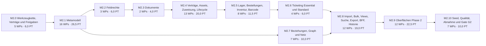

# Implementierungsplan – Phase 2: Verwaltung (bis G2)

Stand: 2026-10-13 · Grundlage: Anforderungskatalog `docs/spec/katalog-v3/` (Tag [P2] und P2-Anteile), Audit vom 2026-10-01 (`docs/audit/99-gesamtbericht.md`, `docs/audit/befunde.csv`, Teilberichte 02–09) und der Phase-1-Plan [`../implementierungsplan.md`](../implementierungsplan.md) mit seinen nach E-03 verschobenen Arbeitspaketen WP-215 bis WP-239.

Dieser Plan ändert keinen Produktivcode. Er zerlegt den gesamten Umfang der Phase 2 – Verwaltung (G2) in Arbeitspakete (WP) für je eine Agent-Session. Begleitdokumente:

- [`entscheidungen.md`](entscheidungen.md): Entscheidungsbedarf der Phase 2 (E-37 bis E-55). Anforderungen werden nicht erfunden oder umgedeutet; Unklarheiten stehen dort. Entscheidungen der Phase 1 (E-01 bis E-36) gelten weiter und werden mit relativem Link referenziert.
- [`abdeckung.csv`](abdeckung.csv): Zuordnung jeder ID im Umfang zu den WPs, die sie bearbeiten oder schließen.

## Annahme: Phase 1 ist vollständig entwickelt

Der Plan setzt voraus, dass Gate G1 bestanden ist: Alle WPs des Phase-1-Plans (WP-001 bis WP-214 sowie WP-240 bis WP-242) sind gemergt, und der dort beschriebene Zielzustand ist die Ausgangslage. Daraus folgt:

- **Fundament vorhanden:** Mandantenkontext `database.WithTenant` mit Client-/Site-/Team-Scopes (WP-008, WP-065), kanonischer Location-Baum (WP-026), Asset-Hoheit nach DB-05 (WP-077 bis WP-080), Metamodell-Basis mit `attribute_definition`, Regel-AST und Komposition Basis + Typkette (WP-116 bis WP-119, WP-142), Review-Modell (WP-088), zentrale Schreibentscheidung (WP-058), Overrides (WP-057), Versionierung/ETag (WP-061), Jobs/Scheduler/Events/Benachrichtigungen (WP-129 bis WP-140), PII-Vault (WP-240 bis WP-242), generische Job-API und Bulk-API (WP-181, WP-182), Filter-AST und Sichten (WP-187, WP-188), Export nach EXP-01 [B] (WP-189), GraphQL-BFF (WP-184, WP-185), Feature-Gates der Spätphasen-Module (WP-214).
- **Audit-Status ist historisch:** Die Spalten „Audit-Status“ und „Severity“ in den WP-Tabellen zeigen den Befund vom 2026-10-01. Wo Phase-1-WPs einen Teil einer P2-ID geschlossen haben (z. B. Scope-/RLS-Korrekturen), steht das im Feld „Problem“ oder in `abdeckung.csv` (`hinweis`).
- **Dateipfade** folgen dem Zielzustand der Phase 1 (z. B. `backend/internal/jobs`, `/api/v1/jobs`, `/api/v1/exports`). Existiert eine genannte Datei zum Umsetzungszeitpunkt unter anderem Namen, gilt der Phase-1-WP-Block als Referenz.
- **Migrationen:** Zum Stand 2026-10-13 ist die höchste Nummer 000126; Phase-1-WPs legen weitere an. Jedes WP nutzt die nächste freie Nummer (Konvention 4).

## Umfang und Abgrenzung

- **94 IDs im Umfang** mit WP-Zuordnung sowie 11 N/P-IDs ohne Wortlaut (nur Entscheidung, siehe E-37): alle IDs mit Tag [P2] sowie die P2-Anteile gemischt getaggter IDs ([B]/[Pn]-Kombinationen, [P2–P3], [P2–P4, A]) und die [Q]-IDs, die nach GATE-02 für jedes Gate gelten (DOD-01, GLO-11, SEQ-01, GATE-01/02/05, ABN-01 c, ABN-02, ABN-03, SEC-11). TKT-03 [O] ist als optionales WP ohne Gate-Wirkung enthalten (GATE-05, E-47).
- **Nicht Bestandteil:** [P3]-Anteile (Monitoring, Workflows, Compliance, Wartungsfenster, SMS/Pager, Health, DSGVO-Workflows), [P4]-Anteile (Agent, Mobil/Offline, RFID, Inventur Pro, Ticketing Pro, Reseller, Schlüssel, Desk, Schulung, Disposition), [P5] und Add-ons [A] (IGA, KI). Die nach E-03 verschobenen WPs mit ausschließlich P3/P4/[A]-IDs (WP-219, WP-220, WP-228, WP-230 bis WP-234) bleiben verschoben.
- **89 Arbeitspakete** WP-243 bis WP-331 mit zusammen **141,5 PT**; davon 1 optionales WP ([O]). **G2-Umfang: 88 WPs mit 140,5 PT.**
- **Nummerierung:** Die WP-Nummern setzen die Phase-1-Folge fort, weil die Traceability-Prüfung WP-Nummern global eindeutig verlangt (WP-243 (`p2-trace`) liest beide Pläne). Die verschobenen Phase-1-WPs mit P2-IDs werden durch neue WPs ersetzt (Tabelle unten, E-46); ihre Blöcke im Phase-1-Plan bleiben unverändert und werden nicht mehr als PR-Nummer verwendet.
- **Reihenfolge** nach SEQ-01, Phase 2: Metamodell (Abschnitt 11) → Verträge, Asset/Lager/Stocktake, Dokumente → Ticketing Essential/Standard → Import, Bulk, Views → G2; „dazu Feldrechte“ (README §17) als eigener Meilenstein direkt nach dem Metamodell, damit alle Modul-DTOs den Feldrechte-Filter von Beginn an einbinden.
- Format der WP-Blöcke: wie im Phase-1-Plan (Abschnitt „Konventionen“).

## Überblick

### Meilensteine

| Meilenstein | Inhalt | WPs | Anzahl | PT | Ausstiegskriterium |
|---|---|---|---:|---:|---|
| [M2.0 Werkzeugkette, Verträge und Freigaben](#m20-werkzeugkette-verträge-und-freigaben) | Prüfrahmen für Phase 2: Traceability liest den Phase-2-Plan, Entitlement-Schlüssel und Modul-Gates nach ENT-06, Rechteschlüssel nach RBA-05, Ereignisvertrag nach EVT-03, REST-Pfadvertrag nach API-06. | WP-243 – WP-247 | 5 | 6,0 | CI prüft Phase-2-WPs blockierend; alle P2-Feature-Keys, Rechte und Ereignistypen sind registriert; OpenAPI enthält die P2-Pfade mit x-phase. |
| [M2.1 Metamodell](#m21-metamodell) | Abschnitt 11 vollständig: Vererbung, Klonen/Deaktivieren, Sets, versionierte Templates, Kompositionsregeln, Template-Migration, Datentypen und Referenzen, globale und Instanzattribute, Regelkatalog, berechnete Attribute, Layouts, Draft → Test → Publish, Export, Lifecycle-Modelle. | WP-248 – WP-263 | 16 | 26,5 | [P2]-IDs des Abschnitts 11 und LCY-02 PASS; Konformanztests der Komposition grün; Draft wirkt nie produktiv. |
| [M2.2 Feldrechte](#m22-feldrechte) | RBA-07 in allen Kanälen: Modell und Verwaltung, Durchsetzung in REST/GraphQL, Suche, Export und Webhooks. | WP-264 – WP-266 | 3 | 6,0 | RBA-07 PASS; Kanalmatrix mit Negativfällen grün; nachfolgende Module binden den Filter ein (Konvention 11). |
| [M2.3 Dokumente](#m23-dokumente) | Dokumentmodell nach MGT-01 (polymorphe Links, Versionen, Audit, Speicherlimit) und Upload-Sicherheit nach SEC-09. | WP-267 – WP-268 | 2 | 4,0 | MGT-01 und SEC-09 PASS; infizierte Uploads werden isoliert; Speicherlimit wird serverseitig erzwungen. |
| [M2.4 Verträge, Assets, Zuweisung, Lifecycle](#m24-verträge-assets-zuweisung-lifecycle) | Lieferanten und Verträge (MGT-12, DB-05), Asset-Kern (AST-01), Verknüpfung und Komposition (AST-03 bis AST-05), kanonische Bewegungshistorie (AST-07, STK-04), Zuweisung, Unterschrift, Reservierung (AST-02, AST-06), Entsorgung (MGT-02), Übergangsregeln (LCY-03), CI-Owner und Tags (CI-01, CI-07, CI-08). | WP-269 – WP-281 | 13 | 20,0 | AST-01 bis AST-07, MGT-02, MGT-12, LCY-03, CI-07, CI-08 PASS; Konkurrenzfälle Reservierung/Transfer grün. |
| [M2.5 Lager, Bestellungen, Inventur, Barcode](#m25-lager-bestellungen-inventur-barcode) | Lagerhierarchie (LOC-08), Mengenartikel mit Bestand pro Bin (STK-01 bis STK-03), Bestellungen (STK-05), Inventur (INV-01, INV-02), Barcode und Etiketten (INV-03). | WP-282 – WP-289 | 8 | 11,5 | STK-01 bis STK-05, INV-01 bis INV-03 (P2-Anteile), LOC-08 PASS. |
| [M2.6 Ticketing Essential und Standard](#m26-ticketing-essential-und-standard) | Ticket-Kern mit Zustandsautomat und Objektbezug, Tickets aus Reviews, SLA mit Business-Kalender (TKT-01, TKT-02); optional Provider-Schnittstelle (TKT-03 [O]). | WP-290 – WP-293 | 4 | 6,0 | TKT-01 (P2-Anteil) und TKT-02 PASS; SLA-Fristen in der Zeitzone von Client oder Org. |
| [M2.7 Beziehungen, Graph und Netz](#m27-beziehungen-graph-und-netz) | Eigene Beziehungstypen und -attribute, Kantenhistorie (REL-06, REL-07, REL-09), Service-Impact und projizierte Netzknoten (IMP-08, IMP-10, IMP-11), IP-Reservierung und Duplikaterkennung (NET-06, NET-09). Läuft parallel zu M2.3 bis M2.6. | WP-294 – WP-300 | 7 | 10,0 | REL-06/07/09, IMP-08/10/11, NET-06/09 PASS. |
| [M2.8 Import, Bulk, Views, Suche, Export, BFF, Historie](#m28-import-bulk-views-suche-export-bff-historie) | Import mit Mapping-Layer (IMP-IO-01), Bulk mit Undo (BLK-02, OVR-03), geteilte Views (VIE-02), Suchfelder und Filter-AST (SRC-02, SRC-03), DATEV (EXP-01), GraphQL-Aggregate (GQL-03), Snapshot und Zustand zum Zeitpunkt T (AUD-08). | WP-301 – WP-312 | 12 | 19,0 | IMP-IO-01, BLK-02, OVR-03, VIE-02, SRC-02, SRC-03, EXP-01 (DATEV), GQL-03, AUD-08 PASS. |
| [M2.9 Oberflächen Phase 2](#m29-oberflächen-phase-2) | Admin-Oberflächen für das Metamodell, Klick-Builder, Form Builder mit Preview, geführte Anlage, Picker und Alltagsflows, Modul-Oberflächen (Assets, Verträge, Lager, Bestellungen, Inventur, Dokumente, Tickets, Import, Bulk, Views, Beziehungen), Playwright-Abläufe (UI-11, UI-12, UI-14, UI-15, MET-50 bis MET-52, SRC-03, TST-03). | WP-313 – WP-324 | 12 | 22,5 | UI-11, UI-12, UI-14 (P2-Anteil), UI-15, MET-50 bis MET-52, TST-03 (P2-Anteil) PASS; axe ohne Befunde auf neuen Seiten. |
| [M2.10 Seed, Qualität, Abnahme und Gate G2](#m210-seed-qualität-abnahme-und-gate-g2) | Seed-Erweiterung (SIM-01), TST-01-Pflichtfälle, Performance-Sanity (ABN-02), Konkurrenzmatrix (ABN-03), internes Sicherheitsreview (SEC-11), Abnahmeszenario (c) (ABN-01), Gate G2 (GATE-01/02/05, DOD-01, SEQ-01, GLO-11). | WP-325 – WP-331 | 7 | 10,0 | Gate-Checkliste vollständig belegt; kein offenes Critical; P2-Module im G2-Release über Entitlements freigeschaltet. |

Reihenfolge nach SEQ-01 (`docs/spec/katalog-v3/08-frontend-monitoring-nfr-tests.md:75`) und README §17:

1. **M2.0 Werkzeugkette, Verträge und Freigaben** stellt vorab die Prüfrahmen (Traceability, Entitlement-Gates, Rechte, Events, Pfade) bereit; das entspricht M0.0 der Phase 1.
2. **M2.1 Metamodell → M2.2 Feldrechte → M2.3 Dokumente → M2.4 Verträge/Assets → M2.5 Lager/Inventur → M2.6 Ticketing → M2.8 Import/Bulk/Views → M2.9 Oberflächen → M2.10 Gate G2.** Dokumente laufen vor Verträgen und Assets, weil Verträge, Entsorgungsnachweise, Unterschriften, Ticketanhänge und Importdateien das Dokumentmodell und SEC-09 benötigen.
3. **M2.7 Beziehungen, Graph und Netz** benötigt nur Phase 1 und die Typvererbung (WP-248) und läuft parallel zu M2.3 bis M2.6; der Snapshot (WP-312) benötigt die Kantenhistorie (WP-296).
4. Innerhalb eines Meilensteins dürfen WPs parallel laufen, sobald ihre Voraussetzungen gemergt sind. Oberflächen-WPs (M2.9) dürfen starten, sobald ihre jeweiligen Backend-Voraussetzungen gemergt sind.

### Abhängigkeitsgraph (Meilenstein-Ebene)

Die Kanten folgen aus SEQ-01 und aus den WP-Abhängigkeiten (transitiv reduziert). M2.7 benötigt aus M2.1 nur die Typvererbung (WP-248) und läuft parallel zu M2.3 bis M2.6.



Epic-Zuordnung für die Traceability (E-45): Datenmodell, Metamodell, Rechte, Module und Graph tragen **B**, API-, Import-/Export- und Oberflächen-WPs tragen **C**, Seed, Qualität und Gate tragen **G2** (analog zu LT/G1 in Phase 1).

### Stand der Entscheidungen

Für Phase 2 liegen 19 neue Entscheidungen vor (E-37 bis E-55); 6 davon verlangen eine Lieferung oder Bestätigung des Auftraggebers (offen), 13 sind mit Empfehlung und Übergangsregel vorläufig entschieden, sodass die WPs starten können. Folgen für den Plan:

- **Startfreigabe:** M2.0 und M2.1 sind freigegeben; WP-250 (`met-sets`), WP-251 (`met-templates`), WP-257 (`met-rules`) und WP-258 (`met-computed`) setzen nach der Übergangsregel von [E-37](entscheidungen.md#e-37) nur die aus MET-10, MET-16, MET-45, MET-53, UI-11, VIE-02, JOB-02 und ABN-01 (c) ableitbaren Bestandteile um; die N/P-IDs MET-20, MET-30 bis MET-34 und MET-40 bis MET-44 erhalten erst nach Lieferung der Texte Traceability-Zeilen.
- **Pfadvertrag:** Die REST-Ressourcennamen der Phase 2 stehen in [E-38](entscheidungen.md#e-38) (vorläufig); abweichende Bestandspfade erhalten Deprecation und Sunset nach E-25.
- **Offen mit Termin:** [E-37](entscheidungen.md#e-37) (Metamodell-Texte), [E-39](entscheidungen.md#e-39) (Ticketing Essential/Standard), [E-44](entscheidungen.md#e-44) (ENT-06-Matrix), [E-47](entscheidungen.md#e-47) (TKT-03), [E-50](entscheidungen.md#e-50) (DATEV-Format), [E-55](entscheidungen.md#e-55) (Entsorgungsnorm) und aus Phase 1 [E-02](../entscheidungen.md#e-02) (v2-Texte, betrifft UI-14 [A]-Anteil und ABN-01 a/b). Die WP-Blöcke zeigen den Status jeder verwiesenen Entscheidung im Feld „Entscheidungsbedarf“.
- **Weiter gültig aus Phase 1:** E-03 (Deaktivieren; die Modul-Gates werden in WP-244 auf Entitlements umgestellt), E-04 (Teil 03 als Quelle; Indexnamen), E-11 (Team-Scope als Schnittmenge, vorläufig), E-25 (API-05-Pfade wörtlich mit Deprecation/Sunset), E-30 (Traceability stufenweise blockierend), E-34 (Planmatrix vorläufig), E-36 (DB-05: contract in Phase 2).

### Verschobene Arbeitspakete aus Phase 1 (WP-215 bis WP-239)

Die folgenden Phase-1-WPs wurden nach E-03 verschoben. Soweit ihre IDs das Tag [P2] tragen, ersetzt dieser Plan sie durch neue WPs mit aktualisierten Voraussetzungen (E-46). WPs mit ausschließlich P3/P4/[A]-IDs bleiben verschoben.

| Phase-1-WP | Schlüssel | Phasen-Tag der IDs | Ersetzt durch |
|---|---|---|---|
| WP-215 | `m-lcy` | LCY-02, LCY-03 [P2] | WP-263 (`met-lifecycle-models`), WP-279 (`ast-lifecycle-guards`) |
| WP-216 | `m-net-res` | NET-09 [P2] | WP-299 (`net-ip-reservation`) |
| WP-217 | `m-rel-hist` | REL-09 [P2] | WP-296 (`rel-history`) |
| WP-218 | `m-blast` | IMP-08 [P2] | WP-297 (`imp-blast`) |
| WP-219 | `m-relay` | COL-07 [A], Relay [P4] | bleibt verschoben (nicht Phase 2) |
| WP-220 | `m-srcpolicy` | REC-04 [P3], REC-11 [P4], AGT-05 [P4] | bleibt verschoben (nicht Phase 2) |
| WP-221 | `m-ovr-bulk` | OVR-03 [P2] | WP-306 (`ovr-bulk`) |
| WP-222 | `m-asset-core` | AST-01, AST-04, AST-05 [P2] | WP-271 (`ast-core`), WP-272 (`ast-ci-link`), WP-273 (`ast-composition`) |
| WP-223 | `m-assign` | AST-02, AST-06 [P2] | WP-275 (`ast-assignment`), WP-277 (`ast-reservation`) |
| WP-224 | `m-movement` | AST-07, STK-04, MGT-02 [P2] | WP-274 (`ast-movement`), WP-278 (`ast-disposal`) |
| WP-225 | `m-stock` | STK-01, STK-02, STK-03 [P2] | WP-283 (`stk-consumable-model`), WP-284 (`stk-availability`), WP-285 (`stk-min-level`) |
| WP-226 | `m-order` | STK-05 [P2] | WP-286 (`stk-orders`) |
| WP-227 | `m-inventory` | INV-01, INV-03 [P2] | WP-287 (`inv-stocktake`), WP-289 (`inv-barcode`) |
| WP-228 | `m-maint` | MGT-04 [P3] | bleibt verschoben (nicht Phase 2) |
| WP-229 | `m-sla` | TKT-02 [P2] | WP-292 (`tkt-sla-calendar`) |
| WP-230 | `m-agent` | AGT-01, AGT-02, AGT-04 [P4] | bleibt verschoben (nicht Phase 2) |
| WP-231 | `m-workflow` | WFL-01, WFL-02, WFL-04 [P3] | bleibt verschoben (nicht Phase 2) |
| WP-232 | `m-iga` | IGA-01 bis IGA-04 [A] | bleibt verschoben (nicht Phase 2) |
| WP-233 | `m-scim` | AUT-08 [P4] | bleibt verschoben (nicht Phase 2) |
| WP-234 | `m-monitoring` | MON-03, MON-04 [P3] | bleibt verschoben (nicht Phase 2) |
| WP-235 | `m-ui-p2` | UI-15 [P2] | WP-318 (`ui-pickers-flows`) |
| WP-236 | `m-ui-meta` | UI-11, SRC-03 [P2] | WP-313 (`ui-meta-types`), WP-314 (`ui-meta-templates-publish`), WP-315 (`ui-rule-builder`), WP-316 (`ui-form-builder`) |
| WP-237 | `m-ui-mods` | UI-13 [P4], UI-14 [P2–P4, A] | WP-319 (`ui-assets-contracts`), WP-320 (`ui-stock-orders-stocktake`), WP-321 (`ui-documents-tickets`), WP-322 (`ui-import-bulk-views`) |
| WP-238 | `m-loc-ext` | LOC-08 [P2] | WP-282 (`stk-loc08`) |
| WP-239 | `m-met-ref` | MET-12, MET-51 [P2] | WP-254 (`met-datatypes`), WP-317 (`ui-guided-create`) |

## Konventionen für alle WPs

Die Konventionen 1 bis 10 des Phase-1-Plans ([`../implementierungsplan.md`](../implementierungsplan.md#konventionen-für-alle-wps)) gelten unverändert: ein WP = ein PR mit 0,5–2 PT und höchstens ca. 15 Dateien; Voraussetzungen sind gemergte WPs; Befund- und Anforderungstext vor Beginn lesen; Migrationen mit nächster freier Nummer, `.up.sql`/`.down.sql` und grünem Roundtrip (WP-006); neue Mandantentabellen mit ENABLE + FORCE RLS, USING und WITH CHECK über die Scope-GUCs, Katalogtest ohne neue Ausnahme (WP-007), Datenzugriff nur über `WithTenant` (WP-008, Architekturtest WP-041); API spec-first in `api/openapi.yaml` mit Paritätstest und `npm run generate:api`; Tests gegen PostgreSQL nur mit `TEST_DATABASE_URL`; Traceability-Zeilen nach dem WP-Block; Audit/Events/i18n nach der DoD-Checkliste; Abgrenzung auf die genannten Dateien. Zusätzlich für Phase 2:

11. **Feldrechte-Filter:** Jedes WP mit neuen oder geänderten DTOs, Listen, Exporten oder Webhook-Payloads bindet den zentralen Sichtbarkeitsfilter aus WP-265 (`fr-rest-gql`) bzw. WP-266 (`fr-search-export-webhooks`) ein und ergänzt die Kanalmatrix um seine Objektart. Ab M2.3 ist das Teil der Akzeptanzkriterien, auch wenn es im Block nicht wiederholt wird.
12. **Entitlement und Modul-Gate:** Neue Routen eines P2-Moduls tragen in `api/openapi.yaml` `x-phase: P2` und `x-feature: <feature_key>` (WP-244) und werden nur registriert, wenn das Modul freigeschaltet ist; `RequireFeature` steht vor dem Handler. Limits (z. B. `max_storage_mb`) werden mit 403 `entitlement-limit` erzwungen (ENT-03).
13. **Ereignisse:** Schreibende Pfade erzeugen die in WP-246 (`p2-events`) registrierten Ereignistypen über die Outbox (WP-136); neue Typen werden nur dort ergänzt.
14. **Bewegungen:** Jede Bestands-, Zuweisungs-, Reservierungs- oder Entsorgungsänderung schreibt genau einen Eintrag in `stock_movement` über `internal/movement` (WP-274) in derselben Transaktion; kein Modul schreibt die Tabelle direkt.
15. **Overrides und Provenienz:** Import, Bulk und Template-Migration schreiben über die zentrale Schreibentscheidung (WP-058) mit ihrer Quelle (import 95, manual 100) und erzeugen bei manuellen Massenänderungen Overrides (OVR-03, WP-306).
16. **PII:** Akteure, Zuweisungsempfänger, Unterzeichner und Kontakte werden nur als Surrogat-IDs gespeichert (SEC-05, WP-241); Anzeige löst zur Laufzeit auf.
17. **Verschobene WPs:** PRs verwenden ausschließlich die Nummern dieses Plans; WP-215 bis WP-239 werden nicht mehr als PR-Nummer verwendet (E-46).

### Format eines WP-Blocks

`### WP-nnn – Titel`, danach: Kopfzeile (Schlüssel, Meilenstein, Epic für Traceability, Aufwand, optional G2-Umfang), Voraussetzungen, Tabelle der Anforderungen (ID, Tag, Audit-Status, Severity, Beitrag *schließt*/*Teil*, Befundquelle, Anforderungstext), Problem, Akzeptanzkriterien, Dateien, Migration/RLS, Tests, Traceability-Zeilen, Entscheidungsbedarf und „Nicht Bestandteil“.

Beitrag *Teil* heißt: Das WP liefert einen abgegrenzten Teil der ID. Die ID gilt als geschlossen, wenn alle beteiligten WPs gemergt sind. Den Abschluss bildet das letzte WP der Liste in `abdeckung.csv` (`abschluss_wp`). Restumfang außerhalb der Phase 2 steht dort in `hinweis`. Audit-Status „nicht geprüft“ bedeutet: Teil 06 des Audits enthält für die ID keine Zeile; die Bestandsaufnahme gilt als Befund.

## M2.0 Werkzeugkette, Verträge und Freigaben

**Ziel:** Jedes Folge-WP kann Traceability, Entitlement-Gate, Rechte, Events und OpenAPI-Pfade gegen einen festen Vertrag nachweisen.

**Ausstieg:** CI prüft Phase-2-WPs blockierend; alle P2-Feature-Keys, Rechte und Ereignistypen sind registriert; OpenAPI enthält die P2-Pfade mit x-phase.

| WP | Schlüssel | Titel | PT | Voraussetzungen |
|---|---|---|---:|---|
| [WP-243](#wp-243--traceability-prüfung-für-phase-2-zweite-plandatei-zweite-abdeckung-p2-vollständigkeit) | `p2-trace` | Traceability-Prüfung für Phase 2: zweite Plandatei, zweite Abdeckung, [P2]-Vollständigkeit | 1,0 | WP-213, WP-005 |
| [WP-244](#wp-244--entitlement-schlüssel-phase-2-nach-ent-06-und-modul-gates-auf-entitlement-basis) | `p2-entitlements` | Entitlement-Schlüssel Phase 2 nach ENT-06 und Modul-Gates auf Entitlement-Basis | 1,5 | WP-071, WP-072, WP-214, WP-243 |
| [WP-245](#wp-245--rechteschlüssel-der-phase-2-module-nach-rba-05-und-nachweis-rba-06) | `p2-permissions` | Rechteschlüssel der Phase-2-Module nach RBA-05 und Nachweis RBA-06 | 1,0 | WP-068, WP-045, WP-046, WP-244 |
| [WP-246](#wp-246--ereignisvertrag-phase-2-nach-evt-03) | `p2-events` | Ereignisvertrag Phase 2 nach EVT-03 | 1,0 | WP-136, WP-243 |
| [WP-247](#wp-247--rest-ressourcen-der-phase-2-nach-api-06-pfadvertrag-x-phase-umstellung-abweichender-pfade) | `p2-paths` | REST-Ressourcen der Phase 2 nach API-06: Pfadvertrag, x-phase, Umstellung abweichender Pfade | 1,5 | WP-168, WP-167, WP-244 |

### WP-243 – Traceability-Prüfung für Phase 2: zweite Plandatei, zweite Abdeckung, [P2]-Vollständigkeit

**Schlüssel:** `p2-trace` · **Meilenstein:** M2.0 Werkzeugkette, Verträge und Freigaben · **Epic (Traceability):** B · **Aufwand:** 1,0 PT

**Voraussetzungen (gemergt):** WP-213 (`g1-gate`), WP-005 (`trace`)

| ID | Tag | Audit-Status | Severity | Beitrag | Befundquelle | Anforderungstext |
|---|---|---|---|---|---|---|
| GLO-11 | [Q] | FAIL | High | Teil (Phase 2) | `docs/audit/08-frontend-monitoring-nfr-tests.md:31` | `docs/spec/katalog-v3/00-grundlagen.md:101` |
| DOD-01 | [Q] | PARTIAL | High | Teil (Phase 2) | `docs/audit/08-frontend-monitoring-nfr-tests.md:70` | `docs/spec/katalog-v3/08-frontend-monitoring-nfr-tests.md:73` |

**Problem:** `TestTraceabilityFile` liest nur `docs/plan/implementierungsplan.md` und `docs/plan/abdeckung.csv`; WPs dieses Plans wären „not a work package“, `IMP-IO-01` scheitert am ID-Muster, und `TRACEABILITY_REQUIRE_COMPLETE=1` kennt keine Phasenstufe.

**Akzeptanzkriterien:**

- [ ] `ParsePlan` liest beide Pläne (`docs/plan/implementierungsplan.md`, `docs/plan/phase2/implementierungsplan.md`) und meldet doppelte WP-Nummern als Fehler; `AddCoverage` liest beide Abdeckungsdateien, abweichende Tags derselben ID sind ein Fehler.
- [ ] `idPattern`/`idListToken` akzeptieren `IMP-IO-01` (Muster `[A-Z]{2,5}(-[A-Z]{2})?-\d{2}`); vorhandene Zeilen bleiben gültig.
- [ ] `TRACEABILITY_REQUIRE_COMPLETE` nimmt eine Tag-Liste (`B,Q` bzw. `B,Q,P2`); IDs mit `status` N/P in einer Abdeckungsdatei sind von der Vollständigkeit ausgenommen (E-48).
- [ ] PR-Vorlage und CI-Job nennen beide Pläne; `docs/traceability.csv` erhält die Zeilen dieses WPs.

**Dateien (6 Einträge, Migration = 2):**

- backend/internal/traceability/traceability.go
- backend/internal/traceability/traceability_test.go
- .github/workflows/ci.yml
- .github/pull_request_template.md
- docs/traceability.csv
- docs/plan/phase2/abdeckung.csv

**Migration/RLS:** keine Migration.

**Tests:**

- `traceability_test.go`: zwei Pläne, doppelte Nummer, Phasenliste, `IMP-IO-01`, N/P-Ausnahme.

**Traceability (`docs/traceability.csv`):**

```text
GLO-11;[Q];B;backend/internal/traceability/traceability_test.go;WP-243
DOD-01;[Q];B;backend/internal/traceability/traceability_test.go;WP-243
```

**Entscheidungsbedarf:** [E-48](entscheidungen.md#e-48) Traceability-Vollständigkeit für [P2] (Erweiterung von E-30) (vorläufig entschieden (Option 1)); [E-46](entscheidungen.md#e-46) Verschobene Phase-1-WPs (WP-215 bis WP-239) durch Phase-2-WPs ersetzen (vorläufig entschieden (Option 1))

**Nicht Bestandteil:** Änderungen außerhalb der genannten Dateien und IDs.

### WP-244 – Entitlement-Schlüssel Phase 2 nach ENT-06 und Modul-Gates auf Entitlement-Basis

**Schlüssel:** `p2-entitlements` · **Meilenstein:** M2.0 Werkzeugkette, Verträge und Freigaben · **Epic (Traceability):** B · **Aufwand:** 1,5 PT

**Voraussetzungen (gemergt):** WP-071 (`ent-model`), WP-072 (`ent-enforce`), WP-214 (`m-gates`), WP-243 (`p2-trace`)

| ID | Tag | Audit-Status | Severity | Beitrag | Befundquelle | Anforderungstext |
|---|---|---|---|---|---|---|
| ENT-06 | (V), [B–P4], [A] | ABWEICHEND | High | Teil (P2-Schlüssel) | `docs/audit/02-mandanten-auth-entitlements.md:67` | `docs/spec/katalog-v3/02-mandanten-auth-entitlements.md:97` |
| ENT-02 | [B] | ABWEICHEND | High | Teil (export_datev) | `docs/audit/02-mandanten-auth-entitlements.md:63` | `docs/spec/katalog-v3/02-mandanten-auth-entitlements.md:89` |
| API-06 | [P2]/[P3]/[P4]/[A] | ABWEICHEND | High | Teil (Gates) | `docs/audit/07-api-suche-jobs-lebenszyklus.md:31` | `docs/spec/katalog-v3/07-api-suche-jobs-lebenszyklus.md:14` |
| RBA-05 | [P2–P4], [A] | PARTIAL | High | Teil (Gates) | `docs/audit/02-mandanten-auth-entitlements.md:58` | `docs/spec/katalog-v3/02-mandanten-auth-entitlements.md:70` |

**Problem:** Bestandsschlüssel `inventory`, `ticketing`, `stocktake` weichen von ENT-06 ab; die P2-Schlüssel `assets_basic`, `documents`, `import`, `ticketing_essential`, `ticketing_standard`, `signature`, `stock`, `stocktake_standard`, `barcode`, `export_datev`, `internal_orders` fehlen; WP-214 schaltet Module nur global, nicht je Org nach Entitlement.

**Akzeptanzkriterien:**

- [ ] Feature-Keys und Paketzuordnung nach ENT-06/E-44 in `entitlement.go`; Datenmigration bildet `inventory`→`assets_basic`+`stock`, `ticketing`→`ticketing_essential`(+`ticketing_standard` ab Standard), `stocktake`→`stocktake_standard` ab; `gps_standard` und `workplace` werden angelegt, aber keinem Modul zugeordnet.
- [ ] Modulregister (`server/modules.go`) ordnet jedem P2-Modul seinen Feature-Key zu; Routen werden registriert, wenn das Modul im Release freigegeben ist, und `RequireFeature` prüft je Org; P3+/[A]-Module bleiben nach E-03 abgeschaltet.
- [ ] `api/openapi.yaml`: `x-phase: P2` und `x-feature` an allen P2-Pfaden; Paritätstest berücksichtigt beides.
- [ ] Limit `max_storage_mb` (documents) im Limitmodell; Redis-Cache 60 s mit Invalidierung (ENT-03).

**Dateien (12 Einträge, Migration = 2):**

- backend/internal/entitlement/entitlement.go
- backend/internal/entitlement/entitlement_test.go
- backend/internal/entitlement/middleware.go
- backend/internal/entitlement/enforce_integration_test.go
- backend/internal/server/modules.go
- backend/internal/server/modules_test.go
- backend/internal/server/parity_test.go
- backend/migrations/<nächste Nr.>_entitlement_p2_keys.up.sql + .down.sql
- frontend/src/hooks/useEntitlements.ts
- frontend/src/hooks/useEntitlements.test.ts
- api/openapi.yaml

**Migration/RLS:** Datenmigration der `entitlement`-Zeilen (Schlüsselumbenennung mit Rückabbildung im down); keine neue Tabelle.

**Tests:**

- `entitlement_test.go` (Matrix je Paket), `modules_test.go` (Gate je Modul und Org), `enforce_integration_test.go`.

**Traceability (`docs/traceability.csv`):**

```text
ENT-06;(V), [B–P4], [A];B;backend/internal/entitlement/entitlement_test.go;WP-244
ENT-02;[B];B;backend/internal/entitlement/entitlement_test.go;WP-244
API-06;[P2]/[P3]/[P4]/[A];B;backend/internal/entitlement/entitlement_test.go;WP-244
RBA-05;[P2–P4], [A];B;backend/internal/entitlement/entitlement_test.go;WP-244
```

**Entscheidungsbedarf:** [E-44](entscheidungen.md#e-44) ENT-06 (V): Feature-Keys der Phase 2 und Paketzuordnung (offen (Empfehlung als Übergangsregel; ergänzt E-34)); [E-03](../entscheidungen.md#e-03) Umgang mit vorhandenem Code späterer Phasen im G1-Release (entschieden: deaktivieren)

**Nicht Bestandteil:** Änderungen außerhalb der genannten Dateien und IDs.

### WP-245 – Rechteschlüssel der Phase-2-Module nach RBA-05 und Nachweis RBA-06

**Schlüssel:** `p2-permissions` · **Meilenstein:** M2.0 Werkzeugkette, Verträge und Freigaben · **Epic (Traceability):** B · **Aufwand:** 1,0 PT

**Voraussetzungen (gemergt):** WP-068 (`rba-catalog`), WP-045 (`authz-map`), WP-046 (`role-model`), WP-244 (`p2-entitlements`)

| ID | Tag | Audit-Status | Severity | Beitrag | Befundquelle | Anforderungstext |
|---|---|---|---|---|---|---|
| RBA-05 | [P2–P4], [A] | PARTIAL | High | Teil (P2-Module) | `docs/audit/02-mandanten-auth-entitlements.md:58` | `docs/spec/katalog-v3/02-mandanten-auth-entitlements.md:70` |
| RBA-06 | [P2] | ABWEICHEND | High | Teil (Nachweis) | `docs/audit/02-mandanten-auth-entitlements.md:59` | `docs/spec/katalog-v3/02-mandanten-auth-entitlements.md:72` |

**Problem:** Rechte für `contract`, `reservation` (statt `asset:reserve`), `stock` (statt `consumable`) fehlen oder weichen ab; Seeds für bestehende und neue Orgs sind nicht identisch; die fünf RBA-06-Rechtegruppen sind gemappt, aber nicht als Matrix belegt.

**Akzeptanzkriterien:**

- [ ] Permission-Katalog enthält je P2-Modul `read`/`write` sowie `order:approve`, `assignment:write`, `stocktake:complete`, `document:manage`, `import:run`, `field_permission:manage`, `tag:manage`, `metamodel:publish`; Aliasse der Altschlüssel bleiben lesbar.
- [ ] Rollenmatrix (RBA-02) für `org_admin`, `engineer`, `viewer`, `client_technician` um die P2-Rechte ergänzt; Migration seedet bestehende Orgs identisch zu neuen.
- [ ] `authz.go` mappt jede P2-Route fail-closed; `authz_catalog_test.go` beweist, dass kein P2-Pfad ohne Mapping registriert wird.
- [ ] RBA-06-Matrixtest: `lifecycle:transition`, `reconciliation:manage`, `override:write`, `ci_instance_attribute:manage`, `relationship_type:manage` je Systemrolle.

**Dateien (8 Einträge, Migration = 2):**

- backend/internal/permission/catalog.go
- backend/internal/permission/catalog_test.go
- backend/internal/permission/role_matrix.go
- backend/internal/permission/role_matrix_integration_test.go
- backend/internal/server/authz.go
- backend/internal/server/authz_catalog_test.go
- backend/migrations/<nächste Nr.>_permissions_p2.up.sql + .down.sql

**Migration/RLS:** Seed-Migration für `permission`/`role_permission`; keine neue Tabelle.

**Tests:**

- `role_matrix_integration_test.go`, `authz_catalog_test.go`.

**Traceability (`docs/traceability.csv`):**

```text
RBA-05;[P2–P4], [A];B;backend/internal/permission/role_matrix_integration_test.go;WP-245
RBA-06;[P2];B;backend/internal/permission/role_matrix_integration_test.go;WP-245
```

**Entscheidungsbedarf:** [E-45](entscheidungen.md#e-45) Epic-Zuordnung und Traceability-Epics der Phase 2 (vorläufig entschieden (Option 1))

**Nicht Bestandteil:** Änderungen außerhalb der genannten Dateien und IDs.

### WP-246 – Ereignisvertrag Phase 2 nach EVT-03

**Schlüssel:** `p2-events` · **Meilenstein:** M2.0 Werkzeugkette, Verträge und Freigaben · **Epic (Traceability):** B · **Aufwand:** 1,0 PT

**Voraussetzungen (gemergt):** WP-136 (`b-events`), WP-243 (`p2-trace`)

| ID | Tag | Audit-Status | Severity | Beitrag | Befundquelle | Anforderungstext |
|---|---|---|---|---|---|---|
| EVT-03 | [P2–P3] | nicht geprüft | – | Teil (P2-Typen) | – | `docs/spec/katalog-v3/06-audit-sicherheit-events.md:52` |

**Problem:** `api/events.schema.json` kennt nur EVT-02-Typen; Module der Phase 2 haben keinen stabilen Ereignisvertrag.

**Akzeptanzkriterien:**

- [ ] Typen `ci.status_changed`, `lifecycle.changed`, `relationship.changed`, `asset.created`, `asset.changed`, `asset.deleted`, `asset.assigned`, `asset.returned`, `asset.warranty_expiring`, `contract.expiring`, `stock.movement`, `stock.below_minimum`, `reservation.created`, `reservation.released`, `reservation.expired`, `reservation.converted`, `ticket.updated`, `ticket.sla_breached`, `metamodel.published`, `document.scanned`, `import.completed` mit Payload-Schema und `entity_seq` registriert; P3-Typen als reserviert dokumentiert.
- [ ] Webhook-Filter und Benachrichtigungsvorlagen akzeptieren die Typen; Konformanztest prüft jedes Beispiel gegen das Schema.

**Dateien (5 Einträge, Migration = 2):**

- api/events.schema.json
- backend/internal/events/types.go
- backend/internal/events/types_test.go
- backend/internal/webhook/filter.go
- docs/README.md

**Migration/RLS:** keine Migration.

**Tests:**

- `events/types_test.go` (Schema-Konformanz je Typ).

**Traceability (`docs/traceability.csv`):**

```text
EVT-03;[P2–P3];B;backend/internal/events/types_test.go;WP-246
```

**Entscheidungsbedarf:** keiner

**Nicht Bestandteil:** P3-Typen (`maintenance.scheduled`, `workflow.*`, `finding.*`).

### WP-247 – REST-Ressourcen der Phase 2 nach API-06: Pfadvertrag, x-phase, Umstellung abweichender Pfade

**Schlüssel:** `p2-paths` · **Meilenstein:** M2.0 Werkzeugkette, Verträge und Freigaben · **Epic (Traceability):** B · **Aufwand:** 1,5 PT

**Voraussetzungen (gemergt):** WP-168 (`c-paths`), WP-167 (`c-lifecycle`), WP-244 (`p2-entitlements`)

| ID | Tag | Audit-Status | Severity | Beitrag | Befundquelle | Anforderungstext |
|---|---|---|---|---|---|---|
| API-06 | [P2]/[P3]/[P4]/[A] | ABWEICHEND | High | Teil (P2-Pfadvertrag) | `docs/audit/07-api-suche-jobs-lebenszyklus.md:31` | `docs/spec/katalog-v3/07-api-suche-jobs-lebenszyklus.md:14` |

**Problem:** Die P2-Ressourcen haben keinen Pfadvertrag; Bestandspfade (`inventory/items`, `lifecycle-definitions`, `ci-types/templates`, `assets/{id}/movements`, `consumables/{id}/movements`) weichen von E-38 ab.

**Akzeptanzkriterien:**

- [ ] `api/openapi.yaml` enthält alle P2-Pfade der E-38-Tabelle als Gerüst (Tags, Sicherheitsschema, `x-phase: P2`, `x-feature`); noch nicht implementierte Operationen sind als `x-status: planned` markiert, der Paritätstest lässt nur geplante Pfade ohne Route zu.
- [ ] Abweichende Bestandspfade erhalten `Deprecation`/`Sunset` (≥ 12 Monate) und Alias-Routing (E-25); `frontend` nutzt die neuen Pfade nach `npm run generate:api`.
- [ ] Fehlervertrag RFC 7807 mit `trace_id` für alle neuen Pfade (WP-163).

**Dateien (7 Einträge, Migration = 2):**

- api/openapi.yaml
- backend/internal/server/router.go
- backend/internal/server/parity_test.go
- backend/internal/server/deprecation.go
- backend/internal/server/deprecation_test.go
- frontend/src/api/generated/schema.d.ts (generiert)
- frontend/src/api/cmdbHooks.ts

**Migration/RLS:** keine Migration.

**Tests:**

- `parity_test.go` (x-status planned), `deprecation_test.go` (Header und Alias).

**Traceability (`docs/traceability.csv`):**

```text
API-06;[P2]/[P3]/[P4]/[A];B;backend/internal/server/parity_test.go;WP-247
```

**Entscheidungsbedarf:** [E-38](entscheidungen.md#e-38) API-06: REST-Ressourcennamen der Phase 2 und Umstellung abweichender Bestandspfade (vorläufig entschieden (Übergangsregel: Tabelle unten)); [E-25](../entscheidungen.md#e-25) API-05-Pfade wörtlich mit Deprecation/Sunset (entschieden)

**Nicht Bestandteil:** Änderungen außerhalb der genannten Dateien und IDs.

## M2.1 Metamodell

**Ziel:** Metamodell nach MET-05 bis MET-54 ohne Migration und Code-Release nutzbar; Publikationen auditiert und als Event sichtbar.

**Ausstieg:** [P2]-IDs des Abschnitts 11 und LCY-02 PASS; Konformanztests der Komposition grün; Draft wirkt nie produktiv.

| WP | Schlüssel | Titel | PT | Voraussetzungen |
|---|---|---|---:|---|
| [WP-248](#wp-248--typvererbung-über-parent_type_id-typkette-zyklus--und-tiefenprüfung-untertypenfilter) | `met-inherit` | Typvererbung über parent_type_id: Typkette, Zyklus- und Tiefenprüfung, Untertypenfilter | 2,0 | WP-115, WP-119, WP-247 |
| [WP-249](#wp-249--typen-klonen-und-deaktivieren-wirksam-keine-neuen-cis-discovery-fallback-elternschutz) | `met-deactivate` | Typen klonen und deaktivieren wirksam: keine neuen CIs, Discovery-Fallback, Elternschutz | 1,0 | WP-248, WP-172, WP-088 |
| [WP-250](#wp-250--attribute-sets-modell-zuordnung-zu-typen-in-definierter-reihenfolge-komposition) | `met-sets` | Attribute Sets: Modell, Zuordnung zu Typen in definierter Reihenfolge, Komposition | 2,0 | WP-116, WP-248, WP-245 |
| [WP-251](#wp-251--templates-mit-versionen-modell-zuordnung-komposition-nach-sets) | `met-templates` | Templates mit Versionen: Modell, Zuordnung, Komposition nach Sets | 2,0 | WP-250 |
| [WP-252](#wp-252--kompositionsregeln-nach-met-16-vollständig-required-or-enum-schnitt-engste-bounds-allof-default-publish-fehler) | `met-compose-rules` | Kompositionsregeln nach MET-16 vollständig: required-OR, Enum-Schnitt, engste Bounds, allOf, Default, Publish-Fehler | 1,5 | WP-251 |
| [WP-253](#wp-253--template-migration-als-job-mit-dry-run-bericht-und-override-schutz) | `met-migrate` | Template-Migration als Job mit Dry Run, Bericht und Override-Schutz | 1,5 | WP-252, WP-130, WP-182, WP-057 |
| [WP-254](#wp-254--datentypen-file-json-und-reference-mit-existenz--org--und-client-prüfung-standort-als-referenz-auf-location) | `met-datatypes` | Datentypen file, json und reference mit Existenz-, Org- und Client-Prüfung; Standort als Referenz auf location | 2,0 | WP-117, WP-053, WP-247 |
| [WP-255](#wp-255--globale-attribute-für-alle-anwendbaren-typen) | `met-global-attrs` | Globale Attribute für alle anwendbaren Typen | 1,0 | WP-250, WP-142 |
| [WP-256](#wp-256--instanzattribute-im-namensraum-attributes_instance-mit-eigener-api) | `met-instance` | Instanzattribute im Namensraum attributes._instance mit eigener API | 1,5 | WP-091, WP-056, WP-045 |
| [WP-257](#wp-257--regelkatalog-gespeicherte-regeln-je-typ-set-und-template-mit-auswertung-beim-schreiben) | `met-rules` | Regelkatalog: gespeicherte Regeln je Typ, Set und Template mit Auswertung beim Schreiben | 2,0 | WP-118, WP-251 |
| [WP-258](#wp-258--berechnete-attribute-mit-refresh-job-job-02-und-indizierung) | `met-computed` | Berechnete Attribute mit Refresh-Job (JOB-02) und Indizierung | 1,5 | WP-257, WP-131, WP-142 |
| [WP-259](#wp-259--layouts-pro-typ-template-und-rolle-aufgelöstes-formular-und-vorschau-endpunkt) | `met-layouts` | Layouts pro Typ, Template und Rolle; aufgelöstes Formular und Vorschau-Endpunkt | 1,5 | WP-257, WP-248 |
| [WP-260](#wp-260--draft--test--publish-entwurfsmodell-isolation-und-rest) | `met-drafts` | Draft → Test → Publish: Entwurfsmodell, Isolation und REST | 2,0 | WP-251, WP-257, WP-259 |
| [WP-261](#wp-261--publikation-test-lauf-gegen-bestand-atomare-anwendung-event-metamodelpublished-audit) | `met-publish` | Publikation: Test-Lauf gegen Bestand, atomare Anwendung, Event metamodel.published, Audit | 2,0 | WP-260, WP-246, WP-134, WP-252 |
| [WP-262](#wp-262--metamodell-export-und--import-vollständig-phase-2-alles) | `met-export-all` | Metamodell-Export und -Import vollständig (Phase 2: alles) | 1,0 | WP-261, WP-134 |
| [WP-263](#wp-263--konfigurierbare-lifecycle-modelle-als-zustandsgraph-mit-guards-seeds-physisch-und-software-vererbung) | `met-lifecycle-models` | Konfigurierbare Lifecycle-Modelle als Zustandsgraph mit Guards, Seeds physisch und Software, Vererbung | 2,0 | WP-080, WP-248, WP-257, WP-247 |

### WP-248 – Typvererbung über parent_type_id: Typkette, Zyklus- und Tiefenprüfung, Untertypenfilter

**Schlüssel:** `met-inherit` · **Meilenstein:** M2.1 Metamodell · **Epic (Traceability):** B · **Aufwand:** 2,0 PT

**Voraussetzungen (gemergt):** WP-115 (`b-met-types`), WP-119 (`b-met-compose`), WP-247 (`p2-paths`)

| ID | Tag | Audit-Status | Severity | Beitrag | Befundquelle | Anforderungstext |
|---|---|---|---|---|---|---|
| MET-06 | [P2] | OFFEN | – | schließt | `docs/audit/03-datenmodell-standorte-metamodell.md:53` | `docs/spec/katalog-v3/03-datenmodell-standorte-metamodell.md:73` |
| MET-01 | B/G1, Teil P2/G2 | ABWEICHEND | High | Teil (parent_type_id) | `docs/audit/03-datenmodell-standorte-metamodell.md:48` | `docs/spec/katalog-v3/03-datenmodell-standorte-metamodell.md:63` |

**Problem:** `parent_type_id` fehlt; `cloned_from_id` ersetzt keine Vererbung; keine Tiefe-6-/Zyklusprüfung; `filter[type]` nur Gleichheit; Regeln, Layouts und Lifecycle-Modell werden nicht vererbt.

**Akzeptanzkriterien:**

- [ ] `ci_type.parent_type_id` (gleiche Org oder Systemtyp), Zyklusprüfung beim Schreiben (409), Tiefe ≤ 6 (422); Systemtypen sind als Eltern erlaubt, Org-Typen nicht Eltern von Systemtypen.
- [ ] Komposition (WP-119) löst die Typkette Root → Blatt auf; Attribute, Regeln, Layouts und `lifecycle_model_id` werden vererbt (Kind darf verfeinern, nicht entfernen).
- [ ] `filter[type]` und `filter[type_in]` schließen Untertypen ein (`type_subtree`), Topologie-/Impact-Typfilter ebenso; Index `(org, parent_type_id)`.
- [ ] Export/Audit (WP-134) enthalten `parent_type_id`.

**Dateien (12 Einträge, Migration = 2):**

- backend/migrations/<nächste Nr.>_ci_type_parent.up.sql + .down.sql
- backend/internal/citype/model.go
- backend/internal/citype/pg_repository.go
- backend/internal/citype/resolver.go
- backend/internal/citype/compose.go
- backend/internal/citype/inherit_integration_test.go (neu)
- backend/internal/ci/pg_repository.go
- backend/internal/ci/handler.go
- api/openapi.yaml
- frontend/src/api/generated/schema.d.ts (generiert)
- docs/schema-baseline.md

**Migration/RLS:** Spalte und Index auf `ci_type`; up/down.

**Tests:**

- `citype/inherit_integration_test.go` (Kette, Zyklus, Tiefe 7 → 422, Untertypenfilter, Vererbung von Regeln/Layout/Lifecycle).

**Traceability (`docs/traceability.csv`):**

```text
MET-06;[P2];B;backend/internal/citype/inherit_integration_test.go;WP-248
MET-01;B/G1, Teil P2/G2;B;backend/internal/citype/inherit_integration_test.go;WP-248
```

**Entscheidungsbedarf:** keiner

**Nicht Bestandteil:** Änderungen außerhalb der genannten Dateien und IDs.

### WP-249 – Typen klonen und deaktivieren wirksam: keine neuen CIs, Discovery-Fallback, Elternschutz

**Schlüssel:** `met-deactivate` · **Meilenstein:** M2.1 Metamodell · **Epic (Traceability):** B · **Aufwand:** 1,0 PT

**Voraussetzungen (gemergt):** WP-248 (`met-inherit`), WP-172 (`c-ci-typechange`), WP-088 (`review-model`)

| ID | Tag | Audit-Status | Severity | Beitrag | Befundquelle | Anforderungstext |
|---|---|---|---|---|---|---|
| MET-05 | [P2] | ABWEICHEND | Medium | schließt | `docs/audit/03-datenmodell-standorte-metamodell.md:52` | `docs/spec/katalog-v3/03-datenmodell-standorte-metamodell.md:71` |

**Problem:** `is_active=false` wird bei CI-Anlage und Discovery ignoriert; Klonen kopiert keine Regeln/Layouts/Set-Zuordnungen.

**Akzeptanzkriterien:**

- [ ] Anlage eines CIs mit inaktivem Typ → 422 `type-inactive`; Discovery klassifiziert auf inaktive Typen als `generic_device` mit Review `unclassified_device` (Grund `type_inactive`); bestehende CIs bleiben lesbar und bearbeitbar.
- [ ] Deaktivieren eines Typs mit aktiven Untertypen → 409; Klonen übernimmt Attribute, Regeln, Layouts, Set-Zuordnungen und `parent_type_id` und vergibt einen neuen Key.
- [ ] Audit und Event `metamodel.published` erst mit WP-261; hier Audit `ci_type.deactivated`/`cloned`.

**Dateien (6 Einträge, Migration = 2):**

- backend/internal/citype/pg_repository.go
- backend/internal/citype/handler.go
- backend/internal/ci/service.go
- backend/internal/discovery/classify.go
- backend/internal/citype/deactivate_integration_test.go (neu)
- api/openapi.yaml

**Migration/RLS:** keine Migration.

**Tests:**

- `citype/deactivate_integration_test.go` (422, Discovery-Fallback, 409 Eltern, Klon vollständig).

**Traceability (`docs/traceability.csv`):**

```text
MET-05;[P2];B;backend/internal/citype/deactivate_integration_test.go;WP-249
```

**Entscheidungsbedarf:** keiner

**Nicht Bestandteil:** Änderungen außerhalb der genannten Dateien und IDs.

### WP-250 – Attribute Sets: Modell, Zuordnung zu Typen in definierter Reihenfolge, Komposition

**Schlüssel:** `met-sets` · **Meilenstein:** M2.1 Metamodell · **Epic (Traceability):** B · **Aufwand:** 2,0 PT

**Voraussetzungen (gemergt):** WP-116 (`b-met-attrdef`), WP-248 (`met-inherit`), WP-245 (`p2-permissions`)

| ID | Tag | Audit-Status | Severity | Beitrag | Befundquelle | Anforderungstext |
|---|---|---|---|---|---|---|
| MET-16 | B/G1, Teil P2/G2 | ABWEICHEND | High | Teil (Sets) | `docs/audit/03-datenmodell-standorte-metamodell.md:60` | `docs/spec/katalog-v3/03-datenmodell-standorte-metamodell.md:89` |
| API-06 | [P2]/[P3]/[P4]/[A] | ABWEICHEND | High | Teil (attribute-sets) | `docs/audit/07-api-suche-jobs-lebenszyklus.md:31` | `docs/spec/katalog-v3/07-api-suche-jobs-lebenszyklus.md:14` |
| AUD-07 | [B] | PARTIAL | High | Teil (Sets) | `docs/audit/06-audit-sicherheit-events.md:25` | `docs/spec/katalog-v3/06-audit-sicherheit-events.md:16` |

**Problem:** Attribute Sets existieren nicht; MET-16 verlangt sie als dritte Kompositionsstufe nach der Typkette. Wortlaut MET-20 fehlt (E-37).

**Akzeptanzkriterien:**

- [ ] Tabellen `attribute_set(org, key unique pro Org, display_name i18n, description, is_system, is_active, version)`, `attribute_set_item(set_id, attribute_definition_id, position, required_override, default_override)` und `ci_type_attribute_set(ci_type_id, set_id, position)`; RLS nach TEN-05; globale Systemsets read-only (E-10).
- [ ] REST `attribute-sets` CRUD und `ci-types/{id}/attribute-sets` (Reihenfolge per `position`); Recht `citype:manage`.
- [ ] Komposition (WP-119): System-Basis → Typkette → Sets in `position`-Reihenfolge; Konfliktregeln erst in WP-252, hier Übernahme in Schlüsselreihenfolge mit Fehler bei Datentypkonflikt.
- [ ] Audit `attribute_set.*` (AUD-07); Export in WP-262.

**Dateien (11 Einträge, Migration = 2):**

- backend/migrations/<nächste Nr.>_attribute_sets.up.sql + .down.sql
- backend/internal/citype/attribute_set.go (neu)
- backend/internal/citype/attribute_set_repository.go (neu)
- backend/internal/citype/attribute_set_handler.go (neu)
- backend/internal/citype/compose.go
- backend/internal/citype/attribute_set_integration_test.go (neu)
- backend/internal/server/authz.go
- api/openapi.yaml
- frontend/src/api/generated/schema.d.ts (generiert)
- docs/schema-baseline.md

**Migration/RLS:** Drei neue Mandantentabellen mit RLS (ENABLE + FORCE, USING/WITH CHECK); up/down.

**Tests:**

- `citype/attribute_set_integration_test.go` (CRUD, Reihenfolge, Komposition, RLS).

**Traceability (`docs/traceability.csv`):**

```text
MET-16;B/G1, Teil P2/G2;B;backend/internal/citype/attribute_set_integration_test.go;WP-250
API-06;[P2]/[P3]/[P4]/[A];B;backend/internal/citype/attribute_set_integration_test.go;WP-250
AUD-07;[B];B;backend/internal/citype/attribute_set_integration_test.go;WP-250
```

**Entscheidungsbedarf:** [E-37](entscheidungen.md#e-37) Fehlende Metamodell-Texte MET-20, MET-30 bis MET-34, MET-40 bis MET-44 (Sets, Templates, Regeln, berechnete Attribute) (offen (Übergangsregel gilt)); [E-38](entscheidungen.md#e-38) API-06: REST-Ressourcennamen der Phase 2 und Umstellung abweichender Bestandspfade (vorläufig entschieden (Übergangsregel: Tabelle unten))

**Nicht Bestandteil:** Konfliktregeln (WP-252), Oberfläche (WP-313).

### WP-251 – Templates mit Versionen: Modell, Zuordnung, Komposition nach Sets

**Schlüssel:** `met-templates` · **Meilenstein:** M2.1 Metamodell · **Epic (Traceability):** B · **Aufwand:** 2,0 PT

**Voraussetzungen (gemergt):** WP-250 (`met-sets`)

| ID | Tag | Audit-Status | Severity | Beitrag | Befundquelle | Anforderungstext |
|---|---|---|---|---|---|---|
| MET-16 | B/G1, Teil P2/G2 | ABWEICHEND | High | Teil (Templates) | `docs/audit/03-datenmodell-standorte-metamodell.md:60` | `docs/spec/katalog-v3/03-datenmodell-standorte-metamodell.md:89` |
| API-06 | [P2]/[P3]/[P4]/[A] | ABWEICHEND | High | Teil (templates, versions) | `docs/audit/07-api-suche-jobs-lebenszyklus.md:31` | `docs/spec/katalog-v3/07-api-suche-jobs-lebenszyklus.md:14` |
| AUD-07 | [B] | PARTIAL | High | Teil (Templates) | `docs/audit/06-audit-sicherheit-events.md:25` | `docs/spec/katalog-v3/06-audit-sicherheit-events.md:16` |

**Problem:** Der Bestand liefert nur ein festes Go-Array `Templates()` als Seed-Katalog; keine versionierten Templates pro Org, keine Zuordnung mit Reihenfolge, keine Referenz im CI. Wortlaut MET-30 bis MET-34 fehlt (E-37).

**Akzeptanzkriterien:**

- [ ] Tabellen `template(org, key unique pro Org, ci_type_id, display_name i18n, description, is_system, is_active, current_version)` und `template_version(template_id, version, status draft|published|retired, schema jsonb: Attribut-Overrides, Defaults, Set-Referenzen, Regel-Referenzen, Layout-Referenz, published_at, published_by surrogate)`; `ci.template_id`/`ci.template_version` (nullable).
- [ ] REST `templates`, `templates/{id}/versions` (neue Version = Kopie der aktuellen; Publizieren erst mit WP-261, bis dahin `status published` nur über direktes Publizieren nach MET-04); `ci-types/templates` deprecated (E-38); der bisherige Go-Katalog wird zu Seed-Daten (Systemtemplates, editierbar durch Klonen).
- [ ] Komposition: Sets → Templates in definierter Reihenfolge (mehrere Templates je CI zulässig, `ci_template(ci_id, template_id, version, position)`); Audit.

**Dateien (13 Einträge, Migration = 2):**

- backend/migrations/<nächste Nr.>_templates.up.sql + .down.sql
- backend/internal/citype/template.go (neu)
- backend/internal/citype/template_repository.go (neu)
- backend/internal/citype/template_handler.go (neu)
- backend/internal/citype/templates.go
- backend/internal/citype/compose.go
- backend/internal/citype/template_integration_test.go (neu)
- backend/internal/ci/model.go
- backend/internal/server/authz.go
- api/openapi.yaml
- frontend/src/api/generated/schema.d.ts (generiert)
- docs/schema-baseline.md

**Migration/RLS:** Drei neue Mandantentabellen (`template`, `template_version`, `ci_template`) mit RLS; Seed der Systemtemplates; up/down.

**Tests:**

- `citype/template_integration_test.go` (Versionen, Zuordnung mit Reihenfolge, Seed, RLS).

**Traceability (`docs/traceability.csv`):**

```text
MET-16;B/G1, Teil P2/G2;B;backend/internal/citype/template_integration_test.go;WP-251
API-06;[P2]/[P3]/[P4]/[A];B;backend/internal/citype/template_integration_test.go;WP-251
AUD-07;[B];B;backend/internal/citype/template_integration_test.go;WP-251
```

**Entscheidungsbedarf:** [E-37](entscheidungen.md#e-37) Fehlende Metamodell-Texte MET-20, MET-30 bis MET-34, MET-40 bis MET-44 (Sets, Templates, Regeln, berechnete Attribute) (offen (Übergangsregel gilt)); [E-38](entscheidungen.md#e-38) API-06: REST-Ressourcennamen der Phase 2 und Umstellung abweichender Bestandspfade (vorläufig entschieden (Übergangsregel: Tabelle unten))

**Nicht Bestandteil:** Template-Migration (WP-253), Draft/Publish (WP-260, WP-261).

### WP-252 – Kompositionsregeln nach MET-16 vollständig: required-OR, Enum-Schnitt, engste Bounds, allOf, Default, Publish-Fehler

**Schlüssel:** `met-compose-rules` · **Meilenstein:** M2.1 Metamodell · **Epic (Traceability):** B · **Aufwand:** 1,5 PT

**Voraussetzungen (gemergt):** WP-251 (`met-templates`)

| ID | Tag | Audit-Status | Severity | Beitrag | Befundquelle | Anforderungstext |
|---|---|---|---|---|---|---|
| MET-16 | B/G1, Teil P2/G2 | ABWEICHEND | High | Teil (Konfliktregeln) | `docs/audit/03-datenmodell-standorte-metamodell.md:60` | `docs/spec/katalog-v3/03-datenmodell-standorte-metamodell.md:89` |
| TST-01 | [B], Teilumfang [P2] | ABWEICHEND | High | Teil (Template-Komposition) | `docs/audit/08-frontend-monitoring-nfr-tests.md:66` | `docs/spec/katalog-v3/08-frontend-monitoring-nfr-tests.md:63` |

**Problem:** Die Komposition ersetzt Definitionen gleichen Schlüssels vollständig; required-OR, Enum-Schnittmenge, engste Bounds, allOf-Pattern, Default-Regel und Datentyp-Konflikt fehlen.

**Akzeptanzkriterien:**

- [ ] Für gleiche Schlüssel über Basis → Typkette → Sets → Templates → Instanz: `required = OR`; erlaubte Werte = Schnittmenge (leer → Publish-Fehler `enum-empty`); min/max = engster Bereich; pattern = allOf; default = letzte Ebene; abweichender Datentyp → Publish-Fehler `datatype-conflict`.
- [ ] Ergebnis wird materialisiert (`attribute_schema`, JSON Schema 2020-12), `schema_version` inkrementiert und im CI referenziert (WP-119); Validierung bei CI-Anlage/PATCH nutzt das materialisierte Schema.
- [ ] Konformanzmatrix als Tabelle in `compose_test.go` (≥ 25 Fälle) – TST-01-Anteil „Template-Komposition (MET-16)“.

**Dateien (5 Einträge, Migration = 2):**

- backend/internal/citype/compose.go
- backend/internal/citype/compose_test.go
- backend/internal/citype/materialize.go
- backend/internal/citype/materialize_integration_test.go (neu)
- backend/internal/fieldmeta/fieldmeta.go

**Migration/RLS:** keine Migration.

**Tests:**

- `citype/compose_test.go` (Matrix), `materialize_integration_test.go`.

**Traceability (`docs/traceability.csv`):**

```text
MET-16;B/G1, Teil P2/G2;B;backend/internal/citype/compose_test.go;WP-252
TST-01;[B], Teilumfang [P2];B;backend/internal/citype/compose_test.go;WP-252
```

**Entscheidungsbedarf:** keiner

**Nicht Bestandteil:** Änderungen außerhalb der genannten Dateien und IDs.

### WP-253 – Template-Migration als Job mit Dry Run, Bericht und Override-Schutz

**Schlüssel:** `met-migrate` · **Meilenstein:** M2.1 Metamodell · **Epic (Traceability):** B · **Aufwand:** 1,5 PT

**Voraussetzungen (gemergt):** WP-252 (`met-compose-rules`), WP-130 (`b-jobqueue`), WP-182 (`c-jobs-api`), WP-057 (`manual-ovr`)

| ID | Tag | Audit-Status | Severity | Beitrag | Befundquelle | Anforderungstext |
|---|---|---|---|---|---|---|
| API-09 | [B] | FAIL | High | Teil (template.migrate) | `docs/audit/07-api-suche-jobs-lebenszyklus.md:34` | `docs/spec/katalog-v3/07-api-suche-jobs-lebenszyklus.md:20` |
| JOB-04 | [B] | PARTIAL | High | Teil (Template-Migration) | `docs/audit/07-api-suche-jobs-lebenszyklus.md:64` | `docs/spec/katalog-v3/07-api-suche-jobs-lebenszyklus.md:90` |
| OVR-03 | [P2] | ABWEICHEND | High | Teil (Template-Migration) | `docs/audit/05-collector-discovery-reconciliation.md:68` | `docs/spec/katalog-v3/05-collector-discovery-reconciliation.md:84` |

**Problem:** Es gibt keinen Pfad, CIs von einer Template-Version auf eine andere zu heben; ein ungeschützter Pfad könnte Overrides überschreiben.

**Akzeptanzkriterien:**

- [ ] Jobart `template.migrate` (Params: template_id, from_version, to_version, ci_ids oder Filter, dry_run); Ausführung über die Work-Queue (WP-130), Fortschritt und Ergebnis je CI über `/jobs/{id}`.
- [ ] Je CI: Re-Validierung gegen das neue materialisierte Schema; Defaults nur in leere Felder; Overrides (`_overrides`) und Instanzattribute bleiben unberührt (OVR-02/OVR-03); Verstöße werden als Befunde berichtet, nicht blockiert (wie CI-11).
- [ ] Je CI genau eine `ci_change` (`template_migrated`) und ein Event `ci.changed`; Dry Run schreibt nichts, liefert den vollständigen Bericht.

**Dateien (6 Einträge, Migration = 2):**

- backend/internal/citype/migrate_job.go (neu)
- backend/internal/citype/migrate_job_integration_test.go (neu)
- backend/internal/jobs/kinds.go
- backend/internal/citype/template_handler.go
- api/openapi.yaml
- frontend/src/api/generated/schema.d.ts (generiert)

**Migration/RLS:** keine Migration.

**Tests:**

- `citype/migrate_job_integration_test.go` (Dry Run, Defaults, Override bleibt, Bericht).

**Traceability (`docs/traceability.csv`):**

```text
API-09;[B];B;backend/internal/citype/migrate_job_integration_test.go;WP-253
JOB-04;[B];B;backend/internal/citype/migrate_job_integration_test.go;WP-253
OVR-03;[P2];B;backend/internal/citype/migrate_job_integration_test.go;WP-253
```

**Entscheidungsbedarf:** keiner

**Nicht Bestandteil:** Override-Erzeugung durch Bulk (WP-306).

### WP-254 – Datentypen file, json und reference mit Existenz-, Org- und Client-Prüfung; Standort als Referenz auf location

**Schlüssel:** `met-datatypes` · **Meilenstein:** M2.1 Metamodell · **Epic (Traceability):** B · **Aufwand:** 2,0 PT

**Voraussetzungen (gemergt):** WP-117 (`b-met-types-val`), WP-053 (`loc-api`), WP-247 (`p2-paths`)

| ID | Tag | Audit-Status | Severity | Beitrag | Befundquelle | Anforderungstext |
|---|---|---|---|---|---|---|
| MET-12 | P2/G2 | ABWEICHEND | High | schließt | `docs/audit/03-datenmodell-standorte-metamodell.md:56` | `docs/spec/katalog-v3/03-datenmodell-standorte-metamodell.md:81` |
| MET-11 | B/G1, Teil P2/G2 | ABWEICHEND | High | Teil (file, json, reference) | `docs/audit/03-datenmodell-standorte-metamodell.md:55` | `docs/spec/katalog-v3/03-datenmodell-standorte-metamodell.md:79` |

**Problem:** Referenztypen akzeptieren jede Zeichenkette ohne UUID-/Existenz-/Org-/Clientprüfung; `location` ist nicht an den kanonischen Baum gebunden; `file` und `json` fehlen.

**Akzeptanzkriterien:**

- [ ] `fieldmeta`: `reference` mit `reference_target` ∈ {ci, asset, user, team, location, contract}; Validierung prüft UUID, Existenz in derselben Org und Client-Kompatibilität (org-weit oder gleicher Client); `contract` wird über ein Registry-Interface eingebunden (Implementierung mit WP-269).
- [ ] `file` referenziert ein Dokument derselben Org (Link wird beim Speichern angelegt); `json` validiert optional gegen ein JSON-Schema in `validation`.
- [ ] Effektive Sicht (WP-060) liefert für Referenzen `{id, display_name}`; Standort-Referenzen zeigen auf `location` (CH28).
- [ ] Konformanzfälle in `fieldmeta_test.go` und `api/rules.conformance.json` (Referenz in Bedingungen).

**Dateien (8 Einträge, Migration = 2):**

- backend/internal/fieldmeta/fieldmeta.go
- backend/internal/fieldmeta/fieldmeta_test.go
- backend/internal/fieldmeta/reference_registry.go (neu)
- backend/internal/ci/validation.go
- backend/internal/ci/reference_integration_test.go (neu)
- backend/internal/ci/service.go
- api/rules.conformance.json
- api/openapi.yaml

**Migration/RLS:** keine Migration.

**Tests:**

- `fieldmeta_test.go`, `ci/reference_integration_test.go` (fremde Org, fremder Client, gelöschtes Ziel, Location-Baum).

**Traceability (`docs/traceability.csv`):**

```text
MET-12;P2/G2;B;backend/internal/ci/reference_integration_test.go;WP-254
MET-11;B/G1, Teil P2/G2;B;backend/internal/ci/reference_integration_test.go;WP-254
```

**Entscheidungsbedarf:** keiner

**Nicht Bestandteil:** CI-Anlage-Wizard (WP-317).

### WP-255 – Globale Attribute für alle anwendbaren Typen

**Schlüssel:** `met-global-attrs` · **Meilenstein:** M2.1 Metamodell · **Epic (Traceability):** B · **Aufwand:** 1,0 PT

**Voraussetzungen (gemergt):** WP-250 (`met-sets`), WP-142 (`b-met-ddl`)

| ID | Tag | Audit-Status | Severity | Beitrag | Befundquelle | Anforderungstext |
|---|---|---|---|---|---|---|
| MET-13 | [P2] | ABWEICHEND | Medium | schließt | `docs/audit/03-datenmodell-standorte-metamodell.md:57` | `docs/spec/katalog-v3/03-datenmodell-standorte-metamodell.md:83` |

**Problem:** Globale Felder liegen auf einem synthetischen Org-Typ; Global-DELETE übergibt eine leere Typ-ID und scheitert vor dem Fallback.

**Akzeptanzkriterien:**

- [ ] `attribute_definition.applies_to` (`all` | Kategorien | Typliste, inkl. Untertypen); die System-Basis der Komposition enthält alle anwendbaren globalen Attribute; kein synthetischer Trägertyp mehr (Datenmigration).
- [ ] `DELETE /attribute-definitions/{id}` für globale Attribute funktioniert; Werte in CIs bleiben erhalten und werden als `unknown_attribute` gemeldet; DDL-Job (WP-142) indiziert globale `searchable`-Attribute.

**Dateien (7 Einträge, Migration = 2):**

- backend/migrations/<nächste Nr.>_attribute_applies_to.up.sql + .down.sql
- backend/internal/citype/attribute_definition.go
- backend/internal/citype/resolver.go
- backend/internal/citype/handler.go
- backend/internal/citype/global_attr_integration_test.go (neu)
- api/openapi.yaml

**Migration/RLS:** Spalte `applies_to` und Datenmigration; up/down.

**Tests:**

- `citype/global_attr_integration_test.go`.

**Traceability (`docs/traceability.csv`):**

```text
MET-13;[P2];B;backend/internal/citype/global_attr_integration_test.go;WP-255
```

**Entscheidungsbedarf:** keiner

**Nicht Bestandteil:** Änderungen außerhalb der genannten Dateien und IDs.

### WP-256 – Instanzattribute im Namensraum attributes._instance mit eigener API

**Schlüssel:** `met-instance` · **Meilenstein:** M2.1 Metamodell · **Epic (Traceability):** B · **Aufwand:** 1,5 PT

**Voraussetzungen (gemergt):** WP-091 (`glo13-ns`), WP-056 (`inst-attr`), WP-045 (`authz-map`)

| ID | Tag | Audit-Status | Severity | Beitrag | Befundquelle | Anforderungstext |
|---|---|---|---|---|---|---|
| MET-14 | P2/G2 | ABWEICHEND | Critical | schließt | `docs/audit/03-datenmodell-standorte-metamodell.md:58` | `docs/spec/katalog-v3/03-datenmodell-standorte-metamodell.md:85` |

**Problem:** Instanzwerte liegen flach in `attributes`; Discovery-Schutz und Audit (WP-056) und das Recht `ci_instance_attribute:manage` (WP-045) sind vorhanden, aber Namensraum und API fehlen.

**Akzeptanzkriterien:**

- [ ] Definitionen in `ci_instance_field_definition`, Werte ausschließlich in `attributes._instance` (CI-10); Datenmigration verschiebt vorhandene Instanzwerte.
- [ ] REST `cis/{id}/instance-attributes` (GET/PUT/DELETE je Schlüssel) mit `ci_instance_attribute:manage`; effektive Sicht liefert `_instance` getrennt; Suche/Filter nur für Definitionen mit `searchable`.
- [ ] Audit je Änderung; Discovery, Import, Bulk und Template-Migration lassen `_instance` unberührt (Test).

**Dateien (9 Einträge, Migration = 2):**

- backend/migrations/<nächste Nr.>_instance_namespace.up.sql + .down.sql
- backend/internal/ci/instance.go (neu)
- backend/internal/ci/instance_integration_test.go (neu)
- backend/internal/ci/handler.go
- backend/internal/citype/pg_repository.go
- backend/internal/server/authz.go
- api/openapi.yaml
- frontend/src/api/generated/schema.d.ts (generiert)

**Migration/RLS:** Datenmigration der Instanzwerte; keine neue Tabelle.

**Tests:**

- `ci/instance_integration_test.go` (Namensraum, Recht, Audit, Automationsschutz).

**Traceability (`docs/traceability.csv`):**

```text
MET-14;P2/G2;B;backend/internal/ci/instance_integration_test.go;WP-256
```

**Entscheidungsbedarf:** keiner

**Nicht Bestandteil:** Änderungen außerhalb der genannten Dateien und IDs.

### WP-257 – Regelkatalog: gespeicherte Regeln je Typ, Set und Template mit Auswertung beim Schreiben

**Schlüssel:** `met-rules` · **Meilenstein:** M2.1 Metamodell · **Epic (Traceability):** B · **Aufwand:** 2,0 PT

**Voraussetzungen (gemergt):** WP-118 (`b-met-rules`), WP-251 (`met-templates`)

| ID | Tag | Audit-Status | Severity | Beitrag | Befundquelle | Anforderungstext |
|---|---|---|---|---|---|---|
| MET-10 | B/G1, Teil P2/G2 | ABWEICHEND | High | Teil (validation) | `docs/audit/03-datenmodell-standorte-metamodell.md:54` | `docs/spec/katalog-v3/03-datenmodell-standorte-metamodell.md:77` |
| MET-53 | [P2] | OFFEN | – | Teil (Regeln als Draft-Gegenstand) | `docs/audit/03-datenmodell-standorte-metamodell.md:76` | `docs/spec/katalog-v3/03-datenmodell-standorte-metamodell.md:99` |
| API-06 | [P2]/[P3]/[P4]/[A] | ABWEICHEND | High | Teil (rules) | `docs/audit/07-api-suche-jobs-lebenszyklus.md:31` | `docs/spec/katalog-v3/07-api-suche-jobs-lebenszyklus.md:14` |
| AUD-07 | [B] | PARTIAL | High | Teil (Regeln) | `docs/audit/06-audit-sicherheit-events.md:25` | `docs/spec/katalog-v3/06-audit-sicherheit-events.md:16` |

**Problem:** Regeln sind nur je Attributdefinition (`validation`, `conditional`) speicherbar; kein benannter, versionierter Regelkatalog je Typ/Set/Template, keine gemeinsame Auswertung in Import, Bulk und Formularen. Wortlaut MET-40 bis MET-43 fehlt (E-37).

**Akzeptanzkriterien:**

- [ ] Tabelle `rule(org, key unique pro Org, kind validation|conditional|readonly|required, scope type|set|template, target_id, ast jsonb nach api/rules.schema.json, severity error|warning, message i18n, is_active, version)`; RLS; Systemregeln read-only.
- [ ] Auswertung über `internal/rules` (WP-118) bei CI-Anlage/PATCH, Import (WP-302), Bulk (WP-304), Template-Migration; Regeln werden über die Typkette vererbt (WP-248).
- [ ] REST `rules` CRUD; `cis/{id}/form` (WP-259) liefert die konditionalen Ergebnisse; Konformanzfälle ergänzt; Audit.

**Dateien (12 Einträge, Migration = 2):**

- backend/migrations/<nächste Nr.>_rules.up.sql + .down.sql
- backend/internal/rules/catalog.go (neu)
- backend/internal/rules/catalog_repository.go (neu)
- backend/internal/rules/catalog_handler.go (neu)
- backend/internal/rules/catalog_integration_test.go (neu)
- backend/internal/ci/validation.go
- api/rules.conformance.json
- backend/internal/server/authz.go
- api/openapi.yaml
- frontend/src/api/generated/schema.d.ts (generiert)
- docs/schema-baseline.md

**Migration/RLS:** Neue Mandantentabelle `rule` mit RLS; up/down.

**Tests:**

- `rules/catalog_integration_test.go` (Vererbung, Auswertung bei PATCH, Konformanz).

**Traceability (`docs/traceability.csv`):**

```text
MET-10;B/G1, Teil P2/G2;B;backend/internal/rules/catalog_integration_test.go;WP-257
MET-53;[P2];B;backend/internal/rules/catalog_integration_test.go;WP-257
API-06;[P2]/[P3]/[P4]/[A];B;backend/internal/rules/catalog_integration_test.go;WP-257
AUD-07;[B];B;backend/internal/rules/catalog_integration_test.go;WP-257
```

**Entscheidungsbedarf:** [E-37](entscheidungen.md#e-37) Fehlende Metamodell-Texte MET-20, MET-30 bis MET-34, MET-40 bis MET-44 (Sets, Templates, Regeln, berechnete Attribute) (offen (Übergangsregel gilt)); [E-38](entscheidungen.md#e-38) API-06: REST-Ressourcennamen der Phase 2 und Umstellung abweichender Bestandspfade (vorläufig entschieden (Übergangsregel: Tabelle unten))

**Nicht Bestandteil:** Änderungen außerhalb der genannten Dateien und IDs.

### WP-258 – Berechnete Attribute mit Refresh-Job (JOB-02) und Indizierung

**Schlüssel:** `met-computed` · **Meilenstein:** M2.1 Metamodell · **Epic (Traceability):** B · **Aufwand:** 1,5 PT

**Voraussetzungen (gemergt):** WP-257 (`met-rules`), WP-131 (`b-scheduler`), WP-142 (`b-met-ddl`)

| ID | Tag | Audit-Status | Severity | Beitrag | Befundquelle | Anforderungstext |
|---|---|---|---|---|---|---|
| MET-10 | B/G1, Teil P2/G2 | ABWEICHEND | High | Teil (computed) | `docs/audit/03-datenmodell-standorte-metamodell.md:54` | `docs/spec/katalog-v3/03-datenmodell-standorte-metamodell.md:77` |
| JOB-02 | [B], Zusätze [P2], [P3] | PARTIAL | High | Teil (Computed-Attribute-Refresh) | `docs/audit/07-api-suche-jobs-lebenszyklus.md:62` | `docs/spec/katalog-v3/07-api-suche-jobs-lebenszyklus.md:86` |

**Problem:** `attribute_definition.computed` fehlt; VIE-02 („Garantie läuft bald ab“) und JOB-02 verlangen berechnete Attribute mit periodischem Refresh. Wortlaut MET-44 fehlt (E-37).

**Akzeptanzkriterien:**

- [ ] `attribute_definition.computed` (AST-Ausdruck: Arithmetik, Datum, Zeichenketten, Referenzfelder inkl. Asset-Felder); Werte werden mit Provenienz `computed` in `_provenance` geführt, sind nicht überschreibbar (kein Override, 422) und nicht importierbar.
- [ ] Neuberechnung bei Änderung eines Eingabefelds (gleiche Transaktion) und als Systemjob `computed.refresh` (Cron, Single-Runner) für zeitabhängige Ausdrücke; `searchable` berechnete Attribute erhalten über WP-142 einen Index.
- [ ] Seed-Beispiel `warranty_days_left` (Asset) für VIE-02; Konformanzfälle.

**Dateien (9 Einträge, Migration = 2):**

- backend/migrations/<nächste Nr.>_attribute_computed.up.sql + .down.sql
- backend/internal/citype/computed.go (neu)
- backend/internal/citype/computed_integration_test.go (neu)
- backend/internal/jobs/computed_refresh.go (neu)
- backend/internal/jobs/scheduler.go
- backend/internal/rules/rules.go
- api/rules.conformance.json
- api/rules.schema.json

**Migration/RLS:** Spalte `computed` auf `attribute_definition`; up/down.

**Tests:**

- `citype/computed_integration_test.go` (Trigger, Job, kein Override, Index).

**Traceability (`docs/traceability.csv`):**

```text
MET-10;B/G1, Teil P2/G2;B;backend/internal/citype/computed_integration_test.go;WP-258
JOB-02;[B], Zusätze [P2], [P3];B;backend/internal/citype/computed_integration_test.go;WP-258
```

**Entscheidungsbedarf:** [E-37](entscheidungen.md#e-37) Fehlende Metamodell-Texte MET-20, MET-30 bis MET-34, MET-40 bis MET-44 (Sets, Templates, Regeln, berechnete Attribute) (offen (Übergangsregel gilt))

**Nicht Bestandteil:** Änderungen außerhalb der genannten Dateien und IDs.

### WP-259 – Layouts pro Typ, Template und Rolle; aufgelöstes Formular und Vorschau-Endpunkt

**Schlüssel:** `met-layouts` · **Meilenstein:** M2.1 Metamodell · **Epic (Traceability):** B · **Aufwand:** 1,5 PT

**Voraussetzungen (gemergt):** WP-257 (`met-rules`), WP-248 (`met-inherit`)

| ID | Tag | Audit-Status | Severity | Beitrag | Befundquelle | Anforderungstext |
|---|---|---|---|---|---|---|
| MET-50 | [P2] | OFFEN | – | Teil (Backend) | `docs/audit/03-datenmodell-standorte-metamodell.md:73` | `docs/spec/katalog-v3/03-datenmodell-standorte-metamodell.md:93` |
| MET-52 | [P2] | OFFEN | – | Teil (Backend) | `docs/audit/03-datenmodell-standorte-metamodell.md:75` | `docs/spec/katalog-v3/03-datenmodell-standorte-metamodell.md:97` |
| GQL-03 | [P2] | OFFEN | – | Teil (aufgelöstes Formular) | `docs/audit/07-api-suche-jobs-lebenszyklus.md:37` | `docs/spec/katalog-v3/07-api-suche-jobs-lebenszyklus.md:28` |
| API-06 | [P2]/[P3]/[P4]/[A] | ABWEICHEND | High | Teil (layouts) | `docs/audit/07-api-suche-jobs-lebenszyklus.md:31` | `docs/spec/katalog-v3/07-api-suche-jobs-lebenszyklus.md:14` |

**Problem:** Layouts sind nur als `ui_schema` am Typ speicherbar; keine Bindung an Template und Rolle, keine Auflösung Layout + Regeln + Rolle, keine Vorschau.

**Akzeptanzkriterien:**

- [ ] Tabelle `form_layout(org, scope type|template, target_id, role_id nullable, version, status, layout jsonb: Abschnitte, Felder, Reihenfolge, Breite, Bedingungsreferenzen)`; Vererbung über die Typkette; RLS.
- [ ] `GET /cis/{id}/form` und `GET /ci-types/{id}/form?template=&role=&preview=true` liefern Layout + Regeln + Feldrechte (Hook für WP-265) + Pflichtfelder aus dem materialisierten Schema; `preview` erlaubt `org_admin`, als Rolle X mit Template Y aufzulösen, ohne Daten zu ändern.
- [ ] REST `layouts` CRUD; Audit; `form_def` (P3-Workflows) bleibt unberührt.

**Dateien (11 Einträge, Migration = 2):**

- backend/migrations/<nächste Nr.>_form_layouts.up.sql + .down.sql
- backend/internal/citype/layout.go (neu)
- backend/internal/citype/layout_repository.go (neu)
- backend/internal/citype/layout_handler.go (neu)
- backend/internal/citype/form_resolver.go (neu)
- backend/internal/citype/layout_integration_test.go (neu)
- backend/internal/server/authz.go
- api/openapi.yaml
- frontend/src/api/generated/schema.d.ts (generiert)
- docs/schema-baseline.md

**Migration/RLS:** Neue Mandantentabelle `form_layout` mit RLS; up/down.

**Tests:**

- `citype/layout_integration_test.go` (Auflösung je Rolle/Template, Vererbung, Vorschau ohne Schreibwirkung).

**Traceability (`docs/traceability.csv`):**

```text
MET-50;[P2];B;backend/internal/citype/layout_integration_test.go;WP-259
MET-52;[P2];B;backend/internal/citype/layout_integration_test.go;WP-259
GQL-03;[P2];B;backend/internal/citype/layout_integration_test.go;WP-259
API-06;[P2]/[P3]/[P4]/[A];B;backend/internal/citype/layout_integration_test.go;WP-259
```

**Entscheidungsbedarf:** [E-38](entscheidungen.md#e-38) API-06: REST-Ressourcennamen der Phase 2 und Umstellung abweichender Bestandspfade (vorläufig entschieden (Übergangsregel: Tabelle unten))

**Nicht Bestandteil:** Form Builder (WP-316).

### WP-260 – Draft → Test → Publish: Entwurfsmodell, Isolation und REST

**Schlüssel:** `met-drafts` · **Meilenstein:** M2.1 Metamodell · **Epic (Traceability):** B · **Aufwand:** 2,0 PT

**Voraussetzungen (gemergt):** WP-251 (`met-templates`), WP-257 (`met-rules`), WP-259 (`met-layouts`)

| ID | Tag | Audit-Status | Severity | Beitrag | Befundquelle | Anforderungstext |
|---|---|---|---|---|---|---|
| MET-53 | [P2] | OFFEN | – | Teil (Drafts) | `docs/audit/03-datenmodell-standorte-metamodell.md:76` | `docs/spec/katalog-v3/03-datenmodell-standorte-metamodell.md:99` |
| API-06 | [P2]/[P3]/[P4]/[A] | ABWEICHEND | High | Teil (metamodel/drafts) | `docs/audit/07-api-suche-jobs-lebenszyklus.md:31` | `docs/spec/katalog-v3/07-api-suche-jobs-lebenszyklus.md:14` |

**Problem:** Jede Metamodelländerung wirkt sofort produktiv; es gibt keinen Entwurfszustand.

**Akzeptanzkriterien:**

- [ ] Tabelle `metamodel_draft(org, status draft|tested|published|discarded, created_by surrogate, base_schema_version, items jsonb: Änderungen an Typen, Attributdefinitionen, Sets, Templates, Regeln, Layouts als Patch-Liste, test_report, published_at)`; RLS.
- [ ] Alle Schreibpfade der Metamodell-Ressourcen akzeptieren `?draft={id}`; ohne Draft gilt direktes Publizieren (MET-04) und wird als Ein-Element-Draft protokolliert.
- [ ] Drafts wirken nicht auf CI-Validierung, Discovery, Suche oder Formulare (Isolationstest); REST `metamodel/drafts` CRUD, `…/items`.

**Dateien (11 Einträge, Migration = 2):**

- backend/migrations/<nächste Nr.>_metamodel_drafts.up.sql + .down.sql
- backend/internal/citype/draft.go (neu)
- backend/internal/citype/draft_repository.go (neu)
- backend/internal/citype/draft_handler.go (neu)
- backend/internal/citype/draft_integration_test.go (neu)
- backend/internal/citype/handler.go
- backend/internal/server/authz.go
- api/openapi.yaml
- frontend/src/api/generated/schema.d.ts (generiert)
- docs/schema-baseline.md

**Migration/RLS:** Neue Mandantentabelle `metamodel_draft` mit RLS; up/down.

**Tests:**

- `citype/draft_integration_test.go` (Isolation, Patch-Liste, direktes Publizieren).

**Traceability (`docs/traceability.csv`):**

```text
MET-53;[P2];B;backend/internal/citype/draft_integration_test.go;WP-260
API-06;[P2]/[P3]/[P4]/[A];B;backend/internal/citype/draft_integration_test.go;WP-260
```

**Entscheidungsbedarf:** [E-38](entscheidungen.md#e-38) API-06: REST-Ressourcennamen der Phase 2 und Umstellung abweichender Bestandspfade (vorläufig entschieden (Übergangsregel: Tabelle unten))

**Nicht Bestandteil:** Änderungen außerhalb der genannten Dateien und IDs.

### WP-261 – Publikation: Test-Lauf gegen Bestand, atomare Anwendung, Event metamodel.published, Audit

**Schlüssel:** `met-publish` · **Meilenstein:** M2.1 Metamodell · **Epic (Traceability):** B · **Aufwand:** 2,0 PT

**Voraussetzungen (gemergt):** WP-260 (`met-drafts`), WP-246 (`p2-events`), WP-134 (`b-met-export`), WP-252 (`met-compose-rules`)

| ID | Tag | Audit-Status | Severity | Beitrag | Befundquelle | Anforderungstext |
|---|---|---|---|---|---|---|
| MET-53 | [P2] | OFFEN | – | Teil (Test/Publish) | `docs/audit/03-datenmodell-standorte-metamodell.md:76` | `docs/spec/katalog-v3/03-datenmodell-standorte-metamodell.md:99` |
| AUD-07 | [B] | PARTIAL | High | Teil (Publikationen) | `docs/audit/06-audit-sicherheit-events.md:25` | `docs/spec/katalog-v3/06-audit-sicherheit-events.md:16` |
| EVT-03 | [P2–P3] | nicht geprüft | – | Teil (metamodel.published) | – | `docs/spec/katalog-v3/06-audit-sicherheit-events.md:52` |

**Problem:** Ohne Test-Lauf können Publikationen bestehende CIs ungültig machen; kein Event, kein Audit-Diff.

**Akzeptanzkriterien:**

- [ ] `POST /metamodel/drafts/{id}/test` läuft als Job: Komposition aller betroffenen Typen (Publish-Fehler nach MET-16 blockieren), Validierung bestehender CIs gegen das neue Schema (Verstöße als Bericht, nicht blockierend), Ergebnis in `test_report`, Status `tested`.
- [ ] `POST …/publish` wendet die Patch-Liste in einer Transaktion an, inkrementiert `schema_version`, materialisiert Schemata, setzt Status `published`; erneutes Publizieren eines veralteten Drafts (base_schema_version ≠ aktuell) → 409.
- [ ] Event `metamodel.published` (Outbox) mit Zusammenfassung; Audit-Eintrag mit Diff je Bestandteil (AUD-07); Recht `metamodel:publish`.

**Dateien (8 Einträge, Migration = 2):**

- backend/internal/citype/publish.go (neu)
- backend/internal/citype/publish_job.go (neu)
- backend/internal/citype/publish_integration_test.go (neu)
- backend/internal/citype/draft_handler.go
- backend/internal/jobs/kinds.go
- backend/internal/events/types.go
- backend/internal/server/authz.go
- api/openapi.yaml

**Migration/RLS:** keine Migration.

**Tests:**

- `citype/publish_integration_test.go` (Test-Bericht, atomar, 409 veraltet, Event, Audit).

**Traceability (`docs/traceability.csv`):**

```text
MET-53;[P2];B;backend/internal/citype/publish_integration_test.go;WP-261
AUD-07;[B];B;backend/internal/citype/publish_integration_test.go;WP-261
EVT-03;[P2–P3];B;backend/internal/citype/publish_integration_test.go;WP-261
```

**Entscheidungsbedarf:** [E-37](entscheidungen.md#e-37) Fehlende Metamodell-Texte MET-20, MET-30 bis MET-34, MET-40 bis MET-44 (Sets, Templates, Regeln, berechnete Attribute) (offen (Übergangsregel gilt))

**Nicht Bestandteil:** Änderungen außerhalb der genannten Dateien und IDs.

### WP-262 – Metamodell-Export und -Import vollständig (Phase 2: alles)

**Schlüssel:** `met-export-all` · **Meilenstein:** M2.1 Metamodell · **Epic (Traceability):** B · **Aufwand:** 1,0 PT

**Voraussetzungen (gemergt):** WP-261 (`met-publish`), WP-134 (`b-met-export`)

| ID | Tag | Audit-Status | Severity | Beitrag | Befundquelle | Anforderungstext |
|---|---|---|---|---|---|---|
| MET-54 | B/G1, Teil P2/G2 | ABWEICHEND | High | Teil (Phase 2) | `docs/audit/03-datenmodell-standorte-metamodell.md:77` | `docs/spec/katalog-v3/03-datenmodell-standorte-metamodell.md:101` |

**Problem:** Export umfasst nur Typen und Attributdefinitionen (Phase 1).

**Akzeptanzkriterien:**

- [ ] `GET /ci-types/export` enthält Typen mit `parent_type_id`, Attributdefinitionen (inkl. `applies_to`, `computed`), Sets, Templates mit Versionen, Regeln, Layouts und Lifecycle-Modelle; stabile Reihenfolge, Keys statt IDs.
- [ ] `POST /metamodel/import` legt einen Draft an (idempotent über Keys; Konflikte als Bericht); Publizieren über WP-261; Audit.

**Dateien (6 Einträge, Migration = 2):**

- backend/internal/citype/export.go
- backend/internal/citype/import.go (neu)
- backend/internal/citype/export_roundtrip_integration_test.go (neu)
- backend/internal/server/authz.go
- api/openapi.yaml
- frontend/src/api/generated/schema.d.ts (generiert)

**Migration/RLS:** keine Migration.

**Tests:**

- `citype/export_roundtrip_integration_test.go` (Export → Import → identisch).

**Traceability (`docs/traceability.csv`):**

```text
MET-54;B/G1, Teil P2/G2;B;backend/internal/citype/export_roundtrip_integration_test.go;WP-262
```

**Entscheidungsbedarf:** keiner

**Nicht Bestandteil:** Änderungen außerhalb der genannten Dateien und IDs.

### WP-263 – Konfigurierbare Lifecycle-Modelle als Zustandsgraph mit Guards, Seeds physisch und Software, Vererbung

**Schlüssel:** `met-lifecycle-models` · **Meilenstein:** M2.1 Metamodell · **Epic (Traceability):** B · **Aufwand:** 2,0 PT

**Voraussetzungen (gemergt):** WP-080 (`db05-lcy`), WP-248 (`met-inherit`), WP-257 (`met-rules`), WP-247 (`p2-paths`)

| ID | Tag | Audit-Status | Severity | Beitrag | Befundquelle | Anforderungstext |
|---|---|---|---|---|---|---|
| LCY-02 | [P2] | ABWEICHEND | High | schließt | `docs/audit/04-ci-netz-rack-beziehungen-impact.md:44` | `docs/spec/katalog-v3/04-ci-netz-rack-beziehungen-impact.md:44` |
| MET-01 | B/G1, Teil P2/G2 | ABWEICHEND | High | Teil (lifecycle_model_id) | `docs/audit/03-datenmodell-standorte-metamodell.md:48` | `docs/spec/katalog-v3/03-datenmodell-standorte-metamodell.md:63` |
| API-06 | [P2]/[P3]/[P4]/[A] | ABWEICHEND | High | Teil (lifecycle-models) | `docs/audit/07-api-suche-jobs-lebenszyklus.md:31` | `docs/spec/katalog-v3/07-api-suche-jobs-lebenszyklus.md:14` |

**Problem:** Die PG-Transition lädt keine States und lehnt Zielzustände ab; Softwarestandard, Anwendungsbereichsprüfung, Vererbung über MET-06 und Guards nach MET-45 fehlen.

**Akzeptanzkriterien:**

- [ ] `lifecycle_model` (umbenannt aus `lifecycle_definition`, Alias nach E-38) mit `applies_to asset|ci`, States und Transitions; Guards als JSON-AST (`internal/rules`), Seeds: physisch `ordered, received, in_stock, reserved, preparing, deployed, repair, retired, disposed` (Org-Default für Assets), Software `evaluation, approved, production, deprecated, eol` (nur Typen mit `lifecycle_model_id`, WP-080).
- [ ] `ci_type.lifecycle_model_id` vererbbar über die Typkette; Assets nutzen das Org-Default-Modell, optional je Asset-Kategorie überschreibbar.
- [ ] Transition-Service lädt den Graphen aus der DB, prüft Guard und Pflichtreferenzen (Struktur hier, Fachregeln in WP-279), schreibt Audit und Event `lifecycle.changed`.

**Dateien (12 Einträge, Migration = 2):**

- backend/migrations/<nächste Nr.>_lifecycle_models.up.sql + .down.sql
- backend/internal/lifecycle/model.go
- backend/internal/lifecycle/pg_repository.go
- backend/internal/lifecycle/service.go
- backend/internal/lifecycle/states.go
- backend/internal/lifecycle/model_integration_test.go (neu)
- backend/internal/citype/model.go
- backend/internal/server/authz.go
- api/openapi.yaml
- frontend/src/api/generated/schema.d.ts (generiert)
- docs/schema-baseline.md

**Migration/RLS:** Umbenennung/Erweiterung der Lifecycle-Tabellen, Seeds; up/down.

**Tests:**

- `lifecycle/model_integration_test.go` (Graph aus DB, Guards, Vererbung, Seeds).

**Traceability (`docs/traceability.csv`):**

```text
LCY-02;[P2];B;backend/internal/lifecycle/model_integration_test.go;WP-263
MET-01;B/G1, Teil P2/G2;B;backend/internal/lifecycle/model_integration_test.go;WP-263
API-06;[P2]/[P3]/[P4]/[A];B;backend/internal/lifecycle/model_integration_test.go;WP-263
```

**Entscheidungsbedarf:** [E-38](entscheidungen.md#e-38) API-06: REST-Ressourcennamen der Phase 2 und Umstellung abweichender Bestandspfade (vorläufig entschieden (Übergangsregel: Tabelle unten))

**Nicht Bestandteil:** Änderungen außerhalb der genannten Dateien und IDs.

## M2.2 Feldrechte

**Ziel:** Feldrechte je Attribut und Rolle wirken in REST, GraphQL, Suche, Export und Webhooks; keine Existenz-Leaks.

**Ausstieg:** RBA-07 PASS; Kanalmatrix mit Negativfällen grün; nachfolgende Module binden den Filter ein (Konvention 11).

| WP | Schlüssel | Titel | PT | Voraussetzungen |
|---|---|---|---:|---|
| [WP-264](#wp-264--feldrechte-modell-grants-je-rolle-typ-attribut-relation-aktion-und-objekt-sensible-attribute-verwaltung) | `fr-model` | Feldrechte-Modell: Grants je Rolle, Typ, Attribut, Relation, Aktion und Objekt; sensible Attribute; Verwaltung | 2,0 | WP-046, WP-068, WP-245, WP-250, WP-009 |
| [WP-265](#wp-265--durchsetzung-der-feldrechte-in-rest-und-graphql-projektion-403-mit-feldliste-etag-unabhängig) | `fr-rest-gql` | Durchsetzung der Feldrechte in REST und GraphQL: Projektion, 403 mit Feldliste, ETag unabhängig | 2,0 | WP-264, WP-036, WP-060, WP-061 |
| [WP-266](#wp-266--durchsetzung-der-feldrechte-in-suche-export-und-webhooks-tst-01-anteil-feldrechte) | `fr-search-export-webhooks` | Durchsetzung der Feldrechte in Suche, Export und Webhooks; TST-01-Anteil Feldrechte | 2,0 | WP-265, WP-032, WP-034, WP-189, WP-069 |

### WP-264 – Feldrechte-Modell: Grants je Rolle, Typ, Attribut, Relation, Aktion und Objekt; sensible Attribute; Verwaltung

**Schlüssel:** `fr-model` · **Meilenstein:** M2.2 Feldrechte · **Epic (Traceability):** B · **Aufwand:** 2,0 PT

**Voraussetzungen (gemergt):** WP-046 (`role-model`), WP-068 (`rba-catalog`), WP-245 (`p2-permissions`), WP-250 (`met-sets`), WP-009 (`scope-resolve`)

| ID | Tag | Audit-Status | Severity | Beitrag | Befundquelle | Anforderungstext |
|---|---|---|---|---|---|---|
| RBA-07 | [P2] | OFFEN | – | Teil (Modell) | `docs/audit/02-mandanten-auth-entitlements.md:60` | `docs/spec/katalog-v3/02-mandanten-auth-entitlements.md:74` |
| MET-10 | B/G1, Teil P2/G2 | ABWEICHEND | High | Teil (Rechte je Rolle) | `docs/audit/03-datenmodell-standorte-metamodell.md:54` | `docs/spec/katalog-v3/03-datenmodell-standorte-metamodell.md:77` |
| API-06 | [P2]/[P3]/[P4]/[A] | ABWEICHEND | High | Teil (field-permissions) | `docs/audit/07-api-suche-jobs-lebenszyklus.md:31` | `docs/spec/katalog-v3/07-api-suche-jobs-lebenszyklus.md:14` |

**Problem:** Es gibt kein Feldrechte-/Grant-System; Sichtbarkeit beruht nur auf dynamischen Feldbedingungen.

**Akzeptanzkriterien:**

- [ ] Tabellen `field_grant(org, role_id, object_kind ci|asset|contract|ticket|document|relationship, ci_type_id nullable (inkl. Untertypen), attribute_definition_id | relationship_type_id | action nullable, level none|read|write)` und `object_grant(org, role_id | team_id, object_kind, object_id, level)`; `attribute_definition.sensitive` (Default `none` ohne Grant); RLS.
- [ ] Auflösung nach E-43 in `internal/permission/fields.go`: spezifischster Grant gewinnt, bei Gleichstand `none`; Scope-Ebenen Mandant/Standort/Team aus der Rollenzuweisung (WP-009); Ergebnis je Principal als `FieldPolicy` mit Redis-Cache 60 s und Invalidierung bei Grant-/Rollenänderung.
- [ ] REST `field-permissions` CRUD mit `field_permission:manage`; Audit; Export der Grants im Metamodell-Export.

**Dateien (12 Einträge, Migration = 2):**

- backend/migrations/<nächste Nr.>_field_grants.up.sql + .down.sql
- backend/internal/permission/fields.go (neu)
- backend/internal/permission/fields_repository.go (neu)
- backend/internal/permission/fields_handler.go (neu)
- backend/internal/permission/fields_test.go (neu)
- backend/internal/permission/fields_integration_test.go (neu)
- backend/internal/citype/attribute_definition.go
- backend/internal/server/authz.go
- api/openapi.yaml
- frontend/src/api/generated/schema.d.ts (generiert)
- docs/schema-baseline.md

**Migration/RLS:** Zwei neue Mandantentabellen mit RLS, Spalte `sensitive`; up/down.

**Tests:**

- `permission/fields_test.go` (Auflösungsmatrix), `fields_integration_test.go` (Cache, Invalidierung, RLS).

**Traceability (`docs/traceability.csv`):**

```text
RBA-07;[P2];B;backend/internal/permission/fields_test.go;WP-264
MET-10;B/G1, Teil P2/G2;B;backend/internal/permission/fields_test.go;WP-264
API-06;[P2]/[P3]/[P4]/[A];B;backend/internal/permission/fields_test.go;WP-264
```

**Entscheidungsbedarf:** [E-43](entscheidungen.md#e-43) RBA-07: Granularität der Feldrechte in Phase 2 (Ebenen Objekttyp, Objekt, Attribut, Relation, Aktion, Mandant, Standort, Team) (vorläufig entschieden (Option 1)); [E-11](../entscheidungen.md#e-11) Team-Scope als Schnittmenge (vorläufig entschieden)

**Nicht Bestandteil:** Änderungen außerhalb der genannten Dateien und IDs.

### WP-265 – Durchsetzung der Feldrechte in REST und GraphQL: Projektion, 403 mit Feldliste, ETag unabhängig

**Schlüssel:** `fr-rest-gql` · **Meilenstein:** M2.2 Feldrechte · **Epic (Traceability):** B · **Aufwand:** 2,0 PT

**Voraussetzungen (gemergt):** WP-264 (`fr-model`), WP-036 (`gql-authz`), WP-060 (`eff-view`), WP-061 (`ci-version`)

| ID | Tag | Audit-Status | Severity | Beitrag | Befundquelle | Anforderungstext |
|---|---|---|---|---|---|---|
| RBA-07 | [P2] | OFFEN | – | Teil (REST/GraphQL) | `docs/audit/02-mandanten-auth-entitlements.md:60` | `docs/spec/katalog-v3/02-mandanten-auth-entitlements.md:74` |
| GQL-04 | [B] | ABWEICHEND | Critical | Teil (Feldrechte) | `docs/audit/07-api-suche-jobs-lebenszyklus.md:38` | `docs/spec/katalog-v3/07-api-suche-jobs-lebenszyklus.md:30` |

**Problem:** DTOs liefern alle Felder; PATCH kennt keine Feldrechte; GraphQL-Resolver projizieren nur nach Leserecht der Ressource.

**Akzeptanzkriterien:**

- [ ] Zentraler Filter `fields.Project(policy, dto)` entfernt nicht lesbare Felder (typisierte Spalten, `attributes`, `_instance`, Beziehungs-`metadata`) in allen CI-, Asset-, Beziehungs- und Listen-DTOs; Konvention 11 für Folge-WPs.
- [ ] PATCH mit nicht editierbarem Feld → 403 `forbidden` (RFC 7807, Erweiterung `fields: [...]`); Bulk, Import und Template-Migration nutzen dieselbe Prüfung je Zielobjekt.
- [ ] `version`/ETag bleibt von der Sichtbarkeit unabhängig; GraphQL-Resolver und Dataloader projizieren über `FieldPolicy`; sensible Attribute ohne Grant sind in keinem Kanal enthalten.

**Dateien (9 Einträge, Migration = 2):**

- backend/internal/permission/project.go (neu)
- backend/internal/permission/project_test.go (neu)
- backend/internal/api/respond.go
- backend/internal/ci/handler.go
- backend/internal/ci/service.go
- backend/internal/ci/fieldrights_integration_test.go (neu)
- backend/internal/graphqlbff/graphqlbff.go
- backend/internal/graphqlbff/fieldrights_test.go (neu)
- api/openapi.yaml

**Migration/RLS:** keine Migration.

**Tests:**

- `permission/project_test.go`, `ci/fieldrights_integration_test.go` (Projektion, 403 Feldliste, ETag), `graphqlbff/fieldrights_test.go`.

**Traceability (`docs/traceability.csv`):**

```text
RBA-07;[P2];B;backend/internal/ci/fieldrights_integration_test.go;WP-265
GQL-04;[B];B;backend/internal/ci/fieldrights_integration_test.go;WP-265
```

**Entscheidungsbedarf:** [E-43](entscheidungen.md#e-43) RBA-07: Granularität der Feldrechte in Phase 2 (Ebenen Objekttyp, Objekt, Attribut, Relation, Aktion, Mandant, Standort, Team) (vorläufig entschieden (Option 1))

**Nicht Bestandteil:** Änderungen außerhalb der genannten Dateien und IDs.

### WP-266 – Durchsetzung der Feldrechte in Suche, Export und Webhooks; TST-01-Anteil Feldrechte

**Schlüssel:** `fr-search-export-webhooks` · **Meilenstein:** M2.2 Feldrechte · **Epic (Traceability):** B · **Aufwand:** 2,0 PT

**Voraussetzungen (gemergt):** WP-265 (`fr-rest-gql`), WP-032 (`search-pg`), WP-034 (`search-struct`), WP-189 (`c-export`), WP-069 (`svc-accounts`)

| ID | Tag | Audit-Status | Severity | Beitrag | Befundquelle | Anforderungstext |
|---|---|---|---|---|---|---|
| RBA-07 | [P2] | OFFEN | – | Teil (Suche/Export/Webhooks) | `docs/audit/02-mandanten-auth-entitlements.md:60` | `docs/spec/katalog-v3/02-mandanten-auth-entitlements.md:74` |
| SRC-01 | [B] | ABWEICHEND | Critical | Teil (Feldrechte) | `docs/audit/07-api-suche-jobs-lebenszyklus.md:39` | `docs/spec/katalog-v3/07-api-suche-jobs-lebenszyklus.md:34` |
| TST-01 | [B], Teilumfang [P2] | ABWEICHEND | High | Teil (Feldrechte) | `docs/audit/08-frontend-monitoring-nfr-tests.md:66` | `docs/spec/katalog-v3/08-frontend-monitoring-nfr-tests.md:63` |

**Problem:** Volltext findet Treffer über alle Felder (Existenz-Leak); Export schreibt alle sichtbaren Spalten; Webhook-Payloads ignorieren den Service-Account.

**Akzeptanzkriterien:**

- [ ] FTS: `search_document` führt je Feld eine eigene `tsvector`-Spalte bzw. Feldklasse; die Abfrage sucht nur in Feldern, die der Principal lesen darf; strukturierte Filter auf nicht lesbare Felder → 403 mit Feldliste; keine Treffer über unsichtbare Felder (Negativtest).
- [ ] Export: nur lesbare Felder; Manifest listet ausgelassene Felder (EXP-01); DATEV und CSV nutzen dieselbe Projektion.
- [ ] Webhooks: Payload nach `FieldPolicy` des Service-Accounts der Subscription (RBA-07); Kanalmatrix REST/GraphQL/Suche/Export/Webhook × lesbar/nicht lesbar/sensibel als Tabelle in `fieldrights_matrix_test.go` (TST-01).

**Dateien (11 Einträge, Migration = 2):**

- backend/internal/search/ci_indexer.go
- backend/internal/search/pg_repository.go
- backend/internal/search/fieldrights_integration_test.go (neu)
- backend/internal/savedview/query.go
- backend/internal/export/render.go
- backend/internal/export/fieldrights_test.go (neu)
- backend/internal/webhook/dispatcher.go
- backend/internal/webhook/fieldrights_test.go (neu)
- backend/internal/permission/fieldrights_matrix_test.go (neu)
- backend/migrations/<nächste Nr.>_search_document_fields.up.sql + .down.sql

**Migration/RLS:** Spalten in `search_document` (je Feldklasse ein `tsvector`); up/down; Reindex-Job.

**Tests:**

- `search/fieldrights_integration_test.go`, `export/fieldrights_test.go`, `webhook/fieldrights_test.go`, `permission/fieldrights_matrix_test.go`.

**Traceability (`docs/traceability.csv`):**

```text
RBA-07;[P2];B;backend/internal/permission/fieldrights_matrix_test.go;WP-266
SRC-01;[B];B;backend/internal/permission/fieldrights_matrix_test.go;WP-266
TST-01;[B], Teilumfang [P2];B;backend/internal/permission/fieldrights_matrix_test.go;WP-266
```

**Entscheidungsbedarf:** [E-43](entscheidungen.md#e-43) RBA-07: Granularität der Feldrechte in Phase 2 (Ebenen Objekttyp, Objekt, Attribut, Relation, Aktion, Mandant, Standort, Team) (vorläufig entschieden (Option 1))

**Nicht Bestandteil:** KI-Chunk-Filter [A] (Add-on).

## M2.3 Dokumente

**Ziel:** Dokumente sind für alle P2-Objekte verknüpfbar, versioniert, auditiert und nur nach Prüfung abrufbar.

**Ausstieg:** MGT-01 und SEC-09 PASS; infizierte Uploads werden isoliert; Speicherlimit wird serverseitig erzwungen.

| WP | Schlüssel | Titel | PT | Voraussetzungen |
|---|---|---|---:|---|
| [WP-267](#wp-267--dokumente-polymorphe-links-mit-scope-prüfung-versionen-audit-speicherlimit-pro-org) | `doc-model` | Dokumente: polymorphe Links mit Scope-Prüfung, Versionen, Audit, Speicherlimit pro Org | 2,0 | WP-030, WP-028, WP-244, WP-247, WP-133 |
| [WP-268](#wp-268--upload-sicherheit-nach-sec-09-mime-whitelist-magic-bytes-größenlimit-clamav-scan-quarantäne) | `doc-upload-security` | Upload-Sicherheit nach SEC-09: MIME-Whitelist, Magic-Bytes, Größenlimit, ClamAV-Scan, Quarantäne | 2,0 | WP-267, WP-098, WP-103, WP-130, WP-246 |

### WP-267 – Dokumente: polymorphe Links mit Scope-Prüfung, Versionen, Audit, Speicherlimit pro Org

**Schlüssel:** `doc-model` · **Meilenstein:** M2.3 Dokumente · **Epic (Traceability):** B · **Aufwand:** 2,0 PT

**Voraussetzungen (gemergt):** WP-030 (`blob`), WP-028 (`rls-mod-obj`), WP-244 (`p2-entitlements`), WP-247 (`p2-paths`), WP-133 (`b-audit-fields`)

| ID | Tag | Audit-Status | Severity | Beitrag | Befundquelle | Anforderungstext |
|---|---|---|---|---|---|---|
| MGT-01 | [P2] | ABWEICHEND | Critical | Teil (Links, Versionen, Audit, Limit) | `docs/audit/09-module-phase2plus.md:44` | `docs/spec/katalog-v3/09-module-phase2plus.md:40` |
| API-06 | [P2]/[P3]/[P4]/[A] | ABWEICHEND | High | Teil (documents) | `docs/audit/07-api-suche-jobs-lebenszyklus.md:31` | `docs/spec/katalog-v3/07-api-suche-jobs-lebenszyklus.md:14` |

**Problem:** Link-CHECK kennt Vertrag, Entsorgung und Location nicht; keine Versionierung, kein Audit, kein Speicherlimit.

**Akzeptanzkriterien:**

- [ ] `document_link.entity_type` ∈ {ci, asset, stock_movement (Zuweisung/Unterschrift), disposal_record, ticket, location, contract (CHECK wird in WP-269 erweitert)}; Existenz- und Scope-Prüfung des Zielobjekts im Service (Client/Site/Team über `WithTenant`), nicht nur Org.
- [ ] `document_version(document_id, version, storage_key (Org-Präfix, WP-030), size, mime, checksum sha256, uploaded_by surrogate, created_at)`; neue Version per `POST /documents/{id}/versions`; `GET …/content?version=`; Presigned URL 15 min; S3-Versionierung bleibt.
- [ ] Speicherlimit `max_storage_mb` (ENT-06/E-44): Nutzung je Org in `organization_usage` gezählt; Überschreitung → 403 `entitlement-limit`; Audit bei Upload, Version, Link, Löschung (Soft-Delete 90 Tage).

**Dateien (12 Einträge, Migration = 2):**

- backend/migrations/<nächste Nr.>_document_versions_links.up.sql + .down.sql
- backend/internal/document/model.go
- backend/internal/document/pg_repository.go
- backend/internal/document/handler.go
- backend/internal/document/links.go (neu)
- backend/internal/document/versions_integration_test.go (neu)
- backend/internal/document/links_integration_test.go (neu)
- backend/internal/entitlement/entitlement.go
- api/openapi.yaml
- frontend/src/api/generated/schema.d.ts (generiert)
- docs/schema-baseline.md

**Migration/RLS:** Neue Tabelle `document_version` (RLS), CHECK auf `document_link`, Zähler `organization_usage`; up/down.

**Tests:**

- `document/versions_integration_test.go`, `links_integration_test.go` (fremder Scope, Vertrag/Location/Entsorgung, Limit 403).

**Traceability (`docs/traceability.csv`):**

```text
MGT-01;[P2];B;backend/internal/document/links_integration_test.go;WP-267
API-06;[P2]/[P3]/[P4]/[A];B;backend/internal/document/links_integration_test.go;WP-267
```

**Entscheidungsbedarf:** [E-38](entscheidungen.md#e-38) API-06: REST-Ressourcennamen der Phase 2 und Umstellung abweichender Bestandspfade (vorläufig entschieden (Übergangsregel: Tabelle unten)); [E-44](entscheidungen.md#e-44) ENT-06 (V): Feature-Keys der Phase 2 und Paketzuordnung (offen (Empfehlung als Übergangsregel; ergänzt E-34))

**Nicht Bestandteil:** Änderungen außerhalb der genannten Dateien und IDs.

### WP-268 – Upload-Sicherheit nach SEC-09: MIME-Whitelist, Magic-Bytes, Größenlimit, ClamAV-Scan, Quarantäne

**Schlüssel:** `doc-upload-security` · **Meilenstein:** M2.3 Dokumente · **Epic (Traceability):** B · **Aufwand:** 2,0 PT

**Voraussetzungen (gemergt):** WP-267 (`doc-model`), WP-098 (`a-switches`), WP-103 (`a-ops-obs`), WP-130 (`b-jobqueue`), WP-246 (`p2-events`)

| ID | Tag | Audit-Status | Severity | Beitrag | Befundquelle | Anforderungstext |
|---|---|---|---|---|---|---|
| SEC-09 | [P2] | nicht geprüft | – | schließt | – | `docs/spec/katalog-v3/06-audit-sicherheit-events.md:40` |
| MGT-01 | [P2] | ABWEICHEND | Critical | Teil (Sicherheit nach SEC-09) | `docs/audit/09-module-phase2plus.md:44` | `docs/spec/katalog-v3/09-module-phase2plus.md:40` |

**Problem:** Nur eine MIME-Whitelist existiert; Magic-Bytes-Prüfung, konfigurierbares Größenlimit (Default 50 MB), Malware-Scan und Quarantäne fehlen.

**Akzeptanzkriterien:**

- [ ] Upload prüft Größe (Default 50 MB, Org-Override innerhalb des Plans), MIME-Whitelist und Magic-Bytes (`http.DetectContentType` + Signaturtabelle; Abweichung → 422 `mime-mismatch`).
- [ ] Nach dem Upload Status `pending_scan`; Jobart `document.scan` (Work-Queue) sendet den Inhalt per INSTREAM an `clamd`; Ergebnis `clean` (abrufbar), `infected` (Quarantäne: kein Presign, Links deaktiviert, Benachrichtigung an Uploader und `org_admin`, Audit, Event `document.scanned`), `scan_failed` (bleibt gesperrt, Retry, Metrik und Alarm nach WP-103; fail-closed nach E-42).
- [ ] Betriebsschalter `RETICORA_WORKER_DOCSCAN` (OPS-02), `clamd` in `docker-compose.yml` und `deploy/k8s` (Kustomize-Basis), Air-Gap-Hinweis in der Betriebsreferenz.

**Dateien (11 Einträge, Migration = 2):**

- backend/internal/document/handler.go
- backend/internal/document/scan.go (neu)
- backend/internal/document/scan_job.go (neu)
- backend/internal/document/scan_integration_test.go (neu)
- backend/internal/document/content_test.go
- backend/internal/config/config.go
- backend/internal/server/workers.go
- docker-compose.yml
- deploy/k8s/base/clamav.yaml (neu)
- docs/betrieb/referenzmodell.md
- docs/ops/sizing.md

**Migration/RLS:** keine Migration (Status-Spalte kommt mit WP-267).

**Tests:**

- `document/scan_integration_test.go` (EICAR-Testdatei → Quarantäne, Magic-Bytes-Abweichung, Scanner down → gesperrt), `content_test.go`.

**Traceability (`docs/traceability.csv`):**

```text
SEC-09;[P2];B;backend/internal/document/scan_integration_test.go;WP-268
MGT-01;[P2];B;backend/internal/document/scan_integration_test.go;WP-268
```

**Entscheidungsbedarf:** [E-42](entscheidungen.md#e-42) SEC-09: Betrieb des Malware-Scans (ClamAV) und Verhalten bei Ausfall (vorläufig entschieden (Option 1))

**Nicht Bestandteil:** Änderungen außerhalb der genannten Dateien und IDs.

## M2.4 Verträge, Assets, Zuweisung, Lifecycle

**Ziel:** Das Asset ist Hoheit für kaufmännische Daten, Seriennummer, Standort und physischen Lifecycle (CH12); jede Bewegung steht genau einmal in stock_movement.

**Ausstieg:** AST-01 bis AST-07, MGT-02, MGT-12, LCY-03, CI-07, CI-08 PASS; Konkurrenzfälle Reservierung/Transfer grün.

| WP | Schlüssel | Titel | PT | Voraussetzungen |
|---|---|---|---:|---|
| [WP-269](#wp-269--lieferanten-und-verträge-tabellen-rest-referenzziel-dokumentlinks-mgt-12-db-05) | `ast-supplier-contract` | Lieferanten und Verträge: Tabellen, REST, Referenzziel, Dokumentlinks (MGT-12, DB-05) | 2,0 | WP-107, WP-242, WP-247, WP-254, WP-267, WP-245 |
| [WP-270](#wp-270--benachrichtigung-bei-ablaufenden-verträgen-und-garantien-ntf-05-phase-2) | `ast-contract-expiry` | Benachrichtigung bei ablaufenden Verträgen und Garantien (NTF-05 Phase 2) | 1,0 | WP-269, WP-140, WP-131, WP-246 |
| [WP-271](#wp-271--asset-kern-nach-ast-01-felder-eindeutigkeiten-org-währung-versionetag-owner-lifecycle-standort) | `ast-core` | Asset-Kern nach AST-01: Felder, Eindeutigkeiten, Org-Währung, Version/ETag, Owner, Lifecycle, Standort | 2,0 | WP-077, WP-107, WP-269, WP-061, WP-265 |
| [WP-272](#wp-272--assetci-verknüpfung-automatische-serial-verknüpfung-mit-audit-review-serial_mismatch) | `ast-ci-link` | Asset↔CI-Verknüpfung, automatische Serial-Verknüpfung mit Audit, Review serial_mismatch | 2,0 | WP-271, WP-086, WP-088, WP-173, WP-085 |
| [WP-273](#wp-273--physische-komposition-child_mode-configurationstandalone-und-kindvertrag) | `ast-composition` | Physische Komposition: child_mode configuration|standalone und Kindvertrag | 1,5 | WP-079, WP-272, WP-126 |
| [WP-274](#wp-274--kanonische-bewegungshistorie-stock_movement-ein-ledger-append-only-migration-der-altdaten) | `ast-movement` | Kanonische Bewegungshistorie stock_movement: ein Ledger, append-only, Migration der Altdaten | 2,0 | WP-271, WP-241, WP-026, WP-246, WP-133 |
| [WP-275](#wp-275--zuweisung-rückgabe-und-transfer-an-nutzer-oder-team-mit-fälligkeit-als-projektion-aus-stock_movement) | `ast-assignment` | Zuweisung, Rückgabe und Transfer an Nutzer oder Team mit Fälligkeit als Projektion aus stock_movement | 2,0 | WP-274, WP-029, WP-242, WP-273 |
| [WP-276](#wp-276--digitale-unterschrift-bei-übergabe-und-rückgabe-ab-paket-standard) | `ast-signature` | Digitale Unterschrift bei Übergabe und Rückgabe ab Paket Standard | 1,0 | WP-275, WP-267, WP-244 |
| [WP-277](#wp-277--reservierung-serieller-assets-reservieren-freigeben-ablauf-umwandlung-in-zuweisung-konkurrenzsicher) | `ast-reservation` | Reservierung serieller Assets: reservieren, freigeben, Ablauf, Umwandlung in Zuweisung, konkurrenzsicher | 1,5 | WP-275, WP-022, WP-131, WP-246 |
| [WP-278](#wp-278--revisionssichere-entsorgungsdokumentation-pflichtfelder-nach-norm-bewegung-und-lifecycle-in-einer-transaktion) | `ast-disposal` | Revisionssichere Entsorgungsdokumentation: Pflichtfelder nach Norm, Bewegung und Lifecycle in einer Transaktion | 1,5 | WP-274, WP-028, WP-133, WP-267 |
| [WP-279](#wp-279--übergangsregeln-lcy-03-lagerzweig-betriebszweig-oder-assignee-disposal_record) | `ast-lifecycle-guards` | Übergangsregeln LCY-03: Lagerzweig, Betriebszweig oder Assignee, disposal_record | 1,5 | WP-263, WP-275, WP-278, WP-055 |
| [WP-280](#wp-280--ci-felder-phase-2-owner-nutzerteam-lifecycle_state-nur-für-software-typen-tags-getrennt-von-status-und-lifecycle) | `ci-owner-tags-fields` | CI-Felder Phase 2: Owner (Nutzer/Team), lifecycle_state nur für Software-Typen, Tags getrennt von Status und Lifecycle | 1,0 | WP-120, WP-080, WP-271, WP-265 |
| [WP-281](#wp-281--tag-katalog-pro-org-verwaltung-zuordnung-filter-merge-übernahme) | `ci-tags` | Tag-Katalog pro Org: Verwaltung, Zuordnung, Filter, Merge-Übernahme | 1,0 | WP-280, WP-165, WP-173, WP-247 |

### WP-269 – Lieferanten und Verträge: Tabellen, REST, Referenzziel, Dokumentlinks (MGT-12, DB-05)

**Schlüssel:** `ast-supplier-contract` · **Meilenstein:** M2.4 Verträge, Assets, Zuweisung, Lifecycle · **Epic (Traceability):** B · **Aufwand:** 2,0 PT

**Voraussetzungen (gemergt):** WP-107 (`b-org`), WP-242 (`b-pii-contacts`), WP-247 (`p2-paths`), WP-254 (`met-datatypes`), WP-267 (`doc-model`), WP-245 (`p2-permissions`)

| ID | Tag | Audit-Status | Severity | Beitrag | Befundquelle | Anforderungstext |
|---|---|---|---|---|---|---|
| MGT-12 | [P2] | OFFEN | – | schließt | `docs/audit/09-module-phase2plus.md:55` | `docs/spec/katalog-v3/09-module-phase2plus.md:62` |
| DB-05 | nicht geliefert, CH12/PRI-10 | ABWEICHEND | High | Teil (Zeile Vertrag (E-36)) | `docs/audit/03-datenmodell-standorte-metamodell.md:36` | fehlt (E-36; README.md §6.1) |
| API-06 | [P2]/[P3]/[P4]/[A] | ABWEICHEND | High | Teil (contracts, suppliers) | `docs/audit/07-api-suche-jobs-lebenszyklus.md:31` | `docs/spec/katalog-v3/07-api-suche-jobs-lebenszyklus.md:14` |

**Problem:** Kein Vertragsmodul; `contract` ist nur Dokumentkategorie; Lieferanten sind Freitext.

**Akzeptanzkriterien:**

- [ ] `supplier(org, client nullable, name unique pro Org, external_ref, contact_surrogate, notes)` und `contract(org, client, supplier_id, number unique pro Org, kind, start_date, end_date, notice_period_days, value, currency Default Org (LOC-01), status, notes, version)`; RLS mit Client-Scope; `document_link` CHECK um `contract` erweitert.
- [ ] REST `suppliers` und `contracts` (Cursor, Filter, Sortier-Whitelist, ETag), Rechte `contract:read/write`; `contract` als Referenzziel in `fieldmeta` registriert (MET-12); Assets erhalten `contract_id`/`supplier_id` in WP-271.
- [ ] DB-05: Vertrag ist kanonisch in `contract`, CI-Typ `contract` existiert nicht (Seed-Test MET-03); Audit; Events `contract.*` nur `contract.expiring` (WP-270).

**Dateien (13 Einträge, Migration = 2):**

- backend/migrations/<nächste Nr.>_supplier_contract.up.sql + .down.sql
- backend/internal/contract/model.go (neu)
- backend/internal/contract/pg_repository.go (neu)
- backend/internal/contract/handler.go (neu)
- backend/internal/contract/contract_integration_test.go (neu)
- backend/internal/contract/supplier.go (neu)
- backend/internal/fieldmeta/reference_registry.go
- backend/internal/server/repositories.go
- backend/internal/server/authz.go
- api/openapi.yaml
- frontend/src/api/generated/schema.d.ts (generiert)
- docs/schema-baseline.md

**Migration/RLS:** Zwei neue Mandantentabellen mit RLS (Client-Scope), CHECK-Erweiterung `document_link`; up/down.

**Tests:**

- `contract/contract_integration_test.go` (CRUD, Eindeutigkeit, Scope, Referenzprüfung, Dokumentlink).

**Traceability (`docs/traceability.csv`):**

```text
MGT-12;[P2];B;backend/internal/contract/contract_integration_test.go;WP-269
DB-05;nicht geliefert, CH12/PRI-10;B;backend/internal/contract/contract_integration_test.go;WP-269
API-06;[P2]/[P3]/[P4]/[A];B;backend/internal/contract/contract_integration_test.go;WP-269
```

**Entscheidungsbedarf:** [E-41](entscheidungen.md#e-41) Lieferantenstammdaten (`supplier_id` in AST-01 und MGT-12) (vorläufig entschieden (Option 1)); [E-36](../entscheidungen.md#e-36) DB-05: Zeilen für Vertrag, installierte Software und Health-Findings (entschieden: contract in Phase 2); [E-38](entscheidungen.md#e-38) API-06: REST-Ressourcennamen der Phase 2 und Umstellung abweichender Bestandspfade (vorläufig entschieden (Übergangsregel: Tabelle unten))

**Nicht Bestandteil:** Änderungen außerhalb der genannten Dateien und IDs.

### WP-270 – Benachrichtigung bei ablaufenden Verträgen und Garantien (NTF-05 Phase 2)

**Schlüssel:** `ast-contract-expiry` · **Meilenstein:** M2.4 Verträge, Assets, Zuweisung, Lifecycle · **Epic (Traceability):** B · **Aufwand:** 1,0 PT

**Voraussetzungen (gemergt):** WP-269 (`ast-supplier-contract`), WP-140 (`b-ntf-events`), WP-131 (`b-scheduler`), WP-246 (`p2-events`)

| ID | Tag | Audit-Status | Severity | Beitrag | Befundquelle | Anforderungstext |
|---|---|---|---|---|---|---|
| NTF-05 | [B], Zusätze [P2], [P3] | FAIL | High | Teil (Garantie/Vertrag läuft ab) | `docs/audit/07-api-suche-jobs-lebenszyklus.md:60` | `docs/spec/katalog-v3/07-api-suche-jobs-lebenszyklus.md:80` |
| MGT-12 | [P2] | OFFEN | – | Teil (Ablaufbenachrichtigung) | `docs/audit/09-module-phase2plus.md:55` | `docs/spec/katalog-v3/09-module-phase2plus.md:62` |

**Problem:** Es gibt keine Ablaufbenachrichtigung für Verträge und Garantien.

**Akzeptanzkriterien:**

- [ ] Systemjob `expiry.check` (täglich, Single-Runner, je Org über `WithTenant`): Verträge mit `end_date − notice_period_days` in 30/7/1 Tagen, Assets mit `warranty_until` in 30/7 Tagen; Deduplizierung je Objekt und Stufe.
- [ ] Events `contract.expiring`, `asset.warranty_expiring`; Empfänger: Owner (Nutzer/Team), Kontaktrolle `owner`, `org_admin` (WP-138); Vorlagen DE/EN; In-App und E-Mail; Opt-out als nicht-kritische Kategorie (NTF-04).

**Dateien (8 Einträge, Migration = 2):**

- backend/internal/jobs/expiry_check.go (neu)
- backend/internal/jobs/expiry_check_integration_test.go (neu)
- backend/internal/jobs/scheduler.go
- backend/internal/notify/templates/contract_expiring.de.tmpl (neu)
- backend/internal/notify/templates/contract_expiring.en.tmpl (neu)
- backend/internal/notify/templates/warranty_expiring.de.tmpl (neu)
- backend/internal/notify/templates/warranty_expiring.en.tmpl (neu)
- backend/internal/notify/events.go

**Migration/RLS:** keine Migration.

**Tests:**

- `jobs/expiry_check_integration_test.go` (Stufen, Dedup, Empfänger).

**Traceability (`docs/traceability.csv`):**

```text
NTF-05;[B], Zusätze [P2], [P3];B;backend/internal/jobs/expiry_check_integration_test.go;WP-270
MGT-12;[P2];B;backend/internal/jobs/expiry_check_integration_test.go;WP-270
```

**Entscheidungsbedarf:** keiner

**Nicht Bestandteil:** Änderungen außerhalb der genannten Dateien und IDs.

### WP-271 – Asset-Kern nach AST-01: Felder, Eindeutigkeiten, Org-Währung, Version/ETag, Owner, Lifecycle, Standort

**Schlüssel:** `ast-core` · **Meilenstein:** M2.4 Verträge, Assets, Zuweisung, Lifecycle · **Epic (Traceability):** B · **Aufwand:** 2,0 PT

**Voraussetzungen (gemergt):** WP-077 (`db05-asset`), WP-107 (`b-org`), WP-269 (`ast-supplier-contract`), WP-061 (`ci-version`), WP-265 (`fr-rest-gql`)

| ID | Tag | Audit-Status | Severity | Beitrag | Befundquelle | Anforderungstext |
|---|---|---|---|---|---|---|
| AST-01 | [P2] | ABWEICHEND | Critical | Teil (Felder und Vertrag) | `docs/audit/09-module-phase2plus.md:29` | `docs/spec/katalog-v3/09-module-phase2plus.md:4` |
| CI-01 | [B], Teilfelder [P2]/[P3] | ABWEICHEND | High | Teil (asset_id genutzt) | `docs/audit/04-ci-netz-rack-beziehungen-impact.md:30` | `docs/spec/katalog-v3/04-ci-netz-rack-beziehungen-impact.md:4` |

**Problem:** Pflichtfelder, kanonische Standort-/Lifecycle-API und Version fehlen; `EUR` fest statt Org-Default; `asset_tag`, `purchase_cost`, `warranty_end`, `supplier` (Freitext) weichen vom Wortlaut ab; Barcode nicht org-eindeutig.

**Akzeptanzkriterien:**

- [ ] Spalten nach AST-01: `inventory_no` (unique pro Org), `barcode` (unique pro Org), `rfid_tag` (unique pro Org), `manufacturer`, `model`, `purchase_date`, `purchase_price`, `currency` (Default aus `organization.currency`), `warranty_until`, `cost_center`, `supplier_id`, `contract_id`, `owner_user_id`/`owner_team_id` (Surrogate), `lifecycle_state`, `primary_ci_id`, `version`, `location_id` → `location`; Datenmigration der Altspalten (Freitext-Lieferant → `supplier`).
- [ ] `version` mit ETag/If-Match (API-07, WP-061); PATCH feld-granular; Feldrechte-Filter (Konvention 11); Sortier-/Filter-Whitelist; Export-Spalten.
- [ ] Entitlement `assets_basic`; Audit; Events `asset.created/changed/deleted`.

**Dateien (11 Einträge, Migration = 2):**

- backend/migrations/<nächste Nr.>_asset_ast01.up.sql + .down.sql
- backend/internal/asset/model.go
- backend/internal/asset/pg_repository.go
- backend/internal/asset/handler.go
- backend/internal/asset/sort.go
- backend/internal/asset/asset_integration_test.go (neu)
- backend/internal/export/render.go
- api/openapi.yaml
- frontend/src/api/generated/schema.d.ts (generiert)
- docs/schema-baseline.md

**Migration/RLS:** Spalten, Unique-Teilindizes, Datenmigration; up/down.

**Tests:**

- `asset/asset_integration_test.go` (Eindeutigkeit, Org-Währung, ETag 412/409, Feldrechte).

**Traceability (`docs/traceability.csv`):**

```text
AST-01;[P2];B;backend/internal/asset/asset_integration_test.go;WP-271
CI-01;[B], Teilfelder [P2]/[P3];B;backend/internal/asset/asset_integration_test.go;WP-271
```

**Entscheidungsbedarf:** [E-41](entscheidungen.md#e-41) Lieferantenstammdaten (`supplier_id` in AST-01 und MGT-12) (vorläufig entschieden (Option 1))

**Nicht Bestandteil:** Änderungen außerhalb der genannten Dateien und IDs.

### WP-272 – Asset↔CI-Verknüpfung, automatische Serial-Verknüpfung mit Audit, Review serial_mismatch

**Schlüssel:** `ast-ci-link` · **Meilenstein:** M2.4 Verträge, Assets, Zuweisung, Lifecycle · **Epic (Traceability):** B · **Aufwand:** 2,0 PT

**Voraussetzungen (gemergt):** WP-271 (`ast-core`), WP-086 (`identity`), WP-088 (`review-model`), WP-173 (`c-ci-merge`), WP-085 (`ingest-pipe`)

| ID | Tag | Audit-Status | Severity | Beitrag | Befundquelle | Anforderungstext |
|---|---|---|---|---|---|---|
| AST-03 | [P2] | PARTIAL | Medium | schließt | `docs/audit/09-module-phase2plus.md:31` | `docs/spec/katalog-v3/09-module-phase2plus.md:8` |
| AST-04 | [P2] | ABWEICHEND | High | Teil (Verknüpfung, Serial) | `docs/audit/09-module-phase2plus.md:32` | `docs/spec/katalog-v3/09-module-phase2plus.md:10` |

**Problem:** `ci.asset_id`/`primary_ci_id` fehlen; CI-Serial bleibt beschreibbar; keine automatische Verknüpfung bei eindeutigem Serial-Treffer, kein Review `serial_mismatch`.

**Akzeptanzkriterien:**

- [ ] `ci.asset_id` (nullable, FK) ist der einzige Link; `POST /assets/{id}/cis` und `DELETE …/cis/{ci_id}` sowie `PATCH /cis/{id}` mit `asset_id` prüfen Org und Client-Kompatibilität; `primary_ci_id` optional; der Fall 1:1 bleibt ein Aufruf.
- [ ] Ingest: Trifft ein DeviceRecord mit Seriennummer genau ein Asset ohne verknüpftes CI (gleiche Org/Client, keine Blocklist), wird das CI automatisch verknüpft und auditiert (`asset.linked`, Quelle discovery); meldet eine Quelle für ein verknüpftes CI eine abweichende Seriennummer, entsteht Review `serial_mismatch` ohne Überschreiben (CH12).
- [ ] Asset-Daten (Serial, Standort, Lifecycle, Inventardaten) erscheinen im CI read-only (WP-077); Discovery legt nie Assets an; Merge (WP-173) hängt den Asset-Link um; Nachweis „keine doppelten physischen Objekte“ per Integrationstest.

**Dateien (12 Einträge, Migration = 2):**

- backend/migrations/<nächste Nr.>_ci_asset_link.up.sql + .down.sql
- backend/internal/asset/link.go (neu)
- backend/internal/asset/link_integration_test.go (neu)
- backend/internal/asset/handler.go
- backend/internal/ci/model.go
- backend/internal/ci/pg_repository.go
- backend/internal/discovery/reconciliation.go
- backend/internal/discovery/asset_link_test.go (neu)
- backend/internal/reviews/types.go
- api/openapi.yaml
- frontend/src/api/generated/schema.d.ts (generiert)

**Migration/RLS:** Spalten `ci.asset_id`, `asset.primary_ci_id`, Index `(org, asset_id)` (CI-02); up/down.

**Tests:**

- `asset/link_integration_test.go`, `discovery/asset_link_test.go` (eindeutig → Link + Audit, mehrdeutig → kein Link, Abweichung → serial_mismatch).

**Traceability (`docs/traceability.csv`):**

```text
AST-03;[P2];B;backend/internal/asset/link_integration_test.go;WP-272
AST-04;[P2];B;backend/internal/asset/link_integration_test.go;WP-272
```

**Entscheidungsbedarf:** keiner

**Nicht Bestandteil:** Änderungen außerhalb der genannten Dateien und IDs.

### WP-273 – Physische Komposition: child_mode configuration|standalone und Kindvertrag

**Schlüssel:** `ast-composition` · **Meilenstein:** M2.4 Verträge, Assets, Zuweisung, Lifecycle · **Epic (Traceability):** B · **Aufwand:** 1,5 PT

**Voraussetzungen (gemergt):** WP-079 (`db05-struct`), WP-272 (`ast-ci-link`), WP-126 (`b-rack-rules`)

| ID | Tag | Audit-Status | Severity | Beitrag | Befundquelle | Anforderungstext |
|---|---|---|---|---|---|---|
| AST-05 | [P2] | ABWEICHEND | Critical | Teil (child_mode) | `docs/audit/09-module-phase2plus.md:33` | `docs/spec/katalog-v3/09-module-phase2plus.md:12` |
| AST-04 | [P2] | ABWEICHEND | High | Teil (Parent-Daten read-only) | `docs/audit/09-module-phase2plus.md:32` | `docs/spec/katalog-v3/09-module-phase2plus.md:10` |

**Problem:** `ci.parent_ci_id` (WP-079) existiert; `child_mode` und der Kindvertrag fehlen: Konfigurationskinder dürfen kein eigenes Asset, keine eigene Zuweisung und keinen eigenen Lifecycle haben.

**Akzeptanzkriterien:**

- [ ] `ci.child_mode` (`configuration` | `standalone`, NULL für Wurzeln) mit CHECK; `configuration`: kein eigenes `asset_id` (422), Serial/Standort/Lifecycle werden vom Wurzel-Asset abgeleitet und read-only angezeigt, Zuweisung/Reservierung → 409; `standalone`: eigenes Asset, Serial, Zuweisung, Lifecycle.
- [ ] Zyklus- und Tiefenprüfung über `parent_ci_id` (bestehend) bleibt; Rack-Mount von Kindern blockiert (WP-126); Legacy-Tabelle `composition` wird nach Datenübernahme entfernt (Quarantäne-Protokoll WP-052).
- [ ] Effektive Sicht liefert `child_mode` und die Herkunft abgeleiteter Felder.

**Dateien (11 Einträge, Migration = 2):**

- backend/migrations/<nächste Nr.>_ci_child_mode.up.sql + .down.sql
- backend/internal/ci/model.go
- backend/internal/ci/service.go
- backend/internal/ci/composition.go (neu)
- backend/internal/ci/composition_integration_test.go (neu)
- backend/internal/asset/handler.go
- backend/internal/composition/quarantine_integration_test.go
- api/openapi.yaml
- frontend/src/api/generated/schema.d.ts (generiert)
- docs/schema-baseline.md

**Migration/RLS:** Spalte `child_mode`, Datenübernahme und Drop von `composition`; up/down.

**Tests:**

- `ci/composition_integration_test.go` (Kindvertrag, 422/409, Ableitung, Zyklus).

**Traceability (`docs/traceability.csv`):**

```text
AST-05;[P2];B;backend/internal/ci/composition_integration_test.go;WP-273
AST-04;[P2];B;backend/internal/ci/composition_integration_test.go;WP-273
```

**Entscheidungsbedarf:** keiner

**Nicht Bestandteil:** Änderungen außerhalb der genannten Dateien und IDs.

### WP-274 – Kanonische Bewegungshistorie stock_movement: ein Ledger, append-only, Migration der Altdaten

**Schlüssel:** `ast-movement` · **Meilenstein:** M2.4 Verträge, Assets, Zuweisung, Lifecycle · **Epic (Traceability):** B · **Aufwand:** 2,0 PT

**Voraussetzungen (gemergt):** WP-271 (`ast-core`), WP-241 (`b-pii-surrogates`), WP-026 (`loc-model`), WP-246 (`p2-events`), WP-133 (`b-audit-fields`)

| ID | Tag | Audit-Status | Severity | Beitrag | Befundquelle | Anforderungstext |
|---|---|---|---|---|---|---|
| STK-04 | [P2] | ABWEICHEND | High | schließt | `docs/audit/09-module-phase2plus.md:39` | `docs/spec/katalog-v3/09-module-phase2plus.md:26` |
| AST-07 | [P2] | ABWEICHEND | High | Teil (ein Ledger) | `docs/audit/09-module-phase2plus.md:35` | `docs/spec/katalog-v3/09-module-phase2plus.md:16` |

**Problem:** `stock_movement`, `asset_movement` und veränderbare Assignments existieren parallel; `stock_movement` ist änderbar und kaskadiert beim Löschen; die geforderte Semantik (Art, Objekt, Menge, Standort, Akteur, Grund, Bezug) fehlt.

**Akzeptanzkriterien:**

- [ ] Eine Tabelle `stock_movement(org, client, site_id denormalisiert, item_kind asset|consumable, asset_id, consumable_id, movement_type receipt|transfer|assignment|return|deployment|retrieval|reservation|release|repair|disposal|correction, from_location_id, to_location_id, quantity (NULL für Assets), actor_surrogate, assignee_surrogate|assignee_team_id, occurred_at, reason, ticket_id, order_id, workflow_run_id, document_id, signature_hash, created_at)`; Trigger verbietet UPDATE/DELETE; FKs `ON DELETE RESTRICT`.
- [ ] `internal/movement` ist der einzige Schreiber (Transaktion, Zeilensperre auf Objekt); Datenmigration übernimmt `asset_movement`, das alte `stock_movement` und die Assignment-Historie; `asset_movement` entfällt.
- [ ] REST `stock-movements` nur lesend (Filter nach Objekt, Art, Zeitraum, Standort); Event `stock.movement`; Audit über den schreibenden Fachpfad.

**Dateien (12 Einträge, Migration = 2):**

- backend/migrations/<nächste Nr.>_stock_movement_canonical.up.sql + .down.sql
- backend/internal/movement/model.go
- backend/internal/movement/pg_repository.go
- backend/internal/movement/service.go (neu)
- backend/internal/movement/handler.go
- backend/internal/movement/movement_integration_test.go (neu)
- backend/internal/consumable/pg_repository.go
- backend/internal/assignment/pg_repository.go
- api/openapi.yaml
- frontend/src/api/generated/schema.d.ts (generiert)
- docs/schema-baseline.md

**Migration/RLS:** Tabelle neu aufgebaut (RLS mit Client-/Site-Scope), Append-only-Trigger, Datenmigration, Drop `asset_movement`; up/down mit Rücküberführung.

**Tests:**

- `movement/movement_integration_test.go` (append-only, RESTRICT, Migration, Sperre).

**Traceability (`docs/traceability.csv`):**

```text
STK-04;[P2];B;backend/internal/movement/movement_integration_test.go;WP-274
AST-07;[P2];B;backend/internal/movement/movement_integration_test.go;WP-274
```

**Entscheidungsbedarf:** keiner

**Nicht Bestandteil:** Änderungen außerhalb der genannten Dateien und IDs.

### WP-275 – Zuweisung, Rückgabe und Transfer an Nutzer oder Team mit Fälligkeit als Projektion aus stock_movement

**Schlüssel:** `ast-assignment` · **Meilenstein:** M2.4 Verträge, Assets, Zuweisung, Lifecycle · **Epic (Traceability):** B · **Aufwand:** 2,0 PT

**Voraussetzungen (gemergt):** WP-274 (`ast-movement`), WP-029 (`rls-team`), WP-242 (`b-pii-contacts`), WP-273 (`ast-composition`)

| ID | Tag | Audit-Status | Severity | Beitrag | Befundquelle | Anforderungstext |
|---|---|---|---|---|---|---|
| AST-02 | [P2] | ABWEICHEND | High | Teil (Zuweisung/Transfer) | `docs/audit/09-module-phase2plus.md:30` | `docs/spec/katalog-v3/09-module-phase2plus.md:6` |
| AST-07 | [P2] | ABWEICHEND | High | Teil (Projektion) | `docs/audit/09-module-phase2plus.md:35` | `docs/spec/katalog-v3/09-module-phase2plus.md:16` |

**Problem:** Keine Teamzuweisung; Transfer über getrennte Commits; Assignment ist schreibbare Autorität statt Projektion aus `stock_movement`.

**Akzeptanzkriterien:**

- [ ] `POST /assets/{id}/assign` (Nutzer- oder Team-Surrogat, `due_at`), `…/return`, `…/transfer` (Rückgabe + Zuweisung in einer Transaktion mit Zeilensperre auf das Asset); Konfigurationskinder → 409 (AST-05).
- [ ] Aktueller Halter als Cache `asset.assigned_user_surrogate`/`asset.assigned_team_id`/`asset.assignment_due_at` in derselben Transaktion gepflegt; `GET /assignments` und `GET /assets/{id}/assignments` sind Projektionen über Bewegungen `assignment|return|transfer`; Tabelle `assignment` entfällt (Alias-Route deprecated).
- [ ] Events `asset.assigned`, `asset.returned`; Audit; Benachrichtigung an den Empfänger (In-App); Parallelitätstest zwei Transfers desselben Assets → genau einer erfolgreich.

**Dateien (11 Einträge, Migration = 2):**

- backend/migrations/<nächste Nr.>_assignment_projection.up.sql + .down.sql
- backend/internal/assignment/model.go
- backend/internal/assignment/pg_repository.go
- backend/internal/assignment/handler.go
- backend/internal/assignment/service.go (neu)
- backend/internal/assignment/transfer_integration_test.go (neu)
- backend/internal/asset/model.go
- api/openapi.yaml
- frontend/src/api/generated/schema.d.ts (generiert)
- docs/schema-baseline.md

**Migration/RLS:** Cache-Spalten am Asset, View `assignment_current`, Drop der Tabelle `assignment` nach Übernahme; up/down.

**Tests:**

- `assignment/transfer_integration_test.go` (Team, atomarer Transfer, parallel, Projektion = Ledger).

**Traceability (`docs/traceability.csv`):**

```text
AST-02;[P2];B;backend/internal/assignment/transfer_integration_test.go;WP-275
AST-07;[P2];B;backend/internal/assignment/transfer_integration_test.go;WP-275
```

**Entscheidungsbedarf:** [E-11](../entscheidungen.md#e-11) Team-Scope als Schnittmenge (vorläufig entschieden)

**Nicht Bestandteil:** Änderungen außerhalb der genannten Dateien und IDs.

### WP-276 – Digitale Unterschrift bei Übergabe und Rückgabe ab Paket Standard

**Schlüssel:** `ast-signature` · **Meilenstein:** M2.4 Verträge, Assets, Zuweisung, Lifecycle · **Epic (Traceability):** B · **Aufwand:** 1,0 PT

**Voraussetzungen (gemergt):** WP-275 (`ast-assignment`), WP-267 (`doc-model`), WP-244 (`p2-entitlements`)

| ID | Tag | Audit-Status | Severity | Beitrag | Befundquelle | Anforderungstext |
|---|---|---|---|---|---|---|
| AST-02 | [P2] | ABWEICHEND | High | Teil (digitale Unterschrift) | `docs/audit/09-module-phase2plus.md:30` | `docs/spec/katalog-v3/09-module-phase2plus.md:6` |

**Problem:** Signaturdaten werden gespeichert, aber ohne Bindung an die Bewegung, ohne Hash und ohne Entitlement.

**Akzeptanzkriterien:**

- [ ] `POST /assets/{id}/assign|return|transfer` akzeptiert `signature` (PNG, Base64, ≤ 1 MB): Ablage als Dokument mit Link `stock_movement`, `signature_hash = SHA-256(Bild || kanonische Bewegungsfelder)` in `stock_movement`, Unterzeichner als Surrogat, Zeitstempel.
- [ ] Entitlement `signature` (ab Standard, E-44): ohne Feature → 403 `entitlement-limit`; Verifikationsendpunkt `GET /stock-movements/{id}/signature` prüft den Hash; Audit.

**Dateien (7 Einträge, Migration = 2):**

- backend/internal/assignment/signature.go (neu)
- backend/internal/assignment/signature_integration_test.go (neu)
- backend/internal/assignment/handler.go
- backend/internal/movement/model.go
- backend/internal/document/links.go
- api/openapi.yaml
- frontend/src/api/generated/schema.d.ts (generiert)

**Migration/RLS:** keine Migration (Spalte `signature_hash` aus WP-274).

**Tests:**

- `assignment/signature_integration_test.go` (Hash, Entitlement, Link, Verifikation).

**Traceability (`docs/traceability.csv`):**

```text
AST-02;[P2];B;backend/internal/assignment/signature_integration_test.go;WP-276
```

**Entscheidungsbedarf:** [E-51](entscheidungen.md#e-51) AST-02: Art der digitalen Unterschrift bei Übergaben (vorläufig entschieden (Option 1)); [E-44](entscheidungen.md#e-44) ENT-06 (V): Feature-Keys der Phase 2 und Paketzuordnung (offen (Empfehlung als Übergangsregel; ergänzt E-34))

**Nicht Bestandteil:** Änderungen außerhalb der genannten Dateien und IDs.

### WP-277 – Reservierung serieller Assets: reservieren, freigeben, Ablauf, Umwandlung in Zuweisung, konkurrenzsicher

**Schlüssel:** `ast-reservation` · **Meilenstein:** M2.4 Verträge, Assets, Zuweisung, Lifecycle · **Epic (Traceability):** B · **Aufwand:** 1,5 PT

**Voraussetzungen (gemergt):** WP-275 (`ast-assignment`), WP-022 (`wt-workers`), WP-131 (`b-scheduler`), WP-246 (`p2-events`)

| ID | Tag | Audit-Status | Severity | Beitrag | Befundquelle | Anforderungstext |
|---|---|---|---|---|---|---|
| AST-06 | [P2] | ABWEICHEND | High | schließt | `docs/audit/09-module-phase2plus.md:34` | `docs/spec/katalog-v3/09-module-phase2plus.md:14` |

**Problem:** Reserve/Release existieren, aber ohne gemeinsame gesperrte Zuweisungstransaktion; Expiry läuft ohne Org-Kontext und ignoriert Fehler.

**Akzeptanzkriterien:**

- [ ] `POST /assets/{id}/reserve` (bis, für Nutzer/Team/Projekt, Grund), `POST /reservations/{id}/release`, `POST /reservations/{id}/convert` (→ Zuweisung in derselben Transaktion); alle Pfade `SELECT … FOR UPDATE` auf das Asset; aktive Reservierung ist je Asset eindeutig (Teilindex); Zuweisung eines reservierten Assets an Dritte → 409.
- [ ] Systemjob `reservation.expire` (Scheduler, je Org über `WithTenant`, Fehler werden protokolliert und gezählt); Bewegungen `reservation`/`release`; Events `reservation.created/released/expired/converted`; Audit.
- [ ] ABN-03: Testfälle zwei parallele Reservierungen und Reservierung gegen gleichzeitige Zuweisung.

**Dateien (8 Einträge, Migration = 2):**

- backend/internal/reservation/model.go
- backend/internal/reservation/pg_repository.go
- backend/internal/reservation/handler.go
- backend/internal/reservation/sweeper.go
- backend/internal/reservation/concurrency_integration_test.go (neu)
- backend/internal/jobs/scheduler.go
- api/openapi.yaml
- frontend/src/api/generated/schema.d.ts (generiert)

**Migration/RLS:** keine Migration (Reservierungen von Mengenartikeln in WP-284).

**Tests:**

- `reservation/concurrency_integration_test.go` (parallel, Sperre, Expiry je Org, Umwandlung).

**Traceability (`docs/traceability.csv`):**

```text
AST-06;[P2];B;backend/internal/reservation/concurrency_integration_test.go;WP-277
```

**Entscheidungsbedarf:** keiner

**Nicht Bestandteil:** Änderungen außerhalb der genannten Dateien und IDs.

### WP-278 – Revisionssichere Entsorgungsdokumentation: Pflichtfelder nach Norm, Bewegung und Lifecycle in einer Transaktion

**Schlüssel:** `ast-disposal` · **Meilenstein:** M2.4 Verträge, Assets, Zuweisung, Lifecycle · **Epic (Traceability):** B · **Aufwand:** 1,5 PT

**Voraussetzungen (gemergt):** WP-274 (`ast-movement`), WP-028 (`rls-mod-obj`), WP-133 (`b-audit-fields`), WP-267 (`doc-model`)

| ID | Tag | Audit-Status | Severity | Beitrag | Befundquelle | Anforderungstext |
|---|---|---|---|---|---|---|
| MGT-02 | [P2] | ABWEICHEND | Critical | schließt | `docs/audit/09-module-phase2plus.md:45` | `docs/spec/katalog-v3/09-module-phase2plus.md:42` |

**Problem:** Die Bewegung wird separat geschrieben und Fehler ignoriert; Norm und Nachweiskriterien fehlen im Solltext (E-55); Append-only-Trigger und Objekt-Scope sind vorhanden.

**Akzeptanzkriterien:**

- [ ] `disposal_record` mit Feldern nach E-55 (Methode mit Schutzklasse/Sicherheitsstufe, Datenträgerkennung, Dienstleister `supplier_id`, Nachweisdokument-Link, Durchführender und Zeuge als Surrogate, `performed_at`, Bemerkung); `record_hash` wird in den Audit-Eintrag übernommen.
- [ ] `POST /disposal-records` schreibt Entsorgung, Bewegung `disposal` und Lifecycle-Übergang `disposed` (Guard aus WP-279 wird hier als Aufruf vorbereitet) in einer Transaktion; Fehler brechen alles ab; Datensatz append-only.
- [ ] Lesen/Schreiben mit Objekt-Scope (WP-028); Audit; Entitlement `assets_basic`.

**Dateien (9 Einträge, Migration = 2):**

- backend/migrations/<nächste Nr.>_disposal_norm_fields.up.sql + .down.sql
- backend/internal/disposal/model.go
- backend/internal/disposal/pg_repository.go
- backend/internal/disposal/handler.go
- backend/internal/disposal/disposal_integration_test.go (neu)
- api/openapi.yaml
- frontend/src/api/generated/schema.d.ts (generiert)
- docs/schema-baseline.md

**Migration/RLS:** Spalten auf `disposal_record`; up/down.

**Tests:**

- `disposal/disposal_integration_test.go` (Transaktion, append-only, Scope, Hash im Audit).

**Traceability (`docs/traceability.csv`):**

```text
MGT-02;[P2];B;backend/internal/disposal/disposal_integration_test.go;WP-278
```

**Entscheidungsbedarf:** [E-55](entscheidungen.md#e-55) MGT-02: Norm und Nachweiskriterien für die Entsorgungsdokumentation (offen (Übergangsregel gilt))

**Nicht Bestandteil:** Änderungen außerhalb der genannten Dateien und IDs.

### WP-279 – Übergangsregeln LCY-03: Lagerzweig, Betriebszweig oder Assignee, disposal_record

**Schlüssel:** `ast-lifecycle-guards` · **Meilenstein:** M2.4 Verträge, Assets, Zuweisung, Lifecycle · **Epic (Traceability):** B · **Aufwand:** 1,5 PT

**Voraussetzungen (gemergt):** WP-263 (`met-lifecycle-models`), WP-275 (`ast-assignment`), WP-278 (`ast-disposal`), WP-055 (`loc-delete`)

| ID | Tag | Audit-Status | Severity | Beitrag | Befundquelle | Anforderungstext |
|---|---|---|---|---|---|---|
| LCY-03 | [P2] | ABWEICHEND | High | schließt | `docs/audit/04-ci-netz-rack-beziehungen-impact.md:45` | `docs/spec/katalog-v3/04-ci-netz-rack-beziehungen-impact.md:46` |

**Problem:** Pflichtfelder sind nur nichtleere Kontextwerte; `deployed` fordert `deployment_location` statt Standort und/oder Assignee; Referenzen werden nicht als existierende, scopeberechtigte Objekte geprüft.

**Akzeptanzkriterien:**

- [ ] Guards als System-Regeln (MET-45) im physischen Seed-Modell: `in_stock` ⇒ `asset.location_id` mit `location.kind` ∈ {warehouse, zone, shelf, bin}; `deployed` ⇒ `location.kind` ∈ {site, building, room, rack} und/oder aktive Zuweisung; `disposed` ⇒ existierendes `disposal_record` für das Asset; `reserved` ⇒ aktive Reservierung.
- [ ] Referenzen werden als existierende Objekte derselben Org im Scope des Principals geprüft (`WithTenant`); Fehlermeldung nennt die fehlende Referenz (422, RFC 7807 `guard`).
- [ ] Übergänge über `POST /assets/{id}/lifecycle-transitions` und `POST /cis/{id}/lifecycle-transitions` (Software); Event `lifecycle.changed`; Audit.

**Dateien (6 Einträge, Migration = 2):**

- backend/internal/lifecycle/guards.go (neu)
- backend/internal/lifecycle/service.go
- backend/internal/lifecycle/guards_integration_test.go (neu)
- backend/internal/lifecycle/handler.go
- backend/internal/disposal/handler.go
- api/openapi.yaml

**Migration/RLS:** keine Migration (Seed-Regeln über Metamodell-Seed).

**Tests:**

- `lifecycle/guards_integration_test.go` (jede Guard positiv/negativ, fremder Scope).

**Traceability (`docs/traceability.csv`):**

```text
LCY-03;[P2];B;backend/internal/lifecycle/guards_integration_test.go;WP-279
```

**Entscheidungsbedarf:** keiner

**Nicht Bestandteil:** Änderungen außerhalb der genannten Dateien und IDs.

### WP-280 – CI-Felder Phase 2: Owner (Nutzer/Team), lifecycle_state nur für Software-Typen, Tags getrennt von Status und Lifecycle

**Schlüssel:** `ci-owner-tags-fields` · **Meilenstein:** M2.4 Verträge, Assets, Zuweisung, Lifecycle · **Epic (Traceability):** B · **Aufwand:** 1,0 PT

**Voraussetzungen (gemergt):** WP-120 (`b-ci-fields`), WP-080 (`db05-lcy`), WP-271 (`ast-core`), WP-265 (`fr-rest-gql`)

| ID | Tag | Audit-Status | Severity | Beitrag | Befundquelle | Anforderungstext |
|---|---|---|---|---|---|---|
| CI-07 | [P2] | PARTIAL | Medium | Teil (Owner, Tags, Lifecycle getrennt) | `docs/audit/04-ci-netz-rack-beziehungen-impact.md:36` | `docs/spec/katalog-v3/04-ci-netz-rack-beziehungen-impact.md:26` |
| CI-01 | [B], Teilfelder [P2]/[P3] | ABWEICHEND | High | Teil (owner_user_id/owner_team_id, lifecycle_state) | `docs/audit/04-ci-netz-rack-beziehungen-impact.md:30` | `docs/spec/katalog-v3/04-ci-netz-rack-beziehungen-impact.md:4` |

**Problem:** Lifecycle wird nicht im CI-DTO geliefert; Tags sind freie Attribute; CI-Owner fehlt; Health ist P3.

**Akzeptanzkriterien:**

- [ ] `ci.owner_user_id`/`ci.owner_team_id` (Surrogat/Team, Filter, Sortierung, Feldrechte); `lifecycle_state` nur für Typen mit Lifecycle-Modell im DTO, sonst `null` (WP-080); Status, Lifecycle, Tags und Health sind getrennte Felder im DTO und in der Historie.
- [ ] Filter `filter[owner_user_id]`, `filter[owner_team_id]`, `filter[lifecycle_state]`; Sichten „Meine Geräte“ (WP-307) nutzen Owner.

**Dateien (9 Einträge, Migration = 2):**

- backend/migrations/<nächste Nr.>_ci_owner.up.sql + .down.sql
- backend/internal/ci/model.go
- backend/internal/ci/pg_repository.go
- backend/internal/ci/handler.go
- backend/internal/ci/owner_integration_test.go (neu)
- api/openapi.yaml
- frontend/src/api/generated/schema.d.ts (generiert)
- docs/schema-baseline.md

**Migration/RLS:** Spalten und Indizes auf `ci`; up/down.

**Tests:**

- `ci/owner_integration_test.go` (DTO-Trennung, Filter, Software-only Lifecycle).

**Traceability (`docs/traceability.csv`):**

```text
CI-07;[P2];B;backend/internal/ci/owner_integration_test.go;WP-280
CI-01;[B], Teilfelder [P2]/[P3];B;backend/internal/ci/owner_integration_test.go;WP-280
```

**Entscheidungsbedarf:** keiner

**Nicht Bestandteil:** Health [P3] (LCY-06).

### WP-281 – Tag-Katalog pro Org: Verwaltung, Zuordnung, Filter, Merge-Übernahme

**Schlüssel:** `ci-tags` · **Meilenstein:** M2.4 Verträge, Assets, Zuweisung, Lifecycle · **Epic (Traceability):** B · **Aufwand:** 1,0 PT

**Voraussetzungen (gemergt):** WP-280 (`ci-owner-tags-fields`), WP-165 (`c-filters`), WP-173 (`c-ci-merge`), WP-247 (`p2-paths`)

| ID | Tag | Audit-Status | Severity | Beitrag | Befundquelle | Anforderungstext |
|---|---|---|---|---|---|---|
| CI-08 | [P2] | PARTIAL | Medium | schließt | `docs/audit/04-ci-netz-rack-beziehungen-impact.md:37` | `docs/spec/katalog-v3/04-ci-netz-rack-beziehungen-impact.md:28` |
| API-06 | [P2]/[P3]/[P4]/[A] | ABWEICHEND | High | Teil (tags) | `docs/audit/07-api-suche-jobs-lebenszyklus.md:31` | `docs/spec/katalog-v3/07-api-suche-jobs-lebenszyklus.md:14` |

**Problem:** Tags liegen unkontrolliert in `attributes.tags`; kein Org-Katalog, keine Verwaltung, keine Bulk-Zuordnung.

**Akzeptanzkriterien:**

- [ ] Tabellen `tag(org, key unique pro Org, label i18n, color)` und `ci_tag(org, ci_id, tag_id)` (auch `asset_tag`); Datenmigration aus `attributes.tags`; RLS.
- [ ] REST `tags` CRUD (`tag:manage`), `PUT /cis/{id}/tags`; `filter[tags]` mit `in`/`all`; Merge (CI-12) vereinigt Tags; Export enthält Tags; Bulk-Zuordnung in WP-304.

**Dateien (11 Einträge, Migration = 2):**

- backend/migrations/<nächste Nr.>_tags.up.sql + .down.sql
- backend/internal/ci/tags.go (neu)
- backend/internal/ci/tags_integration_test.go (neu)
- backend/internal/ci/handler.go
- backend/internal/ci/pg_repository.go
- backend/internal/ci/service.go
- backend/internal/server/authz.go
- api/openapi.yaml
- frontend/src/api/generated/schema.d.ts (generiert)
- docs/schema-baseline.md

**Migration/RLS:** Zwei neue Mandantentabellen mit RLS, Datenmigration; up/down.

**Tests:**

- `ci/tags_integration_test.go` (Katalog, Filter, Merge, Migration).

**Traceability (`docs/traceability.csv`):**

```text
CI-08;[P2];B;backend/internal/ci/tags_integration_test.go;WP-281
API-06;[P2]/[P3]/[P4]/[A];B;backend/internal/ci/tags_integration_test.go;WP-281
```

**Entscheidungsbedarf:** [E-38](entscheidungen.md#e-38) API-06: REST-Ressourcennamen der Phase 2 und Umstellung abweichender Bestandspfade (vorläufig entschieden (Übergangsregel: Tabelle unten))

**Nicht Bestandteil:** Änderungen außerhalb der genannten Dateien und IDs.

## M2.5 Lager, Bestellungen, Inventur, Barcode

**Ziel:** Mengenartikel werden nie zu CIs; kein negativer Bestand, keine Überreservierung; Inventur bucht ausschließlich über Bewegungen.

**Ausstieg:** STK-01 bis STK-05, INV-01 bis INV-03 (P2-Anteile), LOC-08 PASS.

| WP | Schlüssel | Titel | PT | Voraussetzungen |
|---|---|---|---:|---|
| [WP-282](#wp-282--lagerhierarchie-warehouse--zone--shelf--bin-im-kanonischen-baum-durchsetzen) | `stk-loc08` | Lagerhierarchie Warehouse → Zone → Shelf → Bin im kanonischen Baum durchsetzen | 1,0 | WP-026, WP-053, WP-055 |
| [WP-283](#wp-283--mengenartikel-ein-modell-consumable-bestand-pro-bin-check--0-buchungen-als-bewegungen) | `stk-consumable-model` | Mengenartikel: ein Modell consumable, Bestand pro Bin, CHECK ≥ 0, Buchungen als Bewegungen | 2,0 | WP-274, WP-282, WP-247, WP-269 |
| [WP-284](#wp-284--verfügbarkeit-und-reservierung-von-mengenartikeln-ohne-überreservierung) | `stk-availability` | Verfügbarkeit und Reservierung von Mengenartikeln ohne Überreservierung | 1,5 | WP-283, WP-277 |
| [WP-285](#wp-285--mindestbestand-benachrichtigung-stk-01-ntf-05-phase-2) | `stk-min-level` | Mindestbestand-Benachrichtigung (STK-01, NTF-05 Phase 2) | 1,0 | WP-283, WP-140, WP-246 |
| [WP-286](#wp-286--interne-bestellungen-zustandsautomat-genehmigung-wareneingang-bucht-bewegungen) | `stk-orders` | Interne Bestellungen: Zustandsautomat, Genehmigung, Wareneingang bucht Bewegungen | 1,5 | WP-283, WP-245, WP-244, WP-269 |
| [WP-287](#wp-287--inventur-eingefrorener-soll-snapshot-scan-klassifikation-differenzliste-abschluss-über-bewegungen-unveränderliches-ergebnis) | `inv-stocktake` | Inventur: eingefrorener Soll-Snapshot, Scan-Klassifikation, Differenzliste, Abschluss über Bewegungen, unveränderliches Ergebnis | 2,0 | WP-274, WP-283, WP-282, WP-275 |
| [WP-288](#wp-288--inventur-standard-entitlement-bins-als-inventurbereich-abgrenzung-zu-pro) | `inv-standard` | Inventur Standard: Entitlement, Bins als Inventurbereich, Abgrenzung zu Pro | 0,5 | WP-287, WP-244 |
| [WP-289](#wp-289--barcode-eindeutigkeit-zuordnung-lookup-code128qr-erzeugung-und-pdf-etikettenvorlagen) | `inv-barcode` | Barcode: Eindeutigkeit, Zuordnung, Lookup, Code128/QR-Erzeugung und PDF-Etikettenvorlagen | 2,0 | WP-271, WP-283, WP-247 |

### WP-282 – Lagerhierarchie Warehouse → Zone → Shelf → Bin im kanonischen Baum durchsetzen

**Schlüssel:** `stk-loc08` · **Meilenstein:** M2.5 Lager, Bestellungen, Inventur, Barcode · **Epic (Traceability):** B · **Aufwand:** 1,0 PT

**Voraussetzungen (gemergt):** WP-026 (`loc-model`), WP-053 (`loc-api`), WP-055 (`loc-delete`)

| ID | Tag | Audit-Status | Severity | Beitrag | Befundquelle | Anforderungstext |
|---|---|---|---|---|---|---|
| LOC-08 | P2/G2 | ABWEICHEND | High | schließt | `docs/audit/03-datenmodell-standorte-metamodell.md:44` | `docs/spec/katalog-v3/03-datenmodell-standorte-metamodell.md:52` |

**Problem:** Lagerarten sind als Knotentypen vorhanden, aber Create prüft nur die Art, nicht die Elternkombination; die UI erlaubt Warehouse als Root.

**Akzeptanzkriterien:**

- [ ] Elternmatrix nach LOC-08/LOC-10 in `locations`: warehouse→site, zone→warehouse, shelf→zone, bin→shelf; Verstoß → 422; Umzug (PATCH `parent_id`) prüft dieselbe Matrix; Pfad (`ltree`) und `site_id` werden nachgezogen.
- [ ] `GET /locations/tree?branch=storage|operations` liefert nur den jeweiligen Zweig; die UI bietet nur zulässige Eltern an.
- [ ] Test der Kette Site→Warehouse→Zone→Shelf→Bin, unzulässiger Eltern und Reload.

**Dateien (8 Einträge, Migration = 2):**

- backend/internal/locations/model.go
- backend/internal/locations/pg_repository.go
- backend/internal/locations/handler.go
- backend/internal/locations/loc08_integration_test.go (neu)
- frontend/src/pages/LocationTreePage.tsx
- frontend/src/pages/LocationTreePage.test.tsx
- api/openapi.yaml
- frontend/src/api/generated/schema.d.ts (generiert)

**Migration/RLS:** keine Migration.

**Tests:**

- `locations/loc08_integration_test.go`, `LocationTreePage.test.tsx`.

**Traceability (`docs/traceability.csv`):**

```text
LOC-08;P2/G2;B;backend/internal/locations/loc08_integration_test.go;WP-282
```

**Entscheidungsbedarf:** keiner

**Nicht Bestandteil:** Änderungen außerhalb der genannten Dateien und IDs.

### WP-283 – Mengenartikel: ein Modell consumable, Bestand pro Bin, CHECK ≥ 0, Buchungen als Bewegungen

**Schlüssel:** `stk-consumable-model` · **Meilenstein:** M2.5 Lager, Bestellungen, Inventur, Barcode · **Epic (Traceability):** B · **Aufwand:** 2,0 PT

**Voraussetzungen (gemergt):** WP-274 (`ast-movement`), WP-282 (`stk-loc08`), WP-247 (`p2-paths`), WP-269 (`ast-supplier-contract`)

| ID | Tag | Audit-Status | Severity | Beitrag | Befundquelle | Anforderungstext |
|---|---|---|---|---|---|---|
| STK-02 | [P2] | ABWEICHEND | High | schließt | `docs/audit/09-module-phase2plus.md:37` | `docs/spec/katalog-v3/09-module-phase2plus.md:22` |
| STK-03 | [P2] | ABWEICHEND | High | Teil (kein negativer Bestand, nie CIs) | `docs/audit/09-module-phase2plus.md:38` | `docs/spec/katalog-v3/09-module-phase2plus.md:24` |
| STK-01 | [P2] | PARTIAL | High | Teil (Bestand, Zu-/Abgang) | `docs/audit/09-module-phase2plus.md:36` | `docs/spec/katalog-v3/09-module-phase2plus.md:20` |
| API-06 | [P2]/[P3]/[P4]/[A] | ABWEICHEND | High | Teil (consumables) | `docs/audit/07-api-suche-jobs-lebenszyklus.md:31` | `docs/spec/katalog-v3/07-api-suche-jobs-lebenszyklus.md:14` |

**Problem:** Bestand ist global je Artikel mit einem Standort statt pro Bin; `consumable` und `quantity_item` existieren parallel (E-40); negative Bestände sind möglich.

**Akzeptanzkriterien:**

- [ ] `consumable(org, client, sku unique pro Org, name, unit, category, min_level, supplier_id, barcode unique pro Org)` und `stock_level(org, consumable_id, location_id (kind bin), on_hand numeric CHECK ≥ 0, reserved numeric CHECK ≥ 0 AND reserved ≤ on_hand, UNIQUE (consumable_id, location_id))`; `quantity_item` per Datenmigration übernommen, Routen `inventory/items*` als deprecated Alias.
- [ ] Buchungen ausschließlich als Bewegungen über `internal/movement`: `receipt` (in Bin), `retrieval` (aus Bin), `correction`, `transfer` (von Bin zu Bin atomar); jede Buchung aktualisiert `stock_level` in derselben Transaktion mit Zeilensperre; Mengenartikel werden nie zu CIs (kein `ci`-Bezug im Modell).
- [ ] REST `consumables` CRUD, `GET /consumables/{id}/stock` (je Bin), `POST /stock-movements` für die vier Mengenbuchungen; Entitlement `stock`; Audit.

**Dateien (13 Einträge, Migration = 2):**

- backend/migrations/<nächste Nr.>_consumable_stock_level.up.sql + .down.sql
- backend/internal/consumable/model.go
- backend/internal/consumable/pg_repository.go
- backend/internal/consumable/handler.go
- backend/internal/consumable/stock.go (neu)
- backend/internal/consumable/stock_integration_test.go (neu)
- backend/internal/movement/service.go
- backend/internal/server/router.go
- backend/internal/server/authz.go
- api/openapi.yaml
- frontend/src/api/generated/schema.d.ts (generiert)
- docs/schema-baseline.md

**Migration/RLS:** Neue Tabelle `stock_level` (RLS mit Client-Scope), Erweiterung `consumable`, Übernahme und Drop `quantity_item`; up/down.

**Tests:**

- `consumable/stock_integration_test.go` (CHECK, Bin-Transfer, Migration, nie CI).

**Traceability (`docs/traceability.csv`):**

```text
STK-02;[P2];B;backend/internal/consumable/stock_integration_test.go;WP-283
STK-03;[P2];B;backend/internal/consumable/stock_integration_test.go;WP-283
STK-01;[P2];B;backend/internal/consumable/stock_integration_test.go;WP-283
API-06;[P2]/[P3]/[P4]/[A];B;backend/internal/consumable/stock_integration_test.go;WP-283
```

**Entscheidungsbedarf:** [E-40](entscheidungen.md#e-40) Mengenartikel: `consumable` und `quantity_item` zu einem Modell zusammenführen (vorläufig entschieden (Option 1)); [E-38](entscheidungen.md#e-38) API-06: REST-Ressourcennamen der Phase 2 und Umstellung abweichender Bestandspfade (vorläufig entschieden (Übergangsregel: Tabelle unten)); [E-41](entscheidungen.md#e-41) Lieferantenstammdaten (`supplier_id` in AST-01 und MGT-12) (vorläufig entschieden (Option 1))

**Nicht Bestandteil:** Änderungen außerhalb der genannten Dateien und IDs.

### WP-284 – Verfügbarkeit und Reservierung von Mengenartikeln ohne Überreservierung

**Schlüssel:** `stk-availability` · **Meilenstein:** M2.5 Lager, Bestellungen, Inventur, Barcode · **Epic (Traceability):** B · **Aufwand:** 1,5 PT

**Voraussetzungen (gemergt):** WP-283 (`stk-consumable-model`), WP-277 (`ast-reservation`)

| ID | Tag | Audit-Status | Severity | Beitrag | Befundquelle | Anforderungstext |
|---|---|---|---|---|---|---|
| STK-03 | [P2] | ABWEICHEND | High | Teil (Reservierung, Verfügbarkeit) | `docs/audit/09-module-phase2plus.md:38` | `docs/spec/katalog-v3/09-module-phase2plus.md:24` |

**Problem:** Reservation und Release mindern beide den Bestand; Überreservierung ist möglich; keine atomare Verfügbarkeitsprüfung.

**Akzeptanzkriterien:**

- [ ] Reservierung mit `consumable_id`, `location_id` (Bin) und `quantity`: in einer Transaktion `stock_level FOR UPDATE`, Verfügbarkeit = `on_hand − reserved`; Überreservierung → 409 `insufficient-stock`; Release/Ablauf senken `reserved`; Umwandlung in `retrieval` bucht `on_hand` und `reserved` zusammen.
- [ ] `GET /consumables/{id}/availability?location_id=` liefert on_hand, reserved, available je Bin; Bewegungen `reservation`/`release` ohne Bestandswirkung auf `on_hand`.
- [ ] ABN-03: parallele Reservierungen auf denselben Bin → Summe ≤ on_hand.

**Dateien (7 Einträge, Migration = 2):**

- backend/internal/reservation/model.go
- backend/internal/reservation/pg_repository.go
- backend/internal/reservation/handler.go
- backend/internal/consumable/availability.go (neu)
- backend/internal/consumable/availability_integration_test.go (neu)
- api/openapi.yaml
- frontend/src/api/generated/schema.d.ts (generiert)

**Migration/RLS:** keine Migration.

**Tests:**

- `consumable/availability_integration_test.go` (parallel, 409, Umwandlung).

**Traceability (`docs/traceability.csv`):**

```text
STK-03;[P2];B;backend/internal/consumable/availability_integration_test.go;WP-284
```

**Entscheidungsbedarf:** [E-40](entscheidungen.md#e-40) Mengenartikel: `consumable` und `quantity_item` zu einem Modell zusammenführen (vorläufig entschieden (Option 1))

**Nicht Bestandteil:** Änderungen außerhalb der genannten Dateien und IDs.

### WP-285 – Mindestbestand-Benachrichtigung (STK-01, NTF-05 Phase 2)

**Schlüssel:** `stk-min-level` · **Meilenstein:** M2.5 Lager, Bestellungen, Inventur, Barcode · **Epic (Traceability):** B · **Aufwand:** 1,0 PT

**Voraussetzungen (gemergt):** WP-283 (`stk-consumable-model`), WP-140 (`b-ntf-events`), WP-246 (`p2-events`)

| ID | Tag | Audit-Status | Severity | Beitrag | Befundquelle | Anforderungstext |
|---|---|---|---|---|---|---|
| STK-01 | [P2] | PARTIAL | High | Teil (Mindestbestand mit Benachrichtigung) | `docs/audit/09-module-phase2plus.md:36` | `docs/spec/katalog-v3/09-module-phase2plus.md:20` |
| NTF-05 | [B], Zusätze [P2], [P3] | FAIL | High | Teil (Mindestbestand) | `docs/audit/07-api-suche-jobs-lebenszyklus.md:60` | `docs/spec/katalog-v3/07-api-suche-jobs-lebenszyklus.md:80` |

**Problem:** Mindestbestand wird nur in der UI markiert; es gibt keine Benachrichtigungskette.

**Akzeptanzkriterien:**

- [ ] Nach jeder Buchung: Summe `on_hand` über alle Bins < `min_level` → Event `stock.below_minimum` (einmal je Unterschreitung; erneut erst nach Wiederauffüllung über `min_level`).
- [ ] Empfänger: Rolle mit `stock:write` im Scope des Artikels, Owner-Team falls gesetzt (WP-138); Vorlagen DE/EN; In-App und E-Mail; Digest nach NTF-04.

**Dateien (5 Einträge, Migration = 2):**

- backend/internal/consumable/stock.go
- backend/internal/consumable/minlevel_integration_test.go (neu)
- backend/internal/notify/events.go
- backend/internal/notify/templates/stock_below_minimum.de.tmpl (neu)
- backend/internal/notify/templates/stock_below_minimum.en.tmpl (neu)

**Migration/RLS:** keine Migration.

**Tests:**

- `consumable/minlevel_integration_test.go` (einmalig, Wiederauffüllung, Empfänger).

**Traceability (`docs/traceability.csv`):**

```text
STK-01;[P2];B;backend/internal/consumable/minlevel_integration_test.go;WP-285
NTF-05;[B], Zusätze [P2], [P3];B;backend/internal/consumable/minlevel_integration_test.go;WP-285
```

**Entscheidungsbedarf:** keiner

**Nicht Bestandteil:** Änderungen außerhalb der genannten Dateien und IDs.

### WP-286 – Interne Bestellungen: Zustandsautomat, Genehmigung, Wareneingang bucht Bewegungen

**Schlüssel:** `stk-orders` · **Meilenstein:** M2.5 Lager, Bestellungen, Inventur, Barcode · **Epic (Traceability):** B · **Aufwand:** 1,5 PT

**Voraussetzungen (gemergt):** WP-283 (`stk-consumable-model`), WP-245 (`p2-permissions`), WP-244 (`p2-entitlements`), WP-269 (`ast-supplier-contract`)

| ID | Tag | Audit-Status | Severity | Beitrag | Befundquelle | Anforderungstext |
|---|---|---|---|---|---|---|
| STK-05 | [P2] | ABWEICHEND | High | schließt | `docs/audit/09-module-phase2plus.md:40` | `docs/spec/katalog-v3/09-module-phase2plus.md:28` |

**Problem:** Genehmigungsstatus ohne Übergangsprüfung; das Hinzufügen einer Position erzeugt sofort `receipt`; Consumable-ID wird als QuantityItem-ID verwendet; Bewegungsfehler werden ignoriert.

**Akzeptanzkriterien:**

- [ ] Zustandsautomat `draft → submitted → approved | rejected → ordered → partially_received → received → closed`, `cancelled` aus jedem nicht-terminalen Zustand; serverseitig geprüft (409 bei ungültigem Übergang); Genehmigung mit `order:approve`, Genehmiger ≠ Antragsteller.
- [ ] `internal_order_item` referenziert `consumable_id` oder beschreibt ein zu beschaffendes Asset (Freitext + Menge); `POST /orders/{id}/receive` mit Positionen, Mengen und Ziel-Bin bucht Bewegungen `receipt` in einer Transaktion (Fehler brechen ab); `supplier_id` statt Freitext.
- [ ] Entitlement `internal_orders` (ab Pro, E-44); Events `order.*` nicht Bestandteil von EVT-03 – nur Audit und In-App-Benachrichtigung an den Antragsteller.

**Dateien (10 Einträge, Migration = 2):**

- backend/migrations/<nächste Nr.>_internal_order_states.up.sql + .down.sql
- backend/internal/order/model.go
- backend/internal/order/pg_repository.go
- backend/internal/order/handler.go
- backend/internal/order/states.go (neu)
- backend/internal/order/order_integration_test.go (neu)
- api/openapi.yaml
- frontend/src/api/generated/schema.d.ts (generiert)
- docs/schema-baseline.md

**Migration/RLS:** Spalten (Status-CHECK, `supplier_id`, `target_location_id`); up/down.

**Tests:**

- `order/order_integration_test.go` (Automat, Vier-Augen, Wareneingang → Bewegungen).

**Traceability (`docs/traceability.csv`):**

```text
STK-05;[P2];B;backend/internal/order/order_integration_test.go;WP-286
```

**Entscheidungsbedarf:** [E-44](entscheidungen.md#e-44) ENT-06 (V): Feature-Keys der Phase 2 und Paketzuordnung (offen (Empfehlung als Übergangsregel; ergänzt E-34)); [E-41](entscheidungen.md#e-41) Lieferantenstammdaten (`supplier_id` in AST-01 und MGT-12) (vorläufig entschieden (Option 1))

**Nicht Bestandteil:** Änderungen außerhalb der genannten Dateien und IDs.

### WP-287 – Inventur: eingefrorener Soll-Snapshot, Scan-Klassifikation, Differenzliste, Abschluss über Bewegungen, unveränderliches Ergebnis

**Schlüssel:** `inv-stocktake` · **Meilenstein:** M2.5 Lager, Bestellungen, Inventur, Barcode · **Epic (Traceability):** B · **Aufwand:** 2,0 PT

**Voraussetzungen (gemergt):** WP-274 (`ast-movement`), WP-283 (`stk-consumable-model`), WP-282 (`stk-loc08`), WP-275 (`ast-assignment`)

| ID | Tag | Audit-Status | Severity | Beitrag | Befundquelle | Anforderungstext |
|---|---|---|---|---|---|---|
| INV-01 | [P2] | ABWEICHEND | High | schließt | `docs/audit/09-module-phase2plus.md:41` | `docs/spec/katalog-v3/09-module-phase2plus.md:32` |

**Problem:** Keine eingefrorene Sollmenge; Differenzen sind eingegebene Scanresultate; der Abschluss ändert Assets direkt ohne Bewegung; Scans und Löschung bleiben nach Abschluss möglich.

**Akzeptanzkriterien:**

- [ ] `stocktake(scope: location_id (Teilbaum inkl. Bins), client, status planned|running|completed|cancelled)`; `POST …/start` friert `stocktake_item` ein (erwartete Assets je Standort, erwartete Mengen je Consumable und Bin).
- [ ] Scans (`POST …/scans`: Barcode/RFID/manuell) klassifizieren `found`, `missing` (nicht gescannt bis Abschluss), `unexpected` (Objekt an anderem Standort oder nicht erwartet); `GET …/differences` liefert die Differenzliste.
- [ ] `POST …/complete` bucht Korrekturen als Bewegungen (`transfer` für gefundene Assets an neuem Standort, `correction` für Mengendifferenzen) in einer Transaktion; danach sind Scans, Änderungen und Löschung → 409; Ergebnis und Items sind unveränderlich (Trigger); Audit.

**Dateien (11 Einträge, Migration = 2):**

- backend/migrations/<nächste Nr.>_stocktake_snapshot.up.sql + .down.sql
- backend/internal/stocktake/model.go
- backend/internal/stocktake/pg_repository.go
- backend/internal/stocktake/handler.go
- backend/internal/stocktake/service.go (neu)
- backend/internal/stocktake/snapshot_integration_test.go (neu)
- backend/internal/stocktake/pg_repository_test.go
- api/openapi.yaml
- frontend/src/api/generated/schema.d.ts (generiert)
- docs/schema-baseline.md

**Migration/RLS:** Neue Tabelle `stocktake_item` (RLS), Status-CHECK, Append-only-Trigger nach Abschluss; up/down.

**Tests:**

- `stocktake/snapshot_integration_test.go` (Snapshot, Klassifikation, Abschluss = Bewegungen, 409 danach).

**Traceability (`docs/traceability.csv`):**

```text
INV-01;[P2];B;backend/internal/stocktake/snapshot_integration_test.go;WP-287
```

**Entscheidungsbedarf:** keiner

**Nicht Bestandteil:** Änderungen außerhalb der genannten Dateien und IDs.

### WP-288 – Inventur Standard: Entitlement, Bins als Inventurbereich, Abgrenzung zu Pro

**Schlüssel:** `inv-standard` · **Meilenstein:** M2.5 Lager, Bestellungen, Inventur, Barcode · **Epic (Traceability):** B · **Aufwand:** 0,5 PT

**Voraussetzungen (gemergt):** WP-287 (`inv-stocktake`), WP-244 (`p2-entitlements`)

| ID | Tag | Audit-Status | Severity | Beitrag | Befundquelle | Anforderungstext |
|---|---|---|---|---|---|---|
| INV-02 | [P2] | PARTIAL | Medium | Teil (Standard, Bins als Bereich) | `docs/audit/09-module-phase2plus.md:42` | `docs/spec/katalog-v3/09-module-phase2plus.md:34` |

**Problem:** Das Standard-Plan-Gate ist vorhanden, aber Bins als Inventurbereich und die Abgrenzung zu Pro/delegierter Inventur sind nicht belegt.

**Akzeptanzkriterien:**

- [ ] Entitlement `stocktake_standard` gated alle Inventurrouten; `scope.location_id` darf jeder Knoten des Lager- und Betriebszweigs sein (Bin, Zone, Raum …); delegierte Inventur und Inventur Pro (P4) sind in OpenAPI als `x-phase: P4` reserviert und nicht erreichbar.

**Dateien (4 Einträge, Migration = 2):**

- backend/internal/stocktake/handler.go
- backend/internal/stocktake/scope_integration_test.go (neu)
- backend/internal/entitlement/middleware.go
- api/openapi.yaml

**Migration/RLS:** keine Migration.

**Tests:**

- `stocktake/scope_integration_test.go` (Bin-Scope, Entitlement).

**Traceability (`docs/traceability.csv`):**

```text
INV-02;[P2];B;backend/internal/stocktake/scope_integration_test.go;WP-288
```

**Entscheidungsbedarf:** [E-44](entscheidungen.md#e-44) ENT-06 (V): Feature-Keys der Phase 2 und Paketzuordnung (offen (Empfehlung als Übergangsregel; ergänzt E-34))

**Nicht Bestandteil:** Inventur Pro, delegierte Inventur [P4].

### WP-289 – Barcode: Eindeutigkeit, Zuordnung, Lookup, Code128/QR-Erzeugung und PDF-Etikettenvorlagen

**Schlüssel:** `inv-barcode` · **Meilenstein:** M2.5 Lager, Bestellungen, Inventur, Barcode · **Epic (Traceability):** B · **Aufwand:** 2,0 PT

**Voraussetzungen (gemergt):** WP-271 (`ast-core`), WP-283 (`stk-consumable-model`), WP-247 (`p2-paths`)

| ID | Tag | Audit-Status | Severity | Beitrag | Befundquelle | Anforderungstext |
|---|---|---|---|---|---|---|
| INV-03 | [P2], RFID/Direct-Access [P4] | ABWEICHEND | High | Teil (Barcode, Etikettendruck) | `docs/audit/09-module-phase2plus.md:43` | `docs/spec/katalog-v3/09-module-phase2plus.md:36` |

**Problem:** Barcode ohne Unique-Index; das SVG erzeugt keine scannerfähige Symbologie; Code128/QR-PDF, Vorlagen, Lookup und Kamera-Scan fehlen.

**Akzeptanzkriterien:**

- [ ] Unique-Teilindizes `asset.barcode`, `consumable.barcode` und `location.barcode` je Org (Dublettenschutz 409); Zuordnung per PATCH; `GET /labels/lookup?code=` löst Asset, Consumable oder Location im Scope des Principals auf (404 ohne Existenz-Leak).
- [ ] Erzeugung Code128 und QR (E-52) als SVG/PNG; PDF-Etiketten über drei Vorlagen (`asset_50x25`, `bin_100x50`, `a4_24`); `GET /assets/{id}/label?format=svg|pdf&template=`, `POST /labels/batch` (Job) für Inventurbereiche; Inhalt Inventarnummer bzw. `reticora:`-URN.
- [ ] Entitlement `barcode`; RFID/Direct-Access [P4] nicht Bestandteil; Kamera-Scan in WP-318.

**Dateien (12 Einträge, Migration = 2):**

- backend/migrations/<nächste Nr.>_barcode_unique.up.sql + .down.sql
- backend/internal/asset/label.go
- backend/internal/asset/label_test.go (neu)
- backend/internal/labels/lookup.go (neu)
- backend/internal/labels/pdf.go (neu)
- backend/internal/labels/lookup_integration_test.go (neu)
- backend/internal/jobs/kinds.go
- backend/go.mod
- backend/internal/server/authz.go
- api/openapi.yaml
- frontend/src/api/generated/schema.d.ts (generiert)

**Migration/RLS:** Unique-Teilindizes; up/down.

**Tests:**

- `asset/label_test.go` (Symbologie dekodierbar), `labels/lookup_integration_test.go` (Scope, 409).

**Traceability (`docs/traceability.csv`):**

```text
INV-03;[P2], RFID/Direct-Access [P4];B;backend/internal/labels/lookup_integration_test.go;WP-289
```

**Entscheidungsbedarf:** [E-52](entscheidungen.md#e-52) INV-03: Barcode-Symbologie, Etikettenvorlagen und Bibliotheken (vorläufig entschieden (Option 1)); [E-44](entscheidungen.md#e-44) ENT-06 (V): Feature-Keys der Phase 2 und Paketzuordnung (offen (Empfehlung als Übergangsregel; ergänzt E-34))

**Nicht Bestandteil:** RFID und Direct-Access-Etiketten [P4].

## M2.6 Ticketing Essential und Standard

**Ziel:** Ticketing Essential und Standard nach TKT-01/TKT-02 mit Entitlement-Abgrenzung (E-39).

**Ausstieg:** TKT-01 (P2-Anteil) und TKT-02 PASS; SLA-Fristen in der Zeitzone von Client oder Org.

| WP | Schlüssel | Titel | PT | Voraussetzungen |
|---|---|---|---:|---|
| [WP-290](#wp-290--ticketing-essential-zustandsautomat-zuweisung-an-nutzerteam-objektbezug-kommentare-anhänge-ereignisse) | `tkt-core` | Ticketing Essential: Zustandsautomat, Zuweisung an Nutzer/Team, Objektbezug, Kommentare, Anhänge, Ereignisse | 2,0 | WP-028, WP-029, WP-245, WP-246, WP-281, WP-267, WP-244 |
| [WP-291](#wp-291--tickets-aus-review-items) | `tkt-from-review` | Tickets aus Review-Items | 1,0 | WP-290, WP-088, WP-196 |
| [WP-292](#wp-292--sla-mit-business-kalender-je-org-und-client-zeitzone-feiertage-fristen-verletzungen-ticketing-standard) | `tkt-sla-calendar` | SLA mit Business-Kalender je Org und Client: Zeitzone, Feiertage, Fristen, Verletzungen; Ticketing Standard | 2,0 | WP-290, WP-107, WP-131, WP-244, WP-139 |
| [WP-293](#wp-293--ticket-provider-schnittstelle-und-generische-external_ref-tkt-03-o-ch17) | `tkt-provider` | Ticket-Provider-Schnittstelle und generische external_ref (TKT-03 [O], CH17) | 1,0 | WP-290 |

### WP-290 – Ticketing Essential: Zustandsautomat, Zuweisung an Nutzer/Team, Objektbezug, Kommentare, Anhänge, Ereignisse

**Schlüssel:** `tkt-core` · **Meilenstein:** M2.6 Ticketing Essential und Standard · **Epic (Traceability):** B · **Aufwand:** 2,0 PT

**Voraussetzungen (gemergt):** WP-028 (`rls-mod-obj`), WP-029 (`rls-team`), WP-245 (`p2-permissions`), WP-246 (`p2-events`), WP-281 (`ci-tags`), WP-267 (`doc-model`), WP-244 (`p2-entitlements`)

| ID | Tag | Audit-Status | Severity | Beitrag | Befundquelle | Anforderungstext |
|---|---|---|---|---|---|---|
| TKT-01 | [P2], Pro [P4], Monitoring/Findings/Automationen [P3] | ABWEICHEND | Critical | Teil (Essential) | `docs/audit/09-module-phase2plus.md:56` | `docs/spec/katalog-v3/09-module-phase2plus.md:66` |

**Problem:** Status, Priorität, Assignee, CI-/Asset-Bezug, Kommentare und SLA-Anbindung sind vorhanden; Zustandsübergänge sind ungeprüft, Objektbezug ist auf je ein CI/Asset beschränkt, Anhänge fehlen; die Essential-/Standard-Abgrenzung ist nicht nachgewiesen.

**Akzeptanzkriterien:**

- [ ] Zustandsautomat `new → open → in_progress → waiting → resolved → closed` mit `reopen` (closed → open), serverseitig geprüft (409); Priorität `low|normal|high|critical`; `assignee_surrogate` oder `team_id` (RBA-08).
- [ ] `ticket_link(org, ticket_id, entity_type ci|asset|location|contract, entity_id)` (m:n, Scope-Prüfung); Kommentare intern/extern; Anhänge über `document_link` (`ticket`); Tags aus dem Katalog; `ticket_number` als Sequenz je Org.
- [ ] Event `ticket.updated` (Outbox) bei jeder Änderung; Audit; Feldrechte-Filter; Entitlement `ticketing_essential`; Standard-Funktionen (Team-Queues, SLA) erst mit WP-292 (E-39).

**Dateien (12 Einträge, Migration = 2):**

- backend/migrations/<nächste Nr.>_ticket_links_states.up.sql + .down.sql
- backend/internal/ticket/model.go
- backend/internal/ticket/pg_repository.go
- backend/internal/ticket/handler.go
- backend/internal/ticket/states.go (neu)
- backend/internal/ticket/ticket_integration_test.go (neu)
- backend/internal/ticket/cursor_test.go
- backend/internal/server/authz.go
- api/openapi.yaml
- frontend/src/api/generated/schema.d.ts (generiert)
- docs/schema-baseline.md

**Migration/RLS:** Neue Tabelle `ticket_link` (RLS), Status-CHECK, Sequenz je Org; up/down.

**Tests:**

- `ticket/ticket_integration_test.go` (Automat, Links mit Scope, Anhänge, Event).

**Traceability (`docs/traceability.csv`):**

```text
TKT-01;[P2], Pro [P4], Monitoring/Findings/Automationen [P3];B;backend/internal/ticket/ticket_integration_test.go;WP-290
```

**Entscheidungsbedarf:** [E-39](entscheidungen.md#e-39) TKT-01/ENT-06: Abgrenzung Ticketing Essential und Standard (offen (Empfehlung als Übergangsregel)); [E-44](entscheidungen.md#e-44) ENT-06 (V): Feature-Keys der Phase 2 und Paketzuordnung (offen (Empfehlung als Übergangsregel; ergänzt E-34))

**Nicht Bestandteil:** Änderungen außerhalb der genannten Dateien und IDs.

### WP-291 – Tickets aus Review-Items

**Schlüssel:** `tkt-from-review` · **Meilenstein:** M2.6 Ticketing Essential und Standard · **Epic (Traceability):** B · **Aufwand:** 1,0 PT

**Voraussetzungen (gemergt):** WP-290 (`tkt-core`), WP-088 (`review-model`), WP-196 (`c-ui-review`)

| ID | Tag | Audit-Status | Severity | Beitrag | Befundquelle | Anforderungstext |
|---|---|---|---|---|---|---|
| TKT-01 | [P2], Pro [P4], Monitoring/Findings/Automationen [P3] | ABWEICHEND | Critical | Teil (Tickets aus Reviews) | `docs/audit/09-module-phase2plus.md:56` | `docs/spec/katalog-v3/09-module-phase2plus.md:66` |

**Problem:** Review-Items können nicht in Tickets überführt werden.

**Akzeptanzkriterien:**

- [ ] `POST /review-items/{id}/ticket` legt ein Ticket mit Link auf das Review-Item und das betroffene CI an (Titel/Beschreibung aus dem Review, Priorität nach Review-Typ); das Review bleibt offen und zeigt das Ticket; Auflösung des Reviews schreibt einen Ticketkommentar.
- [ ] Bulk aus der Review-Inbox (bis 100 Items) über denselben Pfad; Recht `ticket:write` und `review:resolve`; Audit; Monitoring-/Findings-/Automationsquellen sind P3.

**Dateien (7 Einträge, Migration = 2):**

- backend/internal/reviews/ticket.go (neu)
- backend/internal/reviews/ticket_integration_test.go (neu)
- backend/internal/reviews/handler.go
- backend/internal/ticket/service.go (neu)
- backend/internal/server/authz.go
- api/openapi.yaml
- frontend/src/api/generated/schema.d.ts (generiert)

**Migration/RLS:** keine Migration (Link über `ticket_link` mit `entity_type review_item`, CHECK-Erweiterung in WP-290).

**Tests:**

- `reviews/ticket_integration_test.go`.

**Traceability (`docs/traceability.csv`):**

```text
TKT-01;[P2], Pro [P4], Monitoring/Findings/Automationen [P3];B;backend/internal/reviews/ticket_integration_test.go;WP-291
```

**Entscheidungsbedarf:** keiner

**Nicht Bestandteil:** Tickets aus Monitoring, Findings und Automationen [P3].

### WP-292 – SLA mit Business-Kalender je Org und Client: Zeitzone, Feiertage, Fristen, Verletzungen; Ticketing Standard

**Schlüssel:** `tkt-sla-calendar` · **Meilenstein:** M2.6 Ticketing Essential und Standard · **Epic (Traceability):** B · **Aufwand:** 2,0 PT

**Voraussetzungen (gemergt):** WP-290 (`tkt-core`), WP-107 (`b-org`), WP-131 (`b-scheduler`), WP-244 (`p2-entitlements`), WP-139 (`b-ntf-delivery`)

| ID | Tag | Audit-Status | Severity | Beitrag | Befundquelle | Anforderungstext |
|---|---|---|---|---|---|---|
| TKT-02 | [P2] | ABWEICHEND | High | schließt | `docs/audit/09-module-phase2plus.md:57` | `docs/spec/katalog-v3/09-module-phase2plus.md:68` |
| TKT-01 | [P2], Pro [P4], Monitoring/Findings/Automationen [P3] | ABWEICHEND | Critical | Teil (Standard) | `docs/audit/09-module-phase2plus.md:56` | `docs/spec/katalog-v3/09-module-phase2plus.md:66` |

**Problem:** Geschäftsstunden sind fest Mo–Fr 08–18 UTC ohne Feiertage; die automatische SLA-Wahl übergibt eine leere Client-ID.

**Akzeptanzkriterien:**

- [ ] `business_calendar(org, client nullable, name, timezone (aus `client.timezone`, sonst `organization.timezone`, LOC-01/02), weekly_hours jsonb, holidays jsonb [{date, name}], is_default)`; `sla.calendar_id`; Fristberechnung (Reaktion/Lösung) in Kalenderzeit mit Pausen außerhalb der Geschäftszeiten und an Feiertagen.
- [ ] Automatische SLA-Wahl nach Client des Tickets (Fallback Org); Systemjob `sla.check` (Scheduler) erkennt Verletzungen → Event `ticket.sla_breached` und Benachrichtigung an Assignee/Team-Owner; `GET /tickets/{id}/sla` zeigt Restzeit.
- [ ] Entitlement `ticketing_standard` gated Kalender, SLA und Team-Queues (E-39); `calendar_test.go` mit Zeitzonen-, Feiertags- und Wochenendfällen.

**Dateien (13 Einträge, Migration = 2):**

- backend/migrations/<nächste Nr.>_business_calendar.up.sql + .down.sql
- backend/internal/sla/calendar.go
- backend/internal/sla/calendar_test.go
- backend/internal/sla/model.go
- backend/internal/sla/pg_repository.go
- backend/internal/sla/handler.go
- backend/internal/sla/sla_integration_test.go (neu)
- backend/internal/jobs/scheduler.go
- backend/internal/server/authz.go
- api/openapi.yaml
- frontend/src/api/generated/schema.d.ts (generiert)
- docs/schema-baseline.md

**Migration/RLS:** Neue Mandantentabelle `business_calendar` (RLS mit Client-Scope), Spalte `sla.calendar_id`; up/down.

**Tests:**

- `sla/calendar_test.go` (Europe/Berlin, Feiertag, Wochenende, DST), `sla_integration_test.go` (Client-Wahl, Breach-Job).

**Traceability (`docs/traceability.csv`):**

```text
TKT-02;[P2];B;backend/internal/sla/calendar_test.go;WP-292
TKT-01;[P2], Pro [P4], Monitoring/Findings/Automationen [P3];B;backend/internal/sla/calendar_test.go;WP-292
```

**Entscheidungsbedarf:** [E-39](entscheidungen.md#e-39) TKT-01/ENT-06: Abgrenzung Ticketing Essential und Standard (offen (Empfehlung als Übergangsregel))

**Nicht Bestandteil:** Änderungen außerhalb der genannten Dateien und IDs.

### WP-293 – Ticket-Provider-Schnittstelle und generische external_ref (TKT-03 [O], CH17)

**Schlüssel:** `tkt-provider` · **Meilenstein:** M2.6 Ticketing Essential und Standard · **Epic (Traceability):** B · **Aufwand:** 1,0 PT · **G2-Umfang:** optional (GATE-05, [O])

**Voraussetzungen (gemergt):** WP-290 (`tkt-core`)

| ID | Tag | Audit-Status | Severity | Beitrag | Befundquelle | Anforderungstext |
|---|---|---|---|---|---|---|
| TKT-03 | [O] | OFFEN | – | schließt | `docs/audit/09-module-phase2plus.md:58` | `docs/spec/katalog-v3/09-module-phase2plus.md:70` |

**Problem:** Es gibt kein Providerinterface und keine generische `external_ref` an Tickets; CH17 sieht die Schnittstelle vor.

**Akzeptanzkriterien:**

- [ ] Go-Interface `ticket.Provider` mit `Create`, `Update`, `Comment`, `Link`, `StatusSync`; das interne Modul ist der Referenz-Provider; `ticket.external_ref` (Provider-Key + Fremd-ID) als generische Spalte; keine Integrationen (Jira, ServiceNow).

**Dateien (7 Einträge, Migration = 2):**

- backend/migrations/<nächste Nr.>_ticket_external_ref.up.sql + .down.sql
- backend/internal/ticket/provider.go (neu)
- backend/internal/ticket/provider_test.go (neu)
- backend/internal/ticket/model.go
- api/openapi.yaml
- frontend/src/api/generated/schema.d.ts (generiert)

**Migration/RLS:** Spalte `external_ref`; up/down.

**Tests:**

- `ticket/provider_test.go` (Referenz-Provider erfüllt das Interface).

**Traceability (`docs/traceability.csv`):**

```text
TKT-03;[O];B;backend/internal/ticket/provider_test.go;WP-293
```

**Entscheidungsbedarf:** [E-47](entscheidungen.md#e-47) TKT-03 [O] und CH17: Ticket-Provider-Schnittstelle in Phase 2 (offen)

**Nicht Bestandteil:** Integrationen (Jira, ServiceNow) [O] ohne Priorität. Kein Gate-Bestandteil (GATE-05).

## M2.7 Beziehungen, Graph und Netz

**Ziel:** Custom-Typen nehmen nach impact_direction am Impact teil; Subnetze und VLANs erscheinen als projizierte Knoten; IP-Konflikte werden Review-Items.

**Ausstieg:** REL-06/07/09, IMP-08/10/11, NET-06/09 PASS.

| WP | Schlüssel | Titel | PT | Voraussetzungen |
|---|---|---|---:|---|
| [WP-294](#wp-294--eigene-beziehungstypen-pro-org-mit-allen-rel-01-feldern-seeds-phase-2-impact-teilnahme-nach-impact_direction) | `rel-custom-types` | Eigene Beziehungstypen pro Org mit allen REL-01-Feldern, Seeds Phase 2, Impact-Teilnahme nach impact_direction | 1,5 | WP-127, WP-176, WP-245, WP-248 |
| [WP-295](#wp-295--beziehungsattribute-typ-definiert-ein-attributschema-für-metadata-validiert-wie-ci-attribute) | `rel-attributes` | Beziehungsattribute: Typ definiert ein Attributschema für metadata, validiert wie CI-Attribute | 1,5 | WP-294, WP-128, WP-117, WP-265 |
| [WP-296](#wp-296--relationship_change-bei-anlegen-bearbeiten-verifizieren-entfernen-event-relationshipchanged) | `rel-history` | relationship_change bei Anlegen, Bearbeiten, Verifizieren, Entfernen; Event relationship.changed | 1,0 | WP-128, WP-133, WP-246, WP-241 |
| [WP-297](#wp-297--service-impact-kette-betroffene-services-kunden-standorte-blast-radius-und-single-points-of-failure) | `imp-blast` | Service-Impact-Kette: betroffene Services, Kunden, Standorte, Blast Radius und Single Points of Failure | 1,5 | WP-179, WP-180, WP-294 |
| [WP-298](#wp-298--subnetze-und-vlans-als-projizierte-knoten-in-topologie-und-impact) | `imp-projection` | Subnetze und VLANs als projizierte Knoten in Topologie und Impact | 2,0 | WP-177, WP-081, WP-124, WP-195, WP-123 |
| [WP-299](#wp-299--ip-reservierung-über-post-subnetsidreservations-review-duplicate_ip-bei-discovery-konflikt) | `net-ip-reservation` | IP-Reservierung über POST /subnets/{id}/reservations; Review duplicate_ip bei Discovery-Konflikt | 1,5 | WP-124, WP-088, WP-125, WP-247 |
| [WP-300](#wp-300--erkennung-doppelter-ips-innerhalb-einer-vrf-mit-review-duplicate_ip) | `net-duplicate-ip` | Erkennung doppelter IPs innerhalb einer VRF mit Review duplicate_ip | 1,0 | WP-299, WP-085, WP-082 |

### WP-294 – Eigene Beziehungstypen pro Org mit allen REL-01-Feldern, Seeds Phase 2, Impact-Teilnahme nach impact_direction

**Schlüssel:** `rel-custom-types` · **Meilenstein:** M2.7 Beziehungen, Graph und Netz · **Epic (Traceability):** B · **Aufwand:** 1,5 PT

**Voraussetzungen (gemergt):** WP-127 (`b-rel-types`), WP-176 (`c-imp-direction`), WP-245 (`p2-permissions`), WP-248 (`met-inherit`)

| ID | Tag | Audit-Status | Severity | Beitrag | Befundquelle | Anforderungstext |
|---|---|---|---|---|---|---|
| REL-06 | [P2] | ABWEICHEND | Medium | schließt | `docs/audit/04-ci-netz-rack-beziehungen-impact.md:66` | `docs/spec/katalog-v3/04-ci-netz-rack-beziehungen-impact.md:94` |
| IMP-10 | [P2] | ABWEICHEND | Medium | schließt | `docs/audit/04-ci-netz-rack-beziehungen-impact.md:79` | `docs/spec/katalog-v3/04-ci-netz-rack-beziehungen-impact.md:122` |

**Problem:** Custom-Type-CRUD ohne alle REL-01-Felder; `monitored_by` und `belongs_to` fehlen; Seeds tragen nicht die geforderte Impact-Semantik; Custom-Kanten werden pauschal Source→Target traversiert.

**Akzeptanzkriterien:**

- [ ] Org-Typen mit allen REL-01-Feldern (`key` unique pro Org, `display_name`/`reverse_name` i18n, `directed`, `category`, `impact_direction`, `redundant`, `allowed_source_types`/`allowed_target_types` inkl. Untertypen, `cardinality`); Systemtypen read-only.
- [ ] Seeds: `managed_by` (none), `backed_up_by` (none), `monitored_by` (none), `uses` (source_depends_on_target), `belongs_to` (source_depends_on_target) als Systemtypen; Migration korrigiert vorhandene Seeds.
- [ ] Impact-/Topologie-Traversal (WP-176, WP-177) liest `impact_direction` jedes Typs: `none` nimmt nicht teil, `undirected` nur in Kategorie network als Heuristik; Recht `relationship_type:manage`; Audit.

**Dateien (10 Einträge, Migration = 2):**

- backend/migrations/<nächste Nr.>_relationship_types_p2.up.sql + .down.sql
- backend/internal/relationshiptype/model.go
- backend/internal/relationshiptype/pg_repository.go
- backend/internal/relationshiptype/handler.go
- backend/internal/relationshiptype/seed_integration_test.go
- backend/internal/topology/topology.go
- backend/internal/topology/custom_types_test.go (neu)
- api/openapi.yaml
- frontend/src/api/generated/schema.d.ts (generiert)

**Migration/RLS:** Seeds und Spalten; up/down.

**Tests:**

- `relationshiptype/seed_integration_test.go`, `topology/custom_types_test.go` (Matrix impact_direction × Richtung).

**Traceability (`docs/traceability.csv`):**

```text
REL-06;[P2];B;backend/internal/topology/custom_types_test.go;WP-294
IMP-10;[P2];B;backend/internal/topology/custom_types_test.go;WP-294
```

**Entscheidungsbedarf:** keiner

**Nicht Bestandteil:** Änderungen außerhalb der genannten Dateien und IDs.

### WP-295 – Beziehungsattribute: Typ definiert ein Attributschema für metadata, validiert wie CI-Attribute

**Schlüssel:** `rel-attributes` · **Meilenstein:** M2.7 Beziehungen, Graph und Netz · **Epic (Traceability):** B · **Aufwand:** 1,5 PT

**Voraussetzungen (gemergt):** WP-294 (`rel-custom-types`), WP-128 (`b-rel-edges`), WP-117 (`b-met-types-val`), WP-265 (`fr-rest-gql`)

| ID | Tag | Audit-Status | Severity | Beitrag | Befundquelle | Anforderungstext |
|---|---|---|---|---|---|---|
| REL-07 | [P2] | OFFEN | – | schließt | `docs/audit/04-ci-netz-rack-beziehungen-impact.md:67` | `docs/spec/katalog-v3/04-ci-netz-rack-beziehungen-impact.md:96` |

**Problem:** Beziehungen tragen freie `metadata` ohne Typ-Metadatenschema und Validierung.

**Akzeptanzkriterien:**

- [ ] `relationship_type.metadata_schema` (Liste von Attributdefinitionen im `fieldmeta`-Format: key, data_type, required, enum, validation); `POST/PATCH /relationships` validiert `metadata` gegen das Schema des Typs (422 mit Feldliste); Interface-Endpunkte bleiben die kanonische Portdarstellung (keine Port-Attribute in metadata).
- [ ] Feldrechte auf Relationsebene (`relationship_type_id` in `field_grant`) projizieren `metadata`; Export/Topologie liefern validierte Werte.

**Dateien (8 Einträge, Migration = 2):**

- backend/migrations/<nächste Nr.>_relationship_metadata_schema.up.sql + .down.sql
- backend/internal/relationshiptype/model.go
- backend/internal/relationship/relationship.go
- backend/internal/relationship/validation.go (neu)
- backend/internal/relationship/metadata_integration_test.go (neu)
- api/openapi.yaml
- frontend/src/api/generated/schema.d.ts (generiert)

**Migration/RLS:** Spalte `metadata_schema`; up/down.

**Tests:**

- `relationship/metadata_integration_test.go`.

**Traceability (`docs/traceability.csv`):**

```text
REL-07;[P2];B;backend/internal/relationship/metadata_integration_test.go;WP-295
```

**Entscheidungsbedarf:** keiner

**Nicht Bestandteil:** Änderungen außerhalb der genannten Dateien und IDs.

### WP-296 – relationship_change bei Anlegen, Bearbeiten, Verifizieren, Entfernen; Event relationship.changed

**Schlüssel:** `rel-history` · **Meilenstein:** M2.7 Beziehungen, Graph und Netz · **Epic (Traceability):** B · **Aufwand:** 1,0 PT

**Voraussetzungen (gemergt):** WP-128 (`b-rel-edges`), WP-133 (`b-audit-fields`), WP-246 (`p2-events`), WP-241 (`b-pii-surrogates`)

| ID | Tag | Audit-Status | Severity | Beitrag | Befundquelle | Anforderungstext |
|---|---|---|---|---|---|---|
| REL-09 | [P2] | PARTIAL | High | schließt | `docs/audit/04-ci-netz-rack-beziehungen-impact.md:69` | `docs/spec/katalog-v3/04-ci-netz-rack-beziehungen-impact.md:100` |
| EVT-03 | [P2–P3] | nicht geprüft | – | Teil (relationship.changed) | – | `docs/spec/katalog-v3/06-audit-sicherheit-events.md:52` |

**Problem:** Bearbeiten und Verifizieren per PATCH sind umgesetzt, erzeugen aber keinen `relationship_change`-Eintrag.

**Akzeptanzkriterien:**

- [ ] Jede Kantenmutation (create, edit metadata/confidence, verify, remove, suppress, Discovery-Refresh mit Wertänderung) schreibt `relationship_change(org, relationship_id, change_kind, before, after, actor_surrogate, source, request_id, correlation_id, observed_at)`; `last_seen`-Auffrischungen ohne Wertänderung werden nicht historisiert (AUD-03-Analogie).
- [ ] `GET /relationships/{id}/changes`; Event `relationship.changed` für manuelle Änderungen und Verifikation; Audit.

**Dateien (9 Einträge, Migration = 2):**

- backend/migrations/<nächste Nr.>_relationship_change.up.sql + .down.sql
- backend/internal/relationship/relationship.go
- backend/internal/relationship/pg_repository.go
- backend/internal/relationship/history.go (neu)
- backend/internal/relationship/history_integration_test.go (neu)
- api/openapi.yaml
- frontend/src/api/generated/schema.d.ts (generiert)
- docs/schema-baseline.md

**Migration/RLS:** Neue Mandantentabelle `relationship_change` (RLS, Retention wie `ci_change`); up/down.

**Tests:**

- `relationship/history_integration_test.go` (jede Mutationsart, keine Historie bei reiner Wiedersichtung).

**Traceability (`docs/traceability.csv`):**

```text
REL-09;[P2];B;backend/internal/relationship/history_integration_test.go;WP-296
EVT-03;[P2–P3];B;backend/internal/relationship/history_integration_test.go;WP-296
```

**Entscheidungsbedarf:** keiner

**Nicht Bestandteil:** Änderungen außerhalb der genannten Dateien und IDs.

### WP-297 – Service-Impact-Kette: betroffene Services, Kunden, Standorte, Blast Radius und Single Points of Failure

**Schlüssel:** `imp-blast` · **Meilenstein:** M2.7 Beziehungen, Graph und Netz · **Epic (Traceability):** B · **Aufwand:** 1,5 PT

**Voraussetzungen (gemergt):** WP-179 (`c-imp-redundancy`), WP-180 (`c-imp-multi`), WP-294 (`rel-custom-types`)

| ID | Tag | Audit-Status | Severity | Beitrag | Befundquelle | Anforderungstext |
|---|---|---|---|---|---|---|
| IMP-08 | [P2] | ABWEICHEND | High | schließt | `docs/audit/04-ci-netz-rack-beziehungen-impact.md:77` | `docs/spec/katalog-v3/04-ci-netz-rack-beziehungen-impact.md:118` |

**Problem:** `AffectedServices` bleibt leer, weil Services nie befüllt werden; SPOF zählt eingehende Kanten ohne Typ-/Redundanzsemantik.

**Akzeptanzkriterien:**

- [ ] Betroffene Services = erreichte logische CIs der Typen `business_service`/`application` (inkl. Untertypen) entlang `impact_direction`; betroffene Kunden (Clients) und Standorte (Sites) aus den betroffenen CIs; Blast Radius als Zählung je Kategorie.
- [ ] SPOF = Knoten, dessen alleiniger Ausfall nach dem Redundanz-Postfilter (WP-179) mindestens einen Service trifft, für den keine redundante Alternative verbleibt; Berechnung über Einzelausfall-Simulation der Pfadknoten (Tiefe ≤ 20, Budget wie IMP-02).
- [ ] `GET /impact?ci_ids=…&include=services,customers,sites,spof` erweitert die Antwort von WP-180; `GET /cis/{id}/blast-radius` wird darauf abgebildet; Test der Kette Service → App → DB → VM → Hypervisor → Switch → PDU inklusive redundanter PDU.

**Dateien (7 Einträge, Migration = 2):**

- backend/internal/topology/blast.go (neu)
- backend/internal/topology/blast_test.go (neu)
- backend/internal/topology/blast_integration_test.go (neu)
- backend/internal/topology/topology.go
- backend/internal/topology/handler.go
- api/openapi.yaml
- frontend/src/api/generated/schema.d.ts (generiert)

**Migration/RLS:** keine Migration.

**Tests:**

- `topology/blast_test.go` (Kette, SPOF mit/ohne Redundanz), `blast_integration_test.go` (Scope).

**Traceability (`docs/traceability.csv`):**

```text
IMP-08;[P2];B;backend/internal/topology/blast_test.go;WP-297
```

**Entscheidungsbedarf:** keiner

**Nicht Bestandteil:** Änderungen außerhalb der genannten Dateien und IDs.

### WP-298 – Subnetze und VLANs als projizierte Knoten in Topologie und Impact

**Schlüssel:** `imp-projection` · **Meilenstein:** M2.7 Beziehungen, Graph und Netz · **Epic (Traceability):** B · **Aufwand:** 2,0 PT

**Voraussetzungen (gemergt):** WP-177 (`c-imp-paths`), WP-081 (`vlan`), WP-124 (`b-net-ip`), WP-195 (`c-ui-topology`), WP-123 (`b-net-if`)

| ID | Tag | Audit-Status | Severity | Beitrag | Befundquelle | Anforderungstext |
|---|---|---|---|---|---|---|
| IMP-11 | [P2] | OFFEN | – | schließt | `docs/audit/04-ci-netz-rack-beziehungen-impact.md:80` | `docs/spec/katalog-v3/04-ci-netz-rack-beziehungen-impact.md:124` |

**Problem:** Topologie und Impact nutzen nur CI- und Beziehungsrepositories; Subnetze und VLANs erscheinen nicht als Knoten.

**Akzeptanzkriterien:**

- [ ] Projizierte Knoten `subnet:{id}` und `vlan:{id}` aus `subnet`/`vlan` (Org, VRF); Kanten aus `ip_address.subnet_id` ↔ `network_interface` (Kategorie network, Heuristik zweiter Klasse) und `network_interface.vlan_id`/`subnet.vlan_id`; nicht gespeichert, nicht als CI.
- [ ] `GET /topology?…&include=projected` (Default aus) und Impact-Kategoriefilter `network` beziehen projizierte Knoten ein; die 2.000-Knoten-Grenze zählt sie mit (422 wie IMP-06); RLS/Scope über die Quelltabellen; Antwortschema mit `node_kind`.
- [ ] UI-Legende und Filter in `TopologyPage` (Phase-1-Komponente) ergänzt.

**Dateien (9 Einträge, Migration = 2):**

- backend/internal/topology/projection.go (neu)
- backend/internal/topology/projection_integration_test.go (neu)
- backend/internal/topology/topology.go
- backend/internal/topology/handler.go
- frontend/src/components/graph/TopologyGraph.tsx
- frontend/src/pages/TopologyPage.tsx
- frontend/src/pages/TopologyPage.test.tsx
- api/openapi.yaml
- frontend/src/api/generated/schema.d.ts (generiert)

**Migration/RLS:** keine Migration.

**Tests:**

- `topology/projection_integration_test.go` (Knoten, Kanten, Limit, Scope), `TopologyPage.test.tsx`.

**Traceability (`docs/traceability.csv`):**

```text
IMP-11;[P2];B;backend/internal/topology/projection_integration_test.go;WP-298
```

**Entscheidungsbedarf:** keiner

**Nicht Bestandteil:** Änderungen außerhalb der genannten Dateien und IDs.

### WP-299 – IP-Reservierung über POST /subnets/{id}/reservations; Review duplicate_ip bei Discovery-Konflikt

**Schlüssel:** `net-ip-reservation` · **Meilenstein:** M2.7 Beziehungen, Graph und Netz · **Epic (Traceability):** B · **Aufwand:** 1,5 PT

**Voraussetzungen (gemergt):** WP-124 (`b-net-ip`), WP-088 (`review-model`), WP-125 (`b-net-api`), WP-247 (`p2-paths`)

| ID | Tag | Audit-Status | Severity | Beitrag | Befundquelle | Anforderungstext |
|---|---|---|---|---|---|---|
| NET-09 | [P2] | PARTIAL | High | schließt | `docs/audit/04-ci-netz-rack-beziehungen-impact.md:57` | `docs/spec/katalog-v3/04-ci-netz-rack-beziehungen-impact.md:72` |

**Problem:** `reserved` ist nur über das generische `POST /ip-addresses` nutzbar; der geforderte Endpunkt und das Review bei Konflikt mit Discovery fehlen.

**Akzeptanzkriterien:**

- [ ] `POST /subnets/{id}/reservations` erzeugt `ip_address` vom Typ `reserved` (Adresse im Subnetz, VRF des Subnetzes, optional `note`, `reserved_until`, `reserved_by` Surrogat, Interface NULL); `DELETE …/reservations/{ip_id}` gibt frei; Liste je Subnetz.
- [ ] Beobachtet Discovery dieselbe Adresse in derselben VRF an einem Interface, bleibt die Reservierung erhalten und es entsteht ein Review `duplicate_ip` (E-53) mit beiden Seiten; Auflösung `keep_both` / `mark_stale` / `dismiss`; Audit.

**Dateien (8 Einträge, Migration = 2):**

- backend/internal/ipam/reservation.go (neu)
- backend/internal/ipam/reservation_integration_test.go (neu)
- backend/internal/ipam/handler.go
- backend/internal/discovery/reconciliation.go
- backend/internal/reviews/types.go
- backend/internal/server/authz.go
- api/openapi.yaml
- frontend/src/api/generated/schema.d.ts (generiert)

**Migration/RLS:** keine Migration (Spalten `reserved_until`, `reserved_by` falls fehlend als Teil der Reservierungsmigration: `backend/migrations/<nächste Nr.>_ip_reservation.up.sql` + `.down.sql`).

**Tests:**

- `ipam/reservation_integration_test.go` (Endpunkt, Konflikt → Review, Freigabe).

**Traceability (`docs/traceability.csv`):**

```text
NET-09;[P2];B;backend/internal/ipam/reservation_integration_test.go;WP-299
```

**Entscheidungsbedarf:** [E-53](entscheidungen.md#e-53) NET-06/NET-09: Review-Typ `duplicate_ip` als Erweiterung des Review-Modells (REC-08) (vorläufig entschieden (Option 1))

**Nicht Bestandteil:** Änderungen außerhalb der genannten Dateien und IDs.

### WP-300 – Erkennung doppelter IPs innerhalb einer VRF mit Review duplicate_ip

**Schlüssel:** `net-duplicate-ip` · **Meilenstein:** M2.7 Beziehungen, Graph und Netz · **Epic (Traceability):** B · **Aufwand:** 1,0 PT

**Voraussetzungen (gemergt):** WP-299 (`net-ip-reservation`), WP-085 (`ingest-pipe`), WP-082 (`vrf`)

| ID | Tag | Audit-Status | Severity | Beitrag | Befundquelle | Anforderungstext |
|---|---|---|---|---|---|---|
| NET-06 | [P2] | OFFEN | – | schließt | `docs/audit/04-ci-netz-rack-beziehungen-impact.md:54` | `docs/spec/katalog-v3/04-ci-netz-rack-beziehungen-impact.md:66` |

**Problem:** Es gibt keine VRF-bezogene Duplikaterkennung; ein Unique-Constraint ersetzt keinen Klärungsprozess.

**Akzeptanzkriterien:**

- [ ] Bei Ingest und manueller Anlage: existiert dieselbe Adresse in derselben VRF an einem anderen Interface oder CI, wird nicht überschrieben, sondern ein Review `duplicate_ip` mit beiden Seiten erzeugt (einmal je Adresse/VRF, solange offen); `NET-03`-Eindeutigkeit bleibt unverändert.
- [ ] Auflösungsaktionen wie in WP-299; Metrik `reticora_duplicate_ip_reviews_total`; Audit.

**Dateien (5 Einträge, Migration = 2):**

- backend/internal/discovery/reconciliation.go
- backend/internal/discovery/duplicate_ip_test.go (neu)
- backend/internal/ipam/handler.go
- backend/internal/ipam/duplicate_integration_test.go (neu)
- backend/internal/reviews/types.go

**Migration/RLS:** keine Migration.

**Tests:**

- `discovery/duplicate_ip_test.go`, `ipam/duplicate_integration_test.go` (VRF-Grenze, Dedup offener Reviews).

**Traceability (`docs/traceability.csv`):**

```text
NET-06;[P2];B;backend/internal/ipam/duplicate_integration_test.go;WP-300
```

**Entscheidungsbedarf:** [E-53](entscheidungen.md#e-53) NET-06/NET-09: Review-Typ `duplicate_ip` als Erweiterung des Review-Modells (REC-08) (vorläufig entschieden (Option 1))

**Nicht Bestandteil:** Änderungen außerhalb der genannten Dateien und IDs.

## M2.8 Import, Bulk, Views, Suche, Export, BFF, Historie

**Ziel:** Massenpflege und Datenaustausch laufen als Jobs mit Partial-Failure-Report, respektieren Overrides und Feldrechte und sind innerhalb 24 h umkehrbar.

**Ausstieg:** IMP-IO-01, BLK-02, OVR-03, VIE-02, SRC-02, SRC-03, EXP-01 (DATEV), GQL-03, AUD-08 PASS.

| WP | Schlüssel | Titel | PT | Voraussetzungen |
|---|---|---|---:|---|
| [WP-301](#wp-301--import-jobs-und-mapping-profile-datei-über-dokumente-csvxlsx-parser-rest) | `io-import-model` | Import-Jobs und Mapping-Profile: Datei über Dokumente, CSV/XLSX-Parser, REST | 2,0 | WP-129, WP-130, WP-182, WP-268, WP-247, WP-245 |
| [WP-302](#wp-302--import-ausführung-validierung-dry-run-fehlerreport-duplikaterkennung-provenienz-import-mit-override-schutz) | `io-import-run` | Import-Ausführung: Validierung, Dry Run, Fehlerreport, Duplikaterkennung, Provenienz import mit Override-Schutz | 2,0 | WP-301, WP-086, WP-058, WP-061, WP-254, WP-257, WP-265, WP-272 |
| [WP-303](#wp-303--import-über-die-api-json-zeilen-mit-idempotenz) | `io-import-api` | Import über die API (JSON-Zeilen) mit Idempotenz | 1,0 | WP-302, WP-050 |
| [WP-304](#wp-304--bulk-operationen-phase-2-felder-standort-tags-template-wechsel-beziehungen-zuweisung-lifecycle-archivierung-export) | `blk-ops` | Bulk-Operationen Phase 2: Felder, Standort, Tags, Template-Wechsel, Beziehungen, Zuweisung, Lifecycle, Archivierung, Export | 2,0 | WP-181, WP-281, WP-253, WP-275, WP-263, WP-189, WP-265, WP-279 |
| [WP-305](#wp-305--bulk-undo-change-set-je-bulk-job-und-post-jobsidrevert-innerhalb-24-h) | `blk-undo` | Bulk-Undo: Change-Set je Bulk-Job und POST /jobs/{id}/revert innerhalb 24 h | 1,5 | WP-304, WP-182, WP-135 |
| [WP-306](#wp-306--bulk-änderungen-erzeugen-overrides-template-migration-respektiert-overrides-ovr-03) | `ovr-bulk` | Bulk-Änderungen erzeugen Overrides; Template-Migration respektiert Overrides (OVR-03) | 1,0 | WP-304, WP-253, WP-057, WP-305 |
| [WP-307](#wp-307--teilbare-views-auf-org--und-rollenebene-vordefinierte-views-meine-geräte-garantie-läuft-bald-ab-server-ohne-monitoring) | `vie-shared` | Teilbare Views auf Org- und Rollenebene; vordefinierte Views „Meine Geräte“, „Garantie läuft bald ab“, „Server ohne Monitoring“ | 1,5 | WP-188, WP-258, WP-280, WP-271, WP-294 |
| [WP-308](#wp-308--suche-über-inventarnummer-ip-mac-nutzer-tags-und-custom-felder) | `src-fields` | Suche über Inventarnummer, IP, MAC, Nutzer, Tags und Custom-Felder | 1,5 | WP-186, WP-032, WP-281, WP-271, WP-266, WP-142 |
| [WP-309](#wp-309--strukturierte-abfragen-filter-ast-mit-asset-feldern-attributoperatoren-tags-und-berechneten-attributen-backend-nachweis-src-04) | `src-ast-assets` | Strukturierte Abfragen: Filter-AST mit Asset-Feldern, Attributoperatoren, Tags und berechneten Attributen (Backend); Nachweis SRC-04 | 1,5 | WP-187, WP-034, WP-271, WP-258, WP-281, WP-266 |
| [WP-310](#wp-310--datev-export-für-die-anlagenbuchhaltung-aus-kanonischen-asset-daten) | `exp-datev` | DATEV-Export für die Anlagenbuchhaltung aus kanonischen Asset-Daten | 1,5 | WP-189, WP-271, WP-244, WP-266, WP-269 |
| [WP-311](#wp-311--graphql-aggregate-asset-mit-children-aufgelöstes-formular-historie-metriken) | `gql-aggregates` | GraphQL-Aggregate: Asset mit Children, aufgelöstes Formular, Historie, Metriken | 1,5 | WP-184, WP-185, WP-259, WP-273, WP-171, WP-190, WP-265 |
| [WP-312](#wp-312--wöchentlicher-ci_snapshot-und-zustand-von-ciasset-zum-zeitpunkt-t-per-replay) | `aud-snapshot` | Wöchentlicher ci_snapshot und Zustand von CI/Asset zum Zeitpunkt T per Replay | 2,0 | WP-171, WP-131, WP-296, WP-241, WP-135, WP-247 |

### WP-301 – Import-Jobs und Mapping-Profile: Datei über Dokumente, CSV/XLSX-Parser, REST

**Schlüssel:** `io-import-model` · **Meilenstein:** M2.8 Import, Bulk, Views, Suche, Export, BFF, Historie · **Epic (Traceability):** C · **Aufwand:** 2,0 PT

**Voraussetzungen (gemergt):** WP-129 (`b-jobs`), WP-130 (`b-jobqueue`), WP-182 (`c-jobs-api`), WP-268 (`doc-upload-security`), WP-247 (`p2-paths`), WP-245 (`p2-permissions`)

| ID | Tag | Audit-Status | Severity | Beitrag | Befundquelle | Anforderungstext |
|---|---|---|---|---|---|---|
| IMP-IO-01 | [P2] | OFFEN | – | Teil (Jobs, Mapping-Profile, Formate) | `docs/audit/07-api-suche-jobs-lebenszyklus.md:48` | `docs/spec/katalog-v3/07-api-suche-jobs-lebenszyklus.md:52` |
| API-09 | [B] | FAIL | High | Teil (import) | `docs/audit/07-api-suche-jobs-lebenszyklus.md:34` | `docs/spec/katalog-v3/07-api-suche-jobs-lebenszyklus.md:20` |
| JOB-04 | [B] | PARTIAL | High | Teil (Import) | `docs/audit/07-api-suche-jobs-lebenszyklus.md:64` | `docs/spec/katalog-v3/07-api-suche-jobs-lebenszyklus.md:90` |
| API-06 | [P2]/[P3]/[P4]/[A] | ABWEICHEND | High | Teil (imports, import-profiles) | `docs/audit/07-api-suche-jobs-lebenszyklus.md:31` | `docs/spec/katalog-v3/07-api-suche-jobs-lebenszyklus.md:14` |

**Problem:** Discovery-Ingest ist kein Datei-Import; Job-, Mapping- und Profilstrukturen fehlen.

**Akzeptanzkriterien:**

- [ ] `import_profile(org, name unique pro Org, entity ci|asset|contract|consumable|location|relationship, format csv|xlsx|json, mapping jsonb: Spalte → Attribut/Relation, Transformationen (trim, date_format, enum_map, split, constant), Defaults, Identitätsschlüssel, Modus)`; RLS; Recht `import:run`/`import:manage`.
- [ ] Jobart `import.run` (Params: document_id (nur `clean` nach SEC-09), profile_id, mode dry_run|create_missing|update_existing|both); Parser CSV (UTF-8 mit/ohne BOM, Trennzeichen automatisch) und XLSX (excelize, erstes oder benanntes Blatt); Grenzen nach E-49 (422 bei Überschreitung); Fortschritt über `/jobs/{id}`.
- [ ] REST `import-profiles` CRUD, `POST /imports` (202, Job), `GET /imports/{id}`, `GET /imports/{id}/report` (Presign 15 min); Entitlement `import`.

**Dateien (14 Einträge, Migration = 2):**

- backend/migrations/<nächste Nr.>_import_profiles.up.sql + .down.sql
- backend/internal/importer/model.go (neu)
- backend/internal/importer/pg_repository.go (neu)
- backend/internal/importer/handler.go (neu)
- backend/internal/importer/parse.go (neu)
- backend/internal/importer/parse_test.go (neu)
- backend/internal/importer/job.go (neu)
- backend/internal/jobs/kinds.go
- backend/go.mod
- backend/internal/server/authz.go
- api/openapi.yaml
- frontend/src/api/generated/schema.d.ts (generiert)
- docs/schema-baseline.md

**Migration/RLS:** Neue Mandantentabelle `import_profile` (RLS); up/down.

**Tests:**

- `importer/parse_test.go` (CSV-Varianten, XLSX, Grenzen).

**Traceability (`docs/traceability.csv`):**

```text
IMP-IO-01;[P2];C;backend/internal/importer/parse_test.go;WP-301
API-09;[B];C;backend/internal/importer/parse_test.go;WP-301
JOB-04;[B];C;backend/internal/importer/parse_test.go;WP-301
API-06;[P2]/[P3]/[P4]/[A];C;backend/internal/importer/parse_test.go;WP-301
```

**Entscheidungsbedarf:** [E-49](entscheidungen.md#e-49) IMP-IO-01: Import-Dateiformate, Bibliotheken und Grenzen (vorläufig entschieden (Option 1)); [E-38](entscheidungen.md#e-38) API-06: REST-Ressourcennamen der Phase 2 und Umstellung abweichender Bestandspfade (vorläufig entschieden (Übergangsregel: Tabelle unten))

**Nicht Bestandteil:** Änderungen außerhalb der genannten Dateien und IDs.

### WP-302 – Import-Ausführung: Validierung, Dry Run, Fehlerreport, Duplikaterkennung, Provenienz import mit Override-Schutz

**Schlüssel:** `io-import-run` · **Meilenstein:** M2.8 Import, Bulk, Views, Suche, Export, BFF, Historie · **Epic (Traceability):** C · **Aufwand:** 2,0 PT

**Voraussetzungen (gemergt):** WP-301 (`io-import-model`), WP-086 (`identity`), WP-058 (`rec-decide`), WP-061 (`ci-version`), WP-254 (`met-datatypes`), WP-257 (`met-rules`), WP-265 (`fr-rest-gql`), WP-272 (`ast-ci-link`)

| ID | Tag | Audit-Status | Severity | Beitrag | Befundquelle | Anforderungstext |
|---|---|---|---|---|---|---|
| IMP-IO-01 | [P2] | OFFEN | – | Teil (Ausführung) | `docs/audit/07-api-suche-jobs-lebenszyklus.md:48` | `docs/spec/katalog-v3/07-api-suche-jobs-lebenszyklus.md:52` |

**Problem:** Es gibt keine Importpipeline mit Identitätsprüfung, Dry Run und Provenienz `import`.

**Akzeptanzkriterien:**

- [ ] Je Zeile: Mapping → Validierung gegen materialisiertes Schema, Regelkatalog und Feldrechte des Ausführenden; Duplikaterkennung für CIs über die Identitätsauflösung (WP-086: Seriennummer, Hardware-UUID, MAC, Management-IP + sysObjectID; Hostname → Review `probable_duplicate`), für Assets über `inventory_no`/`serial_number`, für Locations über Pfad; `create_missing`/`update_existing` nach Modus.
- [ ] Schreiben über die zentrale Schreibentscheidung (WP-058) mit Quelle `import` (Rang 95): Overrides bleiben erhalten, Abweichungen erzeugen `override_conflict`; `version` steigt nach API-07; je Zeile genau eine `ci_change` und ein Event; keine Automation auf Instanzattribute (OVR-02).
- [ ] Dry Run schreibt nichts und liefert den vollständigen Bericht; Fehlerreport je Zeile (Zeile, Feld, Code, Meldung) als CSV; Partial-Failure-Semantik (gültige Zeilen werden geschrieben, Bericht listet den Rest); Event `import.completed`, bei Fehlschlag `job.failed`-Benachrichtigung.

**Dateien (8 Einträge, Migration = 2):**

- backend/internal/importer/run.go (neu)
- backend/internal/importer/identity.go (neu)
- backend/internal/importer/report.go (neu)
- backend/internal/importer/run_integration_test.go (neu)
- backend/internal/importer/job.go
- backend/internal/discovery/reconciliation.go
- backend/internal/override/decide.go
- backend/internal/events/types.go

**Migration/RLS:** keine Migration.

**Tests:**

- `importer/run_integration_test.go` (Dry Run, Duplikat, Override bleibt, Report, 1.000 Zeilen).

**Traceability (`docs/traceability.csv`):**

```text
IMP-IO-01;[P2];C;backend/internal/importer/run_integration_test.go;WP-302
```

**Entscheidungsbedarf:** [E-49](entscheidungen.md#e-49) IMP-IO-01: Import-Dateiformate, Bibliotheken und Grenzen (vorläufig entschieden (Option 1))

**Nicht Bestandteil:** Änderungen außerhalb der genannten Dateien und IDs.

### WP-303 – Import über die API (JSON-Zeilen) mit Idempotenz

**Schlüssel:** `io-import-api` · **Meilenstein:** M2.8 Import, Bulk, Views, Suche, Export, BFF, Historie · **Epic (Traceability):** C · **Aufwand:** 1,0 PT

**Voraussetzungen (gemergt):** WP-302 (`io-import-run`), WP-050 (`api-chain`)

| ID | Tag | Audit-Status | Severity | Beitrag | Befundquelle | Anforderungstext |
|---|---|---|---|---|---|---|
| IMP-IO-01 | [P2] | OFFEN | – | Teil (API) | `docs/audit/07-api-suche-jobs-lebenszyklus.md:48` | `docs/spec/katalog-v3/07-api-suche-jobs-lebenszyklus.md:52` |

**Problem:** Der Import ist nur über Dateien möglich.

**Akzeptanzkriterien:**

- [ ] `POST /imports` akzeptiert `rows` (JSON, ≤ 5.000) mit `profile_id` über dieselbe Pipeline; Idempotenzschlüssel (24 h, WP-050) verhindert Doppelimporte; Antwort 202 mit Job; Ratelimit nach API-04.
- [ ] Integrationstest mit 1.000 JSON-Zeilen inklusive Duplikaten und Feldrechtsverstoß.

**Dateien (4 Einträge, Migration = 2):**

- backend/internal/importer/handler.go
- backend/internal/importer/api_integration_test.go (neu)
- api/openapi.yaml
- frontend/src/api/generated/schema.d.ts (generiert)

**Migration/RLS:** keine Migration.

**Tests:**

- `importer/api_integration_test.go`.

**Traceability (`docs/traceability.csv`):**

```text
IMP-IO-01;[P2];C;backend/internal/importer/api_integration_test.go;WP-303
```

**Entscheidungsbedarf:** keiner

**Nicht Bestandteil:** Änderungen außerhalb der genannten Dateien und IDs.

### WP-304 – Bulk-Operationen Phase 2: Felder, Standort, Tags, Template-Wechsel, Beziehungen, Zuweisung, Lifecycle, Archivierung, Export

**Schlüssel:** `blk-ops` · **Meilenstein:** M2.8 Import, Bulk, Views, Suche, Export, BFF, Historie · **Epic (Traceability):** C · **Aufwand:** 2,0 PT

**Voraussetzungen (gemergt):** WP-181 (`c-bulk`), WP-281 (`ci-tags`), WP-253 (`met-migrate`), WP-275 (`ast-assignment`), WP-263 (`met-lifecycle-models`), WP-189 (`c-export`), WP-265 (`fr-rest-gql`), WP-279 (`ast-lifecycle-guards`)

| ID | Tag | Audit-Status | Severity | Beitrag | Befundquelle | Anforderungstext |
|---|---|---|---|---|---|---|
| BLK-02 | [P2] | OFFEN | – | Teil (Operationen) | `docs/audit/07-api-suche-jobs-lebenszyklus.md:46` | `docs/spec/katalog-v3/07-api-suche-jobs-lebenszyklus.md:48` |

**Problem:** Nur Bulk-Statusaktionen (BLK-01) existieren.

**Akzeptanzkriterien:**

- [ ] `POST /cis/bulk` und `POST /assets/bulk` mit `operation` ∈ {set_fields, set_location, add_tags, remove_tags, change_template (→ Job `template.migrate`), add_relationship, remove_relationship, assign, lifecycle_transition, archive (= `status inactive` + Tag `archived`), export (→ Export-Job mit Auswahl)}; bis 500 IDs, ab 100 als Job (API-08).
- [ ] Je ID: Rechte- und Scope-Prüfung, Feldrechte, Regelkatalog, Guards; Partial-Failure-Report je ID mit RFC-7807-Code; Audit je Objekt; Events je Objekt; Ergebnis über `/jobs/{id}`.

**Dateien (9 Einträge, Migration = 2):**

- backend/internal/ci/bulk.go
- backend/internal/ci/bulk_ops.go (neu)
- backend/internal/ci/bulk_ops_integration_test.go (neu)
- backend/internal/asset/bulk.go (neu)
- backend/internal/asset/bulk_integration_test.go (neu)
- backend/internal/jobs/kinds.go
- backend/internal/server/authz.go
- api/openapi.yaml
- frontend/src/api/generated/schema.d.ts (generiert)

**Migration/RLS:** keine Migration.

**Tests:**

- `ci/bulk_ops_integration_test.go`, `asset/bulk_integration_test.go` (jede Operation, Partial Failure, Scope).

**Traceability (`docs/traceability.csv`):**

```text
BLK-02;[P2];C;backend/internal/ci/bulk_ops_integration_test.go;WP-304
```

**Entscheidungsbedarf:** keiner

**Nicht Bestandteil:** Änderungen außerhalb der genannten Dateien und IDs.

### WP-305 – Bulk-Undo: Change-Set je Bulk-Job und POST /jobs/{id}/revert innerhalb 24 h

**Schlüssel:** `blk-undo` · **Meilenstein:** M2.8 Import, Bulk, Views, Suche, Export, BFF, Historie · **Epic (Traceability):** C · **Aufwand:** 1,5 PT

**Voraussetzungen (gemergt):** WP-304 (`blk-ops`), WP-182 (`c-jobs-api`), WP-135 (`b-retention`)

| ID | Tag | Audit-Status | Severity | Beitrag | Befundquelle | Anforderungstext |
|---|---|---|---|---|---|---|
| BLK-02 | [P2] | OFFEN | – | Teil (Undo) | `docs/audit/07-api-suche-jobs-lebenszyklus.md:46` | `docs/spec/katalog-v3/07-api-suche-jobs-lebenszyklus.md:48` |
| JOB-03 | [B] | PARTIAL | High | Teil (revert) | `docs/audit/07-api-suche-jobs-lebenszyklus.md:63` | `docs/spec/katalog-v3/07-api-suche-jobs-lebenszyklus.md:88` |

**Problem:** Es gibt keinen Change-Set-Speicher und keinen revert-Vertrag.

**Akzeptanzkriterien:**

- [ ] `bulk_change_set(org, job_id, entity_kind, entity_id, field, before, after, override_before, override_after, created_at)` wird bei der Ausführung je Änderung geschrieben; RLS; Retention 30 Tage (WP-135).
- [ ] `POST /jobs/{id}/revert` (Recht wie die Ursprungsoperation, ≤ 24 h nach Abschluss, sonst 409 `revert-expired`) erzeugt einen Job `bulk.revert`, der die inversen Änderungen schreibt; seit der Bulk-Operation anderweitig geänderte Felder werden übersprungen und berichtet; Override-Zustand wird wiederhergestellt (OVR-03); Revert ist selbst auditiert und nicht erneut umkehrbar.

**Dateien (10 Einträge, Migration = 2):**

- backend/migrations/<nächste Nr.>_bulk_change_set.up.sql + .down.sql
- backend/internal/jobs/revert.go (neu)
- backend/internal/jobs/revert_integration_test.go (neu)
- backend/internal/jobs/handler.go
- backend/internal/ci/bulk_ops.go
- backend/internal/jobs/retention.go
- api/openapi.yaml
- frontend/src/api/generated/schema.d.ts (generiert)
- docs/schema-baseline.md

**Migration/RLS:** Neue Mandantentabelle `bulk_change_set` (RLS); up/down.

**Tests:**

- `jobs/revert_integration_test.go` (24 h, Übersprungene, Override-Wiederherstellung, Idempotenz).

**Traceability (`docs/traceability.csv`):**

```text
BLK-02;[P2];C;backend/internal/jobs/revert_integration_test.go;WP-305
JOB-03;[B];C;backend/internal/jobs/revert_integration_test.go;WP-305
```

**Entscheidungsbedarf:** keiner

**Nicht Bestandteil:** Änderungen außerhalb der genannten Dateien und IDs.

### WP-306 – Bulk-Änderungen erzeugen Overrides; Template-Migration respektiert Overrides (OVR-03)

**Schlüssel:** `ovr-bulk` · **Meilenstein:** M2.8 Import, Bulk, Views, Suche, Export, BFF, Historie · **Epic (Traceability):** C · **Aufwand:** 1,0 PT

**Voraussetzungen (gemergt):** WP-304 (`blk-ops`), WP-253 (`met-migrate`), WP-057 (`manual-ovr`), WP-305 (`blk-undo`)

| ID | Tag | Audit-Status | Severity | Beitrag | Befundquelle | Anforderungstext |
|---|---|---|---|---|---|---|
| OVR-03 | [P2] | ABWEICHEND | High | schließt | `docs/audit/05-collector-discovery-reconciliation.md:68` | `docs/spec/katalog-v3/05-collector-discovery-reconciliation.md:84` |

**Problem:** Bulk nutzt parallele PATCHes ohne Override; kein geschützter Template-Migrationspfad.

**Akzeptanzkriterien:**

- [ ] Bulk `set_fields` auf ein discovery-relevantes oder bereits überschriebenes Feld erzeugt je Objekt einen Override (`by` = Akteur, `at`, `reason` = `bulk:<job_id>`) über denselben Pfad wie Einzel-PATCH (WP-057); auditiert.
- [ ] Template-Migration (WP-253) und Import ändern nie `_overrides`; Testmatrix Bulk × Override × Revert; Revert entfernt nur die vom Bulk erzeugten Overrides.

**Dateien (4 Einträge, Migration = 2):**

- backend/internal/ci/bulk_ops.go
- backend/internal/ci/bulk_override_integration_test.go (neu)
- backend/internal/override/service.go
- backend/internal/citype/migrate_job.go

**Migration/RLS:** keine Migration.

**Tests:**

- `ci/bulk_override_integration_test.go`.

**Traceability (`docs/traceability.csv`):**

```text
OVR-03;[P2];C;backend/internal/ci/bulk_override_integration_test.go;WP-306
```

**Entscheidungsbedarf:** keiner

**Nicht Bestandteil:** Änderungen außerhalb der genannten Dateien und IDs.

### WP-307 – Teilbare Views auf Org- und Rollenebene; vordefinierte Views „Meine Geräte“, „Garantie läuft bald ab“, „Server ohne Monitoring“

**Schlüssel:** `vie-shared` · **Meilenstein:** M2.8 Import, Bulk, Views, Suche, Export, BFF, Historie · **Epic (Traceability):** C · **Aufwand:** 1,5 PT

**Voraussetzungen (gemergt):** WP-188 (`c-views`), WP-258 (`met-computed`), WP-280 (`ci-owner-tags-fields`), WP-271 (`ast-core`), WP-294 (`rel-custom-types`)

| ID | Tag | Audit-Status | Severity | Beitrag | Befundquelle | Anforderungstext |
|---|---|---|---|---|---|---|
| VIE-02 | [P2] | PARTIAL | Medium | schließt | `docs/audit/07-api-suche-jobs-lebenszyklus.md:44` | `docs/spec/katalog-v3/07-api-suche-jobs-lebenszyklus.md:44` |

**Problem:** `shared_with_roles` ist vorhanden; Teilung auf Org-Ebene und die drei vordefinierten Views fehlen.

**Akzeptanzkriterien:**

- [ ] `saved_view.is_shared` + `shared_with_roles` (leer = ganze Org) mit Leserecht für geteilte Views, Schreibrecht nur Owner oder `org_admin`; Scope-Filter der Rollenzuweisung bleibt wirksam.
- [ ] Systemviews (read-only, klonbar): „Meine Geräte“ (`owner_user_id = me` oder Team-Mitgliedschaft), „Garantie läuft bald ab“ (Asset-Feld `warranty_days_left ≤ 30`, MET-44), „Server ohne Monitoring“ (Typ `server` inkl. Untertypen ohne ausgehende `monitored_by`-Kante und ohne Metrik in 24 h); i18n-Namen; Seed je Org.

**Dateien (9 Einträge, Migration = 2):**

- backend/migrations/<nächste Nr.>_saved_view_presets.up.sql + .down.sql
- backend/internal/savedview/model.go
- backend/internal/savedview/pg_repository.go
- backend/internal/savedview/presets.go
- backend/internal/savedview/handler.go
- backend/internal/savedview/presets_integration_test.go (neu)
- api/openapi.yaml
- frontend/src/api/generated/schema.d.ts (generiert)

**Migration/RLS:** Spalten/Seeds auf `saved_view`; up/down.

**Tests:**

- `savedview/presets_integration_test.go` (Teilung, Scope, drei Presets liefern erwartete Treffer).

**Traceability (`docs/traceability.csv`):**

```text
VIE-02;[P2];C;backend/internal/savedview/presets_integration_test.go;WP-307
```

**Entscheidungsbedarf:** keiner

**Nicht Bestandteil:** Änderungen außerhalb der genannten Dateien und IDs.

### WP-308 – Suche über Inventarnummer, IP, MAC, Nutzer, Tags und Custom-Felder

**Schlüssel:** `src-fields` · **Meilenstein:** M2.8 Import, Bulk, Views, Suche, Export, BFF, Historie · **Epic (Traceability):** C · **Aufwand:** 1,5 PT

**Voraussetzungen (gemergt):** WP-186 (`c-search-rest`), WP-032 (`search-pg`), WP-281 (`ci-tags`), WP-271 (`ast-core`), WP-266 (`fr-search-export-webhooks`), WP-142 (`b-met-ddl`)

| ID | Tag | Audit-Status | Severity | Beitrag | Befundquelle | Anforderungstext |
|---|---|---|---|---|---|---|
| SRC-02 | [P2] | PARTIAL | Medium | schließt | `docs/audit/07-api-suche-jobs-lebenszyklus.md:40` | `docs/spec/katalog-v3/07-api-suche-jobs-lebenszyklus.md:36` |

**Problem:** Die Inventarnummer ist indiziert; IP, MAC, Nutzer, Tags und Custom-Felder sind nicht vollständig durchsuchbar.

**Akzeptanzkriterien:**

- [ ] Indexer ergänzt je CI/Asset: `inventory_no`, alle IP-Adressen (Text + `inet`-Präfixsuche), normalisierte MACs (Formatvarianten), Tags (Katalog-Labels), `searchable` Custom-Attribute und berechnete Attribute; Nutzer werden über den PII-Vault nur als Surrogat indiziert: Suche nach Nutzern löst zuerst den Nutzer (Anzeigename) auf und filtert dann über `owner_user_id`/Zuweisung (kein Klartext im Index).
- [ ] `q` und `/search` liefern Treffer je Feld mit Hervorhebung; Reindex-Job; Feldrechte (WP-266) bleiben wirksam; p95 < 500 ms bei 10.000 Objekten (ABN-02-Fall).

**Dateien (8 Einträge, Migration = 2):**

- backend/internal/search/ci_indexer.go
- backend/internal/search/ci_indexer_test.go
- backend/internal/search/pg_repository.go
- backend/internal/search/asset_indexer.go (neu)
- backend/internal/search/fields_integration_test.go (neu)
- backend/migrations/<nächste Nr.>_search_fields_p2.up.sql + .down.sql
- api/openapi.yaml

**Migration/RLS:** Indexspalten in `search_document`; up/down; Reindex.

**Tests:**

- `search/ci_indexer_test.go`, `fields_integration_test.go` (jedes Feld, Nutzer ohne Klartext, Feldrechte).

**Traceability (`docs/traceability.csv`):**

```text
SRC-02;[P2];C;backend/internal/search/fields_integration_test.go;WP-308
```

**Entscheidungsbedarf:** keiner

**Nicht Bestandteil:** Änderungen außerhalb der genannten Dateien und IDs.

### WP-309 – Strukturierte Abfragen: Filter-AST mit Asset-Feldern, Attributoperatoren, Tags und berechneten Attributen (Backend); Nachweis SRC-04

**Schlüssel:** `src-ast-assets` · **Meilenstein:** M2.8 Import, Bulk, Views, Suche, Export, BFF, Historie · **Epic (Traceability):** C · **Aufwand:** 1,5 PT

**Voraussetzungen (gemergt):** WP-187 (`c-filter-ast`), WP-034 (`search-struct`), WP-271 (`ast-core`), WP-258 (`met-computed`), WP-281 (`ci-tags`), WP-266 (`fr-search-export-webhooks`)

| ID | Tag | Audit-Status | Severity | Beitrag | Befundquelle | Anforderungstext |
|---|---|---|---|---|---|---|
| SRC-03 | [P2], Textsyntax [O] | ABWEICHEND | Critical | Teil (AST mit Asset-Feldern) | `docs/audit/07-api-suche-jobs-lebenszyklus.md:41` | `docs/spec/katalog-v3/07-api-suche-jobs-lebenszyklus.md:38` |

**Problem:** Der AND/OR/NOT-AST (WP-187) kennt keine Asset-Felder, Tags, berechneten Attribute und Attributoperatoren; der Klick-Builder fehlt (UI in WP-315).

**Akzeptanzkriterien:**

- [ ] Filter-AST (Teilmenge von `api/rules.schema.json`) über CI-Felder, Asset-Felder (Join über `ci.asset_id`), `searchable` Attribute mit Operatoren `eq, ne, gt, gte, lt, lte, like, in, exists, between`, Tags (`has_any`, `has_all`), berechnete Attribute, Beziehungssuche (`related`, Tiefe ≤ 5 aus WP-034); nicht `searchable` Attribute → 400 mit Hinweis (API-02).
- [ ] `POST /search/query` und `saved_view.filter` nutzen denselben Compiler; Feldrechte: nicht lesbare Felder → 403 mit Feldliste; Konformanzfälle Go/TS; Nachweis SRC-04 mit Asset-Feld in der Beziehungssuche („VMs auf Hosts in Rack R12 mit Garantie < 30 Tage“).

**Dateien (9 Einträge, Migration = 2):**

- backend/internal/savedview/filter.go
- backend/internal/savedview/filter_test.go
- backend/internal/savedview/query.go
- backend/internal/savedview/ast_assets_integration_test.go (neu)
- backend/internal/search/handler.go
- api/rules.conformance.json
- frontend/src/rules/rules.ts
- frontend/src/rules/rules.test.ts
- api/openapi.yaml

**Migration/RLS:** keine Migration.

**Tests:**

- `savedview/filter_test.go`, `ast_assets_integration_test.go` (Operatoren, Asset-Join, Tiefe 5, Feldrechte, p95).

**Traceability (`docs/traceability.csv`):**

```text
SRC-03;[P2], Textsyntax [O];C;backend/internal/savedview/ast_assets_integration_test.go;WP-309
```

**Entscheidungsbedarf:** keiner

**Nicht Bestandteil:** Änderungen außerhalb der genannten Dateien und IDs.

### WP-310 – DATEV-Export für die Anlagenbuchhaltung aus kanonischen Asset-Daten

**Schlüssel:** `exp-datev` · **Meilenstein:** M2.8 Import, Bulk, Views, Suche, Export, BFF, Historie · **Epic (Traceability):** C · **Aufwand:** 1,5 PT

**Voraussetzungen (gemergt):** WP-189 (`c-export`), WP-271 (`ast-core`), WP-244 (`p2-entitlements`), WP-266 (`fr-search-export-webhooks`), WP-269 (`ast-supplier-contract`)

| ID | Tag | Audit-Status | Severity | Beitrag | Befundquelle | Anforderungstext |
|---|---|---|---|---|---|---|
| EXP-01 | [B], DATEV [P2] | ABWEICHEND | Critical | Teil (DATEV) | `docs/audit/07-api-suche-jobs-lebenszyklus.md:47` | `docs/spec/katalog-v3/07-api-suche-jobs-lebenszyklus.md:50` |
| ENT-02 | [B] | ABWEICHEND | High | Teil (export_datev) | `docs/audit/02-mandanten-auth-entitlements.md:63` | `docs/spec/katalog-v3/02-mandanten-auth-entitlements.md:89` |
| TST-01 | [B], Teilumfang [P2] | ABWEICHEND | High | Teil (DATEV) | `docs/audit/08-frontend-monitoring-nfr-tests.md:66` | `docs/spec/katalog-v3/08-frontend-monitoring-nfr-tests.md:63` |

**Problem:** DATEV liest CI-Werte statt kanonischer Asset-Daten; Format und Pflichtfelder sind nicht bestätigt (E-50).

**Akzeptanzkriterien:**

- [ ] `POST /exports` mit `format: datev` (Entitlement `export_datev`): Quelle sind ausschließlich Assets (Join Lieferant, Vertrag, Standort); Default-Mapping nach E-50 (Inventarnummer, Bezeichnung, Hersteller/Modell, Anschaffungsdatum, Anschaffungspreis, Währung, Lieferant, Kostenstelle, Garantie bis, Standort, Lifecycle); Org-Mapping-Override als Konfiguration; Kodierung Windows-1252, Semikolon, Kopfzeile nach Zielformat; Manifest mit ausgelassenen Feldern (Feldrechte).
- [ ] Unit-Tests mit Fixtures (Umlaute, Beträge, Datumsformat, fehlende Pflichtfelder → Zeile im Fehlerreport); Job über WP-189-Pipeline mit 15-min-Presign.

**Dateien (8 Einträge, Migration = 2):**

- backend/internal/export/datev.go (neu)
- backend/internal/export/datev_test.go (neu)
- backend/internal/export/datev_integration_test.go (neu)
- backend/internal/export/render.go
- backend/internal/export/job.go
- backend/internal/export/testdata/datev_expected.csv (neu)
- api/openapi.yaml
- frontend/src/api/generated/schema.d.ts (generiert)

**Migration/RLS:** keine Migration.

**Tests:**

- `export/datev_test.go` (Format), `datev_integration_test.go` (Entitlement, Manifest).

**Traceability (`docs/traceability.csv`):**

```text
EXP-01;[B], DATEV [P2];C;backend/internal/export/datev_test.go;WP-310
ENT-02;[B];C;backend/internal/export/datev_test.go;WP-310
TST-01;[B], Teilumfang [P2];C;backend/internal/export/datev_test.go;WP-310
```

**Entscheidungsbedarf:** [E-50](entscheidungen.md#e-50) EXP-01: DATEV-Exportformat für die Anlagenbuchhaltung (offen (Übergangsregel gilt)); [E-44](entscheidungen.md#e-44) ENT-06 (V): Feature-Keys der Phase 2 und Paketzuordnung (offen (Empfehlung als Übergangsregel; ergänzt E-34))

**Nicht Bestandteil:** Änderungen außerhalb der genannten Dateien und IDs.

### WP-311 – GraphQL-Aggregate: Asset mit Children, aufgelöstes Formular, Historie, Metriken

**Schlüssel:** `gql-aggregates` · **Meilenstein:** M2.8 Import, Bulk, Views, Suche, Export, BFF, Historie · **Epic (Traceability):** C · **Aufwand:** 1,5 PT

**Voraussetzungen (gemergt):** WP-184 (`c-gql-bff`), WP-185 (`c-gql-resolvers`), WP-259 (`met-layouts`), WP-273 (`ast-composition`), WP-171 (`c-ci-history`), WP-190 (`c-mon-ci`), WP-265 (`fr-rest-gql`)

| ID | Tag | Audit-Status | Severity | Beitrag | Befundquelle | Anforderungstext |
|---|---|---|---|---|---|---|
| GQL-03 | [P2] | OFFEN | – | schließt | `docs/audit/07-api-suche-jobs-lebenszyklus.md:37` | `docs/spec/katalog-v3/07-api-suche-jobs-lebenszyklus.md:28` |

**Problem:** Der BFF kennt keine Asset-/Children-, Formular-, Historien- oder Metrikaggregate.

**Akzeptanzkriterien:**

- [ ] Queries `asset(id) { …, children, cis, movements(first), documents }`, `ciForm(id, role, template)` (Layout + Regeln + Feldrechte, WP-259), `ciHistory(id, from, to)` (ci_change + relationship_change), `ciMetrics(id, range)`; Dataloader gegen N+1; Komplexitätsbudget (SEC-10) kalibriert.
- [ ] Feldrechte und Scopes über dieselben Policies wie REST (GQL-04); keine Mutationen; Tests mit N+1-Assertion.

**Dateien (6 Einträge, Migration = 2):**

- backend/internal/graphqlbff/schema.graphqls
- backend/internal/graphqlbff/resolvers_assets.go (neu)
- backend/internal/graphqlbff/resolvers_form.go (neu)
- backend/internal/graphqlbff/dataloaders.go
- backend/internal/graphqlbff/aggregates_test.go (neu)
- backend/internal/graphqlbff/generated.go (generiert)

**Migration/RLS:** keine Migration.

**Tests:**

- `graphqlbff/aggregates_test.go` (Aggregate, N+1, Feldrechte).

**Traceability (`docs/traceability.csv`):**

```text
GQL-03;[P2];C;backend/internal/graphqlbff/aggregates_test.go;WP-311
```

**Entscheidungsbedarf:** keiner

**Nicht Bestandteil:** Änderungen außerhalb der genannten Dateien und IDs.

### WP-312 – Wöchentlicher ci_snapshot und Zustand von CI/Asset zum Zeitpunkt T per Replay

**Schlüssel:** `aud-snapshot` · **Meilenstein:** M2.8 Import, Bulk, Views, Suche, Export, BFF, Historie · **Epic (Traceability):** C · **Aufwand:** 2,0 PT

**Voraussetzungen (gemergt):** WP-171 (`c-ci-history`), WP-131 (`b-scheduler`), WP-296 (`rel-history`), WP-241 (`b-pii-surrogates`), WP-135 (`b-retention`), WP-247 (`p2-paths`)

| ID | Tag | Audit-Status | Severity | Beitrag | Befundquelle | Anforderungstext |
|---|---|---|---|---|---|---|
| AUD-08 | [P2] | nicht geprüft | – | schließt | – | `docs/spec/katalog-v3/06-audit-sicherheit-events.md:18` |
| JOB-04 | [B] | PARTIAL | High | Teil (Snapshot) | `docs/audit/07-api-suche-jobs-lebenszyklus.md:64` | `docs/spec/katalog-v3/07-api-suche-jobs-lebenszyklus.md:90` |

**Problem:** Es gibt keinen Snapshot-Job und keinen Replay-Endpunkt.

**Akzeptanzkriterien:**

- [ ] Systemjob `snapshot.weekly` (Scheduler, Single-Runner, je Org): `ci_snapshot(org, ci_id, taken_at, state jsonb inkl. Beziehungen, schema_version)` und `asset_snapshot`; RLS; Retention 3 Jahre (NFR-06, WP-135).
- [ ] `GET /cis/{id}/as-of?at=` und `GET /assets/{id}/as-of?at=`: letzter Snapshot ≤ T plus Replay von `ci_change`/`relationship_change` bis T; Antwort kennzeichnet Felder ohne Historie (last_seen_at, Metriken); PII nur als Surrogat, gelöschte Vault-Einträge werden maskiert (CH16).
- [ ] Gelöschte und zusammengeführte CIs sind über die Tombstone-ID abrufbar (CI-12); Recht `audit:read` oder `ci:read` mit Objektscope.

**Dateien (13 Einträge, Migration = 2):**

- backend/migrations/<nächste Nr.>_ci_snapshot.up.sql + .down.sql
- backend/internal/history/snapshot.go (neu)
- backend/internal/history/snapshot_job.go (neu)
- backend/internal/history/replay.go (neu)
- backend/internal/history/replay_integration_test.go (neu)
- backend/internal/history/handler.go
- backend/internal/jobs/scheduler.go
- backend/internal/jobs/retention.go
- backend/internal/server/authz.go
- api/openapi.yaml
- frontend/src/api/generated/schema.d.ts (generiert)
- docs/schema-baseline.md

**Migration/RLS:** Zwei neue Mandantentabellen (RLS); up/down.

**Tests:**

- `history/replay_integration_test.go` (Snapshot + Replay = Ist-Zustand, PII-Maskierung, Beziehungen).

**Traceability (`docs/traceability.csv`):**

```text
AUD-08;[P2];C;backend/internal/history/replay_integration_test.go;WP-312
JOB-04;[B];C;backend/internal/history/replay_integration_test.go;WP-312
```

**Entscheidungsbedarf:** [E-38](entscheidungen.md#e-38) API-06: REST-Ressourcennamen der Phase 2 und Umstellung abweichender Bestandspfade (vorläufig entschieden (Übergangsregel: Tabelle unten))

**Nicht Bestandteil:** Änderungen außerhalb der genannten Dateien und IDs.

## M2.9 Oberflächen Phase 2

**Ziel:** Normale Nutzer erledigen Alltagsflows ohne Metamodellbegriffe und technische IDs; Administratoren pflegen das Metamodell per Klick.

**Ausstieg:** UI-11, UI-12, UI-14 (P2-Anteil), UI-15, MET-50 bis MET-52, TST-03 (P2-Anteil) PASS; axe ohne Befunde auf neuen Seiten.

| WP | Schlüssel | Titel | PT | Voraussetzungen |
|---|---|---|---:|---|
| [WP-313](#wp-313--metamodell-admin-i-typen-mit-vererbung-attributdefinitionen-sets-indexstatus) | `ui-meta-types` | Metamodell-Admin I: Typen mit Vererbung, Attributdefinitionen, Sets, Indexstatus | 2,0 | WP-248, WP-250, WP-255, WP-142, WP-194, WP-192 |
| [WP-314](#wp-314--metamodell-admin-ii-templates-mit-versionen-draft-arbeitsbereich-test-bericht-publish-template-migration-exportimport) | `ui-meta-templates-publish` | Metamodell-Admin II: Templates mit Versionen, Draft-Arbeitsbereich, Test-Bericht, Publish, Template-Migration, Export/Import | 2,0 | WP-251, WP-261, WP-262, WP-253, WP-313, WP-197 |
| [WP-315](#wp-315--klick-builder-für-regeln-validierung-bedingungen-berechnete-attribute-und-suchfilter-ch18) | `ui-rule-builder` | Klick-Builder für Regeln (Validierung, Bedingungen, berechnete Attribute) und Suchfilter (CH18) | 2,0 | WP-257, WP-258, WP-309, WP-118, WP-313 |
| [WP-316](#wp-316--form-builder-mit-drag--drop-layouts-pro-typtemplaterolle-preview-als-rolle-x-mit-template-y) | `ui-form-builder` | Form Builder mit Drag & Drop, Layouts pro Typ/Template/Rolle, Preview als Rolle X mit Template Y | 2,0 | WP-259, WP-313, WP-315, WP-193 |
| [WP-317](#wp-317--geführte-anlage-mit-kacheln-und-progressive-disclosure-dynamische-typen-und-pflichtfelder) | `ui-guided-create` | Geführte Anlage mit Kacheln und Progressive Disclosure; dynamische Typen und Pflichtfelder | 2,0 | WP-259, WP-254, WP-249, WP-316, WP-194, WP-198 |
| [WP-318](#wp-318--objekt--standort--und-nutzer-picker-alltagsflows-finden-empfangen-verschieben-zuweisen-zurücknehmen-reservieren-scannen-beziehung-anlegen-historie) | `ui-pickers-flows` | Objekt-, Standort- und Nutzer-Picker; Alltagsflows finden, empfangen, verschieben, zuweisen, zurücknehmen, reservieren, scannen, Beziehung anlegen, Historie | 2,0 | WP-275, WP-277, WP-289, WP-283, WP-276, WP-192, WP-295 |
| [WP-319](#wp-319--modul-oberflächen-assets-liste-detail-mit-kindern-bewegungen-dokumenten-lifecycle-lieferanten-verträge) | `ui-assets-contracts` | Modul-Oberflächen: Assets (Liste, Detail mit Kindern, Bewegungen, Dokumenten, Lifecycle), Lieferanten, Verträge | 2,0 | WP-271, WP-272, WP-273, WP-269, WP-270, WP-279, WP-318, WP-311 |
| [WP-320](#wp-320--modul-oberflächen-lager-mit-bins-bestellungen-inventur-mit-scanablauf-etikettendruck) | `ui-stock-orders-stocktake` | Modul-Oberflächen: Lager mit Bins, Bestellungen, Inventur mit Scanablauf, Etikettendruck | 2,0 | WP-283, WP-284, WP-285, WP-286, WP-287, WP-289, WP-318 |
| [WP-321](#wp-321--modul-oberflächen-dokumente-upload-scanstatus-versionen-links-tickets-mit-sla-und-kalender-entsorgung-ticket-aus-review) | `ui-documents-tickets` | Modul-Oberflächen: Dokumente (Upload, Scanstatus, Versionen, Links), Tickets mit SLA und Kalender, Entsorgung, Ticket aus Review | 2,0 | WP-268, WP-292, WP-291, WP-278, WP-196, WP-197, WP-318 |
| [WP-322](#wp-322--modul-oberflächen-import-assistent-mit-mapping-bulk-leiste-mit-partial-failure-report-und-undo-geteilte-views-tags) | `ui-import-bulk-views` | Modul-Oberflächen: Import-Assistent mit Mapping, Bulk-Leiste mit Partial-Failure-Report und Undo, geteilte Views, Tags | 2,0 | WP-302, WP-303, WP-305, WP-306, WP-307, WP-281, WP-309, WP-315, WP-197 |
| [WP-323](#wp-323--oberflächen-eigene-beziehungstypen-beziehungsattribute-kantenhistorie-blast-radius-mit-services-und-spof-projizierte-netzknoten) | `ui-relationships-graph` | Oberflächen: eigene Beziehungstypen, Beziehungsattribute, Kantenhistorie, Blast Radius mit Services und SPOF, projizierte Netzknoten | 1,0 | WP-294, WP-295, WP-296, WP-297, WP-298, WP-195 |
| [WP-324](#wp-324--playwright-phase-2-geführte-anlage-mit-conditional-fields-form-builder-import-axe-auf-allen-neuen-seiten) | `ui-e2e-p2` | Playwright Phase 2: geführte Anlage mit Conditional Fields, Form Builder, Import; axe auf allen neuen Seiten | 1,5 | WP-317, WP-316, WP-322, WP-320, WP-321, WP-201, WP-193 |

### WP-313 – Metamodell-Admin I: Typen mit Vererbung, Attributdefinitionen, Sets, Indexstatus

**Schlüssel:** `ui-meta-types` · **Meilenstein:** M2.9 Oberflächen Phase 2 · **Epic (Traceability):** C · **Aufwand:** 2,0 PT

**Voraussetzungen (gemergt):** WP-248 (`met-inherit`), WP-250 (`met-sets`), WP-255 (`met-global-attrs`), WP-142 (`b-met-ddl`), WP-194 (`c-ui-i18n`), WP-192 (`c-ui-keyboard`)

| ID | Tag | Audit-Status | Severity | Beitrag | Befundquelle | Anforderungstext |
|---|---|---|---|---|---|---|
| UI-11 | [P2] | PARTIAL | High | Teil (Typen, Vererbung, Attribute, Sets, Indexstatus) | `docs/audit/08-frontend-monitoring-nfr-tests.md:46` | `docs/spec/katalog-v3/08-frontend-monitoring-nfr-tests.md:16` |

**Problem:** Typ-/Feld-CRUD ist vorhanden; Vererbung, Sets und Indexstatus fehlen in der Oberfläche.

**Akzeptanzkriterien:**

- [ ] `CITypeAdminPage`: Typbaum mit Eltern-Auswahl (Tiefe/Zyklus-Fehler sichtbar), Klonen/Deaktivieren, Attributkatalog mit i18n-Labels, `applies_to`, `sensitive`, `computed`-Anzeige; Set-Editor mit Reihenfolge (Tastatur und Drag & Drop nach E-54); Zuordnung Set → Typ.
- [ ] Indexstatus je Attribut (DB-04-Job: geplant/läuft/fertig/fehlgeschlagen) mit Neustart; alle Texte i18n DE/EN; axe ohne Befunde; Vitest für Baum, Set-Editor, Indexstatus.

**Dateien (9 Einträge, Migration = 2):**

- frontend/src/pages/CITypeAdminPage.tsx
- frontend/src/pages/CITypeAdminPage.test.tsx (neu)
- frontend/src/components/metamodel/TypeTree.tsx (neu)
- frontend/src/components/metamodel/AttributeSetEditor.tsx (neu)
- frontend/src/components/metamodel/IndexStatus.tsx (neu)
- frontend/src/api/metamodelHooks.ts (neu)
- frontend/package.json
- frontend/src/i18n/de-DE.json
- frontend/src/i18n/en-US.json

**Migration/RLS:** keine Migration.

**Tests:**

- `CITypeAdminPage.test.tsx`.

**Traceability (`docs/traceability.csv`):**

```text
UI-11;[P2];C;frontend/src/pages/CITypeAdminPage.test.tsx;WP-313
```

**Entscheidungsbedarf:** [E-54](entscheidungen.md#e-54) MET-50/CH18: Technische Basis für Form Builder und Klick-Builder (vorläufig entschieden (Option 1))

**Nicht Bestandteil:** Änderungen außerhalb der genannten Dateien und IDs.

### WP-314 – Metamodell-Admin II: Templates mit Versionen, Draft-Arbeitsbereich, Test-Bericht, Publish, Template-Migration, Export/Import

**Schlüssel:** `ui-meta-templates-publish` · **Meilenstein:** M2.9 Oberflächen Phase 2 · **Epic (Traceability):** C · **Aufwand:** 2,0 PT

**Voraussetzungen (gemergt):** WP-251 (`met-templates`), WP-261 (`met-publish`), WP-262 (`met-export-all`), WP-253 (`met-migrate`), WP-313 (`ui-meta-types`), WP-197 (`c-ui-centers`)

| ID | Tag | Audit-Status | Severity | Beitrag | Befundquelle | Anforderungstext |
|---|---|---|---|---|---|---|
| UI-11 | [P2] | PARTIAL | High | Teil (Templates, Draft/Publish) | `docs/audit/08-frontend-monitoring-nfr-tests.md:46` | `docs/spec/katalog-v3/08-frontend-monitoring-nfr-tests.md:16` |
| MET-53 | [P2] | OFFEN | – | Teil (UI) | `docs/audit/03-datenmodell-standorte-metamodell.md:76` | `docs/spec/katalog-v3/03-datenmodell-standorte-metamodell.md:99` |

**Problem:** Es gibt keine Oberfläche für Templates, Versionen, Drafts, Test und Publish.

**Akzeptanzkriterien:**

- [ ] Template-Liste und Versionen (Diff zwischen Versionen), Zuordnung mit Reihenfolge; Draft-Arbeitsbereich: alle Metamodelländerungen werden in einem Draft gesammelt, Diff-Ansicht, `Test` startet den Job und zeigt den Bericht (Verstöße je CI mit Sprung ins Objekt), `Publizieren` mit Bestätigung; direktes Publizieren als Ein-Element-Draft.
- [ ] Template-Migration als Dialog (Auswahl, Dry Run, Bericht, Start, Jobcenter-Link); Export/Import-Schaltflächen; i18n; axe.

**Dateien (9 Einträge, Migration = 2):**

- frontend/src/pages/MetamodelDraftsPage.tsx (neu)
- frontend/src/pages/MetamodelDraftsPage.test.tsx (neu)
- frontend/src/pages/TemplatesPage.tsx (neu)
- frontend/src/pages/TemplatesPage.test.tsx (neu)
- frontend/src/components/metamodel/DraftDiff.tsx (neu)
- frontend/src/components/metamodel/MigrateDialog.tsx (neu)
- frontend/src/App.tsx
- frontend/src/i18n/de-DE.json
- frontend/src/i18n/en-US.json

**Migration/RLS:** keine Migration.

**Tests:**

- `MetamodelDraftsPage.test.tsx`, `TemplatesPage.test.tsx`.

**Traceability (`docs/traceability.csv`):**

```text
UI-11;[P2];C;frontend/src/pages/MetamodelDraftsPage.test.tsx;WP-314
MET-53;[P2];C;frontend/src/pages/MetamodelDraftsPage.test.tsx;WP-314
```

**Entscheidungsbedarf:** keiner

**Nicht Bestandteil:** Änderungen außerhalb der genannten Dateien und IDs.

### WP-315 – Klick-Builder für Regeln (Validierung, Bedingungen, berechnete Attribute) und Suchfilter (CH18)

**Schlüssel:** `ui-rule-builder` · **Meilenstein:** M2.9 Oberflächen Phase 2 · **Epic (Traceability):** C · **Aufwand:** 2,0 PT

**Voraussetzungen (gemergt):** WP-257 (`met-rules`), WP-258 (`met-computed`), WP-309 (`src-ast-assets`), WP-118 (`b-met-rules`), WP-313 (`ui-meta-types`)

| ID | Tag | Audit-Status | Severity | Beitrag | Befundquelle | Anforderungstext |
|---|---|---|---|---|---|---|
| SRC-03 | [P2], Textsyntax [O] | ABWEICHEND | Critical | Teil (Klick-Builder) | `docs/audit/07-api-suche-jobs-lebenszyklus.md:41` | `docs/spec/katalog-v3/07-api-suche-jobs-lebenszyklus.md:38` |
| UI-11 | [P2] | PARTIAL | High | Teil (Regeln (Klick-Builder)) | `docs/audit/08-frontend-monitoring-nfr-tests.md:46` | `docs/spec/katalog-v3/08-frontend-monitoring-nfr-tests.md:16` |

**Problem:** Weder Regeln noch Suchfilter haben einen Klick-Builder; CH18 schließt eine Text-DSL aus.

**Akzeptanzkriterien:**

- [ ] Komponente `RuleBuilder` erzeugt ausschließlich AST nach `api/rules.schema.json`: Gruppen (AND/OR/NOT), Vergleiche mit Attribut-Picker (CI-, Asset-, berechnete Felder, Tags, Beziehungen bis Tiefe 5), Operatoren je Datentyp, Werte-Editoren (Enum, Datum, Referenz-Picker); Vorschau-Auswertung über die TS-Implementierung (WP-118) mit Beispielobjekt.
- [ ] Einsatz im Regelkatalog (Validierung, Bedingung, readonly/required, computed-Ausdruck) und in gespeicherten Sichten/Suche; Tastaturbedienung und Screenreader-Beschriftung; i18n; Konformanzfälle als Vitest.

**Dateien (11 Einträge, Migration = 2):**

- frontend/src/components/rules/RuleBuilder.tsx (neu)
- frontend/src/components/rules/RuleBuilder.test.tsx (neu)
- frontend/src/components/rules/AttributePicker.tsx (neu)
- frontend/src/components/rules/ValueEditor.tsx (neu)
- frontend/src/pages/RulesPage.tsx (neu)
- frontend/src/pages/RulesPage.test.tsx (neu)
- frontend/src/pages/SavedViewsPage.tsx
- frontend/src/rules/rules.ts
- frontend/src/App.tsx
- frontend/src/i18n/de-DE.json
- frontend/src/i18n/en-US.json

**Migration/RLS:** keine Migration.

**Tests:**

- `RuleBuilder.test.tsx` (AST-Konformanz), `RulesPage.test.tsx`.

**Traceability (`docs/traceability.csv`):**

```text
SRC-03;[P2], Textsyntax [O];C;frontend/src/components/rules/RuleBuilder.test.tsx;WP-315
UI-11;[P2];C;frontend/src/components/rules/RuleBuilder.test.tsx;WP-315
```

**Entscheidungsbedarf:** [E-54](entscheidungen.md#e-54) MET-50/CH18: Technische Basis für Form Builder und Klick-Builder (vorläufig entschieden (Option 1))

**Nicht Bestandteil:** Textsyntax [O].

### WP-316 – Form Builder mit Drag & Drop, Layouts pro Typ/Template/Rolle, Preview als Rolle X mit Template Y

**Schlüssel:** `ui-form-builder` · **Meilenstein:** M2.9 Oberflächen Phase 2 · **Epic (Traceability):** C · **Aufwand:** 2,0 PT

**Voraussetzungen (gemergt):** WP-259 (`met-layouts`), WP-313 (`ui-meta-types`), WP-315 (`ui-rule-builder`), WP-193 (`c-ui-a11y`)

| ID | Tag | Audit-Status | Severity | Beitrag | Befundquelle | Anforderungstext |
|---|---|---|---|---|---|---|
| MET-50 | [P2] | OFFEN | – | schließt | `docs/audit/03-datenmodell-standorte-metamodell.md:73` | `docs/spec/katalog-v3/03-datenmodell-standorte-metamodell.md:93` |
| MET-52 | [P2] | OFFEN | – | schließt | `docs/audit/03-datenmodell-standorte-metamodell.md:75` | `docs/spec/katalog-v3/03-datenmodell-standorte-metamodell.md:97` |
| UI-11 | [P2] | PARTIAL | High | Teil (Form Builder, Preview) | `docs/audit/08-frontend-monitoring-nfr-tests.md:46` | `docs/spec/katalog-v3/08-frontend-monitoring-nfr-tests.md:16` |

**Problem:** Es gibt nur einen Form-Renderer; Builder, Layoutbindung und Vorschau fehlen.

**Akzeptanzkriterien:**

- [ ] Layout-Editor mit `@dnd-kit` (Abschnitte, Felder, Reihenfolge, Breite, Bedingungsreferenzen aus dem Regelkatalog), Tastaturalternative (Pfeiltasten, Ankündigungen), Speichern als Layoutversion je Typ/Template/Rolle; Vererbung sichtbar (geerbte Felder markiert).
- [ ] Preview: Auswahl Rolle und Template, Rendering über `GET /ci-types/{id}/form?preview=true` ohne Schreibwirkung; `DynamicForm` rendert Layouts produktiv; i18n; axe; Vitest.

**Dateien (10 Einträge, Migration = 2):**

- frontend/src/pages/FormBuilderPage.tsx (neu)
- frontend/src/pages/FormBuilderPage.test.tsx (neu)
- frontend/src/components/form/LayoutEditor.tsx (neu)
- frontend/src/components/form/LayoutPreview.tsx (neu)
- frontend/src/components/form/DynamicForm.tsx
- frontend/src/components/form/DynamicForm.test.tsx (neu)
- frontend/package.json
- frontend/src/App.tsx
- frontend/src/i18n/de-DE.json
- frontend/src/i18n/en-US.json

**Migration/RLS:** keine Migration.

**Tests:**

- `FormBuilderPage.test.tsx`, `DynamicForm.test.tsx`.

**Traceability (`docs/traceability.csv`):**

```text
MET-50;[P2];C;frontend/src/pages/FormBuilderPage.test.tsx;WP-316
MET-52;[P2];C;frontend/src/pages/FormBuilderPage.test.tsx;WP-316
UI-11;[P2];C;frontend/src/pages/FormBuilderPage.test.tsx;WP-316
```

**Entscheidungsbedarf:** [E-54](entscheidungen.md#e-54) MET-50/CH18: Technische Basis für Form Builder und Klick-Builder (vorläufig entschieden (Option 1))

**Nicht Bestandteil:** Änderungen außerhalb der genannten Dateien und IDs.

### WP-317 – Geführte Anlage mit Kacheln und Progressive Disclosure; dynamische Typen und Pflichtfelder

**Schlüssel:** `ui-guided-create` · **Meilenstein:** M2.9 Oberflächen Phase 2 · **Epic (Traceability):** C · **Aufwand:** 2,0 PT

**Voraussetzungen (gemergt):** WP-259 (`met-layouts`), WP-254 (`met-datatypes`), WP-249 (`met-deactivate`), WP-316 (`ui-form-builder`), WP-194 (`c-ui-i18n`), WP-198 (`c-ui-provenance`)

| ID | Tag | Audit-Status | Severity | Beitrag | Befundquelle | Anforderungstext |
|---|---|---|---|---|---|---|
| UI-12 | [P2] | PARTIAL | Medium | schließt | `docs/audit/08-frontend-monitoring-nfr-tests.md:47` | `docs/spec/katalog-v3/08-frontend-monitoring-nfr-tests.md:18` |
| MET-51 | P2/G2 | ABWEICHEND | High | schließt | `docs/audit/03-datenmodell-standorte-metamodell.md:74` | `docs/spec/katalog-v3/03-datenmodell-standorte-metamodell.md:95` |
| TST-03 | [B], Teilumfang [P2] | PARTIAL | High | Teil (geführte Anlage) | `docs/audit/08-frontend-monitoring-nfr-tests.md:68` | `docs/spec/katalog-v3/08-frontend-monitoring-nfr-tests.md:67` |

**Problem:** Der CI-Dialog bietet acht feste Typen als Dropdown, sendet den Key als UUID und zeigt Metamodellbegriffe.

**Akzeptanzkriterien:**

- [ ] Anlage als Schritte: Kachelauswahl nach Kategorie (Icons, nur aktive Typen, Untertypen aufklappbar) → Hersteller/Modell (Vorschläge aus Templates und Bestand) → Felder aus dem aufgelösten Formular (Pflichtfelder aus dem materialisierten Schema, Conditional Fields, Referenz-Picker, Provenienz-Hinweise); keine Begriffe wie „Attribute Set“ oder „Template“ für normale Nutzer.
- [ ] Typ-ID statt Key im Request; derselbe Ablauf für Assets und Verträge (Kacheln nach Kategorie); Playwright-Fall „Anlage mit Conditional Fields“; i18n; axe.

**Dateien (9 Einträge, Migration = 2):**

- frontend/src/pages/CIFormModal.tsx
- frontend/src/pages/CIFormModal.test.tsx
- frontend/src/components/create/GuidedCreate.tsx (neu)
- frontend/src/components/create/TypeTiles.tsx (neu)
- frontend/src/components/create/GuidedCreate.test.tsx (neu)
- frontend/src/components/cmdb/CIDetailSections.tsx
- frontend/e2e/guided-create.spec.ts (neu)
- frontend/src/i18n/de-DE.json
- frontend/src/i18n/en-US.json

**Migration/RLS:** keine Migration.

**Tests:**

- `GuidedCreate.test.tsx`, `CIFormModal.test.tsx`, `e2e/guided-create.spec.ts`.

**Traceability (`docs/traceability.csv`):**

```text
UI-12;[P2];C;frontend/src/components/create/GuidedCreate.test.tsx;WP-317
MET-51;P2/G2;C;frontend/src/components/create/GuidedCreate.test.tsx;WP-317
TST-03;[B], Teilumfang [P2];C;frontend/src/components/create/GuidedCreate.test.tsx;WP-317
```

**Entscheidungsbedarf:** keiner

**Nicht Bestandteil:** Änderungen außerhalb der genannten Dateien und IDs.

### WP-318 – Objekt-, Standort- und Nutzer-Picker; Alltagsflows finden, empfangen, verschieben, zuweisen, zurücknehmen, reservieren, scannen, Beziehung anlegen, Historie

**Schlüssel:** `ui-pickers-flows` · **Meilenstein:** M2.9 Oberflächen Phase 2 · **Epic (Traceability):** C · **Aufwand:** 2,0 PT

**Voraussetzungen (gemergt):** WP-275 (`ast-assignment`), WP-277 (`ast-reservation`), WP-289 (`inv-barcode`), WP-283 (`stk-consumable-model`), WP-276 (`ast-signature`), WP-192 (`c-ui-keyboard`), WP-295 (`rel-attributes`)

| ID | Tag | Audit-Status | Severity | Beitrag | Befundquelle | Anforderungstext |
|---|---|---|---|---|---|---|
| UI-15 | [P2] | PARTIAL | High | schließt | `docs/audit/08-frontend-monitoring-nfr-tests.md:50` | `docs/spec/katalog-v3/08-frontend-monitoring-nfr-tests.md:24` |

**Problem:** Alltagsaktionen verlangen technische IDs; Reservierung und Objekthistorie sind ungenutzte Hooks; es gibt keinen Scanablauf.

**Akzeptanzkriterien:**

- [ ] Picker-Komponenten (Suche während der Eingabe, Scope-bewusst, Tastatur): `ObjectPicker` (CI/Asset/Consumable), `LocationPicker` (Baum mit Zweigfilter), `UserTeamPicker` (Surrogat-Auflösung); überall statt ID-Eingabe.
- [ ] Flows als Dialoge mit Undo-Toast, wo umkehrbar: finden/anlegen, empfangen (Wareneingang in Bin), verschieben (Transfer), zuweisen/zurücknehmen (mit Unterschrift ab Standard), reservieren (mit Ablauf), scannen (Kamera über `BarcodeDetector`, Fallback `@zxing/browser`, manuelle Eingabe; Lookup → Objekt), Beziehung anlegen (typbewusst, Attribute nach Schema), Historie (Bewegungen + Änderungen je Objekt); i18n; axe.

**Dateien (11 Einträge, Migration = 2):**

- frontend/src/components/pickers/ObjectPicker.tsx (neu)
- frontend/src/components/pickers/LocationPicker.tsx (neu)
- frontend/src/components/pickers/UserTeamPicker.tsx (neu)
- frontend/src/components/pickers/pickers.test.tsx (neu)
- frontend/src/components/flows/ScanDialog.tsx (neu)
- frontend/src/components/flows/MoveAssignDialogs.tsx (neu)
- frontend/src/components/flows/flows.test.tsx (neu)
- frontend/src/components/cmdb/ObjectHistory.tsx (neu)
- frontend/package.json
- frontend/src/i18n/de-DE.json
- frontend/src/i18n/en-US.json

**Migration/RLS:** keine Migration.

**Tests:**

- `pickers.test.tsx`, `flows.test.tsx`.

**Traceability (`docs/traceability.csv`):**

```text
UI-15;[P2];C;frontend/src/components/pickers/pickers.test.tsx;WP-318
```

**Entscheidungsbedarf:** [E-52](entscheidungen.md#e-52) INV-03: Barcode-Symbologie, Etikettenvorlagen und Bibliotheken (vorläufig entschieden (Option 1)); [E-51](entscheidungen.md#e-51) AST-02: Art der digitalen Unterschrift bei Übergaben (vorläufig entschieden (Option 1))

**Nicht Bestandteil:** Änderungen außerhalb der genannten Dateien und IDs.

### WP-319 – Modul-Oberflächen: Assets (Liste, Detail mit Kindern, Bewegungen, Dokumenten, Lifecycle), Lieferanten, Verträge

**Schlüssel:** `ui-assets-contracts` · **Meilenstein:** M2.9 Oberflächen Phase 2 · **Epic (Traceability):** C · **Aufwand:** 2,0 PT

**Voraussetzungen (gemergt):** WP-271 (`ast-core`), WP-272 (`ast-ci-link`), WP-273 (`ast-composition`), WP-269 (`ast-supplier-contract`), WP-270 (`ast-contract-expiry`), WP-279 (`ast-lifecycle-guards`), WP-318 (`ui-pickers-flows`), WP-311 (`gql-aggregates`)

| ID | Tag | Audit-Status | Severity | Beitrag | Befundquelle | Anforderungstext |
|---|---|---|---|---|---|---|
| UI-14 | [P2–P4, A] | PARTIAL | High | Teil (Assets, Verträge) | `docs/audit/08-frontend-monitoring-nfr-tests.md:49` | `docs/spec/katalog-v3/08-frontend-monitoring-nfr-tests.md:22` |

**Problem:** Die Asset-Seite ist eine Liste mit technischen Feldern; Verträge und Lieferanten haben keine Oberfläche.

**Akzeptanzkriterien:**

- [ ] `AssetListPage` mit Spaltenwahl, Filtern (Sichten), Bulk-Leiste; `AssetDetailPage`: Stammdaten (Feldrechte), verknüpfte CIs und Kinder (child_mode), Lifecycle-Übergänge mit Guard-Meldungen, Bewegungen, Reservierungen, Dokumente mit Versionen, Vertrag/Lieferant, Garantie-Banner.
- [ ] `ContractsPage`/`SuppliersPage` (CRUD, Ablaufübersicht, Dokumente); Provenienz-Tooltip für abgeleitete CI-Felder (WP-198); i18n; axe; Vitest.

**Dateien (10 Einträge, Migration = 2):**

- frontend/src/pages/AssetListPage.tsx
- frontend/src/pages/AssetDetailPage.tsx (neu)
- frontend/src/pages/AssetDetailPage.test.tsx (neu)
- frontend/src/pages/ContractsPage.tsx (neu)
- frontend/src/pages/ContractsPage.test.tsx (neu)
- frontend/src/pages/SuppliersPage.tsx (neu)
- frontend/src/api/assetHooks.ts (neu)
- frontend/src/App.tsx
- frontend/src/i18n/de-DE.json
- frontend/src/i18n/en-US.json

**Migration/RLS:** keine Migration.

**Tests:**

- `AssetDetailPage.test.tsx`, `ContractsPage.test.tsx`.

**Traceability (`docs/traceability.csv`):**

```text
UI-14;[P2–P4, A];C;frontend/src/pages/AssetDetailPage.test.tsx;WP-319
```

**Entscheidungsbedarf:** keiner

**Nicht Bestandteil:** Änderungen außerhalb der genannten Dateien und IDs.

### WP-320 – Modul-Oberflächen: Lager mit Bins, Bestellungen, Inventur mit Scanablauf, Etikettendruck

**Schlüssel:** `ui-stock-orders-stocktake` · **Meilenstein:** M2.9 Oberflächen Phase 2 · **Epic (Traceability):** C · **Aufwand:** 2,0 PT

**Voraussetzungen (gemergt):** WP-283 (`stk-consumable-model`), WP-284 (`stk-availability`), WP-285 (`stk-min-level`), WP-286 (`stk-orders`), WP-287 (`inv-stocktake`), WP-289 (`inv-barcode`), WP-318 (`ui-pickers-flows`)

| ID | Tag | Audit-Status | Severity | Beitrag | Befundquelle | Anforderungstext |
|---|---|---|---|---|---|---|
| UI-14 | [P2–P4, A] | PARTIAL | High | Teil (Lager, Bestellungen, Inventur) | `docs/audit/08-frontend-monitoring-nfr-tests.md:49` | `docs/spec/katalog-v3/08-frontend-monitoring-nfr-tests.md:22` |

**Problem:** Lager- und Inventurseiten arbeiten mit Gesamtbeständen, Freitext-Standorten und ohne Scanablauf.

**Akzeptanzkriterien:**

- [ ] `ConsumableListPage`/Detail: Bestand je Bin, Verfügbarkeit, Mindestbestand-Hinweis, Buchungen (Eingang, Entnahme, Korrektur, Transfer Bin → Bin), Reservierungen; `OrderListPage`: Zustandsautomat mit Aktionen (einreichen, genehmigen/ablehnen, bestellen, Wareneingang mit Ziel-Bin).
- [ ] `StocktakeListPage`/Detail: Start mit Bereichs-Picker, Scan-Schleife (Kamera/Handscanner/manuell) mit Live-Zählung found/missing/unexpected, Differenzliste, Abschluss mit Bestätigung, Ergebnis unveränderlich; Etikettendruck (PDF-Vorlagen, Batch für Bereich); i18n; axe; Vitest.

**Dateien (11 Einträge, Migration = 2):**

- frontend/src/pages/ConsumableListPage.tsx
- frontend/src/pages/ConsumableDetailPage.tsx (neu)
- frontend/src/pages/ConsumableDetailPage.test.tsx (neu)
- frontend/src/pages/OrderListPage.tsx
- frontend/src/pages/OrderListPage.test.tsx (neu)
- frontend/src/pages/StocktakeListPage.tsx
- frontend/src/pages/StocktakeDetailPage.tsx (neu)
- frontend/src/pages/StocktakeDetailPage.test.tsx (neu)
- frontend/src/api/stockHooks.ts (neu)
- frontend/src/i18n/de-DE.json
- frontend/src/i18n/en-US.json

**Migration/RLS:** keine Migration.

**Tests:**

- `ConsumableDetailPage.test.tsx`, `OrderListPage.test.tsx`, `StocktakeDetailPage.test.tsx`.

**Traceability (`docs/traceability.csv`):**

```text
UI-14;[P2–P4, A];C;frontend/src/pages/StocktakeDetailPage.test.tsx;WP-320
```

**Entscheidungsbedarf:** [E-52](entscheidungen.md#e-52) INV-03: Barcode-Symbologie, Etikettenvorlagen und Bibliotheken (vorläufig entschieden (Option 1))

**Nicht Bestandteil:** Änderungen außerhalb der genannten Dateien und IDs.

### WP-321 – Modul-Oberflächen: Dokumente (Upload, Scanstatus, Versionen, Links), Tickets mit SLA und Kalender, Entsorgung, Ticket aus Review

**Schlüssel:** `ui-documents-tickets` · **Meilenstein:** M2.9 Oberflächen Phase 2 · **Epic (Traceability):** C · **Aufwand:** 2,0 PT

**Voraussetzungen (gemergt):** WP-268 (`doc-upload-security`), WP-292 (`tkt-sla-calendar`), WP-291 (`tkt-from-review`), WP-278 (`ast-disposal`), WP-196 (`c-ui-review`), WP-197 (`c-ui-centers`), WP-318 (`ui-pickers-flows`)

| ID | Tag | Audit-Status | Severity | Beitrag | Befundquelle | Anforderungstext |
|---|---|---|---|---|---|---|
| UI-14 | [P2–P4, A] | PARTIAL | High | Teil (Dokumente, Tickets, Entsorgung) | `docs/audit/08-frontend-monitoring-nfr-tests.md:49` | `docs/spec/katalog-v3/08-frontend-monitoring-nfr-tests.md:22` |

**Problem:** Dokument- und Ticketseiten sind Listen ohne Upload-Fortschritt, Scanstatus, Versionen, Links, SLA-Anzeige oder Kalenderpflege.

**Akzeptanzkriterien:**

- [ ] `DocumentListPage`/Detail: Drag-Upload mit Fortschritt und Fehlerbildern (MIME, Größe, Quarantäne), Scanstatus, Versionen mit Download, Links zu Objekten (Picker), Speicherverbrauch der Org.
- [ ] `TicketListPage`/Detail: Zustandsübergänge, Zuweisung Nutzer/Team, Objekt-Links, Kommentare intern/extern, Anhänge, SLA-Countdown und Verletzungen; `BusinessCalendarPage` (Geschäftszeiten, Feiertage, Zeitzone); Review-Inbox: Aktion „Ticket erstellen“ (einzeln/Bulk); `DisposalListPage`: Formular nach E-55 mit Nachweis-Upload; i18n; axe; Vitest.

**Dateien (12 Einträge, Migration = 2):**

- frontend/src/pages/DocumentListPage.tsx
- frontend/src/pages/DocumentDetailPage.tsx (neu)
- frontend/src/pages/DocumentDetailPage.test.tsx (neu)
- frontend/src/pages/TicketListPage.tsx
- frontend/src/pages/TicketDetailPage.tsx (neu)
- frontend/src/pages/TicketDetailPage.test.tsx (neu)
- frontend/src/pages/BusinessCalendarPage.tsx (neu)
- frontend/src/pages/DisposalListPage.tsx
- frontend/src/pages/ReviewInboxPage.tsx
- frontend/src/api/ticketHooks.ts (neu)
- frontend/src/i18n/de-DE.json
- frontend/src/i18n/en-US.json

**Migration/RLS:** keine Migration.

**Tests:**

- `DocumentDetailPage.test.tsx`, `TicketDetailPage.test.tsx`.

**Traceability (`docs/traceability.csv`):**

```text
UI-14;[P2–P4, A];C;frontend/src/pages/TicketDetailPage.test.tsx;WP-321
```

**Entscheidungsbedarf:** [E-55](entscheidungen.md#e-55) MGT-02: Norm und Nachweiskriterien für die Entsorgungsdokumentation (offen (Übergangsregel gilt)); [E-39](entscheidungen.md#e-39) TKT-01/ENT-06: Abgrenzung Ticketing Essential und Standard (offen (Empfehlung als Übergangsregel))

**Nicht Bestandteil:** Änderungen außerhalb der genannten Dateien und IDs.

### WP-322 – Modul-Oberflächen: Import-Assistent mit Mapping, Bulk-Leiste mit Partial-Failure-Report und Undo, geteilte Views, Tags

**Schlüssel:** `ui-import-bulk-views` · **Meilenstein:** M2.9 Oberflächen Phase 2 · **Epic (Traceability):** C · **Aufwand:** 2,0 PT

**Voraussetzungen (gemergt):** WP-302 (`io-import-run`), WP-303 (`io-import-api`), WP-305 (`blk-undo`), WP-306 (`ovr-bulk`), WP-307 (`vie-shared`), WP-281 (`ci-tags`), WP-309 (`src-ast-assets`), WP-315 (`ui-rule-builder`), WP-197 (`c-ui-centers`)

| ID | Tag | Audit-Status | Severity | Beitrag | Befundquelle | Anforderungstext |
|---|---|---|---|---|---|---|
| UI-11 | [P2] | PARTIAL | High | Teil (Import-Mapping) | `docs/audit/08-frontend-monitoring-nfr-tests.md:46` | `docs/spec/katalog-v3/08-frontend-monitoring-nfr-tests.md:16` |
| UI-14 | [P2–P4, A] | PARTIAL | High | Teil (Import, Bulk, Views, Tags) | `docs/audit/08-frontend-monitoring-nfr-tests.md:49` | `docs/spec/katalog-v3/08-frontend-monitoring-nfr-tests.md:22` |
| TST-03 | [B], Teilumfang [P2] | PARTIAL | High | Teil (Import) | `docs/audit/08-frontend-monitoring-nfr-tests.md:68` | `docs/spec/katalog-v3/08-frontend-monitoring-nfr-tests.md:67` |

**Problem:** Es gibt keine Oberflächen für Import-Mapping, erweitertes Bulk, Undo, geteilte Views und Tag-Verwaltung.

**Akzeptanzkriterien:**

- [ ] `ImportPage`: Datei-Upload (SEC-09-Status) → Profil wählen/anlegen (Spaltenvorschau, Mapping Spalte → Attribut/Relation mit Transformationen und Defaults, Identitätsschlüssel) → Dry Run mit Bericht (Fehler je Zeile) → Ausführen → Bericht/Download; API-Import-Hinweis.
- [ ] Bulk-Leiste in CI- und Asset-Listen: alle BLK-02-Operationen mit Picker/Rule-Builder, Partial-Failure-Report, Undo über Jobcenter (`revert`, Restzeit); Views: Teilen (Org/Rollen), Presets, Filter per Klick-Builder; `TagsPage` (Katalog, Farben, Zusammenführen); Playwright-Fall „Import“; i18n; axe.

**Dateien (13 Einträge, Migration = 2):**

- frontend/src/pages/ImportPage.tsx (neu)
- frontend/src/pages/ImportPage.test.tsx (neu)
- frontend/src/components/import/MappingEditor.tsx (neu)
- frontend/src/components/bulk/BulkBar.tsx (neu)
- frontend/src/components/bulk/BulkBar.test.tsx (neu)
- frontend/src/pages/CIListPage.tsx
- frontend/src/pages/SavedViewsPage.tsx
- frontend/src/pages/TagsPage.tsx (neu)
- frontend/src/pages/JobCenterPage.tsx
- frontend/e2e/import.spec.ts (neu)
- frontend/src/App.tsx
- frontend/src/i18n/de-DE.json
- frontend/src/i18n/en-US.json

**Migration/RLS:** keine Migration.

**Tests:**

- `ImportPage.test.tsx`, `BulkBar.test.tsx`, `e2e/import.spec.ts`.

**Traceability (`docs/traceability.csv`):**

```text
UI-11;[P2];C;frontend/src/pages/ImportPage.test.tsx;WP-322
UI-14;[P2–P4, A];C;frontend/src/pages/ImportPage.test.tsx;WP-322
TST-03;[B], Teilumfang [P2];C;frontend/src/pages/ImportPage.test.tsx;WP-322
```

**Entscheidungsbedarf:** keiner

**Nicht Bestandteil:** Änderungen außerhalb der genannten Dateien und IDs.

### WP-323 – Oberflächen: eigene Beziehungstypen, Beziehungsattribute, Kantenhistorie, Blast Radius mit Services und SPOF, projizierte Netzknoten

**Schlüssel:** `ui-relationships-graph` · **Meilenstein:** M2.9 Oberflächen Phase 2 · **Epic (Traceability):** C · **Aufwand:** 1,0 PT

**Voraussetzungen (gemergt):** WP-294 (`rel-custom-types`), WP-295 (`rel-attributes`), WP-296 (`rel-history`), WP-297 (`imp-blast`), WP-298 (`imp-projection`), WP-195 (`c-ui-topology`)

| ID | Tag | Audit-Status | Severity | Beitrag | Befundquelle | Anforderungstext |
|---|---|---|---|---|---|---|
| UI-14 | [P2–P4, A] | PARTIAL | High | Teil (Beziehungen, Graph) | `docs/audit/08-frontend-monitoring-nfr-tests.md:49` | `docs/spec/katalog-v3/08-frontend-monitoring-nfr-tests.md:22` |

**Problem:** Beziehungstypen, Kantenattribute, Kantenhistorie und erweiterter Blast Radius haben keine Oberfläche.

**Akzeptanzkriterien:**

- [ ] `RelationshipTypesPage` (CRUD mit Impact-Semantik und Attributschema), Kanten-Dialog mit Attributformular nach Schema, Verifizieren/Bearbeiten mit Historie; Impact-Panel zeigt Services, Kunden, Standorte, Blast Radius, SPOF-Markierung im Graphen; Legende und Filter für projizierte Subnetz-/VLAN-Knoten; i18n; axe.

**Dateien (9 Einträge, Migration = 2):**

- frontend/src/pages/RelationshipTypesPage.tsx (neu)
- frontend/src/pages/RelationshipTypesPage.test.tsx (neu)
- frontend/src/components/cmdb/CIRelationshipsCard.tsx
- frontend/src/components/cmdb/CIRelationshipsCard.test.tsx
- frontend/src/components/graph/ImpactPanel.tsx (neu)
- frontend/src/pages/TopologyPage.tsx
- frontend/src/App.tsx
- frontend/src/i18n/de-DE.json
- frontend/src/i18n/en-US.json

**Migration/RLS:** keine Migration.

**Tests:**

- `RelationshipTypesPage.test.tsx`, `CIRelationshipsCard.test.tsx`.

**Traceability (`docs/traceability.csv`):**

```text
UI-14;[P2–P4, A];C;frontend/src/pages/RelationshipTypesPage.test.tsx;WP-323
```

**Entscheidungsbedarf:** keiner

**Nicht Bestandteil:** Änderungen außerhalb der genannten Dateien und IDs.

### WP-324 – Playwright Phase 2: geführte Anlage mit Conditional Fields, Form Builder, Import; axe auf allen neuen Seiten

**Schlüssel:** `ui-e2e-p2` · **Meilenstein:** M2.9 Oberflächen Phase 2 · **Epic (Traceability):** C · **Aufwand:** 1,5 PT

**Voraussetzungen (gemergt):** WP-317 (`ui-guided-create`), WP-316 (`ui-form-builder`), WP-322 (`ui-import-bulk-views`), WP-320 (`ui-stock-orders-stocktake`), WP-321 (`ui-documents-tickets`), WP-201 (`c-e2e-core`), WP-193 (`c-ui-a11y`)

| ID | Tag | Audit-Status | Severity | Beitrag | Befundquelle | Anforderungstext |
|---|---|---|---|---|---|---|
| TST-03 | [B], Teilumfang [P2] | PARTIAL | High | Teil (P2-Browserabläufe) | `docs/audit/08-frontend-monitoring-nfr-tests.md:68` | `docs/spec/katalog-v3/08-frontend-monitoring-nfr-tests.md:67` |
| UI-14 | [P2–P4, A] | PARTIAL | High | Teil (Nachweis) | `docs/audit/08-frontend-monitoring-nfr-tests.md:49` | `docs/spec/katalog-v3/08-frontend-monitoring-nfr-tests.md:22` |

**Problem:** Die Playwright-Suite deckt nur Phase-1-Abläufe ab.

**Akzeptanzkriterien:**

- [ ] Specs: `guided-create.spec.ts` (Kacheln → Hersteller/Modell → Conditional Fields → Anlage), `form-builder.spec.ts` (Layout per Tastatur und Maus, Preview als Rolle, Publizieren), `import.spec.ts` (Datei → Mapping → Dry Run → Ausführen → Bericht), `stock-flows.spec.ts` (Empfangen, Verschieben, Reservieren, Scan-Eingabe), `tickets.spec.ts` (Ticket aus Review, SLA-Anzeige); Browsermatrix wie WP-193.
- [ ] axe-Prüfung aller neuen Routen ohne Befunde (`a11y.spec.ts` erweitert); CI-Job läuft die Suite gegen den Seed aus WP-325 (Übergang: Phase-1-Seed plus Fixtures).

**Dateien (8 Einträge, Migration = 2):**

- frontend/e2e/guided-create.spec.ts
- frontend/e2e/form-builder.spec.ts (neu)
- frontend/e2e/import.spec.ts
- frontend/e2e/stock-flows.spec.ts (neu)
- frontend/e2e/tickets.spec.ts (neu)
- frontend/e2e/a11y.spec.ts
- frontend/playwright.config.ts
- .github/workflows/ci.yml

**Migration/RLS:** keine Migration.

**Tests:**

- die genannten Specs.

**Traceability (`docs/traceability.csv`):**

```text
TST-03;[B], Teilumfang [P2];C;frontend/e2e/form-builder.spec.ts;WP-324
UI-14;[P2–P4, A];C;frontend/e2e/form-builder.spec.ts;WP-324
```

**Entscheidungsbedarf:** keiner

**Nicht Bestandteil:** Änderungen außerhalb der genannten Dateien und IDs.

## M2.10 Seed, Qualität, Abnahme und Gate G2

**Ziel:** Gate G2 nach GATE-01, GATE-02 und GATE-05 mit vollständiger Traceability aller [P2]-IDs.

**Ausstieg:** Gate-Checkliste vollständig belegt; kein offenes Critical; P2-Module im G2-Release über Entitlements freigeschaltet.

| WP | Schlüssel | Titel | PT | Voraussetzungen |
|---|---|---|---:|---|
| [WP-325](#wp-325--seed-phase-2-templates-sets-regeln-layouts-assets-lager-tickets-skalierungsparameter) | `g2-seed` | Seed Phase 2: Templates, Sets, Regeln, Layouts, Assets, Lager, Tickets; Skalierungsparameter | 1,5 | WP-203, WP-261, WP-271, WP-283, WP-292, WP-267, WP-307 |
| [WP-326](#wp-326--tst-01-pflichtfälle-phase-2-vollständig-vererbung-template-komposition-feldrechte-datev) | `g2-tst01` | TST-01-Pflichtfälle Phase 2 vollständig: Vererbung, Template-Komposition, Feldrechte, DATEV | 1,0 | WP-252, WP-248, WP-266, WP-310, WP-202 |
| [WP-327](#wp-327--performance-sanity-phase-2-nach-abn-02-asset-ticketlisten-attributfilter-mit-asset-feldern-beziehungssuche-import-bulk-graphql-aggregate) | `g2-perf` | Performance-Sanity Phase 2 nach ABN-02: Asset-/Ticketlisten, Attributfilter mit Asset-Feldern, Beziehungssuche, Import, Bulk, GraphQL-Aggregate | 1,5 | WP-325, WP-204, WP-309, WP-304, WP-302, WP-311, WP-308 |
| [WP-328](#wp-328--nebenläufigkeits--und-integritätsmatrix-phase-2-nach-abn-03) | `g2-concurrency` | Nebenläufigkeits- und Integritätsmatrix Phase 2 nach ABN-03 | 1,5 | WP-277, WP-284, WP-275, WP-248, WP-273, WP-302, WP-207 |
| [WP-329](#wp-329--internes-sicherheitsreview-phase-2-owasp-asvs-l2-uploads-feldrechte-import-bulk-revert-presign-etiketten-lookup) | `g2-security` | Internes Sicherheitsreview Phase 2 (OWASP ASVS L2): Uploads, Feldrechte, Import, Bulk-Revert, Presign, Etiketten-Lookup | 1,5 | WP-268, WP-266, WP-302, WP-305, WP-289, WP-209, WP-004 |
| [WP-330](#wp-330--abnahmeszenario-c-metamodell-mit-eingefrorenen-artefakten) | `g2-abnahme` | Abnahmeszenario (c) Metamodell mit eingefrorenen Artefakten | 1,5 | WP-324, WP-314, WP-306, WP-325, WP-317 |
| [WP-331](#wp-331--g2-gateprüfung-traceability-p2-blockierend-modulfreigabe-nach-entitlement-gate-checkliste-release-konfiguration) | `g2-gate` | G2-Gateprüfung: Traceability [P2] blockierend, Modulfreigabe nach Entitlement, Gate-Checkliste, Release-Konfiguration | 1,5 | WP-330, WP-327, WP-328, WP-329, WP-326, WP-243, WP-244, WP-324, WP-312, WP-262, WP-289, WP-292 |

### WP-325 – Seed Phase 2: Templates, Sets, Regeln, Layouts, Assets, Lager, Tickets; Skalierungsparameter

**Schlüssel:** `g2-seed` · **Meilenstein:** M2.10 Seed, Qualität, Abnahme und Gate G2 · **Epic (Traceability):** G2 · **Aufwand:** 1,5 PT

**Voraussetzungen (gemergt):** WP-203 (`lt-seed`), WP-261 (`met-publish`), WP-271 (`ast-core`), WP-283 (`stk-consumable-model`), WP-292 (`tkt-sla-calendar`), WP-267 (`doc-model`), WP-307 (`vie-shared`)

| ID | Tag | Audit-Status | Severity | Beitrag | Befundquelle | Anforderungstext |
|---|---|---|---|---|---|---|
| SIM-01 | [B], Teilumfang [P2] | ABWEICHEND | High | Teil (P2) | `docs/audit/08-frontend-monitoring-nfr-tests.md:64` | `docs/spec/katalog-v3/08-frontend-monitoring-nfr-tests.md:57` |

**Problem:** Der Seed (WP-203) enthält keine Phase-2-Objekte.

**Akzeptanzkriterien:**

- [ ] `backend/cmd/seed` erzeugt deterministisch in der Demo-Org: zwei abgeleitete Typen (Vererbung), zwei Sets, zwei Templates mit je zwei Versionen, Regeln (Validierung, Bedingung, computed `warranty_days_left`), Layouts je Rolle, 60 Assets (40 verknüpft, Komposition Chassis/Blades, Lieferanten, Verträge mit Ablauf), Lagerzweig Warehouse → Zone → Shelf → 10 Bins mit 20 Mengenartikeln und Beständen, eine Bestellung je Status, eine laufende Inventur, 10 Tickets (SLA, Kalender Europe/Berlin), Dokumente mit Versionen; Org „acme“ erhält eine Teilmenge für Isolationstests.
- [ ] Skalierungsparameter (bis 50.000 Assets/Consumables) für ABN-02; `make seed` unverändert aufrufbar; `seed_integration_test.go` prüft Mengen und Determinismus.

**Dateien (4 Einträge, Migration = 2):**

- backend/cmd/seed/seed.go
- backend/cmd/seed/seed_phase2.go (neu)
- backend/cmd/seed/seed_integration_test.go
- Makefile

**Migration/RLS:** keine Migration.

**Tests:**

- `seed/seed_integration_test.go`.

**Traceability (`docs/traceability.csv`):**

```text
SIM-01;[B], Teilumfang [P2];G2;backend/cmd/seed/seed_integration_test.go;WP-325
```

**Entscheidungsbedarf:** [E-34](../entscheidungen.md#e-34) ENT-06 (V)/SIM-01: Planmatrix und Demo-Plan (vorläufig entschieden)

**Nicht Bestandteil:** Änderungen außerhalb der genannten Dateien und IDs.

### WP-326 – TST-01-Pflichtfälle Phase 2 vollständig: Vererbung, Template-Komposition, Feldrechte, DATEV

**Schlüssel:** `g2-tst01` · **Meilenstein:** M2.10 Seed, Qualität, Abnahme und Gate G2 · **Epic (Traceability):** G2 · **Aufwand:** 1,0 PT

**Voraussetzungen (gemergt):** WP-252 (`met-compose-rules`), WP-248 (`met-inherit`), WP-266 (`fr-search-export-webhooks`), WP-310 (`exp-datev`), WP-202 (`c-tst01`)

| ID | Tag | Audit-Status | Severity | Beitrag | Befundquelle | Anforderungstext |
|---|---|---|---|---|---|---|
| TST-01 | [B], Teilumfang [P2] | ABWEICHEND | High | Teil (Abschluss P2) | `docs/audit/08-frontend-monitoring-nfr-tests.md:66` | `docs/spec/katalog-v3/08-frontend-monitoring-nfr-tests.md:63` |

**Problem:** Die P2-Unit-Fälle sind über mehrere WPs verteilt; die Vollständigkeit gegenüber TST-01 ist nicht belegt.

**Akzeptanzkriterien:**

- [ ] Prüfliste TST-01 [P2] gegen die vorhandenen Tests (Vererbung: Kette, Zyklus, Tiefe, Untertypenfilter; Komposition: Konfliktmatrix; Feldrechte: Kanalmatrix; DATEV: Formatfälle); fehlende Fälle ergänzt; `api/rules.conformance.json` enthält Bedingungen mit Referenzen und computed; Bericht `docs/acceptance/tst-01-phase2.md`.

**Dateien (6 Einträge, Migration = 2):**

- backend/internal/citype/inherit_test.go (neu)
- backend/internal/citype/compose_test.go
- backend/internal/permission/fieldrights_matrix_test.go
- backend/internal/export/datev_test.go
- api/rules.conformance.json
- docs/acceptance/tst-01-phase2.md (neu)

**Migration/RLS:** keine Migration.

**Tests:**

- die genannten Unit-Tests; Bericht.

**Traceability (`docs/traceability.csv`):**

```text
TST-01;[B], Teilumfang [P2];G2;backend/internal/citype/inherit_test.go;WP-326
```

**Entscheidungsbedarf:** keiner

**Nicht Bestandteil:** Änderungen außerhalb der genannten Dateien und IDs.

### WP-327 – Performance-Sanity Phase 2 nach ABN-02: Asset-/Ticketlisten, Attributfilter mit Asset-Feldern, Beziehungssuche, Import, Bulk, GraphQL-Aggregate

**Schlüssel:** `g2-perf` · **Meilenstein:** M2.10 Seed, Qualität, Abnahme und Gate G2 · **Epic (Traceability):** G2 · **Aufwand:** 1,5 PT

**Voraussetzungen (gemergt):** WP-325 (`g2-seed`), WP-204 (`lt-harness`), WP-309 (`src-ast-assets`), WP-304 (`blk-ops`), WP-302 (`io-import-run`), WP-311 (`gql-aggregates`), WP-308 (`src-fields`)

| ID | Tag | Audit-Status | Severity | Beitrag | Befundquelle | Anforderungstext |
|---|---|---|---|---|---|---|
| ABN-02 | [Q] | PARTIAL | High | Teil (Phase 2) | `docs/audit/08-frontend-monitoring-nfr-tests.md:78` | `docs/spec/katalog-v3/08-frontend-monitoring-nfr-tests.md:99` |
| NFR-02 | [B] | ABWEICHEND | High | Teil (Phase-2-Listen) | `docs/audit/08-frontend-monitoring-nfr-tests.md:55` | `docs/spec/katalog-v3/08-frontend-monitoring-nfr-tests.md:36` |

**Problem:** Die Phase-1-Sanity (WP-206) kennt keine Phase-2-Pfade.

**Akzeptanzkriterien:**

- [ ] k6-Szenarien gegen den skalierten Seed (10.000 Objekte): Asset-Liste mit Feldrechten, Ticket-Liste, Suche über neue Felder, Attributfilter mit Asset-Feldern und computed, Beziehungssuche Tiefe 5, Bulk 500 IDs < 30 s, Import 10.000 Zeilen (Budget als Messwert, Ziel < 5 min), GraphQL-Aggregate ohne N+1 (Query-Zähler-Assertion); p95-Budgets nach NFR-02.
- [ ] Index-/Planprüfung (`EXPLAIN`) für die neuen Listen; Budgetverletzungen werden als neue WPs geplant; Bericht `docs/perf/phase2.md` mit Ergebnisartefakten.

**Dateien (5 Einträge, Migration = 2):**

- tests/load/phase2/*.js (neu)
- tests/load/phase2/run.sh (neu)
- backend/internal/graphqlbff/nplus1_test.go (neu)
- docs/perf/phase2.md (neu)
- .github/workflows/ci.yml

**Migration/RLS:** keine Migration.

**Tests:**

- k6-Läufe, `graphqlbff/nplus1_test.go`.

**Traceability (`docs/traceability.csv`):**

```text
ABN-02;[Q];G2;docs/perf/phase2.md;WP-327
NFR-02;[B];G2;docs/perf/phase2.md;WP-327
```

**Entscheidungsbedarf:** [E-17](../entscheidungen.md#e-17) CH15: Skalierungsziel bestätigen (offen)

**Nicht Bestandteil:** Änderungen außerhalb der genannten Dateien und IDs.

### WP-328 – Nebenläufigkeits- und Integritätsmatrix Phase 2 nach ABN-03

**Schlüssel:** `g2-concurrency` · **Meilenstein:** M2.10 Seed, Qualität, Abnahme und Gate G2 · **Epic (Traceability):** G2 · **Aufwand:** 1,5 PT

**Voraussetzungen (gemergt):** WP-277 (`ast-reservation`), WP-284 (`stk-availability`), WP-275 (`ast-assignment`), WP-248 (`met-inherit`), WP-273 (`ast-composition`), WP-302 (`io-import-run`), WP-207 (`lt-concurrency`)

| ID | Tag | Audit-Status | Severity | Beitrag | Befundquelle | Anforderungstext |
|---|---|---|---|---|---|---|
| ABN-03 | [Q], jeweilige Phase | PARTIAL | High | Teil (Phase 2) | `docs/audit/08-frontend-monitoring-nfr-tests.md:79` | `docs/spec/katalog-v3/08-frontend-monitoring-nfr-tests.md:101` |

**Problem:** Die Konkurrenzmatrix (WP-207) deckt Reservierung nur für den Phase-1-Stand ab; Bestände, Transfer, Typ-/Kompositionszyklen und Cross-Tenant-Referenzen fehlen.

**Akzeptanzkriterien:**

- [ ] Integrationsmatrix gegen PostgreSQL: parallele Reservierung vs. Zuweisung, paralleler Transfer, parallele Entnahme bis 0 (kein negativer Bestand), parallele Mengenreservierung (keine Überreservierung), Typzyklus, Kompositionszyklus, Location-Zyklus, Cross-Tenant-Referenzen über Import/Links/Referenzattribute (abgelehnt), Orphan-/Duplikatprüfung per SQL nach jedem Fall; Ergebnis in `docs/acceptance/abn-03-phase2.md`.

**Dateien (3 Einträge, Migration = 2):**

- backend/internal/tenant/integrity/phase2_matrix_integration_test.go (neu)
- backend/internal/tenant/integrity/checks.sql (neu)
- docs/acceptance/abn-03-phase2.md (neu)

**Migration/RLS:** keine Migration.

**Tests:**

- `integrity/phase2_matrix_integration_test.go`.

**Traceability (`docs/traceability.csv`):**

```text
ABN-03;[Q], jeweilige Phase;G2;backend/internal/tenant/integrity/phase2_matrix_integration_test.go;WP-328
```

**Entscheidungsbedarf:** keiner

**Nicht Bestandteil:** Änderungen außerhalb der genannten Dateien und IDs.

### WP-329 – Internes Sicherheitsreview Phase 2 (OWASP ASVS L2): Uploads, Feldrechte, Import, Bulk-Revert, Presign, Etiketten-Lookup

**Schlüssel:** `g2-security` · **Meilenstein:** M2.10 Seed, Qualität, Abnahme und Gate G2 · **Epic (Traceability):** G2 · **Aufwand:** 1,5 PT

**Voraussetzungen (gemergt):** WP-268 (`doc-upload-security`), WP-266 (`fr-search-export-webhooks`), WP-302 (`io-import-run`), WP-305 (`blk-undo`), WP-289 (`inv-barcode`), WP-209 (`sr-review`), WP-004 (`dep-scan`)

| ID | Tag | Audit-Status | Severity | Beitrag | Befundquelle | Anforderungstext |
|---|---|---|---|---|---|---|
| SEC-11 | [Q] | PARTIAL | High | Teil (Phase 2) | `docs/audit/06-audit-sicherheit-events.md:32` | `docs/spec/katalog-v3/06-audit-sicherheit-events.md:44` |

**Problem:** SEC-11 gilt für jedes Gate; die neuen Angriffsflächen der Phase 2 sind nicht geprüft.

**Akzeptanzkriterien:**

- [ ] Checkliste ASVS L2 für: Upload (Magic-Bytes, Scan-Bypass, Pfad-/Key-Manipulation, Presign-Scope), Feldrechte (Existenz-Leaks in Suche/Export/Webhook/GraphQL, ETag-Seitenkanal), Import (Formeln in CSV/XLSX, Zip-Bomben, Cross-Tenant-IDs), Bulk/Revert (Rechte, Replay), Lookup (Enumeration), Entitlement-Umgehung; Abhängigkeitsscans für neue Bibliotheken (excelize, barcode, fpdf, dnd-kit, zxing) grün.
- [ ] Befunde High/Critical werden als WPs vor G2 geplant; Bericht `docs/security/review-phase2.md`.

**Dateien (4 Einträge, Migration = 2):**

- docs/security/review-phase2.md (neu)
- docs/security/abhaengigkeitsscans.md
- backend/internal/document/security_test.go (neu)
- backend/internal/importer/security_test.go (neu)

**Migration/RLS:** keine Migration.

**Tests:**

- `document/security_test.go`, `importer/security_test.go`; Bericht.

**Traceability (`docs/traceability.csv`):**

```text
SEC-11;[Q];G2;docs/security/review-phase2.md;WP-329
```

**Entscheidungsbedarf:** keiner

**Nicht Bestandteil:** Änderungen außerhalb der genannten Dateien und IDs.

### WP-330 – Abnahmeszenario (c) Metamodell mit eingefrorenen Artefakten

**Schlüssel:** `g2-abnahme` · **Meilenstein:** M2.10 Seed, Qualität, Abnahme und Gate G2 · **Epic (Traceability):** G2 · **Aufwand:** 1,5 PT

**Voraussetzungen (gemergt):** WP-324 (`ui-e2e-p2`), WP-314 (`ui-meta-templates-publish`), WP-306 (`ovr-bulk`), WP-325 (`g2-seed`), WP-317 (`ui-guided-create`)

| ID | Tag | Audit-Status | Severity | Beitrag | Befundquelle | Anforderungstext |
|---|---|---|---|---|---|---|
| ABN-01 | [Q] | PARTIAL | High | Teil (Szenario (c)) | `docs/audit/08-frontend-monitoring-nfr-tests.md:77` | `docs/spec/katalog-v3/08-frontend-monitoring-nfr-tests.md:97` |

**Problem:** Das Metamodell-Szenario (c) ist nicht als Ablauf hinterlegt.

**Akzeptanzkriterien:**

- [ ] Playwright `metamodel-scenario.spec.ts` nach ABN-01 (c): Typ mit Vererbung anlegen; Attribute Set zuordnen; zwei Templates kombinieren; Regel im Klick-Builder definieren; Layout pro Rolle erstellen; Preview prüfen; publizieren; Anlage durch einen normalen Nutzer; Template-Version migrieren, Overrides bleiben erhalten.
- [ ] Protokoll `docs/acceptance/abn-01-c.md` mit eingefrorenen Daten (Seed-Stand, Screenshots, API-Antworten) unter `docs/acceptance/artefakte/phase2/`.

**Dateien (3 Einträge, Migration = 2):**

- frontend/e2e/metamodel-scenario.spec.ts (neu)
- docs/acceptance/abn-01-c.md (neu)
- docs/acceptance/artefakte/phase2/ (neu)

**Migration/RLS:** keine Migration.

**Tests:**

- `e2e/metamodel-scenario.spec.ts`, Protokoll.

**Traceability (`docs/traceability.csv`):**

```text
ABN-01;[Q];G2;frontend/e2e/metamodel-scenario.spec.ts;WP-330
```

**Entscheidungsbedarf:** [E-02](../entscheidungen.md#e-02) Fehlende v2-Originaltexte (Verweise „wie v2“, „V §…“) (offen)

**Nicht Bestandteil:** Szenarien (a) und (b) (E-02); (d) und (e) sind Phase 1.

### WP-331 – G2-Gateprüfung: Traceability [P2] blockierend, Modulfreigabe nach Entitlement, Gate-Checkliste, Release-Konfiguration

**Schlüssel:** `g2-gate` · **Meilenstein:** M2.10 Seed, Qualität, Abnahme und Gate G2 · **Epic (Traceability):** G2 · **Aufwand:** 1,5 PT

**Voraussetzungen (gemergt):** WP-330 (`g2-abnahme`), WP-327 (`g2-perf`), WP-328 (`g2-concurrency`), WP-329 (`g2-security`), WP-326 (`g2-tst01`), WP-243 (`p2-trace`), WP-244 (`p2-entitlements`), WP-324 (`ui-e2e-p2`), WP-312 (`aud-snapshot`), WP-262 (`met-export-all`), WP-289 (`inv-barcode`), WP-292 (`tkt-sla-calendar`)

| ID | Tag | Audit-Status | Severity | Beitrag | Befundquelle | Anforderungstext |
|---|---|---|---|---|---|---|
| GATE-01 | [Q] | N/P | – | schließt | `docs/audit/08-frontend-monitoring-nfr-tests.md:72` | `docs/spec/katalog-v3/08-frontend-monitoring-nfr-tests.md:85` |
| GATE-02 | [Q] | FAIL | High | schließt | `docs/audit/08-frontend-monitoring-nfr-tests.md:73` | `docs/spec/katalog-v3/08-frontend-monitoring-nfr-tests.md:87` |
| GATE-05 | [Q] | N/P | – | schließt | `docs/audit/08-frontend-monitoring-nfr-tests.md:76` | `docs/spec/katalog-v3/08-frontend-monitoring-nfr-tests.md:93` |
| DOD-01 | [Q] | PARTIAL | High | Teil (Abschluss P2) | `docs/audit/08-frontend-monitoring-nfr-tests.md:70` | `docs/spec/katalog-v3/08-frontend-monitoring-nfr-tests.md:73` |
| SEQ-01 | [Q] | N/P | – | Teil (Phase 2) | `docs/audit/08-frontend-monitoring-nfr-tests.md:71` | `docs/spec/katalog-v3/08-frontend-monitoring-nfr-tests.md:75` |
| GLO-11 | [Q] | FAIL | High | Teil (Abschluss P2) | `docs/audit/08-frontend-monitoring-nfr-tests.md:31` | `docs/spec/katalog-v3/00-grundlagen.md:101` |

**Problem:** Die Gate-Regeln sind für Phase 2 nicht prüfbar umgesetzt.

**Akzeptanzkriterien:**

- [ ] `TRACEABILITY_REQUIRE_COMPLETE=B,Q,P2` in der CI (E-48); alle [P2]-IDs mit Text haben Traceability-Zeilen; N/P-IDs (E-37) sind mit Begründung geführt.
- [ ] `docs/acceptance/g2-gate.md`: Checkliste GATE-01/02/05 mit Status jeder Phase-2-ID und der [Q]-IDs (PASS-Nachweis per Test/Traceability), WARN-Liste für SOLL-Punkte mit Begründung, SEQ-01-Reihenfolge der Phase 2 je Meilenstein belegt, DoD je PR stichprobenartig geprüft.
- [ ] Release-Konfiguration G2: P2-Module über Entitlements freigeschaltet (WP-244), P3/P4/[A]-Module abgeschaltet (E-03); kein offenes Critical in `docs/security/review-phase2.md`; Release-Notes Phase 2.

**Dateien (6 Einträge, Migration = 2):**

- docs/acceptance/g2-gate.md (neu)
- docs/releases/phase2.md (neu)
- .github/workflows/ci.yml
- backend/internal/server/modules.go
- tests/rep01-structure.test.sh
- docs/traceability.csv

**Migration/RLS:** keine Migration.

**Tests:**

- `tests/rep01-structure.test.sh` (erweitert um Phase-2-Pakete), Traceability-Check.

**Traceability (`docs/traceability.csv`):**

```text
GATE-01;[Q];G2;docs/acceptance/g2-gate.md;WP-331
GATE-02;[Q];G2;docs/acceptance/g2-gate.md;WP-331
GATE-05;[Q];G2;docs/acceptance/g2-gate.md;WP-331
DOD-01;[Q];G2;docs/acceptance/g2-gate.md;WP-331
SEQ-01;[Q];G2;docs/acceptance/g2-gate.md;WP-331
GLO-11;[Q];G2;docs/acceptance/g2-gate.md;WP-331
```

**Entscheidungsbedarf:** [E-48](entscheidungen.md#e-48) Traceability-Vollständigkeit für [P2] (Erweiterung von E-30) (vorläufig entschieden (Option 1)); [E-03](../entscheidungen.md#e-03) Umgang mit vorhandenem Code späterer Phasen im G1-Release (entschieden: deaktivieren)

**Nicht Bestandteil:** Änderungen außerhalb der genannten Dateien und IDs.

## Abdeckung

- 36 IDs werden durch genau ein WP vollständig geschlossen.
- 57 IDs werden durch mehrere WPs gemeinsam geschlossen (Beitrag *Teil*). Die Liste steht in `abdeckung.csv`; das letzte WP der Spalte `wps` ist das Abschluss-WP (`abschluss_wp`).
- 11 IDs (N/P) haben kein WP, sondern eine Entscheidung: MET-20 (E-37), MET-30 (E-37), MET-31 (E-37), MET-32 (E-37), MET-33 (E-37), MET-34 (E-37), MET-40 (E-37), MET-41 (E-37), MET-42 (E-37), MET-43 (E-37), MET-44 (E-37).
- 1 ID mit [P2]-Anteil wurde bereits in Phase 1 geschlossen und wird nur nachgewiesen: SRC-04 (WP-034(S)).

Restumfang außerhalb der Phase 2 (nicht geplant, nur dokumentiert):

- **ABN-01:** Szenarien (a)/(b) nach E-02; (d)/(e) in Phase 1 (WP-212).
- **API-06:** P3/P4/[A]-Ressourcen in den Folgephasen.
- **API-09:** [B]-Anteil in Phase 1 geschlossen (WP-182, WP-183).
- **AST-01:** Scope-Anteil in Phase 1 (WP-017, WP-023).
- **AST-04:** Asset-Hoheit (DB-05) in Phase 1 (WP-077).
- **AST-05:** Quarantäne der Migration 56 (WP-052) und parent_ci_id (WP-079) in Phase 1.
- **AST-06:** Systemworker-Mandantenkontext in Phase 1 (WP-022).
- **AUD-07:** [B]-Anteil in Phase 1 geschlossen (WP-133, WP-134).
- **CI-01:** [B]-Anteil in Phase 1 geschlossen (WP-120); health [P3].
- **CI-07:** Health [P3] (LCY-06).
- **DB-05:** [B]-Zeilen in Phase 1 (WP-077 bis WP-080); installed_software mit dem Agent (P4); Health-Findings P3.
- **ENT-02:** [B]-Anteil in Phase 1 geschlossen (WP-071).
- **ENT-06:** P3/P4-Schlüssel in den Folgephasen; Matrix (V) nach E-34/E-44 zu bestätigen.
- **EVT-03:** P3-Typen (maintenance.scheduled, workflow.*, finding.*) in Phase 3.
- **EXP-01:** [B]-Anteil in Phase 1 geschlossen (WP-189).
- **GQL-04:** [B]-Anteil in Phase 1 geschlossen (WP-036).
- **INV-02:** Inventur Pro und delegierte Inventur [P4].
- **INV-03:** RFID und Direct-Access-Etiketten [P4].
- **JOB-02:** [B]-Anteil in Phase 1 geschlossen (WP-131); Workflow-Zeitpläne [P3].
- **JOB-03:** [B]-Anteil in Phase 1 geschlossen (WP-182).
- **JOB-04:** [B]-Anteil in Phase 1 geschlossen (WP-183).
- **MET-01:** [B]-Anteil in Phase 1 geschlossen (WP-115); Phase 2 liefert nur parent_type_id und lifecycle_model_id.
- **MET-10:** [B]-Anteil in Phase 1 geschlossen (WP-116).
- **MET-11:** [B]-Anteil in Phase 1 geschlossen (WP-117).
- **MET-16:** [B]-Anteil (Basis + Typkette) in Phase 1 geschlossen (WP-119).
- **MET-54:** Phase-1-Anteil (Typen, Attributdefinitionen) geschlossen (WP-134).
- **MGT-01:** Storage-Key mit Org-Präfix (WP-030) und Objekt-Scope (WP-028) in Phase 1.
- **MGT-02:** Objekt-Scope in Phase 1 (WP-028).
- **NFR-02:** [B]-Anteil in Phase 1 geschlossen (WP-206).
- **NTF-05:** [B]-Anteil in Phase 1 geschlossen (WP-140); [P3]-Ereignisse in Phase 3.
- **RBA-05:** Modulrechte für P3/P4 und [A] in den Folgephasen.
- **RBA-06:** In Phase 1 durch WP-045 gemappt; Phase 2 ergänzt die Matrix der P2-Module.
- **RBA-07:** KI-Chunk-Filter [A] im Add-on; nicht Phase 2.
- **SEC-11:** Externer Pentest nur vor G1 (WP-210) und GA.
- **SIM-01:** [B]-Anteil in Phase 1 geschlossen (WP-203).
- **SRC-01:** [B]-Anteil in Phase 1 geschlossen (WP-186).
- **SRC-03:** Textsyntax [O] nicht geplant.
- **SRC-04:** Bereits Phase 1 (WP-034); Nachweis mit Asset-Feldern in WP-309 (`src-ast-assets`).
- **TKT-01:** Pro [P4]; Tickets aus Monitoring, Findings und Automationen [P3]; Objekt-/Team-Scope in Phase 1 (WP-028, WP-029).
- **TKT-03:** [O] ohne Gate-Wirkung (GATE-05); Umsetzung nach E-47 als optionales WP.
- **TST-01:** [B]-Anteil in Phase 1 geschlossen (WP-202).
- **TST-03:** [B]-Anteil in Phase 1 geschlossen (WP-201).
- **UI-14:** P4-Module sowie Self-Service-Portal und Access-Reviews [A] in den Folgephasen (WP-237).
