# Implementierungsplan – Phase 2: Verwaltung (bis G2)

Stand: 2026-10-28 · Grundlage: Anforderungskatalog `docs/spec/katalog-v3/` (Tag [P2] und P2-Anteile), Audit vom 2026-10-01 (`docs/audit/99-gesamtbericht.md`, `docs/audit/befunde.csv`, Teilberichte 02–09), der Phase-1-Plan [`../implementierungsplan.md`](../implementierungsplan.md) mit seinen nach E-03 verschobenen Arbeitspaketen WP-215 bis WP-239, die G1-Dokumente (`docs/acceptance/g1-gate.md`, `docs/security/review-g1.md`, `docs/acceptance/lasttest-g1.md`) und der Phase-1-Stand main 3a9669a.

Der Plan vom 2026-10-13 wurde nach Abschluss der Phase 1 gegen diesen Stand geprüft und fortgeschrieben. Am 2026-10-28 hat der Auftraggeber alle Entscheidungen nach ihrer Empfehlung entschieden und die Nachweise B3, B4 und B6 gestrichen; der Plan ist danach angepasst.

Dieser Plan ändert keinen Produktivcode. Er zerlegt den gesamten Umfang der Phase 2 – Verwaltung (G2) in Arbeitspakete (WP) für je eine Agent-Session. Begleitdokumente:

- [`entscheidungen.md`](entscheidungen.md): Entscheidungen der Phase 2 (E-37 bis E-55 und ab E-59), alle am 2026-10-28 nach ihrer Empfehlung entschieden, mit den erledigten Aufgaben ab A-15. Anforderungen werden nicht erfunden oder umgedeutet. Entscheidungen der Phase 1 (E-01 bis E-36 und E-56 bis E-58) und ihre Aufgaben A-01 bis A-14 gelten weiter und werden mit relativem Link referenziert. E- und A-Nummern sind über beide Entscheidungsdateien eindeutig.
- [`abdeckung.csv`](abdeckung.csv): Zuordnung jeder ID im Umfang zu den WPs, die sie bearbeiten oder schließen.

## Ausgangslage: Phase 1 ist umgesetzt

Gate G1 ist mit der Freigabe des Auftraggebers vom 2026-10-15 bestanden (`docs/acceptance/g1-gate.md`, Abschnitt „Ergebnis“). Nachzureichen sind der Nachweis des grünen CI-Laufs auf dem Release-Kandidaten main 3a9669a mit den Scan-Jobs (govulncheck, npm audit, Trivy) und `TestMigrationsRoundtrip` sowie der nächtliche `load.yml`-Lauf auf main; das übernimmt WP-463. B3 (Pentest-Befundliste), B4 (v2-Texte zu AUT-05, AUT-06, NET-04 und ABN-01 (a)/(b)) und B6 (Subprozessorenliste) sind durch die Erklärung des Auftraggebers vom 2026-10-15 nachgewiesen. Nach dem Beschluss vom 2026-10-28 gilt sie für G1 und G2 (E-59). Nichts davon wird nachgereicht, und kein WP gleicht mit v2-Texten ab. Gemergt sind WP-001 bis WP-214, WP-240 bis WP-242 und die G1-Nachbesserung WP-332 bis WP-335; WP-215 bis WP-239 sind nach E-03 verschoben (Tabelle im Überblick). Ausgangslage ist der Code auf main 3a9669a, nicht der Zielzustand des Phase-1-Plans. Daraus folgt:

- **Fundament vorhanden:** Mandantenkontext `database.WithTenant` mit Client-/Site-/Team-Scopes (WP-008, WP-065), kanonischer Location-Baum mit Elternmatrix (WP-026, WP-053), Asset-Hoheit nach DB-05 (WP-077 bis WP-080), Metamodell-Basis mit `attribute_definition`, Regel-AST, Datentypen nach MET-11 und Komposition nach MET-16 (`citype.Compose`; WP-116 bis WP-119, WP-142), Namensraum `attributes._instance` (WP-091), Review-Modell (WP-088), zentrale Schreibentscheidung (WP-058), Overrides (WP-057), die automatisierte Schreibvorgänge unter der Zeilensperre schützen (`dropOverriddenFields`, SR-07; manuelle Änderungen tragen `UpdateRequest.Manual`), Versionierung/ETag (WP-061), Jobs/Scheduler/Events/Benachrichtigungen (WP-129 bis WP-140), PII-Vault (WP-240 bis WP-242), Cursor-Pagination `api.ParsePagination` und Listenfilter nach API-02 (WP-164, WP-165), Katalogpfade nach API-05 mit Sunset (WP-168), generische Job-API und Bulk-API (WP-181, WP-182), Filter-AST und Sichten (WP-187, WP-188), Export nach EXP-01 [B] (WP-189), GraphQL-BFF (WP-184, WP-185), Scope-Umschalter im Frontend (WP-191), Organisations-Fremdschlüssel auf client mit `TestClientReferencesCarryOrganization` (WP-208, Migration 000136), Entitlement-Middleware mit `gatedRoutes` (WP-072) und Modulregister `LateModules` mit `RETICORA_MODULES` (WP-214).
- **Bausteine der G1-Nachbesserung (WP-332 bis WP-335):** Kontext-Transaktion über `database.WithRequestTenantTx` und `database.ContextWithTx` mit Beitritt über `WithTenant`; `database.BeforeCommit` schreibt Audit und Outbox zuletzt, `database.AfterCommit` führt externe Wirkungen nach dem Commit aus; eine `WithSystem`-Transaktion ist nicht beitretbar (`ErrTxNotJoinable`) (WP-332, WP-334). Batch-Schreibpfad `ci.BatchCreator.CreateMany` mit Historie, Audit und Outbox je Batch; Provenienz und Suchindex schreibt dieselbe Transaktion (WP-333). Ingest-Spuren mit Identitäts- und `max_cis`-Sperre (`backend/internal/discovery/lanes.go`, Standard 4 Spuren über `RETICORA_INGEST_LANES`, `docs/betrieb/ingest-spuren.md`; E-56, WP-334). Impact mit adaptiver Kantenlesung (`relationship.TraverseFrom`), Knotenlesung `ci.NodeReader.ListNodes` und kompakter Form über das Sparse-Fieldset `fields=` (Schema `ImpactAnalysisFields`; E-57, WP-335, schließt B2/NFR-02). Budgettests `TestIngestStatementBudget`, `TestTopologyQueryBudget` und `TestImpactWorstCase`. Lastnachweis `.github/workflows/load.yml` mit einem Job je Szenario (`api`, `ingest`, `ingest-spool`), frischem Seed und `ANALYZE` (E-58); Budgets in `tests/load/README.md`, darunter `impact` und `impact_full` unter 2 s.
- **Bekannte Einschränkungen aus G1:** Listen und Suche über etwa 25.000 Objekten (E-17, entschieden am 2026-10-15: Option 1, Budgets bei 10.000 Objekten, Folge-WP); offene Befunde SR-03, SR-04, SR-06 und SR-08 bis SR-11 (`docs/security/review-g1.md`, keiner Critical). Der Abschnitt „Folge-WPs aus G1“ ordnet jeden Punkt einem WP des Meilensteins M2.0b oder dem Termin vor GA zu.
- **Audit-Status ist historisch:** Die Spalten „Audit-Status“ und „Severity“ in den WP-Tabellen zeigen den Befund vom 2026-10-01. Wo Phase-1-WPs einen Teil einer P2-ID geschlossen haben, steht das im Feld „Problem“ oder in `abdeckung.csv` (`hinweis`); dort steht auch der G1-Stand der [B]/[Q]-IDs.
- **Dateipfade:** Alle Dateien, Tests, Tabellen und Routen in den WP-Blöcken sind gegen main 3a9669a geprüft; neue Dateien tragen „(neu)“.
- **Migrationen:** Die höchste Nummer auf main 3a9669a ist 000138 (`000138_contact_roles`). Phase-2-Migrationen beginnen bei 000139; jedes WP nutzt die nächste freie Nummer, die Versionen sind lückenlos (Konvention 4). Jede Migration ändert auch `docs/schema-baseline.md` (`RETICORA_UPDATE_SCHEMA_BASELINE=1`, `TestSchemaBaselineMatchesMigratedSchema`).

## Umfang und Abgrenzung

- **101 IDs im Umfang** mit WP-Zuordnung sowie 11 N/P-IDs ohne Wortlaut (nur Entscheidung, siehe E-37): alle IDs mit Tag [P2], die P2-Anteile gemischt getaggter IDs ([B]/[Pn]-Kombinationen, [P2–P3], [P2–P4, A]) und der Phase-2-Anteil von MET-45 (Tag im Katalog unvollständig). Dazu kommen die [Q]-IDs, die nach GATE-02 ab Phase 1 für jedes Gate gelten: DOD-01, GLO-11, SEQ-01, GATE-01, GATE-02, GATE-05, TEN-09, OPS-06, INS-01, INS-04, DIS-08, TST-04, SEC-11, ABN-01, ABN-02 und ABN-03. Von ABN-01 liefert Phase 2 Szenario (c); (a) und (b) sind durch die Erklärung des Auftraggebers vom 2026-10-15 nachgewiesen, die nach E-59 auch für G2 gilt; (d) und (e) sind mit `frontend/e2e/onboarding.spec.ts` und `frontend/e2e/conflict.spec.ts` für G2 erneut nachzuweisen. NFR-10 und GATE-03 gelten nach ihrem Wortlaut nur für G1, GATE-04 erst für GA. TKT-03 [O] ist als optionales WP ohne Gate-Wirkung enthalten (GATE-05, E-47).
- **Nicht Bestandteil:** [P3]-Anteile (Monitoring, Workflows, Compliance, Wartungsfenster, SMS/Pager, Health, DSGVO-Workflows), [P4]-Anteile (Agent, Mobil/Offline, RFID, Inventur Pro, Ticketing Pro, Reseller, Schlüssel, Desk, Schulung, Disposition), [P5] und Add-ons [A] (IGA, KI). Die nach E-03 verschobenen WPs mit ausschließlich P3/P4/[A]-IDs (WP-219, WP-220, WP-228, WP-230 bis WP-234) bleiben verschoben. Aus G1 kommen nicht in Phase 2: SR-06 (dedizierter Referenzhost für den Lastnachweis, vor GA nach E-58) und SR-10 (Obergrenze der MACs und Interfaces je DeviceRecord, Vertragsänderung nach API-01, vor GA). Lasttest-Punkt 10 (Altconsumer `reticora-ingest`) braucht kein Folge-WP.
- **226 Arbeitspakete** mit zusammen **345,5 PT**, davon 1 optionales WP ([O]). **G2-Umfang: 225 WPs mit 343,5 PT.** Kein WP des Plans vom 2026-10-13 entfällt ganz; Teile, die Phase 1 schon umgesetzt hat, sind in den Neufassungen gestrichen und im Feld „Problem“ belegt.
- **Nummerierung:** WP-Nummern sind über beide Pläne eindeutig, weil die Traceability-Prüfung ab WP-243 beide Pläne liest. WP-243 bis WP-331 behalten ihre Nummern aus dem Plan vom 2026-10-13; WP-332 bis WP-335 belegt die G1-Nachbesserung im Phase-1-Plan. Bei einer Teilung behält der erste Teil Nummer und Schlüssel. Weitere Teile und neue WPs, auch die Folge-WPs aus G1, erhalten Nummern ab WP-336 ohne Suffix, weil Parser und CI genau drei Ziffern erwarten (`wpPattern` in `backend/internal/traceability/traceability.go`, Schritt „Determine work packages of the pull request“ in `.github/workflows/ci.yml`). Die Nummern sind deshalb nicht fortlaufend. Entfallene WPs behalten ihre Nummer; sie wird nicht neu vergeben. Die verschobenen Phase-1-WPs mit P2-IDs ersetzt dieser Plan durch eigene WPs (Tabelle unten, E-46); ihre Blöcke im Phase-1-Plan bleiben unverändert und werden nicht mehr als PR-Nummer verwendet.
- **Reihenfolge** nach SEQ-01, Phase 2: Metamodell (Abschnitt 11) → Verträge, Asset/Lager/Stocktake, Dokumente → Ticketing Essential/Standard → Import, Bulk, Views → G2; „dazu Feldrechte“ (README §17) als eigener Meilenstein direkt nach dem Metamodell, damit alle Modul-DTOs den Feldrechte-Filter von Beginn an einbinden. Die G1-Folgearbeiten (M2.0b) laufen parallel zum Metamodell und sind vor den WPs gemergt, die ihren Pfad nutzen.
- Format der WP-Blöcke: wie im Phase-1-Plan (Abschnitt „Konventionen“).

## Überblick

### Meilensteine

| Meilenstein | Inhalt | WPs | Anzahl | PT | Ausstiegskriterium |
|---|---|---|---:|---:|---|
| [M2.0 Werkzeugkette, Verträge und Freigaben](#m20-werkzeugkette-verträge-und-freigaben) | Prüfrahmen für Phase 2: Traceability liest beide Pläne und beide Abdeckungen, Entitlement-Schlüssel nach ENT-06 in `gatedRoutes`, Modulregister `LateModules` für die P2-Module, Rechteschlüssel nach RBA-05, Ereignisvertrag nach EVT-03, REST-Pfadvertrag nach API-06. | WP-243 – WP-247, WP-336 – WP-339 | 9 | 11,5 | CI prüft Phase-2-WPs blockierend; alle P2-Feature-Keys, Rechte und Ereignistypen sind registriert; OpenAPI enthält die Pfade der P2-Module mit x-phase (`TestLateRoutesAreMarkedInSpecification`); P2-Funktionen ohne eigenes Modul folgen E-61. |
| [M2.0b G1-Folgearbeiten](#m20b-g1-folgearbeiten) | Nachträge und Folge-WPs aus G1: Nachweise zu B3, B4 und B6 sowie CI- und `load.yml`-Lauf auf main, Indexing-Decorator (SR-11; CI-13, MET-15), Outbox-Zähler je Organisation (SR-08; NFR-03), `max_cis`-Sperre für alle anlegenden Pfade (SR-09; ENT-03), Indizes unter RLS (SR-04; SRC-01), Mandanten-Fremdschlüssel (SR-03), Listen über etwa 25.000 Objekten (E-17, E-60; NFR-01). Läuft parallel zu M2.1. | WP-409, WP-417, WP-436, WP-463 – WP-472 | 13 | 15,0 | SR-04, SR-08, SR-09 und SR-11 behoben, SR-03 für die von Phase 2 genutzten Verweise (`docs/security/review-g1.md`); Katalogtests gegen Fremdschlüssel ohne Organisation und gegen nicht-leakproof Ausdrucksindizes auf RLS-Tabellen grün; Kettentest der Produktionsverdrahtung aus `backend/cmd/server/main.go` grün; Listenzählung über etwa 25.000 Objekten nach E-60 umgesetzt; CI-Lauf und `load.yml`-Lauf auf main in `docs/acceptance/g1-gate.md` und `docs/security/review-g1.md` nachgetragen. |
| [M2.1 Metamodell](#m21-metamodell) | Abschnitt 11 vollständig: Vererbung, Klonen/Deaktivieren, Sets, versionierte Templates, Kompositionsregeln, Template-Migration, Datentypen und Referenzen, globale und Instanzattribute, Regelkatalog (Phase-2-Anteil von MET-45), berechnete Attribute, Layouts, Draft → Test → Publish, Export, Lifecycle-Modelle. | WP-248 – WP-263, WP-340 – WP-356, WP-428 | 34 | 56,0 | [P2]-IDs des Abschnitts 11 und LCY-02 PASS; Konformanztests der Komposition grün; Draft wirkt nie produktiv. |
| [M2.2 Feldrechte](#m22-feldrechte) | RBA-07 in allen Kanälen: Modell und Verwaltung, Durchsetzung in REST/GraphQL einschließlich Topologie- und Impact-Knoten, Suche, Export und Webhooks. | WP-264 – WP-266, WP-357 – WP-362, WP-402 | 10 | 16,5 | RBA-07 PASS; Kanalmatrix mit Negativfällen grün; `TestTopologyQueryBudget` und `TestImpactWorstCase` mit eingeschränkter Rolle grün; nachfolgende Module binden den Filter ein (Konvention 11). |
| [M2.3 Dokumente](#m23-dokumente) | Dokumentmodell nach MGT-01 (polymorphe Links, Versionen, Audit, Speicherlimit) und Upload-Sicherheit nach SEC-09. | WP-267 – WP-268, WP-363 – WP-367, WP-443 | 8 | 10,0 | MGT-01 und SEC-09 PASS; infizierte Uploads werden isoliert; das Speicherlimit gilt auch bei parallelen Uploads exakt; clamd ist in Install-Smoke-Test und Ausfalltests enthalten (INS-01, OPS-06). |
| [M2.4 Verträge, Assets, Zuweisung, Lifecycle](#m24-verträge-assets-zuweisung-lifecycle) | Lieferanten und Verträge (MGT-12, DB-05), Asset-Kern (AST-01), Verknüpfung und Komposition (AST-03 bis AST-05), kanonische Bewegungshistorie (AST-07, STK-04), Zuweisung, Unterschrift, Reservierung (AST-02, AST-06), Entsorgung (MGT-02), Übergangsregeln (LCY-03), CI-Owner und Tags (CI-01, CI-07, CI-08). | WP-269 – WP-281, WP-368 – WP-387 | 33 | 50,5 | AST-01 bis AST-07, MGT-02, MGT-12, LCY-03, CI-07, CI-08 PASS; Konkurrenzfälle Reservierung/Transfer grün; Bewegungen buchen in derselben Transaktion wie die fachliche Änderung. |
| [M2.5 Lager, Bestellungen, Inventur, Barcode](#m25-lager-bestellungen-inventur-barcode) | Lagerhierarchie (LOC-08), Mengenartikel mit Bestand pro Bin (STK-01 bis STK-03), Bestellungen (STK-05), Inventur (INV-01, INV-02), Barcode und Etiketten (INV-03). | WP-282 – WP-289, WP-388 – WP-395 | 16 | 21,0 | STK-01 bis STK-05, INV-01 bis INV-03 (P2-Anteile), LOC-08 PASS. |
| [M2.6 Ticketing Essential und Standard](#m26-ticketing-essential-und-standard) | Ticket-Kern mit Zustandsautomat und Objektbezug, Tickets aus Reviews, SLA mit Business-Kalender (TKT-01, TKT-02); optional Provider-Schnittstelle (TKT-03 [O]). | WP-290 – WP-293, WP-396 – WP-401 | 10 | 14,5 | TKT-01 (P2-Anteil) und TKT-02 PASS; SLA-Fristen in der Zeitzone von Client oder Org. |
| [M2.7 Beziehungen, Graph und Netz](#m27-beziehungen-graph-und-netz) | Eigene Beziehungstypen und -attribute, Kantenhistorie (REL-06, REL-07, REL-09), Service-Impact und projizierte Netzknoten (IMP-08, IMP-10, IMP-11), IP-Reservierung und Duplikaterkennung (NET-06, NET-09). Läuft parallel zu M2.3 bis M2.6. | WP-294 – WP-300, WP-403 – WP-405 | 10 | 16,5 | REL-06/07/09, IMP-08/10/11, NET-06/09 PASS; Impact-Erweiterungen sind additiv und im Sparse-Fieldset `fields=` verfügbar (E-57); `TestTopologyQueryBudget`, `TestImpactWorstCase` und `TestIngestStatementBudget` grün. |
| [M2.8 Import, Bulk, Views, Suche, Export, BFF, Historie](#m28-import-bulk-views-suche-export-bff-historie) | Import mit Mapping-Layer (IMP-IO-01), Bulk mit Undo (BLK-02, OVR-03), geteilte Views (VIE-02), Suchfelder und Filter-AST (SRC-02, SRC-03), DATEV (EXP-01), GraphQL-Aggregate (GQL-03), Snapshot und Zustand zum Zeitpunkt T (AUD-08). | WP-301 – WP-312, WP-406 – WP-408, WP-410 – WP-416, WP-418 – WP-427 | 32 | 51,5 | IMP-IO-01, BLK-02, OVR-03, VIE-02, SRC-02, SRC-03, EXP-01 (DATEV), GQL-03, AUD-08 PASS; anlegende Pfade von Import und Bulk nehmen Identitäts- und `max_cis`-Sperre und zählen in der Transaktion neu; neue Listen und Suchfelder halten p95 bei 10.000 Objekten einschließlich `total` (E-17). |
| [M2.9 Oberflächen Phase 2](#m29-oberflächen-phase-2) | Admin-Oberflächen für das Metamodell, Klick-Builder, Form Builder mit Preview, geführte Anlage, Picker und Alltagsflows, Modul-Oberflächen (Assets, Verträge, Lager, Bestellungen, Inventur, Dokumente, Tickets, Import, Bulk, Views, Beziehungen), Playwright-Abläufe (UI-11, UI-12, UI-14, UI-15, MET-50 bis MET-52, SRC-03, TST-03). | WP-313 – WP-324, WP-429 – WP-435, WP-437 – WP-442, WP-444 – WP-450 | 32 | 53,5 | UI-11, UI-12, UI-14 (P2-Anteil), UI-15, MET-50 bis MET-52, TST-03 (P2-Anteil) PASS; axe ohne Befunde auf neuen Seiten; neue Listen mit Client- oder Site-Bezug folgen der Scope-Auswahl (`SCOPED_LISTS` in `frontend/src/api/client.ts`). |
| [M2.10 Seed, Qualität, Abnahme und Gate G2](#m210-seed-qualität-abnahme-und-gate-g2) | Seed-Erweiterung (SIM-01), TST-01-Pflichtfälle, Performance-Sanity mit `load.yml` (ABN-02, NFR-02), Konkurrenzmatrix und Isolationstest über die Phase-2-Kanäle (ABN-03, TEN-09), internes Sicherheitsreview mit Fortschreibung der offenen SR-Befunde (SEC-11), Abnahmeszenario (c) (ABN-01), Gate G2 (GATE-01/02/05, DOD-01, SEQ-01, GLO-11). | WP-325 – WP-331, WP-451 – WP-462 | 19 | 29,0 | Gate-Checkliste `docs/acceptance/g2-gate.md` vollständig belegt; kein offenes Critical aus Audit (einschließlich Teil 03), Sicherheitsreview Phase 2 und Pentest-Befundliste (E-59); ABN-02 nach dem Protokoll aus E-58 mit `load.yml` bei 10.000 Objekten (E-17), Impact-Budgets aus WP-335 gehalten; P2-Module im G2-Release eingeschaltet und je Organisation über Entitlements freigeschaltet. |

Reihenfolge nach SEQ-01 (`docs/spec/katalog-v3/08-frontend-monitoring-nfr-tests.md:75`) und README §17:

1. **M2.0 Werkzeugkette, Verträge und Freigaben** stellt vorab die Prüfrahmen (Traceability, Entitlement-Gates, Rechte, Events, Pfade) bereit; das entspricht M0.0 der Phase 1.
2. **M2.0b G1-Folgearbeiten** beginnt, sobald WP-243 gemergt ist, und läuft parallel zu M2.1; erst danach kennt die CI die WP-Nummern dieses Plans (`CheckWorkPackages`). Jedes Folge-WP ist vor den WPs gemergt, die seinen Pfad nutzen: WP-465 vor WP-340, WP-253, WP-256, WP-272, WP-385, WP-302 und WP-304; WP-466 vor WP-344, WP-350, WP-302 und WP-304; WP-467 vor WP-249, WP-302, WP-304 und WP-458; WP-468 vor WP-471, WP-350, WP-266, WP-302, WP-308 und WP-309; WP-469 vor WP-302, WP-308 und WP-327; WP-470 vor WP-269 und vor jedem WP mit einer neuen Tabelle, die auf client, ci, asset oder location verweist; WP-471 vor WP-327 und WP-329; WP-472 vor WP-297 und WP-327; WP-464 vor WP-329 und WP-331; WP-463 vor WP-329 und WP-331. Die übrigen WPs des Meilensteins korrigieren Phase-1-Funktionen: WP-409 vor WP-407 und WP-285, WP-417 vor WP-304 und WP-306, WP-436 vor WP-355 und WP-317. Damit sind die Voraussetzungen für Import, Bulk und Suche vor M2.8 erfüllt.
3. **M2.1 Metamodell → M2.2 Feldrechte → M2.3 Dokumente → M2.4 Verträge/Assets → M2.5 Lager/Inventur → M2.6 Ticketing → M2.8 Import/Bulk/Views → M2.9 Oberflächen → M2.10 Gate G2.** Dokumente laufen vor Verträgen und Assets, weil Verträge, Entsorgungsnachweise, Unterschriften, Ticketanhänge und Importdateien das Dokumentmodell und SEC-09 benötigen.
4. **M2.7 Beziehungen, Graph und Netz** benötigt neben Phase 1 und WPs aus M2.0 und M2.0b die Typvererbung (WP-248) aus M2.1 und die Feldrechte aus M2.2 (WP-265 für WP-296, WP-402 für WP-295). Es läuft parallel zu M2.3 bis M2.6. Ausnahme ist die Kantenhistorie: WP-296 und danach WP-403 warten auf WP-261 (M2.1), auf WP-372, WP-274 und WP-277 (M2.4) sowie auf WP-290 (M2.6), wegen EVT-03 und AUD-07; der Snapshot (WP-312) benötigt die Kantenhistorie (WP-296).
5. Innerhalb eines Meilensteins dürfen WPs parallel laufen, sobald ihre Voraussetzungen gemergt sind. Oberflächen-WPs (M2.9) dürfen starten, sobald ihre jeweiligen Backend-Voraussetzungen gemergt sind.

### Abhängigkeitsgraph (Meilenstein-Ebene)

Die Kanten folgen aus SEQ-01 und aus den WP-Abhängigkeiten (transitiv reduziert). M2.7 benötigt aus M2.1 die Typvererbung (WP-248) und aus M2.2 die Feldrechte (WP-265, WP-402). Es läuft parallel zu M2.3 bis M2.6. Nur die Kantenhistorie (WP-296) wartet zusätzlich auf WP-372, WP-274 und WP-277 (M2.4) sowie auf WP-290 (M2.6). M2.0b benötigt aus M2.0 nur WP-243 und läuft parallel zu M2.1. Die Kante M2.0b → M2.8 gilt für WP-465, WP-466, WP-467, WP-468, WP-469, WP-470 (vor WP-305), WP-409 und WP-417. Die Kante M2.0b → M2.7 gilt für WP-470 (vor WP-296) und WP-472 (vor WP-297). WP-471 ist erst vor WP-327 und WP-329 nötig, WP-464 erst vor WP-329 und WP-331, WP-463 erst vor WP-329 und WP-331 (alle M2.10). Kein WP wartet auf eine Lieferung des Auftraggebers. Gestrichelte Kanten sind Voraussetzungen einzelner WPs.

```mermaid
flowchart LR
    M20["M2.0 Werkzeugkette, Verträge und Freigaben<br/>9 WPs · 11,5 PT"]
    M20b["M2.0b G1-Folgearbeiten<br/>13 WPs · 15,0 PT"]
    M21["M2.1 Metamodell<br/>34 WPs · 56,0 PT"]
    M22["M2.2 Feldrechte<br/>10 WPs · 16,5 PT"]
    M23["M2.3 Dokumente<br/>8 WPs · 10,0 PT"]
    M24["M2.4 Verträge, Assets, Zuweisung, Lifecycle<br/>33 WPs · 50,5 PT"]
    M25["M2.5 Lager, Bestellungen, Inventur, Barcode<br/>16 WPs · 21,0 PT"]
    M26["M2.6 Ticketing Essential und Standard<br/>10 WPs · 14,5 PT"]
    M27["M2.7 Beziehungen, Graph und Netz<br/>10 WPs · 16,5 PT"]
    M28["M2.8 Import, Bulk, Views, Suche, Export, BFF, Historie<br/>32 WPs · 51,5 PT"]
    M29["M2.9 Oberflächen Phase 2<br/>32 WPs · 53,5 PT"]
    M210["M2.10 Seed, Qualität, Abnahme und Gate G2<br/>19 WPs · 29,0 PT"]
    M20 --> M20b
    M20 --> M21
    M20b --> M28
    M20b -.->|"WP-465 vor WP-256, WP-467 vor WP-249, WP-466 vor WP-344"| M21
    M20b -.->|"WP-470 vor WP-269, WP-465 vor WP-272"| M24
    M20b -.->|"WP-470 vor WP-296, WP-472 vor WP-297"| M27
    M21 --> M22
    M22 --> M23
    M23 --> M24
    M24 --> M25
    M25 --> M26
    M26 --> M28
    M22 --> M27
    M24 -.->|"WP-372, WP-274 und WP-277 vor WP-296"| M27
    M26 -.->|"WP-290 vor WP-296"| M27
    M27 --> M28
    M28 --> M29
    M29 --> M210
```



Epic-Zuordnung für die Traceability (E-45): Datenmodell, Metamodell, Rechte, Module, Graph und die Folge-WPs aus G1 tragen **B**, API-, Import-/Export- und Oberflächen-WPs tragen **C**, Seed, Qualität, Gate, WP-463 und WP-464 tragen **G2** (analog zu LT/G1 in Phase 1).

### Stand der Entscheidungen

Für Phase 2 liegen 60 Entscheidungen vor: E-37 bis E-55 aus dem Plan vom 2026-10-13, am 2026-10-19 nach dem Abgleich mit main `3a9669a` neu gefasst, die neuen E-59 bis E-63 und E-64 bis E-99 aus der Konsolidierung der WP-Neufassungen. Die Nummern sind über beide Entscheidungsdateien eindeutig. Die nächsten freien Nummern sind E-100 und A-54. Der Auftraggeber hat am 2026-10-28 alle 60 Entscheidungen nach ihrer Empfehlung entschieden. Verlangte die Empfehlung eine Lieferung oder Bestätigung, gilt der Beschluss als Bestätigung; fehlt eine Lieferung, ist die bisherige Übergangsregel die endgültige Regel. Alle Aufgaben sind erledigt, außer A-28 (Konsolidierung von Teil 03 durch WP-464). Kein WP wartet auf eine Entscheidung oder eine Lieferung des Auftraggebers; es gelten nur die Voraussetzungen der WPs. Folgen für den Plan:

- **Startfreigabe:** Alle Meilensteine sind freigegeben. WP-250, WP-251, WP-257 und WP-258 setzen nach [E-37](entscheidungen.md#e-37) nur die aus MET-10, MET-16, MET-45, MET-53, UI-11, VIE-02, JOB-02 und ABN-01 (c) ableitbaren Bestandteile um; Templates führen keine eigenen Attributschlüssel ein. Die N/P-IDs MET-20, MET-30 bis MET-34 und MET-40 bis MET-44 erhalten keine Traceability-Zeilen und sind von der Vollständigkeit ausgenommen (E-48). WP-244 setzt die Matrix aus [E-44](entscheidungen.md#e-44) um; WP-245 folgt der Matrix aus [E-62](entscheidungen.md#e-62).
- **Pfadvertrag:** [E-38](entscheidungen.md#e-38) führt das Pfadinventar: was besteht und bleibt, was ersetzt wird und was neu ist. Nur G1-Pfade erhalten einen Alias mit Deprecation und Sunset (E-25); P2-Bestandspfade entfallen ohne Alias in dem WP, das den Nachfolger liefert. Neue Operationen legt WP-247 vorab als Gerüst mit `x-status: planned` in `api/openapi.yaml` an. Das liefernde WP ersetzt das Gerüst durch die Fachschemas und registriert die Route. Zum G2-Release trägt keine Operation mehr `x-status: planned` (WP-331). `x-phase: P2` tragen nur Pfade eines P2-Moduls in `LateModules`. [E-61](entscheidungen.md#e-61) legt fest: Module `metamodel` und `import`; Verträge, Lieferanten und Etiketten in `inventory`; Kalender und Ticket aus Review in `ticketing`; Tags ohne Modul-Gate. Die Prüfung je Organisation läuft ab WP-337 über dessen Zuordnungstabelle mit den Schlüsseln aus E-44. Die Tabelle ersetzt `gatedRoutes` und `gatedSuffixes`. `x-feature` steht nur an Pfaden mit Feature-Key (WP-338). Den Schreibweg für den Standortwechsel serieller Assets regelt [E-98](entscheidungen.md#e-98).
- **Aufgaben:** Die Aufgaben A-15 bis A-53 sind mit dem Beschluss vom 2026-10-28 erledigt; A-29 war bereits entfallen. Ihre bisherigen Termine sind keine Wartebedingung mehr. Aus Phase 1 sind [E-02](../entscheidungen.md#e-02) und [E-35](../entscheidungen.md#e-35) entschieden; die Erklärung des Auftraggebers ersetzt die Lieferung. [E-11](../entscheidungen.md#e-11) ist mit den Phase-2-Zusätzen bestätigt (A-31). Die Konsolidierung von Teil 03 (A-03 zu [E-04](../entscheidungen.md#e-04), fortgeführt als A-28) ist Inhalt von WP-464, vor WP-329 und WP-331. Die WP-Blöcke zeigen den Status jeder verwiesenen Entscheidung im Feld „Entscheidungsbedarf“.
- **Gate G2:** Nach [E-59](entscheidungen.md#e-59) gilt die Erklärung des Auftraggebers vom 2026-10-15 als Nachweis für G1 und G2. B3 (Pentest-Befundliste), B4 (v2-Texte zu AUT-05, AUT-06, NET-04 und ABN-01 (a)/(b)) und B6 (Subprozessorenliste) werden nicht nachgereicht, und kein WP gleicht mit v2-Texten ab. WP-463 liefert nur den CI-Lauf auf dem Release-Kandidaten und den nächtlichen `load.yml`-Lauf. [E-48](entscheidungen.md#e-48) verlangt für die Stufe `P2` Zeilen aus Phase-2-WPs und kennt keine Ausnahme nach Audit-Status N/P.
- **Weiter gültig aus Phase 1:** E-02 (entschieden am 2026-10-28, die Erklärung ersetzt die v2-Texte; E-59), E-03 (Spätphasen-Module abgeschaltet; Konfiguration des G2-Release in WP-331), E-04 (Teil 03 als Quelle; A-03 überfällig, fortgesetzt mit A-28 und WP-464), E-10, E-11 (entschieden am 2026-10-28, mit den Phase-2-Zusätzen aus A-31), E-13 (entschieden am 2026-10-28), E-17 (entschieden: Budgets bei 10.000 Objekten; Listen über etwa 25.000 Objekten mit WP-471 und E-60, Graph mit WP-472), E-23, E-25, E-30 (erweitert durch E-48), E-34 (entschieden am 2026-10-28, ergänzt durch E-44), E-35 (entschieden am 2026-10-28, die Erklärung ersetzt die Subprozessorenliste; E-59), E-36, E-56 (Identitäts- und `max_cis`-Sperre für jeden anlegenden Pfad, K21), E-57 (Graph-Erweiterungen additiv, K23) und E-58 (Lastprotokoll für WP-327; Referenzhost vor GA). Alle Entscheidungen der Phase 1 sind entschieden.

### Verschobene Arbeitspakete aus Phase 1 (WP-215 bis WP-239)

Die folgenden Phase-1-WPs wurden nach E-03 verschoben. Soweit ihre IDs das Tag [P2] tragen, ersetzt dieser Plan sie durch eigene WPs mit aktualisierten Voraussetzungen (E-46); WP-215 bis WP-239 werden nicht als PR-Nummer verwendet. Verweise auf sie in `docs/security/review-g1.md` und `docs/acceptance/g1-gate.md` gelten für die ersetzenden WPs. Die Spalte „In Phase 1 bereits umgesetzt“ nennt Teile, die Phase-1-WPs schon geliefert haben; die ersetzenden WPs bauen darauf auf. WPs mit ausschließlich P3/P4/[A]-IDs bleiben verschoben.

| Phase-1-WP | Schlüssel | Phasen-Tag der IDs | In Phase 1 bereits umgesetzt | Ersetzt durch |
|---|---|---|---|---|
| WP-215 | `m-lcy` | LCY-02, LCY-03 [P2] | Zustandsgraph aus der DB: `DefinitionForKey` lädt über `GetByID` (WP-122, `backend/internal/lifecycle/service.go`) | WP-263 (`met-lifecycle-models`), WP-279 (`ast-lifecycle-guards`) |
| WP-216 | `m-net-res` | NET-09 [P2] | Review-Typ `duplicate_ip` mit Aktion dismiss (WP-088, Migration 000097, `backend/internal/reviews/model.go`) | WP-299 (`net-ip-reservation`) |
| WP-217 | `m-rel-hist` | REL-09 [P2] | – | WP-296 (`rel-history`) |
| WP-218 | `m-blast` | IMP-08 [P2] | SPOF und Redundanz der direkten Abhängigen nach Typsemantik (WP-179, `backend/internal/topology/redundancy.go`) | WP-297 (`imp-blast`) |
| WP-219 | `m-relay` | COL-07 [A], Relay [P4] | – | bleibt verschoben (nicht Phase 2) |
| WP-220 | `m-srcpolicy` | REC-04 [P3], REC-11 [P4], AGT-05 [P4] | – | bleibt verschoben (nicht Phase 2) |
| WP-221 | `m-ovr-bulk` | OVR-03 [P2] | Bulk-API `POST /cis/bulk` mit Job ab 100 IDs und Report je ID (WP-181); Overrides erzeugt Bulk noch nicht (`backend/internal/ci/bulk.go` ruft `Update` ohne `Manual`) | WP-306 (`ovr-bulk`) |
| WP-222 | `m-asset-core` | AST-01, AST-04, AST-05 [P2] | `ci.asset_id`, Standortspiegelung und Review `serial_mismatch` (WP-077, 000088); `ci.parent_ci_id` mit Zyklusprüfung (WP-079, 000089); `asset.location_id` → `location` (WP-054, 000074); Spalte `organization.currency` (WP-107, 000101) | WP-271 (`ast-core`), WP-272 (`ast-ci-link`), WP-273 (`ast-composition`) |
| WP-223 | `m-assign` | AST-02, AST-06 [P2] | Ablauf je Organisation als Systemjob `reservation.expire` (WP-022, WP-131) | WP-275 (`ast-assignment`), WP-277 (`ast-reservation`) |
| WP-224 | `m-movement` | AST-07, STK-04, MGT-02 [P2] | – | WP-274 (`ast-movement`), WP-278 (`ast-disposal`) |
| WP-225 | `m-stock` | STK-01, STK-02, STK-03 [P2] | Bins als Standortart mit Elternmatrix im kanonischen Baum (WP-026, 000062) | WP-283 (`stk-consumable-model`), WP-284 (`stk-availability`), WP-285 (`stk-min-level`) |
| WP-226 | `m-order` | STK-05 [P2] | Routen `orders/*/approve` und `orders/*/reject` fail-closed an `order:approve` gebunden (WP-045, `routeRules` in `backend/internal/server/authz.go`) | WP-286 (`stk-orders`) |
| WP-227 | `m-inventory` | INV-01, INV-03 [P2] | – | WP-287 (`inv-stocktake`), WP-289 (`inv-barcode`) |
| WP-228 | `m-maint` | MGT-04 [P3] | – | bleibt verschoben (nicht Phase 2) |
| WP-229 | `m-sla` | TKT-02 [P2] | Zeitzonen `organization.timezone` und `client.timezone` (WP-107, 000101) | WP-292 (`tkt-sla-calendar`) |
| WP-230 | `m-agent` | AGT-01, AGT-02, AGT-04 [P4] | – | bleibt verschoben (nicht Phase 2) |
| WP-231 | `m-workflow` | WFL-01, WFL-02, WFL-04 [P3] | – | bleibt verschoben (nicht Phase 2) |
| WP-232 | `m-iga` | IGA-01 bis IGA-04 [A] | – | bleibt verschoben (nicht Phase 2) |
| WP-233 | `m-scim` | AUT-08 [P4] | – | bleibt verschoben (nicht Phase 2) |
| WP-234 | `m-monitoring` | MON-03, MON-04 [P3] | – | bleibt verschoben (nicht Phase 2) |
| WP-235 | `m-ui-p2` | UI-15 [P2] | CI-Historie im CI-Detail (`CIHistorySection`, WP-171) | WP-318 (`ui-pickers-flows`) |
| WP-236 | `m-ui-meta` | UI-11, SRC-03 [P2] | Filter-AST mit AND/OR/NOT, Operatoren eq bis exists, Asset-Feldern und `attributes.<key>` serverseitig (WP-187, `backend/internal/savedview/filter.go`); Indexjob `attribute.index` (WP-142) | WP-313 (`ui-meta-types`), WP-314 (`ui-meta-templates-publish`), WP-315 (`ui-rule-builder`), WP-316 (`ui-form-builder`) |
| WP-237 | `m-ui-mods` | UI-13 [P4], UI-14 [P2–P4, A] | – | WP-319 (`ui-assets-contracts`), WP-320 (`ui-stock-orders-stocktake`), WP-321 (`ui-documents-tickets`), WP-322 (`ui-import-bulk-views`) |
| WP-238 | `m-loc-ext` | LOC-08 [P2] | Elternmatrix Site → Warehouse → Zone → Shelf → Bin in der DB und in Go (WP-026, 000062, `parentKinds` in `backend/internal/locations/model.go`); Location-API auf dem kanonischen Baum, die UI bietet nur zulässige Kindarten (WP-053, `LOCATION_CHILD_KINDS`). Offen sind Nachweis und Zweigfilter | WP-282 (`stk-loc08`) |
| WP-239 | `m-met-ref` | MET-12, MET-51 [P2] | Datentypen file, json und reference als MET-11-Typen registriert und im materialisierten Schema als UUID mit `x-reference` (WP-117, `backend/internal/fieldmeta/fieldmeta.go`, Migration 000106) | WP-254 (`met-datatypes`), WP-317 (`ui-guided-create`) |

### Folge-WPs aus G1

Phase 1 hat Folgearbeiten ohne WP hinterlassen: die sieben Folgearbeiten im Phase-1-Plan (Abschnitt „G1-Nachbesserung (NFR-02, NFR-03)“, Absatz „Folgearbeiten (Vorschlag, nicht G1-Pflicht)“), die offenen Befunde SR-03, SR-04, SR-06 und SR-08 bis SR-11 (`docs/security/review-g1.md`), die offenen Punkte 4 bis 9 und 11 des Lasttests (`docs/acceptance/lasttest-g1.md`), das Folge-WP aus E-17 und die beiden ausstehenden G1-Nachweise (CI-Lauf auf dem Release-Kandidaten, nächtlicher `load.yml`-Lauf). Punkte mit derselben Maßnahme stehen in einer Zeile. Jeder Punkt ist auf main 3a9669a geprüft und noch offen; die Lasttest-Punkte 1 bis 3 sind mit WP-332 bis WP-335 erledigt, Punkt 10 braucht kein Folge-WP. Keiner ist Critical, GATE-01 erzwingt also keinen; mehrere sind aber Voraussetzung für Import, Bulk, Suche und neue Mandantentabellen.

| Punkt | Quelle | Zuordnung | Begründung |
|---|---|---|---|
| Nachweise aus G1: grüner CI-Lauf auf dem Release-Kandidaten main 3a9669a mit Scan-Jobs und `TestMigrationsRoundtrip`, nächtlicher `load.yml`-Lauf auf main | `docs/acceptance/g1-gate.md`, Abschnitt „Ergebnis“; `docs/security/review-g1.md`, Abschnitt „Prüfungen auf Commit `dbbfded`“, Punkt „Ausstehend“ | WP-463 | G1 ist mit Freigabe des Auftraggebers bestanden; die beiden Läufe fehlen als Nachweis. Ein roter Job wird als neuer SR-Befund geführt; ein offenes Critical ließe GATE-01 scheitern (`tests/rep01-structure.test.sh`). B3 (Pentest-Befundliste), B4 (v2-Texte zu AUT-05, AUT-06, NET-04 und ABN-01 (a)/(b)) und B6 (Subprozessorenliste) sind durch die Erklärung des Auftraggebers vom 2026-10-15 nachgewiesen. Nach dem Beschluss vom 2026-10-28 gilt sie für G1 und G2 (E-59); nichts davon wird nachgereicht. Zusätzlich stellt WP-463 die Vermerke „nachzureichen“ in den G1-Dokumenten auf diesen Beschluss um und berichtigt die Zeile NTF-04 (E-85). |
| Konsolidierung von Audit-Teil 03 (A-03, Termin „spätestens vor G1“ überschritten) | `docs/plan/entscheidungen.md`, E-04 und A-03; Fortsetzung A-28 | WP-464 | Offen: `docs/audit/befunde.csv` enthält keine Zeile aus Teil 03. Die Critical-Befunde LOC-10, LOC-11, MET-14, X-SCOPE und X-MANUAL stehen nur in `docs/audit/03-datenmodell-standorte-metamodell.md`. Ohne sie ist GATE-01 für G2 nicht vollständig belegbar. Deshalb vor WP-329 und WP-331. |
| Weiterreichung im Indexing-Decorator: `Restore` und `UniqueConflicts` | Phase-1-Plan, Folgearbeit 7; `docs/security/review-g1.md`, SR-11 (Low) | WP-465 | Offen: `backend/internal/ci/indexing_repository.go` hat nur `RestoreDeleted`, kein `Restore` und kein `UniqueConflicts`. `backend/cmd/server/main.go` legt den Decorator in der Produktion zweimal um das CI-Repository. Das Auflösen von `resurrected_device` mit merge antwortet deshalb 501 (CI-13), die Vorabprüfung eindeutiger Attribute entfällt (MET-15). Voraussetzung für WP-340, WP-253, WP-256, WP-272, WP-385, WP-302 und WP-304. |
| Outbox-Nummerierung: `event_outbox_number()` bestimmt `max(sequence)` je Zeile im Audit-/Outbox-Sperrabschnitt | Phase-1-Plan, Folgearbeit 1; `docs/security/review-g1.md`, SR-08 (Low); `docs/acceptance/lasttest-g1.md`, Punkt 5 | WP-466 | Offen: Migration 000120 ist die einzige Definition der Funktion (`SELECT COALESCE(max(sequence), 0) + 1`). Der Sperrabschnitt kostet etwa 200 ms je Batch und begrenzt die knappe NFR-03-Reserve. Import, Bulk, Template-Migration und `computed.refresh` schreiben viele Events durch denselben Abschnitt. Deshalb vor WP-344, WP-350, WP-302 und WP-304. |
| Statistik nach Massenimport: `ANALYZE` nach großen Importen und beim Onboarding oder robuste Batch-Kandidatenabfragen | Phase-1-Plan, Folgearbeit 2; `docs/security/review-g1.md`, SR-08 (Maßnahme); `docs/acceptance/lasttest-g1.md`, Punkt 6 | WP-466 | Offen: `ANALYZE` steht nur in `.github/workflows/load.yml` und in Tests, nicht im Server. SR-08 nennt die Analyse als Teil derselben Maßnahme. Ohne sie wählen die Batch-Kandidatenabfragen nach dem ersten großen Import (WP-302) Pläne über die ganze Organisation. |
| `AdoptUnlicensed` nimmt die `max_cis`-Sperre nicht | Phase-1-Plan, Folgearbeit 6; `docs/security/review-g1.md`, SR-09 (Low); `docs/acceptance/lasttest-g1.md`, Punkt 9 | WP-467 | Offen: `adoptUnlicensed` in `backend/internal/discovery/unlicensed.go` zählt über `ciRepo.List` und `AllowCreate` außerhalb der Sperre `CICountLocker` (`backend/internal/discovery/lanes.go`). Import, Bulk, Klonen und Template-Migration legen ebenfalls CIs an und brauchen dieselbe exportierte Zulassung (ENT-03, E-56). Das Fenster der Drain-Spuren bleibt in `docs/betrieb/ingest-spuren.md` beschrieben. |
| Volltextindex `idx_ci_fts` als Ausdrucksindex unter RLS unbenutzbar; kein Katalogtest gegen solche Indizes | `docs/security/review-g1.md`, SR-04 (Medium) | WP-468 | Offen: `idx_ci_fts` ist ein GIN-Index über `to_tsvector` (Migration 000021). Keine spätere Migration ersetzt ihn; die Volltextsuche liest linear. Hostname und FQDN sind mit 000134 behoben. WP-266, WP-308 und WP-309 bauen darauf auf, WP-327 misst sie. WP-471 und damit die Suche über etwa 25.000 Objekten (E-17) hängen an diesem WP. |
| Fingerprint-MACs: Identitätssuche über `jsonb`-Containment liest je Batch alle CIs der Organisation | Phase-1-Plan, Folgearbeit 5; `docs/security/review-g1.md`, SR-04; `docs/acceptance/lasttest-g1.md`, Punkt 8 | WP-469 | Offen: `backend/internal/discovery/pg_repository.go` vergleicht mit `attributes @> …`, das unter RLS nicht leakproof ist. SR-04 nennt dafür eine Seitentabelle mit B-Baum-Index (Migration). Der Import gleicht Geräte über dieselben Merkmale ab. Deshalb vor WP-302 und WP-308; WP-327 misst die Suche. |
| Mandanten-Fremdschlüssel ohne `organization_id` | `docs/security/review-g1.md`, SR-03 (Medium) | WP-470 | Offen: 178 von 194 Fremdschlüsseln zwischen Mandantentabellen enthalten die Organisation nicht. `TestClientReferencesCarryOrganization` prüft nur Verweise auf client. Phase 2 legt viele Tabellen mit Verweisen auf client, ci, asset und location an (u. a. WP-269, WP-274, WP-292). Die Anwendung prüft unter RLS, die Datenbank allein verhindert fremde Verweise nicht. Die Verweise der G1-Tabellen, die Phase 2 nicht ändert, bleiben als Rest vor GA (E-93, A-48). |
| Listen und Suche über etwa 25.000 Objekten: `GET /cis` zählt je Anfrage per `COUNT(*)` über die Organisation | Phase-1-Plan, Folgearbeit 4; `docs/acceptance/lasttest-g1.md`, Punkt 4; E-17 (`docs/plan/entscheidungen.md`) | WP-471 | Offen: `countQuery` in `backend/internal/ci/pg_repository.go`; bei 28.000 CIs lag p95 bei 1,9 s. E-17 verlangt das Folge-WP spätestens vor GA. Der Plan zieht es vor WP-327, weil neue P2-Listen über `api.ListResponse` dasselbe Pflichtfeld `total` liefern (PaginationEnvelope). Die Form von `total` legt E-60 fest: gedeckelte Zählung, exakt bis 10.000. |
| Knotenlesung und Mehrfach-Impact: Schwelle von `ListNodes` (2.000 IDs) für 50.000 Objekte; Kanten in `GET /impact?ci_ids=` wiederverwenden | Phase-1-Plan, Folgearbeit 3; `docs/acceptance/lasttest-g1.md`, Punkt 7; E-17 | WP-471, WP-472 | Offen: `nodeOrgReadAbove = 2000` in `backend/internal/ci/pg_repository.go`; `writeImpact` in `backend/internal/topology/impact.go` lädt den Graphen je ausgefallenem CI. Die Schwelle bewertet WP-471, die einmalige Kantenlesung liefert WP-472. WP-297 und WP-298 bauen auf dieser Lesung auf; WP-327 misst sie. |
| Override-Abgleich der Knotenlesung: kein Index auf `ci_field_value` für den Override-Abgleich der Organisationslesung, Seed ohne Feldwerte | `docs/acceptance/lasttest-g1.md`, Punkt 11 | WP-472 | Offen: `ci_field_value` hat neben Primärschlüssel und `UNIQUE (ci_id, field_name)` nur `idx_ci_field_value_ci` (000055); keiner beginnt mit `organization_id`. In einer per Discovery befüllten Organisation mit 10.000 Objekten kostet der Abgleich 30–40 ms mehr. Die Impact-Einzelanfrage im Worst Case läge dann voraussichtlich über 250 ms. Der Seed schreibt keine Feldwerte, die Budgettests sehen das nicht. Bulk erzeugt Overrides massenhaft (WP-306), der Import Feldwerte mit Provenienz `import` (WP-302). Abhilfe: partieller Index auf `(organization_id, ci_id)` für Overrides und Budget-Fixture mit Feldwerten. |
| Lastnachweis auf einem dedizierten Referenzhost | `docs/security/review-g1.md`, SR-06 (Info); E-58 | vor GA, nicht Phase 2 | E-58 erkennt den Lastnachweis auf 4-vCPU-Hosts für G1 an; der dedizierte Referenzhost folgt vor GA. WP-327 misst nach demselben Protokoll (`load.yml`, frischer Seed, `ANALYZE`, 4 Spuren). |
| Obergrenze der Identitätsschlüssel (MACs, Interfaces) je DeviceRecord | `docs/security/review-g1.md`, SR-10 (Low) | vor GA, nicht Phase 2 | Offen, aber Low: Die Grenze von 256 Schlüsseln je Transaktion schützt die Lock-Tabelle (WP-334). Ein Record mit mehr Schlüsseln sperrt nur seine Organisation exklusiv. Die Obergrenze ändert den DeviceRecord-Vertrag (API-01); Phase 2 ändert diesen Vertrag nicht. Den Termin vor GA bestätigt E-93 (A-48). |

## Konventionen für alle WPs

Diese Regeln gelten für jedes WP und werden in den Blöcken nicht wiederholt. Die Konventionen 1 bis 10 sind die des Phase-1-Plans ([`../implementierungsplan.md`](../implementierungsplan.md#konventionen-für-alle-wps)), präzisiert auf den Stand von main 3a9669a. Die Konventionen 11 bis 18 gelten für Phase 2, die Konventionen 19 bis 27 folgen aus Phase 1 und Gate G1.

1. **Ein WP = ein PR** mit 0,5–2 PT (DOD-01, `docs/spec/katalog-v3/08-frontend-monitoring-nfr-tests.md:73`). Höchstens ca. 15 geänderte Dateien, einschließlich der Pflichtdateien aus den Konventionen 4, 6, 24 und 27. Eine Migration zählt als zwei Dateien (up/down), generierte Dateien zählen mit. Ausnahme ist nur rein mechanische Formatierung (WP-002 (`fe-ci`)). Ein größeres WP wird geteilt (Konvention 26). Mehrere WPs in einem PR regelt Konvention 25.
2. **Voraussetzungen** sind gemergte WPs. Ein WP baut nie auf einem offenen Nachbar-PR auf. Aus Phase 1 sind WP-001 bis WP-214, WP-240 bis WP-242 und WP-332 bis WP-335 gemergt. Die verschobenen WP-215 bis WP-239 sind keine Voraussetzung (Konvention 17).
3. **Vor Beginn lesen:** die Befundquelle (Pfad:Zeile im Auditbericht), den Anforderungstext jeder ID aus der Tabelle des WPs und die im Feld „Problem“ genannten Codestellen. Pfade und Zeilen beziehen sich auf main 3a9669a. Fehlt der Anforderungstext („fehlt“), gilt der Befundtext als Arbeitsgrundlage, und die in der Tabelle genannte Entscheidung ist zu beachten.
4. **Migrationen** (DB-02): Dateiname mit der nächsten freien Nummer zum Umsetzungszeitpunkt. Höchste Nummer auf main 3a9669a ist 000138 (`000138_contact_roles`); Phase 2 beginnt bei 000139, Dateilisten schreiben „`<nächste Nr.>`“. Immer `.up.sql` und `.down.sql`. Die Versionen sind lückenlos ab 1 (`backend/internal/database/migrations_roundtrip_integration_test.go`). Wird ein anderes Migrations-WP zuerst gemergt, zieht der PR Nummer und Baseline nach. `TestMigrationsRoundtrip` aus WP-006 (`mig-rt`) muss grün sein. Jede Migration ändert `docs/schema-baseline.md`: immer die Zeile „Stand: Migration …“, bei neuen Tabellen oder geänderter RLS bzw. Policies auch die Tabelle. Die Datei wird mit `RETICORA_UPDATE_SCHEMA_BASELINE=1` bzw. `make schema-baseline` neu erzeugt, `TestSchemaBaselineMatchesMigratedSchema` prüft sie; sie gehört in die Dateiliste. Bestehende Migrationen werden nicht geändert (Ausnahme: E-26).
5. **Neue Mandantentabellen** (TEN-05): Die Migration aktiviert RLS und FORCE RLS und legt Policies mit USING und WITH CHECK über `app.org_id` und die Scope-GUCs `app.client_scope`, `app.site_scope` und `app.team_scope` an (NULL-Semantik nach E-09). `TestRLSCatalog` (`backend/internal/tenant/rls/catalog_integration_test.go`, WP-007 (`rls-cat`)) bleibt ohne neue Ausnahme; `rls.KnownGaps` bleibt leer. `TestRLSMatrix` (WP-065 (`rls-matrix`)) erfasst jede neue Tabelle. Spalten mit Kreuz- oder Musterprüfung brauchen einen Eintrag in `matrixOverrides` (`backend/internal/tenant/rls/fixtures_test.go`), Append-only-Tabellen einen in `appendOnlyTables` (`backend/internal/database/scopetest/scopetest.go`). Auch jede Kindtabelle hat `organization_id` (Regel `org-column`), gesetzt per BEFORE-Trigger aus der Elternzeile; Kindzeilen globaler Systemzeilen haben NULL und Policies je Kommando (Muster 000059). Die Regeln `client-scope`, `site-scope` und `team-scope` greifen nur, wenn die Tabelle die Spalte hat. Kind- und Modultabellen mit Objektbezug führen deshalb `client_id` und `site_id` (bei Bezug auf ein Objekt mit `team_id`, z. B. `ticket`, auch `team_id`, Muster 000065), per BEFORE-Trigger aus dem Objekt abgeleitet (Muster 000061, 000064), oder begrenzen die Sichtbarkeit per EXISTS auf die verknüpfte Tabelle (Muster `document` über `document_link`, 000064). Das gilt auch für übernommene Modultabellen, die heute nur nach Organisation filtern (z. B. `reservation`, `assignment`, `disposal_record`, `stocktake`). Datenzugriff läuft nur über den Mandantenkontext (`database.WithTenant`, `WithRequestTenant`; WP-008 (`tenant-core`)). `TestNoDatabaseAccessOutsideTenantContext` (`backend/internal/database/tenantguard_test.go`, WP-041 (`wt-guard`)) bleibt grün; die Allowlist in `backend/internal/database/tenantguard_allowlist.go` wächst nicht.
6. **API** (spec-first): Neue oder geänderte Routen zuerst in `api/openapi.yaml`. Das Recht ergibt sich aus `backend/internal/server/authz.go`: abweichende Rechte in `routeRules`, sonst über das erste Pfadsegment aus `readPermissionFor` bzw. `writePermissionOverrides` (`TestEveryRouteHasAPermissionMapping`). Jede neue, umbenannte oder entfernte Operation und jede Änderung ihres Rechts ändert die Golden-Datei `backend/internal/server/testdata/route_permissions.txt` (Zeilen „Methode Pfad Recht“): neu erzeugen mit `RETICORA_UPDATE_ROUTE_PERMISSIONS=1`, Diff im PR begründen (`TestEveryOperationRequiresItsExpectedPermission`; dieselbe Datei liest `TestEveryWriteRouteIsAudited`). `TestRoutesAndSpecificationAreInParity` (`backend/internal/server/parity_test.go`) prüft beide Profile (PostgreSQL und `--no-db`) und die Releases „all modules“ und „G1“ (ohne Pfade mit x-phase); WP-338 (`p2-module-gates`) ergänzt das Release „G2“. Danach `npm run generate:api` in `frontend/`; `frontend/src/api/generated/schema.d.ts` gehört in die Dateiliste (CI prüft `generate:api:check`). Neue Listen (GET mit `data`-Array) sind cursor-paginiert über `api.ParsePagination` und dokumentieren `limit` (höchstens 200, `api.MaxPageLimit`), `cursor` und `next_cursor` (`TestEveryListIsCursorPaginated`, `TestOnlyTheAPIPackageParsesPagination`, `TestForgedCursorIsRejectedOnEveryRoute`; WP-164 (`c-pagination`)). Antworten mit `data`-Array ohne Cursor (Bericht, Download) stehen mit Begründung in `notALists` (`backend/internal/server/pagination_test.go`); die Datei gehört dann in die Dateiliste. Repository-Fehler meldet der Handler über `api.WriteRepoError` und nie mit Roh-Fehlertext.
7. **Tests**: Unit-Tests im Paket. Integrationstests laufen gegen PostgreSQL nur mit `TEST_DATABASE_URL` (Fixtures über `scopetest.Seed` bzw. `database.NewMaintenancePool`). Frontend nutzt Vitest bzw. Playwright (`frontend/e2e/`, gemocktes Backend in `frontend/e2e/support/backend.ts`). Lint, Typecheck und alle Jobs aus `.github/workflows/ci.yml` müssen grün sein, auch `traceability` und `gate` (`tests/rep01-structure.test.sh`). Lastnachweise laufen nicht in `ci.yml`, sondern in `.github/workflows/load.yml` (Konvention 23).
8. **Traceability** (GLO-11, DOD-01): Jedes WP ergänzt die Zeilen seines Blocks in `docs/traceability.csv` (Kopf `id;tag;epic;testdatei;wp`, eingeführt in WP-005 (`trace`)). `epic` ist der Wert „Epic (Traceability)“ der Kopfzeile (B, C oder G2), `tag` der Katalog-Tag der ID. Die Zeile verweist auf die tatsächlich angelegte Testdatei. `TestTraceabilityFile` kennt die Nummern dieses Plans (auch ab WP-336) erst, wenn WP-243 (`p2-trace`) gemergt ist; jedes andere WP dieses Plans setzt es direkt oder transitiv voraus. Für die P2-Vollständigkeit zählen danach nur Zeilen von WPs dieses Plans; eine Phase-1-Zeile derselben ID ersetzt die Zeile des WPs nicht.
9. **Audit, Events, i18n** nach der DoD-01-Checkliste der PR-Vorlage (`.github/pull_request_template.md`, WP-005 (`trace`)), soweit das WP schreibende Pfade oder UI-Texte berührt. Jede schreibende Route schreibt einen Audit-Eintrag (`TestEveryWriteRouteIsAudited`, `backend/internal/server/audit_coverage_test.go`); Ausnahmen stehen mit Begründung in `auditExemptions` (`backend/internal/server/authz.go`). Ereignisse nach Konvention 13. Neue UI-Texte stehen in `frontend/src/i18n/de-DE.json` und `frontend/src/i18n/en-US.json` (Parität: `frontend/src/i18n/i18n.test.ts`).
10. **Abgrenzung**: Nur die genannten Dateien und Pakete ändern. Fallen weitere Befunde auf, entsteht ein neues WP (Nummer nach Konvention 26) statt einer Erweiterung des PRs.

Zusätzlich für Phase 2:

11. **Feldrechte-Filter:** Jedes WP mit neuen oder geänderten DTOs, Listen, Exporten, Webhook-Payloads, GraphQL-Typen oder Graph-Knoten (Topologie, Impact, Blast Radius) bindet den zentralen Sichtbarkeitsfilter aus WP-265 (`fr-rest-gql`) bzw. WP-266 (`fr-search-export-webhooks`) ein und ergänzt die Kanalmatrix um seine Objektart. Ab M2.3 ist das Teil der Akzeptanzkriterien, auch wenn es im Block nicht wiederholt wird.
12. **Entitlement und Modul-Gate:** Auf main 3a9669a gibt es kein `RequireFeature` und kein `x-feature` im Code. Die Prüfung je Organisation ist die globale Middleware `entitlement.(*Service).Middleware` (seit WP-072 (`ent-enforce`), eingehängt in `backend/cmd/server/main.go`). Sie liest die Präfix-Tabelle `gatedRoutes` und für Unterpfade unter G1-Präfixen `gatedSuffixes` (`backend/internal/entitlement/middleware.go`, `RequiredFeature`). Ab WP-337 (`p2-feature-gates`) ersetzt eine Zuordnungstabelle (Methode optional, Präfix, Suffix optional → Feature-Key) `gatedRoutes` und `gatedSuffixes`. `RequiredFeature(method, path)` prüft Methoden- und Suffixregeln vor Präfixregeln. Jedes neue Präfix und jeder neue Unterpfad eines P2-Moduls bekommt dort seinen ENT-06-Schlüssel aus WP-244 (`p2-entitlements`), soweit ENT-06 einen kennt. Teilfunktionen ohne eigenes Präfix (z. B. `signature`, `barcode`, `export_datev`) prüft ab WP-337 die Routen-Middleware `(*Service).RequireFeature` oder der Handler über das Interface `entitlement.Checker`. Fehlt ein Feature: 403 `feature-not-entitled` (`entitlement.FeatureNotEntitledError`). Ist ein Limit überschritten: 403 `entitlement-limit` (`entitlement.LimitExceededError` aus `Service.AllowCreate`). Neue Quoten wie `max_storage_mb` werden in `entitlement.Quotas` und `QuotaFeature` eingetragen; sonst lehnt `AllowCreate` sie als unbekannt ab. Abschaltbare Module stehen mit Präfixen, Workern und Navigationsseiten in `LateModules` (`backend/internal/server/modules.go`, Schalter `RETICORA_MODULES`); Routen abgeschalteter Module werden nicht registriert. Nur diese Pfade tragen in `api/openapi.yaml` `x-phase` auf Pfadebene, mit der Phase ihres Moduls; `TestLateRoutesAreMarkedInSpecification` (`backend/internal/server/modules_test.go`) verbietet x-phase an anderen Pfaden. `x-feature` steht nur an Pfaden entitlement-pflichtiger Module. An Bestandspfaden setzt es WP-338 (`p2-module-gates`) und prüft es gegen `entitlement.RequiredFeature`. Gerüstpfade aus WP-247 (`p2-paths`) tragen es ebenfalls. Für P2-Funktionen ohne eigenes Modul legt E-61 fest: Metamodell und Feldrechte im neuen Modul `metamodel`, Import im neuen Modul `import`, Verträge, Lieferanten und Etiketten in `inventory`, Kalender und Ticket aus Review in `ticketing`. Tags und die Nachfolger von G1-Pfaden bleiben Kern ohne Modul-Gate. Ein Pfad ohne Moduleintrag trägt kein x-phase und wird in jedem Release registriert. Der Nachfolger eines G1-Pfads trägt kein x-phase, solange der Alias ohne x-phase ausgeliefert wird (E-38, E-25).
13. **Ereignisse:** Schreibende Pfade erzeugen die in WP-246 (`p2-events`) registrierten Ereignistypen über die Outbox: `events.Outbox.Append` in der Schreibtransaktion (WP-136 (`b-events`)), zuletzt vor dem Commit (Konvention 20). Die Typen stehen in `events.Types` (`backend/internal/events/envelope.go`); `Append` lehnt unbekannte Typen ab. Neue Typen ergänzt nur WP-246. Die Payload enthält `client_id` und `site_id` des Objekts, weil die Webhook-Zustellung den Scope daraus liest (`eventObjectScope`, `backend/internal/webhook/dispatcher.go`). Neue WPs geben Ereignisse nicht direkt an `webhook.Dispatcher`, wie es heute die P2-Handler `movement`, `reservation` und `composition` tun. Ein WP, das einen dieser Handler umbaut, stellt ihn auf die Outbox um (`reservation`: WP-277, `movement`: Folgeteil von WP-274). Nur ohne Outbox (`--no-db`) übergibt `backend/internal/server/router.go` den Dispatcher weiter (Muster `ciHandler`).
14. **Bewegungen:** Jede Bestands-, Standort-, Zuweisungs-, Reservierungs- oder Entsorgungsänderung schreibt genau einen Eintrag in das kanonische Ledger `stock_movement`, und zwar über das Paket `backend/internal/movement` in der Transaktion der Fachoperation (`movement.Service` mit `RecordTx`, eingeführt mit WP-274 (`ast-movement`) und dessen Folgeteil). Ein Fehler der Buchung bricht die Operation ab. Kein anderes Modul schreibt die Tabelle direkt. Heute gibt es zwei Ledger: `asset_movement` (000055, append-only, gelesen von `GET /api/v1/stock-movements`) und `stock_movement` (000045, nur Consumables, veränderbar). WP-274 benennt das alte `stock_movement` in `stock_movement_legacy` um, legt das kanonische `stock_movement` an und übernimmt beide Bestände. Kein neues WP übernimmt das heutige Muster `_ = h.movements.Record(…)` in `assignment`, `order` und `disposal` (Bewegung nach bestem Bemühen außerhalb der Transaktion, Fehler ignoriert) oder den Standortwechsel ohne Bewegung in `backend/internal/rack/placement.go`. Ein WP, das einen dieser Pfade ändert, bucht über `RecordTx`.
15. **Overrides und Provenienz:** Import, Bulk und Template-Migration schreiben über die zentrale Schreibentscheidung (`override.DecideAutomatedWrite`, WP-058 (`rec-decide`)) mit Quelle und Rang aus `override.SourceRanks` (`backend/internal/override/decide.go`: import 95, manual 100). Manuelle Massenänderungen (Bulk) schreiben mit `ci.UpdateRequest.Manual` und dem Akteur des Jobs; dann entstehen die Overrides in derselben Transaktion (OVR-01, OVR-03, WP-306 (`ovr-bulk`)). Ohne `Manual` (Import, Template-Migration) entfernt das CI-Repository unter der Zeilensperre still alle Felder mit Override (`dropOverriddenFields`, SR-07). Der Bericht des Jobs nennt diese Felder je Objekt, und es entsteht ein Review `override_conflict` wie bei der Vorabentscheidung.
16. **PII (SEC-05):** Personen werden nur über IDs referenziert, nie mit Klartext. Akteure stehen als `actor_id` (UUID des Nutzers oder Service-Accounts, ohne FK, wie `audit_log.actor_id`), Zuweisungsempfänger als Nutzer- bzw. Team-ID mit FK auf `app_user` bzw. `team`. Diese IDs gelten nach WP-241 (`b-pii-surrogates`) als Surrogat. Personenbezogene Werte (Namen, E-Mail, Telefon, Unterschriften; Liste `personalKeys` in `backend/internal/pii/surrogate.go`) in Audit-Änderungen, `ci_change` und Event-Daten ersetzt `pii.SealTx` durch einen Verweis auf den Vault `pii_subject` (WP-240 (`b-pii-vault`)); Audit und `events.Outbox.Append` rufen `SealTx` selbst auf. Kontakte führen `contact.pii_subject_id` (WP-242 (`b-pii-contacts`)). Neue Spalten mit Personenbezug (z. B. Unterzeichnername) speichern einen Vault-Subject (`pii.Vault.CreateTx`), keinen Klartext; heute verletzt das z. B. `disposal_record.performed_by` (TEXT). Neue personenbezogene Feldnamen werden in `personalKeys` ergänzt. Die Anzeige löst zur Laufzeit auf (`pii.RevealTx`, `Vault.ResolveTx`).
17. **Verschobene WPs:** PRs verwenden ausschließlich Nummern dieses Plans. Die nach E-03 verschobenen und durch diesen Plan ersetzten WPs aus WP-215 bis WP-239 werden weder als PR-Nummer noch als Voraussetzung verwendet (E-46). Die Tabelle „Verschobene Arbeitspakete aus Phase 1“ nennt die ersetzenden WPs und, was Phase 1 davon schon umgesetzt hat. Verweise auf WP-215 bis WP-239 in `docs/security/review-g1.md` und `docs/acceptance/g1-gate.md` gelten über diese Tabelle (WP-243). WPs mit ausschließlich P3/P4/[A]-IDs bleiben verschoben und gehören nicht zu Phase 2.
18. **Planungs-PRs:** Dieser Plan und seine Fortschreibungen werden ohne WP-Nummer eingebracht. Die Zeile der PR-Vorlage lautet „Arbeitspakete: keine“ und enthält keine weitere WP-Nummer, und der PR-Titel enthält keine WP-Nummer. Die CI liest die Nummern aus Titel und Zeile (Schritt „Determine work packages of the pull request“ in `.github/workflows/ci.yml`) und verlangt für jede die Traceability-Zeilen ihres Blocks; die Nummern dieses Plans kennt die Prüfung erst nach WP-243. Vorbild ist PR #63.
19. **Mandanten-Fremdschlüssel (SR-03):** Verweise neuer Mandantentabellen auf `client` enthalten die Organisation: `FOREIGN KEY (client_id, organization_id) REFERENCES client (id, organization_id)` (Muster 000136, WP-208 (`sr-matrix`)). `TestClientReferencesCarryOrganization` (`backend/internal/tenant/rls/channel_matrix_integration_test.go`) prüft das für jeden Fremdschlüssel auf `client`. Dasselbe gilt für Verweise auf die Objekttabellen `ci`, `asset`, `consumable` und `location`. `ci` und `asset` haben `UNIQUE (id, organization_id)` seit 000056 (Muster `(asset_id, organization_id) REFERENCES asset (id, organization_id)`, 000088). Fehlt der Zieltabelle `UNIQUE (id, organization_id)` (heute `consumable` und `location`), legt die erste Migration mit einem solchen Verweis ihn an. Den Katalogtest für Objektverweise liefert WP-470 (`g1-tenant-fk`). Per BEFORE-Trigger abgeleitete Scope-Spalten (`client_id`, `site_id`) bleiben ohne Fremdschlüssel (Muster 000061, 000064).
20. **Transaktionen und Nebenwirkungen:** Externe Aufrufe (entfernter Suchindex, Embeddings, Benachrichtigungen, Virenscanner, Webhooks) laufen erst nach dem Commit über `database.AfterCommit` (WP-332 (`nfr03-tx`)); ein Rollback verwirft sie. Audit-Kette und Event-Outbox schreiben in derselben Transaktion zuletzt über `database.BeforeCommit` (WP-334 (`nfr03-lanes`); Sperrabschnitt der Migrationen 000117 und 000120). Mehrere Repository-Aufrufe einer Operation laufen in einer Transaktion über `database.WithRequestTenantTx`. `WithTenant` und `WithRequestTenant` treten der Kontext-Transaktion bei (`database.ContextWithTx`), bei anderem Scope scheitern sie mit `ErrTxScopeMismatch`. Jobs (Import, Template-Migration, `computed.refresh`, Snapshot) öffnen je Organisation und Batch eine Transaktion über `WithTenant`. `WithSystem` ist nur lesend und dient dem Finden fälliger Arbeit (E-08). Eine `WithSystem`-Transaktion im Kontext lässt jeden Beitritt mit `ErrTxNotJoinable` scheitern (`TestContextTxJoin`).
21. **Limits und Identität:** Jeder Pfad, der CIs anlegt (Import, Bulk, Klonen, Template-Migration), nimmt die `max_cis`-Sperre der Organisation und zählt in der Transaktion neu, wie der Ingest seit WP-334 (`LockCICount`, `backend/internal/discovery/pg_repository.go`). Er nimmt außerdem die Identitätssperre aus E-56 (`LockIdentities`) über die Identitätsschlüssel seiner Zeilen: Seriennummer, Hardware-UUID, MAC und Management-IP je VRF. Dasselbe gilt für Pfade, die diese Merkmale ändern oder Geräte darüber abgleichen. Eine Zeile ohne Identitätsmerkmal braucht keine Identitätssperre; der Unique-Index fängt nur Seriennummer, Hardware-UUID und Primär-MAC ab. Den gemeinsamen Baustein für alle anlegenden Pfade liefert WP-467 (`g1-maxcis-admission`); heute zählt `ci.Service.Create` per `COUNT(*)` ohne Sperre und außerhalb der anlegenden Transaktion. Neue Limits (z. B. `max_storage_mb`) gelten unter Parallelität exakt, mit Test durch parallele Schreiber an der Grenze (Muster `TestIngestLanesMaxCIs`).
22. **Indizes unter RLS (SR-04):** Keine Ausdrucksindizes mit nicht-leakproof Funktionen auf RLS-Tabellen; die App-Rolle kann sie unter den Policies nicht nutzen (Beispiel `idx_ci_fts` mit `to_tsvector`). Suchfelder werden als gespeicherte Spalte mit Index angelegt (`GENERATED ALWAYS AS … STORED`, Muster 000134) oder in `search_document` mit dem gespeicherten `search_vector` geführt. Die `tsvector`-Spalte für CIs und den Katalogtest gegen solche Indizes liefert WP-468 (`g1-rls-indexes`). Ob die Attributindizes `idx_attr_*` (Ausdruck `attributes ->> key`, `citype.IndexStatement`) unter RLS greifen, ist nicht belegt. Ein WP, das darauf aufbaut, belegt die Indexnutzung per `EXPLAIN` als App-Rolle mit aktiver RLS.
23. **Graph und Listen:** Erweiterungen von Impact und Topologie sind additiv (API-01) und in der kompakten Form über den Sparse-Fieldset `fields=` verfügbar (E-57; Schemas `ImpactAnalysisFields` und `ImpactNodeFields`, Feldliste `impactFields` in `backend/internal/topology/impact.go`). Die Budgets aus WP-335 (`nfr02-impact`) bleiben grün: `TestImpactWorstCase`, `TestTopologyQueryBudget` und die Szenarien `impact` und `impact_full` in `tests/load/api.js`. Jede neue Liste hält p95 bei 10.000 Objekten einschließlich `total` (Pflichtfeld von `PaginationEnvelope`); den Nachweis führt WP-327 (`g2-perf`) mit `.github/workflows/load.yml` (E-17, E-58). Keine neue Zählung je Anfrage über die ganze Organisation ohne Budget. Die Form von `total` über ~25.000 Objekten legt E-60 fest: gedeckelte Zählung, exakt bis 10.000, darüber `total` = 10.000 und additiv `total_capped: true`; umgesetzt in WP-471 (`g1-scale`).
24. **Registrierung neuer Routen:** Nur wenn zutreffend, dann aber in der Dateiliste: `backend/internal/server/router.go` (Handler in `registrars`, Repository in `Repositories` und `validate`, neue Jobart mit `jobs.Kind` und `WithKind`); `backend/internal/server/repositories.go` (`MemoryRepositories` und `PostgresRepositories`, sonst bricht die Parität mit `--no-db`); `backend/internal/server/authz.go` (neues erstes Pfadsegment in `readPermissionFor` bzw. `writePermissionOverrides`, abweichendes Recht in `routeRules`); bei neuem Modulpräfix `backend/internal/server/modules.go` und `backend/internal/entitlement/middleware.go`; bei periodischen Jobs eines Moduls `backend/cmd/server/main.go` (`systemJobs` hinter `modules.Enabled`). Neue Rechte (`identity.Permission` in `backend/internal/identity/types.go`) und ihre Zuordnung zu Standardrollen folgen WP-245 (`p2-permissions`) und E-62. `backend/internal/server/testdata/route_permissions.txt` ändert sich bei jeder neuen Route (Konvention 6).
25. **Sammel-PRs:** Abweichend von Konvention 1 darf ein PR mehrere WPs enthalten, aber nur mit je einem Commit pro WP (Präfix `WP-nnn:`) und mit der Zeile „Arbeitspakete:“, die jede WP-Nummer einzeln nennt. Bereiche („WP-163 – WP-202“, „bis“) sind in Titel und Zeile unzulässig. Die CI liest nur wörtliche Nummern mit drei Ziffern; ein Bereich ergibt nur seine Endpunkte (PR #58: 2 von 38 WPs geprüft). Gemergt wird mit Merge-Commit, damit die Commits je WP auf main erhalten bleiben. Die Grenzen aus Konvention 1 gelten je WP. Planungs-PRs tragen keine WP-Nummer (Konvention 18).
26. **Nummerierung:** WP-Nummern sind über beide Pläne eindeutig. WP-243 bis WP-331 behalten ihre Nummern; WP-332 bis WP-335 sind durch Phase 1 belegt. Neue und durch Teilung entstehende WPs erhalten fortlaufend Nummern ab WP-336 ohne Suffix; bei einer Teilung behält der erste Teil Nummer und Schlüssel. Entfallene WPs behalten ihre Nummer, haben keinen Block und werden nicht als PR-Nummer verwendet. Suffixe wie „WP-250a“ sind ausgeschlossen: `ParsePlan` und die Zeilenprüfung in `backend/internal/traceability/traceability.go` sowie die CI erwarten genau drei Ziffern.
27. **Frontend (M2.9 und Backend-WPs mit Vertragsänderung):** Fetch-Funktionen werden von Hand in `frontend/src/api/client.ts` bzw. `frontend/src/api/cmdb.ts` geschrieben, Hooks in `frontend/src/api/hooks.ts` bzw. `frontend/src/api/cmdbHooks.ts`. Die Typen kommen aus `frontend/src/api/generated/schema.d.ts` (generiert). `createApiClient` (`frontend/src/api/generated/client.ts`) hat keinen Produktions-Transport; wer ihn nutzt, braucht ein Antwortschema in `api/openapi.yaml` und einen Transport, der das Präfix `/api/v1` entfernt und `fetchAPI` aufruft, damit `withScope` wirkt. Bestehende Hooks einer Objektart werden in eine neue Hook-Datei verschoben, nicht dupliziert. Neue Listen mit Client- oder Site-Scope stehen in `SCOPED_LISTS` (`frontend/src/api/client.ts`); der Test `withScope` in `frontend/src/components/ScopeSwitcher.test.tsx` erhält einen Fall. Eine neue Seite braucht: Route in `frontend/src/App.tsx`; `AppPage`, `pageToPath` und Befehl in `frontend/src/components/CommandPalette.tsx`; `navFeatureFor` in `frontend/src/hooks/useEntitlements.ts`; bei einem Modul den Eintrag in `LateModules[].Nav` (`backend/internal/server/modules.go`); die Schlüssel `nav.<page>` und `commandPalette.commands.<page>` in beiden Sprachdateien. Neue oder umgebaute Seiten kommen unter die GLO-10-Regel (`frontend/eslint.config.js`, `frontend/src/i18n/catalog.test.ts`). Ändert ein Backend-WP einen Pfad, ein Feld oder einen Enum-Wert, den das Frontend nutzt, stellt es den Aufruf im selben WP um. Neue npm-Pakete ändern `frontend/package.json` und `frontend/package-lock.json` (CI installiert mit `npm ci`).

### Format eines WP-Blocks

`### WP-nnn – Titel` (drei Ziffern, Konvention 26), danach: Kopfzeile (Schlüssel, Meilenstein, Epic für Traceability, Aufwand, optional G2-Umfang), Voraussetzungen (gemergte WPs beider Phasen mit Nummer und Schlüssel, sonst „keine (Phase 1 abgeschlossen)“), Tabelle der Anforderungen (ID, Tag, Audit-Status, Severity, Beitrag *schließt*/*Teil*, optional mit Zusatz in Klammern, Befundquelle, Anforderungstext), Problem, Akzeptanzkriterien, Dateien, Migration/RLS, Tests, Traceability-Zeilen, Entscheidungsbedarf und „Nicht Bestandteil“.

- **Problem** beschreibt den Stand auf main 3a9669a mit Datei:Zeile, auch was Phase 1 von der ID schon umgesetzt hat.
- **Dateien** nennt die Zahl der Einträge nach Konvention 1. Neue Dateien tragen „(neu)“, generierte „(generiert)“. Migrationen stehen als `backend/migrations/<nächste Nr.>_<name>.up.sql` + `.down.sql`, zusammen mit `docs/schema-baseline.md`.
- **Geteilte und entfallene WPs:** Weitere Teile eines geteilten WPs sind eigene Blöcke mit neuer Nummer (Konvention 26). Entfallene WPs haben keinen Block; sie stehen mit Grund in der Tabelle der entfallenen WPs.
- **Ersetzungstabelle:** Die Spalte „In Phase 1 bereits umgesetzt“ gibt es nur in der Tabelle „Verschobene Arbeitspakete aus Phase 1“. Im WP-Block steht der Phase-1-Anteil im Feld „Problem“.

Beitrag *Teil* heißt: Das WP liefert einen abgegrenzten Teil der ID. Die ID gilt als geschlossen, wenn alle beteiligten WPs gemergt sind. Den Abschluss bildet das letzte WP der Liste in `abdeckung.csv` (`abschluss_wp`). Restumfang außerhalb der Phase 2 steht dort in `hinweis`; bei [B]/[Q]-IDs beginnt `hinweis` mit dem G1-Stand („`G1: PASS (g1-gate.md:<Zeile>)`“). Audit-Status und Severity geben den Auditstand vom 2026-10-01 wieder. Audit-Status „nicht geprüft“ bedeutet: Teil 06 des Audits enthält für die ID keine Zeile; die Bestandsaufnahme gilt als Befund.


## M2.0 Werkzeugkette, Verträge und Freigaben

**Ziel:** Jedes Folge-WP kann Traceability, Entitlement-Gate, Rechte, Events und OpenAPI-Pfade gegen einen festen Vertrag nachweisen.

**Ausstieg:** CI prüft Phase-2-WPs blockierend; alle P2-Feature-Keys, Rechte und Ereignistypen sind registriert; OpenAPI enthält die Pfade der P2-Module mit x-phase (`TestLateRoutesAreMarkedInSpecification`); P2-Funktionen ohne eigenes Modul folgen E-61.

| WP | Schlüssel | Titel | PT | Voraussetzungen |
|---|---|---|---:|---|
| [WP-243](#wp-243--traceability-prüfung-für-phase-2-zwei-pläne-und-abdeckungen-stufe-p2-über-abschluss_wp-verschobene-wps-gesperrt) | `p2-trace` | Traceability-Prüfung für Phase 2: zwei Pläne und Abdeckungen, Stufe P2 über abschluss_wp, verschobene WPs gesperrt | 1,5 | WP-213, WP-005, WP-335 |
| [WP-336](#wp-336--wp-nummern-eines-prs-bereiche-und-fehlende-zeile-arbeitspakete-ablehnen-planungs-prs-ohne-wp-nummer) | `p2-trace-pr` | WP-Nummern eines PRs: Bereiche und fehlende Zeile ‚Arbeitspakete:‘ ablehnen, Planungs-PRs ohne WP-Nummer | 0,5 | WP-243 |
| [WP-244](#wp-244--entitlement-schlüssel-phase-2-nach-ent-06-paketmatrix-datenmigration-und-schlüsselprüfung) | `p2-entitlements` | Entitlement-Schlüssel Phase 2 nach ENT-06: Paketmatrix, Datenmigration und Schlüsselprüfung | 1,5 | WP-071, WP-072, WP-074, WP-075, WP-243 |
| [WP-337](#wp-337--org-gate-je-route-für-phase-2-zuordnungstabelle-mit-methoden--und-suffixregeln-requirefeature-und-checker-für-teilfunktionen) | `p2-feature-gates` | Org-Gate je Route für Phase 2: Zuordnungstabelle mit Methoden- und Suffixregeln, RequireFeature und Checker für Teilfunktionen | 1,0 | WP-244, WP-072, WP-214 |
| [WP-338](#wp-338--release-gate-der-phase-2-modulphasen-disposal-p2-gps-p4-register-der-e-38-pfade-x-feature-und-release-g2) | `p2-module-gates` | Release-Gate der Phase 2: Modulphasen (disposal P2, gps P4), Register der E-38-Pfade, x-feature und Release G2 | 1,5 | WP-337, WP-214 |
| [WP-245](#wp-245--rechteschlüssel-der-phase-2-module-nach-rba-05-übersetzung-der-altschlüssel-und-rollenmatrix-rba-06) | `p2-permissions` | Rechteschlüssel der Phase-2-Module nach RBA-05, Übersetzung der Altschlüssel und Rollenmatrix (RBA-06) | 1,5 | WP-068, WP-045, WP-046, WP-244 |
| [WP-246](#wp-246--ereignisvertrag-phase-2-nach-evt-03-typregister-payload-rahmen-webhook-filter-und-rba-08-zuordnung) | `p2-events` | Ereignisvertrag Phase 2 nach EVT-03: Typregister, Payload-Rahmen, Webhook-Filter und RBA-08-Zuordnung | 1,5 | WP-136, WP-140, WP-241, WP-243, WP-245 |
| [WP-339](#wp-339--cistatus_changed-als-eigenes-outbox-ereignis-und-ereignisauswahl-der-webhookspage-aus-dem-register) | `p2-events-status` | `ci.status_changed` als eigenes Outbox-Ereignis und Ereignisauswahl der WebhooksPage aus dem Register | 1,0 | WP-246 |
| [WP-247](#wp-247--rest-pfadvertrag-der-phase-2-nach-api-06-gerüst-mit-x-status-planned-pfadinventar-abkündigung-assetsidmovements) | `p2-paths` | REST-Pfadvertrag der Phase 2 nach API-06: Gerüst mit x-status: planned, Pfadinventar, Abkündigung assets/{id}/movements | 1,5 | WP-163, WP-167, WP-168, WP-214, WP-338 |

### WP-243 – Traceability-Prüfung für Phase 2: zwei Pläne und Abdeckungen, Stufe P2 über abschluss_wp, verschobene WPs gesperrt

**Schlüssel:** `p2-trace` · **Meilenstein:** M2.0 Werkzeugkette, Verträge und Freigaben · **Epic (Traceability):** B · **Aufwand:** 1,5 PT

**Voraussetzungen (gemergt):** WP-213 (`g1-gate`), WP-005 (`trace`), WP-335 (`nfr02-impact`)

| ID | Tag | Audit-Status | Severity | Beitrag | Befundquelle | Anforderungstext |
|---|---|---|---|---|---|---|
| GLO-11 | [Q] | FAIL | High | Teil (Phase 2: Prüfung liest beide Pläne und Abdeckungen; Stufe P2 über abschluss_wp) | `docs/audit/08-frontend-monitoring-nfr-tests.md:31` | `docs/spec/katalog-v3/00-grundlagen.md:101` |
| DOD-01 | [Q] | PARTIAL | High | Teil (Phase 2: Planzeilen der Phase-2-WPs je PR; verschobene Nummern gesperrt) | `docs/audit/08-frontend-monitoring-nfr-tests.md:70` | `docs/spec/katalog-v3/08-frontend-monitoring-nfr-tests.md:73` |

**Problem:** `TestTraceabilityFile` liest nur `docs/plan/implementierungsplan.md` und `docs/plan/abdeckung.csv`. WPs des Phase-2-Plans sind deshalb „not a work package of docs/plan/implementierungsplan.md“. `IMP-IO-01` passt weder auf `idPattern` noch auf `idListToken`, sodass `AddCoverage` an dieser Zeile der Phase-2-Abdeckung mit „invalid row“ abbräche; `splitID` trennt am ersten ‚-‘. `ParsePlan` überschreibt doppelte Überschriften still (traceability.go:281–282) und meldet Planzeilen ohne Dateinamen. Seit WP-213 blockieren fehlende [B]/[Q]-IDs in jedem Lauf (`MissingForGate`, traceability_test.go:296–300); `TRACEABILITY_REQUIRE_COMPLETE=1` macht zusätzlich alle [Pn]/[A]-IDs blockierend (traceability_test.go:307), die CI setzt die Variable nicht (ci.yml:194–218). `missingOf` zählt jede Zeile einer ID unabhängig vom WP: 44 der 93 IDs der Phase-2-Abdeckung mit `abschluss_wp` im Phase-2-Plan haben schon Zeilen aus Phase-1-WPs (z. B. AST-01 über WP-017 und WP-023); eine Vollständigkeit „irgendeine Zeile“ wäre vor dem ersten Phase-2-WP erfüllt. Die Ausnahme „Status N/P“ aus E-48 träfe auch [B]/[Q]-IDs mit Wortlaut (AUT-05, AUT-06, NET-04, NFR-08, GATE-01, GATE-04, GATE-05, SEQ-01), die heute über `MissingForGate` blockieren. Die Blöcke WP-215 bis WP-239 (Kopfzeile ‚G1-Umfang: nein, verschoben (E-03)‘) gelten für `Validate` und `CheckWorkPackages` weiter als WPs, obwohl E-46 sie als PR-Nummer ausschließt. Paketdoku, README §16, PR-Vorlage und der Kommentar des CI-Jobs `traceability` beschreiben den Stand vor WP-213 bzw. nur den Phase-1-Plan.

**Akzeptanzkriterien:**

- [ ] `TestTraceabilityFile` liest `docs/plan/implementierungsplan.md` und `docs/plan/phase2/implementierungsplan.md`; `WorkPackage` trägt Plandatei, Zeile der Überschrift und das Kopfzeilenfeld `**G1-Umfang:**`/`**G2-Umfang:**`. Eine doppelte WP-Nummer innerhalb eines Plans oder über beide Pläne ist ein Fehler, der beide Fundstellen (Datei:Zeile) nennt. Eine Überschrift `### WP-…`, die nicht dem Muster `### WP-nnn ` folgt (Suffix wie `WP-nnna`), ist ein Fehler, weil `wpPattern` und die CI genau drei Ziffern erwarten.
- [ ] Jede Meldung aus `ParsePlan`, `Validate` und `CheckWorkPackages` mit Planbezug nennt die Plandatei (z. B. ‚docs/plan/phase2/implementierungsplan.md:197‘ statt ‚plan line 197‘); die Meldung ‚is not a work package‘ nennt beide Pläne.
- [ ] `AddCoverage` liest `docs/plan/abdeckung.csv` und `docs/plan/phase2/abdeckung.csv` und übernimmt aus der Phase-2-Abdeckung die Spalte `abschluss_wp`. Ein nach `NormalizeTag` abweichender Tag derselben ID zwischen den beiden Abdeckungsdateien ist ein Fehler; Schreibweisen mit ‚;‘ und ‚,‘ gelten als gleich (heute 16 IDs, z. B. ABN-03, MET-01, TKT-01). Gegenüber dem Katalogtext haben die Abdeckungs-Tags weiter Vorrang ohne Fehler (heute 19 IDs, z. B. MET-01 ‚[B]‘ → ‚B/G1, Teil P2/G2‘). Die Menge von `RequiredForGate` (heute 219 [B]/[Q]-IDs) ändert sich durch das Zusammenführen nicht.
- [ ] `idPattern` und `idListToken` akzeptieren IDs mit Mittelsegment (`[A-Z]{2,5}(-[A-Z]{2})?-\d{2}`, IMP-IO-01), im selben Schritt wie das Einlesen der Phase-2-Abdeckung. `splitID` trennt die laufende Nummer am letzten ‚-‘, sodass ‚IMP-IO-01 bis IMP-IO-03‘ zu IMP-IO-02 und IMP-IO-03 expandiert. Vorhandene Zeilen in `docs/traceability.csv` bleiben gültig.
- [ ] `TRACEABILITY_REQUIRE_COMPLETE` nimmt eine kommagetrennte Stufenliste. `B` und `Q` sind erlaubt und ändern nichts, weil [B]/[Q] seit WP-213 immer blockieren (`B,Q,P2` aus WP-331 bleibt gültig). `P2` macht die Phase-2-Vollständigkeit blockierend. `1` bleibt Alias für ‚alle [B]/[Pn]/[A]‘ (`Missing`); docs/acceptance/g1-gate.md:271–274 bleibt damit richtig. Ein leerer Wert bedeutet nur berichten; jeder unbekannte Wert (auch `P3`) ist ein Testfehler. Das Log nennt kein festes ‚G1‘ mehr.
- [ ] Phase-2-Vollständigkeit auf Grundlage von `docs/plan/phase2/abdeckung.csv`, nicht eines Tag-Musters: Jede ID braucht in `docs/traceability.csv` eine Zeile, deren `wp` ihr `abschluss_wp` ist; Zeilen anderer WPs, insbesondere aus Phase 1, zählen nicht. Erfasst sind damit auch die [B]-IDs mit Phase-2-Anteil (API-09, AUD-07, ENT-02, GQL-04, JOB-03, JOB-04, NFR-02, SRC-01), die [Q]-IDs (u. a. GATE-01, GATE-05, SEQ-01) und DB-05 (‚nicht geliefert, CH12/PRI-10‘, abgeschlossen in WP-269). Liegt `abschluss_wp` im Phase-1-Plan (heute SRC-04 mit WP-034), genügt die Zeile dieses WPs. Zusätzlich verlangt die Stufe `P2` über `CheckWorkPackages` alle Planzeilen aller WPs des Phase-2-Plans. Ausgenommen sind nur IDs mit `abschluss_wp` ‚–‘ (E-37: MET-20, MET-30 bis MET-34, MET-40 bis MET-44) sowie WPs mit ‚**G2-Umfang:** optional‘ und die IDs, die sie abschließen (WP-293 mit TKT-03 [O]). Der Audit-Status N/P (Spalte `status`) ist kein Ausnahmegrund und wirkt nie auf `MissingForGate`. Offene IDs und WPs werden in jedem Lauf mit `t.Logf` berichtet und blockieren nur mit `P2`.
- [ ] Konsistenz von Plan und Abdeckung, in jedem Lauf blockierend: (a) `abschluss_wp` jeder ID der Phase-2-Abdeckung ist ‚–‘ oder ein WP eines der beiden Pläne, dessen Block eine Traceability-Zeile dieser ID vorsieht; (b) jede bekannte ID, deren Tag einen P2-Anteil trägt (Muster `\[P2[\]–]|\bP2/G|\[B–P[2-5]`), steht in der Phase-2-Abdeckung; (c) alle Traceability-Zeilen des Phase-2-Plans sind gegen Katalog und Abdeckungen gültig (bekannte ID, Tag, Epic und `wp` des Blocks; Testdateien entstehen erst mit dem WP und werden hier nicht geprüft). Stand 3a9669a (Phase-2-Plan vor dieser Fortschreibung): 0 Abweichungen bei 94 IDs mit `abschluss_wp`, 15 P2-Schreibweisen und 161 Planzeilen. Abweichungen nach einer Planfortschreibung behebt ein Planungs-PR.
- [ ] WP-Blöcke mit der Kopfzeile ‚**G1-Umfang:** nein, verschoben (E-03)‘ (WP-215 bis WP-239) sind weder in `TRACEABILITY_WPS` noch in der Spalte `wp` von `docs/traceability.csv` zulässig (E-46). Maßgeblich ist die Kopfzeile, nicht das Epic: WP-214 (Epic ‚Phase‘, ‚G1-Umfang: ja (E-03)‘) bleibt gültig. Die Fehlermeldung verweist auf die Tabelle ‚Verschobene Arbeitspakete aus Phase 1 (WP-215 bis WP-239)‘ des Phase-2-Plans. Heute enthält `docs/traceability.csv` keine Zeile mit diesen Nummern.
- [ ] `gateTag` (traceability.go) und der Aufruf `MissingForGate(entries, catalog)` in `TestTraceabilityFile` bleiben erhalten. Der CI-Job `traceability` ruft weiter `go test … -run 'TestTraceabilityFile'` ohne `continue-on-error` auf, und die PR-Vorlage behält ‚Definition of Done (DOD-01)‘ und ‚Traceability-Eintrag‘. Wird einer dieser Bezeichner geändert, passt derselbe PR `tests/rep01-structure.test.sh` (Z. 84–85, 100–107) an; `./tests/rep01-structure.test.sh` bleibt grün.
- [ ] Die PR-Vorlage (Kommentar Z. 2–9) nennt beide Pläne. Der Übergangssatz zu den Phase-2-Nummern (Z. 8–9) entfällt; neu steht dort, dass verschobene Nummern (WP-215 bis WP-239) weder im Titel noch in der Zeile ‚Arbeitspakete:‘ stehen dürfen. Der Kommentar des CI-Jobs `traceability` (ci.yml:191–193) beschreibt [B]/[Q] als immer blockierend und die Stufenliste; der Job ändert sich funktional nicht. README §16 (README.md:352) nennt beide Pläne und lautet sinngemäß: ‚Fehlende [B]/[Q]-IDs blockieren seit G1; [Pn]/[A] werden berichtet und blockieren je Gate über `TRACEABILITY_REQUIRE_COMPLETE` (`P2` ab G2, `1` für alle; E-30, E-48).‘ Paketdoku (traceability.go:1–8) und Kommentar zu `RequireCompleteEnv` (traceability_test.go:15–22) beschreiben den neuen Stand. `docs/traceability.csv` erhält die Zeilen dieses WPs.

**Dateien (7 Einträge, Migration = 2):**

- backend/internal/traceability/traceability.go
- backend/internal/traceability/traceability_test.go
- .github/workflows/ci.yml
- .github/pull_request_template.md
- docs/traceability.csv
- tests/rep01-structure.test.sh
- README.md

**Migration/RLS:** keine Migration.

**Tests:**

- `traceability_test.go` (Einheit): zwei Testpläne mit derselben Nummer liefern eine Meldung mit beiden Fundstellen (Datei:Zeile); eine doppelte Überschrift im selben Plan und eine Überschrift mit Suffix (`### WP-nnna – …`) sind Fehler; Meldungen von `Validate` und `CheckWorkPackages` nennen die Plandatei.
- Abdeckung: ‚[B]; Teilumfang [P2]‘ und ‚[B], Teilumfang [P2]‘ in beiden Dateien sind kein Fehler, ‚[B]‘ und ‚[P2]‘ schon; ein abweichender Katalogtext-Tag ist kein Fehler. `IMP-IO-01` ist in CSV-Zeile, Katalogtext und Abdeckung gültig; ‚IMP-IO-01 bis IMP-IO-03‘ ergibt IMP-IO-02 und IMP-IO-03.
- Stufenliste: leer, `1`, `P2`, `B,Q,P2` und `1,P2` sind gültig; `P3` und `X` sind Testfehler.
- Phase-2-Vollständigkeit: Eine Phase-1-Zeile einer Phase-2-ID (wie heute AST-01 mit WP-017/WP-023) erfüllt sie nicht, die Zeile eines anderen Phase-2-WPs auch nicht, die Zeile des `abschluss_wp` schon. Eine [B]-ID mit `abschluss_wp` im Phase-2-Plan ist Pflicht; DB-05 ohne Zeile von WP-269 bleibt offen; IDs mit ‚–‘ und mit optionalem `abschluss_wp` sind nicht Pflicht; ein `abschluss_wp` im Phase-1-Plan ist durch dessen Zeile erfüllt. Eine fehlende Planzeile eines nicht optionalen Phase-2-WPs blockiert nur mit `P2`.
- N/P: Eine ID mit Status N/P und Tag [B] oder [Q] ohne Zeile blockiert weiter über `MissingForGate`; eine ID mit `abschluss_wp` ‚–‘ blockiert nicht.
- Konsistenz: Ein `abschluss_wp`-Block ohne Zeile der ID ist ein Fehler. Das P2-Muster erkennt die 15 Schreibweisen (u. a. ‚[P2]‘, ‚P2/G2‘, ‚B/G1, Teil P2/G2‘, ‚[B], Teilumfang [P2]‘, ‚[P2–P3]‘, ‚[P2–P4, A]‘, ‚[P2–P4], [A]‘, ‚(V), [B–P4], [A]‘), aber nicht ‚[B]‘, ‚[P3]‘, ‚[Q]‘ oder ‚nicht geliefert‘. Eine P2-ID außerhalb der Phase-2-Abdeckung ist ein Fehler.
- Verschobene WPs: `CheckWorkPackages` mit WP-222 und eine CSV-Zeile mit WP-222 werden abgelehnt, WP-214 wird angenommen.
- `TestTraceabilityFile` auf echten Daten: Beide Pläne werden ohne doppelte Nummer gelesen (Phase 1: WP-001 bis WP-242 und WP-332 bis WP-335; Phase 2: alle Blöcke). Alle Planzeilen des Phase-2-Plans sind gegen Katalog und Abdeckungen gültig (0 Fehler). [B]/[Q] bleiben bei 219 von 219, die offene Phase-2-Liste wird berichtet, und ohne `P2` ist der Lauf grün.
- `./tests/rep01-structure.test.sh` grün.

**Traceability (`docs/traceability.csv`):**

```text
GLO-11;[Q];B;backend/internal/traceability/traceability_test.go;WP-243
DOD-01;[Q];B;backend/internal/traceability/traceability_test.go;WP-243
```

**Entscheidungsbedarf:** [E-48](entscheidungen.md#e-48) Traceability-Vollständigkeit für [P2] (Erweiterung von E-30) (entschieden (2026-10-28, Option 1)); [E-46](entscheidungen.md#e-46) Verschobene Phase-1-WPs (WP-215 bis WP-239) durch Phase-2-WPs ersetzen (entschieden (2026-10-28, Option 1)); [E-30](../entscheidungen.md#e-30) Traceability-Prüfung: ab wann blockierend? (entschieden (2026-10-01)); [E-37](entscheidungen.md#e-37) Fehlende Metamodell-Texte MET-20, MET-30 bis MET-34, MET-40 bis MET-44 (Sets, Templates, Regeln, berechnete Attribute) (entschieden (2026-10-28, Empfehlung: Option 1 mit Option 2; die Texte werden nicht geliefert, daher gilt Option 2 als Regel)); [E-45](entscheidungen.md#e-45) Epic-Zuordnung und Traceability-Epics der Phase 2 (entschieden (2026-10-28, Option 1))

**Nicht Bestandteil:** Ermittlung der WP-Nummern aus PR-Titel und Zeile ‚Arbeitspakete:‘ (Bereiche, Sammel-PRs, Planungs-PRs) in WP-336. Setzen von `TRACEABILITY_REQUIRE_COMPLETE` in der CI und Erweiterung der ID-Muster in `tests/rep01-structure.test.sh` (Z. 65 und 83 erfassen IMP-IO-01 nicht) für G2 in WP-331. Änderungen an `docs/plan/phase2/abdeckung.csv` und an den Plänen gehören in einen Planungs-PR. Sonstige Änderungen außerhalb der genannten Dateien und IDs.

### WP-336 – WP-Nummern eines PRs: Bereiche und fehlende Zeile ‚Arbeitspakete:‘ ablehnen, Planungs-PRs ohne WP-Nummer

**Schlüssel:** `p2-trace-pr` · **Meilenstein:** M2.0 Werkzeugkette, Verträge und Freigaben · **Epic (Traceability):** B · **Aufwand:** 0,5 PT

**Voraussetzungen (gemergt):** WP-243 (`p2-trace`)

| ID | Tag | Audit-Status | Severity | Beitrag | Befundquelle | Anforderungstext |
|---|---|---|---|---|---|---|
| DOD-01 | [Q] | PARTIAL | High | Teil (Phase 2: jedes WP eines Sammel-PRs wird geprüft; Planungs-PRs ohne WP-Nummer) | `docs/audit/08-frontend-monitoring-nfr-tests.md:70` | `docs/spec/katalog-v3/08-frontend-monitoring-nfr-tests.md:73` |

**Problem:** Der Schritt ‚Determine work packages of the pull request‘ (ci.yml:205–214) nimmt aus PR-Titel und Zeile ‚Arbeitspakete:‘ nur wörtliche Nummern `WP-nnn`. Bereiche schrumpfen dabei auf ihre Endpunkte. PR #58 (‚**Arbeitspakete:** WP-163 – WP-202 (ohne WP-192/193, bereits gemergt)‘) ergab `TRACEABILITY_WPS` = ‚WP-163 WP-192 WP-202‘, `CheckWorkPackages` prüfte also nur 2 der 38 WPs. PR #60 (‚Lasttest (NFR-10): WP-203 – WP-207‘) und PR #61 (‚Sicherheitsreview: WP-208 – WP-210 (+ WP-207-Nachtrag)‘) hatten keine Zeile ‚Arbeitspakete:‘, sodass nur die Endpunkte der Bereiche im Titel geprüft wurden. Die Nachprüfung über alle Phase-1-WPs fand keine fehlende Planzeile; durchgesetzt ist die Regel aber nicht. Nach der Konvention der Planfortschreibung sind Sammel-PRs nur mit je einem Commit pro WP und einzeln gelisteten Nummern in ‚Arbeitspakete:‘ zulässig. Planungs-PRs tragen ‚Arbeitspakete: keine‘ und keine WP-Nummer im Titel, weil die CI auch den Titel liest (ci.yml:211). Der monatliche PR aus `.github/workflows/disposable-domains.yml` (`gh pr create … --body`, Z. 51–54) hat keine Zeile ‚Arbeitspakete:‘ und scheiterte an einer Pflicht zu dieser Zeile.

**Akzeptanzkriterien:**

- [ ] `tests/pr-workpackages.sh` (neu) ermittelt die WP-Nummern aus `PR_TITLE` und aus der Zeile ‚Arbeitspakete:‘ von `PR_BODY`. Der Schritt ‚Determine work packages of the pull request‘ ruft das Skript auf und reicht den unvertrauten Text nur über Umgebungsvariablen weiter; nach `TRACEABILITY_WPS` (`GITHUB_ENV`) gelangen nur Nummern `WP-nnn`.
- [ ] Das Skript bricht mit `::error::` und Exit-Code ≠ 0 ab, wenn die Zeile ‚Arbeitspakete:‘ fehlt, wenn sie einen Bereich enthält (`WP-nnn – WP-mmm`, `WP-nnn - WP-mmm`, `WP-nnn bis WP-mmm`), wenn der Titel einen Bereich enthält, dessen Nummern nicht alle einzeln in der Zeile ‚Arbeitspakete:‘ stehen, oder wenn die Zeile ‚keine‘ lautet und Titel oder Zeile trotzdem eine WP-Nummer enthalten.
- [ ] Mit Titel und Zeile der PRs #58, #60 und #61 scheitert das Skript. Mit denen von PR #63 (‚Arbeitspakete: keine‘, Titel ohne Nummer) ergibt es keine Nummer, mit denen von PR #64 (Titel ‚G1-Nachbesserung: WP-332 – WP-335 …‘, Zeile mit allen vier Nummern) ‚WP-332 WP-333 WP-334 WP-335‘.
- [ ] Der automatische PR aus `.github/workflows/disposable-domains.yml` (Schritt ‚Open a pull request‘, `gh pr create … --body`) trägt im Text die Zeile ‚**Arbeitspakete:** keine‘; sein Titel enthält keine WP-Nummer.
- [ ] Die PR-Vorlage nennt die Sammel-PR-Regel (je ein Commit pro WP mit Präfix `WP-nnn:`, jede Nummer einzeln in ‚Arbeitspakete:‘, keine Bereiche) und die Regel, dass Planungs-PRs keine WP-Nummer im Titel tragen. ‚Definition of Done (DOD-01)‘ und ‚Traceability-Eintrag‘ bleiben erhalten.
- [ ] Der CI-Job `gate` führt zusätzlich `./tests/pr-workpackages.test.sh` aus. Der Job `traceability` behält `run 'TestTraceabilityFile'` ohne `continue-on-error`, und `./tests/rep01-structure.test.sh` bleibt grün. `docs/traceability.csv` erhält die Zeile dieses WPs.

**Dateien (6 Einträge, Migration = 2):**

- tests/pr-workpackages.sh (neu)
- tests/pr-workpackages.test.sh (neu)
- .github/workflows/ci.yml
- .github/workflows/disposable-domains.yml
- .github/pull_request_template.md
- docs/traceability.csv

**Migration/RLS:** keine Migration.

**Tests:**

- `tests/pr-workpackages.test.sh` (neu) deckt ab: Titel und Zeilen der PRs #58, #60 und #61 (Fehler) sowie #63 und #64 (Erfolg); Titel und Text des PRs aus `disposable-domains.yml` (Erfolg, keine Nummer); Bereiche mit ‚–‘, ‚-‘ und ‚bis‘; fehlende Zeile ‚Arbeitspakete:‘; ‚keine‘ mit WP-Nummer im Titel. Text mit Zeilenumbruch und `$(…)` wird nicht ausgeführt und erscheint nicht in der Ausgabe.
- `./tests/rep01-structure.test.sh` grün (Workflow-YAML gültig, PR-Vorlage mit DoD).

**Traceability (`docs/traceability.csv`):**

```text
DOD-01;[Q];B;tests/pr-workpackages.test.sh;WP-336
```

**Entscheidungsbedarf:** [E-30](../entscheidungen.md#e-30) Traceability-Prüfung: ab wann blockierend? (entschieden (2026-10-01))

**Nicht Bestandteil:** Änderungen an `backend/internal/traceability` (WP-243). Prüfung der Commit-Struktur von Sammel-PRs: nur Hinweis in der PR-Vorlage, weil sie bei Squash-Merge nicht prüfbar ist. Sonstige Änderungen außerhalb der genannten Dateien und IDs.

### WP-244 – Entitlement-Schlüssel Phase 2 nach ENT-06: Paketmatrix, Datenmigration und Schlüsselprüfung

**Schlüssel:** `p2-entitlements` · **Meilenstein:** M2.0 Werkzeugkette, Verträge und Freigaben · **Epic (Traceability):** B · **Aufwand:** 1,5 PT

**Voraussetzungen (gemergt):** WP-071 (`ent-model`), WP-072 (`ent-enforce`), WP-074 (`ent-operator`), WP-075 (`addon`), WP-243 (`p2-trace`)

| ID | Tag | Audit-Status | Severity | Beitrag | Befundquelle | Anforderungstext |
|---|---|---|---|---|---|---|
| ENT-06 | (V), [B–P4], [A] | ABWEICHEND | High | schließt (P2-Schlüssel, Paketmatrix nach E-44, Datenmigration bestehender Orgs; schließt den P2-Anteil von ENT-06) | `docs/audit/02-mandanten-auth-entitlements.md:67` | `docs/spec/katalog-v3/02-mandanten-auth-entitlements.md:97` |
| ENT-02 | [B] | ABWEICHEND | High | Teil (export_datev nur als Schlüssel und Paketzuordnung) | `docs/audit/02-mandanten-auth-entitlements.md:63` | `docs/spec/katalog-v3/02-mandanten-auth-entitlements.md:89` |

**Problem:** Die Bestandsschlüssel `inventory`, `stocktake`, `ticketing` und `documents` (nur ab Standard vergeben) weichen von ENT-06 ab (`backend/internal/entitlement/entitlement.go`, Konstanten und `planFeatures`). Es fehlen die P2-Schlüssel `assets_basic`, `import`, `ticketing_essential`, `ticketing_standard`, `signature`, `stock`, `stocktake_standard`, `barcode`, `gps_standard`, `workplace`, `export_datev` und `internal_orders`. Eine reine Umbenennung reicht nicht: `Provision` schreibt nur bei Orgs ohne Zeilen, bestehende Orgs bekämen die neuen Schlüssel nie, und Essential-Orgs mit `inventory` erhielten bei „inventory→assets_basic+stock“ das Standard-Recht `stock`. `Validate` nimmt jeden nicht leeren `feature_key` an; nach der Umbenennung könnte der Operator still einen toten Schlüssel vergeben. `max_storage_mb` (MGT-01) fehlt in `Quotas`/`QuotaFeature`. `gatedRoutes` (entitlement/middleware.go) hängt `/api/v1/orders` an `workflow_forms`, `/api/v1/disposal-records` an `compliance`, `/api/v1/consumables` an `stocktake`, `/api/v1/desks`, `/api/v1/desk-bookings` und `/api/v1/asset-locations` an `inventory`. Das Frontend (`navFeatureFor` in frontend/src/hooks/useEntitlements.ts) bindet sogar die G1-Kernseite `locations` an `inventory`; weil `isEnabled` für unbekannte Schlüssel `false` liefert, verschwände sie nach der Umbenennung für alle Orgs. Bereits vorhanden sind die Org-Prüfung als globale Middleware `entitlement.(*Service).Middleware` und der Redis-Cache mit 60 s und Invalidierung (WP-072) sowie das Release-Gate (WP-214).

**Akzeptanzkriterien:**

- [ ] `entitlement.go`: Konstanten der P2-Schlüssel (`FeatureAssetsBasic` = `assets_basic`, `FeatureImport`, `FeatureTicketingEssential`, `FeatureTicketingStandard`, `FeatureSignature`, `FeatureStock`, `FeatureStocktakeStandard`, `FeatureBarcode`, `FeatureGPSStandard`, `FeatureWorkplace`, `FeatureExportDATEV`, `FeatureInternalOrders`); `FeatureInventory`, `FeatureStocktake` und `FeatureTicketing` entfallen. `planFeatures` nach E-44: Essential = `Phase1Features` + `assets_basic`, `documents`, `import`, `ticketing_essential`; Standard zusätzlich `ticketing_standard`, `signature`, `stock`, `stocktake_standard`, `barcode`, `gps_standard`, `workplace`, `export_datev`; Pro zusätzlich `internal_orders`, `monitoring`, `workflow_forms`; Enterprise zusätzlich `endpoint_agent`, `compliance`. Die P3/P4-Schlüssel bleiben in ihren bisherigen Paketen (E-34), kein Paket enthält ein Add-on (CH14). `Provision`, `signup.TrialEntitlements`, `signup.PlanEntitlements` und `backend/cmd/seed` nutzen die Matrix unverändert.
- [ ] `Validate` weist unbekannte Feature-Keys als `ValidationError` ab (422 über `POST /api/v1/admin/orgs/{id}/entitlements`). Bekannt sind die Schlüssel der exportierten Liste `KnownFeatures`: `Phase1Features`, die P2-Schlüssel nach E-44, die weiter genutzten P3/P4-Schlüssel `monitoring`, `workflow_forms`, `compliance`, `endpoint_agent` und `Addons`.
- [ ] `LimitMaxStorageMB = "max_storage_mb"` steht in `Quotas`, `QuotaFeature[max_storage_mb] = documents`; `signup.PlanEntitlements` (Operator-Anlage über `POST /api/v1/admin/orgs`) und der Operator-Grant nehmen das Limit damit an. Es wirkt nur, wenn es gespeichert ist (E-34). Die Datenmigration setzt für bestehende Orgs keinen Wert. Den Plandefault für neue Orgs setzt WP-338. Nutzungszählung und die Prüfung „Nutzung + Upload > Limit“ (nicht die Zählsemantik `current >= limit` von `AllowCreate`) liefert WP-267.
- [ ] Datenmigration `<nächste Nr.>_entitlement_p2_keys` (Ablauf unter Migration) bringt jede Org mit Entitlement-Zeilen bei den P2-Schlüsseln auf die Matrix: Essential-Orgs erhalten `assets_basic`, `ticketing_essential`, `documents` und `import`, aber kein `stock`; Orgs ab Standard zusätzlich `stock`, `ticketing_standard`, `stocktake_standard` und die übrigen Standard-Schlüssel, Orgs ab Pro `internal_orders`. Phase-1- und P3/P4-Zeilen bleiben unverändert (eine fehlende Zeile bedeutet „nicht berechtigt“, WP-072). `plan`, `enabled`, `limits`, `valid_until` und `source` der Quellzeilen bleiben erhalten (auch bei Trial-Zeilen mit `source = 'selfsignup'`). Orgs ohne Zeilen bleiben unberührt; die down-Migration stellt die Ausgangszeilen exakt wieder her.
- [ ] `gatedRoutes` stellt die bestehenden Einträge auf die neuen Schlüssel um: `/api/v1/assets`, `/api/v1/assignments`, `/api/v1/disposal-records` → `assets_basic`; `/api/v1/consumables` → `stock`; `/api/v1/stocktakes`, `/api/v1/stocktake` → `stocktake_standard`; `/api/v1/orders` → `internal_orders`; `/api/v1/tickets` → `ticketing_essential`; `/api/v1/desks`, `/api/v1/desk-bookings` → `workplace`; `/api/v1/asset-locations` → `gps_standard`. Neue Präfixe sowie Methoden- und Suffixregeln folgen in WP-337.
- [ ] `navFeatureFor` nutzt nur bekannte Schlüssel: `assets`, `assignments`, `disposal` → `assets_basic`; `consumables`, `inventory` → `stock`; `stocktake` → `stocktake_standard`; `orders` → `internal_orders`; `tickets` → `ticketing_essential`; `slas` → `ticketing_standard` (E-39); `desks` → `workplace`. `locations` wird ungegatet (G1-Kern; `/api/v1/locations` ist serverseitig ungegatet). Das e2e-Mock (`FEATURES` in frontend/e2e/support/backend.ts) meldet alle Schlüssel der Paketmatrix und die Add-ons.
- [ ] docs/README.md: Planmatrix (ENT-06) nach E-44, `max_storage_mb` bei `documents`, Hinweis auf E-34 aktualisiert; die Modulschlüssel von `RETICORA_MODULES` (`inventory`, `documents`, `stocktake`, `ticketing`) bleiben unverändert.

**Dateien (15 Einträge, Migration = 2):**

- backend/internal/entitlement/entitlement.go
- backend/internal/entitlement/entitlement_test.go
- backend/internal/entitlement/handler_test.go
- backend/internal/entitlement/middleware.go
- backend/internal/entitlement/model_integration_test.go
- backend/migrations/<nächste Nr.>_entitlement_p2_keys.up.sql + .down.sql
- docs/schema-baseline.md
- backend/internal/signup/service_test.go
- backend/internal/signup/signup_integration_test.go
- backend/internal/operator/entitlements_test.go
- frontend/src/hooks/useEntitlements.ts
- frontend/src/hooks/useEntitlements.test.ts
- frontend/e2e/support/backend.ts
- docs/README.md

**Migration/RLS:** Reine Datenmigration auf `entitlement`, keine neue Tabelle und kein DDL (Stand heute 000138, voraussichtlich 000139; vor Beginn die nächste freie Nummer prüfen). up: (0) Die Zeilen mit `inventory`, `ticketing` und `stocktake` werden als `to_jsonb(row)` in `migration_quarantine` gesichert (`source_table = 'entitlement'`, `reason` mit dem Schlüsselwechsel nach ENT-06, `migration` = eigene Nummer; Muster 000056/000091). (1) Nachfolgezeilen mit gleichen Feldern (`plan`, `enabled`, `limits`, `valid_until`, `source`): `assets_basic` aus `inventory`, `ticketing_essential` aus `ticketing`, `stocktake_standard` aus `stocktake`. (2) Kopien der Quellzeile mit gleichen Feldern: `stock` aus `inventory` und `ticketing_standard` aus `ticketing`, nur für Orgs mit `organization.plan` ∈ {standard, pro, enterprise}. (3) Jede Org mit mindestens einer Entitlement-Zeile erhält die ihr fehlenden P2-Schlüssel der Matrix nach E-44 für ihr `organization.plan` (alle Pakete: `assets_basic`, `documents`, `import`, `ticketing_essential`; ab Standard zusätzlich `ticketing_standard`, `signature`, `stock`, `stocktake_standard`, `barcode`, `gps_standard`, `workplace`, `export_datev`; ab Pro zusätzlich `internal_orders`): `plan = organization.plan`, `enabled = true`, `limits = '{}'`, `source = 'manual'`. Fehlende Phase-1- oder P3/P4-Zeilen ergänzt die Migration nicht. (1) bis (3) schreiben per `INSERT … SELECT … FROM organization … ON CONFLICT (organization_id, feature_key) DO NOTHING RETURNING …` (Muster 000092); jede angelegte Zeile wird in `migration_quarantine` vermerkt. (4) Die Altzeilen werden gelöscht. Orgs ohne Zeilen versorgt weiter `Provision`. down: löscht die vermerkten Zeilen, stellt die gesicherten Altzeilen aus `migration_quarantine` wieder her und entfernt die Einträge der Migration (Muster 000091 down). Die Migration läuft vor dem Serverstart; laufende Instanzen können bis zum Ablauf des Redis-Caches (60 s) alte Schlüssel sehen. `docs/schema-baseline.md` erhält die Zeile „Stand: Migration <nächste Nr.>_entitlement_p2_keys“ (`RETICORA_UPDATE_SCHEMA_BASELINE=1`, `TestSchemaBaselineMatchesMigratedSchema`).

**Tests:**

- `entitlement_test.go`: Matrix je Paket nach E-44 (Essential ohne `stock`, Standard mit `ticketing_standard` und `stocktake_standard`, Pro mit `internal_orders`, kein Add-on); `Validate` lehnt `inventory`, `ticketing`, `stocktake` und einen Tippfehler ab; `max_storage_mb` gehört zu `documents` und wirkt nur gespeichert; `TestRequiredFeatureMapping` mit den neuen Schlüsseln (u. a. `/api/v1/orders` → `internal_orders`, `/api/v1/disposal-records` → `assets_basic`, `/api/v1/desks` → `workplace`, `/api/v1/tickets` → `ticketing_essential`).
- `model_integration_test.go`: führt up- und down-Datei der Migration in einer zurückgerollten Transaktion aus (Muster `TestMigration91ConvertsVLANNumbers`): Orgs mit Plan essential, standard und pro mit Altzeilen und eine Trial-Org (`selfsignup`, `valid_until`); nach up die erwarteten P2-Schlüssel mit unveränderten Feldern der Quellzeilen, keine zusätzlichen Phase-1- oder P3/P4-Zeilen und keine Änderung an Orgs ohne Zeilen; nach down exakt die Ausgangszeilen.
- `handler_test.go` und `operator/entitlements_test.go` verwenden die neuen Schlüssel; der Operator-Grant mit `inventory` ergibt 422. `signup/service_test.go` und `signup_integration_test.go`: Trial mit `valid_until` = Trial-Ende für die Standard-only-Schlüssel, ohne für `assets_basic`, `documents`, `import`, `ticketing_essential`. Ein bei der Operator-Anlage übergebenes `max_storage_mb` wird bei `documents` gespeichert.
- `useEntitlements.test.ts`: jeder Wert in `navFeatureFor` gehört zu einer im Test geführten Liste der Matrixschlüssel und Add-ons (Spiegel von `KnownFeatures`), `locations` ist ungegatet. `TestMigrationsRoundtrip` und `TestSchemaBaselineMatchesMigratedSchema` laufen grün.

**Traceability (`docs/traceability.csv`):**

```text
ENT-06;(V), [B–P4], [A];B;backend/internal/entitlement/entitlement_test.go;WP-244
ENT-02;[B];B;backend/internal/entitlement/entitlement_test.go;WP-244
```

**Entscheidungsbedarf:** [E-44](entscheidungen.md#e-44) ENT-06 (V): Feature-Keys der Phase 2, Paketzuordnung und Zuordnung der Routen (entschieden (2026-10-28, Option 1; ergänzt E-34)); [E-34](../entscheidungen.md#e-34) ENT-06 (V)/SIM-01: Planmatrix und Demo-Plan (entschieden (2026-10-28, Option 1)); [E-39](entscheidungen.md#e-39) TKT-01/ENT-06: Abgrenzung Ticketing Essential und Standard (entschieden (2026-10-28, Option 1))

**Nicht Bestandteil:** Gates für die ungegateten P2-Präfixe, Methoden- und Suffixregeln, `RequireFeature` und `entitlement.Checker` (WP-337); Modulphasen, `x-feature`, Release G2, die OpenAPI-Beschreibungen von `Entitlement`/`limits`, `max_storage_mb` in `OperatorCreateOrganizationRequest.limits` und die 422-Beschreibung des Operator-Grants (WP-338); Durchsetzung von `export_datev` für `format=datev` über eine Handler-Prüfung in WP-310 (bis dahin bleibt `format=datev` unter `export_csv`, Ist-Zustand G1); Plandefault von `max_storage_mb` für neue Orgs in `signup.PlanEntitlements` und `signup.TrialEntitlements` (WP-338); Nutzungszählung für `max_storage_mb` (WP-267); Angleichung von `valid_until` der Trial-Zeilen und ein Trial-Downgrade (E-44); Umbenennung der Modulschlüssel von `RETICORA_MODULES`; sonstige Änderungen außerhalb der genannten Dateien und IDs.

### WP-337 – Org-Gate je Route für Phase 2: Zuordnungstabelle mit Methoden- und Suffixregeln, RequireFeature und Checker für Teilfunktionen

**Schlüssel:** `p2-feature-gates` · **Meilenstein:** M2.0 Werkzeugkette, Verträge und Freigaben · **Epic (Traceability):** B · **Aufwand:** 1,0 PT

**Voraussetzungen (gemergt):** WP-244 (`p2-entitlements`), WP-072 (`ent-enforce`), WP-214 (`m-gates`)

| ID | Tag | Audit-Status | Severity | Beitrag | Befundquelle | Anforderungstext |
|---|---|---|---|---|---|---|
| RBA-05 | [P2–P4], [A] | PARTIAL | High | Teil (Feature-Gate je Präfix der P2-Module) | `docs/audit/02-mandanten-auth-entitlements.md:58` | `docs/spec/katalog-v3/02-mandanten-auth-entitlements.md:70` |
| API-06 | [P2]/[P3]/[P4]/[A] | ABWEICHEND | High | Teil (Org-Gate der P2-Ressourcen und Teilfunktionen) | `docs/audit/07-api-suche-jobs-lebenszyklus.md:31` | `docs/spec/katalog-v3/07-api-suche-jobs-lebenszyklus.md:14` |

**Problem:** Nach WP-244 tragen die bestehenden Präfixe die ENT-06-Schlüssel, aber `gatedRoutes` (backend/internal/entitlement/middleware.go) lässt die Präfixe der P2-Module `/api/v1/reservations`, `/api/v1/stock-movements`, `/api/v1/compositions`, `/api/v1/inventory/*` und `/api/v1/slas` ungeprüft (`LateModules` in server/modules.go); bei freigeschaltetem Modul wären Reservierungen, Mengenbestand, Kompositionen und SLAs für jede Org ohne Lizenz nutzbar. `RequiredFeature(path)` bekommt nur `r.URL.Path`, prüft `gatedRoutes` vor `gatedSuffixes` (Suffixe nur unter `/api/v1/cis/`) und kennt keine Methode. Teilfunktionen unter einem Modulpräfix lassen sich so nicht ausdrücken: `/api/v1/assets/{id}/label.svg` → `barcode`, `/api/v1/tickets/{id}/sla` → `ticketing_standard`, GET und POST `/api/v1/stock-movements` (E-38). `RequireFeature` aus ENT-03 gibt es nicht als Funktion; die Prüfung ist die globale Middleware `entitlement.(*Service).Middleware` (WP-072). Für Prüfungen im Handler (Signatur im Body, `format=datev`) fehlt ein gemeinsamer Port; `graphqlbff` und `ai` definieren eigene `IsEnabled`-Interfaces. Die Dashboard-Widgets prüfen nur das Modul (`widgetModule` in frontend/src/pages/DashboardPage.tsx), nicht das Entitlement; ein Widget ohne Lizenz zeigt 403.

**Akzeptanzkriterien:**

- [ ] Das Paket `entitlement` führt eine Zuordnungstabelle (Methode optional, Präfix, Suffix optional) → Feature-Key. Sie ersetzt `gatedRoutes` und `gatedSuffixes` und ist die einzige Quelle für Org-Gate und Modultest (`server` importiert `entitlement`, nicht umgekehrt). `RequiredFeature(method, path string)` prüft Methoden- und Suffixregeln vor Präfixregeln; `(*Service).Middleware` übergibt `r.Method`; die Ausnahme für `/api/v1/collectors/enroll` und `IsIngest` bleiben.
- [ ] Zuordnung (E-44, E-38, E-39): `assets`, `assignments`, `reservations` (AST-06), `compositions`, `disposal-records` und GET `stock-movements` → `assets_basic`; `assets/{id}/label*` → `barcode`; `asset-locations` und `assets/{id}/locations` → `gps_standard`; `consumables`, `inventory/*` und POST `stock-movements` → `stock`; `stocktakes`, `stocktake` → `stocktake_standard`; `orders` → `internal_orders`; `documents` → `documents`; `tickets` → `ticketing_essential`; `slas` und `tickets/{id}/sla` → `ticketing_standard`; `desks`, `desk-bookings` → `workplace`. Die P2-Ressourcen aus E-38, die noch keine Route haben, erhalten ihren Eintrag vorab (E-44): `suppliers`, `contracts` → `assets_basic`; `labels` → `barcode`; `business-calendars` → `ticketing_standard`; `import-profiles`, `imports` → `import`.
- [ ] `RequireFeature` aus ENT-03 ist die globale Middleware `entitlement.(*Service).Middleware` (WP-072). Neu kommen `(*Service).RequireFeature(key string) func(http.Handler) http.Handler` als Routen-Middleware für Teilfunktionen und das exportierte Interface `entitlement.Checker` (`IsEnabled(ctx, orgID, key string) bool`, von `*Service` erfüllt) für Prüfungen im Handler hinzu, z. B. `signature` im Body von assign oder `format=datev`. Fehlendes Feature → 403 `feature-not-entitled` (`api.ProblemFeatureNotEntitled`), überschrittenes Limit → 403 `entitlement-limit` (`api.ProblemEntitlementLimit`).
- [ ] `modules_test.go`: Jedes Präfix eines `LateModules`-Eintrags mit Phase P2 liefert über `entitlement.RequiredFeature` einen Feature-Key; ein ungegatetes P2-Präfix lässt den Test scheitern. Ausgenommen ist das Modul `metamodel`, das nach E-61 keinen Feature-Key hat.
- [ ] `DashboardPage.tsx`: Die Widgets prüfen neben `widgetModule` auch `useEntitlements().isEnabled` für ihren Schlüssel (`assets` → `assets_basic`, `stocktake` → `stocktake_standard`, `tickets` → `ticketing_essential`, `slaBreaches` → `ticketing_standard`, `compliance` → `compliance`). Ohne Entitlement bleibt das Widget verborgen, statt einen 403 zu zeigen.
- [ ] docs/README.md beschreibt die Methoden- und Suffixregeln des Org-Gates sowie `RequireFeature` und `entitlement.Checker`.

**Dateien (7 Einträge, Migration = 2):**

- backend/internal/entitlement/middleware.go
- backend/internal/entitlement/entitlement_test.go
- backend/internal/entitlement/enforce_integration_test.go
- backend/internal/server/modules_test.go
- frontend/src/pages/DashboardPage.tsx
- frontend/src/pages/DashboardPage.test.tsx
- docs/README.md

**Migration/RLS:** Keine Migration.

**Tests:**

- `entitlement_test.go`: `TestRequiredFeatureMapping` mit Methodenregel (GET/POST `/api/v1/stock-movements`), Suffixregeln (`/api/v1/assets/{id}/label.svg`, `/api/v1/assets/{id}/locations`, `/api/v1/tickets/{id}/sla`) und den neuen Präfixen (`reservations`, `compositions`, `inventory/items`, `slas`); `RequireFeature` antwortet ohne Feature mit 403 `feature-not-entitled`; `*Service` erfüllt `Checker`.
- `enforce_integration_test.go` (PostgreSQL und Redis): Essential-Org erhält bei GET `/api/v1/tickets` und GET `/api/v1/stock-movements` 204, bei GET `/api/v1/slas` und POST `/api/v1/stock-movements` 403 `feature-not-entitled`; Standard-Org erhält überall 204.
- `modules_test.go`: neuer Test, dass alle Präfixe der P2-Module gegatet sind.
- `DashboardPage.test.tsx`: Widget `slaBreaches` ist ohne `ticketing_standard` verborgen, `tickets` mit `ticketing_essential` sichtbar.

**Traceability (`docs/traceability.csv`):**

```text
RBA-05;[P2–P4], [A];B;backend/internal/server/modules_test.go;WP-337
API-06;[P2]/[P3]/[P4]/[A];B;backend/internal/server/modules_test.go;WP-337
```

**Entscheidungsbedarf:** [E-44](entscheidungen.md#e-44) ENT-06 (V): Feature-Keys der Phase 2, Paketzuordnung und Zuordnung der Routen (entschieden (2026-10-28, Option 1; ergänzt E-34)); [E-38](entscheidungen.md#e-38) API-06: REST-Ressourcen der Phase 2 und Ablösung abweichender Bestandspfade (entschieden (2026-10-28, Option 1: Pfadinventar)); [E-39](entscheidungen.md#e-39) TKT-01/ENT-06: Abgrenzung Ticketing Essential und Standard (entschieden (2026-10-28, Option 1)); [E-61](entscheidungen.md#e-61) Release-Gate für P2-Funktionen ohne eigenes Modul (Metamodell, Tags, Feldrechte, Verträge/Lieferanten, Import) (entschieden (2026-10-28, Option 1))

**Nicht Bestandteil:** Modulphasen, Register der E-38-Pfade, `x-feature` und Release G2 (WP-338); Verwendung von `RequireFeature` bzw. `entitlement.Checker` in den Fach-Handlern (u. a. WP-276, WP-310); Ablösung der eigenen `IsEnabled`-Interfaces in `graphqlbff` und `ai`; sonstige Änderungen außerhalb der genannten Dateien und IDs.

### WP-338 – Release-Gate der Phase 2: Modulphasen (disposal P2, gps P4), Register der E-38-Pfade, x-feature und Release G2

**Schlüssel:** `p2-module-gates` · **Meilenstein:** M2.0 Werkzeugkette, Verträge und Freigaben · **Epic (Traceability):** B · **Aufwand:** 1,5 PT

**Voraussetzungen (gemergt):** WP-337 (`p2-feature-gates`), WP-214 (`m-gates`)

| ID | Tag | Audit-Status | Severity | Beitrag | Befundquelle | Anforderungstext |
|---|---|---|---|---|---|---|
| API-06 | [P2]/[P3]/[P4]/[A] | ABWEICHEND | High | Teil (Release-Gate: x-phase, x-feature, Register der E-38-Pfade, Release G2) | `docs/audit/07-api-suche-jobs-lebenszyklus.md:31` | `docs/spec/katalog-v3/07-api-suche-jobs-lebenszyklus.md:14` |
| RBA-05 | [P2–P4], [A] | PARTIAL | High | Teil (Modulphasen disposal P2 und gps P4) | `docs/audit/02-mandanten-auth-entitlements.md:58` | `docs/spec/katalog-v3/02-mandanten-auth-entitlements.md:70` |

**Problem:** Das Modulregister aus WP-214 (`LateModules` in backend/internal/server/modules.go) führt `disposal` als P4; `/api/v1/disposal-records` und `/api/v1/disposal-records/{id}` tragen `x-phase: P4`, obwohl MGT-02 [P2] ist (E-38, WP-278). Im G2-Release bliebe die Route abgeschaltet. Umgekehrt hängen die GPS-Routen `/api/v1/asset-locations` und `/api/v1/assets/{id}/locations` (LOC-09 [P4]) am P2-Modul `inventory` und würden mit G2 freigeschaltet. `ModuleForRoute` vergleicht nur Präfixe in Listenreihenfolge. `TestLateRoutesAreMarkedInSpecification` verlangt `x-phase` genau für Pfade eines Late-Moduls und verbietet es sonst. Die neuen P2-Ressourcen aus E-38 (`attribute-sets`, `templates`, `rules`, `layouts`, `metamodel/drafts`, `tags`, `lifecycle-models`, `suppliers`, `contracts`, `labels`, `business-calendars`, `import-profiles`, `imports`, `field-permissions`) und die Unterpfade von Kernressourcen (`cis/{id}/as-of`, `cis/{id}/form`, `ci-types/{id}/form`, `subnets/{id}/reservations`, `jobs/{id}/revert`) haben keine Zuordnung, und außer diesem WP und WP-331 nennt kein Phase-2-WP `modules.go`. `x-feature` fehlt in api/openapi.yaml ganz: 0 Vorkommen bei 48 Pfaden mit `x-phase: P2`. `speccheck.Phases` liest nur `x-phase` auf Pfadebene (Einrückung 4). `ParseModules` kennt nur „“, „all“ und Modullisten, der Paritätstest nur die Releases „all modules“ und „G1“. Die OpenAPI-Beschreibung von `Entitlement` nennt nur die Phase-1-Schlüssel, die von `limits` nur vier Quotas; `OperatorCreateOrganizationRequest.limits` lässt mit `additionalProperties: false` nur diese vier zu, und die 422-Beschreibung von `POST /api/v1/admin/orgs/{id}/entitlements` kennt keinen unbekannten Feature-Key.

**Akzeptanzkriterien:**

- [ ] Das Modul `disposal` wird P2 (MGT-02, E-38): `LateModules` mit `Phase: "P2"`, `x-phase: P2` an `/api/v1/disposal-records` und `/api/v1/disposal-records/{id}`. docs/README.md (`RETICORA_MODULES`) führt `disposal` unter P2. Die übrigen P3/P4/[A]-Module bleiben nach E-03 abgeschaltet.
- [ ] Neues Modul `gps` (Phase P4, LOC-09) mit den Präfixen `/api/v1/asset-locations` und `/api/v1/assets/{id}/locations`. `/api/v1/asset-locations` wird aus den Präfixen von `inventory` entfernt; `/api/v1/assets/{id}/locations` fällt bisher unter `/api/v1/assets` und geht über den längsten Präfix an `gps`. Beide Pfade tragen `x-phase: P4`. `ModuleForRoute` wählt den längsten passenden Präfix, Präfixe dürfen Pfadparameter wie `{id}` enthalten. `TestG1DefaultSwitchesLateModulesOff` lässt ein leeres `Nav` nur für Module ohne Oberfläche (`gps`) zu; `gps` führt `Nav: []string{}`, damit `GET /api/v1/modules` `nav: []` statt `null` liefert (`ModuleStatus.nav` ist Pflichtfeld, `useModules().isPageEnabled` ruft `m.nav.includes` auf).
- [ ] Register der E-38-Pfade nach E-61: `modules_test.go` führt die P2-Ressourcen aus E-38 als Tabelle. Jede Ressource ist entweder einem `LateModules`-Eintrag zugeordnet (dann `x-phase: P2`, sobald der Pfad in api/openapi.yaml steht) oder als Kernpfad ohne Release-Gate geführt (dann kein `x-phase`, nur Entitlement). Nachfolger von G1-Pfaden, die ohne `x-phase` ausgeliefert werden (`lifecycle-models` ← `lifecycle-definitions`, `cis/{id}/instance-attributes`), bleiben ohne `x-phase`. Neue Module nennen ihre Navigationsseiten; die G1-Seite `ci-types` steht in keinem Modul. Nach E-61 legt dieses WP das P2-Modul `import` an (Präfixe `/api/v1/imports` und `/api/v1/import-profiles`, Nav `import`, Feature-Key `import`) und nennt es in der Modulliste von `RETICORA_MODULES` in docs/README.md. Die Modulschlüssel `inventory`, `documents`, `stocktake` und `ticketing` bleiben.
- [ ] `api/openapi.yaml`: An allen Pfaden mit `x-phase: P2`, die `entitlement.RequiredFeature` gatet, steht `x-feature: <feature_key>` auf Pfadebene. Wo eine Operation einen anderen Schlüssel braucht, steht ein eigenes `x-feature` auf Operationsebene (`post` unter `/api/v1/stock-movements` → `stock`). `speccheck.Features` liest beide Ebenen. `TestLateRoutesAreMarkedInSpecification` prüft je Operation eines P2-Moduls `x-feature == entitlement.RequiredFeature(method, path)`; an ungegateten Pfaden steht kein `x-feature`. `x-phase` ist seit WP-214 gesetzt; geändert werden nur `disposal-records` und die GPS-Pfade.
- [ ] Release G2: `RETICORA_MODULES` akzeptiert zusätzlich den Phasenwert `P2` (alle Module mit Phase P2, kombinierbar mit Modulschlüsseln). `parity_test.go` prüft für beide Profile (postgres, no-db) zusätzlich das Release G2: Registriert sind genau die Operationen ohne `x-phase` oder mit `x-phase: P2`. `modules_test.go` liest die Modulliste von `RETICORA_MODULES` aus docs/README.md und prüft, dass `ParseModules` jeden Schlüssel akzeptiert und jeder `LateModules`-Schlüssel genannt ist. `backend/cmd/server/main.go` fragt für den Reservierungs-Sweeper eine Modulkonstante statt des Literals "inventory" ab.
- [ ] Die Beschreibung von `components.schemas.Entitlement` nennt die P2-Schlüssel nach E-44, die Beschreibungen von `limits` zusätzlich `max_storage_mb` mit Plandefault für neue Orgs (E-44) und Wirkung nur bei gespeichertem Wert (E-34). `OperatorCreateOrganizationRequest.limits` (`additionalProperties: false`) erhält die Eigenschaft `max_storage_mb` (gespeichert bei `documents`), weil `signup.PlanEntitlements` sie seit WP-244 annimmt. Die 422-Beschreibung von `POST /api/v1/admin/orgs/{id}/entitlements` nennt den unbekannten Feature-Key. `frontend/src/api/generated/schema.d.ts` wird neu erzeugt (`npm run generate:api`). Neue Orgs erhalten den Plandefault von `max_storage_mb` nach E-44 als gespeicherten Wert bei `documents` (aus WP-244): Essential 1.000, Standard 10.000, Pro 50.000. Enterprise ist unbegrenzt und erhält keinen Eintrag. `signup.PlanEntitlements` setzt den Wert, wenn der Operator kein eigenes Limit übergibt. `signup.TrialEntitlements` setzt den Wert des Trial-Plans. Bestehende Orgs erhalten keinen Wert. docs/README.md nennt den Plandefault für neue Orgs.

**Dateien (12 Einträge, Migration = 2):**

- backend/internal/server/modules.go
- backend/internal/server/modules_test.go
- backend/internal/server/parity_test.go
- backend/internal/api/speccheck/speccheck.go
- backend/internal/api/speccheck/speccheck_test.go
- api/openapi.yaml
- frontend/src/api/generated/schema.d.ts (generiert)
- docs/README.md
- backend/cmd/server/main.go
- backend/internal/signup/service.go
- backend/internal/signup/service_test.go
- backend/internal/signup/signup_integration_test.go

**Migration/RLS:** Keine Migration.

**Tests:**

- `modules_test.go`: `disposal` mit Phase P2 und `gps` mit Phase P4 in `LateModules` und in `GET /api/v1/modules` (`gps` mit `nav: []`, nicht `null`); `ModuleForRoute("/api/v1/assets/{id}/locations")` liefert `gps`, `ModuleForRoute("/api/v1/assets/{id}")` liefert `inventory`; Tabelle der E-38-Ressourcen; Modulliste aus docs/README.md; `TestLateRoutesAreMarkedInSpecification` mit `x-feature` je Operation.
- `parity_test.go`: `TestRoutesAndSpecificationAreInParity` mit den Releases „all modules“, „G1“ und „G2“ für postgres und no-db.
- `speccheck_test.go`: `Features` liest `x-feature` auf Pfad- und Operationsebene, `Phases` bleibt unverändert.
- `npm run generate:api:check` ohne weiteren Diff nach dem Neuerzeugen von `schema.d.ts`. `signup/service_test.go` und `signup_integration_test.go`: Neue Orgs erhalten `max_storage_mb` nach der Staffel aus E-44: der Trial mit dem Wert des Trial-Plans, die Operator-Anlage ohne eigenes Limit mit dem Plandefault, ein übergebenes Limit geht vor, Enterprise ohne Eintrag.

**Traceability (`docs/traceability.csv`):**

```text
API-06;[P2]/[P3]/[P4]/[A];B;backend/internal/server/modules_test.go;WP-338
RBA-05;[P2–P4], [A];B;backend/internal/server/modules_test.go;WP-338
```

**Entscheidungsbedarf:** [E-03](../entscheidungen.md#e-03) Umgang mit vorhandenem Code späterer Phasen im G1-Release (entschieden (2026-10-01)); [E-38](entscheidungen.md#e-38) API-06: REST-Ressourcen der Phase 2 und Ablösung abweichender Bestandspfade (entschieden (2026-10-28, Option 1: Pfadinventar)); [E-61](entscheidungen.md#e-61) Release-Gate für P2-Funktionen ohne eigenes Modul (Metamodell, Tags, Feldrechte, Verträge/Lieferanten, Import) (entschieden (2026-10-28, Option 1)); [E-44](entscheidungen.md#e-44) ENT-06 (V): Feature-Keys der Phase 2, Paketzuordnung und Zuordnung der Routen (entschieden (2026-10-28, Option 1; ergänzt E-34)); [E-34](../entscheidungen.md#e-34) ENT-06 (V)/SIM-01: Planmatrix und Demo-Plan (entschieden (2026-10-28, Option 1))

**Nicht Bestandteil:** Umstellung des Defaults von `RETICORA_MODULES` auf G2 und Release-Konfiguration (WP-331); Routen und Pfadgerüst der neuen P2-Ressourcen samt `x-status: planned` (WP-247 und die Fach-WPs); Navigationsseiten neuer P2-Oberflächen in `Module.Nav` und `navFeatureFor` (UI-WPs in M2.9); Modul-Gate der GraphQL-BFF (WP-311); `backend/internal/server/testdata/route_permissions.txt` (keine neue Operation, kein geändertes Recht); sonstige Änderungen außerhalb der genannten Dateien und IDs.

### WP-245 – Rechteschlüssel der Phase-2-Module nach RBA-05, Übersetzung der Altschlüssel und Rollenmatrix (RBA-06)

**Schlüssel:** `p2-permissions` · **Meilenstein:** M2.0 Werkzeugkette, Verträge und Freigaben · **Epic (Traceability):** B · **Aufwand:** 1,5 PT

**Voraussetzungen (gemergt):** WP-068 (`rba-catalog`), WP-045 (`authz-map`), WP-046 (`role-model`), WP-244 (`p2-entitlements`)

| ID | Tag | Audit-Status | Severity | Beitrag | Befundquelle | Anforderungstext |
|---|---|---|---|---|---|---|
| RBA-05 | [P2–P4], [A] | PARTIAL | High | Teil (P2-Modulschlüssel und Rollenmatrix) | `docs/audit/02-mandanten-auth-entitlements.md:58` | `docs/spec/katalog-v3/02-mandanten-auth-entitlements.md:70` |
| RBA-06 | [P2] | ABWEICHEND | High | schließt (Rollenmatrix der Spezialrechte (E-62); schließt RBA-06) | `docs/audit/02-mandanten-auth-entitlements.md:59` | `docs/spec/katalog-v3/02-mandanten-auth-entitlements.md:72` |

**Problem:** Der Rechtekatalog (`backend/internal/permission/catalog.go`, gespiegelt in `identity.AllPermissions` in `backend/internal/identity/types.go`) führt `read`/`write` bereits für asset, assignment, document, stocktake, order (mit `order:approve`) und ticket. Auch die RBA-06-Spezialrechte `lifecycle:manage`, `lifecycle:transition`, `reconciliation:manage`, `override:write`, `ci_instance_attribute:manage` und `relationship_type:manage` gibt es schon. Es fehlen die RBA-05-Modulschlüssel `stock:*`, `reservation:*` und `contract:*` sowie die Aktionsrechte, die die P2-WPs verlangen. Bestandsrouten laufen noch über Altschlüssel: `consumables` → `consumable:*`; `inventory/items` → `inventory:manage`, lesend `asset:read`; `reservations` → `asset:read`/`asset:reserve`; `POST /api/v1/stocktakes/{id}/complete` → `stocktake:write`. `asset:assign` ist keiner Route zugeordnet. Rechte werden exakt verglichen (`identity.HasPermission`, `Principal.Has`), einen Alias-Mechanismus gibt es nicht. Phase 1 hat schon erledigt: Neue und bestehende Orgs erhalten identische Seeds über `seed_standard_roles` (Trigger `seed_standard_roles_trigger` plus Re-Seed in 000073/000081; WP-046, WP-068). Jede Route ist fail-closed gemappt, die Soll-Tabelle `testdata/route_permissions.txt` gilt je Operation, mit Positiv- und Negativtest je Route (WP-045). Offen sind zwei Punkte. Erstens fehlt die Soll-Zuordnung der P2- und RBA-06-Rechte je Systemrolle (E-62). Zweitens deckt das bestehende Mapping einige P2-Pfade falsch oder gar nicht ab. Die Aktionspfade `assets/*/assign|return|transfer` (WP-275) und `assets/*/reserve` (WP-277) fielen ohne Regel über `writeFromRead` auf `asset:write` zurück. Das E-38-Nachfolgesegment `lifecycle-models` (ersetzt `lifecycle-definitions`) und das neue Segment `templates` (kein Nachfolger von `ci-types/templates`, E-38) haben keinen Eintrag in `readPermissionFor`. Ihre Routen wären `routeUnmapped` (403) und scheiterten an `TestEveryRouteHasAPermissionMapping`.

**Akzeptanzkriterien:**

- [ ] Go-Katalog `permission.Catalogue`, `identity.AllPermissions` (neue Konstanten wie `PermStockRead`, `PermReservationWrite`, `PermStocktakeComplete` in `identity/types.go`) und SQL-Tabelle `permission` führen zusätzlich zwölf Schlüssel: `stock:read`, `stock:write`, `reservation:read`, `reservation:write`, `contract:read`, `contract:write`, `stocktake:complete`, `import:run`, `import:manage`, `field_permission:manage`, `tag:manage`, `metamodel:publish`. Nutzer: `contract:*` → WP-269, `stock:*` → WP-283 und WP-285, `reservation:*` → WP-277 und WP-284, `stocktake:complete` → WP-393, `import:*` → WP-301, `field_permission:manage` → WP-264, `tag:manage` → WP-281, `metamodel:publish` → WP-261. Unverändert bleiben `asset:read`/`asset:write`, `asset:move`, `assignment:read`/`assignment:write`, `document:read`/`document:write`, `stocktake:read`/`stocktake:write`, `order:read`/`order:write`/`order:approve`, `ticket:*`, `sla:*`, `lifecycle:*`, `relationship_type:manage`.
- [ ] Altschlüssel werden nach dem Muster von Migration 000081 übersetzt und danach aus `permission.Catalogue`, `identity/types.go` und der Tabelle `permission` entfernt; es gibt keine Aliasse. Ersetzend (Altschlüssel entfällt): `consumable:read` → `stock:read`, `consumable:write` → `stock:write`, `inventory:manage` → `stock:write`, `asset:reserve` → `reservation:write`, `asset:assign` → `assignment:write`. Ergänzend zum Bestandsschutz (Altschlüssel bleibt): `asset:read` → zusätzlich `reservation:read`, `stocktake:write` → zusätzlich `stocktake:complete`. Die Übersetzung gilt für `role_permission`, `role.permissions`, `custom_role.permissions` und `api_key.permissions`.
- [ ] `permission.StandardRoles` (`role_matrix.go`) und `seed_standard_roles` folgen der Matrix aus E-62. org_admin hält den ganzen Katalog. engineer: `stock:read`/`stock:write`, `reservation:read`/`reservation:write`, `contract:read`/`contract:write`, `stocktake:complete`, `import:run`, `tag:manage`. viewer: `stock:read`, `reservation:read`, `contract:read`. client_technician im Client-Scope (C): `stock:read`, `reservation:read`, `contract:read` und `stocktake:complete`, denn den Abschluss darf er heute über `stocktake:write`. Nur org_admin erhält `metamodel:publish`, `field_permission:manage`, `import:manage`, `lifecycle:manage` und `relationship_type:manage`. Der Ist-Stand bleibt: engineer ohne `order:approve` und `sla:write`, client_technician behält `ticket:write` und `stocktake:write`. Neue und bestehende Orgs erhalten weiter dieselben Seeds.
- [ ] `authz.go` stellt die Bestandsrouten um. In `readPermissionFor`: `consumables` und `inventory` → `stock:read`, `reservations` → `reservation:read`. Schreibend gelten `stock:write` und `reservation:write`, über die Ableitung oder `writePermissionOverrides`. Neue routeRule `POST stocktakes/*/complete` → `stocktake:complete`. `testdata/route_permissions.txt` wird mit `RETICORA_UPDATE_ROUTE_PERMISSIONS=1` neu erzeugt. Der Diff umfasst genau die 19 Zeilen von `consumables`, `inventory`, `reservations` und `stocktakes/{id}/complete` und wird im PR begründet.
- [ ] Vorab-routeRules für die P2-Aktionspfade unter `assets`: `POST assets/*/assign`, `POST assets/*/return` und `POST assets/*/transfer` → `assignment:write` (WP-275); `POST assets/*/reserve` → `reservation:write` (WP-277). Dazu kommen Einträge in `readPermissionFor` und `writePermissionOverrides` für die E-38-Nachfolgesegmente. `lifecycle-models` liest mit `asset:read` und schreibt mit `lifecycle:manage` wie `lifecycle-definitions`. `templates` liest mit `ci:read` und schreibt mit `ci_type:manage` wie `ci-types`. `orders/*/receive` erhält in diesem WP keine Regel; ohne Regel gilt `order:write` über die Ableitung, eine abweichende Regel legt WP-392 fest. `subnets/{id}/reservations` bleibt über das erste Segment bei `ipam:read`/`ipam:write`. Für die anlegenden WPs gilt nach E-62: Metamodell-Ressourcen (`attribute-sets`, `templates`, `rules`, `layouts`, `metamodel/drafts`) schreiben mit `ci_type:manage` wie `ci-types` und lesen mit `ci:read`. `citype:manage` bleibt als RBA-01-Schlüssel ohne Route stehen. Die übrigen E-38-Ressourcen (`suppliers`, `contracts`, `tags`, `field-permissions`, `metamodel/drafts/{id}/publish`, `imports`, `import-profiles`, `labels`, `business-calendars`) mappt das jeweils anlegende WP mit den Schlüsseln aus diesem WP. Die fail-closed-Prüfung bleibt `TestEveryRouteHasAPermissionMapping` (WP-045).
- [ ] Lese-Schlüssel je Objektart: `search.ReadPermission["reservation"]` (`backend/internal/search/model.go`) und `webhook.EventReadPermission` für `reservation.*` (`backend/internal/webhook/dispatcher.go`) verlangen `reservation:read`. `inventory.movement` bleibt bei `asset:read`, weil das Ereignis Asset- und Mengenbewegungen aus `POST /api/v1/stock-movements` (`asset:move`) trägt.
- [ ] RBA-06-Matrix in `role_matrix_integration_test.go` für `lifecycle:manage`, `lifecycle:transition`, `reconciliation:manage`, `override:write`, `ci_instance_attribute:manage` und `relationship_type:manage` je Systemrolle, Soll nach E-62. org_admin ✓ alle. engineer ✓ `lifecycle:transition`, `reconciliation:manage`, `override:write`, `ci_instance_attribute:manage`; – `lifecycle:manage`, `relationship_type:manage`. viewer und client_technician –. `TestSpecialActionsRequireTheirOwnPermission` wird ergänzt: `POST /api/v1/relationship-types` sowie `PATCH`/`DELETE /api/v1/relationship-types/{key}` → `relationship_type:manage`; `POST /api/v1/lifecycle-definitions` und `DELETE /api/v1/lifecycle-definitions/{id}` → `lifecycle:manage`; `POST /api/v1/stocktakes/{id}/complete` → `stocktake:complete`.
- [ ] Die Rechteänderungen durch die Zusammenführung stehen in E-62 und werden im PR begründet. Erstens schreibt engineer über `stock:write` künftig auch `inventory/items`; bisher durfte das nur org_admin über `inventory:manage`. Zweitens verlieren Custom-Rollen und API-Keys, die nur `asset:read` halten, das Lesen von `inventory/items` und `inventory/availability`, weil dafür künftig `stock:read` gilt.

**Dateien (14 Einträge, Migration = 2):**

- backend/internal/permission/catalog.go
- backend/internal/permission/catalog_test.go
- backend/internal/permission/role_matrix.go
- backend/internal/permission/role_matrix_integration_test.go
- backend/internal/identity/types.go
- backend/internal/server/authz.go
- backend/internal/server/authz_test.go
- backend/internal/server/authz_catalog_test.go
- backend/internal/server/testdata/route_permissions.txt
- backend/internal/search/model.go
- backend/internal/webhook/dispatcher.go
- backend/migrations/<nächste Nr.>_permissions_p2.up.sql + .down.sql
- docs/schema-baseline.md

**Migration/RLS:** Datenmigration `<nächste Nr.>_permissions_p2` ohne neue Tabelle und ohne RLS-Änderung. Phase-2-Migrationen beginnen bei 000139; die Nummer folgt der Merge-Reihenfolge nach WP-244. Ablauf nach dem Muster 000081: (1) `INSERT INTO permission` für die zwölf neuen Schlüssel (`ON CONFLICT (key) DO NOTHING`). (2) Temporäre Übersetzungstabelle über `role_permission`, `role.permissions` (JSONB), `custom_role.permissions` (JSONB) und `api_key.permissions` (TEXT[]). Ersetzende Zuordnungen tauschen den Schlüssel aus (`COALESCE(new_key, k)` wie in 000081). Ergänzende Zuordnungen (`asset:read` → `reservation:read`, `stocktake:write` → `stocktake:complete`) fügen den neuen Schlüssel hinzu und lassen den alten stehen, also Vereinigung statt Ersetzung. (3) Erst danach `DELETE FROM permission` für die fünf ersetzten Schlüssel; andernfalls löscht `role_permission.permission_key … ON DELETE CASCADE` (000026) die Grants stillschweigend. (4) `CREATE OR REPLACE FUNCTION seed_standard_roles` mit der Matrix aus E-62, danach `SELECT seed_standard_roles(id) FROM organization`. Die Funktion ersetzt `role.permissions`, fügt in `role_permission` aber nur hinzu (`ON CONFLICT DO NOTHING`). Rechte, die E-62 einer Systemrolle verweigert, werden daher ausdrücklich gelöscht (Muster 000073). Down: Altschlüssel wieder in `permission` einfügen. Rückübersetzung `stock:read` → `consumable:read`, `stock:write` → `consumable:write`, `reservation:write` → `asset:reserve`; die übrigen neuen Schlüssel werden in allen vier Speicherorten entfernt (NULL-Zuordnung wie 000081.down). Dann `DELETE FROM permission` der neuen Schlüssel. `seed_standard_roles` wird exakt in der Fassung von 000081 wiederhergestellt, weil der Roundtrip-Test `md5(pg_get_functiondef)` vergleicht; danach Re-Seed. `asset:assign` und `inventory:manage` erhalten nach dem Down nur die Systemrollen über den Re-Seed zurück. `docs/schema-baseline.md`: Zeile „Stand: Migration …“ mit `RETICORA_UPDATE_SCHEMA_BASELINE=1` neu erzeugen.

**Tests:**

- `backend/internal/permission/catalog_test.go`: neuer `TestCatalogueHoldsTheP2Keys`. Prüft: Die zwölf P2-Schlüssel stehen in `permission.Catalogue` und in `identity.AllPermissions`. `consumable:read`, `consumable:write`, `inventory:manage`, `asset:reserve` und `asset:assign` fehlen. Jeder Katalogschlüssel steht in `identity.AllPermissions`; ausgenommen sind über eine Ausnahmeliste im Test die heute routenlosen `user:write`, `role:write`, `webhook:write` und `credential:write`. `TestSQLCatalogueEqualsGoCatalogue` läuft gegen PostgreSQL.
- `backend/internal/server/authz_catalog_test.go`: neuer `TestP2KeysGateTheirActions`, ein Tabellentest über `PermissionForRoute` ohne registrierte Route. Fälle: `GET /api/v1/consumables` → `stock:read`, `PATCH /api/v1/inventory/items/x` → `stock:write`, `GET /api/v1/reservations` → `reservation:read`, `POST /api/v1/reservations/x/release` → `reservation:write`, `POST /api/v1/stocktakes/x/complete` → `stocktake:complete`, `POST /api/v1/assets/x/assign|return|transfer` → `assignment:write`, `POST /api/v1/assets/x/reserve` → `reservation:write`, `GET`/`POST /api/v1/lifecycle-models` → `asset:read`/`lifecycle:manage`, `GET`/`POST /api/v1/templates` → `ci:read`/`ci_type:manage`, `POST /api/v1/subnets/x/reservations` → `ipam:write`. Dazu kommt nach dem Muster von `TestRBA01KeysGateTheirActions` eine Prüfung, dass keine registrierte Route einen ersetzten Schlüssel verlangt. `search.ReadPermission["reservation"]` und `webhook.EventReadPermission("reservation.created")` ergeben `reservation:read`.
- `backend/internal/server/authz_test.go`: `TestEveryOperationRequiresItsExpectedPermission` mit neu erzeugter Golden-Datei (`RETICORA_UPDATE_ROUTE_PERMISSIONS=1`), Diff geprüft. `TestSpecialActionsRequireTheirOwnPermission` um die Fälle für `relationship-types`, `lifecycle-definitions` und `stocktakes/{id}/complete` ergänzt. `TestEveryRouteHasAPermissionMapping` bleibt grün.
- `backend/internal/permission/role_matrix_integration_test.go`: `TestStandardRolesMatchTheRoleMatrix` mit den Tabellen `p2` und `rba06` neben `rba02`. Der Seed entspricht `permission.StandardRoles`; die C-Semantik des client_technician gilt auch für `stock:read`, `reservation:read`, `contract:read` und `stocktake:complete`.
- `backend/internal/database/migrations_roundtrip_integration_test.go`: `TestMigrationsRoundtrip` (up/down/up mit Funktionsvergleich von `seed_standard_roles`); `TestSchemaBaselineMatchesMigratedSchema` (Zeile „Stand“).

**Traceability (`docs/traceability.csv`):**

```text
RBA-05;[P2–P4], [A];B;backend/internal/permission/role_matrix_integration_test.go;WP-245
RBA-06;[P2];B;backend/internal/permission/role_matrix_integration_test.go;WP-245
```

**Entscheidungsbedarf:** [E-62](entscheidungen.md#e-62) RBA-05/RBA-06: Rechteschlüssel der Phase 2 und Rollenmatrix der Standardrollen (entschieden (2026-10-28, Option 1)); [E-13](../entscheidungen.md#e-13) RBA-02-Rollenmatrix und AUT-04-Schlüsselformat (entschieden (2026-10-28, Option 1)); [E-38](entscheidungen.md#e-38) API-06: REST-Ressourcen der Phase 2 und Ablösung abweichender Bestandspfade (entschieden (2026-10-28, Option 1: Pfadinventar))

**Nicht Bestandteil:** Nicht Bestandteil: das Mapping der übrigen E-38-Ressourcen (`suppliers`, `contracts`, `tags`, `field-permissions`, `metamodel/drafts/{id}/publish`, `imports`, `import-profiles`, `labels`, `attribute-sets`, `rules`, `layouts`, `business-calendars`), das das jeweils anlegende WP übernimmt. Ebenso wenig Modul- und Entitlement-Gates (WP-244, WP-337, WP-338, E-61) und die Durchsetzung von Feldrechten (RBA-07, WP-264). Die Neuzuordnung der Bewegungsbuchungen mit `asset:move` gehört zu WP-274 und WP-283. Der Schlüssel `document:manage` entfällt, weil kein P2-WP ihn nutzt. `ci_type:manage` und `citype:manage` werden nicht zusammengeführt. Modulrechte für P3/P4/[A] sowie Änderungen außerhalb der genannten Dateien und IDs gehören ebenfalls nicht dazu.

### WP-246 – Ereignisvertrag Phase 2 nach EVT-03: Typregister, Payload-Rahmen, Webhook-Filter und RBA-08-Zuordnung

**Schlüssel:** `p2-events` · **Meilenstein:** M2.0 Werkzeugkette, Verträge und Freigaben · **Epic (Traceability):** B · **Aufwand:** 1,5 PT

**Voraussetzungen (gemergt):** WP-136 (`b-events`), WP-140 (`b-ntf-events`), WP-241 (`b-pii-surrogates`), WP-243 (`p2-trace`), WP-245 (`p2-permissions`)

| ID | Tag | Audit-Status | Severity | Beitrag | Befundquelle | Anforderungstext |
|---|---|---|---|---|---|---|
| EVT-03 | [P2–P3] | nicht geprüft | – | Teil (P2-Typen: Register, Payload-Rahmen, Webhook-Filter) | – | `docs/spec/katalog-v3/06-audit-sicherheit-events.md:52` |

**Problem:** `api/events.schema.json` und `events.Types` (`backend/internal/events/envelope.go`) kennen die 16 EVT-02-Typen und die vier NTF-05-Typen aus WP-140, aber keinen EVT-03-Typ. Ein Payload-Schema je Typ fehlt, `data` ist nur `type: object`. `Outbox.Append` und `AppendMany` lehnen jeden Typ außerhalb von `events.Types` ab. Die Module der Phase 2 können ihre Ereignisse deshalb nicht über die Outbox schreiben. Daneben pflegt `webhook.ValidEvents` (`backend/internal/webhook/webhook.go`) von Hand ein zweites Register. Es enthält (a) Altnamen der EVT-02-Typen (`ci.updated`, `relationship.deleted`), (b) Namen, die Phase-1-Handler an der Outbox vorbei direkt an den Webhook-Dispatcher geben (`inventory.movement`, `reservation.created`, `reservation.released`, `ci_type.*`, `ci_attribute.changed`, `composition.*`, `override.changed`, `reconciliation.policy_changed`), und (c) Namen ohne Erzeuger (`lifecycle.transitioned`, `asset.movement`, `discovery.completed`). `webhook.dead` steht in `events.Types`, lässt sich aber nicht abonnieren. `legacyNames` (`dispatcher.go`) bildet nur `ci.changed` und `relationship.removed` ab. `EventReadPermission` kennt die Präfixe `contract`, `stock`, `ticket`, `document`, `metamodel` und `import` nicht. Gebundene Abonnements (RBA-08) bekämen diese Ereignisse deshalb nie (fail-closed in `mayDeliver`). Das OpenAPI-Schema `WebhookEvent` listet nur sieben Namen, darunter die Altnamen `ci.updated` und `relationship.deleted`. Es fehlen `ci.changed`, `relationship.removed` und die übrigen EVT-02- und NTF-05-Typen. Die Erzeugung von `ci.status_changed` über die Outbox und die Ereignisauswahl der WebhooksPage regelt WP-339.

**Akzeptanzkriterien:**

- [ ] `backend/internal/events/types.go` (neu) enthält die Typkonstanten von EVT-02, NTF-05 (WP-140) und die P2-Typen von EVT-03. `Types` und `IsType` werden aus `envelope.go` hierher verschoben; `Envelope`, `Subject` und die Stream-Konstanten bleiben in `envelope.go`. Neu registriert werden `ci.status_changed`, `lifecycle.changed`, `relationship.changed`, `asset.created`, `asset.changed`, `asset.deleted`, `asset.assigned`, `asset.returned`, `asset.warranty_expiring`, `contract.expiring`, `stock.movement`, `stock.below_minimum`, `reservation.created`, `reservation.released`, `reservation.expired`, `reservation.converted`, `ticket.updated`, `ticket.sla_breached`, `metamodel.published`, `document.scanned` und `import.completed`. `Reserved` listet die P3-Typen (`maintenance.scheduled`, `workflow.*`, `finding.*`); `IsType` lehnt sie ab und damit auch `Outbox.Append`/`AppendMany`. Das Enum `type` in `api/events.schema.json` entspricht `Types` in derselben Reihenfolge (`TestEnvelopeMatchesSchema`).
- [ ] Für jeden P2-Typ gibt es in `api/events.schema.json` einen `$defs`-Eintrag mit Rahmen-Payload und `additionalProperties: true`. Er enthält die Objekt-ID `id` (bei `lifecycle.changed` stattdessen `entity_type` und `entity_id` wie im Übergangsergebnis `lifecycle.TransitionResult`) und bei Objekten mit Mandanten- bzw. Standortbezug `client_id`/`site_id` auf oberster Ebene (dort liest `eventObjectScope` sie). Dazu kommen die typspezifischen Kernfelder: `changed_fields`, `from` und `to` bei `ci.status_changed`; `entity_type` (`ci`|`asset`), `from` und `to` bei `lifecycle.changed`; `item_kind`, `movement_type` und `quantity` bei `stock.movement` (Feldnamen von `movement.Movement`); `expires_at` bei `contract.expiring` und `asset.warranty_expiring`. Personenbezogene Felder (Schlüssel nach `pii.IsPersonalKey`) stehen als `{"$pii": string}` darin (WP-241). Je P2-Typ bindet ein `if`/`then` auf `type` das Feld `data` an seinen `$def` und macht `entity_id`/`entity_seq` zur Pflicht. Jeder Typ hat ein Beispiel (`examples`). `types.go` enthält eine Go-Struktur je Payload-Form (z. B. eine gemeinsame für `asset.created/changed/deleted`); `Payloads` ordnet jedem P2-Typ seine Struktur zu. Die erzeugenden WPs ergänzen ihre Fachfelder im selben `$def` und in derselben Struktur.
- [ ] docs/README.md erhält den Abschnitt „Event contract“ mit der Tabelle Typ → `entity_id` → Herkunft → erzeugendes WP. Die Herkunft steht zusätzlich in der `description` jedes `$def`. Die Tabelle: `ci.status_changed` → CI → EVT-03 → WP-339; `lifecycle.changed` → CI bzw. Asset (`entity_type`) → EVT-03 → WP-356 (Übergangsdienst, auch im Entsorgungspfad von WP-278); `relationship.changed` → Beziehung → EVT-03 → WP-296; `asset.created/changed/deleted` → Asset → EVT-03 → WP-372; `asset.assigned/returned` → Asset → EVT-03 → WP-275; `asset.warranty_expiring` → Asset → EVT-03 (`asset.*`) → WP-270; `contract.expiring` → Vertrag → NTF-05 [P2] → WP-270; `stock.movement` → bewegtes Objekt (Asset bzw. Mengenartikel, nicht die Bewegungszeile, damit `entity_seq` die Reihenfolge je Objekt trägt) → EVT-03 → WP-274; `stock.below_minimum` → Mengenartikel → NTF-05 [P2] → WP-285; `reservation.created/released/expired/converted` → Reservierung → EVT-03 → WP-277, für Mengenartikel WP-284; `ticket.updated` → Ticket → EVT-03 → WP-290; `ticket.sla_breached` → Ticket → Planergänzung → WP-292; `metamodel.published` → Veröffentlichung, Fachinhalt nach E-37 → EVT-03 → WP-261; `document.scanned` → Dokument → Planergänzung → WP-366; `import.completed` → Importlauf → Planergänzung → WP-302.
- [ ] `webhook.ValidEvents` wird nicht mehr von Hand gepflegt, sondern abgeleitet. Es setzt sich zusammen aus `events.Types` ohne `webhook.dead`, den Altnamen in den Werten von `legacyNames` und der neuen Liste `deprecatedEvents`. Diese enthält die Bestandsnamen ohne Ereignisvertrag: `ci_type.created`, `ci_type.updated`, `ci_type.deactivated`, `ci_attribute.changed`, `composition.created`, `composition.updated`, `composition.deleted`, `override.changed`, `reconciliation.policy_changed` und `discovery.completed` (nur Direkt-Dispatch oder ohne Erzeuger). `legacyNames` wird ergänzt um `lifecycle.changed` → `lifecycle.transitioned` und um `stock.movement` → `inventory.movement`, `asset.movement`. Ein Abonnement auf einen Altnamen erhält das Ereignis des neuen Typs genau einmal. `webhook.dead`, `webhook.test` und die P3-Typen lassen sich nicht abonnieren (400 „invalid event“). Das Alias `ci.status_changed` in `Dispatcher.Consume` bleibt bis WP-339 bestehen. Doppelversand entsteht dadurch nicht, weil die Outbox den Typ bis dahin nicht erzeugt.
- [ ] `EventReadPermission`/`mayDeliver` (`dispatcher.go`) ordnen jedem P2-Typ das Leserecht zu, das die GET-Route seines Objekts in `server/authz.go` nach WP-245 verlangt: `asset.*` → `asset:read`; `contract.*` → `contract:read`; `stock.below_minimum` → `stock:read` (Route `consumables`); `stock.movement` → `asset:read`, wie die Route `stock-movements` und wie `inventory.movement`, das WP-245 bei `asset:read` belässt, weil es Asset- und Mengenbewegungen trägt; `ticket.*` → `ticket:read`; `document.*` → `document:read`; `metamodel.*` → `ci:read` (wie `GET /ci-types`); `import.*` → `import:run` (Leserecht der Route `imports` nach WP-301). `reservation.*` → `reservation:read` stellt bereits WP-245 um; die Zuordnung gilt für alle vier Reservierungstypen. Für `lifecycle.*` gilt nicht das Präfix, sondern das Payload-Feld `entity_type`: `ci` → `ci:read`, `asset` → `asset:read`. Fehlt `entity_type`, erhalten gebundene Abonnements das Ereignis nicht. Die Zuordnungen der Bestandspräfixe `ci`, `relationship`, `ci_type`, `ci_attribute`, `override`, `composition`, `inventory`, `discovery` und `reconciliation` bleiben unverändert.
- [ ] Der Webhook-Filter (`ValidEvents`) nimmt alle registrierten P2-Typen an. Ein Vorlagenregister für Benachrichtigungen gibt es nicht. Die Benachrichtigungen der P2-Typen tragen die erzeugenden WPs in `notify.Subscriptions` ein (WP-366, WP-275, WP-270, WP-285, WP-292). Ein Test stellt sicher, dass `notify.Subscriptions` nur Typen aus `events.Types` verwendet.
- [ ] `WebhookEvent` in `api/openapi.yaml` (Schema für `CreateWebhookRequest.events`, die Antwort und den Filter `event` von `GET /api/v1/webhooks`) listet alle Namen aus `ValidEvents`. Die Altnamen und `deprecatedEvents` sind in der Beschreibung als deprecated vermerkt. `frontend/src/api/generated/schema.d.ts` wird neu erzeugt (`npm run generate:api`).
- [ ] docs/README.md legt fest: Schreibende Pfade erzeugen ihre Ereignisse über `Outbox.Append` in der Transaktion der Mutation, als letzten Schritt nach dem Audit. Systemjobs und Worker nutzen `events.PGEmitter`. Neue Typen entstehen nur in `types.go` und `api/events.schema.json`. Der Abschnitt dokumentiert auch die Altnamen, die `deprecatedEvents` und die reservierten P3-Typen.

**Dateien (12 Einträge, Migration = 2):**

- api/events.schema.json
- api/openapi.yaml
- backend/internal/events/envelope.go
- backend/internal/events/envelope_test.go
- backend/internal/events/types.go (neu)
- backend/internal/events/types_test.go (neu)
- backend/internal/webhook/webhook.go
- backend/internal/webhook/webhook_test.go
- backend/internal/webhook/dispatcher.go
- backend/internal/webhook/dispatcher_test.go
- frontend/src/api/generated/schema.d.ts (generiert)
- docs/README.md

**Migration/RLS:** Keine Migration. Der CHECK `event_outbox_type_check` (`^[a-z_]+\.[a-z_]+$`, Migration 000120) lässt alle neuen Namen zu. `webhook_subscription.events` bleibt unverändert, weil `legacyNames` die Altnamen abbildet.

**Tests:**

- `events/types_test.go` (neu, `package events_test`): `Reserved` und `Types` sind disjunkt, `IsType` lehnt P3-Typen ab. Je P2-Typ gibt es einen Eintrag in `Payloads`, einen `$def` und ein `if`/`then` mit `required: [entity_id, entity_seq]`. Go-Struktur und `$def` haben dieselben Felder und Pflichtfelder, geprüft per Reflection nach dem Muster `discovery/devicerecord_test.go`, aber ohne dessen Prüfung auf `additionalProperties: false`. Jedes Beispiel lässt sich mit `DisallowUnknownFields` in seine Struktur dekodieren. Jeder Schlüssel von `notify.Subscriptions` steht in `events.Types`.
- `events/envelope_test.go`: `TestEnvelopeMatchesSchema` prüft gegen das Register aus `types.go`.
- `webhook/webhook_test.go`: Jeder Typ aus `events.Types` außer `webhook.dead` lässt sich abonnieren. `webhook.dead`, `webhook.test` und `maintenance.scheduled` ergeben 400 (Muster `TestHandler_InvalidEvent`). Das Enum `WebhookEvent` aus `api/openapi.yaml` (gelesen mit `gopkg.in/yaml.v3`) entspricht den Schlüsseln von `ValidEvents`.
- `webhook/dispatcher_test.go`: Abonnements auf `inventory.movement` und `asset.movement` erhalten ein `stock.movement` aus `Consume` genau einmal, Abonnements auf `lifecycle.transitioned` ebenso ein `lifecycle.changed`. Ein gebundenes Abonnement mit bzw. ohne Leserecht wird je P2-Typ geprüft (Muster `TestDispatcherFiltersBoundSubscriptions`), `stock.movement` (`asset:read`) und `stock.below_minimum` (`stock:read`) getrennt. `lifecycle.changed` wird für ein CI und für ein Asset geprüft; ohne `entity_type` gibt es keine Zustellung an gebundene Abonnements.
- `npm run generate:api:check` ist grün.

**Traceability (`docs/traceability.csv`):**

```text
EVT-03;[P2–P3];B;backend/internal/events/types_test.go;WP-246
```

**Entscheidungsbedarf:** [E-37](entscheidungen.md#e-37) Fehlende Metamodell-Texte MET-20, MET-30 bis MET-34, MET-40 bis MET-44 (Sets, Templates, Regeln, berechnete Attribute) (entschieden (2026-10-28, Empfehlung: Option 1 mit Option 2; die Texte werden nicht geliefert, daher gilt Option 2 als Regel))

**Nicht Bestandteil:** Nicht Bestandteil: (1) Die Erzeugung der P2-Ereignisse; sie liegt bei den erzeugenden WPs laut Tabelle. (2) `ci.status_changed` als Outbox-Ereignis und die Ereignisauswahl der WebhooksPage (WP-339). (3) Die Umstellung der Direkt-Dispatches auf die Outbox: `reservation.*` in WP-277 und `inventory.movement` → `stock.movement` in WP-274, dort jeweils mit Entfernen des Direkt-Dispatch. (4) `ci_type.*`, `ci_attribute.changed`, `composition.*`, `override.changed` und `reconciliation.policy_changed` bekommen keinen Ereignisvertrag; sie bleiben Altnamen mit Direkt-Dispatch. (5) Die Benachrichtigungen der P2-Ereignisse (WP-366, WP-275, WP-270, WP-285, WP-292). (6) Die Fachfelder von `metamodel.published` (WP-261, E-37). (7) Der Feldrechte-Filter der Webhook-Payloads (WP-362). (8) Die P3-Typen (`maintenance.scheduled`, `workflow.*`, `finding.*`); sie werden nur als reserviert dokumentiert. (9) Die Outbox-Nummerierung (SR-08, WP-466).

### WP-339 – `ci.status_changed` als eigenes Outbox-Ereignis und Ereignisauswahl der WebhooksPage aus dem Register

**Schlüssel:** `p2-events-status` · **Meilenstein:** M2.0 Werkzeugkette, Verträge und Freigaben · **Epic (Traceability):** B · **Aufwand:** 1,0 PT

**Voraussetzungen (gemergt):** WP-246 (`p2-events`)

| ID | Tag | Audit-Status | Severity | Beitrag | Befundquelle | Anforderungstext |
|---|---|---|---|---|---|---|
| EVT-03 | [P2–P3] | nicht geprüft | – | Teil (ci.status_changed als Outbox-Ereignis) | – | `docs/spec/katalog-v3/06-audit-sicherheit-events.md:52` |

**Problem:** `ci.status_changed` (EVT-03) entsteht nur als Webhook-Alias. `webhook.Dispatcher.Consume` stellt ein `ci.changed` mit `changed_fields == [status]` zusätzlich an die Abonnenten von `ci.status_changed` zu, und zwar unter dem Header `X-Reticora-Event: ci.changed`. `PGRepository.Update` (`backend/internal/ci/pg_repository.go`) schreibt nur `ci.changed` in die Outbox, auf NATS fehlt der Typ. Wer Status und weitere Felder zugleich ändert, erreicht die Abonnenten von `ci.status_changed` nicht. Kein anderes Phase-2-WP erzeugt den Typ; WP-246 registriert ihn nur. Die WebhooksPage (`availableEvents` in `frontend/src/pages/WebhooksPage.tsx`) bietet die sieben Namen des alten OpenAPI-Enums an. Darunter sind die Altnamen `ci.updated` und `relationship.deleted` und der Name `discovery.completed`, der keinen Erzeuger hat. Es fehlen `ci.changed`, `relationship.removed` und die übrigen Typen des Registers.

**Akzeptanzkriterien:**

- [ ] `PGRepository.Update` schreibt bei jeder Änderung, deren `changed_fields` `status` enthält, nach `ci.changed` in derselben Transaktion zusätzlich `ci.status_changed`. Beide laufen über `recordEvent` (`lastInTx`). `entity_id` ist das CI, die `entity_seq` folgt direkt auf die von `ci.changed`. Die Daten bestehen aus dem CI-Snapshot mit `changed_fields` wie bei `ci.changed` (abwärtskompatibel zu den bisherigen Alias-Zustellungen) sowie `from` und `to` (alter und neuer `status`). Das entspricht dem `$def` aus WP-246. Die Audit-Aktion bleibt unverändert.
- [ ] Das Alias in `webhook.Dispatcher.Consume` entfällt. Ein Statuswechsel erreicht die Abonnenten von `ci.status_changed` genau einmal, auch wenn weitere Felder gleichzeitig geändert werden. Die Zustellung kommt künftig mit `X-Reticora-Event`/`X-Webhook-Event: ci.status_changed` statt `ci.changed`. docs/README.md (Abschnitt „Event contract“) beschreibt diese Verhaltensänderung.
- [ ] Der Offline-Detektor (`backend/internal/lifecycle/offline.go`) meldet seine Statuswechsel (`active` ↔ `unknown`) weiterhin nur als `ci.offline`/`ci.online`. docs/README.md hält das fest.
- [ ] Die WebhooksPage bietet nur die abonnierbaren Typen des Registers an: EVT-02, NTF-05 ohne `webhook.dead` und EVT-03 P2. Altnamen (`ci.updated`, `relationship.deleted`, `lifecycle.transitioned`, `asset.movement`, `inventory.movement`) und `deprecatedEvents` erscheinen nicht. Die Liste der bestehenden Abonnements zeigt deren Ereignisse unverändert.

**Dateien (7 Einträge, Migration = 2):**

- backend/internal/ci/pg_repository.go
- backend/internal/events/outbox_integration_test.go
- backend/internal/webhook/dispatcher.go
- backend/internal/webhook/dispatcher_test.go
- frontend/src/pages/WebhooksPage.tsx
- frontend/src/pages/WebhooksPage.test.tsx
- docs/README.md

**Migration/RLS:** keine Migration.

**Tests:**

- `events/outbox_integration_test.go` (mit `TEST_DATABASE_URL`): Ein Statuswechsel über `ci.PGRepository.Update` erzeugt `ci.changed` und `ci.status_changed` mit aufeinanderfolgender `entity_seq` und mit `from`/`to`. Eine gleichzeitige Status- und Namensänderung erzeugt dasselbe. Eine reine Namensänderung erzeugt nur `ci.changed`.
- `webhook/dispatcher_test.go`: `TestDispatcherConsumesOutboxEvents` wird umgestellt. Ein `ci.changed` mit `changed_fields: [status]` erreicht `/status` nicht mehr; ein `ci.status_changed` erreicht `/status` genau einmal mit dem Header `ci.status_changed`.
- `WebhooksPage.test.tsx`: Die Auswahl enthält `ci.changed` und `stock.movement`, aber nicht `ci.updated`, `relationship.deleted` und `discovery.completed`.

**Traceability (`docs/traceability.csv`):**

```text
EVT-03;[P2–P3];B;backend/internal/events/outbox_integration_test.go;WP-339
```

**Entscheidungsbedarf:** keiner

**Nicht Bestandteil:** Nicht Bestandteil sind Statuswechsel aus anderen Pfaden als `PGRepository.Update`: der Offline-Detektor, das Löschen mit `decommissioned` (`ci.deleted`) und das Wiederherstellen mit dem vorherigen Status (`ci.restored`). Ebenfalls nicht dazu gehören die Erzeugung der übrigen P2-Typen (je erzeugendes WP laut Tabelle in WP-246) und das Umbenennen von Altnamen in bestehenden Abonnements.

### WP-247 – REST-Pfadvertrag der Phase 2 nach API-06: Gerüst mit x-status: planned, Pfadinventar, Abkündigung assets/{id}/movements

**Schlüssel:** `p2-paths` · **Meilenstein:** M2.0 Werkzeugkette, Verträge und Freigaben · **Epic (Traceability):** B · **Aufwand:** 1,5 PT

**Voraussetzungen (gemergt):** WP-163 (`c-errors`), WP-167 (`c-lifecycle`), WP-168 (`c-paths`), WP-214 (`m-gates`), WP-338 (`p2-module-gates`)

| ID | Tag | Audit-Status | Severity | Beitrag | Befundquelle | Anforderungstext |
|---|---|---|---|---|---|---|
| API-06 | [P2]/[P3]/[P4]/[A] | ABWEICHEND | High | Teil (P2-Pfadvertrag: Gerüst der E-38-Ressourcen mit x-status: planned, Pfadinventar der Bestandspfade, erste Abkündigung) | `docs/audit/07-api-suche-jobs-lebenszyklus.md:31` | `docs/spec/katalog-v3/07-api-suche-jobs-lebenszyklus.md:14` |

**Problem:** `api/openapi.yaml` enthält keine der neuen P2-Ressourcen aus E-38. Es fehlen unter anderem `attribute-sets`, `templates`, `rules`, `layouts`, `metamodel/drafts`, `tags`, `lifecycle-models`, `suppliers`, `contracts`, `labels/lookup`, `business-calendars`, `import-profiles`, `imports`, `field-permissions`, `assets/{id}/assign|return|transfer|reserve|label`, `consumables/{id}/stock|availability`, `orders/{id}/receive`, `stocktakes/{id}/items|differences`, `documents/{id}/versions`, `cis/{id}/instance-attributes` und `subnets/{id}/reservations`.

Ein Gerüst ohne Route scheitert heute aus drei Gründen. Erstens vergleicht `TestRoutesAndSpecificationAreInParity` exakt in beide Richtungen (Releases „all modules“ und „G1“). Zweitens liest `speccheck.Load` nur Pfade (Einrückung 2) und Methoden (Einrückung 4), `speccheck.Phases` nur `x-phase` auf Pfadebene. Drittens gibt es `x-status` und `x-feature` weder in der Spec noch im Code. Außerdem ist `x-phase` seit WP-214 nur unter einem Präfix aus `LateModules` erlaubt (`TestLateRoutesAreMarkedInSpecification`). „x-phase: P2 an allen E-38-Pfaden“ bräche diesen Test, denn die neuen Ressourcen der obersten Ebene erhalten ihr Modul nach E-61 erst mit dem Fach-WP.

48 Bestandspfade tragen `x-phase: P2`, und ein Teil davon weicht von E-38 ab: `inventory/items*`, `inventory/availability`, `assets/{id}/movements`, `consumables/{id}/movements`, `stocktakes/{id}/difference`, `assets/{id}/label.svg`, die schreibenden `assignments`-Routen, `assets/{id}/state`, `orders/{id}/items` und `PUT documents/{id}/content` (E-38: `…/versions`). Hinzu kommt `POST stock-movements`: Die Route nimmt heute alle zwölf Bewegungsarten aus `movement.MovementTypes` an, E-38 erlaubt schreibend aber nur Mengenbuchungen. Dazu kommen G1-Pfade ohne `x-phase`, die E-38 berührt: `lifecycle-definitions*`, `ci-types/templates`, `cis/{id}/state` und `cis/{id}/field-definitions*` (neben `cis/{id}/instance-attributes`). Andere Bestandspfade nennt E-38 gar nicht: `compositions*`, `asset-locations`, `assets/{id}/locations`, `assets/{id}/children`, `assets/{id}/lifecycle-transitions`, `inventory/items/{id}/convert`, `reservations/{id}/release`, `orders/{id}/submit|approve|reject`, `slas/breaches` und `tickets/{id}/sla`, dazu die G1-Pfade `cis/{id}/parent` und `cis/{id}/lifecycle-transitions`. `jobs/{id}/revert` ist Bestand seit WP-182 (G1, E-25).

Deprecation, Sunset (≥ 12 Monate) und den Link `successor-version` erzeugt seit WP-167 die Middleware `middleware.OpenAPIValidation`, und zwar allein aus `deprecated`, `x-deprecated-at`, `x-sunset` und `x-successor` (`ParseDeprecations` in `backend/internal/middleware/openapi.go`). Eigener Header-Code im Paket `server` ist unnötig. Aliase entstehen nach WP-168 als zweite Registrierung im Fach-Handler.

Heute hat nur `GET /api/v1/assets/{id}/movements` einen implementierten Nachfolger: `GET /api/v1/stock-movements?asset_id=` mit demselben Repository-Aufruf in `backend/internal/movement/handler.go`. Die übrigen Nachfolger liefern erst die Fach-WPs. Die Frontend-Aufrufe der abweichenden Pfade stehen in `frontend/src/api/cmdb.ts` und `frontend/src/api/client.ts`, nicht in `cmdbHooks.ts`. RFC 7807 mit `trace_id` gilt zur Laufzeit seit WP-163.

**Akzeptanzkriterien:**

- [ ] `backend/internal/api/speccheck/speccheck.go` erhält `Planned(path string) (map[Operation]bool, error)`. `x-status: planned` auf Pfadebene (Einrückung 4) markiert alle Operationen des Pfads, auf Operationsebene (Einrückung 6) nur diese eine. Jeder andere Wert von `x-status` ist ein Fehler. `Load` und `Phases` bleiben unverändert.
- [ ] `TestRoutesAndSpecificationAreInParity` nimmt Operationen mit `x-status: planned` aus der Erwartung heraus, für die Profile `postgres` und `no-db` und für jedes Release des Tests: „all modules“, „G1“ und „G2“ (Release G2 aus WP-338). Der Test schlägt fehl, wenn eine geplante Operation registriert ist (Meldung „x-status: planned entfernen“, analog `catalogResourcePending` in `backend/internal/server/authz_test.go`). Er schlägt weiterhin fehl, wenn eine Operation ohne `planned` keine Route hat oder eine Route undokumentiert ist. Die Vergleichslogik steht in einer Hilfsfunktion. Ein Test mit synthetischen Operationen belegt beide Fehlerfälle.
- [ ] `api/openapi.yaml` enthält jede neue Operation der E-38-Tabelle als Gerüst mit `x-status: planned`. Zum Gerüst gehören: `operationId`, Tag, `summary`, Pfadparameter, bei Sammel-GETs die Parameter `#/components/parameters/Limit` und `#/components/parameters/Cursor`, eine 2xx-Antwort nur mit `description` und die Fehlerantworten über `#/components/responses/*`. Die fachlichen Request- und Response-Schemas liefert das jeweilige Fach-WP. Die Methoden folgen dem Muster von API-05: Sammlung GET/POST, Element GET/PATCH/DELETE, Aktion POST, Unterliste GET. Das Fach-WP darf geplante Operationen ändern. Die Sicherheit regelt das globale `security` der Spec, ein pfadbezogenes `security` gibt es nicht. Bestandspfade gehören nicht zum Gerüst, insbesondere `jobs/{id}/revert` (G1 seit WP-182, E-25), `assignments`, `reservations*`, `stock-movements`, `documents/{id}/links`, `tickets/{id}/comments`, `stocktakes/{id}/scans|complete` und `disposal-records`. Für `assignments` (nach E-38 nur lesend) und `stock-movements` (schreibend nur Mengenbuchungen) entstehen keine Gerüstoperationen. Ihre Umstellung steht im Pfadinventar.
- [ ] `x-phase: P2` tragen genau die Gerüstpfade unter einem `LateModules`-Präfix (`ModuleForRoute` in `backend/internal/server/modules.go`):
- inventory: `assets/{id}/assign|return|transfer|reserve|cis|label|as-of`
- stocktake: `consumables/{id}/stock|availability`, `orders/{id}/receive` und `stocktakes/{id}/items|differences`
- documents: `documents/{id}/versions`
- ticketing: `tickets/{id}/links`
- import: `import-profiles` und `imports` (Modul aus WP-338, E-61)

Kein `x-phase` tragen die Gerüstpfade ohne Moduleintrag: `attribute-sets`, `templates`, `rules`, `layouts`, `metamodel/drafts`, `tags`, `lifecycle-models`, `suppliers`, `contracts`, `labels/lookup`, `business-calendars` und `field-permissions`. Dasselbe gilt für Unterpfade von Kernressourcen: `cis/{id}/as-of`, `cis/{id}/form`, `ci-types/{id}/form`, `cis/{id}/instance-attributes` und `subnets/{id}/reservations`. Beides gilt, bis das Fach-WP die Pfade nach E-61 einem Modul zuordnet. Der Nachfolger eines G1-Pfads (`lifecycle-models` ← `lifecycle-definitions`) bleibt ohne `x-phase`, solange sein Vorgänger ohne `x-phase` ausgeliefert wird. `modules.go` ändert sich nicht.

Gerüstpfade mit `x-phase: P2` tragen auf Pfadebene `x-feature` mit dem Wert, den `entitlement.RequiredFeature` beim Merge für den Pfad liefert. Die Prüfung von `x-feature` gegen `RequiredFeature` liefert WP-338; Methoden- und Suffixregeln kommen aus WP-337. Gerüstpfade ohne `x-phase` tragen kein `x-feature`. `TestLateRoutesAreMarkedInSpecification` bleibt grün.
- [ ] Ein Test in `backend/internal/server/parity_test.go` prüft für jede Operation mit `x-status: planned`, dass alle 4xx/5xx-Antworten auf `#/components/responses/*` verweisen: application/problem+json über `ProblemDetail`, `trace_id` Pflicht (WP-163). Die Laufzeit deckt weiterhin `TestEveryErrorIsAProblemWithTraceID` ab.
- [ ] `GET /api/v1/assets/{id}/movements` wird abgekündigt: `deprecated: true`, `x-deprecated-at` = Merge-Datum, `x-sunset` ≥ Merge-Datum + 12 Monate, `x-successor: '/api/v1/stock-movements'`. Der Nachfolger ist wie bei allen Bestandsabkündigungen ein reiner Pfad; die `description` nennt den Filter `asset_id`. Die Header setzt die bestehende Middleware (`ParseDeprecations`/`writeDeprecation`, WP-167). Es gibt keinen eigenen Header-Code und keine neue Route, denn `backend/internal/movement/handler.go` registriert beide Routen schon.

Für `inventory/items*`, `lifecycle-definitions*` und `POST consumables/{id}/movements` nennt die `description` den geplanten Nachfolger (`consumables`, `lifecycle-models`, `POST /api/v1/stock-movements`), ohne `deprecated` und ohne `x-successor`. Die Abkündigung liefern WP-283 und WP-355, sobald der Nachfolger implementiert ist.
- [ ] Ein Test in `parity_test.go` prüft jede Operation mit `deprecated: true` (`middleware.ParseDeprecations`). `x-successor` muss ein dokumentierter Pfad mit mindestens einer Operation ohne `x-status: planned` sein. Seine `x-phase` muss leer oder gleich der des abgekündigten Pfads sein. So wird der Nachfolger in jedem Release ausgeliefert, das auch den Alias ausliefert. Die 22 Bestandsabkündigungen erfüllen die Regel, ebenso `assets/{id}/movements` → `stock-movements` (beide P2).
- [ ] `frontend/src/api/cmdb.ts`: `inventoryApi.assetMovements` hat keine Aufrufer und entfällt. Die Bewegungen eines Assets liest das Frontend über `inventoryApi.listMovements({ asset_id })` (`GET /api/v1/stock-movements`). Die übrigen Aufrufe abweichender Pfade stellen die WPs um, die den jeweiligen Nachfolger liefern:
- in `cmdb.ts`: `/ci-types/templates`, `/lifecycle-definitions*`, `/inventory/items*`, `/inventory/availability` und `/{entity}/{id}/state`
- in `client.ts`: die schreibenden `/assignments`-Aufrufe (POST, DELETE, `…/return`, `…/transfer`), `/stocktakes/{id}/difference`, `/consumables/{id}/movements`, `/orders/{id}/items` und `/assets/{id}/label.svg`

`frontend/src/api/generated/schema.d.ts` ist mit `npm run generate:api` neu erzeugt, `npm run generate:api:check` ist grün.
- [ ] Pfadinventar in E-38 (`docs/plan/phase2/entscheidungen.md`): In der Tabelle steht jede Bestandsoperation mit `x-phase: P2` und jeder G1-Pfad, den E-38 berührt. Jede Zeile hat eine Klasse – (a) bleibt/additiv, (b) umbenannt → Nachfolger, (c) entfällt –, die Angabe „im G1-Release ausgeliefert“ (ohne `x-phase`) und das zuständige WP. Je neuer Ressource nennt die Tabelle das Fach-WP, das die Gerüstoperationen implementiert.

Mindestens diese Zeilen:
- `assets/{id}/movements` → `stock-movements` (dieses WP)
- `inventory/items*` → `consumables` und `POST consumables/{id}/movements` → `POST stock-movements` (WP-283)
- `GET stock-movements` bleibt (a); `POST stock-movements` wird auf die Mengenbuchungen `receipt`, `transfer`, `correction` und `retrieval` eingeschränkt (WP-283)
- `inventory/availability` → `consumables/{id}/availability` (WP-284); für Assets der Reservierungsstatus aus `GET /assets/{id}` (WP-277)
- `POST/DELETE assignments` und `assignments/{id}/return|transfer` → `assets/{id}/assign|return|transfer` (WP-275)
- `stocktakes/{id}/difference` → `…/differences` (WP-287)
- `assets/{id}/label.svg` → `assets/{id}/label` (WP-289)
- `orders/{id}/items` → `orders/{id}/receive` (WP-286)
- `PUT documents/{id}/content` neben `POST documents/{id}/versions` (WP-267)
- `lifecycle-definitions*` → `lifecycle-models`: G1-Pfad mit Alias und Sunset ≥ 12 Monate (WP-355)
- `cis/{id}/field-definitions*` bleibt; die Werte liegen unter `cis/{id}/instance-attributes` (WP-256)
- `compositions*`, `assets/{id}/children` und `cis/{id}/parent` (WP-273)
- `asset-locations` und `assets/{id}/locations` bleiben (a); Modulzuordnung nach WP-338
- `jobs/{id}/revert` bleibt (G1, E-25); den Reverter für `ci.bulk` liefert WP-305
- `disposal-records` bleibt; Modulphase P2 nach WP-338
- `reservations/{id}/release` (WP-277), `orders/{id}/submit|approve|reject` (WP-286), `slas/breaches` und `tickets/{id}/sla` (WP-292), jeweils (a)
- `cis/{id}/state?at=` → `cis/{id}/as-of?at=` (b, WP-425) und `assets/{id}/state?at=` → `assets/{id}/as-of?at=` (b, WP-427)
- `ci-types/templates` (a): liefert CIType-Startvorlagen und ist kein Alias von `templates` (WP-251)
- `inventory/items/{id}/convert` ohne Nachfolger; entfällt mit dem Sunset von `inventory/items*`
- `assets|cis/{id}/lifecycle-transitions` (a)
- `POST /reservations` (a) neben `POST /assets/{id}/reserve`

Dazu hält die Tabelle die Regel aus E-38 fest: P2-Bestandspfade, die im G1-Release nie registriert waren, entfallen ohne Alias (E-03, E-25). Ausnahme: Das Frontend ruft sie bis zu einem späteren WP noch auf.
- [ ] `docs/README.md`, Abschnitt „API contract parity“, beschreibt `x-status: planned` als einzige Ausnahme vom Abgleich, neben `/metrics` und `/bff/`. Er beschreibt auch die Abkündigung über `deprecated`/`x-deprecated-at`/`x-sunset`/`x-successor` mit der Nachfolgerregel. Für die Folge-WPs legt er fest: Wer eine geplante Operation implementiert, ersetzt das Gerüst durch die fachlichen Schemas, entfernt `x-status: planned` und erzeugt `backend/internal/server/testdata/route_permissions.txt` neu. Der Paritätstest erzwingt das Entfernen.

**Dateien (9 Einträge, Migration = 2):**

- api/openapi.yaml
- backend/internal/api/speccheck/speccheck.go
- backend/internal/api/speccheck/speccheck_test.go
- backend/internal/server/parity_test.go
- backend/internal/middleware/openapi_test.go
- frontend/src/api/cmdb.ts
- frontend/src/api/generated/schema.d.ts (generiert)
- docs/README.md
- docs/plan/phase2/entscheidungen.md

**Migration/RLS:** keine Migration.

**Tests:**

- `speccheck_test.go`: `TestPlannedReadsPathAndOperationLevel`. Die Pfadebene markiert alle Operationen des Pfads, die Operationsebene nur eine; ein unbekannter `x-status`-Wert ist ein Fehler.
- `parity_test.go`: `TestRoutesAndSpecificationAreInParity` ist mit dem Gerüst grün, für die Profile `postgres`/`no-db` und in jedem Release des Tests („all modules“, „G1“ und „G2“). Der Hilfsfunktionstest belegt zwei Fehlerfälle: Eine geplante und zugleich registrierte Operation ergibt den Fehler „x-status: planned entfernen“. Eine dokumentierte Operation ohne `planned` und ohne Route ergibt einen Fehler.
- `parity_test.go`: `TestPlannedOperationsUseProblemResponses` prüft, dass geplante Operationen 4xx/5xx nur über `#/components/responses/*` liefern. `TestDeprecationSuccessorsAreServed` prüft `x-successor`: dokumentiert, nicht geplant, `x-phase` leer oder gleich.
- `middleware/openapi_test.go`: `GET /api/v1/assets/{id}/movements` liefert `Deprecation`, `Sunset` und `Link: </api/v1/stock-movements>; rel="successor-version"`. `TestDeprecationsNeedTwelveMonthsNotice` bleibt grün (Sunset ≥ 12 Monate).
- Unverändert grün bleiben `TestLateRoutesAreMarkedInSpecification` (`modules_test.go`), `TestEveryListIsCursorPaginated` (`pagination_test.go`) und `TestEveryOperationRequiresItsExpectedPermission`. Die Golden-Datei `route_permissions.txt` bleibt unverändert, weil keine Route hinzukommt oder sich ändert. Im Frontend sind `npm run generate:api:check`, `npm run typecheck` und `npm test` grün.

**Traceability (`docs/traceability.csv`):**

```text
API-06;[P2]/[P3]/[P4]/[A];B;backend/internal/server/parity_test.go;WP-247
```

**Entscheidungsbedarf:** [E-38](entscheidungen.md#e-38) API-06: REST-Ressourcen der Phase 2 und Ablösung abweichender Bestandspfade (entschieden (2026-10-28, Option 1: Pfadinventar)); [E-25](../entscheidungen.md#e-25) API-05/JOB: verbindliche Pfade, Revert, Snapshot (entschieden (2026-10-01)); [E-61](entscheidungen.md#e-61) Release-Gate für P2-Funktionen ohne eigenes Modul (Metamodell, Tags, Feldrechte, Verträge/Lieferanten, Import) (entschieden (2026-10-28, Option 1)); [E-03](../entscheidungen.md#e-03) Umgang mit vorhandenem Code späterer Phasen im G1-Release (entschieden (2026-10-01)); [E-44](entscheidungen.md#e-44) ENT-06 (V): Feature-Keys der Phase 2, Paketzuordnung und Zuordnung der Routen (entschieden (2026-10-28, Option 1; ergänzt E-34))

**Nicht Bestandteil:** Nicht Bestandteil dieses WP:
- Fachliche Schemas, Routen, Rechte-Mapping (`authz.go`, `route_permissions.txt`) und das Entfernen von `x-status: planned` an den Gerüstoperationen. Das übernehmen die Fach-WPs laut Pfadinventar, unter anderem WP-250, WP-251, WP-348, WP-259, WP-260, WP-355, WP-281, WP-264, WP-272, WP-275, WP-277, WP-269, WP-283, WP-284, WP-286, WP-287, WP-289, WP-267, WP-290, WP-292, WP-301, WP-299, WP-312 und WP-256.
- Rechteschlüssel der P2-Ressourcen (WP-245).
- Jede Änderung an `backend/internal/server/modules.go`, auch die Modulzuordnung neuer Präfixe in `LateModules` (E-61; WP-338 bzw. das Fach-WP mit der ersten Route).
- Modulphase von `disposal`, `x-feature` an Bestandspfaden und die Prüfung von `x-feature` gegen `entitlement.RequiredFeature` (WP-338).
- Abkündigungen und Aliase außer `GET /assets/{id}/movements` (Fach-WPs mit dem Nachfolger).
- Umstellung der übrigen Frontend-Aufrufe.
- Sonstige Änderungen außerhalb der genannten Dateien und IDs.

## M2.0b G1-Folgearbeiten

**Ziel:** Import, Bulk, Suche und die neuen Mandantentabellen der Phase 2 bauen nicht auf offenen G1-Befunden auf; die in G1 per Erklärung abgenommenen Punkte sind belegt oder nach E-59 offen geführt.

**Ausstieg:** SR-04, SR-08, SR-09 und SR-11 behoben, SR-03 für die von Phase 2 genutzten Verweise (`docs/security/review-g1.md`); Katalogtests gegen Fremdschlüssel ohne Organisation und gegen nicht-leakproof Ausdrucksindizes auf RLS-Tabellen grün; Kettentest der Produktionsverdrahtung aus `backend/cmd/server/main.go` grün; Listenzählung über etwa 25.000 Objekten nach E-60 umgesetzt; CI-Lauf und `load.yml`-Lauf auf main in `docs/acceptance/g1-gate.md` und `docs/security/review-g1.md` nachgetragen.

| WP | Schlüssel | Titel | PT | Voraussetzungen |
|---|---|---|---:|---|
| [WP-409](#wp-409--jobs-ohne-queue-nach-job-01-timeout-reaper-als-systemjob-und-jobfailed-am-job-service-des-routers) | `jobs-timeout-reaper` | Jobs ohne Queue nach JOB-01: Timeout-Reaper als Systemjob und job.failed am Job-Service des Routers | 0,5 | WP-129, WP-131, WP-140, WP-243 |
| [WP-417](#wp-417--bulk-status-schreibt-über-den-manuellen-pfad-override-version-kein-stilles-verwerfen-blk-01-korrektur-ovr-03-teil-bulk) | `ovr-bulk-manual` | Bulk-Status schreibt über den manuellen Pfad: Override, version, kein stilles Verwerfen (BLK-01-Korrektur, OVR-03 Teil Bulk) | 0,5 | WP-181, WP-057, WP-243 |
| [WP-436](#wp-436--ci-dialog-mit-typen-aus-dem-metamodell-und-typ-id-statt-schlüssel-metamodell-verwaltung-nur-für-berechtigte) | `ui-create-typeid` | CI-Dialog mit Typen aus dem Metamodell und Typ-ID statt Schlüssel; Metamodell-Verwaltung nur für Berechtigte | 1,0 | WP-201, WP-194, WP-214, WP-243 |
| [WP-463](#wp-463--nachträge-g1-ci-lauf-mit-scan-jobs-auf-dem-release-kandidaten-nächtlicher-loadyml-lauf-auf-main-erklärung-des-auftraggebers-als-nachweis-für-b3-b4-und-b6-vermerken-ntf-04-korrigieren) | `g1-nachweise` | Nachträge G1: CI-Lauf mit Scan-Jobs auf dem Release-Kandidaten, nächtlicher `load.yml`-Lauf auf main; Erklärung des Auftraggebers als Nachweis für B3, B4 und B6 vermerken, NTF-04 korrigieren | 1,0 | WP-213, WP-335, WP-243 |
| [WP-464](#wp-464--konsolidierung-von-audit-teil-03-in-docsauditbefundecsv-a-03-criticalhigh-mit-status-und-schließendem-wp-als-quelle-von-gate-01-für-g2) | `g1-befunde-teil03` | Konsolidierung von Audit-Teil 03 in `docs/audit/befunde.csv` (A-03): Critical/High mit Status und schließendem WP als Quelle von GATE-01 für G2 | 1,0 | WP-209, WP-213, WP-243 |
| [WP-465](#wp-465--sr-11-restore-und-uniqueconflicts-im-indexing-decorator-kettentest-der-produktionsverdrahtung-aus-maingo) | `g1-decorator` | SR-11: `Restore` und `UniqueConflicts` im Indexing-Decorator; Kettentest der Produktionsverdrahtung aus `main.go` | 0,5 | WP-087, WP-142, WP-333, WP-243 |
| [WP-466](#wp-466--sr-08-outbox-nummerierung-mit-zähler-je-organisation-statt-maxsequence-je-zeile-000120-analyze-nach-massenanlagen) | `g1-outbox-seq` | SR-08: Outbox-Nummerierung mit Zähler je Organisation statt `max(sequence)` je Zeile (000120); `ANALYZE` nach Massenanlagen | 1,5 | WP-136, WP-334, WP-243 |
| [WP-467](#wp-467--sr-09-max_cis-sperre-und-neuzählung-in-der-transaktion-für-alle-anlegenden-pfade-adoptunlicensed-rest-drain-spuren-zulassung-und-identitätssperre-exportiert) | `g1-maxcis-admission` | SR-09: `max_cis`-Sperre und Neuzählung in der Transaktion für alle anlegenden Pfade (`AdoptUnlicensed`, REST, Drain-Spuren); Zulassung und Identitätssperre exportiert | 1,5 | WP-073, WP-334, WP-243 |
| [WP-468](#wp-468--sr-04-indizes-unter-rls--idx_ci_fts-entfernen-katalogtest-gegen-nicht-leakproof-ausdrücke-und-operatorklassen-explain-nachweis-als-app-rolle) | `g1-rls-indexes` | SR-04: Indizes unter RLS – `idx_ci_fts` entfernen, Katalogtest gegen nicht-leakproof Ausdrücke und Operatorklassen, `EXPLAIN`-Nachweis als App-Rolle | 1,5 | WP-032, WP-142, WP-243 |
| [WP-469](#wp-469--sr-04-ingest-fingerprint-macs-in-der-seitentabelle-ci_fingerprint_mac-mit-b-baum-index-statt-jsonb-containment) | `g1-fingerprint-macs` | SR-04 (Ingest): Fingerprint-MACs in der Seitentabelle `ci_fingerprint_mac` mit B-Baum-Index statt `jsonb`-Containment | 1,0 | WP-086, WP-333, WP-243 |
| [WP-470](#wp-470--sr-03-zusammengesetzte-fremdschlüssel-mit-organization_id-für-die-verweise-der-phase-2-module-auf-ci-asset-location-und-consumable-katalogtest-gegen-neue-verweise-ohne-organisation) | `g1-tenant-fk` | SR-03: zusammengesetzte Fremdschlüssel mit `organization_id` für die Verweise der Phase-2-Module auf ci, asset, location und consumable; Katalogtest gegen neue Verweise ohne Organisation | 1,5 | WP-208, WP-052, WP-243 |
| [WP-471](#wp-471--e-17-folge-listenzählung-und-sortierung-über-25000-objekten-für-get-cis-und-get-search-total-nach-e-60-listnodes-schwelle-für-50000-objekte) | `g1-scale` | E-17-Folge: Listenzählung und Sortierung über ~25.000 Objekten für `GET /cis` und `GET /search` (`total` nach E-60), `ListNodes`-Schwelle für 50.000 Objekte | 2,0 | WP-335, WP-204, WP-468 |
| [WP-472](#wp-472--e-17-folge-graph-kanten-je-get-impactci_ids-einmal-lesen-keine-stille-kappung-an-maxtraversalnodes-override-index-auf-ci_field_value) | `g1-graph-scale` | E-17-Folge Graph: Kanten je `GET /impact?ci_ids=` einmal lesen, keine stille Kappung an `MaxTraversalNodes`, Override-Index auf `ci_field_value` | 1,5 | WP-335, WP-177, WP-243 |

### WP-409 – Jobs ohne Queue nach JOB-01: Timeout-Reaper als Systemjob und job.failed am Job-Service des Routers

**Schlüssel:** `jobs-timeout-reaper` · **Meilenstein:** M2.0b G1-Folgearbeiten · **Epic (Traceability):** B · **Aufwand:** 0,5 PT

**Voraussetzungen (gemergt):** WP-129 (`b-jobs`), WP-131 (`b-scheduler`), WP-140 (`b-ntf-events`), WP-243 (`p2-trace`)

| ID | Tag | Audit-Status | Severity | Beitrag | Befundquelle | Anforderungstext |
|---|---|---|---|---|---|---|
| JOB-01 | [B] | ABWEICHEND | High | Teil (Timeout je Jobart auch für Läufe im Prozess und Scheduler-Läufe ohne NATS) | `docs/audit/07-api-suche-jobs-lebenszyklus.md:61` | Phase-1-ID (`docs/plan/abdeckung.csv`) |
| NTF-05 | [B], Zusätze [P2], [P3] | FAIL | High | Teil ([B]-Rest: „Job fehlgeschlagen“ für Jobs des Router-Job-Service) | `docs/audit/07-api-suche-jobs-lebenszyklus.md:60` | `docs/spec/katalog-v3/07-api-suche-jobs-lebenszyklus.md:80` |

**Problem:** `jobs.Service.ReapTimeouts` (`backend/internal/jobs/service.go`) hat im Produktivcode keinen Aufrufer, obwohl der Kommentar zu `RunDetached` das Timeout-Reaping zusagt. Verlorene Läufe übernimmt nur `jobs.Queue` nach dem Timeout, und keine Jobart nutzt sie (kein `jobQueue.Handle`). Läufe im Prozess (`ci.bulk` per `Enqueue` und Goroutine, `history.snapshot` per `RunDetached`) und Scheduler-Läufe ohne NATS bleiben nach dem Ende ihres Prozesses (Deployment, OOM) für immer `running`.

Der Job-Service in `backend/internal/server/router.go` (`jobs.NewService(repos.Jobs)`) hat keinen Emitter. `Fail` meldet `job.failed` nur mit `WithEvents`, und das hat nur der Queue-Service in `cmd/server/main.go`. Ein endgültig gescheiterter Bulk- oder Snapshot-Job erzeugt deshalb keine Benachrichtigung „Job fehlgeschlagen“ (NTF-05). Der Import (WP-407) braucht beides für seinen Lauf ohne NATS.

**Akzeptanzkriterien:**

- [ ] Systemjob `jobs.reap` in `backend/internal/jobs/reaper.go` (`jobs.Schedule`, `@every 1m`): Er liest über eine neue Methode von `jobs.Repository` die Organisationen mit laufenden Jobs und ruft je Organisation `jobs.Service.ReapTimeouts` auf. Die Methode gibt es für Memory und PostgreSQL; PostgreSQL liest über `database.WithSystem` wie `QueuedDue`. `cmd/server/main.go` registriert den Systemjob in `systemJobs`; nur der Scheduler-Leader führt ihn aus (JOB-02).
- [ ] Ein Lauf über dem Timeout seiner Art endet bei ausgeschöpften Versuchen als `failed` (Fehler `job timed out`); sonst geht er nach dem Backoff zurück in die Queue. Das gilt für `ci.bulk`, `history.snapshot` und Scheduler-Läufe ohne NATS, deren Prozess endete. Ein solcher Lauf kann danach kein Ergebnis mehr schreiben (`Succeed` scheitert mit `jobs.ErrTransition`).
- [ ] `job.failed` (NTF-05): Der Service des Reapers und der Job-Service in `router.go` erhalten `.WithEvents(...)`, im Router mit `opts.Events`, in `main.go` mit `emitterOf(auditPool)`. Ein endgültig gescheiterter Job jeder Art meldet `job.failed` mit `created_by`; die Benachrichtigung „Job fehlgeschlagen“ aus WP-140 erreicht den Auslöser.

**Dateien (6 Einträge, Migration = 2):**

- backend/internal/jobs/reaper.go (neu)
- backend/internal/jobs/reaper_integration_test.go (neu)
- backend/internal/jobs/repository.go
- backend/internal/jobs/pg_repository.go
- backend/cmd/server/main.go
- backend/internal/server/router.go

**Migration/RLS:** keine Migration (neue Abfrage auf `job` über `database.WithSystem`; RLS unverändert).

**Tests:**

- `jobs/reaper_integration_test.go`:
- Ein `running`-Job über dem Timeout (Uhr über `WithClock`) endet als `failed` und erzeugt `job.failed` (Emitter-Fake).
- Ein Job innerhalb des Timeouts bleibt `running`.
- Jobs zweier Organisationen werden je Organisation behandelt.
- Bei `MaxAttempts` > 1 geht der Job zurück in die Queue.
- `Succeed` eines gereapten Laufs scheitert mit `jobs.ErrTransition`.

**Traceability (`docs/traceability.csv`):**

```text
JOB-01;[B];B;backend/internal/jobs/reaper_integration_test.go;WP-409
NTF-05;[B], Zusätze [P2], [P3];B;backend/internal/jobs/reaper_integration_test.go;WP-409
```

**Entscheidungsbedarf:** keiner

**Nicht Bestandteil:** Nicht Bestandteil: die Umstellung bestehender Jobarten auf die NATS-Queue; die Wiederaufnahme statt des Abbruchs verlorener Läufe.

### WP-417 – Bulk-Status schreibt über den manuellen Pfad: Override, version, kein stilles Verwerfen (BLK-01-Korrektur, OVR-03 Teil Bulk)

**Schlüssel:** `ovr-bulk-manual` · **Meilenstein:** M2.0b G1-Folgearbeiten · **Epic (Traceability):** B · **Aufwand:** 0,5 PT

**Voraussetzungen (gemergt):** WP-181 (`c-bulk`), WP-057 (`manual-ovr`), WP-243 (`p2-trace`)

| ID | Tag | Audit-Status | Severity | Beitrag | Befundquelle | Anforderungstext |
|---|---|---|---|---|---|---|
| BLK-01 | [B] | ABWEICHEND | High | Teil (Korrektur nach G1: kein stilles Verwerfen auf übersteuerten Feldern; PG-Nachweis mit Status-Override) | `docs/audit/07-api-suche-jobs-lebenszyklus.md:45` | Phase-1-ID (`docs/plan/abdeckung.csv`) |
| OVR-03 | [P2] | ABWEICHEND | High | Teil (Bulk auf ein überschriebenes Feld erzeugt einen neuen Override (manueller Akt), auditiert) | `docs/audit/05-collector-discovery-reconciliation.md:68` | `docs/spec/katalog-v3/05-collector-discovery-reconciliation.md:84` |

**Problem:** Seit WP-181 läuft der Bulk serverseitig (`POST /api/v1/cis/bulk`, `backend/internal/ci/handler.go:71`), und die UI sendet einen einzigen Request (`frontend/src/pages/CIListPage.tsx:81`). `runBulk` ruft je ID `Service.Update` mit `UpdateRequest{Status: &status}` ohne `Manual` auf (`backend/internal/ci/bulk.go:152`). Damit nimmt der Bulk den Automationspfad:
- Es entsteht kein Override.
- `version` steigt nicht (API-07, `backend/internal/ci/pg_repository.go:853-856`).
- Auf übersteuerten Feldern verwirft `dropOverriddenFields` (`ci/pg_repository.go:787, 1606-1638`) den Bulk-Wert still. Ohne SET-Klausel gilt `item = before` (`ci/pg_repository.go:847-849`), und der Report meldet trotzdem `ok` (`ci/bulk.go:157`).

Betroffen ist jedes CI, dessen Status je per PATCH geändert wurde. PATCH legt dafür einen Status-Override an (`ci/handler.go:486`, `ci/pg_repository.go:1459-1472`), denn `status` steht nicht in `derivedFields`. BLK-01 ist in G1 als PASS geführt (`docs/acceptance/g1-gate.md:322`). Belegt ist das nur mit dem Memory-Test `ci/bulk_test.go` und dem PG-Test `ci/bulk_integration_test.go`, der ohne Overrides arbeitet. Die Korrektur braucht keine Phase-2-Voraussetzung. Sie liegt vor WP-304 und WP-305, damit deren Operationen und Revert bereits auf Bulk-Overrides aufsetzen.

**Akzeptanzkriterien:**

- [ ] Ein gemeinsamer Schreibhelfer in `backend/internal/ci/bulk.go` schreibt je ID über den Pfad von `PATCH /api/v1/cis/{id}`. Er setzt `UpdateRequest.Manual = &ManualChange{Author: tenant.FromContext(ctx).UserID}` und `IfMatch` = `api.IfMatchAny`. `ChangeReason` ist `"bulk:<job_id>"` für Bulks mit Job (≥ 100 IDs) und `"bulk"` für synchrone Bulks, bis WP-305 jedem Bulk eine Job-ID gibt. `recordManualOverrides` (`ci/pg_repository.go:1459`) schreibt die Overrides in derselben Transaktion. `set_status` nutzt den Helfer, WP-304 nutzt ihn für alle Operationen, die Felder schreiben.
- [ ] Akteur ist der Aufrufer (`tenant.FromContext(ctx).UserID`). Der Bulk-Job läuft im Prozess mit dem Request-Kontext (`context.WithoutCancel`, `ci/bulk.go:117-119`), und `runBulkJob` übergibt die Job-ID an `runBulk`. Nur wenn ein Worker den Job später aus `params` ausführt, kommt der Akteur aus `jobs.Job.CreatedBy`. Der Kommentar zu `UpdateRequest.Manual` (`ci/model.go:153-156`) lautet danach: gesetzt vom PATCH-Handler und vom Bulk-Service.
- [ ] Jedes tatsächlich geänderte Feld erhält einen geschützten Override (`ci_field_value.override_author`, `override_at`, `override_reason`, projiziert als `_overrides.{by,at,reason}`), auch wenn es schon übersteuert war. Maßgeblich ist die PATCH-Semantik nach CH9 (`ci/pg_repository.go:1455-1478`), nicht „discovery-relevant“ aus CI-04. Unveränderte Felder erzeugen keinen Override. Ein CI, das schon im Zielstatus ist, meldet `ok` ohne neuen Override, ohne Audit-Eintrag und ohne Event, weil `diffCI` leer ist (`ci/pg_repository.go:879-881`). Seine `version` steigt wie bei einem PATCH mit unverändertem Wert, weil die SET-Klausel `status` enthält (`ci/pg_repository.go:805, 853-856`). `version` steigt je geändertem CI (API-07). Wegen `IfMatchAny` lehnt `require_if_match` keine Bulk-ID ab. Kein Bulk-Wert wird mehr still verworfen.
- [ ] Je geändertem CI gibt es genau einen Audit-Eintrag (`ci.updated`/`ci.status_changed`) und genau ein Event `ci.changed`; `override.SetOverrideTx` schreibt keinen weiteren Eintrag.
- [ ] Die Beschreibung von `bulkCIs` (`POST /api/v1/cis/bulk`) in `api/openapi.yaml` nennt den manuellen Schreibpfad: ein Override je geändertem Feld mit Grund `bulk…`, und `version` steigt. Das Recht `ci:write` bleibt, `backend/internal/server/testdata/route_permissions.txt` ändert sich nicht.
- [ ] Das Lastszenario `bulk` (`tests/load/api.js`, `bulk_500_duration` p95 < 30 s, NFR-02) läuft mit dem neuen Pfad über `load.yml` (`workflow_dispatch` auf dem PR-Branch). Ab dem zweiten Durchgang trifft es auf bestehende Status-Overrides. Das Ergebnis steht im PR.

**Dateien (6 Einträge, Migration = 2):**

- backend/internal/ci/bulk.go
- backend/internal/ci/model.go
- backend/internal/ci/bulk_test.go
- backend/internal/ci/bulk_override_integration_test.go (neu)
- api/openapi.yaml
- frontend/src/api/generated/schema.d.ts (generiert)

**Migration/RLS:** keine Migration.

**Tests:**

- `backend/internal/ci/bulk_override_integration_test.go` (neu, TEST_DATABASE_URL, nach dem Muster von `manual_override_integration_test.go`). Ein CI erhält per `PATCH /api/v1/cis/{id}` einen Status-Override, danach folgt Bulk `set_status`, synchron und mit 100 IDs als Job. Erwartet werden: neuer Status; Override `status` mit `override_reason` `bulk` bzw. `bulk:<job_id>` und `override_author` = Aufrufer; `version` + 1; je geändertem CI genau ein Audit-Eintrag `ci.status_changed` und ein Event `ci.changed`. Ein CI, das schon im Zielstatus ist, meldet `ok` ohne neuen Override, ohne Audit-Eintrag und ohne Event. Mit `require_if_match` = true wird keine ID abgelehnt.
- `backend/internal/ci/bulk_test.go`: `TestBulkStatusReportsEachID` prüft zusätzlich `version` + 1 je geändertem CI (MemoryRepository).
- Lastlauf `tests/load/api.js` Szenario `bulk` über `load.yml`.

**Traceability (`docs/traceability.csv`):**

```text
BLK-01;[B];B;backend/internal/ci/bulk_override_integration_test.go;WP-417
OVR-03;[P2];B;backend/internal/ci/bulk_override_integration_test.go;WP-417
```

**Entscheidungsbedarf:** keiner

**Nicht Bestandteil:** Nicht Bestandteil: neue Bulk-Operationen (WP-304); Change-Set, Revert und Job-ID für synchrone Bulks (WP-305); Wiederherstellung des Override-Zustands, Audit-Korrelation über die Job-ID und Testmatrix (WP-306); Asset-Bulk.

### WP-436 – CI-Dialog mit Typen aus dem Metamodell und Typ-ID statt Schlüssel; Metamodell-Verwaltung nur für Berechtigte

**Schlüssel:** `ui-create-typeid` · **Meilenstein:** M2.0b G1-Folgearbeiten · **Epic (Traceability):** B · **Aufwand:** 1,0 PT

**Voraussetzungen (gemergt):** WP-201 (`c-e2e-core`), WP-194 (`c-ui-i18n`), WP-214 (`m-gates`), WP-243 (`p2-trace`)

| ID | Tag | Audit-Status | Severity | Beitrag | Befundquelle | Anforderungstext |
|---|---|---|---|---|---|---|
| MET-51 | P2/G2 | ABWEICHEND | High | Teil (aktive System- und Org-Typen, Typ-ID statt Schlüssel im Request, Typname im Bearbeitungsmodus) | `docs/audit/03-datenmodell-standorte-metamodell.md:74` | `docs/spec/katalog-v3/03-datenmodell-standorte-metamodell.md:95` |
| UI-12 | [P2] | PARTIAL | Medium | Teil (Metamodell-Navigation und Instanzfeld-Verwaltung nur mit ci_type:manage bzw. ci_instance_attribute:manage) | `docs/audit/08-frontend-monitoring-nfr-tests.md:47` | `docs/spec/katalog-v3/08-frontend-monitoring-nfr-tests.md:18` |

**Problem:** Stand main 3a9669a: `frontend/src/pages/CIFormModal.tsx` (zuletzt geändert in WP-061) bietet acht feste Typschlüssel (`ciTypeValues`: server, switch, router, firewall, pdu, ups, nas, client) als Dropdown an. Es gibt aber 23 aktive Systemtypen (17 aus 000021, 6 aus 000104) und dazu die Typen der Organisation. Der Dialog sendet den Schlüssel als `ci_type_id`. Weder `ciApi.create` (`frontend/src/api/client.ts`) noch `ci.Handler.Create` (`backend/internal/ci/handler.go`) lösen Schlüssel auf. Der INSERT in `ci.ci_type_id UUID NOT NULL` (000002) scheitert deshalb mit SQLSTATE 22P02, und `api.WriteDBError` antwortet mit 400. Im G1-Release funktioniert die manuelle CI-Anlage über die Oberfläche gegen ein echtes Backend also nicht. Die Tests bemerken das nicht: `frontend/e2e/ci.spec.ts` (WP-201) mockt `POST /cis`, und `CIFormModal.test.tsx` stubbt `fetch`. Im Bearbeitungsmodus ist `ci_type_id` eine UUID, die zu keiner Option passt; die Typauswahl bleibt leer und gesperrt. `CIDetailPage.tsx` zeigt die UUID als Typ (Badge und Zeile ‚CI-Typ‘). Die Metamodell-Verwaltung sehen alle Nutzer. `App.tsx` filtert die Navigation nur nach Entitlement und Modul-Gate (WP-214), daher erscheint ‚CI-Typen‘ auch ohne `ci_type:manage`; die Befehlspalette (`frontend/src/components/CommandPalette.tsx`) filtert ihre Navigationsbefehle mit denselben Prädikaten, hat für ‚CI-Typen‘ aber bisher keinen Befehl. `InstanceFieldsSection` (`frontend/src/components/cmdb/CIDetailSections.tsx`) zeigt allen Nutzern Datentyp, ‚Löschen‘ und ‚Instanzfeld hinzufügen‘, obwohl `PUT /api/v1/cis/{id}/field-definitions` und `DELETE /api/v1/cis/{id}/field-definitions/{name}` `ci_instance_attribute:manage` verlangen (`backend/internal/server/authz.go`). Für die Korrektur ist keine Phase-2-Voraussetzung nötig: `useCITypes`, `useCIType`, `localizedText` (WP-194) und der Standardfilter auf aktive Typen gibt es schon. Sie ist deshalb aus WP-317 vorgezogen, die geführte Anlage folgt dort. Zusammen mit WP-317 ersetzt das WP den Frontend-Teil des verschobenen WP-239 (E-46).

**Akzeptanzkriterien:**

- [ ] Typauswahl: `CIFormModal` lädt die aktiven System- und Org-Typen über `useCITypes`. Der Hook-Parameter in `frontend/src/api/cmdbHooks.ts` erhält `limit`; geladen wird mit `limit: 200`, Folgeseiten über `offset`, solange `has_more` gilt. Die Typen erscheinen nach `display_name` in der UI-Sprache (`localizedText`) sortiert, und als `ci_type_id` geht die UUID (`id`) an den Server. `ciTypeValues` entfällt. Scheitert das Laden, zeigt der Dialog eine Fehlermeldung mit ‚Erneut versuchen‘ und sperrt ‚Anlegen‘.
- [ ] Bearbeitungsmodus und Detailseite: Der Typ erscheint schreibgeschützt als Text mit `display_name` (`useCIType(ci.ci_type_id)`), nicht als leeres, gesperrtes Select. Ein Typwechsel läuft weiter über `POST /api/v1/cis/{id}/type` (WP-172), nicht über den Dialog. `CIDetailPage.tsx` zeigt im Badge und in der Zeile ‚CI-Typ‘ den `display_name` statt der UUID, mit `key` als Fallback.
- [ ] Navigation: `navPermissionFor` (neu in `frontend/src/hooks/useEntitlements.ts`, analog zu `navFeatureFor`) ordnet `'ci-types'` dem Recht `ci_type:manage` zu. `hasPermission(permissions, key)` prüft den Schlüssel exakt wie `identity.HasPermission`. `App.tsx` filtert die Navigation zusätzlich nach `navPermissionFor`, mit den Session-Rechten aus `useAuthStore` `user.permissions` (aus den Claims der Login-Antwort von `identity.Handler.Callback`). An `CommandPalette` übergibt `App.tsx` ein kombiniertes `isPageEnabled`; `CommandPalette.tsx` bleibt unverändert. `GET /api/v1/me/permissions` (`useEffectivePermissions`) wird nicht genutzt: `permission.PGRepository.EffectivePermissions` enthält die aus IdP-Gruppen gemappten Standardrollen (`StandardRolesForGroups` in `identity.Handler.applyAccess`) nicht. Spätere Metamodell-Seiten tragen ihr Recht in `navPermissionFor` ein.
- [ ] Instanzfelder: Ohne `ci_instance_attribute:manage` zeigt `InstanceFieldsSection` (`CIDetailSections.tsx`) nur die Feldwerte über `DynamicForm`, ohne Datentyp, ‚Löschen‘ und ‚Instanzfeld hinzufügen‘. Der Abschnitt heißt dann ‚Weitere Angaben‘ statt ‚Instanzfelder‘ und entfällt, wenn das CI keine Instanzfelder hat. Mit dem Recht bleibt die Verwaltung unverändert.
- [ ] Tests: `CIFormModal.test.tsx` stubbt `GET /ci-types` mit zwei Typen. Geprüft werden die Anzeigenamen in der Auswahl, die UUID im `POST /cis` und der Typname im Bearbeitungsmodus; die bestehenden 422-Fälle bleiben grün. `CIDetailSections.test.tsx` (neu) prüft den Fall ‚normaler Nutzer sieht keine Metamodell-Begriffe‘ und den Gegenfall mit `ci_instance_attribute:manage`. `useEntitlements.test.ts` deckt `navPermissionFor` und `hasPermission` ab, `CIDetailPage.test.tsx` den Typnamen statt der UUID. `frontend/e2e/ci.spec.ts` mockt `GET /ci-types` und `GET /ci-types/{id}`, wählt den Typ über den Anzeigenamen und prüft, dass `ci_type_id` im POST eine UUID ist.

**Dateien (13 Einträge, Migration = 2):**

- frontend/src/pages/CIFormModal.tsx
- frontend/src/pages/CIFormModal.test.tsx
- frontend/src/pages/CIDetailPage.tsx
- frontend/src/pages/CIDetailPage.test.tsx
- frontend/src/components/cmdb/CIDetailSections.tsx
- frontend/src/components/cmdb/CIDetailSections.test.tsx (neu)
- frontend/src/App.tsx
- frontend/src/hooks/useEntitlements.ts
- frontend/src/hooks/useEntitlements.test.ts
- frontend/src/api/cmdbHooks.ts
- frontend/e2e/ci.spec.ts
- frontend/src/i18n/de-DE.json
- frontend/src/i18n/en-US.json

**Migration/RLS:** keine Migration.

**Tests:**

- `frontend/src/pages/CIFormModal.test.tsx`: Typliste aus `GET /ci-types`, UUID im `POST /cis`, Typname im Bearbeitungsmodus, bestehende 422-Fälle.
- `frontend/src/components/cmdb/CIDetailSections.test.tsx` (neu): ohne bzw. mit `ci_instance_attribute:manage`.
- `frontend/src/hooks/useEntitlements.test.ts`: `navPermissionFor`, `hasPermission`.
- `frontend/src/pages/CIDetailPage.test.tsx`: Typname statt UUID.
- `frontend/e2e/ci.spec.ts`: `/ci-types` gemockt, `ci_type_id` als UUID im POST (alle Browserprojekte).

**Traceability (`docs/traceability.csv`):**

```text
MET-51;P2/G2;B;frontend/src/pages/CIFormModal.test.tsx;WP-436
UI-12;[P2];B;frontend/src/components/cmdb/CIDetailSections.test.tsx;WP-436
```

**Entscheidungsbedarf:** [E-46](entscheidungen.md#e-46) Verschobene Phase-1-WPs (WP-215 bis WP-239) durch Phase-2-WPs ersetzen (entschieden (2026-10-28, Option 1))

**Nicht Bestandteil:** Geführte Anlage mit Kacheln, Hersteller/Modell, aufgelöstem Formular und Typattributen (WP-317); Schlüsselauflösung im Backend (der Client sendet die UUID); Rechteprüfung weiterer Bedienelemente außerhalb von Navigation, Befehlspalette und Instanzfeldern; Änderungen außerhalb der genannten Dateien und IDs.

### WP-463 – Nachträge G1: CI-Lauf mit Scan-Jobs auf dem Release-Kandidaten, nächtlicher `load.yml`-Lauf auf main; Erklärung des Auftraggebers als Nachweis für B3, B4 und B6 vermerken, NTF-04 korrigieren

**Schlüssel:** `g1-nachweise` · **Meilenstein:** M2.0b G1-Folgearbeiten · **Epic (Traceability):** G2 · **Aufwand:** 1,0 PT

**Voraussetzungen (gemergt):** WP-213 (`g1-gate`), WP-335 (`nfr02-impact`), WP-243 (`p2-trace`)

| ID | Tag | Audit-Status | Severity | Beitrag | Befundquelle | Anforderungstext |
|---|---|---|---|---|---|---|
| SEC-11 | [Q] | PARTIAL | High | Teil (Scan-Jobs `govulncheck`, `npm-audit` und `image-scan` auf dem Release-Kandidaten G1; Pentest durch Erklärung des Auftraggebers (E-59)) | `docs/audit/06-audit-sicherheit-events.md:32` | `docs/spec/katalog-v3/06-audit-sicherheit-events.md:44` |

**Problem:** G1 ist mit der Freigabe des Auftraggebers vom 2026-10-15 bestanden. `docs/acceptance/g1-gate.md:40-50` nennt als nachzureichen: den grünen CI-Lauf auf dem Release-Kandidaten, B3 (Pentest-Befundliste), B4 (v2-Texte) und B6 (Subprozessorenliste). Nach dem Beschluss vom 2026-10-28 gilt die Erklärung des Auftraggebers vom 2026-10-15 als Nachweis für B3, B4 und B6, für G1 und G2 (E-59); ihre Nachreichung entfällt. Auf main (3a9669a, Merge von PR #64) fehlen weiterhin: der Nachweis des CI-Laufs mit den Scan-Jobs `govulncheck`, `npm-audit`, `image-scan` und dem Job `migrations` (`TestMigrationsRoundtrip`; `docs/security/review-g1.md:111-113` und `:283-284`); der nächtliche `load.yml`-Lauf auf main (Cron `17 2 * * *`, `.github/workflows/load.yml:19`; Auflage aus E-58, `review-g1.md:78-80`). B3, B4 und B6 werden nicht nachgereicht. Nach dem Beschluss vom 2026-10-28 gilt die Erklärung des Auftraggebers vom 2026-10-15 als Nachweis für G1 und G2 (E-59); damit sind E-02 und E-35 entschieden. `g1-gate.md`, `review-g1.md`, `pentest-g1.md` und `docs/acceptance/abn-01.md` führen die drei Punkte noch als nachzureichen. Die Zeile NTF-04 steht in `g1-gate.md:431` auf PASS, obwohl der Digest fehlt (E-85).

**Akzeptanzkriterien:**

- [ ] CI-Lauf `ci.yml` auf main (Release-Kandidat 3a9669a oder Nachfolger) ist grün, einschließlich der Jobs `govulncheck`, `npm-audit`, `image-scan` und `migrations` (`TestMigrationsRoundtrip`, `TestSchemaBaselineMatchesMigratedSchema`). Run-ID und Commit stehen in `docs/acceptance/g1-gate.md` (Abschnitt „Ergebnis“) und in `docs/security/review-g1.md` (Abschnitte „Scanergebnisse“ und „Prüfungen“). Ein roter Job wird dort als neuer Befund `SR-nn` mit Severity geführt.
- [ ] Der nächtliche `load.yml`-Lauf auf main ist mit allen drei Matrix-Jobs des Jobs `load` (`Load (api)`, `Load (ingest)`, `Load (ingest-spool)`, `.github/workflows/load.yml:25-44`) grün. Run-ID, Commit und Kennzahlen stehen in `docs/acceptance/lasttest-g1.md` (Abschnitt „GitHub-Lauf“); die Auflage aus E-58 ist für den Release-Kandidaten als erfüllt vermerkt.
- [ ] `docs/acceptance/g1-gate.md`, `docs/security/review-g1.md`, `docs/security/pentest-g1.md` und `docs/acceptance/abn-01.md` führen B3, B4 und B6 nicht mehr als nachzureichen. Die Zeilen „PASS (Erklärung des Auftraggebers)“ bleiben. Sie nennen die Erklärung vom 2026-10-15 als Nachweis für G1 und G2 (E-59). Die Zeile NTF-04 in `g1-gate.md` steht nicht mehr auf PASS, sondern auf „teilweise“: Der Digest fehlt und folgt nach E-85. NTF-04 steht mit diesem Grund auch in der Tabelle „N/P und WARN“, deren Zeilen `tests/rep01-structure.test.sh` auf Status und Grund prüft.
- [ ] 
- [ ] 
- [ ] 

**Dateien (6 Einträge, Migration = 2):**

- docs/acceptance/g1-gate.md
- docs/security/review-g1.md
- docs/acceptance/lasttest-g1.md
- docs/security/pentest-g1.md
- docs/acceptance/abn-01.md
- docs/traceability.csv

**Migration/RLS:** keine Migration.

**Tests:**

- `tests/rep01-structure.test.sh` (GATE-01: kein offenes Critical in `review-g1.md` und `pentest-g1.md`; ABN-01-Artefakte gegen `SHA256SUMS`; Zeilen der Traceability auf `g1-gate.md` nennen dort gelistete IDs).
- `backend/internal/traceability` (`TestTraceabilityFile`).
- Workflows `ci.yml` und `load.yml` auf main (Run-IDs im Nachweis).

**Traceability (`docs/traceability.csv`):**

```text
SEC-11;[Q];G2;tests/rep01-structure.test.sh;WP-463
```

**Entscheidungsbedarf:** [E-02](../entscheidungen.md#e-02) Fehlende v2-Originaltexte (Verweise „wie v2“, „V §…“) (entschieden (2026-10-28, Erklärung des Auftraggebers ersetzt die Lieferung)); [E-35](../entscheidungen.md#e-35) NFR-09: Inhalt der Subprozessorenliste (entschieden (2026-10-28, Erklärung des Auftraggebers ersetzt die Lieferung)); [E-28](../entscheidungen.md#e-28) Pentest: Dienstleister, Umfang, Termin; NFR-08 (entschieden (2026-10-01)); [E-58](../entscheidungen.md#e-58) Referenzumgebung des G1-Lasttests (SR-06) (entschieden (2026-10-15)); [E-59](entscheidungen.md#e-59) Fortgeltung der in G1 durch Erklärung abgenommenen Punkte (B3 Pentest-Befundliste, B4 v2-Texte, B6 Subprozessoren) für G2 (entschieden (2026-10-28, Beschluss des Auftraggebers: Die Erklärung vom 2026-10-15 gilt als Nachweis für G1 und G2; die Nachweise B3, B4 und B6 sind gestrichen)); [E-85](entscheidungen.md#e-85) NTF-04 [B]: Digest bei Benachrichtigungen (entschieden (2026-10-28, Option 1)); [E-45](entscheidungen.md#e-45) Epic-Zuordnung und Traceability-Epics der Phase 2 (entschieden (2026-10-28, Option 1))

**Nicht Bestandteil:** Nachreichen und Abgleichen von B3, B4 und B6 (entfällt nach E-59). Umsetzung des Digests nach NTF-04 (E-85). Konsolidierung von Audit-Teil 03 (WP-464). Dedizierter Referenzhost (SR-06, vor GA).

### WP-464 – Konsolidierung von Audit-Teil 03 in `docs/audit/befunde.csv` (A-03): Critical/High mit Status und schließendem WP als Quelle von GATE-01 für G2

**Schlüssel:** `g1-befunde-teil03` · **Meilenstein:** M2.0b G1-Folgearbeiten · **Epic (Traceability):** G2 · **Aufwand:** 1,0 PT

**Voraussetzungen (gemergt):** WP-209 (`sr-review`), WP-213 (`g1-gate`), WP-243 (`p2-trace`)

| ID | Tag | Audit-Status | Severity | Beitrag | Befundquelle | Anforderungstext |
|---|---|---|---|---|---|---|
| GATE-01 | [Q] | N/P | – | Teil (Critical aus Audit-Teil 03 (LOC-10, LOC-11, MET-14, X-SCOPE, X-MANUAL) in der GATE-01-Quelle für G2) | `docs/audit/08-frontend-monitoring-nfr-tests.md:72` | `docs/spec/katalog-v3/08-frontend-monitoring-nfr-tests.md:85` |

**Problem:** A-03 (`docs/plan/entscheidungen.md:1150`, Termin „spätestens vor G1“) ist offen. `docs/audit/befunde.csv` enthält die Abschnitte 01, 02 und 04 bis 09, aber keine Zeile aus Teil 03. `docs/audit/03-datenmodell-standorte-metamodell.md` führt in der Tabelle 3 Critical-Befunde, LOC-10 (`:46`), LOC-11 (`:47`) und MET-14 (`:58`, Rest P2), und 16 High-Befunde. Dazu kommen 7 Querschnittsbefunde: X-SCOPE und X-MANUAL Critical (`:159-160`), X-IDENTITY, X-TIME, X-RESERVED, X-CANONICAL und X-PII High (`:161-165`). Die GATE-01-Tabelle von G1 zählt nur die 225 Critical/High aus `befunde.csv` (`docs/acceptance/g1-gate.md:111`, `docs/security/review-g1.md:24`). GATE-01 („kein offenes Critical im jeweiligen Gate“) ist für G2 so nicht vollständig belegbar.

**Akzeptanzkriterien:**

- [ ] Alle Befundzeilen aus Teil 03 stehen in `docs/audit/befunde.csv` (Abschnitt `03`, Spalten der Kopfzeile `id;tag;abschnitt;status;severity;aufwand;evidenz;befund_kurz;bericht`), die Querschnittsbefunde mit ihrer Kennung (`X-SCOPE` usw.). `docs/audit/99-gesamtbericht.md` führt Teil 03 als konsolidiert.
- [ ] Für jeden Critical- und High-Befund aus Teil 03 steht im Anhang „Critical/High-Befunde des Audits“ von `docs/security/review-g1.md` der Stand auf main: geschlossen mit Phase-1-WP und Nachweis, oder Rest der Phase 2 mit dem schließenden Phase-2-WP (MET-14: WP-256 und WP-346). Kein Befund gilt ohne Beleg als geschlossen.
- [ ] Ein Critical aus Teil 03 ohne schließendes WP wird als neues WP eingeplant. Die GATE-01-Tabelle in `docs/acceptance/g1-gate.md` nennt Teil 03 als Quelle mit der neuen Zahl.
- [ ] `tests/rep01-structure.test.sh` prüft zusätzlich: `befunde.csv` enthält Abschnitt 03, und jede Critical-Zeile aus `befunde.csv` steht mit Status im Anhang von `review-g1.md`.
- [ ] A-03 ist in `docs/plan/entscheidungen.md` als erledigt vermerkt, die Folgeaufgabe zu E-04 in `docs/plan/phase2/entscheidungen.md` ebenso. Ohne Anforderungstext bleiben DB-01 (E-04) sowie MET-20, MET-30–34 und MET-40–44. Für die MET-IDs gilt die Regel aus E-37.

**Dateien (8 Einträge, Migration = 2):**

- docs/audit/befunde.csv
- docs/audit/99-gesamtbericht.md
- docs/security/review-g1.md
- docs/acceptance/g1-gate.md
- docs/plan/entscheidungen.md
- docs/plan/phase2/entscheidungen.md
- tests/rep01-structure.test.sh
- docs/traceability.csv

**Migration/RLS:** keine Migration.

**Tests:**

- `tests/rep01-structure.test.sh` (neue Prüfungen: Abschnitt 03 in `befunde.csv`, jedes Critical aus `befunde.csv` mit Status im Anhang von `review-g1.md`; GATE-01 kein offenes Critical).
- `backend/internal/traceability` (`TestTraceabilityFile`).

**Traceability (`docs/traceability.csv`):**

```text
GATE-01;[Q];G2;tests/rep01-structure.test.sh;WP-464
```

**Entscheidungsbedarf:** [E-04](../entscheidungen.md#e-04) Teilbericht 03 nicht konsolidiert; N/P-IDs des Metamodells (entschieden (2026-10-12)); [E-03](../entscheidungen.md#e-03) Umgang mit vorhandenem Code späterer Phasen im G1-Release (entschieden (2026-10-01)); [E-45](entscheidungen.md#e-45) Epic-Zuordnung und Traceability-Epics der Phase 2 (entschieden (2026-10-28, Option 1)); [E-37](entscheidungen.md#e-37) Fehlende Metamodell-Texte MET-20, MET-30 bis MET-34, MET-40 bis MET-44 (Sets, Templates, Regeln, berechnete Attribute) (entschieden (2026-10-28, Empfehlung: Option 1 mit Option 2; die Texte werden nicht geliefert, daher gilt Option 2 als Regel))

**Nicht Bestandteil:** Neue Prüfung des Datenmodells; Behebung offener Befunde (eigene WPs, MET-14 in WP-256 und WP-346); fehlende Anforderungstexte aus Teil 03 (E-04, E-37).

### WP-465 – SR-11: `Restore` und `UniqueConflicts` im Indexing-Decorator; Kettentest der Produktionsverdrahtung aus `main.go`

**Schlüssel:** `g1-decorator` · **Meilenstein:** M2.0b G1-Folgearbeiten · **Epic (Traceability):** B · **Aufwand:** 0,5 PT

**Voraussetzungen (gemergt):** WP-087 (`resurrect`), WP-142 (`b-met-ddl`), WP-333 (`nfr03-batch`), WP-243 (`p2-trace`)

| ID | Tag | Audit-Status | Severity | Beitrag | Befundquelle | Anforderungstext |
|---|---|---|---|---|---|---|
| CI-13 | [B] | ABWEICHEND | High | Teil (Reaktivieren in der Produktionsverdrahtung (SR-11)) | `docs/audit/04-ci-netz-rack-beziehungen-impact.md:42` | Phase-1-ID (`docs/plan/abdeckung.csv`) |
| MET-15 | B/G1 | FAIL | High | Teil (serverseitige Vorabprüfung eindeutiger Attribute in der Produktionsverdrahtung (SR-11)) | Teil 03 (nicht konsolidiert) docs/audit/03-datenmodell-standorte-metamodell.md:59 | Phase-1-ID (`docs/plan/abdeckung.csv`) |

**Problem:** `ci.NewIndexingRepository` (`backend/internal/ci/indexing_repository.go:28`) bettet `Repository` ein. Optionale Schnittstellen des inneren Repositorys erreicht ein Aufrufer nur, wenn der Decorator sie selbst implementiert. `Restore` (`ci/pg_repository.go:986`) und `UniqueConflicts` (`ci/pg_repository.go:1692`) fehlen. `backend/cmd/server/main.go:327` und `:355` legen den Decorator in der Produktion zweimal um `repos.CI`; `main.go:428` baut daraus `CIService`. Folgen auf main: Das Auflösen eines Reviews `resurrected_device` mit `merge` antwortet 501 („this repository cannot reactivate CIs“, `backend/internal/discovery/review.go:134-137`); „reaktivieren“ aus CI-13 ist in der Produktion nicht nutzbar. `ci.Service.checkUnique` (`ci/service.go:199-212`) findet keinen `UniqueChecker`; die Vorabprüfung eindeutiger Attribute (MET-15) entfällt, nur der Unique-Index (DB-04, `uniqueIndexError`, `ci/pg_repository.go:1663`) weist den Wert ab. `discovery/resurrect_test.go` und `TestUniqueAttributes` nutzen das Repository ohne Decorator und sehen das nicht (SR-11, Folgearbeit 7 im Phase-1-Plan).

**Akzeptanzkriterien:**

- [ ] Der Decorator implementiert `Restore(ctx, orgID, id)`: Er reicht an das innere Repository weiter und indiziert das reaktivierte CI wie `RestoreDeleted` (`indexing_repository.go:92`). Fehlt dem inneren Repository die Methode, liefert er den neuen Fehler `ci.ErrRestoreUnsupported`; `discovery/review.go` meldet diesen Fehler weiter mit 501.
- [ ] Der Decorator implementiert `UniqueConflicts` als Weiterreichung. Ohne innere Methode meldet er keine Konflikte, wie `checkUnique` ohne `UniqueChecker`.
- [ ] Die Verdrahtung aus `main.go:327-356` steht in der Funktion `decorateCIRepository`, die `main.go` nutzt. `TestCIRepositoryChainForwardsOptionalInterfaces` (`backend/cmd/server/main_test.go`) baut damit die Kette über `ci.PGRepository` mit Such- und KI-Decorator. Der Test prüft jede Schnittstelle, die Aufrufer per Typprüfung erwarten: `Restore` (wie `discovery.ciRestorer`, im Test lokal definiert), `ci.UniqueChecker`, `ci.BatchCreator`, `ci.NodeReader`, `ci.BatchReader`, `ci.TypeChanger`, `ci.Merger`, `ci.Unmerger`, `ci.TombstoneReader`, `ci.Restorer`, `ci.ChangeReader`. Er vergleicht außerdem die exportierten Methoden von `*ci.PGRepository` mit denen der Kette; eine fehlende Methode ohne benannte Ausnahme lässt ihn scheitern.
- [ ] `TestIndexingChainAgainstPostgres` (`backend/internal/ci/indexing_chain_integration_test.go`): Über die Kette weist `ci.Service` den Wert eines eindeutigen Attributs eines anderen aktiven CIs vor dem Schreiben mit 409 und Feldliste ab (MET-15). Ein über `Restore` reaktiviertes CI hat wieder ein Suchdokument.
- [ ] `TestResurrectedDeviceMergeThroughProductionChain` (`backend/internal/discovery/resurrect_integration_test.go`): Mit der Kette wie in `main.go` reaktiviert das Auflösen eines `resurrected_device`-Reviews mit `merge` das CI (CI-13); das Review ist erledigt, die Antwort ist nicht 501.
- [ ] `docs/security/review-g1.md` führt SR-11 als behoben, mit den Testnamen.

**Dateien (9 Einträge, Migration = 2):**

- backend/internal/ci/indexing_repository.go
- backend/internal/ci/indexing_repository_test.go
- backend/internal/ci/indexing_chain_integration_test.go (neu)
- backend/internal/discovery/review.go
- backend/internal/discovery/resurrect_integration_test.go (neu)
- backend/cmd/server/main.go
- backend/cmd/server/main_test.go
- docs/security/review-g1.md
- docs/traceability.csv

**Migration/RLS:** keine Migration.

**Tests:**

- `backend/cmd/server/main_test.go` (`TestCIRepositoryChainForwardsOptionalInterfaces`: Schnittstellen und Methodenmenge der Produktionskette).
- `backend/internal/ci/indexing_repository_test.go` (Weiterreichung von `Restore` mit Neuindizierung, `UniqueConflicts`, Verhalten ohne innere Methode).
- `backend/internal/ci/indexing_chain_integration_test.go` (`TestIndexingChainAgainstPostgres`: 409 aus der Vorabprüfung, Suchdokument nach `Restore`).
- `backend/internal/discovery/resurrect_integration_test.go` (`TestResurrectedDeviceMergeThroughProductionChain`: CI-13 über die Kette).
- `TestUniqueAttributes` und `TestResurrectedDeviceIsReactivatedOrNew` bleiben grün.

**Traceability (`docs/traceability.csv`):**

```text
CI-13;[B];B;backend/internal/discovery/resurrect_integration_test.go;WP-465
MET-15;B/G1;B;backend/internal/ci/indexing_chain_integration_test.go;WP-465
```

**Entscheidungsbedarf:** keiner

**Nicht Bestandteil:** Indexnutzung der Vorabprüfung unter RLS (`UniqueConflicts` vergleicht `attributes ->> key`, nicht leakproof; WP-468); weitere Decorator-Schichten; Änderungen an der Reaktivierungslogik selbst (WP-087).

### WP-466 – SR-08: Outbox-Nummerierung mit Zähler je Organisation statt `max(sequence)` je Zeile (000120); `ANALYZE` nach Massenanlagen

**Schlüssel:** `g1-outbox-seq` · **Meilenstein:** M2.0b G1-Folgearbeiten · **Epic (Traceability):** B · **Aufwand:** 1,5 PT

**Voraussetzungen (gemergt):** WP-136 (`b-events`), WP-334 (`nfr03-lanes`), WP-243 (`p2-trace`)

| ID | Tag | Audit-Status | Severity | Beitrag | Befundquelle | Anforderungstext |
|---|---|---|---|---|---|---|
| NFR-03 | [B], Teilumfang [P5] | ABWEICHEND | High | Teil (Reserve im Audit-/Outbox-Sperrabschnitt (SR-08)) | `docs/audit/08-frontend-monitoring-nfr-tests.md:56` | Phase-1-ID (`docs/plan/abdeckung.csv`) |
| EVT-01 | [B] | PARTIAL | High | Teil (`sequence` je Organisation lückenlos über einen Zähler) | `docs/audit/06-audit-sicherheit-events.md:33 (gemeinsamer Originalprüfblock EVT-01 / EVT-02; keine unabhängige Einzelprüfung)` | Phase-1-ID (`docs/plan/abdeckung.csv`) |

**Problem:** Der Trigger `event_outbox_number()` (`backend/migrations/000120_event_outbox.up.sql:34-47`) bestimmt `NEW.sequence` je Zeile mit `SELECT COALESCE(max(sequence), 0) + 1 … WHERE organization_id = …` (`:39`) unter der Advisory-Sperre der Organisation (`:38`). Nur 000120 definiert die Funktion. Im Ingest liegt der Trigger im Sperrabschnitt von Audit-Kette und Outbox am Transaktionsende (`database.BeforeCommit`, WP-334); mit veralteter Statistik aggregiert der Plan über alle Events der Organisation. Laut `docs/acceptance/lasttest-g1.md` (Abschnitt „Verbleibende Grenze“, Offene Punkte 5) kostet der Abschnitt etwa 200 ms je Batch und begrenzt die knappe Reserve von NFR-03 (233 Records/s bei 200 gefordert; SR-08). Die Audit-Kette liest bereits mit `ORDER BY seq DESC LIMIT 1` (000118:67). `Publisher.Cleanup` (`backend/internal/events/publisher.go:205-227`) behält die neueste Zeile je Organisation nur, damit die Nummerierung weiterzählt. Nach großen Anlagen (Seed, Onboarding, später Import) wählen die Batch-Kandidatenabfragen (`identityHitsSQL`, `backend/internal/discovery/pg_repository.go`) Pläne über die ganze Organisation, bis Autovacuum analysiert (Offene Punkte 6). Die App-Rolle ist nicht Eigentümerin der Tabellen und kann `ANALYZE` nicht ausführen (`docs/schema-baseline.md`, Abschnitt „Rollenvertrag“).

**Akzeptanzkriterien:**

- [ ] Migration: Tabelle `event_outbox_counter (organization_id PRIMARY KEY REFERENCES organization ON DELETE CASCADE, last_sequence BIGINT NOT NULL)` mit ENABLE + FORCE RLS und Policies wie `event_outbox` (`TestRLSCatalog` grün), befüllt aus `max(sequence)` je Organisation. `event_outbox_number()` erhöht den Zähler unter derselben Advisory-Sperre (`INSERT … ON CONFLICT (organization_id) DO UPDATE … RETURNING`); `entity_seq` bleibt je Entität.
- [ ] Die Nummerierung bleibt lückenlos in Commit-Reihenfolge. `TestOutboxAgainstPostgres` erhält die Teiltests „parallele Schreiber einer Organisation“ und „nach `Publisher.Cleanup` ohne verbliebene Zeile zählt die Nummer weiter“. `Publisher.Cleanup` braucht die Bedingung auf `max(sequence)` der Organisation nicht mehr.
- [ ] Ein Teiltest mit 50.000 Bestandsevents und veralteter Statistik (ohne `ANALYZE`) zeigt: Die Einfügezeit je Event hängt nicht von der Zahl der Events ab. `TestCreateMany/equal_to_the_single_creation`, `TestIngestStatementBudget` und `TestIngestBatchMatchesRecordPath` bleiben grün; das Statementbudget ist unverändert.
- [ ] `database.AnalyzeAfterBulk` (`backend/internal/database/analyze.go`): `ANALYZE` von `ci`, `ci_field_value`, `search_document`, `event_outbox` und `audit_log` auf eigener Verbindung nach `SET ROLE reticora_owner` (Muster `citype/ddl_job.go:233`). Nie parallel (Advisory-Try-Lock) und clusterweit höchstens einmal je 10 Minuten (Zeitpunkt aus `pg_stat_user_tables.last_analyze`/`last_autoanalyze`). Aufrufer: der Ingest nach dem Commit (`database.AfterCommit`, K20) eines Batch-Fensters mit mindestens 500 neuen CIs einer Organisation (`CreateMany`, `discovery/discovery.go:1773`) und `backend/cmd/seed`; WP-302 nutzt den Baustein. `TestAnalyzeAfterBulk` (`backend/internal/database/analyze_integration_test.go`): Nach 5.000 neuen CIs ohne Autovacuum lesen die Batch-Kandidatenabfragen `ci` wieder über die Identitätsindizes (Prüfung wie `TestIdentityHitsMatchSingle`); vor dem Commit läuft kein `ANALYZE`.
- [ ] Kontrollmessung Szenario `spool` mit 4 Spuren (`tests/load/ingest.js`): Abbau ab Sendeende nicht unter dem Wiederholungslauf (233 Records/s). Ergebnis in `docs/acceptance/lasttest-g1.md` (Offene Punkte 5 und 6 erledigt); SR-08 in `docs/security/review-g1.md` behoben.

**Dateien (12 Einträge, Migration = 2):**

- backend/migrations/<nächste Nr.>_event_outbox_counter.up.sql + .down.sql
- docs/schema-baseline.md
- backend/internal/events/publisher.go
- backend/internal/events/outbox_integration_test.go
- backend/internal/database/analyze.go (neu)
- backend/internal/database/analyze_integration_test.go (neu)
- backend/internal/discovery/discovery.go
- backend/cmd/seed/seed.go
- docs/acceptance/lasttest-g1.md
- docs/security/review-g1.md
- docs/traceability.csv

**Migration/RLS:** Neue Mandantentabelle `event_outbox_counter` mit ENABLE + FORCE RLS (Org-Bedingung in USING und WITH CHECK, System nur SELECT wie `event_outbox`), befüllt aus `max(sequence)` je Organisation; `event_outbox_number()` neu mit Zähler unter der Sperre `1165389428`. Down stellt die Funktion aus 000120 wieder her und entfernt die Tabelle. `docs/schema-baseline.md` neu erzeugt (`RETICORA_UPDATE_SCHEMA_BASELINE=1`, `TestSchemaBaselineMatchesMigratedSchema`).

**Tests:**

- `backend/internal/events/outbox_integration_test.go` (`TestOutboxAgainstPostgres`: parallele Schreiber, Weiterzählen nach `Cleanup`, Einfügezeit unabhängig vom Bestand).
- `backend/internal/database/analyze_integration_test.go` (`TestAnalyzeAfterBulk`: Rollenwechsel, Drosselung, Indexnutzung nach Massenanlage).
- `backend/internal/discovery/ingest_budget_integration_test.go` (`TestIngestStatementBudget`, `TestIngestBatchMatchesRecordPath`), `backend/internal/ci/create_many_integration_test.go` (`TestCreateMany`).
- `TestMigrationsRoundtrip`, `TestRLSCatalog`, `TestSchemaBaselineMatchesMigratedSchema`.
- `tests/load/ingest.js`, Szenario `spool` (Kontrollmessung).

**Traceability (`docs/traceability.csv`):**

```text
NFR-03;[B], Teilumfang [P5];B;tests/load/ingest.js;WP-466
EVT-01;[B];B;backend/internal/events/outbox_integration_test.go;WP-466
```

**Entscheidungsbedarf:** [E-56](../entscheidungen.md#e-56) NFR-03: Reihenfolge der Verarbeitung bei parallelen Ingest-Spuren (entschieden (2026-10-15)); [E-58](../entscheidungen.md#e-58) Referenzumgebung des G1-Lasttests (SR-06) (entschieden (2026-10-15))

**Nicht Bestandteil:** Änderung der Audit-Kette (liest bereits `ORDER BY seq DESC LIMIT 1`); Teilumfang [P5] von NFR-03 (1.000 Records/s); dedizierter Referenzhost (SR-06).

### WP-467 – SR-09: `max_cis`-Sperre und Neuzählung in der Transaktion für alle anlegenden Pfade (`AdoptUnlicensed`, REST, Drain-Spuren); Zulassung und Identitätssperre exportiert

**Schlüssel:** `g1-maxcis-admission` · **Meilenstein:** M2.0b G1-Folgearbeiten · **Epic (Traceability):** B · **Aufwand:** 1,5 PT

**Voraussetzungen (gemergt):** WP-073 (`ent-unlic`), WP-334 (`nfr03-lanes`), WP-243 (`p2-trace`)

| ID | Tag | Audit-Status | Severity | Beitrag | Befundquelle | Anforderungstext |
|---|---|---|---|---|---|---|
| ENT-03 | [B] | ABWEICHEND | High | Teil (`max_cis` exakt für alle anlegenden Pfade (SR-09)) | `docs/audit/02-mandanten-auth-entitlements.md:64` | Phase-1-ID (`docs/plan/abdeckung.csv`) |

**Problem:** `adoptUnlicensed` (`backend/internal/discovery/unlicensed.go:314-323`) zählt über `ciRepo.List` (`COUNT(*)` in eigener Transaktion), prüft `AllowCreate` und legt danach an. Die `max_cis`-Sperre (Klasse `0x52436e74`, `discovery/lanes.go:243`) und die Neuzählung in der Transaktion fehlen. `AdoptUnlicensed` (`:354`) läuft nach jeder Änderung von `cmdb_core` (`backend/internal/entitlement/unlicensed.go:25-29`) und damit parallel zum Ingest mit Spuren (SR-09). Ebenso zählt `ci.Service.Create` (`backend/internal/ci/service.go:269-277`; REST `POST /cis`, Workflow) ohne Sperre: Zwei parallele Anlagen am Limit kommen beide durch. `admissionCount` zählt Drain-Spuren nicht in `inFlight` (`discovery/lanes.go:391-392`, `:408`); jede Drain-Spur kann das Limit um bis zu 100 überschreiten. Sperre mit Neuzählung (`PGRepository.LockCICount`, `discovery/pg_repository.go:592`) und Identitätssperre (`LockIdentities`, `:565`) sind nur im Discovery-Handler erreichbar. Weitere anlegende Kanäle (WP-302, WP-303) können sie nicht nehmen (K21, E-56).

**Akzeptanzkriterien:**

- [ ] Sperr-SQL, Klassen und Schlüsselableitung der Ingest-Sperren (`ciCountLockSQL`, `ingestLockKey`, `boundedLocksSQL`) liegen in `backend/internal/database/advisory.go`. Discovery und `ci` nutzen dieselbe Klasse und denselben Schlüssel; `TestIngestLockSpace` bleibt grün.
- [ ] `ci.CIAdmitter` (`backend/internal/ci/admission.go`): `AdmitNew(ctx, orgID, n)` nimmt in der Kontext-Transaktion die `max_cis`-Sperre der Organisation exklusiv, zählt neu und prüft mit `LimitGuard.AllowCreate` (`ci/service.go:120`). Reicht der Spielraum nicht, liefert sie dessen `entitlement.LimitExceededError` (403 `entitlement-limit`). Ohne gespeichertes Limit nimmt sie keine Sperre (wie `admissionCount`, `discovery/lanes.go:393`); ohne Kontext-Transaktion scheitert der Aufruf (fail closed).
- [ ] `ci.Service.Create` legt in einer Transaktion über `WithTenant` an und nimmt darin die Zulassung (`ci.PGRepository` erhält `RunInTx` nach dem Muster `discovery/pg_repository.go:501`); das Speicher-Repository behält den bisherigen Pfad. `TestCreateAdmission` (`backend/internal/ci/admission_integration_test.go`): 10 parallele Anlagen bei Limit − 1 ergeben genau eine Anlage und neun 403; eine Anlage kostet höchstens zwei Anweisungen mehr (Sperre, Zählung). `TestServiceCreateEnforcesEntitlementLimit` und `TestCIQueryBudget` (Liste und Detail) bleiben grün.
- [ ] `AdoptUnlicensed` legt je Eintrag in einer Transaktion an, nimmt die Zulassung und löst das Review in derselben Transaktion auf. Teiltest `adopt_unlicensed` in `TestIngestLanesMaxCIs`: Ingest mit 4 Spuren und gleichzeitiges `AdoptUnlicensed` bei Limit 300 ergeben genau 300 CIs; `TestUnlicensedCIs` bleibt grün.
- [ ] `admissionCount` zählt die Drain-Spuren in `inFlight` mit. Teiltest `drain_lanes` in `TestIngestLanesMaxCIs` (Spurzahl 4 → 2 bei vollem Rückstand): kein CI über dem Limit.
- [ ] Die Identitätssperre ist für andere Kanäle exportiert (Funktion über `identityLockKeys`, `discovery/lanes.go:285`); WP-302 nutzt sie. `docs/betrieb/ingest-spuren.md` (Abschnitt „Garantien (E-56)“, Punkt `max_cis`, und Abschnitt „Spurzahl ändern“) und `docs/security/review-g1.md` (SR-09 behoben) sind aktualisiert.

**Dateien (13 Einträge, Migration = 2):**

- backend/internal/database/advisory.go (neu)
- backend/internal/ci/admission.go (neu)
- backend/internal/ci/admission_integration_test.go (neu)
- backend/internal/ci/service.go
- backend/internal/ci/pg_repository.go
- backend/internal/discovery/unlicensed.go
- backend/internal/discovery/lanes.go
- backend/internal/discovery/lanes_test.go
- backend/internal/discovery/pg_repository.go
- backend/internal/discovery/lanes_integration_test.go
- docs/betrieb/ingest-spuren.md
- docs/security/review-g1.md
- docs/traceability.csv

**Migration/RLS:** keine Migration (transaktionsgebundene Advisory-Sperren, keine Schemaänderung).

**Tests:**

- `backend/internal/ci/admission_integration_test.go` (`TestCreateAdmission`: parallele REST-Anlagen am Limit, fail closed ohne Transaktion).
- `backend/internal/discovery/lanes_integration_test.go` (`TestIngestLanesMaxCIs` mit den Teiltests `adopt_unlicensed` und `drain_lanes`).
- `backend/internal/discovery/lanes_test.go` (`TestIngestLockSpace`).
- `TestUnlicensedCIs`, `TestServiceCreateEnforcesEntitlementLimit`, `TestCIQueryBudget`, `TestDiscoveryConcurrency` bleiben grün.

**Traceability (`docs/traceability.csv`):**

```text
ENT-03;[B];B;backend/internal/ci/admission_integration_test.go;WP-467
```

**Entscheidungsbedarf:** [E-56](../entscheidungen.md#e-56) NFR-03: Reihenfolge der Verarbeitung bei parallelen Ingest-Spuren (entschieden (2026-10-15))

**Nicht Bestandteil:** Nutzung der Zulassung im Import (WP-302, WP-303); Identitätssperre für manuelle REST-Anlagen ohne Identitätsabgleich; Obergrenze der Identitätsschlüssel je Record (SR-10).

### WP-468 – SR-04: Indizes unter RLS – `idx_ci_fts` entfernen, Katalogtest gegen nicht-leakproof Ausdrücke und Operatorklassen, `EXPLAIN`-Nachweis als App-Rolle

**Schlüssel:** `g1-rls-indexes` · **Meilenstein:** M2.0b G1-Folgearbeiten · **Epic (Traceability):** B · **Aufwand:** 1,5 PT

**Voraussetzungen (gemergt):** WP-032 (`search-pg`), WP-142 (`b-met-ddl`), WP-243 (`p2-trace`)

| ID | Tag | Audit-Status | Severity | Beitrag | Befundquelle | Anforderungstext |
|---|---|---|---|---|---|---|
| SRC-01 | [B] | ABWEICHEND | Critical | Teil (Plan der Volltextsuche unter RLS belegt (SR-04); Volltext linear nach E-89) | `docs/audit/07-api-suche-jobs-lebenszyklus.md:39` | `docs/spec/katalog-v3/07-api-suche-jobs-lebenszyklus.md:34` |
| NFR-02 | [B] | ABWEICHEND | High | Teil (Attributfilter auf JSONB-Attributen unter RLS bei 10.000 Objekten gemessen) | `docs/audit/08-frontend-monitoring-nfr-tests.md:55` | `docs/spec/katalog-v3/08-frontend-monitoring-nfr-tests.md:36` |

**Problem:** SR-04 (`docs/security/review-g1.md:141`). `idx_ci_fts` (`backend/migrations/000021_spec_alignment.up.sql:38-47`) ist ein GIN-Ausdrucksindex über `to_tsvector('simple', …)` auf `ci`. Keine Abfrage nutzt den Ausdruck: Die Volltextsuche liest die gespeicherte Spalte `search_document.search_vector` (000030:17, Index `idx_search_document_fts`) mit `search_vector @@ websearch_to_tsquery(…)` (`backend/internal/search/pg_repository.go:125`). Der Index kostet nur Schreibaufwand bei jedem CI. Unter FORCE RLS nutzt der Planer für die App-Rolle nur Bedingungen aus leakproof Funktionen als Indexbedingung. In PostgreSQL 16 (`deploy/docker-compose/postgres/Dockerfile:7`, `timescale/timescaledb:latest-pg16`; CI `timescale/timescaledb:2.17.2-pg16`) sind laut `pg_proc.proleakproof` nicht leakproof: `ts_match_vq` (`@@`), `jsonb_object_field_text` (`->>`), `jsonb_contains` (`@>`), `arraycontains`/`arrayoverlap`, `lower`, `numeric_eq`/`numeric_lt`. Leakproof sind `texteq`, `uuid_eq`, `macaddr_eq`, `network_eq` und die Vergleiche auf `date` und `timestamptz`. Unter RLS unbenutzbar sind damit `idx_search_document_fts` (Volltext, SRC-01), die Laufzeitindizes `idx_attr_*` auf `(attributes ->> key)` (`backend/internal/citype/ddl_job.go:65-88`) für Attributfilter (`ci/pg_repository.go:223`) und für `UniqueConflicts` (`ci/pg_repository.go:1713`; dort kommt der Schlüssel aus `attribute_definition`, `c.attributes ->> d.key` passt auch ohne RLS nicht zum Indexausdruck) sowie `idx_ci_attributes_path` (`jsonb_path_ops`, 000109:18). Eine gespeicherte Spalte hilft nur mit leakproof Operator (Muster 000134: `hostname_lc` mit `texteq`). Kein Test erkennt neue Indizes dieser Art. NFR-02 „indizierte Attributfilter“ ist in G1 nur auf typisierten Spalten gemessen (`filter[status]`, `filter[hostname]`).

**Akzeptanzkriterien:**

- [ ] Die Migration entfernt `idx_ci_fts`; down legt ihn mit der Definition aus 000021 wieder an. `ci` erhält keine zweite `tsvector`-Spalte: Die gespeicherte Spalte der Volltextsuche ist `search_document.search_vector`.
- [ ] `TestRLSIndexesAreLeakproof` (`backend/internal/tenant/rls/index_catalog_integration_test.go`) meldet jeden Index einer Tabelle mit RLS, dessen Ausdruck oder Prädikat eine nicht-leakproof Funktion enthält oder dessen Operatorklasse nur nicht-leakproof Operatoren hat (`pg_index`, `pg_opclass`, `pg_amop`, `pg_proc.proleakproof`). Bekannte Fälle stehen mit Grund in `rls.LeakyIndexes` (`known_gaps.go`); ein neuer Fall und ein behobener Eintrag lassen den Test scheitern (Muster `TestKnownGapsList`). Unique-Indizes, die nur die Eindeutigkeit durchsetzen (DB-04, `idx_attr_*_u`), sind dort als zulässig benannt.
- [ ] `TestIndexStatementLeakproof` (`backend/internal/citype/ddl_job_integration_test.go`) legt die Indizes aus `citype.IndexStatement` für eine searchable und eine unique Definition an und prüft sie mit derselben Katalogabfrage wie `TestRLSIndexesAreLeakproof`; nicht eindeutige Suchindizes auf `(attributes ->> key)` sind als bekannter Fall benannt.
- [ ] `EXPLAIN (FORMAT JSON)` als App-Rolle mit RLS bei 10.000 CIs (Muster `ciReads`, `backend/internal/discovery/identity_batch_integration_test.go:185`): `TestSearchPlanUnderRLS` (`backend/internal/search/plan_integration_test.go`) für `GET /search?q=`, `TestAttributeFilterPlanUnderRLS` (`backend/internal/ci/plan_integration_test.go`) für `filter[<searchable Attribut>]` mit `eq` und einem Bereichsoperator sowie für `UniqueConflicts`. Die Tests halten den Plan fest; mit `RETICORA_PERF_BUDGET=1` gilt je Anfrage das Budget aus NFR-02 (< 500 ms) bei 10.000 Objekten.
- [ ] Nach E-89 setzt die Migration keine Funktion `LEAKPROOF`. Die Tests aus AK 4 dokumentieren für Volltext, Attributfilter und `UniqueConflicts` den Scan. Volltext bleibt im Budget bis 10.000 Objekte linear (E-17). Bezeichner laufen über die Bezeichnertabelle mit leakproof Operatoren (WP-308). Für Suche und Attributfilter über etwa 25.000 Objekten gilt die Einschränkung aus E-17. Messwerte bei 10.000 und 25.000 Objekten stehen in `docs/acceptance/lasttest-g1.md`.
- [ ] `docs/schema-baseline.md` (neuer Abschnitt „Indizes unter RLS“) beschreibt die Regel K22 einschließlich Operatorklassen. `docs/security/review-g1.md` führt SR-04 für `idx_ci_fts` und den Katalogtest als behoben; den Ingest-Teil schließt WP-469.

**Dateien (11 Einträge, Migration = 2):**

- backend/migrations/<nächste Nr.>_drop_idx_ci_fts.up.sql + .down.sql
- docs/schema-baseline.md
- backend/internal/tenant/rls/index_catalog_integration_test.go (neu)
- backend/internal/tenant/rls/known_gaps.go
- backend/internal/citype/ddl_job_integration_test.go
- backend/internal/search/plan_integration_test.go (neu)
- backend/internal/ci/plan_integration_test.go (neu)
- docs/acceptance/lasttest-g1.md
- docs/security/review-g1.md
- docs/traceability.csv

**Migration/RLS:** Die Migration entfernt `idx_ci_fts` (down: Definition aus 000021). Sie setzt keine Funktion `LEAKPROOF` (E-89). Keine neue Tabelle, keine RLS-Änderung. `docs/schema-baseline.md` neu erzeugt (`RETICORA_UPDATE_SCHEMA_BASELINE=1`, `TestSchemaBaselineMatchesMigratedSchema`).

**Tests:**

- `backend/internal/tenant/rls/index_catalog_integration_test.go` (`TestRLSIndexesAreLeakproof` mit Liste `rls.LeakyIndexes`).
- `backend/internal/citype/ddl_job_integration_test.go` (`TestIndexStatementLeakproof`).
- `backend/internal/search/plan_integration_test.go` (`TestSearchPlanUnderRLS`), `backend/internal/ci/plan_integration_test.go` (`TestAttributeFilterPlanUnderRLS`, `UniqueConflicts`).
- `TestMigrationsRoundtrip`, `TestRLSCatalog`, `TestKnownGapsList`, `TestAttributeIndexJob` bleiben grün.

**Traceability (`docs/traceability.csv`):**

```text
SRC-01;[B];B;backend/internal/search/plan_integration_test.go;WP-468
NFR-02;[B];B;backend/internal/ci/plan_integration_test.go;WP-468
```

**Entscheidungsbedarf:** [E-17](../entscheidungen.md#e-17) CH15: Skalierungsziel bestätigen (entschieden (2026-10-15)); [E-04](../entscheidungen.md#e-04) Teilbericht 03 nicht konsolidiert; N/P-IDs des Metamodells (entschieden (2026-10-12)); [E-89](entscheidungen.md#e-89) SR-04/NFR-02: Indexnutzung nicht-leakproof Operatoren unter RLS (Volltext, Attributfilter, Eindeutigkeit) (entschieden (2026-10-28, Option 2 für Bezeichner und Attributgleichheit, Option 3 für Volltext))

**Nicht Bestandteil:** Fingerprint-MACs im Ingest (WP-469); neue Suchfelder (WP-308) und Filteroperatoren (WP-309); Trigramm-Suche und Umstellung auf OpenSearch.

### WP-469 – SR-04 (Ingest): Fingerprint-MACs in der Seitentabelle `ci_fingerprint_mac` mit B-Baum-Index statt `jsonb`-Containment

**Schlüssel:** `g1-fingerprint-macs` · **Meilenstein:** M2.0b G1-Folgearbeiten · **Epic (Traceability):** B · **Aufwand:** 1,0 PT

**Voraussetzungen (gemergt):** WP-086 (`identity`), WP-333 (`nfr03-batch`), WP-243 (`p2-trace`)

| ID | Tag | Audit-Status | Severity | Beitrag | Befundquelle | Anforderungstext |
|---|---|---|---|---|---|---|
| NFR-03 | [B], Teilumfang [P5] | ABWEICHEND | High | Teil (Identitätssuche ohne Organisationsscan je Batch) | `docs/audit/08-frontend-monitoring-nfr-tests.md:56` | Phase-1-ID (`docs/plan/abdeckung.csv`) |
| REC-02 | [B] | ABWEICHEND | High | Teil (MAC-Abgleich über Fingerprint-MACs mit Index) | `docs/audit/05-collector-discovery-reconciliation.md:53` | Phase-1-ID (`docs/plan/abdeckung.csv`) |
| TEN-05 | [B] | ABWEICHEND | Critical | Teil (neue Mandantentabelle mit ENABLE + FORCE RLS und Org-, Client- und Site-Bedingung in USING und WITH CHECK) | `docs/audit/02-mandanten-auth-entitlements.md:38` | Phase-1-ID (`docs/plan/abdeckung.csv`) |

**Problem:** Die Identitätssuche vergleicht Fingerprint-MACs mit `jsonb`-Containment: je Record in `identityFilter` (`backend/internal/discovery/pg_repository.go:931`, `attributes @> ANY(…)` in einer ODER-Bedingung) und je Batch im Zweig `fingerprint_mac` (`:1007-1013`). `jsonb_contains` ist nicht leakproof; unter RLS liest jede solche Abfrage die CIs der Organisation, die ODER-Bedingung des Einzelpfads verliert dadurch auch die übrigen Identitätsindizes. `TestIdentityHitsMatchSingle` führt den Zweig als einzige Ausnahme (`identity_batch_integration_test.go:160-162`). Der Aufwand wächst mit dem Bestand (Headroom 50.000, NFR-01) und mit dem Import als zweitem Kanal (WP-302). Quelle: `docs/acceptance/lasttest-g1.md`, Offene Punkte 8; SR-04.

**Akzeptanzkriterien:**

- [ ] Migration: Tabelle `ci_fingerprint_mac (organization_id, client_id, site_id, ci_id, mac macaddr, PRIMARY KEY (ci_id, mac))` mit Index `(organization_id, mac)` und ENABLE + FORCE RLS mit Org-, Client- und Site-Bedingung (`TestRLSCatalog`, `TestRLSMatrix` grün). FK `(ci_id, organization_id) REFERENCES ci (id, organization_id) ON DELETE CASCADE` (K19). Statement-Trigger mit Transition Tables auf `ci` (Muster 000135) pflegen die Zeilen aus `attributes -> 'fingerprint' -> 'mac_addresses'` und die Scope-Spalten (Muster 000061). Werte, die sich nicht als `macaddr` lesen lassen, übergeht der Trigger ohne Fehler. Die Datenübernahme schreibt die Zeilen aller CIs, auch soft-gelöschter (CI-13).
- [ ] `identityFilter` und `identityBranches` lesen Fingerprint-MACs über `ci_fingerprint_mac` mit `macaddr_eq`. `TestIdentityHitsMatchSingle` läuft ohne Ausnahme: Jeder Zweig liest `ci` und die Seitentabelle nur über Indizes; Treffer und Reihenfolge bleiben wie bisher.
- [ ] `TestIngestStatementBudget` hält die Budgets unverändert (`ingestRecordBudget` 12 je Record, `batchBudget` 15 je Batch, `productionRecordBudget` 15; `ingest_budget_integration_test.go:40-53`); die Trigger brauchen keine eigene Anweisung. `TestCreateMany/equal_to_the_single_creation` und `TestDiscoveryConcurrency` bleiben grün.
- [ ] Kontrollmessung `spool` (4 Spuren, `tests/load/ingest.js`) ohne Rückgang gegenüber dem Wiederholungslauf. `docs/acceptance/lasttest-g1.md` (Offene Punkte 8 erledigt) und `docs/security/review-g1.md` (SR-04, Ingest-Teil behoben) sind aktualisiert.

**Dateien (9 Einträge, Migration = 2):**

- backend/migrations/<nächste Nr.>_ci_fingerprint_mac.up.sql + .down.sql
- docs/schema-baseline.md
- backend/internal/discovery/pg_repository.go
- backend/internal/discovery/identity_batch_integration_test.go
- backend/internal/discovery/ingest_budget_integration_test.go
- docs/acceptance/lasttest-g1.md
- docs/security/review-g1.md
- docs/traceability.csv

**Migration/RLS:** Neue Mandantentabelle `ci_fingerprint_mac` mit ENABLE + FORCE RLS (Org-, Client- und Site-Bedingung in USING und WITH CHECK, restriktive `_scoped_update`/`_scoped_delete` wie 000079), zusammengesetztem FK auf `ci` und Index `(organization_id, mac)`; Statement-Trigger auf `ci` und Datenübernahme. Down entfernt Trigger und Tabelle. `docs/schema-baseline.md` neu erzeugt.

**Tests:**

- `backend/internal/discovery/identity_batch_integration_test.go` (`TestIdentityHitsMatchSingle` ohne Ausnahme für `fingerprint_mac`).
- `backend/internal/discovery/ingest_budget_integration_test.go` (`TestIngestStatementBudget`, `TestIngestBatchMatchesRecordPath`).
- `TestCreateMany`, `TestDiscoveryConcurrency`, `TestRLSCatalog`, `TestRLSMatrix`, `TestMigrationsRoundtrip`.
- `tests/load/ingest.js`, Szenario `spool` (Kontrollmessung).

**Traceability (`docs/traceability.csv`):**

```text
NFR-03;[B], Teilumfang [P5];B;backend/internal/discovery/ingest_budget_integration_test.go;WP-469
REC-02;[B];B;backend/internal/discovery/identity_batch_integration_test.go;WP-469
TEN-05;[B];B;backend/internal/tenant/rls/matrix_integration_test.go;WP-469
```

**Entscheidungsbedarf:** [E-56](../entscheidungen.md#e-56) NFR-03: Reihenfolge der Verarbeitung bei parallelen Ingest-Spuren (entschieden (2026-10-15)); [E-17](../entscheidungen.md#e-17) CH15: Skalierungsziel bestätigen (entschieden (2026-10-15))

**Nicht Bestandteil:** Weitere `jsonb`-Felder des Fingerprints; der Import-Pfad selbst (WP-302); Volltext und Attributfilter (WP-468).

### WP-470 – SR-03: zusammengesetzte Fremdschlüssel mit `organization_id` für die Verweise der Phase-2-Module auf ci, asset, location und consumable; Katalogtest gegen neue Verweise ohne Organisation

**Schlüssel:** `g1-tenant-fk` · **Meilenstein:** M2.0b G1-Folgearbeiten · **Epic (Traceability):** B · **Aufwand:** 1,5 PT

**Voraussetzungen (gemergt):** WP-208 (`sr-matrix`), WP-052 (`mig56`), WP-243 (`p2-trace`)

| ID | Tag | Audit-Status | Severity | Beitrag | Befundquelle | Anforderungstext |
|---|---|---|---|---|---|---|
| ABN-03 | [Q], jeweilige Phase | PARTIAL | High | Teil (Datenintegrität: keine Cross-Tenant-Referenzen, für die umgestellten Verweise durch die Datenbank) | `docs/audit/08-frontend-monitoring-nfr-tests.md:79` | `docs/spec/katalog-v3/08-frontend-monitoring-nfr-tests.md:101` |
| TEN-09 | [Q] | PARTIAL | High | Teil (Cross-Org-Schreibpfade über Fremdschlüssel abgewiesen (23503)) | `docs/audit/02-mandanten-auth-entitlements.md:42` | `docs/spec/katalog-v3/02-mandanten-auth-entitlements.md:25` |

**Problem:** PostgreSQL prüft Fremdschlüssel ohne RLS. Seit 000136 enthalten alle Verweise auf `client` die Organisation (`TestClientReferencesCarryOrganization`, `backend/internal/tenant/rls/channel_matrix_integration_test.go:477`). Bei Objekttabellen sind nur einzelne Verweise zusammengesetzt: `ci_relationship` und `composition` (000056:168-195), `ci.asset_id` (000088:13), `ci.parent_ci_id` (000089), `ci.merged_into_id` (000108). Einfache Verweise `REFERENCES … (id)` haben u. a. `asset.ci_id` (000009), `asset.parent_asset_id` (000055:448), `asset.location_id` und `ci.location_id` (000075), `ticket.related_ci_id` und `related_asset_id` (000013), `reservation.asset_id` (000055:413), `disposal_record.asset_id` und `ci_id` (000049), `internal_order_item.asset_id` und `consumable_id` (000046), `location.site_id` und `parent_id` (000062). Nach SR-03 enthalten 178 von 194 Fremdschlüsseln zwischen Mandantentabellen die Organisation nicht; die Datenbank allein verhindert keinen Verweis auf ein Objekt einer fremden Organisation. `location` und `consumable` haben keinen `UNIQUE (id, organization_id)` (nur `ci` und `asset` seit 000056:134-135, `client` seit 000136). Neue Phase-2-Tabellen können deshalb nicht zusammengesetzt auf sie verweisen. Kein Test verbietet neue einfache Verweise.

**Akzeptanzkriterien:**

- [ ] Migration: `UNIQUE (id, organization_id)` auf `location` und `consumable`. Die 12 Verweise `asset.ci_id`, `asset.location_id`, `ci.location_id`, `ticket.related_ci_id`, `ticket.related_asset_id`, `reservation.asset_id`, `disposal_record.asset_id`, `disposal_record.ci_id`, `internal_order_item.asset_id`, `internal_order_item.consumable_id`, `location.site_id` und `location.parent_id` werden zu `(spalte, organization_id) REFERENCES … (id, organization_id)` mit unverändertem Löschverhalten (bei SET NULL als `ON DELETE SET NULL (spalte)`, Muster 000136). Die Constraint-Namen bleiben, u. a. `ci_location_id_fkey`, den `locationError` (`backend/internal/ci/pg_repository.go:1385`) auf 422 abbildet (Muster `ci_asset_id_fkey`, 000088). `asset.parent_asset_id` stellt das WP nicht um: Die Spalte entfällt mit WP-375.
- [ ] Zeilen, deren Verweis über die Organisationsgrenze zeigt, verschiebt die Migration vorher nach `migration_quarantine` oder setzt den Verweis auf NULL und protokolliert ihn dort (Muster 000056, Quarantäne statt Löschung nach E-26). Down stellt die einfachen Fremdschlüssel wieder her und gibt die Zeilen zurück (`TestMigrationsRoundtrip`).
- [ ] `TestTenantReferencesCarryOrganization` (`backend/internal/tenant/rls/object_reference_integration_test.go`): Jeder Fremdschlüssel zwischen zwei Mandantentabellen enthält `organization_id`; Ziele mit globalen Zeilen (`organization_id` NULL zulässig, z. B. `ci_type`) sind ausgenommen. Die verbleibenden einfachen Verweise stehen mit Grund in `rls.ReferencesWithoutOrganization` (`known_gaps.go`) und in `docs/schema-baseline.md`; ein neuer und ein behobener Eintrag lassen den Test scheitern (Muster `TestKnownGapsList`).
- [ ] Negativtest als App-Rolle im selben Test: Einfügen oder Ändern mit der ID eines Objekts einer fremden Organisation ergibt in jeder umgestellten Spalte 23503 (`foreign_key_violation`). `TestChannelMatrix` und `TestClientReferencesCarryOrganization` bleiben grün.
- [ ] `docs/security/review-g1.md` führt SR-03 als teilweise behoben, mit Restliste und Termin.

**Dateien (7 Einträge, Migration = 2):**

- backend/migrations/<nächste Nr.>_object_reference_organization.up.sql + .down.sql
- docs/schema-baseline.md
- backend/internal/tenant/rls/object_reference_integration_test.go (neu)
- backend/internal/tenant/rls/known_gaps.go
- docs/security/review-g1.md
- docs/traceability.csv

**Migration/RLS:** `UNIQUE (id, organization_id)` auf `location` und `consumable`; 12 Verweise zusammengesetzt mit unverändertem Löschverhalten und unveränderten Constraint-Namen; Quarantäne fremder Verweise in `migration_quarantine` (000056, E-26). Down stellt die einfachen Fremdschlüssel wieder her und gibt die Zeilen zurück. Keine RLS-Änderung. `docs/schema-baseline.md` neu erzeugt, einschließlich der Liste der verbleibenden Verweise ohne Organisation.

**Tests:**

- `backend/internal/tenant/rls/object_reference_integration_test.go` (`TestTenantReferencesCarryOrganization`: Katalog aller Verweise zwischen Mandantentabellen, Liste `rls.ReferencesWithoutOrganization`, Negativtest 23503 je umgestellter Spalte).
- `TestClientReferencesCarryOrganization`, `TestChannelMatrix`, `TestCILocationDerivation`, `TestMigrationsRoundtrip`, `TestSchemaBaselineMatchesMigratedSchema` bleiben grün.

**Traceability (`docs/traceability.csv`):**

```text
ABN-03;[Q], jeweilige Phase;B;backend/internal/tenant/rls/object_reference_integration_test.go;WP-470
TEN-09;[Q];B;backend/internal/tenant/rls/object_reference_integration_test.go;WP-470
```

**Entscheidungsbedarf:** [E-10](../entscheidungen.md#e-10) Tabellen ohne Org-Spalte und globale Katalogzeilen (entschieden (2026-10-01)); [E-93](entscheidungen.md#e-93) Termin der G1-Restbefunde ohne Phase-2-WP (Rest von SR-03, SR-10) (entschieden (2026-10-28, Option 2))

**Nicht Bestandteil:** Verweise der G1-Tabellen, die Phase 2 nicht ändert (Restliste in `rls.ReferencesWithoutOrganization`, Termin vor GA). Tabellen und Spalten, die Phase-2-WPs ersetzen oder entfernen, stellt dieses WP nicht um; die Nachfolger folgen K19: `asset_movement` und das alte `stock_movement` (WP-274), `quantity_item` (WP-390), `assignment` (WP-275), `composition` und `asset.parent_asset_id` (WP-375), `stock_scan` (WP-287).

### WP-471 – E-17-Folge: Listenzählung und Sortierung über ~25.000 Objekten für `GET /cis` und `GET /search` (`total` nach E-60), `ListNodes`-Schwelle für 50.000 Objekte

**Schlüssel:** `g1-scale` · **Meilenstein:** M2.0b G1-Folgearbeiten · **Epic (Traceability):** B · **Aufwand:** 2,0 PT

**Voraussetzungen (gemergt):** WP-335 (`nfr02-impact`), WP-204 (`lt-harness`), WP-468 (`g1-rls-indexes`)

| ID | Tag | Audit-Status | Severity | Beitrag | Befundquelle | Anforderungstext |
|---|---|---|---|---|---|---|
| NFR-02 | [B] | ABWEICHEND | High | Teil (Listen über ~25.000 Objekte (E-17)) | `docs/audit/08-frontend-monitoring-nfr-tests.md:55` | `docs/spec/katalog-v3/08-frontend-monitoring-nfr-tests.md:36` |
| NFR-01 | [B], Teilumfang [P5] | ABWEICHEND | High | Teil (Headroom 50.000: Listen und Knotenlesung gemessen) | `docs/audit/08-frontend-monitoring-nfr-tests.md:54` | Phase-1-ID (`docs/plan/abdeckung.csv`) |
| API-01 | [B] | PARTIAL | Medium | Teil (`total` bleibt, Änderungen nur additiv (E-60)) | `docs/audit/07-api-suche-jobs-lebenszyklus.md:26` | Phase-1-ID (`docs/plan/abdeckung.csv`) |

**Problem:** `GET /cis` zählt je Anfrage mit `SELECT COUNT(*) FROM ci WHERE …` über die ganze Organisation (`backend/internal/ci/pg_repository.go:237`) und sortiert alle Treffer (`ORDER BY <feld>, id`). Für die Sortierfelder aus `ci/sort.go` (`created_at`, `updated_at`, `name`, `status`) gibt es keinen Index mit Organisation und `id`. Bei 28.000 CIs lag p95 bei 1,9 s (`docs/acceptance/lasttest-g1.md`, Offene Punkte 4). `GET /search` zählt mit `COUNT(*) OVER()` über alle Treffer (`backend/internal/search/pg_repository.go:149`). `api.ListResponse` (`backend/internal/api/api.go:71-78`) und `PaginationEnvelope` (`api/openapi.yaml:12590-12592`, `required: [total, …]`) verlangen `total`; API-01 erlaubt nur additive Änderungen. E-17 führt Listen und Suche über etwa 25.000 Objekten als bekannte Einschränkung mit Folge-WP vor GA; die Form von `total` legt E-60 fest (gedeckelte Zählung). `ListNodes` liest ab 2.000 IDs die Knoten der ganzen Organisation (`nodeOrgReadAbove`, `ci/pg_repository.go:379`); die Schwelle ist bei 10.000 Objekten bemessen, für 50.000 nicht bewertet (Offene Punkte 7). Die neuen Listen der Phase 2 nutzen dasselbe Muster (`api.ListResponse`).

**Akzeptanzkriterien:**

- [ ] Migration: Indizes `ci (organization_id, created_at, id) WHERE deleted_at IS NULL` und `ci (organization_id, name, id) WHERE deleted_at IS NULL` (`CREATE INDEX IF NOT EXISTS`, Abschnitt „Indizes ohne lange Sperren“ in `docs/schema-baseline.md`); weitere Sortierfelder nur, wenn die Messung sie verlangt. `TestListFiltersAgainstPostgres` belegt per `EXPLAIN` als App-Rolle: Die erste Seite liest ohne Sortierung aller Treffer.
- [ ] `total` bleibt Pflichtfeld (API-01). `GET /cis` (`countQuery`, heute schon ohne Sortierung und Overlay) und `GET /search` (`COUNT(*) OVER()`) zählen nach E-60 gedeckelt: exakt bis 10.000, gezählt über höchstens 10.001 Zeilen. Darüber ist `total` 10.000. Dann steht das additive Feld `total_capped: true` in der `PaginationEnvelope` (`api/api.go`, `api/openapi.yaml`, `schema.d.ts`) bzw. in der Suchantwort. `TestListFiltersAgainstPostgres` und `TestSearchTotalForm` (`backend/internal/search/total_integration_test.go`) prüfen `total` bei 10.000 Objekten und darüber. Keine neue Operation; `route_permissions.txt` bleibt unverändert.
- [ ] `nodeOrgReadAbove` (`ci/pg_repository.go:379`) wird für 50.000 Objekte neu bemessen, ohne zusätzliche Anweisung je Anfrage. `TestTopologyQueryBudget` und `TestImpactWorstCase` laufen mit 10.000 und, nur mit `RETICORA_PERF_BUDGET=1`, mit 50.000 CIs: Statementbudget unverändert; Topologie 2.000 Knoten < 3 s und Impact Tiefe 20 < 2 s bei 10.000 Objekten (NFR-02) bleiben eingehalten.
- [ ] Lastnachweis nach E-58: Szenario `list_sorted` (`GET /cis?limit=50&sort_by=name`) in `tests/load/api.js` und Job `api-large` in `.github/workflows/load.yml` (Seed mit `OBJECTS` 28.000 und 50.000, frische Datenbank, `ANALYZE`). Bei 28.000 Objekten halten `list`, `filter` und `list_sorted` p95 < 500 ms einschließlich `total`. `search` (Plan nach WP-468, Volltext linear nach E-89) sowie alle Werte bei 50.000 Objekten, auch Topologie und Impact, sind Messwerte ohne Budgetzusage (E-17); der Job setzt für sie keine k6-Schwelle. Ergebnisse und Aufbau des Jobs in `docs/acceptance/lasttest-g1.md` (Offene Punkte 4 und 7).

**Dateien (15 Einträge, Migration = 2):**

- backend/migrations/<nächste Nr.>_ci_list_sort_indexes.up.sql + .down.sql
- docs/schema-baseline.md
- backend/internal/ci/pg_repository.go
- backend/internal/ci/listquery_integration_test.go
- backend/internal/search/pg_repository.go
- backend/internal/search/total_integration_test.go (neu)
- backend/internal/api/api.go
- api/openapi.yaml
- frontend/src/api/generated/schema.d.ts (generiert)
- backend/internal/topology/querybudget_integration_test.go
- tests/load/api.js
- .github/workflows/load.yml
- docs/acceptance/lasttest-g1.md
- docs/traceability.csv

**Migration/RLS:** Zwei Indizes auf `ci` für Sortierung und Keyset (`CREATE INDEX IF NOT EXISTS` mit festem Namen, Muster 000109); keine RLS-Änderung. `docs/schema-baseline.md` neu erzeugt (`RETICORA_UPDATE_SCHEMA_BASELINE=1`).

**Tests:**

- `backend/internal/ci/listquery_integration_test.go` (`TestListFiltersAgainstPostgres`: `total` in der Form nach E-60, Keyset mit den neuen Indizes, Plan der ersten Seite als App-Rolle).
- `backend/internal/search/total_integration_test.go` (`TestSearchTotalForm`: `total` der Suche in der Form nach E-60).
- `backend/internal/topology/querybudget_integration_test.go` (`TestTopologyQueryBudget`, `TestImpactWorstCase` bei 10.000 und 50.000 CIs).
- `tests/load/api.js` im Job `api-large` von `load.yml` (28.000 und 50.000 Objekte).
- `TestCIQueryBudget`, `TestMigrationsRoundtrip`, `TestSchemaBaselineMatchesMigratedSchema` bleiben grün; `generate:api:check` mit dem neuen Feld `total_capped`.

**Traceability (`docs/traceability.csv`):**

```text
NFR-02;[B];B;tests/load/api.js;WP-471
NFR-01;[B], Teilumfang [P5];B;backend/internal/topology/querybudget_integration_test.go;WP-471
API-01;[B];B;backend/internal/ci/listquery_integration_test.go;WP-471
```

**Entscheidungsbedarf:** [E-17](../entscheidungen.md#e-17) CH15: Skalierungsziel bestätigen (entschieden (2026-10-15)); [E-60](entscheidungen.md#e-60) Form von `total` in Listen über etwa 25.000 Objekten (Folge aus E-17) (entschieden (2026-10-28, Option 1)); [E-58](../entscheidungen.md#e-58) Referenzumgebung des G1-Lasttests (SR-06) (entschieden (2026-10-15)); [E-89](entscheidungen.md#e-89) SR-04/NFR-02: Indexnutzung nicht-leakproof Operatoren unter RLS (Volltext, Attributfilter, Eindeutigkeit) (entschieden (2026-10-28, Option 2 für Bezeichner und Attributgleichheit, Option 3 für Volltext))

**Nicht Bestandteil:** Indexnutzung der Volltextsuche unter RLS (WP-468, E-89); Listen anderer Ressourcen (jede neue P2-Liste in WP-327, K23); Mehrfach-Impact und Kappung der Traversierung (WP-472); Anzeige der gedeckelten Gesamtzahl („mehr als 10.000“) in der Oberfläche.

### WP-472 – E-17-Folge Graph: Kanten je `GET /impact?ci_ids=` einmal lesen, keine stille Kappung an `MaxTraversalNodes`, Override-Index auf `ci_field_value`

**Schlüssel:** `g1-graph-scale` · **Meilenstein:** M2.0b G1-Folgearbeiten · **Epic (Traceability):** B · **Aufwand:** 1,5 PT

**Voraussetzungen (gemergt):** WP-335 (`nfr02-impact`), WP-177 (`c-imp-paths`), WP-243 (`p2-trace`)

| ID | Tag | Audit-Status | Severity | Beitrag | Befundquelle | Anforderungstext |
|---|---|---|---|---|---|---|
| NFR-02 | [B] | ABWEICHEND | High | Teil (Mehrfach-Impact und Override-Abgleich im Budget) | `docs/audit/08-frontend-monitoring-nfr-tests.md:55` | `docs/spec/katalog-v3/08-frontend-monitoring-nfr-tests.md:36` |
| NFR-01 | [B], Teilumfang [P5] | ABWEICHEND | High | Teil (Headroom 50.000: Impact und Topologie ohne stille Kappung) | `docs/audit/08-frontend-monitoring-nfr-tests.md:54` | Phase-1-ID (`docs/plan/abdeckung.csv`) |
| ABN-02 | [Q] | PARTIAL | High | Teil (Prüfung auf N+1 und fehlende Indizes (Kanten je CI, `ci_field_value`)) | `docs/audit/08-frontend-monitoring-nfr-tests.md:78` | `docs/spec/katalog-v3/08-frontend-monitoring-nfr-tests.md:99` |

**Problem:** `GET /impact?ci_ids=` liest für jedes der bis zu 100 CIs (`MaxImpactCIs`, `backend/internal/topology/impact.go:434`) die Wurzel mit `GetByID` und baut mit `buildFromRoot` einen eigenen Graphen (`impact.go:584-606`); gemeinsame Kanten werden je CI erneut gelesen (`docs/acceptance/lasttest-g1.md`, Offene Punkte 7). Jede Traversierung behält still die nächsten `relationship.MaxTraversalNodes` = 10.000 Knoten (`backend/internal/relationship/relationship.go:376`, `topology/topology.go:279`); ein Hinweis in der Antwort fehlt. Bei 50.000 Objekten (Headroom NFR-01, nach E-17 „funktionsfähig“) liefert der Impact eines zentralen Knotens damit unvollständige Mengen. Die Knotenlesung der Organisation gleicht Overrides über `ci_field_value` ab (`nodesByOrg`, `backend/internal/ci/pg_repository.go:394`: `f.organization_id = $1 AND f.field_name = ANY($2) AND f.override_at IS NOT NULL`); `ci_field_value` hat nur `idx_ci_field_value_ci (ci_id)` (000055:510). Der Seed schreibt keine Feldwerte; in einer per Discovery befüllten Organisation kostet der Abgleich laut Review 30–40 ms mehr (Offene Punkte 11). Bulk-Overrides (WP-306) vergrößern `ci_field_value` weiter.

**Akzeptanzkriterien:**

- [ ] `relationship.Traverser` (`relationship/relationship.go:196`) erhält `TraverseFromMany(ctx, orgID, rootIDs, maxDepth, maxNodes)` (`PGRepository` und `MemoryRepository`): eine adaptive Lesung für alle Wurzeln, Sichtbarkeit wie `TraverseFrom` (IMP-07, `TestTraversalStaysInsideScope` grün). `GET /impact?ci_ids=` liest die Wurzeln mit `GetByIDs` und die Kanten einmal. Die Antwort gleicht dem bisherigen Ergebnis (`TestMultiImpactAgainstPostgres`, Vergleich); die Statementzahl hängt nicht von der Zahl der CIs ab (`TestTopologyQueryBudget`, neuer Fall mit 100 CIs).
- [ ] Keine stille Kappung: Erreicht eine Traversierung `MaxTraversalNodes`, kennzeichnen die Antworten von Topologie und Impact das im additiven Feld `truncated` der Antwort, unabhängig von `fields=` (API-01, E-57). OpenAPI und `schema.d.ts` sind angepasst; `TestImpactFieldsMatchSpec` bleibt grün. Keine neue Operation; `route_permissions.txt` bleibt unverändert.
- [ ] Migration: partieller Index `ci_field_value (organization_id, ci_id) WHERE override_at IS NOT NULL` (`CREATE INDEX IF NOT EXISTS`, Muster 000109). `EXPLAIN` als App-Rolle belegt seine Nutzung in `nodesByOrg`.
- [ ] Budget-Fixture mit Feldwerten: `TestImpactWorstCase` legt für die 10.000 CIs Feldwerte und Overrides in der Größenordnung einer Discovery-Organisation an. Die Einzelanfrage im Worst Case bleibt mit `RETICORA_PERF_BUDGET=1` bei ≤ 250 ms; Statementzahl und Antwortgröße (≤ 250 Byte je CI in der kompakten Form) bleiben unverändert. Messwerte in `docs/acceptance/lasttest-g1.md` (Offene Punkte 7 und 11 erledigt).

**Dateien (13 Einträge, Migration = 2):**

- backend/migrations/<nächste Nr.>_ci_field_value_override_index.up.sql + .down.sql
- docs/schema-baseline.md
- backend/internal/relationship/relationship.go
- backend/internal/relationship/pg_repository.go
- backend/internal/topology/topology.go
- backend/internal/topology/impact.go
- backend/internal/topology/multi_integration_test.go
- backend/internal/topology/querybudget_integration_test.go
- api/openapi.yaml
- frontend/src/api/generated/schema.d.ts (generiert)
- docs/acceptance/lasttest-g1.md
- docs/traceability.csv

**Migration/RLS:** Partieller Index auf `ci_field_value` (`CREATE INDEX IF NOT EXISTS` mit festem Namen, Muster 000109); keine RLS-Änderung. `docs/schema-baseline.md` neu erzeugt (`RETICORA_UPDATE_SCHEMA_BASELINE=1`).

**Tests:**

- `backend/internal/topology/multi_integration_test.go` (`TestMultiImpactAgainstPostgres`: Gleichheit mit dem bisherigen Ergebnis).
- `backend/internal/topology/querybudget_integration_test.go` (`TestTopologyQueryBudget` mit 100 CIs, `TestImpactWorstCase` mit Feldwerten, Plan von `nodesByOrg`, Kennzeichnung `truncated`).
- `TestTraversalStaysInsideScope`, `TestImpactFieldsMatchSpec`, `TestListNodesProjection` bleiben grün; `generate:api:check`.

**Traceability (`docs/traceability.csv`):**

```text
NFR-02;[B];B;backend/internal/topology/querybudget_integration_test.go;WP-472
NFR-01;[B], Teilumfang [P5];B;backend/internal/topology/querybudget_integration_test.go;WP-472
ABN-02;[Q];B;backend/internal/topology/querybudget_integration_test.go;WP-472
```

**Entscheidungsbedarf:** [E-17](../entscheidungen.md#e-17) CH15: Skalierungsziel bestätigen (entschieden (2026-10-15)); [E-57](../entscheidungen.md#e-57) Impact-Antwort: kompakte Form und API-01 (entschieden (2026-10-15))

**Nicht Bestandteil:** Anzeige der Kappung in der Oberfläche (WP-450); Zwischenspeicher für Kanten oder Ergebnisse; Blast Radius und SPOF (WP-297); Anhebung von `MaxTraversalNodes`.

## M2.1 Metamodell

**Ziel:** Metamodell nach MET-05 bis MET-54 ohne Migration und Code-Release nutzbar; Publikationen auditiert und als Event sichtbar.

**Ausstieg:** [P2]-IDs des Abschnitts 11 und LCY-02 PASS; Konformanztests der Komposition grün; Draft wirkt nie produktiv.

| WP | Schlüssel | Titel | PT | Voraussetzungen |
|---|---|---|---:|---|
| [WP-248](#wp-248--typvererbung-über-parent_type_id-typkette-zyklus--und-tiefenprüfung-komposition-und-materialisierung-über-die-kette) | `met-inherit` | Typvererbung über parent_type_id: Typkette, Zyklus- und Tiefenprüfung, Komposition und Materialisierung über die Kette | 2,0 | WP-243, WP-115, WP-119, WP-134 |
| [WP-340](#wp-340--untertypenfilter-sowie-eindeutigkeit-und-attributindizes-über-den-teilbaum) | `met-inherit-filter` | Untertypenfilter sowie Eindeutigkeit und Attributindizes über den Teilbaum | 2,0 | WP-248, WP-142, WP-465 |
| [WP-249](#wp-249--typen-klonen-und-deaktivieren-wirksam-keine-neuen-cis-discovery-fallback-elternschutz) | `met-deactivate` | Typen klonen und deaktivieren wirksam: keine neuen CIs, Discovery-Fallback, Elternschutz | 2,0 | WP-248, WP-172, WP-088, WP-134, WP-332, WP-333, WP-467 |
| [WP-250](#wp-250--attribute-sets-modell-set-attribute-zuordnung-zu-typen-rest-rechte-release-gate-audit) | `met-sets` | Attribute Sets: Modell, Set-Attribute, Zuordnung zu Typen, REST, Rechte, Release-Gate, Audit | 2,0 | WP-116, WP-214, WP-247, WP-248, WP-245 |
| [WP-341](#wp-341--attribute-sets-in-der-komposition-resolvefields-materialisierung-mit-schema_version-kompositionsprüfung-klonen) | `met-sets-compose` | Attribute Sets in der Komposition: ResolveFields, Materialisierung mit schema_version, Kompositionsprüfung, Klonen | 1,5 | WP-250, WP-248, WP-119 |
| [WP-251](#wp-251--templates-mit-versionen-modell-rest-systemtemplates-der-collector-profile-direktes-publizieren) | `met-templates` | Templates mit Versionen: Modell, REST, Systemtemplates der Collector-Profile, direktes Publizieren | 2,0 | WP-250, WP-248, WP-247, WP-245, WP-134, WP-151, WP-341 |
| [WP-342](#wp-342--zuordnung-von-templates-zum-ci-ci_template-template-ebene-in-resolvefields-typwechsel) | `met-ci-templates` | Zuordnung von Templates zum CI: ci_template, Template-Ebene in ResolveFields, Typwechsel | 1,5 | WP-251, WP-470 |
| [WP-252](#wp-252--komposition-nach-met-16-über-alle-ebenen-prüffunktion-checkcomposition-prüfung-der-instanzdefinitionen-konformanzmatrix-und-parität-gosql) | `met-compose-rules` | Komposition nach MET-16 über alle Ebenen: Prüffunktion `CheckComposition`, Prüfung der Instanzdefinitionen, Konformanzmatrix und Parität Go/SQL | 1,5 | WP-343, WP-251, WP-342, WP-341, WP-248, WP-255, WP-333 |
| [WP-343](#wp-343--kompositionsfehler-mit-maschinenlesbarem-code-in-go-sql-und-api-multi_value-in-der-go-komposition) | `met-compose-codes` | Kompositionsfehler mit maschinenlesbarem Code in Go, SQL und API; `multi_value` in der Go-Komposition | 1,0 | WP-119, WP-243 |
| [WP-253](#wp-253--template-migration-je-ci-schreibpfad-mit-override-schutz-und-änderungsklasse-template_migration) | `met-migrate` | Template-Migration je CI: Schreibpfad mit Override-Schutz und Änderungsklasse template_migration | 1,5 | WP-251, WP-342, WP-252, WP-057, WP-465 |
| [WP-344](#wp-344--jobart-templatemigrate-endpunkt-ausführung-über-work-queue-oder-scheduler-auslöser-scope-abbruch-und-bericht) | `met-migrate-job` | Jobart template.migrate: Endpunkt, Ausführung über Work-Queue oder Scheduler, Auslöser-Scope, Abbruch und Bericht | 1,5 | WP-253, WP-130, WP-131, WP-182, WP-187, WP-245, WP-466 |
| [WP-254](#wp-254--referenzattribute-reference-file-alias-typen-form--existenz--org--client--und-modulprüfung-beim-schreiben-ziel-location-auf-den-location-baum) | `met-datatypes` | Referenzattribute (reference, file, Alias-Typen): Form-, Existenz-, Org-, Client- und Modulprüfung beim Schreiben; Ziel location auf den Location-Baum | 2,0 | WP-117, WP-054, WP-208, WP-214, WP-333, WP-247, WP-343 |
| [WP-345](#wp-345--referenzattribute-zielname-über-includereferences-fehlziel-marker-und-loc-11-abhängigkeit) | `met-ref-view` | Referenzattribute: Zielname über include=references, Fehlziel-Marker und LOC-11-Abhängigkeit | 1,0 | WP-254, WP-055, WP-060, WP-173 |
| [WP-255](#wp-255--globale-attribute-für-alle-anwendbaren-typen-applies_to-kompositionsprüfung-löschpfade-mit-index-job) | `met-global-attrs` | Globale Attribute für alle anwendbaren Typen: `applies_to`, Kompositionsprüfung, Löschpfade mit Index-Job | 1,5 | WP-116, WP-119, WP-142, WP-248, WP-250 |
| [WP-256](#wp-256--instanzwerte-eigene-api-cisidinstance-attributes-und-rechteprüfung-auf-allen-manuellen-schreibwegen) | `met-instance` | Instanzwerte: eigene API `cis/{id}/instance-attributes` und Rechteprüfung auf allen manuellen Schreibwegen | 1,5 | WP-091, WP-056, WP-045, WP-057, WP-247, WP-465 |
| [WP-346](#wp-346--instanzwerte-im-lebenszyklus-keine-overrides-schutz-in-der-zentralen-schreibentscheidung-override-clear-merge-und-definitionsänderungen) | `met-instance-life` | Instanzwerte im Lebenszyklus: keine Overrides, Schutz in der zentralen Schreibentscheidung, Override-Clear, Merge und Definitionsänderungen | 1,5 | WP-256, WP-057, WP-058, WP-059, WP-060, WP-173, WP-334 |
| [WP-257](#wp-257--regelkatalog-in-der-auswertung-auflösung-über-typkette-sets-und-template-versionen-prüfung-beim-schreiben-und-in-discovery) | `met-rules` | Regelkatalog in der Auswertung: Auflösung über Typkette, Sets und Template-Versionen, Prüfung beim Schreiben und in Discovery | 1,5 | WP-348, WP-248, WP-250, WP-251, WP-333, WP-342 |
| [WP-347](#wp-347--regel-ast-mit-bedingungen-logikknoten-anynot-und-feldvergleiche-in-go-typescript-und-konformanz) | `met-rules-ast` | Regel-AST mit Bedingungen: Logikknoten any/not und Feldvergleiche in Go, TypeScript und Konformanz | 1,0 | WP-118, WP-243 |
| [WP-348](#wp-348--regelkatalog-tabelle-metamodel_rule-rest-apiv1rules-rls-audit-und-bindung-an-typ-set-und-template-version) | `met-rules-catalog` | Regelkatalog: Tabelle `metamodel_rule`, REST `/api/v1/rules`, RLS, Audit und Bindung an Typ, Set und Template-Version | 2,0 | WP-347, WP-250, WP-251, WP-247 |
| [WP-258](#wp-258--berechnete-attribute-ausdrucks-ast-definition-und-komposition-met-10-computed) | `met-computed` | Berechnete Attribute: Ausdrucks-AST, Definition und Komposition (MET-10 computed) | 1,5 | WP-257, WP-118, WP-119 |
| [WP-349](#wp-349--berechnete-attribute-berechnung-im-schreibpfad-schreibschutz-und-provenienz-computed) | `met-computed-write` | Berechnete Attribute: Berechnung im Schreibpfad, Schreibschutz und Provenienz `computed` | 2,0 | WP-258, WP-058, WP-333 |
| [WP-350](#wp-350--berechnete-attribute-refresh-systemjob-job-02-p2-nachberechnung-und-seed-warranty_days_left) | `met-computed-refresh` | Berechnete Attribute: Refresh-Systemjob (JOB-02 [P2]), Nachberechnung und Seed `warranty_days_left` | 1,5 | WP-349, WP-131, WP-142, WP-466, WP-468 |
| [WP-259](#wp-259--layouts-pro-typ-template-und-rolle-tabelle-form_layout-rest-apiv1layouts-prüfung-gegen-das-effektive-schema-übernahme-beim-klonen) | `met-layouts` | Layouts pro Typ, Template und Rolle: Tabelle `form_layout`, REST `/api/v1/layouts`, Prüfung gegen das effektive Schema, Übernahme beim Klonen | 2,0 | WP-248, WP-251, WP-257, WP-247, WP-134, WP-214 |
| [WP-351](#wp-351--aufgelöstes-formular-cisidform-und-ci-typesidform-rollenauswahl-konditionale-zustände-und-vorschau-als-rolle-x-mit-template-y) | `met-form` | Aufgelöstes Formular `cis/{id}/form` und `ci-types/{id}/form`: Rollenauswahl, konditionale Zustände und Vorschau als Rolle X mit Template Y | 1,5 | WP-259, WP-248, WP-251, WP-342, WP-257, WP-119 |
| [WP-260](#wp-260--entwurfsmodell-tabelle-metamodel_draft-typisierte-items-mit-ausgangsstand-rest-metamodeldrafts-mit-rechten-audit-und-modul) | `met-drafts` | Entwurfsmodell: Tabelle metamodel_draft, typisierte Items mit Ausgangsstand, REST metamodel/drafts mit Rechten, Audit und Modul | 2,0 | WP-247, WP-245, WP-250, WP-251, WP-257, WP-259 |
| [WP-352](#wp-352--draft-erfassung-über-draft-zentrale-middleware-an-allen-metamodell-schreibrouten-fail-closed-und-isolationstest) | `met-drafts-capture` | Draft-Erfassung über ?draft: zentrale Middleware an allen Metamodell-Schreibrouten, Fail-closed und Isolationstest | 1,5 | WP-260, WP-257, WP-259, WP-351, WP-344, WP-428 |
| [WP-261](#wp-261--publikation-atomare-anwendung-getesteter-drafts-prüfung-auf-veralteten-stand-event-metamodelpublished-audit) | `met-publish` | Publikation: atomare Anwendung getesteter Drafts, Prüfung auf veralteten Stand, Event metamodel.published, Audit | 2,0 | WP-353, WP-260, WP-246, WP-245, WP-252, WP-134, WP-136, WP-332 |
| [WP-353](#wp-353--publikation-test-lauf-gegen-den-bestand-als-job-mit-vertraulichem-bericht) | `met-test` | Publikation: Test-Lauf gegen den Bestand als Job mit vertraulichem Bericht | 1,5 | WP-260, WP-245, WP-252, WP-255, WP-129 |
| [WP-262](#wp-262--metamodell-export-vollständig-format-v2-mit-keys-als-opt-in-alle-bestandteile-lesen-im-snapshot) | `met-export-all` | Metamodell-Export vollständig: Format v2 mit Keys als Opt-in, alle Bestandteile, Lesen im Snapshot | 2,0 | WP-134, WP-248, WP-250, WP-251, WP-257, WP-259, WP-255, WP-258, WP-263 |
| [WP-354](#wp-354--metamodell-import-als-draft-key-auflösung-diff-zu-draft-items-konfliktbericht) | `met-import` | Metamodell-Import als Draft: Key-Auflösung, Diff zu Draft-Items, Konfliktbericht | 2,0 | WP-262, WP-260, WP-261, WP-355 |
| [WP-263](#wp-263--lifecycle-modelle-im-metamodell-lifecycle_model_id-anwendungsbereich-vererbung-über-die-typkette-software-seed) | `met-lifecycle-models` | Lifecycle-Modelle im Metamodell: lifecycle_model_id, Anwendungsbereich, Vererbung über die Typkette, Software-Seed | 1,5 | WP-080, WP-122, WP-248 |
| [WP-355](#wp-355--rest-lifecycle-models-routen-mit-alias-patch-mit-if-match-guards-speichern-schutz-verwendeter-modelle-erlaubte-übergänge-je-objekt) | `met-lifecycle-model-api` | REST lifecycle-models: Routen mit Alias, PATCH mit If-Match, Guards speichern, Schutz verwendeter Modelle, erlaubte Übergänge je Objekt | 2,0 | WP-263, WP-118, WP-247, WP-245, WP-436 |
| [WP-356](#wp-356--transaktionaler-lifecycle-übergang-guard-auswertung-historie-audit-und-event-lifecyclechanged) | `met-lifecycle-transition` | Transaktionaler Lifecycle-Übergang: Guard-Auswertung, Historie, Audit und Event lifecycle.changed | 1,5 | WP-355, WP-246, WP-332 |
| [WP-428](#wp-428--indexstatus-und-neuaufbau-je-attributdefinition-db-04-über-attribute-definitions) | `met-index-status` | Indexstatus und Neuaufbau je Attributdefinition (DB-04) über `attribute-definitions` | 1,0 | WP-142, WP-255 |

### WP-248 – Typvererbung über parent_type_id: Typkette, Zyklus- und Tiefenprüfung, Komposition und Materialisierung über die Kette

**Schlüssel:** `met-inherit` · **Meilenstein:** M2.1 Metamodell · **Epic (Traceability):** B · **Aufwand:** 2,0 PT

**Voraussetzungen (gemergt):** WP-243 (`p2-trace`), WP-115 (`b-met-types`), WP-119 (`b-met-compose`), WP-134 (`b-met-export`)

| ID | Tag | Audit-Status | Severity | Beitrag | Befundquelle | Anforderungstext |
|---|---|---|---|---|---|---|
| MET-06 | [P2] | OFFEN | – | Teil (Typkette, Attributvererbung in Go-Komposition und SQL-Materialisierung, Zyklus- und Tiefenprüfung; Untertypenfilter und Eindeutigkeit über den Teilbaum in WP-340, Regeln, Layouts und Lifecycle-Modell in WP-257, WP-259, WP-263) | `docs/audit/03-datenmodell-standorte-metamodell.md:53` | `docs/spec/katalog-v3/03-datenmodell-standorte-metamodell.md:73` |
| MET-01 | B/G1, Teil P2/G2 | ABWEICHEND | High | Teil (parent_type_id) | `docs/audit/03-datenmodell-standorte-metamodell.md:48` | `docs/spec/katalog-v3/03-datenmodell-standorte-metamodell.md:63` |

**Problem:** `ci_type.parent_type_id` fehlt; `cloned_from_id` ist nur die Klonlinie für `Versions`. Die Go-Komposition (`ResolveFields` in `backend/internal/citype/resolver.go`), die Kompositionsprüfung beim Schreiben einer Attributdefinition (`checkCompositionTx` in `backend/internal/citype/attribute_definition.go`) und die SQL-Materialisierung (`generate_attribute_schema`, `attribute_definition_regenerate`, `ci_type_schema_guard` aus 000107) berücksichtigen nur den eigenen Typ. Eine Zyklus- oder Tiefenprüfung gibt es nicht. `Handler.Update` meldet jeden Repository-Fehler als 404, `Handler.Create` jeden Nicht-DB-Fehler als 409 ohne Feld. Typfilter (`ci_type_id`, `filter[ci_type_id]`, Topologie `ci_type`), die serverseitige Eindeutigkeit und die Attributindizes hängen am exakten Typ; das ändert WP-340. Regeln, Layouts und Lifecycle-Modell gibt es als vererbbare Objekte erst mit WP-257, WP-259 und WP-263, die auf diesem WP aufbauen.

**Akzeptanzkriterien:**

- [ ] `ci_type.parent_type_id` wird über `POST /api/v1/ci-types` und `PATCH /api/v1/ci-types/{id}` gesetzt. Das Recht bleibt `ci_type:manage`, `route_permissions.txt` ändert sich nicht. `parent_type_id: ""` im PATCH macht den Typ zur Wurzel. Regeln: Der Elterntyp gehört zur selben Org oder ist ein Systemtyp, Systemtypen haben nur Systemtypen als Eltern. Ein fremder oder unbekannter Elterntyp ergibt 422 (`parent_type_id`), ohne die beiden Fälle zu unterscheiden. Ein Zyklus, auch der Typ als eigener Elterntyp, ergibt 409. Die Kette Root → Blatt hat höchstens 6 Typen (Root = Ebene 1). Geprüft wird einschließlich der Höhe des umgehängten Teilbaums; die 7. Ebene ergibt 422. Anlage mit Elterntyp und Elternwechsel derselben Org laufen nacheinander (`pg_advisory_xact_lock(hashtextextended('ci_type_tree:' || organization_id::text, 0))`, Muster `location_tree` aus 000062).
- [ ] Fehlervertrag von `Handler.Create` und `Handler.Update` (`backend/internal/citype/handler.go`): Eltern- und Kompositionsfehler kommen als RFC 7807 mit `field: parent_type_id` (`api.FieldError` mit 422, `api.ConflictError` mit 409, `api.WriteFieldError`). Andere DB-Fehler laufen über `api.WriteRepoError`. Ein Schlüsselkonflikt bei der Anlage bleibt 409, auch im `MemoryRepository`: Es meldet ihn als `api.ConflictError` mit `key` statt als einfachen Fehler. Nur ein unbekannter Typ ergibt 404.
- [ ] Die Komposition löst die Typkette Root → Blatt auf. In Go: `citype.ResolveFields` mit der Reihenfolge System-Basis → Org-global → Typkette → Instanz über das vorhandene `citype.Compose`. In SQL: `generate_attribute_schema`. Von Vorfahren kommen nur Definitionen mit `attribute_definition.inheritable = true`, der Typ selbst bringt alle eigenen ein. `Field` erhält dazu `Inheritable` (über `AttributeDefinition.Field()`). Das Kind darf verfeinern, aber nicht entfernen: required-OR, Schnittmenge, engste Grenzen und allOf nach `compose.go` bzw. `compose_attribute_definition`. `ResolveFields` liest die Typkette samt Definitionen über `TypeChain` in einer Abfrage, nicht je Ebene.
- [ ] Bausteine für Folge-WPs (WP-340, WP-250, WP-257, WP-259, WP-263): die SQL-Funktionen `ci_type_ancestors(uuid)` (Root → Blatt) und `ci_type_subtree(uuid)` (der Typ und alle unter RLS sichtbaren Nachfahren). Dazu die Methoden `TypeChain` und `TypeSubtree` im Interface `Repository` bzw. `FieldLister`, umgesetzt in `PGRepository` und `MemoryRepository`.
- [ ] `attribute_schema` und `required_fields` eines Untertyps enthalten die geerbten Attribute. Eine Attributänderung am Elterntyp und ein Elternwechsel erhöhen `schema_version` aller Nachfahren, deren Schema sich dadurch ändert. Der CI-Typwechsel (`ChangeType`, CI-11) meldet geerbte Pflichtfelder.
- [ ] Eine Attributdefinition wird nur veröffentlicht, wenn jedes betroffene effektive Schema komponierbar bleibt (`checkCompositionTx`). Geprüft wird die Folge System → Org-global → Typkette (Vorfahren mit `inheritable`) → Typ, für den Typ der Definition und für alle Typen in `ci_type_subtree`. Ein Elternwechsel prüft den umgehängten Teilbaum in derselben Transaktion (`PGRepository.Update`). Konflikt → 422: beim Schreiben einer Definition `field: key`, beim Elternwechsel `field: parent_type_id`; das Detail nennt den Attribut-Key (`attribute_definition_composition`).
- [ ] `parent_type_id` steht in `GET /api/v1/ci-types/export`, im Audit `ci_type.created`/`ci_type.updated` und in den gleichnamigen Ereignissen; dazu reicht das Feld in `Type`, `typeSelectColumns` und `scanType`. OpenAPI beschreibt `parent_type_id` an `CIType`, `CITypeCreateRequest` und `CITypeUpdateRequest`. Dazu kommen die Antworten 409 und 422 an `createCiTypes` sowie 404, 409 und 422 an `updateCiTypesId` (Komponenten `NotFound`, `Conflict`, `UnprocessableEntity`). `x-phase` wird nicht gesetzt, weil es ein G1-Pfad ist.

**Dateien (13 Einträge, Migration = 2):**

- backend/migrations/<nächste Nr.>_ci_type_parent.up.sql + .down.sql
- backend/internal/citype/model.go
- backend/internal/citype/repository.go
- backend/internal/citype/pg_repository.go
- backend/internal/citype/handler.go
- backend/internal/citype/resolver.go
- backend/internal/citype/attribute_definition.go
- backend/internal/citype/inherit_integration_test.go (neu)
- backend/internal/citype/inherit_test.go (neu)
- api/openapi.yaml
- frontend/src/api/generated/schema.d.ts (generiert)
- docs/schema-baseline.md

**Migration/RLS:** Migration `<nächste Nr.>_ci_type_parent` (derzeit 000139):
- Spalte `ci_type.parent_type_id uuid NULL REFERENCES ci_type(id)` mit ON DELETE NO ACTION. So löscht die Org-Kaskade aus 000002 Eltern und Kinder in einer Anweisung. Ein zusammengesetzter Fremdschlüssel nach K19 geht nicht, weil Systemtypen `organization_id IS NULL` haben; die Org-Prüfung übernimmt der Trigger.
- Index `idx_ci_type_parent (parent_type_id) WHERE parent_type_id IS NOT NULL`.
- Funktionen `ci_type_ancestors(uuid)` und `ci_type_subtree(uuid)`: WITH RECURSIVE, STABLE, SECURITY INVOKER, damit RLS gilt.
- BEFORE-INSERT/UPDATE-Trigger `trg_ci_type_parent_guard`, der alphabetisch vor `trg_ci_type_schema_guard` läuft. Er nimmt die Advisory-Sperre je Org und liest den Elterntyp unter RLS (unsichtbar gilt als unbekannt). Er prüft die Systemtyp-Regel, Zyklen und die Tiefe einschließlich der Höhe des Teilbaums und meldet Fehler mit eigenen Constraint-Namen für die Fehlerabbildung.
- Per CREATE OR REPLACE angepasst: `generate_attribute_schema` (System-Basis → Typkette, Vorfahren nur mit `inheritable`, Faltung über `compose_attribute_definition`), `attribute_definition_regenerate` (regeneriert den Typ und seinen `ci_type_subtree`) und `ci_type_schema_guard` (ein INSERT mit Elterntyp startet mit dem Kettenschema: Vorfahren ab `NEW.parent_type_id`, nur mit `inheritable`).
- AFTER-UPDATE-OF-`parent_type_id`-Trigger: regeneriert den Teilbaum über `regenerate_attribute_schema`; `schema_version` steigt nur bei geändertem Schema.
- Datenmigration nach E-73: Die 17 physischen Systemtypen aus 000021 erhalten `ci_type.category` aus den Kategorien von `citype.Templates()` (`network`, `hardware`, `infrastructure`, `end_user`, `power`, `storage`, `peripheral`, `iot`, `generic`). Alle 23 Systemtypen (`organization_id IS NULL`) erhalten `ci_type.icon` als Namen eines lucide-react-Icons. Die 6 logischen Typen aus 000104 behalten ihre Kategorie.
- Down: setzt `icon` aller Systemtypen und `category` der 17 physischen Systemtypen auf NULL, stellt die Funktionsfassungen aus 000107 exakt wieder her, erzeugt die Schemata der bisherigen Untertypen vor dem Entfernen der Spalte neu und entfernt Trigger, Funktionen, Index und Spalte (`TestMigrationsRoundtrip`).
- RLS und Policies bleiben unverändert; in `docs/schema-baseline.md` ändert sich nur die Zeile „Stand“.

**Tests:**

- `citype/inherit_integration_test.go` (PostgreSQL): Kette über drei Ebenen mit einem Systemtyp als Wurzel. Das Schema des Untertyps enthält die geerbten Attribute, `inheritable=false` wird nicht vererbt, Verfeinern ohne Entfernen. Eine Attributänderung am Elterntyp erhöht `schema_version` der Nachfahren, ein Elternwechsel regeneriert den Teilbaum. `ChangeType` meldet geerbte Pflichtfelder.
- `citype/inherit_integration_test.go` (Schreibregeln): Zyklus → 409. 7. Ebene → 422, auch beim Umhängen eines Teilbaums. Fremde Org-ID und unbekannte ID → 422, ohne die Fälle zu unterscheiden. Paralleler Gegenwechsel A→B/B→A: genau einer scheitert. Kompositionskonflikt beim Elternwechsel → 422. Leere Enum-Schnittmenge über Org-global, Elterntyp und Untertyp → 422. Export und Audit `ci_type.created`/`ci_type.updated` enthalten `parent_type_id`.
- `citype/inherit_test.go` (ohne DB): `MemoryRepository` mit `TypeChain`/`TypeSubtree`, Zyklus und Tiefe; `ResolveFields` über die Kette; Fehlervertrag von `Handler.Create`/`Handler.Update` (404, 409 für Zyklus und Schlüsselkonflikt, 422 mit `field`).
- `TestMigrationsRoundtrip` und `TestSchemaBaselineMatchesMigratedSchema` (`RETICORA_UPDATE_SCHEMA_BASELINE=1`). `inherit_integration_test.go` prüft, dass alle 23 Systemtypen `category` und `icon` tragen und der Filter `category` von `GET /api/v1/ci-types` die physischen Systemtypen findet (E-73).

**Traceability (`docs/traceability.csv`):**

```text
MET-06;[P2];B;backend/internal/citype/inherit_integration_test.go;WP-248
MET-01;B/G1, Teil P2/G2;B;backend/internal/citype/inherit_integration_test.go;WP-248
```

**Entscheidungsbedarf:** [E-61](entscheidungen.md#e-61) Release-Gate für P2-Funktionen ohne eigenes Modul (Metamodell, Tags, Feldrechte, Verträge/Lieferanten, Import) (entschieden (2026-10-28, Option 1)); [E-73](entscheidungen.md#e-73) Kategorie und Icon der globalen Systemtypen (entschieden (2026-10-28, Option 1))

**Nicht Bestandteil:** Nicht Bestandteil:
- Untertypenfilter in CI-Liste, Export, GraphQL und Topologie sowie Eindeutigkeit und Attributindizes über den Teilbaum: WP-340.
- Vererbung von Regeln (WP-257), Layouts (WP-351) und Lifecycle-Modell (WP-263, einschließlich der Prüfung über die Kette in `ci_check_lifecycle_model`). `ui_schema`, `compliance_rules`, `discovery_mappings`, `capabilities` und `lifecycle_definition_id` am ci_type werden nicht vererbt.
- Sets und Templates in der Kompositionsfolge: WP-250, WP-251.
- Anwendbarkeit von Org-Globalen über die Kette: WP-255.
- Klonen mit `parent_type_id` und Schutz von Elterntypen beim Deaktivieren: WP-249.
- Import von `parent_type_id` im Metamodell-Import: WP-354.
- Oberfläche: WP-313.
- Ein Modul- oder Entitlement-Gate für `parent_type_id`. Das Feld liegt auf dem G1-Pfad `/api/v1/ci-types`, der kein Präfix-Gate hat (K12); die Regel folgt aus E-61.
- Änderungen außerhalb der genannten Dateien und IDs.

### WP-340 – Untertypenfilter sowie Eindeutigkeit und Attributindizes über den Teilbaum

**Schlüssel:** `met-inherit-filter` · **Meilenstein:** M2.1 Metamodell · **Epic (Traceability):** B · **Aufwand:** 2,0 PT

**Voraussetzungen (gemergt):** WP-248 (`met-inherit`), WP-142 (`b-met-ddl`), WP-465 (`g1-decorator`)

| ID | Tag | Audit-Status | Severity | Beitrag | Befundquelle | Anforderungstext |
|---|---|---|---|---|---|---|
| MET-06 | [P2] | OFFEN | – | Teil (Filter auf Obertyp schließt Untertypen ein; geerbte unique-/searchable-Attribute über den Teilbaum) | `docs/audit/03-datenmodell-standorte-metamodell.md:53` | `docs/spec/katalog-v3/03-datenmodell-standorte-metamodell.md:73` |

**Problem:** Seit WP-248 gibt es die Typkette, aber alle typbezogenen Abfragen prüfen weiter auf Gleichheit:
- In `ci.PGRepository.List` der Kurzparameter `ci_type_id` (`ci_type_id = $n`) und der generische Filter `filter[ci_type_id]` mit exact/in (`api.Filter.SQL`, `= ANY`). Darüber laufen auch der Export (`export/export.go`, `export/render.go`) und GraphQL (`CIFilter.typeId`, `topology(ciTypeId)`).
- Die Topologie mit Wurzel: `assembleGraph` in `topology/topology.go` vergleicht `node.CIType != ciType`.
- `UniqueConflicts` (`backend/internal/ci/pg_repository.go`) zieht nur Definitionen des eigenen Typs oder globale heran und vergleicht nur CIs mit `c.ci_type_id = d.ci_type_id`.
- `checkUniqueValuesTx` prüft nur den exakten Typ und bricht ab, wenn sich `unique` und `unique_scope` nicht ändern.
- `IndexStatement` (`backend/internal/citype/ddl_job.go`) setzt das Prädikat `ci_type_id = '<Typ>'`. `Ensure` behält einen vorhandenen Index, solange `indisvalid` und `indnatts` passen; ein geändertes Prädikat führt nie zum Neubau.
Folge: Ein geerbtes `unique`-Attribut wird für Untertyp-CIs weder serverseitig noch per Index durchgesetzt, und ein geerbtes `searchable`-Attribut hat für sie keinen Index.

**Akzeptanzkriterien:**

- [ ] Typfilter schließen Untertypen ein: `ci_type_id IN (SELECT id FROM ci_type_subtree($n))`, bei `in` die Vereinigung der Teilbäume. Das gilt in der CI-Liste für `ci_type_id`, `filter[ci_type_id]` und `filter[ci_type_id][in]` (Sonderfall in `PGRepository.List` vor `api.Filter.SQL`). Damit gilt es auch für Export und Export-Job (`ci_type_id`), GraphQL `CIFilter.typeId` und die Topologie ohne Wurzel (`buildFull` über `ciRepo.List`). `total` und Cursor bleiben unverändert, die Abfrage nutzt `idx_ci_org_type`.
- [ ] Topologie mit Wurzel (`root_ci_id` mit `ci_type`, REST und GraphQL `topology`): `assembleGraph` prüft gegen die Teilbaummenge statt auf Gleichheit. Die Menge liefert `citype.Repository.TypeSubtree` (aus WP-248). Der Zugriff geht über eine Schnittstelle in `topology/topology.go`, verdrahtet in `backend/internal/server/router.go` mit `repos.CIType`; im Memory-Modus liefert sie `citype.MemoryRepository`. Eine Typ-Assertion am CI-Repository scheidet aus, weil `repos.CI` in Produktion der Indexing-Decorator ist. Die zusätzliche Abfrage gibt es nur bei gesetztem `ci_type` und höchstens einmal je Anfrage. Ist die Schnittstelle nicht verdrahtet (`topology.NewHandler` ohne sie, etwa in Unit-Tests), gilt weiter die Gleichheit.
- [ ] Geerbte `unique`-Attribute gelten über den Teilbaum des definierenden Typs. `UniqueConflicts` bezieht neben den eigenen Definitionen des Typs und den globalen auch die Definitionen der Vorfahren aus `ci_type_ancestors(ci_type_id)` mit `inheritable` ein. Bei einer Typdefinition mit `inheritable` wird mit den CIs aus `ci_type_subtree(d.ci_type_id)` verglichen, bei `inheritable = false` nur mit den CIs des Typs (409 mit `violations`). `checkUniqueValuesTx` (`citype/attribute_definition.go`) prüft den Teilbaum beim Setzen von `unique` (409, `field: unique`). Ebenso prüft es beim Wechsel von `inheritable` an einer unique-Definition (409, `field: inheritable`); der bisherige Frühausstieg bei unverändertem `unique`/`unique_scope` greift dann nicht. Bringt ein Elternwechsel CIs mit gleichem Wert eines geerbten `unique`-Attributs in einen gemeinsamen Teilbaum, ergibt das 409 (`field: parent_type_id`, `citype.PGRepository.Update`).
- [ ] `IndexStatement` setzt für Typdefinitionen mit `inheritable` das Prädikat `ci_type_id IN (<Teilbaum-IDs als Literale>)`, da Indexprädikate keine Unterabfrage erlauben; bei `inheritable = false` bleibt `ci_type_id = '<Typ>'`. `Ensure` vergleicht zusätzlich das Prädikat des vorhandenen Index (`pg_get_expr(indpred, indrelid)` in `lookupIndex`) und baut bei Abweichung neu. Die Anlage eines Untertyps und jede Änderung von `parent_type_id` planen die Index-Jobs der indizierten, vererbbaren Definitionen der bisherigen und der neuen Vorfahren neu ein (`IndexScheduler` in `citype.PGRepository`). `indexRelevant` meldet auch einen Wechsel von `inheritable` an einer indizierten Definition.
- [ ] OpenAPI beschreibt die Untertypen-Semantik am Parameter `CITypeID` (`listCIs`, Export) und an `ci_type` von `/api/v1/topology`.

**Dateien (10 Einträge, Migration = 2):**

- backend/internal/ci/pg_repository.go
- backend/internal/ci/subtype_filter_integration_test.go (neu)
- backend/internal/topology/topology.go
- backend/internal/server/router.go
- backend/internal/citype/ddl_job.go
- backend/internal/citype/ddl_job_integration_test.go
- backend/internal/citype/pg_repository.go
- backend/internal/citype/attribute_definition.go
- api/openapi.yaml
- frontend/src/api/generated/schema.d.ts (generiert)

**Migration/RLS:** Keine Migration; nutzt `ci_type_subtree` und `ci_type_ancestors` aus WP-248.

**Tests:**

- `ci/subtype_filter_integration_test.go` (neu, PostgreSQL), Filter: CI-Liste über `ci_type_id`, `filter[ci_type_id]` und `filter[ci_type_id][in]` liefert Untertyp-CIs, `total` passt. Die Topologie mit und ohne Wurzel schließt Untertypen ein.
- `ci/subtype_filter_integration_test.go`, Eindeutigkeit: Unique-Attribut am Elterntyp, gleicher Wert in zwei Untertyp-CIs → 409. `inheritable=false` gilt nur für den Typ. Ein Elternwechsel, der doppelte Werte zusammenführt → 409.
- `citype/ddl_job_integration_test.go` (erweitert): Eine vererbbare unique- bzw. searchable-Definition am Elterntyp ergibt einen Index mit Teilbaumprädikat. Die Anlage eines Untertyps und das Umhängen eines Typs führen zum Neubau mit neuem Prädikat (Prädikatvergleich in `Ensure`), auch beim bisherigen Vorfahren, aus dessen Prädikat der Typ verschwindet. Ein Wechsel von `inheritable` plant den Index-Job neu. Bei doppelten Werten im Teilbaum wird er mit 409 (`field: inheritable`) abgewiesen.

**Traceability (`docs/traceability.csv`):**

```text
MET-06;[P2];B;backend/internal/ci/subtype_filter_integration_test.go;WP-340
```

**Entscheidungsbedarf:** keiner

**Nicht Bestandteil:** Nicht Bestandteil:
- Das Saved-View-/Filter-AST-Feld `ci_type` (`backend/internal/savedview/filter.go`, Abgleich über Key/Name) schließt Untertypen erst mit WP-309 ein.
- Der Memory-Modus der CI-Liste (`backend/internal/ci/memory_repo.go`) prüft weiter auf Gleichheit.
- Impact (`topology/impact.go`) hat keinen CI-Typfilter.
- Compliance-Regeln (`compliance_rule.ci_type_id`, [P3]) bleiben an den exakten Typ gebunden.
- Indizes für typgebundene Systemdefinitionen in Org-Untertypen; solche Definitionen gibt es derzeit nicht, `checkAttributeType` verbietet Org-Definitionen an Systemtypen.
- Änderungen außerhalb der genannten Dateien und IDs.

### WP-249 – Typen klonen und deaktivieren wirksam: keine neuen CIs, Discovery-Fallback, Elternschutz

**Schlüssel:** `met-deactivate` · **Meilenstein:** M2.1 Metamodell · **Epic (Traceability):** B · **Aufwand:** 2,0 PT

**Voraussetzungen (gemergt):** WP-248 (`met-inherit`), WP-172 (`c-ci-typechange`), WP-088 (`review-model`), WP-134 (`b-met-export`), WP-332 (`nfr03-tx`), WP-333 (`nfr03-batch`), WP-467 (`g1-maxcis-admission`)

| ID | Tag | Audit-Status | Severity | Beitrag | Befundquelle | Anforderungstext |
|---|---|---|---|---|---|---|
| MET-05 | [P2] | ABWEICHEND | Medium | schließt | `docs/audit/03-datenmodell-standorte-metamodell.md:52` | `docs/spec/katalog-v3/03-datenmodell-standorte-metamodell.md:71` |

**Problem:** MET-05 verlangt, dass ein deaktivierter Typ nicht mehr für neue CIs verwendet wird. Heute ignorieren CI-Anlage, Typwechsel und Discovery `ci_type.is_active=false`. Weder `ci.PGRepository.Create` noch `CreateMany` noch `ChangeType` (backend/internal/ci/pg_repository.go) prüfen das Flag, ebenso wenig `LookupCITypeID` und `LookupCITypeIDs` (backend/internal/discovery/pg_repository.go). Dabei verspricht der Interface-Kommentar von `SetActive` (backend/internal/citype/repository.go) genau das. Eine Prüfung nur in `ci.Service.Create` würde allein `POST /api/v1/cis` erfassen. Die übrigen Pfade schreiben direkt über das CI-Repository: Discovery im Einzelpfad und im Batch-Pfad (WP-332, WP-333), Agent, Review-Aktion `new` und Unlicensed-Übernahme. Typangaben als UUID übernimmt die Discovery ohne Lookup. Der Typ-Lookup zieht Org-Typen vor Systemtypen, ohne `is_active` zu beachten. `SetActive` ändert nur Org-Typen, und der Handler beantwortet jeden Fehler mit 404, auch bei einem Systemtyp. Diese Teile gibt es schon, sie bleiben: die Routen `POST /api/v1/ci-types/{id}/clone`, `/deactivate` und `/activate`. `Clone` vergibt einen neuen Key, setzt `cloned_from_id` und kopiert die `attribute_definition`-Zeilen, `compliance_rules`, `ui_schema` und `lifecycle_definition_id`. Die Webhook-Events `ci_type.created` (Klonen), `ci_type.deactivated` und `ci_type.updated` (Aktivieren) verschickt der Handler schon. Die Audit-Aktionen `ci_type.cloned`, `ci_type.deactivated` und `ci_type.activated` kamen mit WP-134. Es fehlen: die Übernahme von `parent_type_id` (WP-248) beim Klonen und der Elternschutz.

**Akzeptanzkriterien:**

- [ ] Die Sperre sitzt im CI-Repository. Damit gilt sie für REST, Discovery (Einzel- und Batch-Pfad), Agent, Review-Aktion `new` und Unlicensed-Übernahme. `ci.PGRepository.Create` schreibt als `INSERT … SELECT … WHERE NOT EXISTS (SELECT 1 FROM ci_type WHERE id = $4 AND NOT is_active)` und braucht keine zusätzliche Anweisung. Kommt keine Zeile zurück, liefert es `ci.ErrTypeInactive`. Der Fehler steht neben `ErrUnknownType` in `backend/internal/ci/typechange.go` und implementiert `api.TypedProblem` mit Typ `https://reticora.io/problems/type-inactive`. Ein unbekannter Typ läuft wie bisher in den FK-Fehler und ergibt 422 (`api.WriteDBError`). `CreateMany` filtert im `ins`-CTE auf dieselbe Weise. Zeilen mit inaktivem Typ meldet es über ein Flag derselben Anweisung als `ci.ErrTypeInactive` und rollt die Transaktion zurück. Es meldet sie nie als `Refused`, denn die Discovery liest `Refused` als Ablehnung durch einen Unique-Index und verarbeitet den Datensatz dann einzeln neu. `POST /api/v1/cis` antwortet mit 422, Problemtyp `type-inactive` und `violations[{field: ci_type_id}]`. Die Abbildung liegt in `ci.Handler.Create`.
- [ ] Typwechsel auf einen inaktiven Typ: Der manuelle Wechsel über `POST /api/v1/cis/{id}/type` antwortet mit 422 `type-inactive`; `ci.Handler.ChangeType` bildet `ErrTypeInactive` so ab wie `ErrUnknownType`. `ChangeType` liest `is_active` im vorhandenen Zieltyp-SELECT mit und braucht keine zusätzliche Anweisung.
- [ ] Bestehende CIs eines inaktiven Typs bleiben lesbar und lassen sich per `PATCH /api/v1/cis/{id}` bearbeiten. Das ist vorhanden, denn `UpdateRequest` hat kein `ci_type_id`; ein Regressionsfall sichert es ab. `GET /api/v1/ci-types` blendet inaktive Typen weiter aus, `include_inactive=true` zeigt sie (vorhanden).
- [ ] Typauflösung der Discovery: `LookupCITypeIDs` löst Namen, Keys und UUIDs in einer Anweisung auf, UUIDs unabhängig von der Groß-/Kleinschreibung, und liefert je gemeldetem Eintrag die Typ-ID und `is_active`. `frameTypeNames` nimmt die UUIDs auf, und `resolveCITypeIDs` reicht sie nicht mehr ungeprüft durch. `CITypeBatchLookup` und `lookupTypes` (backend/internal/discovery/identity.go) liefern Typ-ID und Aktiv-Flag. Der Einzel-Fallback ohne `CITypeBatchLookup` (Memory-Repository, Test-Stubs) geht über `LookupCITypeID`; seine Treffer gelten als aktiv. UUIDs übernimmt `lookupTypes` dort wie bisher unverändert als aktiv. Beide Lookups ordnen so: aktiver vor inaktivem Typ, dann Org-Typ vor Systemtyp. In `LookupCITypeIDs` heißt das `ORDER BY k.name, t.is_active DESC, t.organization_id NULLS LAST, t.id`, in `LookupCITypeID` `ORDER BY is_active DESC, organization_id NULLS LAST`. Org- und System-Keys sind getrennt eindeutig (000056); ein inaktiver Org-Typ mit dem Key eines Systemtyps verdeckt diesen damit nicht mehr. `LookupCITypeID` behält seine Signatur, weil `agent.CITypeResolver` und `discovery.CITypeLookup` sie teilen. Der Agent legt Endpunkt-CIs dadurch nur mit aktivem Typ an, denn `server` und `client` sind Systemtypen. `frameBudget` (8), `ingestRecordBudget` (12) und `batchBudget` (15) aus `ingest_budget_integration_test.go` bleiben unverändert grün.
- [ ] Discovery-Fallback: Der Abgleich nutzt weiter die aufgelöste Typ-ID. Ist bei einer Neuanlage der Typ inaktiv, entsteht das CI als generic_device. Danach öffnet sich in der Transaktion des Datensatzes ein Review `unclassified_device` mit `reason: type_inactive`, dem gemeldeten `ci_type_name` und der `ci_id` des neuen CIs. Dafür kommt die Konstante `ReasonTypeInactive` nach backend/internal/discovery/review.go. Dieses Review öffnet sich nur bei einer Neuanlage, nicht schon vor dem Abgleich wie das Review `no_profile_match` in `processRecord`. Im Batch-Pfad (WP-333) bleiben solche Datensätze wie `no_profile_match` aus dem Sammel-INSERT heraus und werden einzeln verarbeitet. Ein unbekannter Typ wird zu `unknown_ci_type` ohne CI: bei Namen wie bisher, bei UUIDs neu statt eines FK-Fehlers beim Schreiben. Treffer auf bestehende CIs, auch auf CIs des inaktiven Typs, werden normal aktualisiert, ohne Typwechsel und ohne Review. `raiseGenericType` behandelt `ci.ErrTypeInactive` wie `ErrUnknownType` und stuft generic_device nicht auf einen inaktiven Typ hoch. Die Review-Aktion `new` antwortet bei `type_inactive` mit 409, so wie bei `no_profile_match`.
- [ ] Unlicensed-Übernahme: Die Ersetzung durch generic_device und das Review folgen auch hier erst bei der tatsächlichen Neuanlage. `adoptUnlicensed` (backend/internal/discovery/unlicensed.go) löst den gehaltenen `ci_type_id` zusammen mit generic_device über `lookupTypes` in einer Anweisung auf. Ist der Typ inzwischen inaktiv, legt die Funktion das Gerät als generic_device an und öffnet das Review `unclassified_device` mit `reason: type_inactive`. `AdoptUnlicensed` bricht dabei nicht ab und übernimmt auch die folgenden Einträge.
- [ ] Systemtypen (organization_id NULL) sind nach E-10 schreibgeschützt und lassen sich nicht deaktivieren. `deactivate` oder `activate` auf einen Systemtyp ergibt 403 mit dem neuen Fehler `citype.ErrTypeReadOnly`, analog zu `ErrAttributeReadOnly`. 404 gibt es nur noch für unbekannte IDs. 409 gilt bei aktiven Untertypen bzw. inaktivem Elterntyp; alle anderen Fehler laufen über `api.WriteRepoError` (heute ergibt jeder Fehler 404). Das Memory-Repository (`citype.MemoryRepository.SetActive`) verhält sich genauso. Eine Organisation ersetzt einen Systemtyp durch Klonen.
- [ ] Invariante: Ein aktiver Typ hat keinen inaktiven Elterntyp. Deaktivieren eines Typs mit aktiven Untertypen ergibt 409. `POST /api/v1/ci-types/{id}/activate` bei inaktivem Elterntyp ergibt 409. `POST /api/v1/ci-types` oder `PATCH /api/v1/ci-types/{id}` mit inaktivem `parent_type_id` ergibt 422 `type-inactive`. Klonen eines Typs, dessen Elterntyp inaktiv ist, ergibt 409. Klonen übernimmt zusätzlich `parent_type_id`. Das vorhandene Kopierverhalten bleibt und wird im Test geprüft: `attribute_definition`-Zeilen, `compliance_rules`, `ui_schema`, `lifecycle_definition_id`, neuer Key, `cloned_from_id`.
- [ ] Die Audit-Aktionen `ci_type.cloned`, `ci_type.deactivated` und `ci_type.activated` (seit WP-134) bleiben unverändert. Ebenso bleiben die Webhook-Events, die der Handler beim Klonen, Deaktivieren und Aktivieren verschickt (`ci_type.created`, `ci_type.deactivated`, `ci_type.updated`). Ein abgelehntes Deaktivieren oder Aktivieren (403/409) schreibt kein Audit und verschickt keinen Webhook.
- [ ] api/openapi.yaml: `clone` antwortet mit 201 (`CIType`), 404 und 409 (Key/Name belegt, inaktiver Elterntyp). `deactivate`/`activate` antworten mit 200 (`CIType`), 403 (Systemtyp), 404 und 409 (aktive Untertypen bzw. inaktiver Elterntyp). `POST /api/v1/cis` und `POST /api/v1/cis/{id}/type` antworten mit 422 und Problemtyp `type-inactive`, ebenso `POST /api/v1/ci-types` und `PATCH /api/v1/ci-types/{id}` bei inaktivem `parent_type_id`. `GET /api/v1/ci-types` dokumentiert den vorhandenen Query-Parameter `include_inactive`. Danach läuft `npm run generate:api`.

**Dateien (15 Einträge, Migration = 2):**

- backend/internal/citype/pg_repository.go
- backend/internal/citype/handler.go
- backend/internal/citype/repository.go
- backend/internal/ci/pg_repository.go
- backend/internal/ci/typechange.go
- backend/internal/ci/handler.go
- backend/internal/discovery/pg_repository.go
- backend/internal/discovery/identity.go
- backend/internal/discovery/discovery.go
- backend/internal/discovery/review.go
- backend/internal/discovery/unlicensed.go
- backend/internal/citype/deactivate_integration_test.go (neu)
- backend/internal/discovery/type_inactive_integration_test.go (neu)
- api/openapi.yaml
- frontend/src/api/generated/schema.d.ts (generiert)

**Migration/RLS:** Keine Migration: `ci_type.is_active` gibt es schon, `parent_type_id` kommt mit WP-248.

**Tests:**

- `citype/deactivate_integration_test.go` (Paket `citype_test`): `POST /api/v1/cis` mit inaktivem Typ ergibt 422 `type-inactive` mit `violations[{field: ci_type_id}]`; ein unbekannter Typ ergibt weiter 422 (FK). `CreateMany` mit inaktivem Typ liefert `ci.ErrTypeInactive`; es wird nichts geschrieben und nichts als `Refused` gemeldet. Typwechsel auf einen inaktiven Typ ergibt 422. Ein bestehendes CI des inaktiven Typs bleibt per GET lesbar und per PATCH bearbeitbar. `GET /api/v1/ci-types` mit und ohne `include_inactive`. Systemtyp `deactivate`/`activate` ergibt 403 (PG und Memory), eine unbekannte ID 404. 409 bei aktivem Untertyp, beim Aktivieren unter inaktivem Elterntyp und beim Klonen unter inaktivem Elterntyp. 422 bei `POST`/`PATCH` mit inaktivem `parent_type_id`. Klon vollständig (Attributdefinitionen, `compliance_rules`, `ui_schema`, `lifecycle_definition_id`, `parent_type_id`, neuer Key, `cloned_from_id`). Kein Audit bei 403/409.
- `discovery/type_inactive_integration_test.go`: inaktiver Typ als Name und als UUID (auch großgeschrieben), jeweils im Einzel- und im Batch-Pfad. Die Neuanlage ergibt generic_device mit Review `type_inactive` und `ci_id`. Ein bestehender Treffer bleibt ohne Review und ohne Typwechsel. generic_device wird nicht auf den inaktiven Typ hochgestuft. Eine unbekannte UUID ergibt `unknown_ci_type` ohne CI. Die Review-Aktion `new` ergibt 409. Ein inaktiver Org-Typ mit Key `server` löst auf den Systemtyp `server` auf (`LookupCITypeID`, Agent-Pfad). Die Unlicensed-Übernahme eines inzwischen inaktiven Typs ergibt generic_device und übernimmt auch die folgenden Einträge.
- `discovery/ingest_budget_integration_test.go` bleibt unverändert grün (`frameBudget` 8, `ingestRecordBudget` 12, `batchBudget` 15); die Discovery-Unit-Tests mit Memory-Repository bleiben grün (UUID-Typangaben im Einzel-Fallback unverändert).
- `npm run generate:api:check` ohne Diff nach `npm run generate:api`. `TestEveryOperationRequiresItsExpectedPermission` bleibt unverändert grün: keine neue Operation, Rechte unverändert, `route_permissions.txt` ohne Diff.

**Traceability (`docs/traceability.csv`):**

```text
MET-05;[P2];B;backend/internal/citype/deactivate_integration_test.go;WP-249
```

**Entscheidungsbedarf:** [E-10](../entscheidungen.md#e-10) Tabellen ohne Org-Spalte und globale Katalogzeilen (entschieden (2026-10-01))

**Nicht Bestandteil:** Die Oberfläche gehört zu WP-313: in `CITypeAdminPage` den Deaktivieren-Knopf für Systemtypen ausblenden und 403/409/422 `type-inactive` anzeigen. Das Klonen von Set-Zuordnungen (mit Reihenfolge) gehört zu WP-341, das Klonen von Layouts zu WP-259, dort mit je einem Kriterium für `POST /api/v1/ci-types/{id}/clone`. `lifecycle_model_id` übernimmt `Clone` nach der Umbenennung von `lifecycle_definition_id` mit Sichtbarkeitsprüfung (WP-263). Das Klonen gespeicherter Regeln sieht noch kein WP vor (Folgehinweis an die Konsolidierung). Das Event `metamodel.published` kommt mit WP-261. Ein Ausblenden von Systemtypen je Organisation gibt es nicht (E-10: Ersatz durch Klonen). `backend/internal/agent/handler.go` und `backend/internal/ci/service.go` bleiben unverändert. Ebenfalls nicht Bestandteil: Änderungen außerhalb der genannten Dateien und IDs.

### WP-250 – Attribute Sets: Modell, Set-Attribute, Zuordnung zu Typen, REST, Rechte, Release-Gate, Audit

**Schlüssel:** `met-sets` · **Meilenstein:** M2.1 Metamodell · **Epic (Traceability):** B · **Aufwand:** 2,0 PT

**Voraussetzungen (gemergt):** WP-116 (`b-met-attrdef`), WP-214 (`m-gates`), WP-247 (`p2-paths`), WP-248 (`met-inherit`), WP-245 (`p2-permissions`)

| ID | Tag | Audit-Status | Severity | Beitrag | Befundquelle | Anforderungstext |
|---|---|---|---|---|---|---|
| API-06 | [P2]/[P3]/[P4]/[A] | ABWEICHEND | High | Teil (attribute-sets und ci-types/{id}/attribute-sets) | `docs/audit/07-api-suche-jobs-lebenszyklus.md:31` | `docs/spec/katalog-v3/07-api-suche-jobs-lebenszyklus.md:14` |
| AUD-07 | [B] | PARTIAL | High | Teil (Sets und Set-Zuordnung) | `docs/audit/06-audit-sicherheit-events.md:25` | `docs/spec/katalog-v3/06-audit-sicherheit-events.md:16` |

**Problem:** Attribute Sets gibt es im Code nicht: keine Tabelle, keine Route, kein Typ. Der einzige Namenstreffer ist die Triggerfunktion `ci_type_attribute_set_org()` (Migration 000059, in 000105 entfernt); sie setzte die Org von `ci_type_attribute` und hat mit Sets nichts zu tun. MET-16 verlangt Sets als Ebene nach der Typkette. Aus Phase 1 vorhanden: `attribute_definition` als einzige Quelle (DB-03, WP-116); die Kompositionsregeln nach MET-16 in Go (`backend/internal/citype/compose.go`, `composeField`) und in der Datenbank (Migration 000107, `compose_attribute_definition`); die Materialisierung mit `schema_version` (WP-119). Es fehlt nur die Set-Ebene. `attribute_definition` kennt nur die Scopes `type` und `global`, und es gilt `(scope = 'global') = (ci_type_id IS NULL)` (`attribute_definition_scope_type_check`). Jede Zeile ohne `ci_type_id` gilt an folgenden Stellen als global, bei `organization_id IS NULL` als System-Basis aller Typen: `listFieldsScopeTx` (Grundlage von `ListGlobalFields` und damit von `ResolveFields`), `findAttributeTx` (`PUT`/`DELETE /api/v1/ci-fields/global`), `checkCompositionTx`, `generate_attribute_schema` und `attribute_definition_regenerate`. Ebenfalls org-weit wirken `IndexStatement` (`citype/ddl_job.go`) und `UniqueConflicts` (`ci/pg_repository.go`). Ohne eigene Scope-Abgrenzung wirkte ein Set-Attribut deshalb sofort auf jede CI. Fremdschlüssel prüfen ohne RLS (000056); ein einfacher Verweis auf `attribute_set` nähme deshalb die ID eines Sets einer fremden Organisation an. Dieser Teil liefert Modell, Pflege, Zuordnung, Release-Gate und Audit. Die Wirkung in Komposition und Materialisierung folgt in WP-341. Der Wortlaut von MET-20 fehlt (E-37); umgesetzt wird nur, was aus MET-16, MET-53, API-06 und ABN-01 (c) folgt.

**Akzeptanzkriterien:**

- [ ] Tabelle `attribute_set(id, organization_id NULL = System, key, display_name jsonb mit CHECK reticora_i18n_text_valid, description, is_system, is_active, created_at, updated_at)`, `updated_at` über `set_updated_at()`. Eindeutig: `(organization_id, key) WHERE organization_id IS NOT NULL` und `(key) WHERE organization_id IS NULL`. Dazu `CONSTRAINT attribute_set_org_or_global CHECK ((organization_id IS NULL AND is_system) OR organization_id IS NOT NULL)` wie `relationship_type_org_or_global`. Systemsets (organization_id NULL) sind read-only (E-10): PATCH und DELETE ergeben 403 wie `ErrAttributeReadOnly`.
- [ ] Set-Attribute sind Zeilen in `attribute_definition` (DB-03); eine eigene Positionstabelle und Override-Spalten gibt es nicht. Neue Spalte `attribute_set_id` (FK `attribute_set` ON DELETE CASCADE) mit `scope = 'set'`. `attribute_definition_scope_check` erlaubt `set`. `attribute_definition_scope_type_check` wird ersetzt: global ⇔ `ci_type_id` und `attribute_set_id` NULL; type ⇔ `ci_type_id` gesetzt und `attribute_set_id` NULL; set ⇔ `attribute_set_id` gesetzt und `ci_type_id` NULL. `attribute_definition_global_key` und `attribute_definition_system_global_key` gelten nur noch für `scope = 'global'`; neu ist `UNIQUE (attribute_set_id, key)`. `attribute_definition_defaults()` übernimmt `organization_id` aus dem Set. Die Reihenfolge im Set folgt `sort_order`. Gepflegt wird über `/api/v1/attribute-definitions` mit `attribute_set_id`, Filter `?attribute_set_id=` und `?scope=set` (`AttributeFilter`, `attributeColumns`, `scanAttribute`). `CreateAttributeDefinition` setzt `scope = 'set'`, wenn `attribute_set_id` gesetzt ist. Es prüft das Set unter RLS: Ein unsichtbares Set ergibt 422 mit Feld `attribute_set_id`, ein Systemset 403. `attribute_set_id` ist wie `key` und `ci_type_id` unveränderlich.
- [ ] Scope-Abgrenzung: Alle Stellen, die heute `ci_type_id IS NULL` als globale Ebene oder System-Basis werten, prüfen künftig `scope = 'global'`. Das sind `listFieldsScopeTx` und `findAttributeTx` (`citype/pg_repository.go`), `checkCompositionTx` (`citype/attribute_definition.go`; überspringt `scope = 'set'` bis WP-341) sowie die Basisprädikate von `generate_attribute_schema` und `attribute_definition_regenerate`. Diese werden per `CREATE OR REPLACE` in der Fassung aus WP-248 ersetzt. Set-Attribute einer Org wie eines Systemsets wirken bis WP-341 weder auf `ResolveFields` noch auf `ci_type.attribute_schema` oder `schema_version`. Bewusst unverändert bleiben `IndexStatement` (`citype/ddl_job.go`) und `UniqueConflicts` (`ci/pg_repository.go`). Ein Set-Attribut mit `searchable` oder `unique` wird deshalb schon ab diesem WP wie ein globales Attribut org-weit indiziert und geprüft; das ist die Regel aus WP-341.
- [ ] Tabelle `ci_type_attribute_set(organization_id, ci_type_id, attribute_set_id, position, created_at)` mit PK `(ci_type_id, attribute_set_id)` und UNIQUE `(ci_type_id, position)`, FK `ci_type` ON DELETE CASCADE, FK `attribute_set` ON DELETE RESTRICT. Der Trigger `ci_type_attribute_set_binding()` (BEFORE INSERT OR UPDATE) setzt `organization_id` aus `ci_type`. Ist das Set unter RLS nicht sichtbar (NOT FOUND) oder gehört es einer anderen Org, weist er es ab mit `RAISE EXCEPTION 'attribute set of another organization' USING ERRCODE = 'foreign_key_violation', CONSTRAINT = 'ci_type_attribute_set_attribute_set_id_fkey'`. Ein globales Set (`organization_id IS NULL`) ist zulässig (Muster `discovery_scope_binding`, Migration 000129). Die Prüfung der Zuordnung liegt in `checkSetAssignmentTx` (`citype/attribute_definition.go`): Der Typ gehört der Org, jedes Set ist sichtbar und aktiv; sonst 422 mit Feld `ci_type_id` bzw. `attribute_set_id`. Einem Systemtyp kann eine Org keine Sets zuordnen (422 wie `checkAttributeType`), weil sein materialisiertes Schema allen Orgs gemeinsam ist. WP-341 ergänzt in `checkSetAssignmentTx` die Kompositionsprüfung.
- [ ] REST mit Fehlern nach RFC 7807: `GET/POST /api/v1/attribute-sets` (Liste cursor-paginiert über `api.ParsePagination`) und `GET/PATCH/DELETE /api/v1/attribute-sets/{id}`. Dazu `GET/PUT /api/v1/ci-types/{id}/attribute-sets` mit dem Zuordnungsdokument `{ci_type_id, attribute_sets: [{attribute_set_id, position}]}`; es hat kein `data`-Array und ist daher keine Liste. PUT ersetzt die geordnete Liste als Ganzes. Lesen verlangt `ci:read`. Schreiben auf `attribute-sets` verlangt `ci_type:manage` (`identity.PermCITypeManageNew`) nach der Regel aus WP-245 (E-62). Die Einträge in `readPermissionFor` (`ci:read`) und `writePermissionOverrides` (`server/authz.go`) legt dieses WP an. `ci-types/{id}/attribute-sets` erhält `ci_type:manage` über das erste Segment `ci-types`. `testdata/route_permissions.txt` wird mit `RETICORA_UPDATE_ROUTE_PERMISSIONS=1` neu erzeugt. Die Routen stehen in `Handler.RegisterRoutes` (`citype/handler.go`). Im Profil ohne DB antworten sie mit 503 wie `attributeStore`.
- [ ] Regeln: Ein inaktives Set (`is_active = false`) lässt sich nicht neu zuordnen (422, Feld `attribute_set_id`). DELETE eines zugeordneten Sets ergibt 409 (`urn:reticora:problem:conflict`). DELETE eines nicht zugeordneten Sets löscht zuerst seine Set-Attribute, je mit einem Audit `attribute_definition.deleted`, und plant nach dem Commit `scheduleIndex` für indizierte Set-Attribute. Bis WP-260 wirken Änderungen sofort (direktes Publizieren nach MET-04, MET-53).
- [ ] Release-Gate nach E-61: `LateModules` (`backend/internal/server/modules.go`) erhält das P2-Modul `metamodel`. Präfixe: `/api/v1/attribute-sets` und `/api/v1/ci-types/{id}/attribute-sets`; Nav `metamodel`, die Seite folgt mit WP-313. `docs/README.md` nennt `metamodel` in der Schlüsselliste von `RETICORA_MODULES` (P2). Beide Pfade tragen in `api/openapi.yaml` `x-phase: P2`; ein `x-status: planned` aus WP-247 entfällt. Es gibt kein `x-feature` und keinen Eintrag in `gatedRoutes` (`entitlement/middleware.go`), weil ENT-06/E-44 für das Metamodell keinen Feature-Key kennen. `TestLateRoutesAreMarkedInSpecification`, `TestG1DefaultSwitchesLateModulesOff` und `TestRoutesAndSpecificationAreInParity` bleiben grün.
- [ ] Audit (AUD-07) in derselben Transaktion, zuletzt, über `recordMetamodelAudit` (`citype/pg_repository.go`): `attribute_set.created|updated|deleted` (resource_type `attribute_set`) und `ci_type.attribute_sets_changed` (resource_type `ci_type`, before/after der geordneten Liste). Set-Attribute laufen über `recordAttributeAudit` (`attribute_definition.*`); `isNilPointer` kennt die neuen Typen. Der Export der Sets folgt in WP-262.

**Dateien (15 Einträge, Migration = 2):**

- backend/migrations/<nächste Nr.>_attribute_sets.up.sql + .down.sql
- backend/internal/citype/attribute_set.go (neu)
- backend/internal/citype/attribute_definition.go
- backend/internal/citype/pg_repository.go
- backend/internal/citype/handler.go
- backend/internal/citype/attribute_set_integration_test.go (neu)
- backend/internal/server/authz.go
- backend/internal/server/testdata/route_permissions.txt (generiert)
- backend/internal/server/modules.go
- backend/internal/tenant/rls/fixtures_test.go
- api/openapi.yaml
- frontend/src/api/generated/schema.d.ts (generiert)
- docs/schema-baseline.md
- docs/README.md

**Migration/RLS:** Migration `<nächste Nr.>_attribute_sets` mit up/down. Zwei neue Mandantentabellen `attribute_set` und `ci_type_attribute_set`, beide mit `organization_id` (FK `organization` ON DELETE CASCADE) und ENABLE + FORCE ROW LEVEL SECURITY. Die Policies je Kommando folgen dem Muster `attribute_definition_isolation_*` (000059/000105): SELECT `organization_id IS NULL OR organization_id = current_setting('app.org_id')::uuid`, INSERT/UPDATE/DELETE nur für die eigene Org. Globale Zeilen entstehen nur per Migration. Index auf `ci_type_attribute_set(attribute_set_id)`. Auf `attribute_definition` kommen die Spalte `attribute_set_id` mit Index sowie die erweiterten Checks und Indizes aus der Akzeptanz hinzu. Dazu kommt der Trigger `ci_type_attribute_set_binding()`. Per `CREATE OR REPLACE` werden `attribute_definition_defaults()`, `generate_attribute_schema` und `attribute_definition_regenerate` ersetzt. Grundlage ist die Fassung aus WP-248 (Typkette, Untertypen); geändert wird nur das Basisprädikat auf `scope = 'global'`. Down: Zuerst werden die Zeilen mit `scope = 'set'` gelöscht. Dann werden Checks, Indizes und die drei Funktionen wörtlich im Stand vor der Migration wiederhergestellt (Fassung aus WP-248 bzw. 000105) und Tabellen, Spalte und Trigger entfernt. `docs/schema-baseline.md` wird mit `RETICORA_UPDATE_SCHEMA_BASELINE=1` neu erzeugt. `backend/internal/tenant/rls/fixtures_test.go` erhält einen `matrixOverrides`-Eintrag für `attribute_set`: `display_name` = `{"de": "Matrix", "en": "Matrix"}` und `is_system` = `true`. Ohne ihn scheitern die synthetischen Zeilen am i18n-CHECK bzw. an `attribute_set_org_or_global`.

**Tests:**

- `citype/attribute_set_integration_test.go`, Pflege: CRUD mit Cursor-Paginierung; `key` je Org eindeutig (409); Systemset read-only (PATCH, DELETE und das Anlegen eines Set-Attributs ergeben 403); Set-Attribute über `attribute-definitions` mit `?attribute_set_id=` und `?scope=set`.
- `citype/attribute_set_integration_test.go`, Zuordnung: PUT/GET mit stabiler `position`-Reihenfolge, PUT ersetzt die Liste. 422 für ein inaktives Set, einen Systemtyp und ein Set einer fremden Org; im letzten Fall entsteht keine Zeile, auch nicht bei direktem INSERT (Trigger, NOT FOUND unter RLS). Ein Systemset lässt sich einem Org-Typ zuordnen. DELETE eines zugeordneten Sets ergibt 409; DELETE eines nicht zugeordneten Sets löscht seine Set-Attribute.
- `citype/attribute_set_integration_test.go`, Scope-Abgrenzung: Ein Set-Attribut (Org und System) ohne Zuordnung lässt `ResolveFields`, `ci_type.attribute_schema` und `schema_version` aller Typen unverändert. `GET /api/v1/ci-fields/global` listet es nicht, und es kollidiert nicht mit `attribute_definition_system_global_key`.
- `citype/attribute_set_integration_test.go`, RLS und Audit: Org B sieht Sets, Set-Attribute und Zuordnungen von Org A nicht. `attribute_set.created|updated|deleted` und `ci_type.attribute_sets_changed` tragen Actor, Quelle, Request- und Correlation-ID; `audit.Verify` läuft wie in `export_audit_integration_test.go`.
- `tenant/rls`: `TestRLSMatrix` und `TestRLSCatalog` grün mit den neuen Tabellen.
- `server`: `TestEveryRouteHasAPermissionMapping`, `TestEveryOperationRequiresItsExpectedPermission`, `TestEveryWriteRouteIsAudited`, `TestEveryListIsCursorPaginated`, `TestG1DefaultSwitchesLateModulesOff`, `TestLateRoutesAreMarkedInSpecification`, `TestRoutesAndSpecificationAreInParity` (postgres und no-db).
- `database`: `TestMigrationsRoundtrip`, `TestSchemaBaselineMatchesMigratedSchema`.

**Traceability (`docs/traceability.csv`):**

```text
API-06;[P2]/[P3]/[P4]/[A];B;backend/internal/citype/attribute_set_integration_test.go;WP-250
AUD-07;[B];B;backend/internal/citype/attribute_set_integration_test.go;WP-250
```

**Entscheidungsbedarf:** [E-37](entscheidungen.md#e-37) Fehlende Metamodell-Texte MET-20, MET-30 bis MET-34, MET-40 bis MET-44 (Sets, Templates, Regeln, berechnete Attribute) (entschieden (2026-10-28, Empfehlung: Option 1 mit Option 2; die Texte werden nicht geliefert, daher gilt Option 2 als Regel)); [E-38](entscheidungen.md#e-38) API-06: REST-Ressourcen der Phase 2 und Ablösung abweichender Bestandspfade (entschieden (2026-10-28, Option 1: Pfadinventar)); [E-61](entscheidungen.md#e-61) Release-Gate für P2-Funktionen ohne eigenes Modul (Metamodell, Tags, Feldrechte, Verträge/Lieferanten, Import) (entschieden (2026-10-28, Option 1)); [E-62](entscheidungen.md#e-62) RBA-05/RBA-06: Rechteschlüssel der Phase 2 und Rollenmatrix der Standardrollen (entschieden (2026-10-28, Option 1)); [E-10](../entscheidungen.md#e-10) Tabellen ohne Org-Spalte und globale Katalogzeilen (entschieden (2026-10-01)); [E-64](entscheidungen.md#e-64) MET-16: Materialisierung org-spezifischer Kompositionsebenen an Systemtypen (entschieden (2026-10-28, Option 1))

**Nicht Bestandteil:** Komposition und Materialisierung der Sets (WP-341), Templates (WP-251), Draft/Publish (WP-260), Export/Import der Sets (WP-262, WP-354), Seed von Systemsets (WP-325), Oberfläche (WP-313).

### WP-341 – Attribute Sets in der Komposition: ResolveFields, Materialisierung mit schema_version, Kompositionsprüfung, Klonen

**Schlüssel:** `met-sets-compose` · **Meilenstein:** M2.1 Metamodell · **Epic (Traceability):** B · **Aufwand:** 1,5 PT

**Voraussetzungen (gemergt):** WP-250 (`met-sets`), WP-248 (`met-inherit`), WP-119 (`b-met-compose`)

| ID | Tag | Audit-Status | Severity | Beitrag | Befundquelle | Anforderungstext |
|---|---|---|---|---|---|---|
| MET-16 | B/G1, Teil P2/G2 | ABWEICHEND | High | Teil (Set-Ebene in Komposition, Materialisierung und schema_version) | `docs/audit/03-datenmodell-standorte-metamodell.md:60` | `docs/spec/katalog-v3/03-datenmodell-standorte-metamodell.md:89` |

**Problem:** Nach WP-250 gibt es Sets, Set-Attribute (`attribute_definition.scope = 'set'`) und Zuordnungen (`ci_type_attribute_set`), sie wirken aber nicht. `ResolveFields` (`backend/internal/citype/resolver.go`) komponiert nur die Ebenen system, org, typed und instance; `FieldLister` kennt keine Set-Felder. `generate_attribute_schema` (Migration 000107, in WP-250 auf `scope = 'global'` abgegrenzt) materialisiert nur System-Basis und Typ(kette). Neu erzeugt wird nur über den Trigger auf `attribute_definition`; `ci.schema_version` folgt `ci_type.schema_version` (`trg_ci_schema_version`). `checkCompositionTx` (`citype/attribute_definition.go`) prüft keine Set-Ebene. `Clone` (`citype/pg_repository.go`) kopiert nur die Typdefinitionen. MET-16 verlangt die Sets in definierter Reihenfolge nach der Typkette, materialisiert, mit `schema_version` versioniert und im CI referenziert. Die Regeln (`Compose`/`composeField` in `compose.go`, `compose_attribute_definition` in 000107) liefert WP-119; sie bleiben unverändert. Eine Datei `materialize.go` gibt es nicht; die Materialisierung liegt in der Datenbank.

**Akzeptanzkriterien:**

- [ ] Komposition in Go: `FieldLister` erhält `ListSetFields(ctx, orgID, typeID string) ([][]Field, error)`. Es liefert je aktivem Set eine Ebene: die Sets der Typkette von Root nach Blatt (WP-248), je Typ in `position`-Reihenfolge, im Set nach `sort_order`. Aus Sets eines Vorfahrentyps gehen wie bei dessen Typattributen nur Set-Attribute mit `inheritable = true` ein (Regel aus WP-248). `ResolveFields` übergibt diese Ebenen zwischen Typkette und Instanz an das unveränderte `Compose`, also system → org → Typkette → Sets → Instanz. Es gelten die MET-16-Regeln aus `composeField`. `PGRepository` liest die Ebenen unter RLS, `MemoryRepository` (`citype/repository.go`) liefert keine, `layeredLister` (`compose_test.go`) deckt die Ebene ab.
- [ ] Materialisierung (MET-16): `generate_attribute_schema` wird per `CREATE OR REPLACE` um die Set-Ebene erweitert. Reihenfolge: System-Basis → Typkette → aktive Sets der Typkette wie oben, je Schlüssel über `compose_attribute_definition`. Neu erzeugt wird bei Änderungen an `ci_type_attribute_set`, an `attribute_set.is_active` und an Set-Attributen (`attribute_definition_regenerate` für `scope = 'set'`). Betroffen sind jeweils alle Typen, denen das Set zugeordnet ist, und deren Untertypen. `ci_type.schema_version` steigt dabei je Typ und Vorgang höchstens einmal und nur, wenn sich das materialisierte Schema ändert (`regenerate_attribute_schema`). Ein PUT der Zuordnungsliste zählt als ein Vorgang (z. B. über einen verzögerten Trigger). CIs referenzieren die Version über `trg_ci_schema_version`. Die Org-Global-Ebene bleibt wie in Phase 1 nur in Go komponiert (000107).
- [ ] Kompositionsprüfung: `checkSetAssignmentTx` (`citype/attribute_definition.go`) komponiert beim PUT von `/api/v1/ci-types/{id}/attribute-sets` die neue Liste vor dem Schreiben gegen System-Basis, Org-Globale und Typkette. Ein `*CompositionError` ergibt 422 (`urn:reticora:problem:invalid-field`, Feld `attribute_set_id`), ohne dass sich etwas ändert. `checkCompositionTx` prüft Set-Attribute gegen jeden zugeordneten Typ einschließlich der Untertypen und Typattribute gegen die Sets ihres Typs. Ein Konflikt beim Anlegen oder Ändern eines Set-Attributs ergibt 422 mit Feld `key` (`attributeDBError`).
- [ ] `Clone` übernimmt die Set-Zuordnungen des Quelltyps mit ihren `position`-Werten; das Audit `ci_type.cloned` nennt sie.
- [ ] Regeln: Ein inaktives Set wird weder in `ResolveFields` noch in `attribute_schema` komponiert. Set-Attribute mit `searchable` oder `unique` werden wie globale Attribute org-weit indiziert (`attribute.index`, DB-04). `unique` gilt damit org-weit bzw. je Client, in `IndexStatement` (`citype/ddl_job.go`) und `UniqueConflicts` (`ci/pg_repository.go`) gleich und ohne Codeänderung.
- [ ] `api/openapi.yaml`: Die Beschreibungen von `attribute_schema` und `schema_version` sowie von `POST /api/v1/attribute-definitions` und `PUT /api/v1/ci-types/{id}/attribute-sets` nennen die Set-Ebene und die 422 bei einem Kompositionskonflikt. `frontend/src/api/generated/schema.d.ts` wird neu erzeugt.

**Dateien (11 Einträge, Migration = 2):**

- backend/migrations/<nächste Nr.>_attribute_set_compose.up.sql + .down.sql
- backend/internal/citype/resolver.go
- backend/internal/citype/repository.go
- backend/internal/citype/compose_test.go
- backend/internal/citype/pg_repository.go
- backend/internal/citype/attribute_definition.go
- backend/internal/citype/attribute_set_compose_integration_test.go (neu)
- api/openapi.yaml
- frontend/src/api/generated/schema.d.ts (generiert)
- docs/schema-baseline.md

**Migration/RLS:** Migration `<nächste Nr.>_attribute_set_compose` mit up/down. Per `CREATE OR REPLACE` erhalten `generate_attribute_schema` und `attribute_definition_regenerate` die Set-Ebene. Neue Trigger auf `ci_type_attribute_set` (INSERT/UPDATE/DELETE) und auf `attribute_set` (UPDATE OF is_active) erzeugen die betroffenen Typen und ihre Untertypen neu. Danach läuft `regenerate_attribute_schema` für alle Typen mit Zuordnung. Ein Kompositionskonflikt aus Zuordnungen, die zwischen WP-250 und diesem WP entstanden sind, bricht die Migration ab (`attribute_definition_composition`, mit Typ und Schlüssel). Down: Die Trigger werden entfernt, beide Funktionen wörtlich in der Fassung aus WP-250 wiederhergestellt und die Typen neu erzeugt; `schema_version` sinkt dabei nicht. `docs/schema-baseline.md` (Stand-Zeile) wird mit `RETICORA_UPDATE_SCHEMA_BASELINE=1` neu erzeugt.

**Tests:**

- `citype/attribute_set_compose_integration_test.go`, Versionierung: `schema_version` steigt je Typ genau einmal in diesen Fällen: beim Zuordnen und beim Deaktivieren eines Sets mit Attributen, beim Umordnen zweier Sets mit gemeinsamem Schlüssel und unterschiedlichem Default, beim Ändern eines Set-Attributs. Ein Umordnen ohne Schemaänderung lässt `schema_version` unverändert. Ein CI referenziert nach dem nächsten Schreiben seiner Attribute die neue Version.
- `citype/attribute_set_compose_integration_test.go`, Regeln: Ein Set verschärft den Typ (required OR, Schnittmenge der erlaubten Werte) und wird von der Instanz verschärft. Die Reihenfolge folgt der Typkette: Das Set des Elterntyps kommt vor dem des Kindtyps; bei gleichem Schlüssel gewinnt der Default des Kindsets. Ein Set-Attribut mit `inheritable = false` aus dem Set des Elterntyps fehlt beim Kindtyp. Ein inaktives Set fehlt in `attribute_schema` und in `ResolveFields`.
- `citype/attribute_set_compose_integration_test.go`, Konflikte: Ein Datentypkonflikt beim PUT der Zuordnung ergibt 422 mit Feld `attribute_set_id`; Zuordnung und `schema_version` bleiben unverändert. Ein Konflikt beim PATCH eines Set-Attributs ergibt 422 mit Feld `key`.
- `citype/attribute_set_compose_integration_test.go`: `Clone` übernimmt die Zuordnungen. Ein unique-Set-Attribut gilt org-weit über zwei Typen mit demselben Set.
- `citype/compose_test.go`: `layeredLister` mit Set-Ebene; ein Datentypkonflikt zwischen Set und Typ ist ein `*CompositionError`.
- `database`: `TestMigrationsRoundtrip`, `TestSchemaBaselineMatchesMigratedSchema`.

**Traceability (`docs/traceability.csv`):**

```text
MET-16;B/G1, Teil P2/G2;B;backend/internal/citype/attribute_set_compose_integration_test.go;WP-341
```

**Entscheidungsbedarf:** [E-37](entscheidungen.md#e-37) Fehlende Metamodell-Texte MET-20, MET-30 bis MET-34, MET-40 bis MET-44 (Sets, Templates, Regeln, berechnete Attribute) (entschieden (2026-10-28, Empfehlung: Option 1 mit Option 2; die Texte werden nicht geliefert, daher gilt Option 2 als Regel)); [E-64](entscheidungen.md#e-64) MET-16: Materialisierung org-spezifischer Kompositionsebenen an Systemtypen (entschieden (2026-10-28, Option 1))

**Nicht Bestandteil:** Template-Ebene (WP-251), Regeln je Set (WP-257), Draft/Publish (WP-260, WP-261), Oberfläche (WP-313).

### WP-251 – Templates mit Versionen: Modell, REST, Systemtemplates der Collector-Profile, direktes Publizieren

**Schlüssel:** `met-templates` · **Meilenstein:** M2.1 Metamodell · **Epic (Traceability):** B · **Aufwand:** 2,0 PT

**Voraussetzungen (gemergt):** WP-250 (`met-sets`), WP-248 (`met-inherit`), WP-247 (`p2-paths`), WP-245 (`p2-permissions`), WP-134 (`b-met-export`), WP-151 (`d-classify`), WP-341 (`met-sets-compose`)

| ID | Tag | Audit-Status | Severity | Beitrag | Befundquelle | Anforderungstext |
|---|---|---|---|---|---|---|
| MET-16 | B/G1, Teil P2/G2 | ABWEICHEND | High | Teil (Templates: Modell, Versionen, Kompositionsprüfung beim Publizieren; Zuordnung am CI in WP-342) | `docs/audit/03-datenmodell-standorte-metamodell.md:60` | `docs/spec/katalog-v3/03-datenmodell-standorte-metamodell.md:89` |
| API-06 | [P2]/[P3]/[P4]/[A] | ABWEICHEND | High | Teil (templates, templates/{id}/versions) | `docs/audit/07-api-suche-jobs-lebenszyklus.md:31` | `docs/spec/katalog-v3/07-api-suche-jobs-lebenszyklus.md:14` |
| AUD-07 | [B] | PARTIAL | High | Teil (Template-Änderungen (template.*, template_version.*)) | `docs/audit/06-audit-sicherheit-events.md:25` | `docs/spec/katalog-v3/06-audit-sicherheit-events.md:16` |
| MET-53 | [P2] | OFFEN | – | Teil (direktes Publizieren von Template-Versionen (MET-04); Event metamodel.published mit WP-261) | `docs/audit/03-datenmodell-standorte-metamodell.md:76` | `docs/spec/katalog-v3/03-datenmodell-standorte-metamodell.md:99` |

**Problem:** Templates nach MET-16 (versionierte, geordnete Attributbündel je CI-Typ, mehrere je CI) fehlen: Es gibt keine Tabellen `template`/`template_version` und keine Route `/api/v1/templates`. `citype.Templates()` (`backend/internal/citype/templates.go`) ist kein Seed-Katalog für Templates. Es ist der Katalog der Typvorlagen für neue CI-Typen (`GET /api/v1/ci-types/templates`, Antwort `CIType`, Spalte `ci_type.template_key` aus 000055); die UI legt daraus Typen an („Aus Vorlage“ in `CITypeAdminPage.tsx`). 7 der 22 Vorlagenschlüssel haben keinen System-Typ. Die Collector-Profile liefern seit WP-151 (DIS-02) je Gerät `attributes.system_template` mit 12 Schlüsseln (`server-bmc`, `network-switch` …); das Backend wertet das Attribut nirgends aus und hat kein passendes Template. Die Kompositionsregeln nach MET-16 gibt es seit WP-119 (`citype/compose.go`), das Metamodell-Audit seit WP-134 (`recordMetamodelAudit`); dieses WP wendet beide auf die Template-Ebene an. Das CI referenziert seit 000107 nur die Schemaversion seines Typs (`ci.schema_version`); die Zuordnung zum CI liefert WP-342. Wortlaut MET-30 bis MET-34 fehlt weiterhin (E-37).

**Akzeptanzkriterien:**

- [ ] Tabellen: `template(id, organization_id NULL = Systemtemplate, key, ci_type_id → ci_type, display_name jsonb de/en, description, is_system, is_active, current_version, cloned_from_id, created_at, updated_at)`. `key` ist über zwei partielle Unique-Indizes eindeutig: `(organization_id, key) WHERE organization_id IS NOT NULL` und `(key) WHERE organization_id IS NULL`, Muster `ci_type_org_key_uniq`/`ci_type_system_key_uniq` aus 000056. `template_version(organization_id, template_id, version, status draft|published|retired, published_at, published_by uuid ohne Fremdschlüssel wie `job.created_by` aus 000115)` ist eindeutig über `(template_id, version)`. `template_version_item(organization_id, template_version_id, attribute_definition_id → attribute_definition, position, required_override, default_override jsonb, validation_override jsonb)` ist eindeutig über `(template_version_id, attribute_definition_id)` und `(template_version_id, position)`. Spalten `ci.template_id`/`ci.template_version` gibt es nicht; die einzige Referenz des CI ist `ci_template` aus WP-342.
- [ ] Items und Overrides: Ein Item referenziert eine `attribute_definition` des Template-Typs, seiner Typkette (WP-248) oder eine globale Definition (`scope = 'global'`, System oder eigene Org), sonst 422. Set-Attribute (`scope = 'set'`, WP-250) sind nicht referenzierbar; sie haben wie globale Definitionen kein `ci_type_id`, deshalb prüft das WP `scope` und nicht `ci_type_id IS NULL`. Nach E-37 führen Templates keine eigenen Attributschlüssel ein. Overrides engen nur ein. Ein abweichender `data_type` ist durch die Referenz ausgeschlossen. `searchable`, `unique` und `unique_scope` lassen sich nicht ändern, sie bleiben an `attribute_definition` (MET-15). `required_override`, `default_override` und `validation_override` folgen den Regeln von `Compose`. Veröffentlichte und zurückgezogene Versionen sind unveränderlich (409). Templates enthalten keine Sets. Regeln und Layouts verweisen auf Templates (WP-348, WP-259), nicht umgekehrt. `display_name` wird wie bei `ci_type` mit `LocalizedText.Validate` geprüft.
- [ ] REST in `citype.(*Handler).RegisterRoutes`: `GET/POST /api/v1/templates` (Filter `ci_type_id`), `GET/PATCH/DELETE /api/v1/templates/{id}`. PATCH ändert `display_name`, `description` und `is_active`; `key` und `ci_type_id` sind unveränderlich (422). `POST /api/v1/templates/{id}/clone` klont auch Systemtemplates: Es entsteht ein neues Org-Template mit neuem `key` und Version 1 als Entwurf mit den Items der aktuellen Version, die Herkunft steht in `cloned_from_id`. `GET/POST /api/v1/templates/{id}/versions` (neue Version = Kopie der aktuellen, Status draft) und `GET/PUT /api/v1/templates/{id}/versions/{version}` (PUT ersetzt die Item-Liste eines Entwurfs). An Systemtemplates antworten PATCH, DELETE, `POST …/versions`, `PUT …/versions/{version}` und `POST …/publish` mit 403 (Muster `ErrAttributeReadOnly`). Listen sind cursor-paginiert über `api.ParsePagination`; Fehler folgen RFC 7807 (`api.WriteError`, `api.WriteFieldError`). Ohne Datenbank (Speicherprofil) antworten alle Template-Routen mit 503 nach dem Muster `attributeStore`; so bleibt die Parität beider Profile erhalten.
- [ ] Direktes Publizieren nach MET-53/MET-04: `POST /api/v1/templates/{id}/versions/{version}/publish` setzt in einer Transaktion draft → published, `published_at`, `published_by` und `template.current_version`. Vorher prüft es `Compose(System-Basis, Org-Globale, Typkette, Sets des Typs, Template-Version)` nach dem Muster `checkCompositionTx` (`citype/attribute_definition.go`); die Set-Ebene ist die, die WP-341 in `ResolveFields` einführt. Ein `CompositionError` ergibt 422 mit dem Attributschlüssel als Feld. Frühere veröffentlichte Versionen bleiben referenzierbar. Publizieren über Drafts kommt mit WP-260/WP-261.
- [ ] Rechte (E-62): Lesen mit `ci:read`, Schreiben mit `ci_type:manage` über `readPermissionFor`/`writePermissionOverrides` für das Segment `templates` in `backend/internal/server/authz.go`, soweit WP-245 das nicht schon eingetragen hat. Publizieren verlangt `metamodel:publish` über die `routeRule` `POST templates/*/versions/*/publish`; den Schlüssel liefert WP-245. `testdata/route_permissions.txt` wird mit `RETICORA_UPDATE_ROUTE_PERMISSIONS=1` neu erzeugt und enthält kein `UNMAPPED`.
- [ ] Audit (AUD-07): `template.created`, `template.updated`, `template.deleted`, `template.cloned`, `template_version.created`, `template_version.updated` und `template_version.published` laufen über `recordMetamodelAudit` mit before/after in der Transaktion der Änderung. Die Schreibrouten laufen über die Audit-Middleware des autorisierenden Routers (`TestEveryWriteRouteIsAudited`).
- [ ] Seed: Die Migration legt 12 globale, schreibgeschützte Systemtemplates an (organization_id NULL, is_system, Version 1 published). Ihre Schlüssel sind genau die `systemTemplate`-Schlüssel der Collector-Profile, `ci_type_id` ist jeweils der System-Typ aus `ciType`: server-bmc, linux-server, windows-server → server; network-switch → switch; router → router; firewall → firewall; access-point → access_point; hypervisor → hypervisor; nas → nas; storage-array → storage_array; ups → ups; pdu → pdu. Version 1 bleibt ohne Items (E-37). `template_integration_test.go` liest `../../../collector/profiles/data/*.yaml` mit gopkg.in/yaml.v3 (Muster `credential/bundle_test.go`) und prüft, dass jedes Paar (ciType, systemTemplate) als Systemtemplate existiert.
- [ ] Typvorlagen bleiben getrennt: `GET /api/v1/ci-types/templates` bleibt unverändert der Katalog der Typvorlagen für die Anlage neuer CI-Typen (Antwort `CIType`). Er ist kein API-06-Template-Pfad; es gibt keinen Alias und keine Deprecation auf `templates`. `citype.Templates()` und `templates.go` bleiben unverändert, der Helfer `template(...)` wird nicht umbenannt. In `api/openapi.yaml` beschreibt `CIType.template_key` den Schlüssel der Typvorlage aus `GET /ci-types/templates`, kein Template nach MET-16. Die Ressource `template` nutzt `key`. Es gibt keine Umbenennung (E-25).
- [ ] Release-Gate nach E-61 wie bei WP-250: Das Präfix `/api/v1/templates` kommt in das P2-Modul `metamodel` in `LateModules` (`backend/internal/server/modules.go`). Das Modul mit der Nav-Seite `metamodel` legt WP-250 an; WP-247 ändert `modules.go` nicht. Die Pfade tragen `x-phase: P2`, aber kein `x-feature` (K12); das `x-status: planned` des Gerüsts aus WP-247 entfällt mit der Umsetzung. `TestG1DefaultSwitchesLateModulesOff` (`backend/internal/server/modules_test.go`) prüft zusätzlich, dass `/api/v1/templates` mit dem G1-Default 404 liefert. Führt das Register der E-38-Pfade in `modules_test.go` (Release-Gate-Teil WP-338) `templates` als Kernpfad ohne `x-phase`, ordnet dieses WP den Eintrag dem Modul `metamodel` zu. `gatedRoutes` (`backend/internal/entitlement/middleware.go`) erhält keinen Eintrag, weil ENT-06/E-44 keinen Metamodell-Schlüssel kennen. `TestLateRoutesAreMarkedInSpecification` und `TestRoutesAndSpecificationAreInParity` (alle Module und G1) bleiben grün.

**Dateien (14 Einträge, Migration = 2):**

- backend/migrations/<nächste Nr.>_templates.up.sql + .down.sql
- backend/internal/citype/template.go (neu)
- backend/internal/citype/template_repository.go (neu)
- backend/internal/citype/template_handler.go (neu)
- backend/internal/citype/handler.go
- backend/internal/citype/template_integration_test.go (neu)
- backend/internal/server/authz.go
- backend/internal/server/testdata/route_permissions.txt
- backend/internal/server/modules.go
- backend/internal/server/modules_test.go
- api/openapi.yaml
- frontend/src/api/generated/schema.d.ts (generiert)
- docs/schema-baseline.md

**Migration/RLS:** `<nächste Nr.>_templates` legt `template`, `template_version` und `template_version_item` an, jeweils mit ENABLE und FORCE ROW LEVEL SECURITY. Die SELECT-, INSERT-, UPDATE- und DELETE-Policies sind nach 000059 getrennt: SELECT liest auch `organization_id IS NULL`, Schreiben erreicht nur Zeilen mit `app.org_id`. Globale Zeilen bleiben damit schreibgeschützt (Regel global-rows, E-10). `organization_id` von `template_version` und `template_version_item` setzt ein BEFORE-Trigger aus dem Template (Muster 000059, Abschnitt 2b); bei Systemtemplates ist sie NULL. Ein Trigger weist `ci_type_id` und `attribute_definition_id` fremder Organisationen ab, weil Fremdschlüssel ohne RLS geprüft werden (vgl. 000136). Die Schlüssel sind über die partiellen Unique-Indizes nach 000056:211-214 eindeutig, Ausdrucksindizes gibt es nicht (K22). Die Migration seedet die 12 Systemtemplates. down entfernt Tabellen, Trigger und Seeds. Der Roundtrip ist grün, `docs/schema-baseline.md` wird mit `RETICORA_UPDATE_SCHEMA_BASELINE=1` neu erzeugt (`TestSchemaBaselineMatchesMigratedSchema`).

**Tests:**

- `backend/internal/citype/template_integration_test.go` (neu, PostgreSQL): CRUD mit Filter `ci_type_id` und Cursor. Neue Version als Kopie der aktuellen. `PUT` auf eine veröffentlichte Version → 409. Item auf eine Definition eines fremden Typs, einer anderen Org oder eines Sets (`scope = 'set'`) → 422. Override auf `unique`/`searchable` → 422. Publizieren mit leerer Enum-Schnittmenge gegen Typkette oder Set → 422 mit Schlüssel als Feld. Systemtemplate: PATCH/DELETE/`PUT …/versions/{version}` → 403, Klonen ergibt ein Org-Template mit `cloned_from_id`. Org B sieht die Org-Templates von Org A nicht, beide sehen die Systemtemplates. Audit-Einträge `template.*`/`template_version.published` mit before/after. Abgleich der 12 Paare (ciType, systemTemplate) aus `collector/profiles/data/*.yaml`.
- `backend/internal/tenant/rls/catalog_integration_test.go` (`TestRLSCatalog`, `TestKnownGapsList`) und `matrix_integration_test.go` (`TestRLSMatrix`) sind ohne neuen `KnownGaps`-Eintrag grün. `backend/internal/database/migrations_roundtrip_integration_test.go`: `TestMigrationsRoundtrip` und `TestSchemaBaselineMatchesMigratedSchema`.
- `backend/internal/server`: `TestEveryOperationRequiresItsExpectedPermission`, `TestEveryRouteHasAPermissionMapping`, `TestEveryWriteRouteIsAudited`, `TestLateRoutesAreMarkedInSpecification`, `TestG1DefaultSwitchesLateModulesOff` (`/api/v1/templates` 404 im G1-Default), `TestRoutesAndSpecificationAreInParity` (alle Module und G1, Postgres und Speicherprofil) und `TestEveryListIsCursorPaginated`.

**Traceability (`docs/traceability.csv`):**

```text
MET-16;B/G1, Teil P2/G2;B;backend/internal/citype/template_integration_test.go;WP-251
API-06;[P2]/[P3]/[P4]/[A];B;backend/internal/citype/template_integration_test.go;WP-251
AUD-07;[B];B;backend/internal/citype/template_integration_test.go;WP-251
MET-53;[P2];B;backend/internal/citype/template_integration_test.go;WP-251
```

**Entscheidungsbedarf:** [E-37](entscheidungen.md#e-37) Fehlende Metamodell-Texte MET-20, MET-30 bis MET-34, MET-40 bis MET-44 (Sets, Templates, Regeln, berechnete Attribute) (entschieden (2026-10-28, Empfehlung: Option 1 mit Option 2; die Texte werden nicht geliefert, daher gilt Option 2 als Regel)); [E-38](entscheidungen.md#e-38) API-06: REST-Ressourcen der Phase 2 und Ablösung abweichender Bestandspfade (entschieden (2026-10-28, Option 1: Pfadinventar)); [E-10](../entscheidungen.md#e-10) Tabellen ohne Org-Spalte und globale Katalogzeilen (entschieden (2026-10-01)); [E-25](../entscheidungen.md#e-25) API-05/JOB: verbindliche Pfade, Revert, Snapshot (entschieden (2026-10-01)); [E-44](entscheidungen.md#e-44) ENT-06 (V): Feature-Keys der Phase 2, Paketzuordnung und Zuordnung der Routen (entschieden (2026-10-28, Option 1; ergänzt E-34)); [E-61](entscheidungen.md#e-61) Release-Gate für P2-Funktionen ohne eigenes Modul (Metamodell, Tags, Feldrechte, Verträge/Lieferanten, Import) (entschieden (2026-10-28, Option 1)); [E-62](entscheidungen.md#e-62) RBA-05/RBA-06: Rechteschlüssel der Phase 2 und Rollenmatrix der Standardrollen (entschieden (2026-10-28, Option 1)); [E-64](entscheidungen.md#e-64) MET-16: Materialisierung org-spezifischer Kompositionsebenen an Systemtypen (entschieden (2026-10-28, Option 1)); [E-65](entscheidungen.md#e-65) DIS-02: Zuordnung des Systemtemplates aus `attributes.system_template` beim Ingest (entschieden (2026-10-28, Option 3; Option 1 erst mit einem Katalogstand, der MET-30 bis MET-34 liefert)); [E-67](entscheidungen.md#e-67) MET-53: Versionsbindung der Template-Bestandteile (Katalogregeln und Layouts) (entschieden (2026-10-28, Option 1))

**Nicht Bestandteil:** Nicht enthalten sind: die Zuordnung zum CI, die Template-Ebene in `ResolveFields` und der Typwechsel (WP-342); die automatische Zuordnung aus `attributes.system_template` beim Ingest (Einzel- und Batch-Schreibpfad WP-332/WP-333, Spuren nach E-56), die nach E-65 in Phase 2 entfällt; das Event `metamodel.published` und das Publizieren über Drafts (WP-260, WP-261); der Übergang published → retired und die Template-Migration (WP-253); Items der Systemtemplates (nach E-37 nicht vorgesehen); eine Materialisierung der Template-Ebene in `ci_type.attribute_schema` oder `schema_version`: Templates werden je CI komponiert (WP-342), deshalb sind Org-Templates an Systemtypen zulässig, anders als Set-Zuordnungen nach WP-250; die Oberfläche (WP-314); Änderungen an `citype/compose.go`, `citype/templates.go` und `GET /ci-types/templates` sowie Änderungen außerhalb der genannten Dateien und IDs.

### WP-342 – Zuordnung von Templates zum CI: ci_template, Template-Ebene in ResolveFields, Typwechsel

**Schlüssel:** `met-ci-templates` · **Meilenstein:** M2.1 Metamodell · **Epic (Traceability):** B · **Aufwand:** 1,5 PT

**Voraussetzungen (gemergt):** WP-251 (`met-templates`), WP-470 (`g1-tenant-fk`)

| ID | Tag | Audit-Status | Severity | Beitrag | Befundquelle | Anforderungstext |
|---|---|---|---|---|---|---|
| MET-16 | B/G1, Teil P2/G2 | ABWEICHEND | High | Teil (Templates in definierter Reihenfolge am CI, Template-Ebene der Komposition) | `docs/audit/03-datenmodell-standorte-metamodell.md:60` | `docs/spec/katalog-v3/03-datenmodell-standorte-metamodell.md:89` |
| API-06 | [P2]/[P3]/[P4]/[A] | ABWEICHEND | High | Teil (cis/{id}/templates) | `docs/audit/07-api-suche-jobs-lebenszyklus.md:31` | `docs/spec/katalog-v3/07-api-suche-jobs-lebenszyklus.md:14` |
| AUD-07 | [B] | PARTIAL | High | Teil (Zuordnungsänderung ci.templates_changed) | `docs/audit/06-audit-sicherheit-events.md:25` | `docs/spec/katalog-v3/06-audit-sicherheit-events.md:16` |

**Problem:** Nach WP-251 gibt es Templates, aber kein CI referenziert sie. MET-16 verlangt mehrere Templates je CI in definierter Reihenfolge zwischen Sets und Instanzattributen; ABN-01 (c) verlangt „zwei Templates kombinieren“ und die „Anlage durch einen normalen Nutzer“. `citype.ResolveFields` (`backend/internal/citype/resolver.go`) setzt nur System-Basis, Org-Globale, Typ und Instanz zusammen. `ci.FieldResolver.ResolveFields(ctx, orgID, ciTypeID, ciID)` (`backend/internal/ci/validation.go`) kann bei der Anlage keine Template-Liste übergeben; die Signatur wird auch in `citype/repository.go` und in Test-Stubs implementiert. Der Typwechsel (`ChangeType` in `ci/pg_repository.go`, `ci/typechange.go`) kennt keine Template-Zuordnung. Neue optionale Repository-Methoden würde der Indexing-Decorator `indexingRepository` (`ci/indexing_repository.go`) verdecken (SR-11). Die Kompositionsregeln gibt es seit WP-119; dieses WP fügt die Template-Ebene ein.

**Akzeptanzkriterien:**

- [ ] Tabelle `ci_template(organization_id NOT NULL, client_id, site_id, ci_id, template_id → template, version, position, created_at)` mit Primärschlüssel `(ci_id, template_id)`, eindeutig über `(ci_id, position)`. Fremdschlüssel: `(ci_id, organization_id) REFERENCES ci (id, organization_id) ON DELETE CASCADE` (K19; `ci_id_organization_key` aus 000056) und `(template_id, version) REFERENCES template_version (template_id, version)`. Löschen eines zugeordneten Templates scheitert am Fremdschlüssel (422 über `api.WriteDBError`). `version` hält die verwendete veröffentlichte Version fest (Basis für WP-253). Das effektive Schema eines CI ergibt sich aus `ci.schema_version` (Typ) und den referenzierten `ci_template.version` (MET-16).
- [ ] Schreibpfad: `PUT /api/v1/cis/{id}/templates` ersetzt die geordnete Liste `[{template_id, version}]`; ohne `version` gilt `template.current_version`, die Position ist der Listenindex. `GET /api/v1/cis/{id}/templates` liest die Liste (`api.CompleteList`, Einträge `{template_id, key, version, position}`). `POST /api/v1/cis` nimmt optional `templates` an, damit eine Anlage mit Templates atomar gegen das komponierte Schema validiert wird. Beide Wege laufen über `Repository.Create` bzw. `Repository.Update`, über das Feld `Templates` an `ci.Item` und `ci.UpdateRequest`; PATCH `/cis/{id}` nimmt das Feld nicht an. So muss der Indexing-Decorator keine neue Methode weiterreichen (vgl. WP-465). `PUT` beachtet `If-Match` (API-07, 412) und liefert das CI mit neuem `ETag`. Die Rechte folgen dem Segment `cis`: Lesen `ci:read`, Schreiben `ci:write`; der Client-/Site-Scope des Principals gilt. Ohne Datenbank antworten `GET/PUT …/templates` und ein `POST /cis` mit nicht leerem `templates` mit 503.
- [ ] Zuordnungsregeln: Zuordenbar sind nur veröffentlichte Versionen aktiver Templates der eigenen Org oder von Systemtemplates. Das prüft eine Abfrage unter RLS, weil Fremdschlüssel ohne RLS geprüft werden. Die `ci_type_id` des Templates muss der Typ des CI oder ein Obertyp seiner Typkette sein (WP-248). Andernfalls und bei doppelten Templates in der Liste antwortet der Server mit 422 und dem Feld `templates[i]`.
- [ ] Validierung: `citype.ResolveFields` fügt die Templates in `position`-Reihenfolge zwischen Sets und Instanz ein: `Compose(System-Basis, Org-Globale, Typkette, Sets, Template 1 … n, Instanz)`; die Set-Ebene ist die aus WP-341. Für gespeicherte CIs liest es `ci_template`. Für Anlage und `PUT` übergibt der CI-Service die neue Liste über das optionale Interface `TemplateFieldResolver` (`ci/validation.go`, implementiert von `citype.PGRepository`). So bleiben die Signatur von `FieldResolver` und die Test-Stubs (`ci/validation_test.go`, `discovery/observed_validation_test.go`) unverändert. `PUT` validiert die vorhandenen Attribute gegen das neu komponierte Schema; ein Verstoß ergibt 422, ein `CompositionError` 422 mit dem Schlüssel als Feld.
- [ ] Darstellung: `ci.Item` liefert die Zuordnung als `templates: [{template_id, key, version, position}]` in `GET /cis/{id}` und in den Antworten der Schreibpfade. `GET /cis` lädt sie nicht, damit keine Zusatzabfrage je Zeile entsteht (K23).
- [ ] Typwechsel: Beim Typwechsel (`ChangeType` in `ci/pg_repository.go`, auch bei der Discovery-Reklassifikation) entfallen in derselben Transaktion die Zuordnungen, deren Template nicht zum Zieltyp oder zu dessen Typkette passt. `TypeChangeResult` meldet sie im neuen Feld `dropped_templates`, nicht als `TypeFinding`.
- [ ] Audit und Historie (K20): Jede Zuordnungsänderung schreibt das Audit `ci.templates_changed` über `PGRepository.recordAudit` (`ci/pg_repository.go`, resource_type `ci`, Liste vorher/nachher, wie `ci.type_changed`), einen `ci_change`-Eintrag vom Typ `update` mit Feld `templates` (`recordCIChange`) und das Outbox-Event `ci.changed` mit geändertem Feld `templates` (`recordEvent`). Alles läuft in der Transaktion der Änderung, Audit und Outbox zuletzt. Einen eigenen `ci_change`-Typ bringt WP-253 (`template_migrated`).
- [ ] Release-Gate nach E-61: Die Zuordnung gehört zu den CI-Pfaden unter `/api/v1/cis` und hat kein Release-Gate. `/api/v1/cis/{id}/templates` trägt kein `x-phase`, hat kein Präfix in `LateModules` und keinen Eintrag in `gatedRoutes`. `templates` an `POST /cis` und am CI gibt es in beiden Releases. `testdata/route_permissions.txt` wird mit `RETICORA_UPDATE_ROUTE_PERMISSIONS=1` neu erzeugt; `TestRoutesAndSpecificationAreInParity` (alle Module und G1) bleibt grün.

**Dateien (15 Einträge, Migration = 2):**

- backend/migrations/<nächste Nr.>_ci_template.up.sql + .down.sql
- backend/internal/citype/template_layer.go (neu)
- backend/internal/citype/resolver.go
- backend/internal/ci/validation.go
- backend/internal/ci/service.go
- backend/internal/ci/pg_repository.go
- backend/internal/ci/model.go
- backend/internal/ci/typechange.go
- backend/internal/ci/handler.go
- backend/internal/ci/template_assignment_integration_test.go (neu)
- backend/internal/server/testdata/route_permissions.txt
- api/openapi.yaml
- frontend/src/api/generated/schema.d.ts (generiert)
- docs/schema-baseline.md

**Migration/RLS:** `<nächste Nr.>_ci_template` legt `ci_template` mit ENABLE und FORCE ROW LEVEL SECURITY an. `client_id` und `site_id` setzt der Trigger `derive_ci_scope('ci_id')` (000061). Ein eigener AFTER-UPDATE-Propagations-Trigger auf `ci` feuert bei Wechsel von `client_id`/`site_id` (Muster `ci_module_scope_propagation`, 000064:145-147); `propagate_ci_scope` bleibt unverändert. Die Policies isolation, scoped_update und scoped_delete entsprechen `ci_field_value` (Org-, Client- und Site-Prädikat). Ausdrucksindizes gibt es nicht (K22). up/down mit grünem Roundtrip; `docs/schema-baseline.md` wird mit `RETICORA_UPDATE_SCHEMA_BASELINE=1` neu erzeugt.

**Tests:**

- `backend/internal/ci/template_assignment_integration_test.go` (neu, PostgreSQL). Anlage nach ABN-01 (c): `POST /cis` mit zwei Templates, fehlendes Pflichtattribut aus Template 2 → 422, mit Wert → 201 und `templates` in `position`-Reihenfolge. Der Default der späteren Ebene gewinnt. `PUT /cis/{id}/templates` mit veraltetem `If-Match` → 412. Entwurfsversion, inaktives Template, Template eines fremden Typs und Template einer anderen Org → 422. Der Typwechsel meldet `dropped_templates` und löscht die Zeilen. Geprüft werden Audit `ci.templates_changed`, `ci_change` mit Feld `templates` und das Outbox-Event `ci.changed` mit Feld `templates`. Client-Scope analog `rls/ci_children_integration_test.go`: `client_id`/`site_id` werden abgeleitet und beim Clientwechsel des CI propagiert; ein Principal von Client 2 sieht und ändert die Zuordnung eines CI von Client 1 nicht.
- `TestRLSCatalog` und `TestRLSMatrix` sind ohne neuen `KnownGaps`-Eintrag grün, ebenso `TestSchemaBaselineMatchesMigratedSchema`. `ci/validation_test.go` und `discovery/observed_validation_test.go` bleiben unverändert grün, weil die Signatur von `FieldResolver` bleibt.
- `backend/internal/server`: `TestEveryOperationRequiresItsExpectedPermission`, `TestRoutesAndSpecificationAreInParity` (beide Profile, Speicherprofil 503), `TestLateRoutesAreMarkedInSpecification` (kein `x-phase` an `/api/v1/cis/{id}/templates`) und `TestEveryListIsCursorPaginated`.

**Traceability (`docs/traceability.csv`):**

```text
MET-16;B/G1, Teil P2/G2;B;backend/internal/ci/template_assignment_integration_test.go;WP-342
API-06;[P2]/[P3]/[P4]/[A];B;backend/internal/ci/template_assignment_integration_test.go;WP-342
AUD-07;[B];B;backend/internal/ci/template_assignment_integration_test.go;WP-342
```

**Entscheidungsbedarf:** [E-37](entscheidungen.md#e-37) Fehlende Metamodell-Texte MET-20, MET-30 bis MET-34, MET-40 bis MET-44 (Sets, Templates, Regeln, berechnete Attribute) (entschieden (2026-10-28, Empfehlung: Option 1 mit Option 2; die Texte werden nicht geliefert, daher gilt Option 2 als Regel)); [E-38](entscheidungen.md#e-38) API-06: REST-Ressourcen der Phase 2 und Ablösung abweichender Bestandspfade (entschieden (2026-10-28, Option 1: Pfadinventar)); [E-61](entscheidungen.md#e-61) Release-Gate für P2-Funktionen ohne eigenes Modul (Metamodell, Tags, Feldrechte, Verträge/Lieferanten, Import) (entschieden (2026-10-28, Option 1)); [E-64](entscheidungen.md#e-64) MET-16: Materialisierung org-spezifischer Kompositionsebenen an Systemtypen (entschieden (2026-10-28, Option 1)); [E-65](entscheidungen.md#e-65) DIS-02: Zuordnung des Systemtemplates aus `attributes.system_template` beim Ingest (entschieden (2026-10-28, Option 3; Option 1 erst mit einem Katalogstand, der MET-30 bis MET-34 liefert))

**Nicht Bestandteil:** Nicht enthalten sind: die Migration bestehender Zuordnungen auf neue Template-Versionen (WP-253); der Template-Wechsel per Bulk (WP-304); Formular und Layout je Template (WP-259); die automatische Zuordnung aus `attributes.system_template` beim Ingest (entfällt nach E-65); die Übernahme von Zuordnungen bei Merge/Unmerge; Oberflächen (WP-317, WP-314) sowie Änderungen außerhalb der genannten Dateien und IDs.

### WP-252 – Komposition nach MET-16 über alle Ebenen: Prüffunktion `CheckComposition`, Prüfung der Instanzdefinitionen, Konformanzmatrix und Parität Go/SQL

**Schlüssel:** `met-compose-rules` · **Meilenstein:** M2.1 Metamodell · **Epic (Traceability):** B · **Aufwand:** 1,5 PT

**Voraussetzungen (gemergt):** WP-343 (`met-compose-codes`), WP-251 (`met-templates`), WP-342 (`met-ci-templates`), WP-341 (`met-sets-compose`), WP-248 (`met-inherit`), WP-255 (`met-global-attrs`), WP-333 (`nfr03-batch`)

| ID | Tag | Audit-Status | Severity | Beitrag | Befundquelle | Anforderungstext |
|---|---|---|---|---|---|---|
| MET-16 | B/G1, Teil P2/G2 | ABWEICHEND | High | schließt (Prüfung aller Ebenen beim Schreiben; schließt den P2-Teil von MET-16) | `docs/audit/03-datenmodell-standorte-metamodell.md:60` | `docs/spec/katalog-v3/03-datenmodell-standorte-metamodell.md:89` |
| TST-01 | [B], Teilumfang [P2] | ABWEICHEND | High | Teil (Template-Komposition (MET-16): Konformanzmatrix mit mindestens 25 Fällen) | `docs/audit/08-frontend-monitoring-nfr-tests.md:66` | `docs/spec/katalog-v3/08-frontend-monitoring-nfr-tests.md:63` |

**Problem:** Seit WP-119 sind die Kompositionsregeln nach MET-16 umgesetzt, in Go mit `citype.Compose`/`composeField` (`backend/internal/citype/compose.go`), in SQL mit `compose_attribute_definition`/`generate_attribute_schema` (Migration 000107). Beide wenden required-OR an, die Schnittmenge der erlaubten Werte, die engsten min/max- und Längengrenzen, allOf der Patterns und den Default der letzten Ebene; abweichender Datentyp oder abweichendes Referenzziel ist ein Konflikt. `ci_type.attribute_schema` ist JSON Schema 2020-12 mit `schema_version`, und `trg_ci_schema_version` schreibt `ci.schema_version`. Definitionen gleichen Schlüssels werden also nicht mehr ersetzt. Die neuen Ebenen laufen durch das unveränderte `Compose`: die Typkette über WP-248 (`ResolveFields`, `checkCompositionTx`, `generate_attribute_schema`), die Sets über WP-341 (Komposition, Materialisierung, Regenerierungs-Trigger), Template-Versionen über WP-251 und Templates am CI über WP-342 (`ci_template`, Template-Ebene in `ResolveFields`). Fehlercodes und `multi_value` liefert WP-343. Drei Punkte sind offen. (1) Die Publish-Prüfung arbeitet schlüsselweise. `checkCompositionTx(ctx, tx, key)` (`citype/attribute_definition.go`) läuft nur nach dem Schreiben einer Attributdefinition und bricht beim ersten Konflikt ab, weil `Compose` nur einen Fehler liefert. Es fehlt eine Funktion, die innerhalb einer Transaktion einen Typ, eine Template-Version oder ein CI über alle Ebenen komponiert und alle Konflikte liefert. WP-353 (Test-Lauf), WP-261 und WP-253 setzen sie voraus. (2) Instanzdefinitionen werden ungeprüft gespeichert. `PGRepository.UpsertInstanceField` (`citype/pg_repository.go`, `PUT /api/v1/cis/{id}/field-definitions`) ruft `Compose` nicht auf; ein Konflikt zeigt sich erst beim nächsten CI-Schreiben als 422 (`ci.resolveFields`). `Handler.UpsertInstanceField`, `Handler.UpsertField` und `Handler.UpsertGlobalField` (`citype/handler.go`) antworten auf einen `*api.FieldError` mit 400 statt mit dessen Status. (3) Die Regeln gibt es zweimal, in Go und in PL/pgSQL, geprüft aber nur in Stichproben: `TestComposeRules`, `TestComposeConflicts` und `TestResolveFieldsComposesLayers` in `compose_test.go`, gegen PostgreSQL ein Kompositionsfall und drei Konflikte in `TestNewTypeWithoutReleaseAgainstPostgres`. Es fehlen eine Konformanzmatrix mit mindestens 25 Fällen und ein Paritätsnachweis Go ↔ SQL.

**Akzeptanzkriterien:**

- [ ] Materialisierung und Laufzeit: `ci_type.attribute_schema` enthält System-Basis → Typkette (Root → Blatt) → Sets in der Reihenfolge `ci_type_attribute_set.position`, in der Fassung von WP-248 und WP-341. Org-globale Attribute (MET-13, Anwendbarkeit nach WP-255), Templates in der Reihenfolge `ci_template.position` und Instanzattribute wendet `Compose` erst zur Laufzeit an. Das CI verweist über `ci.schema_version` auf den Typ und über `ci_template.version` auf seine Template-Versionen. Validiert wird bei CI-Anlage, PATCH und im Ingest wie bisher über `ci.Service.validate` bzw. `InvalidObserved`/`ObservedRules` → `ci.resolveFields` → `citype.ResolveFields` → `Compose` (`backend/internal/ci/validation.go`); zur Laufzeit wird kein JSON Schema validiert. Von Templates werden nur publizierte Versionen gelesen (`status = published`).
- [ ] Prüffunktion: `citype.CheckComposition(ctx, tx, scope)` (`resolver.go`) komponiert einen Bereich `CompositionScope{TypeID, TemplateVersionIDs, CIID}` innerhalb der übergebenen `pgx.Tx`, also auch einen noch nicht committeten Entwurfsstand. Der Bereich ist ein Typ (System-Basis → anwendbare Org-Globale → Typkette → Sets), ein Typ mit Template-Versionen in der angegebenen Reihenfolge oder ein CI (zusätzlich seine Templates aus `ci_template` und seine Instanzdefinitionen). Das Ergebnis sind alle Konflikte als `[]*CompositionError` mit Schlüssel und Code, je Schlüssel der erste. Dafür sammelt das neue `ComposeAll` (`compose.go`) die Konflikte; `Compose` ruft es auf und verhält sich wie bisher. Die Ebenen stellt dieselbe Funktion in `resolver.go` zusammen, die auch `ResolveFields` nutzt; es gibt nur eine Ebenenfolge, keine zweite Implementierung. Signatur, Ebenenfolge und Codes sind im Code dokumentiert. Sie sind der Vertrag für WP-353 (Test-Lauf `POST /api/v1/metamodel/drafts/{id}/test`), WP-261 (`POST /api/v1/metamodel/drafts/{id}/publish`) und WP-253. Das direkte Publizieren von Template-Versionen (`POST /api/v1/templates/{id}/versions/{version}/publish`, `citype/template_repository.go` aus WP-251) prüft ebenfalls über `CheckComposition` (Typ mit `TemplateVersionIDs`) und liefert den Code in der 422-Antwort.
- [ ] Jede Ebene wird beim Schreiben in derselben Transaktion geprüft. Bei einem Konflikt wird nichts gespeichert, `ci_type.attribute_schema` und `schema_version` bleiben unverändert, die Antwort ist 422 `application/problem+json` mit `field` und `code`. Attributdefinitionen (`POST`/`PATCH /api/v1/attribute-definitions`, Altpfade `PUT /api/v1/ci-types/{id}/fields` und `PUT /api/v1/ci-fields/global` über `upsertFieldTx`): `checkCompositionTx` ruft `CheckComposition` für jeden Typ auf, dessen Ebenen den Schlüssel enthalten, bei Typattributen samt Untertypen (`ci_type_subtree` aus WP-248). Set-Attribute und Set-Zuordnungen: Es gelten die Prüfungen aus WP-341, also `checkCompositionTx`, die Regenerierungs-Trigger mit dem Constraint `attribute_definition_composition` über `attributeDBError` und `checkSetAssignmentTx` in `attribute_definition.go`; `checkSetAssignmentTx` übernimmt den Code des `CompositionError` in die 422-Antwort (Feld `attribute_set_id`). Instanzdefinitionen: `PGRepository.UpsertInstanceField` ruft nach dem Schreiben und vor dem Audit `CheckComposition` mit `CIID` auf und liefert `*api.FieldError{Field: "name", Code, Status: 422}`. `Handler.UpsertInstanceField`, `Handler.UpsertField` und `Handler.UpsertGlobalField` antworten künftig über `api.WriteFieldError` mit dem Status des Fehlers (heute 400). In `api/openapi.yaml` erhalten `putCisIdFieldDefinitions`, `putCiTypesIdFields` und `putCiFieldsGlobal` die Antwort `422` (`UnprocessableEntity`). Es gibt keine neue Operation, die Rechte bleiben gleich, `backend/internal/server/testdata/route_permissions.txt` ändert sich nicht.
- [ ] Instanzebene: Hat eine Instanzdefinition den Schlüssel eines Attributs einer anderen Ebene (System-Basis, Org-global, Typkette, Sets, Templates), verfeinert sie dieses Attribut nach den MET-16-Regeln als letzte Ebene, wie heute in `ResolveFields`. Ein abweichender Datentyp oder ein abweichendes Referenzziel ist `datatype-conflict`; ein fehlendes `multi_value` ist kein Konflikt. Neue Schlüssel sind eigene Attribute. Der Wert wird unverändert unter `attributes._instance` gespeichert (WP-091, `storedAttributes`).
- [ ] Konformanzmatrix als Tabelle in `compose_test.go` mit mindestens 25 Fällen. Für jede Regel gibt es einen positiven Fall und einen Konfliktfall mit erwartetem Code: required-OR, Schnittmenge über `enum_values` und `validation.options`, min/max, min_length/max_length, allOf der Patterns, Default der letzten Ebene, Datentyp, Referenzziel, `multi_value`. Dazu kommen die Ebenenfälle: Typkette mit drei Ebenen (Root → Blatt), zwei Sets in `position`-Reihenfolge, zwei kombinierte Templates (ABN-01 c, E-37), Org-Globales nach der System-Basis, Instanzverfeinerung und ein Typ mit mehreren Konflikten (`ComposeAll`). Das ist der TST-01-Anteil „Template-Komposition (MET-16)“.
- [ ] Parität Go ↔ SQL: `compose_integration_test.go` legt die Fälle der materialisierten Ebenen in PostgreSQL an, die System-Basis über `f.Admin` wie in `TestNewTypeWithoutReleaseAgainstPostgres`, Typkette und Sets über die API. Je Fall vergleicht der Test `ci_type.attribute_schema`/`required_fields` mit dem Ergebnis von `Compose` über dieselben Definitionen, und zwar `enum`, `minimum`/`maximum`, `minLength`/`maxLength`, `pattern`/`allOf`, `default` und `x-data-type`. `required` und die Schlüssel werden als Menge verglichen, weil `generate_attribute_schema` nach Schlüssel sortiert und `Compose` nach erstem Auftreten. In Konfliktfällen stimmt der Code der 422-Antwort (aus `DETAIL`) mit dem Go-Code überein, und `schema_version` bleibt unverändert. Ändern sich ein Set-Attribut, eine Set-Zuordnung, der Elterntyp (`parent_type_id`) oder ein Attribut am Elterntyp, steigt `schema_version` jedes betroffenen Typs, dessen Schema sich dadurch ändert, je Vorgang um genau eins (`regenerate_attribute_schema`). Ein danach geschriebenes CI trägt die neue Version in `ci.schema_version`. Template- und Instanzfälle prüft der Test über `CheckComposition` und die API (422 mit Code).
- [ ] Ingest: Die Umstellung fügt dem Ingest-Pfad keinen Datenbank-Roundtrip je Record hinzu. Neue CIs werden weiter einmal je Typ und Batch aufgelöst (`observedMemo` in `backend/internal/discovery/reconciliation.go`, `ci.Service.ObservedRules`, WP-333). Typkette und Sets werden je Typ gelesen. Für bestehende CIs (`InvalidObserved` mit `ciID`) liest dieselbe Abfrage die Instanzdefinitionen und die `ci_template`-Zeilen. `TestIngestStatementBudget` und `TestObservedMemo` bleiben unverändert grün, der NFR-03-Lauf (`.github/workflows/load.yml`) zeigt keine Verschlechterung.

**Dateien (10 Einträge, Migration = 2):**

- backend/internal/citype/compose.go
- backend/internal/citype/compose_test.go
- backend/internal/citype/compose_integration_test.go (neu)
- backend/internal/citype/resolver.go
- backend/internal/citype/attribute_definition.go
- backend/internal/citype/pg_repository.go
- backend/internal/citype/handler.go
- api/openapi.yaml
- frontend/src/api/generated/schema.d.ts (generiert)
- backend/internal/citype/template_repository.go (angelegt in WP-251)

**Migration/RLS:** Keine Migration und keine neue Tabelle. Materialisierung und Regenerierungs-Trigger für Typkette und Sets liefern WP-248 und WP-341, die Codes in `compose_attribute_definition` liefert WP-343. `CheckComposition` liest unter RLS in der Transaktion des Aufrufers (`database.WithRequestTenant`, in Jobs `WithTenant`). RLS und Policies bleiben unverändert.

**Tests:**

- `backend/internal/citype/compose_test.go`: Konformanzmatrix als Tabelle (mindestens 25 Fälle, Code je Konfliktfall), `ComposeAll` mit mehreren Konflikten, `Compose` mit unverändertem Verhalten. `TestResolveFieldsComposesLayers` läuft mit `layeredLister` über alle Ebenen: Typkette, Sets und Templates aus WP-248, WP-341 und WP-342, hier vervollständigt.
- `backend/internal/citype/compose_integration_test.go` (neu, PostgreSQL über `scopetest`): Parität der materialisierten Ebenen gegen `ci_type.attribute_schema`/`required_fields` einschließlich Code und `schema_version`. Regenerierung bei Änderung eines Sets, des Elterntyps und eines Elternattributs. `CheckComposition` in offener Transaktion: Ein Typ mit zwei Konflikten liefert beide, eine Template-Version mit Konflikt liefert den Code, nach Rollback ist nichts geändert. `PUT /api/v1/cis/{id}/field-definitions` mit abweichendem Datentyp ergibt 422 mit `field = name` und `code = datatype-conflict`; in `ci_instance_field_definition` entsteht keine Zeile, es gibt kein Audit `ci_instance_field.*`. Verfeinerung mit engerem `max` ergibt 200, ein anschließender CI-PATCH über dem Wert 422 mit `violations[].field`. `PUT /api/v1/ci-types/{id}/fields` und `PUT /api/v1/ci-fields/global` mit Konflikt ergeben 422 mit `code`. Eine Set-Zuordnung mit Konflikt ergibt 422 mit `field = attribute_set_id` und `code`.
- Bleiben grün: `TestNewTypeWithoutReleaseAgainstPostgres`, `TestAttributeDefinitionsAgainstPostgres`, `TestInstanceFieldChangesAreAudited` (`backend/internal/citype/`), `TestIngestStatementBudget` (`backend/internal/discovery/ingest_budget_integration_test.go`), `TestObservedMemo` (`backend/internal/discovery/identity_batch_test.go`), `TestRoutesAndSpecificationAreInParity`, `TestEveryOperationRequiresItsExpectedPermission` (keine neue Operation, `route_permissions.txt` unverändert) und `npm run generate:api:check`.

**Traceability (`docs/traceability.csv`):**

```text
MET-16;B/G1, Teil P2/G2;B;backend/internal/citype/compose_integration_test.go;WP-252
TST-01;[B], Teilumfang [P2];B;backend/internal/citype/compose_test.go;WP-252
```

**Entscheidungsbedarf:** [E-37](entscheidungen.md#e-37) Fehlende Metamodell-Texte MET-20, MET-30 bis MET-34, MET-40 bis MET-44 (Sets, Templates, Regeln, berechnete Attribute) (entschieden (2026-10-28, Empfehlung: Option 1 mit Option 2; die Texte werden nicht geliefert, daher gilt Option 2 als Regel)); [E-64](entscheidungen.md#e-64) MET-16: Materialisierung org-spezifischer Kompositionsebenen an Systemtypen (entschieden (2026-10-28, Option 1))

**Nicht Bestandteil:** Nicht in diesem Paket:
- Fehlercodes und `multi_value` (WP-343).
- Typkette in Komposition, Prüfung und Materialisierung (WP-248).
- Set-Modell (WP-250); Sets in Komposition und Materialisierung samt Regenerierungs-Triggern und `checkSetAssignmentTx` (WP-341).
- Templates und ihre Versionen samt direktem Publizieren (WP-251); Zuordnung über `ci_template` und Template-Ebene in `ResolveFields` (WP-342). Dort gelten die Regeln aus `Compose` bereits.
- Anwendbarkeit globaler Attribute (`applies_to`, WP-255).
- Test-Lauf mit Bericht über Konflikte und ungültige CIs, die eine Änderung an einer anderen Ebene mit bestehenden Instanzdefinitionen erzeugt (WP-353); atomare Anwendung von Drafts (WP-261). Beim CI-Schreiben gilt weiter 422 mit Code.
- Template-Migration (WP-253).
- Materialisierung org-spezifischer Ebenen je Organisation (nach E-64 nicht vorgesehen).
- Kompositionsprüfung im Speicherprofil: `MemoryRepository.UpsertField`/`UpsertInstanceField` prüfen weiter nicht, wie heute.
- Instanzwerte-API (WP-256) und Lebenszyklus der Instanzwerte (WP-346). Beim Merge abstimmen, weil WP-346 `UpsertInstanceField` in `backend/internal/citype/pg_repository.go` ebenfalls ändert.
- Konfliktanzeige in der Oberfläche (WP-314).
- Änderungen außerhalb der genannten Dateien und IDs.

### WP-343 – Kompositionsfehler mit maschinenlesbarem Code in Go, SQL und API; `multi_value` in der Go-Komposition

**Schlüssel:** `met-compose-codes` · **Meilenstein:** M2.1 Metamodell · **Epic (Traceability):** B · **Aufwand:** 1,0 PT

**Voraussetzungen (gemergt):** WP-119 (`b-met-compose`), WP-243 (`p2-trace`)

| ID | Tag | Audit-Status | Severity | Beitrag | Befundquelle | Anforderungstext |
|---|---|---|---|---|---|---|
| MET-16 | B/G1, Teil P2/G2 | ABWEICHEND | High | Teil (Publish-Fehler mit Code (`datatype-conflict`, `enum-empty`, `range-empty`, `length-range-empty`) in Go, SQL und API; `multi_value` in Go wie in SQL) | `docs/audit/03-datenmodell-standorte-metamodell.md:60` | `docs/spec/katalog-v3/03-datenmodell-standorte-metamodell.md:89` |

**Problem:** Seit WP-119 sind die Kompositionsregeln nach MET-16 in Go (`citype.Compose`/`composeField`) und SQL (`compose_attribute_definition`, Migration 000107) umgesetzt, aber Konflikte haben keinen maschinenlesbaren Code. `CompositionError` trägt nur `Key` und einen Freitext-`Reason` (`backend/internal/citype/compose.go`). SQL meldet alle Konflikte mit `ERRCODE = 'check_violation'` unter dem einen Constraint `attribute_definition_composition`, ob Datentyp, Referenzziel oder `multi_value` abweichen, keine erlaubten Werte übrig sind oder der Wert- bzw. Längenbereich leer ist. `attributeDBError` und `checkCompositionTx` (`citype/attribute_definition.go`) machen daraus `api.FieldError{Field: "key"}` mit Freitext. `api.FieldError`, `api.FieldProblem` und `ProblemDetail` (in Go und in `api/openapi.yaml`) haben kein Feld `code`, `ci.Violation` (`backend/internal/ci/validation.go`) hat nur `field`/`detail`. `PATCH /api/v1/attribute-definitions/{id}` antwortet bei einem Konflikt mit 422, die Spezifikation (`updateAttributeDefinition`) nennt diese Antwort nicht. Außerdem verstehen Go und SQL unter „abweichender Datentyp“ verschiedenes: SQL vergleicht `multi_value`, `fieldmeta.FieldDefinition` und `citype.Field` kennen das Feld nicht. Weil die Org-Ebene nur in Go geprüft wird (`checkCompositionTx`), gilt ein Org-globales Attribut und ein Typattribut, die sich nur in `multi_value` unterscheiden, nicht als Konflikt.

**Akzeptanzkriterien:**

- [ ] Go: `CompositionError` erhält `Code`. `composeField` setzt `datatype-conflict` (Datentyp, Referenzziel oder `multi_value` weichen ab), `enum-empty` (keine erlaubten Werte übrig), `range-empty` (`min` > `max`) und `length-range-empty` (`min_length` > `max_length`). Neben `CompositionKey()` liefert `CompositionCode()` den Code. `Error()` und die Meldungstexte (mit „MET-16“) bleiben unverändert.
- [ ] SQL: Die Migration `<nächste Nr.>_composition_codes` ersetzt `compose_attribute_definition` per `CREATE OR REPLACE FUNCTION`. Jedes der vier `RAISE EXCEPTION … USING ERRCODE = 'check_violation', CONSTRAINT = 'attribute_definition_composition'` erhält `DETAIL = '<code>'` mit demselben Code wie in Go. `attributeDBError` übernimmt `pgErr.Detail` als Code, `checkCompositionTx` den Code des `CompositionError`.
- [ ] API: `api.FieldError` erhält `Code`, `api.FieldProblem` das Feld `code` (`omitempty`), und `api.WriteFieldError` schreibt es. Ein Kompositionskonflikt bei `POST`/`PATCH /api/v1/attribute-definitions` ergibt 422 `application/problem+json` mit Typ `urn:reticora:problem:invalid-field`, `field` = `key` und gesetztem `code`. Bei CI-Schreibzugriffen (`ci.Service.validate`) liest `ci.resolveFields` den Code über `CompositionCode()`; `ci.Violation` trägt ihn als `code` (`omitempty`) in `violations[]` der 422-Antwort (`writeValidationError`).
- [ ] OpenAPI: `ProblemDetail` erhält die optionale Eigenschaft `code`; ihre Beschreibung nennt die vier Codes, die Beschreibung von `field` nennt zusätzlich 422. `ViolationProblem.violations[]` erhält die optionale Eigenschaft `code`. `updateAttributeDefinition` (`PATCH /api/v1/attribute-definitions/{id}`) bekommt die bisher fehlende Antwort `422` (`UnprocessableEntity`). Es gibt keine neue Operation, die Rechte bleiben gleich, `backend/internal/server/testdata/route_permissions.txt` ändert sich nicht. `frontend/src/api/generated/schema.d.ts` wird mit `npm run generate:api` neu erzeugt.
- [ ] `multi_value`: `fieldmeta.FieldDefinition` erhält `MultiValue *bool` (nil = unbestimmt). `citype.Field` (`model.go`) erhält `MultiValue` ohne JSON-Ausgabe (`json:"-"`); `Field.Definition()` und `AttributeDefinition.Field()` reichen den Wert durch. Die Altantworten von `/api/v1/ci-types/{id}/fields` und `/api/v1/ci-fields/global` bleiben unverändert. Sind beide Werte gesetzt und verschieden, meldet `composeField` `datatype-conflict`, wie `compose_attribute_definition`. Instanzdefinitionen (`InstanceField.Definition()`; `ci_instance_field_definition` hat keine Spalte `multi_value`) lassen den Wert auf nil und übernehmen ihn von der anderen Ebene; das ist kein Konflikt. Damit erkennt `checkCompositionTx` auch Org-Globale und Typattribute, die sich nur in `multi_value` unterscheiden. Bestand: Solche Paare blieben bisher unerkannt. Danach wäre jeder Schreibzugriff auf ein CI dieses Typs ein 422, und im Ingest gäben `ObservedRules`/`InvalidObserved` einen Fehler zurück. Deshalb prüft die Up-Migration vor dem Ersetzen der Funktion: Gibt es ein Org-Globales (`scope = 'global'`, `organization_id IS NOT NULL`) und ein Typattribut (`scope = 'type'`) derselben Organisation mit gleichem `key` und abweichendem `multi_value`, bricht sie mit `RAISE EXCEPTION … CONSTRAINT = 'attribute_definition_composition'` ab und nennt Organisation, Typ und Schlüssel (Muster WP-341). Ist WP-255 vorher gemergt, zählen nur Typen, auf die das Org-Globale nach `applies_to` wirkt.

**Dateien (14 Einträge, Migration = 2):**

- backend/migrations/<nächste Nr.>_composition_codes.up.sql + .down.sql
- docs/schema-baseline.md
- backend/internal/citype/compose.go
- backend/internal/citype/compose_test.go
- backend/internal/citype/attribute_definition.go
- backend/internal/citype/model.go
- backend/internal/citype/new_type_integration_test.go
- backend/internal/fieldmeta/fieldmeta.go
- backend/internal/ci/validation.go
- backend/internal/ci/validation_test.go
- backend/internal/api/fielderrors.go
- api/openapi.yaml
- frontend/src/api/generated/schema.d.ts (generiert)

**Migration/RLS:** <nächste Nr.>_composition_codes: Die Up-Migration prüft zuerst den Bestand auf Org-Globale und Typattribute mit abweichendem `multi_value` (siehe Akzeptanz). Danach folgt nur `CREATE OR REPLACE FUNCTION compose_attribute_definition(b attribute_definition, t attribute_definition)` mit dem Körper aus 000107 und `DETAIL` an den vier `RAISE`. Keine Tabelle, keine Spalte; RLS und Policies bleiben unverändert. `generate_attribute_schema`, `regenerate_attribute_schema`, `attribute_definition_regenerate` und `ci_type_schema_guard` bleiben in der jeweils gemergten Fassung unberührt, auch in der von WP-248, WP-250 und WP-341. Die materialisierten Schemata ändern sich nicht; es wird nichts regeneriert, und es entsteht keine neue `schema_version`. Die Down-Migration stellt die Fassung aus 000107 wörtlich wieder her (`TestMigrationsRoundtrip`, WP-006). `docs/schema-baseline.md` wird mit `RETICORA_UPDATE_SCHEMA_BASELINE=1` nachgezogen (Zeile „Stand“, `TestSchemaBaselineMatchesMigratedSchema`).

**Tests:**

- `backend/internal/citype/compose_test.go`: `TestComposeConflicts` prüft je Fall den Code: `datatype-conflict` für Datentyp, Referenzziel und `multi_value`, außerdem `enum-empty`, `range-empty` und `length-range-empty`. Eine Instanzdefinition (`MultiValue` nil) über einem mehrwertigen Typattribut ergibt keinen Konflikt.
- `backend/internal/citype/new_type_integration_test.go` (`TestNewTypeWithoutReleaseAgainstPostgres` erweitert, PostgreSQL): Jede Konfliktart wird über die SQL-Prüfung (System-Basis gegen Typattribut) und über die Go-Prüfung (Org-Globales gegen Typattribut) per `POST`/`PATCH /api/v1/attribute-definitions` ausgelöst. Erwartet wird 422 mit `type` `urn:reticora:problem:invalid-field`, `field = key` und `code` gleich dem Go-Code. Ein Org-Globales mit `multi_value: true` und ein Typattribut gleichen Schlüssels mit `multi_value: false` ergeben 422 `datatype-conflict`. `schema_version` bleibt jeweils unverändert.
- `backend/internal/ci/validation_test.go`: Ein Resolver-Stub, dessen Fehler `CompositionKey()` und `CompositionCode()` liefert, ergibt einen `ValidationError` mit `Violation{Field, Detail, Code}`; das JSON der Violation enthält `code`.
- Bleiben grün: `TestMigrationsRoundtrip` und `TestSchemaBaselineMatchesMigratedSchema` (`backend/internal/database/migrations_roundtrip_integration_test.go`), `TestAttributeDefinitionsAgainstPostgres`, `TestEveryOperationRequiresItsExpectedPermission` (keine neue Operation, `route_permissions.txt` unverändert) und `npm run generate:api:check`.

**Traceability (`docs/traceability.csv`):**

```text
MET-16;B/G1, Teil P2/G2;B;backend/internal/citype/new_type_integration_test.go;WP-343
```

**Entscheidungsbedarf:** keiner

**Nicht Bestandteil:** Nicht in diesem Paket: Prüffunktion über alle Ebenen, Prüfung der Instanzdefinitionen, der Altpfade und der Set-Zuordnung mit Code sowie Konformanzmatrix und Parität (WP-252); neue Ebenen in Komposition und Materialisierung (WP-248, WP-341, WP-342); Codes für andere Fehlerarten als Kompositionskonflikte (`code` bleibt optional); Darstellung der Codes in der Oberfläche (WP-313); Änderungen außerhalb der genannten Dateien und IDs.

### WP-253 – Template-Migration je CI: Schreibpfad mit Override-Schutz und Änderungsklasse template_migration

**Schlüssel:** `met-migrate` · **Meilenstein:** M2.1 Metamodell · **Epic (Traceability):** B · **Aufwand:** 1,5 PT

**Voraussetzungen (gemergt):** WP-251 (`met-templates`), WP-342 (`met-ci-templates`), WP-252 (`met-compose-rules`), WP-057 (`manual-ovr`), WP-465 (`g1-decorator`)

| ID | Tag | Audit-Status | Severity | Beitrag | Befundquelle | Anforderungstext |
|---|---|---|---|---|---|---|
| OVR-03 | [P2] | ABWEICHEND | High | Teil (Template-Migration respektiert Overrides (ci_field_value) und Instanzattribute; Bulk-Anteil in WP-306) | `docs/audit/05-collector-discovery-reconciliation.md:68` | `docs/spec/katalog-v3/05-collector-discovery-reconciliation.md:84` |

**Problem:** Es gibt keinen Pfad, ein CI von einer Template-Version auf eine andere zu heben. Der reguläre Update-Pfad (`ci.(*PGRepository).Update`) passt nicht: Er schreibt je Feld eine `ci_change` und mit `Manual` zusätzlich Overrides (`recordManualOverrides`, WP-057). Der CHECK `chk_ci_change_type` (Migration 000055) kennt keine Klasse für eine Template-Migration; ein Insert mit einem neuen Wert scheitert. Overrides liegen in `ci_field_value` (`override_at`, `override_value`). `_overrides` ist nur deren Projektion, Instanzwerte liegen unter `attributes._instance`. `citype.ResolveFields` (`backend/internal/citype/resolver.go`) setzt heute nur System-, Org-, Typ- und Instanzebene zusammen. Die Zuordnung `ci_template` mit `version`, die Template-Ebene in `ResolveFields` und die Auflösung mit einer übergebenen Template-Liste (`TemplateFieldResolver`) bringt WP-342. `ci.schema_version` leitet der Trigger `trg_ci_schema_version` (000107) allein aus `ci_type` ab. `repos.CI` ist in `backend/cmd/server/main.go` zweimal in `ci.NewIndexingRepository` gehüllt; eine neue Repository-Methode, die die Hülle nicht weiterreicht, scheitert an der Typzusicherung. Das OpenAPI-Enum `CIChange.change_type` führt nur die sechs Werte aus 000022. Dieses WP liefert den Schreibpfad je CI. Jobart, Endpunkt, Auslöser-Scope und Bericht liefert WP-344.

**Akzeptanzkriterien:**

- [ ] `backend/internal/ci/template_migration.go` (neu): Interface `TemplateMigrator` mit `MigrateTemplate(ctx, orgID, ciID string, plan TemplateMigrationPlan, dryRun bool) (*TemplateMigrationResult, error)`. `TemplateMigrationPlan` trägt template_id, from_version, to_version und job_id sowie den `TemplateFieldResolver` aus WP-342 (`ci/validation.go`); so importiert `ci` das Paket `citype` nicht. `TemplateMigrationResult` meldet das Ergebnis `migrated` oder `skipped`, die Schlüssel der geschriebenen Defaults (`defaults`), die Felder mit Default der to_version, die wegen eines Overrides unverändert bleiben (`overridden`), und die Befunde (`findings`). `(*PGRepository) MigrateTemplate` läuft über `database.WithRequestTenant` und tritt so einer Transaktion des Kontexts bei. Es sperrt das CI mit `SELECT … FROM ci … FOR UPDATE` und prüft unter der Sperre, ob die Zuordnung in `ci_template` (WP-342) noch auf from_version steht. Steht sie schon auf to_version oder fehlt sie, ist das Ergebnis `skipped`, ohne Schreibzugriff. Damit ist der Aufruf bei Wiederholung idempotent.
- [ ] Felddefinitionen der to_version: `MigrateTemplate` löst sie über den `TemplateFieldResolver` auf (implementiert von `citype.PGRepository`, WP-342). Grundlage ist die Zuordnungsliste des CI aus `ci_template`, in der (template_id, from_version) durch to_version ersetzt ist. Ebenen und Regeln folgen MET-16 (WP-252). So wird gegen to_version geprüft, bevor die Zuordnung umgestellt ist, ohne zweite Ebenenfolge in `citype/resolver.go`. Scheitert die Auflösung mit einem `CompositionError`, etwa an einer Instanzdefinition des CI, wird das CI nicht migriert; der Fehler nennt den Attributschlüssel.
- [ ] Defaults und Validierung: Defaults (`FieldDefinition.DefaultValue`, typisiert nach `data_type`, geprüft mit `fieldmeta.ValidateValue`) gehen nur in Attributfelder ohne effektiven Wert. Maßgeblich ist der Wert nach dem Override-Overlay wie in `overlayOverrides`, einschließlich der typisierten Spalten wie bei `withTyped`. Nie beschrieben werden Felder mit `ci_field_value.override_at IS NOT NULL` (auch ein Override mit Wert null; sie stehen in `overridden`) und Instanzattribute unter `attributes._instance`. `ci_field_value` bleibt unverändert (OVR-02, OVR-03). Defaults werden ohne `Manual` geschrieben und erzeugen keinen Override. Danach prüft `validateAttributes` mit den Definitionen der to_version. Verstöße kommen als Befunde `{field, detail}` (`ci.Violation`) ins Ergebnis und blockieren nicht (wie CI-11). Die Schreibform folgt dem Update: `storedAttributes(...)` mit `|| ci_attribute_namespaces(attributes)` und `version + 1` (ETag).
- [ ] Je migriertem CI laufen in derselben Transaktion: `ci_template.version` der Zuordnung (template_id) wird auf to_version gesetzt; eine Spalte `ci.template_version` gibt es nach WP-251 nicht. Dazu kommt genau eine `ci_change` mit `change_type = 'template_migration'` und `field_name = 'attributes'`. `old_value` und `new_value` sind die Attribut-Map vor und nach der Migration in der Form, die `diffCI` beim Update historisiert; so spielt `history.Replay` sie wie ein Update nach (WP-312). `comment` ist JSON {template_id, from_version, to_version, defaults: [Schlüssel], findings, job_id}, `ci_version` die neue Version. `recordCIChange` schreibt dafür optional `comment`, die bestehenden Aufrufe bleiben unverändert. Das Audit `ci.template_migrated` mit {template_id, from_version, to_version, defaults, findings} läuft über `recordAudit`. Das Event `ci.changed` läuft über `recordEvent`, mit `changed_fields` = `templates` (Feldname der Zuordnung wie in WP-342) und, wenn Defaults geschrieben wurden, `attributes` (Feldnamen wie `diffCI` beim Update). Audit und Event schreiben über `lastInTx` zuletzt vor dem COMMIT (E-56).
- [ ] Verletzt ein Default ein eindeutiges Attribut (MET-15, SQLSTATE 23505 auf `idx_attr_*`), liefert `MigrateTemplate` `*ci.UniqueError` über `uniqueIndexError`. Ein Aufrufer mit `database.Savepoint` verwirft damit nur dieses CI. Dry Run (`dryRun = true`) rechnet Defaults, `overridden` und Befunde gleich, liest ohne `FOR UPDATE` und schreibt nichts.
- [ ] `ci.schema_version` bleibt nach der Ableitungsregel aus WP-252 die Schemaversion des Typs. Die Template-Versionen des CI hält `ci_template.version` fest. `ci_schema_version()` (000107) bleibt unverändert. Schreibt die Migration Defaults, setzt der Trigger wie bei jedem Attributschreiben die aktuelle Schemaversion des Typs.
- [ ] `indexingRepository.MigrateTemplate` (`backend/internal/ci/indexing_repository.go`) reicht an `TemplateMigrator` weiter. Fehlt die Methode im Repository, kommt ein Fehler wie bei `ChangeType`. Bei `migrated` wird das CI wie bei `ChangeType` neu indiziert. Über die Kette aus `decorateCIRepository` (`cmd/server/main.go`, WP-465) ist `TemplateMigrator` erreichbar; der Methodenvergleich in `TestCIRepositoryChainForwardsOptionalInterfaces` bleibt grün.
- [ ] `CIChange.change_type` in `api/openapi.yaml` führt das ganze Vokabular von `chk_ci_change_type` einschließlich `template_migration`; heute fehlen dort unter anderem `type_change`, `override` und `lifecycle_transition`. `history.ChangeTypes` (`backend/internal/history/model.go`) wird ebenso ergänzt, `frontend/src/api/generated/schema.d.ts` neu generiert.

**Dateien (10 Einträge, Migration = 2):**

- backend/migrations/<nächste Nr.>_ci_change_template_migration.up.sql + .down.sql
- backend/internal/ci/template_migration.go (neu)
- backend/internal/ci/template_migration_integration_test.go (neu)
- backend/internal/ci/pg_repository.go
- backend/internal/ci/indexing_repository.go
- backend/internal/history/model.go
- docs/schema-baseline.md
- api/openapi.yaml
- frontend/src/api/generated/schema.d.ts (generiert)

**Migration/RLS:** `<nächste Nr.>_ci_change_template_migration` setzt `chk_ci_change_type` wie in 000055 per DROP/ADD CONSTRAINT neu, mit der Liste aus 000055 plus `template_migration`. Down stellt die Liste aus 000055 wieder her und scheitert, solange Zeilen mit `change_type = 'template_migration'` existieren. `ci_schema_version()` (000107) bleibt unverändert. Keine neue Tabelle, RLS unverändert. `docs/schema-baseline.md` wird mit `RETICORA_UPDATE_SCHEMA_BASELINE=1` neu erzeugt (Stand-Zeile, `TestSchemaBaselineMatchesMigratedSchema`).

**Tests:**

- `ci/template_migration_integration_test.go` prüft: Ein Default landet nur im leeren Feld und typisiert. Ein Override-Feld bleibt und steht in `overridden`; ein Override mit Wert null bleibt leer. Ein Instanzattribut unter `_instance` bleibt, `ci_field_value` bleibt unverändert. `ci_template.version` steht auf to_version, `ci.schema_version` bleibt ohne Defaults unverändert. Je CI entsteht genau eine `ci_change` `template_migration`, und `history.Replay` ergibt den Zustand nach der Migration. Audit `ci.template_migrated` und Event `ci.changed` (`changed_fields` mit `templates`) stehen in der Outbox. Eine Wiederholung schreibt keine zweite Zeile (`skipped`). Dry Run schreibt nichts, Befunde blockieren nicht. Eine Unique-Kollision durch einen Default liefert `*ci.UniqueError`; unter `database.Savepoint` verwirft sie nur dieses CI. Ein `CompositionError` der to_version lässt das CI unmigriert. Der Aufruf gelingt über die Kette aus `decorateCIRepository` (WP-465).
- Migrations-Roundtrip und `TestSchemaBaselineMatchesMigratedSchema` grün.

**Traceability (`docs/traceability.csv`):**

```text
OVR-03;[P2];B;backend/internal/ci/template_migration_integration_test.go;WP-253
```

**Entscheidungsbedarf:** [E-37](entscheidungen.md#e-37) Fehlende Metamodell-Texte MET-20, MET-30 bis MET-34, MET-40 bis MET-44 (Sets, Templates, Regeln, berechnete Attribute) (entschieden (2026-10-28, Empfehlung: Option 1 mit Option 2; die Texte werden nicht geliefert, daher gilt Option 2 als Regel)); [E-56](../entscheidungen.md#e-56) NFR-03: Reihenfolge der Verarbeitung bei parallelen Ingest-Spuren (entschieden (2026-10-15))

**Nicht Bestandteil:** Nicht Bestandteil: Jobart `template.migrate`, Endpunkt, Auslöser-Scope, Blocktransaktionen und Bericht (WP-344), Override-Erzeugung durch Bulk (WP-306), Template-Wechsel per Bulk (WP-304), die Zuordnung `ci_template` und der `TemplateFieldResolver` selbst (WP-342).

### WP-344 – Jobart template.migrate: Endpunkt, Ausführung über Work-Queue oder Scheduler, Auslöser-Scope, Abbruch und Bericht

**Schlüssel:** `met-migrate-job` · **Meilenstein:** M2.1 Metamodell · **Epic (Traceability):** B · **Aufwand:** 1,5 PT

**Voraussetzungen (gemergt):** WP-253 (`met-migrate`), WP-130 (`b-jobqueue`), WP-131 (`b-scheduler`), WP-182 (`c-jobs-api`), WP-187 (`c-filter-ast`), WP-245 (`p2-permissions`), WP-466 (`g1-outbox-seq`)

| ID | Tag | Audit-Status | Severity | Beitrag | Befundquelle | Anforderungstext |
|---|---|---|---|---|---|---|
| API-09 | [B] | FAIL | High | Teil (template.migrate über /jobs) | `docs/audit/07-api-suche-jobs-lebenszyklus.md:34` | `docs/spec/katalog-v3/07-api-suche-jobs-lebenszyklus.md:20` |
| JOB-04 | [B] | PARTIAL | High | Teil (Template-Migration läuft als Job) | `docs/audit/07-api-suche-jobs-lebenszyklus.md:64` | `docs/spec/katalog-v3/07-api-suche-jobs-lebenszyklus.md:90` |

**Problem:** Die Template-Migration (WP-253) braucht einen Auslöser und einen Ausführer. Die Job-API (`backend/internal/jobs/handler.go`, WP-182) kennt kein `POST /jobs`. Jobs entstehen über Fachendpunkte mit 202 und `Location: /api/v1/jobs/{id}` (Muster Bulk in `backend/internal/ci/handler.go`). Keine produktive Jobart nutzt bisher die NATS-Work-Queue aus WP-130: `jobs.Queue.Handle` und `Submit` kommen nur in Tests vor. `jobQueue` entsteht in `cmd/server/main.go` nur mit `RETICORA_NATS_URL`, und `consume` liest die Handler beim Start von `Queue.Run`. Der Queue-Handler bekommt einen Kontext ohne Tenant-Scope, Akteur und Request-Info, deshalb scheitert `database.WithRequestTenant` mit `ErrNoTenantScope`. Eine Übergabe des Scopes gibt es nur privat in `discovery` (`MessageScope`, `encodeScopeSet`/`decodeScopeSet`). `jobs.Service.RunDetached` taugt nicht als Rückfall: Der Lauf kennt die Job-ID nicht, also gibt es weder `Progress` noch eine Abbruchprüfung. Mit `MaxAttempts` > 1 stellt `Fail` den Job zurück, und niemand holt ihn ab. Die im Plan genannte Datei `backend/internal/jobs/kinds.go` gibt es nicht: Jobarten sind Konstanten im Fachpaket und werden in `router.go` registriert (`jobService.Register`, `jobAPI.WithKind`). Jede `jobs.Service`-Instanz hat eine eigene Kind-Tabelle.

**Akzeptanzkriterien:**

- [ ] `POST /api/v1/templates/{id}/migrations` nimmt den Body {from_version, to_version, ci_ids?, where?, dry_run}, legt einen Job `template.migrate` an und antwortet 202 mit `Location: /api/v1/jobs/{id}` und {job_id, status, kind} (wie `ci/handler.go`). Fehler kommen als problem+json. 404: Template unbekannt oder nicht sichtbar. 422: to_version nicht `published`; from_version weder `published` noch `retired`; beide Versionen gleich; `ci_ids` leer oder mit mehr als 500 Einträgen (API-08); `ci_ids` und `where` zugleich; `where` besteht `savedview.Expr.Validate("ci")` nicht. 503: keine Datenbank. Der Handler liegt in `citype/migrate_job.go` und wird in `router.go` registriert.
- [ ] Auswahl: Ohne Angabe gelten alle für den Auslöser sichtbaren CIs mit der Zuordnung (template_id, from_version) in `ci_template`. Sonst gelten `ci_ids` oder `where` (Filter-AST nach SRC-03, `Expr.CompileSQL`), immer geschnitten mit (template_id, from_version). `ci_ids` ohne passende Zuordnung erscheinen im Bericht als `skipped`. Die Auswahl läuft blockweise per Keyset über `ci.id`, 100 CIs je Block.
- [ ] Jobart: Konstante `TemplateMigrateJobKind = "template.migrate"` in `citype/migrate_job.go`. `jobs.Kind{Name: TemplateMigrateJobKind, MaxAttempts: 3, Timeout: time.Hour}` wird an jeder benutzten `jobs.Service`-Instanz registriert: am `jobService` in `router.go` für das Anlegen, mit NATS über `jobQueue.Handle` in `cmd/server/main.go`, ohne NATS an der Instanz des Scheduler-Laufs in `main.go` (wie `citype.NewDDLJob`). `jobAPI.WithKind(citype.TemplateMigrateJobKind, identity.PermCITypeManageNew, nil)` bindet den Abbruch an `ci_type:manage`. Kein Revert (E-25).
- [ ] Ausführung über einen Handler `func(ctx, *jobs.Job) (any, error)`. Mit NATS wird er vor `jobQueue.Run` über `jobQueue.Handle` registriert, und der Endpunkt meldet den Job über ein neues Feld `server.Options.JobQueue` mit `Submit` an. Ohne NATS legt der Endpunkt den Job mit `Enqueue` an, und ein Scheduler-Lauf `@every 1m` führt ihn aus. Er folgt dem Muster von `attribute.index` (`citype/ddl_job.go`: `Schedule`, `Due`, `ClaimJob`) und wird im Block `if auditPool != nil` registriert, nur wenn `jobQueue` nil ist. `RunDetached` wird nicht verwendet. Der Ausführer arbeitet mit dem umhüllten `repos.CI`, damit die Indexierung greift. Nach E-61 (Modul `metamodel`, WP-251) registriert `main.go` Handler und Scheduler-Lauf nur bei `modules.Enabled("metamodel")`.
- [ ] Auslöser-Scope: `backend/internal/jobs/scope.go` (neu) definiert `jobs.ScopeParams` mit user_id, clients, sites und teams (kodiert wie `discovery.MessageScope`: nil = alle, leere Liste = keine) sowie request_id und source. `CaptureScope(ctx)` erfasst die Werte beim Anlegen. `(ScopeParams) Context(ctx, orgID, jobID)` setzt `database.ContextWithTenantScope`, `tenant.WithTenant` und `audit.WithRequestInfo` mit correlation_id = Job-ID. Der Endpunkt legt `ScopeParams` in den Job-Parametern ab. Migriert werden nur CIs, die der Auslöser per RLS sieht; `ci_change.actor_id` und Audit tragen den Auslöser. Fehlen die Scope-Angaben in den Parametern, scheitert der Job (fail-closed, E-08). Der Baustein ist auch für weitere Queue-Jobarten gedacht, etwa WP-268 und WP-301.
- [ ] Transaktionen: Je Block öffnet der Lauf eine Transaktion `database.WithRequestTenantTx` unter dem wiederhergestellten Scope. Jedes CI läuft darin unter `database.Savepoint` um den Aufruf `ci.TemplateMigrator.MigrateTemplate` über die Indexing-Hülle. Ein Fehler, etwa `*ci.UniqueError`, ein `CompositionError` oder ein fehlgeschlagenes Index-Statement, verwirft nur dieses CI; die übrigen CIs des Blocks werden migriert. Audit und Outbox laufen über `lastInTx` in WP-253 als `database.BeforeCommit` am Blockende. Externe Indexaufrufe laufen nach dem Commit, weil die Indexer in einer Kontexttransaktion `database.AfterCommit` nutzen. Die Migration legt keine CIs an und ändert keine Identitätsschlüssel, denn Defaults gehen nur in `attributes`. `max_cis`-Neuzählung und Identitätssperre (E-56) entfallen deshalb.
- [ ] Fortschritt und Abbruch: `jobs.Service.Progress` läuft zwischen den Blöcken außerhalb der Blocktransaktion. Die Prozentzahl bezieht sich auf die ausgewählten CIs, gezählt einmal beim Start des Laufs. Scheitert `Progress` mit `jobs.ErrTransition`, weil der Job per `DELETE /api/v1/jobs/{id}` abgebrochen wurde, endet der Lauf ohne weiteren Schreibzugriff. Retry und Redelivery schreiben nichts doppelt, weil `MigrateTemplate` CIs außerhalb von from_version überspringt.
- [ ] Bericht als Job-Ergebnis nach `succeeded`, abrufbar über `GET /api/v1/jobs/{id}/result` (Schema `TemplateMigrationReport` in `api/openapi.yaml`): {dry_run, totals: {selected, migrated, skipped, failed, with_findings}, items: [{ci_id, outcome migrated|skipped|failed, defaults, overridden, findings, error?}], truncated}. `error` nennt Code und Feld, etwa `unique` mit dem Attributschlüssel. `items` enthält nur CIs mit Änderung, Befund, Override oder Fehler, höchstens 10.000; darüber steht `truncated: true`. Während des Laufs zeigt `GET /api/v1/jobs/{id}` nur `progress`. Ein abgebrochener Job hat kein Ergebnis (409 aus `jobs/handler.go`). Welche CIs schon migriert sind, zeigen die `ci_change`-Zeilen `template_migration` mit der job_id im `comment`.
- [ ] Vertrag und Rechte: Die Operation steht in `api/openapi.yaml`. Nach E-61 gehört `/api/v1/templates` zum Modul `metamodel` in `LateModules` (WP-251). Die Operation trägt `x-phase: P2` (`TestLateRoutesAreMarkedInSpecification`). Das Recht kommt aus dem Segment-Mapping `templates` (schreibend `ci_type:manage`) aus WP-245; eine eigene routeRule in `authz.go` gibt es nicht. `backend/internal/server/testdata/route_permissions.txt` wird mit `RETICORA_UPDATE_ROUTE_PERMISSIONS=1` nachgezogen (`TestEveryOperationRequiresItsExpectedPermission`).

**Dateien (9 Einträge, Migration = 2):**

- backend/internal/jobs/scope.go (neu)
- backend/internal/jobs/scope_test.go (neu)
- backend/internal/citype/migrate_job.go (neu)
- backend/internal/citype/migrate_job_integration_test.go (neu)
- backend/internal/server/router.go
- backend/cmd/server/main.go
- backend/internal/server/testdata/route_permissions.txt (generiert)
- api/openapi.yaml
- frontend/src/api/generated/schema.d.ts (generiert)

**Migration/RLS:** Keine Migration. Job-Parameter und Bericht liegen in `job.params` und `job.result` (JSONB, 000115), RLS unverändert.

**Tests:**

- `citype/migrate_job_integration_test.go` prüft: 202 mit `Location`; die 404- und 422-Fälle; 403 ohne `ci_type:manage`; den Lauf über den Scheduler ohne NATS und mit `TEST_NATS_URL` über `jobs.Queue`. Der Bericht über `GET /api/v1/jobs/{id}/result` enthält Summen, je CI `defaults`, `overridden` und `findings`, bei einer Unique-Kollision `error`, sowie `truncated`. Dry Run schreibt nichts. Ein client-gescopter Auslöser migriert nur CIs seines Clients; `actor_id`, request_id und correlation_id (Job-ID) sind gesetzt. Ohne Scope in den Parametern scheitert der Job. Ein Abbruch per `DELETE /api/v1/jobs/{id}` zwischen zwei Blöcken verhindert weitere Schreibzugriffe. Ein Retry nach einem Fehler im zweiten Block schreibt nichts doppelt. Bei einer Unique-Kollision eines CIs werden die übrigen CIs des Blocks migriert.
- `jobs/scope_test.go`: Kodierung nil = alle, leere Liste = keine, Wiederherstellung von Scope, Akteur und Request-Info.
- `TestEveryOperationRequiresItsExpectedPermission` und `TestLateRoutesAreMarkedInSpecification` grün.

**Traceability (`docs/traceability.csv`):**

```text
API-09;[B];B;backend/internal/citype/migrate_job_integration_test.go;WP-344
JOB-04;[B];B;backend/internal/citype/migrate_job_integration_test.go;WP-344
```

**Entscheidungsbedarf:** [E-38](entscheidungen.md#e-38) API-06: REST-Ressourcen der Phase 2 und Ablösung abweichender Bestandspfade (entschieden (2026-10-28, Option 1: Pfadinventar)); [E-25](../entscheidungen.md#e-25) API-05/JOB: verbindliche Pfade, Revert, Snapshot (entschieden (2026-10-01)); [E-08](../entscheidungen.md#e-08) TEN-04: GUC-Namen, Semantik leerer Scopes, Systempfade (entschieden (2026-10-01)); [E-37](entscheidungen.md#e-37) Fehlende Metamodell-Texte MET-20, MET-30 bis MET-34, MET-40 bis MET-44 (Sets, Templates, Regeln, berechnete Attribute) (entschieden (2026-10-28, Empfehlung: Option 1 mit Option 2; die Texte werden nicht geliefert, daher gilt Option 2 als Regel)); [E-61](entscheidungen.md#e-61) Release-Gate für P2-Funktionen ohne eigenes Modul (Metamodell, Tags, Feldrechte, Verträge/Lieferanten, Import) (entschieden (2026-10-28, Option 1))

**Nicht Bestandteil:** Nicht Bestandteil: CI-Schreibpfad, Änderungsklasse und Override-Schutz (WP-253), der Migrationsdialog der Oberfläche (WP-432) und die Lastmessung parallel zum Ingest-Szenario `load` (NFR-03, Verzögerung < 30 s); die Messung gehört in WP-327.

### WP-254 – Referenzattribute (reference, file, Alias-Typen): Form-, Existenz-, Org-, Client- und Modulprüfung beim Schreiben; Ziel location auf den Location-Baum

**Schlüssel:** `met-datatypes` · **Meilenstein:** M2.1 Metamodell · **Epic (Traceability):** B · **Aufwand:** 2,0 PT

**Voraussetzungen (gemergt):** WP-117 (`b-met-types-val`), WP-054 (`loc-fk`), WP-208 (`sr-matrix`), WP-214 (`m-gates`), WP-333 (`nfr03-batch`), WP-247 (`p2-paths`), WP-343 (`met-compose-codes`)

| ID | Tag | Audit-Status | Severity | Beitrag | Befundquelle | Anforderungstext |
|---|---|---|---|---|---|---|
| MET-12 | P2/G2 | ABWEICHEND | High | Teil (Integritäts- und Tenant-Prüfung beim Schreiben (gleiche Org, Client-Scope, Sichtbarkeit); Ziel location auf `location`) | `docs/audit/03-datenmodell-standorte-metamodell.md:56` | `docs/spec/katalog-v3/03-datenmodell-standorte-metamodell.md:81` |
| MET-11 | B/G1, Teil P2/G2 | ABWEICHEND | High | Teil (P2-Anteil: file, json, reference serverseitig validiert (UUID-Form, Ziel, Existenz); Ziel contract in WP-369) | `docs/audit/03-datenmodell-standorte-metamodell.md:55` | `docs/spec/katalog-v3/03-datenmodell-standorte-metamodell.md:79` |

**Problem:** Die Typen `file`, `json` und `reference` sind seit WP-117 registriert (`Phase2Types`, `ValidFieldTypes` in `backend/internal/fieldmeta/fieldmeta.go`), ebenso die Alias-Typen `user`, `team`, `location`, `ci_ref`, `asset_ref`, `contract_ref` und die Zielmenge `ReferenceTargets` (user, team, location, ci, asset, contract). Das materialisierte Schema weist `file`/`reference` als `format: uuid` mit `x-reference` aus (`attribute_json_schema`, 000107); `json` ist nach MET-11 vollständig (jeder JSON-Wert). Die Go-Validierung `fieldmeta.ValidateValue` prüft `file` und `reference` aber nur auf „ist ein String“: keine UUID-Form, keine Existenz-, Org-, Client- oder Modulprüfung; der TS-Spiegel `frontend/src/lib/fieldmeta.ts` prüft die UUID-Form nur für `uuid`. `ValidateDefinition` prüft lediglich, ob ein `reference_target` bekannt ist, nicht ob es zum Typ passt (Ziel an einem Nicht-Referenztyp, `user` mit Ziel `ci`). `multi_value` aus `attribute_definition` geht bei der Abbildung auf `fieldmeta.FieldDefinition` verloren (`AttributeDefinition.Field`, `Field.Definition`), sodass eine Referenzliste als Einzelwert mit „expected reference id string“ abgewiesen wird, obwohl das Schema ein Array erlaubt. `validateAttributes` prüft bei jedem Schreiben alle sichtbaren Werte, und `Service.validate` kennt den Client des CIs nicht. Der Standort eines CIs (`ci.location_id`) ist seit WP-054/WP-055 ein FK auf `location` mit Trigger `ci_location_client` und RESTRICT; offen sind Referenzattribute mit Ziel `location`.

**Akzeptanzkriterien:**

- [ ] Form und Definition: `fieldmeta.ValidateValue` verlangt für `file`, `reference` und die Alias-Typen eine UUID (wie bei `uuid`). `ValidateDefinition` weist `reference_target` an Nicht-Referenztypen ab, ebenso ein Ziel, das dem Alias-Typ widerspricht (z. B. `user` mit `reference_target: ci`); `reference` ohne Ziel bleibt `ci` (wie `reticora_reference_target`, 000107). Die Zielauflösung kommt als `fieldmeta.ReferenceTargetOf` nach `fieldmeta` (für `file`: `document`), `referenceTarget` in `backend/internal/citype/compose.go` ruft sie auf. Die bestehenden Typnamen bleiben; keine Umbenennung und keine Datenmigration von `attribute_definition.data_type`.
- [ ] Mehrfachwerte: `MultiValue` an `fieldmeta.FieldDefinition` und `citype.Field` sowie die Durchreichung über `AttributeDefinition.Field` und `Field.Definition` bis zum CI-Service liefert WP-343. Bei `multi_value` werden Listen elementweise geprüft (Form, Existenz, Client), doppelte IDs abgewiesen. Den Konflikt bei abweichendem `multi_value` in `composeField` (`datatype-conflict`) liefert WP-343. Instanzattribute (`ci_instance_field_definition`) haben kein `multi_value` und bleiben einwertig.
- [ ] Registry: `backend/internal/fieldmeta/reference_registry.go` (neu) führt die Zielarten (`ReferenceTargets` zieht dorthin um) mit ihrer Verfügbarkeit und das Interface der Existenzprüfung: je Zielart eine Abfrage für alle IDs eines Schreibvorgangs, Ergebnis je sichtbarer ID mit ihrem `client_id`. `fieldmeta` bleibt ohne Datenbankzugriff.
- [ ] Modul-Gate (E-03, WP-214): Verfügbar sind nur Ziele der im Release freigeschalteten Module, `asset` nur mit Modul `inventory`, `file` nur mit `documents`; `backend/cmd/server/main.go` setzt das einmal beim Start aus dem `ModuleSet` von `server.ParseModules`. `contract` bleibt bekannt, aber nicht verfügbar, bis WP-269 (Teil Referenzziel) den Resolver registriert. `ValidateDefinition` lehnt eine Definition mit nicht verfügbarem Ziel ab (422 am Feld `data_type` bei `POST`/`PATCH /api/v1/attribute-definitions`), der CI-Schreibpfad einen Wert dafür (422 `reference target <ziel> not available`).
- [ ] PG-Lookup: `backend/internal/ci/reference_lookup.go` (neu) implementiert die Existenzprüfung unter `database.WithRequestTenant` mit genau einer Anweisung je Zielart und Schreibvorgang (`id = ANY($1)`). Als vorhanden gilt: `ci` mit `deleted_at IS NULL` (gelöschte und verschmolzene CIs nicht), `app_user` mit `is_active`, `team`, `location` (jede `kind`, CH28/LOC-10), `asset` und `document`. Verdrahtung in `backend/cmd/server/main.go` an der Konstruktion des CI-Service (`ci.NewServiceWithLimits(...).WithFieldResolver(repos.CIType)` um `.WithReferences(...)` ergänzt); ohne Pool (Memory-Modus) bleibt es bei der Formprüfung.
- [ ] Scope und Client: Die Prüfung läuft im Scope des Aufrufers (RLS mit Client/Site/Team). Ein nicht sichtbares Ziel gilt als nicht vorhanden: 422 `reference target not found`, ohne Hinweis auf eine Existenz. Kompatibel ist ein Ziel, wenn das referenzierende CI org-weit ist (`client_id` NULL), das Ziel org-weit ist (`client_id` NULL, TEN-02) oder beide denselben Client haben. Für `location` (`client_id` NOT NULL) entspricht das `ci_location_client` (000074), für `ci` und `asset` kommt der Fall org-weites Ziel hinzu; `user`, `team` und `document` haben kein `client_id` und sind org-weit. Gilt für Typ-, globale und Instanzattribute (`_instance`).
- [ ] Zeitpunkt: Die UUID-Form wird wie bei allen MET-11-Typen für jeden vorhandenen Wert geprüft; ein gespeicherter Altwert mit falscher Form wird beim nächsten Schreiben des CIs als Violation gemeldet (wie seit WP-117). Existenz, Sichtbarkeit und Client werden nur für Referenzwerte geprüft, die der Schreibvorgang neu setzt oder ändert (Schlüssel aus `incoming`, wie bei read-only in `validateAttributes`); eine reine Status- oder Bulk-Änderung (`runBulk` über `Service.Update`) löst keine Abfrage aus. Ändert ein PATCH `client_id`, werden alle Referenzwerte des CIs gegen den neuen Client geprüft; `Service.validate` erhält dafür den effektiven Client (`req.ClientID` oder `before.ClientID`, beim Anlegen `item.ClientID`). Verstöße kommen als `Violation{field, detail}` im bestehenden 422-Vertrag.
- [ ] Discovery und Ingest (`ObservedRules`, `InvalidObserved`) prüfen Referenzwerte nur auf Form über `fieldmeta.ValidateValue` und verwerfen ungültige wie bisher; Existenz und Scope prüft nur der manuelle bzw. API-Schreibpfad (`Service.Create`/`Service.Update`). `TestIngestStatementBudget` bleibt unverändert grün.
- [ ] `file` speichert die UUID eines Dokuments derselben Org, das für den Schreibenden sichtbar ist (Policy `document_tenant_isolation`: `link_count = 0` oder sichtbarer Link). Beim Speichern entsteht kein `document_link`.
- [ ] TS-Spiegel: `frontend/src/lib/fieldmeta.ts` prüft `file`, `reference` und die Alias-Typen auf UUID-Form wie Go.
- [ ] Konformanz: `fieldmeta_test.go` enthält je Zielart gültige UUID, ungültige Form, widersprüchliches Alias-Ziel, Ziel an Nicht-Referenztyp, nicht verfügbares Ziel und `multi_value`-Liste, dazu Bedingungen (`eq`, `in`, `empty`) auf Referenzfelder in `TestPredicateOperators`; TS-Gleichstand in `frontend/src/lib/fieldmeta.test.ts`. `api/rules.conformance.json` bleibt unverändert, denn der Regel-AST (`all`, `required`, `pattern`, `range`, `enum`) kennt keine Bedingungen.
- [ ] Kanalmatrix (TEN-05): `channel_matrix_integration_test.go` erhält Fremdreferenz-Zeilen „CI-Attribut referenziert CI, Location bzw. Nutzer der Organisation A“, geschrieben als Organisation B über `POST /api/v1/cis` und `PATCH /api/v1/cis/{id}`; keine liefert 2xx. `newChannelEnv` baut den CI-Service dafür wie `backend/cmd/server/main.go` mit `.WithFieldResolver(repos.CIType)` und `.WithReferences(...)` (heute `ci.NewServiceWithLimits(repos.CI, entitlements)` ohne Attributprüfung); Organisation B erhält einen CI-Typ mit Referenzattributen (`ci_ref`, `location`, `user`).

**Dateien (15 Einträge, Migration = 2):**

- backend/internal/fieldmeta/fieldmeta.go
- backend/internal/fieldmeta/fieldmeta_test.go
- backend/internal/fieldmeta/reference_registry.go (neu)
- backend/internal/citype/model.go
- backend/internal/citype/attribute_definition.go
- backend/internal/citype/compose.go
- backend/internal/citype/compose_test.go
- backend/internal/ci/reference_lookup.go (neu)
- backend/internal/ci/validation.go
- backend/internal/ci/service.go
- backend/internal/ci/reference_integration_test.go (neu)
- backend/cmd/server/main.go
- backend/internal/tenant/rls/channel_matrix_integration_test.go
- frontend/src/lib/fieldmeta.ts
- frontend/src/lib/fieldmeta.test.ts

**Migration/RLS:** keine Migration. Gespeicherte Referenzwerte ohne UUID-Form (in G1 als beliebiger String zulässig) bleiben stehen und werden beim nächsten Schreiben des CIs als Violation gemeldet (Verhalten wie bei WP-117).

**Tests:**

- `backend/internal/fieldmeta/fieldmeta_test.go`: Form je Typ (`file`, `reference`, Alias-Typen), Definition (Ziel an Nicht-Referenztyp, widersprüchliches Alias-Ziel, `contract` nicht verfügbar, `asset` bei abgeschaltetem Modul `inventory`), `multi_value`-Liste mit Duplikat, Prädikate auf Referenzfelder in `TestPredicateOperators`.
- `backend/internal/citype/compose_test.go`: `ReferenceTargetOf` in der Komposition.
- `backend/internal/ci/reference_integration_test.go` (PostgreSQL): fremde Org, fremder Client, org-weites CI mit Client-Ziel, org-weites Ziel aus Client-CI, nicht sichtbares Ziel (dieselbe 422-Meldung wie nicht vorhanden), soft-gelöschtes und verschmolzenes CI, inaktiver Nutzer, Location jeder `kind`, Instanzattribut, Liste aus zwei gültigen IDs (ok) und mit einer fremden ID (422), Clientwechsel per PATCH, unveränderter Referenzwert und Bulk `set_status` ohne Lookup (Statementzähler wie in `TestCIQueryBudget`).
- `backend/internal/tenant/rls/channel_matrix_integration_test.go`: neue Fremdreferenz-Zeilen mit dem CI-Service wie in `main.go`; `TestIngestStatementBudget` und `TestNoDatabaseAccessOutsideTenantContext` unverändert grün.
- `frontend/src/lib/fieldmeta.test.ts`: UUID-Form für `file`, `reference` und Alias-Typen wie in Go.

**Traceability (`docs/traceability.csv`):**

```text
MET-12;P2/G2;B;backend/internal/ci/reference_integration_test.go;WP-254
MET-11;B/G1, Teil P2/G2;B;backend/internal/ci/reference_integration_test.go;WP-254
```

**Entscheidungsbedarf:** [E-03](../entscheidungen.md#e-03) Umgang mit vorhandenem Code späterer Phasen im G1-Release (entschieden (2026-10-01))

**Nicht Bestandteil:** Nicht Bestandteil: Zielname, Fehlziel-Marker und LOC-11-Abhängigkeit (WP-345); Implementierung des Ziels `contract` (WP-269); Dokumentlinks aus `file`-Attributen (synchroner `document_link` mit Attributschlüssel, braucht Migration; auch WP-267 sieht ihn nicht vor, Folge-WP); Gate der Referenzziele je Organisation über Entitlements (`entitlement.Checker` aus WP-337, Folge-WP); JSON-Schema für `json`-Attribute (bei Bedarf eigene Entscheidung und Folge-WP mit Migration von `attribute_json_schema`, Kompositionsregel und Abhängigkeit in `go.mod`); Referenzprüfung in Import und Bulk-Feldänderungen der Phase 2 (WP-302, WP-304); UI: Referenz-Picker und Darstellung von `reference`/`file` in `DynamicForm` und `CIDetailSections` (WP-317, WP-318). Bekannte Grenze: JSONB-Referenzen haben keinen FK; ein zwischen Prüfung und Commit gelöschtes Ziel erscheint danach als `missing` (WP-345).

### WP-345 – Referenzattribute: Zielname über include=references, Fehlziel-Marker und LOC-11-Abhängigkeit

**Schlüssel:** `met-ref-view` · **Meilenstein:** M2.1 Metamodell · **Epic (Traceability):** B · **Aufwand:** 1,0 PT

**Voraussetzungen (gemergt):** WP-254 (`met-datatypes`), WP-055 (`loc-delete`), WP-060 (`eff-view`), WP-173 (`c-ci-merge`)

| ID | Tag | Audit-Status | Severity | Beitrag | Befundquelle | Anforderungstext |
|---|---|---|---|---|---|---|
| MET-12 | P2/G2 | ABWEICHEND | High | Teil (Anzeige des Zielnamens über die API und Integrität bei Löschen; UI in WP-317 und WP-318) | `docs/audit/03-datenmodell-standorte-metamodell.md:56` | `docs/spec/katalog-v3/03-datenmodell-standorte-metamodell.md:81` |

**Problem:** Nach WP-254 sind Referenzwerte beim Schreiben geprüft, aber keine Sicht liefert den Zielnamen: `presentAttributes` (`backend/internal/ci/validation.go`) gibt die UUID unverändert aus, und `GET /api/v1/cis/{id}?include=` kennt nur `relationships`, `contacts` und `asset` (`ciHandler` in `backend/internal/server/router.go`, `withIncludes` in `backend/internal/ci/handler.go`). Später gelöschte, verschmolzene oder unsichtbar gewordene Ziele bleiben als hängende Referenz stehen, ohne dass ein Leser das erkennt. Die LOC-11-Löschprüfung (`dependencyQuery` in `backend/internal/locations/dependencies.go`) zählt nur Spalten-FKs (`ci.location_id`, `asset`, `quantity_item`, `asset_movement`, `rack_mount`, `role_assignment`). Ein Location-Löschen lässt Referenzattribute mit Ziel `location` stillschweigend verwaisen, und der Rückfall auf die RESTRICT-FKs (`DeleteError`) greift für JSONB-Werte nicht.

**Akzeptanzkriterien:**

- [ ] `GET /api/v1/cis/{id}?include=references` liefert additiv (API-01) `references: {<attribut>: {target, id, display_name, missing}}` für Typ-, globale und Instanzattribute (`_instance`), bei `multi_value` als Liste. `attributes` behält die UUID als Wert. Das Include lädt CI und aufgelöste Felddefinitionen selbst (die `IncludeFunc` erhält nur `orgID` und `ciID`) und löst je Zielart mit einer Anweisung auf (kein N+1). Angezeigt werden `ci.name`, `asset.name`, `app_user.display_name`, `team.name`, `location.name` mit `kind` (CH28/LOC-10) und `document.title`. Die Auflösung liegt in `backend/internal/ci/reference_view.go` (neu) als Methode des CI-Service, die den mit `.WithReferences(...)` gesetzten PG-Lookup aus WP-254 im selben Paket um die Namensabfrage je Zielart ergänzt (`Repositories` hat keinen Pool); `ciHandler` (`backend/internal/server/router.go`) registriert sie über `opts.CIService` neben `relationships` und `contacts`. Ohne Lookup (Memory-Modus) liefert das Include nur `{target, id}`.
- [ ] Fehlziele: Für ein gelöschtes, verschmolzenes oder nicht sichtbares Ziel liefert das Include `{target, id, display_name: null, missing: true}`. Ein verschmolzenes CI-Ziel nennt zusätzlich `merged_into`, solange sein Tombstone für den Aufrufer sichtbar ist: eine Anweisung für alle fehlenden CI-Ziele auf `ci_merge` (000131) mit den Bedingungen von `MergedInto` in `backend/internal/ci/merge.go` (`unmerged_at IS NULL AND tombstone_until > now()`), nicht ein Aufruf von `Service.MergedInto` je Ziel.
- [ ] Rechte: `display_name` wird nur geliefert, wenn der Aufrufer das Leserecht der Zielart hat (`ci:read`, `asset:read`, `user:read` für Nutzer und Teams, `location:read`, `document:read`; geprüft über `identity.PermissionsFromContext`), sonst nur `{target, id}`. Die Auflösung läuft im Scope des Aufrufers (`database.WithRequestTenant`); ein für ihn unsichtbares Ziel erscheint als `missing`.
- [ ] LOC-11: `dependencyQuery` erhält die Art `ci_attribute` (Konstante `DependencyCIAttribute`): sichtbare CIs mit `deleted_at IS NULL`, deren Location-Referenzattribut auf den Ort bzw. dessen Teilbaum zeigt; für Typ- und globale Definitionen über `reticora_reference_target(d) = 'location'` (bei `multi_value` auch Listenelemente), für Instanzdefinitionen aus `ci_instance_field_definition` (`data_type = 'location'` oder `reference` mit `reference_target = 'location'`; `reticora_reference_target` nimmt nur `attribute_definition`) mit Werten in `attributes->'_instance'`. Ergebnis ist 409 mit `dependencies` einschließlich `ci_attribute` über `CheckDeletable`, damit für alle Löschpfade (locations, tenantapi, rack). Nicht sichtbare CIs erfasst die Prüfung mangels FK nicht; ihr Verweis erscheint danach im Include als `missing` (bekannte Grenze, im Test gezeigt).
- [ ] `api/openapi.yaml`: Der Parameter `include` von `getCI` nennt `references`; neues Schema der Referenzsicht (`target`, `id`, `display_name`, `missing`, `merged_into`) und optionale Eigenschaft `references` am Schema `CI` (wie `asset`); das Enum in `DependencyProblem` wird um `ci_attribute` ergänzt. `frontend/src/api/generated/schema.d.ts` wird mit `npm run generate:api` neu erzeugt. Operationen und Rechte bleiben gleich, `route_permissions.txt` ändert sich nicht.

**Dateien (7 Einträge, Migration = 2):**

- backend/internal/ci/reference_view.go (neu)
- backend/internal/ci/reference_view_integration_test.go (neu)
- backend/internal/server/router.go
- backend/internal/locations/dependencies.go
- backend/internal/locations/move_integration_test.go
- api/openapi.yaml
- frontend/src/api/generated/schema.d.ts (generiert)

**Migration/RLS:** keine Migration.

**Tests:**

- `backend/internal/ci/reference_view_integration_test.go` (PostgreSQL): `include=references` mit und ohne Leserecht der Zielart, gelöschtes Ziel (`missing`), verschmolzenes CI (`merged_into`, auch mit mehreren verschmolzenen Zielen in einer Anweisung), unsichtbares Ziel eines fremden Clients, `multi_value`-Liste, Instanzattribut, konstante Zahl der Anweisungen je Zielart (kein N+1), unbekanntes Include weiterhin 422 mit `references` unter den erlaubten Namen.
- `backend/internal/locations/move_integration_test.go` (`TestLocationDeleteRefusedWithDependencies`): Location mit Referenzattribut eines sichtbaren CIs → 409 mit `ci_attribute`, auch für den Teilbaum und für ein Instanzattribut; mit nur unsichtbarem referenzierendem CI gelingt das Löschen, der Verweis erscheint danach als `missing`.
- `npm run generate:api:check` ohne Diff; `TestEveryOperationRequiresItsExpectedPermission` unverändert grün.

**Traceability (`docs/traceability.csv`):**

```text
MET-12;P2/G2;B;backend/internal/ci/reference_view_integration_test.go;WP-345
```

**Entscheidungsbedarf:** [E-61](entscheidungen.md#e-61) Release-Gate für P2-Funktionen ohne eigenes Modul (Metamodell, Tags, Feldrechte, Verträge/Lieferanten, Import) (entschieden (2026-10-28, Option 1))

**Nicht Bestandteil:** Nicht Bestandteil: Umhängen von Referenzattributen anderer CIs beim Merge (CI-12; `mergeReferences` in `backend/internal/ci/merge.go` zieht nur Tabellenverweise um, Folge-WP); Feldrechte-Projektion des Includes `references` (WP-265 muss `references` wie `attributes` projizieren); UI-Anzeige des Zielnamens (WP-317, WP-318); Zielname für `contract` (WP-269). Release-Gate nach E-61: Das Include erweitert eine G1-Ressource ohne eigenen Pfad und ist nicht per Präfix abschaltbar.

### WP-255 – Globale Attribute für alle anwendbaren Typen: `applies_to`, Kompositionsprüfung, Löschpfade mit Index-Job

**Schlüssel:** `met-global-attrs` · **Meilenstein:** M2.1 Metamodell · **Epic (Traceability):** B · **Aufwand:** 1,5 PT

**Voraussetzungen (gemergt):** WP-116 (`b-met-attrdef`), WP-119 (`b-met-compose`), WP-142 (`b-met-ddl`), WP-248 (`met-inherit`), WP-250 (`met-sets`)

| ID | Tag | Audit-Status | Severity | Beitrag | Befundquelle | Anforderungstext |
|---|---|---|---|---|---|---|
| MET-13 | [P2] | ABWEICHEND | Medium | schließt (Anwendbarkeit globaler Attribute auf Kategorien und Typen; Trägertyp und DELETE per ID bereits durch WP-116) | `docs/audit/03-datenmodell-standorte-metamodell.md:57` | `docs/spec/katalog-v3/03-datenmodell-standorte-metamodell.md:83` |

**Problem:** Phase 1 hat den synthetischen Trägertyp `__global_attributes__` entfernt (WP-116, Migration 000105): Globale Attribute sind Zeilen in `attribute_definition` mit `scope='global'` und `ci_type_id IS NULL`. `DELETE /api/v1/attribute-definitions/{id}` löscht Org-Globale (204, `export_audit_integration_test.go`) und weist System-Globale ab (403, `attrdef_integration_test.go`); WP-142 indiziert globale `searchable`/`unique`-Attribute organisationsweit ohne Typprädikat (`IndexStatement`). Offen sind drei Punkte. (1) Globale Attribute gelten ausnahmslos für jeden Typ: `ResolveFields` (`citype/resolver.go`) übernimmt alle System- und Org-Globalen aus `ListGlobalFields`, `checkCompositionTx` (`citype/attribute_definition.go`) prüft jedes Org-Globale gegen jede Typdefinition desselben Schlüssels, und `generate_attribute_schema` (000107) materialisiert jedes System-Globale in jeden Typ. Eine Einschränkung auf Kategorien (`ci_type.category`) oder Typen fehlt. (2) Die Altpfade `DELETE /api/v1/ci-fields/global/{name}` und `DELETE /api/v1/ci-types/{id}/fields/{name}` (`PGRepository.DeleteField`) starten keinen Index-Job; `idx_attr_<id>` bzw. `idx_attr_<id>_u` eines gelöschten Attributs bleibt bestehen, ein verwaister Unique-Index erzwingt die Eindeutigkeit weiter. Der Typpfad fällt außerdem auf ein Org-Globales gleichen Namens zurück (`PGRepository.DeleteField`, `MemoryRepository.DeleteField`) und löscht es damit für alle Typen. (3) Für die Altpfade, die globale Indizierung und die Anwendbarkeit gibt es keinen Test.

**Akzeptanzkriterien:**

- [ ] Datenmodell: `attribute_definition.applies_to` (`all` | `categories` | `types`, Standard `all`) mit `applies_to_categories` und `applies_to_type_ids`. Einschränkbar nur für Org-Globale (`scope='global'`, `organization_id IS NOT NULL`); System-Globale und Typdefinitionen bleiben `all` (CHECK). Bestehende Definitionen erhalten `all`, ihr Verhalten bleibt unverändert. `applies_to` wird nicht komponiert (`compose_attribute_definition` und `Compose` unverändert). Die SQL-Materialisierung in `ci_type.attribute_schema` (`generate_attribute_schema`, `attribute_definition_regenerate`, `ci_type_schema_guard` aus 000107 in der Fassung von WP-248/WP-250) bleibt unverändert; Org-Globale werden weiterhin nicht materialisiert, eine Änderung von `applies_to` erhöht `schema_version` nicht.
- [ ] Anwendbarkeit: Ein Org-Globales gilt für einen Typ, wenn `applies_to='all'` ist, wenn `ci_type.category` des Typs in `applies_to_categories` steht oder wenn der Typ selbst oder einer seiner Vorfahren (Typkette aus WP-248) in `applies_to_type_ids` steht (Untertypen eingeschlossen); IDs nicht mehr vorhandener Typen werden ignoriert. Eine gemeinsame Funktion in `resolver.go` wertet das aus; `ResolveFields` liest Kategorie und Typkette des CI-Typs über `FieldLister` (PG, `MemoryRepository`, Test-Double `layeredLister`). `ResolveFields` übernimmt System-Globale immer und Org-Globale nur für anwendbare Typen; `required`, Validierung und Default eines Org-Globalen wirken damit nur in anwendbaren Typen (CI-Anlage, PATCH und Typwechsel über `ci.FieldResolver`).
- [ ] Kompositionsprüfung: `checkCompositionTx` komponiert ein Org-Globales nur mit Typdefinitionen anwendbarer Typen und läuft bei jeder Änderung von `applies_to*`; wer den Geltungsbereich auf einen Typ mit widersprüchlicher Definition erweitert, erhält 422 mit Feld `key` (`*api.FieldError` aus `checkCompositionTx`, wie heute bei Kompositionskonflikten). Ändert `PATCH /api/v1/ci-types/{id}` die `category` (ab WP-248 auch `parent_type_id`), prüft `PGRepository.Update` in derselben Transaktion die Komposition der danach anwendbaren Org-Globalen mit den Definitionen des Typs und seiner Untertypen; bei Konflikt 422, nichts wird gespeichert (`Handler.Update` bildet `*api.FieldError` über `api.WriteFieldError` ab, statt jeden Fehler als 404 zu beantworten; ein nicht gefundener Typ bleibt 404).
- [ ] API: `AttributeDefinition` und `AttributeDefinitionPatch` in Go (`attribute_definition.go`; der Create-Request von `Handler.CreateAttributeDefinition` bettet `AttributeDefinitionPatch` ein) sowie die Schemas `AttributeDefinition`, `AttributeDefinitionCreate` und `AttributeDefinitionPatch` in `api/openapi.yaml` (dort `additionalProperties: false`) führen `applies_to`, `applies_to_categories` und `applies_to_type_ids` (Grundlage für WP-313). Setzbar nur bei `scope=global`, sonst 400; eine zum Modus leere Liste ergibt 400; eine Typ-ID, die weder zur eigenen Organisation gehört noch ein Systemtyp ist, ergibt 422 (Feld `applies_to_type_ids`). `GET /api/v1/attribute-definitions?applicable_to=<ci_type_id>` (neuer Query-Parameter an `listAttributeDefinitions`, `AttributeFilter`) liefert die Definitionen des Typs und die auf ihn anwendbaren Globalen. `api/openapi.yaml` dokumentiert 422 an `updateAttributeDefinition` sowie 404 und 422 an `updateCiTypesId`. `PUT /api/v1/ci-fields/global` legt neue Globale mit `applies_to='all'` an und lässt `applies_to*` bestehender Definitionen unverändert; `Field` (`GET /api/v1/ci-fields/global`) zeigt die Felder lesend. Export (`GET /api/v1/ci-types/export`) und Audit `attribute_definition.created|updated|deleted` enthalten sie über `AttributeDefinition`.
- [ ] Löschpfade: `PGRepository.DeleteField` startet nach dem Commit wie `DeleteAttributeDefinition` den Index-Job (`r.scheduleIndex(ctx, orgID, before, nil)`); `DELETE /api/v1/ci-fields/global/{name}` und `DELETE /api/v1/ci-types/{id}/fields/{name}` entfernen so `idx_attr_<id>` bzw. `idx_attr_<id>_u`. `DELETE /api/v1/ci-types/{id}/fields/{name}` löscht nur Felder des Typs; ein Org-Globales gleichen Namens bleibt erhalten (404 statt Fallback, in `PGRepository.DeleteField` und `MemoryRepository.DeleteField`). Ein System-Globales ist über `/ci-fields/global/{name}` nicht erreichbar (404), über `/attribute-definitions/{id}` gilt weiter 403; Org B löscht ein Globales von Org A über keinen der Pfade (404). Werte in `ci.attributes` bleiben beim Löschen und beim Einschränken von `applies_to` unverändert, die Validierung ignoriert sie (bestehendes Verhalten, `ci/validation.go`).
- [ ] Index und Eindeutigkeit bleiben organisationsweit und unabhängig von `applies_to`: `IndexStatement` setzt für Org-Globale kein Typprädikat, `indexRelevant` und `ddl_job.go` bleiben unverändert, eine Änderung von `applies_to` baut keinen Index neu. `UniqueConflicts` (`ci/pg_repository.go`) und `checkUniqueValuesTx` bleiben unverändert und prüfen gegen alle aktiven CIs der Organisation bzw. des Clients, passend zu `idx_attr_<id>_u`.

**Dateien (13 Einträge, Migration = 2):**

- backend/migrations/<nächste Nr.>_attribute_applies_to.up.sql + .down.sql
- backend/internal/citype/attribute_definition.go
- backend/internal/citype/pg_repository.go
- backend/internal/citype/repository.go
- backend/internal/citype/resolver.go
- backend/internal/citype/model.go
- backend/internal/citype/handler.go
- backend/internal/citype/compose_test.go
- backend/internal/citype/global_attr_integration_test.go (neu)
- api/openapi.yaml
- frontend/src/api/generated/schema.d.ts (generiert)
- docs/schema-baseline.md

**Migration/RLS:** <nächste Nr.>_attribute_applies_to: `attribute_definition.applies_to TEXT NOT NULL DEFAULT 'all' CHECK (applies_to IN ('all','categories','types'))`, `applies_to_categories TEXT[] NOT NULL DEFAULT '{}'` (Werte wie `ci_type.category`, Freitext) und `applies_to_type_ids UUID[] NOT NULL DEFAULT '{}'` (Untertypen eingeschlossen). Zusätzlich CHECK `applies_to = 'all' OR (scope = 'global' AND organization_id IS NOT NULL)` und CHECK auf eine zum Modus passende, nicht leere Liste; die benannten Constraints werden in `attributeFields` auf Felder abgebildet. Keine neue Tabelle, RLS und die vier Policies von `attribute_definition` unverändert; bestehende Zeilen erhalten `all`. Die Typ-IDs prüft der Server beim Schreiben (kein Fremdschlüssel auf Array-Elemente). Die Trigger aus 000105/000107 bleiben unverändert (eine Änderung an einem Org-Globalen regeneriert kein Typschema). Down entfernt Spalten und CHECKs; Roundtrip-Test; `docs/schema-baseline.md` per `RETICORA_UPDATE_SCHEMA_BASELINE=1` (Zeile „Stand: Migration …“, `TestSchemaBaselineMatchesMigratedSchema`).

**Tests:**

- `backend/internal/citype/global_attr_integration_test.go` (PG, neu), Anwendbarkeit: Ein `required` Org-Globales mit `applies_to='categories'` (`infrastructure`) erzwingt den Wert bei der CI-Anlage eines Typs dieser Kategorie (422), nicht bei einem Typ der Kategorie `service` (201); mit `applies_to='types'` gilt es für Typ X und einen Untertyp von X, nicht für einen Geschwistertyp; `GET /api/v1/attribute-definitions?applicable_to=` liefert genau die anwendbaren Globalen; bestehende Zeilen stehen nach der Migration auf `all`.
- Ebenda, Kompositionsprüfung und Eingaben: Erweitern von `applies_to` auf einen Typ mit widersprüchlicher Definition → 422 (Feld `key`); `PATCH /api/v1/ci-types/{id}` mit Kategoriewechsel in einen Konflikt → 422 und unveränderter Typ, ohne Konflikt → 200 und `ResolveFields` enthält das Globale; `applies_to` an einer Typdefinition → 400, leere Liste → 400, Typ-ID einer fremden Organisation → 422; `PUT /api/v1/ci-fields/global` lässt `applies_to` einer bestehenden Definition unverändert.
- Ebenda, Löschpfade, Index und Eindeutigkeit: Ein Org-Globales mit `searchable` erhält `idx_attr_<id>` ohne `ci_type_id`-Prädikat, mit `unique` `idx_attr_<id>_u`; `DELETE /api/v1/ci-fields/global/{name}` → 204, nach dem Job existiert kein Index mehr und zwei CIs mit gleichem Wert unter dem Schlüssel lassen sich anlegen; dasselbe über `/attribute-definitions/{id}`; System-Globales über den Altpfad → 404; Org B → 404 auf beiden Pfaden; `DELETE /api/v1/ci-types/{id}/fields/{name}` bei nur globalem Feld gleichen Namens → 404, das Globale bleibt; CI-PATCH ohne den Schlüssel → 200, Wert unverändert; ein CI eines nicht anwendbaren Typs mit gleichem Wert eines globalen `unique`-Attributs → 409 (Vorprüfung und Index verhalten sich gleich).
- `backend/internal/citype/compose_test.go`: `ResolveFields` mit `layeredLister` übernimmt System-Globale immer, Org-Globale nur bei passender Kategorie bzw. Typkette; `MemoryRepository.DeleteField` fällt nicht mehr auf Globale zurück.
- Bestehend: Roundtrip und `TestSchemaBaselineMatchesMigratedSchema` (`backend/internal/database/migrations_roundtrip_integration_test.go`), `npm run generate:api:check` ohne Diff nach `npm run generate:api`; `TestEveryOperationRequiresItsExpectedPermission` ohne Änderung (keine neue Operation).

**Traceability (`docs/traceability.csv`):**

```text
MET-13;[P2];B;backend/internal/citype/global_attr_integration_test.go;WP-255
```

**Entscheidungsbedarf:** [E-61](entscheidungen.md#e-61) Release-Gate für P2-Funktionen ohne eigenes Modul (Metamodell, Tags, Feldrechte, Verträge/Lieferanten, Import) (entschieden (2026-10-28, Option 1)); [E-64](entscheidungen.md#e-64) MET-16: Materialisierung org-spezifischer Kompositionsebenen an Systemtypen (entschieden (2026-10-28, Option 1))

**Nicht Bestandteil:** Einschränkung der Anwendbarkeit für System-Globale (heute ohne Seeds; erfordert die Neufassung von `generate_attribute_schema`, `attribute_definition_regenerate` und `ci_type_schema_guard` samt Regeneration bei Kategorie- oder Elternwechsel). Kennzeichnung verwaister Attributwerte (`unknown_attribute`): kein Katalogwortlaut, bei Bedarf eigenes WP mit Review-Art oder Antwortfeld. Typgebundene Indizes oder Eindeutigkeit je Geltungsbereich. Materialisierung der Org-Ebene je Organisation und Typ samt `schema_version` (Querschnittsbefund M-M1; nach E-64 nicht vorgesehen). Oberfläche für `applies_to` und Anzeige der anwendbaren Globalen (WP-313). Ein Modul- oder Entitlement-Gate für `applies_to*`: Die Felder liegen auf G1-Pfaden ohne Präfix-Gate (K12), die Regel folgt aus E-61. Änderungen außerhalb der genannten Dateien und IDs.

### WP-256 – Instanzwerte: eigene API `cis/{id}/instance-attributes` und Rechteprüfung auf allen manuellen Schreibwegen

**Schlüssel:** `met-instance` · **Meilenstein:** M2.1 Metamodell · **Epic (Traceability):** B · **Aufwand:** 1,5 PT

**Voraussetzungen (gemergt):** WP-091 (`glo13-ns`), WP-056 (`inst-attr`), WP-045 (`authz-map`), WP-057 (`manual-ovr`), WP-247 (`p2-paths`), WP-465 (`g1-decorator`)

| ID | Tag | Audit-Status | Severity | Beitrag | Befundquelle | Anforderungstext |
|---|---|---|---|---|---|---|
| MET-14 | P2/G2 | ABWEICHEND | Critical | Teil (Werte-API mit eigenem Recht; manuelle Schreibumgehungen (PATCH, Override-PUT) geschlossen) | `docs/audit/03-datenmodell-standorte-metamodell.md:58` | `docs/spec/katalog-v3/03-datenmodell-standorte-metamodell.md:85` |

**Problem:** Phase 1 hat geliefert: Speicherung unter `attributes._instance` samt Datenmigration vorhandener Werte (WP-091, Migration 000099, `storedAttributes`/`presentAttributes` in `backend/internal/ci/validation.go`), Audit der Definitionen (`ci_instance_field.created/updated/deleted`) und Discovery-Schutz (`stripInstanceFields`, WP-056) sowie `ci_instance_attribute:manage` für `PUT/DELETE /api/v1/cis/{id}/field-definitions*` (WP-045, Routen im citype-Handler). Offen: Instanz**werte** haben keine eigene API und kein eigenes Recht. Sie werden über `PATCH /api/v1/cis/{id}` (`ci:write`, auch für `client_technician`, der `ci_instance_attribute:manage` nicht hat) und über `PUT /api/v1/cis/{id}/fields/{name}/override` (`override:write`; `syncCIField` schreibt nach `_instance.<key>`) geschrieben. MET-14 („berechtigungsgeprüft“) ist damit nicht erfüllt. Der Schreibweg läuft über `Service.Update` auf der dekorierten Repository-Kette (`ci.NewIndexingRepository` in `backend/cmd/server/main.go`). Deren optionale Schnittstellen vervollständigt WP-465, darunter `UniqueConflicts` für die Vorabprüfung eindeutiger Attribute in `Service.Update`. Overrides für Instanzschlüssel, Schutz in der zentralen Schreibentscheidung, Override-Clear, Merge und Definitions-Lebenszyklus folgen in WP-346.

**Akzeptanzkriterien:**

- [ ] REST `GET /api/v1/cis/{id}/instance-attributes` (`ci:read`, abgeleitet über das erste Segment `cis` in `readPermissionFor`) liefert je Instanzdefinition `{key, definition, value}`. Die Liste ist eine begrenzte Unterliste je CI und kommt vollständig über `api.CompleteList`, wie `GET /api/v1/cis/{id}/field-definitions`: `data` und `next_cursor` dokumentiert, keine Query-Parameter `limit`/`cursor`, keine Zählung über die Organisation; `TestEveryListIsCursorPaginated` grün. Definitionen bleiben unverändert unter `/api/v1/cis/{id}/field-definitions` (WP-045).
- [ ] `PUT /api/v1/cis/{id}/instance-attributes/{key}` und `DELETE /api/v1/cis/{id}/instance-attributes/{key}` verlangen `ci_instance_attribute:manage`: Einträge in `routeRules` in `backend/internal/server/authz.go`, Zeilen in `testdata/route_permissions.txt`, Fälle in `TestSpecialActionsRequireTheirOwnPermission`. PUT validiert gegen die Instanzdefinition; ein Schlüssel ohne Definition oder ein ungültiger Wert ergibt 422 nach RFC 7807 mit `violations[].field` (`writeValidationError`). DELETE entfernt den Wert aus `_instance`, die Definition bleibt.
- [ ] Geschrieben wird über `Service.Update` wie bei PATCH: `If-Match`/ETag (API-07), `version + 1`, ein `ci_change`-Eintrag für das Feld `attributes`, Audit `ci.updated` und Event `ci.changed` über die Outbox. Der Wert liegt danach unter `attributes._instance` und nie auf der obersten Ebene; dass dabei kein Override in `_overrides` entsteht, regelt WP-346. Die Instanzdefinitionen liest der Service über `ListInstanceFields` des vorhandenen Resolvers `repos.CIType` (optionale Schnittstelle neben `FieldResolver`); `WithFieldResolver(repos.CIType)` in `backend/cmd/server/main.go` bleibt unverändert. Die Routen registriert `ci.Handler.RegisterRoutes`; `router.go` bleibt unverändert.
- [ ] `PATCH /api/v1/cis/{id}` verlangt für jeden **geänderten** Instanzschlüssel zusätzlich `ci_instance_attribute:manage` (Prüfung über `identity.PrincipalFromContext(ctx)` und `Principal.Has`, sonst 403). Unverändert mitgesendete Instanzwerte bleiben zulässig, damit das Formular in `CIDetailSections.tsx` (sendet die ganze Attribut-Map per PATCH) weiter funktioniert.
- [ ] `PUT /api/v1/cis/{id}/fields/{name}/override` auf einen Instanzschlüssel ergibt 422: `SetOverride` prüft in der Transaktion gegen `ci_instance_field_definition` und liefert `ErrNotOverridable`; `override/handler.go` bildet ihn bereits auf 422 ab.
- [ ] `GET /api/v1/cis/{id}` und die CI-Liste behalten die flache Lesesicht aus WP-091: Instanzwerte unter ihrem Namen, ohne `_instance`; `namespace_integration_test.go` bleibt grün. Typwechsel (`POST /api/v1/cis/{id}/type`) und Bulk `set_status` lassen `_instance` unberührt (Test).
- [ ] Der Pfad gehört zum CI-Kern: kein `x-phase`, kein `x-status: planned`; legt WP-247 beides an, wird es entfernt. Grün sind `TestRoutesAndSpecificationAreInParity` (Profile `postgres`/`no-db`, Releases `G1`/`all modules`), `TestLateRoutesAreMarkedInSpecification` und `TestEveryWriteRouteIsAudited`.

**Dateien (10 Einträge, Migration = 2):**

- backend/internal/ci/instance.go (neu)
- backend/internal/ci/instance_integration_test.go (neu)
- backend/internal/ci/handler.go
- backend/internal/ci/service.go
- backend/internal/override/pg_repository.go
- backend/internal/server/authz.go
- backend/internal/server/authz_test.go
- backend/internal/server/testdata/route_permissions.txt
- api/openapi.yaml
- frontend/src/api/generated/schema.d.ts (generiert)

**Migration/RLS:** Keine Migration, keine neue Tabelle; Speicherung und Datenmigration bestehen seit WP-091 (Migration 000099).

**Tests:**

- `backend/internal/ci/instance_integration_test.go` (neu, PG): GET-Liste `{key, definition, value}`. PUT/DELETE mit ETag, `version + 1`, `ci_change` (Feld `attributes`), Audit `ci.updated`, Outbox `ci.changed`; der Wert liegt unter `_instance`, nicht auf der obersten Ebene. 422 mit `violations[].field` für einen Schlüssel ohne Definition und für einen ungültigen Wert. PATCH eines geänderten Instanzschlüssels ohne `ci_instance_attribute:manage` → 403, unverändert mitgesendet → 200. Override-PUT auf einen Instanzschlüssel → 422. Typwechsel und Bulk `set_status` lassen `_instance` unberührt.
- `backend/internal/server/authz_test.go`: `TestSpecialActionsRequireTheirOwnPermission` um GET/PUT/DELETE `/api/v1/cis/{id}/instance-attributes*` erweitern; `TestEveryOperationRequiresItsExpectedPermission` gegen die mit `RETICORA_UPDATE_ROUTE_PERMISSIONS=1` neu erzeugte `testdata/route_permissions.txt`.
- Bestehend grün: `TestRoutesAndSpecificationAreInParity`, `TestLateRoutesAreMarkedInSpecification`, `TestEveryListIsCursorPaginated`, `TestEveryWriteRouteIsAudited`, `backend/internal/ci/namespace_integration_test.go`.

**Traceability (`docs/traceability.csv`):**

```text
MET-14;P2/G2;B;backend/internal/ci/instance_integration_test.go;WP-256
```

**Entscheidungsbedarf:** [E-38](entscheidungen.md#e-38) API-06: REST-Ressourcen der Phase 2 und Ablösung abweichender Bestandspfade (entschieden (2026-10-28, Option 1: Pfadinventar)); [E-23](../entscheidungen.md#e-23) Abgrenzung GLO-13 (reservierte Namensräume) zu CI-10 (Speichermodell) (entschieden (2026-10-01, durch den Text aus E-01)); [E-61](entscheidungen.md#e-61) Release-Gate für P2-Funktionen ohne eigenes Modul (Metamodell, Tags, Feldrechte, Verträge/Lieferanten, Import) (entschieden (2026-10-28, Option 1)); [E-62](entscheidungen.md#e-62) RBA-05/RBA-06: Rechteschlüssel der Phase 2 und Rollenmatrix der Standardrollen (entschieden (2026-10-28, Option 1))

**Nicht Bestandteil:** Overrides für Instanzschlüssel, Schutz in der zentralen Schreibentscheidung, Override-Clear, Merge und Definitions-Lebenszyklus (WP-346). Umstellung des Instanzfeld-Editors (`frontend/src/components/cmdb/CIDetailSections.tsx`) auf die neue Route; das Formular funktioniert über PATCH weiter. Kennzeichnung von Instanzfeldern in `GET /api/v1/cis/{id}/fields` oder `/provenance`. Suche und Filter auf Instanzattribute (Spalte `searchable` an `ci_instance_field_definition`, Filterpfad `attributes->'_instance'->>key`): nicht Teil von MET-14, bei Bedarf in WP-309 mit Migration. Instanzschutz in Import (WP-302), Feld-Bulk (WP-304) und Template-Migration (WP-253). Änderungen außerhalb der genannten Dateien und IDs.

### WP-346 – Instanzwerte im Lebenszyklus: keine Overrides, Schutz in der zentralen Schreibentscheidung, Override-Clear, Merge und Definitionsänderungen

**Schlüssel:** `met-instance-life` · **Meilenstein:** M2.1 Metamodell · **Epic (Traceability):** B · **Aufwand:** 1,5 PT

**Voraussetzungen (gemergt):** WP-256 (`met-instance`), WP-057 (`manual-ovr`), WP-058 (`rec-decide`), WP-059 (`auto-paths`), WP-060 (`eff-view`), WP-173 (`c-ci-merge`), WP-334 (`nfr03-lanes`)

| ID | Tag | Audit-Status | Severity | Beitrag | Befundquelle | Anforderungstext |
|---|---|---|---|---|---|---|
| MET-14 | P2/G2 | ABWEICHEND | Critical | schließt (Lebenszyklus: keine Overrides, Automations- und Discovery-Schutz, Override-Clear, Merge, Definitionsänderungen; Nachweis des Critical-Befunds) | `docs/audit/03-datenmodell-standorte-metamodell.md:58` | `docs/spec/katalog-v3/03-datenmodell-standorte-metamodell.md:85` |
| OVR-02 | [B] | ABWEICHEND | Critical | Teil (P2-Anteil: Instanzfelder in der zentralen Schreibentscheidung statt über zufällige Overrides geschützt) | `docs/audit/05-collector-discovery-reconciliation.md:67` | Phase-1-ID (`docs/plan/abdeckung.csv`) |

**Problem:** Nach WP-256 sind die manuellen Schreibwege berechtigungsgeprüft. Die Regel „Instanzwerte nur in `attributes._instance`, von Automation und Discovery unberührt“ (MET-14, CI-10) wird aber an fünf Stellen verletzt. (1) `recordManualOverrides` (`backend/internal/ci/pg_repository.go`) legt für jeden geänderten Instanzschlüssel einen Override in `ci_field_value` an (projiziert nach `_overrides`), obwohl CI-04 Overrides nur für discovery-relevante Felder vorsieht. (2) Diese Overrides sind heute der einzige Schutz vor Automation: `DecideAutomatedWrite` (`backend/internal/override/decide.go`) kennt keine Instanzschlüssel. Ohne Override könnten Workflow `set_ci_field` und Agent-Updates Instanzwerte schreiben oder mit `value: null` löschen (OVR-02). (3) Die Discovery legt für einen Instanzschlüssel mit Override einen Review-Eintrag `override_conflict` an. Wird er angenommen (`resolveOverrideConflict` → `ClearOverride`) oder das Override per `DELETE /api/v1/cis/{id}/fields/{name}/override` gelöscht, schreibt `syncCIField` den beobachteten Wert nach `_instance.<key>`; `ClearOverride` filtert nicht auf `override_at`. (4) CI-Merge liest beide CIs in der flachen Sicht (`scanCI`); `mergedAttributes` übernimmt deren Instanzwerte, und das UPDATE legt sie auf die oberste Ebene des Survivors. (5) `UpsertInstanceField`/`DeleteInstanceField` (`backend/internal/citype/pg_repository.go`) ändern `ci.attributes` nicht: Ein vorhandener gleichnamiger Wert bleibt flach. Nach dem Löschen der Definition bleibt er in `_instance` und überdeckt in der Lesesicht neue Werte.

**Akzeptanzkriterien:**

- [ ] Änderungen an Instanzwerten (PATCH oder `instance-attributes`) erzeugen keine Overrides: `recordManualOverrides` überspringt Instanzschlüssel. Nach einem PATCH auf einen Instanzschlüssel gibt es keine Zeile mit `override_at` in `ci_field_value` und keinen Eintrag in `_overrides`.
- [ ] Migration `<nächste Nr.>_instance_attribute_overrides`, up: In `ci_field_value` werden für jede `field_name`, die eine `ci_instance_field_definition` desselben CIs ist, `override_value`, `override_author`, `override_reason` und `override_at` geleert und `protected = false` gesetzt. Zeilen ohne `discovered_at` werden gelöscht; die Provenienz beobachteter Werte bleibt (WP-056). `_instance` bleibt unverändert; die Statement-Trigger `trg_ci_field_value_project_update`/`trg_ci_field_value_project_delete` (000135, Funktion `ci_field_value_project_rows`) aktualisieren `_overrides`. down ist ein dokumentierter No-op (Muster 000066).
- [ ] `DecideAutomatedWrite` schreibt Instanzschlüssel des CIs nie: `Decision{Write: false, Reason: "instance_attribute"}` (neue Konstante `ReasonInstanceAttribute`), kein Konflikt. Die Information liefert `FieldReader.Get` auch für Felder ohne Zeile in `ci_field_value`: Schnittstelle in `override/decide.go`, neues Feld in `FieldValue` (`override/model.go`), `PGRepository.Get` (`override/pg_repository.go`). Ist sie nicht lesbar, gilt wie bisher fail-closed (`ReasonError`). Workflow `set_ci_field` auf einen Instanzschlüssel liefert `written: false, reason: instance_attribute`, auch mit `value: null`.
- [ ] Discovery (`backend/internal/discovery/discovery.go`): Für Instanzschlüssel entsteht kein `override_conflict`. Die Provenienz des beobachteten Werts wird weiter festgehalten (`recordDiscovered` auch bei `ReasonInstanceAttribute`); `stripInstanceFields` bleibt als zweite Sperre. Das gilt auch bei parallelen Ingest-Spuren (WP-334); `TestIngestNeverWritesInstanceFields` bleibt grün.
- [ ] `ClearOverride` stellt für Instanzschlüssel keinen beobachteten Wert her: `DELETE /api/v1/cis/{id}/fields/{name}/override` und die Annahme eines Altfall-`override_conflict` lassen `_instance` unverändert.
- [ ] CI-Merge (CI-12): `_instance` des Survivors bleibt unverändert. Instanzwerte von Survivor und Victim landen nie auf der obersten Ebene. Instanzwerte des Victims werden nicht als fachliche Attribute übernommen; der Unmerge stellt sie über den Snapshot wieder her.
- [ ] `UpsertInstanceField` verschiebt einen vorhandenen gleichnamigen Wert der obersten Ebene in derselben Transaktion nach `_instance`; `DeleteInstanceField` führt ihn auf die oberste Ebene zurück. Audit `ci_instance_field.*` wie bisher.
- [ ] Nachweis für den Critical-Befund MET-14 (Teil 03): Traceability-Zeilen dieses WPs mit den Testnamen; der Eintrag in der GATE-01-Tabelle folgt in WP-331.

**Dateien (13 Einträge, Migration = 2):**

- backend/migrations/<nächste Nr.>_instance_attribute_overrides.up.sql + .down.sql
- docs/schema-baseline.md
- backend/internal/ci/pg_repository.go
- backend/internal/ci/merge.go
- backend/internal/ci/instance_lifecycle_integration_test.go (neu)
- backend/internal/citype/pg_repository.go
- backend/internal/override/decide.go
- backend/internal/override/decide_test.go
- backend/internal/override/model.go
- backend/internal/override/pg_repository.go
- backend/internal/discovery/discovery.go
- backend/internal/workflow/executor_test.go

**Migration/RLS:** Datenmigration ohne DDL und ohne neue Tabelle: Override-Spalten von Instanzschlüsseln in `ci_field_value` leeren, Zeilen ohne `discovered_at` löschen. Die Statement-Trigger `trg_ci_field_value_project_update`/`trg_ci_field_value_project_delete` (000135) aktualisieren `_overrides`. Nicht umkehrbar, down als dokumentierter No-op. `docs/schema-baseline.md` mit `RETICORA_UPDATE_SCHEMA_BASELINE=1` nachziehen (Versionszeile). Die Nummer beim Start prüfen; die Versionen sind lückenlos (`migrations_roundtrip_integration_test.go`).

**Tests:**

- `backend/internal/ci/instance_lifecycle_integration_test.go` (neu, PG): PATCH ohne Override. Migration auf Altfall-Overrides: Override-Spalten leer, Provenienz bleibt, `_instance` unverändert. Ingest mit abweichendem Wert auf einen Instanzschlüssel → kein Review-Eintrag `override_conflict`, Provenienz vorhanden, `_instance` unverändert. Override-DELETE auf einen Instanzschlüssel → `_instance` behält den manuellen Wert. Merge und Unmerge mit Instanzattributen beider CIs. Upsert und Delete einer Definition verschieben den vorhandenen Wert.
- `backend/internal/override/decide_test.go`: Instanzschlüssel → `Write: false`, `Reason: instance_attribute`, kein Konflikt; unlesbar → `ReasonError`.
- `backend/internal/workflow/executor_test.go`: `set_ci_field` auf einen Instanzschlüssel (Wert und `null`) → `written: false`, Wert unverändert.
- Bestehend grün: `TestSchemaBaselineMatchesMigratedSchema`, `backend/internal/ci/merge_integration_test.go`, `backend/internal/ci/unmerge_integration_test.go`, `backend/internal/ci/manual_override_integration_test.go`, `backend/internal/discovery/instance_field_test.go`.

**Traceability (`docs/traceability.csv`):**

```text
MET-14;P2/G2;B;backend/internal/ci/instance_lifecycle_integration_test.go;WP-346
OVR-02;[B];B;backend/internal/override/decide_test.go;WP-346
```

**Entscheidungsbedarf:** [E-23](../entscheidungen.md#e-23) Abgrenzung GLO-13 (reservierte Namensräume) zu CI-10 (Speichermodell) (entschieden (2026-10-01, durch den Text aus E-01))

**Nicht Bestandteil:** Werte-API und Rechteprüfung (WP-256). Instanzschutz in Import (WP-302; der Schutz kommt dort aus der zentralen Entscheidung dieses WPs), Feld-Bulk (WP-304) und Template-Migration (WP-253). Konsolidierung von Teil 03 in `docs/audit/befunde.csv` (A-03, WP-464). Änderungen außerhalb der genannten Dateien und IDs.

### WP-257 – Regelkatalog in der Auswertung: Auflösung über Typkette, Sets und Template-Versionen, Prüfung beim Schreiben und in Discovery

**Schlüssel:** `met-rules` · **Meilenstein:** M2.1 Metamodell · **Epic (Traceability):** B · **Aufwand:** 1,5 PT

**Voraussetzungen (gemergt):** WP-348 (`met-rules-catalog`), WP-248 (`met-inherit`), WP-250 (`met-sets`), WP-251 (`met-templates`), WP-333 (`nfr03-batch`), WP-342 (`met-ci-templates`)

| ID | Tag | Audit-Status | Severity | Beitrag | Befundquelle | Anforderungstext |
|---|---|---|---|---|---|---|
| MET-10 | B/G1, Teil P2/G2 | ABWEICHEND | High | Teil (Verweis (E-37): validation-AST als Katalogregel in der Auswertung) | `docs/audit/03-datenmodell-standorte-metamodell.md:54` | `docs/spec/katalog-v3/03-datenmodell-standorte-metamodell.md:77` |

**Problem:** Regeln lassen sich bisher nur je Attributdefinition speichern: `validation` als festes Objekt, das `fieldmeta.Rule()` in den AST übersetzt, und `conditional` im eigenen Predicate-Format (`fieldmeta.ConditionalRules`). Die Auswertung beim Schreiben (`ci.Service.validate` → `validateAttributes` in `backend/internal/ci/validation.go`, aufgerufen von POST `cis`, PATCH `cis/{id}` und Bulk `set_status` über `Service.Update`) und die Auswertung in Discovery (`InvalidObserved`/`ObservedRules`, seit WP-117 und WP-333) sehen nur diese Attributregeln. Die Katalogregeln aus WP-348 greifen deshalb noch nirgends. `ci.Violation` kennt nur `field` und `detail`. Einen Import-Pfad gibt es noch nicht (WP-301, WP-302). Der Wortlaut von MET-40 bis MET-43 fehlt (E-37).

**Akzeptanzkriterien:**

- [ ] `ResolveRules(ctx, orgID, ciTypeID, ciID)` in `backend/internal/citype/resolver.go` liefert die aktiven Katalogregeln eines CI in fester Reihenfolge: zuerst die Typkette von der Wurzel zum Blatt (WP-248), dann je Typ die zugeordneten Sets nach `position` (WP-250), dann die Template-Versionen des CI nach `position` (Zuordnung `ci_template` aus WP-342). Gelesen wird über `RuleStore.ActiveRules` (WP-348). `PGRepository` und `MemoryRepository` implementieren die Methode; im Memory-Modus gibt es keine Regeln. Rückgabetyp ist der neutrale Typ `fieldmeta.CatalogRule` (Schlüssel, `attribute_key`, `kind`, Bedingung, AST, `message`), sodass sich `ci` und `citype` weiterhin nicht gegenseitig importieren.
- [ ] `WithFieldResolver` (`backend/internal/ci/service.go`) prüft per Typzusicherung, ob der übergebene Resolver auch das neue Interface `ci.RuleResolver` (in `backend/internal/ci/validation.go`) erfüllt. `backend/cmd/server/main.go` und `backend/internal/server/router.go` bleiben unverändert. `Service.validate` wertet die Katalogregeln zusammen mit den Attributregeln aus, also bei POST `cis`, PATCH `cis/{id}` und Bulk `set_status` (über `Service.Update`, `backend/internal/ci/bulk.go`). Semantik je Art: `visible` blendet das Feld aus, solange die Bedingung nicht erfüllt ist. `required` und `readonly` gelten, solange die Bedingung erfüllt ist; `readonly` weist wie `state.ReadOnly` nur geänderte eingehende Werte ab. `validation` prüft den Wert über `rules.Evaluate`. Eine Bedingung `NULL` gilt immer. Bedingungen wertet `rules.EvaluateCondition` gegen die Werte nach dem Schreiben aus (`MergePatch` einschließlich der typisierten Spalten aus `withTyped`).
- [ ] Katalogregeln werden mit UND zu den attributgebundenen Regeln und zu den Regeln der übrigen Ebenen verknüpft und heben keine davon auf (Komposition wie in `citype/resolver.go`: eine engere Ebene verschärft, entfernt aber nichts). Ist ein Feld nach den übrigen Regeln im aktuellen Zustand Pflicht, blendet eine `visible`-Katalogregel es nicht aus.
- [ ] Jeder Verstoß gegen eine aktive Katalogregel blockiert. POST `cis` und PATCH `cis/{id}` antworten mit 422 `ViolationProblem`; Bulk `set_status` meldet das Element wie bisher im Teilfehlerbericht mit `code` 422 (`bulkError`, `BulkItemResult` in `backend/internal/ci/bulk.go`, unverändert). `ci.Violation` erhält die optionalen Felder `rule` (Schlüssel der Regel), `code` und `message` (i18n-Map der Regel, falls gesetzt). `code` ist bei `validation` der Verletzungscode aus `internal/rules` (z. B. `pattern` oder `range.max`), bei `required` `rules.CodeRequired` und bei `readonly` der neue Code `read_only` (Konstante in `backend/internal/ci/validation.go`). `api/openapi.yaml` ergänzt `ViolationProblem.violations[]` additiv um diese Felder; bestehende Verstöße bleiben unverändert.
- [ ] Discovery: Katalogregeln mit `kind validation` gelten auch in `InvalidObserved` und `ObservedRules`, ihre Bedingung wird gegen die beobachteten Werte ausgewertet. Discovery verwirft die betroffenen Werte (CI-03, MET-11). `required`, `readonly` und `visible` gelten für Beobachtungen nicht. Für neue CIs löst `ObservedRules` die Regeln einmal je Typ und Batch auf, ohne zusätzliche Abfrage je Gerät (NFR-03, WP-333); für bestehende CIs geschieht die Auflösung zusammen mit `ResolveFields`. Das Statement-Budget aus `backend/internal/discovery/ingest_budget_integration_test.go` bleibt eingehalten.

**Dateien (8 Einträge, Migration = 2):**

- backend/internal/fieldmeta/fieldmeta.go
- backend/internal/citype/resolver.go
- backend/internal/ci/service.go
- backend/internal/ci/validation.go
- backend/internal/ci/validation_test.go
- backend/internal/ci/rules_eval_integration_test.go (neu)
- api/openapi.yaml
- frontend/src/api/generated/schema.d.ts (generiert)

**Migration/RLS:** keine Migration.

**Tests:**

- `backend/internal/ci/rules_eval_integration_test.go` (neu): Eine Typregel wird auf den Untertyp vererbt; Set-Regel und Regel einer Template-Version greifen; POST und PATCH antworten mit 422 einschließlich `rule`, `code` und `message`, Bulk `set_status` meldet das betroffene Element mit `code` 422; `visible` blendet kein Pflichtfeld einer anderen Ebene aus; Discovery verwirft einen Wert, der gegen eine `validation`-Katalogregel verstößt.
- `backend/internal/ci/validation_test.go`: Einheitsfälle der vier Arten mit und ohne Bedingung, UND-Verknüpfung mit Attributregeln, `invalidObserved` mit Katalogregel.
- `backend/internal/discovery/ingest_budget_integration_test.go` und `backend/internal/discovery/identity_batch_test.go` bleiben unverändert grün (Auflösung einmal je Typ).

**Traceability (`docs/traceability.csv`):**

```text
MET-10;B/G1, Teil P2/G2;B;backend/internal/ci/rules_eval_integration_test.go;WP-257
```

**Entscheidungsbedarf:** [E-37](entscheidungen.md#e-37) Fehlende Metamodell-Texte MET-20, MET-30 bis MET-34, MET-40 bis MET-44 (Sets, Templates, Regeln, berechnete Attribute) (entschieden (2026-10-28, Empfehlung: Option 1 mit Option 2; die Texte werden nicht geliefert, daher gilt Option 2 als Regel)); [E-70](entscheidungen.md#e-70) MET-45: Ablösung der attributgebundenen Regeln neben dem Regelkatalog (entschieden (2026-10-28, Option 3))

**Nicht Bestandteil:** Die folgenden WPs binden diese Auswertung jeweils selbst an: Import (WP-302), Bulk Phase 2 (WP-304) sowie das aufgelöste Formular `cis/{id}/form` mit TS-Vorschau (WP-351). Die Template-Migration (WP-253) meldet Befunde nur aus den Attributregeln der to_version, ohne Katalogregeln. Typwechsel (CI-11): `ChangeType` meldet weiterhin nur fehlende `required_fields` (`backend/internal/ci/pg_repository.go`). Nicht blockierende Warnungen gibt es nach E-37 nicht. Ebenfalls nicht Bestandteil: Zuordnung von Templates zum CI (WP-342).

### WP-347 – Regel-AST mit Bedingungen: Logikknoten any/not und Feldvergleiche in Go, TypeScript und Konformanz

**Schlüssel:** `met-rules-ast` · **Meilenstein:** M2.1 Metamodell · **Epic (Traceability):** B · **Aufwand:** 1,0 PT

**Voraussetzungen (gemergt):** WP-118 (`b-met-rules`), WP-243 (`p2-trace`)

| ID | Tag | Audit-Status | Severity | Beitrag | Befundquelle | Anforderungstext |
|---|---|---|---|---|---|---|
| MET-45 | Phase 1 im Fokus, voller Tag fehlt | ABWEICHEND | High | Teil (Verweis (E-37): Bedingungen, Feldvergleiche und Logikknoten any/not im gemeinsamen AST) | `docs/audit/03-datenmodell-standorte-metamodell.md:72` | `docs/spec/katalog-v3/03-datenmodell-standorte-metamodell.md:14` |

**Problem:** Der Regel-AST aus WP-118 (`api/rules.schema.json`, `backend/internal/rules/rules.go`, `frontend/src/rules/rules.ts`) kennt nur `all`, `required`, `pattern`, `range` und `enum`. Er prüft immer einen einzelnen, impliziten Wert (`rules.Evaluate(r, value, present)`). Feldbezüge, Vergleiche und Logikknoten außer `all` fehlen. Bedingungen gibt es nur im eigenen Predicate-Format von `fieldmeta` (`ConditionalRules`, Operatoren `validOps`). Ihre TS-Auswertung (`matchPredicate` in `frontend/src/lib/fieldmeta.ts`) läuft getrennt und liegt außerhalb der gemeinsamen Konformanz. Der Filter-AST `savedview.Expr` ist ein dritter Dialekt. CH18 und MET-45 verlangen dagegen eine einzige JSON-Regelsprache. Die Bedingungsgrammatik ist Voraussetzung für den Regelkatalog (WP-348), für den Filter-AST (WP-309) und für spätere Feldvergleiche in Guards (nach WP-356).

**Akzeptanzkriterien:**

- [ ] `api/rules.schema.json` erhält die Logikknoten `{op: any, rules: [...]}` und `{op: not, rules: [genau eine Regel]}`; UND bleibt `all`. Hinzu kommen Vergleichsknoten `{op: eq|ne|in|not_in|gt|gte|lt|lte|contains|empty|not_empty, field, value?}` im bestehenden Stil mit `op` als Diskriminator. `field` ist der Schlüssel einer Attributdefinition oder einer typisierten CI-Spalte. Vergleichsknoten sind nur in Bedingungen zulässig, die Wertoperatoren `required`, `pattern`, `range` und `enum` nur in Wertregeln.
- [ ] Operatoren und Semantik der Vergleichsknoten entsprechen `fieldmeta.Predicate` (`validOps`, `match` mit `looseEqual` und `isEmpty`). Damit lässt sich `conditional` (`visible_when`, `required_when`, `read_only_when`, `allowed_values_when`) verlustfrei als Bedingung abbilden. Ein Test in `backend/internal/fieldmeta/fieldmeta_test.go` wertet die reinen UND-Fälle aus `condition_cases` zusätzlich über `fieldmeta.Evaluate` aus und verlangt dasselbe Ergebnis.
- [ ] `backend/internal/rules/rules.go` erhält neben `Parse` und `Evaluate` die Funktionen `ParseCondition` und `EvaluateCondition(cond, values map[string]any) bool`. `ParseCondition` prüft strikt: unbekannte Eigenschaften und Operatoren sind Fehler, die Meldung nennt den Pfad, z. B. `rules[1].field`. `Ops` und `TestSchemaMatchesOperators` werden um die neuen Operatoren angepasst. `frontend/src/rules/rules.ts` erhält `parseCondition` und `evaluateCondition` mit derselben Semantik.
- [ ] `api/rules.conformance.json` erhält zwei neue Sektionen. `condition_cases` enthält Fälle aus Bedingung und Datensatz `values` mit dem erwarteten Ergebnis `true` oder `false`: mindestens einen Fall je Operator, verschachtelte `all`/`any`/`not` und ein fehlendes Feld. `invalid_conditions` enthält ungültige Bedingungen. `backend/internal/rules/rules_test.go` und `frontend/src/rules/rules.test.ts` bestehen alle Fälle; die bestehenden `cases` und `invalid_rules` bleiben unverändert.
- [ ] Festlegung nach CH18 und MET-45: Diese Bedingungsgrammatik ist die gemeinsame Form für Metamodell-Bedingungen, Guards und Filter; die Beschreibung in `api/rules.schema.json` sagt das. `savedview.Expr` bleibt der SQL-Filtercompiler. WP-309 bildet ihn auf diese Form ab und ergänzt dabei nur die Filteroperatoren (z. B. `like`, `exists`).

**Dateien (7 Einträge, Migration = 2):**

- api/rules.schema.json
- api/rules.conformance.json
- backend/internal/rules/rules.go
- backend/internal/rules/rules_test.go
- backend/internal/fieldmeta/fieldmeta_test.go
- frontend/src/rules/rules.ts
- frontend/src/rules/rules.test.ts

**Migration/RLS:** keine Migration.

**Tests:**

- `backend/internal/rules/rules_test.go`: `TestConformance` mit `condition_cases` und `invalid_conditions`, `TestSchemaMatchesOperators` mit Logik- und Vergleichsknoten.
- `frontend/src/rules/rules.test.ts`: dieselben Fälle in Vitest.
- `backend/internal/fieldmeta/fieldmeta_test.go`: für UND-Bedingungen dasselbe Ergebnis wie `fieldmeta.Evaluate`.

**Traceability (`docs/traceability.csv`):**

```text
MET-45;Phase 1 im Fokus, voller Tag fehlt;B;backend/internal/rules/rules_test.go;WP-347
```

**Entscheidungsbedarf:** [E-37](entscheidungen.md#e-37) Fehlende Metamodell-Texte MET-20, MET-30 bis MET-34, MET-40 bis MET-44 (Sets, Templates, Regeln, berechnete Attribute) (entschieden (2026-10-28, Empfehlung: Option 1 mit Option 2; die Texte werden nicht geliefert, daher gilt Option 2 als Regel)); [E-54](entscheidungen.md#e-54) MET-50/CH18: Technische Basis für Form Builder und Klick-Builder (entschieden (2026-10-28, Option 1))

**Nicht Bestandteil:** Nicht Bestandteil: Speicherung von Regeln (WP-348), Auswertung beim Schreiben (WP-257), berechnete Attribute (WP-258), Referenzen in Regelbedingungen (Folge-WP; WP-254 prüft Referenzen nur in `fieldmeta`), Abbildung des Filter-AST (WP-309) und Klick-Builder (WP-315). `fieldmeta.ConditionalRules` bleibt als Speicherformat der Attributdefinition unverändert.

### WP-348 – Regelkatalog: Tabelle `metamodel_rule`, REST `/api/v1/rules`, RLS, Audit und Bindung an Typ, Set und Template-Version

**Schlüssel:** `met-rules-catalog` · **Meilenstein:** M2.1 Metamodell · **Epic (Traceability):** B · **Aufwand:** 2,0 PT

**Voraussetzungen (gemergt):** WP-347 (`met-rules-ast`), WP-250 (`met-sets`), WP-251 (`met-templates`), WP-247 (`p2-paths`)

| ID | Tag | Audit-Status | Severity | Beitrag | Befundquelle | Anforderungstext |
|---|---|---|---|---|---|---|
| API-06 | [P2]/[P3]/[P4]/[A] | ABWEICHEND | High | Teil (rules) | `docs/audit/07-api-suche-jobs-lebenszyklus.md:31` | `docs/spec/katalog-v3/07-api-suche-jobs-lebenszyklus.md:14` |
| AUD-07 | [B] | PARTIAL | High | Teil (Regeln (`metamodel_rule.*`)) | `docs/audit/06-audit-sicherheit-events.md:25` | `docs/spec/katalog-v3/06-audit-sicherheit-events.md:16` |

**Problem:** Regeln lassen sich nur je Attributdefinition speichern (`attribute_definition.validation`, `attribute_definition.conditional`). Einen benannten, versionierten Regelkatalog je Typ, Set und Template-Version gibt es nicht: keine Tabelle (höchste Migration ist 000138) und keine Route `/api/v1/rules`. Das Metamodell liegt im Paket `citype`: optionales Store-Interface wie `AttributeDefinitionStore`, Routen in `citype.Handler.RegisterRoutes`, im Memory-Modus 503. `backend/internal/rules` ist eine reine AST-Auswertung ohne Speicher (REP-01). Die Namen `rule`/`rules` kollidieren mit `compliance_rule` und `/api/v1/compliance/rules`. Die Tabelle heißt deshalb `metamodel_rule`; der REST-Pfad bleibt nach E-38 `rules`. Der Wortlaut von MET-40 bis MET-43 fehlt (E-37).

**Akzeptanzkriterien:**

- [ ] Tabelle `metamodel_rule` mit diesen Spalten: `id`; `organization_id UUID NULL REFERENCES organization ON DELETE CASCADE` (NULL = Systemregel, read-only); `key`; `attribute_key TEXT NOT NULL` (Zielattribut); `kind` mit den Werten `validation`, `required`, `readonly`, `visible` (`allowed_values_when` wird zu `validation` mit Bedingung und `enum`); `condition JSONB NULL` (NULL = gilt immer); `ast JSONB NULL` (per CHECK Pflicht genau bei `kind = 'validation'`); `message JSONB NULL CHECK (message IS NULL OR reticora_i18n_text_valid(message))`; `is_active BOOLEAN NOT NULL DEFAULT true`; `version BIGINT NOT NULL DEFAULT 1`; `created_at`; `updated_at` (Trigger `set_updated_at`). Ziel ist genau eine der Spalten `ci_type_id`, `attribute_set_id` oder `template_version_id`: FKs mit ON DELETE CASCADE, `CHECK (num_nonnulls(ci_type_id, attribute_set_id, template_version_id) = 1)`, ein Index je FK. Eindeutigkeit für typ- und setgebundene Regeln: `key` je Organisation, über `(organization_id, key) WHERE organization_id IS NOT NULL AND template_version_id IS NULL` und `(key) WHERE organization_id IS NULL AND template_version_id IS NULL`. Für Template-Regeln gilt `key` je Version, über `(template_version_id, key)`.
- [ ] RLS mit ENABLE und FORCE. SELECT ist erlaubt bei `organization_id IS NULL OR organization_id = current_setting('app.org_id')::UUID`; INSERT, UPDATE und DELETE nur bei `organization_id = app.org_id` (Muster 000059). `backend/internal/tenant/rls/fixtures_test.go` erhält in `matrixOverrides` einen Eintrag für `metamodel_rule` (`ci_type_id: @uuid`, `kind: required`). So legt `TestRLSMatrix` die Zeilen trotz der spaltenübergreifenden CHECKs an. `TestRLSCatalog` erfasst die Tabelle ohne Eintrag in `KnownGaps`.
- [ ] `backend/internal/citype/rule.go` enthält das Modell, das Interface `RuleStore` (List, Get, Create, Update, Delete sowie `ActiveRules` für eine Liste von Zielen, das WP-257 nutzt) und die Fehler `ErrRuleNotFound` und `ErrRuleReadOnly`. `condition` prüft strikt `rules.ParseCondition`, `ast` prüft `rules.Parse` (WP-347). Ein ungültiger Ausdruck ergibt 422 mit dem Pfad aus dem Parser (`api.WriteFieldError`). Das Ziel muss für die Organisation sichtbar sein, also eine eigene Zeile oder eine Systemzeile; geprüft wird unter RLS in derselben Transaktion, sonst 422. Eine `visible`-Regel mit `ci_type_id` auf ein Attribut, das nach `ResolveFields` des Typs statisch Pflicht ist, ergibt 422 (Feld `attribute_key`).
- [ ] REST `/api/v1/rules`, registriert in `citype.Handler.RegisterRoutes` (`backend/internal/citype/rule_handler.go`). Der Store wird per Typzusicherung ermittelt, im Memory-Modus antwortet der Handler wie bei `attributeStore` mit 503. Operationen: GET-Liste mit den Filtern `ci_type_id`, `attribute_set_id`, `template_version_id`, `attribute_key` und `kind`, cursor-paginiert über `api.ParsePagination` (`limit` ≤ 200, `cursor`, `next_cursor`); POST; GET, PATCH und DELETE auf `/api/v1/rules/{id}`. Lesen erfordert `ci:read`, Schreiben `ci_type:manage` (`readPermissionFor`/`writePermissionOverrides` in `backend/internal/server/authz.go`, E-62). `backend/internal/server/testdata/route_permissions.txt` wird mit `RETICORA_UPDATE_ROUTE_PERMISSIONS=1` neu erzeugt. Fehler nach RFC 7807 mit `trace_id`.
- [ ] Schreiben auf eine Systemregel ergibt 403 (wie `ErrAttributeReadOnly`). Jede Änderung schreibt in derselben Transaktion über `recordMetamodelAudit` einen Eintrag `metamodel_rule.created`, `metamodel_rule.updated` oder `metamodel_rule.deleted` mit before/after, Akteur sowie Request- und Correlation-ID (AUD-07). `version` steigt bei jeder Änderung. Jede neue Schreibroute ist auditiert (`TestEveryWriteRouteIsAudited`).
- [ ] Template-Regeln binden an `template_version_id`, nicht an das Template; Regel-Referenzen in `template_version.schema` entfallen (WP-251). Legt WP-251 eine neue Template-Version als Kopie der aktuellen an, kopiert der Trigger `metamodel_rule_copy_template_version` aus der Migration die Regeln der Vorversion, also der höchsten Version unterhalb der neuen. Die Schlüssel bleiben dabei erhalten; je kopierter Regel entsteht kein eigener Audit-Eintrag. Regeln veröffentlichter Versionen bleiben unverändert: Anlegen, Ändern oder Löschen einer Regel an einer Template-Version mit `status` `published` oder `retired` ergibt 409.
- [ ] Release-Gate nach E-61: `/api/v1/rules` gehört zum P2-Modul `metamodel` in `LateModules` (`backend/internal/server/modules.go`). Das Modul legt WP-250 an; dieses WP ergänzt nur das Präfix `/api/v1/rules`. In `gatedRoutes` bekommt der Pfad keinen Feature-Key. `api/openapi.yaml` spezifiziert alle Operationen vollständig mit `x-phase: P2`; ein `x-status: planned` aus WP-247 entfällt. `TestLateRoutesAreMarkedInSpecification`, `TestRoutesAndSpecificationAreInParity` (alle Module und G1) und `TestEveryListIsCursorPaginated` sind grün.

**Dateien (14 Einträge, Migration = 2):**

- backend/migrations/<nächste Nr.>_metamodel_rule.up.sql + .down.sql
- backend/internal/citype/rule.go (neu)
- backend/internal/citype/rule_repository.go (neu)
- backend/internal/citype/rule_handler.go (neu)
- backend/internal/citype/handler.go
- backend/internal/citype/rule_integration_test.go (neu)
- backend/internal/server/authz.go
- backend/internal/server/testdata/route_permissions.txt (generiert)
- backend/internal/server/modules.go
- backend/internal/tenant/rls/fixtures_test.go
- api/openapi.yaml
- frontend/src/api/generated/schema.d.ts (generiert)
- docs/schema-baseline.md

**Migration/RLS:** `<nächste Nr.>_metamodel_rule` legt die Tabelle `metamodel_rule` an. FKs gehen auf `organization`, `ci_type`, `attribute_set` (WP-250) und `template_version` (WP-251). CHECKs: `num_nonnulls(ci_type_id, attribute_set_id, template_version_id) = 1`, `ast` genau bei `validation`, erlaubte Werte von `kind`, i18n über `reticora_i18n_text_valid`. Dazu kommen die Teil-Unique-Indizes für Org, System und Template-Version, ein Index je FK, der Trigger `set_updated_at`, die Funktion mit Trigger `metamodel_rule_copy_template_version` (AFTER INSERT auf `template_version`) sowie RLS mit ENABLE und FORCE und getrennten Policies nach 000059. `docs/schema-baseline.md` wird mit `RETICORA_UPDATE_SCHEMA_BASELINE=1` neu erzeugt (`TestSchemaBaselineMatchesMigratedSchema`). down entfernt Trigger, Funktionen und Tabelle; up und down bestehen den Roundtrip.

**Tests:**

- `backend/internal/citype/rule_integration_test.go` (neu, gegen PostgreSQL): CRUD, Filter und Cursor; Systemregel lesbar, Schreiben ergibt 403; Mandantentrennung (eine fremde Organisation sieht nichts und kann nicht an fremde Ziele binden); ungültige Bedingung oder ungültiger AST ergibt 422 mit Pfad; `visible` auf ein Pflichtattribut ergibt 422; Audit `metamodel_rule.*` mit before/after nach dem Muster von `export_audit_integration_test.go`; Regeln werden beim Anlegen einer Template-Version kopiert; 409 beim Anlegen, Ändern und Löschen an einer veröffentlichten Version; 503 im Memory-Modus.
- `backend/internal/tenant/rls`: `TestRLSMatrix` und `TestRLSCatalog`. `backend/internal/server`: `TestEveryOperationRequiresItsExpectedPermission`, `TestEveryWriteRouteIsAudited`, `TestLateRoutesAreMarkedInSpecification`, `TestG1DefaultSwitchesLateModulesOff`, `TestRoutesAndSpecificationAreInParity` und `TestEveryListIsCursorPaginated`. Außerdem `TestSchemaBaselineMatchesMigratedSchema`.

**Traceability (`docs/traceability.csv`):**

```text
API-06;[P2]/[P3]/[P4]/[A];B;backend/internal/citype/rule_integration_test.go;WP-348
AUD-07;[B];B;backend/internal/citype/rule_integration_test.go;WP-348
```

**Entscheidungsbedarf:** [E-37](entscheidungen.md#e-37) Fehlende Metamodell-Texte MET-20, MET-30 bis MET-34, MET-40 bis MET-44 (Sets, Templates, Regeln, berechnete Attribute) (entschieden (2026-10-28, Empfehlung: Option 1 mit Option 2; die Texte werden nicht geliefert, daher gilt Option 2 als Regel)); [E-38](entscheidungen.md#e-38) API-06: REST-Ressourcen der Phase 2 und Ablösung abweichender Bestandspfade (entschieden (2026-10-28, Option 1: Pfadinventar)); [E-61](entscheidungen.md#e-61) Release-Gate für P2-Funktionen ohne eigenes Modul (Metamodell, Tags, Feldrechte, Verträge/Lieferanten, Import) (entschieden (2026-10-28, Option 1)); [E-62](entscheidungen.md#e-62) RBA-05/RBA-06: Rechteschlüssel der Phase 2 und Rollenmatrix der Standardrollen (entschieden (2026-10-28, Option 1)); [E-67](entscheidungen.md#e-67) MET-53: Versionsbindung der Template-Bestandteile (Katalogregeln und Layouts) (entschieden (2026-10-28, Option 1)); [E-70](entscheidungen.md#e-70) MET-45: Ablösung der attributgebundenen Regeln neben dem Regelkatalog (entschieden (2026-10-28, Option 3))

**Nicht Bestandteil:** Nicht Bestandteil: Auswertung beim Schreiben und in Discovery (WP-257), Regeln als Draft-Gegenstand und Publikation (WP-260, WP-261, MET-53), Export und Import der Regeln (WP-262, WP-354), Seed von Systemregeln (WP-325), Ereignisse bei Regeländerungen, Klick-Builder (WP-315), nicht blockierende Warnstufe `severity` (E-37) sowie If-Match auf `version`.

### WP-258 – Berechnete Attribute: Ausdrucks-AST, Definition und Komposition (MET-10 computed)

**Schlüssel:** `met-computed` · **Meilenstein:** M2.1 Metamodell · **Epic (Traceability):** B · **Aufwand:** 1,5 PT

**Voraussetzungen (gemergt):** WP-257 (`met-rules`), WP-118 (`b-met-rules`), WP-119 (`b-met-compose`)

| ID | Tag | Audit-Status | Severity | Beitrag | Befundquelle | Anforderungstext |
|---|---|---|---|---|---|---|
| MET-10 | B/G1, Teil P2/G2 | ABWEICHEND | High | Teil (computed: Ausdruck, Definition, Komposition, readOnly im Schema) | `docs/audit/03-datenmodell-standorte-metamodell.md:54` | `docs/spec/katalog-v3/03-datenmodell-standorte-metamodell.md:77` |
| MET-45 | Phase 1 im Fokus, voller Tag fehlt | ABWEICHEND | High | Teil (Ausdrucks-AST `$defs/expr` mit Konformanzfällen (Go)) | `docs/audit/03-datenmodell-standorte-metamodell.md:72` | `docs/spec/katalog-v3/03-datenmodell-standorte-metamodell.md:14` |

**Problem:** Die [B]-Anteile von MET-10 (WP-116) und JOB-02 (WP-131) sind seit G1 PASS. Regel-AST (WP-118), Komposition nach MET-16 (WP-119), Scheduler (WP-131) und Attribut-DDL-Job `attribute.index` (WP-142) sind vorhanden. Berechnete Attribute fehlen vollständig: `attribute_definition` (000105–000107) hat keine Spalte `computed`, `citype.AttributeDefinition`, `citype.Field` und `fieldmeta.FieldDefinition` kein Feld dafür. `api/rules.schema.json` und `backend/internal/rules` kennen nur Prädikate (`all`, `required`, `pattern`, `range`, `enum`) ohne Ergebniswert; `api/rules.conformance.json` hat nur `cases` und `invalid_rules`. `compose_attribute_definition` übernimmt die Zeile der engeren Ebene (`r attribute_definition := t`), ein `computed` der weiteren Ebene ginge verloren; `attribute_json_schema` kennt kein `readOnly`. VIE-02 („Garantie läuft bald ab“) verweist auf MET-44, dessen Wortlaut fehlt (E-37). Dieses WP liefert Ausdruck und Definition; die Berechnung folgt mit WP-349, Refresh, Nachberechnung und Seed mit WP-350. Die drei WPs werden in M2.1 direkt nacheinander gemergt.

**Akzeptanzkriterien:**

- [ ] Ausdrucks-AST als eigener Abschnitt `$defs/expr` in `api/rules.schema.json` (eigene Unterdefinitionen, getrennt von den Prädikat-`op`s): Feldreferenz `field` (eigenes Attribut oder `asset.<feld>` aus der Whitelist `rules.AssetFields` = `warranty_end`, `purchase_date`, `purchase_cost`, `asset_tag`, `serial_number`, `status` des über `ci.asset_id` verknüpften Assets), Literal, Arithmetik (`add`, `sub`, `mul`, `div`), Datum (`today`, `days_between`), Zeichenketten (`concat`, `lower`, `upper`) und `coalesce`. `rules.ParseExpr` prüft streng (unbekannte Operatoren und Eigenschaften sind Fehler), `rules.EvalExpr` wertet mit Eingaben, `now` und Zeitzone aus; eine fehlende Eingabe oder Division durch 0 ergibt einen leeren Wert (außer in `coalesce`). Code in `backend/internal/rules/expr.go` (neu); die `description` des Schemas nennt die Ausdrücke.
- [ ] Konformanzfälle im neuen Schlüssel `expressions` von `api/rules.conformance.json` (`{name, expr, inputs, now, timezone, result}`) und ungültige Ausdrücke in `invalid_expressions`, ausgeführt von `backend/internal/rules/rules_test.go`. `TestSchemaMatchesOperators` gleicht die Prädikat-`op`s gegen `rules.Ops` und die Ausdrucksoperatoren getrennt gegen `rules.ExprOps` ab. Die TS-Vorschau bleibt unverändert (`frontend/src/rules/rules.test.ts` liest nur `cases` und `invalid_rules`); die `description` der Konformanzdatei sagt, dass Ausdrücke vorerst nur Go auswertet (TS-Auswertung mit WP-315).
- [ ] Definition: `computed` (AST oder fehlend) in `citype.AttributeDefinition`, `citype.AttributeDefinitionPatch`, `citype.Field` (`Definition()`) und `fieldmeta.FieldDefinition.Computed` sowie in den OpenAPI-Schemas `AttributeDefinition`, `AttributeDefinitionCreate` und `AttributeDefinitionPatch`; `ResolveFields` liefert den Ausdruck über `attributeColumns`/`scanAttribute` mit. POST `/api/v1/attribute-definitions` und PATCH `/api/v1/attribute-definitions/{id}` (Recht `ci_attribute:manage`) liefern 422 mit Feld `computed` für einen ungültigen Ausdruck, einen zum `data_type` unpassenden Ergebnistyp, ein Asset-Feld außerhalb der Whitelist, einen Verweis auf ein anderes berechnetes Attribut (Prüfung in der Transaktion wie `checkCompositionTx`) und für den Wechsel zwischen berechnet und nicht berechnet nach dem Anlegen; der Ausdruck selbst ist änderbar. `computed` zusammen mit `default`, `required` oder `unique` ergibt 422 (CHECK `attribute_definition_computed_check`).
- [ ] Komposition nach MET-16: `computed` einer Ebene bleibt in `compose_attribute_definition` (DB) und `citype.Compose` (Go) erhalten, eine engere Ebene kann es nicht entfernen; abweichende Ausdrücke zweier Ebenen sind ein Kompositionsfehler (`attribute_definition_composition` bzw. `CompositionError`, 422 Feld `key`). Ebenso ein Kompositionsfehler ist ein berechnetes Attribut, das durch die Komposition `required`, einen `default` oder `unique` einer anderen Ebene erhielte (heute `r.required := b.required OR t.required`, `default_value` aus der weiteren Ebene, `is_unique` aus der engeren). `attribute_json_schema` gibt für berechnete Attribute `readOnly: true` und `x-computed` (AST) aus; Typschemata ohne berechnete Attribute und ihre `schema_version` bleiben unverändert.

**Dateien (15 Einträge, Migration = 2):**

- backend/migrations/<nächste Nr.>_attribute_computed.up.sql + .down.sql
- backend/internal/rules/expr.go (neu)
- backend/internal/rules/rules_test.go
- api/rules.schema.json
- api/rules.conformance.json
- backend/internal/fieldmeta/fieldmeta.go
- backend/internal/citype/attribute_definition.go
- backend/internal/citype/model.go
- backend/internal/citype/compose.go
- backend/internal/citype/compose_test.go
- backend/internal/citype/attrdef_integration_test.go
- api/openapi.yaml
- frontend/src/api/generated/schema.d.ts (generiert)
- docs/schema-baseline.md

**Migration/RLS:** `<nächste Nr.>_attribute_computed` (nächste freie Nummer beim Merge; wird ein anderes Migrations-WP zuerst gemergt, zieht der PR Nummer und Baseline nach): Spalte `computed jsonb NULL` auf `attribute_definition` (AST nach `api/rules.schema.json` `$defs/expr`); CHECK `attribute_definition_computed_check` (`computed IS NULL` oder `default_value` leer/`'null'`, `NOT required`, `NOT is_unique`). `CREATE OR REPLACE` von `attribute_json_schema` (`readOnly`, `x-computed`) und `compose_attribute_definition` (computed bleibt erhalten; abweichende Ausdrücke sowie computed mit required/default/unique einer anderen Ebene → `RAISE … CONSTRAINT = 'attribute_definition_composition'`); danach `SELECT regenerate_attribute_schema(t.id) FROM ci_type t` (nur geänderte Schemata erhalten eine neue Version). Down: beide Funktionen in der zuletzt gültigen Fassung (heute 000107, sonst aus vorher gemergten M2.1-Migrationen) wörtlich wiederherstellen, CHECK und Spalte entfernen. Keine neue Tabelle, RLS unverändert. `docs/schema-baseline.md` mit `RETICORA_UPDATE_SCHEMA_BASELINE=1` (nur die Stand-Zeile; die Baseline-Tabelle führt RLS und Policies, keine Spalten).

**Tests:**

- `backend/internal/rules/rules_test.go`: Fälle `expressions`/`invalid_expressions` (Arithmetik, `days_between`/`today` mit festem `now` und Zeitzone über Mitternacht, Zeichenketten, `coalesce`, fehlende Eingaben, Division durch 0, unbekannter Operator); `TestSchemaMatchesOperators` mit `ExprOps`.
- `backend/internal/citype/compose_test.go`: computed der Basis bleibt bei engerer Ebene ohne Ausdruck erhalten; abweichende Ausdrücke → `CompositionError`; computed mit required/default/unique einer anderen Ebene → `CompositionError`.
- `backend/internal/citype/attrdef_integration_test.go`: POST `/api/v1/attribute-definitions` und PATCH `/api/v1/attribute-definitions/{id}` mit gültigem und ungültigem Ausdruck (422 `computed`), CHECK gegen default/required/unique, Wechsel berechnet↔nicht berechnet 422, Verweis auf berechnetes Attribut 422, `readOnly`/`x-computed` in `ci_type.attribute_schema`, Kompositionsfehler Systembasis/Typ, `schema_version` unverändert für Typen ohne berechnete Attribute.
- Migrations-Roundtrip (`backend/internal/database/migrations_roundtrip_integration_test.go`) und `TestSchemaBaselineMatchesMigratedSchema` grün.

**Traceability (`docs/traceability.csv`):**

```text
MET-10;B/G1, Teil P2/G2;B;backend/internal/citype/attrdef_integration_test.go;WP-258
MET-45;Phase 1 im Fokus, voller Tag fehlt;B;backend/internal/rules/rules_test.go;WP-258
```

**Entscheidungsbedarf:** [E-37](entscheidungen.md#e-37) Fehlende Metamodell-Texte MET-20, MET-30 bis MET-34, MET-40 bis MET-44 (Sets, Templates, Regeln, berechnete Attribute) (entschieden (2026-10-28, Empfehlung: Option 1 mit Option 2; die Texte werden nicht geliefert, daher gilt Option 2 als Regel)); [E-61](entscheidungen.md#e-61) Release-Gate für P2-Funktionen ohne eigenes Modul (Metamodell, Tags, Feldrechte, Verträge/Lieferanten, Import) (entschieden (2026-10-28, Option 1))

**Nicht Bestandteil:** Berechnung im Schreibpfad, Schreibschutz und Provenienz (WP-349); Refresh, Nachberechnung und Seed (WP-350); Auflösen von Referenzattributen im Ausdruck (setzt WP-254 voraus) – Feldreferenzen nur auf eigene Attribute und Whitelist-Felder des über `ci.asset_id` verknüpften Assets; TS-Auswertung der Ausdrücke (WP-315); Änderungen außerhalb der genannten Dateien und IDs.

### WP-349 – Berechnete Attribute: Berechnung im Schreibpfad, Schreibschutz und Provenienz `computed`

**Schlüssel:** `met-computed-write` · **Meilenstein:** M2.1 Metamodell · **Epic (Traceability):** B · **Aufwand:** 2,0 PT

**Voraussetzungen (gemergt):** WP-258 (`met-computed`), WP-058 (`rec-decide`), WP-333 (`nfr03-batch`)

| ID | Tag | Audit-Status | Severity | Beitrag | Befundquelle | Anforderungstext |
|---|---|---|---|---|---|---|
| MET-10 | B/G1, Teil P2/G2 | ABWEICHEND | High | Teil (computed: Berechnung im Schreibpfad, Schreibschutz, Provenienz) | `docs/audit/03-datenmodell-standorte-metamodell.md:54` | `docs/spec/katalog-v3/03-datenmodell-standorte-metamodell.md:77` |

**Problem:** Nach WP-258 sind Ausdruck und Definition vorhanden, aber kein Schreibpfad berechnet Werte. Der CI-Service validiert außerhalb der Transaktion (`Service.validate` vor `repo.Update`, `backend/internal/ci/service.go`); die Transaktionen liegen im Repository: `Create`, `Update` (Vorzustand `FOR UPDATE`), `CreateMany` (Ingest-Batch, WP-333), `ChangeType` und `Merge` (`backend/internal/ci/merge.go`). Discovery aktualisiert bekannte Geräte direkt über `ciRepo.Update`, und `SetOverride`/`ClearOverride` schreiben `ci.attributes` über `syncCIField` am CI-Service vorbei. Das Paket `ci` importiert `citype` nicht (Definitionen über `FieldResolver`), und `override` kann `ci` nicht importieren, weil `ci` `override` importiert. `_provenance` projiziert die Datenbank aus `ci_field_value` (000099, 000135); unbekannte Quellen haben in `override.SourceRanks` Rang 0, und die Provenienzsicht `GET /api/v1/cis/{id}/provenance` kennt nur die Gründe `override`, `source_rank`, `asset`, `record`. `override.(*Handler).ClearOverride` beantwortet jeden Fehler mit 404. Die Detailseite sendet beim Speichern die vollständige Attributmap per PATCH (`frontend/src/pages/CIDetailPage.tsx`; `presentAttributes` blendet nur die Namensräume aus).

**Akzeptanzkriterien:**

- [ ] Berechnung in `backend/internal/ci/computed.go` (neu) mit `rules.EvalExpr` aus den über `FieldResolver` aufgelösten Definitionen (`FieldDefinition.Computed`); das CI-Repository erhält den Resolver über `WithComputed` (Verdrahtung in `backend/internal/server/repositories.go`), ohne `citype` zu importieren. `Create`, `Update` (auch Discovery über `ciRepo.Update`), `CreateMany`, `ChangeType` und `Merge` berechnen die Werte in ihrer Repository-Transaktion aus dem dort gelesenen Zustand. Definitionen werden je Typ einmal je Transaktion bzw. Batch geladen (wie `ObservedRules`), Asset-Felder nur, wenn ein Ausdruck sie nutzt (eine Abfrage je Transaktion bzw. Batch); „heute“ gilt in `organization.timezone`. Bei `ChangeType` gelten die Definitionen des neuen Typs, berechnete Werte ohne Definition im neuen Typ werden mit ihrer Provenienz entfernt. Die Neuberechnung gehört zur auslösenden Änderung: gleiche `version`, Historie und `ci.changed` wie die Änderung selbst, kein zusätzliches Event. Änderungen am Asset und der Asset-Link beim Restore wirken spätestens mit dem nächsten Refresh-Lauf (WP-350).
- [ ] Schreibschutz: PATCH `/api/v1/cis/{id}` mit einem berechneten Schlüssel und dem gespeicherten Wert ist ein No-op. Ein abweichender Wert (auch `null`) und jeder berechnete Schlüssel in POST `/api/v1/cis` liefern 422 (`ValidationError`, Feld `attributes.<key>`, Detail `computed`). Bulk (`backend/internal/ci/bulk.go` über `Service.Update`), Import (WP-302) und Bulk Phase 2 (WP-304) erben das; der Nachweis „Spalte eines berechneten Attributs → Zeilenfehler“ liegt in WP-302. Discovery verwirft beobachtete Werte berechneter Schlüssel über `invalidObserved` (`ObservedRules`, `InvalidObserved`). PUT (`SetOverride`) und DELETE (`ClearOverride`) `/api/v1/cis/{id}/fields/{name}/override` liefern für berechnete Schlüssel `ErrNotOverridable` (422; Prüfung in der Override-Transaktion gegen `attribute_definition.computed`); `override.(*Handler).ClearOverride` bildet `ErrNotOverridable` dafür wie `SetOverride` auf 422 ab statt auf 404.
- [ ] Override auf ein Eingabefeld: Ändern `SetOverride`/`ClearOverride` über `syncCIField` ein Eingabefeld, rechnet ein Hook (`override.(*PGRepository).WithRecompute`, implementiert vom CI-Repository, verdrahtet in `backend/internal/server/repositories.go`) die abhängigen Werte in derselben Transaktion neu.
- [ ] Provenienz: Berechnete Werte stehen unter ihrem Schlüssel in `ci.attributes`. Jeder geänderte Wert erhält in derselben Transaktion eine `ci_field_value`-Zeile mit `discovered_source = 'computed'`, `discovered_rank = 100` und `observed_at` = Berechnungszeit, die `ci_field_namespaces()` unverändert nach `_provenance` projiziert. `override.DiscoveredValues` erhält ein optionales Feld `Rank` (0 = `SourceRank(Source)`); `override.SourceRanks` (REC-03; `TestSourceRanksFollowREC03`, `TestMigrationRanksFollowTheRankTable`), `ci.DiscoverySources()` und das Ingest-Quellen-Enum bleiben unverändert. Die zentrale Schreibentscheidung (WP-058) weist Automationsquellen bei einem gespeicherten berechneten Wert über den Rang 100 ab (`lower_rank`); einen leeren Wert lässt sie nach REC-05 vor dem Rangvergleich füllen (`ReasonEmpty`), dagegen schützen `invalidObserved` und der CI-Schreibpfad. `GET /api/v1/cis/{id}/provenance` liefert für diese Zeilen den Grund `computed` (`ci.ReasonComputed`, Enum in `CIFieldProvenance`).
- [ ] Statementbudget (NFR-03): Neue Geräte schreiben Werte und Provenienz berechneter Schlüssel im bestehenden `RecordDiscoveredBatch`-Aufruf (`backend/internal/discovery/discovery.go`). `TestIngestStatementBudget` bleibt mit den Budgets 12/15/15 grün und erhält einen Fall mit berechneter Definition am Typ `server` (Batch ≤ 15 Anweisungen). Manuelles Create/Update schreibt höchstens eine Anweisung mehr, und nur, wenn der Typ berechnete Definitionen hat und sich ein Wert ändert.

**Dateien (14 Einträge, Migration = 2):**

- backend/internal/ci/computed.go (neu)
- backend/internal/ci/computed_integration_test.go (neu)
- backend/internal/ci/validation.go
- backend/internal/ci/service.go
- backend/internal/ci/pg_repository.go
- backend/internal/ci/merge.go
- backend/internal/ci/provenance.go
- backend/internal/override/pg_repository.go
- backend/internal/override/handler.go
- backend/internal/discovery/discovery.go
- backend/internal/discovery/ingest_budget_integration_test.go
- backend/internal/server/repositories.go
- api/openapi.yaml
- frontend/src/api/generated/schema.d.ts (generiert)

**Migration/RLS:** Keine Migration. `ci_field_value` (`discovered_source`, `discovered_rank` mit CHECK 0..100, `observed_at`) nimmt die Provenienz unverändert auf; RLS unverändert.

**Tests:**

- `backend/internal/ci/computed_integration_test.go` (neu): Create mit Wert und Provenienz `computed` (Rang 100, `_provenance`); PATCH der vollständigen Attributmap eines CIs mit berechnetem Wert → 200 ohne Änderung; abweichender Wert → 422; POST mit berechnetem Schlüssel → 422; Discovery-Update über `ciRepo.Update` (beobachteter Wert verworfen, Neuberechnung); Override auf Eingabefeld → Wert in derselben Transaktion neu; PUT und DELETE Override auf berechneten Schlüssel → 422; Typwechsel und Merge; Provenienzsicht mit Grund `computed`; `version` steigt je Änderung nur einmal.
- `backend/internal/discovery/ingest_budget_integration_test.go`: neuer Fall mit berechneter Definition; Budgets 12/15/15 unverändert.
- `backend/internal/override/decide_test.go` unverändert grün (Rangtabelle mit 15 Einträgen, Abgleich mit 000093).

**Traceability (`docs/traceability.csv`):**

```text
MET-10;B/G1, Teil P2/G2;B;backend/internal/ci/computed_integration_test.go;WP-349
```

**Entscheidungsbedarf:** [E-37](entscheidungen.md#e-37) Fehlende Metamodell-Texte MET-20, MET-30 bis MET-34, MET-40 bis MET-44 (Sets, Templates, Regeln, berechnete Attribute) (entschieden (2026-10-28, Empfehlung: Option 1 mit Option 2; die Texte werden nicht geliefert, daher gilt Option 2 als Regel))

**Nicht Bestandteil:** Refresh-Job, Nachberechnung bei Definitionsänderung und Seed (WP-350); sofortige Neuberechnung bei Änderungen am Asset; Berechnung im Memory-Repository (`--no-db`); Änderungen außerhalb der genannten Dateien und IDs.

### WP-350 – Berechnete Attribute: Refresh-Systemjob (JOB-02 [P2]), Nachberechnung und Seed `warranty_days_left`

**Schlüssel:** `met-computed-refresh` · **Meilenstein:** M2.1 Metamodell · **Epic (Traceability):** B · **Aufwand:** 1,5 PT

**Voraussetzungen (gemergt):** WP-349 (`met-computed-write`), WP-131 (`b-scheduler`), WP-142 (`b-met-ddl`), WP-466 (`g1-outbox-seq`), WP-468 (`g1-rls-indexes`)

| ID | Tag | Audit-Status | Severity | Beitrag | Befundquelle | Anforderungstext |
|---|---|---|---|---|---|---|
| JOB-02 | [B], Zusätze [P2], [P3] | PARTIAL | High | schließt (Computed-Attribute-Refresh [P2]; Abschluss-WP der Phase 2) | `docs/audit/07-api-suche-jobs-lebenszyklus.md:62` | `docs/spec/katalog-v3/07-api-suche-jobs-lebenszyklus.md:86` |

**Problem:** JOB-02 verlangt den Systemjob „Computed-Attribute-Refresh“ [P2]. Der Scheduler (WP-131, `backend/internal/jobs/scheduler.go`: Leader-Lock, Lock je Kind, gespeicherter Slot, `MaxCatchUp`) ist vorhanden und braucht keine Änderung; Fachjobs liefern ihr `jobs.Schedule` aus dem eigenen Paket und werden in `backend/cmd/server/main.go` registriert (Muster `citype.DDLJob`, `lifecycle.OfflineDetector`). Nach WP-349 rechnet nur der Schreibpfad: Ausdrücke mit `today` und mit Asset-Feldern veralten ohne Schreibzugriff auf das CI, und bestehende CIs erhalten bei neuer, geänderter oder gelöschter berechneter Definition keinen bzw. einen veralteten Wert. Das `citype`-Repository reiht heute nur den Index-Job ein (`scheduleIndex` über das Feld `indexes` von `citype.PGRepository`), und `DeleteField` (`DELETE /api/v1/ci-types/{id}/fields/{name}`) reiht gar keinen Job ein. VIE-02 („Garantie läuft bald ab“, WP-307) braucht ein filterbares CI-Attribut. Assets haben keine Attributdefinitionen (`asset.custom_fields` ohne Metamodell, Datum in `asset.warranty_end`), und bisher legt keine Migration Systemdefinitionen in `attribute_definition` an.

**Akzeptanzkriterien:**

- [ ] Systemjob `attribute.computed_refresh` in `backend/internal/ci/computed_refresh.go` (neu) mit `Schedule()` (Spec `@every 1h`, `MaxCatchUp` 1) über den bestehenden Scheduler, registriert in `backend/cmd/server/main.go` im Block `if auditPool != nil` neben dem DDL-Job; Schalter `RETICORA_COMPUTED_REFRESH_ENABLED` (Default `true`, `backend/internal/config/config.go`, `docs/README.md`). Der Job liest die Organisationen mit `database.WithSystem` und rechnet je Organisation unter `database.OrgWideScope` mit `WithTenant` in Batch-Transaktionen zu höchstens 100 CIs alle Ausdrücke mit `today` oder Asset-Feldern neu. „Heute“ gilt in `organization.timezone`; der Wert ist so spätestens eine Stunde nach lokaler Mitternacht aktuell.
- [ ] Schreibsemantik von Refresh und Nachberechnung: Geschrieben werden nur geänderte Werte samt `ci_field_value`-Provenienz (Quelle `computed`, Rang 100), je Batch mit einer Anweisung für die Werte und einer für die Provenienz. `ci.version` bleibt unverändert (wie Schreibzugriffe unter Rang 92). Es entstehen kein Historien- oder Audit-Eintrag je CI, kein `ci.changed`, keine Outbox (der Audit-/Outbox-Abschnitt der Organisation, SR-08, bleibt frei) und keine externen Aufrufe. Der Suchindex bleibt unberührt, weil `ci.IndexDocumentFor` keine Attribute enthält; nimmt WP-308 Attribute ins Suchdokument auf, führt der Job den Index nach dem Commit (`database.AfterCommit`) nach. Das Laufergebnis (Organisationen, geprüfte und geänderte CIs) wird per `slog` protokolliert.
- [ ] Nachberechnung: Anlegen einer berechneten Definition, Ändern ihres Ausdrucks oder Löschen, auch über `DeleteField` (`DELETE /api/v1/ci-types/{id}/fields/{name}`), reiht über das `citype`-Repository den Job `attribute.computed_backfill` ein (eigene Jobart in `jobs.Service`). Muster ist `scheduleIndex`/`IndexScheduler`: eigenes Feld und `With…`-Methode an `citype.PGRepository`, Verdrahtung in `main.go`. Die eingereihten Jobs arbeitet wie bei `attribute.index` ein `RunDue`-Lauf am Scheduler ab (`@every 1m`). Der Job rechnet die betroffenen CIs der Organisation in Batches nach; beim Löschen entfernt er Werte und `ci_field_value`-Zeilen der Quelle `computed`. Nach E-61 laufen beide Jobs ohne Modulbedingung, weil `computed` auf dem G1-Pfad `attribute-definitions` liegt.
- [ ] Seed `<nächste Nr.>_computed_seed`: Systemdefinition `warranty_days_left` (integer, global, `organization_id` NULL, searchable, feste UUID, Anzeigename de/en) mit dem Ausdruck „Tage von heute bis `asset.warranty_end` des über `ci.asset_id` verknüpften Assets; leer ohne Asset oder Datum“. Es ist ein CI-Attribut, kein Asset-Attribut. Der Trigger `attribute_definition_regenerate` erzeugt alle Typschemata neu (`schema_version` +1, Test). Die Werte füllt der erste Refresh-Lauf; `GET /api/v1/cis?filter[attributes.warranty_days_left][lte]=30` liefert die erwarteten CIs (Test). Benennt WP-271 `warranty_end` in `warranty_until` um, passt es Whitelist und gespeicherten Ausdruck per Datenmigration an; ist die Umbenennung schon gemergt, nutzt der Seed `warranty_until`.
- [ ] Keine Ausdrucksindizes (K22, SR-04): Die Seed-Migration legt keinen `idx_attr_<id>` an, weil `attributes ->> key` unter RLS für die App-Rolle keine Indexbedingung ist. Für über die API angelegte searchable berechnete Definitionen bleibt der Job `attribute.index` (WP-142) unverändert. Die Messung des Attributfilters bei 10.000 Objekten und des Refresh parallel zum Ingest-Szenario `load` gehört zu WP-327.

**Dateien (10 Einträge, Migration = 2):**

- backend/internal/ci/computed_refresh.go (neu)
- backend/internal/ci/computed_refresh_integration_test.go (neu)
- backend/internal/citype/attribute_definition.go
- backend/internal/citype/pg_repository.go
- backend/cmd/server/main.go
- backend/internal/config/config.go
- docs/README.md
- backend/migrations/<nächste Nr.>_computed_seed.up.sql + .down.sql
- docs/schema-baseline.md

**Migration/RLS:** `<nächste Nr.>_computed_seed` (reine Datenmigration, nächste freie Nummer beim Merge): INSERT der Systemdefinition `warranty_days_left` (feste UUID, `organization_id` NULL, `ci_type_id` NULL, `scope` global, `data_type` integer, `searchable` true, `computed` nach `$defs/expr`); `attribute_definition_regenerate` erzeugt alle Typschemata neu; kein Index (K22). Down: `ci_field_value`-Zeilen (Feld `warranty_days_left`, Quelle `computed`), die Werte in `ci.attributes` und die Definition löschen. RLS unverändert; `docs/schema-baseline.md`: Stand-Zeile (`RETICORA_UPDATE_SCHEMA_BASELINE=1`).

**Tests:**

- `backend/internal/ci/computed_refresh_integration_test.go` (neu): Refresh mit festem `now` und Organisationszeitzone (Wechsel über lokale Mitternacht); nur geänderte Werte werden geschrieben; `version` unverändert; kein `ci.changed`-, Outbox- oder Audit-Eintrag; Provenienz `computed`; Asset-Änderung wirkt nach dem nächsten Lauf; Batches ≤ 100 je Organisation über `WithTenant` (kein Repository-Aufruf unter `WithSystem`, `ErrTxNotJoinable`).
- Gleiche Datei: Backfill nach Anlegen, Ändern und Löschen einer berechneten Definition (Löschen auch über `DELETE /api/v1/ci-types/{id}/fields/{name}`), abgearbeitet über den `RunDue`-Lauf; Seed mit `schema_version` +1 und `filter[attributes.warranty_days_left][lte]=30`; Lauf über `jobs.Scheduler` mit `MemoryLocker` führt den Kind `attribute.computed_refresh` einmal je Slot aus.
- Migrations-Roundtrip und `TestSchemaBaselineMatchesMigratedSchema` grün.

**Traceability (`docs/traceability.csv`):**

```text
JOB-02;[B], Zusätze [P2], [P3];B;backend/internal/ci/computed_refresh_integration_test.go;WP-350
```

**Entscheidungsbedarf:** [E-37](entscheidungen.md#e-37) Fehlende Metamodell-Texte MET-20, MET-30 bis MET-34, MET-40 bis MET-44 (Sets, Templates, Regeln, berechnete Attribute) (entschieden (2026-10-28, Empfehlung: Option 1 mit Option 2; die Texte werden nicht geliefert, daher gilt Option 2 als Regel)); [E-61](entscheidungen.md#e-61) Release-Gate für P2-Funktionen ohne eigenes Modul (Metamodell, Tags, Feldrechte, Verträge/Lieferanten, Import) (entschieden (2026-10-28, Option 1)); [E-89](entscheidungen.md#e-89) SR-04/NFR-02: Indexnutzung nicht-leakproof Operatoren unter RLS (Volltext, Attributfilter, Eindeutigkeit) (entschieden (2026-10-28, Option 2 für Bezeichner und Attributgleichheit, Option 3 für Volltext))

**Nicht Bestandteil:** Sofortige Neuberechnung bei Änderung eines Asset-Felds (Asset-Schreibpfad); Ausdrucksindex für berechnete Attribute; vordefinierte View „Garantie läuft bald ab“ (WP-307) und Demo-Seed (WP-325); Änderungen außerhalb der genannten Dateien und IDs.

### WP-259 – Layouts pro Typ, Template und Rolle: Tabelle `form_layout`, REST `/api/v1/layouts`, Prüfung gegen das effektive Schema, Übernahme beim Klonen

**Schlüssel:** `met-layouts` · **Meilenstein:** M2.1 Metamodell · **Epic (Traceability):** B · **Aufwand:** 2,0 PT

**Voraussetzungen (gemergt):** WP-248 (`met-inherit`), WP-251 (`met-templates`), WP-257 (`met-rules`), WP-247 (`p2-paths`), WP-134 (`b-met-export`), WP-214 (`m-gates`)

| ID | Tag | Audit-Status | Severity | Beitrag | Befundquelle | Anforderungstext |
|---|---|---|---|---|---|---|
| MET-50 | [P2] | OFFEN | – | Teil (Layouts je Typ, Template und Rolle: Modell, Prüfung und REST) | `docs/audit/03-datenmodell-standorte-metamodell.md:73` | `docs/spec/katalog-v3/03-datenmodell-standorte-metamodell.md:93` |
| API-06 | [P2]/[P3]/[P4]/[A] | ABWEICHEND | High | Teil (layouts) | `docs/audit/07-api-suche-jobs-lebenszyklus.md:31` | `docs/spec/katalog-v3/07-api-suche-jobs-lebenszyklus.md:14` |

**Problem:** Formulare ordnen Felder heute nur über `group_name` (API `ui_group`) und `sort_order` der Attributdefinitionen (`groupFields` in `frontend/src/components/form/DynamicForm.tsx`). `ci_type.ui_schema` wird gespeichert und von `PGRepository.Clone` mitkopiert, aber nirgends ausgewertet. Es gibt keine Tabelle für Layouts (höchste Migration 000138), keine Route `/api/v1/layouts` und keine Bindung an Template oder Rolle. Rollen stehen in zwei Tabellen: `role` mit der Zuordnung `role_assignment` und `custom_role` mit `user_custom_role`. `GET /api/v1/roles` liefert beide als einen Katalog, ein einfacher Fremdschlüssel auf eine Rolle ist deshalb nicht möglich. Das Metamodell liegt im Paket `citype`. Dort gibt es optionale Store-Schnittstellen wie `AttributeDefinitionStore`, die Routen stehen in `citype.Handler.RegisterRoutes`, und ohne Datenbank antworten sie mit 503. Metamodelländerungen protokolliert `recordMetamodelAudit` (WP-134). `PGRepository.Clone` kopiert nur `attribute_definition`.

**Akzeptanzkriterien:**

- [ ] Tabelle `form_layout` mit diesen Spalten: `id UUID PRIMARY KEY`; `organization_id UUID NOT NULL REFERENCES organization (id) ON DELETE CASCADE`; `key TEXT NOT NULL` mit `UNIQUE (organization_id, key)` als natürlichem Schlüssel für Export und Import (WP-262, WP-354); `ci_type_id UUID NULL REFERENCES ci_type (id) ON DELETE CASCADE`; `template_id UUID NULL REFERENCES template (id) ON DELETE CASCADE` (Tabelle aus WP-251); `CHECK (num_nonnulls(ci_type_id, template_id) = 1)`; `role_id UUID NULL` (Rollenregel unten); `priority INT NOT NULL DEFAULT 0`; `version BIGINT NOT NULL DEFAULT 1`; `is_active BOOLEAN NOT NULL DEFAULT true`; `layout JSONB NOT NULL`; `created_at` und `updated_at` mit Trigger `set_updated_at()`. Je Ziel und Rolle gibt es höchstens ein Layout. Das sichern zwei Teil-Unique-Indizes `(organization_id, ci_type_id, role_id) NULLS NOT DISTINCT WHERE ci_type_id IS NOT NULL` und `(organization_id, template_id, role_id) NULLS NOT DISTINCT WHERE template_id IS NOT NULL`, ohne Ausdrucksindex (K22). Dazu kommt ein Index je Fremdschlüssel. Eine Spalte `status` gibt es nicht, Entwürfe laufen ausschließlich über `metamodel_draft` (WP-260).
- [ ] Es gibt keine globalen Zeilen; auch Layouts für Systemtypen sind Zeilen der Organisation. Die Tabelle hat ENABLE und FORCE ROW LEVEL SECURITY und eine Policy FOR ALL mit USING und WITH CHECK `organization_id = NULLIF(current_setting('app.org_id', true), '')::uuid` (Muster `notification_channel_isolation` aus 000121). Ohne gesetztes `app.org_id` sieht der Lösch-Trigger auf `role`/`custom_role` deshalb keine Zeilen, statt mit einem Fehler abzubrechen. In `backend/internal/tenant/rls/fixtures_test.go` erhält `matrixOverrides` den Eintrag `"form_layout": {"ci_type_id": "@uuid"}`, damit `TestRLSMatrix` Zeilen trotz des CHECK anlegt. `TestRLSCatalog` erfasst die Tabelle ohne Eintrag in `KnownGaps`.
- [ ] `role_id` verweist auf eine Rolle der Organisation aus `role` oder `custom_role`, also dieselbe ID-Menge wie bei `GET /api/v1/roles`. Weil es zwei Rollentabellen gibt, ist das kein Fremdschlüssel. Das Repository prüft die Rolle beim Schreiben unter RLS in derselben Transaktion; eine unbekannte oder fremde Rolle ergibt 422 (`api.FieldError` auf `role_id`). Die Migration legt AFTER-DELETE-Trigger auf `role` und `custom_role` an, die die Layouts der gelöschten Rolle entfernen.
- [ ] Template-Layouts gelten für die Template-ID, unabhängig von der Template-Version. Einzige Quelle für Layouts ist `form_layout`. Templates verweisen nicht auf Layouts, denn WP-251 ersetzt `template_version.schema` durch `template_version_item`. „Layoutversion“ in WP-316 meint `form_layout.version`.
- [ ] `layout` hat die Form `{sections: [{key, title: {de, en}, visible_when: [Regel-Key], fields: [{name, width}]}]}`. `backend/internal/citype/layout.go` prüft beim Schreiben gegen die effektiven Felder des Ziels. Für Typ-Layouts sind das die Felder aus `ResolveFields` des Typs ohne CI (System → Org → Typkette aus WP-248). Für Template-Layouts gilt dieselbe Auflösung für den Template-Typ `template.ci_type_id`, weil Templates nach WP-251 keine eigenen Attributschlüssel einführen (`template_version_item` verweist auf `attribute_definition`). Mit 422 als `api.FieldError` mit Pfad (z. B. `layout.sections[1].fields[0].name`) abgewiesen werden: unbekannte Feldnamen, ein Feld in mehreren Abschnitten, doppelte oder reservierte Abschnitts-Keys (`_instance`, `_required`), Titel ohne `de` oder `en` (MET-01, `LocalizedText.Validate`), eine Breite außerhalb 1–12 und `visible_when` mit dem Schlüssel einer nicht vorhandenen Katalogregel (`metamodel_rule.key`, WP-348). Ziel-Typ bzw. Template müssen für die Organisation sichtbar sein (eigene Zeile oder Systemzeile), geprüft unter RLS in derselben Transaktion; sonst 422. `ci_type.ui_schema` bleibt unverändert und wird nicht ausgewertet.
- [ ] REST `GET`/`POST /api/v1/layouts` (Filter `ci_type_id`, `template_id`, `role_id`; cursor-paginiert über `api.ParsePagination` mit `limit` ≤ 200, `cursor` und `next_cursor`) sowie `GET`/`PATCH`/`DELETE /api/v1/layouts/{id}`, registriert in `citype.Handler.RegisterRoutes` (`backend/internal/citype/layout_handler.go`). Der Store `LayoutStore` (Methoden auf `*PGRepository`, analog `AttributeDefinitionStore`) wird per Typzusicherung ermittelt; ohne Datenbank antworten die Routen mit 503 wie bei `attributeStore`. `router.go` erhält keinen eigenen Registrar und `repositories.go` kein neues Feld. `key`, `ci_type_id` und `template_id` sind nach dem Anlegen unveränderlich (422). Jede Änderung erhöht `version`, und die Antwort trägt `ETag` (`api.ETag`). Ein mitgesendetes `If-Match` liest der Handler über `api.ParseIfMatch`, und das Repository vergleicht es in der Schreibtransaktion mit `version`. Bei Abweichung kommt 412 (`api.WritePreconditionFailed`). Ohne `If-Match` wird geschrieben (optional wie API-07). Ein zweites Layout für dasselbe Ziel und dieselbe Rolle oder ein doppelter `key` ergibt 409 (`api.ConflictError`). Fehler folgen RFC 7807 mit `trace_id`.
- [ ] Lesen erfordert `ci:read`, Schreiben `ci_type:manage` (E-62). Dafür kommen `"layouts": identity.PermCIRead` in `readPermissionFor` und `"layouts": identity.PermCITypeManageNew` in `writePermissionOverrides` (`backend/internal/server/authz.go`). `backend/internal/server/testdata/route_permissions.txt` wird mit `RETICORA_UPDATE_ROUTE_PERMISSIONS=1` neu erzeugt. Jede Änderung schreibt in derselben Transaktion über `recordMetamodelAudit` die Aktion `form_layout.created`, `form_layout.updated` oder `form_layout.deleted` mit dem Ressourcentyp `form_layout` und before/after (AUD-07). Jede Schreibroute läuft über die Audit-Middleware (`TestEveryWriteRouteIsAudited`). `form_def` und `/api/v1/forms` (P3-Workflows) bleiben unberührt.
- [ ] `PGRepository.Clone` (`backend/internal/citype/pg_repository.go`) kopiert in derselben Transaktion die Typlayouts des Quelltyps (`ci_type_id` = Quelle) mit `role_id`, `priority`, `is_active` und `layout`. Die Kopien erhalten `version = 1` und einen neuen `key` mit dem Schlüssel des Klons als Präfix. Wie bei den kopierten Attributdefinitionen entsteht je Layout kein eigener Audit-Eintrag. Damit ist das Klonen der Layouts umgesetzt, das WP-249 diesem WP zuweist.
- [ ] Release-Gate nach E-61 (wie bei `/api/v1/rules`): `/api/v1/layouts` gehört zum P2-Modul `metamodel` in `LateModules` (`backend/internal/server/modules.go`). Das Modul besteht bereits seit WP-250; WP-247 führt `layouts` nur als Gerüst ohne Moduleintrag. Dieses WP ergänzt das Präfix `/api/v1/layouts`. In `gatedRoutes` bekommt der Pfad keinen Feature-Key, weil E-44 keinen Metamodell-Schlüssel nennt. `api/openapi.yaml` spezifiziert alle Operationen vollständig mit `x-phase: P2`; ein `x-status: planned` aus WP-247 entfällt. `TestLateRoutesAreMarkedInSpecification`, `TestRoutesAndSpecificationAreInParity` (Profile `postgres` und `no-db`, G1 und alle Module) und `TestEveryListIsCursorPaginated` sind grün.

**Dateien (15 Einträge, Migration = 2):**

- backend/migrations/<nächste Nr.>_form_layout.up.sql + .down.sql
- backend/internal/citype/layout.go (neu)
- backend/internal/citype/layout_repository.go (neu)
- backend/internal/citype/layout_handler.go (neu)
- backend/internal/citype/handler.go
- backend/internal/citype/pg_repository.go
- backend/internal/citype/layout_integration_test.go (neu)
- backend/internal/server/authz.go
- backend/internal/server/testdata/route_permissions.txt (generiert)
- backend/internal/server/modules.go
- backend/internal/tenant/rls/fixtures_test.go
- api/openapi.yaml
- frontend/src/api/generated/schema.d.ts (generiert)
- docs/schema-baseline.md

**Migration/RLS:** Neue Mandantentabelle `form_layout` mit ENABLE/FORCE RLS und einer Policy FOR ALL auf `app.org_id`, zwei Teil-Unique-Indizes je Ziel und Rolle, einem Index je Fremdschlüssel, dem Trigger `set_updated_at()` und AFTER-DELETE-Triggern auf `role` und `custom_role`, die die Layouts der gelöschten Rolle entfernen. Migration `<nächste Nr.>_form_layout` mit up/down; down entfernt Trigger, Funktionen und Tabelle. `docs/schema-baseline.md` wird mit `RETICORA_UPDATE_SCHEMA_BASELINE=1` (`make schema-baseline`) neu erzeugt, der Roundtrip läuft mit `make migrate-roundtrip`.

**Tests:**

- `backend/internal/citype/layout_integration_test.go` (neu): CRUD mit den Filtern `ci_type_id`, `template_id` und `role_id` sowie Cursor-Paginierung. 422 für unbekanntes Feld, Feld in zwei Abschnitten, doppelten oder reservierten Abschnitts-Key, Titel ohne `de`/`en`, Breite außerhalb 1–12, unbekannten Regel-Key in `visible_when`, unsichtbaren Typ, unbekannte oder fremde Rolle (je aus `role` und `custom_role`) und eine Änderung von `ci_type_id`. Ein Template-Layout wird gegen die Felder des Template-Typs geprüft. 409 für ein zweites Layout je Ziel und Rolle und für einen doppelten `key`. `If-Match` mit veralteter `version` → 412, ohne `If-Match` → 200. Audit `form_layout.created|updated|deleted` mit before/after. Löschen einer Rolle bzw. einer Custom-Rolle entfernt deren Layouts. Ein Klon übernimmt die Typlayouts mit neuem `key`. Ein Layout für einen Systemtyp ist eine Zeile der Organisation, Org B sieht es nicht (404).
- Architekturtests grün: `TestEveryOperationRequiresItsExpectedPermission` (Golden-Datei neu erzeugt), `TestEveryRouteHasAPermissionMapping`, `TestEveryWriteRouteIsAudited`, `TestEveryListIsCursorPaginated`, `TestLateRoutesAreMarkedInSpecification`, `TestRoutesAndSpecificationAreInParity` und `TestG1DefaultSwitchesLateModulesOff` (`backend/internal/server/`).
- `TestRLSCatalog` und `TestRLSMatrix` (`backend/internal/tenant/rls/`) mit `form_layout`, außerdem `TestSchemaBaselineMatchesMigratedSchema` und `make migrate-roundtrip`.

**Traceability (`docs/traceability.csv`):**

```text
MET-50;[P2];B;backend/internal/citype/layout_integration_test.go;WP-259
API-06;[P2]/[P3]/[P4]/[A];B;backend/internal/citype/layout_integration_test.go;WP-259
```

**Entscheidungsbedarf:** [E-38](entscheidungen.md#e-38) API-06: REST-Ressourcen der Phase 2 und Ablösung abweichender Bestandspfade (entschieden (2026-10-28, Option 1: Pfadinventar)); [E-61](entscheidungen.md#e-61) Release-Gate für P2-Funktionen ohne eigenes Modul (Metamodell, Tags, Feldrechte, Verträge/Lieferanten, Import) (entschieden (2026-10-28, Option 1)); [E-62](entscheidungen.md#e-62) RBA-05/RBA-06: Rechteschlüssel der Phase 2 und Rollenmatrix der Standardrollen (entschieden (2026-10-28, Option 1)); [E-66](entscheidungen.md#e-66) RBA-03/VIE-01: IdP-gemappte Standardrollen in rollengebundener Konfiguration (Layouts, geteilte Views) (entschieden (2026-10-28, Option 1 als Ziel; bis WP-357 gilt Option 2)); [E-67](entscheidungen.md#e-67) MET-53: Versionsbindung der Template-Bestandteile (Katalogregeln und Layouts) (entschieden (2026-10-28, Option 1))

**Nicht Bestandteil:** Nicht Bestandteil: aufgelöstes Formular, Rollenauswahl, Vererbung über die Typkette und Vorschau (WP-351); Form Builder (WP-316); Entwürfe und Publikation (WP-260, WP-261); Export und Import der Layouts über `key` (WP-262, WP-354); Seed von Layouts (WP-325); Ereignisse bei Layoutänderungen (`metamodel.published` erst mit WP-261). Hinweise an andere WPs: WP-249 weist das Klonen der Layouts bereits diesem WP zu. WP-248 verweist für die Vererbung der Layouts bereits hierher; umgesetzt wird sie in WP-351. WP-251 sieht keine Layout-Referenz im Template vor. WP-262 exportiert `role_id` als Rollenname mit Art (`role` oder `custom_role`), weil beide Tabellen ihre Namen nur je Tabelle eindeutig führen (`role`: UNIQUE (organization_id, name), `custom_role`: `idx_custom_role_name_org`).

### WP-351 – Aufgelöstes Formular `cis/{id}/form` und `ci-types/{id}/form`: Rollenauswahl, konditionale Zustände und Vorschau als Rolle X mit Template Y

**Schlüssel:** `met-form` · **Meilenstein:** M2.1 Metamodell · **Epic (Traceability):** B · **Aufwand:** 1,5 PT

**Voraussetzungen (gemergt):** WP-259 (`met-layouts`), WP-248 (`met-inherit`), WP-251 (`met-templates`), WP-342 (`met-ci-templates`), WP-257 (`met-rules`), WP-119 (`b-met-compose`)

| ID | Tag | Audit-Status | Severity | Beitrag | Befundquelle | Anforderungstext |
|---|---|---|---|---|---|---|
| MET-50 | [P2] | OFFEN | – | Teil (Auflösung der Layouts je Typ, Template und Rolle) | `docs/audit/03-datenmodell-standorte-metamodell.md:73` | `docs/spec/katalog-v3/03-datenmodell-standorte-metamodell.md:93` |
| MET-52 | [P2] | OFFEN | – | Teil (Backend: Vorschau als Rolle X mit Template Y) | `docs/audit/03-datenmodell-standorte-metamodell.md:75` | `docs/spec/katalog-v3/03-datenmodell-standorte-metamodell.md:97` |
| GQL-03 | [P2] | OFFEN | – | Teil (exportierter Resolver für WP-424 (ciForm)) | `docs/audit/07-api-suche-jobs-lebenszyklus.md:37` | `docs/spec/katalog-v3/07-api-suche-jobs-lebenszyklus.md:28` |
| API-06 | [P2]/[P3]/[P4]/[A] | ABWEICHEND | High | Teil (cis/{id}/form, ci-types/{id}/form) | `docs/audit/07-api-suche-jobs-lebenszyklus.md:31` | `docs/spec/katalog-v3/07-api-suche-jobs-lebenszyklus.md:14` |

**Problem:** Eine serverseitige Auflösung des Formulars aus Layout, Regeln und Rolle gibt es nicht, ebenso wenig eine Vorschau. Das Frontend wertet die Konditionen je Feld selbst aus (`evaluateField` aus `frontend/src/lib/fieldmeta.ts` als TS-Spiegel von `fieldmeta.Evaluate`, aufgerufen in `DynamicForm.tsx`). Die effektiven Felder liefert `citype.ResolveFields` (System → Org → Typ → Instanz, WP-119). `ci_type.attribute_schema` enthält dagegen nur Systembasis und Typ, dort fehlen die Pflichtfelder der Org- und der Instanzschicht. `identity.Principal` trägt nur aufgelöste Rechte, aber keine Rollen-IDs und keine IdP-Gruppen. Die Rollenzuordnung steht in `role_assignment` und `user_custom_role` (Muster `visibleTo` in `backend/internal/savedview/pg_repository.go`). `backend/internal/server/authz.go` ordnet Rechte nur nach Methode und Pfadsegmenten zu und kann einen Query-Parameter `preview` nicht unterscheiden. Der BFF unter `/bff/graphql` (WP-184) hat kein Formular-Aggregat; `ciForm` liefert WP-424 auf Basis dieses WPs.

**Akzeptanzkriterien:**

- [ ] `GET /api/v1/cis/{id}/form` liefert das aufgelöste Formular eines bestehenden CI, `GET /api/v1/ci-types/{id}/form?template_id=` das Formular für die Anlage eines CI dieses Typs. Beide verlangen `ci:read` über die Erstsegmente `cis` und `ci-types`; `authz.go` bleibt unverändert. Ein für den Aufrufer unsichtbares CI ergibt über RLS 404. Die Routen sind in `citype.Handler.RegisterRoutes` registriert (`backend/internal/citype/form_handler.go`); ohne Datenbank antworten sie mit 503 nach dem Muster `attributeStore`. Die Pfade liegen unter Kernpräfixen und tragen kein `x-phase` und kein `x-feature`; ein Gerüst aus WP-247 verliert `x-status: planned`. Ohne gespeicherte Layouts liefern sie das Standardlayout, etwa im G1-Release, in dem `/api/v1/layouts` nicht registriert ist. `backend/internal/server/testdata/route_permissions.txt` wird neu erzeugt.
- [ ] Die Antwort `ResolvedForm` enthält `ci_type_id` sowie `template_id`, `role_id` und `layout_id` des gewählten Layouts (beim Standardlayout leer), dazu `source` (`layout` | `default`) und `sections[{key, title {de, en}, visible, fields[{name, width, definition, state}]}]`. `definition` ist die komponierte `fieldmeta.FieldDefinition`, `state` der `fieldmeta.FieldState`. Außerdem enthält sie `rules`: die für das CI geltenden Katalogregeln als `fieldmeta.CatalogRule`. Damit kann das Frontend Änderungen im Formular mit `evaluateCondition` aus WP-347 (`frontend/src/rules/rules.ts`) nachrechnen.
- [ ] Felder und Pflichtfelder stammen aus der effektiven Komposition `citype.ResolveFields` (MET-16, mit der Typkette aus WP-248 und der Template-Ebene aus WP-342), nicht aus `ci_type.attribute_schema`. Bei `GET /ci-types/{id}/form?template_id=` und in der Vorschau mit `template_id` setzt der Resolver statt der Zuordnung aus `ci_template` die aktuelle veröffentlichte Version dieses Templates (`template.current_version`) ein. Dafür nutzt er die Template-Ebene aus WP-342, also die Methode, mit der `citype.PGRepository` `TemplateFieldResolver` erfüllt. Ohne gespeichertes Layout erzeugt der Resolver ein Standardlayout wie `groupFields` in `DynamicForm.tsx`: Abschnitte aus `ui_group`, geordnet nach dem kleinsten `sort_order` je Gruppe, und Felder nach `sort_order`. Instanzattribute stehen im eigenen Abschnitt `_instance`. Pflichtfelder, die im gewählten Layout fehlen oder nur in einem ausgeblendeten Abschnitt stehen, hängt der Resolver an den Abschnitt `_required` an (Titel „Weitere Pflichtfelder“/„Further required fields“).
- [ ] Als Rollen des Aufrufers gelten `role_assignment.role_id` ∪ `user_custom_role.custom_role_id` des Nutzers `tenant.FromContext(ctx).UserID` (Muster `visibleTo`), unabhängig vom Scope der Zuweisung. Die Rollen liest `LayoutStore` in `layout_repository.go`. Aus IdP-Gruppen gemappte Standardrollen zählen bis WP-357 nicht (E-66; die Beschreibung von `GET /api/v1/cis/{id}/form` in `api/openapi.yaml` nennt diese Einschränkung), weil weder `identity.Principal` noch die Claims die Gruppen tragen. API-Schlüssel (`PrincipalTypeAPIKey`) erhalten das Layout ohne Rolle. Ausgewählt wird zuerst nach Ziel, dann nach Rolle. Template-Layouts gehen vor Typ-Layouts. Hat ein CI mehrere Templates (`ci_template`, WP-342), gilt das Template mit der höchsten `position`, das ein aktives Layout hat; Abschnitte mehrerer Templates werden nicht gemischt. Typ-Layouts werden vom Blatttyp zum Wurzeltyp gesucht (WP-248). Je Ziel geht ein Layout mit einer Rolle des Aufrufers vor das Layout ohne Rolle. Passen mehrere Rollen, gilt die kleinste `priority`, danach `role_id` aufsteigend. Inaktive Layouts zählen nicht. Die Kandidaten aller Ziele liest der Resolver in einer Abfrage.
- [ ] Bei `GET /cis/{id}/form` wertet der Resolver je Feld `fieldmeta.Evaluate` gegen die aktuellen Attributwerte aus, bei `GET /ci-types/{id}/form` gegen die Defaults (`default_value`). Die Katalogregeln aus `ResolveRules` (WP-257, im Paket `citype`, also ohne Importzyklus) gehen in denselben `FieldState` ein, mit derselben Semantik wie in der Schreibprüfung von WP-257: `visible`, `required` und `readonly`, Bedingungen über `rules.EvaluateCondition`. Mit `template_id` in der Anfrage ersetzen die aktiven Regeln der eingesetzten Template-Version (`RuleStore.ActiveRules`, WP-348) die Regeln der Template-Versionen aus `ci_template`. Ein im aktuellen Zustand verpflichtendes Feld bleibt sichtbar. Ein Abschnitt, dessen `visible_when`-Regeln nicht erfüllt sind, erhält `visible: false`.
- [ ] Der Resolver nimmt eine Schnittstelle `FieldPolicy` mit `Readable(field)` und `Editable(field)` entgegen. Standard ist eine No-op-Policy (alles lesbar und editierbar), weil das Feldrechte-Modell erst mit WP-264 kommt. Nicht lesbare Felder entfallen, nicht editierbare erhalten `state.read_only = true`. Die Feldrechte verdrahtet WP-265.
- [ ] Mit `preview=true` und `role_id` und/oder `template_id` löst der Server das Formular als Rolle X mit Template Y auf (MET-52). `preview=true` oder ein `role_id`, das nicht zu den eigenen Rollen gehört, verlangt zusätzlich `ci_type:manage`. Ein eigenes `role_id` ohne Vorschau wählt nur unter den eigenen Rollen und braucht kein weiteres Recht. Der Handler prüft das Recht mit `p, ok := identity.PrincipalFromContext(r.Context()); if !ok || !p.Has(identity.PermCITypeManageNew)` und antwortet sonst mit 403 (RFC 7807). `template_id` an `cis/{id}/form` ist nur in der Vorschau zulässig, sonst 400 (`api.FieldError` auf `template_id`). Ein unbekanntes oder fremdes `template_id` oder `role_id` ergibt 404. Ein Template, dessen Typ nicht in der Typkette des CI bzw. des Typs liegt, ergibt 422. Die Vorschau schreibt nichts, also keine Zeile in `audit_log` oder `ci_change`.
- [ ] Die Auflösung ist HTTP-unabhängig exportiert: `citype.FormResolver` mit `ResolveForm(ctx, orgID string, req FormRequest) (*ResolvedForm, error)` und `FormRequest{CIID, CITypeID, TemplateID, RoleID, Preview}`. Die Handler nutzen sie, und WP-424 hängt sie unverändert als Quelle in `graphqlbff.Sources` ein (`ciForm`).

**Dateien (9 Einträge, Migration = 2):**

- backend/internal/citype/form_resolver.go (neu)
- backend/internal/citype/form_resolver_test.go (neu)
- backend/internal/citype/form_handler.go (neu)
- backend/internal/citype/handler.go
- backend/internal/citype/layout_repository.go (angelegt in WP-259)
- backend/internal/citype/form_integration_test.go (neu)
- backend/internal/server/testdata/route_permissions.txt (generiert)
- api/openapi.yaml
- frontend/src/api/generated/schema.d.ts (generiert)

**Migration/RLS:** keine Migration.

**Tests:**

- `backend/internal/citype/form_resolver_test.go` (neu, ohne Datenbank, mit Stubs) prüft: die Vorrangregeln (Template vor Typ, höchste `position` bei mehreren Templates, Blatt- vor Elterntyp, mit Rolle vor ohne Rolle, `priority`, dann `role_id`); das Standardlayout aus `ui_group`/`sort_order`; die Abschnitte `_instance` und `_required`; einen Abschnitt mit unerfüllter Bedingung; die Katalogregeln `visible`, `required` und `readonly` im `FieldState`; die No-op-Policy sowie einen `FieldPolicy`-Stub (nicht lesbares Feld entfällt, nicht editierbares hat `read_only`).
- `backend/internal/citype/form_integration_test.go` (neu) prüft `GET /cis/{id}/form` für einen Nutzer mit zwei Rollen, einen Nutzer mit Custom-Rolle, einen Nutzer ohne Rolle (Layout ohne Rolle) und einen API-Schlüssel. Weitere Fälle: Layout des Elterntyps (Vererbung); CI mit zwei Templates; ein org-globales Pflichtattribut erscheint im Formular; Instanzattribut in `_instance`; unsichtbares CI im Client-Scope → 404. `GET /ci-types/{id}/form?template_id=` enthält den `required_override` der aktuellen Template-Version und deren Katalogregeln. Vorschau ohne `ci_type:manage` → 403, mit dem Recht → 200, ohne Zeile in `audit_log` oder `ci_change`. Eigenes `role_id` ohne `ci_type:manage` → 200, fremdes `role_id` ohne das Recht → 403. Unbekanntes oder fremdes `template_id`/`role_id` → 404, Template außerhalb der Typkette → 422. `GET /ci-types/{id}/form` wertet gegen die Defaults aus.
- `TestEveryOperationRequiresItsExpectedPermission` (Golden-Datei neu erzeugt), `TestRoutesAndSpecificationAreInParity` (503 ohne Datenbank) und `TestLateRoutesAreMarkedInSpecification` sind grün.

**Traceability (`docs/traceability.csv`):**

```text
MET-50;[P2];B;backend/internal/citype/form_integration_test.go;WP-351
MET-52;[P2];B;backend/internal/citype/form_integration_test.go;WP-351
GQL-03;[P2];B;backend/internal/citype/form_integration_test.go;WP-351
API-06;[P2]/[P3]/[P4]/[A];B;backend/internal/citype/form_integration_test.go;WP-351
```

**Entscheidungsbedarf:** [E-38](entscheidungen.md#e-38) API-06: REST-Ressourcen der Phase 2 und Ablösung abweichender Bestandspfade (entschieden (2026-10-28, Option 1: Pfadinventar)); [E-61](entscheidungen.md#e-61) Release-Gate für P2-Funktionen ohne eigenes Modul (Metamodell, Tags, Feldrechte, Verträge/Lieferanten, Import) (entschieden (2026-10-28, Option 1)); [E-62](entscheidungen.md#e-62) RBA-05/RBA-06: Rechteschlüssel der Phase 2 und Rollenmatrix der Standardrollen (entschieden (2026-10-28, Option 1)); [E-66](entscheidungen.md#e-66) RBA-03/VIE-01: IdP-gemappte Standardrollen in rollengebundener Konfiguration (Layouts, geteilte Views) (entschieden (2026-10-28, Option 1 als Ziel; bis WP-357 gilt Option 2)); [E-69](entscheidungen.md#e-69) UI-11/MET-53: Lesesicht eines Drafts in den Metamodell-Editoren und in der Formular-Vorschau (entschieden (2026-10-28, Option 3))

**Nicht Bestandteil:** Nicht Bestandteil: Feldrechte-Modell und Durchsetzung (WP-264, WP-265; hier nur `FieldPolicy` mit No-op-Standard); GraphQL `ciForm` (WP-424); produktives Rendern der Layouts in `DynamicForm` und die Vorschau-Oberfläche (WP-316); geführte Anlage (WP-317); die Vorschau mit den Items eines Drafts über `?draft` (WP-352, E-69); aus IdP-Gruppen gemappte Standardrollen. Der Principal trägt die Gruppen erst mit WP-357. Nach E-66 bezieht die Layoutauflösung sie danach ein; diese Änderung an `LayoutStore` gehört nicht zu diesem WP. Hinweise an andere WPs: WP-424, WP-352, WP-316 und WP-317 setzen WP-351 voraus statt nur WP-259. WP-424 richtet die Vorschau von `ciForm` an der Regel mit `ci_type:manage` statt `org_admin` aus. WP-317 nimmt die Pflichtfelder aus dem aufgelösten Formular, nicht aus dem materialisierten Schema.

### WP-260 – Entwurfsmodell: Tabelle metamodel_draft, typisierte Items mit Ausgangsstand, REST metamodel/drafts mit Rechten, Audit und Modul

**Schlüssel:** `met-drafts` · **Meilenstein:** M2.1 Metamodell · **Epic (Traceability):** B · **Aufwand:** 2,0 PT

**Voraussetzungen (gemergt):** WP-247 (`p2-paths`), WP-245 (`p2-permissions`), WP-250 (`met-sets`), WP-251 (`met-templates`), WP-257 (`met-rules`), WP-259 (`met-layouts`)

| ID | Tag | Audit-Status | Severity | Beitrag | Befundquelle | Anforderungstext |
|---|---|---|---|---|---|---|
| MET-53 | [P2] | OFFEN | – | Teil (Drafts: Entwurfsmodell, typisierte Items mit Ausgangsstand, Statusübergänge) | `docs/audit/03-datenmodell-standorte-metamodell.md:76` | `docs/spec/katalog-v3/03-datenmodell-standorte-metamodell.md:99` |
| API-06 | [P2]/[P3]/[P4]/[A] | ABWEICHEND | High | Teil (metamodel/drafts mit …/items) | `docs/audit/07-api-suche-jobs-lebenszyklus.md:31` | `docs/spec/katalog-v3/07-api-suche-jobs-lebenszyklus.md:14` |

**Problem:** Jede Metamodelländerung wirkt sofort produktiv. Das gilt für `ci-types`, `ci-types/{id}/fields`, `ci-fields/global` und `attribute-definitions` (`citype.Handler.RegisterRoutes`, `backend/internal/citype/handler.go`) und künftig für `attribute-sets`, `templates`, `rules` und `layouts` (WP-250, WP-251, WP-348, WP-259). Die Änderung wird in ihrer Transaktion auditiert (`recordMetamodelAudit`/`recordAttributeAudit`, WP-134) und löst Webhook-Events aus (`ci_type.created|updated|deactivated`, `ci_attribute.changed`), einen Entwurfszustand hat sie aber nicht. `ci-types/{id}/versions` ist nur die Klon-Linie (`cloned_from_id`), kein Veröffentlichungszustand; MET-53 ist OFFEN. Code, Migrationen (höchste 000138) und `api/openapi.yaml` kennen weder `metamodel_draft` noch `metamodel/drafts`. `authz.go` hat für das Segment `metamodel` kein Mapping (`readPermissionFor`, `writePermissionOverrides`). Eine Metamodell-Version je Organisation gibt es nicht. `ci_type.schema_version` steht je Typ und steigt nur über die Trigger aus 000105/000107; `ci_type_schema_guard` verbietet direktes Setzen. `ci_type.version` zählt die Klon-Linie und ändert sich bei PATCH nicht. `attribute_definition` hat nur `updated_at`. Die Ressourcen-Handler bleiben unverändert. Das neue Paket `backend/internal/metamodel` importiert `citype`; `citype` importiert `metamodel` nicht, sonst entstünde ein Importzyklus. Die Phase-2-Ressourcen liegen nach WP-250, WP-251, WP-348 und WP-259 ebenfalls im Paket `citype`. Die bestandsfreien Prüfungen des Ressourcenpfads sind dort unexportiert (`validateField` in `handler.go`, `fieldFromUpsert` in `repository.go`, `(*AttributeDefinitionPatch).apply` in `attribute_definition.go`), `metamodel` kann sie also nicht direkt aufrufen.

**Akzeptanzkriterien:**

- [ ] Tabelle `metamodel_draft(id uuid PK, organization_id uuid NOT NULL REFERENCES organization ON DELETE CASCADE, name text NOT NULL, status text NOT NULL DEFAULT 'draft' CHECK (status IN ('draft','tested','published','discarded')), created_by uuid (Surrogat ohne FK wie `job.created_by`), items jsonb NOT NULL DEFAULT '[]' (Patch-Liste mit Item-IDs), test_report jsonb, version bigint NOT NULL DEFAULT 1, created_at, updated_at (Trigger `set_updated_at`), published_at)` mit `CHECK ((status = 'published') = (published_at IS NOT NULL))` und Index `(organization_id, status, created_at DESC)`. ENABLE und FORCE RLS mit USING/WITH CHECK auf `app.org_id` (Muster 000115); Zugriff nur über `database.WithRequestTenant`. Eine Spalte `base_schema_version` gibt es nicht; der Ausgangsstand steht je Item (`base`).
- [ ] Ein Item ist eine typisierte Operation `{id, kind, op, target_id, target_key, payload, base, schema_versions, route, created_by, created_at}` (`backend/internal/metamodel/draft.go`). `kind` ist einer der Werte `ci_type`, `ci_type_field`, `global_field`, `attribute_definition`, `attribute_set`, `template`, `template_version`, `rule` und `layout`. `op` ist einer der Werte `create`, `update`, `upsert`, `delete`, `clone`, `activate`, `deactivate`, `assign` und `publish`. Die zulässigen Paare stehen in der Tabelle `metamodel.ItemKinds`. `target_id` ist bei Neuanlage `null`; `target_key` trägt bei `ci_type_field` und `global_field` den Feldnamen. `payload` wird streng in den Anfragetyp des Ziels dekodiert: `json.Decoder` mit `DisallowUnknownFields` wie in `api.ReadJSON`, ein unbekanntes Feld ergibt 400. Anfragetypen sind `citype.CreateTypeRequest`, `citype.UpdateTypeRequest`, `citype.CloneRequest`, `citype.UpsertFieldRequest` und `citype.AttributeDefinitionPatch`, bei Neuanlage mit `ci_type_id`, `key` und `attribute_set_id` aus WP-250. Dazu kommen die Anfragetypen aus WP-250, WP-251, WP-348 und WP-259. Ohne Bestandszugriff prüft `metamodel` genau wie der Ressourcenpfad. Dafür exportiert die neue Datei `backend/internal/citype/draft_payload.go` Prüf-Hüllen um die unexportierten Helfer. Sie decken ab: `LocalizedText.Validate` für `display_name`, `fieldmeta.ValidateDefinition` über `validateField` (Felder von `CreateTypeRequest`) bzw. `fieldFromUpsert` (`UpsertFieldRequest`), bei Neuanlage `(*AttributeDefinitionPatch).apply` mit `(*AttributeDefinition).Validate` sowie die bestandsfreien Prüfungen der P2-Arten aus ihren WPs. Fehler ergeben 400 bzw. 422 (`api.WriteFieldError`). Prüfungen gegen den Bestand (Komposition, Eindeutigkeit, Datentypkonflikte, `checkCompositionTx`) übernimmt der Test-Lauf in WP-353. Items werden nicht als HTTP-Anfragen wiederholt: `route` ist nur informativ, WP-261 bildet `kind`/`op` auf Repository-Aufrufe ab. Nach E-68 darf ein Payload statt einer ID einen Item-Verweis `{"$item": "<item_id>"}` tragen; die Erfassung prüft, dass er auf ein Item desselben Drafts zeigt und keinen Zyklus bildet.
- [ ] `base` ist der Stand des Ziels bei der Erfassung, ermittelt in derselben Transaktion. Je Art gilt:
- `ci_type`: `ci_type.updated_at`, nicht `ci_type.version`, das nur die Klon-Linie zählt; bei `assign` die geordnete Liste der `attribute_set_id` aus `ci_type_attribute_set`.
- `ci_type_field`, `global_field` und `attribute_definition`: `attribute_definition.updated_at`.
- `attribute_set`: `attribute_set.updated_at`, denn die Tabelle aus WP-250 hat keine Versionsspalte.
- `template`: `template.updated_at`.
- `template_version`: der `status` der Zielversion, bei `create` `template.current_version`. `template_version.version` ist die Versionsnummer, kein Änderungszähler.
- `rule`: `metamodel_rule.version`; `layout`: `form_layout.version`.
- Neuanlage: `null`.
Ein fehlendes Ziel ergibt 404. Systemzeilen behandelt die Erfassung wie der Ressourcen-Handler der Zielroute: 403 bei `attribute_definition` (`ErrAttributeReadOnly`) und bei den schreibgeschützten Systemzeilen der P2-Arten. 404 gilt für einen Systemtyp als Ziel von `update`, `activate` und `deactivate` (`Update`/`SetActive` lesen nur `organization_id IS NOT NULL`) und für ein Systemfeld als Ziel von `delete` über `ci-types/{id}/fields` bzw. `ci-fields/global`. Je direkt betroffenem Typ wird `ci_type.schema_version` informativ in `schema_versions` gespeichert. Veraltungsprüfung über `base` und Publikation liefert WP-261.
- [ ] REST im Paket `backend/internal/metamodel` (`handler.go`, `pg_repository.go`): `GET`/`POST /api/v1/metamodel/drafts` (Liste mit Filter `status`), `GET`/`PATCH`/`DELETE /api/v1/metamodel/drafts/{id}`, `GET`/`POST /api/v1/metamodel/drafts/{id}/items` und `DELETE /api/v1/metamodel/drafts/{id}/items/{item_id}`. Beide Listen sind cursor-paginiert über `api.ParsePagination` (`limit` ≤ 200, `cursor`, `next_cursor`). Antworten tragen `ETag` (`api.ETag(version)`). Ein mitgesendetes `If-Match` wird gegen `version` geprüft; eine Abweichung ergibt 412 (`api.WritePreconditionFailed`, If-Match optional nach API-07). Jede Änderung erhöht `version` unter Zeilensperre (`SELECT … FOR UPDATE`), damit parallele Item-Anlagen nicht verloren gehen. Jede Item-Änderung setzt `tested` auf `draft` zurück und leert `test_report`. `published` und `discarded` sind unveränderlich (409, `urn:reticora:problem:conflict`); `DELETE` setzt `discarded`. Ein Draft einer anderen Organisation ergibt 404 (RLS). Ohne Datenbank antworten alle Draft-Routen mit 503 wie `attributeStore` in `citype/handler.go`.
- [ ] Rechte: Alle Methoden auf `metamodel/drafts*` verlangen `ci_type:manage` (`identity.PermCITypeManageNew`), auch lesend, denn Entwürfe sind unveröffentlichter Admin-Arbeitsstand. `backend/internal/server/authz.go` erhält `metamodel` in `readPermissionFor` und `writePermissionOverrides`. `…/test` (`metamodel:publish`) mappt WP-353, `…/publish` (`metamodel:publish`) WP-261. Jedes Item verlangt zusätzlich das Schreibrecht seiner Zielroute nach `testdata/route_permissions.txt`, festgelegt in `metamodel.ItemPermission(kind, op)`:
- `ci_type` und `ci_type_field` → `ci_type:manage`;
- `global_field` und `attribute_definition` → `ci_attribute:manage`;
- `attribute_set`, `template`, `template_version` (außer `publish`), `rule` und `layout` → `ci_type:manage` wie ihre Routen (E-62);
- `template_version`/`publish` → `metamodel:publish` (routeRule `POST templates/*/versions/*/publish` aus WP-251).
Fehlt das Recht, antwortet `POST …/items` mit 403. `testdata/route_permissions.txt` wird mit `RETICORA_UPDATE_ROUTE_PERMISSIONS=1` neu erzeugt; der Diff umfasst genau die acht `metamodel/drafts*`-Zeilen.
- [ ] Audit: Jede Änderung schreibt in derselben Transaktion zuletzt einen Eintrag `metamodel_draft.created`, `metamodel_draft.updated`, `metamodel_draft.discarded`, `metamodel_draft.item_added` oder `metamodel_draft.item_removed`. Er hat `resource_type` `metamodel_draft`, before/after, den Akteur sowie Request- und Correlation-ID und wird über `audit.NewPGRecorder` geschrieben (wie `recordMetamodelAudit`, AUD-07). Damit gilt die Anfrage als auditiert (`audit.Recorded`), und `middleware.AuditRoute` schreibt keinen zweiten, generischen Eintrag. Draft-Änderungen erzeugen kein Webhook- und kein Outbox-Ereignis.
- [ ] Ohne Draft bleiben die bestehenden Schreibpfade unverändert produktiv (MET-04) und werden wie bisher in ihrer Transaktion auditiert (`recordMetamodelAudit`, `recordAttributeAudit`, WP-134); eine Direktschreibung legt keine `metamodel_draft`-Zeile an. „Direkt publizieren“ als Ein-Element-Draft ist der Ablauf `POST /api/v1/metamodel/drafts` → `POST …/items` → `POST …/publish` (WP-261, WP-314).
- [ ] Release-Gate nach E-61 (wie bei `attribute-sets`, `templates`, `rules` und `layouts`): Das P2-Modul `metamodel` in `LateModules` (`backend/internal/server/modules.go`) besteht bereits nach WP-250. Dieses WP ergänzt das Präfix `/api/v1/metamodel` für die Drafts und später den Import aus WP-354. In `gatedRoutes` (`backend/internal/entitlement/middleware.go`) bekommt der Pfad keinen Feature-Key. `api/openapi.yaml` spezifiziert die acht `metamodel/drafts*`-Operationen vollständig mit `x-phase: P2` (Schemas `MetamodelDraft`, `MetamodelDraftItem`); ihr `x-status: planned` aus WP-247 entfällt. Die Gerüstpfade `/api/v1/metamodel/drafts/{id}/test` und `/api/v1/metamodel/drafts/{id}/publish` aus WP-247 erhalten ebenfalls `x-phase: P2`. Sie behalten `x-status: planned` bis WP-353 (`…/test`) bzw. WP-261 (`…/publish`), denn `TestLateRoutesAreMarkedInSpecification` prüft jede dokumentierte Operation unter dem Präfix.
- [ ] Verdrahtung: `Repositories.MetamodelDraft` und `metamodel.NewHandler(repos.MetamodelDraft)` stehen in der Registrar-Liste von `backend/internal/server/router.go`. `backend/internal/server/repositories.go` setzt in `PostgresRepositories` `metamodel.NewPGRepository(pool)` und in `MemoryRepositories` kein Repository (503). So haben beide Profile des Paritätstests dieselben Routen.

**Dateien (15 Einträge, Migration = 2):**

- backend/migrations/<nächste Nr.>_metamodel_draft.up.sql + .down.sql
- backend/internal/metamodel/draft.go (neu)
- backend/internal/metamodel/pg_repository.go (neu)
- backend/internal/metamodel/handler.go (neu)
- backend/internal/metamodel/draft_integration_test.go (neu)
- backend/internal/citype/draft_payload.go (neu)
- backend/internal/server/router.go
- backend/internal/server/repositories.go
- backend/internal/server/authz.go
- backend/internal/server/testdata/route_permissions.txt (generiert)
- backend/internal/server/modules.go
- api/openapi.yaml
- frontend/src/api/generated/schema.d.ts (generiert)
- docs/schema-baseline.md

**Migration/RLS:** Neue Mandantentabelle `metamodel_draft` (Phase-2-Migrationen ab 000139; vor Beginn die nächste freie Nummer prüfen). up: CREATE TABLE mit den Spalten und CHECKs aus dem ersten Kriterium, Index `(organization_id, status, created_at DESC)`, Trigger `set_updated_at`, ENABLE und FORCE ROW LEVEL SECURITY. Dazu Policy `metamodel_draft_isolation` FOR ALL mit USING/WITH CHECK `organization_id = NULLIF(current_setting('app.org_id', true), '')::uuid` (Muster 000115). Keine Verweise auf client, ci, asset oder location; `created_by` ohne Fremdschlüssel. down: DROP TABLE. `docs/schema-baseline.md` mit `RETICORA_UPDATE_SCHEMA_BASELINE=1` neu erzeugen (Zeile „Stand“ und Tabellenzeile). `TestRLSCatalog` und `TestRLSMatrix` erfassen die Tabelle ohne Eintrag in `KnownGaps` und ohne `matrixOverrides`, denn alle NOT-NULL-Spalten mit CHECK haben Defaults.

**Tests:**

- `backend/internal/metamodel/draft_integration_test.go` (TEST_DATABASE_URL, `scopetest.Seed`). Lebenszyklus: Anlegen, Lesen, Liste mit Filter `status` und mit `limit`/`cursor`/`next_cursor`, PATCH `name`, DELETE setzt `discarded`. Items: über `POST …/items` für jedes Paar aus `ItemKinds`, mit `base` je Art nach dem Kriterium (u. a. `ci_type.updated_at`, `attribute_definition.updated_at`, `metamodel_rule.version`, `template.current_version` bei `template_version`/`create`, `null` bei Neuanlage) und gesetzten `schema_versions`. Fehlerfälle:
- Ungültiger Payload (unbekanntes Feld, ungültiges `display_name`, ungültiger `data_type` über `ci_type_field` und `attribute_definition`) ergibt 400/422.
- Eine Systemzeile als Ziel einer `attribute_definition`-Änderung ergibt 403, ein Systemtyp als Ziel von `ci_type`/`update` 404.
- Nach einer Item-Änderung ist `tested` wieder `draft` und `test_report` leer.
- Schreiben auf `published`/`discarded` ergibt 409, `If-Match` mit veralteter Version 412.
- Zwei parallele `POST …/items` ergeben zwei Items und `version` + 2.
- Ein Item `attribute_definition` ohne `ci_attribute:manage` ergibt 403.
Je Anfrage entsteht genau ein Audit-Eintrag `metamodel_draft.*` mit before/after; ein Draft einer anderen Organisation ergibt 404.
- In `backend/internal/server` sind grün: `TestEveryOperationRequiresItsExpectedPermission` mit neu erzeugter Golden-Datei (acht `metamodel/drafts*`-Zeilen mit `ci_type:manage`), `TestEveryRouteHasAPermissionMapping`, `TestRoutesAndSpecificationAreInParity` (postgres und no-db, alle Module und G1), `TestLateRoutesAreMarkedInSpecification` (auch für die Gerüstpfade `…/test` und `…/publish`), `TestEveryListIsCursorPaginated` und `TestEveryWriteRouteIsAudited`.
- Regression ohne Änderung: `backend/internal/citype/new_type_integration_test.go`, `attrdef_integration_test.go` und `export_audit_integration_test.go` bleiben grün (Direktschreibungen unverändert, MET-04).
- `TestRLSCatalog`, `TestRLSMatrix`, `TestMigrationsRoundtrip` (up/down/up) und `TestSchemaBaselineMatchesMigratedSchema` sind grün.

**Traceability (`docs/traceability.csv`):**

```text
MET-53;[P2];B;backend/internal/metamodel/draft_integration_test.go;WP-260
API-06;[P2]/[P3]/[P4]/[A];B;backend/internal/metamodel/draft_integration_test.go;WP-260
```

**Entscheidungsbedarf:** [E-38](entscheidungen.md#e-38) API-06: REST-Ressourcen der Phase 2 und Ablösung abweichender Bestandspfade (entschieden (2026-10-28, Option 1: Pfadinventar)); [E-61](entscheidungen.md#e-61) Release-Gate für P2-Funktionen ohne eigenes Modul (Metamodell, Tags, Feldrechte, Verträge/Lieferanten, Import) (entschieden (2026-10-28, Option 1)); [E-62](entscheidungen.md#e-62) RBA-05/RBA-06: Rechteschlüssel der Phase 2 und Rollenmatrix der Standardrollen (entschieden (2026-10-28, Option 1)); [E-67](entscheidungen.md#e-67) MET-53: Versionsbindung der Template-Bestandteile (Katalogregeln und Layouts) (entschieden (2026-10-28, Option 1)); [E-68](entscheidungen.md#e-68) MET-53/API-06: Verweise auf Items desselben Metamodell-Drafts (entschieden (2026-10-28, Option 1)); [E-69](entscheidungen.md#e-69) UI-11/MET-53: Lesesicht eines Drafts in den Metamodell-Editoren und in der Formular-Vorschau (entschieden (2026-10-28, Option 3))

**Nicht Bestandteil:** Nicht Bestandteil:
- Erfassung über `?draft` an den Ressourcen-Routen, Fail-closed und Isolationstest (WP-352).
- Test-Lauf (WP-353).
- Publikation, Veraltungsprüfung über `base` und das Ereignis `metamodel.published`, auch für Direktschreibungen (WP-261).
- Import als Draft (WP-354).
- Draft-Arbeitsbereich der Oberfläche (WP-314).
- Änderungen an bestehenden Dateien des Pakets `citype` (neu ist nur `citype/draft_payload.go`) und an den Ressourcen-Handlern aus WP-250, WP-251, WP-348 und WP-259.
- Lifecycle-Modelle (WP-263): kein Draft-Gegenstand, denn MET-53 nennt Typen, Templates, Sets, Regeln und Layouts.
- Änderungen außerhalb der genannten Dateien und IDs.

### WP-352 – Draft-Erfassung über ?draft: zentrale Middleware an allen Metamodell-Schreibrouten, Fail-closed und Isolationstest

**Schlüssel:** `met-drafts-capture` · **Meilenstein:** M2.1 Metamodell · **Epic (Traceability):** B · **Aufwand:** 1,5 PT

**Voraussetzungen (gemergt):** WP-260 (`met-drafts`), WP-257 (`met-rules`), WP-259 (`met-layouts`), WP-351 (`met-form`), WP-344 (`met-migrate-job`), WP-428 (`met-index-status`)

| ID | Tag | Audit-Status | Severity | Beitrag | Befundquelle | Anforderungstext |
|---|---|---|---|---|---|---|
| MET-53 | [P2] | OFFEN | – | Teil (Drafts wirken nicht produktiv: Erfassung über ?draft, Fail-closed, Isolation; Formular-Vorschau mit Draft (E-69)) | `docs/audit/03-datenmodell-standorte-metamodell.md:76` | `docs/spec/katalog-v3/03-datenmodell-standorte-metamodell.md:99` |

**Problem:** Nach WP-260 entstehen Items nur über `POST /api/v1/metamodel/drafts/{id}/items`. Die Ressourcen-Routen des Metamodells schreiben weiter produktiv: die zwölf G1-Schreibrouten in `citype.Handler.RegisterRoutes` (`ci-types`, `ci-types/{id}/fields`, `ci-fields/global`, `attribute-definitions`) und die Routen aus WP-250, WP-251, WP-348 und WP-259. Einen Parameter `draft` übergehen sie still, denn `middleware.OpenAPIValidation` prüft nur Pflicht-Query-Parameter (`backend/internal/middleware/openapi.go`). Ein Client, der einen Entwurf erwartet, schriebe also produktiv. Ein produktiver Write löst Nebenwirkungen aus: den Webhook-Dispatch im Handler (`ci_type.created|updated|deactivated`, `ci_attribute.changed`), den DDL-Job `attribute.index` (`scheduleIndex` in `citype/attribute_definition.go`) und den generischen Eintrag von `middleware.AuditRoute`. Einzige Stelle, an der jede Route ihre Middleware-Kette erhält, ist `authorizingRouter.handle` (`backend/internal/server/authz.go`). Die Kette lautet `AuthorizeRoute` → `OpenAPIValidation` → `IdempotencyWithStore` (`RouteMiddleware` aus `backend/cmd/server/main.go`) → `AuditRoute` → Handler. `ModuleSet.RouteAllowed` lässt bei abgeschaltetem Modul nur die späten Routen weg; die G1-Metamodellrouten bleiben registriert.

**Akzeptanzkriterien:**

- [ ] `metamodel.CaptureDraft` (`backend/internal/metamodel/capture.go`) wird von `authorizingRouter.handle` für jede Route aus `metamodel.DraftCapableRoutes` als innerstes Glied hinter `AuditRoute` angehängt, also nach Autorisierung, OpenAPI-Validierung und Idempotenz. `router.go` übergibt dafür den Draft-Dienst über `repos.MetamodelDraft` an `authorizingRouter`. `DraftCapableRoutes` bildet Methode und Muster auf `kind`/`op` ab:
- G1, `ci_type`: `POST /api/v1/ci-types` → `create`; `PATCH /api/v1/ci-types/{id}` → `update`; `POST /api/v1/ci-types/{id}/clone`, `…/deactivate`, `…/activate` → `clone`, `deactivate`, `activate`.
- G1, Felder: `PUT /api/v1/ci-types/{id}/fields` → `ci_type_field`/`upsert`; `DELETE /api/v1/ci-types/{id}/fields/{name}` → `ci_type_field`/`delete`; `PUT /api/v1/ci-fields/global` → `global_field`/`upsert`; `DELETE /api/v1/ci-fields/global/{name}` → `global_field`/`delete`.
- G1, `attribute_definition`: `POST /api/v1/attribute-definitions`, `PATCH` und `DELETE /api/v1/attribute-definitions/{id}` → `create`, `update`, `delete`.
- WP-250: `POST /api/v1/attribute-sets`, `PATCH`/`DELETE /api/v1/attribute-sets/{id}` → `attribute_set`/`create`, `update`, `delete`; `PUT /api/v1/ci-types/{id}/attribute-sets` → `ci_type`/`assign`.
- WP-251: `POST /api/v1/templates`, `PATCH`/`DELETE /api/v1/templates/{id}`, `POST /api/v1/templates/{id}/clone` → `template`/`create`, `update`, `delete`, `clone`; `POST /api/v1/templates/{id}/versions`, `PUT /api/v1/templates/{id}/versions/{version}`, `POST /api/v1/templates/{id}/versions/{version}/publish` → `template_version`/`create`, `update`, `publish`.
- WP-348 und WP-259: `POST /api/v1/rules`, `PATCH`/`DELETE /api/v1/rules/{id}` bzw. dieselben Methoden unter `/api/v1/layouts` → `rule` bzw. `layout`/`create`, `update`, `delete`.
Schreibrouten unter diesen Präfixen, die keine Metamodelländerung sind (`POST /api/v1/templates/{id}/migrations` aus WP-344 und `POST /api/v1/attribute-definitions/{id}/reindex` aus WP-428, beide Voraussetzung), stehen mit Begründung in `metamodel.DraftExemptRoutes`. Die Instanzebene `cis/{id}/field-definitions` (MET-14) und `cis/{id}/instance-attributes` (WP-256) liegt außerhalb dieser Präfixe und ist nicht erfassbar.
- [ ] Mit `?draft={id}` liest `CaptureDraft` die Pfadparameter (`chi.URLParam`) und den Body. Daraus bildet es das Item (`target_id`, `target_key`, `payload`, `route`) und legt es über denselben Dienst an wie `POST …/items` (Payload-Prüfung, `base`, Rücksetzen `tested` → `draft`). Antwort ist 202 mit dem Item und dem `ETag` des Drafts; der Ressourcen-Handler wird nicht aufgerufen. Das Recht der Zielroute prüft bereits `AuthorizeRoute`; die Erfassung verlangt zusätzlich `ci_type:manage` (sonst 403). Fehlerfälle: ein `draft`-Wert, der keine UUID ist, ergibt 400; ein unbekannter Draft oder ein Draft einer anderen Organisation 404; `published`/`discarded` 409; ohne Datenbank 503. An POST-Routen liefert eine Wiederholung mit demselben `Idempotency-Key` die gespeicherte 202-Antwort und legt kein zweites Item an. Für PUT, PATCH und DELETE gilt `IdempotencyWithStore` nicht.
- [ ] Ein Write mit `?draft` ruft kein Ressourcen-Repository auf, schickt kein Webhook-Ereignis, plant keinen Job `attribute.index` und ändert keine Zeile in `ci_type`, `attribute_definition` oder einer P2-Metamodelltabelle. Er schreibt in einer Transaktion nur das Item und den Audit-Eintrag `metamodel_draft.item_added` (`resource_type` `metamodel_draft`); `AuditRoute` schreibt deshalb keinen Eintrag zur Zielressource.
- [ ] Fail-closed in `authorizingRouter.handle`, unabhängig vom Modulzustand: `?draft` an einer Schreibroute außerhalb von `DraftCapableRoutes`, auch an Routen aus `DraftExemptRoutes`, ergibt 400 (`api.WriteProblem` mit `urn:reticora:problem:draft-unsupported`); der Handler läuft nicht. Ist das Modul `metamodel` abgeschaltet (`ModuleSet.Enabled`), antworten die G1-Routen aus `DraftCapableRoutes` mit `?draft` mit 404 (`urn:reticora:problem:not-found`, Detail „Modul metamodel abgeschaltet“) und schreiben nichts. Ohne `?draft` verhält sich jede Route unverändert. Einzige Leseroute mit `?draft` ist die Vorschau `GET /api/v1/ci-types/{id}/form?draft={id}` (E-69). Der Resolver aus WP-351 legt die Items des Drafts der Arten `ci_type_field`, `global_field`, `attribute_definition`, `attribute_set`, `template_version`, `rule` und `layout` über den veröffentlichten Stand. Er liest sie über eine Schnittstelle in `citype`, die `metamodel` erfüllt und `router.go` verdrahtet; `citype` importiert `metamodel` nicht. Die Vorschau schreibt nichts und verlangt `ci_type:manage` wie `preview=true`. Ein unbekannter Draft oder ein Draft einer anderen Organisation ergibt 404, `published`/`discarded` 409. Bei abgeschaltetem Modul `metamodel` ergibt `?draft` an der Vorschau 404 wie an den Schreibrouten. Andere GET-Routen werten `draft` nicht aus.
- [ ] Architekturtest `backend/internal/server/draft_routes_test.go` über `routeTable(t, testRouter(t))`. Er prüft:
- Jede Schreibroute unter `/api/v1/ci-types`, `/api/v1/ci-fields`, `/api/v1/attribute-definitions`, `/api/v1/attribute-sets`, `/api/v1/templates`, `/api/v1/rules` und `/api/v1/layouts` steht in genau einer der Listen `DraftCapableRoutes` oder `DraftExemptRoutes`.
- Jeder Eintrag beider Listen ist registriert.
- Für jeden Eintrag aus `DraftCapableRoutes` gilt `PermissionForRoute(method, path)` = `metamodel.ItemPermission(kind, op)`.
- Die Kette läuft in der Reihenfolge Autorisierung, Validierung, Idempotenz, Audit, Erfassung (Muster `TestRouteMiddlewareRunsAfterAuthorization`).
- [ ] `api/openapi.yaml`: Jede Operation aus `DraftCapableRoutes` erhält den optionalen Query-Parameter `draft` (uuid, `components/parameters/DraftId`) und die Antwort 202 (`MetamodelDraftItem`). Die Beschreibung nennt 404 bei abgeschaltetem Modul. `GET /api/v1/ci-types/{id}/form` erhält denselben optionalen Parameter `draft` (E-69). Die G1-Pfade bleiben ohne `x-phase`. `frontend/src/api/generated/schema.d.ts` wird mit `npm run generate:api` erzeugt.
- [ ] Isolationstest gegen PostgreSQL über den vollständigen Router (`PostgresRepositories`, `NewRouter`, Muster `TestIngestToWebhook`). Der Index-Scheduler wird wie in `backend/cmd/server/main.go` verdrahtet (`WithIndexScheduler(citype.NewDDLJob(…))`), dazu eine Subscription auf `ci_type.updated` und `ci_attribute.changed`. Fälle:
- (a) `PUT /api/v1/ci-types/{id}/fields?draft={d}` fügt dem Typ T ein Pflichtattribut hinzu, `POST /api/v1/attribute-definitions?draft={d}` ein Attribut mit `ci_type_id` = T und `searchable: true`. Danach gelingt `POST /api/v1/cis` vom Typ T ohne den Wert. `GET /api/v1/ci-types/{id}` liefert unverändert `attribute_schema`, `required_fields`, `schema_version` und `updated_at`. In `job` steht kein Eintrag der Art `attribute.index`, die Subscription erhält keine Zustellung, und `audit_log` hat keinen Eintrag mit `resource_type` `ci_type` oder `attribute_definition`.
- (b) `POST /api/v1/ci-types?draft={d}` mit Schlüssel `draft_probe`: `GET /api/v1/ci-types` listet ihn nicht, und `discovery.PGRepository.LookupCITypeID` findet ihn nicht.
- (c) `POST /api/v1/rules?draft={d}` mit einer `required`-Regel: `POST /api/v1/cis` ohne den Wert gelingt (Auswertung aus WP-257).
- (d) `POST /api/v1/layouts?draft={d}` für T: `GET /api/v1/layouts?ci_type_id={id}` bleibt leer, und `GET /api/v1/ci-types/{id}/form` liefert weiter das Standardlayout (`source` `default`).
Der Draft enthält danach genau diese fünf Items. Kontrollfall zum Schluss: dasselbe `searchable`-Attribut ohne `?draft` erzeugt einen Job `attribute.index`, eine Zustellung `ci_attribute.changed` und einen Audit-Eintrag `attribute_definition.created`.

**Dateien (10 Einträge, Migration = 2):**

- backend/internal/metamodel/capture.go (neu)
- backend/internal/metamodel/capture_test.go (neu)
- backend/internal/server/authz.go
- backend/internal/server/router.go
- backend/internal/server/draft_routes_test.go (neu)
- backend/internal/server/draft_isolation_integration_test.go (neu)
- api/openapi.yaml
- frontend/src/api/generated/schema.d.ts (generiert)
- backend/internal/citype/form_resolver.go
- backend/internal/citype/form_handler.go

**Migration/RLS:** Keine Migration.

**Tests:**

- `backend/internal/metamodel/capture_test.go`:
- Jede Route aus `DraftCapableRoutes` wird aus den Pfadparametern auf `kind`/`op`/`target_id`/`target_key` abgebildet.
- Antwort 202 mit Item; der Ressourcen-Handler wird nicht aufgerufen (ein Stub zählt die Aufrufe).
- Fehlerfälle: fehlendes `ci_type:manage` 403; `draft` ohne UUID 400; unbekannter Draft 404; `published` 409; ohne Repository 503.
- `backend/internal/server/draft_routes_test.go`:
- Die Schreibrouten unter den sieben Präfixen und `DraftCapableRoutes` ∪ `DraftExemptRoutes` decken sich in beide Richtungen.
- Je Eintrag gilt `PermissionForRoute` = `metamodel.ItemPermission`.
- Die Kettenreihenfolge stimmt.
- `POST /api/v1/cis?draft=…` ergibt 400 `urn:reticora:problem:draft-unsupported`.
- Im G1-Release (`ParseModules("")`) ergibt `PATCH /api/v1/ci-types/{id}?draft=…` 404, und der Handler läuft nicht; ebenso `GET /api/v1/ci-types/{id}/form?draft=…` (E-69).
- `backend/internal/server/draft_isolation_integration_test.go` (TEST_DATABASE_URL, `scopetest.Seed`, Muster `TestIngestToWebhook`): die Fälle (a) bis (d), die Vorschau `GET /api/v1/ci-types/{id}/form?draft={d}` mit dem Layout aus (d) und dem Pflichtattribut aus (a) (E-69) und der Kontrollfall aus dem Isolationskriterium.
- `TestRoutesAndSpecificationAreInParity`, `TestLateRoutesAreMarkedInSpecification`, `TestEveryWriteRouteIsAudited` und `npm run generate:api:check` sind grün.

**Traceability (`docs/traceability.csv`):**

```text
MET-53;[P2];B;backend/internal/server/draft_isolation_integration_test.go;WP-352
```

**Entscheidungsbedarf:** [E-38](entscheidungen.md#e-38) API-06: REST-Ressourcen der Phase 2 und Ablösung abweichender Bestandspfade (entschieden (2026-10-28, Option 1: Pfadinventar)); [E-61](entscheidungen.md#e-61) Release-Gate für P2-Funktionen ohne eigenes Modul (Metamodell, Tags, Feldrechte, Verträge/Lieferanten, Import) (entschieden (2026-10-28, Option 1)); [E-62](entscheidungen.md#e-62) RBA-05/RBA-06: Rechteschlüssel der Phase 2 und Rollenmatrix der Standardrollen (entschieden (2026-10-28, Option 1)); [E-69](entscheidungen.md#e-69) UI-11/MET-53: Lesesicht eines Drafts in den Metamodell-Editoren und in der Formular-Vorschau (entschieden (2026-10-28, Option 3))

**Nicht Bestandteil:** Nicht Bestandteil:
- Änderungen an `citype/handler.go` und an den Ressourcen-Handlern aus WP-250, WP-251, WP-348 und WP-259.
- Lesen eines Entwurfsstands über `GET …?draft=` außer der Formular-Vorschau (E-69); die Editoren zeigen Draft-Items über das Overlay der Oberfläche.
- Test-Lauf (WP-353), Publikation mit Nebenwirkungen erst nach dem Commit (`database.AfterCommit`) und `metamodel.published` (WP-261).
- Einträge in `DraftExemptRoutes` für Schreibrouten unter den sieben Präfixen, die erst nach diesem WP hinzukommen. Sie ergänzt das jeweilige WP; der Architekturtest erzwingt das.
`GET /api/v1/ci-types/{id}/form` liefert WP-351. Dieses WP setzt es für Fall (d) voraus. Änderungen außerhalb der genannten Dateien und IDs gehören nicht dazu.

### WP-261 – Publikation: atomare Anwendung getesteter Drafts, Prüfung auf veralteten Stand, Event metamodel.published, Audit

**Schlüssel:** `met-publish` · **Meilenstein:** M2.1 Metamodell · **Epic (Traceability):** B · **Aufwand:** 2,0 PT

**Voraussetzungen (gemergt):** WP-353 (`met-test`), WP-260 (`met-drafts`), WP-246 (`p2-events`), WP-245 (`p2-permissions`), WP-252 (`met-compose-rules`), WP-134 (`b-met-export`), WP-136 (`b-events`), WP-332 (`nfr03-tx`)

| ID | Tag | Audit-Status | Severity | Beitrag | Befundquelle | Anforderungstext |
|---|---|---|---|---|---|---|
| MET-53 | [P2] | OFFEN | – | Teil (Publish aus `tested`, atomare Anwendung, `metamodel.published` auch bei Direktänderungen) | `docs/audit/03-datenmodell-standorte-metamodell.md:76` | `docs/spec/katalog-v3/03-datenmodell-standorte-metamodell.md:99` |
| AUD-07 | [B] | PARTIAL | High | Teil (Publikation als Einheit neben den Einzel-Audits) | `docs/audit/06-audit-sicherheit-events.md:25` | `docs/spec/katalog-v3/06-audit-sicherheit-events.md:16` |
| EVT-03 | [P2–P3] | nicht geprüft | – | Teil (metamodel.published mit Fachfeldern) | – | `docs/spec/katalog-v3/06-audit-sicherheit-events.md:52` |

**Problem:** Metamodelländerungen werden nicht gegen den Bestand geprüft und nicht als Einheit veröffentlicht (MET-53). Neue Pflichtfelder und verengte Wertebereiche, Enums oder Patterns machen bestehende CIs unbemerkt ungültig. Blockiert werden schon heute (Phase 1) nur Unique-Konflikte (409, `checkUniqueValuesTx`) und MET-16-Konflikte (422, `checkCompositionTx` bzw. Constraint `attribute_definition_composition` des DB-Generators). Ein Event `metamodel.published` gibt es nicht. Das Audit protokolliert jede Einzeländerung mit before/after (`recordMetamodelAudit` in `citype/pg_repository.go`, WP-134), aber keine Publikation als Einheit. Das Entwurfsmodell und die Items mit Ausgangsstand `base` liefert WP-260 im Paket `backend/internal/metamodel`, den Test-Lauf WP-353. Dieses WP wendet getestete Drafts atomar an. Im Code stehen dem drei Hürden entgegen. Erstens ist `schema_version` eine Spalte je Typ (`ci_type.schema_version`), die nur der DB-Generator `regenerate_attribute_schema` hochzählt; der Trigger `trg_ci_type_schema_guard` lehnt direktes Setzen mit check_violation ab (000105/000107). Gezählt wird je geänderter Definitionszeile (`trg_attribute_definition_regenerate`, `AFTER … FOR EACH ROW`), bei mehreren Items eines Typs also mehrfach. Zweitens plant `scheduleIndex` (`citype/attribute_definition.go`) Index-Jobs (DB-04) über `jobs.PGRepository.Insert` mit `OrgWideScope(orgID, "")`. In einer beigetretenen Request-Transaktion scheitert das mit `ErrTxScopeMismatch` und wird nur protokolliert. Drittens sendet die Webhook-Ereignisse `ci_type.*` und `ci_attribute.changed` nur der HTTP-Handler (`citype/handler.go`), nicht das Repository, und `server/router.go` übergibt `opts.Dispatcher` nur an `citype.NewHandler`.

**Akzeptanzkriterien:**

- [ ] Vorbedingungen: `POST /api/v1/metamodel/drafts/{id}/publish` im Draft-Handler aus WP-260 (`backend/internal/metamodel/handler.go`) publiziert nur aus Status `tested` (gesetzt von WP-353), sonst 409 (`Conflict`). Die Publikation sperrt die Zeile in `metamodel_draft` mit `SELECT … FOR UPDATE`. Ein gleichzeitiger zweiter Aufruf sieht danach `published` und erhält 409. Ohne Datenbank antwortet die Route 503 (Muster `attributeStore` in `citype/handler.go`).
- [ ] Veralteter Stand: Vor dem ersten Item liest die Publikation in derselben Transaktion die Zielobjekte aller Items mit `FOR UPDATE`. Sie vergleicht sie mit dem Ausgangsstand `base`, den WP-260 je Item speichert. Verglichen werden: bei Typen `ci_type.updated_at`, das sich über `trg_ci_type_updated_at` auch bei jeder Regenerierung von `schema_version` ändert (`ci_type.version` zählt nur Klone und taugt nicht); bei `ci_type_field`, `global_field` und `attribute_definition` `attribute_definition.updated_at`; bei Sets, Templates, Template-Versionen, Regeln und Layouts die Spalte, die WP-260 für `base` festlegt (`version` bei `metamodel_rule` und `form_layout`, sonst `updated_at`). Items mit `base` `null` (Neuanlage) entfallen. Fehlt ein Zielobjekt oder weicht es ab, antwortet die Route 409 mit der Liste der veralteten Items und ändert nichts.
- [ ] Atomare Anwendung: Die Publikation (`backend/internal/metamodel/publish.go`) läuft in `database.WithRequestTenantTx` (WP-332). Sie bildet jedes Item über `kind`/`op` (`metamodel.ItemKinds` aus WP-260) auf die bestehende Repository-Methode ab, zum Beispiel `ci_type`/`update` → `citype.PGRepository.Update`, `ci_type_field`/`upsert` → `UpsertField` und `attribute_definition`/`create` → `CreateAttributeDefinition`. Sets, Templates, Regeln und Layouts laufen über die Stores aus WP-250, WP-251, WP-348 und WP-259. Alle Aufrufe treten der Transaktion bei. Item-Verweise `{"$item": "<item_id>"}` (E-68) wendet die Publikation in Abhängigkeitsreihenfolge an und ersetzt sie durch die neu angelegten IDs. Jeder Fehler rollt alle Elemente zurück. Es gilt der Fehlervertrag des Direktpfads: 422 bei MET-16-Konflikt (`checkCompositionTx`), 409 bei Unique-Konflikt (`checkUniqueValuesTx`), 403 bei Systemzeilen. Zum Schluss setzt die Publikation den Status `published` und `published_at`.
- [ ] Schemaversion: Der Code setzt `schema_version` nicht selbst (DB-03, `trg_ci_type_schema_guard`); die Materialisierung bleibt im DB-Generator `regenerate_attribute_schema` und seinen Erweiterungen. Die Migration macht die Regenerierungs-Trigger aufschiebbar (`DEFERRABLE INITIALLY IMMEDIATE`). Die Publikation schiebt sie vor dem ersten Item mit `SET CONSTRAINTS … DEFERRED` auf und setzt sie nach dem letzten mit `SET CONSTRAINTS … IMMEDIATE` wieder auf sofort. So erhält jeder betroffene Typ höchstens eine neue `schema_version`, weil `regenerate_attribute_schema` nur bei geändertem Schema erhöht, und die Version ist vor Event und Audit lesbar. Direkte Schreibpfade regenerieren unverändert sofort. Einen Kompositionskonflikt des Generators (Constraint `attribute_definition_composition`) meldet die Datenbank dadurch erst bei `SET CONSTRAINTS … IMMEDIATE`. Die Publikation bildet ihn wie `attributeDBError` (`citype/attribute_definition.go`) auf 422 ab und rollt zurück. Die Antwort nennt je betroffenem Typ die neue `schema_version`.
- [ ] Index-Jobs: `scheduleIndex` (`citype/attribute_definition.go`) plant Index-Jobs (DB-04) über `database.AfterCommit` ein, statt in der beigetretenen Transaktion `Enqueue` aufzurufen. Ohne Kontext-Transaktion läuft `AfterCommit` sofort; für Direktschreibzugriffe ändert sich nichts. Nach der Publikation einer searchable- oder unique-Definition existiert ein Job `attribute.index`, nach einem Rollback keiner.
- [ ] Event und Audit der Draft-Publikation: In ihrer Transaktion schreibt die Publikation zuletzt zwei Einträge. Zuerst schreibt sie über `audit.NewPGRecorder` (wie `recordMetamodelAudit`) den Audit-Eintrag `metamodel.published` (resource_type `metamodel_draft`), neben den Einzel-Audits mit before/after, die die Repository-Methoden je Element schreiben (AUD-07). Danach schreibt sie über `events.NewOutbox().Append` genau ein Event `metamodel.published` mit `entity_id` = Draft-ID. Den Typ registriert WP-246 mit Rahmen-`$def` in `backend/internal/events/types.go`. Dieses WP ergänzt die Fachfelder im `$def` von `metamodel.published` in `api/events.schema.json` und in der zugehörigen Go-Struktur (`Payloads`): `draft_id`, `direct`, die Anzahl der Elemente je Bestandteil und die betroffenen Typen mit ihrer neuen `schema_version`.
- [ ] Direktänderungen (MET-04): Schreibzugriffe über die Ressourcen-Routen, z. B. `PATCH /api/v1/ci-types/{id}` oder `POST /api/v1/attribute-definitions`, legen nach WP-260 keinen Draft an. Alle Metamodell-Schreibpfade auditieren über `recordMetamodelAudit` (`citype/pg_repository.go`): Typen und Felder, Attributdefinitionen über `recordAttributeAudit` sowie Sets, Templates, Regeln und Layouts aus WP-250, WP-251, WP-348 und WP-259. Für Direktänderungen schreibt `recordMetamodelAudit` deshalb nach dem Audit-Eintrag in derselben Transaktion ein Event `metamodel.published` mit `direct: true` und `entity_id` = ID des geänderten Objekts. Während einer Draft-Publikation unterdrückt eine Kontextmarke aus `citype`, die `publish.go` setzt, dieses Einzel-Event. Instanzattribute (`cis/{id}/field-definitions`) erzeugen keines.
- [ ] Webhooks: Nach dem Commit sendet der Draft-Handler je angewandtem Typ- oder Attributelement dasselbe Webhook-Ereignis wie der Direktpfad (`ci_type.created`, `ci_type.updated`, `ci_type.deactivated`, `ci_attribute.changed`) über einen `citype.EventDispatcher`. Nach einem Rollback sendet er nichts. `backend/internal/server/router.go` übergibt dem Handler aus `metamodel` dafür `opts.Dispatcher`. Für die Anwendung der Items übergibt es `repos.CIType`, also dieselbe Instanz, der `cmd/server/main.go` den Index-Planer gibt (`WithIndexScheduler`).
- [ ] Recht und Vertrag: routeRule `{http.MethodPost, "metamodel/drafts/*/publish", identity.PermMetamodelPublish}` in `server/authz.go` (Recht aus WP-245, nach E-62 nur org_admin); `testdata/route_permissions.txt` wird mit `RETICORA_UPDATE_ROUTE_PERMISSIONS=1` erzeugt. Die Operation liegt unter dem Präfix `/api/v1/metamodel` des P2-Moduls `metamodel` (E-61, Präfix aus WP-260). Sie trägt in `api/openapi.yaml` wie `metamodel/drafts` `x-phase: P2`, ohne `x-feature`. `frontend/src/api/generated/schema.d.ts` wird mit `npm run generate:api` neu erzeugt.

**Dateien (15 Einträge, Migration = 2):**

- backend/migrations/<nächste Nr.>_metamodel_publish_regeneration.up.sql + .down.sql
- docs/schema-baseline.md
- backend/internal/metamodel/publish.go (neu)
- backend/internal/metamodel/publish_integration_test.go (neu)
- backend/internal/metamodel/handler.go (angelegt in WP-260)
- backend/internal/citype/attribute_definition.go
- backend/internal/citype/pg_repository.go
- backend/internal/events/types.go (angelegt in WP-246)
- api/events.schema.json
- backend/internal/server/router.go
- backend/internal/server/authz.go
- backend/internal/server/testdata/route_permissions.txt (generiert)
- api/openapi.yaml
- frontend/src/api/generated/schema.d.ts (generiert)

**Migration/RLS:** `<nächste Nr.>_metamodel_publish_regeneration`: up legt `trg_attribute_definition_regenerate` (000105) und jeden weiteren Trigger neu an, dessen Funktion bis dahin `regenerate_attribute_schema` aufruft. Nach den Neufassungen sind das der AFTER-UPDATE-OF-`parent_type_id`-Trigger aus WP-248 und die Trigger auf `ci_type_attribute_set` und `attribute_set` aus WP-341. Neu angelegt werden sie mit unveränderten Ereignissen und Funktionen als `CREATE CONSTRAINT TRIGGER … AFTER … DEFERRABLE INITIALLY IMMEDIATE FOR EACH ROW` (Constraint-Trigger gibt es nur auf Zeilenebene). down stellt die gewöhnlichen `AFTER … FOR EACH ROW`-Trigger wieder her. Keine neue Tabelle, keine RLS-Änderung. `docs/schema-baseline.md` wird mit `RETICORA_UPDATE_SCHEMA_BASELINE=1` neu erzeugt; `TestMigrationsRoundtrip` und `TestSchemaBaselineMatchesMigratedSchema` sind grün.

**Tests:**

- `metamodel/publish_integration_test.go`, Atomarität und Vorbedingungen: Ein fehlerhaftes Element rollt alle zurück (kein Event, kein Audit, kein `attribute.index`-Job). Ein Kompositionskonflikt, den erst der DB-Generator bei `SET CONSTRAINTS … IMMEDIATE` meldet (`attribute_definition_composition`), ergibt 422 und ändert nichts. Publizieren ohne Test → 409. Bei parallelem Publizieren gibt es genau einen Erfolg, der zweite Aufruf erhält 409. Ein veralteter Ausgangsstand eines Typs, einer Attributdefinition und einer Regel → 409 mit der Liste der Items.
- Versionen: Drei Definitionsänderungen an einem Typ in einem Draft erhöhen `ci_type.schema_version` genau um 1; Antwort und Event-`data` nennen diese Version. Katalogprüfung: Jeder Trigger, dessen Funktion `regenerate_attribute_schema` aufruft, ist aufschiebbar (`pg_trigger.tgdeferrable`).
- Event und Audit: Eine Draft-Publikation mit drei Items erzeugt genau ein `metamodel.published` (`entity_id` = Draft-ID, `direct: false`, Zähler je Bestandteil, Typen mit `schema_version`). Dazu kommen das Audit `metamodel.published` (resource_type `metamodel_draft`) und drei Einzel-Audits mit before/after. Je eine Direktänderung über `PATCH /api/v1/ci-types/{id}` und `POST /api/v1/attribute-definitions` erzeugt ein `metamodel.published` mit `direct: true`; ein Rollback erzeugt kein Event. `events/types_test.go` und `TestEnvelopeMatchesSchema` (WP-246) sind mit den neuen Fachfeldern grün.
- Nebenwirkungen nach dem Commit: Nach der Publikation einer searchable-Definition existiert ein Job `attribute.index`. Die Draft-Publikation eines Typs löst `ci_type.updated` genau einmal aus.
- Architekturtests grün: `TestEveryOperationRequiresItsExpectedPermission`, `TestEveryWriteRouteIsAudited`, `TestLateRoutesAreMarkedInSpecification` und `TestRoutesAndSpecificationAreInParity` (alle Module und G1; postgres und no-db mit 503) sowie `npm run generate:api:check`.

**Traceability (`docs/traceability.csv`):**

```text
MET-53;[P2];B;backend/internal/metamodel/publish_integration_test.go;WP-261
AUD-07;[B];B;backend/internal/metamodel/publish_integration_test.go;WP-261
EVT-03;[P2–P3];B;backend/internal/metamodel/publish_integration_test.go;WP-261
```

**Entscheidungsbedarf:** [E-37](entscheidungen.md#e-37) Fehlende Metamodell-Texte MET-20, MET-30 bis MET-34, MET-40 bis MET-44 (Sets, Templates, Regeln, berechnete Attribute) (entschieden (2026-10-28, Empfehlung: Option 1 mit Option 2; die Texte werden nicht geliefert, daher gilt Option 2 als Regel)); [E-38](entscheidungen.md#e-38) API-06: REST-Ressourcen der Phase 2 und Ablösung abweichender Bestandspfade (entschieden (2026-10-28, Option 1: Pfadinventar)); [E-61](entscheidungen.md#e-61) Release-Gate für P2-Funktionen ohne eigenes Modul (Metamodell, Tags, Feldrechte, Verträge/Lieferanten, Import) (entschieden (2026-10-28, Option 1)); [E-62](entscheidungen.md#e-62) RBA-05/RBA-06: Rechteschlüssel der Phase 2 und Rollenmatrix der Standardrollen (entschieden (2026-10-28, Option 1)); [E-64](entscheidungen.md#e-64) MET-16: Materialisierung org-spezifischer Kompositionsebenen an Systemtypen (entschieden (2026-10-28, Option 1)); [E-67](entscheidungen.md#e-67) MET-53: Versionsbindung der Template-Bestandteile (Katalogregeln und Layouts) (entschieden (2026-10-28, Option 1)); [E-68](entscheidungen.md#e-68) MET-53/API-06: Verweise auf Items desselben Metamodell-Drafts (entschieden (2026-10-28, Option 1))

**Nicht Bestandteil:** Nicht Bestandteil sind: der Test-Lauf mit Bericht (WP-353); Entwurfsmodell, Items, `base` und das Zurücksetzen des Status (WP-260); die Registrierung des Ereignistyps `metamodel.published` mit Rahmen-`$def` (WP-246) und des Rechts `metamodel:publish` (WP-245); eine Materialisierung je Organisation für Systemtypen (`organization_id IS NULL`), die E-64 ausschließt; die Umstellung der citype-Webhooks auf die Outbox; die Umstellung des direkten Publizierens von Template-Versionen auf `CheckComposition` (WP-252); Oberfläche (WP-314), Export/Import (WP-262, WP-354) und Template-Migration (WP-253); Änderungen außerhalb der genannten Dateien und IDs.

### WP-353 – Publikation: Test-Lauf gegen den Bestand als Job mit vertraulichem Bericht

**Schlüssel:** `met-test` · **Meilenstein:** M2.1 Metamodell · **Epic (Traceability):** B · **Aufwand:** 1,5 PT

**Voraussetzungen (gemergt):** WP-260 (`met-drafts`), WP-245 (`p2-permissions`), WP-252 (`met-compose-rules`), WP-255 (`met-global-attrs`), WP-129 (`b-jobs`)

| ID | Tag | Audit-Status | Severity | Beitrag | Befundquelle | Anforderungstext |
|---|---|---|---|---|---|---|
| MET-53 | [P2] | OFFEN | – | Teil (Test gegen den Bestand) | `docs/audit/03-datenmodell-standorte-metamodell.md:76` | `docs/spec/katalog-v3/03-datenmodell-standorte-metamodell.md:99` |

**Problem:** Ohne Test-Lauf gegen den Bestand ist nicht sichtbar, welche CIs eine Metamodelländerung ungültig macht (MET-53: Draft → Test → Publish). Das Entwurfsmodell mit Spalte `test_report` und Status `tested` liefert WP-260 im Paket `backend/internal/metamodel`. Das Job-Framework (WP-129) bietet `jobs.Service.RunDetached` und `jobs.APIHandler.WithKind`. Job-Arten sind Konstanten im Fachpaket und werden in `server/router.go` registriert; `backend/internal/jobs/kinds.go` gibt es nicht. `RunDetached` kennt keinen Idempotenzschlüssel und führt den Job mit den Kontextwerten des Aufrufers aus. Daraus folgen zwei Fallen im Bestand. Erstens sieht ein Job im Kontext des Aufrufers (Muster `ci.bulk`) per RLS nur die CIs, die der Aufrufer sieht. Zweitens sind `job`-Zeilen nur nach Organisation getrennt (`job_isolation`, 000115). `GET /api/v1/jobs`, `GET /api/v1/jobs/{id}` und `GET /api/v1/jobs/{id}/result` verlangen nur `job:read`, und das hat auch `client_technician` (`role_matrix.go`). Ein Bericht mit CI-IDs in `job.result` legte CIs anderer Clients offen (TEN-04). Die Server-Validierung `validateAttributes` (`ci/validation.go`) ist nicht exportiert.

**Akzeptanzkriterien:**

- [ ] `POST /api/v1/metamodel/drafts/{id}/test` startet einen Job der Art `metamodel.test` (Konstante `metamodel.TestJobKind` in `backend/internal/metamodel/publish_job.go`) über `jobs.Service.RunDetached` (Muster `history.SnapshotJobKind` in `history/handler.go`). Die Route antwortet 202 mit `job_id`, `status`, `kind` und `Location` (Schema wie `POST /api/v1/cis/bulk`). `server/router.go` registriert die Art mit `jobService.Register(jobs.Kind{Name: metamodel.TestJobKind, MaxAttempts: 1, Timeout: 30 * time.Minute})` und bindet sie mit `WithKind(metamodel.TestJobKind, identity.PermMetamodelPublish, nil)` an ihr Recht. Außerdem übergibt es den Job-Service dem Draft-Handler aus WP-260 (`metamodel/handler.go`, Muster `historyHandler`/`historyJobs`). Ohne Datenbank antwortet die Route 503 (Muster `attributeStore`). Läuft für den Draft schon ein Test (`queued` oder `running`), liefert ein zweiter Aufruf denselben Job. Dafür steht die Job-ID in `test_report`, gesetzt unter `SELECT … FOR UPDATE` auf `metamodel_draft`. Für Drafts im Status `published` oder `discarded` antwortet die Route 409.
- [ ] Scope und Umfang: Der Job läuft mit `database.OrgWideScope(orgID, "")`, nicht mit dem Scope des Aufrufers, den `RunDetached` mitgibt (Muster `citype/ddl_job.go`). Den Scope setzt er über `database.ContextWithTenantScope` in den Kontext, damit die Repository-Aufrufe beitreten. Je Batch öffnet er eine eigene Transaktion über `database.WithTenant`. Betroffen sind: die geänderten Typen und alle Untertypen über die Typkette (WP-248); alle Typen, denen ein geändertes Set zugeordnet ist (WP-250); bei Org-globalen Attributdefinitionen alle Typen, auf die sie nach `applies_to` wirken (WP-255); die Typen und Sets, an die geänderte Regeln über `ci_type_id` bzw. `attribute_set_id` gebunden sind (WP-257). Template-Items prüft der Job nur auf Komposition (Typ mit Template-Version). Bestehende CIs bleiben auf ihrer Version in `ci_template.version` (WP-342); ihre Umstellung prüft WP-253.
- [ ] Komposition und Validierung: Je betroffenem Typ legt ein Overlay-`FieldLister` die Items des Drafts über die gespeicherten Definitionen und setzt die Ebenen wie `citype.ResolveFields` zusammen. `citype.ComposeAll` (WP-252) liefert alle MET-16-Konflikte je Typ. Ein Konflikt (`*citype.CompositionError`) blockiert: Der Bericht nennt Schlüssel, Code und Typ, und der Status bleibt `draft`. Ohne Konflikt validiert der Job alle nicht gelöschten CIs der betroffenen Typen in Batches (Keyset über `id`) mit der Server-Validierung. Dazu gehören die Instanzattribute je CI (`ResolveFields` mit `ciID`) und die Katalogregeln aus WP-257, über die er die Regel-Items des Drafts ebenso legt. Dafür erhält `ci/validation.go` die exportierte Hülle `ci.ValidateAttributes` um `validateAttributes` und die Auswertung der Katalogregeln (`fieldmeta.CatalogRule`). Sie läuft ohne `incoming` und `existing`, also ohne Read-only-Prüfung; `ci/service.go` bleibt unverändert. Ein Kompositionskonflikt mit den Instanzdefinitionen eines CIs gilt als Verstoß dieses CIs. Verstöße blockieren nicht.
- [ ] Vertraulicher Bericht: Die Verstöße (CI-ID, Typ, Feld, Meldung, ohne Attributwerte) stehen nur in `metamodel_draft.test_report`. `GET /api/v1/metamodel/drafts/{id}/test` liefert die Zähler je Typ und Attribut und die Verstöße cursor-paginiert (`api.ParsePagination`, `data`, `next_cursor`, `total` aus den gespeicherten Zählern). Die Route verlangt `metamodel:publish` über die routeRule `{"*", "metamodel/drafts/*/test", identity.PermMetamodelPublish}` in `server/authz.go` (Recht aus WP-245, nach E-62 nur org_admin). `job.result` enthält nur die Zähler, weil die Job-Routen `GET /api/v1/jobs`, `GET /api/v1/jobs/{id}` und `GET /api/v1/jobs/{id}/result` nur `job:read` verlangen, das auch `client_technician` hat. Auch die Draft-Antwort `GET /api/v1/metamodel/drafts/{id}` (Recht `ci_type:manage` aus WP-260) enthält nur die Zähler.
- [ ] Status: Nach einem Lauf ohne blockierenden Konflikt setzt der Job `tested`, aber nur, wenn die Items seit dem Start unverändert sind (Vergleich der Draft-Spalte `version` unter `SELECT … FOR UPDATE`); andernfalls bleibt der Status `draft`. Das Zurücksetzen von `tested` auf `draft` bei jeder Änderung der Items liefert WP-260.
- [ ] Vertrag und Gate: `POST` und `GET /api/v1/metamodel/drafts/{id}/test` liegen unter dem Präfix `/api/v1/metamodel` des P2-Moduls `metamodel` (E-61, Präfix aus WP-260). Sie tragen in `api/openapi.yaml` wie `metamodel/drafts` `x-phase: P2`, ohne `x-feature`. `testdata/route_permissions.txt` wird mit `RETICORA_UPDATE_ROUTE_PERMISSIONS=1` erzeugt, `frontend/src/api/generated/schema.d.ts` mit `npm run generate:api`.

**Dateien (11 Einträge, Migration = 2):**

- backend/internal/metamodel/publish_job.go (neu)
- backend/internal/metamodel/publish_job_integration_test.go (neu)
- backend/internal/metamodel/handler.go (angelegt in WP-260)
- backend/internal/metamodel/pg_repository.go (angelegt in WP-260)
- backend/internal/ci/validation.go
- backend/internal/ci/validation_test.go
- backend/internal/server/router.go
- backend/internal/server/authz.go
- backend/internal/server/testdata/route_permissions.txt (generiert)
- api/openapi.yaml
- frontend/src/api/generated/schema.d.ts (generiert)

**Migration/RLS:** keine Migration; `metamodel_draft.test_report`, `version` und der Status `tested` kommen aus WP-260.

**Tests:**

- `metamodel/publish_job_integration_test.go`, Bericht: Ein neues Pflichtfeld und ein verengtes Enum melden die betroffenen CIs aller Clients; danach ist der Status `tested`. Ein MET-16-Konflikt (leere Enum-Schnittmenge) blockiert, der Status bleibt `draft`. Eine Änderung an einem Elterntyp meldet Verstöße von CIs eines Untertyps. Eine Änderung an einem Set meldet die CIs aller zugeordneten Typen, eine neue `required`-Regel die CIs ihres Typs. Instanzattribute eines CIs fließen ein. Ein Template-Item meldet keine bestehenden CIs.
- Ablauf: Ein zweiter `POST …/test` während des Laufs liefert denselben Job. Ändern sich die Items während des Laufs, bleibt der Status `draft`. Für einen Draft im Status `published` → 409.
- Vertraulichkeit: Ein `client_technician` sieht über `GET /api/v1/jobs`, `GET /api/v1/jobs/{id}` und `GET /api/v1/jobs/{id}/result` keine CI-IDs aus dem Bericht; `GET /api/v1/metamodel/drafts/{id}/test` → 403. Eine Rolle mit `ci_type:manage`, aber ohne `metamodel:publish` erhält über `GET /api/v1/metamodel/drafts/{id}` nur die Zähler und über `…/test` 403. Mit `metamodel:publish` liefert die Route die Verstöße seitenweise (`next_cursor`).
- `ci/validation_test.go`: `ValidateAttributes` meldet fehlende Pflichtfelder, Werte außerhalb des Wertebereichs und Verstöße gegen Katalogregeln. Verborgene Felder prüft es nicht, Read-only-Verstöße meldet es nicht.
- Architekturtests grün: `TestEveryOperationRequiresItsExpectedPermission`, `TestEveryWriteRouteIsAudited`, `TestEveryListIsCursorPaginated`, `TestLateRoutesAreMarkedInSpecification` und `TestRoutesAndSpecificationAreInParity` (alle Module und G1; postgres und no-db mit 503).

**Traceability (`docs/traceability.csv`):**

```text
MET-53;[P2];B;backend/internal/metamodel/publish_job_integration_test.go;WP-353
```

**Entscheidungsbedarf:** [E-37](entscheidungen.md#e-37) Fehlende Metamodell-Texte MET-20, MET-30 bis MET-34, MET-40 bis MET-44 (Sets, Templates, Regeln, berechnete Attribute) (entschieden (2026-10-28, Empfehlung: Option 1 mit Option 2; die Texte werden nicht geliefert, daher gilt Option 2 als Regel)); [E-38](entscheidungen.md#e-38) API-06: REST-Ressourcen der Phase 2 und Ablösung abweichender Bestandspfade (entschieden (2026-10-28, Option 1: Pfadinventar)); [E-61](entscheidungen.md#e-61) Release-Gate für P2-Funktionen ohne eigenes Modul (Metamodell, Tags, Feldrechte, Verträge/Lieferanten, Import) (entschieden (2026-10-28, Option 1)); [E-62](entscheidungen.md#e-62) RBA-05/RBA-06: Rechteschlüssel der Phase 2 und Rollenmatrix der Standardrollen (entschieden (2026-10-28, Option 1))

**Nicht Bestandteil:** Nicht Bestandteil sind: Anwendung, Prüfung auf veralteten Stand, Event und Audit der Publikation (WP-261); Entwurfsmodell, Spalte `test_report` und das Zurücksetzen des Status bei Item-Änderungen (WP-260); die Oberfläche des Test-Berichts (WP-314); die Template-Migration mit eigenem Dry Run (WP-253); die nicht blockierende Warnstufe für Regeln (E-37); Änderungen außerhalb der genannten Dateien und IDs.

### WP-262 – Metamodell-Export vollständig: Format v2 mit Keys als Opt-in, alle Bestandteile, Lesen im Snapshot

**Schlüssel:** `met-export-all` · **Meilenstein:** M2.1 Metamodell · **Epic (Traceability):** B · **Aufwand:** 2,0 PT

**Voraussetzungen (gemergt):** WP-134 (`b-met-export`), WP-248 (`met-inherit`), WP-250 (`met-sets`), WP-251 (`met-templates`), WP-257 (`met-rules`), WP-259 (`met-layouts`), WP-255 (`met-global-attrs`), WP-258 (`met-computed`), WP-263 (`met-lifecycle-models`)

| ID | Tag | Audit-Status | Severity | Beitrag | Befundquelle | Anforderungstext |
|---|---|---|---|---|---|---|
| MET-54 | B/G1, Teil P2/G2 | ABWEICHEND | High | Teil (Phase 2: Export aller Bestandteile (Format v2, Opt-in)) | `docs/audit/03-datenmodell-standorte-metamodell.md:77` | `docs/spec/katalog-v3/03-datenmodell-standorte-metamodell.md:101` |

**Problem:** Der Export aus WP-134 (`GET /api/v1/ci-types/export`, `citype.BuildExport` in `backend/internal/citype/export.go`) enthält nur Typen und Attributdefinitionen. Er ist ID-basiert (`id`, `organization_id`, `cloned_from_id`, `lifecycle_definition_id`) und nach `name, id` sortiert (`ORDER BY name ASC, id ASC` in `citype.PGRepository.List`). Typbezogene Definitionen gibt er verlustbehaftet als Legacy-`Field` aus (`AttributeDefinition.Field()`): Es fehlen `multi_value`, `searchable`, `unique`, `unique_scope`, `inheritable`, `unit` und `display_name` außer `en`, und `default` wird zum String. Nur die globalen Definitionen erscheinen in voller `AttributeDefinition`-Form. Gelesen wird in getrennten Mandantentransaktionen mit READ COMMITTED (`beginTenantSQL` setzt keine Isolationsstufe): eine je `List`-Seite, eine je Typ (`GetByID`) und eine für die globalen Definitionen. Ein paralleles Publizieren kann daher einen Export aus gemischten Ständen erzeugen. Die Bestandteile der Phase 2 fehlen: Typvererbung, `applies_to`, `computed`, Attribute Sets, Templates mit Versionen, Regeln, Layouts und Lifecycle-Modelle. Format v1 (`format_version` `[1]` in `api/openapi.yaml`) ist der G1-Nachweis für MET-54 (`export_audit_integration_test.go`) und darf nach API-01 nur additiv geändert werden.

**Akzeptanzkriterien:**

- [ ] `GET /api/v1/ci-types/export?format_version=2` liefert das Format v2 als Download wie v1 (`Content-Disposition: attachment`): `citype.MetamodelExportV2` in `backend/internal/citype/export_v2.go` mit `format_version`, `exported_at`, `organization_id`, `omitted_sections` und den Abschnitten unten; OpenAPI-Schema `MetamodelExportV2` mit `format_version` `[2]`. Ohne Parameter und mit `format_version=1` bleibt die Antwort v1 unverändert (`citype.BuildExport`, Schema `MetamodelExport`, `format_version` `[1]`; API-01). Andere Werte ergeben 400; das prüft der Handler, weil `middleware.OpenAPIValidation` keine Enums auswertet. Die Operation `exportMetamodel` erhält den optionalen Query-Parameter `format_version` (Integer, enum 1, 2, Standard 1), für 200 `oneOf` beider Schemata sowie die Antworten 400 und 503.
- [ ] Typen in v2 tragen:
- `key`, `parent_type_key` (WP-248) und `lifecycle_model_key` (WP-263);
- `attribute_set_keys`, die zugeordneten Sets in der Reihenfolge `position` aus `ci_type_attribute_set` (WP-250);
- `template_key`, den Schlüssel der Typvorlage aus `citype.Templates()`;
- `allowed_relationship_types` als Key-Liste;
- die übrigen fachlichen Felder des `citype.Type`, etwa `name`, `display_name`, `category`, `is_active`, `capabilities` und `ui_schema`.

Nicht exportiert werden `id`, `organization_id`, `cloned_from_id`, die ID-Verweise `parent_type_id`, `lifecycle_model_id` und `lifecycle_definition_id`, die generierten Felder `attribute_schema`, `required_fields`, `schema_version` und `version`, die Legacy-Liste `fields` und die Zeitstempel.

Attributdefinitionen erscheinen in voller `AttributeDefinition`-Form, aber ohne `id`, `organization_id`, `ci_type_id`, `attribute_set_id` und Zeitstempel. Sie tragen stattdessen `ci_type_key` (Geltungsbereich `type`) bzw. `attribute_set_key` (`set`); globale Definitionen tragen keinen von beiden. Enthalten sind `applies_to` mit `applies_to_categories` und `applies_to_type_keys` statt `applies_to_type_ids` (WP-255) sowie `computed` (WP-258). Org-Definitionen an Systemtypen gibt es nicht (`checkAttributeType` antwortet 422 „system ci types cannot get organization attributes“); Systemtypen erreichen Org-Attribute nur über Org-Globale.
- [ ] Weitere Abschnitte:
- `attribute_sets` (Tabelle `attribute_set`: `key`, `display_name`, `description`, `is_active`); die Set-Attribute sind die Attributdefinitionen mit `attribute_set_key`, geordnet nach `sort_order` (WP-250);
- `templates` (Tabelle `template`: `key`, `ci_type_key`, `display_name`, `description`, `is_active`, `current_version`) mit allen Versionen aus `template_version` (`version`, `status`, `published_at`) und deren Items aus `template_version_item` (Attributverweis über Key, `position`, `required_override`, `default_override`, `validation_override`; WP-251);
- `rules` (Tabelle `metamodel_rule`: `key`, `attribute_key`, `kind`, `condition`, `ast`, `message`, `is_active`) mit Bindung über `ci_type_key`, `attribute_set_key` oder `template_key` mit `template_version` (WP-348);
- `layouts` (Tabelle `form_layout`: `key`, `ci_type_key` oder `template_key`, `role_name`, `priority`, `is_active`, `layout`; WP-259);
- `lifecycle_models` (Tabellen `lifecycle_definition`, `lifecycle_state`, `lifecycle_transition`: `key`, `name`, `applies_to`, `description`, States mit `key`, Transitions mit `key`, `from_state_key`, `to_state_key`, `required_fields` und `validation`; WP-263).
- [ ] Key-Abbildung:
- Jeder Verweis über eine Surrogat-ID steht als Key: Elterntyp, Lifecycle-Modell und Sets am Typ; Typ bzw. Set an der Attributdefinition; `applies_to_type_ids`; Typ am Template; Attributdefinition am Template-Version-Item (`attribute_key` mit `ci_type_key`, bei globalen Definitionen ohne); Typ, Set oder Template-Version an der Regel; Typ oder Template und Rolle am Layout; States an der Transition.
- Die Rolle eines Layouts (`form_layout.role_id`) steht als Name (`role_name`) aus `role.name` bzw. `custom_role.name`. Namen sind nur je Tabelle eindeutig (`UNIQUE (organization_id, name)` bzw. `idx_custom_role_name_org`).
- Inhalte, die bereits Keys tragen, bleiben unverändert: `layout.sections[].visible_when` (`metamodel_rule.key`), `layout.sections[].fields[].name` sowie Feldreferenzen in `condition`, `ast` und `computed`.
- Surrogate, Personenbezug und Zähler werden nicht exportiert: `published_by`, `created_by`, `cloned_from_id`, Nutzer-IDs und die Versionszähler `version` von `metamodel_rule`, `form_layout` und `lifecycle_definition`.
- Systembestandteile (`organization_id` NULL, `is_system: true`) erscheinen nur als Referenz (`key`, `is_system`; Attributdefinitionen zusätzlich `ci_type_key`). Org-Bestandteile an Systembestandteilen (Regeln und Layouts an Systemtypen, Template-Items auf System-Globale) verweisen auf deren Key.
- Sortierung: Typen, Sets, Templates, Layouts und Lifecycle-Modelle nach `key`; Attributdefinitionen nach Geltungsbereich, `ci_type_key` bzw. `attribute_set_key` und `key`; Regeln nach Bindung und `key`; Template-Versionen nach Nummer, Items nach `position`; States nach `sort_order` und `key`; Transitions nach `from_state_key` und `to_state_key`.
- Zwei Exporte desselben Stands sind bis auf `exported_at` byte-gleich.
- [ ] Konsistentes Lesen: Der v2-Export liest alle Abschnitte in einer lesenden Mandantentransaktion mit Snapshot.
- Dafür gibt es eine neue Variante `database.WithRequestTenantSnapshot`. Sie sendet `BEGIN ISOLATION LEVEL REPEATABLE READ, READ ONLY` in derselben Runde wie die fünf GUCs (NFR-03).
- Aufgerufen wird sie über `RunInSnapshot` am `citype.PGRepository` (Muster `discovery.PGRepository.RunInTx`).
- Die Leser der anderen Pakete treten über den Kontext bei (`WithRequestTenant` → `joinTx`).
- Attributdefinitionen kommen aus einer einzigen Abfrage (`ListAttributeDefinitions` ohne Filter), Typen seitenweise über `List`. Ein `GetByID` je Typ entfällt.
- Ohne Datenbank antwortet `format_version=2` mit 503 (Muster `attributeStore`).
- [ ] Leser:
- Sets, Templates, Regeln und Layouts liest der Builder über die Stores des Pakets `citype` aus WP-250, WP-251, WP-348 und WP-259 (Typzusicherung wie `attributeStore`).
- Lifecycle-Modelle und Rollennamen liest er über Interfaces in `citype`. `backend/internal/server/router.go` übergibt sie per `With…`-Option an `citype.NewHandler`, als Adapter auf `repos.Lifecycle` (`List`, `GetByID` mit States und Transitions) bzw. `repos.User` (`ListRoles`, Vereinigung aus `role` und `custom_role`; Muster `.WithAssets`, `.WithAvailability`).
- `citype` importiert weder `lifecycle` noch `user` (kein Importzyklus).
- [ ] K12 und K6:
- Der Parameter liegt am G1-Pfad `ci-types/export`. Dieser Pfad trägt kein `x-phase` (`TestLateRoutesAreMarkedInSpecification`); nach E-61 hat v2 kein Modul-Gate.
- Die Zeile `GET /api/v1/ci-types/export ci:read` in `backend/internal/server/testdata/route_permissions.txt` bleibt unverändert.
- Die v2-Antwort hat kein `data`-Array und braucht deshalb keinen Eintrag in `notALists` (`TestEveryListIsCursorPaginated`).
- Das Schema enthält `omitted_sections` (string[], in diesem WP immer leer). Darüber kann WP-264 die Grants je nach Rechten auslassen, ohne das Schema zu brechen.

**Dateien (10 Einträge, Migration = 2):**

- backend/internal/citype/export_v2.go (neu)
- backend/internal/citype/export_v2_integration_test.go (neu)
- backend/internal/citype/handler.go
- backend/internal/citype/pg_repository.go
- backend/internal/database/pool.go
- backend/internal/database/tenant_scope.go
- backend/internal/database/tenant_scope_test.go
- backend/internal/server/router.go
- api/openapi.yaml
- frontend/src/api/generated/schema.d.ts (generiert)

**Migration/RLS:** keine Migration.

**Tests:**

- `backend/internal/citype/export_v2_integration_test.go` (TEST_DATABASE_URL), Aufbau in Org A: Eltern- und Untertyp, Org-Lifecycle-Modell, globale Definition mit `applies_to=types`, berechnete Definition, Set mit Set-Attribut und Zuordnung zum Typ, Template mit zwei Versionen, Regel an einer Template-Version und Layout mit Rolle und `visible_when`. Geprüft wird:
- v2 enthält alle Abschnitte über Keys;
- keine `id`-Felder, keine UUID in Verweisfeldern, keine Surrogate und keine Versionszähler von Regeln, Layouts und Lifecycle-Modellen;
- Systembestandteile nur als Referenz, nichts aus Org B;
- Sortierung wie festgelegt;
- ein zweiter Export ist bis auf `exported_at` byte-gleich.
- Im selben Test:
- Ohne Parameter und mit `format_version=1` kommt dieselbe v1-Antwort.
- `format_version=3` ergibt 400.
- Der Memory-Handler antwortet für v2 mit 503.
- Eine Typänderung, die nach Beginn von `RunInSnapshot` in einer zweiten Verbindung committet wird, ist in der Transaktion unsichtbar.
- Ein Schreibversuch in der Transaktion scheitert (READ ONLY).
- `backend/internal/database/tenant_scope_test.go`: Die Snapshot-Variante beginnt mit `BEGIN ISOLATION LEVEL REPEATABLE READ, READ ONLY; SELECT ` und setzt die fünf GUCs wie in `TestBeginTenantSQLQuotesValues`.
- Unverändert grün bleiben:
- `backend/internal/citype/export_audit_integration_test.go` (G1-Nachweis MET-54);
- `TestEveryOperationRequiresItsExpectedPermission`;
- `TestEveryListIsCursorPaginated`;
- `TestLateRoutesAreMarkedInSpecification`;
- `TestRoutesAndSpecificationAreInParity`.

**Traceability (`docs/traceability.csv`):**

```text
MET-54;B/G1, Teil P2/G2;B;backend/internal/citype/export_v2_integration_test.go;WP-262
```

**Entscheidungsbedarf:** [E-37](entscheidungen.md#e-37) Fehlende Metamodell-Texte MET-20, MET-30 bis MET-34, MET-40 bis MET-44 (Sets, Templates, Regeln, berechnete Attribute) (entschieden (2026-10-28, Empfehlung: Option 1 mit Option 2; die Texte werden nicht geliefert, daher gilt Option 2 als Regel)); [E-61](entscheidungen.md#e-61) Release-Gate für P2-Funktionen ohne eigenes Modul (Metamodell, Tags, Feldrechte, Verträge/Lieferanten, Import) (entschieden (2026-10-28, Option 1)); [E-38](entscheidungen.md#e-38) API-06: REST-Ressourcen der Phase 2 und Ablösung abweichender Bestandspfade (entschieden (2026-10-28, Option 1: Pfadinventar))

**Nicht Bestandteil:** Nicht Bestandteil:
- Umstellung des Standardformats auf v2. Sie erfordert eine Deprecation von v1 mit `Deprecation`/`Sunset` und mindestens 12 Monaten Vorlauf (E-25).
- Feldrechte-Grants und Sensitivität (MET-10 [P2]). WP-264 ergänzt den v2-Export in `backend/internal/citype/export_v2.go`.
- Rechtefilter für den Abschnitt der Lifecycle-Modelle.
- Beziehungstypen (`relationship-types`) als eigener Abschnitt; `allowed_relationship_types` bleibt Key-Liste am Typ.
- Template-Zuordnungen an CIs und Instanzattribute (Instanzdaten).
- Änderungen an `citype.BuildExport` (v1).
- Import (WP-354).
- Oberfläche (WP-314).
- Änderungen außerhalb der genannten Dateien und IDs.

### WP-354 – Metamodell-Import als Draft: Key-Auflösung, Diff zu Draft-Items, Konfliktbericht

**Schlüssel:** `met-import` · **Meilenstein:** M2.1 Metamodell · **Epic (Traceability):** B · **Aufwand:** 2,0 PT

**Voraussetzungen (gemergt):** WP-262 (`met-export-all`), WP-260 (`met-drafts`), WP-261 (`met-publish`), WP-355 (`met-lifecycle-model-api`)

| ID | Tag | Audit-Status | Severity | Beitrag | Befundquelle | Anforderungstext |
|---|---|---|---|---|---|---|
| MET-54 | B/G1, Teil P2/G2 | ABWEICHEND | High | Teil (Phase 2: Import als Draft (Planergänzung)) | `docs/audit/03-datenmodell-standorte-metamodell.md:77` | `docs/spec/katalog-v3/03-datenmodell-standorte-metamodell.md:101` |

**Problem:** Es gibt keinen Import des Metamodells. `citype/handler.go` registriert nur `GET /api/v1/ci-types/export`, und E-38 nennt `metamodel/import` nicht. Das Segment `metamodel` hat in `backend/internal/server/authz.go` heute keine Zuordnung (`routeUnmapped`). Nach WP-260 würde ein Import über den Segment-Fallback stillschweigend dessen Recht erben. Für einen Import gelten diese Randbedingungen:
- Systemzeilen (`organization_id` NULL) sind nur lesbar, weil die Policies aus 000059 und 000105 bei INSERT und UPDATE `organization_id = app.org_id` prüfen. Sie müssen aufgelöst werden und dürfen nicht angelegt werden.
- Rollen haben keinen Key; `role` und `custom_role` sind nur je Tabelle über `(organization_id, name)` eindeutig.
- `api.ReadJSON` weist unbekannte Felder ab (`DisallowUnknownFields`) und liest ohne Body-Limit. `middleware.IdempotencyWithStore` liest bei gesetztem `Idempotency-Key` höchstens 1 MiB (`io.LimitReader(r.Body, 1<<20)`) und verwirft den Rest des Bodys.
- Die Items aus WP-260 verweisen bei Neuanlage über IDs (`target_id` ist `null`, Payload mit `ci_type_id`); einen Verweis auf einen Bestandteil, der erst im selben Draft entsteht, sehen sie nicht vor.

MET-54 verlangt nur „verwaltbar und exportierbar“. Der Import ist eine Planergänzung für den Export/Import-Arbeitsbereich von WP-314 (abdeckung.csv: Phase-2-Anteil Export und Import).

**Akzeptanzkriterien:**

- [ ] `POST /api/v1/metamodel/import`:
- Der Handler liegt in `backend/internal/metamodel/import_handler.go`. Das Paket darf `citype` und das Draft-Repository aus WP-260 importieren, `citype` importiert es nicht. Registriert wird er in `backend/internal/server/router.go` in beiden Profilen; ohne Datenbank antwortet er mit 503.
- Die Route erfordert `ci_type:manage` als explizite routeRule `{http.MethodPost, "metamodel/import", identity.PermCITypeManageNew}` in `authz.go`, nicht über den Segment-Fallback `metamodel`.
- Die Zeile `POST /api/v1/metamodel/import ci_type:manage` steht in `testdata/route_permissions.txt` (`RETICORA_UPDATE_ROUTE_PERMISSIONS=1`).
- Je Item gilt zusätzlich das Schreibrecht nach `metamodel.ItemPermission(kind, op)` aus WP-260, z. B. `ci_attribute:manage` für Attributdefinitionen und `metamodel:publish` für `template_version`/`publish`. Fehlt es, antwortet die Route mit 403 und legt keinen Draft an.
- Das Publizieren bleibt bei `metamodel:publish` (WP-261).
- [ ] Gate und Audit:
- Der Pfad gehört zum Präfix `/api/v1/metamodel` des Moduls `metamodel` (E-61, WP-260). In `api/openapi.yaml` trägt er dieselbe Kennzeichnung wie `metamodel/drafts` (`x-phase: P2`, K12).
- `TestLateRoutesAreMarkedInSpecification` und `TestRoutesAndSpecificationAreInParity` (alle Module und G1) bleiben grün.
- Die Schreibroute läuft über die Audit-Middleware (`TestEveryWriteRouteIsAudited`). Zusätzlich schreibt WP-260 in derselben Transaktion `metamodel_draft.created` und `metamodel_draft.item_added` (AUD-07).
- [ ] Eingabe:
- Angenommen wird nur eine Exportdatei mit `format_version: 2` (Schema `MetamodelExportV2` aus WP-262). Andere Versionen ergeben 422 `unsupported-format-version`.
- Der Body ist mit `http.MaxBytesReader` auf 10 MiB begrenzt, sonst 413 (Muster `document/handler.go`).
- Die Grenze gilt auch mit `Idempotency-Key`: `middleware.IdempotencyWithStore` (`backend/internal/middleware/idempotency.go`) behält künftig den ungelesenen Rest des Bodys (`io.MultiReader` wie `writtenFields` in `backend/internal/middleware/middleware.go`), statt ihn nach 1 MiB abzuschneiden. Der Hash der Wiederholungsprüfung bleibt auf das erste MiB beschränkt.
- Das Import-DTO bildet `MetamodelExportV2` genau ab, denn `api.ReadJSON` weist unbekannte Felder mit 400 ab.
- `exported_at`, `organization_id` und `omitted_sections` der Datei werden ignoriert.
- Fehler kommen als Problem Details mit `trace_id`.
- [ ] Auflösung im Ziel per Key:
- Systembestandteile (`is_system`) und Lifecycle-Modelle werden nur aufgelöst und nie angelegt. `ci_type.lifecycle_model_id` setzt das Typ-Item über den Modell-Key.
- Rollen werden über den Namen aufgelöst (`repos.User`, `ListRoles` über `role` und `custom_role`). Ein Name, den im Ziel keine oder mehrere Rollen tragen, ergibt `missing-reference` (Art `role`).
- `allowed_relationship_types` und `applies_to_type_keys` werden gegen die im Ziel sichtbaren Beziehungstypen bzw. Typen geprüft (Leser auf `repos.RelationshipType`).
- [ ] Diff und Draft:
- Der Import liest den Zielstand mit dem v2-Builder aus WP-262 im Snapshot.
- Je Key bildet er die Unterschiede als typisierte Draft-Items nach `metamodel.ItemKinds` (WP-260): `kind` `ci_type`, `attribute_definition`, `attribute_set`, `template`, `template_version`, `rule` oder `layout`; `op` `create` oder `update`, dazu `assign` für die Set-Zuordnung am Typ, `publish` für die übernommene Template-Version und `activate`/`deactivate` für Typen.
- Die Items stehen in Abhängigkeitsreihenfolge: Elterntypen vor Untertypen, Typen und Sets vor ihren Attributdefinitionen und Zuordnungen, Template-Versionen vor ihren Regeln, Typen und Templates vor ihren Layouts.
- Verweist ein neu anzulegender Bestandteil auf einen anderen, der erst im selben Draft entsteht (Untertyp auf neuen Elterntyp, Attributdefinition auf neuen Typ oder neues Set, Regel auf neue Template-Version, Layout auf neuen Typ), verweist das Item auf das anlegende Item. Diesen Item-Verweis müssen WP-260 und WP-261 vor Beginn dieses WP bereitstellen (E-68).
- Bestandteile des Ziels, die in der Datei fehlen, bleiben unverändert (kein `delete`).
- Draft und Items entstehen in einer Mandantentransaktion (`database.WithRequestTenantTx`) über das Draft-Repository, das je Item den Ausgangsstand `base` erfasst. Ändert sich das Ziel nach dem Import, weist WP-261 das Publizieren mit 409 ab.
- Antwort: 201 mit `draft_id`, `Location: /api/v1/metamodel/drafts/{id}` und `report`. Der Bericht enthält `items[]` (`kind`, `key`, `action` `create|update|unchanged|resolved`), `conflicts[]` und `notes[]`.
- [ ] Antwortfälle:
- Ohne Unterschiede: 200 mit `report.unchanged: true`, kein Draft.
- Konflikte ergeben 422 mit demselben Bericht, es entsteht kein Draft:
  - `datatype-conflict`: gleicher Attribut-Key mit anderem `data_type`;
  - `missing-reference`: Art `parent_type`, `ci_type`, `attribute_definition`, `attribute_set`, `template`, `rule`, `role`, `lifecycle_model` oder `relationship_type`;
  - `system-key-collision`: Org-Bestandteil der Datei, dessen Key im Ziel ein Systembestandteil ist.
- [ ] Templates: Je Template wird nur die aktuelle veröffentlichte Version übernommen (`template_version`/`create`, Items, `template_version`/`publish`). Beim Publizieren entsteht im Ziel eine neue Version mit der dort nächsten Nummer. Ältere Versionen und die an sie gebundenen Regeln meldet der Bericht als `history-skipped` in `notes[]`.

**Dateien (10 Einträge, Migration = 2):**

- backend/internal/metamodel/import.go (neu)
- backend/internal/metamodel/import_handler.go (neu)
- backend/internal/metamodel/import_test.go (neu)
- backend/internal/metamodel/import_roundtrip_integration_test.go (neu)
- backend/internal/middleware/idempotency.go
- backend/internal/server/router.go
- backend/internal/server/authz.go
- backend/internal/server/testdata/route_permissions.txt
- api/openapi.yaml
- frontend/src/api/generated/schema.d.ts (generiert)

**Migration/RLS:** keine Migration.

**Tests:**

- `backend/internal/metamodel/import_test.go` (ohne DB, mit Fakes für Zielstand und Draft-Store) prüft:
- unveränderter Stand ergibt `unchanged`;
- Neuanlage und Änderung je Item-Art, `assign` für die Set-Zuordnung und `publish` für die Template-Version;
- Abhängigkeitsreihenfolge der Items;
- kein `delete` für fehlende Bestandteile;
- die Konflikte `datatype-conflict`, `missing-reference` je Art (auch mehrdeutiger Rollenname) und `system-key-collision`;
- `format_version` 1 ergibt 422, ein unbekanntes Feld 400;
- ein Template mit drei Versionen ergibt ein Item und `history-skipped`.
- `backend/internal/metamodel/import_roundtrip_integration_test.go` (TEST_DATABASE_URL), Ablauf:
1. Export Org A (v2); das Layout nutzt eine Rolle, die in beiden Organisationen gleich heißt.
2. Org-Lifecycle-Modelle in Org B per REST anlegen.
3. Import in Org B ergibt 201.
4. Test-Lauf (WP-353) und Publish (WP-261).
5. Der Export Org B (v2) gleicht dem Export Org A bis auf `exported_at`, `organization_id`, die Versionsnummern und `current_version` der Templates sowie die Regeln an älteren Template-Versionen; je Template wird nur die aktuelle Version verglichen.

Weitere Fälle:
- erneuter Import in Org A ergibt 200 `unchanged` ohne Draft;
- gleicher Attribut-Key mit anderem `data_type` in Org B ergibt 422 `datatype-conflict` ohne Draft;
- fehlender Lifecycle-Key ergibt 422 `missing-reference`;
- Body über 10 MiB ergibt 413, auch mit `Idempotency-Key`;
- eine Datei über 1 MiB mit `Idempotency-Key` ergibt 201, die Wiederholung mit demselben Schlüssel dieselbe Antwort;
- Aufrufer ohne `ci_type:manage` erhält 403;
- Änderung am Zieltyp zwischen Import und Publish ergibt 409.
- `TestEveryOperationRequiresItsExpectedPermission` (neue Zeile), `TestEveryWriteRouteIsAudited`, `TestRoutesAndSpecificationAreInParity` und `TestLateRoutesAreMarkedInSpecification` sind grün.

**Traceability (`docs/traceability.csv`):**

```text
MET-54;B/G1, Teil P2/G2;B;backend/internal/metamodel/import_roundtrip_integration_test.go;WP-354
```

**Entscheidungsbedarf:** [E-38](entscheidungen.md#e-38) API-06: REST-Ressourcen der Phase 2 und Ablösung abweichender Bestandspfade (entschieden (2026-10-28, Option 1: Pfadinventar)); [E-61](entscheidungen.md#e-61) Release-Gate für P2-Funktionen ohne eigenes Modul (Metamodell, Tags, Feldrechte, Verträge/Lieferanten, Import) (entschieden (2026-10-28, Option 1)); [E-37](entscheidungen.md#e-37) Fehlende Metamodell-Texte MET-20, MET-30 bis MET-34, MET-40 bis MET-44 (Sets, Templates, Regeln, berechnete Attribute) (entschieden (2026-10-28, Empfehlung: Option 1 mit Option 2; die Texte werden nicht geliefert, daher gilt Option 2 als Regel)); [E-68](entscheidungen.md#e-68) MET-53/API-06: Verweise auf Items desselben Metamodell-Drafts (entschieden (2026-10-28, Option 1)); [E-71](entscheidungen.md#e-71) RBA-07/MET-53: Import von Feldrechten aus dem Metamodell-Export (entschieden (2026-10-28, Option 3))

**Nicht Bestandteil:** Nicht Bestandteil:
- Anlage von Lifecycle-Modellen per Import; sie entstehen über `lifecycle-models` (WP-355). Lifecycle-Modelle als Draft-Item-Art erfordern ein eigenes WP mit Änderung an Draft-Erfassung und Publikation.
- Import von Format v1 (verlustbehaftet, Legacy-`Field`).
- Löschen von Bestandteilen des Ziels.
- Übernahme der Template-Versionshistorie.
- Import von Feldrechte-Grants (WP-264).
- Beziehungstypen als Bestandteil.
- Oberfläche (WP-314).
- Änderungen außerhalb der genannten Dateien und IDs.

### WP-263 – Lifecycle-Modelle im Metamodell: lifecycle_model_id, Anwendungsbereich, Vererbung über die Typkette, Software-Seed

**Schlüssel:** `met-lifecycle-models` · **Meilenstein:** M2.1 Metamodell · **Epic (Traceability):** B · **Aufwand:** 1,5 PT

**Voraussetzungen (gemergt):** WP-080 (`db05-lcy`), WP-122 (`b-lcy01`), WP-248 (`met-inherit`)

| ID | Tag | Audit-Status | Severity | Beitrag | Befundquelle | Anforderungstext |
|---|---|---|---|---|---|---|
| MET-01 | B/G1, Teil P2/G2 | ABWEICHEND | High | schließt (lifecycle_model_id; schließt den P2-Teil von MET-01) | `docs/audit/03-datenmodell-standorte-metamodell.md:48` | `docs/spec/katalog-v3/03-datenmodell-standorte-metamodell.md:63` |
| MET-06 | [P2] | OFFEN | – | Teil (Lifecycle-Anteil: Vererbung von lifecycle_model_id über die Typkette (Typkette aus WP-248)) | `docs/audit/03-datenmodell-standorte-metamodell.md:53` | `docs/spec/katalog-v3/03-datenmodell-standorte-metamodell.md:73` |
| LCY-02 | [P2] | ABWEICHEND | High | Teil (Seeds physisch und Software, Anwendungsbereich, Vererbung (MET-06)) | `docs/audit/04-ci-netz-rack-beziehungen-impact.md:44` | `docs/spec/katalog-v3/04-ci-netz-rack-beziehungen-impact.md:44` |

**Problem:** Die Lifecycle-Engine gibt es seit Migration 000055. Sie besteht aus den Tabellen `lifecycle_definition`, `lifecycle_state` und `lifecycle_transition` und globalen Systemzeilen mit `organization_id` NULL (seit 000056; seit 000059 für `reticora_app` schreibgeschützt). Dazu kommen das System-Seed `physical_asset` (ID `00000000-0000-0000-0000-000000000101`, neun Zustände, 15 Übergänge), die Spalte `ci_type.lifecycle_definition_id` mit dem FK `ci_type_lifecycle_definition_fk` ON DELETE SET NULL und seit WP-080 der Trigger `ci_check_lifecycle_model` (000090). Seit WP-122 lädt die PG-Transition den Graphen (`Service.DefinitionForKey` → `GetByID`, belegt durch `status_separation_integration_test.go`). Der Befund „PG-Transition lädt keine States“ ist damit erledigt.

Es fehlen noch:
- ein Software-Standardmodell; Seed und Memory-Seed `DefaultPhysicalAssetLifecycle` sind nur physisch;
- die Prüfung des Anwendungsbereichs `applies_to`: `Resolver.LifecycleKeyFor` (states.go) und der Trigger prüfen nur, ob der Zustand zum Modell des direkten Typs gehört. Ein CI-Typ mit `physical_asset` trägt deshalb physische Zustände am CI, entgegen DB-05; genau das tun `lifecycle_scope_integration_test.go` und `ci/health_integration_test.go`;
- die Vererbung über `parent_type_id` (MET-06);
- der Spaltenname `lifecycle_model_id` nach MET-01;
- eine Sichtbarkeitsprüfung bei der Zuweisung: Der FK prüft ohne RLS, ein Typ kann also das Modell einer fremden Organisation referenzieren;
- ein Schutz beim Modellwechsel am Typ: `citype/pg_repository.go` setzt die Spalte ungeprüft, und ON DELETE SET NULL lässt CIs mit Zuständen ohne Modell zurück.

Für Assets fällt der Resolver außerdem über das verknüpfte CI (`asset.ci_id`) auf dessen Typmodell zurück. REST, Guards und der transaktionale Übergang folgen in WP-355 und WP-356.

**Akzeptanzkriterien:**

- [ ] Die Tabellen `lifecycle_definition`, `lifecycle_state` und `lifecycle_transition` behalten ihre Namen; „Lifecycle-Modell“ ist der Begriff in API und DTO. Die Spalte `ci_type.lifecycle_definition_id` wird in `lifecycle_model_id` umbenannt. `citype.Type`, `CreateTypeRequest` und `UpdateTypeRequest` liefern und akzeptieren `lifecycle_model_id`. Nach API-01 (nur additive Änderungen) liefern und akzeptieren sie `lifecycle_definition_id` weiter als Spiegel, mindestens 12 Monate lang; in `api/openapi.yaml` (`CIType`, `CITypeCreateRequest`, `CITypeUpdateRequest`) ist das Feld mit `deprecated: true` markiert. Sind beide Felder mit verschiedenen Werten gesetzt, folgt 422 (Feld `lifecycle_model_id`). Den Pfad `/api/v1/lifecycle-models` mit Alias und Abkündigung von `lifecycle-definitions*` liefert WP-355 (Gerüst aus WP-247); dieses WP ändert keine Route.
- [ ] Wirksames Modell: Die SQL-Funktion `lifecycle_model_effective(ci_type_id uuid, applies_to text)` liefert das nächste gesetzte `lifecycle_model_id` entlang `parent_type_id`, vom Blatt zur Wurzel (Typkette aus WP-248), dessen `applies_to` passt. Für ein CI zählen nur Modelle mit `applies_to = 'ci'`; ohne Treffer hat das CI keinen `lifecycle_state` (`ErrNoLifecycleModel`, DB-05). Für ein Asset gilt das Modell der Typkette von `asset.asset_type_id` mit `applies_to = 'asset'`, sonst das System-Seed `physical_asset`. `Resolver.LifecycleKeyFor` (states.go) nutzt die Funktion; der Rückfall über `asset.ci_id` → `ci.ci_type_id` entfällt. Überschrieben wird je Asset-Typ über die Typkette. Ein Default je Asset-Kategorie gibt es nicht, denn `asset.category` ist ein fester CHECK-Enum.
- [ ] `ci_check_lifecycle_model()` prüft `NEW.lifecycle_state` gegen die Zustände von `lifecycle_model_effective(NEW.ci_type_id, 'ci')`. Constraint-Name `ci_lifecycle_requires_model` und Trigger `trg_ci_lifecycle_model` bleiben. Ein CI eines Untertyps ohne eigenes Modell nimmt damit die Zustände des geerbten Software-Modells an, und ein CI-Typ mit physischem Modell lehnt jeden Zustand ab.
- [ ] `applies_to` ist nur noch `asset` oder `ci` (CHECK). Die Migration verschiebt Org-Definitionen mit `both` nach `migration_quarantine`. Ebenso verschiebt sie CI-Zustände, die nach der neuen Auflösung kein Zustand des wirksamen ci-Modells sind (Muster 000090, `lifecycle_state` wird NULL).
- [ ] Zuweisung: An `ci_type` (Create, Update und Clone in `citype/pg_repository.go`) darf nur ein sichtbares Modell gebunden werden, also eines der eigenen Organisation oder ein Systemmodell; sonst folgt 422 (Feld `lifecycle_model_id`). Geprüft wird unter RLS in derselben Transaktion. Ein Wechsel oder das Entfernen von `lifecycle_model_id` oder `parent_type_id` ergibt 409 mit Zählern je Zustand (`citype/handler.go`), wenn CIs des Typs oder seiner Untertypen danach Zustände tragen, die das neue wirksame ci-Modell nicht enthält. Geprüft wird nach dem UPDATE in derselben Transaktion; bei einem Verstoß wird zurückgerollt. Der FK heißt künftig `ci_type_lifecycle_model_fk` und hat keine ON DELETE-Aktion mehr (NO ACTION statt SET NULL), damit kaskadierende Org-Löschungen wie in `database/scopetest` durchlaufen. `lifecycle_definition` erhält `version BIGINT NOT NULL DEFAULT 1` für If-Match in WP-355.
- [ ] Seeds: Neues System-Seed `software` (`organization_id` NULL, `is_system`, `applies_to` ci) mit den Zuständen `evaluation` (initial), `approved`, `production`, `deprecated` und `eol` (terminal). Übergänge: evaluation→approved, approved→production, production→deprecated, deprecated→production, deprecated→eol und approved→eol. State- und Transition-Zeilen haben `organization_id` NULL. `physical_asset` bleibt unverändert. `NewMemoryRepository` (lifecycle/repository.go) seedet zusätzlich `DefaultSoftwareLifecycle()`, damit das Profil --no-db beide Standardmodelle kennt. Nach E-72 ist das Seed an die Systemtypen `application` und `software` gebunden.

**Dateien (15 Einträge, Migration = 2):**

- backend/migrations/<nächste Nr.>_lifecycle_models.up.sql + .down.sql
- backend/internal/citype/model.go
- backend/internal/citype/pg_repository.go
- backend/internal/citype/repository.go
- backend/internal/citype/handler.go
- backend/internal/lifecycle/states.go
- backend/internal/lifecycle/repository.go
- backend/internal/lifecycle/model_integration_test.go (neu)
- backend/internal/lifecycle/lifecycle_scope_integration_test.go
- backend/internal/lifecycle/status_separation_integration_test.go
- backend/internal/ci/health_integration_test.go
- api/openapi.yaml
- frontend/src/api/generated/schema.d.ts (generiert)
- docs/schema-baseline.md

**Migration/RLS:** `backend/migrations/<nächste Nr.>_lifecycle_models.up.sql` + `.down.sql` (Phase 2 beginnt bei 000139). Up in dieser Reihenfolge:
1. Definitionen mit `applies_to = 'both'` samt States, Transitions und den IDs der verweisenden `ci_type`-Zeilen nach `migration_quarantine` verschieben (`source_table` `lifecycle_definition`, `migration` = Nummer), danach löschen. Das betrifft nur Org-Definitionen: Systemzeilen mit `both` gibt es nicht (einziges System-Seed ist `physical_asset`), und `migration_quarantine.organization_id` ist NOT NULL (000056).
2. `ALTER TABLE ci_type RENAME COLUMN lifecycle_definition_id TO lifecycle_model_id`; den FK `ci_type_lifecycle_definition_fk` durch `ci_type_lifecycle_model_fk` ohne ON DELETE-Aktion ersetzen.
3. `lifecycle_definition.version BIGINT NOT NULL DEFAULT 1` anlegen; CHECK auf `applies_to IN ('asset','ci')`.
4. Funktion `lifecycle_model_effective(uuid, text)` anlegen: STABLE, SECURITY INVOKER (RLS gilt). Sie liest die Typkette über `ci_type_ancestors(uuid)` aus WP-248 (Root → Blatt, höchstens 6 Ebenen) und liefert das blattnächste gesetzte `lifecycle_model_id` mit passendem `applies_to`.
5. `ci_check_lifecycle_model()` mit `CREATE OR REPLACE` auf `lifecycle_model_effective(NEW.ci_type_id, 'ci')` umstellen.
6. CI-Zustände, die kein Zustand des wirksamen ci-Modells sind, nach `migration_quarantine` verschieben (Muster 000090); `lifecycle_state` wird NULL.
7. System-Seed `software` mit fester ID `00000000-0000-0000-0000-000000000102` anlegen; State- und Transition-Zeilen mit `organization_id` NULL.
8. Das Seed an die globalen Systemtypen `application` und `software` binden (E-72).
Es gibt keine neue Tabelle, keine neue Policy und keine RLS-Ausnahme; die Policies `lifecycle_*_isolation_*` aus 000059 gelten weiter. Down macht die Schritte in umgekehrter Reihenfolge rückgängig: Bindung und Seed entfernen, Funktion aus 000090 wiederherstellen, `lifecycle_model_effective` löschen, CHECK wieder mit `both`, `version` entfernen, Spalte und FK (ON DELETE SET NULL) zurückbenennen, Quarantänezeilen dieser Migration zurückspielen und löschen. `docs/schema-baseline.md` mit `RETICORA_UPDATE_SCHEMA_BASELINE=1` neu erzeugen.

**Tests:**

- `backend/internal/lifecycle/model_integration_test.go` (PostgreSQL, `database/scopetest`), Seeds: Beide System-Seeds sind in Org A und Org B sichtbar. Ihre State- und Transition-Zeilen haben `organization_id` NULL und lassen sich als `reticora_app` nicht ändern. `NewMemoryRepository` listet `physical_asset` und `software`.
- Vererbung und Anwendungsbereich: Ein Elterntyp hat `software`, sein Untertyp kein eigenes Modell. Ein CI des Untertyps nimmt `production` an; `deployed` scheitert mit `ci_lifecycle_requires_model`. Ein CI-Typ mit `physical_asset` liefert `ErrNoLifecycleModel`. Ein Asset, dessen Typkette auf ein eigenes asset-Modell zeigt, bekommt dieses; ohne Typmodell bekommt es `physical_asset`. Ein verknüpftes CI ändert daran nichts.
- Zuweisung und Wechselschutz: Modell der Org B an einem Typ der Org A → 422. `lifecycle_definition_id` und `lifecycle_model_id` mit verschiedenen Werten → 422. Nur `lifecycle_definition_id` gesetzt → wird übernommen, die Antwort enthält beide Felder. Ein CI steht in `production`; Modellwechsel oder Umhängen von `parent_type_id` auf ein Modell ohne `production` → 409 mit Zählern; ohne betroffene CIs → 200. Ein direktes `DELETE FROM lifecycle_definition` eines gebundenen Modells scheitert am FK; die Testbereinigung `DELETE FROM organization` läuft durch.
- Angepasst: `lifecycle_scope_integration_test.go` und `ci/health_integration_test.go` binden das Software-Seed (`…0102`) über `lifecycle_model_id` statt `physical_asset`; `status_separation_integration_test.go` schreibt `lifecycle_model_id`.
- `TestMigrationsRoundtrip`: Down stellt Spalte, FK, CHECK mit `both`, die Funktion aus 000090 und die Quarantänezeilen wieder her. Dazu `TestSchemaBaselineMatchesMigratedSchema` und `TestEveryOperationRequiresItsExpectedPermission` ohne Änderung an `route_permissions.txt` (keine neue Operation); `npm run generate:api:check` ohne Diff.

**Traceability (`docs/traceability.csv`):**

```text
MET-01;B/G1, Teil P2/G2;B;backend/internal/lifecycle/model_integration_test.go;WP-263
MET-06;[P2];B;backend/internal/lifecycle/model_integration_test.go;WP-263
LCY-02;[P2];B;backend/internal/lifecycle/model_integration_test.go;WP-263
```

**Entscheidungsbedarf:** [E-72](entscheidungen.md#e-72) LCY-02: Bindung des Lifecycle-Modells `software` an Systemtypen (entschieden (2026-10-28, Option 1)); [E-76](entscheidungen.md#e-76) AST-01/LCY-02: Zustand und Altfelder am Asset (Backfill `lifecycle_state`, Ablösung von `status`, Freitext `location` und Spiegelspalten) (entschieden (2026-10-28, Option 1))

**Nicht Bestandteil:** Nicht Bestandteil dieses WP:
- REST `lifecycle-models` mit PATCH, Detail mit Guards, Löschschutz und erlaubten Übergängen sowie die Oberfläche (WP-355);
- Guard-Auswertung und transaktionaler Übergang mit Historie, Audit und Event (WP-356);
- Routen von `lifecycle-models` sowie Alias und Abkündigung von `lifecycle-definitions*` (WP-355; Gerüst und Pfadinventar in WP-247);
- Typkette `parent_type_id` mit Zyklus- und Tiefenprüfung (WP-248);
- Fachregeln LCY-03 (WP-279);
- ein organisationsweit konfigurierbares Default-Modell für Assets (bei Bedarf eigenes WP mit typisierter Spalte analog 000101);
- eine Trigger-Prüfung von `asset.lifecycle_state`;
- Initialzustand und Backfill von `asset.lifecycle_state` für Bestandsassets (WP-271 nach E-76);
- Umbenennung der Tabellen `lifecycle_definition`, `lifecycle_state` und `lifecycle_transition`.

### WP-355 – REST lifecycle-models: Routen mit Alias, PATCH mit If-Match, Guards speichern, Schutz verwendeter Modelle, erlaubte Übergänge je Objekt

**Schlüssel:** `met-lifecycle-model-api` · **Meilenstein:** M2.1 Metamodell · **Epic (Traceability):** B · **Aufwand:** 2,0 PT

**Voraussetzungen (gemergt):** WP-263 (`met-lifecycle-models`), WP-118 (`b-met-rules`), WP-247 (`p2-paths`), WP-245 (`p2-permissions`), WP-436 (`ui-create-typeid`)

| ID | Tag | Audit-Status | Severity | Beitrag | Befundquelle | Anforderungstext |
|---|---|---|---|---|---|---|
| API-06 | [P2]/[P3]/[P4]/[A] | ABWEICHEND | High | Teil (lifecycle-models: Routen mit Alias, Detail mit Guards, PATCH, Schutz verwendeter Modelle) | `docs/audit/07-api-suche-jobs-lebenszyklus.md:31` | `docs/spec/katalog-v3/07-api-suche-jobs-lebenszyklus.md:14` |
| LCY-02 | [P2] | ABWEICHEND | High | Teil (konfigurierbare Modelle, gespeicherte Guards, erlaubte Übergänge) | `docs/audit/04-ci-netz-rack-beziehungen-impact.md:44` | `docs/spec/katalog-v3/04-ci-netz-rack-beziehungen-impact.md:44` |

**Problem:** Lifecycle-Modelle lassen sich nicht ändern. `lifecycle.Handler.RegisterRoutes` bietet auf `/api/v1/lifecycle-definitions` nur GET, POST und DELETE an, und das Interface `Repository` kennt kein `Update`. `lifecycle_transition.validation` wird gelesen (`listTransitionsTx`), beim Anlegen aber nicht geschrieben, und `TransitionSpec` hat kein Guard-Feld. DELETE meldet jeden Fehler als 404, auch bei Systemmodellen, und ein Schutz für verwendete Modelle fehlt. Org-Modelle für Assets können Zustände weglassen, die `reservation/availability.go` und `savedview/filter.go` fest auswerten. `LifecycleSection` (`frontend/src/components/cmdb/CIDetailSections.tsx`) nimmt immer `physical_asset` oder die erste Definition. Weil die PG-Liste keine States liefert, bleibt das Auswahlfeld leer, und einen Endpunkt für das wirksame Modell einer Entität gibt es nicht. WP-247 legt `lifecycle-models` nur als Gerüst an, alle Operationen mit `x-status: planned`. Routen, Alias und Abkündigung von `lifecycle-definitions*` sowie die Umstellung von `/lifecycle-definitions*` in `frontend/src/api/cmdb.ts` überlässt es laut Pfadinventar dem Fach-WP.

**Akzeptanzkriterien:**

- [ ] Routen: `lifecycle.Handler.RegisterRoutes` registriert GET und POST auf `/api/v1/lifecycle-models` sowie GET, PATCH und DELETE auf `/api/v1/lifecycle-models/{id}`. Dieses WP ersetzt das Gerüst aus WP-247 durch die fachlichen Schemas und entfernt `x-status: planned`. Die Bestandsrouten `lifecycle-definitions*` (GET, POST, GET `{id}`, DELETE) bleiben als Alias auf denselben Handlern, als Schleife über beide Basispfade wie in `audit.Handler.RegisterRoutes` (WP-168). PATCH gibt es nur unter `lifecycle-models`. In `api/openapi.yaml` tragen die Alias-Operationen `deprecated: true`, `x-deprecated-at` (Merge-Datum), `x-sunset` (mindestens Merge-Datum + 12 Monate) und `x-successor` (`/api/v1/lifecycle-models` bzw. `/api/v1/lifecycle-models/{id}`). Die Header setzt die Middleware aus WP-167 (`ParseDeprecations` in `backend/internal/middleware/openapi.go`). `lifecycleApi.list`, `get` und `create` in `frontend/src/api/cmdb.ts` nutzen `/lifecycle-models`. Als Nachfolger eines G1-Pfads bleibt `lifecycle-models` ohne Modul in `LateModules`, ohne `x-phase` und ohne Feature-Key (E-61, WP-338). Die Rechte (Lesen `asset:read`, Schreiben `lifecycle:manage`) mappt WP-245 in `backend/internal/server/authz.go`; die Datei bleibt hier unverändert. `backend/internal/server/testdata/route_permissions.txt` erhält mit `RETICORA_UPDATE_ROUTE_PERMISSIONS=1` die Zeilen `GET /api/v1/lifecycle-models asset:read`, `POST /api/v1/lifecycle-models lifecycle:manage`, `GET /api/v1/lifecycle-models/{id} asset:read`, `PATCH /api/v1/lifecycle-models/{id} lifecycle:manage` und `DELETE /api/v1/lifecycle-models/{id} lifecycle:manage`. Die Zeilen von `lifecycle-definitions*` bleiben.
- [ ] REST: GET-Liste (`api.ParsePagination`, `next_cursor`; in `api/openapi.yaml` mit den Parametern `Limit` und `Cursor`), GET-Detail mit `states`, `transitions` und `guard` sowie `ETag` aus `version`, POST, PATCH und DELETE. PATCH ändert `name`, `description`, `states` und `transitions`. Zustände werden über `key` abgeglichen und behalten ihre ID; Übergänge werden ersetzt. `key` und `applies_to` sind nicht änderbar (422). `version` steigt bei jeder Änderung. `If-Match` ist nach API-07 optional; eine veraltete Version ergibt 412 (`api.ParseIfMatch`, `api.WritePreconditionFailed`). POST ohne `applies_to` legt wie bisher ein asset-Modell an; andere Werte als `asset` und `ci` ergeben 422. `Repository` erhält `Update` (PGRepository in einer Transaktion, MemoryRepository).
- [ ] Systemmodelle (`organization_id` NULL, `is_system`) sind read-only: PATCH und DELETE ergeben 403, Modelle fremder Organisationen 404. Nutzt ein `ci_type` (`lifecycle_model_id`) oder eine Entität mit gesetztem `lifecycle_state` das Modell (wirksames Modell über `lifecycle_model_effective`), ergibt DELETE 409 mit den Zählern `ci_types`, `cis` und `assets`. Entfernt ein PATCH einen Zustand, in dem noch Entitäten stehen, folgt 409 mit Zählern je Zustand.
- [ ] Guards: `TransitionSpec` und `Transition` erhalten das Feld `guard` in der Form `{"fields": {"<kontextfeld>": <Regel-AST nach api/rules.schema.json>}}`. Es wird in `lifecycle_transition.validation` gespeichert; POST und PATCH schreiben die Spalte, die bisher nur gelesen wurde. Jede Regel wird mit `rules.Parse` geprüft. Ein ungültiger Guard ergibt 422 mit Pfad, z. B. `transitions[2].guard.fields.serial_number` (`api.WriteFieldError`). Das Ausgabefeld `validation` bleibt nach API-01 erhalten.
- [ ] Ein Org-Modell mit `applies_to = 'asset'` muss bei POST und PATCH die Zustände `in_stock`, `reserved`, `deployed`, `repair`, `retired` und `disposed` enthalten, sonst folgt 422. Grund: `reservation/availability.go` und `savedview/filter.go` werten diese Schlüssel fest aus, und die Systemprüfungen von WP-279 hängen an `in_stock`, `deployed` und `disposed`.
- [ ] Erlaubte Übergänge: `GET /api/v1/cis/{id}/lifecycle-transitions` und `GET /api/v1/assets/{id}/lifecycle-transitions` liefern ein Objekt `LifecycleTransitionOptions` ohne `data`-Array. Es enthält `model` {`id`, `key`, `name`}, `current_state` und die vom aktuellen Zustand aus möglichen `transitions` [{`to_state`, `key`, `label`, `required_fields`, `guard`}] des wirksamen Modells. `EntityResolver` erhält dafür `LifecycleModelFor`, das die ID des wirksamen Modells liefert (PG über `lifecycle_model_effective`, Memory über `SeedEntity`). Ein CI ohne Modell ergibt 422 (`ErrNoLifecycleModel`), eine unsichtbare Entität 404. Die Rechte folgen aus dem ersten Pfadsegment (`ci:read` bzw. `asset:read` über `readPermissionFor`). Der Asset-Pfad bleibt im Modul `inventory` (`x-phase: P2` am Pfad), der CI-Pfad ohne `x-phase`. `backend/internal/server/testdata/route_permissions.txt` erhält zusätzlich `GET /api/v1/cis/{id}/lifecycle-transitions ci:read` und `GET /api/v1/assets/{id}/lifecycle-transitions asset:read`.
- [ ] Oberfläche: `LifecycleSection` (`CIDetailSections.tsx`, genutzt in `CIDetailPage.tsx`) lädt die erlaubten Übergänge über `lifecycleApi.options` (`frontend/src/api/cmdb.ts`) und den Hook `useLifecycleOptions` (`frontend/src/api/cmdbHooks.ts`). `physical_asset` oder die erste Definition werden nicht mehr gewählt. Bei CI-Typen ohne Modell (422) blendet sich die Sektion aus. Die Asset-Oberfläche liefert WP-319.

**Dateien (13 Einträge, Migration = 2):**

- backend/internal/lifecycle/model.go
- backend/internal/lifecycle/handler.go
- backend/internal/lifecycle/repository.go
- backend/internal/lifecycle/pg_repository.go
- backend/internal/lifecycle/states.go
- backend/internal/lifecycle/model_api_integration_test.go (neu)
- backend/internal/server/testdata/route_permissions.txt
- api/openapi.yaml
- frontend/src/api/generated/schema.d.ts (generiert)
- frontend/src/api/cmdb.ts
- frontend/src/api/cmdbHooks.ts
- frontend/src/components/cmdb/CIDetailSections.tsx
- frontend/src/components/cmdb/CIDetailSections.test.tsx (angelegt in WP-436)

**Migration/RLS:** Keine Migration. `lifecycle_definition.version` und der FK ohne ON DELETE-Aktion kommen aus WP-263; `lifecycle_transition.validation` (JSONB, 000055) besteht bereits.

**Tests:**

- `backend/internal/lifecycle/model_api_integration_test.go` (PostgreSQL, `database/scopetest`, Handler über `RegisterRoutes`): `GET /api/v1/lifecycle-models` und der Alias `GET /api/v1/lifecycle-definitions` liefern dieselbe Liste mit `next_cursor`; PATCH gibt es nur unter `lifecycle-models`. PATCH mit aktueller Version → 200 mit neuer `ETag`; mit veralteter Version → 412; ohne `If-Match` → 200. Änderung von `key` oder `applies_to` → 422. PATCH oder DELETE auf ein Systemmodell → 403; Modell der Org B → 404.
- Schutz: DELETE eines an einen Typ gebundenen Modells → 409 mit `ci_types`. PATCH, das `production` entfernt, während ein CI dort steht → 409 mit Zählern. Ungenutztes Modell → 204.
- Guards: Ein gültiger Guard wird gespeichert und im Detail geliefert. Unbekannter Operator oder unbekannte Eigenschaft → 422 mit Pfad. Asset-Modell ohne `disposed` → 422.
- Erlaubte Übergänge: CI mit Software-Modell in `production` → Ziel `deprecated`. CI ohne Modell → 422; CI eines fremden Clients → 404. Asset ohne Typmodell → Ziele aus `physical_asset`. Derselbe Ablauf läuft mit `MemoryRepository` und `MemoryStateStore` (Profil --no-db).
- `frontend/src/components/cmdb/CIDetailSections.test.tsx`: `LifecycleSection` zeigt die Ziele aus `GET …/lifecycle-transitions`, sendet den Übergang an `POST /cis/{id}/lifecycle-transitions` und rendert bei 422 nichts.
- Weitere Tests: `TestEveryOperationRequiresItsExpectedPermission` mit den sieben neuen Zeilen, `TestEveryRouteHasAPermissionMapping`, `TestEveryWriteRouteIsAudited`, `TestRoutesAndSpecificationAreInParity` (kein `x-status: planned` mehr an `lifecycle-models`), `TestDeprecationSuccessorsAreServed` (aus WP-247), `TestDeprecationsNeedTwelveMonthsNotice`, `TestLateRoutesAreMarkedInSpecification` und `TestEveryListIsCursorPaginated`; `npm run generate:api:check` ohne Diff.

**Traceability (`docs/traceability.csv`):**

```text
API-06;[P2]/[P3]/[P4]/[A];B;backend/internal/lifecycle/model_api_integration_test.go;WP-355
LCY-02;[P2];B;backend/internal/lifecycle/model_api_integration_test.go;WP-355
```

**Entscheidungsbedarf:** [E-38](entscheidungen.md#e-38) API-06: REST-Ressourcen der Phase 2 und Ablösung abweichender Bestandspfade (entschieden (2026-10-28, Option 1: Pfadinventar)); [E-61](entscheidungen.md#e-61) Release-Gate für P2-Funktionen ohne eigenes Modul (Metamodell, Tags, Feldrechte, Verträge/Lieferanten, Import) (entschieden (2026-10-28, Option 1)); [E-62](entscheidungen.md#e-62) RBA-05/RBA-06: Rechteschlüssel der Phase 2 und Rollenmatrix der Standardrollen (entschieden (2026-10-28, Option 1)); [E-63](entscheidungen.md#e-63) Admin-Oberfläche für Feldrechte und Lifecycle-Modelle in Phase 2 (entschieden (2026-10-28, Option 2)); [E-72](entscheidungen.md#e-72) LCY-02: Bindung des Lifecycle-Modells `software` an Systemtypen (entschieden (2026-10-28, Option 1))

**Nicht Bestandteil:** Nicht Bestandteil dieses WP:
- das Gerüst der `lifecycle-models`-Operationen mit `x-status: planned` und das Pfadinventar (WP-247);
- das Rechte-Mapping von `lifecycle-models` in `authz.go` (WP-245);
- die Guard-Auswertung beim Übergang (WP-356);
- Feldvergleiche und Feldreferenzen im Regel-AST;
- eine Zuordnung frei benannter Asset-Zustände zu Verfügbarkeitsklassen;
- eine Frontend-Funktion für PATCH und eine Admin-Oberfläche für Lifecycle-Modelle (E-63: nur REST);
- die Asset-Oberfläche (WP-319);
- der Export der Lifecycle-Modelle (WP-262).

### WP-356 – Transaktionaler Lifecycle-Übergang: Guard-Auswertung, Historie, Audit und Event lifecycle.changed

**Schlüssel:** `met-lifecycle-transition` · **Meilenstein:** M2.1 Metamodell · **Epic (Traceability):** B · **Aufwand:** 1,5 PT

**Voraussetzungen (gemergt):** WP-355 (`met-lifecycle-model-api`), WP-246 (`p2-events`), WP-332 (`nfr03-tx`)

| ID | Tag | Audit-Status | Severity | Beitrag | Befundquelle | Anforderungstext |
|---|---|---|---|---|---|---|
| LCY-02 | [P2] | ABWEICHEND | High | schließt (Guards ausgewertet; Übergang transaktional mit Historie, Audit und Event) | `docs/audit/04-ci-netz-rack-beziehungen-impact.md:44` | `docs/spec/katalog-v3/04-ci-netz-rack-beziehungen-impact.md:44` |
| MET-45 | Phase 1 im Fokus, voller Tag fehlt | ABWEICHEND | High | Teil (Lifecycle-Guards nach api/rules.schema.json beim Übergang ausgewertet) | `docs/audit/03-datenmodell-standorte-metamodell.md:72` | `docs/spec/katalog-v3/03-datenmodell-standorte-metamodell.md:14` |

**Problem:** Der Übergang ist nicht transaktional. `PGStateStore.CurrentState` und `SetState` (states.go) laufen in getrennten Transaktionen ohne Zeilensperre, sodass zwei parallele Übergänge vom selben Ausgangszustand beide gelingen.

- `Service.DefinitionForKey` sucht das Modell über den Key in einer Liste, die auf `api.MaxPageLimit` = 200 begrenzt ist. Der Unique-Index `idx_lifecycle_definition_org_key` erlaubt denselben Key in Organisation und System.
- `router.go` übergibt `lifecycle.NewService(…, nil)` ohne ChangeRecorder, und eine Implementierung gibt es auch nicht. Es entstehen weder Historie noch ein Domänen-Audit mit altem und neuem Zustand, sondern nur der Routen-Eintrag; `middleware.AuditRoute` speichert dabei nur Feldnamen.
- Ein Event `lifecycle.changed` fehlt. `events.Outbox.Append` lehnt unbekannte Typen ab; den Typ registriert WP-246.
- `SetState` erhöht weder `ci.version` noch `updated_at`, die ETag nach API-07 bleibt also gleich.
- Guards in `lifecycle_transition.validation` werden nicht ausgewertet, nur `required_fields` (`validateRequiredFields`).
- Der Handler bildet jeden Fehler auf 422 mit einem generischen Problemtyp ab.

**Akzeptanzkriterien:**

- [ ] `Service.Transition` läuft in einer Transaktion: `PGStateStore.RunInTx(ctx, orgID, fn)` nutzt `database.WithRequestTenantTx`. `CurrentState` liest mit `SELECT lifecycle_state … FOR UPDATE`; `SetState`, Historie, Audit und Outbox treten derselben Transaktion bei. Läuft der Aufrufer schon in einer Transaktion (z. B. WP-278), tritt der Übergang ihr bei (WP-332). Das Modell wird über die ID aus `EntityResolver.LifecycleModelFor` (WP-355) mit `Repository.GetByID` geladen. `DefinitionForKey`, die Suche in der auf 200 begrenzten Liste und `LifecycleKeyFor` entfallen; `Service.Transition` nimmt die Modell-ID.
- [ ] Prüfung in der Transaktion: Erlaubt ist eine Kante vom gesperrten Ist-Zustand zum Ziel oder eine Kante ohne Ausgangszustand (`from_state_key` leer). Gibt es keine solche Kante, ist wie bisher nur bei leerem Ist-Zustand der Initialzustand erlaubt (Regel aus `Service.Transition`). `required_fields` von Zustand und Kante gelten als Kurzform von `{op: required}`. Jedes Feld aus `guard.fields` wird mit `rules.Evaluate` gegen `TransitionRequest.context` ausgewertet. Die Verstöße kommen gesammelt als 422 `application/problem+json` vom Typ `urn:reticora:problem:lifecycle-guard` mit `violations` [{`field`, `code`, `message`}] zurück. Weitere Fehler: fehlende Kante oder unbekannter Zielzustand → 422 `urn:reticora:problem:invalid-transition`; kein Modell → 422 (`ErrNoLifecycleModel`); unbekannte oder unsichtbare Entität → 404. An dieser Stelle der Transaktion hängen sich die Systemprüfungen von WP-279 über `(*Service).WithGuards` ein.
- [ ] Schreiben: `lifecycle_state` setzen. Bei CIs zusätzlich `version = version + 1` und `updated_at = now()`, sodass sich die `ETag` nach API-07 ändert. Assets haben bis WP-271 (M2.4) keine Spalte `version`; danach erhöht der Trigger `asset_bump_version` sie bei jeder Spaltenänderung, also auch beim Übergang, ohne Änderung an diesem WP. Die Historie läuft über `history.Repository.Record`: ein `entity_change` mit `change_type` `lifecycle_transition`, `field_name` `lifecycle_state`, `old_value`, `new_value` und `comment` = `reason`. Sie ist sichtbar in `GET /api/v1/history/{entityType}/{id}` und im Replay `GET /api/v1/cis/{id}/state`. Zuletzt folgen das Audit über `audit.PGRecorder.Record` (Aktion `ci.lifecycle_changed` bzw. `asset.lifecycle_changed`, `changes` {`lifecycle_state`: [alt, neu], `reason`}) und `events.Outbox.Append` vom Typ `lifecycle.changed` (Typ und Rahmen-Payload aus WP-246). `entity_id` ist die ID von CI bzw. Asset. `data` enthält die Kernfelder aus WP-246: `entity_type` (`ci`|`asset`) und `entity_id`, soweit vorhanden `client_id`/`site_id` des Objekts auf oberster Ebene, `from` und `to`. Ohne `entity_type` erhalten gebundene Webhook-Abonnements das Ereignis nicht. Dazu kommen die Fachfelder `model_id`, `model_key` und `reason`, die dieses WP mit Beispiel im `$def` von `lifecycle.changed` in `api/events.schema.json` ergänzt. Wegen des Domänen-Audits entfällt der generische Routen-Eintrag (`audit.Recorded`). Jeder Fehler rollt alles zurück.
- [ ] `TransitionRequest` erhält das optionale Feld `from_state`. Weicht es vom gesperrten Ist-Zustand ab, folgt 409 `urn:reticora:problem:conflict` mit `current_state`. Ohne `from_state` werden parallele Übergänge serialisiert, und der zweite wird gegen den dann aktuellen Zustand geprüft.
- [ ] Verdrahtung: `backend/internal/server/router.go` übergibt `lifecycle.NewService` statt `nil` einen ChangeRecorder-Adapter auf `repos.History`; der Adapter steht in `lifecycle/service.go`, die Signatur von `NewService` bleibt gleich. Im Profil --no-db läuft der Übergang ohne Transaktion über `MemoryStateStore` und `history.MemoryRepository`.
- [ ] OpenAPI: Beide POST-Pfade `…/lifecycle-transitions` erhalten den `requestBody` `LifecycleTransitionRequest` (`to_state` Pflicht, `from_state`, `context`, `reason`) und die Antworten 200 (`LifecycleTransitionResult`), 404, 409 und 422 (`LifecycleGuardProblem`, allOf `ProblemDetail` mit `violations`). WP-279 ergänzt das Schema um `guard` und `missing`. Methode, Pfad und Recht `lifecycle:transition` bleiben gleich, `route_permissions.txt` ändert sich nicht.

**Dateien (11 Einträge, Migration = 2):**

- backend/internal/lifecycle/service.go
- backend/internal/lifecycle/states.go
- backend/internal/lifecycle/handler.go
- backend/internal/lifecycle/model.go
- backend/internal/lifecycle/transition_integration_test.go (neu)
- backend/internal/lifecycle/status_separation_integration_test.go
- backend/internal/ci/health_integration_test.go
- backend/internal/server/router.go
- api/openapi.yaml
- api/events.schema.json
- frontend/src/api/generated/schema.d.ts (generiert)

**Migration/RLS:** Keine Migration. `entity_change` (`change_type` `lifecycle_transition` seit 000055), `audit_log`, `event_outbox` und `ci.version` (000077) bestehen bereits.

**Tests:**

- `backend/internal/lifecycle/transition_integration_test.go` (PostgreSQL, `database/scopetest`), erfolgreicher Übergang: `lifecycle_state` ist gesetzt, `ci.version` erhöht (ETag vorher ≠ nachher). Es entstehen genau eine `entity_change`-Zeile, ein Audit-Eintrag `ci.lifecycle_changed` ohne zusätzlichen Routen-Eintrag und ein `event_outbox`-Eintrag `lifecycle.changed` mit `entity_type` `ci`, `from`, `to` und `model_key`.
- Rollback: Ein erzwungener Fehler nach `SetState` (z. B. in der Outbox) hinterlässt keinen Zustandswechsel, keine Historie, kein Audit und keinen Outbox-Eintrag. Ein Aufruf in einer äußeren `database.WithRequestTenantTx`, die zurückgerollt wird, verwirft ebenso alles.
- Guards und Fehlervertrag: Verletzte Guard-Regel und fehlendes Pflichtfeld → 422 `lifecycle-guard` mit `violations` (Code `required` bzw. der Regelcode). Fehlende Kante → 422 `invalid-transition`. CI ohne Modell → 422; CI eines fremden Clients → 404.
- Nebenläufigkeit: Zwei parallele Übergänge vom selben Ausgangszustand mit `from_state` → einer 200, der andere 409; ohne `from_state` wird der zweite gegen den neuen Zustand geprüft. Ein Org-Modell mit demselben Key wie `physical_asset` an einem Asset-Typ: Verwendet wird das wirksame Modell der Typkette.
- Angepasst: `status_separation_integration_test.go` (Modell-ID statt Key) und `ci/health_integration_test.go` (`LifecycleModelFor`). Dazu `TestEveryOperationRequiresItsExpectedPermission` ohne Änderung, `TestRoutesAndSpecificationAreInParity`, `TestEnvelopeMatchesSchema` und `npm run generate:api:check` ohne Diff.

**Traceability (`docs/traceability.csv`):**

```text
LCY-02;[P2];B;backend/internal/lifecycle/transition_integration_test.go;WP-356
MET-45;Phase 1 im Fokus, voller Tag fehlt;B;backend/internal/lifecycle/transition_integration_test.go;WP-356
```

**Entscheidungsbedarf:** keiner

**Nicht Bestandteil:** Nicht Bestandteil dieses WP:
- Systemprüfungen LCY-03 für Standort, Halter, `disposal_record` und Reservierung (WP-279, hängt sich über `WithGuards` in die Transaktion);
- der Entsorgungspfad (WP-278);
- die Registrierung des Typs `lifecycle.changed` mit Rahmen-Payload und die Abbildung des Altnamens `lifecycle.transitioned` (`webhook.ValidEvents` in `webhook/webhook.go`) über `legacyNames` in `webhook/dispatcher.go` (WP-246);
- die Spalte `version`/ETag am Asset (WP-271);
- Feldsperren und Automationen je Zustand (LCY-04, P3);
- Bulk-Übergänge (WP-304);
- Feldreferenzen im Regel-AST.

### WP-428 – Indexstatus und Neuaufbau je Attributdefinition (DB-04) über `attribute-definitions`

**Schlüssel:** `met-index-status` · **Meilenstein:** M2.1 Metamodell · **Epic (Traceability):** B · **Aufwand:** 1,0 PT

**Voraussetzungen (gemergt):** WP-142 (`b-met-ddl`), WP-255 (`met-global-attrs`)

| ID | Tag | Audit-Status | Severity | Beitrag | Befundquelle | Anforderungstext |
|---|---|---|---|---|---|---|
| UI-11 | [P2] | PARTIAL | High | Teil (Indexstatus (DB-04): Status und Neuaufbau je Attributdefinition (API)) | `docs/audit/08-frontend-monitoring-nfr-tests.md:46` | `docs/spec/katalog-v3/08-frontend-monitoring-nfr-tests.md:16` |

**Problem:** Der DDL-Job `attribute.index` (WP-142) speichert die Definition nur in `params.definition_id`: `DDLJob.ScheduleIndex` (`backend/internal/citype/ddl_job.go:135`) reiht mit `jobs.EnqueueOptions{}` ohne Referenz ein. `GET /api/v1/jobs` filtert nur nach `kind`/`status` (`backend/internal/jobs/model.go:96`). Die Jobs-API kennt keinen Neustart (`backend/internal/jobs/handler.go:52`: List, Get, Result, Cancel, Revert). Ein `PATCH` mit unveränderten Flags reiht nichts ein (`indexRelevant`, `ddl_job.go:46`; `scheduleIndex`, `backend/internal/citype/attribute_definition.go:547`). Scheitert das Einreihen, wird das nur geloggt. UI-11 verlangt den Indexstatus (DB-04) in der Admin-Oberfläche. WP-313 braucht dafür zweierlei: den Status je Definition mit dem Leserecht der Definitionen (`ci:read`, ohne `job:read`) und einen Neuaufbau mit `ci_attribute:manage`.

**Akzeptanzkriterien:**

- [ ] `GET /api/v1/attribute-definitions` (mit jedem Filter: `ci_type_id`, `scope`, nach WP-255 auch `applicable_to`) und `GET /api/v1/attribute-definitions/{id}` liefern je Definition `index_status` (Schema `AttributeIndexStatus`) mit diesen Feldern:
- `state`: `none`|`queued`|`running`|`succeeded`|`failed`|`cancelled`;
- `index_name` aus `citype.IndexName`: `idx_attr_` mit der ID als 32 Hex-Zeichen, Unique-Index mit `_u`;
- `valid` aus `pg_index.indisvalid`, `false` ohne Index;
- `error`, `attempts`, `max_attempts`, `job_id` und `updated_at`.

Quelle ist der jüngste Job `kind = 'attribute.index'` der Organisation mit `params->>'definition_id'` gleich der Definition. Die Zuordnung läuft nicht über `ref_table`/`ref_id`, denn `uq_job_ref` lässt nur einen Job je Referenz zu, und `jobs.PGRepository.Insert` gibt dann den alten Job zurück. Sie läuft auch nicht über einen festen Idempotency-Key (`uq_job_idempotency`). Ein Fehlversuch mit verbleibenden Versuchen erscheint als `queued` mit `error` und `attempts` (`jobs.Service.Fail`, `MaxAttempts` 3).
- [ ] Ohne Job gilt:
- `none`, wenn weder `searchable` noch `unique` gesetzt ist.
- Systemdefinitionen (`is_system`) melden `succeeded` ohne `job_id`, weil `DDLJob.Ensure` sie überspringt; ihr Index stammt aus der Migration.
- Eine Org-Definition mit Flags, für die kein Job existiert (Einreihen gescheitert), meldet `succeeded`, wenn der Index gültig vorhanden ist, sonst `failed` mit dem Fehlertext ‚index missing‘.
- [ ] Die Lese-Handler ergänzen den Status mit einer einzigen Abfrage für alle Definitionen der Antwort, nicht mit einem Aufruf je Definition. Ohne `index_status` bleiben `ListAttributeDefinitions` selbst, der Metamodell-Export (`backend/internal/citype/export.go`), das Audit (`recordAttributeAudit`) und das Event `ci_attribute.changed`.
- [ ] `POST /api/v1/attribute-definitions/{id}/reindex` (neu):
- Recht `ci_attribute:manage` über `writePermissionOverrides["attribute-definitions"]` in `backend/internal/server/authz.go`; dort ändert sich nichts.
- Audit über die Routen-Middleware (Aktion `attribute-definitions.reindex`), ohne Ausnahme in `auditExemptions`.
- Die Route reiht über den erweiterten `IndexScheduler` (implementiert von `DDLJob`) einen neuen `attribute.index`-Job mit `created_by` des Aufrufers ein und antwortet 202 mit `index_status`.
- Ist ein Job der Definition `queued` oder `running`, antwortet sie 200 mit dessen Status und reiht keinen neuen Job ein. Zwei gleichzeitige Aufrufe ergeben höchstens einen offenen Job.
- Fehler: Systemdefinition 403 (`ErrAttributeReadOnly`), Definition ohne `searchable`/`unique` 409, unbekannte ID 404, ohne Jobdienst (`WithIndexScheduler` nicht gesetzt) 503.
- [ ] Vertrag: `api/openapi.yaml` erhält das Schema `AttributeIndexStatus`, das Feld `index_status` in `AttributeDefinition` und die Operation `reindexAttributeDefinition`. `x-phase` entfällt, weil es eine Phase-1-Ressource ist (`TestLateRoutesAreMarkedInSpecification`). `backend/internal/server/testdata/route_permissions.txt` wird mit `RETICORA_UPDATE_ROUTE_PERMISSIONS=1` neu erzeugt (Zeile `POST /api/v1/attribute-definitions/{id}/reindex ci_attribute:manage`). Danach läuft `npm run generate:api`.

**Dateien (7 Einträge, Migration = 2):**

- backend/internal/citype/ddl_job.go
- backend/internal/citype/attribute_definition.go
- backend/internal/citype/handler.go
- backend/internal/citype/index_status_integration_test.go (neu)
- backend/internal/server/testdata/route_permissions.txt
- api/openapi.yaml
- frontend/src/api/generated/schema.d.ts (generiert)

**Migration/RLS:** Keine Migration. Die Statusabfrage liest `job` unter RLS (`job_isolation`) mit `kind = 'attribute.index'` und `params->>'definition_id'`. Ein Ausdrucksindex über `params` ist nach K22 ausgeschlossen, weil `job` FORCE RLS hat.

**Tests:**

- `backend/internal/citype/index_status_integration_test.go` (neu, `TEST_DATABASE_URL`):
- Folge `queued` → `running` → `succeeded` über `DDLJob.RunDue`.
- Direkt geschriebene Duplikate (Muster `TestAttributeIndexJob`) ergeben `queued` mit `error` und `attempts` 1, nach `max_attempts` dann `failed` mit Fehlertext.
- Neuaufbau nach Bereinigung ergibt `succeeded`.
- Neuaufbau bei offenem Job liefert denselben Job; zwei gleichzeitige Aufrufe ergeben einen offenen Job.
- Systemdefinition: `succeeded` ohne Job, Neuaufbau 403.
- Definition ohne Flags: `none`, Neuaufbau 409.
- Organisation B sieht keinen Status aus Jobs von Organisation A (RLS).
- Der Export enthält kein `index_status`.
- Grün bleiben `TestEveryOperationRequiresItsExpectedPermission`, `TestEveryWriteRouteIsAudited`, `TestRoutesAndSpecificationAreInParity`, `TestEveryListIsCursorPaginated` und `generate:api:check`.

**Traceability (`docs/traceability.csv`):**

```text
UI-11;[P2];B;backend/internal/citype/index_status_integration_test.go;WP-428
```

**Entscheidungsbedarf:** [E-38](entscheidungen.md#e-38) API-06: REST-Ressourcen der Phase 2 und Ablösung abweichender Bestandspfade (entschieden (2026-10-28, Option 1: Pfadinventar))

**Nicht Bestandteil:** Nicht Bestandteil:
- Oberfläche (WP-313).
- Änderungen an `DDLJob.Ensure`, `IndexStatement` und am Indexschema `idx_attr_*`, auch die Frage, ob diese Indizes unter RLS greifen (K22).
- Eine allgemeine Retry-Route unter `/api/v1/jobs`.
- Ein Modul-Gate; die Route erweitert die Phase-1-Ressource `attribute-definitions`.
- Änderungen außerhalb der genannten Dateien und IDs.

## M2.2 Feldrechte

**Ziel:** Feldrechte je Attribut und Rolle wirken in REST, GraphQL, Suche, Export und Webhooks; keine Existenz-Leaks.

**Ausstieg:** RBA-07 PASS; Kanalmatrix mit Negativfällen grün; `TestTopologyQueryBudget` und `TestImpactWorstCase` mit eingeschränkter Rolle grün; nachfolgende Module binden den Filter ein (Konvention 11).

| WP | Schlüssel | Titel | PT | Voraussetzungen |
|---|---|---|---:|---|
| [WP-264](#wp-264--feldrechte-modell-und-auflösung-field_grant-object_grant-field_sensitivity-und-fieldpolicy-nach-e-43-mit-typkette-zuweisungs-scope-und-cache) | `fr-model` | Feldrechte-Modell und Auflösung: field_grant, object_grant, field_sensitivity und FieldPolicy nach E-43 mit Typkette, Zuweisungs-Scope und Cache | 2,0 | WP-357, WP-248, WP-245, WP-068, WP-257, WP-258, WP-349 |
| [WP-357](#wp-357--rollenbezug-des-principals-für-feldrechte-rollen-ids-in-grants-idp-gruppen-und-service-account-im-principal) | `fr-principal-roles` | Rollenbezug des Principals für Feldrechte: Rollen-IDs in Grants, IdP-Gruppen und Service-Account im Principal | 1,0 | WP-046, WP-009, WP-069, WP-243 |
| [WP-358](#wp-358--feldrechte-verwaltung-rest-field-permissions-mit-objektausnahmen-und-sensitivität-release-gate-grants-im-metamodell-export) | `fr-admin` | Feldrechte-Verwaltung: REST field-permissions mit Objektausnahmen und Sensitivität, Release-Gate, Grants im Metamodell-Export | 1,5 | WP-264, WP-245, WP-247, WP-262, WP-354, WP-332 |
| [WP-265](#wp-265--feldrechte-in-der-ci-rest-api-zentrale-projektion-schreibprüfung-mit-403-und-feldliste-listenfilter-typwechsel-und-merge-etag-unabhängig) | `fr-rest-gql` | Feldrechte in der CI-REST-API: zentrale Projektion, Schreibprüfung mit 403 und Feldliste, Listenfilter, Typwechsel und Merge, ETag unabhängig | 2,0 | WP-264, WP-256, WP-057, WP-060, WP-061 |
| [WP-359](#wp-359--feldrechte-im-graphql-bff-in-topologie-und-impact-in-der-ci-historie-und-im-aufgelösten-formular) | `fr-gql-graph` | Feldrechte im GraphQL-BFF, in Topologie und Impact, in der CI-Historie und im aufgelösten Formular | 1,5 | WP-265, WP-171, WP-183, WP-184, WP-185, WP-335, WP-351 |
| [WP-360](#wp-360--aktions-grants-auf-den-ci-routen-löschen-wiederherstellen-mergeunmerge-mit-job-revert-typwechsel-schreiben-instanzwerte-overrides-lifecycle-übergang) | `fr-actions` | Aktions-Grants auf den CI-Routen: Löschen, Wiederherstellen, Merge/Unmerge mit Job-Revert, Typwechsel, Schreiben, Instanzwerte, Overrides, Lifecycle-Übergang | 1,5 | WP-265, WP-181, WP-356 |
| [WP-266](#wp-266--feldrechte-in-der-volltextsuche-tsvector-je-feld-rest-graphql-searcheverything-hybridopensearch) | `fr-search-export-webhooks` | Feldrechte in der Volltextsuche: tsvector je Feld, REST, GraphQL `searchEverything`, Hybrid/OpenSearch | 2,0 | WP-265, WP-264, WP-032, WP-186, WP-333, WP-033, WP-359, WP-468 |
| [WP-361](#wp-361--feldrechte-in-der-strukturierten-abfrage-und-im-export-feldprüfung-projektion-manifest-mit-grund) | `fr-query-export` | Feldrechte in der strukturierten Abfrage und im Export: Feldprüfung, Projektion, Manifest mit Grund | 2,0 | WP-265, WP-264, WP-034, WP-187, WP-189, WP-035 |
| [WP-362](#wp-362--feldrechte-in-webhook-payloads-nach-service-account-kanalmatrix-feldrechte-tst-01-anteil) | `fr-webhooks-matrix` | Feldrechte in Webhook-Payloads nach Service-Account; Kanalmatrix Feldrechte (TST-01-Anteil) | 1,5 | WP-266, WP-361, WP-069, WP-136, WP-208, WP-360, WP-402 |
| [WP-402](#wp-402--feldrechte-auf-relationsebene-beziehungsfelder-je-beziehungstyp-und-feldschlüssel-projizieren-und-beim-schreiben-schützen-rest) | `rel-attributes-grants` | Feldrechte auf Relationsebene: Beziehungsfelder je Beziehungstyp und Feldschlüssel projizieren und beim Schreiben schützen (REST) | 1,5 | WP-265, WP-264 |

### WP-264 – Feldrechte-Modell und Auflösung: field_grant, object_grant, field_sensitivity und FieldPolicy nach E-43 mit Typkette, Zuweisungs-Scope und Cache

**Schlüssel:** `fr-model` · **Meilenstein:** M2.2 Feldrechte · **Epic (Traceability):** B · **Aufwand:** 2,0 PT

**Voraussetzungen (gemergt):** WP-357 (`fr-principal-roles`), WP-248 (`met-inherit`), WP-245 (`p2-permissions`), WP-068 (`rba-catalog`), WP-257 (`met-rules`), WP-258 (`met-computed`), WP-349 (`met-computed-write`)

| ID | Tag | Audit-Status | Severity | Beitrag | Befundquelle | Anforderungstext |
|---|---|---|---|---|---|---|
| RBA-07 | [P2] | OFFEN | – | Teil (Modell und Auflösung: Objektart, Typ inkl. Untertypen, Attribut, Relation, Aktion, Objekt; Mandant/Standort aus dem Zuweisungs-Scope, Team über Objektausnahme; sensible Felder) | `docs/audit/02-mandanten-auth-entitlements.md:60` | `docs/spec/katalog-v3/02-mandanten-auth-entitlements.md:74` |
| MET-10 | B/G1, Teil P2/G2 | ABWEICHEND | High | schließt (Sichtbarkeits- und Editierrechte je Rolle; schließt den P2-Teil von MET-10 nach computed (WP-258, WP-349)) | `docs/audit/03-datenmodell-standorte-metamodell.md:54` | `docs/spec/katalog-v3/03-datenmodell-standorte-metamodell.md:77` |

**Problem:** Es gibt kein Feldrechte-System: weder `field_grant`/`object_grant` noch `FieldPolicy` oder eine Sensitivitätsmarkierung; `fieldmeta` (`backend/internal/fieldmeta/fieldmeta.go`) kennt nur datenabhängige Feldbedingungen. Rollen gibt es in zwei Modellen: `role` mit `role_assignment` und `service_account_role`, `custom_role` mit `user_custom_role`. Rollenzuweisungen tragen nur Client- und Site-Scope (`scope_client_id`/`scope_site_id`, `scope_type` organization|client|site), keinen Team-Scope. Viele Felder haben keine `attribute_definition`: typisierte Spalten von `ci` und `asset` (`serial_number`, `management_ip`, `purchase_cost` …), Instanzattribute in `ci_instance_field_definition`, Asset-`custom_fields`, Beziehungs-`attributes`, Tickets und Dokumente ganz ohne Metamodell. Attributdefinitionen werden je `key` aus Systembasis (`organization_id` NULL, für Orgs schreibgeschützt) und Typzeile komponiert (`compose_attribute_definition`, 000107); eine Spalte `attribute_definition.sensitive` könnte eine Org an Systemdefinitionen nicht setzen und wäre über `PATCH /api/v1/attribute-definitions/{id}` schon mit `ci_attribute:manage` änderbar. Eine Spalte `team_id` löste die RLS-Katalogregel team-scope (`app.team_scope`) aus, die für Teams als Empfänger nicht passt. `ci_type.parent_type_id` liefert erst WP-248. Den Rollenbezug der Principals liefert WP-357, REST-Verwaltung, Release-Gate und Export WP-358.

**Akzeptanzkriterien:**

- [ ] Tabelle `field_grant(id, organization_id, role_id NULL, custom_role_id NULL, object_kind, ci_type_id NULL → ci_type(id) ON DELETE CASCADE, field_key TEXT NULL, relationship_type_id NULL → relationship_type(id) ON DELETE CASCADE, action TEXT NULL → permission(key) ohne Kaskade, level, created_by, created_at, updated_at)` mit `CHECK (num_nonnulls(role_id, custom_role_id) = 1)`, `object_kind IN ('ci','asset','contract','ticket','document','relationship')`, höchstens einem von `field_key`/`relationship_type_id`/`action`, `ci_type_id` nur bei `ci` und `asset` (`ci.ci_type_id`, `asset.asset_type_id`), `level IN ('none','read','write')`, bei gesetztem `action` nur `none|write`, sowie `UNIQUE NULLS NOT DISTINCT` über Rolle, Objektart, Typ und Ziel (Doppel → Unique-Verletzung).
- [ ] Tabelle `object_grant(id, organization_id, grantee_role_id NULL, grantee_custom_role_id NULL, grantee_team_id NULL, object_kind, object_id UUID, level none|read|write, created_by, created_at)` mit `CHECK (num_nonnulls(grantee_role_id, grantee_custom_role_id, grantee_team_id) = 1)` und `UNIQUE NULLS NOT DISTINCT` je Empfänger und Objekt. Tabelle `field_sensitivity(id, organization_id, object_kind, ci_type_id NULL → ci_type(id), field_key NOT NULL, created_by, created_at, UNIQUE NULLS NOT DISTINCT (organization_id, object_kind, ci_type_id, field_key))`; sie gilt auch für System-Attributdefinitionen und typisierte Spalten, `attribute_definition` bleibt unverändert.
- [ ] Mandantenbezug: Verweise auf `role`, `custom_role` und `team` als zusammengesetzte Fremdschlüssel `(…, organization_id)` mit `ON DELETE CASCADE` nach dem Muster 000136 (dafür `UNIQUE (id, organization_id)` an den drei Tabellen). `ci_type_id` und `relationship_type_id` dürfen auf Systemzeilen zeigen; das Repository prüft ihre Sichtbarkeit unter RLS (`ErrUnknownReference`). Ein Löschtrigger `delete_object_grants(<object_kind>)` an `ci`, `asset`, `ticket`, `document` und `ci_relationship` entfernt die `object_grant`-Zeilen eines hart gelöschten Objekts; weich gelöschte CIs (`deleted_at`) behalten sie für die Wiederherstellung.
- [ ] Feldschlüssel (`permission/fieldkey.go`, `ParseFieldKey`): `core.<spalte>` aus einer festen Liste je Objektart (CI z. B. `serial_number`, `management_ip`, `primary_mac`, `hostname`; Asset z. B. `serial_number`, `purchase_cost`, `supplier`; Beziehung z. B. `notes`, `confidence`), `attributes.<key>` (CI: Schlüssel aus `attribute_definition`, System oder Org; Asset: Schlüssel von `custom_fields`, Beziehung: Schlüssel von `ci_relationship.attributes`, beide nur Syntaxprüfung) und `_instance.<key>` (CI, Schlüssel aus `ci_instance_field_definition`). Strukturfelder (`id`, `version`, Typ, `name` bzw. `title`, `client_id`, `site_id`, Zeitstempel) sind nicht vergebbar. Unbekannte oder zur Objektart unpassende Schlüssel ergeben `ErrUnknownFieldKey`.
- [ ] Repository `permission.FieldGrantRepository` nach dem Paketmuster `repository.go`/`pg_repository.go`: Interface und `MemoryFieldGrants` (mit setzbarer Typkette und Teammitgliedschaft für Tests und `--no-db`) in `fields_repository.go`, `PGFieldGrants` in `fields_pg_repository.go`. CRUD und Listen (`api.PaginationParams`) der drei Tabellen über `database.WithRequestTenant`. Org-weit über `database.WithTenant` mit `database.OrgWideScope` (wie `AccessGrants`) lesen `Snapshot(ctx, orgID)` (alle Zeilen der Org), `TeamIDs(ctx, orgID, userID)` aus `team_member` (dessen Policy sonst nach `app.team_scope` filtert) und `TypeChain(ctx, orgID)` aus `ci_type(id, parent_type_id)` per SQL (kein Import von `citype`). `Export(ctx, orgID)` liefert Grants und Sensitivität mit Schlüsseln statt IDs (Rollenname mit Art `role`|`custom_role`, `ci_type.key`, `relationship_type.key`) für WP-358; es liest über `database.WithRequestTenant` und tritt damit der Snapshot-Transaktion des v2-Exports aus WP-262 bei.
- [ ] Auflösung (`permission/fields.go`) je Rolle des Principals nach E-43 in dieser Reihenfolge: `object_grant` der Rolle oder eines Teams des Principals > `field_grant` mit Typ und Feld (der nächste Typ der Typkette gewinnt) > `field_grant` mit Feld ohne Typ > `field_grant` nur mit Typ bzw. Objektart > Standard (`write` mit `<kind>:write`, `read` mit `<kind>:read`, sonst `none`; `<kind>` = `ci`, `asset`, `contract`, `ticket`, `document`, `relationship`). Innerhalb einer Stufe gewinnt `none`. Das Level einer Rolle ist höchstens ihr Objektrecht. Über alle Rollen gilt das höchste Level (Vereinigung nach RBA-03), begrenzt durch `Principal.Permissions` (Schnitt der API-Keys nach AUT-04); ein `none`-Grant sperrt ein Feld also nur, wenn keine andere Rolle des Principals es lesen darf.
- [ ] Sensitivität, Aktionen, Objekte, Relationen: Ein Feld aus `field_sensitivity` (Markierung am Typ, an einem Obertyp oder ohne Typ; ein Untertyp kann sie nicht aufheben) ist `none`, solange keine Rolle einen `field_grant` mit genau diesem `field_key` hat; Objektausnahmen und Typ-Grants heben die Sensitivität nicht auf. Aktionen (`action` = Rechteschlüssel aus `permission`, z. B. `lifecycle:transition`, `asset:move`) kennen nur `none|write` und sind ohne Grant erlaubt, wenn die Rolle das Recht hält. `object_grant` setzt das Level der nicht sensiblen Felder eines Objekts (`none` sperrt auch dessen Aktionen) und ändert nicht die Sichtbarkeit des Objekts, die bei RLS und Scope bleibt. `relationship_type_id` gilt für Beziehungen dieses Typs (Abgleich `relationship_type.key` = `ci_relationship.rel_type`; bei `object_kind` ci an CIs des Typs `ci_type_id`).
- [ ] Scope je Zuweisung: Ein Grant gilt nur für Objekte im Scope der Zuweisung seiner Rolle (`Grant.Clients`/`Grant.Sites` aus `role_assignment`, `user_custom_role` und `service_account_role`). `FieldPolicy` hält die Rollen je Zuweisungs-Scope und wertet sie je Objekt mit dessen `client_id`/`site_id` aus. Die Ebene Team bildet ausschließlich `object_grant` mit Team als Empfänger ab, weil Rollenzuweisungen keinen Team-Scope haben.
- [ ] Öffentliche API im Paket `permission`: `FieldResolver.Resolve(ctx, identity.Principal)` (Session: `AccessGrants` + `RoleGrants(StandardRolesForGroups(Principal.Groups))`; API-Key mit `ServiceAccountID`: `ServiceAccountGrants`; API-Key ohne: `AccessGrants` des Eigentümers), `FieldResolver.PolicyForGrants(ctx, orgID, []identity.Grant, teamIDs)` für Aufrufer ohne Anfrage (Webhooks), `FieldPolicy.Level(kind, typeID, fieldKey, ObjectRef)`, `ActionAllowed(kind, typeID, action, ObjectRef)` und `Restricted(kind)` (false, wenn kein Feld der Objektart eingeschränkt ist). Ohne Grants und Sensitivität ist jede Policy unbeschränkt; das Verhalten bleibt wie in Phase 1. `Resolve` und `PolicyForGrants` lesen Rollen, Snapshot, Teams und Typkette mit `database.WithoutTx(ctx)`: In einer offenen Anfrage-Transaktion schlüge `database.WithTenant` mit `database.OrgWideScope` sonst mit `ErrTxScopeMismatch` fehl, weil `joinTx` denselben Scope verlangt.
- [ ] Cache nach dem ENT-03-Muster des Entitlement-Service: `cache.Store`-Schlüssel `fieldgrants:<org>` mit dem `Snapshot` der Org, TTL 60 s, `FieldResolver.Invalidate(ctx, orgID)` per `Delete`. Rollen, Zuweisungs-Scopes, Teams und Typkette werden je Auflösung gelesen; Rollen- und Mitgliedsänderungen brauchen keine Invalidierung. Ist der Snapshot der Org leer, liefert `Resolve` die unbeschränkte Policy ohne Rollen-, Team- und Typkettenabfrage.
- [ ] Verdrahtung: Feld `FieldGrants` in `Repositories` (`server/router.go`), befüllt in `MemoryRepositories` und `PostgresRepositories` (`server/repositories.go`), und Pflichtabhängigkeit in `validate` von `NewRouter`; `server.Options.FieldPolicyCache` erhält in `cmd/server/main.go` den gemeinsamen `cacheStore` (nil → `cache.NewMemoryStore()`). `NewRouter` erzeugt einen `FieldResolver` aus `repos.Permission`, `user.ServiceAccountAccess{Repo: repos.ServiceAccounts}` und `repos.FieldGrants` und hält ihn für die Handler der Folge-WPs (WP-358, WP-265) bereit. Keine neue Route.

**Dateien (12 Einträge, Migration = 2):**

- backend/migrations/<nächste Nr.>_field_grants.up.sql + .down.sql
- docs/schema-baseline.md
- backend/internal/permission/fieldkey.go (neu)
- backend/internal/permission/fields_repository.go (neu)
- backend/internal/permission/fields_pg_repository.go (neu)
- backend/internal/permission/fields.go (neu)
- backend/internal/permission/fields_test.go (neu)
- backend/internal/permission/fields_integration_test.go (neu)
- backend/internal/server/repositories.go
- backend/internal/server/router.go
- backend/cmd/server/main.go

**Migration/RLS:** `backend/migrations/<nächste Nr.>_field_grants.up.sql` und `.down.sql`: Tabellen `field_grant`, `object_grant` und `field_sensitivity` mit ENABLE + FORCE RLS und je einer Policy mit `organization_id = current_setting('app.org_id')::uuid` in USING und WITH CHECK (Muster 000082); `UNIQUE (id, organization_id)` an `role`, `custom_role` und `team` (Namen `role_id_organization_key`, `custom_role_id_organization_key`, `team_id_organization_key`, Muster 000056) für die zusammengesetzten Fremdschlüssel; Funktion `delete_object_grants()` mit `AFTER DELETE`-Triggern an `ci`, `asset`, `ticket`, `document` und `ci_relationship`; Indizes `(organization_id, role_id)`, `(organization_id, custom_role_id)` und `(organization_id, object_kind, object_id)`. Alle Verweise auf Mandantentabellen (`role`, `custom_role`, `team`) enthalten die Organisation; `ci_type_id` und `relationship_type_id` zeigen auf Tabellen mit globalen Zeilen, `action` auf den globalen Katalog `permission`, `created_by` hat keinen Fremdschlüssel (K19; auch der Katalogtest aus WP-470 braucht keine neue Ausnahme). Keine Änderung an `attribute_definition` und `compose_attribute_definition`, keine Ausdrucksindizes (K22). Der Team-Empfänger heißt `grantee_team_id`, damit greift die team-scope-Regel nicht; `TestRLSCatalog` und `TestRLSMatrix` laufen ohne neuen Eintrag in `rls.KnownGaps`. Down entfernt Trigger, Funktion, Tabellen und die drei Constraints; `TestMigrationsRoundtrip` grün. `docs/schema-baseline.md` mit `RETICORA_UPDATE_SCHEMA_BASELINE=1` neu erzeugen (`TestSchemaBaselineMatchesMigratedSchema`).

**Tests:**

- `permission/fields_test.go` (neu, mit `MemoryFieldGrants`): Auflösungsmatrix über alle Stufen (Objektausnahme für Rolle und Team, Typ + Feld mit nächstem Typ der Kette, Feld ohne Typ, nur Typ bzw. Objektart, Standard), Gleichstand → `none`, Mehrrollenfall (Vereinigung; `none` wirkt nur ohne weitere lesende Rolle), Kappung durch das Objektrecht der Rolle und durch `Principal.Permissions` (API-Key-Schnitt), Sensitivität (am Obertyp, ohne Typ, nur durch `field_grant` mit `field_key` aufhebbar), Aktion `none`/`write`, Scope je Zuweisung (Grant einer Client-Rolle wirkt nicht auf Objekte anderer Clients), `Restricted` ohne Grants false; leerer Snapshot ohne Aufruf von `AccessGrants` (Fake mit Zähler); `ParseFieldKey` für die drei Formen und abgewiesene Strukturfelder.
- `permission/fields_integration_test.go` (neu, `TEST_DATABASE_URL`): CRUD und Listen der drei Tabellen über `PGFieldGrants`; Zeilen fremder Organisationen unsichtbar, fremde `role_id`/`grantee_team_id` per Fremdschlüssel abgewiesen; System-`ci_type` als Ziel erlaubt; unbekannter `attributes.<key>`/`_instance.<key>` → `ErrUnknownFieldKey`; Doppel → Unique-Verletzung; Löschtrigger entfernt `object_grant` beim harten Löschen eines CI, weiches Löschen behält sie; Typkette aus `parent_type_id`; `Resolve` für Session mit Custom-Rolle, IdP-Gruppe und Teammitgliedschaft; `Resolve` innerhalb von `database.WithRequestTenantTx` für einen Principal mit Client-Scope liefert die Policy (kein `ErrTxScopeMismatch`); Cache (zweite Auflösung aus dem Store, nach `Invalidate` neuer Stand, ohne `Invalidate` spätestens nach der TTL); `Export` mit Schlüsseln statt IDs.
- Grün bleiben `TestRLSCatalog`, `TestRLSMatrix`, `TestMigrationsRoundtrip`, `TestSchemaBaselineMatchesMigratedSchema`, `TestNewRouterRequiresCoreDependencies`, `permission/scope_integration_test.go` und `TestEveryOperationRequiresItsExpectedPermission` (keine neue Operation).

**Traceability (`docs/traceability.csv`):**

```text
RBA-07;[P2];B;backend/internal/permission/fields_test.go;WP-264
MET-10;B/G1, Teil P2/G2;B;backend/internal/permission/fields_integration_test.go;WP-264
```

**Entscheidungsbedarf:** [E-43](entscheidungen.md#e-43) RBA-07: Granularität und Auflösung der Feldrechte in Phase 2 (entschieden (2026-10-28, Option 1; Audit-Log ohne Projektion, `audit:read` legt alle Feldwerte offen))

**Nicht Bestandteil:** REST-Verwaltung, Release-Gate und Metamodell-Export der Grants (WP-358); Durchsetzung in REST, GraphQL und Aktionen (WP-265, WP-359, WP-360), in Suche, Export und Webhooks (WP-266, WP-361, WP-362) und auf Relationsebene (WP-402); Team-Scope in Rollenzuweisungen (RBA-03 `scope_kind team`, in Phase 1 nicht umgesetzt); Attributschema je Beziehungstyp (WP-295); Löschtrigger für Objektarten, deren Tabelle später entsteht (`contract`: WP-269 hängt `delete_object_grants('contract')` an und ergänzt die `core.`-Spaltenliste in `permission/fieldkey.go`); Admin-Oberfläche (E-63).

### WP-357 – Rollenbezug des Principals für Feldrechte: Rollen-IDs in Grants, IdP-Gruppen und Service-Account im Principal

**Schlüssel:** `fr-principal-roles` · **Meilenstein:** M2.2 Feldrechte · **Epic (Traceability):** B · **Aufwand:** 1,0 PT

**Voraussetzungen (gemergt):** WP-046 (`role-model`), WP-009 (`scope-resolve`), WP-069 (`svc-accounts`), WP-243 (`p2-trace`)

| ID | Tag | Audit-Status | Severity | Beitrag | Befundquelle | Anforderungstext |
|---|---|---|---|---|---|---|
| RBA-07 | [P2] | OFFEN | – | Teil (Rollenbezug für Rollen, Custom-Rollen, IdP-Rollen und Service-Accounts) | `docs/audit/02-mandanten-auth-entitlements.md:60` | `docs/spec/katalog-v3/02-mandanten-auth-entitlements.md:74` |

**Problem:** `identity.Grant` trägt nur `Permissions`, `Clients`, `Sites` und `Teams`, keine Rollen-ID; `identity.Principal` hält nur die vereinigten Rechte und Scopes aus `identity.ResolveAccess`. `permission.PGRepository.AccessGrants` vereinigt `role_assignment` und `user_custom_role` ohne Rollenbezug, `RoleGrants` bildet die IdP-Gruppen der Session (`identity.StandardRolesForGroups`) auf builtin-Rollen mit Scope `org` ab, `user.PGServiceAccounts.ServiceAccountGrants` liest `service_account_role`. Die Middleware (`middleware/auth.go`) baut den Principal ohne IdP-Gruppen: `middleware.Claims` hat kein Feld `Groups`, obwohl `identity.SessionClaims.Groups` im Token steht. Bei API-Keys geht die Service-Account-Kennung verloren: `identity.APIKeyInfo` kennt nur `OwnerID`, nur `APIKeyService.Validate` (`identity/apikey.go`) unterscheidet intern zwischen Service-Account (`ServiceAccountGrants`) und Ersteller (`AccessGrants`). Ohne diese Angaben kann WP-264 die Grants einer Rolle keinem Principal zuordnen; Feldrechte griffen für Custom-Rollen, IdP-Rollen und API-Keys nicht.

**Akzeptanzkriterien:**

- [ ] `identity.Grant` erhält `RoleID` und `CustomRoleID` (höchstens eines gesetzt; beide leer bei Grants ohne Rollenbezug wie `OrgWideGrant`). Befüllt in `permission.PGRepository.AccessGrants` (`ra.role_id` bzw. `ucr.custom_role_id`), in `RoleGrants` (`ro.id` der builtin-Rolle) und in `user.PGServiceAccounts.ServiceAccountGrants` (`sar.role_id`). `MemoryRepository.AccessGrants` liefert die `roleID` der Zuweisung; `MemoryRepository.RoleGrants` bleibt ohne Rollen-ID, weil das Memory-Profil keine Rollen je Organisation kennt. `ResolveAccess`, Session-Rechte und Scopes bleiben unverändert.
- [ ] `identity.Principal` erhält `Groups []string` und `ServiceAccountID string`; `WithPrincipal` und `PrincipalFromContext` kopieren `Groups`. `middleware.Claims` erhält `Groups` (`json:"groups,omitempty"`); `authenticate` übernimmt `SessionClaims.Groups`, `authenticateRequest` setzt `Principal.Groups` für Sessions und `Principal.ServiceAccountID` aus dem neuen Feld `APIKeyInfo.ServiceAccountID` (`identity/types.go`), das `APIKeyService.Validate` bei gesetztem `stored.ServiceAccountID` füllt. `Subject`, `Credential` und die Audit-Namen bleiben unverändert (RBA-08).
- [ ] Damit bestimmt WP-264 die Rollen je Anfrage: Session → `AccessGrants(org, Subject)` + `RoleGrants(org, StandardRolesForGroups(Groups))`; API-Key mit `ServiceAccountID` → `ServiceAccountGrants`; API-Key ohne → `AccessGrants` des Eigentümers wie in `identity/apikey.go`. Kein neues Token-Claim und keine Änderung am Wire-Format nach AUT-02.

**Dateien (10 Einträge, Migration = 2):**

- backend/internal/identity/principal.go
- backend/internal/identity/types.go
- backend/internal/identity/apikey.go
- backend/internal/middleware/auth.go
- backend/internal/middleware/principal_test.go
- backend/internal/permission/pg_repository.go
- backend/internal/permission/repository.go
- backend/internal/permission/scope_integration_test.go
- backend/internal/user/service_account.go
- backend/internal/user/service_account_integration_test.go

**Migration/RLS:** keine Migration.

**Tests:**

- `permission/scope_integration_test.go` (`TestAccessGrantsResolveScopesFromRoleAssignments` erweitert): `AccessGrants` liefert `RoleID` für `role_assignment` und `CustomRoleID` für `user_custom_role` bei unverändertem Scope; `RoleGrants` liefert die ID der builtin-Rolle.
- `user/service_account_integration_test.go` (`TestServiceAccounts`): `ServiceAccountGrants` liefert `RoleID` und Scope je `service_account_role`.
- `middleware/principal_test.go`: Session mit `groups` → `Principal.Groups`; API-Key eines Service-Accounts → `Principal.ServiceAccountID` gesetzt und `Subject` gleich der Service-Account-ID; API-Key eines Nutzers → `ServiceAccountID` leer. Grün bleiben `identity/apikey_integration_test.go`, `identity/apikey_scope_integration_test.go`, `identity/principal_scope_test.go` und `middleware/auth_verifier_test.go`.

**Traceability (`docs/traceability.csv`):**

```text
RBA-07;[P2];B;backend/internal/permission/scope_integration_test.go;WP-357
```

**Entscheidungsbedarf:** [E-43](entscheidungen.md#e-43) RBA-07: Granularität und Auflösung der Feldrechte in Phase 2 (entschieden (2026-10-28, Option 1; Audit-Log ohne Projektion, `audit:read` legt alle Feldwerte offen)); [E-66](entscheidungen.md#e-66) RBA-03/VIE-01: IdP-gemappte Standardrollen in rollengebundener Konfiguration (Layouts, geteilte Views) (entschieden (2026-10-28, Option 1 als Ziel; bis WP-357 gilt Option 2))

**Nicht Bestandteil:** Feldrechte-Tabellen und Auflösung (WP-264); Team-Scope in Rollenzuweisungen (RBA-03 `scope_kind team`); Rollen-IDs im Session-Token.

### WP-358 – Feldrechte-Verwaltung: REST field-permissions mit Objektausnahmen und Sensitivität, Release-Gate, Grants im Metamodell-Export

**Schlüssel:** `fr-admin` · **Meilenstein:** M2.2 Feldrechte · **Epic (Traceability):** B · **Aufwand:** 1,5 PT

**Voraussetzungen (gemergt):** WP-264 (`fr-model`), WP-245 (`p2-permissions`), WP-247 (`p2-paths`), WP-262 (`met-export-all`), WP-354 (`met-import`), WP-332 (`nfr03-tx`)

| ID | Tag | Audit-Status | Severity | Beitrag | Befundquelle | Anforderungstext |
|---|---|---|---|---|---|---|
| API-06 | [P2]/[P3]/[P4]/[A] | ABWEICHEND | High | Teil (field-permissions (E-38)) | `docs/audit/07-api-suche-jobs-lebenszyklus.md:31` | `docs/spec/katalog-v3/07-api-suche-jobs-lebenszyklus.md:14` |
| MET-54 | B/G1, Teil P2/G2 | ABWEICHEND | High | schließt (Feldrechte und Sensitivität im Metamodell-Export; schließt den P2-Teil von MET-54) | `docs/audit/03-datenmodell-standorte-metamodell.md:77` | `docs/spec/katalog-v3/03-datenmodell-standorte-metamodell.md:101` |

**Problem:** Feldrechte lassen sich nicht verwalten: Es gibt keine Route `/api/v1/field-permissions` (E-38), keinen Eintrag in `readPermissionFor`/`writePermissionOverrides` (`server/authz.go`) und keine Zeile in `server/testdata/route_permissions.txt`. Den Schlüssel `field_permission:manage` liefert WP-245, die Route mappt das anlegende WP. Der Metamodell-Export (`GET /api/v1/ci-types/export` mit `ci:read`) enthält keine Grants, auch nicht das Format v2 aus WP-262 (`citype.MetamodelExportV2` in `backend/internal/citype/export_v2.go`, `?format_version=2`), dessen Feld `omitted_sections` dort immer leer ist; ein ungeprüfter Abschnitt legte die Rechtekonfiguration jedem CI-Leser offen. Der Import `POST /api/v1/metamodel/import` (WP-354) bildet `MetamodelExportV2` genau ab, und `api.ReadJSON` weist unbekannte Felder ab (`DisallowUnknownFields`): Neue Exportabschnitte ließen den Import einer v2-Datei mit 400 scheitern. `citype` importiert `permission` nicht, und das soll so bleiben. ENT-06 kennt keinen Feature-Key für Feldrechte; ihr Release-Gate regelt E-61 (Modul `metamodel` in `LateModules`, `backend/internal/server/modules.go`).

**Akzeptanzkriterien:**

- [ ] REST unter `/api/v1/field-permissions` (E-38), Handler `permission.FieldGrantHandler` in `fields_handler.go`, registriert in `server/router.go` mit dem `FieldResolver` aus WP-264: `GET` (Liste der `field_grant`, Filter `role_id`, `custom_role_id`, `object_kind`, `ci_type_id`), `POST`, `PATCH /{id}` (nur `level`), `DELETE /{id}`; `GET`/`POST /field-permissions/object-grants` (Filter `object_kind`, `object_id`, Empfänger) und `DELETE /field-permissions/object-grants/{id}`; `GET`/`POST /field-permissions/sensitive-fields` und `DELETE /field-permissions/sensitive-fields/{id}`. Listen cursor-paginiert über `api.ParsePagination` (`limit` ≤ 200, `cursor`, `next_cursor`; `TestEveryListIsCursorPaginated`); es sind Konfigurationsdaten der Org, keine Objektlisten.
- [ ] Rechte: Lesen und Schreiben verlangen `field_permission:manage` (`identity.PermFieldPermissionManage` aus WP-245; Einträge in `readPermissionFor` und `writePermissionOverrides` wie bei `api-keys`); nach E-62 hält nur `org_admin` das Recht. `testdata/route_permissions.txt` mit `RETICORA_UPDATE_ROUTE_PERMISSIONS=1` neu erzeugt; der Diff umfasst genau die zehn neuen Operationen (`TestEveryOperationRequiresItsExpectedPermission`). Jede Schreibroute läuft über den autorisierenden Router und wird auditiert (`TestEveryWriteRouteIsAudited`).
- [ ] Fehler nach RFC 7807: `ErrUnknownFieldKey` und `ErrUnknownReference` aus WP-264 (unbekannter Feldschlüssel, unbekannter oder nicht sichtbarer Typ bzw. Beziehungstyp) bildet der Handler per `errors.Is` auf 422 ab, weil `api.WriteRepoError` nur PostgreSQL-Fehler kennt und alles andere als 500 meldet. Übrige Fehler laufen über `api.WriteRepoError`: Eindeutigkeitsverletzung (23505) → 409; unbekannte Rolle oder unbekanntes Team bzw. Verweis in eine fremde Organisation (Fremdschlüssel, 23503) → 422. Nach jedem erfolgreichen Schreiben ruft der Handler `FieldResolver.Invalidate` über `database.AfterCommit` (WP-332) auf; mit Redis erreicht die Änderung jede Instanz.
- [ ] Release-Gate nach E-61: Der Präfix `/api/v1/field-permissions` steht im Modul `metamodel` von `LateModules` (Phase P2, Nav `metamodel`; das Modul wird angelegt, falls es noch fehlt). Alle Pfade tragen in `api/openapi.yaml` `x-phase: P2`; `x-status: planned` aus dem Gerüst von WP-247 entfällt. Kein Eintrag in `gatedRoutes` (`entitlement/middleware.go`) und kein `x-feature`: Feldrechte gehören zu `cmdb_core`. `TestLateRoutesAreMarkedInSpecification` und `TestRoutesAndSpecificationAreInParity` bleiben grün.
- [ ] Metamodell-Export: Das Format v2 (`citype.MetamodelExportV2` in `backend/internal/citype/export_v2.go`, WP-262) erhält die Abschnitte `field_grants` und `field_sensitivity` mit Schlüsseln statt IDs (Rollenname mit Art `role`|`custom_role`, `ci_type.key`, `relationship_type.key`, `field_key`, Rechteschlüssel der Aktion) in stabiler Reihenfolge; v1 (`citype.BuildExport`, `MetamodelExport`) bleibt unverändert (API-01). Die Abschnitte erscheinen nur, wenn der Aufrufer `field_permission:manage` hat; sonst fehlen sie, und `omitted_sections` (aus WP-262) nennt sie. `object_grant` betrifft Einzelobjekte, gehört nicht zum Metamodell und wird nicht exportiert. Die Daten liefert das Interface `citype.GrantExporter` (`citype/export_v2.go`); `server/router.go` übergibt es per `With…`-Option an `citype.NewHandler`, als Adapter auf `permission.FieldGrantRepository.Export`, der der Snapshot-Transaktion des v2-Exports beitritt. `citype` importiert `permission` nicht.
- [ ] Import: `POST /api/v1/metamodel/import` (WP-354) nimmt die Abschnitte `field_grants` und `field_sensitivity` an und übernimmt sie nicht, wie `omitted_sections`. Das Import-DTO in `backend/internal/metamodel/import.go` erhält beide Felder; haben sie Einträge, nennt der Bericht sie in `notes[]` als `field-permissions-skipped`. Ohne diese Änderung wiese `api.ReadJSON` jeden v2-Export eines Aufrufers mit `field_permission:manage` mit 400 ab.
- [ ] OpenAPI: Schemas `FieldGrant`, `ObjectGrant`, `SensitiveField`, die Listenhüllen und die Exportabschnitte in `api/openapi.yaml`; `frontend/src/api/generated/schema.d.ts` mit `npm run generate:api` neu erzeugt.

**Dateien (13 Einträge, Migration = 2):**

- backend/internal/permission/fields_handler.go (neu)
- backend/internal/permission/fields_handler_integration_test.go (neu)
- backend/internal/citype/export_v2.go (aus WP-262)
- backend/internal/citype/handler.go
- backend/internal/citype/export_grants_test.go (neu)
- backend/internal/metamodel/import.go (aus WP-354)
- backend/internal/metamodel/import_test.go (aus WP-354)
- backend/internal/server/router.go
- backend/internal/server/authz.go
- backend/internal/server/testdata/route_permissions.txt
- backend/internal/server/modules.go
- api/openapi.yaml
- frontend/src/api/generated/schema.d.ts (generiert)

**Migration/RLS:** keine Migration.

**Tests:**

- `permission/fields_handler_integration_test.go` (neu, `TEST_DATABASE_URL`, Testpaket `permission_test` mit `server.NewRouter` und `server.PostgresRepositories` wie `tenant/rls/channel_matrix_integration_test.go`, weil Rechteprüfung und Audit im Router liegen): CRUD und Cursor-Listen aller drei Unterressourcen; 403 ohne `field_permission:manage` auch für `GET` (z. B. `engineer`); 409 bei Doppel; 422 bei unbekanntem `field_key`, Rolle einer fremden Organisation und unbekanntem Typ; Audit-Eintrag je Schreibzugriff; nach `POST` liefert `FieldResolver.Resolve` sofort die neue Policy (Invalidierung nach dem Commit); `GET /api/v1/ci-types/export?format_version=2` enthält die neue Zeile in `field_grants` mit Schlüsseln statt IDs, für `engineer` fehlen die Abschnitte und `omitted_sections` nennt sie.
- `citype/export_grants_test.go` (neu): Mit Fake-`GrantExporter` enthält der v2-Export `field_grants` und `field_sensitivity` nur mit `field_permission:manage`, sonst nennt `omitted_sections` beide; stabile Reihenfolge; ohne Exporter leere Abschnitte; v1 (`BuildExport`) unverändert.
- `metamodel/import_test.go` (aus WP-354): Eine v2-Datei mit Einträgen in `field_grants` und `field_sensitivity` wird angenommen (kein 400), der Bericht nennt `field-permissions-skipped`, Draft-Items entstehen nur für die übrigen Abschnitte.
- Grün bleiben `TestEveryOperationRequiresItsExpectedPermission`, `TestEveryRouteHasAPermissionMapping`, `TestEveryWriteRouteIsAudited`, `TestEveryListIsCursorPaginated`, `TestLateRoutesAreMarkedInSpecification`, `TestRoutesAndSpecificationAreInParity`, `citype/export_audit_integration_test.go`, `citype/export_v2_integration_test.go` (aus WP-262), `metamodel/import_roundtrip_integration_test.go` (aus WP-354) und `npm run generate:api:check`.

**Traceability (`docs/traceability.csv`):**

```text
API-06;[P2]/[P3]/[P4]/[A];B;backend/internal/permission/fields_handler_integration_test.go;WP-358
MET-54;B/G1, Teil P2/G2;B;backend/internal/citype/export_grants_test.go;WP-358
```

**Entscheidungsbedarf:** [E-38](entscheidungen.md#e-38) API-06: REST-Ressourcen der Phase 2 und Ablösung abweichender Bestandspfade (entschieden (2026-10-28, Option 1: Pfadinventar)); [E-61](entscheidungen.md#e-61) Release-Gate für P2-Funktionen ohne eigenes Modul (Metamodell, Tags, Feldrechte, Verträge/Lieferanten, Import) (entschieden (2026-10-28, Option 1)); [E-62](entscheidungen.md#e-62) RBA-05/RBA-06: Rechteschlüssel der Phase 2 und Rollenmatrix der Standardrollen (entschieden (2026-10-28, Option 1)); [E-63](entscheidungen.md#e-63) Admin-Oberfläche für Feldrechte und Lifecycle-Modelle in Phase 2 (entschieden (2026-10-28, Option 2)); [E-43](entscheidungen.md#e-43) RBA-07: Granularität und Auflösung der Feldrechte in Phase 2 (entschieden (2026-10-28, Option 1; Audit-Log ohne Projektion, `audit:read` legt alle Feldwerte offen)); [E-71](entscheidungen.md#e-71) RBA-07/MET-53: Import von Feldrechten aus dem Metamodell-Export (entschieden (2026-10-28, Option 3))

**Nicht Bestandteil:** Übernahme der Abschnitte `field_grants` und `field_sensitivity` beim Import (der Import nimmt sie an und meldet sie als nicht übernommen; nach E-71 kein Import von Feldrechten in Phase 2) und eine eigene Import-Route; Export von `object_grant`; Admin-Oberfläche und Anzeige der Sensitivität (E-63; der Attributkatalog von WP-313 liest sie aus `GET /api/v1/field-permissions/sensitive-fields`); Durchsetzung in den Kanälen (WP-265, WP-266).

### WP-265 – Feldrechte in der CI-REST-API: zentrale Projektion, Schreibprüfung mit 403 und Feldliste, Listenfilter, Typwechsel und Merge, ETag unabhängig

**Schlüssel:** `fr-rest-gql` · **Meilenstein:** M2.2 Feldrechte · **Epic (Traceability):** B · **Aufwand:** 2,0 PT

**Voraussetzungen (gemergt):** WP-264 (`fr-model`), WP-256 (`met-instance`), WP-057 (`manual-ovr`), WP-060 (`eff-view`), WP-061 (`ci-version`)

| ID | Tag | Audit-Status | Severity | Beitrag | Befundquelle | Anforderungstext |
|---|---|---|---|---|---|---|
| RBA-07 | [P2] | OFFEN | – | Teil (REST: CI-DTOs und -Listen, Asset-Fakten am CI, Provenienz, Änderungen, Overrides, Instanzwerte; 403 mit Feldliste) | `docs/audit/02-mandanten-auth-entitlements.md:60` | `docs/spec/katalog-v3/02-mandanten-auth-entitlements.md:74` |

**Problem:** Feldrechte gibt es im Code nicht: kein `FieldPolicy`, kein `field_grant`, keine Projektion. Modell, Feldschlüssel (`core.<spalte>`, `attributes.<key>`, `_instance.<key>`), Sensitivität und Auflösung je Principal (`FieldResolver`) liefert WP-264. Die CI-REST-API gibt `ci.Item` vollständig aus: `GET /api/v1/cis` (auch mit `fields=` über `api.SelectFields`), `GET /api/v1/cis/{id}` mit den eingebetteten Asset-Fakten `asset` (`loadAssetFacts`: `purchase_date`, `supplier`, `invoice_number` …; ohne Asset-Typ), die Antworten von POST, PATCH, `restore`, `type`, `merge` und `unmerge`, `GET /cis/{id}/provenance` (`BuildProvenance` mit `value` und `discovered_value`), `GET /cis/{id}/changes` (`old_value`/`new_value`, bei `create`- und `delete`-Einträgen das ganze CI), `GET /cis/{id}/fields` (`override.Handler.ListForCI`) und nach WP-256 `GET /cis/{id}/instance-attributes`. Nach `presentAttributes` (`scanCI`) stehen Instanzwerte flach in `attributes`; welcher Schlüssel aus `_instance` stammt, ist danach nicht mehr erkennbar. `ci.Service.Create`/`Update` prüfen keine Feldrechte; `PUT`/`DELETE /cis/{id}/fields/{name}/override` schreibt direkt über `repos.Override` (`router.go`), an `ci.Service` vorbei. `filter[<feld>]` und `filter[attributes.<key>]` (`filterColumns` in `ci/listquery.go`) wirken als Wert-Orakel. Typwechsel (`POST /cis/{id}/type` setzt nur `ci_type_id` um) und Merge (Attribute des Opfers gehen auf den Überlebenden über) umgehen Grants je Typ. Einen Fehlertyp gibt es nicht: `backend/internal/api/respond.go` existiert nicht; Fehler schreibt `api.WriteProblemBody`, Feldfehler `api.WriteFieldError` (`api/fielderrors.go`); `urn:reticora:problem:forbidden` ist als `httpx.TypeForbidden` definiert, wird aber nicht genutzt, die Routen-403 hat den Typ `https://reticora.io/problems/403`. Der ETag kommt bereits aus `ci.version` (`api.ETag(item.Version)`, WP-061).

**Akzeptanzkriterien:**

- [ ] Strukturfelder unterliegen keinen Feldrechten, ihre Sichtbarkeit regeln RLS und Scope: `id`, `organization_id`, `ci_type_id`, `client_id`, `location_id`, `site_id`, `room_id`, `parent_ci_id`, `asset_id`, `merged_into_id`, `name`, `status`, `lifecycle_state`, `health`, `health_updated_at`, `discovery_source`, `first_seen_at`, `last_seen_at`, `is_manual`, `version`, `schema_version`, `deleted_at`, `created_at`, `updated_at`. Projiziert werden die Fachspalten aus `ci.typedFields` außer `name`/`status` (`manufacturer`, `model`, `serial_number`, `hardware_uuid`, `management_ip`, `primary_mac`, `hostname`, `fqdn`, `os_name`, `os_version`, `firmware_version`, `sys_object_id`; Feldschlüssel `core.<spalte>`), jeder Schlüssel in `attributes` (`attributes.<key>`; Instanzwerte der flachen Lesesicht aus `presentAttributes` als `_instance.<key>`) und die eingebetteten Asset-Fakten `asset` nach der Asset-Policy (`object_kind` asset). Die `required`-Listen von `CI` in `api/openapi.yaml` bleiben unverändert.
- [ ] Zentrale Projektion `permission.Project(policy FieldPolicy, kind, typeID string, ref ObjectRef, v any, opts ...ProjectOption) (map[string]json.RawMessage, error)` in `backend/internal/permission/project.go` nach dem Muster von `api.SelectFields`, mit `FieldPolicy`, `ObjectRef` und `Level` aus WP-264: nicht lesbare Felder fehlen, Strukturfelder bleiben immer. Ist `policy.Restricted(kind)` false, bleibt der Wert ohne JSON-Rundlauf unverändert; ohne Grants und ohne als sensibel markierte Felder ist jede Antwort byte-gleich zum Phase-1-Stand (Regressionstest). Fehler nennen DTO-Pfade (`hostname`, `attributes.cost_center`); die Abbildung DTO-Pfad ↔ Feldschlüssel steht in derselben Datei. Mit der Option `permission.WithInstanceKeys(keys)` gilt `attributes.<key>` für die übergebenen Schlüssel als `_instance.<key>`; `permission.CheckWrite` nimmt dieselbe Option.
- [ ] Nicht serialisierte Hilfsfelder (`json:"-"`, `ci/model.go`): `AssetFacts` erhält `asset_type_id` und `client_id` des Assets, die `loadAssetFacts` (`ci/pg_repository.go`) zusätzlich liest; `ci.Item` erhält `InstanceKeys []string`, das `scanCI` vor `presentAttributes` aus den Schlüsseln von `_instance` füllt. Damit werden die Asset-Fakten nach Typ und Scope des Assets und die Instanzwerte als `_instance.<key>` projiziert (auch im GraphQL-Teil WP-359); die JSON-Form von `CI` und `asset` ändert sich nicht.
- [ ] Policy je Anfrage: `server/router.go` hängt `permission.FieldPolicyMiddleware` mit dem `FieldResolver` aus WP-264 an die `after`-Kette des `authorizingRouter` an (hinter Authentifizierung und Routenrecht, damit auch vor `POST /bff/graphql`). Sie legt eine Policy-Quelle in den Kontext; `permission.PolicyFrom(ctx)` ruft `FieldResolver.Resolve(ctx, principal)` höchstens einmal je Anfrage und erst beim ersten Bedarf auf. Ohne Principal (Ingest, Systemjobs) gilt die unbeschränkte Policy; mit Principal, aber ohne Quelle oder bei einem Auflösungsfehler antwortet der Aufrufer mit 500 (fail-closed). Der Bulk-Job `ci.bulk` behält die Quelle über `context.WithoutCancel`.
- [ ] Lesekanäle: Projektion in `GET /api/v1/cis` (bei `fields=` erst Projektion, dann `api.SelectFields`; ein nicht lesbares Feld in `fields=` ist kein Fehler und fehlt je Objekt), `GET /api/v1/cis/{id}` (auch `?include=asset`), den Antworten von `POST /api/v1/cis`, `PATCH /api/v1/cis/{id}`, `POST …/restore`, `…/type` (`TypeChangeResult.ci` nach dem neuen Typ), `…/merge` und `…/unmerge`, `GET /cis/{id}/provenance`, `GET /cis/{id}/changes` (Einträge nicht lesbarer Fachspalten entfallen; bei `field_name = attributes` werden `old_value`/`new_value` je Schlüssel projiziert; `create`- und `delete`-Einträge ohne `field_name` tragen das ganze CI und werden wie ein CI-DTO projiziert), `GET /cis/{id}/fields` und `GET /cis/{id}/instance-attributes` (WP-256): Einträge zu nicht lesbaren Feldern fehlen. `override_conflicts` in `MergeResult` nennt nur lesbare Felder.
- [ ] Schreibprüfung: `permission.CheckWrite(policy FieldPolicy, kind, typeID string, ref ObjectRef, changed []string, opts ...ProjectOption) error` (exportiert, Fehler `*api.FieldForbiddenError`) läuft in `ci.Service.Create` und `ci.Service.Update` mit der Policy aus dem Kontext, nicht im Handler, und vor `validateTypedColumns`, `validate`, `checkUnique` und dem If-Match im Repository (403 vor 422, 409 und 412); Instanzschlüssel kommen über `WithInstanceKeys` aus dem gelesenen CI. Ein Feld im Request, das nicht lesbar ist, ergibt immer 403 (kein Gleichheitsorakel); ein lesbares, nicht editierbares Feld nur, wenn sein Wert vom aktuellen effektiven Wert abweicht. Bei `attributes` (RFC 7396) zählen nur die genannten Schlüssel; `null` auf einen gesetzten Schlüssel ist eine Änderung. `POST /api/v1/cis`: ein nicht leerer Wert in einem für Typ und `client_id` des Requests nicht editierbaren Feld ergibt 403. Die Prüfung gilt damit auch für `PUT`/`DELETE /cis/{id}/instance-attributes/{key}` (WP-256 schreibt über `Service.Update`). Phase-1-Bulk `set_status` ändert nur das Strukturfeld `status` und bleibt unberührt.
- [ ] 403 nach RFC 7807 mit `type: urn:reticora:problem:forbidden` (Wert von `httpx.TypeForbidden`; als eigene Konstante in `api`, weil `httpx` das Paket `api` importiert) und der Erweiterung `fields: [...]`: neuer Fehlertyp `*api.FieldForbiddenError{Fields []string}` in `backend/internal/api/fielderrors.go`, geschrieben von `api.WriteFieldError` über `WriteProblemBody`. Er ist von der Routen-403 `https://reticora.io/problems/403` (`api.WriteError`) unterscheidbar. `ci.Handler.Create`/`Update` werten `api.WriteFieldError` vor dem bisherigen Rückfall auf 404 bzw. `WriteRepoError` aus.
- [ ] Overrides: `PUT`/`DELETE /api/v1/cis/{id}/fields/{name}/override` verlangt Schreibrecht auf das Feld, sonst 403 mit `fields`. `{name}` wird so abgebildet: Fachspalte aus `overrideColumns` → `core.<name>`, Instanzschlüssel des CI → `_instance.<name>`, sonst `attributes.<name>`; `name` und `status` sind Strukturfelder. `override.Handler` erhält Typ und Scope des CI über eine CI-Abfrage (`WithCIs`, in `server/router.go` über `repos.CI` verdrahtet).
- [ ] Listenfilter: `filter[<feld>][op]` und `filter[attributes.<key>][op]` in `GET /api/v1/cis` auf ein projizierbares Feld, das der Principal für mindestens einen der abgefragten CI-Typen nicht lesen darf (ohne `ci_type_id` zählt jeder Typ, für den die Policy das Feld einschränkt), ergeben 403 mit `fields`, ohne `total` zu liefern; die Prüfung sitzt in `Handler.List`. Maßstab ist das niedrigste Level des Felds über alle Zuweisungs-Scopes (Client, Standort) des Principals, weil die Liste scope-übergreifend filtert; WP-264 liefert es über `Level` mit leerem `ObjectRef`. Hat der Principal ein `object_grant` mit `none` für CIs, ergibt jeder Filter auf ein projizierbares Feld ebenfalls 403. `sort` ist auf Strukturfelder beschränkt (`ListFields.Sortable`), `search`/`q` filtern nur `name`; beide brauchen keine Prüfung.
- [ ] Typwechsel und Merge: `POST /api/v1/cis/{id}/type` ergibt 403 mit `fields`, wenn das CI Werte in projizierbaren Feldern trägt, die der Principal im Quelltyp nicht lesen darf; `POST /api/v1/cis/{id}/merge` ergibt 403 mit `fields`, wenn Opfer oder Überlebender Werte in Feldern tragen, die der Principal in ihrem Typ nicht lesen darf. Die Prüfung sitzt in `ci.Handler.ChangeType`/`Merge`.
- [ ] `object_grant` wirkt als Feldrecht je Einzelobjekt (Auflösung nach WP-264): `none` blendet alle projizierbaren Felder des Objekts aus, `read` macht jeden Schreibzugriff auf projizierbare Felder des Objekts zu 403 mit `fields`. Strukturfelder, Listen und `total` bleiben unverändert; die Sichtbarkeit des Objekts regeln weiter RLS und Scope.
- [ ] `version`/ETag hängt nicht von der Sichtbarkeit ab: Er kommt bereits aus `ci.version` (WP-061), nachgewiesen durch einen Regressionstest (zwei Rollen sehen denselben ETag; eine Änderung an einem für Rolle A unsichtbaren Feld erhöht auch den ETag, den Rolle A sieht). Die Feldliste eines 409 (`writeConcurrencyError`) nennt nur Felder aus dem Request, die die Feldprüfung bestanden haben.
- [ ] Sensible Felder ohne Grant fehlen in jeder REST-Antwort dieses WPs. API-Keys erhalten die Policy nach der Auflösung von WP-264 (mit Service-Account dessen Rollen, sonst die des Eigentümers, begrenzt auf die Rechte des Schlüssels); ein Integrationstest deckt beide Fälle ab.
- [ ] Aufwand: Die Projektion liest nichts aus der Datenbank, die Policy wird höchstens einmal je Anfrage aufgelöst (Zähltest: Liste mit 200 CIs → ein Aufruf von `Resolve`); `BenchmarkProject` (200 CI-DTOs, eingeschränkte Policy) in `permission/project_test.go`. Den Lastnachweis mit aktiver Policy (Liste p95 < 500 ms, CI-Detail < 300 ms bei 10.000 Objekten nach `docs/acceptance/lasttest-g1.md`) führt WP-327.
- [ ] OpenAPI: Schema `FieldForbiddenProblem` (allOf `ProblemDetail` + `fields: string[]`, required [fields]) analog `VersionConflictProblem`; 403 als `oneOf` aus `ProblemDetail` (Routenrecht) und `FieldForbiddenProblem` an `GET` und `POST /api/v1/cis`, `PATCH /api/v1/cis/{id}`, `POST /api/v1/cis/{id}/type`, `POST /api/v1/cis/{id}/merge`, `PUT`/`DELETE /api/v1/cis/{id}/fields/{name}/override` und `PUT`/`DELETE /api/v1/cis/{id}/instance-attributes/{key}`; die Beschreibung von `CI` nennt die Projektion. `frontend/src/api/generated/schema.d.ts` mit `npm run generate:api` neu erzeugt. Keine neue Operation und kein neues Recht: `backend/internal/server/testdata/route_permissions.txt` bleibt unverändert.

**Dateien (14 Einträge, Migration = 2):**

- backend/internal/permission/project.go (neu)
- backend/internal/permission/project_test.go (neu)
- backend/internal/api/fielderrors.go
- backend/internal/ci/handler.go
- backend/internal/ci/service.go
- backend/internal/ci/provenance.go
- backend/internal/ci/model.go
- backend/internal/ci/pg_repository.go
- backend/internal/ci/instance.go (angelegt in met-instance)
- backend/internal/override/handler.go
- backend/internal/ci/fieldrights_integration_test.go (neu)
- backend/internal/server/router.go
- api/openapi.yaml
- frontend/src/api/generated/schema.d.ts (generiert)

**Migration/RLS:** Keine Migration.

**Tests:**

- `backend/internal/permission/project_test.go` (neu, ohne Datenbank, Memory-Grants aus WP-264): Projektion je Feldart (Fachspalte, `attributes`-Schlüssel, Instanzschlüssel über `WithInstanceKeys`, Asset-Fakten), Strukturfelder bleiben, unbeschränkte Policy liefert den Wert unverändert; `CheckWrite` (nicht lesbar → 403 auch bei gleichem Wert, lesbar und nicht editierbar unverändert → kein Fehler, geändert → 403, `null` auf gesetztem Schlüssel → 403); Abbildung DTO-Pfad ↔ Feldschlüssel; `PolicyFrom` löst höchstens einmal je Kontext auf, ohne Principal unbeschränkt, mit Principal ohne Quelle Fehler; `BenchmarkProject`.
- `backend/internal/ci/fieldrights_integration_test.go` (neu, `TEST_DATABASE_URL`, Router über `server.NewRouter` mit Grants aus WP-264): GET, Liste, `fields=`, `include=asset`, Antworten von POST/PATCH/restore/type/merge/unmerge, `provenance`, `changes` (auch `create`- und `delete`-Eintrag), `fields` und `instance-attributes` ohne nicht lesbare und ohne sensible Felder; Grant `none` auf `_instance.<key>` blendet den flach gelesenen Instanzwert aus; PATCH mit geändertem, nicht editierbarem Feld → 403 mit `type: urn:reticora:problem:forbidden` und `fields`; Formular-PATCH mit unverändertem, nur lesbarem `serial_number` → 200; nicht lesbares Feld im PATCH mit gleichem Wert → 403; POST mit nicht editierbarem Feld → 403; Override-PUT/DELETE auf ein nicht editierbares Feld → 403; Filter auf ein unsichtbares Attribut → 403 ohne `total`; Filter einer Rolle, die das Feld nur in einem ihrer Client-Scopes nicht lesen darf → 403; Typwechsel und Merge über nicht lesbare Werte → 403; 403 vor 422, 409 und 412; `object_grant` `none`/`read`; ETag gleich für zwei Rollen und steigend bei Änderung eines unsichtbaren Felds; Bulk `set_status` mit einer Rolle ohne Attribut-Schreibrecht → je ID 200; API-Key mit und ohne Service-Account; ohne Grants byte-gleiche Antworten.
- Grün bleiben `TestEveryOperationRequiresItsExpectedPermission` (Golden-Datei unverändert), `TestRoutesAndSpecificationAreInParity`, `TestCIQueryBudget`, `ci/namespace_integration_test.go`, `ci/manual_override_integration_test.go`, `ci/provenance_integration_test.go`, `ci/bulk_integration_test.go` und `npm run generate:api:check`.

**Traceability (`docs/traceability.csv`):**

```text
RBA-07;[P2];B;backend/internal/ci/fieldrights_integration_test.go;WP-265
```

**Entscheidungsbedarf:** [E-43](entscheidungen.md#e-43) RBA-07: Granularität und Auflösung der Feldrechte in Phase 2 (entschieden (2026-10-28, Option 1; Audit-Log ohne Projektion, `audit:read` legt alle Feldwerte offen))

**Nicht Bestandteil:** GraphQL-BFF, Topologie/Impact, CI-Historie (`/history/ci/{id}`, `/cis/{id}/state`, Snapshot-Job) und aufgelöstes Formular (WP-359); Aktions-Grants (WP-360); Asset-DTOs unter `/api/v1/assets` (Konvention 11, WP-271); Beziehungs-`attributes` nach Grants des Beziehungstyps (aufgelöst über `ci_relationship.rel_type` → `relationship_type.key`), auch unter `?include=relationships` und `GET /cis/{id}/relationships` (WP-402); Suche, strukturierte Abfrage, Export und Webhooks (WP-266, WP-361, WP-362); Import (WP-302, WP-303) und Bulk-Aktionen der Phase 2 (WP-304, Abbildung auf 403 im Partial-Failure-Report) schreiben über `ci.Service` und unterliegen dort der Schreibprüfung dieses WP. Die Template-Migration (WP-253, WP-344) schreibt über `ci.(*PGRepository).MigrateTemplate` an `ci.Service` vorbei und prüft keine Feldrechte. Keine Feldrechte für Audit-Log (`/api/v1/audit-log`, `audit:read`), Review-Payloads (`discovery:read`, auch GraphQL `reviewInbox`), `GET /api/v1/reconciliation/conflicts` (`discovery:read`) und Ingest/Reconciliation (schreibt über `ci.Repository` ohne Principal). Ein `object_grant` mit `none` verbirgt kein Objekt (falls gewünscht: eigenes WP mit `ci/pg_repository.go`). Lastnachweis mit aktiver Policy (WP-327); Admin-Oberfläche (E-63).

### WP-359 – Feldrechte im GraphQL-BFF, in Topologie und Impact, in der CI-Historie und im aufgelösten Formular

**Schlüssel:** `fr-gql-graph` · **Meilenstein:** M2.2 Feldrechte · **Epic (Traceability):** B · **Aufwand:** 1,5 PT

**Voraussetzungen (gemergt):** WP-265 (`fr-rest-gql`), WP-171 (`c-ci-history`), WP-183 (`c-jobs-adopt`), WP-184 (`c-gql-bff`), WP-185 (`c-gql-resolvers`), WP-335 (`nfr02-impact`), WP-351 (`met-form`)

| ID | Tag | Audit-Status | Severity | Beitrag | Befundquelle | Anforderungstext |
|---|---|---|---|---|---|---|
| RBA-07 | [P2] | OFFEN | – | Teil (GraphQL, Topologie/Impact, CI-Historie, aufgelöstes Formular) | `docs/audit/02-mandanten-auth-entitlements.md:60` | `docs/spec/katalog-v3/02-mandanten-auth-entitlements.md:74` |
| GQL-04 | [B] | ABWEICHEND | Critical | schließt (Phase-2-Anteil: kein Bypass der Feldrechte im BFF; schließt GQL-04 für Phase 2) | `docs/audit/07-api-suche-jobs-lebenszyklus.md:38` | `docs/spec/katalog-v3/07-api-suche-jobs-lebenszyklus.md:30` |

**Problem:** Nach WP-265 projiziert die CI-REST-API, die übrigen Lesekanäle der CI-Felder nicht. Der GraphQL-BFF (WP-184, WP-185) bindet `CI` in `gqlgen.yml` direkt an `ci.Item`; `cis`, `ci` und `loadCI` (Dataloader in `dataloader.go`) liefern das Item ungefiltert, `authorize` prüft nur Recht und Entitlement, und ein nullbares `String` auf einem Go-`string` wird als `""` statt `null` ausgegeben (`marshalOString2string` in `generated/generated.go`). Topologie- und Impact-Knoten tragen `management_ip` (`topology.Node`, gebaut nur in `nodeFromCI`/`nodeFromItem`), auch in der kompakten Form nach E-57 (`impactFields`) sowie in `dependencies` und `blast-radius`. `GET /api/v1/history/ci/{id}` (Quellen `ci_change`, `entity_change` und `audit`, letztere mit den Audit-`changes` `before`/`after`/`fields`, `unifiedCIHistory`), `GET /api/v1/cis/{id}/state` und der Job `history.snapshot` (WP-171, WP-183) geben `old_value`/`new_value` bzw. `fields` aller Felder aus. Das aufgelöste Formular aus WP-351 (`citype/form_resolver.go`, Routen in `form_handler.go`) arbeitet mit einer No-op-`FieldPolicy`. GQL-04 [B] ist seit G1 PASS (WP-036, WP-184, WP-185); offen ist nur der Phase-2-Anteil Feldrechte.

**Akzeptanzkriterien:**

- [ ] GraphQL: `gqlgen.yml` setzt für `CI` die Felder `hostname`, `fqdn`, `serialNumber`, `manufacturer`, `model`, `managementIp` und `attributes` auf `resolver: true`; `resolver.go` implementiert `CI()` (`generated.CIResolver`) mit der Policy aus `permission.PolicyFrom(ctx)` (WP-265). Ein nicht lesbares Feld liefert `null` statt `""`; nicht lesbare Schlüssel (auch sensible ohne Grant und Instanzschlüssel, erkannt über `ci.Item.InstanceKeys` aus WP-265) fehlen in `attributes`. Weil `cis`, `ci` und `loadCI` dasselbe `ci.Item` liefern, gilt das auch für `sourceCi`, `targetCi`, `candidates`, `RackMount.ci` und `TopologyNode.ci`. Strukturfelder (`id`, `name`, `status`, `ciTypeId`, `clientId`, `siteId`, `locationId`, `lifecycleState`, `health`, `version`, `createdAt`, `updatedAt`) bleiben unverändert, `schema.graphqls` ändert sich nicht; `generated/generated.go` wird neu erzeugt.
- [ ] `cis(filter)` filtert nur Strukturfelder (`status`, `typeId`, `clientId`, `siteId`, `search` als `name ILIKE`) und braucht keine Feldprüfung; der Typ `Relationship` hat kein `attributes`.
- [ ] Topologie und Impact: `management_ip` fehlt in den Knoten von `GET /api/v1/topology`, `/topology/cis/{id}/neighbors`, `/topology/cis/{id}/impact`, `GET /api/v1/impact`, `/impact/{ci_id}` (Standardform und kompakte Form nach E-57), `/cis/{id}/dependencies` und `/cis/{id}/blast-radius`, wenn es für Typ (`Node.CIType`) und Scope (`client_id`, `site_id`) des Knotens nicht lesbar ist. Die Projektion sitzt in `nodeFromCI`/`nodeFromItem` (`topology/topology.go`); `name`, `status`, `ci_type`, `client_id` und `site_id` sind Strukturfelder. Das OpenAPI-Schema ändert sich nicht, weil `management_ip` bereits optional ist und fehlt, wenn es leer ist.
- [ ] Historie: `GET /api/v1/history/ci/{id}`, `GET /api/v1/cis/{id}/state` und das Ergebnis des Jobs `history.snapshot` (`POST /api/v1/history/snapshots`, vor dem Speichern mit der Policy des Auslösers projiziert) enthalten keine Werte nicht lesbarer Felder: Einträge mit `field_name` einer nicht lesbaren Fachspalte entfallen; bei `field_name = attributes` und bei `create`/`delete`-Einträgen werden die Schlüssel der Wertobjekte projiziert; bei Einträgen der Quelle `audit` (`new_value` = Audit-`changes`) werden `before` und `after` wie ein CI-DTO projiziert und `fields` bzw. `override_conflicts` auf lesbare Felder beschränkt; `StateSnapshot.fields` ebenso. Typ und Scope liest `history.Handler` über eine CI-Abfrage (`WithCIs`, `server/router.go`). Ist der Typ nicht ermittelbar (etwa weil die CI-Abfrage ein gelöschtes CI nicht liefert), gelten bei eingeschränkter Policy nur die Strukturfelder als lesbar (fail-closed).
- [ ] Formular: `GET /api/v1/cis/{id}/form` und `GET /api/v1/ci-types/{id}/form` (Formular-Resolver aus WP-351) erhalten statt der No-op-Policy die FieldPolicy des Aufrufers: nicht lesbare Felder fehlen im Layout, nicht editierbare tragen `state.read_only = true`. Mit `preview=true` und `role_id` gilt die Policy der Vorschaurolle (`FieldResolver.PolicyForGrants` aus WP-264). Den Adapter von `permission.FieldPolicy` auf die `citype`-Schnittstelle `FieldPolicy` (`Readable`/`Editable`) erzeugt eine Fabrik je Anfrage aus `permission.PolicyFrom(ctx)` mit Typ und Scope des CI; `server/router.go` setzt sie über eine Option von `citype.Handler` in `form_handler.go`, und dieselbe Fabrik steht für `citype.FormResolver` in WP-311 (`ciForm`) bereit; `citype` importiert `permission` nicht.
- [ ] Aufwand: Die Projektion liest nichts aus der Datenbank. `TestTopologyQueryBudget` und `TestImpactWorstCase` laufen zusätzlich mit eingeschränkter Policy im Kontext und senden dieselbe Zahl Statements. Den Lastnachweis mit aktiver Policy (Topologie < 3 s, Impact < 2 s) führt WP-327.

**Dateien (12 Einträge, Migration = 2):**

- backend/internal/graphqlbff/resolver.go
- backend/internal/graphqlbff/gqlgen.yml
- backend/internal/graphqlbff/generated/generated.go (generiert)
- backend/internal/graphqlbff/fieldrights_test.go (neu)
- backend/internal/topology/topology.go
- backend/internal/topology/fieldrights_test.go (neu)
- backend/internal/topology/querybudget_integration_test.go
- backend/internal/history/handler.go
- backend/internal/history/fieldrights_integration_test.go (neu)
- backend/internal/citype/form_handler.go (angelegt in WP-351)
- backend/internal/citype/form_integration_test.go (angelegt in WP-351)
- backend/internal/server/router.go

**Migration/RLS:** Keine Migration.

**Tests:**

- `backend/internal/graphqlbff/fieldrights_test.go` (neu, Memory-Repositories, Policy-Quelle im Kontext): `ci`, `cis` und verschachtelte CIs (`relationships { sourceCi }`, `topology { nodes { ci } }`, `rackLayout { mounts { ci } }`) liefern für ein nicht lesbares Feld `null` und `attributes` ohne den Schlüssel; ein sensibles Attribut ohne Grant fehlt; Strukturfelder unverändert; ohne Grants dieselbe Antwort wie bisher. `TestResponseContainsOnlySelectedFields` und `TestNestedCIsUseTheDataloader` bleiben grün.
- `backend/internal/topology/fieldrights_test.go` (neu): `management_ip` fehlt bei nicht lesbarem Feld in Topologie, Nachbarn, Impact (Standardform und kompakt über `fields=`), `dependencies` und `blast-radius` und bleibt für einen lesbaren Typ.
- `backend/internal/topology/querybudget_integration_test.go`: `TestTopologyQueryBudget` und `TestImpactWorstCase` zusätzlich mit eingeschränkter Policy, gleiche Statementzahl.
- `backend/internal/history/fieldrights_integration_test.go` (neu, `TEST_DATABASE_URL`): `GET /history/ci/{id}` (Einträge aus `ci_change` und Audit-Einträge `ci.created`, `ci.updated`, `ci.deleted` mit `before`/`after`/`fields`), `GET /cis/{id}/state` und das Ergebnis von `POST /history/snapshots` ohne Werte nicht lesbarer Fachspalten und `attributes`-Schlüssel; nicht ermittelbarer Typ bei eingeschränkter Policy nur mit Strukturfeldern; `history_scope_integration_test.go` bleibt grün.
- `backend/internal/citype/form_integration_test.go`: nicht lesbares Feld fehlt im Layout, nicht editierbares hat `state.read_only = true`; Vorschau als Rolle X mit deren Policy.

**Traceability (`docs/traceability.csv`):**

```text
RBA-07;[P2];B;backend/internal/graphqlbff/fieldrights_test.go;WP-359
GQL-04;[B];B;backend/internal/graphqlbff/fieldrights_test.go;WP-359
```

**Entscheidungsbedarf:** [E-43](entscheidungen.md#e-43) RBA-07: Granularität und Auflösung der Feldrechte in Phase 2 (entschieden (2026-10-28, Option 1; Audit-Log ohne Projektion, `audit:read` legt alle Feldwerte offen)); [E-57](../entscheidungen.md#e-57) Impact-Antwort: kompakte Form und API-01 (entschieden (2026-10-15))

**Nicht Bestandteil:** REST-Kanäle, Policy-Middleware, `permission.Project` und Fehlertyp (WP-265); Aktions-Grants (WP-360); GraphQL `searchEverything` und Suche (WP-266); `reviewInbox.payload` (Ausnahme nach WP-265); GraphQL-Aggregate wie `ciForm` und `ciHistory` (WP-311, nutzen diese Projektion); Pfad `GET /cis/{id}/as-of` (WP-425, wendet den Filter selbst an); Historie und Zustand anderer Objektarten (`/history/asset/{id}`, `/assets/{id}/state`; Asset-Policy nach Konvention 11 mit WP-271 und der Asset-Wertehistorie aus WP-426); Oberfläche, die nicht editierbare Felder sperrt (WP-316); Lastnachweis mit aktiver Policy (WP-327).

### WP-360 – Aktions-Grants auf den CI-Routen: Löschen, Wiederherstellen, Merge/Unmerge mit Job-Revert, Typwechsel, Schreiben, Instanzwerte, Overrides, Lifecycle-Übergang

**Schlüssel:** `fr-actions` · **Meilenstein:** M2.2 Feldrechte · **Epic (Traceability):** B · **Aufwand:** 1,5 PT

**Voraussetzungen (gemergt):** WP-265 (`fr-rest-gql`), WP-181 (`c-bulk`), WP-356 (`met-lifecycle-transition`)

| ID | Tag | Audit-Status | Severity | Beitrag | Befundquelle | Anforderungstext |
|---|---|---|---|---|---|---|
| RBA-07 | [P2] | OFFEN | – | Teil (Ebene Aktion auf den CI-Routen) | `docs/audit/02-mandanten-auth-entitlements.md:60` | `docs/spec/katalog-v3/02-mandanten-auth-entitlements.md:74` |

**Problem:** RBA-07 und E-43 nennen die Ebene Aktion. WP-264 legt Aktions-Grants an (`field_grant.action` = Rechteschlüssel, nur `none|write`, ohne Grant erlaubt, wenn die Rolle das Recht hält; ein `object_grant` mit `none` sperrt alle Aktionen des Objekts) und liefert `FieldPolicy.ActionAllowed`, setzt sie aber nirgends durch; WP-265 prüft nur Felder. Die CI-Routen prüfen heute nur das Routenrecht aus `server/authz.go`: `DELETE /api/v1/cis/{id}`, `restore`, `merge` und `unmerge` mit `ci:delete`; `POST /api/v1/cis`, `PATCH`, `type` und `/cis/bulk` mit `ci:write`; Override-PUT/DELETE mit `override:write`; `POST /api/v1/cis/{id}/lifecycle-transitions` mit `lifecycle:transition` (`lifecycle/handler.go`, ohne CI-Typ); nach WP-256 `PUT`/`DELETE /api/v1/cis/{id}/instance-attributes/{key}` mit `ci_instance_attribute:manage`, geschrieben über `Service.Update`. Einen Merge macht außer `unmerge` auch `POST /api/v1/jobs/{id}/revert` für Jobs der Art `ci.merge` rückgängig (Reverter in `server/router.go`, `ci.Service.RevertMerge` → `ci.Service.Unmerge`; erlaubt für den Ersteller des Jobs oder mit `ci:delete`). `bulkError` (`ci/bulk.go`) bildet unbekannte Fehler auf 500 ab.

**Akzeptanzkriterien:**

- [ ] `permission.CheckAction(policy FieldPolicy, kind, typeID string, ref ObjectRef, action identity.Permission) error` in `backend/internal/permission/action.go` über `FieldPolicy.ActionAllowed` aus WP-264; Aktion ist der Rechteschlüssel der Route. `permission.WithAction(ctx, action)` legt für gemeinsam genutzte Schreibwege die Aktion der Route in den Kontext, ohne Eintrag gilt `ci:write`. Ohne Grant ist die Aktion erlaubt, wenn die Rolle das Recht hält; `none` aus einem Typ-Grant oder ein `object_grant` mit `none` ergibt 403 `urn:reticora:problem:forbidden` mit der Erweiterung `action` (neues Feld `Action` in `api.FieldForbiddenError` aus WP-265, `fields` leer).
- [ ] Durchsetzung nach Typ und Scope des CI: `DELETE /api/v1/cis/{id}` und `POST /api/v1/cis/{id}/restore` mit `ci:delete`, `…/merge` (Überlebender und Opfer) mit `ci:delete` und `POST /api/v1/cis/{id}/type` mit `ci:write` in `ci/handler.go`; `…/unmerge` und `POST /api/v1/jobs/{id}/revert` der Art `ci.merge` mit `ci:delete` nach Typ und Scope beider CIs in `ci.Service.Unmerge` (`ci/merge.go`), wo beide Wege zusammenlaufen; `POST /api/v1/cis` und jeder Schreibweg über `ci.Service.Update` mit der Aktion aus dem Kontext in `ci/service.go`: `ci:write` für `PATCH /api/v1/cis/{id}` und Bulk `set_status`, `ci_instance_attribute:manage` für `PUT`/`DELETE /api/v1/cis/{id}/instance-attributes/{key}` (gesetzt in `ci/instance.go`, WP-256); `PUT`/`DELETE /api/v1/cis/{id}/fields/{name}/override` mit `override:write` in `override/handler.go`; `POST /api/v1/cis/{id}/lifecycle-transitions` mit `lifecycle:transition` in `lifecycle/handler.go`, der Typ und Scope über eine in `server/router.go` verdrahtete CI-Abfrage erhält.
- [ ] Reihenfolge: Routenrecht (`server/authz.go`) → Aktions-Grant → Feldrechte (WP-265) → Validierung → If-Match.
- [ ] Bulk: `bulkError` bildet `*api.FieldForbiddenError` auf `code: 403` mit Meldung ab statt auf 500; die übrigen IDs laufen weiter (Partial-Failure-Report, BLK-01).
- [ ] Ohne Aktions-Grants und ohne `object_grant` verhalten sich alle CI-Routen wie bisher (Regressionstest).
- [ ] OpenAPI: `FieldForbiddenProblem` erhält die optionale Eigenschaft `action`; die 403-Antwort (`oneOf` wie in WP-265) kommt an `DELETE /api/v1/cis/{id}`, `POST /api/v1/cis/{id}/restore`, `…/unmerge` und `…/lifecycle-transitions` hinzu und ersetzt an `POST /api/v1/jobs/{id}/revert` die bisherige `Forbidden`-Antwort; die Beschreibung von `CIBulkResult.items[].code` nennt 403. `frontend/src/api/generated/schema.d.ts` neu erzeugt; keine neue Operation, `route_permissions.txt` bleibt unverändert.

**Dateien (14 Einträge, Migration = 2):**

- backend/internal/permission/action.go (neu)
- backend/internal/permission/action_test.go (neu)
- backend/internal/api/fielderrors.go
- backend/internal/ci/service.go
- backend/internal/ci/handler.go
- backend/internal/ci/merge.go
- backend/internal/ci/bulk.go
- backend/internal/ci/instance.go (angelegt in met-instance)
- backend/internal/override/handler.go
- backend/internal/lifecycle/handler.go
- backend/internal/server/router.go
- backend/internal/ci/actions_integration_test.go (neu)
- api/openapi.yaml
- frontend/src/api/generated/schema.d.ts (generiert)

**Migration/RLS:** Keine Migration.

**Tests:**

- `backend/internal/permission/action_test.go` (neu): Typ-Grant `none` und `write`, kein Grant mit und ohne Rollenrecht, `object_grant` `none` sperrt alle Aktionen des Objekts; `WithAction` setzt die Aktion, ohne Eintrag gilt `ci:write`.
- `backend/internal/ci/actions_integration_test.go` (neu, `TEST_DATABASE_URL`): je Route aus dem Akzeptanzkriterium 403 mit `action` bei `none` und 2xx ohne Grant; Job-Revert eines `ci.merge` bei `none` auf `ci:delete` → 403; Instanzwert-PUT einer Rolle mit `ci_instance_attribute:manage`, aber ohne `ci:write` → 200; Bulk mit einem gesperrten Typ → 403 für dessen IDs, 200 für die übrigen; Aktions- vor Feldprüfung; ohne Grants unverändertes Verhalten.
- Grün bleiben `ci/bulk_integration_test.go`, `ci/merge_integration_test.go`, `ci/restore_integration_test.go`, `ci/typechange_integration_test.go`, `lifecycle/lifecycle_scope_integration_test.go`, `override/override_scope_integration_test.go`, `TestEveryOperationRequiresItsExpectedPermission` und `npm run generate:api:check`.

**Traceability (`docs/traceability.csv`):**

```text
RBA-07;[P2];B;backend/internal/ci/actions_integration_test.go;WP-360
```

**Entscheidungsbedarf:** [E-43](entscheidungen.md#e-43) RBA-07: Granularität und Auflösung der Feldrechte in Phase 2 (entschieden (2026-10-28, Option 1; Audit-Log ohne Projektion, `audit:read` legt alle Feldwerte offen))

**Nicht Bestandteil:** Aktions-Grants auf Asset-, Vertrags-, Ticket- und Dokumentrouten (einschließlich `POST /api/v1/assets/{id}/lifecycle-transitions`): nach Konvention 11 in den WPs der jeweiligen Objektart mit `permission.CheckAction`; Bulk-Aktionen der Phase 2 (WP-304) und Import (WP-302) schreiben über `ci.Service` und unterliegen dort der Aktionsprüfung dieses WP (Aktion aus dem Kontext, sonst `ci:write`); Verwaltung der Grants (WP-264); Admin-Oberfläche (E-63).

### WP-266 – Feldrechte in der Volltextsuche: tsvector je Feld, REST, GraphQL `searchEverything`, Hybrid/OpenSearch

**Schlüssel:** `fr-search-export-webhooks` · **Meilenstein:** M2.2 Feldrechte · **Epic (Traceability):** B · **Aufwand:** 2,0 PT

**Voraussetzungen (gemergt):** WP-265 (`fr-rest-gql`), WP-264 (`fr-model`), WP-032 (`search-pg`), WP-186 (`c-search-rest`), WP-333 (`nfr03-batch`), WP-033 (`search-os`), WP-359 (`fr-gql-graph`), WP-468 (`g1-rls-indexes`)

| ID | Tag | Audit-Status | Severity | Beitrag | Befundquelle | Anforderungstext |
|---|---|---|---|---|---|---|
| RBA-07 | [P2] | OFFEN | – | Teil (Suche (REST, GraphQL `searchEverything`, Hybrid/OpenSearch)) | `docs/audit/02-mandanten-auth-entitlements.md:60` | `docs/spec/katalog-v3/02-mandanten-auth-entitlements.md:74` |
| SRC-01 | [B] | ABWEICHEND | Critical | schließt (Phase-2-Anteil Feldrechte in der Volltextsuche) | `docs/audit/07-api-suche-jobs-lebenszyklus.md:39` | `docs/spec/katalog-v3/07-api-suche-jobs-lebenszyklus.md:34` |

**Problem:** Feldrechte gibt es im Code noch nicht (kein `FieldPolicy`, `field_grant` oder `object_grant`); Modell und Auflösung liefert WP-264, die zentrale Projektion und die Liste der Strukturfelder WP-265. Der [B]-Anteil von SRC-01 ist seit Phase 1 geschlossen (WP-032, WP-186). Die Volltextsuche nutzt einen generierten `search_vector` über `title || summary` (Migration 000030); `summary` bündelt typisierte Spalten, beim CI `hostname`, `manufacturer`, `model`, `serial_number`, `os_name`, `os_version` (`ci.IndexDocumentFor`/`ciSummary`, `PGRepository.ReindexTenant`). Treffer liefern `summary` und `highlights` (`ts_headline` über `title || ' ' || summary`). REST `GET /api/v1/search` (`filterAllowed`) und GraphQL `searchEverything` prüfen nur das Leserecht der Entitätsart (`search.ReadPermission`) und verraten so Werte und Existenz nicht lesbarer Felder. `search_document` hat keinen Typbezug, Grants gelten aber je CI-Typ inkl. Untertypen (E-43). Mit `RETICORA_SEARCH_BACKEND=opensearch` beantwortet `HybridBackend.Query` die Abfrage aus OpenSearch (Mapping nur `title`/`summary`/`metadata`); `HybridBackend.IndexDocument` und `HybridBackend.Delete` schreiben nur in den Remote-Index, PostgreSQL wird nur über `ReindexTenant` aktualisiert.

**Akzeptanzkriterien:**

- [ ] Index: neue Mandantentabelle `search_document_field(organization_id, document_id, field TEXT, content TEXT, vector tsvector GENERATED ALWAYS AS (to_tsvector('simple', content)) STORED, PRIMARY KEY (document_id, field))` mit Fremdschlüssel `(document_id, organization_id) REFERENCES search_document (id, organization_id) ON DELETE CASCADE` (Muster 000136) und GIN-Index auf der gespeicherten Spalte `vector` (K22). Feldschlüssel nach WP-264 (`core.<spalte>`; `attributes.<key>` folgt mit WP-308). Feldzeilen entstehen aus den Spalten der heutigen `summary`: ci `hostname`, `manufacturer`, `model`, `serial_number`, `os_name`, `os_version`; asset `asset_tag`, `category`, `status`, `supplier`, `serial_number`, `location`, `notes`; document `description`, `file_name`, `category`, `tags`; ticket `description`, `status`, `priority`, `category`, `tags`. Der Titel (`name` bzw. `title`) bleibt Strukturfeld in `search_document.title` (WP-265).
- [ ] Schreibpfade: `search.Document` und `ci.Document` erhalten `Fields map[string]string` mit `json:"-"`; Feldinhalte erscheinen damit weder in Trefferantworten (`search.Hit` bettet `Document` ein) noch im OpenSearch-Dokument (`OpenSearchBackend.IndexDocument` marshalt `Document`). `ci.IndexDocumentFor` füllt `Fields` aus denselben Spalten wie `ciSummary`, `CIIndexer` reicht sie durch. `PGRepository.IndexDocument`, `IndexDocuments` (Batch, WP-333) und `ReindexTenant` (ci, asset, document, ticket) ersetzen die Feldzeilen eines Dokuments in derselben Transaktion wie die Dokumentzeile; `Delete` und das Löschen in `ReindexTenant` entfernen sie per Kaskade. contact, location, reservation und compliance liegen außerhalb von `field_grant` und behalten `search_vector` als einzige Trefferbasis; die Trigger aus 000132 bleiben unverändert.
- [ ] Abfrage: `search.Query` erhält die FieldPolicy des Principals. Ohne eingeschränkte Policy (kein nicht lesbares Feld der abgefragten Objektarten) bleibt die Phase-1-Abfrage über `search_vector` unverändert. Mit eingeschränkter Policy ist ein ci-, asset-, document- oder ticket-Dokument nur dann Treffer, wenn `websearch_to_tsquery('simple', q)` auf `title` zusammen mit den Feldzeilen erfüllt ist, die für Typ und Scope (`client_id`/`site_id`) des Treffers lesbar sind (Auflösung nach WP-264). Mehrwortanfragen gelten wie heute über alle lesbaren Felder eines Dokuments zusammen; `search_vector` darf nur als indexgestützter Vorfilter (Obermenge) dienen. Den Typ liest die Abfrage zur Laufzeit über `ci.ci_type_id` bzw. `asset.asset_type_id` im Trefferprädikat `hitVisible` (Typkette nach WP-264); `derive_search_document_scope` bleibt unverändert. Bei `object_grant` = `none` zählt nur der Titel.
- [ ] Antwort: Bei eingeschränkter Policy entstehen `summary`, `highlights` (`ts_headline`) und `score` nur aus `title` und lesbaren Feldzeilen; `total` und `has_more` stammen aus derselben eingeschränkten Abfrage. `search/handler.go` (REST, Resolver über `server/router.go`) und `graphqlbff/resolver.go` (`SearchEverything`, Policy im BFF aus WP-359) setzen die Policy immer. Eine Abfrage ohne Policy ist nur für interne Aufrufer zulässig: die Reindex-Kopie in `HybridBackend.ReindexTenant` und den KI-Retriever `ai/retrieval.go` (Chunk-Filter Add-on [A]).
- [ ] Hybrid/OpenSearch/Memory: `HybridBackend.IndexDocument`, ein neues `HybridBackend.IndexDocuments` und `HybridBackend.Delete` schreiben zusätzlich in `Source` (PostgreSQL inkl. Feldzeilen, in der Transaktion des Aufrufers). Ohne das Löschen in `Source` blieben weich gelöschte CIs dort Treffer, weil `hitVisible` nur prüft, ob die `ci`-Zeile existiert. Der Remote-Aufruf von `IndexDocument`/`IndexDocuments` bleibt nach dem Commit (`database.AfterCommit`). Bei eingeschränkter Policy beantwortet `HybridBackend.Query` die Abfrage aus `Source`. `OpenSearchBackend` ohne PostgreSQL liefert bei eingeschränkter Policy keine Treffer (fail-closed), bis OpenSearch Feldmappings hat (TEC-12 [P5]). `MemoryRepository` wendet dieselbe Regel über `Document.Fields` an.
- [ ] Negativtest REST und GraphQL: Mit `none` auf `core.serial_number` oder mit `serial_number` als sensibel ohne Grant findet die Suche nach der Seriennummer das CI nicht, kein `summary` und kein Snippet enthält den Wert, `total` zählt das CI nicht; eine Mehrwortanfrage aus Name und lesbarem Feld findet es weiterhin. Ohne Grants und ohne sensible Felder sind Treffer, Reihenfolge und Snippets gleich dem Phase-1-Stand (Regressionstest).

**Dateien (14 Einträge, Migration = 2):**

- backend/migrations/<nächste Nr.>_search_document_fields.up.sql + .down.sql
- docs/schema-baseline.md
- backend/internal/search/model.go
- backend/internal/search/pg_repository.go
- backend/internal/search/repository.go
- backend/internal/search/ci_indexer.go
- backend/internal/search/hybrid.go
- backend/internal/search/opensearch.go
- backend/internal/search/handler.go
- backend/internal/ci/service.go
- backend/internal/graphqlbff/resolver.go
- backend/internal/server/router.go
- backend/internal/search/fieldrights_integration_test.go (neu)

**Migration/RLS:** `backend/migrations/<nächste Nr.>_search_document_fields.up.sql` und `.down.sql` (nächste freie Nummer, Versionen lückenlos): `ALTER TABLE search_document ADD CONSTRAINT search_document_id_organization_key UNIQUE (id, organization_id)`; Tabelle `search_document_field` mit ENABLE + FORCE RLS. Die Policy verlangt `organization_id = current_setting('app.org_id')::uuid` in USING und WITH CHECK und erbt den Client-/Site-Scope über `EXISTS (SELECT 1 FROM search_document d WHERE d.id = document_id)`: Im Unterselect greift die Policy von `search_document` aus 000067, sodass ein client-gescopter Principal keine Feldinhalte fremder Clients liest. `TestRLSCatalog` läuft ohne neuen Eintrag in `rls.KnownGaps`. Die Feldzeilen für bestehende ci-, asset-, document- und ticket-Dokumente füllt die Up-Migration aus den Entitätstabellen nach (Muster 000132), ohne Reindex-Job. Down entfernt Tabelle und Constraint; der Roundtrip ist grün. `docs/schema-baseline.md` wird neu erzeugt (`RETICORA_UPDATE_SCHEMA_BASELINE=1`: neue Tabellenzeile, Zeile „Stand“).

**Tests:**

- `search/fieldrights_integration_test.go` (neu, `TEST_DATABASE_URL`): Feldzeilen aus `IndexDocument`, `IndexDocuments`, `ReindexTenant` und Backfill; `none` und sensibel auf `core.serial_number` (kein Treffer, kein Wert in `summary`/`highlights`, `total` ohne das CI); Grant am Obertyp wirkt am Untertyp; Mehrwortanfrage über Titel und lesbares Feld; `object_grant` `none`; client-gescopter Principal liest keine Feldzeilen fremder Clients; Trefferantwort enthält kein `Fields`.
- Im selben Test: Regression ohne Grants (gleiche Treffer, Reihenfolge, Snippets); Hybrid mit Fake-Remote (eingeschränkte Policy aus `Source`, `Source` nach `IndexDocument` und `Delete` aktuell, gelöschtes CI kein Treffer); `OpenSearchBackend` allein fail-closed; `MemoryRepository`; REST `GET /api/v1/search` und GraphQL `searchEverything` mit Negativfall.
- Grün bleiben `search/scope_integration_test.go`, `search/hybrid_integration_test.go`, `search/entities_integration_test.go`, `TestRLSCatalog`, `TestMigrationsRoundtrip` und `TestSchemaBaselineMatchesMigratedSchema`.

**Traceability (`docs/traceability.csv`):**

```text
RBA-07;[P2];B;backend/internal/search/fieldrights_integration_test.go;WP-266
SRC-01;[B];B;backend/internal/search/fieldrights_integration_test.go;WP-266
```

**Entscheidungsbedarf:** [E-43](entscheidungen.md#e-43) RBA-07: Granularität und Auflösung der Feldrechte in Phase 2 (entschieden (2026-10-28, Option 1; Audit-Log ohne Projektion, `audit:read` legt alle Feldwerte offen)); [E-89](entscheidungen.md#e-89) SR-04/NFR-02: Indexnutzung nicht-leakproof Operatoren unter RLS (Volltext, Attributfilter, Eindeutigkeit) (entschieden (2026-10-28, Option 2 für Bezeichner und Attributgleichheit, Option 3 für Volltext))

**Nicht Bestandteil:** KI-Chunk-Filter [A] (Add-on). Kontakt-, Location-, Reservierungs- und Compliance-Treffer ohne Feldrechte: Sie prüfen nur das Leserecht der Entität, ihre Objektarten liegen außerhalb von `field_grant`; Kontakte werden weiter über PII-Blind-Tokens gefunden. Weitere Suchfelder (Inventarnummer, IP, MAC, Tags, Custom-Attribute) ergänzt WP-308 als Feldzeilen in `search_document_field`, nicht als neue Spalten in `search_document`. Feldmappings in OpenSearch (TEC-12 [P5]). Für den BFF-Resolver setzt dieses WP den GraphQL-Teil WP-359 voraus.

### WP-361 – Feldrechte in der strukturierten Abfrage und im Export: Feldprüfung, Projektion, Manifest mit Grund

**Schlüssel:** `fr-query-export` · **Meilenstein:** M2.2 Feldrechte · **Epic (Traceability):** B · **Aufwand:** 2,0 PT

**Voraussetzungen (gemergt):** WP-265 (`fr-rest-gql`), WP-264 (`fr-model`), WP-034 (`search-struct`), WP-187 (`c-filter-ast`), WP-189 (`c-export`), WP-035 (`export-scope`)

| ID | Tag | Audit-Status | Severity | Beitrag | Befundquelle | Anforderungstext |
|---|---|---|---|---|---|---|
| RBA-07 | [P2] | OFFEN | – | Teil (strukturierte Abfrage und Export) | `docs/audit/02-mandanten-auth-entitlements.md:60` | `docs/spec/katalog-v3/02-mandanten-auth-entitlements.md:74` |

**Problem:** Feldrechte gibt es noch nicht (Modell WP-264, Projektion `permission.Project` und Fehlertyp aus WP-265). Strukturierte Abfrage: `POST /api/v1/search/query` (`savedview.Handler.Query`) prüft nur `ci:read` bzw. `asset:read` und `Where.Validate`. Der Filter-AST (`astFields`, `fieldKind`) kennt typisierte Felder, `attributes.<key>` und für CIs `asset.<feld>`. Daneben filtern flache Felder der `FilterSpec` auf Fachspalten (`asset_category`, `warranty_within_days`), außerdem `FilterSpec.Attributes` und `FilterSpec.Tags` (`attributes->'tags'`). `PGQueryEngine.Query` liefert `summary` aus typisierten Spalten und `attributes` bzw. `custom_fields` vollständig, ohne Typbezug (`QueryResult`). In OpenAPI fehlt bei `/api/v1/search/query` die Antwort 403, obwohl der Handler sie bei fehlendem Leserecht schon liefert. Export: `GET /api/v1/export/cis` und der Job-Pfad (`POST /api/v1/exports`, `RenderFormat`) schreiben über `rowWriter.row` ein festes CSV-Layout; DATEV liest `purchase_date`, `location` und `cost_center` aus `attributes`, JSON schreibt das ganze `ci.Item` inkl. `attributes`. Das Manifest (WP-189: `ManifestFor`, `X-Export-Omitted-Fields`) nennt nur Felder, die das Layout weglässt, mit `reason` als Freitext. `GET /api/v1/exports/{id}` berechnet es ohne Rechte mit `ManifestFor(job.Format)`. Der Worker rendert mit dem Scope-Snapshot von `job.InitiatedBy` (WP-035), kennt aber keine FieldPolicy; im Betrieb wird er in `cmd/server/main.go` gebaut, nicht in `server/router.go`.

**Akzeptanzkriterien:**

- [ ] Feldprüfung `POST /api/v1/search/query`: Vor der Ausführung prüft der Handler alle referenzierten Felder gegen die FieldPolicy des Principals. Geprüft werden typisierte AST-Felder, flache `FilterSpec`-Felder auf Fachspalten (`asset_category` als `core.category`, `warranty_within_days` als `core.warranty_end` der Asset-Policy), `attributes.<key>` aus AST und `FilterSpec.Attributes`, `FilterSpec.Tags` als `attributes.tags` und `asset.<feld>` gegen die Policy für `object_kind` asset. Ein Feld gilt als nicht lesbar, wenn der Principal es für mindestens einen der abgefragten Typen nicht lesen darf (`ci_type`, ohne Angabe alle Typen der Organisation; bei `asset.<feld>` alle Asset-Typen), wie bei den Listenfiltern in WP-265. Felder außerhalb der festen Spaltenliste je `object_kind` aus WP-264 (Strukturfelder, für CIs nach WP-265) bleiben ungeprüft. Die Sammlung der Felder ist eine exportierte Funktion des Compilers in `savedview/filter.go`, die Folge-WPs für neue Feldarten erweitern (WP-309).
- [ ] Nicht lesbare Felder ergeben 403 `urn:reticora:problem:forbidden` mit `fields: [...]` (`api.FieldForbiddenError` aus WP-265, geschrieben über `api.WriteProblemBody`), ohne `total` zu liefern. `api/openapi.yaml` ergänzt bei `/api/v1/search/query` die Antwort `'403'` als `oneOf` aus `ProblemDetail` (fehlendes Leserecht wie heute) und `FieldForbiddenProblem`.
- [ ] Ergebnis: `PGQueryEngine.Query` liest zusätzlich `ci_type_id` bzw. `asset_type_id`; `summary` entsteht nur aus lesbaren Spalten, `attributes` bzw. `custom_fields` werden je Typ über `permission.Project` projiziert. Ohne Grants und ohne sensible Felder ist die Antwort byte-gleich zum Phase-1-Stand.
- [ ] Export-Projektion: CSV, DATEV und JSON nutzen dieselbe Projektion in `rowWriter.row` (`export/export.go`) für den Streaming-Pfad und für `RenderFormat`. JSON schreibt je Objekt das projizierte DTO. Eine CSV-Spalte, die für mindestens einen der exportierten Typen nicht lesbar ist (Filter `ci_type_id`, sonst alle Typen der Organisation), entfällt ganz; im festen DATEV-Layout bleibt die Zelle leer. Ist ein Feld nur für einzelne Objekte nicht lesbar (`object_grant`, Zuweisungs-Scope), bleibt die Zelle dieser Objekte leer.
- [ ] Manifest: `omitted[].reason` ist ein Enum `layout` | `field_permission` (`ExportManifest` in `api/openapi.yaml`, danach `npm run generate:api`; der bisherige Freitext wird `layout`). Nicht lesbare Attribute stehen einzeln als `attributes.<key>` (aus Grants und Sensitivitätsliste der Policy). `X-Export-Omitted-Fields` stimmt mit dem Manifest überein.
- [ ] Job-Pfad: Der Worker löst beim Rendern die FieldPolicy von `job.InitiatedBy` auf (Rollen zum Renderzeitpunkt, Scope weiter aus `job.Scope`) und speichert das Manifest als `<ObjectKey(job)>.manifest.json` neben dem Exportobjekt im Export-Bucket. `GET /api/v1/exports/{id}` und `GET /api/v1/exports` (ebenso unter `/api/v1/export/jobs`) liefern für abgeschlossene Jobs dieses Manifest statt `ManifestFor(job.Format)`, für offene Jobs die Vorschau mit der Policy des Anfragenden (`GetJob`/`ListJobs` liefern nur eigene Jobs). Den Resolver bekommen `export.Handler`, `savedview.Handler` und der `JobWorker` des JobHandlers über `server/router.go`, der rendernde Export-Worker des Betriebs (`config.WorkerExport`) über `cmd/server/main.go`. Keine neue Operation; `route_permissions.txt` bleibt unverändert.

**Dateien (13 Einträge, Migration = 2):**

- backend/internal/savedview/filter.go
- backend/internal/savedview/handler.go
- backend/internal/savedview/query.go
- backend/internal/savedview/fieldrights_integration_test.go (neu)
- backend/internal/export/export.go
- backend/internal/export/render.go
- backend/internal/export/worker.go
- backend/internal/export/job_handler.go
- backend/internal/export/fieldrights_test.go (neu)
- backend/internal/server/router.go
- backend/cmd/server/main.go
- api/openapi.yaml
- frontend/src/api/generated/schema.d.ts (generiert)

**Migration/RLS:** keine Migration; das Manifest eines Export-Jobs liegt als Blob `<ObjectKey(job)>.manifest.json` neben dem Exportobjekt.

**Tests:**

- `savedview/fieldrights_integration_test.go` (neu, `TEST_DATABASE_URL`): 403 mit `fields` für typisiertes AST-Feld, flaches Feld (`asset_category`, `warranty_within_days`), `attributes.<key>`, `FilterSpec.Attributes`, `Tags` und `asset.<feld>`; 403 ohne Leserecht weiter ohne `fields`; Strukturfelder ohne Prüfung; ohne `ci_type` über alle Typen; Projektion von `summary` und `attributes` je Typ; ohne Grants byte-gleich.
- `export/fieldrights_test.go` (neu): CSV ohne nicht lesbare Spalte, leere Zelle bei objektbezogener Sperre, DATEV mit leerer Zelle, JSON projiziert; Manifest, `X-Export-Omitted-Fields` und `reason` (`layout`, `field_permission`) stimmen überein; der Job-Pfad schreibt den Manifest-Blob, `GET /api/v1/exports/{id}` liefert ihn.
- Grün bleiben `export/export_test.go`, `export/job_test.go`, `export/scope_integration_test.go`, `savedview/ast_integration_test.go`, `TestEveryOperationRequiresItsExpectedPermission` und `npm run generate:api:check`.

**Traceability (`docs/traceability.csv`):**

```text
RBA-07;[P2];B;backend/internal/export/fieldrights_test.go;WP-361
```

**Entscheidungsbedarf:** [E-43](entscheidungen.md#e-43) RBA-07: Granularität und Auflösung der Feldrechte in Phase 2 (entschieden (2026-10-28, Option 1; Audit-Log ohne Projektion, `audit:read` legt alle Feldwerte offen))

**Nicht Bestandteil:** Filter und Sortierung auf nicht lesbare Felder in `GET /api/v1/cis` (WP-265). Neue Feldarten der strukturierten Abfrage (Tag-Operatoren, berechnete Attribute, Beziehungssuche) prüft WP-309 mit derselben Funktion. Asset-Export und DATEV aus kanonischen Asset-Daten (WP-310). KI-Chunk-Filter [A] (Add-on).

### WP-362 – Feldrechte in Webhook-Payloads nach Service-Account; Kanalmatrix Feldrechte (TST-01-Anteil)

**Schlüssel:** `fr-webhooks-matrix` · **Meilenstein:** M2.2 Feldrechte · **Epic (Traceability):** B · **Aufwand:** 1,5 PT

**Voraussetzungen (gemergt):** WP-266 (`fr-search-export-webhooks`), WP-361 (`fr-query-export`), WP-069 (`svc-accounts`), WP-136 (`b-events`), WP-208 (`sr-matrix`), WP-360 (`fr-actions`), WP-402 (`rel-attributes-grants`)

| ID | Tag | Audit-Status | Severity | Beitrag | Befundquelle | Anforderungstext |
|---|---|---|---|---|---|---|
| RBA-07 | [P2] | OFFEN | – | schließt (Webhooks; Kanalmatrix über alle Kanäle) | `docs/audit/02-mandanten-auth-entitlements.md:60` | `docs/spec/katalog-v3/02-mandanten-auth-entitlements.md:74` |
| TST-01 | [B], Teilumfang [P2] | ABWEICHEND | High | Teil (Feldrechte) | `docs/audit/08-frontend-monitoring-nfr-tests.md:66` | `docs/spec/katalog-v3/08-frontend-monitoring-nfr-tests.md:63` |

**Problem:** Webhooks: Gebundene Subscriptions werden nach Objekt-Leserecht und Client/Site des Service-Accounts gefiltert (`mayDeliver`, `user.CanReadEvent`, WP-069), der Payload wird aber nicht projiziert. Das betrifft den CI-Snapshot inkl. `attributes` und `changed_fields` aus der Outbox (`ci.PGRepository.recordEvent`, `Dispatcher.Consume`, WP-136), direkte Dispatches aus `ci/handler.go` mit dem ganzen `ci.Item` und bei `override.changed` `field_name`, `discovered_value` und `override_value` eines Felds (`override/handler.go`). Der Dispatcher marshalt einen Body für alle Subscriptions und speichert ihn per `DeliveryStore.Enqueue`; Retries senden den gespeicherten Payload. Ungebundene Subscriptions erhalten alles. Die Rollen des Service-Accounts liegen in `service_account_role`; einen FieldPolicy-Resolver für Service-Accounts gibt es nicht. Eine kanalübergreifende Matrix der Feldrechte (TST-01) fehlt; die Kanalmatrix aus WP-208 (`tenant/rls/channel_matrix_integration_test.go`) prüft nur die Mandantentrennung.

**Akzeptanzkriterien:**

- [ ] Policy des Service-Accounts: `webhook.SubscriberAccess` erhält `FieldPolicy(ctx, orgID, serviceAccountID string)`. `user.ServiceAccountAccess` setzt sie um: Die Grants aus `ServiceAccountGrants` (Rollen-IDs und Scopes aus `service_account_role`, Rollenbezug aus WP-357) laufen durch den Resolver aus WP-264. Ein inaktiver oder unbekannter Account hat keine Rechte. Verdrahtung in `cmd/server/main.go` (`webhook.DispatcherOptions.Access`); der Test-Fake `fakeAccess` in `webhook/dispatcher_test.go` bekommt die Methode ebenfalls.
- [ ] Projektion vor dem Speichern: `dispatchAs` projiziert den Payload je Subscription nach `mayDeliver` und vor `DeliveryStore.Enqueue`; gespeicherter und zugestellter Payload sind gleich, Retries senden `rec.Payload` unverändert, die Signatur (`X-Reticora-Signature`) entsteht über den projizierten Payload.
- [ ] Regeln je Ereignisart in `webhook/project.go`. `ci.*` aus Outbox und direkten Dispatches (`ci/handler.go`) nach CI-Policy für typisierte Felder und `attributes`. `changed_fields` enthält nur lesbare Felder; ein `ci.changed` (auch unter dem Altnamen `ci.updated`), dessen geänderte Felder sämtlich nicht lesbar sind, geht an diese Subscription nicht hinaus. `override.changed` nur, wenn `field_name` für den Typ des CI lesbar ist (Typ über eine CI-Abfrage, verdrahtet in `main.go`). `relationship.*` nur bei lesbarem Relations-Grant des Beziehungstyps. `asset.*`, `inventory.*`, `reservation.*` und `composition.*` nach Asset-Policy für eingebettete Asset-Felder und `custom_fields`. Unverändert bleiben `ci_type.*`, `ci_attribute.*`, `lifecycle.*` (Metamodell ohne Instanzwerte) sowie `discovery.*` und `reconciliation.*` (wie Review-Payloads ohne Feldrechte, WP-265).
- [ ] Fail-closed: Ereignisarten ohne Projektionsregel und Payloads, die nicht dem Schema ihrer Ereignisart entsprechen (z. B. Workflow-Aktion `send_webhook` mit Run-Kontext unter frei gewähltem Ereignisnamen), gehen an gebundene Subscriptions mit eingeschränkter Policy nicht hinaus.
- [ ] Ungebundene Subscriptions erhalten den Payload nach der Default-Policy ohne Rolle: als `sensitive` markierte Felder fehlen, rollenbezogene Grants greifen nicht (Nachtrag in E-43).
- [ ] Kanalmatrix Feldrechte (TST-01): `tenant/rls/fieldrights_matrix_integration_test.go` (Paket `rls_test`, `TEST_DATABASE_URL`) baut wie `newChannelEnv` (WP-208) den Router des PostgreSQL-Profils, zusätzlich mit Dispatcher-`Access` (`user.ServiceAccountAccess`) und mit `server.Options.Blobs` für `/api/v1/exports` (Job per `JobWorker.ProcessOne` gerendert). Die Tabelle deckt die Kanäle REST (`/api/v1/cis`), GraphQL (`ci`, `cis`, `searchEverything`), Suche (`/api/v1/search`), strukturierte Abfrage (`/api/v1/search/query`), Export (`/api/v1/export/cis`, `/api/v1/exports`) und Webhook (gespeicherte Zustellungen in `webhook_delivery`) ab, jeweils × Feld lesbar / nicht lesbar (`none`) / sensibel ohne Grant. Jeder Fall prüft Wert und Existenz (kein Treffer, kein Snippet, Feld im Manifest).

**Dateien (8 Einträge, Migration = 2):**

- backend/internal/webhook/dispatcher.go
- backend/internal/webhook/project.go (neu)
- backend/internal/webhook/fieldrights_test.go (neu)
- backend/internal/webhook/dispatcher_test.go
- backend/internal/user/service_account.go
- backend/internal/user/service_account_integration_test.go
- backend/cmd/server/main.go
- backend/internal/tenant/rls/fieldrights_matrix_integration_test.go (neu)

**Migration/RLS:** keine Migration.

**Tests:**

- `webhook/fieldrights_test.go` (neu): sensibles Attribut im `ci.changed`-Snapshot, gefilterte `changed_fields`, `ci.changed` nur mit nicht lesbaren Feldern nicht zugestellt, `override.changed` auf nicht lesbares Feld verworfen, Ereignis ohne Projektionsregel fail-closed, Retry mit gespeichertem projiziertem Payload, Signatur über den projizierten Payload, ungebundene Subscription ohne sensible Felder.
- `user/service_account_integration_test.go`: `FieldPolicy` aus Rollen und Scopes von `service_account_role`; inaktiver Account ohne Rechte.
- `tenant/rls/fieldrights_matrix_integration_test.go` (neu): Matrix Kanal × lesbar/nicht lesbar/sensibel. `webhook/dispatcher_test.go` (Fake `fakeAccess` um `FieldPolicy` ergänzt), `webhook/whk01_test.go` und `TestChannelMatrix` bleiben grün.

**Traceability (`docs/traceability.csv`):**

```text
RBA-07;[P2];B;backend/internal/tenant/rls/fieldrights_matrix_integration_test.go;WP-362
TST-01;[B], Teilumfang [P2];B;backend/internal/tenant/rls/fieldrights_matrix_integration_test.go;WP-362
```

**Entscheidungsbedarf:** [E-43](entscheidungen.md#e-43) RBA-07: Granularität und Auflösung der Feldrechte in Phase 2 (entschieden (2026-10-28, Option 1; Audit-Log ohne Projektion, `audit:read` legt alle Feldwerte offen))

**Nicht Bestandteil:** KI-Chunk-Filter [A] (Add-on). Feldgenaue Projektion von Beziehungsattributen (`metadata`) nach dem Attributschema des Beziehungstyps (WP-295). Die GraphQL-Projektion von `ci`/`cis` liefert WP-359 (Voraussetzung über WP-266). Den Rollenbezug der Service-Accounts liefert WP-357, den Resolver WP-264.

### WP-402 – Feldrechte auf Relationsebene: Beziehungsfelder je Beziehungstyp und Feldschlüssel projizieren und beim Schreiben schützen (REST)

**Schlüssel:** `rel-attributes-grants` · **Meilenstein:** M2.2 Feldrechte · **Epic (Traceability):** B · **Aufwand:** 1,5 PT

**Voraussetzungen (gemergt):** WP-265 (`fr-rest-gql`), WP-264 (`fr-model`)

| ID | Tag | Audit-Status | Severity | Beitrag | Befundquelle | Anforderungstext |
|---|---|---|---|---|---|---|
| RBA-07 | [P2] | OFFEN | – | Teil (Ebene Relation in REST: Typ- und Feld-Grants der Objektart relationship für attributes, notes und confidence) | `docs/audit/02-mandanten-auth-entitlements.md:60` | `docs/spec/katalog-v3/02-mandanten-auth-entitlements.md:74` |

**Problem:** Das Grant-Modell aus WP-264 kennt für die Objektart `relationship` mehrere Ebenen: Typ-Grants über `field_grant.relationship_type_id` und Feld-Grants über `field_key`. Feldschlüssel sind `attributes.<key>` für Schlüssel von `ci_relationship.attributes` (nur Syntaxprüfung) und `core.<feld>` aus der festen Liste der Objektart in `permission/fieldkey.go`, z. B. `notes` und `confidence`. Dazu kommen `object_grant` je Kante (Löschtrigger an `ci_relationship`) und `field_sensitivity`. `FieldPolicy.Level(kind, typeID, fieldKey, ObjectRef)` löst sie je Zuweisungs-Scope auf. Die Durchsetzung aus WP-265 erfasst nur CI-DTOs und verweist die Beziehungen hierher. `ci_relationship` speichert nur den Schlüssel `rel_type` (TEXT, Migration 000006), keine Typ-ID. Der Schlüssel wird mandantenabhängig aufgelöst (Mandantentyp vor Systemtyp: `relationshiptype.PGRepository.GetByKey`, in SQL wie in `relationship.PGRepository.DeleteWithPolicy`). Eine Kante hat zwei Enden mit eigenem Client und Standort (`source_client_id`, `source_site_id`, `target_client_id`, `target_site_id`, Migration 000061); diese Spalten liest `relationshipSelectColumns` nicht, und sie fehlen im DTO. `attributes`, `notes` und `confidence` erscheinen heute ungefiltert in `GET /api/v1/relationships`, `GET /api/v1/cis/{id}/relationships`, in den Antworten von `POST /api/v1/relationships` und `PATCH /api/v1/relationships/{id}` sowie eingebettet in `GET /api/v1/cis/{id}?include=relationships` (IncludeFunc „relationships“ in `server/router.go`). Den Typ der Kante kennt `PATCH` nicht: `relationship.Repository` hat kein `Get`, und `PGRepository.Update` schreibt ohne vorheriges Lesen. GraphQL `Relationship`, `topology.Edge` und der Export enthalten keine Beziehungsattribute. Das WP ist unabhängig vom Attributschema aus WP-295.

**Akzeptanzkriterien:**

- [ ] Auflösung: Die FieldPolicy des Principals kommt aus dem `FieldResolver` von WP-264. `server/router.go` übergibt ihn an `relationship.Handler` und an die IncludeFunc „relationships“. Ausgewertet wird `FieldPolicy.Level` mit diesen Angaben: Objektart `relationship`; als Typ die `relationship_type.id` des Schlüssels `rel_type`, je Anfrage und Schlüssel einmal aufgelöst (Mandantentyp vor Systemtyp wie `GetByKey`, Systemtypen über ihre globale id, eine bestehende Mandantenzeile mit Systemschlüssel geht vor); als Feldschlüssel `attributes.<key>` je Schlüssel in `attributes` sowie die `core.`-Felder der Objektart `relationship` aus `permission/fieldkey.go` (u. a. `notes`, `confidence`). `ObjectRef` ist die Kante (`id` für `object_grant`, bei POST leer) mit Client und Standort eines Endes. Ausgewertet wird für beide Enden, und das niedrigere Level gilt (E-96). `relationship.PGRepository` liest dafür die Scope-Spalten aus 000061 mit, als Felder ohne JSON in `relationship.Relationship`. `MemoryRepository` kennt keinen Client und keinen Standort.
- [ ] Projektion: `relationship.Handler` (`List` für beide Routen, Antworten von `Create` und `Update`) und die IncludeFunc „relationships“ projizieren jede Kante über die zentrale Projektion aus WP-265 (`backend/internal/permission/project.go`). Nicht lesbare Schlüssel fehlen in `attributes`; das Objekt selbst bleibt, gegebenenfalls als `{}`. Nicht lesbare `core.`-Felder (`notes`, `confidence`) fehlen in der Kante. Ein Typ-Grant `none` leert damit `attributes` und entfernt `notes`/`confidence`. Ein Feld-Grant auf `attributes.<key>` geht dem Typ-Grant vor; `field_sensitivity` und `object_grant` wirken über dieselbe Auflösung (E-43, WP-264). Alle übrigen Felder von `relationship.Relationship` bleiben; die Sichtbarkeit der Kante regeln RLS und Scope. Projizierte Kanten (`projected: true`) tragen `attributes: {}` ohne `notes`/`confidence` und bleiben unverändert.
- [ ] Schreiben: `POST /api/v1/relationships` und `PATCH /api/v1/relationships/{id}` prüfen die Feldschlüssel des Requests (`attributes.<key>` je Schlüssel im Request-`attributes`, `notes`, `confidence`) nach der Schreibregel aus WP-265. Ein nicht lesbares Feld im Request ergibt immer 403. Ein lesbares, aber nicht editierbares Feld ergibt nur dann 403, wenn sich sein Wert vom aktuellen unterscheidet; bei POST zählt jeder nicht leere Wert. Die Antwort ist 403 `urn:reticora:problem:forbidden` (`httpx.TypeForbidden`) mit `fields`, sortiert, z. B. `attributes.cost_center` und `notes`; sie läuft über den Fehlertyp aus WP-265 in `backend/internal/api/fielderrors.go`. Das vom Server gesetzte `attributes.provenance` wird nicht geprüft. Ohne solche Felder bleibt der Schreibzugriff erlaubt (z. B. PATCH nur mit `verification_state`).
- [ ] Ort der Prüfung: POST prüft im Handler vor `repo.Create`. Den Typ liefert eine Type Assertion auf den schon übergebenen `repos.RelationshipType` (`GetByKey`, `relationshiptype.Type.ID`). Client und Standort beider CIs liefert eine neue Lesemethode von `relationship.PGRepository` (`ci.client_id`, `ci.site_id` unter RLS). PATCH: `PGRepository.Update` liest `rel_type`, `attributes`, `notes`, `confidence` und die Scope-Spalten der Kante mit `SELECT … FOR UPDATE` (Bedingung `visibleEndpoints` wie in `DeleteWithPolicy`) in derselben `WithRequestTenant`-Transaktion. Vor dem Schreiben ruft es die Prüffunktion auf, die der Handler im `UpdateRequest` übergibt (Feld ohne JSON wie `ActorID`). `MemoryRepository.Update` prüft ebenso unter seiner Sperre. Dieses WP führt den Mechanismus ein; WP-295 (M2.7) nutzt ihn später für die Schemaprüfung. Reihenfolge: 400 (Request-Form), dann 403. Reservierte Schlüssel (400) und Schemaprüfung (422) ergänzt WP-295 später.
- [ ] Solange die Policy nicht eingeschränkt ist (`FieldPolicy.Restricted(„relationship“)` ist false: keine Grants und keine Sensitivität der Objektart), sind alle Antworten byte-gleich zum bisherigen Stand (Regressionstest).
- [ ] `api/openapi.yaml`: Die Beschreibungen von `attributes`, `notes` und `confidence` im Schema `Relationship` nennen die Projektion (nicht lesbare Schlüssel bzw. Felder fehlen, RBA-07); die `required`-Liste bleibt unverändert. `POST /api/v1/relationships` und `PATCH /api/v1/relationships/{id}` erhalten die 403-Antwort mit `fields` aus WP-265. `frontend/src/api/generated/schema.d.ts` wird neu erzeugt.

**Dateien (7 Einträge, Migration = 2):**

- backend/internal/relationship/relationship.go
- backend/internal/relationship/pg_repository.go
- backend/internal/relationship/relationship_test.go
- backend/internal/relationship/fieldrights_integration_test.go (neu)
- backend/internal/server/router.go
- api/openapi.yaml
- frontend/src/api/generated/schema.d.ts (generiert)

**Migration/RLS:** Keine Migration. `field_grant`, `object_grant` und `field_sensitivity` liefert WP-264; die Scope-Spalten der Kante gibt es seit Migration 000061.

**Tests:**

- `relationship/fieldrights_integration_test.go` (PostgreSQL), Typ-Grant `none` auf einen Mandantentyp und auf den Systemtyp `powered_by`: `GET /api/v1/relationships`, `GET /api/v1/cis/{id}/relationships` und `GET /api/v1/cis/{id}?include=relationships` liefern diese Kanten mit `attributes: {}` und ohne `notes`/`confidence`, Kanten anderer Typen vollständig. POST mit `attributes` ergibt 403 mit `fields` der Schlüssel; POST ohne `attributes` und `notes` ergibt 201 mit `attributes: {}`.
- Typ-Grant `read`: GET liefert alle Felder; PATCH mit geändertem Attribut ergibt 403, mit unverändertem Wert 200; PATCH nur mit `verification_state` ergibt 200. Feld-Grant `none` auf `attributes.<key>` bei Typ-Grant `write`: nur dieser Schlüssel fehlt. `field_sensitivity` auf `attributes.<key>` ohne Grant: der Schlüssel fehlt. `object_grant` `none` auf eine Kante: nur deren Felder fehlen.
- Scope: Eine Rolle mit Client-Scope A hat Grant `none`, eine Rolle mit Client-Scope B keinen Grant. Eine Kante zwischen CIs aus A und B liefert die Felder nicht (das niedrigere Level beider Enden gilt), eine Kante innerhalb von B schon. Für eine per Admin-INSERT angelegte Mandantenzeile mit Systemschlüssel gilt der Grant auf die Mandantenzeile, nicht der auf die Systemzeile. Ohne Grants sind die Antworten byte-gleich (Regressionstest).
- `relationship/relationship_test.go` (Memory): Die Prüffunktion in `MemoryRepository.Update` läuft unter der Sperre, und bei 403 bleibt die Kante unverändert. `TestEveryOperationRequiresItsExpectedPermission` bleibt unverändert grün (keine neue Operation, `route_permissions.txt` unverändert).

**Traceability (`docs/traceability.csv`):**

```text
RBA-07;[P2];B;backend/internal/relationship/fieldrights_integration_test.go;WP-402
```

**Entscheidungsbedarf:** [E-43](entscheidungen.md#e-43) RBA-07: Granularität und Auflösung der Feldrechte in Phase 2 (entschieden (2026-10-28, Option 1; Audit-Log ohne Projektion, `audit:read` legt alle Feldwerte offen)); [E-96](entscheidungen.md#e-96) RBA-07: Feldrechte an Kanten (Scope beider Enden, Objektart) (entschieden (2026-10-28, Option 1))

**Nicht Bestandteil:** Grants mit `object_kind` ci und `relationship_type_id` (Relation an CIs eines Typs, WP-264): Nach E-96 wirken sie nicht auf Kanten. Ebenfalls nicht Bestandteil: Aktions-Grants; Beziehungsfelder in GraphQL, Topologie und Export (dort nicht enthalten); Feldrechte in der Kantenhistorie (WP-296); Suche und Webhooks (WP-266); Verwaltung und Oberfläche der Grants.

## M2.3 Dokumente

**Ziel:** Dokumente sind für alle P2-Objekte verknüpfbar, versioniert, auditiert und nur nach Prüfung abrufbar.

**Ausstieg:** MGT-01 und SEC-09 PASS; infizierte Uploads werden isoliert; das Speicherlimit gilt auch bei parallelen Uploads exakt; clamd ist in Install-Smoke-Test und Ausfalltests enthalten (INS-01, OPS-06).

| WP | Schlüssel | Titel | PT | Voraussetzungen |
|---|---|---|---:|---|
| [WP-267](#wp-267--dokumente-link-ziele-mit-scope-ableitung-clientsiteteam-link-lösen-fachliches-link-audit) | `doc-model` | Dokumente: Link-Ziele mit Scope-Ableitung (Client/Site/Team), Link lösen, fachliches Link-Audit | 1,5 | WP-028, WP-029, WP-133, WP-247 |
| [WP-363](#wp-363--dokumentversionen-mit-scan-status-spalte-speichernutzung-je-organisation-und-limit-max_storage_mb) | `doc-versions` | Dokumentversionen mit Scan-Status-Spalte, Speichernutzung je Organisation und Limit max_storage_mb | 2,0 | WP-267, WP-244, WP-247, WP-030, WP-133 |
| [WP-364](#wp-364--dokumente-soft-delete-mit-90-tagen-aufbewahrung-purge-im-retention-lauf-ausblenden-in-der-suche) | `doc-softdelete` | Dokumente: Soft-Delete mit 90 Tagen Aufbewahrung, Purge im Retention-Lauf, Ausblenden in der Suche | 1,0 | WP-363, WP-135, WP-133 |
| [WP-268](#wp-268--upload-prüfung-nach-sec-09-konfigurierbares-größenlimit-whitelist-mit-magic-bytes-grenzen-von-idempotenz-middleware-und-server-timeouts) | `doc-upload-security` | Upload-Prüfung nach SEC-09: konfigurierbares Größenlimit, Whitelist mit Magic-Bytes, Grenzen von Idempotenz-Middleware und Server-Timeouts | 1,0 | WP-363, WP-030 |
| [WP-365](#wp-365--scanstatus-je-dokumentversion-signaturspalte-und-index-download-sperre-quarantäne-als-status) | `doc-scan-status` | Scanstatus je Dokumentversion: Signaturspalte und Index, Download-Sperre, Quarantäne als Status | 1,0 | WP-268, WP-363 |
| [WP-366](#wp-366--malware-scan-als-jobart-documentscan-clamd-instream-ergebnis-mit-audit-event-und-benachrichtigung-sweep-und-startprüfung) | `doc-scan-job` | Malware-Scan als Jobart document.scan: clamd INSTREAM, Ergebnis mit Audit, Event und Benachrichtigung, Sweep und Startprüfung | 1,5 | WP-365, WP-246, WP-098, WP-130, WP-136, WP-140, WP-214, WP-332, WP-364, WP-443 |
| [WP-367](#wp-367--betrieb-von-uploads-und-malware-scan-proxy-limit-clamd-in-compose-und-kubernetes-alarmregeln-clamd-in-der-ci-ausfall--und-install-smoke-test) | `doc-scan-ops` | Betrieb von Uploads und Malware-Scan: Proxy-Limit, clamd in Compose und Kubernetes, Alarmregeln, clamd in der CI, Ausfall- und Install-Smoke-Test | 1,0 | WP-366, WP-103, WP-104, WP-092 |
| [WP-443](#wp-443--dokumente-je-objekt-filter-entity_typeentity_id-an-get-apiv1documents) | `doc-entity-filter` | Dokumente je Objekt: Filter entity_type/entity_id an GET /api/v1/documents | 1,0 | WP-267 |

### WP-267 – Dokumente: Link-Ziele mit Scope-Ableitung (Client/Site/Team), Link lösen, fachliches Link-Audit

**Schlüssel:** `doc-model` · **Meilenstein:** M2.3 Dokumente · **Epic (Traceability):** B · **Aufwand:** 1,5 PT

**Voraussetzungen (gemergt):** WP-028 (`rls-mod-obj`), WP-029 (`rls-team`), WP-133 (`b-audit-fields`), WP-247 (`p2-paths`)

| ID | Tag | Audit-Status | Severity | Beitrag | Befundquelle | Anforderungstext |
|---|---|---|---|---|---|---|
| MGT-01 | [P2] | ABWEICHEND | Critical | Teil (Link-Ziele Zuweisung, Entsorgung, Ticket, Location; Isolation einschließlich Team; Link-Audit) | `docs/audit/09-module-phase2plus.md:44` | `docs/spec/katalog-v3/09-module-phase2plus.md:40` |
| API-06 | [P2]/[P3]/[P4]/[A] | ABWEICHEND | High | Teil (documents/{id}/links) | `docs/audit/07-api-suche-jobs-lebenszyklus.md:31` | `docs/spec/katalog-v3/07-api-suche-jobs-lebenszyklus.md:14` |

**Problem:** Vorhanden aus Phase 1: Objekt-Scope der Links (WP-028, Migration 000064: `derive_document_link_scope` setzt `client_id`/`site_id`, Policies mit Client-/Site-Prädikat, `document.link_count`), Sichtbarkeitsprüfung im Repository (`linkVisible`/`requireVisible` in `document/pg_repository.go`, WP-019), serverseitige Storage-Keys mit Org-Präfix (WP-030, 000066), Presigned URL 15 min (`platform/blob/blob.go`), Versionierung des Buckets `reticora-documents`, MIME-Whitelist und 25-MiB-Grenze (`document/handler.go`) sowie das Routen-Audit je Schreibroute (WP-133). Es fehlen: Der CHECK `doc_link_entity_type_check` (000011) erlaubt nur ci, asset, ticket, assignment und stocktake; location und disposal_record fehlen (contract folgt mit WP-369, stock_movement mit WP-376). Der Trigger leitet für diese Typen keinen Scope ab. `linkVisible` prüft für assignment und stocktake die Existenz des Ziels nicht (`ELSE true`). Der Zweig `contact` ist tot, der Kommentar „no client or site column yet“ ist veraltet. `document_link` hat kein `team_id`; der Team-Scope (WP-029, 000065) greift deshalb nur im Repository-Prädikat und nicht in den Policies. So sieht ein team-beschränkter Nutzer in der Suche (`hitVisible` in `search/pg_repository.go` prüft nur die `document`-Policy) Titel und Summary eines Dokuments, das nur an einem Ticket eines fremden Teams hängt. Ein Link lässt sich nicht lösen. Ein fachliches Audit mit dem Linkziel fehlt. Versionen und Speicherlimit liefert WP-363, das Soft-Delete liefert WP-364.

**Akzeptanzkriterien:**

- [ ] `doc_link_entity_type_check` ∈ {ci, asset, assignment, ticket, location, disposal_record, stocktake}; assignment und stocktake bleiben als Bestandswerte. Ein unbekannter `entity_type` ergibt 422; geprüft wird vor dem INSERT gegen die Registry in `document/links.go`. Ein nicht sichtbares oder fehlendes Ziel ergibt 404.
- [ ] `derive_document_link_scope` (000064) leitet zusätzlich ab: bei `location` client_id/site_id aus `location`; bei `disposal_record` client_id aus `ci` (sonst aus `asset`) und site_id aus `ci`; bei `ticket` zusätzlich `team_id` aus `ticket.team_id`. Zur Propagation leitet ein neuer AFTER-UPDATE-Trigger auf `location` bei geänderter client_id/site_id die Links mit entity_type `location` neu ab. `propagate_asset_module_scope` und `propagate_ci_module_scope` leiten auch die Links auf `disposal_record`-Zeilen des Assets bzw. CIs neu ab. `ticket_scope_propagation` feuert auch bei geändertem `team_id`.
- [ ] Neue Spalte `document_link.team_id`. `document_link_tenant_isolation` erhält das Team-Prädikat wie `ticket` (000065: USING mit `team_id IS NULL`, WITH CHECK ohne). Die restriktiven Policies `document_link_scoped_update`/`document_link_scoped_delete` (000079) werden mit dem neuen WITH-CHECK-Ausdruck neu angelegt. Damit filtern die `document`-Policy (EXISTS über `document_link`) und damit auch `hitVisible` der Suche nach dem Team-Scope. Team-beschränkte Prinzipale legen nach E-09/E-11 nur Links an, deren Ziel ein Team ihres Scopes trägt.
- [ ] `document/links.go` (neu) ersetzt `linkVisible` durch eine Registry mit einem EXISTS-Prädikat je Zieltyp; sie läuft unter `database.WithRequestTenant` und kennt kein `ELSE true`. ci, asset, ticket und location werden direkt geprüft, assignment über Asset und CI (wie `assignmentVisible`, `assignment/pg_repository.go`), disposal_record über Asset und CI (wie `disposalVisible`, `disposal/pg_repository.go`), stocktake nur auf Existenz (Org-Scope). Der Zweig `contact` entfällt, der Kommentar folgt dem Stand von 000064. WP-369 trägt den Zieltyp `contract` hier, im CHECK und im Trigger nach; für `stock_movement` ergänzen WP-376 CHECK und Trigger und WP-276 den Eintrag hier.
- [ ] `DELETE /api/v1/documents/{id}/links/{link_id}` (E-38, `document:write`) löscht nur einen Link, der im Scope des Aufrufers sichtbar ist, und antwortet mit 204, sonst mit 404. Das `MemoryRepository` (Profil ohne DB) implementiert `UnlinkDocument` und prüft den Zieltyp gegen dieselbe Registry. Der Pfad steht in `api/openapi.yaml` mit `x-phase: P2`; ein `x-status: planned` aus WP-247 entfällt. Die Operation `linkDocument` erhält die Antwort 422. `backend/internal/server/testdata/route_permissions.txt` wird mit `RETICORA_UPDATE_ROUTE_PERMISSIONS=1` neu erzeugt.
- [ ] Fachliches Audit in derselben Transaktion als letzter Schritt über `audit.NewPGRecorder().Record`: `document.linked` und `document.unlinked` mit `resource_type` document und den Änderungen `link_id`, `entity_type`, `entity_id`. `Record` markiert den Request selbst als auditiert, die Routen-Middleware (WP-133) schreibt dann keinen zweiten Eintrag.

**Dateien (12 Einträge, Migration = 2):**

- backend/migrations/<nächste Nr.>_document_link_targets.up.sql + .down.sql
- backend/internal/document/links.go (neu)
- backend/internal/document/links_test.go (neu)
- backend/internal/document/links_integration_test.go (neu)
- backend/internal/document/repository.go
- backend/internal/document/pg_repository.go
- backend/internal/document/handler.go
- backend/internal/server/testdata/route_permissions.txt
- api/openapi.yaml
- frontend/src/api/generated/schema.d.ts (generiert)
- docs/schema-baseline.md

**Migration/RLS:** Migration `<nächste Nr.>_document_link_targets`: CHECK `doc_link_entity_type_check` ersetzen; die Bestandswerte assignment und stocktake bleiben, `contact` kommt nicht hinzu. Spalte `document_link.team_id uuid` mit Teilindex `WHERE team_id IS NOT NULL`. `CREATE OR REPLACE` für `derive_document_link_scope`, `propagate_asset_module_scope` und `propagate_ci_module_scope`. Trigger `ticket_scope_propagation` mit `team_id` im WHEN neu anlegen. Neue Funktion mit AFTER-UPDATE-Trigger auf `location`. `document_link_tenant_isolation`, `document_link_scoped_update` und `document_link_scoped_delete` neu anlegen. Backfill mit `UPDATE document_link SET entity_id = entity_id`. Down stellt Funktionen, Trigger und Policies aus 000064/000079 und den CHECK aus 000011 wieder her. Es entfernt vorher Links mit entity_type location/disposal_record und danach `team_id`. `docs/schema-baseline.md` neu erzeugen (`RETICORA_UPDATE_SCHEMA_BASELINE=1`).

**Tests:**

- `links_integration_test.go`: Ein Link auf location und auf disposal_record leitet client_id/site_id ab. Ein client-1-Prinzipal kann keine Location, Entsorgung oder Zuweisung von Client 2 verlinken (404) und sieht deren Dokumente nicht. Ein nicht existierendes Ziel (assignment, stocktake) ergibt 404. Ein Client-Wechsel einer Location und eines Assets leitet die Links neu ab. Ein team-beschränkter Prinzipal sieht ein Dokument, das nur an einem Ticket eines fremden Teams hängt, weder über das Repository noch per `SELECT` auf `document` (Grundlage von `hitVisible`). Ein Teamwechsel des Tickets wird propagiert. Link lösen ergibt im Scope 204, außerhalb 404. Die Audit-Einträge `document.linked`/`document.unlinked` sind vorhanden. Registry und `doc_link_entity_type_check` enthalten dieselben Werte (Katalogabfrage).
- `links_test.go`: Unbekannter entity_type ergibt 422. Das Memory-Repository löst Links und prüft den Zieltyp gegen die Registry.
- `TestRLSCatalog` (Regel team-scope für `document_link`), `TestRLSMatrix`, `TestEveryOperationRequiresItsExpectedPermission`, `TestLateRoutesAreMarkedInSpecification`, `TestSchemaBaselineMatchesMigratedSchema` und der Migrations-Roundtrip sind grün.

**Traceability (`docs/traceability.csv`):**

```text
MGT-01;[P2];B;backend/internal/document/links_integration_test.go;WP-267
API-06;[P2]/[P3]/[P4]/[A];B;backend/internal/document/links_integration_test.go;WP-267
```

**Entscheidungsbedarf:** [E-38](entscheidungen.md#e-38) API-06: REST-Ressourcen der Phase 2 und Ablösung abweichender Bestandspfade (entschieden (2026-10-28, Option 1: Pfadinventar)); [E-09](../entscheidungen.md#e-09) Schreiben von Zeilen mit `client_id`/`site_id` NULL (entschieden (2026-10-01)); [E-11](../entscheidungen.md#e-11) Semantik des Team-Scopes (entschieden (2026-10-28, Option 1))

**Nicht Bestandteil:** Zieltypen `contract` (WP-369) und `stock_movement` (WP-376, WP-276); Umhängen der assignment-Links und Entfernen der assignment-Zweige vor dem Drop der Tabelle `assignment` (WP-379); Versionen und Speicherlimit (WP-363); Soft-Delete (WP-364); Upload-Sicherheit (WP-268).

### WP-363 – Dokumentversionen mit Scan-Status-Spalte, Speichernutzung je Organisation und Limit max_storage_mb

**Schlüssel:** `doc-versions` · **Meilenstein:** M2.3 Dokumente · **Epic (Traceability):** B · **Aufwand:** 2,0 PT

**Voraussetzungen (gemergt):** WP-267 (`doc-model`), WP-244 (`p2-entitlements`), WP-247 (`p2-paths`), WP-030 (`blob`), WP-133 (`b-audit-fields`)

| ID | Tag | Audit-Status | Severity | Beitrag | Befundquelle | Anforderungstext |
|---|---|---|---|---|---|---|
| MGT-01 | [P2] | ABWEICHEND | Critical | Teil (Versionen, Speicherlimit pro Org) | `docs/audit/09-module-phase2plus.md:44` | `docs/spec/katalog-v3/09-module-phase2plus.md:40` |
| API-06 | [P2]/[P3]/[P4]/[A] | ABWEICHEND | High | Teil (documents/{id}/versions) | `docs/audit/07-api-suche-jobs-lebenszyklus.md:31` | `docs/spec/katalog-v3/07-api-suche-jobs-lebenszyklus.md:14` |

**Problem:** Es gibt keine Versionstabelle. `document.version` bleibt 1 (`PGRepository.Create`). `PUT /api/v1/documents/{id}/content` schreibt den Blob unter `org/<org>/documents/<id>/<version>` und überschreibt bei erneutem Upload denselben Schlüssel; den alten Stand hält nur die Bucket-Versionierung. Der Blob wird vor `SetStorage` geschrieben, in einer eigenen Transaktion. Es fehlen eine Nutzungszählung je Organisation und das Speicherlimit `max_storage_mb` (MGT-01, E-44). `entitlement.Quotas` kennt nur Objektquoten (`AllowCreate` prüft current ≥ limit). Würde die Nutzung unter dem Request-Scope gezählt (wie die CI-Quote in `ci/service.go`), zählte ein client-gescopter Nutzer zu wenig. WP-365 und WP-366 erwarten die Scan-Status-Spalte aus diesem WP. Die Oberfläche (WP-321) braucht eine Versionsliste und den Speicherverbrauch.

**Akzeptanzkriterien:**

- [ ] Neue Tabelle `document_version(id, organization_id NOT NULL, document_id → document ON DELETE CASCADE, version int, storage_key, size bigint, mime text, checksum_sha256 text, scan_status text NOT NULL DEFAULT 'pending_scan' CHECK (scan_status IN ('pending_scan','clean','infected','scan_failed')), scanned_at timestamptz, uploaded_by_surrogate uuid, created_at, UNIQUE (document_id, version))`. `checksum_sha256` ist NULL nur für Altversionen aus dem Backfill. `uploaded_by_surrogate` ist die Nutzer-ID ohne FK wie `job.created_by` (Konvention 16); `document.uploaded_by` bleibt unverändert. Dieses WP wertet `scan_status` nicht aus; Die Download-Sperre liefert WP-365, Statuswechsel und Rescan WP-366.
- [ ] RLS mit ENABLE/FORCE. Die Policy folgt dem Muster `training_assignment_isolation` (000065): Org-Prädikat und, sobald `app.client_scope`, `app.site_scope` oder `app.team_scope` gesetzt ist, `EXISTS (SELECT 1 FROM document d WHERE d.id = document_version.document_id)`, in USING und WITH CHECK; die RLS-Matrix prüft die Tabelle als abgeleitet. BEFORE-Trigger: `require_visible_parent('document', 'document_id')` (000064) und eine Schlüsselprüfung nach der Regel von `document_storage_key_org_prefix` (000066). Erlaubt sind `org/<org>/documents/<document_id>/…` oder das Legacy-Format `documents/<org>/<document_id>/…`, ohne `..`. Die Prüfung ist ein Trigger statt eines CHECK, weil die RLS-Matrix Zeilen unter `session_replication_role = replica` synthetisiert.
- [ ] Backfill vor dem Anlegen der Trigger: Jede `document`-Zeile mit `storage_key <> ''` wird zur Version `document.version`. Dabei gilt size = `file_size`, mime = `mime_type`, checksum NULL, scan_status `pending_scan`, Surrogat = `document.uploaded_by`. Danach spiegeln `document.version`, `storage_key`, `file_size` und `mime_type` die aktuelle Version (= max(version)). `document.version` ist die Versionsnummer, kein ETag.
- [ ] REST nach E-38: `POST /api/v1/documents/{id}/versions` (Binärkörper, `document:write`) legt Version n+1 an; `PUT /api/v1/documents/{id}/content` tut dasselbe (Kompatibilität). `GET /api/v1/documents/{id}/versions` (`document:read`) liefert Version, Größe, MIME, Checksumme und Scan-Status, absteigend nach Version und cursor-paginiert über `api.ParsePagination`. `GET /api/v1/documents/{id}/content?version=n` liefert die Presigned URL dieser Version (15 min, bestehend), ohne `version` die der aktuellen; eine fehlende Version ergibt 404. `GET /api/v1/documents/usage` (`document:read`, Ergänzung zu E-38) liefert `storage_bytes` und `limit_mb` (oder null) aus `organization_usage`, ohne Zählung über die Organisation. Die Pfade tragen `x-phase: P2`; ein `x-status: planned` aus WP-247 entfällt. `testdata/route_permissions.txt` wird neu erzeugt.
- [ ] Neue Tabelle `organization_usage(organization_id uuid PRIMARY KEY REFERENCES organization ON DELETE CASCADE, storage_bytes bigint NOT NULL DEFAULT 0 CHECK (storage_bytes >= 0), updated_at)` mit ENABLE/FORCE RLS. Die Policy prüft nur `app.org_id` (kein Client-, Site- oder Team-Prädikat), damit zählt die Nutzung orgweit, unabhängig vom Scope des Aufrufers. Backfill aus der Summe der Versionsgrößen je Organisation. Soft-gelöschte Versionen zählen bis zum Purge (WP-364).
- [ ] `entitlement.go` erhält `StorageLimitBytes(ctx, orgID) (*int64, error)`. Die Funktion liefert nil bei `Enforce=false` oder unbegrenztem Limit, `FeatureNotEntitledError` ohne `documents`, sonst `max_storage_mb`·2^20. Schlüssel `max_storage_mb` und Zuordnung zu `documents` in `Quotas`/`QuotaFeature` kommen aus WP-244. Ein in `limits` der Zeile `documents` gespeichertes Limit geht vor (E-34). Sonst gilt der Plandefault nach E-44 aus `plan` dieser Zeile: `essential` 1.000 MiB, `standard` 10.000 MiB, `pro` 50.000 MiB, `enterprise` unbegrenzt (Tabelle `storageDefaultMB` in `entitlement.go`). Der Handler erhält den Service über `document.NewHandler(...).WithLimits(opts.Entitlements)` in `server/router.go`; ein Builder, die Signatur von `NewHandler` bleibt. Ohne Service (Profil ohne DB, Tests) gilt das Limit als unbegrenzt.
- [ ] Upload ohne Sperre während des Blob-Transfers (K20), in dieser Reihenfolge: (1) Körper lesen, Größe und sha256 bilden. (2) Nicht bindende Vorprüfung gegen Nutzung und Limit; bei Überschreitung 403, ohne Blob. (3) Blob-Put unter dem eindeutigen Schlüssel `org/<org>/documents/<id>/<version_id>`; eine neue UUID je Upload, damit sich parallele Uploads nicht überschreiben. (4) In EINER Transaktion: `document` mit `FOR UPDATE` sperren; `INSERT INTO organization_usage … ON CONFLICT DO NOTHING`; `UPDATE organization_usage SET storage_bytes = storage_bytes + $size WHERE organization_id = $1 AND ($limit IS NULL OR storage_bytes + $size <= $limit) RETURNING storage_bytes`, wobei 0 Zeilen `&entitlement.LimitExceededError{FeatureKey: "max_storage_mb", Limit, Current}` ergeben; Version n+1 einfügen; Spiegelspalten in `document` setzen; zuletzt Audit `document.version_created` (version, size, mime, checksum) über `audit.NewPGRecorder().Record`. Bei Ablehnung oder Rollback löscht der Handler den Blob. Die 403 kommt über `api.WriteTypedProblem` (Typ `https://reticora.io/problems/entitlement-limit`, mit `trace_id`). `Repository.SetStorage` bleibt mit `blob.CheckOrgKey` bestehen (`blob_isolation_test.go` unverändert); die neue Versionsmethode prüft den Schlüssel ebenso.

**Dateien (15 Einträge, Migration = 2):**

- backend/migrations/<nächste Nr.>_document_versions_usage.up.sql + .down.sql
- backend/internal/document/model.go
- backend/internal/document/repository.go
- backend/internal/document/pg_repository.go
- backend/internal/document/handler.go
- backend/internal/document/versions.go (neu)
- backend/internal/document/versions_integration_test.go (neu)
- backend/internal/document/content_test.go
- backend/internal/entitlement/entitlement.go
- backend/internal/server/router.go
- backend/internal/server/testdata/route_permissions.txt
- api/openapi.yaml
- frontend/src/api/generated/schema.d.ts (generiert)
- docs/schema-baseline.md

**Migration/RLS:** Migration `<nächste Nr.>_document_versions_usage`: Tabelle `document_version` (RLS abgeleitet über `document`, Trigger `require_visible_parent` und Schlüsselprüfung, UNIQUE (document_id, version)) und Tabelle `organization_usage` (RLS nur auf `app.org_id`). Backfill der Versionen aus `document` und der Nutzung aus der Summe der Versionsgrößen, jeweils vor dem Anlegen der Trigger. Down entfernt beide Tabellen und die Triggerfunktion; die Spiegelspalten in `document` bleiben. `docs/schema-baseline.md` neu erzeugen.

**Tests:**

- `versions_integration_test.go`: Ein zweiter Upload erzeugt Version 2, Version 1 bleibt über `?version=1` abrufbar; die Liste ist paginiert. Eine Altzeile wird per Backfill zu Version 1, auch mit Legacy-Key, mit checksum NULL und `pending_scan`. Eine fremde Organisation und ein client-gescopter Prinzipal ohne sichtbares Dokument sehen keine Versionen. Mit einem Limit, das explizit in `limits` der Zeile `documents` gesetzt ist, ergibt eine Überschreitung 403 `entitlement-limit` mit `trace_id`, und kein Blob bleibt zurück. Ohne gespeichertes Limit gilt der Plandefault nach E-44 (Essential 1.000 MiB, Enterprise unbegrenzt); bei `Enforce=false` gilt kein Limit. Ein client-gescopter Prinzipal kann das Limit nicht umgehen. Von zwei parallelen Uploads an der Grenze gelingt genau einer. `GET /documents/usage` stimmt mit der Summe der Versionsgrößen überein. Der Audit-Eintrag `document.version_created` ist vorhanden.
- `content_test.go`: `PUT …/content` legt über das Memory-Repository eine neue Version an; jeder Upload hat einen eigenen Schlüssel.
- `TestRLSCatalog`/`TestRLSMatrix` (neue Tabellen ohne Ausnahme), `TestEveryListIsCursorPaginated`, `TestEveryOperationRequiresItsExpectedPermission`, `TestLateRoutesAreMarkedInSpecification`, `TestSchemaBaselineMatchesMigratedSchema` und der Migrations-Roundtrip sind grün.

**Traceability (`docs/traceability.csv`):**

```text
MGT-01;[P2];B;backend/internal/document/versions_integration_test.go;WP-363
API-06;[P2]/[P3]/[P4]/[A];B;backend/internal/document/versions_integration_test.go;WP-363
```

**Entscheidungsbedarf:** [E-38](entscheidungen.md#e-38) API-06: REST-Ressourcen der Phase 2 und Ablösung abweichender Bestandspfade (entschieden (2026-10-28, Option 1: Pfadinventar)); [E-44](entscheidungen.md#e-44) ENT-06 (V): Feature-Keys der Phase 2, Paketzuordnung und Zuordnung der Routen (entschieden (2026-10-28, Option 1; ergänzt E-34)); [E-34](../entscheidungen.md#e-34) ENT-06 (V)/SIM-01: Planmatrix und Demo-Plan (entschieden (2026-10-28, Option 1)); [E-42](entscheidungen.md#e-42) SEC-09: Betrieb des Malware-Scans (ClamAV) und Verhalten bei Ausfall (entschieden (2026-10-28, Option 1))

**Nicht Bestandteil:** Scanstatus, Download-Sperre und Quarantäne (WP-365); Malware-Scan (WP-366); Magic-Bytes und konfigurierbares Größenlimit (WP-268), dort auch die Korrektur der Idempotenz-Middleware: Bei gesetztem `Idempotency-Key` liest `middleware/idempotency.go` heute nur 1 MiB eines POST-Körpers, das betrifft `POST …/versions`. Soft-Delete und Purge mit Verringerung der Nutzung (WP-364); Oberfläche (WP-321).

### WP-364 – Dokumente: Soft-Delete mit 90 Tagen Aufbewahrung, Purge im Retention-Lauf, Ausblenden in der Suche

**Schlüssel:** `doc-softdelete` · **Meilenstein:** M2.3 Dokumente · **Epic (Traceability):** B · **Aufwand:** 1,0 PT

**Voraussetzungen (gemergt):** WP-363 (`doc-versions`), WP-135 (`b-retention`), WP-133 (`b-audit-fields`)

| ID | Tag | Audit-Status | Severity | Beitrag | Befundquelle | Anforderungstext |
|---|---|---|---|---|---|---|
| MGT-01 | [P2] | ABWEICHEND | Critical | Teil (Löschung mit Aufbewahrung (Frist nach NFR-06), Audit) | `docs/audit/09-module-phase2plus.md:44` | `docs/spec/katalog-v3/09-module-phase2plus.md:40` |

**Problem:** `DELETE /api/v1/documents/{id}` löscht hart (`PGRepository.Delete`: „no deleted_at column, so this is a hard delete“). `document_link` folgt per `ON DELETE CASCADE`, der Blob bleibt verwaist, weil der Handler `blob.Delete` nicht aufruft. Der Lauf `retention.soft_deleted` (`jobs/retention.go`, WP-135) entfernt nur CIs und hat keinen Blob-Store (`jobs.NewRetention` in `cmd/server/main.go`). Der Such-Reindex (`ReindexTenant` in `search/pg_repository.go`) übernimmt jedes Dokument, und `hitVisible` prüft nur die `document`-Policy. Mit WP-363 zählt `organization_usage` die Versionsgrößen; ohne Purge sinkt der Zähler nie.

**Akzeptanzkriterien:**

- [ ] `DELETE /api/v1/documents/{id}` setzt `document.deleted_at` und antwortet mit 204, ein zweiter Aufruf mit 404. Liste, Detail, PATCH, Content, Versionen (Liste und Upload), Links (Lesen, Anlegen, Lösen) und `GetLinksForEntity` blenden gelöschte Dokumente aus (404). Das `MemoryRepository` verhält sich gleich.
- [ ] Suche: `ReindexTenant` übernimmt nur Dokumente mit `deleted_at IS NULL`, und `hitVisible` prüft für `document` zusätzlich `deleted_at IS NULL`. So fällt auch ein veralteter Indexeintrag heraus.
- [ ] `retention.soft_deleted` entfernt je Organisation die Dokumente, deren `deleted_at` älter ist als `RETICORA_RETENTION_SOFT_DELETE_DAYS` (≥ 90), nach K20 in drei Schritten. (1) Eine Transaktion (`database.WithTenant`, `OrgWideScope`) liest die abgelaufenen Dokumente und ihre Versions-Keys und endet ohne Sperren. (2) Ohne offene Transaktion ruft der Lauf je Key `blob.Delete` auf (Löschmarke im versionierten Bucket, NFR-05). (3) Für jedes Dokument mit gelöschten Keys folgen in einer Transaktion `DELETE FROM document` mit erneuter Prüfung von `deleted_at` (Versionen und Links per CASCADE), das Verringern von `organization_usage.storage_bytes` um die Versionsgrößen und zuletzt das Audit `document.purged` mit Quelle system. Ein Blob-Fehler lässt das Dokument stehen; es zählt als behalten, der nächste Lauf wiederholt. Der Blob-Store kommt über einen Builder `WithBlobs` an `jobs.NewRetention` (`cmd/server/main.go`, `blobStore`). Ohne Blob-Store bleiben Dokumente mit Versions-Key stehen und zählen als behalten.
- [ ] Audit `document.deleted` als letzter Schritt in der Transaktion des Soft-Delete über `audit.NewPGRecorder().Record`; das Routen-Audit (WP-133) bleibt als Rückfall bestehen. Das endgültige Entfernen nicht aktueller Objektversionen regelt eine Bucket-Lifecycle-Regel nach der Backup-Frist. Sie ist Betriebsaufgabe nach E-74 und nicht Teil dieses WP.

**Dateien (13 Einträge, Migration = 2):**

- backend/migrations/<nächste Nr.>_document_soft_delete.up.sql + .down.sql
- backend/internal/document/repository.go
- backend/internal/document/pg_repository.go
- backend/internal/document/versions.go (angelegt in WP-363)
- backend/internal/document/softdelete_integration_test.go (neu)
- backend/internal/jobs/retention.go
- backend/internal/jobs/retention_integration_test.go
- backend/cmd/server/main.go
- backend/internal/search/pg_repository.go
- api/openapi.yaml
- frontend/src/api/generated/schema.d.ts (generiert)
- docs/schema-baseline.md

**Migration/RLS:** Migration `<nächste Nr.>_document_soft_delete`: Spalte `document.deleted_at timestamptz` und Teilindex `idx_document_deleted` auf `(organization_id, deleted_at) WHERE deleted_at IS NOT NULL`. Die Policies ändern sich nicht; das Ausblenden geschieht im Repository und in der Suche, damit der Retention-Lauf unter `OrgWideScope` die Zeilen sieht. Down entfernt Index und Spalte; soft-gelöschte Dokumente sind danach wieder sichtbar. `docs/schema-baseline.md` neu erzeugen.

**Tests:**

- `softdelete_integration_test.go`: Ein gelöschtes Dokument fehlt in Liste, Detail, Content, Versionen, Links und `GetLinksForEntity`. Das Anlegen eines Links oder einer Version ergibt 404. Nach `ReindexTenant` gibt es keinen Suchtreffer, und `hitVisible` filtert einen veralteten Indexeintrag aus. Der Audit-Eintrag `document.deleted` ist vorhanden.
- `retention_integration_test.go`: Ein Dokument mit `deleted_at` vor 91 Tagen wird mit Versionen und Links entfernt. Je Versions-Key wird `blob.Delete` aufgerufen (Fake-Store), `organization_usage` sinkt, `document.purged` und der Laufeintrag `retention.soft_deleted` sind vorhanden. Ein Dokument mit `deleted_at` vor 89 Tagen bleibt. Bei einem Blob-Fehler oder ohne Blob-Store bleibt ein Dokument mit Versions-Key stehen und zählt als behalten.
- `TestSchemaBaselineMatchesMigratedSchema` und der Migrations-Roundtrip sind grün. `TestEveryOperationRequiresItsExpectedPermission` bleibt grün, ohne Diff in `route_permissions.txt`, weil Route und Recht von `DELETE /api/v1/documents/{id}` unverändert sind.

**Traceability (`docs/traceability.csv`):**

```text
MGT-01;[P2];B;backend/internal/document/softdelete_integration_test.go;WP-364
```

**Entscheidungsbedarf:** [E-74](entscheidungen.md#e-74) MGT-01/NFR-05/NFR-06: Endgültiges Löschen von Dokumentinhalten im versionierten Bucket (entschieden (2026-10-28, Option 1))

**Nicht Bestandteil:** Wiederherstellen gelöschter Dokumente; Bucket-Lifecycle-Regel für nicht aktuelle Objektversionen (Betriebsaufgabe nach E-74: Entfernen nach `backup_retention_days`, Default 35 Tage); Oberfläche (WP-321).

### WP-268 – Upload-Prüfung nach SEC-09: konfigurierbares Größenlimit, Whitelist mit Magic-Bytes, Grenzen von Idempotenz-Middleware und Server-Timeouts

**Schlüssel:** `doc-upload-security` · **Meilenstein:** M2.3 Dokumente · **Epic (Traceability):** B · **Aufwand:** 1,0 PT

**Voraussetzungen (gemergt):** WP-363 (`doc-versions`), WP-030 (`blob`)

| ID | Tag | Audit-Status | Severity | Beitrag | Befundquelle | Anforderungstext |
|---|---|---|---|---|---|---|
| SEC-09 | [P2] | nicht geprüft | – | Teil (MIME-Whitelist, Magic-Bytes, Größenlimit) | – | `docs/spec/katalog-v3/06-audit-sicherheit-events.md:40` |

**Problem:** Phase 1 hat serverseitige Storage-Keys mit Org-Präfix (WP-030), den Objekt-Scope der Links (WP-028) sowie eine MIME-Whitelist und ein festes Limit von 25 MiB geliefert. Die Whitelist prüft aber nur den Content-Type-Header des Clients und enthält `application/octet-stream`, das auch bei fehlendem Header gesetzt wird (`backend/internal/document/handler.go:36`, `:255–267`). Damit ist jede Datei hochladbar. `maxDocumentUpload` (handler.go:18–19) ist fest, nicht konfigurierbar und entspricht nicht dem SEC-09-Default von 50 MB. Gespeichert und an `blob.Store.Put` übergeben wird der deklarierte Typ (handler.go:283–289). Eine Magic-Bytes-Prüfung fehlt. WP-363 bringt mit `POST /api/v1/documents/{id}/versions` einen zweiten Upload-Pfad (`document/versions.go`). Im Server scheitern große Uploads an zwei weiteren Grenzen. Erstens liest die Idempotenz-Middleware bei POST mit `Idempotency-Key` höchstens 1 MiB und ersetzt `r.Body` durch genau diese Bytes (`backend/internal/middleware/idempotency.go:57–62`); `POST …/versions` würde so still gekürzt. Zweitens gelten `ReadTimeout`/`WriteTimeout` von 15 s global (`backend/cmd/server/main.go:682–683`). Eine Verlängerung je Anfrage über `http.NewResponseController` scheitert heute an Writer-Wrappern ohne `Unwrap`: `responseWriter` (`middleware/middleware.go:316`, genutzt von `Logger` und `RegisterHTTPMetrics`) und `responseRecorder` (`middleware/idempotency.go:171`). Nur `auditResponseWriter` hat ein `Unwrap` (middleware.go:264). Der Körper liegt zweimal im Speicher (`io.ReadAll` in handler.go:270 und in `S3Store.Put`, `backend/internal/platform/blob/blob.go:205–206`).

**Akzeptanzkriterien:**

- [ ] Beide Upload-Pfade (`PUT /api/v1/documents/{id}/content` und `POST /api/v1/documents/{id}/versions` aus WP-363) nutzen dieselbe Prüfung aus `document/sniff.go`. Aufgerufen wird sie aus `document/handler.go` bzw. aus dem gemeinsamen Upload-Pfad in `document/versions.go`. Der Content-Type wird gegen `allowedMimeTypes` geprüft. `application/octet-stream` entfällt aus der Whitelist und wird nicht mehr als Default gesetzt; ein fehlender oder nicht erlaubter Content-Type ergibt 415. Die Größe wird gegen `RETICORA_DOCUMENT_MAX_UPLOAD_MB` geprüft (Default 50 = 52.428.800 Byte, ersetzt `maxDocumentUpload`); eine Überschreitung ergibt wie bisher 413 (handler.go:271–276). In Phase 2 gibt es keinen Org-Override, weil E-44 keinen Limit-Schlüssel für die Dateigröße kennt.
- [ ] `document/sniff.go` enthält eine Signaturtabelle. Sie prüft die ersten 512 Byte (`bufio.Reader.Peek`), bevor der Körper vollständig gelesen wird. PDF (`%PDF-`), PNG, JPEG, GIF und WebP werden über `http.DetectContentType` erkannt. OOXML ist ein ZIP (`PK\x03\x04`) und wird nach dem Lesen per `archive/zip` auf den Eintrag `[Content_Types].xml` geprüft. `application/zip` gilt nur mit ZIP-Signatur. OLE2 (`D0 CF 11 E0 A1 B1 1A E1`) steht für doc/xls/ppt. `text/xml` aus dem Sniff gilt als Alias für `application/xml`. JSON, CSV und TXT sind nur als gültiges UTF-8 ohne HTML-Sniff erlaubt. Weicht der erkannte Typ vom deklarierten ab oder wird HTML, PE (`MZ`), ELF, Mach-O oder Shebang (`#!`) erkannt, antwortet der Server mit 422 und Problemtyp `https://reticora.io/problems/mime-mismatch` (`api.WriteProblem`). Gespeichert wird der verifizierte Typ, in `document_version.mime` und in der Spiegelspalte `document.mime_type` aus WP-363; als Content-Type geht er auch an `blob.Store.Put`.
- [ ] Grenzen im Server: `middleware.IdempotencyWithStore` kürzt keinen Körper mehr. Körper, die nicht `application/json` sind, liest sie nicht vorab, sondern hasht sie streamend (`io.TeeReader`, beim Replay ohne Puffer). `r.Body` wird nie durch die ersten 1 MiB ersetzt. `POST /api/v1/documents/{id}/versions` steht nicht in der JSON-Registry (`bodyJSON`/`jsonOnly`) von `middleware/openapi.go`. Der Upload-Handler setzt mit `http.NewResponseController(w).SetReadDeadline`/`SetWriteDeadline` die Frist auf `RETICORA_DOCUMENT_UPLOAD_TIMEOUT` (Default 5 min); für alle anderen Routen gelten weiter die globalen 15 s. Damit der Controller den Server-Writer erreicht, erhalten `responseWriter` (`middleware/middleware.go`) und `responseRecorder` (`middleware/idempotency.go`) wie `auditResponseWriter` die Methode `Unwrap() http.ResponseWriter`.
- [ ] Speicher: Je Instanz laufen höchstens `RETICORA_DOCUMENT_UPLOAD_CONCURRENCY` Uploads gleichzeitig (Default 4), darüber antwortet der Server mit 503 und `Retry-After`. Die drei neuen Variablen liest `config.Load`; `config.Validate` lehnt Werte ≤ 0 fail-closed ab (OPS-01). `backend/cmd/server/main.go` reicht sie über eine neue Option in `server.Options` an `document.NewHandler` weiter (`backend/internal/server/router.go:413`).
- [ ] `api/openapi.yaml`: `uploadDocumentContent` und die Upload-Operation von `POST /api/v1/documents/{id}/versions` (WP-363) beschreiben das konfigurierbare Limit statt „limited to 25 MiB“ und die erlaubten Content-Types statt nur `application/octet-stream`. Sie dokumentieren 422 (`mime-mismatch`) und 503 auch für ausgeschöpfte Upload-Parallelität. `frontend/src/api/generated/schema.d.ts` ist neu generiert.

**Dateien (15 Einträge, Migration = 2):**

- backend/internal/document/handler.go
- backend/internal/document/versions.go (angelegt in doc-versions)
- backend/internal/document/sniff.go (neu)
- backend/internal/document/sniff_test.go (neu)
- backend/internal/document/content_test.go
- backend/internal/document/blob_isolation_test.go
- backend/internal/config/config.go
- backend/internal/config/config_test.go
- backend/internal/server/router.go
- backend/cmd/server/main.go
- backend/internal/middleware/idempotency.go
- backend/internal/middleware/middleware.go
- backend/internal/middleware/idempotency_integration_test.go
- api/openapi.yaml
- frontend/src/api/generated/schema.d.ts (generiert)

**Migration/RLS:** keine Migration.

**Tests:**

- `document/sniff_test.go`: Tabelle mit je einem Whitelist-Typ mit gültiger Signatur → erlaubt; PDF als `image/png` deklariert → 422; HTML, PE, ELF und Shebang als `text/plain` → 422; `%PDF` ohne Bindestrich → 422; ZIP ohne `[Content_Types].xml` als docx deklariert → 422.
- `document/content_test.go`: fehlender Content-Type → 415 (`TestUploadEnforcesSizeLimit` sendet einen erlaubten Typ statt `application/octet-stream`); Limit aus der Konfiguration, Überschreitung → 413; fünfter paralleler Upload → 503 mit `Retry-After`; ein über 2 s gedrosselter Upload gegen einen `httptest`-Server mit `ReadTimeout` 1 s wird vollständig gespeichert; der gespeicherte MIME-Typ ist der verifizierte, auch über `POST …/versions`.
- `document/blob_isolation_test.go`: Testdaten auf eine gültige Signatur (`%PDF-1.7`) umgestellt.
- `middleware/idempotency_integration_test.go`: Ein 2-MiB-Körper `application/pdf` mit `Idempotency-Key` erreicht den Handler vollständig; Replay und 409 für JSON-POSTs bleiben unverändert. Hinter `Logger`, `RegisterHTTPMetrics` und `IdempotencyWithStore` liefert `http.NewResponseController(w).SetReadDeadline` kein `http.ErrNotSupported`.
- `config/config_test.go`: Defaults 50 / 4 / 5 min; Werte ≤ 0 lassen `Validate` scheitern.

**Traceability (`docs/traceability.csv`):**

```text
SEC-09;[P2];B;backend/internal/document/sniff_test.go;WP-268
```

**Entscheidungsbedarf:** [E-44](entscheidungen.md#e-44) ENT-06 (V): Feature-Keys der Phase 2, Paketzuordnung und Zuordnung der Routen (entschieden (2026-10-28, Option 1; ergänzt E-34))

**Nicht Bestandteil:** Nicht enthalten: Scanstatus und Download-Sperre (WP-365); Malware-Scan (WP-366); `client_max_body_size` in nginx, clamd-Betrieb und Ingress-Hinweise (WP-367). Bis WP-367 begrenzt nginx im Compose-Stack Uploads auf 1 MiB; das Modul `documents` ist bis zur Freigabe ohnehin abgeschaltet (WP-214, E-03). Ebenfalls nicht enthalten ist ein Org-Override des Uploadlimits (bräuchte einen Limit-Schlüssel in E-44). Es gibt keine neue Operation, `backend/internal/server/testdata/route_permissions.txt` bleibt unverändert.

### WP-365 – Scanstatus je Dokumentversion: Signaturspalte und Index, Download-Sperre, Quarantäne als Status

**Schlüssel:** `doc-scan-status` · **Meilenstein:** M2.3 Dokumente · **Epic (Traceability):** B · **Aufwand:** 1,0 PT

**Voraussetzungen (gemergt):** WP-268 (`doc-upload-security`), WP-363 (`doc-versions`)

| ID | Tag | Audit-Status | Severity | Beitrag | Befundquelle | Anforderungstext |
|---|---|---|---|---|---|---|
| SEC-09 | [P2] | nicht geprüft | – | Teil (Scanstatus, Download-Sperre, Quarantäne) | – | `docs/spec/katalog-v3/06-audit-sicherheit-events.md:40` |
| MGT-01 | [P2] | ABWEICHEND | Critical | Teil (Sicherheit nach SEC-09: Scanstatus je Version) | `docs/audit/09-module-phase2plus.md:44` | `docs/spec/katalog-v3/09-module-phase2plus.md:40` |

**Problem:** Ein wirksamer Scanstatus fehlt. `document` (Migrationen 000011, 000064, 000066) hat keine Statusspalte. WP-363 legt zwar `document_version.scan_status` (Default `pending_scan`, CHECK auf die vier Zustände) und `scanned_at` an, wertet sie aber nicht aus. `DownloadContent` presignt jeden gespeicherten Inhalt sofort nach dem Upload (`backend/internal/document/handler.go:299–331`). Quarantäne lässt sich weder über Links noch über ein Verschieben abbilden: Nach 000064 sind Dokumente ohne Link org-weit sichtbar (Policy `link_count = 0 OR EXISTS …`, 000064:278). Ein anderes Blob-Präfix scheitert an `ownsStorageKey` (handler.go:396–405), am CHECK `document_storage_key_org_prefix` (000066) und an der Schlüsselprüfung von `document_version` aus WP-363. Problemtypen für gesperrte Downloads fehlen; heute gibt es dort nur 409 `…/problems/409` für fremde Keys (handler.go:320–322). Für den Befund fehlen eine Spalte für den Signaturnamen und ein Index für offene Scans.

**Akzeptanzkriterien:**

- [ ] Jede neue Version (beide Upload-Pfade) wird mit `scan_status = 'pending_scan'` gespeichert. `GET /api/v1/documents/{id}/content` (auch mit `?version=`) liefert die Presigned URL nur bei `clean`, fail-closed nach E-42. Bei `pending_scan` oder `scan_failed` antwortet er mit 409 und Problemtyp `https://reticora.io/problems/document-pending-scan`, bei `infected` mit 409 und `https://reticora.io/problems/document-quarantined` (`api.WriteProblem`).
- [ ] Quarantäne ist ein Status. Der Blob wird weder verschoben noch gelöscht und bleibt unter seinem Schlüssel `org/<org>/documents/<id>/<version_id>` aus WP-363. Die `document_link`-Zeilen bleiben erhalten, weil ein Löschen nach 000064 die Sichtbarkeit auf die ganze Organisation ausweiten würde. `POST /api/v1/documents/{id}/links` auf ein Dokument, dessen aktuelle Version `infected` ist, ergibt 409 `document-quarantined`.
- [ ] `Document` (Liste und Detail) liefert `scan_status` und `scanned_at` der aktuellen Version. Die Versionsliste aus WP-363 liefert `scan_status` bereits und erhält zusätzlich `scanned_at`. `Repository` (Interface, `MemoryRepository`, `PGRepository`) bekommt zwei Methoden: `SetScanResult(ctx, orgID, documentID, version, status, signature)`, das über `database.WithRequestTenant` einer Kontext-Transaktion beitritt, und `PendingScans(ctx, orgID, limit)`, das über den Teilindex die Versionen mit `pending_scan` oder `scan_failed` liefert.
- [ ] `api/openapi.yaml`: Das Schema `Document` erhält `scan_status` (enum `pending_scan`, `clean`, `infected`, `scan_failed`) und `scanned_at`, das Versionsschema aus WP-363 erhält `scanned_at`. `downloadDocumentContent` und `linkDocument` bekommen 409-Antworten mit beiden Problemtypen. `frontend/src/api/generated/schema.d.ts` ist neu generiert.

**Dateien (13 Einträge, Migration = 2):**

- backend/migrations/<nächste Nr.>_document_scan_status.up.sql + .down.sql
- docs/schema-baseline.md
- backend/internal/document/model.go
- backend/internal/document/repository.go
- backend/internal/document/pg_repository.go
- backend/internal/document/handler.go
- backend/internal/document/versions.go (angelegt in doc-versions)
- backend/internal/document/content_test.go
- backend/internal/document/blob_isolation_test.go
- backend/internal/document/scan_status_integration_test.go (neu)
- api/openapi.yaml
- frontend/src/api/generated/schema.d.ts (generiert)

**Migration/RLS:** Neue Migration `backend/migrations/<nächste Nr.>_document_scan_status.up.sql` + `.down.sql` an `document_version`. Dort legt WP-363 bereits `scan_status text NOT NULL DEFAULT 'pending_scan' CHECK (scan_status IN ('pending_scan','clean','infected','scan_failed'))` und `scanned_at timestamptz` an. Diese Migration ergänzt die Spalte `scan_signature text` sowie den Index `CREATE INDEX IF NOT EXISTS idx_document_version_scan_open ON document_version (organization_id, scan_status) WHERE scan_status <> 'clean'` (Konvention „Indizes ohne lange Sperren“ in `docs/schema-baseline.md`). Zum Backfill: WP-363 übernimmt Phase-1-Inhalte (`storage_key <> ''`) schon als Versionen mit `pending_scan`. Diese Migration setzt zur Sicherheit jede Version ohne Scan (`scanned_at IS NULL`) auf `pending_scan`; der Sweep aus WP-366 scannt sie nach (fail-closed nach E-42). RLS bleibt unverändert (Policies aus 000064 und die Policy von `document_version` aus WP-363). Down entfernt den Index und `scan_signature`. `docs/schema-baseline.md` (Zeile „Stand“ und Tabelle) wird mit `RETICORA_UPDATE_SCHEMA_BASELINE=1` neu erzeugt.

**Tests:**

- `document/scan_status_integration_test.go` (PostgreSQL): Eine Bestandsversion mit Inhalt ist nach der Migration `pending_scan`. Der Download ergibt bei `pending_scan`, `scan_failed` und `infected` 409 mit dem jeweiligen Problemtyp, auch mit `?version=`; nach `SetScanResult(…, clean)` ergibt er 200. Ein `infected`-Dokument mit Link auf ein Objekt von Client 1 bleibt für einen Principal von Client 2 unsichtbar (die Links bleiben). Ein neuer Link auf ein `infected`-Dokument ergibt 409. `PendingScans` liefert nur offene Versionen der eigenen Organisation.
- `document/content_test.go` und `document/blob_isolation_test.go`: Direkt nach dem Upload ergibt der Download 409; erst nach `SetScanResult(…, clean)` ist er möglich, sodass die Prüfung fremder Schlüssel weiter greift.
- `TestMigrationsRoundtrip` und `TestSchemaBaselineMatchesMigratedSchema` sind grün.

**Traceability (`docs/traceability.csv`):**

```text
SEC-09;[P2];B;backend/internal/document/scan_status_integration_test.go;WP-365
MGT-01;[P2];B;backend/internal/document/scan_status_integration_test.go;WP-365
```

**Entscheidungsbedarf:** [E-42](entscheidungen.md#e-42) SEC-09: Betrieb des Malware-Scans (ClamAV) und Verhalten bei Ausfall (entschieden (2026-10-28, Option 1))

**Nicht Bestandteil:** Nicht enthalten: clamd-Aufruf, Jobart, Audit, Event und Benachrichtigung zum Ergebnis sowie der Sweep (WP-366). Bis WP-366 gemergt ist, bleiben neue Uploads `pending_scan`; das Modul `documents` ist bis zur Freigabe abgeschaltet (WP-214, E-03). Es gibt keine neue Operation, `backend/internal/server/testdata/route_permissions.txt` bleibt unverändert.

### WP-366 – Malware-Scan als Jobart document.scan: clamd INSTREAM, Ergebnis mit Audit, Event und Benachrichtigung, Sweep und Startprüfung

**Schlüssel:** `doc-scan-job` · **Meilenstein:** M2.3 Dokumente · **Epic (Traceability):** B · **Aufwand:** 1,5 PT

**Voraussetzungen (gemergt):** WP-365 (`doc-scan-status`), WP-246 (`p2-events`), WP-098 (`a-switches`), WP-130 (`b-jobqueue`), WP-136 (`b-events`), WP-140 (`b-ntf-events`), WP-214 (`m-gates`), WP-332 (`nfr03-tx`), WP-364 (`doc-softdelete`), WP-443 (`doc-entity-filter`)

| ID | Tag | Audit-Status | Severity | Beitrag | Befundquelle | Anforderungstext |
|---|---|---|---|---|---|---|
| SEC-09 | [P2] | nicht geprüft | – | Teil (Malware-Scan (ClamAV), Quarantäne bei Befund) | – | `docs/spec/katalog-v3/06-audit-sicherheit-events.md:40` |
| MGT-01 | [P2] | ABWEICHEND | Critical | schließt (Sicherheit nach SEC-09: Scan, Audit, Benachrichtigung; schließt MGT-01) | `docs/audit/09-module-phase2plus.md:44` | `docs/spec/katalog-v3/09-module-phase2plus.md:40` |

**Problem:** Die NATS-Work-Queue (WP-130) hat noch keine produktive Jobart: `jobQueue.Handle` steht nur im Kommentar `backend/cmd/server/main.go:269`, und `jobQueue` existiert nur mit `RETICORA_NATS_URL` und Datenbank (main.go:276–297), also vor `server.ParseModules` (main.go:404). Der Router baut einen eigenen `jobs.Service` ohne Queue (`backend/internal/server/router.go:332–334`), und `document.NewHandler(repos.Document, opts.Blobs)` (router.go:413) kennt keine Queue. Es fehlen ein clamd-Client sowie Audit, Event und Benachrichtigung zum Scanergebnis. `notify.Subscriptions` kennt `document.scanned` nicht; der Typ kommt mit WP-246, die Fachfelder trägt nach WP-246 das erzeugende WP in `api/events.schema.json` und `events/types.go` ein. Der Schlüssel `signature` ist personenbezogen (`pii.personalKeys`, `backend/internal/pii/surrogate.go:31`): Event-Daten und Audit-Änderungen mit diesem Schlüssel würden versiegelt (`pii.SealTx`, `backend/internal/events/outbox.go:39`, `backend/internal/audit/audit.go:267`). Der bisher geplante Schalter `RETICORA_WORKER_DOCSCAN` verletzt die Konvention `RETICORA_WORKER_<NAME>_ENABLED` (`backend/internal/config/config.go:326–330`); Jobarten laufen unter dem Worker `jobs` (`docs/ops/workers.md`). Nach `MaxAttempts` endet ein Job endgültig und sendet `job.failed` (`backend/internal/jobs/service.go:175–195`). `uq_job_idempotency` (000115:38–40) gilt auch für fehlgeschlagene Jobs; ein erneuter Scan braucht daher einen neuen Schlüssel.

**Akzeptanzkriterien:**

- [ ] Die Jobart `document.scan` wird in `backend/cmd/server/main.go` mit `jobQueue.Handle(jobs.Kind{Name: "document.scan", MaxAttempts: 5, Timeout: 2*time.Minute, Backoff: jobs.ExponentialBackoff(30*time.Second, 15*time.Minute)}, …)` registriert. Das geschieht nur, wenn `modules.Enabled("documents")` gilt und `jobQueue != nil` ist, nach `server.ParseModules` (main.go:404) und vor dem Start der Worker (main.go:599–600). Registriert wird am Service der Job-Queue (main.go:290), nicht am separaten `jobs.Service` des Routers (router.go:334). Die Jobart läuft unter dem bestehenden Worker `jobs` (`RETICORA_WORKER_JOBS_ENABLED`); einen eigenen Schalter gibt es nicht. `docs/ops/workers.md` nennt die Jobart beim Worker `jobs` und den Sweep beim `scheduler`.
- [ ] Einreihen: `document.NewHandler` erhält die Queue über die neue Option `DocumentScans` (Submitter-Interface in `server.Options`, router.go:413). Nach dem Commit der Version ruft der Upload (`document/versions.go`) `jobs.Queue.Submit(ctx, orgID, "document.scan", {document_id, version}, jobs.EnqueueOptions{IdempotencyKey: "document.scan:<document_id>:<version>", CreatedBy: <Uploader>})` auf. Das läuft entweder über `database.AfterCommit` mit einem Kontext, der die Versions-Transaktion trägt (`database.ContextWithTx`, WP-332), oder nach der Rückkehr des Repository-Aufrufs; ohne Kontext-Transaktion führt `AfterCommit` sofort aus. Uploader ist `document_version.uploaded_by_surrogate` (WP-363). Ohne Queue (kein `RETICORA_NATS_URL` oder `--no-db`) bleibt die Version `pending_scan`. Außerhalb von `development` bricht `main.go` den Start nach `server.ParseModules` ab, wenn das Modul `documents` aktiv ist und `RETICORA_CLAMD_ADDR` oder die Job-Queue fehlt (OPS-01). `config.Validate` prüft nur das Format von `RETICORA_CLAMD_ADDR` (`host:port`, in `development` Default `localhost:3310`) und von `RETICORA_CLAMD_TIMEOUT` (Default 60 s).
- [ ] Scan (`document/scan.go`): Der Handler liest den Blob über `blob.Store.Get` und sendet ihn per `zINSTREAM` an clamd (Blöcke mit 4-Byte-Längenpräfix), außerhalb jeder Datenbanktransaktion. `… FOUND` ergibt `infected` mit dem Signaturnamen in `scan_signature`, `OK` ergibt `clean`. Jede andere Antwort, auch `INSTREAM size limit exceeded`, und jeder Timeout zählt als Fehlversuch und führt nie zu `clean`. Beim letzten Versuch (`job.Attempts >= job.MaxAttempts`) setzt der Handler `scan_failed` und beendet den Job ohne Fehler (Ergebnis `scan_failed`). So lösen die Wiederholungen des Sweeps nicht je Dokument und Lauf ein `job.failed` aus (`Service.Fail`, `backend/internal/jobs/service.go:186–195`); die Fehlversuche zählen weiter in `reticora_job_failures_total`.
- [ ] Das Ergebnis wird in einer Transaktion geschrieben (`database.WithTenant` mit `database.OrgWideScope(orgID, "")`, Muster `backend/internal/discovery/natsedge.go:467–479`). Die Reihenfolge: zuerst `SetScanResult` (beigetreten über `database.ContextWithTx`), dann das Audit `document.scan_clean` / `document.quarantined` / `document.scan_failed` (ActorType `system`, `audit.NewPGRecorder().Record`, Änderung `scan_signature`), zuletzt das Event `document.scanned` über `events.NewOutbox().Append`. Die Event-Daten sind `document_id`, `version`, `result`, `scan_signature`, `uploaded_by`, `client_id` und `site_id`; der Schlüssel `signature` wird wegen `pii.personalKeys` nicht verwendet. `client_id`/`site_id` setzt der Job nur, wenn alle Links des Dokuments denselben Client bzw. Standort tragen (`document_link.client_id`/`site_id`, 000064); sonst bleiben sie leer (org-weit). Die Fachfelder stehen im `$def` von `document.scanned` in `api/events.schema.json` und in der Payload-Struktur in `backend/internal/events/types.go` (WP-246). `notify.Subscriptions` erhält den Eintrag `document.scanned` (Kategorie `security`, `Critical: true`) mit der Audience `DirectUserIDs: [uploaded_by]`, `Roles: ["org_admin"]`, `Permission: identity.PermDocumentRead` und `ClientID`/`SiteID` aus data. Für `result ≠ infected` gibt der Eintrag `&Audience{}` zurück, also keine Empfänger und nie `nil`.
- [ ] Sweep `document.scan_sweep` (`jobs.Schedule`, alle 15 min, Muster `reservation.NewSweeper`, main.go:477–478), nur bei aktivem Modul `documents` und vorhandener Queue. Er holt die Organisationsliste über `database.WithSystem` und ruft je Organisation `PendingScans` außerhalb davon auf (Muster `backend/internal/jobs/retention.go:162–179`). Versionen mit `pending_scan` oder `scan_failed`, für die kein `document.scan`-Job offen ist (queued/running), reiht er neu ein. Dafür nutzt er den Schlüssel `document.scan:<document_id>:<version>:rescan:<Slot UTC>` und `CreatedBy` = Uploader, damit ein `job.failed` (etwa nach einem Timeout) nur den Uploader erreicht (`backend/internal/notify/subscriptions.go:104–110`). Kehrt clamd zurück, werden gesperrte Versionen so ohne Eingriff freigegeben.

**Dateien (15 Einträge, Migration = 2):**

- backend/internal/document/scan.go (neu)
- backend/internal/document/scan_job.go (neu)
- backend/internal/document/scan_test.go (neu)
- backend/internal/document/scan_integration_test.go (neu)
- backend/internal/document/handler.go
- backend/internal/document/versions.go (angelegt in doc-versions)
- backend/cmd/server/main.go
- backend/internal/server/router.go
- backend/internal/config/config.go
- backend/internal/config/config_test.go
- backend/internal/notify/subscriptions.go
- backend/internal/notify/events_integration_test.go
- backend/internal/events/types.go (angelegt in p2-events)
- api/events.schema.json
- docs/ops/workers.md

**Migration/RLS:** keine Migration (Spalten aus WP-363 und WP-365).

**Tests:**

- `document/scan_test.go` (ohne Datenbank, mit `MemoryRepository`, clamd-Stub über `net.Listen`, Organisationsliste und Submitter als Stub): `FOUND` → `infected`; `OK` → `clean`; `INSTREAM size limit exceeded` und Timeout → Fehlversuch; letzter Versuch → `scan_failed`, der Job endet ohne `job.failed`. Dazu `TestScanStaysPendingWhileScannerDown` (Stub geschlossen → Version bleibt gesperrt) und `TestSweepRescansAfterScannerReturns` (neuer Schlüssel, danach `clean`).
- `document/scan_integration_test.go` (PostgreSQL und Stub): Ein Upload reiht genau einen Job ein (Idempotenzschlüssel), erst nach dem Commit. `FOUND` schreibt Status, Audit `document.quarantined` und Event `document.scanned` in einer Transaktion; `scan_signature` steht in Event-Daten und Audit im Klartext (kein `$pii`). Kehrt der Stub zurück, gibt der Sweep die Version frei; der Download ergibt danach 200.
- `notify/events_integration_test.go`: `document.scanned` mit `infected` erreicht Uploader und `org_admin`, mit `clean` niemanden.
- `config/config_test.go`: Format von `RETICORA_CLAMD_ADDR` und `RETICORA_CLAMD_TIMEOUT`.

**Traceability (`docs/traceability.csv`):**

```text
SEC-09;[P2];B;backend/internal/document/scan_integration_test.go;WP-366
MGT-01;[P2];B;backend/internal/document/scan_integration_test.go;WP-366
```

**Entscheidungsbedarf:** [E-42](entscheidungen.md#e-42) SEC-09: Betrieb des Malware-Scans (ClamAV) und Verhalten bei Ausfall (entschieden (2026-10-28, Option 1))

**Nicht Bestandteil:** Nicht enthalten: Deploy-Manifeste, Alarmregeln, clamd in der CI und Betriebsdoku (WP-367); ein eigener Worker-Schalter für den Scan; die Freigabe von Quarantäne-Dokumenten (Löschen über `DELETE /api/v1/documents/{id}` bleibt möglich); die Anzeige des Scanstatus in der Oberfläche (WP-321).

### WP-367 – Betrieb von Uploads und Malware-Scan: Proxy-Limit, clamd in Compose und Kubernetes, Alarmregeln, clamd in der CI, Ausfall- und Install-Smoke-Test

**Schlüssel:** `doc-scan-ops` · **Meilenstein:** M2.3 Dokumente · **Epic (Traceability):** B · **Aufwand:** 1,0 PT

**Voraussetzungen (gemergt):** WP-366 (`doc-scan-job`), WP-103 (`a-ops-obs`), WP-104 (`a-outage`), WP-092 (`a-matrix`)

| ID | Tag | Audit-Status | Severity | Beitrag | Befundquelle | Anforderungstext |
|---|---|---|---|---|---|---|
| SEC-09 | [P2] | nicht geprüft | – | schließt (Betrieb nach E-42; schließt mit WP-268, WP-365 und WP-366) | – | `docs/spec/katalog-v3/06-audit-sicherheit-events.md:40` |
| OPS-06 | [Q] | ABWEICHEND | Critical | Teil (Ausfallszenario clamd (fail-closed)) | `docs/audit/01-installation-stack.md:84` | `docs/spec/katalog-v3/01-installation-stack.md:57` |
| INS-01 | [Q] | PARTIAL | High | Teil (Healthcheck clamd im Install-Smoke) | `docs/audit/01-installation-stack.md:71` | `docs/spec/katalog-v3/01-installation-stack.md:29` |

**Problem:** nginx vor `/api/` hat kein `client_max_body_size` (`frontend/nginx.conf:83–90`); im ganzen Repository steht die Direktive nirgends. Damit gilt der nginx-Default von 1 MiB, und Uploads über 1 MiB enden im Compose-Stack mit einem HTML-413 von nginx. clamd fehlt in allen Stacks. Die Root-`docker-compose.yml` ist der Entwicklungsstack. Der Betriebsstack `deploy/docker-compose/docker-compose.yml` führt optionale Dienste als Profil (`profiles: ["opensearch"]`, Z. 255), `deploy/k8s` als Komponenten unter `base/components` (opensearch, backup, nats-edge), die das prod-Overlay einbindet. Einen Ingress gibt es nicht (`deploy/k8s/base/service.yaml`: ClusterIP). Alarmregeln bestehen nur für `reticora_worker_*` (`deploy/monitoring/worker-rules.yaml`), nicht für die Job-Metriken je Art (`reticora_job_oldest_queued_age_seconds`, `reticora_job_failures_total`, `backend/internal/jobs/metrics.go`). Die CI startet NATS per `docker run` (Schritt „Start NATS with JetStream“ in `.github/workflows/ci.yml`), aber keinen clamd. Die Ausfallsuite `tests/outage/run.sh` (OPS-06, WP-104) und der Install-Smoke (INS-01, WP-092) kennen den neuen Dienst nicht. `docs/ops/sizing.md` sagt nichts zum Speicherbedarf großer Uploads und der Signaturdatenbank.

**Akzeptanzkriterien:**

- [ ] Reverse-Proxy: `client_max_body_size 51m` (Default-Uploadlimit 50 MiB + 1 MiB) steht im `http {}`-Block von `frontend/nginx.conf`. Über `include /etc/nginx/conf.d/*.conf` (Z. 50) gilt die Direktive auch für den TLS-Server aus `deploy/docker-compose/nginx-tls.conf.template`. `docs/betrieb/referenzmodell.md` weist darauf hin, dass der Wert bei einem höheren `RETICORA_DOCUMENT_MAX_UPLOAD_MB` mitwachsen muss.
- [ ] clamd ist ein optionaler Dienst nach E-42. Der Betriebsstack `deploy/docker-compose/docker-compose.yml` erhält den Dienst `clamd` mit `profiles: ["documents"]`: Image per Digest gepinnt, Signatur-Volume, Healthcheck, `StreamMaxLength`, `MaxFileSize` und `MaxScanSize` mindestens so groß wie das Uploadlimit. Der Dienst `server` erhält `RETICORA_CLAMD_ADDR=clamd:3310`. Die Root-`docker-compose.yml` (Entwicklung) startet clamd auf `localhost:3310`. Für Kubernetes gibt es die Komponente `deploy/k8s/base/components/clamav` mit Deployment und Service `clamd`; ihr Patch setzt `RETICORA_CLAMD_ADDR` an `reticora-server` (Muster `components/opensearch`). Eingebunden wird sie in `deploy/k8s/overlays/prod/kustomization.yaml`. Die Signaturen kommen über freshclam, im Air-Gapped-Profil über ein Offline-Bundle.
- [ ] Alarmregeln in `deploy/monitoring/worker-rules.yaml`: `ReticoraDocumentScanBacklog` (`reticora_job_oldest_queued_age_seconds{kind="document.scan"} > 900`, `for: 10m`) und `ReticoraDocumentScanFailing` (`increase(reticora_job_failures_total{kind="document.scan"}[15m]) > 5`). `TestWorkerAlertRulesCoverTheWorkerMetrics` (`backend/internal/server/workers_test.go`) prüft beide Namen.
- [ ] CI: `.github/workflows/ci.yml` startet clamd wie NATS per `docker run`, wartet auf `PONG` und setzt `TEST_CLAMD_ADDR` für die PostgreSQL-Integrationstests. `document/clamd_integration_test.go` wird nur übersprungen, wenn die Variable fehlt.
- [ ] Ausfall und Installation: Die LIST von `component_scenarios` in `tests/outage/run.sh` erhält den Eintrag `clamd-unreachable backend/internal/document TestScanStaysPendingWhileScannerDown|TestSweepRescansAfterScannerReturns` (Tests aus WP-366; OPS-06). `.github/workflows/install-smoke.yml` startet nach dem Standardlauf mit `COMPOSE_PROFILES=documents` den Dienst `clamd` und prüft mit `tests/install-smoke-health.sh` erneut alle Dienste auf healthy (INS-01). Außerdem schickt er einen POST von 10 MiB an `/api/` über den Frontend-Port; die Antwort muss vom Server kommen, nicht als nginx-413.
- [ ] Doku: `docs/betrieb/referenzmodell.md` beschreibt clamd je Profil und das Offline-Signaturbundle für Air-Gapped. Für Kubernetes-Ingress nennt sie die Einstellungen für Body-Size (`proxy-body-size`), Request-Buffering und Timeouts bei Uploads. `docs/ops/sizing.md` weist den Speicherbedarf aus: gleichzeitige Uploads × 2 × Limit sowie die Signaturdatenbank von clamd im RAM, die beim Reload doppelt belegt wird.

**Dateien (14 Einträge, Migration = 2):**

- frontend/nginx.conf
- docker-compose.yml
- deploy/docker-compose/docker-compose.yml
- deploy/k8s/base/components/clamav/kustomization.yaml (neu)
- deploy/k8s/base/components/clamav/clamd.yaml (neu)
- deploy/k8s/overlays/prod/kustomization.yaml
- deploy/monitoring/worker-rules.yaml
- backend/internal/server/workers_test.go
- backend/internal/document/clamd_integration_test.go (neu)
- .github/workflows/ci.yml
- tests/outage/run.sh
- .github/workflows/install-smoke.yml
- docs/betrieb/referenzmodell.md
- docs/ops/sizing.md

**Migration/RLS:** keine Migration.

**Tests:**

- `document/clamd_integration_test.go` gegen einen echten clamd (`TEST_CLAMD_ADDR`): EICAR-Testdatei → `infected` mit Signatur, gültiges PDF → `clean`.
- `server/workers_test.go` (`TestWorkerAlertRulesCoverTheWorkerMetrics`) mit den neuen Regelnamen.
- Der CI-Schritt `kustomize build` ist für alle Overlays grün; prod enthält das Deployment `clamd` und `RETICORA_CLAMD_ADDR`. `tests/outage/run.sh component` meldet `clamd-unreachable` als PASS. Der Install-Smoke mit Profil `documents` ist grün, und der 10-MiB-POST über den Frontend-Port ergibt keinen nginx-413.

**Traceability (`docs/traceability.csv`):**

```text
SEC-09;[P2];B;backend/internal/document/clamd_integration_test.go;WP-367
OPS-06;[Q];B;tests/outage/run.sh;WP-367
INS-01;[Q];B;.github/workflows/install-smoke.yml;WP-367
```

**Entscheidungsbedarf:** [E-42](entscheidungen.md#e-42) SEC-09: Betrieb des Malware-Scans (ClamAV) und Verhalten bei Ausfall (entschieden (2026-10-28, Option 1))

**Nicht Bestandteil:** Nicht enthalten: die Aktivierung des Moduls `documents` in den Standardinstallationen (`RETICORA_MODULES`, WP-214, WP-244); Ingress-Manifeste (das Repository hat keinen Ingress); die Anwendungslogik des Scans (WP-366); die Grenzen im Server (WP-268).

### WP-443 – Dokumente je Objekt: Filter entity_type/entity_id an GET /api/v1/documents

**Schlüssel:** `doc-entity-filter` · **Meilenstein:** M2.3 Dokumente · **Epic (Traceability):** B · **Aufwand:** 1,0 PT

**Voraussetzungen (gemergt):** WP-267 (`doc-model`)

| ID | Tag | Audit-Status | Severity | Beitrag | Befundquelle | Anforderungstext |
|---|---|---|---|---|---|---|
| MGT-01 | [P2] | ABWEICHEND | Critical | Teil (Dokumente je Objekt lesbar (Rückwärtsfilter)) | `docs/audit/09-module-phase2plus.md:44` | `docs/spec/katalog-v3/09-module-phase2plus.md:40` |

**Problem:** Welche Dokumente an einem Objekt hängen, ist per REST nicht lesbar. `GET /api/v1/documents` filtert nur nach `category` und `search` (`FilterParams` in `backend/internal/document/model.go`, `List` in `document/handler.go` und `document/pg_repository.go`), und `GET /api/v1/documents/{id}/links` liefert nur die Links eines Dokuments. `Repository.GetLinksForEntity` (`document/pg_repository.go`, `document/repository.go`) hat keine Route. Das BFF-Aggregat `asset(id){documents}` (WP-311) deckt nur Assets ab, Ticket-Anhänge kommen mit WP-397. Die Vertragsseite (WP-440) braucht die Dokumente eines Vertrags (MGT-12; Linkziel `contract` aus WP-369).

**Akzeptanzkriterien:**

- [ ] `GET /api/v1/documents` nimmt `entity_type` und `entity_id` (UUID) nur gemeinsam an. Fehlt einer der beiden Parameter oder ist `entity_id` keine UUID, antwortet der Server mit 400 und `field`. Ein `entity_type`, den die Ziel-Registry aus WP-267 (`document/links.go`) nicht kennt, ergibt 422. Ein im Scope nicht sichtbares oder fehlendes Ziel ergibt 404; geprüft wird über dieselbe Registry unter `database.WithRequestTenant`.
- [ ] Mit Filter liefert die Liste nur Dokumente, die einen im Scope sichtbaren `document_link` auf das Ziel haben (`EXISTS` über `document_link` mit `entity_type` und `entity_id`, Index `idx_doc_link_entity`, RLS von `document` und `document_link`). Der Filter ist mit `category` und `search` kombinierbar. Cursor-Pagination (`api.ParsePagination`, `limit` ≤ 200, `next_cursor`) und Sortierung bleiben (`TestEveryListIsCursorPaginated`); `total` zählt nur die Treffer des Ziels. Das `MemoryRepository` filtert gleich.
- [ ] `api/openapi.yaml`: `listDocuments` erhält die Parameter `entity_type` und `entity_id` sowie die Antworten 404 und 422; `npm run generate:api` erzeugt `frontend/src/api/generated/schema.d.ts` neu. Recht `document:read`, Modul `documents` und Feature `documents` bleiben unverändert. `backend/internal/server/testdata/route_permissions.txt` ändert sich nicht, weil keine Operation hinzukommt und sich kein Recht ändert.

**Dateien (7 Einträge, Migration = 2):**

- backend/internal/document/model.go
- backend/internal/document/handler.go
- backend/internal/document/repository.go
- backend/internal/document/pg_repository.go
- backend/internal/document/entity_filter_integration_test.go (neu)
- api/openapi.yaml
- frontend/src/api/generated/schema.d.ts (generiert)

**Migration/RLS:** keine Migration.

**Tests:**

- `backend/internal/document/entity_filter_integration_test.go` (neu): Dokumente eines Assets und eines CI werden gefunden. Ein client-gescopter Principal erhält für ein Objekt eines fremden Clients 404 und sieht keine Links fremder Clients. Nur einer der beiden Parameter ergibt 400, ein unbekannter `entity_type` 422. Der Cursor funktioniert über zwei Seiten, und das Memory-Repository liefert dieselben Treffer.

**Traceability (`docs/traceability.csv`):**

```text
MGT-01;[P2];B;backend/internal/document/entity_filter_integration_test.go;WP-443
```

**Entscheidungsbedarf:** [E-38](entscheidungen.md#e-38) API-06: REST-Ressourcen der Phase 2 und Ablösung abweichender Bestandspfade (entschieden (2026-10-28, Option 1: Pfadinventar))

**Nicht Bestandteil:** Nicht Bestandteil: Zieltyp `contract` in CHECK, Trigger und Registry (WP-369); Ticket-Anhänge (WP-397); Oberfläche (WP-440); Änderungen außerhalb der genannten Dateien und IDs.

## M2.4 Verträge, Assets, Zuweisung, Lifecycle

**Ziel:** Das Asset ist Hoheit für kaufmännische Daten, Seriennummer, Standort und physischen Lifecycle (CH12); jede Bewegung steht genau einmal in stock_movement.

**Ausstieg:** AST-01 bis AST-07, MGT-02, MGT-12, LCY-03, CI-07, CI-08 PASS; Konkurrenzfälle Reservierung/Transfer grün; Bewegungen buchen in derselben Transaktion wie die fachliche Änderung.

| WP | Schlüssel | Titel | PT | Voraussetzungen |
|---|---|---|---:|---|
| [WP-269](#wp-269--verträge-tabelle-contract-und-rest-contracts-mgt-12-api-06) | `ast-supplier-contract` | Verträge: Tabelle contract und REST contracts (MGT-12, API-06) | 1,5 | WP-368, WP-107, WP-265, WP-470 |
| [WP-368](#wp-368--lieferanten-tabelle-supplier-rest-suppliers-paket-contract-und-modul-gate-mgt-12-api-06) | `ast-supplier` | Lieferanten: Tabelle supplier, REST suppliers, Paket contract und Modul-Gate (MGT-12, API-06) | 1,5 | WP-242, WP-208, WP-247, WP-245, WP-244, WP-470 |
| [WP-369](#wp-369--verträge-als-referenz--und-dokumentlinkziel-mgt-12-db-05-met-12) | `ast-contract-ref` | Verträge als Referenz- und Dokumentlinkziel (MGT-12, DB-05, MET-12) | 1,0 | WP-269, WP-254, WP-267, WP-345, WP-271, WP-280 |
| [WP-270](#wp-270--ablaufbenachrichtigung-für-verträge-und-garantien-ntf-05-p2-mgt-12-systemjob-expirycheck-mit-stufen-dedup-smtp-ausfallszenario-ops-06) | `ast-contract-expiry` | Ablaufbenachrichtigung für Verträge und Garantien (NTF-05 [P2], MGT-12): Systemjob expiry.check mit Stufen-Dedup; SMTP-Ausfallszenario (OPS-06) | 2,0 | WP-269, WP-271, WP-246, WP-244, WP-140, WP-131, WP-107, WP-369 |
| [WP-271](#wp-271--asset-kern-nach-ast-01-neue-felder-referenzen-barcode-eindeutigkeit-org-währung-ci-read-only) | `ast-core` | Asset-Kern nach AST-01: neue Felder, Referenzen, Barcode-Eindeutigkeit, Org-Währung, CI read-only | 2,0 | WP-077, WP-107, WP-269, WP-265, WP-244, WP-470, WP-263 |
| [WP-370](#wp-370--asset-spalten-nach-ast-01-umbenennen-datenbank-spiegelspalten-sql-leser-gespeicherte-sichten) | `ast-field-names-db` | Asset-Spalten nach AST-01 umbenennen: Datenbank, Spiegelspalten, SQL-Leser, gespeicherte Sichten | 1,0 | WP-271 |
| [WP-371](#wp-371--asset-api-und-oberfläche-mit-ast-01-feldnamen) | `ast-field-names-api` | Asset-API und Oberfläche mit AST-01-Feldnamen | 1,0 | WP-370 |
| [WP-372](#wp-372--asset-versionetag-mit-feldgenauem-409-änderungsspur-events-liste-nach-api-02) | `ast-version-events` | Asset: Version/ETag mit feldgenauem 409, Änderungsspur, Events, Liste nach API-02 | 2,0 | WP-371, WP-272, WP-061, WP-165, WP-136, WP-246, WP-265 |
| [WP-272](#wp-272--assetci-verknüpfung-link-api-client-prüfung-primär-ci-primary_ci_id-in-beide-richtungen-konsistent) | `ast-ci-link` | Asset↔CI-Verknüpfung: Link-API, Client-Prüfung, Primär-CI `primary_ci_id` in beide Richtungen konsistent | 1,5 | WP-271, WP-077, WP-133, WP-173, WP-465 |
| [WP-373](#wp-373--automatische-serial-verknüpfung-im-ingest-mit-audit-nachweis-keine-doppelten-physischen-objekte-reviewcreated-für-serial_mismatch) | `ast-ci-autolink` | Automatische Serial-Verknüpfung im Ingest mit Audit, Nachweis keine doppelten physischen Objekte, `review.created` für `serial_mismatch` | 1,5 | WP-272, WP-085, WP-086, WP-088, WP-332, WP-333, WP-334, WP-214 |
| [WP-273](#wp-273--physische-komposition-child_mode-configurationstandalone-und-kindvertrag-auf-ciparent_ci_id) | `ast-composition` | Physische Komposition: child_mode configuration|standalone und Kindvertrag auf ci.parent_ci_id | 2,0 | WP-079, WP-126, WP-077, WP-060, WP-173, WP-272, WP-373 |
| [WP-374](#wp-374--legacy-komposition-auf-parent_ci_id-umstellen-datenübernahme-kompatibler-parent-pfad-kinderliste-rückbau-der-verdrahtung) | `ast-composition-legacy` | Legacy-Komposition auf parent_ci_id umstellen: Datenübernahme, kompatibler Parent-Pfad, Kinderliste, Rückbau der Verdrahtung | 1,5 | WP-273, WP-052, WP-167, WP-247 |
| [WP-375](#wp-375--drop-der-legacy-tabelle-composition-und-rückbau-der-restdateien-in-backend-frontend-und-doku) | `ast-composition-drop` | Drop der Legacy-Tabelle composition und Rückbau der Restdateien in Backend, Frontend und Doku | 1,0 | WP-374, WP-052 |
| [WP-274](#wp-274--bewegungsdienst-für-stock_movement-zeilensperre-und-recordtx-schreib--und-lese-api-nach-e-38-ereignis-stockmovement-rack-platzierung-über-das-ledger) | `ast-movement` | Bewegungsdienst für stock_movement: Zeilensperre und RecordTx, Schreib- und Lese-API nach E-38, Ereignis stock.movement, Rack-Platzierung über das Ledger | 2,0 | WP-376, WP-246, WP-247, WP-077, WP-078, WP-133, WP-136, WP-332, WP-470 |
| [WP-376](#wp-376--kanonisches-ledger-stock_movement-schema-append-only-rls-mit-client-site-scope-datenmigration-aus-asset_movement-altem-stock_movement-und-assignment) | `ast-movement-ledger` | Kanonisches Ledger stock_movement: Schema, append-only, RLS mit Client-/Site-Scope, Datenmigration aus asset_movement, altem stock_movement und assignment | 2,0 | WP-271, WP-470, WP-267, WP-026, WP-027, WP-028, WP-055, WP-241, WP-280, WP-369 |
| [WP-275](#wp-275--zuweisungsdienst-zuweisung-rückgabe-und-transfer-an-nutzer-oder-team-mit-fälligkeit-atomar-über-stock_movement-und-halter-cache) | `ast-assignment` | Zuweisungsdienst: Zuweisung, Rückgabe und Transfer an Nutzer oder Team mit Fälligkeit, atomar über stock_movement und Halter-Cache | 2,0 | WP-377, WP-274, WP-273, WP-246, WP-247, WP-245, WP-332, WP-334, WP-133, WP-136 |
| [WP-377](#wp-377--halter-cache-am-asset-und-fälligkeit-im-ledger-spalten-mit-org-fremdschlüsseln-read-only-im-asset-dto) | `ast-assignment-holder` | Halter-Cache am Asset und Fälligkeit im Ledger: Spalten mit Org-Fremdschlüsseln, read-only im Asset-DTO | 1,0 | WP-274, WP-271, WP-029 |
| [WP-378](#wp-378--zuweisung-schreibpfade-unter-assignments-entfallen-oberfläche-nutzt-assetsidassignreturntransfer) | `ast-assignment-paths` | Zuweisung: Schreibpfade unter /assignments entfallen, Oberfläche nutzt /assets/{id}/assign|return|transfer | 1,0 | WP-275 |
| [WP-379](#wp-379--zuweisungen-als-projektion-aus-stock_movement-übernahme-der-historie-dokumentlinks-und-altsignaturen-umstellung-der-leser-drop-der-tabelle-assignment) | `ast-assignment-projection` | Zuweisungen als Projektion aus stock_movement: Übernahme der Historie, Dokumentlinks und Altsignaturen, Umstellung der Leser, Drop der Tabelle assignment | 2,0 | WP-378, WP-267, WP-274, WP-052, WP-387 |
| [WP-276](#wp-276--digitale-unterschrift-bei-zuweisung-rückgabe-und-transfer-erfassen-png-als-dokument-hash-in-stock_movement-unterzeichner-als-surrogat-entitlement-signature) | `ast-signature` | Digitale Unterschrift bei Zuweisung, Rückgabe und Transfer erfassen: PNG als Dokument, Hash in stock_movement, Unterzeichner als Surrogat, Entitlement signature | 1,5 | WP-275, WP-274, WP-267, WP-244, WP-241, WP-332, WP-334, WP-366, WP-337 |
| [WP-380](#wp-380--nachweis-der-unterschrift-verifikation-get-stock-movementsidsignature-gesperrtes-unterschriftsdokument-signaturfelder-im-ereignisvertrag) | `ast-signature-verify` | Nachweis der Unterschrift: Verifikation GET /stock-movements/{id}/signature, gesperrtes Unterschriftsdokument, Signaturfelder im Ereignisvertrag | 1,0 | WP-276, WP-246, WP-334, WP-338, WP-364 |
| [WP-381](#wp-381--altsignaturen-aus-migration-000047-als-unterschriftsdokumente-übernehmen-systemlauf-signaturemigrate) | `ast-signature-legacy` | Altsignaturen aus Migration 000047 als Unterschriftsdokumente übernehmen: Systemlauf signature.migrate | 1,5 | WP-380, WP-131, WP-241, WP-332, WP-334, WP-379 |
| [WP-277](#wp-277--reservierung-serieller-assets-reservieren-freigeben-ablauf-umwandlung-in-zuweisung-unter-asset-sperre) | `ast-reservation` | Reservierung serieller Assets: reservieren, freigeben, Ablauf, Umwandlung in Zuweisung unter Asset-Sperre | 2,0 | WP-275, WP-274, WP-246, WP-245, WP-247, WP-022, WP-131, WP-133, WP-136 |
| [WP-382](#wp-382--reservierung-client-scope-in-der-datenbank-client_id-policy-und-reservierungsstatus-in-get-assetsid) | `ast-reservation-scope` | Reservierung: Client-Scope in der Datenbank (client_id, Policy) und Reservierungsstatus in GET /assets/{id} | 1,5 | WP-277, WP-265, WP-025, WP-023 |
| [WP-278](#wp-278--entsorgung-in-einer-transaktion-datensatz-bewegung-disposal-und-lifecycle-übergang-disposed) | `ast-disposal` | Entsorgung in einer Transaktion: Datensatz, Bewegung `disposal` und Lifecycle-Übergang `disposed` | 1,0 | WP-383, WP-274, WP-332, WP-356 |
| [WP-383](#wp-383--entsorgungsdatensatz-nach-e-55-normfelder-surrogate-record_hash-audit-in-der-transaktion-und-objekt-scope-in-der-policy) | `ast-disposal-record` | Entsorgungsdatensatz nach E-55: Normfelder, Surrogate, `record_hash`, Audit in der Transaktion und Objekt-Scope in der Policy | 1,5 | WP-018, WP-133, WP-240, WP-334, WP-244, WP-470, WP-267, WP-269, WP-338 |
| [WP-279](#wp-279--übergangsregeln-lcy-03-als-systemguards-lagerzweig-betriebszweig-oder-halter-disposal_record--atomar-und-im-scope-geprüft) | `ast-lifecycle-guards` | Übergangsregeln LCY-03 als Systemguards: Lagerzweig, Betriebszweig oder Halter, disposal_record – atomar und im Scope geprüft | 2,0 | WP-275, WP-277, WP-278, WP-244, WP-055, WP-332, WP-356, WP-338 |
| [WP-280](#wp-280--ci-owner-nutzerteam-spalten-dto-und-schreibpfad-team-scope-nach-ten-05-asset-spiegelung-db-05-löschschutz-tlc-04) | `ci-owner-tags-fields` | CI-Owner (Nutzer/Team): Spalten, DTO und Schreibpfad, Team-Scope nach TEN-05, Asset-Spiegelung (DB-05), Löschschutz (TLC-04) | 2,0 | WP-120, WP-080, WP-077, WP-042, WP-271, WP-265, WP-263, WP-281 |
| [WP-384](#wp-384--ci-owner-in-filter-sortierung-saved-view-ast-merge-und-memory-repository) | `ci-owner-query` | CI-Owner in Filter, Sortierung, Saved-View-AST, Merge und Memory-Repository | 1,0 | WP-280, WP-165, WP-173 |
| [WP-281](#wp-281--tag-katalog-pro-org-schema-datenmigration-aus-attributestags-dto-feld-tags-übernahme-in-mergeunmerge-und-saved-views) | `ci-tags` | Tag-Katalog pro Org: Schema, Datenmigration aus attributes.tags, DTO-Feld tags, Übernahme in Merge/Unmerge und Saved Views | 2,0 | WP-173, WP-174, WP-470, WP-243 |
| [WP-385](#wp-385--tag-rest-katalog-crud-zusammenführen-put-cisidtags-rechte-ohne-modul-gate) | `ci-tags-api` | Tag-REST: Katalog-CRUD, Zusammenführen, PUT /cis/{id}/tags, Rechte, ohne Modul-Gate | 1,5 | WP-281, WP-245, WP-247, WP-465 |
| [WP-386](#wp-386--tags-in-lesekanälen-filtertags-mit-inall-csv-export-graphql-feld-citags) | `ci-tags-filter` | Tags in Lesekanälen: filter[tags] mit in/all, CSV-Export, GraphQL-Feld CI.tags | 1,0 | WP-281, WP-165 |
| [WP-387](#wp-387--asset-tags-zuordnung-asset_tag_link-datenmigration-aus-custom_fieldstags-put-assetsidtags-saved-view-filter) | `ast-tags` | Asset-Tags: Zuordnung asset_tag_link, Datenmigration aus custom_fields.tags, PUT /assets/{id}/tags, Saved-View-Filter | 1,5 | WP-271, WP-385, WP-470, WP-267, WP-372 |

### WP-269 – Verträge: Tabelle contract und REST contracts (MGT-12, API-06)

**Schlüssel:** `ast-supplier-contract` · **Meilenstein:** M2.4 Verträge, Assets, Zuweisung, Lifecycle · **Epic (Traceability):** B · **Aufwand:** 1,5 PT

**Voraussetzungen (gemergt):** WP-368 (`ast-supplier`), WP-107 (`b-org`), WP-265 (`fr-rest-gql`), WP-470 (`g1-tenant-fk`)

| ID | Tag | Audit-Status | Severity | Beitrag | Befundquelle | Anforderungstext |
|---|---|---|---|---|---|---|
| MGT-12 | [P2] | OFFEN | – | Teil (Tabelle contract und REST contracts; Abschluss mit der Ablaufbenachrichtigung in WP-270) | `docs/audit/09-module-phase2plus.md:55` | `docs/spec/katalog-v3/09-module-phase2plus.md:62` |
| API-06 | [P2]/[P3]/[P4]/[A] | ABWEICHEND | High | Teil (contracts) | `docs/audit/07-api-suche-jobs-lebenszyklus.md:31` | `docs/spec/katalog-v3/07-api-suche-jobs-lebenszyklus.md:14` |

**Problem:** Es gibt keine Vertragstabelle und keine Route `/api/v1/contracts`. `contract` ist bisher nur ein Wert von `document_category_check` (000011) und das Typwort `contract_ref` (`fieldmeta/fieldmeta.go`). Vorhanden sind: die Org-Währung `organization.currency` mit ISO-4217-CHECK (000101, WP-107); ETag/If-Match über `api.ETag`/`api.ParseIfMatch`; das Org-Setting `require_if_match` (bisher nur in `checkPrecondition`, `ci/pg_repository.go`); die Listenhelfer `api.ParsePagination`/`api.ParseListQuery`; Client-Fremdschlüssel mit Organisation (000136, WP-208). WP-368 liefert Lieferanten, das Paket `backend/internal/contract`, das Rechte-Mapping und das Modul-Gate für `/api/v1/contracts` samt `x-phase` an den Gerüstpfaden. WP-264 führt `contract` als Objektart von `field_grant`/`object_grant`. Den Löschtrigger `delete_object_grants('contract')` überlässt es diesem WP. WP-270 filtert Verträge nach dem Wertebereich von `status`, den dieses WP festlegt. Referenzziel und Dokumentlinks folgen in WP-369.

**Akzeptanzkriterien:**

- [ ] Tabelle `contract(id, organization_id NOT NULL, client_id NULL, supplier_id NULL, number NOT NULL, kind, start_date, end_date, notice_period_days, value NUMERIC, currency, status NOT NULL DEFAULT 'active', notes, version, created_at, updated_at)`. Constraints: UNIQUE (organization_id, number); UNIQUE (id, organization_id) als Ziel für `asset.contract_id` in WP-271; CHECK `end_date >= start_date`; CHECK `notice_period_days >= 0`; CHECK `currency ~ '^[A-Z]{3}$'`; CHECK `kind IN ('maintenance', 'support', 'lease', 'license', 'purchase', 'service', 'other')` (E-75, englische Schlüssel nach GLO-10); CHECK `status IN ('draft', 'active', 'terminated', 'ended')` (gekündigt = `terminated`, beendet = `ended`; diesen Wertebereich nutzt WP-270). Fremdschlüssel enthalten die Organisation (K19): (client_id, organization_id) → client (id, organization_id) und (supplier_id, organization_id) → supplier (id, organization_id), beide ohne CASCADE. Solange ein Vertrag auf einen Lieferanten zeigt, scheitert `DELETE /api/v1/suppliers/{id}` mit 422 (`api.WriteDBError`).
- [ ] Lieferant und Vertrag müssen client-kompatibel sein: Der Lieferant ist org-weit (`client_id` NULL) oder gehört zum gleichen Client, sonst 422 mit Feldbezug `supplier_id`. Ein Lieferant außerhalb des Scopes des Schreibers gilt als nicht vorhanden (422). Fehlt `currency` beim Anlegen, setzt der Service den Wert aus `organization.currency`, denn ein Spalten-DEFAULT kann nicht auf die Org verweisen.
- [ ] Paket `backend/internal/contract`: Typ `Contract`, Interface `ContractRepository` mit Memory-Implementierung (`contract.go`) und PostgreSQL-Implementierung (`contract_pg.go`), Handler mit `RegisterRoutes` (`contract_handler.go`). Verdrahtung über das Feld `Repositories.Contract` und den Registrar in `server/router.go`; Memory- und Postgres-Repository in `server/repositories.go` (`--no-db` und Testrouter).
- [ ] REST: `GET/POST /api/v1/contracts` und `GET/PATCH/DELETE /api/v1/contracts/{id}`. Die Liste ist cursor-paginiert über `api.ParsePagination` (`limit` ≤ 200, `cursor`, `next_cursor`). Filter und Sortierung über `api.ParseListQuery`: `filter[status]`, `filter[kind]`, `filter[supplier_id]`, `filter[client_id]`, `filter[end_date][gte|lte]`; `sort` mit der Whitelist `number`, `start_date`, `end_date`, `created_at`. Das ETag kommt aus `version` (`api.ETag`), If-Match über `api.ParseIfMatch`. Bei gesetztem Org-Setting `require_if_match` ist If-Match Pflicht; die Prüfung folgt `checkPrecondition`. Statuscodes: 412 (`api.WritePreconditionFailed`) bei fehlendem Pflicht-If-Match oder veralteter Version, 409 bei doppelter Nummer, 422 bei Fremdschlüssel- oder CHECK-Verletzung (`api.WriteDBError`). Fehler nach RFC 7807 mit `trace_id`. Datenzugriff nur über `database.WithRequestTenant`.
- [ ] Rechte `contract:read`/`contract:write`: Das Mapping `contracts` in `readPermissionFor` kommt aus WP-368. `backend/internal/server/testdata/route_permissions.txt` wird mit `RETICORA_UPDATE_ROUTE_PERMISSIONS=1` neu erzeugt. Schreibrouten laufen über den autorisierenden Router mit Audit-Middleware (`TestEveryWriteRouteIsAudited`). Die Operationen `/api/v1/contracts*` behalten das in WP-368 gesetzte `x-phase: P2` und, falls dort gesetzt, `x-feature: assets_basic`. `x-status: planned` aus WP-247 entfällt mit der Umsetzung (`TestRoutesAndSpecificationAreInParity`). Schemas `Contract`, `CreateContractRequest`, `UpdateContractRequest` mit `status` und `kind` als `enum` (E-75).
- [ ] Feldrechte (Konvention 11): Contract-DTOs in Einzel- und Listenantworten laufen durch den zentralen Feldrechte-Filter aus WP-265 (Objektart `contract` in `field_grant`, WP-264, E-43). PATCH auf ein nicht editierbares Feld liefert 403 mit `fields`; `version` und ETag bleiben von der Sichtbarkeit unabhängig. Vergebbare Feldschlüssel der Objektart `contract` in `permission/fieldkey.go` (`ParseFieldKey`, WP-264): `core.kind`, `core.start_date`, `core.end_date`, `core.notice_period_days`, `core.value`, `core.currency`, `core.status`, `core.notes`, `core.supplier_id`. Fehlen sie dort, ergänzt sie dieses WP. Strukturfelder (`id`, `version`, `number`, `client_id`, Zeitstempel) sind nicht vergebbar. Löscht jemand einen Vertrag, entfernt der Trigger mit `delete_object_grants('contract')` (Funktion aus WP-264) dessen `object_grant`-Zeilen.
- [ ] Das WP erzeugt keine `contract.*`-Ereignisse. Das einzige Vertragsereignis bleibt `contract.expiring` (WP-246, WP-270).

**Dateien (13 Einträge, Migration = 2):**

- backend/migrations/<nächste Nr.>_contract.up.sql + .down.sql
- backend/internal/contract/contract.go (neu)
- backend/internal/contract/contract_pg.go (neu)
- backend/internal/contract/contract_handler.go (neu)
- backend/internal/contract/contract_integration_test.go (neu)
- backend/internal/permission/fieldkey.go (angelegt in WP-264)
- backend/internal/server/router.go
- backend/internal/server/repositories.go
- backend/internal/server/testdata/route_permissions.txt
- api/openapi.yaml
- frontend/src/api/generated/schema.d.ts (generiert)
- docs/schema-baseline.md

**Migration/RLS:** Neue Mandantentabelle `contract` mit ENABLE und FORCE ROW LEVEL SECURITY. Die Isolationspolicy `contract_isolation` (FOR ALL) trägt das Org-Prädikat `app.org_id` und das Client-Prädikat `app.client_scope` nach E-09. Dazu kommen die restriktiven Policies `contract_scoped_update`/`contract_scoped_delete` nach dem Muster 000129_discovery_scope, ohne Site-Prädikat. Trigger mit `set_updated_at()`; AFTER-DELETE-Trigger `contract_object_grants` mit `delete_object_grants('contract')` (Funktion aus WP-264). Fremdschlüssel mit Organisation (K19); CHECKs für Datum, Kündigungsfrist, Währung, `status` und `kind` (E-75). Indizes `(organization_id, end_date)` und `(supplier_id, organization_id)`. Die Down-Migration entfernt Tabelle, Trigger und Policies vollständig. `docs/schema-baseline.md` wird mit `RETICORA_UPDATE_SCHEMA_BASELINE=1` neu erzeugt.

**Tests:**

- `backend/internal/contract/contract_integration_test.go` (PostgreSQL, `TEST_DATABASE_URL`), Teil 1:
- CRUD.
- Doppelte `number` in derselben Org ergibt 409, in einer zweiten Org ist sie erlaubt.
- `end_date` vor `start_date`, negative `notice_period_days` ein unbekannter `status` oder eine unbekannte `kind` ergeben 422.
- Fehlende `currency` wird zur Org-Währung, eine ungültige ergibt 422.
- Veraltetes If-Match ergibt 412, fehlendes If-Match bei `require_if_match` ebenfalls 412.
- `contract_integration_test.go`, Teil 2:
- Lieferant eines anderen Clients: 422 mit `supplier_id`; ein org-weiter Lieferant ist erlaubt.
- Ein Client-A-Principal sieht keine Verträge von Client B und legt keine org-weiten an.
- Client einer fremden Org: 422.
- Lieferant mit Vertrag löschen: 422.
- `filter[end_date][lte]` und `sort=end_date` mit Cursor.
- Ein Feld ohne Lese-Grant (`core.value`) fehlt im DTO, das ETag bleibt gleich.
- Nach dem Löschen eines Vertrags gibt es keine `object_grant`-Zeile mehr für ihn.
- Architekturtests grün: `TestRLSCatalog`, `TestRLSMatrix`, `TestClientReferencesCarryOrganization`, `TestMigrationsRoundtrip`, `TestSchemaBaselineMatchesMigratedSchema`, `TestEveryListIsCursorPaginated`, `TestForgedCursorIsRejectedOnEveryRoute`, `TestEveryOperationRequiresItsExpectedPermission`, `TestEveryWriteRouteIsAudited`, `TestLateRoutesAreMarkedInSpecification`, `TestRoutesAndSpecificationAreInParity`. `npm run generate:api:check` ohne Diff.

**Traceability (`docs/traceability.csv`):**

```text
MGT-12;[P2];B;backend/internal/contract/contract_integration_test.go;WP-269
API-06;[P2]/[P3]/[P4]/[A];B;backend/internal/contract/contract_integration_test.go;WP-269
```

**Entscheidungsbedarf:** [E-41](entscheidungen.md#e-41) Lieferantenstammdaten (`supplier_id` in AST-01 und MGT-12) (entschieden (2026-10-28, Option 1)); [E-36](../entscheidungen.md#e-36) DB-05: Zeilen für Vertrag, installierte Software und Health-Findings (entschieden (2026-10-01)); [E-38](entscheidungen.md#e-38) API-06: REST-Ressourcen der Phase 2 und Ablösung abweichender Bestandspfade (entschieden (2026-10-28, Option 1: Pfadinventar)); [E-43](entscheidungen.md#e-43) RBA-07: Granularität und Auflösung der Feldrechte in Phase 2 (entschieden (2026-10-28, Option 1; Audit-Log ohne Projektion, `audit:read` legt alle Feldwerte offen)); [E-09](../entscheidungen.md#e-09) Schreiben von Zeilen mit `client_id`/`site_id` NULL (entschieden (2026-10-01)); [E-61](entscheidungen.md#e-61) Release-Gate für P2-Funktionen ohne eigenes Modul (Metamodell, Tags, Feldrechte, Verträge/Lieferanten, Import) (entschieden (2026-10-28, Option 1)); [E-44](entscheidungen.md#e-44) ENT-06 (V): Feature-Keys der Phase 2, Paketzuordnung und Zuordnung der Routen (entschieden (2026-10-28, Option 1; ergänzt E-34)); [E-62](entscheidungen.md#e-62) RBA-05/RBA-06: Rechteschlüssel der Phase 2 und Rollenmatrix der Standardrollen (entschieden (2026-10-28, Option 1)); [E-75](entscheidungen.md#e-75) MGT-12: Verantwortliche am Vertrag und Wertebereich von `contract.kind` (entschieden (2026-10-28, Option 2))

**Nicht Bestandteil:** Nicht Bestandteil:
- Verantwortliche (Owner) am Vertrag (nach E-75 keine Owner-Spalten).
- Ereignis `contract.expiring` und Ablaufprüfung (WP-270).
- `contract_id`/`supplier_id` an Assets (WP-271).
- Referenzziel und Dokumentlinks (WP-369).
- Oberfläche (WP-440).
- Änderungen außerhalb der genannten Dateien und IDs.

### WP-368 – Lieferanten: Tabelle supplier, REST suppliers, Paket contract und Modul-Gate (MGT-12, API-06)

**Schlüssel:** `ast-supplier` · **Meilenstein:** M2.4 Verträge, Assets, Zuweisung, Lifecycle · **Epic (Traceability):** B · **Aufwand:** 1,5 PT

**Voraussetzungen (gemergt):** WP-242 (`b-pii-contacts`), WP-208 (`sr-matrix`), WP-247 (`p2-paths`), WP-245 (`p2-permissions`), WP-244 (`p2-entitlements`), WP-470 (`g1-tenant-fk`)

| ID | Tag | Audit-Status | Severity | Beitrag | Befundquelle | Anforderungstext |
|---|---|---|---|---|---|---|
| MGT-12 | [P2] | OFFEN | – | Teil (supplier_id (E-41)) | `docs/audit/09-module-phase2plus.md:55` | `docs/spec/katalog-v3/09-module-phase2plus.md:62` |
| API-06 | [P2]/[P3]/[P4]/[A] | ABWEICHEND | High | Teil (suppliers) | `docs/audit/07-api-suche-jobs-lebenszyklus.md:31` | `docs/spec/katalog-v3/07-api-suche-jobs-lebenszyklus.md:14` |

**Problem:** Lieferanten sind Freitext (`asset.supplier`, 000009; `internal_order.supplier`, 000046). Es fehlen eine Lieferantentabelle, das Paket `backend/internal/contract`, die Routen `/api/v1/suppliers` und `/api/v1/contracts` und ihre Einträge in `LateModules` (`server/modules.go`), `gatedRoutes` (`entitlement/middleware.go`) und `readPermissionFor` (`server/authz.go`). Kontakte liegen seit WP-242 mit dem Surrogat `pii_subject_id` im PII-Vault (000126). Client-Fremdschlüssel enthalten seit WP-208 die Organisation (000136). `contact` hat noch kein UNIQUE (id, organization_id). Die Schlüssel `contract:read`/`contract:write` fehlen heute in `permission/catalog.go` und `identity/types.go`; sie kommen mit WP-245. WP-247 legt `/api/v1/suppliers*` und `/api/v1/contracts*` als Gerüst mit `x-status: planned` und ohne `x-phase` an.

**Akzeptanzkriterien:**

- [ ] Tabelle `supplier(id, organization_id NOT NULL, client_id NULL, name NOT NULL, external_ref, contact_id NULL, notes, version, created_at, updated_at)`. UNIQUE (organization_id, name) als Spalten-Constraint (kein Ausdrucksindex, K22). UNIQUE (id, organization_id) als Ziel für `contract` (WP-269), `asset` (WP-271) und `internal_order` (WP-286). Fremdschlüssel mit Organisation (K19): (client_id, organization_id) → client (id, organization_id); (contact_id, organization_id) → contact (id, organization_id) ON DELETE SET NULL (contact_id). Dafür legt die Migration UNIQUE contact (id, organization_id) an, sofern WP-470 ihn nicht schon angelegt hat.
- [ ] PII nach WP-242: `supplier.name` ist der Firmenname und keine PII. Die Kontaktperson ist nur über `contact_id` referenziert; Name, Telefon und E-Mail liefert die Ressource `contacts` über den Vault. Das Supplier-DTO enthält nur `contact_id`, `contact_surrogate` aus E-41 entfällt.
- [ ] REST: `GET/POST /api/v1/suppliers` und `GET/PATCH/DELETE /api/v1/suppliers/{id}`. Die Liste ist cursor-paginiert über `api.ParsePagination` (`limit` ≤ 200, `cursor`, `next_cursor`). Filter und Sortierung über `api.ParseListQuery`: `filter[name]`, `filter[client_id]`, `filter[external_ref]`; `sort` mit der Whitelist `name`, `created_at`. Das ETag kommt aus `version` (`api.ETag`), If-Match über `api.ParseIfMatch`; bei gesetztem Org-Setting `require_if_match` ist es Pflicht. Statuscodes: 412 bei fehlendem Pflicht-If-Match oder veralteter Version, 409 bei doppeltem Namen, 422 bei Client oder Kontakt einer fremden Org (`api.WriteDBError`). Fehler nach RFC 7807 mit `trace_id`. Audit über die Audit-Middleware des autorisierenden Routers. Datenzugriff nur über `database.WithRequestTenant`.
- [ ] Paket `backend/internal/contract`: Typ `Supplier`, Interface `SupplierRepository` mit Memory-Implementierung (`supplier.go`) und PostgreSQL-Implementierung (`supplier_pg.go`), Handler mit `RegisterRoutes` (`supplier_handler.go`). Verdrahtung über das Feld `Repositories.Supplier` und den Registrar in `server/router.go`; Memory- und Postgres-Repository in `server/repositories.go` (`--no-db` und Testrouter).
- [ ] Rechte: `readPermissionFor` in `server/authz.go` mappt `suppliers` und `contracts` auf `contract:read`; das Schreibrecht wird als `contract:write` abgeleitet. Die Schlüssel in `permission/catalog.go` und `identity.AllPermissions()` liefert WP-245, die Rollenzuordnung folgt E-62. `backend/internal/server/testdata/route_permissions.txt` wird mit `RETICORA_UPDATE_ROUTE_PERMISSIONS=1` neu erzeugt.
- [ ] Gates (K12): Release-Gate nach E-61. `/api/v1/suppliers` und `/api/v1/contracts` stehen in `LateModules` beim Modul `inventory` (`server/modules.go`). Hat das Register aus WP-244 sie schon zugeordnet, wird das nur geprüft. In `api/openapi.yaml` tragen alle Operationen unter beiden Präfixen `x-phase: P2`. Das gilt auch für die Gerüstoperationen `/api/v1/contracts*`, die `x-status: planned` bis WP-269 behalten; denn `TestLateRoutesAreMarkedInSpecification` liest über `speccheck.Load` auch geplante Operationen. An `/api/v1/suppliers*` entfällt `x-status: planned`. `x-feature: assets_basic` steht an beiden Präfixen nur, sofern `TestLateRoutesAreMarkedInSpecification` es zu diesem Zeitpunkt verlangt (Regel aus WP-244 und WP-247); der heutige Code kennt kein `x-feature`.
- [ ] Org-Gate: Beide Präfixe stehen in der Präfixtabelle der Middleware `entitlement.(*Service).Middleware` (heute `gatedRoutes`, `entitlement/middleware.go`), mit `assets_basic` nach WP-244 und E-44. Fehlt das Feature, antwortet die Middleware mit 403 `feature-not-entitled`. Vorhandene Einträge werden nur geprüft.

**Dateien (15 Einträge, Migration = 2):**

- backend/migrations/<nächste Nr.>_supplier.up.sql + .down.sql
- backend/internal/contract/supplier.go (neu)
- backend/internal/contract/supplier_pg.go (neu)
- backend/internal/contract/supplier_handler.go (neu)
- backend/internal/contract/supplier_integration_test.go (neu)
- backend/internal/server/router.go
- backend/internal/server/repositories.go
- backend/internal/server/authz.go
- backend/internal/server/modules.go
- backend/internal/entitlement/middleware.go
- backend/internal/server/testdata/route_permissions.txt
- api/openapi.yaml
- frontend/src/api/generated/schema.d.ts (generiert)
- docs/schema-baseline.md

**Migration/RLS:** Neue Mandantentabelle `supplier` mit ENABLE und FORCE ROW LEVEL SECURITY. Die Isolationspolicy `supplier_isolation` (FOR ALL) trägt das Org-Prädikat `app.org_id` und das Client-Prädikat `app.client_scope` nach E-09. Dazu kommen die restriktiven Policies `supplier_scoped_update`/`supplier_scoped_delete` nach dem Muster 000129_discovery_scope, ohne Site-Prädikat. Trigger mit `set_updated_at()`; Fremdschlüssel mit Organisation (K19). Falls noch nicht vorhanden: `ALTER TABLE contact ADD CONSTRAINT contact_id_organization_key UNIQUE (id, organization_id)`. Die Down-Migration entfernt Tabelle, Policies, Trigger und nur den hier angelegten Constraint. `docs/schema-baseline.md` wird mit `RETICORA_UPDATE_SCHEMA_BASELINE=1` neu erzeugt.

**Tests:**

- `backend/internal/contract/supplier_integration_test.go` (PostgreSQL, `TEST_DATABASE_URL`):
- CRUD.
- Doppelter Name in derselben Org ergibt 409, in einer zweiten Org ist er erlaubt.
- Veraltetes If-Match ergibt 412, fehlendes If-Match bei `require_if_match` ebenfalls 412.
- Ein Client-A-Principal sieht eigene und org-weite Lieferanten, aber nicht die von Client B, und legt keine org-weiten an.
- Client oder Kontakt einer fremden Org ergibt 422.
- Löschen des Kontakts setzt `contact_id` auf NULL.
- Liste mit `filter[name]` und Cursor.
- Architekturtests grün: `TestRLSCatalog`, `TestRLSMatrix`, `TestClientReferencesCarryOrganization`, `TestMigrationsRoundtrip`, `TestSchemaBaselineMatchesMigratedSchema`, `TestEveryListIsCursorPaginated`, `TestForgedCursorIsRejectedOnEveryRoute`, `TestEveryRouteHasAPermissionMapping`, `TestRoutePermissionsExistInCatalog`, `TestIdentityCatalogCoversRoutePermissions`, `TestEveryOperationRequiresItsExpectedPermission`, `TestEveryWriteRouteIsAudited`. Ebenso `TestLateRoutesAreMarkedInSpecification` (auch für die Gerüstoperationen `/api/v1/contracts*`), `TestG1DefaultSwitchesLateModulesOff` und `TestRoutesAndSpecificationAreInParity`. `npm run generate:api:check` ohne Diff.

**Traceability (`docs/traceability.csv`):**

```text
MGT-12;[P2];B;backend/internal/contract/supplier_integration_test.go;WP-368
API-06;[P2]/[P3]/[P4]/[A];B;backend/internal/contract/supplier_integration_test.go;WP-368
```

**Entscheidungsbedarf:** [E-41](entscheidungen.md#e-41) Lieferantenstammdaten (`supplier_id` in AST-01 und MGT-12) (entschieden (2026-10-28, Option 1)); [E-38](entscheidungen.md#e-38) API-06: REST-Ressourcen der Phase 2 und Ablösung abweichender Bestandspfade (entschieden (2026-10-28, Option 1: Pfadinventar)); [E-44](entscheidungen.md#e-44) ENT-06 (V): Feature-Keys der Phase 2, Paketzuordnung und Zuordnung der Routen (entschieden (2026-10-28, Option 1; ergänzt E-34)); [E-61](entscheidungen.md#e-61) Release-Gate für P2-Funktionen ohne eigenes Modul (Metamodell, Tags, Feldrechte, Verträge/Lieferanten, Import) (entschieden (2026-10-28, Option 1)); [E-62](entscheidungen.md#e-62) RBA-05/RBA-06: Rechteschlüssel der Phase 2 und Rollenmatrix der Standardrollen (entschieden (2026-10-28, Option 1)); [E-09](../entscheidungen.md#e-09) Schreiben von Zeilen mit `client_id`/`site_id` NULL (entschieden (2026-10-01))

**Nicht Bestandteil:** Nicht Bestandteil:
- Überführung der Freitext-Lieferanten: `asset.supplier` in WP-271, `internal_order.supplier` in WP-286. Beide setzen auf UNIQUE (organization_id, name) auf.
- Feldprojektion der Lieferanten-DTOs, weil `supplier` nach E-43 und WP-264 keine Objektart von `field_grant` ist.
- Oberfläche (WP-440).
- Änderungen außerhalb der genannten Dateien und IDs.

### WP-369 – Verträge als Referenz- und Dokumentlinkziel (MGT-12, DB-05, MET-12)

**Schlüssel:** `ast-contract-ref` · **Meilenstein:** M2.4 Verträge, Assets, Zuweisung, Lifecycle · **Epic (Traceability):** B · **Aufwand:** 1,0 PT

**Voraussetzungen (gemergt):** WP-269 (`ast-supplier-contract`), WP-254 (`met-datatypes`), WP-267 (`doc-model`), WP-345 (`met-ref-view`), WP-271 (`ast-core`), WP-280 (`ci-owner-tags-fields`)

| ID | Tag | Audit-Status | Severity | Beitrag | Befundquelle | Anforderungstext |
|---|---|---|---|---|---|---|
| MGT-12 | [P2] | OFFEN | – | Teil (Referenzziel für Attribute (MET-12) und Dokumente) | `docs/audit/09-module-phase2plus.md:55` | `docs/spec/katalog-v3/09-module-phase2plus.md:62` |
| DB-05 | nicht geliefert, CH12/PRI-10 | ABWEICHEND | High | schließt (Zeile Vertrag (E-36; Katalog 03:32): Vertrag kanonisch in `contract`; schließt DB-05 für Phase 2 nach Owner/Kostenstelle am Asset (WP-271, WP-280)) | `docs/audit/03-datenmodell-standorte-metamodell.md:36` | `docs/spec/katalog-v3/03-datenmodell-standorte-metamodell.md:17` |
| MET-12 | P2/G2 | ABWEICHEND | High | schließt (Referenzziel contract mit Existenz-, Org- und Client-Prüfung (von WP-254 hierher verschoben); schließt MET-12) | `docs/audit/03-datenmodell-standorte-metamodell.md:56` | `docs/spec/katalog-v3/03-datenmodell-standorte-metamodell.md:81` |
| MET-11 | B/G1, Teil P2/G2 | ABWEICHEND | High | schließt (reference mit Ziel contract serverseitig validiert (`backend/internal/contract/reference.go`, `reference_integration_test.go`); schließt den P2-Teil von MET-11) | `docs/audit/03-datenmodell-standorte-metamodell.md:55` | `docs/spec/katalog-v3/03-datenmodell-standorte-metamodell.md:79` |

**Problem:** `contract` ist bereits als `reference_target` registriert (`ReferenceTargets` in `fieldmeta/fieldmeta.go`, Typwort `contract_ref` als Alias auf `reference`, 000107). `fieldmeta` prüft aber nur den Typ. Die Implementierung des Ziels `contract` für die Registry aus WP-254 ist ausdrücklich in dieses WP verschoben. `document_link` kennt `contract` nicht. `doc_link_entity_type_check` (000011) erlaubt ci, asset, ticket, assignment und stocktake. `derive_document_link_scope()` (000064) setzt für unbekannte Typen `client_id` NULL, der Link wäre also org-weit sichtbar. WP-267 ersetzt `linkVisible` (`document/pg_repository.go`) durch eine Registry der Linkziele in `document/links.go` und prüft Linkanlagen vorab gegen sie. CHECK und Trigger erweitert es um location und disposal_record; den Zieltyp `contract` übernimmt dieses WP. Den Ausschluss des CI-Typs `contract` hat WP-115 geliefert (`ExcludedTypeKeys` in `citype/templates.go`, Prüfung in `citype/seed_integration_test.go`).

**Akzeptanzkriterien:**

- [ ] `backend/internal/contract/reference.go` implementiert die Referenz-Registry aus WP-254 für das Ziel `contract`. Geprüft werden UUID, Existenz unter `database.WithRequestTenant`, gleiche Org und Client-Kompatibilität mit dem referenzierenden Objekt (Vertrag org-weit oder gleicher Client). Die Anzeige lautet `{id, display_name = number}`. Der Resolver wird in `server/router.go` mit `repos.Contract` über die Registry-Schnittstelle aus WP-254 an `opts.CIService` gehängt, so wie dort `WithJobs`/`WithBulkJobs`. Ohne `CIService` entfällt die Registrierung.
- [ ] DB-05: Der Vertrag ist kanonisch in `contract`; das Referenzattribut „Vertrag“ zeigt auf `contract`. Der Ausschluss des CI-Typs `contract` (WP-115) wird nur referenziert, ein neuer Seed-Test entsteht nicht.
- [ ] Dokumentlinks, Datenbank: `doc_link_entity_type_check` wird um `contract` erweitert; alle Werte der Fassung aus WP-267 bleiben. `derive_document_link_scope()` erhält, aufbauend auf der Fassung aus WP-267, den Zweig `WHEN 'contract' THEN SELECT c.client_id INTO NEW.client_id FROM contract c WHERE c.id = NEW.entity_id`. Neu ist die Funktion `propagate_contract_scope()` (`UPDATE document_link SET entity_id = entity_id WHERE entity_type = 'contract' AND entity_id = NEW.id`) mit dem Trigger `contract_scope_propagation AFTER UPDATE ON contract FOR EACH ROW WHEN (OLD.client_id IS DISTINCT FROM NEW.client_id)`.
- [ ] Dokumentlinks, Anwendung: Die Registry der Linkziele in `document/links.go` (WP-267) erhält den Zieltyp `contract` mit dem Prädikat `EXISTS (SELECT 1 FROM contract WHERE contract.id = document_link.entity_id)`; Registry und CHECK enthalten weiter dieselben Werte. In `api/openapi.yaml` ist `entity_type` in `DocumentLink` und `CreateDocumentLinkRequest` heute ein freier String. `contract` kommt in die Beschreibung der Zieltypen bzw. in eine von WP-267 eingeführte Aufzählung.
- [ ] Wird ein Vertrag gelöscht, entfernt ein Trigger `AFTER DELETE ON contract` in derselben Transaktion seine `document_link`-Zeilen; `document.link_count` folgt über `count_document_links`. Die Dokumente selbst bleiben erhalten.

**Dateien (9 Einträge, Migration = 2):**

- backend/migrations/<nächste Nr.>_contract_links.up.sql + .down.sql
- backend/internal/contract/reference.go (neu)
- backend/internal/contract/reference_integration_test.go (neu)
- backend/internal/document/links.go (angelegt in WP-267)
- backend/internal/server/router.go
- api/openapi.yaml
- frontend/src/api/generated/schema.d.ts (generiert)
- docs/schema-baseline.md

**Migration/RLS:** Migration `<nächste Nr.>_contract_links`: `CREATE OR REPLACE FUNCTION derive_document_link_scope()` mit dem Zweig `contract`, auf Basis der Fassung aus WP-267. Neue Funktionen `propagate_contract_scope()` und eine Löschfunktion für die Links, dazu die Trigger `contract_scope_propagation` (AFTER UPDATE) und ein AFTER-DELETE-Trigger auf `contract`. `doc_link_entity_type_check` wird ersetzt, zusätzlich mit `contract`. Die Down-Migration löscht zuerst die Links mit `entity_type = 'contract'`. Danach stellt sie Funktion und CHECK im Stand nach WP-267 wieder her und entfernt beide Trigger und Funktionen. `docs/schema-baseline.md` wird mit `RETICORA_UPDATE_SCHEMA_BASELINE=1` neu erzeugt.

**Tests:**

- `backend/internal/contract/reference_integration_test.go` (PostgreSQL), Referenzen:
- Eine Referenz auf einen Vertrag einer fremden Org, eines fremden Clients oder auf einen nicht vorhandenen (gelöschten) Vertrag ergibt 422.
- Ein org-weiter Vertrag ist aus einem Client-CI referenzierbar.
- Die effektive Sicht zeigt `display_name = number`.
- Im selben Test, Dokumentlinks:
- Ein Dokumentlink an einen Vertrag von Client B ist für einen Client-A-Principal unsichtbar, und seine Anlage ergibt 404.
- Ein Clientwechsel des Vertrags zieht `document_link.client_id` nach.
- Nach dem Löschen eines Vertrags gibt es keinen Link mehr auf ihn; das Dokument bleibt.
- Grün: der Abgleich von Registry und `doc_link_entity_type_check` aus WP-267 (`document/links_integration_test.go`), `TestMigrationsRoundtrip`, `TestSchemaBaselineMatchesMigratedSchema` und `TestRLSCatalog`. `npm run generate:api:check` ohne Diff.

**Traceability (`docs/traceability.csv`):**

```text
MGT-12;[P2];B;backend/internal/contract/reference_integration_test.go;WP-369
DB-05;nicht geliefert, CH12/PRI-10;B;backend/internal/contract/reference_integration_test.go;WP-369
MET-12;P2/G2;B;backend/internal/contract/reference_integration_test.go;WP-369
MET-11;B/G1, Teil P2/G2;B;backend/internal/contract/reference_integration_test.go;WP-369
```

**Entscheidungsbedarf:** [E-36](../entscheidungen.md#e-36) DB-05: Zeilen für Vertrag, installierte Software und Health-Findings (entschieden (2026-10-01)); [E-09](../entscheidungen.md#e-09) Schreiben von Zeilen mit `client_id`/`site_id` NULL (entschieden (2026-10-01))

**Nicht Bestandteil:** Nicht Bestandteil:
- Sperre org-eigener CI-Typen mit dem Key `contract`; `ExcludedTypeKeys` wirkt nur auf Templates und Seeds.
- Oberfläche für Verträge und ihre Dokumente (WP-440).
- Änderungen außerhalb der genannten Dateien und IDs.

### WP-270 – Ablaufbenachrichtigung für Verträge und Garantien (NTF-05 [P2], MGT-12): Systemjob expiry.check mit Stufen-Dedup; SMTP-Ausfallszenario (OPS-06)

**Schlüssel:** `ast-contract-expiry` · **Meilenstein:** M2.4 Verträge, Assets, Zuweisung, Lifecycle · **Epic (Traceability):** B · **Aufwand:** 2,0 PT

**Voraussetzungen (gemergt):** WP-269 (`ast-supplier-contract`), WP-271 (`ast-core`), WP-246 (`p2-events`), WP-244 (`p2-entitlements`), WP-140 (`b-ntf-events`), WP-131 (`b-scheduler`), WP-107 (`b-org`), WP-369 (`ast-contract-ref`)

| ID | Tag | Audit-Status | Severity | Beitrag | Befundquelle | Anforderungstext |
|---|---|---|---|---|---|---|
| NTF-05 | [B], Zusätze [P2], [P3] | FAIL | High | Teil ([P2]-Anteil Garantie/Vertrag läuft ab; Mindestbestand in WP-285) | `docs/audit/07-api-suche-jobs-lebenszyklus.md:60` | `docs/spec/katalog-v3/07-api-suche-jobs-lebenszyklus.md:80` |
| MGT-12 | [P2] | OFFEN | – | schließt (Ablaufbenachrichtigung; Tabelle und REST in WP-269, Vertragsverweis am Asset in WP-271) | `docs/audit/09-module-phase2plus.md:55` | `docs/spec/katalog-v3/09-module-phase2plus.md:62` |
| OPS-06 | [Q] | ABWEICHEND | Critical | Teil (SMTP-Ausfallszenario in tests/outage statt N/A (G2-Nachweis)) | `docs/audit/01-installation-stack.md:84` | `docs/spec/katalog-v3/01-installation-stack.md:57` |

**Problem:** Die Zustellkette aus Outbox, Publisher, `notify.EventConsumer` und Notifier (WP-136 bis WP-140) ist vorhanden, ebenso der Scheduler mit Leader-Lock (WP-131). Systemjobs liefern eine `Schedule()`-Funktion und werden in `backend/cmd/server/main.go` in `systemJobs` registriert. Benachrichtigungstexte sind als `notify.Subscriptions` in `backend/internal/notify/subscriptions.go` codiert; Vorlagendateien oder `notify/events.go` gibt es nicht. Für ablaufende Verträge und Garantien fehlen Erzeugerjob, Subscriptions und eine Deduplizierung je Stufe. Der `EventConsumer` dedupliziert nur je Ereignis-ID (`DedupKey: env.Type + ":" + env.ID`), und die ID vergibt die Datenbank beim Insert in `event_outbox`. Ein Tageslauf ohne eigene Prüfung würde also täglich neue Ereignisse, Webhook-Zustellungen und Benachrichtigungen erzeugen. Bisher gibt es nur die System-Sicht `warranty_within_days` (`savedview`) und keine Benachrichtigung. Zu `certificate.expiring` liefert Phase 1 Subscription, Konstante und Webhook-Freigabe, aber keinen Erzeuger. Weitere Bausteine liefern andere WPs: WP-246 registriert die Typen `contract.expiring` und `asset.warranty_expiring` mit Payload-Rahmen (`$def` in `api/events.schema.json`, Go-Struktur in `backend/internal/events/types.go`), Webhook-Freigabe und Leserecht, WP-269 die Tabelle `contract`. WP-271 bringt am Asset die Owner-Felder `owner_user_id`/`owner_team_id`; heute gibt es kein Owner-Feld. Garantieende und Inventarnummer heißen heute `asset.warranty_end` und `asset.asset_tag`, nach AST-01 `warranty_until` und `inventory_no`; diese Umbenennung gehört nicht zu WP-271. Das Primär-CI steht in der Spalte `asset.ci_id` (000088); WP-272 benennt nur das Feld im Asset-Schema in `primary_ci_id` um, die Spalte bleibt. Unabhängig davon meldet das Ausfallszenario `smtp` in `tests/outage/run.sh` noch N/A („no SMTP delivery exists yet“), obwohl die SMTP-Zustellung seit WP-137 (`notify/smtp.go`) und der Retry seit WP-139 bestehen.

**Akzeptanzkriterien:**

- [ ] Systemjob: `jobs.NewExpiryCheck(pool)` in `backend/internal/jobs/expiry_check.go` mit `ExpiryCheckKind = "expiry.check"`. `Schedule()` liefert `jobs.Schedule{Kind: ExpiryCheckKind, Spec: "7 5 * * *", MaxCatchUp: 1, Timeout: 30 * time.Minute}` (Cron in UTC). Die Registrierung erfolgt in `backend/cmd/server/main.go` bei den übrigen `systemJobs`, innerhalb von `if auditPool != nil` und nur bei `modules.Enabled("inventory")` wie der Reservierungs-Sweeper; Single-Runner über den Scheduler aus WP-131. Der Lauf liest die Organisationen über `database.WithSystem` und arbeitet je Organisation und Batch (höchstens 500 Objekte) in einer Transaktion über `database.WithTenant` mit `database.OrgWideScope`. Er macht keine externen Aufrufe; zugestellt wird erst nach dem Commit über Publisher und Notifier. Die Uhr ist für Tests injizierbar.
- [ ] Gate: Je Organisation fragt der Lauf den Callback `Licensed`, nach dem Muster von `discovery.StatusMonitor`. `main.go` setzt ihn auf `entitlementSvc.Status(ctx, orgID, entitlement.FeatureAssetsBasic)` mit dem Ergebnis `entitlement.StatusActive` (WP-244). Organisationen ohne aktives `assets_basic` überspringt der Lauf, für Verträge und Garantien gleichermaßen. Verträge liegen nach E-61 und E-44 im Modul `inventory` mit Feature `assets_basic`.
- [ ] Stichtag und Stufen: Beim Vertrag ist der Stichtag `end_date − notice_period_days`, ohne Kündigungsfrist `end_date`. Beim Asset ist es das Garantieende nach AST-01 (`warranty_until`; bis zur Umbenennung der Asset-Spalten nach AST-01 heißt die Spalte `asset.warranty_end`). Resttage = Stichtag − lokales Datum des Laufzeitpunkts in `COALESCE(client.timezone, organization.timezone)` (WP-107, LOC-01/LOC-02); org-weite Verträge (`client_id` NULL) nutzen `organization.timezone`. Stufen: Vertrag 30/7/1 Tage, Garantie 30/7 Tage. Eine Stufe ist erreicht, wenn 0 ≤ Resttage ≤ Stufe gilt; gemeldet wird nur die kleinste erreichte Stufe.
- [ ] Filter: Geprüft werden nur Verträge, deren `status` nach dem Wertebereich aus WP-269 weder beendet noch gekündigt ist. Bei Assets bleiben Endzustände außen vor: `lifecycle_state` ist weder `retired` noch ein Zustand mit `is_terminal` in der Tabelle `lifecycle_state` (Standard `disposed`, `DefaultPhysicalAssetLifecycle`). Solange `asset.lifecycle_state` leer ist (nach dem Backfill aus WP-271, E-76, nur Assets mit Altstatus `lost`), entscheidet der Altstatus `asset.status`; dort gelten `retired`, `disposed` und `lost` als Endzustände.
- [ ] Deduplizierung: Je (Objekt, Stufe, Stichtag) entsteht höchstens ein Ereignis. Vor `events.Outbox.Append` prüft der Lauf in derselben Tenant-Transaktion, ob `event_outbox` schon eine Zeile mit `organization_id`, `type`, `entity_id` = Objekt-ID, `data->>'stage'` und `data->>'due_date'` enthält (über den Index `uq_event_outbox_entity_seq`). Geschrieben wird über `events.Outbox.Append` in dieser Transaktion, nicht über `events.PGEmitter`, das je Ereignis eine eigene Transaktion öffnet; so sind Prüfung und Append atomar. Das größte Stufenfenster (23 Tage, Resttage 30 bis 8) liegt unter `events.KeepPublished` (30 Tage = `StreamMaxAge`). Ein verschobener Stichtag löst neu aus; ein ausgefallener Tageslauf wird beim nächsten Lauf nachgeholt. Damit erzeugt jede Stufe genau einmal Ereignis, Webhook-Zustellung und Benachrichtigung.
- [ ] Ereignisse und Payload: `contract.expiring` (`entity_id` = Vertrag) und `asset.warranty_expiring` (`entity_id` = Asset) über `events.ContractExpiring` und `events.AssetWarrantyExpiring` aus WP-246. Gemeinsame Felder: `id`, `client_id` auf oberster Ebene (für das Leserecht der Webhooks nach RBA-08), `stage`, `due_date`, `expires_at` (Vertragsende `end_date` bzw. Garantieende) und `days_left`. Beim Vertrag kommen `number`, `kind`, `supplier_id` und `notice_period_days` hinzu. Beim Asset kommen `name`, `inventory_no` (Spalte heute `asset.asset_tag`), `owner_user_id`, `owner_team_id` und `primary_ci_id` (aus der Spalte `asset.ci_id`) hinzu. Die Fachfelder stehen mit je einem Beispiel im `$def` des Typs in `api/events.schema.json` und in der Payload-Struktur des Typs in `backend/internal/events/types.go` (Rahmen und Struktur aus WP-246); der Lauf schreibt die Payload über diese Struktur.
- [ ] Subscriptions: Je ein Eintrag in `notify.Subscriptions`. `contract.expiring` bekommt die Kategorie `contract`, `asset.warranty_expiring` die Kategorie `warranty`, beide mit `Critical: false`. `Render` liefert wie bei den Phase-1-Ereignissen einen deutschen Betreff und den Text DE+EN über `text(de, en)`, mit Nummer bzw. Name, Stichtag und Resttagen.
- [ ] Empfänger von `contract.expiring`: Rolle `org_admin` (`Audience.Roles`) mit `Permission` `contract:read` (WP-245) im `client_id` des Vertrags, bei leerem `client_id` org-weit. Einen Vertrags-Owner gibt es nicht. Empfänger von `asset.warranty_expiring`: `UserIDs` = `owner_user_id`, `TeamIDs` = `owner_team_id`, `Roles` = [`org_admin`], jeweils mit `Permission` `asset:read` im `client_id` des Assets. Dazu kommen die Kontakte der Rolle `owner` des Primär-CI (`CIID` = `primary_ci_id` aus `asset.ci_id`, `ContactRoles` = [`owner`]). Die Zustellung läuft über die aktiven Kanäle der Org: In-App für Nutzer, E-Mail für Adressen. Opt-out über `muted_categories` und Ruhezeiten (NTF-04) gelten für Nutzerempfänger, nicht für CI-Kontakte.
- [ ] SMTP-Ausfall (OPS-06): Das Szenario `smtp` in `tests/outage/run.sh` meldet nicht mehr N/A. Es läuft als Komponentenszenario wie `webhook-target-down`, mit dem neuen Test `TestNotifierRetriesWhileSMTPIsDown` in `backend/internal/notify/notifier_test.go`. Ein zentraler SMTP-Kanal über `NewEmailProvider(NewSMTPSender(...))` wird gegen einen nicht erreichbaren Server betrieben; die Zustellung bleibt `pending` mit `last_error` und wird nach dem Backoff erneut versucht. Ist der Fake-Server (`newFakeSMTP`) erreichbar, wird zugestellt. Nach `MaxAttempts` ohne Server steht die Zustellung auf `failed`; es gibt also keinen stillen Verlust. Der Kopfkommentar von `run.sh` ist angepasst.
- [ ] Betriebsdoku: `docs/ops/workers.md` nennt in der Liste „Registered“ des Workers `scheduler` den Job `expiry.check` (täglich 05:07 UTC, Modul `inventory`). `docs/README.md` führt `expiry.check` bei `RETICORA_MODULES` unter den Systemjobs abgeschalteter Module.

**Dateien (10 Einträge, Migration = 2):**

- backend/internal/jobs/expiry_check.go (neu)
- backend/internal/jobs/expiry_check_integration_test.go (neu)
- backend/cmd/server/main.go
- backend/internal/notify/subscriptions.go
- api/events.schema.json
- backend/internal/events/types.go (angelegt in WP-246)
- backend/internal/notify/notifier_test.go
- tests/outage/run.sh
- docs/ops/workers.md
- docs/README.md

**Migration/RLS:** Keine Migration. Die Deduplizierung liest `event_outbox` unter RLS (`event_outbox_isolation`, Organisation aus `WithTenant`). Die Tabelle `contract` und die Asset-Spalten stammen aus WP-269 bzw. WP-271. Eine eigene Zustandstabelle (`expiry_notice` mit RLS, Migration doppelt) ist nur als Ausweichlösung vorgesehen, falls die Kopplung an `KeepPublished` später nicht gewollt ist.

**Tests:**

- `backend/internal/jobs/expiry_check_integration_test.go` (Paket `jobs_test`, PostgreSQL über `scopetest.Seed`, `TEST_DATABASE_URL`). Geprüft werden: (1) Stufen 30/7/1 beim Vertrag (mit und ohne Kündigungsfrist) und 30/7 bei der Garantie, jeweils nur die kleinste erreichte Stufe; ein Vertrag mit 5 Resttagen beim ersten Lauf erzeugt nur Stufe 7. (2) Ein zweiter Lauf am selben Tag und ein Folgetag in derselben Stufe erzeugen kein weiteres Ereignis. (3) Ein verschobener Stichtag erzeugt ein neues Ereignis, ein ausgelassener Tag wird nachgeholt. (4) Ein Asset mit `lifecycle_state` `disposed`, ein Asset mit Altstatus `lost` und ein beendeter Vertrag bleiben still. (5) Bei einem Laufzeitpunkt 12:00 UTC (in `Pacific/Auckland` schon der Folgetag) erreicht eine Org mit `organization.timezone` `Pacific/Auckland` die Stufe einen Tag früher als eine UTC-Org; `client.timezone` geht vor. (6) Die Empfänger nach dem Empfänger-Kriterium werden über Outbox, `events.Publisher` (`PublishPending`), `notify.EventConsumer` und Notifier (`ProcessDue`) mit aufzeichnendem Provider erreicht. (7) Die stummgeschaltete Kategorie `warranty` unterdrückt die Nutzerzustellung, der CI-Kontakt erhält die E-Mail trotzdem. (8) Eine Org ohne `assets_basic` (`Licensed` liefert false) bleibt still. (9) Zwei Orgs sind voneinander isoliert.
- `backend/internal/notify/notifier_test.go`: `TestNotifierRetriesWhileSMTPIsDown`. Die Zustellung bleibt `pending` mit Backoff, wird nach Wiederkehr des Servers zugestellt und steht nach `MaxAttempts` ohne Server auf `failed`.
- `tests/outage/run.sh smtp` meldet PASS statt N/A. `TestEnvelopeMatchesSchema` (`backend/internal/events/envelope_test.go`) und `backend/internal/events/types_test.go` aus WP-246 (Go-Struktur und `$def` mit denselben Feldern, Beispiele mit `DisallowUnknownFields` dekodierbar) bleiben mit den neuen Fachfeldern grün.

**Traceability (`docs/traceability.csv`):**

```text
NTF-05;[B], Zusätze [P2], [P3];B;backend/internal/jobs/expiry_check_integration_test.go;WP-270
MGT-12;[P2];B;backend/internal/jobs/expiry_check_integration_test.go;WP-270
OPS-06;[Q];B;backend/internal/notify/notifier_test.go;WP-270
```

**Entscheidungsbedarf:** [E-03](../entscheidungen.md#e-03) Umgang mit vorhandenem Code späterer Phasen im G1-Release (entschieden (2026-10-01)); [E-44](entscheidungen.md#e-44) ENT-06 (V): Feature-Keys der Phase 2, Paketzuordnung und Zuordnung der Routen (entschieden (2026-10-28, Option 1; ergänzt E-34)); [E-61](entscheidungen.md#e-61) Release-Gate für P2-Funktionen ohne eigenes Modul (Metamodell, Tags, Feldrechte, Verträge/Lieferanten, Import) (entschieden (2026-10-28, Option 1)); [E-75](entscheidungen.md#e-75) MGT-12: Verantwortliche am Vertrag und Wertebereich von `contract.kind` (entschieden (2026-10-28, Option 2))

**Nicht Bestandteil:** Nicht Bestandteil: ein Erzeuger für `certificate.expiring` (Phase 1 liefert nur Subscription, Konstante und Webhook-Freigabe); das Ereignis `stock.below_minimum` (WP-285); Registrierung der Typen, Payload-Rahmen, Webhook-Freigabe und Leserecht je Typ (WP-246); Verantwortliche (Owner) am Vertrag (nach E-75 keine Owner-Spalten); die Umbenennung der Asset-Spalten nach AST-01 (`warranty_end` → `warranty_until`, `asset_tag` → `inventory_no`); je Org konfigurierbare Stufen; die Sicht „Garantie läuft bald ab“ (WP-307); die Oberfläche (WP-440, Ablaufübersicht); ein SMTP-Dienst im Compose-Stack für einen Ausfalltest gegen den installierten Stack; Änderungen außerhalb der genannten Dateien und IDs.

### WP-271 – Asset-Kern nach AST-01: neue Felder, Referenzen, Barcode-Eindeutigkeit, Org-Währung, CI read-only

**Schlüssel:** `ast-core` · **Meilenstein:** M2.4 Verträge, Assets, Zuweisung, Lifecycle · **Epic (Traceability):** B · **Aufwand:** 2,0 PT

**Voraussetzungen (gemergt):** WP-077 (`db05-asset`), WP-107 (`b-org`), WP-269 (`ast-supplier-contract`), WP-265 (`fr-rest-gql`), WP-244 (`p2-entitlements`), WP-470 (`g1-tenant-fk`), WP-263 (`met-lifecycle-models`)

| ID | Tag | Audit-Status | Severity | Beitrag | Befundquelle | Anforderungstext |
|---|---|---|---|---|---|---|
| AST-01 | [P2] | ABWEICHEND | Critical | Teil (neue Felder, Referenzen, Barcode-Eindeutigkeit, Org-Währung) | `docs/audit/09-module-phase2plus.md:29` | `docs/spec/katalog-v3/09-module-phase2plus.md:4` |
| DB-05 | nicht geliefert, CH12/PRI-10 | ABWEICHEND | High | Teil (Owner, Kostenstelle, Lieferant/Vertrag am CI read-only) | `docs/audit/03-datenmodell-standorte-metamodell.md:36` | `docs/spec/katalog-v3/03-datenmodell-standorte-metamodell.md:17` |

**Problem:** Tabelle `asset` und DTO (`asset/model.go`) entsprechen nicht AST-01: Es fehlen `manufacturer`, `model`, `cost_center`, `supplier_id`, `contract_id`, `owner_user_id` und `owner_team_id`; der Lieferant ist Freitext `supplier` (E-41). Fehlt `currency`, setzt der Handler fest `EUR` ein (`asset/handler.go`; Spaltendefault `'EUR'` aus 000009). Eine leere Währung schreibt das Repository als NULL (`nilIfEmpty` in `asset/pg_repository.go`), deshalb entstehen Assets aus `POST /api/v1/inventory/items/{id}/convert` (`assetCreator` in `server/report_adapters.go`) ohne Währung statt mit `organization.currency` (WP-107, 000101); derselbe Pfad legt den Standort in `custom_fields["location_id"]` statt in `asset.location_id` ab. `barcode` ist nicht org-eindeutig; eindeutig sind nur `asset_tag` (`idx_asset_tag_org`) und `rfid_tag` (`idx_asset_rfid`). Neue Verweise auf Lieferant, Vertrag und Team wären nur per Fremdschlüssel gesichert, und FK-Prüfungen umgehen RLS und Client-Scope. `CIAssetFacts` am CI (`ci.AssetFacts`) kennt Owner, Kostenstelle, `supplier_id` und `contract_id` nicht; den Lieferanten führt es nur als Freitext `supplier` (DB-05). Get, Update und Delete melden jeden Fehler als 404. Aus Phase 1 vorhanden: `location_id` → `location` (WP-054, RESTRICT seit WP-055) mit Schreibpfad Bewegung und Rack-Platzierung (WP-078); `lifecycle_state` (000055) mit `POST /api/v1/assets/{id}/lifecycle-transitions`; `ci.asset_id` und `asset.ci_id` als Primär-CI mit Sync-Trigger (WP-077, 000088); Client-Scope (WP-017, WP-023); ETag-Helfer (WP-061). Das DTO liefert `lifecycle_state` nicht aus; Freitext `location` und Alt-`status` sind per PATCH schreibbar. Die Umbenennungen nach AST-01 folgen in WP-370 und WP-371; `version`/ETag, Änderungsspur, Events und die Liste nach API-02 folgen in WP-372.

**Akzeptanzkriterien:**

- [ ] Neue Spalten nach AST-01 in `asset`, im DTO `Asset`, in `CreateRequest`/`UpdateRequest` (`asset/model.go`) und in beiden Repositories (`asset/repository.go`, `asset/pg_repository.go`): `manufacturer`, `model`, `cost_center`, `supplier_id`, `contract_id`, `owner_user_id`, `owner_team_id`. `supplier_id` gilt wie bisher `supplier` als Eigenschaft des Elternassets (`parentOwnedColumns`). `barcode` wird je Organisation eindeutig. Bereits vorhanden und unverändert: Inventarnummer (`asset_tag`, eindeutig über `idx_asset_tag_org`), `rfid_tag` (`idx_asset_rfid`), `purchase_date`, `serial_number`, `currency`. Das Primär-CI bleibt `asset.ci_id` (000088, Trigger `trg_asset_sync_primary_ci` mit Funktion `asset_sync_primary_ci()`); `primary_ci_id` regelt WP-272.
- [ ] `location_id` (FK auf `location`, WP-054) und `lifecycle_state` (000055) liefert das DTO read-only aus; `lifecycle_state` fehlt heute in `assetSelectColumns`. Geschrieben werden beide nur über Bewegungen bzw. Rack-Platzierung (WP-078) und über `POST /api/v1/assets/{id}/lifecycle-transitions`. Ein PATCH mit `location_id` oder `lifecycle_state` ergibt 422 RFC 7807 mit `field` und Verweis auf den kanonischen Pfad; heute antwortet der Server mit 400 (`DisallowUnknownFields` in `api.ReadJSON`). Freitext `location` und Alt-`status` sind in `api/openapi.yaml` als `deprecated` markiert. Zustand nach E-76 (a): Die Migration füllt `lifecycle_state` aus `status` (`in_stock` → `in_stock`, `assigned` → `deployed`, `maintenance` → `repair`, `retired` → `retired`, `disposed` → `disposed`). Für Zeilen mit `lost` bleibt `lifecycle_state` NULL; die Migration schreibt eine Kopie nach `migration_quarantine` (Muster 000090), das Asset bleibt erhalten. Neue Assets erhalten beim Anlegen den Initialzustand (`is_initial`) des wirksamen Modells nach `lifecycle_model_effective` (WP-263), im Seed `physical_asset` also `ordered`.
- [ ] Org-Währung auf allen Schreibpfaden: Fehlt `currency` oder ist sie leer, gilt `organization.currency` (WP-107), nie NULL. Das gilt für `POST /api/v1/assets`, PATCH und `POST /api/v1/inventory/items/{id}/convert` (`assetCreator`); das feste `EUR` im Handler entfällt. Eine ungültige `currency` ergibt 400 mit `field: currency`; geprüft wird über die ISO-4217-Prüfung aus WP-107, die `tenantapi/validate.go` als `tenantapi.ValidCurrency` exportiert. Das geschieht als Hülle um `validCurrency`, sodass `tenantapi/handler.go` unverändert bleibt; einen Importzyklus gibt es nicht, weil `tenantapi` `asset` nicht importiert.
- [ ] `assetCreator` (`server/report_adapters.go`) schreibt den Standort in die Spalte `asset.location_id` statt in `custom_fields["location_id"]`. `PGRepository.Create` übernimmt `LocationID` nur für interne Aufrufer; `POST /api/v1/assets` bleibt ohne Standortfeld.
- [ ] Verweise im Scope: Das Repository prüft `supplier_id`, `contract_id` und `owner_team_id` innerhalb von `database.WithRequestTenant`. Sie müssen auf Objekte derselben Organisation zeigen, die der Principal sehen darf. `supplier.client_id` und `contract.client_id` müssen NULL oder gleich `asset.client_id` sein. Ein Verstoß ergibt 422 RFC 7807 mit `field` und verrät nicht, ob das Objekt existiert. `owner_user_id` ist ein Nutzer-Surrogat ohne Fremdschlüssel (Muster `job.created_by`, 000115).
- [ ] Fehlervertrag: Eine doppelte Inventarnummer (`idx_asset_tag_org`), ein doppelter `barcode` (`idx_asset_barcode_org`) oder ein doppelter `rfid_tag` (`idx_asset_rfid`) ergibt 409 RFC 7807 mit `field`, abgebildet über `api.FieldDBError` und `api.WriteFieldError` (Muster `constraintFields`/`fieldDBError` in `tenantapi/pg_repository.go`). GET, PATCH und DELETE antworten mit 404 nur, wenn das Asset fehlt oder nicht sichtbar ist; alle anderen Fehler laufen über `api.WriteFieldError` bzw. `api.WriteRepoError`.
- [ ] Feldrechte: `asset/handler.go` projiziert die Antworten von GET (Einzelobjekt und Liste), POST und PATCH über den zentralen Filter aus WP-265. Ein PATCH auf ein nicht editierbares Feld ergibt 403 mit `fields`. `fields=` folgt in WP-372.
- [ ] DB-05 am CI: `CIAssetFacts` (`ci.AssetFacts` in `ci/model.go`, `loadAssetFacts` in `ci/pg_repository.go`, `api/openapi.yaml`) zeigt zusätzlich read-only `manufacturer`, `model`, `cost_center`, `owner_user_id`, `owner_team_id`, `supplier_id` und `contract_id`; die Änderung ist rein additiv. Kompatibilität: `/api/v1/assets*` trägt `x-phase: P2` und ist im G1-Release abgeschaltet (E-03, `LateModules` in `server/modules.go`); Feldänderungen dort brauchen keinen Alias. `CIAssetFacts` liegt auf `/api/v1/cis` und ändert sich nur additiv (API-01).
- [ ] Entitlement: Die Zuordnung bleibt unverändert. `/api/v1/assets*` bleibt über `gatedRoutes` (`entitlement/middleware.go`) an den Feature-Key gebunden, den WP-244 vergibt (`assets_basic`).

**Dateien (14 Einträge, Migration = 2):**

- backend/migrations/<nächste Nr.>_asset_ast01.up.sql + .down.sql
- backend/internal/asset/model.go
- backend/internal/asset/repository.go
- backend/internal/asset/pg_repository.go
- backend/internal/asset/handler.go
- backend/internal/asset/asset_integration_test.go (neu)
- backend/internal/ci/model.go
- backend/internal/ci/pg_repository.go
- backend/internal/server/report_adapters.go
- backend/internal/tenantapi/validate.go
- api/openapi.yaml
- frontend/src/api/generated/schema.d.ts (generiert)
- docs/schema-baseline.md

**Migration/RLS:** Neue Spalten `manufacturer`, `model`, `cost_center`, `supplier_id`, `contract_id`, `owner_user_id` (Nutzer-Surrogat ohne Fremdschlüssel) und `owner_team_id`. Fremdschlüssel mit Organisation (K19): `(supplier_id, organization_id)` → `supplier` und `(contract_id, organization_id)` → `contract`; beides setzt `UNIQUE (id, organization_id)` auf beiden Tabellen voraus (WP-269). Dazu `(owner_team_id, organization_id)` → `team` mit `ON DELETE SET NULL (owner_team_id)` über den Schlüssel `team_id_organization_key` aus WP-264 (Voraussetzung über WP-265). Die FKs sind nur Rückfallebene, die Scope-Prüfung liegt im Repository. Der neue Schreibpfad auf `asset.location_id` stützt sich auf den Verweis mit Organisation aus WP-470. Barcode: Bei Bestandsdubletten je Organisation behält die älteste Zeile (`created_at`, dann `id`) den Wert. Die übrigen werden mit Grund `duplicate_barcode` als Kopie nach `migration_quarantine` geschrieben und auf NULL gesetzt. Danach folgt `CREATE UNIQUE INDEX IF NOT EXISTS idx_asset_barcode_org ON asset (organization_id, barcode) WHERE barcode IS NOT NULL`. Währung: Der Spaltendefault `'EUR'` entfällt. Der Trigger `asset_default_currency` (BEFORE INSERT OR UPDATE OF currency) setzt `organization.currency`, wenn `currency` NULL oder leer ist; Bestandszeilen mit NULL erhalten die Org-Währung. Lieferanten (E-41): Je Organisation und eindeutigem, nicht leerem `btrim(supplier)` entsteht eine `supplier`-Zeile mit client NULL; eine vorhandene Zeile gleichen Namens wird wiederverwendet. Danach wird `supplier_id` befüllt; die Spalte `supplier` bleibt bis WP-370 als deprecated. Zustand (E-76): `lifecycle_state` aus `status` wie im Akzeptanzkriterium; Zeilen mit `lost` bleiben NULL und stehen als Kopie in `migration_quarantine`. Standort: Zeilen mit `custom_fields ? 'location_id'` und leerem `location_id` übernehmen den Wert, wenn er eine gültige UUID einer `location` derselben Organisation ist. Down entfernt Spalten, Trigger und Indizes, stellt `currency DEFAULT 'EUR'` wieder her und gibt die Barcodes aus der Quarantäne zurück. Die `supplier`-Zeilen bleiben, weil die Tabelle zu WP-269 gehört; übernommene Standorte bleiben ebenfalls (Daten, kein Schema). `docs/schema-baseline.md` wird neu erzeugt (K4).

**Tests:**

- `asset/asset_integration_test.go` (neu), Eindeutigkeit, Währung, Migration: Doppelter `barcode` oder `rfid_tag` ergibt 409 mit `field`. Bestandsdubletten von `barcode` landen in `migration_quarantine`, danach greift `idx_asset_barcode_org`. Org-Währung bei `POST /api/v1/assets`, bei PATCH mit leerer Währung und über `assetCreator`; ungültige Währung ergibt 400 mit `field: currency`. Lieferanten-Datenmigration aus dem Freitext. Backfill von `lifecycle_state` aus `status`; ein Asset mit `lost` bleibt mit NULL bestehen und steht in `migration_quarantine`; ein neues Asset startet im Initialzustand `ordered`. `assetCreator` setzt `asset.location_id`.
- `asset/asset_integration_test.go`, Verweise und Rechte: `supplier_id` oder `contract_id` eines fremden Clients und `owner_team_id` einer fremden Organisation ergeben 422 mit `field`. Das Löschen eines Teams, dem ein Asset gehört, gelingt und setzt `asset.owner_team_id` auf NULL. `organization_id` bleibt erhalten. PATCH mit `location_id` oder `lifecycle_state` ergibt 422. Feldrechte: Projektion in GET, Liste, POST und PATCH, 403 mit `fields`. Das CI-Lesen zeigt die neuen Felder unter `asset` (`CIAssetFacts`).
- Bestehende Tests bleiben grün: `asset/handler_composition_test.go`, `asset/cursor_test.go`, `asset/asset_scope_integration_test.go`, `ci/asset_canonical_integration_test.go`, `TestMigrationsRoundtrip`, `TestSchemaBaselineMatchesMigratedSchema`.

**Traceability (`docs/traceability.csv`):**

```text
AST-01;[P2];B;backend/internal/asset/asset_integration_test.go;WP-271
DB-05;nicht geliefert, CH12/PRI-10;B;backend/internal/asset/asset_integration_test.go;WP-271
```

**Entscheidungsbedarf:** [E-41](entscheidungen.md#e-41) Lieferantenstammdaten (`supplier_id` in AST-01 und MGT-12) (entschieden (2026-10-28, Option 1)); [E-03](../entscheidungen.md#e-03) Umgang mit vorhandenem Code späterer Phasen im G1-Release (entschieden (2026-10-01)); [E-76](entscheidungen.md#e-76) AST-01/LCY-02: Zustand und Altfelder am Asset (Backfill `lifecycle_state`, Ablösung von `status`, Freitext `location` und Spiegelspalten) (entschieden (2026-10-28, Option 1)); [E-80](entscheidungen.md#e-80) SEC-05/Konvention 16: Nutzerverweise in Tabellen der Phase 2 (entschieden (2026-10-28, Option 1))

**Nicht Bestandteil:** Nicht Bestandteil: die Umbenennungen `asset_tag`/`purchase_cost`/`warranty_end` und der Wegfall des Freitexts `supplier` (WP-370, WP-371); `version`/ETag, Änderungsspur, Events, Liste nach API-02 und `fields=` (WP-372); `primary_ci_id` als API-Name über der Spalte `asset.ci_id`, die bleibt (E-78), und die Neufassung von `asset_sync_primary_ci()` (WP-272); Asset-Export CSV/DATEV, weil das Export-Paket nur CIs kennt (WP-310); die Inventur, die `status` und Freitext `location` direkt schreibt (`stocktake/pg_repository.go`) und in WP-287 auf Bewegungen umgestellt wird; die Ablösung von `asset.status` und Freitext `asset.location` (WP-370 und WP-371, E-76); die Entitlement-Zuordnung (WP-244). Routen und Rechte bleiben unverändert, `backend/internal/server/testdata/route_permissions.txt` ändert sich nicht.

### WP-370 – Asset-Spalten nach AST-01 umbenennen: Datenbank, Spiegelspalten, SQL-Leser, gespeicherte Sichten

**Schlüssel:** `ast-field-names-db` · **Meilenstein:** M2.4 Verträge, Assets, Zuweisung, Lifecycle · **Epic (Traceability):** B · **Aufwand:** 1,0 PT

**Voraussetzungen (gemergt):** WP-271 (`ast-core`)

| ID | Tag | Audit-Status | Severity | Beitrag | Befundquelle | Anforderungstext |
|---|---|---|---|---|---|---|
| AST-01 | [P2] | ABWEICHEND | Critical | Teil (Spaltennamen inventory_no, purchase_price, warranty_until) | `docs/audit/09-module-phase2plus.md:29` | `docs/spec/katalog-v3/09-module-phase2plus.md:4` |

**Problem:** Die Spaltennamen weichen von AST-01 ab: `asset_tag` statt `inventory_no`, `purchase_cost` (NUMERIC(12,2)) statt `purchase_price`, `warranty_end` statt `warranty_until`; der Freitext `supplier` steht neben `supplier_id` aus WP-271. Die Altnamen stecken im SQL von `ci/pg_repository.go` (`loadAssetFacts`), `savedview/filter.go` (Feldtabelle `asset`, `WarrantyWithinDays`), `savedview/query.go`, `search/pg_repository.go` (Suchdokument) und `stocktake/pg_repository.go`. Dazu kommen zehn Dateien mit SQL-Fixtures (z. B. `database/scopetest/scopetest.go`, `tenant/rls/isolation_integration_test.go`) und die gespeicherten Sichten (`saved_view.filter_spec`). Eine harte Umbenennung bräche Fixtures, fremde Module und die G1-API `CIAssetFacts` auf `/api/v1/cis` in einem Schritt.

**Akzeptanzkriterien:**

- [ ] Die Migration benennt `asset_tag` in `inventory_no`, `purchase_cost` in `purchase_price` (Typ NUMERIC(14,2)) und `warranty_end` in `warranty_until` um (RENAME). `NOT NULL` und der Unique-Index `idx_asset_tag_org` gehen mit. Der Indexname bleibt, damit die Constraint-Zuordnung im Asset-Paket weiter greift.
- [ ] Die Altnamen bleiben als deprecated Spiegelspalten mit dem Typ der neuen Spalte. Der Trigger `asset_mirror_legacy_columns` (BEFORE INSERT OR UPDATE) hält beide Seiten gleich, sodass das Asset-Paket bis WP-371 und die SQL-Fixtures (z. B. `database/scopetest/scopetest.go`) unverändert laufen. `supplier` (Freitext) wird zum Spiegel von `supplier.name` für das gesetzte `supplier_id` (E-41).
- [ ] SQL-Leser außerhalb des Asset-Pakets lesen die neuen Spalten: `loadAssetFacts` (`ci/pg_repository.go`), die Feldtabelle `asset` und `WarrantyWithinDays` (`savedview/filter.go`), die Zusammenfassung (`savedview/query.go`), das Suchdokument (`search/pg_repository.go`) und die Inventur (`stocktake/pg_repository.go`). Nach E-76 (b) lesen der Filter `AvailableOnly`, die Inventur-Leser und `loadAssetFacts` `lifecycle_state` und `location_id` statt `status` und Freitext `location`. Der Trigger `asset_status_from_lifecycle` (BEFORE INSERT OR UPDATE OF lifecycle_state) leitet `status` ab: `deployed` → `assigned`, `repair` → `maintenance`, `retired` → `retired`, `disposed` → `disposed`, übrige Zustände → `in_stock`; bei `lifecycle_state` NULL bleibt `status` unverändert.
- [ ] Gespeicherte Sichten: Eine Datenmigration stellt `saved_view.filter_spec` von `asset_tag`, `purchase_cost` und `warranty_end` auf `inventory_no`, `purchase_price` und `warranty_until` um. `savedview/filter.go` nimmt die Altnamen weiter als Alias an.
- [ ] `CIAssetFacts` (`ci/model.go`, `api/openapi.yaml`) liefert additiv `inventory_no` und `warranty_until`. `asset_tag`, `warranty_end` und `supplier` bleiben nach API-01 mindestens 12 Monate als `deprecated` daneben (Vorgehen wie E-57). `frontend/src/pages/CIDetailPage.tsx` bleibt unverändert.

**Dateien (13 Einträge, Migration = 2):**

- backend/migrations/<nächste Nr.>_asset_field_names.up.sql + .down.sql
- backend/internal/ci/model.go
- backend/internal/ci/pg_repository.go
- backend/internal/savedview/filter.go
- backend/internal/savedview/filter_test.go
- backend/internal/savedview/query.go
- backend/internal/search/pg_repository.go
- backend/internal/stocktake/pg_repository.go
- backend/internal/asset/field_names_integration_test.go (neu)
- api/openapi.yaml
- frontend/src/api/generated/schema.d.ts (generiert)
- docs/schema-baseline.md

**Migration/RLS:** RENAME der drei Spalten; Typänderung von `purchase_price` auf NUMERIC(14,2); Spiegelspalten `asset_tag`, `purchase_cost` und `warranty_end` mit dem Trigger `asset_mirror_legacy_columns`; Spiegel `supplier` aus `supplier.name`; Datenmigration von `saved_view.filter_spec`; Trigger `asset_status_from_lifecycle` (E-76). Down stellt die Namen, den Typ NUMERIC(12,2) (setzt Beträge im alten Wertebereich voraus) und `filter_spec` wieder her und entfernt Trigger und Spiegelspalten. `docs/schema-baseline.md` wird neu erzeugt (K4).

**Tests:**

- `asset/field_names_integration_test.go` (neu): Spiegel in beide Richtungen (INSERT und UPDATE über Alt- und Neuname); die Eindeutigkeit über `inventory_no` liefert weiter 409; `purchase_price` mit zwölf Vorkommastellen; eine gespeicherte Sicht mit altem und mit neuem Feldnamen liefert dieselben Assets; die Suche findet die Inventarnummer; `CIAssetFacts` liefert alte und neue Namen; `AvailableOnly` folgt `lifecycle_state`, ein Übergang nach `deployed` setzt `status` auf `assigned`.
- `savedview/filter_test.go`: Die Altnamen wirken als Alias auf die neuen Spalten.
- Bestehende Tests bleiben grün: SQL-Fixtures mit `asset_tag` (`database/scopetest/scopetest.go`, `tenant/rls/isolation_integration_test.go`, `composition/quarantine_integration_test.go`), `ci/asset_canonical_integration_test.go`, `TestMigrationsRoundtrip`, `TestSchemaBaselineMatchesMigratedSchema`.

**Traceability (`docs/traceability.csv`):**

```text
AST-01;[P2];B;backend/internal/asset/field_names_integration_test.go;WP-370
```

**Entscheidungsbedarf:** [E-41](entscheidungen.md#e-41) Lieferantenstammdaten (`supplier_id` in AST-01 und MGT-12) (entschieden (2026-10-28, Option 1)); [E-57](../entscheidungen.md#e-57) Impact-Antwort: kompakte Form und API-01 (entschieden (2026-10-15)); [E-76](entscheidungen.md#e-76) AST-01/LCY-02: Zustand und Altfelder am Asset (Backfill `lifecycle_state`, Ablösung von `status`, Freitext `location` und Spiegelspalten) (entschieden (2026-10-28, Option 1)); [E-78](entscheidungen.md#e-78) AST-01/AST-04: Benennung des Primär-CI (`primary_ci_id`) (entschieden (2026-10-28, Option 2))

**Nicht Bestandteil:** Nicht Bestandteil: das Asset-Paket (SQL, JSON) und die Oberfläche (WP-371); das JSON der Komposition (`composition/handler.go`, `composition/model.go`, WP-273), der Konvertierung (`movement/handler.go`, WP-283) und der Inventur-Korrektur (`stocktake/model.go`, WP-287); das Entfernen der Spiegelspalten und der deprecated Felder in `CIAssetFacts` (nach E-76 (c) in einer späteren Phase, nicht vor Ablauf der API-01-Frist).

### WP-371 – Asset-API und Oberfläche mit AST-01-Feldnamen

**Schlüssel:** `ast-field-names-api` · **Meilenstein:** M2.4 Verträge, Assets, Zuweisung, Lifecycle · **Epic (Traceability):** B · **Aufwand:** 1,0 PT

**Voraussetzungen (gemergt):** WP-370 (`ast-field-names-db`)

| ID | Tag | Audit-Status | Severity | Beitrag | Befundquelle | Anforderungstext |
|---|---|---|---|---|---|---|
| AST-01 | [P2] | ABWEICHEND | Critical | Teil (API-Feldnamen nach AST-01, purchase_price verlustfrei) | `docs/audit/09-module-phase2plus.md:29` | `docs/spec/katalog-v3/09-module-phase2plus.md:4` |

**Problem:** Nach WP-370 nutzen die Asset-API (`/api/v1/assets*`) und die Oberfläche weiter die Altnamen `asset_tag`, `purchase_cost` und `warranty_end` sowie den Freitext `supplier`. `purchase_cost` läuft als float64 (`asset/model.go`, `COALESCE(purchase_cost, 0)` in `asset/pg_repository.go`) und rundet NUMERIC-Beträge, die WP-310 verlustfrei braucht. Das SQL des Asset-Pakets liest noch die Spiegelspalten.

**Akzeptanzkriterien:**

- [ ] `/api/v1/assets*` verwendet die AST-01-Namen: `inventory_no` (beim Anlegen Pflicht statt `asset_tag`), `purchase_price` als Dezimal-String ohne float64-Rundung (NUMERIC(14,2)) und `warranty_until`. Der Freitext `supplier` entfällt aus `CreateRequest`, `UpdateRequest` und der Antwort; maßgeblich ist `supplier_id`. Altnamen im Request ergeben 400 (`DisallowUnknownFields`). Einen Alias gibt es nicht, weil die Pfade `x-phase: P2` tragen und im G1-Release abgeschaltet sind (E-03). Nach E-76 nennt `api/openapi.yaml` an den deprecated Feldern `status` und `location` des Schemas `Asset` und an `asset_tag`, `warranty_end` und `supplier` in `CIAssetFacts` den Sunset-Termin, mindestens 12 Monate nach dem G2-Release (API-01).
- [ ] Das SQL des Asset-Pakets (`assetSelectColumns`, Create, Update, `search`, Sortierung) liest und schreibt die neuen Spalten statt der Spiegelspalten `asset_tag`, `purchase_cost` und `warranty_end`. Der Sortierschlüssel heißt `inventory_no` statt `asset_tag` (`sortColumnCasts`, `sortValue` in `asset/sort.go`). Ein 409 bei doppelter Inventarnummer nennt `field: inventory_no`; `parentOwnedColumns` führt die neuen Namen.
- [ ] Die Go-Bezeichner `AssetTag`, `PurchaseCost`, `WarrantyEnd` und `Supplier` bleiben, damit `stocktake` (vier Dateien samt Tests), `asset/label.go` und `assetCreator` unberührt bleiben. `Asset.Supplier` bleibt intern ohne JSON (`json:"-"`) und wird weiter aus dem Spiegel `supplier` gelesen. In `server/report_adapters.go` ändert sich nur `parentAssetLookup`: Es wandelt den Kaufpreis (Dezimal-String) für `composition.ParentAssetRef.PurchaseCost` (float64) um; `ParentAssetRef` behält die Altnamen bis WP-273. Die Differenzliste der Inventur (`stocktake.DifferenceEntry.Asset`, in `api/openapi.yaml` `StocktakeDifferenceEntry` mit `$ref` auf `Asset`) zeigt die neuen Namen ohne eigene Änderung.
- [ ] Oberfläche: `frontend/src/api/client.ts` (`Asset`, `AssetCreateRequest`, `AssetUpdateRequest`), `frontend/src/pages/AssetListPage.tsx` (Spalte und Formular `inventory_no`, ohne Freitext-Lieferant) und `frontend/src/pages/DisposalListPage.tsx` nutzen die neuen Namen. `npm run typecheck` und `npm run generate:api:check` sind grün.

**Dateien (12 Einträge, Migration = 2):**

- backend/internal/asset/model.go
- backend/internal/asset/repository.go
- backend/internal/asset/pg_repository.go
- backend/internal/asset/handler.go
- backend/internal/asset/sort.go
- backend/internal/asset/api_names_integration_test.go (neu)
- backend/internal/server/report_adapters.go
- api/openapi.yaml
- frontend/src/api/generated/schema.d.ts (generiert)
- frontend/src/api/client.ts
- frontend/src/pages/AssetListPage.tsx
- frontend/src/pages/DisposalListPage.tsx

**Migration/RLS:** Keine Migration.

**Tests:**

- `asset/api_names_integration_test.go` (neu): Anlage und PATCH mit `inventory_no` und `warranty_until`; `purchase_price` "1234567890.12" kommt unverändert zurück; `asset_tag`, `purchase_cost`, `warranty_end` oder `supplier` im Request ergeben 400; eine doppelte Inventarnummer ergibt 409 mit `field: inventory_no`; `sort_by=inventory_no` sortiert nach der Inventarnummer.
- Bestehende Tests bleiben grün: `asset/cursor_test.go`, `asset/handler_composition_test.go`, `asset/asset_scope_integration_test.go`, `stocktake/handler_test.go`, `stocktake/pg_repository_test.go` und Vitest im Frontend.

**Traceability (`docs/traceability.csv`):**

```text
AST-01;[P2];B;backend/internal/asset/api_names_integration_test.go;WP-371
```

**Entscheidungsbedarf:** [E-03](../entscheidungen.md#e-03) Umgang mit vorhandenem Code späterer Phasen im G1-Release (entschieden (2026-10-01)); [E-76](entscheidungen.md#e-76) AST-01/LCY-02: Zustand und Altfelder am Asset (Backfill `lifecycle_state`, Ablösung von `status`, Freitext `location` und Spiegelspalten) (entschieden (2026-10-28, Option 1)); [E-78](entscheidungen.md#e-78) AST-01/AST-04: Benennung des Primär-CI (`primary_ci_id`) (entschieden (2026-10-28, Option 2))

**Nicht Bestandteil:** Nicht Bestandteil: das Umbenennen der Go-Bezeichner, weil es 14 bestehende Go-Dateien berührte (neun im Asset-Paket, `server/report_adapters.go` und vier in `stocktake`) und mit OpenAPI und Oberfläche die Grenze von 15 Dateien risse; das JSON von Komposition (WP-273), Konvertierung (`movement/handler.go`, WP-283) und Inventur-Korrektur (`stocktake/model.go`, WP-287); `CIAssetFacts` und `frontend/src/pages/CIDetailPage.tsx` mit den deprecated Namen; die Lieferanten- und Vertragsauswahl in der Oberfläche (WP-319); das Entfernen der Spiegelspalten (nach E-76 (c) in einer späteren Phase). Routen und Rechte bleiben unverändert.

### WP-372 – Asset: Version/ETag mit feldgenauem 409, Änderungsspur, Events, Liste nach API-02

**Schlüssel:** `ast-version-events` · **Meilenstein:** M2.4 Verträge, Assets, Zuweisung, Lifecycle · **Epic (Traceability):** B · **Aufwand:** 2,0 PT

**Voraussetzungen (gemergt):** WP-371 (`ast-field-names-api`), WP-272 (`ast-ci-link`), WP-061 (`ci-version`), WP-165 (`c-filters`), WP-136 (`b-events`), WP-246 (`p2-events`), WP-265 (`fr-rest-gql`)

| ID | Tag | Audit-Status | Severity | Beitrag | Befundquelle | Anforderungstext |
|---|---|---|---|---|---|---|
| AST-01 | [P2] | ABWEICHEND | Critical | schließt (version mit ETag/If-Match; schließt AST-01 nach WP-271, WP-370, WP-371 und WP-272 (primary_ci_id)) | `docs/audit/09-module-phase2plus.md:29` | `docs/spec/katalog-v3/09-module-phase2plus.md:4` |
| EVT-03 | [P2–P3] | nicht geprüft | – | Teil (Emission asset.created, asset.changed, asset.deleted) | – | `docs/spec/katalog-v3/06-audit-sicherheit-events.md:52` |

**Problem:** Assets haben keine Version und damit weder ETag noch If-Match noch einen feldgenauen 409 (AST-01 `version`, API-07). Beim CI beruht der feldgenaue 409 aus WP-061 auf `ci_change.ci_version`. `entity_change` hat keine Versionsspalte, und das Asset-Repository schreibt keine Änderungsspur, sodass `GET /api/v1/assets/{id}/state` für Assets nie Daten liefert. Sobald es Spurzeilen gibt, legt `GET /api/v1/history/{entityType}/{id}` sie am Client-Scope vorbei offen, weil `visibleEntity` (`history/pg_repository.go`) nur `entity_type = 'ci'` prüft. Sieben Schreiber außerhalb des Asset-Pakets ändern Asset-Zeilen: Bewegung, Rack-Platzierung, Lifecycle, Inventur, CI-Merge, CI-Löschen/-Wiederherstellen und der Hard-Delete-Job. `server/repositories.go` erzeugt das Asset-Repository ohne Outbox; `asset.*`-Ereignisse gibt es nicht. Die Liste liest `status`, `category`, `search` und `sort_by`/`sort_dir` von Hand und fällt bei unbekannter Sortierung still auf `created_at` zurück (`NormalizeSort` in `asset/sort.go`), statt `api.ParseListQuery` (WP-165) zu nutzen. Bei verknüpftem CI liefert GET die Hülle `{asset, ci}` statt des Schemas `Asset`. Ein DELETE auf ein Asset mit Bewegungen oder Entsorgungsnachweis scheitert an den Append-only-Triggern und wird als 404 gemeldet.

**Akzeptanzkriterien:**

- [ ] Spalte `asset.version bigint NOT NULL DEFAULT 1`. Der Trigger `asset_version_bump` (BEFORE UPDATE) erhöht `version`, sobald sich eine Spalte außer `updated_at` und `version` ändert. So zählen die sieben Schreiber außerhalb des Asset-Pakets mit, ohne angefasst zu werden: Bewegung (`movement/pg_repository.go`), Rack-Platzierung (`rack/placement.go`), Lifecycle (`lifecycle/states.go`), Inventur (`stocktake/pg_repository.go`), CI-Merge (`ci/merge.go`), CI-Löschen/-Wiederherstellen (`ci/pg_repository.go`) und Hard-Delete-Job (`jobs/harddelete.go`). Discovery schreibt keine Assets.
- [ ] GET, POST und PATCH setzen `ETag` (`api.ETag`). PATCH liest `If-Match` über `api.ParseIfMatch`. Die Prüfung steckt wie beim CI (`checkPrecondition` in `ci/pg_repository.go`) in `UpdateRequest.IfMatch`, damit `asset.Lookup` stabil bleibt. Fehlt If-Match, obwohl `organization.settings.require_if_match` gesetzt ist, oder ist die Version unbekannt, kommt 412 (`api.WritePreconditionFailed`). Bei älterer Version kommt 409 nur, wenn ein Feld des Requests seither geändert wurde; die Antwort trägt `fields` und `current_version` wie `writeConcurrencyError` in `ci/handler.go`. Versionen ohne Spurzeile, die nur der Trigger für fremde Schreiber gezählt hat, gelten als Änderung aller Felder des Requests. PATCH unterscheidet 404, 409, 412 und 422.
- [ ] Änderungsspur: Jede Änderung über das Asset-Repository schreibt in derselben Transaktion je Feld eine Zeile in `entity_change` (`entity_type` `asset`, alt/neu, `entity_version`, Feldnamen nach AST-01). Damit liefert `GET /api/v1/assets/{id}/state` erstmals Daten. `visibleEntity` und `Record` in `history/pg_repository.go` prüfen auch Assets (`entity_type <> 'asset' OR EXISTS (SELECT 1 FROM asset WHERE asset.id = entity_change.entity_id)`), sodass `GET /api/v1/history/asset/{id}` und `GET /api/v1/assets/{id}/state` den Client-Scope einhalten.
- [ ] Ereignisse `asset.created`, `asset.changed` (mit Liste der geänderten Felder) und `asset.deleted` laufen über `events.Outbox.Append` in der Schreibtransaktion des Repositorys, als letzter Schritt nach der Spur (K20). Damit erzeugt auch `POST /api/v1/inventory/items/{id}/convert` (`assetCreator`) `asset.created`. Verdrahtung: `asset.NewPGRepository(pool).WithEvents(events.NewOutbox())` in `server/repositories.go`. Das Routen-Audit besteht (WP-133).
- [ ] Die Liste läuft über `api.ParseListQuery` mit `api.ListFields` (WP-165). `filter[field][op]` gilt für `inventory_no`, `barcode`, `rfid_tag`, `serial_number`, `manufacturer`, `model`, `cost_center`, `supplier_id`, `contract_id`, `owner_user_id`, `owner_team_id`, `lifecycle_state`, `location_id`, `client_id`, `purchase_date` und `warranty_until`. Dazu kommen eine Sortier-Whitelist und `fields` mit Feldrechte-Projektion aus WP-265. Ein unbekanntes Feld ergibt 422 statt des stillen Rückfalls in `NormalizeSort`. `status`, `category`, `search`, `sort_by` und `sort_dir` bleiben als Alias. `total` bleibt die bestehende Zählung im Scope; das Budget bei 10.000 Objekten misst WP-327, die Form darüber regelt E-60.
- [ ] GET /api/v1/assets/{id} liefert immer das Schema `Asset` mit `ETag`. Die technische Identität des Primär-CI steht im optionalen read-only Feld `primary_ci` (`CIRef`) statt in der Hülle `{asset, ci}`; die Feldrechte-Projektion gilt für beide Teile.
- [ ] DELETE auf ein Asset mit Bewegungen (`asset_movement`, append-only) oder Entsorgungsnachweis (`disposal_record`) ergibt 409 RFC 7807 statt 404 (E-77). Sonst antwortet der Server mit 204 und schreibt `asset.deleted`.

**Dateien (14 Einträge, Migration = 2):**

- backend/migrations/<nächste Nr.>_asset_version.up.sql + .down.sql
- backend/internal/asset/model.go
- backend/internal/asset/repository.go
- backend/internal/asset/pg_repository.go
- backend/internal/asset/handler.go
- backend/internal/asset/sort.go
- backend/internal/asset/cursor_test.go
- backend/internal/asset/concurrency_integration_test.go (neu)
- backend/internal/history/pg_repository.go
- backend/internal/server/repositories.go
- api/openapi.yaml
- frontend/src/api/generated/schema.d.ts (generiert)
- docs/schema-baseline.md

**Migration/RLS:** Spalte `asset.version bigint NOT NULL DEFAULT 1` und Trigger `asset_version_bump` (BEFORE UPDATE; vergleicht `to_jsonb(NEW)` mit `to_jsonb(OLD)` ohne `updated_at` und `version`). PostgreSQL ruft BEFORE-Trigger in der Reihenfolge ihrer Namen auf; der Name sorgt dafür, dass er nach `asset_default_currency` (WP-271) und `asset_mirror_legacy_columns` (WP-370) läuft und eine leere Währung, die der Währungstrigger auf den alten Wert setzt, keine Version erzeugt. Spalte `entity_change.entity_version bigint` (nullable) und Index `idx_entity_change_version` auf `(entity_type, entity_id, entity_version)` mit `CREATE INDEX IF NOT EXISTS`; up/down. `docs/schema-baseline.md` wird neu erzeugt (K4).

**Tests:**

- `asset/concurrency_integration_test.go` (neu), Nebenläufigkeit und Spur: ETag bei GET, POST und PATCH. Ohne If-Match bei gesetztem `require_if_match` kommt 412, bei unbekannter Version ebenfalls. Ist die Version älter und das Feld seither geändert, kommt 409 mit `fields` und `current_version`; bei unberührtem Feld kommt 200. Ein Lifecycle-Übergang oder eine Bewegung erhöht `version` und führt zum konservativen 409. `entity_change` trägt `entity_version`. Ein Principal mit Client-Scope A sieht die Spur eines Assets von Client B weder über `/api/v1/history/asset/{id}` noch über `/api/v1/assets/{id}/state`.
- `asset/concurrency_integration_test.go`, Ereignisse und Antwortform: `asset.created`, `asset.changed` und `asset.deleted` stehen in `event_outbox`, auch für `POST /api/v1/inventory/items/{id}/convert`. DELETE mit Bewegung ergibt 409. GET liefert `Asset` mit `primary_ci`.
- `asset/cursor_test.go`: `filter[...]`, Sortier-Whitelist, `fields`, 422 bei unbekanntem Feld, Aliasse, stabiler Cursor.
- Bestehende Tests bleiben grün: `TestEveryListIsCursorPaginated`, `TestEveryOperationRequiresItsExpectedPermission`, `TestMigrationsRoundtrip`, `TestSchemaBaselineMatchesMigratedSchema`.

**Traceability (`docs/traceability.csv`):**

```text
AST-01;[P2];B;backend/internal/asset/concurrency_integration_test.go;WP-372
EVT-03;[P2–P3];B;backend/internal/asset/concurrency_integration_test.go;WP-372
```

**Entscheidungsbedarf:** [E-60](entscheidungen.md#e-60) Form von `total` in Listen über etwa 25.000 Objekten (Folge aus E-17) (entschieden (2026-10-28, Option 1)); [E-77](entscheidungen.md#e-77) AST-01/NFR-06: Lösch- und Archivsemantik für Assets (entschieden (2026-10-28, Option 2))

**Nicht Bestandteil:** Nicht Bestandteil: eigene Ereignisse und Spurzeilen der Bewegungs- und Lifecycle-Pfade (`stock.movement`, `lifecycle.changed`); ein Soft-Delete für Assets (nach E-77 bildet der Lifecycle das Lebensende ab, `retired`/`disposed`); If-Match aus der Oberfläche (WP-319); der Asset-Export (WP-310). Routen und Rechte bleiben unverändert, `backend/internal/server/testdata/route_permissions.txt` ändert sich nicht.

### WP-272 – Asset↔CI-Verknüpfung: Link-API, Client-Prüfung, Primär-CI `primary_ci_id` in beide Richtungen konsistent

**Schlüssel:** `ast-ci-link` · **Meilenstein:** M2.4 Verträge, Assets, Zuweisung, Lifecycle · **Epic (Traceability):** B · **Aufwand:** 1,5 PT

**Voraussetzungen (gemergt):** WP-271 (`ast-core`), WP-077 (`db05-asset`), WP-133 (`b-audit-fields`), WP-173 (`c-ci-merge`), WP-465 (`g1-decorator`)

| ID | Tag | Audit-Status | Severity | Beitrag | Befundquelle | Anforderungstext |
|---|---|---|---|---|---|---|
| AST-04 | [P2] | ABWEICHEND | High | Teil (Link-API, Client-Prüfung, Primär-CI optional und konsistent) | `docs/audit/09-module-phase2plus.md:32` | `docs/spec/katalog-v3/09-module-phase2plus.md:10` |
| AST-03 | [P2] | PARTIAL | Medium | Teil (Verknüpfung beider per API) | `docs/audit/09-module-phase2plus.md:31` | `docs/spec/katalog-v3/09-module-phase2plus.md:8` |
| AST-01 | [P2] | ABWEICHEND | Critical | Teil (primary_ci_id im Asset-Schema (Spalte asset.ci_id)) | `docs/audit/09-module-phase2plus.md:29` | `docs/spec/katalog-v3/09-module-phase2plus.md:4` |

**Problem:** Durch WP-077 (Migration 000088) bestehen `ci.asset_id` mit dem Org-gebundenen Fremdschlüssel `ci_asset_id_fkey`, die Standortspiegelung (`ci_mirror_asset_location`), Asset-Daten read-only im CI (`AssetFacts`, `include=asset`), 422 bei manuellem Schreiben von Serial oder Standort auf einem verknüpften CI (`checkAssetOwnedFields` in `ci/service.go`) und der Review `serial_mismatch` per DB-Trigger. Der Index `(organization_id, asset_id)` kommt aus 000109 (WP-121), das Umhängen des Asset-Links beim Merge aus WP-173; die n CIs eines Assets liefert `GET /api/v1/cis?filter[asset_id]=…`. Es fehlen: (1) die Link-API `POST /api/v1/assets/{id}/cis` und `DELETE /api/v1/assets/{id}/cis/{ci_id}` (`asset/handler.go` registriert keine) und eine Client-Prüfung (heute nur indirekt über `ci_location_client`, 000074); (2) die Konsistenz des Primär-CI `asset.ci_id` mit `ci.asset_id` in beide Richtungen: `PATCH /api/v1/cis/{id}` mit `asset_id: ""` oder einem anderen Asset lässt das Primär-CI des alten Assets stehen (nur Löschen, Restore, Merge und Hard-Delete pflegen es), und `asset_sync_primary_ci` entkoppelt beim Wechsel des Primär-CI das bisherige, obwohl ein Asset n CIs hat; (3) `POST/PATCH /api/v1/assets` mit `ci_id` verknüpft nur per Trigger, ohne `ci_change`, Versionserhöhung und `ci.changed`; (4) das Asset-Schema nennt das Primär-CI `ci_id` statt `primary_ci_id` (AST-01, AST-04); (5) `PATCH /api/v1/assets/{id}` meldet jeden Fehler als 404. Die automatische Verknüpfung im Ingest folgt in WP-373.

**Akzeptanzkriterien:**

- [ ] `ci.asset_id` ist die maßgebliche Verknüpfung (n CIs je Asset, Liste über das bestehende `GET /api/v1/cis?filter[asset_id]=…`). Das Primär-CI ist optional, heißt im Asset-Schema (`Asset`, Create- und Update-Request in `asset/model.go` und `api/openapi.yaml`) `primary_ci_id` statt `ci_id`, liegt weiter in der Spalte `asset.ci_id` (keine zweite Spalte) und zeigt nur auf ein mit dem Asset verknüpftes CI. Der Altname `ci_id` im Request ergibt 400 (`api.ReadJSON` mit `DisallowUnknownFields`); einen Alias gibt es nicht, weil die Pfade `x-phase: P2` tragen und im G1-Release abgeschaltet sind (E-03). `POST /api/v1/assets/{id}/cis` (`{ci_id, primary?}`) verknüpft, ein CI eines anderen Assets wird wie bei `PATCH /cis/{id}` umgehängt; `DELETE /api/v1/assets/{id}/cis/{ci_id}` entkoppelt. Der Fall 1:1 bleibt ein Aufruf (`PATCH /api/v1/cis/{id}` mit `asset_id` oder `POST /api/v1/assets` mit `primary_ci_id`).
- [ ] Jede Verknüpfung und Entkopplung (`POST`/`DELETE /assets/{id}/cis`, `POST`/`PATCH /assets` mit `primary_ci_id`) läuft in einer Transaktion (`RunInTx` des Asset-Repositorys über `database.WithRequestTenantTx`) über `ci.Service.Update` mit `AssetID` und `Manual`: `version` des CI steigt, es entstehen genau eine `ci_change`-Zeile `asset_id` und ein Event `ci.changed`; erst danach wird `asset.ci_id` geschrieben (Sperrreihenfolge CI → Asset). Trifft dieses Schreiben keine Zeile, weil ein client-gescopter Principal ein org-weites Asset (`client_id` NULL) nach TEN-05 nicht ändern darf (`asset_scoped_update`, 000079), folgt 403 und die Transaktion wird zurückgerollt. `asset_sync_primary_ci` bleibt Absicherung und verknüpft nur noch; beim Wechsel des Primär-CI bleibt das bisherige verknüpft. Verliert ein lebendes CI seine `asset_id` oder wechselt es das Asset, auch über `PATCH /cis/{id}`, leert der neue Trigger `ci_sync_asset_primary` `asset.ci_id` des alten Assets, wenn es auf dieses CI zeigt; Löschen, Merge, Restore und Hard-Delete pflegen `asset.ci_id` weiter selbst (`ci/pg_repository.go`, `ci/merge.go`, `jobs/harddelete.go`).
- [ ] Client-Prüfung: Sind `ci.client_id` und `asset.client_id` beide gesetzt und verschieden, folgt 422 RFC 7807 auf `asset_id` (Trigger `ci_asset_client`, SQLSTATE 23514, Mapping in `ci/pg_repository.go` neben `ci_asset_id_fkey`), bei `PATCH /assets/{id}` mit `client_id` auf `client_id` (Mapping in `asset/pg_repository.go`); NULL auf einer Seite ist kompatibel (wie `ci_location_client`). Die Prüfung gilt auf allen Wegen gleich: `POST /assets/{id}/cis`, `PATCH /cis/{id}` mit `asset_id` oder `client_id`, `POST`/`PATCH /assets` mit `primary_ci_id` oder `client_id`. Die Org-Prüfung leistet der bestehende Fremdschlüssel `ci_asset_id_fkey` (422 auf `asset_id`, auch für ein unsichtbares Asset über `PATCH /cis/{id}`); auf `POST`/`DELETE /assets/{id}/cis` ergibt ein für den Principal unsichtbares Asset (`{id}`) oder CI (`ci_id`) 404.
- [ ] Berechtigung (RBA-04): `POST /api/v1/assets/{id}/cis` und `DELETE /api/v1/assets/{id}/cis/{ci_id}` verlangen per `routeRules` in `server/authz.go` `ci:write` (sie schreiben `ci.asset_id` wie `PATCH /cis/{id}`); der Handler prüft zusätzlich `asset:write` (`identity.Principal.Has`, sonst 403). `POST`/`PATCH /assets` mit `primary_ci_id` prüfen zusätzlich `ci:write`. `route_permissions.txt` erhält beide Zeilen mit `ci:write`; die Pfade tragen in `api/openapi.yaml` `x-phase: P2` und liegen unter dem Präfix `/api/v1/assets` (Modul `inventory`, Feature `assets_basic` in `gatedRoutes` nach WP-244).
- [ ] Audit (AUD-07): Ein Link über die API schreibt neben dem CI-Audit `ci.updated` einen Eintrag `asset.linked` bzw. `asset.unlinked` (resource_type `asset`, Changes `{ci_id, primary}`) mit der Quelle der Anfrage (ui/api), zuletzt in der Transaktion (`database.BeforeCommit`); der generische Routen-Audit entfällt damit. `PATCH /assets/{id}` unterscheidet 404 (Asset nicht gefunden) von Constraint- und Validierungsfehlern (422 über `api.WriteRepoError` bzw. RFC 7807 mit `field`) statt wie heute pauschal 404; `POST /assets` meldet Fehler aus `primary_ci_id` ebenso mit `field`.
- [ ] Bestehend (WP-077, WP-173), nur Regressionstest: Asset-Daten (Serial, Standort, Lifecycle, Inventardaten) erscheinen im CI read-only (`AssetFacts`, `include=asset`); manuelles Schreiben von Serial oder Standort auf einem verknüpften CI bleibt 422; Merge hängt Asset-Link und Primär-CI um, Unmerge, Löschen und Restore stellen beides wieder her.

**Dateien (14 Einträge, Migration = 2):**

- backend/migrations/<nächste Nr.>_asset_ci_link.up.sql + .down.sql
- docs/schema-baseline.md
- backend/internal/asset/link.go (neu)
- backend/internal/asset/link_integration_test.go (neu)
- backend/internal/asset/handler.go
- backend/internal/asset/model.go
- backend/internal/asset/pg_repository.go
- backend/internal/ci/pg_repository.go
- backend/internal/server/router.go
- backend/internal/server/authz.go
- backend/internal/server/testdata/route_permissions.txt
- api/openapi.yaml
- frontend/src/api/generated/schema.d.ts (generiert)

**Migration/RLS:** `<nächste Nr., derzeit 000139>_asset_ci_link.up.sql` + .down.sql: (a) Funktion und Trigger `ci_sync_asset_primary` (AFTER UPDATE OF asset_id ON ci, nur für lebende CIs `NEW.deleted_at IS NULL`): Verliert ein CI seine `asset_id` oder wechselt es das Asset, wird `asset.ci_id` des alten Assets geleert, wenn es auf dieses CI zeigt; trifft das Leeren keine Zeile, obwohl das sichtbare alte Asset auf das CI zeigt (client-gescopter Principal und org-weites Asset, `asset_scoped_update` aus 000079), bricht der Trigger mit SQLSTATE 42501 ab (403 über `api.WriteDBError`), statt das Primär-CI stehen zu lassen. (b) `asset_sync_primary_ci()` neu anlegen: verknüpft nur noch `NEW.ci_id` mit dem Asset und entkoppelt das bisherige Primär-CI nicht mehr. (c) Funktion `ci_asset_client` mit Triggern BEFORE INSERT OR UPDATE OF asset_id, client_id ON ci und BEFORE UPDATE OF client_id ON asset: Sind `ci.client_id` und `asset.client_id` beide gesetzt und verschieden, folgt SQLSTATE 23514 mit CONSTRAINT `ci_asset_client`; NULL ist kompatibel, und geprüft wird nur bei INSERT oder geänderter `asset_id` bzw. `client_id` (wie `ci_location_client`, 000074), sodass bestehende Verknüpfungen und Snapshot-Rückschreibungen (Unmerge) nicht scheitern. Keine neuen Spalten: `ci.asset_id` (000088) und `idx_ci_org_asset` (000109, WP-121) bestehen, das Primär-CI bleibt in `asset.ci_id`. RLS unverändert (die Trigger laufen als Aufrufer, nicht SECURITY DEFINER; ein unsichtbares Asset scheitert wie bisher in `ci_mirror_asset_location` mit `ci_asset_id_fkey`). down: neue Trigger und Funktionen entfernen, `asset_sync_primary_ci()` aus 000088 wiederherstellen. docs/schema-baseline.md nachziehen (`RETICORA_UPDATE_SCHEMA_BASELINE=1`); wird eine andere Phase-2-Migration zuerst gemergt, zieht der PR Nummer und Baseline nach.

**Tests:**

- `asset/link_integration_test.go` (PostgreSQL, `scopetest.Seed`): Verknüpfen und Entkoppeln über beide Routen; n CIs je Asset; Umhängen leert das Primär-CI des alten Assets, auch über `PATCH /cis/{id}`; Wechsel des Primär-CI lässt das bisherige verknüpft; Client-Konflikt → 422 auf `asset_id` auf allen Wegen, NULL-Client kompatibel; unsichtbares Asset oder CI → 404; client-gescopter Principal entkoppelt ein CI von einem org-weiten Asset, dessen Primär-CI es ist → 403, nichts geändert; Altname `ci_id` → 400; Primär-CI über `PATCH /assets/{id}` → CI-Version +1, genau eine `ci_change`-Zeile `asset_id`, genau ein `ci.changed`; Audit `asset.linked`/`asset.unlinked` mit Quelle api; 403 ohne `asset:write` bzw. `ci:write`; Regression `AssetFacts` und 422 auf `serial_number`.
- `server/authz_test.go` (`TestEveryOperationRequiresItsExpectedPermission`) mit den neuen Zeilen in `route_permissions.txt` (`RETICORA_UPDATE_ROUTE_PERMISSIONS=1`), `server/audit_coverage_test.go` (`TestEveryWriteRouteIsAudited`), `server/modules_test.go` (`TestLateRoutesAreMarkedInSpecification`).
- Bestehende `ci/merge_integration_test.go`, `ci/unmerge_integration_test.go`, `ci/delete_integration_test.go`, `ci/asset_canonical_integration_test.go` und `jobs/retention_integration_test.go` bleiben unverändert grün; `TestSchemaBaselineMatchesMigratedSchema`.

**Traceability (`docs/traceability.csv`):**

```text
AST-04;[P2];B;backend/internal/asset/link_integration_test.go;WP-272
AST-03;[P2];B;backend/internal/asset/link_integration_test.go;WP-272
AST-01;[P2];B;backend/internal/asset/link_integration_test.go;WP-272
```

**Entscheidungsbedarf:** [E-03](../entscheidungen.md#e-03) Umgang mit vorhandenem Code späterer Phasen im G1-Release (entschieden (2026-10-01)); [E-38](entscheidungen.md#e-38) API-06: REST-Ressourcen der Phase 2 und Ablösung abweichender Bestandspfade (entschieden (2026-10-28, Option 1: Pfadinventar)); [E-78](entscheidungen.md#e-78) AST-01/AST-04: Benennung des Primär-CI (`primary_ci_id`) (entschieden (2026-10-28, Option 2))

**Nicht Bestandteil:** Automatische Verknüpfung im Ingest (WP-373); Oberfläche zum Verknüpfen und der handgeschriebene Typ `Asset` in `frontend/src/api/client.ts` (Feld `ci_id`) (WP-319); Entfernen der Tabelle `composition` (WP-273); Umbenennung der Spalte `asset.ci_id` (die API heißt `primary_ci_id`); Änderungen außerhalb der genannten Dateien und IDs.

### WP-373 – Automatische Serial-Verknüpfung im Ingest mit Audit, Nachweis keine doppelten physischen Objekte, `review.created` für `serial_mismatch`

**Schlüssel:** `ast-ci-autolink` · **Meilenstein:** M2.4 Verträge, Assets, Zuweisung, Lifecycle · **Epic (Traceability):** B · **Aufwand:** 1,5 PT

**Voraussetzungen (gemergt):** WP-272 (`ast-ci-link`), WP-085 (`ingest-pipe`), WP-086 (`identity`), WP-088 (`review-model`), WP-332 (`nfr03-tx`), WP-333 (`nfr03-batch`), WP-334 (`nfr03-lanes`), WP-214 (`m-gates`)

| ID | Tag | Audit-Status | Severity | Beitrag | Befundquelle | Anforderungstext |
|---|---|---|---|---|---|---|
| AST-03 | [P2] | PARTIAL | Medium | schließt (Discovery aktualisiert nur das CI, keine doppelten physischen Objekte über den Ingest) | `docs/audit/09-module-phase2plus.md:31` | `docs/spec/katalog-v3/09-module-phase2plus.md:8` |
| AST-04 | [P2] | ABWEICHEND | High | Teil (automatisch bei eindeutigem Serial-Treffer, auditiert; Nachweis serial_mismatch über den Ingest) | `docs/audit/09-module-phase2plus.md:32` | `docs/spec/katalog-v3/09-module-phase2plus.md:10` |

**Problem:** Discovery verknüpft kein CI mit einem Asset: Das Paket `discovery` liest keine Assets, `discoveredCI` (`discovery/unlicensed.go`) setzt kein `asset_id`, und das CI-Update im Match-Pfad von `processRecord` lässt `asset_id` unberührt. Ein Gerät, dessen Asset bereits mit Seriennummer erfasst ist, bleibt so unverknüpft; der durchgängige Nachweis ‚keine doppelten physischen Objekte‘ über den Ingest fehlt (AST-03). Auf `asset.serial_number` liegt kein Index, und ein Index auf `lower()` greift unter RLS nicht (nicht leakproof, 000134). Der Review `serial_mismatch` (WP-077) entsteht per Trigger direkt in `review_item` und meldet kein `review.created` (NTF-05), anders als die über `reviews.Service.Open` geöffneten Typen. Jede zusätzliche Anweisung im Ingest unterliegt den Budgets aus WP-332/WP-333 (`ingest_budget_integration_test.go`) und der Identitätssperre aus E-56 (WP-334). Link-API, Client-Prüfung und Primär-CI-Konsistenz liefert WP-272.

**Akzeptanzkriterien:**

- [ ] Ingest (Einzelpfad `processRecord` mit Anlage und Match, Batch-Pfad `batchWindow`): Hat ein neu angelegtes oder gematchtes CI ohne `asset_id` nach `withoutBlocklistedIdentity` bzw. `withoutTakenIdentity` eine Seriennummer, und trägt genau ein Asset derselben Org deren Normalform (`asset.serial_number_norm`, `lower(btrim())` wie `review_serial_mismatch`), das noch kein verknüpftes CI hat, wird das CI verknüpft: bei der Anlage schon beim INSERT (`asset_id` im `ci.Item` aus `discoveredCI`, Batch über `CreateMany`, Einzelpfad über `createDiscoveredCI`), im Match-Pfad im bestehenden CI-Update (`ci.UpdateRequest.AssetID`). Ist `asset.ci_id` leer, wird es bedingt gesetzt (`… WHERE ci_id IS NULL`). Bei mehreren Assets mit derselben Normalform, einem Asset mit verknüpftem CI oder inkompatiblem Client unterbleibt die Verknüpfung (kein Review).
- [ ] Client-Kompatibilität wird vor dem Schreiben geprüft: `asset.client_id` und der Client des Asset-Standorts (`location.client_id`) sind jeweils leer oder gleich `ci.client_id`, oder `ci.client_id` ist leer. Sonst bräche `ci_asset_client` bzw. `ci_location_client` die Batch-Anweisung ab, und das ganze Fenster liefe einzeln weiter (`ingest.batch.fallback`); ein Batch-Rollback durch die Verknüpfung ist ausgeschlossen.
- [ ] Nebenläufigkeit (E-56): Die Asset-Treffer eines Batch-Fensters bzw. eines Records liest eine Anweisung mit `FOR UPDATE OF asset`, nach der Identitätssperre (`lockIdentities`) und im Match-Pfad nach `LockCI` (Reihenfolge CI → Asset wie in WP-272). Zwei Ingest-Records verknüpfen dasselbe Asset nicht doppelt (die Identitätssperre läuft über die normalisierte Seriennummer), ein gleichzeitiger `POST /assets/{id}/cis` ebenfalls nicht; einen Deadlock mit einer gleichzeitigen Asset-Bewegung (Asset → CI) wiederholt der Ingest (`retryReason`, 40P01). Die Anweisungen treten der Record- bzw. Batch-Transaktion bei (`WithRequestTenant` im Kontext der Transaktion).
- [ ] Anweisungsbudgets (`ingest_budget_integration_test.go`): Ohne Treffer steigen `ingestRecordBudget`, `productionRecordBudget` und `batchBudget` um höchstens 1 (die Trefferabfrage, nur für CIs ohne `asset_id` mit Seriennummer), die Begründung steht an den Konstanten; mit Treffer kommen je verknüpftem CI höchstens das bedingte Asset-Update und der Audit-Eintrag hinzu. NFR-03 darf sich nicht verschlechtern. Ist das Modul `inventory` abgeschaltet (WP-214, `opts.Modules.Enabled("inventory")`), verdrahtet `server/router.go` den Asset-Port am Discovery-Handler nicht; der Ingest verknüpft dann nicht, und die Budgets bleiben unverändert.
- [ ] Audit: Jede automatische Verknüpfung schreibt einen Eintrag `asset.linked` (resource_type `asset`, Changes `{ci_id, serial_number, match: "serial"}`, Quelle `collector` nach AUD-07, im Queue-Ingest ausdrücklich gesetzt, weil dort keine RequestInfo vorliegt) zuletzt in der Transaktion; dazu entstehen die bestehende `ci_change`-Zeile `asset_id` und `ci.changed` (Match-Pfad) bzw. `ci.created` (Anlage).
- [ ] Discovery legt nie Assets an und ändert keine Asset-Daten (Serial, Standort, Lifecycle, Inventardaten); gesetzt wird nur die Verknüpfung (`ci.asset_id`, bei leerem Primär-CI `asset.ci_id`). Nachweis ‚keine doppelten physischen Objekte‘ (AST-03): Ein Gerät, dessen Asset mit Seriennummer erfasst ist, ergibt nach wiederholtem Ingest über Einzel- und Batch-Pfad und mit mehreren Spuren genau ein CI, verknüpft mit genau diesem Asset, und keine neue Asset-Zeile.
- [ ] Bestehend (WP-077), Nachweis über den Ingest: Meldet eine Quelle für ein verknüpftes CI eine abweichende Seriennummer, bleibt die Asset-Serial unverändert, die beobachtete Serial wird gespeichert, und es entsteht genau ein offener Review `serial_mismatch`. Neu: Dieser per Trigger geöffnete Review meldet wie die übrigen Typen `review.created` (NTF-05). Schreibt der Match-Pfad auf einem CI mit `asset_id` die Seriennummer, liest der Ingest den in dieser Transaktion geöffneten Review mit einer Anweisung und meldet ihn über `afterCommitNotifier` erst nach dem Commit (K20); ohne Serial-Änderung entsteht keine zusätzliche Anweisung.

**Dateien (13 Einträge, Migration = 2):**

- backend/migrations/<nächste Nr.>_asset_serial_norm.up.sql + .down.sql
- docs/schema-baseline.md
- backend/internal/asset/link.go (angelegt in ast-ci-link)
- backend/internal/asset/pg_repository.go
- backend/internal/discovery/discovery.go
- backend/internal/discovery/unlicensed.go
- backend/internal/discovery/review.go
- backend/internal/discovery/pg_repository.go
- backend/internal/discovery/asset_link_integration_test.go (neu)
- backend/internal/discovery/ingest_budget_integration_test.go
- backend/internal/discovery/lanes_integration_test.go
- backend/internal/server/router.go

**Migration/RLS:** `<nächste Nr., eine nach WP-272>_asset_serial_norm.up.sql` + .down.sql: `ALTER TABLE asset ADD COLUMN serial_number_norm TEXT GENERATED ALWAYS AS (NULLIF(lower(btrim(serial_number)), '')) STORED` und `CREATE INDEX IF NOT EXISTS idx_asset_org_serial_norm ON asset (organization_id, serial_number_norm) WHERE serial_number_norm IS NOT NULL`. Verglichen wird mit der leakproof-Gleichheit, damit der Index unter RLS greift (Muster 000134, K22); die Normalisierung ist dieselbe wie in `review_serial_mismatch` (000088). Der Unmerge-Snapshot überspringt generierte Spalten (`tableColumns`, `is_generated = 'NEVER'`). RLS unverändert; down entfernt Index und Spalte; docs/schema-baseline.md nachziehen (`RETICORA_UPDATE_SCHEMA_BASELINE=1`).

**Tests:**

- `discovery/asset_link_integration_test.go` (PostgreSQL, `scopetest.Seed`): eindeutiger Treffer → Verknüpfung und Audit `asset.linked` (Quelle collector) im Einzel- und Batch-Pfad und für ein gematchtes CI; abweichende Groß-/Kleinschreibung und Leerzeichen → Verknüpfung; zwei Assets mit derselben Normalform → keine; Asset mit verknüpftem CI → keine; inkompatibler Client von Asset oder Standort → keine, kein `ingest.batch.fallback`; Modul `inventory` aus → keine; abweichende Serial an verknüpftem CI → genau ein `serial_mismatch`, Asset-Serial unverändert, genau ein `review.created`; wiederholter Ingest → ein CI, ein Asset, keine neue Asset-Zeile (AST-03).
- `discovery/lanes_integration_test.go`: parallele Spuren mit Records derselben normalisierten Seriennummer und eine gleichzeitige Verknüpfung über den Link-Dienst aus WP-272 (`asset/link.go`, wie `POST /assets/{id}/cis`) → das Asset erhält höchstens eine automatische Verknüpfung, kein Record geht verloren.
- `discovery/ingest_budget_integration_test.go`: Budgets ohne Treffer (+1 höchstens) und mit Treffer, Begründung an den Konstanten; `TestSchemaBaselineMatchesMigratedSchema`.

**Traceability (`docs/traceability.csv`):**

```text
AST-03;[P2];B;backend/internal/discovery/asset_link_integration_test.go;WP-373
AST-04;[P2];B;backend/internal/discovery/asset_link_integration_test.go;WP-373
```

**Entscheidungsbedarf:** [E-56](../entscheidungen.md#e-56) NFR-03: Reihenfolge der Verarbeitung bei parallelen Ingest-Spuren (entschieden (2026-10-15))

**Nicht Bestandteil:** Link-API, Client-Prüfung und Primär-CI-Konsistenz (WP-272); Verknüpfung in umgekehrter Richtung beim Anlegen eines Assets oder Ändern seiner Serial; `review.created` für `serial_mismatch`, die außerhalb des Ingest per Trigger entstehen (Link-API und `PATCH /cis/{id}` mit `asset_id` aus WP-272, Serial-Änderung am Asset über `asset_check_serial_mismatch`); Verknüpfung beim Import (WP-302); Änderungen außerhalb der genannten Dateien und IDs.

### WP-273 – Physische Komposition: child_mode configuration|standalone und Kindvertrag auf ci.parent_ci_id

**Schlüssel:** `ast-composition` · **Meilenstein:** M2.4 Verträge, Assets, Zuweisung, Lifecycle · **Epic (Traceability):** B · **Aufwand:** 2,0 PT

**Voraussetzungen (gemergt):** WP-079 (`db05-struct`), WP-126 (`b-rack-rules`), WP-077 (`db05-asset`), WP-060 (`eff-view`), WP-173 (`c-ci-merge`), WP-272 (`ast-ci-link`), WP-373 (`ast-ci-autolink`)

| ID | Tag | Audit-Status | Severity | Beitrag | Befundquelle | Anforderungstext |
|---|---|---|---|---|---|---|
| AST-05 | [P2] | ABWEICHEND | Critical | Teil (child_mode und Kindvertrag auf parent_ci_id) | `docs/audit/09-module-phase2plus.md:33` | `docs/spec/katalog-v3/09-module-phase2plus.md:12` |
| AST-04 | [P2] | ABWEICHEND | High | Teil (Parent-Daten read-only für Konfigurationskinder (nach WP-272 und WP-373)) | `docs/audit/09-module-phase2plus.md:32` | `docs/spec/katalog-v3/09-module-phase2plus.md:10` |

**Problem:** `ci.parent_ci_id` mit Zyklus-Trigger `trg_ci_parent_cycle` (000089, WP-079) und die Rack-Sperre für Kinder (`rack_mount_composition_child`, 000112, WP-126) existieren. `child_mode` und der Kindvertrag fehlen: Asset-Daten erscheinen im CI nur bei eigenem `ci.asset_id` (`loadAssetFacts`, WP-077), Kinder erben weder Asset-Daten noch Standort. Der Merge (WP-173) hängt Kinder des Opfers nicht um (`mergeReferences` ohne `parent_ci_id`), ein Soft-Delete lässt sie an einem Tombstone hängen, und `parent_ci_id` prüft nur der Fremdschlüssel `ci_parent_ci_fkey`, der RLS umgeht (ein client-gescopter Principal kann einen Elternteil eines fremden Clients setzen). Parallel ist das Legacy-Modell `composition` aktiv (Asset→CI oder Asset→Asset mit den Flags `configuration_only`/`independently_*`, 000055/000057; Spalte `asset.parent_asset_id` ungenutzt). Daraus lesen die Routen `/api/v1/compositions*` und `/api/v1/assets/{id}/children` (x-phase P2), der G1-Pfad `GET /api/v1/cis/{id}/parent`, die Feldsperre im Asset-Handler und die Karte ‚Übergeordnetes Asset‘ der CI-Detailseite. Dieses WP liefert den Kindvertrag auf `parent_ci_id`; Datenübernahme und Pfadumstellung folgen in WP-374, der Drop von `composition` in WP-375.

**Akzeptanzkriterien:**

- [ ] Spalte `ci.child_mode text` mit CHECK `child_mode IN ('configuration','standalone')` und CHECK `child_mode IS NULL OR parent_ci_id IS NOT NULL`. Ein BEFORE-Trigger auf `parent_ci_id`/`child_mode` setzt `child_mode := NULL`, sobald `parent_ci_id` NULL wird (auch über `ON DELETE SET NULL (parent_ci_id)` beim Hard-Delete in `jobs/harddelete.go` und bei `parent_ci_id: ""`), und `child_mode := 'standalone'`, wenn `parent_ci_id` ohne `child_mode` gesetzt wird. `standalone` ist damit der kompatible Default für G1-Clients (API-01) und für den Backfill der bestehenden Kinder aus 000089, deren Verhalten unverändert bleibt. `configuration` wird nur ausdrücklich gesetzt (`child_mode` in `POST`/`PATCH /api/v1/cis`); `child_mode` ohne `parent_ci_id` → 422 (`child_mode`).
- [ ] Konfigurationskinder haben kein eigenes Asset: CHECK `ci_configuration_child_asset` (`child_mode IS DISTINCT FROM 'configuration' OR asset_id IS NULL`). `configuration` für ein CI mit eigenem `asset_id` oder mit `asset_id` im selben Request → 422 (Abbildung in `locationError` auf `child_mode` bzw. `asset_id`). Eine Verknüpfung über die Asset-API aus WP-272 (`POST /api/v1/assets/{id}/cis`, `primary_ci_id` in `POST`/`PATCH /api/v1/assets`; Spalte `asset.ci_id`, Trigger `asset_sync_primary_ci`) scheitert am selben CHECK mit 422 auf `asset_id`. Reservierungen (nur Assets) und asset-basierte Zuweisungen sind damit für Konfigurationskinder strukturell ausgeschlossen; die Legacy-Zuweisung `POST /api/v1/assignments` mit `ci_id` entfällt mit WP-378. Die automatische Serial-Verknüpfung aus WP-373 (Match-Pfad von `processRecord` und `batchWindow` in `discovery.go`) wählt kein Konfigurationskind als Kandidaten; der Record wird ohne Link verarbeitet, nicht abgewiesen, und es entsteht keine zusätzliche Anweisung (Budgets in `ingest_budget_integration_test.go` unverändert).
- [ ] `configuration`: Asset-Daten (Serial, Standort, physischer Lifecycle, Inventardaten) kommen vom nächsten Vorfahren mit eigenem Asset (standalone-Kind oder Wurzel) und erscheinen read-only in `asset` (`AssetFacts`); `loadAssetFacts` löst die Vorfahren in einer Abfrage je Seite über `parent_ci_id` auf, nicht je Zeile. `ci.location_id` folgt per Trigger dem Standort des Elternteils (bei Elternteil mit Asset also dem Asset-Standort wie in WP-077) und wird bei Asset-Umzug, Standortänderung des Elternteils und Umhängen im Baum an alle Konfigurationsnachfahren weitergegeben. Manuelle Standort- oder Serial-Schreibzugriffe → 422 (`location_id` bzw. `serial_number`, Erweiterung von `checkAssetOwnedFields`). Elternteil und Konfigurationskind haben denselben `client_id` (422 `parent_ci_id`). `ci.serial_number` bleibt der beobachtete Wert (CH12); `serial_mismatch` entsteht nur bei eigenem Asset-Link. Der Software-Lifecycle (`ci.lifecycle_state`, DB-05) bleibt unberührt. `standalone`: eigenes Asset (Link nach WP-272), eigene Serial, eigener Standort und Lifecycle.
- [ ] `GET /api/v1/cis/{id}` und `GET /api/v1/cis` (auch über `fields=`) liefern `child_mode`, `asset` und `asset_source_ci_id` (das CI, dessen Asset die Werte liefert). `GET /api/v1/cis/{id}/provenance` meldet für `serial_number` und `location_id` eines Konfigurationskinds `reason: asset` mit der Quell-CI (`source_ci_id`). `child_mode` steht in der Änderungshistorie (`ci_change`) und ist wie `parent_ci_id` ein strukturelles Feld ohne Override (`derivedFields`). Der per Trigger abgeleitete `location_id` eines Konfigurationskinds erzeugt wie bei verknüpften CIs keinen manuellen Override (`recordManualOverrides`).
- [ ] Die Zyklusprüfung über `parent_ci_id` bleibt unverändert (Trigger `trg_ci_parent_cycle`, 000089; 422 auf `parent_ci_id`). Eine Tiefengrenze ist nicht Bestandteil, weil AST-05 nur den Zyklus-Check fordert. Die Rack-Sperre aus WP-126 (000112, `rack_mount_composition_child` → 409) gilt unverändert für configuration- und standalone-Kinder; ein Regressionstest in `ci/composition_integration_test.go` belegt das.
- [ ] Beim Merge (WP-173) werden die Kinder des Opfers (`ci.parent_ci_id`) über `mergeReferences` auf den Überlebenden umgehängt; der Unmerge stellt sie aus dem Snapshot wieder her. Ein dabei entstehender Zyklus (auch: der Überlebende ist Kind des Opfers) oder ein abweichender `client_id` eines umgehängten Konfigurationskinds bricht den Merge mit 409 ab.
- [ ] `DELETE /api/v1/cis/{id}` eines CI mit nicht gelöschten Konfigurationskindern → 409 (Kinder zuerst umhängen oder löschen); `POST /api/v1/cis/{id}/restore` eines Konfigurationskinds mit gelöschtem Elternteil → 409. standalone-Kinder behalten `parent_ci_id` wie bisher (API-01). Setzen von `parent_ci_id` (Create und Update) prüft in der Transaktion, dass der Elternteil im Scope des Principals sichtbar ist; sonst 422 `parent_ci_id` „parent CI not found“.
- [ ] Die Prüfungen des Kindvertrags liegen in `ci/composition.go` und gelten in beiden Profilen; Default `standalone` und Rücksetzung von `child_mode` bildet `memory_repo.go` für das Profil ohne Datenbank nach.

**Dateien (15 Einträge, Migration = 2):**

- backend/migrations/<nächste Nr.>_ci_child_mode.up.sql + .down.sql
- backend/internal/ci/model.go
- backend/internal/ci/service.go
- backend/internal/ci/pg_repository.go
- backend/internal/ci/handler.go
- backend/internal/ci/memory_repo.go
- backend/internal/ci/provenance.go
- backend/internal/ci/merge.go
- backend/internal/ci/composition.go (neu)
- backend/internal/ci/composition_integration_test.go (neu)
- backend/internal/discovery/discovery.go
- api/openapi.yaml
- frontend/src/api/generated/schema.d.ts (generiert)
- docs/schema-baseline.md

**Migration/RLS:** Migration `<nächste Nr.>_ci_child_mode`: Spalte `ci.child_mode text`; CHECKs `child_mode IN ('configuration','standalone')`, `child_mode IS NULL OR parent_ci_id IS NOT NULL` und `ci_configuration_child_asset`; BEFORE-Trigger für Default `standalone` und Rücksetzung auf NULL; Trigger für die Standortweitergabe an Konfigurationsnachfahren, die Sperre direkter Standortschreibungen und die Client-Gleichheit (eigene Constraint-Namen, abgebildet in `locationError`); Backfill `standalone` für alle CIs mit `parent_ci_id`. Keine neue Tabelle, keine RLS-Änderung; up/down exakt (TestMigrationsRoundtrip). `docs/schema-baseline.md`: Zeile „Stand“.

**Tests:**

- `ci/composition_integration_test.go` (PostgreSQL): Default `standalone` und Backfill; Rücksetzung bei `parent_ci_id: ""` und beim Hard-Delete; `configuration` mit Asset → 422 über `POST`/`PATCH /cis` und über die Asset-API (`POST /api/v1/assets/{id}/cis`, `primary_ci_id`); Ableitung von Asset-Daten und Standort über zwei Ebenen einschließlich Asset-Umzug und Umhängen; manuelle Standort- und Serial-Schreibzugriffe → 422; kein Override für den abgeleiteten Standort; abweichender Client → 422; kein `serial_mismatch` für Konfigurationskinder; Provenienz mit Quell-CI.
- Dieselbe Datei: Regression Zyklus (422) und Rack-Sperre (409) für beide Modi; Merge hängt Kinder um, Unmerge stellt sie wieder her, Merge-Zyklus und Client-Konflikt → 409; Delete und Restore → 409; Elternteil eines fremden Clients mit client-gescoptem Principal → 422; Ingest über `discovery` (Einzel- und Batch-Pfad) mit der Seriennummer eines freien Assets auf ein Konfigurationskind bleibt ohne Link.
- `TestMigrationsRoundtrip`, `TestSchemaBaselineMatchesMigratedSchema`; `route_permissions.txt` bleibt unverändert (keine neue Operation, Rechte unverändert).

**Traceability (`docs/traceability.csv`):**

```text
AST-05;[P2];B;backend/internal/ci/composition_integration_test.go;WP-273
AST-04;[P2];B;backend/internal/ci/composition_integration_test.go;WP-273
```

**Entscheidungsbedarf:** [E-61](entscheidungen.md#e-61) Release-Gate für P2-Funktionen ohne eigenes Modul (Metamodell, Tags, Feldrechte, Verträge/Lieferanten, Import) (entschieden (2026-10-28, Option 1)); [E-79](entscheidungen.md#e-79) AST-05: Vorgabe für `child_mode` und Löschen mit Konfigurationskindern (entschieden (2026-10-28, Option 1))

**Nicht Bestandteil:** Datenübernahme aus `composition` und Umstellung von `GET /api/v1/cis/{id}/parent`, `GET /api/v1/assets/{id}/children`, `/api/v1/compositions*` sowie der Feldsperre im Asset-Handler (WP-374); Drop von `composition` und `asset.parent_asset_id` (WP-375); Tiefengrenze für `parent_ci_id`; Listenfilter `child_mode`; Zuweisung und Reservierung (WP-275, WP-277); Oberflächen (WP-319). Kein Modul-Gate (E-61): `child_mode` ist additiv auf `/api/v1/cis` mit kompatiblem Default.

### WP-374 – Legacy-Komposition auf parent_ci_id umstellen: Datenübernahme, kompatibler Parent-Pfad, Kinderliste, Rückbau der Verdrahtung

**Schlüssel:** `ast-composition-legacy` · **Meilenstein:** M2.4 Verträge, Assets, Zuweisung, Lifecycle · **Epic (Traceability):** B · **Aufwand:** 1,5 PT

**Voraussetzungen (gemergt):** WP-273 (`ast-composition`), WP-052 (`mig56`), WP-167 (`c-lifecycle`), WP-247 (`p2-paths`)

| ID | Tag | Audit-Status | Severity | Beitrag | Befundquelle | Anforderungstext |
|---|---|---|---|---|---|---|
| AST-05 | [P2] | ABWEICHEND | Critical | Teil (Datenübernahme der Altkompositionen, Pfade auf parent_ci_id) | `docs/audit/09-module-phase2plus.md:33` | `docs/spec/katalog-v3/09-module-phase2plus.md:12` |
| AST-04 | [P2] | ABWEICHEND | High | Teil (Parent-Daten über den kompatiblen Pfad cis/{id}/parent) | `docs/audit/09-module-phase2plus.md:32` | `docs/spec/katalog-v3/09-module-phase2plus.md:10` |

**Problem:** Nach WP-273 trägt `ci.parent_ci_id` mit `child_mode` den Kindvertrag, die Altdaten liegen aber weiter in `composition` (Zeilen mit `child_ci_id` oder `child_asset_id`, Flags `configuration_only`/`independently_*`). `GET /api/v1/cis/{id}/parent` ist ein veröffentlichter G1-Pfad (ohne x-phase, kein Präfix in `LateModules`, `ci:read`) und liest nur aus `composition` (`composition/handler.go`, `ParentOfCI`); die CI-Detailseite (`CIParentAssetCard`) nutzt ihn und verlinkt über `composition.parent_asset_id`. `GET /api/v1/assets/{id}/children` und `/api/v1/compositions*` (x-phase P2, Modul `inventory`, im G1-Release nach E-03 aus) lesen bzw. schreiben `composition` und sind offset-paginiert; die Feldsperre `rejectParentOwnedFields` im Asset-Handler hängt über `compositionParentLookup` (`server/report_adapters.go`) an der Tabelle. E-38 nennt keinen dieser Pfade.

**Akzeptanzkriterien:**

- [ ] Datenübernahme aus `composition` (E-26): Eine Zeile mit `child_ci_id` setzt `parent_ci_id` des Kind-CI auf den primären CI des Eltern-Assets (`asset.ci_id`, in der API `primary_ci_id` nach WP-272; ohne Primär-CI den einzigen CI mit `ci.asset_id` = Eltern-Asset). `child_mode` = `configuration`, wenn `configuration_only` gilt, kein `independently_*`-Flag gesetzt ist, das Kind-CI kein eigenes Asset hat und denselben `client_id` wie der Elternteil trägt; sonst `standalone`. Eine Zeile mit `child_asset_id` macht die CIs des Kind-Assets zu `standalone`-Kindern. Als Protokoll nach `migration_quarantine` (`source_table` = 'composition', `migration` = '<Nr.>') gehen: Eltern-Asset ohne eindeutigen CI (kein Primär-CI und nicht genau ein CI mit `ci.asset_id`), Kind-Asset ohne CI, Kind-CI mit abweichendem `parent_ci_id`, Zyklus (`ci_parent_not_self`/`ci_parent_cycle`), Konflikt mit `rack_mount_composition_child` (000112). Die geänderten CI-Spalten (`parent_ci_id`, `child_mode`, `location_id`) werden vorher als Vorabbild in `migration_quarantine` (`source_table` = 'ci') gesichert. `composition` bleibt bis WP-375 unverändert.
- [ ] `GET /api/v1/cis/{id}/parent` zieht in den CI-Handler und bleibt im Antwortformat kompatibel (API-01): `composition` mit den bisherigen Pflichtfeldern (`id` = ID des Kind-CI, `organization_id`, `parent_asset_id`, `child_ci_id`, die fünf Flags aus `child_mode` abgeleitet, `created_at`/`updated_at` des Kind-CI; die optionalen `role`/`position` entfallen), `parent_asset` mit den bisherigen Feldern (Asset-Lookup in `report_adapters.go`) und `inherited_fields` (für `configuration` die bisherige Feldliste, für `standalone` leer). Quelle ist das Asset des Elternteils, eigenes oder abgeleitetes (WP-273); ohne `parent_ci_id` oder ohne Asset in der Vorfahrenkette antwortet er wie bisher mit 404. Der Pfad bleibt ohne x-phase bei `ci:read` und wird mit `deprecated`, `x-deprecated-at`, `x-sunset` (≥ 12 Monate) und `x-successor: /api/v1/cis/{id}` markiert (E-25, API-01; Header über die OpenAPI-Middleware aus WP-167).
- [ ] `GET /api/v1/assets/{id}/children` zieht ebenfalls in den CI-Handler und liefert die Kind-CIs (`parent_ci_id`) der CIs des Assets mit `child_mode`, cursor-paginiert über `api.ParsePagination` (`limit` ≤ 200, `cursor`, `next_cursor`; Antwortschema in `api/openapi.yaml`), weiter mit x-phase P2 (Modul `inventory`) und `asset:read`. `/api/v1/compositions*` entfällt ohne Alias, weil der Pfad im G1-Release nie freigeschaltet war (x-phase P2, E-03); `route_permissions.txt` verliert die fünf Zeilen.
- [ ] Die Feldsperre über `composition` im Asset-Handler (`ParentLookup`, `WithComposition`, `rejectParentOwnedFields`, `parentOwnedColumns`) entfällt samt `asset/handler_composition_test.go` und mit ihr der 409 für Schreibzugriffe auf Kind-Assets; Parent-Daten sind am CI read-only (WP-273). Die Fehlerabbildung von `PATCH /api/v1/assets/{id}` aus WP-272 bleibt unverändert: 404 nur für ein nicht gefundenes Asset, sonst `api.WriteRepoError`, 422 für `ci_configuration_child_asset`.
- [ ] Die Server-Verdrahtung von `composition` entfällt vollständig: `composition.NewHandler` und `Repositories.Composition` mit Pflichtprüfung (`router.go`), Memory- und Postgres-Repository (`repositories.go`), `compositionParentLookup` und `parentAssetLookup` (`report_adapters.go`, ersetzt durch ein Asset-Lookup für den CI-Handler). `composition/handler.go` und `composition/handler_test.go` werden gelöscht; der CI-Handler importiert das Paket nicht. Danach schreibt kein Pfad mehr in `composition`.

**Dateien (15 Einträge, Migration = 2):**

- backend/migrations/<nächste Nr.>_composition_to_parent_ci.up.sql + .down.sql
- backend/internal/ci/handler.go
- backend/internal/ci/composition_legacy_integration_test.go (neu)
- backend/internal/asset/handler.go
- backend/internal/asset/handler_composition_test.go (löschen)
- backend/internal/composition/handler.go (löschen)
- backend/internal/composition/handler_test.go (löschen)
- backend/internal/server/router.go
- backend/internal/server/repositories.go
- backend/internal/server/report_adapters.go
- backend/internal/server/testdata/route_permissions.txt
- api/openapi.yaml
- frontend/src/api/generated/schema.d.ts (generiert)
- docs/schema-baseline.md

**Migration/RLS:** Datenmigration `<nächste Nr.>_composition_to_parent_ci` ohne Schemaänderung: Abbildung der `composition`-Zeilen auf `ci.parent_ci_id`/`ci.child_mode` nach dem ersten Kriterium, Vorabbild der geänderten CI-Spalten und Protokoll der nicht abbildbaren Zeilen in `migration_quarantine` (E-26); `composition` bleibt unverändert. Down setzt die CI-Spalten aus dem Vorabbild zurück und entfernt die Quarantäneeinträge dieser Migration (TestMigrationsRoundtrip). `docs/schema-baseline.md`: Zeile „Stand“.

**Tests:**

- `ci/composition_legacy_integration_test.go` (PostgreSQL): Datenübernahme über den Migrationsabschnitt in einer zurückgerollten Transaktion (child_ci_id als configuration und standalone, child_asset_id, abweichender Client, alle Quarantänefälle einschließlich eines Eltern-Assets mit mehreren CIs ohne Primär-CI) einschließlich Down mit Vorabbild; kompatible Antwort von `GET /api/v1/cis/{id}/parent` mit allen bisherigen Pflichtfeldern für Konfigurations- und standalone-Kind, 404 ohne Elternteil, Header `Deprecation`/`Sunset`/`Link`; `GET /api/v1/assets/{id}/children` mit Cursor über zwei Seiten.
- Bestehende Prüfungen grün: `TestEveryOperationRequiresItsExpectedPermission`, `TestEveryListIsCursorPaginated`, `TestLateRoutesAreMarkedInSpecification`, `TestRoutesAndSpecificationAreInParity`, `TestDeprecationsNeedTwelveMonthsNotice`, `TestMigrationsRoundtrip`, `TestSchemaBaselineMatchesMigratedSchema`; `CIParentAssetCard.test.tsx` unverändert grün.

**Traceability (`docs/traceability.csv`):**

```text
AST-05;[P2];B;backend/internal/ci/composition_legacy_integration_test.go;WP-374
AST-04;[P2];B;backend/internal/ci/composition_legacy_integration_test.go;WP-374
```

**Entscheidungsbedarf:** [E-03](../entscheidungen.md#e-03) Umgang mit vorhandenem Code späterer Phasen im G1-Release (entschieden (2026-10-01)); [E-25](../entscheidungen.md#e-25) API-05/JOB: verbindliche Pfade, Revert, Snapshot (entschieden (2026-10-01)); [E-26](../entscheidungen.md#e-26) Änderung der bereits ausgelieferten Migration 000056 (entschieden (2026-10-01)); [E-38](entscheidungen.md#e-38) API-06: REST-Ressourcen der Phase 2 und Ablösung abweichender Bestandspfade (entschieden (2026-10-28, Option 1: Pfadinventar))

**Nicht Bestandteil:** Drop der Tabelle `composition`, Löschen der übrigen Paketdateien, Frontend-Rückbau (`compositionApi`, `useCompositionChildren`, `AssetCompositionSection.tsx`) und `docs/backup-dr.md` (WP-375). Webhook-Events `composition.*` bleiben in `ValidEvents` (`webhook/webhook.go`), damit bestehende Abonnements gültig bleiben, werden aber nicht mehr erzeugt; Strukturänderungen erscheinen als `ci.changed`. Wirkungslose Einträge bleiben: `compositions` in `server/authz.go`, Präfix `/api/v1/compositions` in `server/modules.go`. Die CI-Detailkarte nutzt den deprecated Pfad bis zum Sunset; ihre Umstellung auf `GET /api/v1/cis/{id}` gehört zu den Oberflächen (M2.9).

### WP-375 – Drop der Legacy-Tabelle composition und Rückbau der Restdateien in Backend, Frontend und Doku

**Schlüssel:** `ast-composition-drop` · **Meilenstein:** M2.4 Verträge, Assets, Zuweisung, Lifecycle · **Epic (Traceability):** B · **Aufwand:** 1,0 PT

**Voraussetzungen (gemergt):** WP-374 (`ast-composition-legacy`), WP-052 (`mig56`)

| ID | Tag | Audit-Status | Severity | Beitrag | Befundquelle | Anforderungstext |
|---|---|---|---|---|---|---|
| AST-05 | [P2] | ABWEICHEND | Critical | schließt (Flags entfallen; Kindvertrag nur noch über parent_ci_id/child_mode) | `docs/audit/09-module-phase2plus.md:33` | `docs/spec/katalog-v3/09-module-phase2plus.md:12` |

**Problem:** Nach WP-374 schreibt kein Pfad mehr in `composition`, die Altzeilen sind übernommen. Tabelle `composition` (000055, Tenant-FKs 000056, Trigger `trg_composition_no_cycle` mit `reject_composition_cycle` aus 000057), die ungenutzte Spalte `asset.parent_asset_id` und die Restdateien des Pakets `backend/internal/composition/` (Repository, Memory-Repository, PG-Tests) bestehen weiter; der Audit-Befund ‚Flags ersetzen den Kindvertrag nicht‘ ist erst mit ihrem Rückbau erledigt. An der Tabelle hängen außerdem der RLS-Isolationstest (`DELETE FROM composition` im Cleanup), der Quarantänetest aus WP-052 (baut die composition-Constraints des migrierten Schemas zurück), `docs/traceability.csv` Zeile 83 (TEN-06 → `composition_scope_integration_test.go`, WP-017; `TestTraceabilityFile` verlangt die Datei) und im Frontend `compositionApi.children/create/update/delete` mit `useCompositionChildren` und der nirgends eingebundenen `AssetCompositionSection.tsx`. `docs/backup-dr.md` beschreibt die Reparatur über die Composition-API.

**Akzeptanzkriterien:**

- [ ] Up: Alle `composition`-Zeilen einschließlich `role`/`position` und die gesetzten Werte von `asset.parent_asset_id` gehen nach `migration_quarantine` (`source_table` = 'composition' bzw. 'asset', `migration` = '<Nr.>', E-26). Danach DROP TABLE `composition`, DROP FUNCTION `reject_composition_cycle`, DROP COLUMN `asset.parent_asset_id`. Down baut den vorherigen Schemastand exakt wieder auf: Tabelle mit CHECK `composition_child_check`, Indizes, RLS/FORCE und Policy `composition_isolation` (000055), Trigger `trg_composition_updated_at` (000055), Tenant-FKs (000056), Trigger `trg_composition_no_cycle` (000057), Spalte `asset.parent_asset_id` mit FK; danach stellt sie die Zeilen aus der Quarantäne wieder her und entfernt deren Einträge (TestMigrationsRoundtrip).
- [ ] Gelöscht werden `composition/model.go`, `repository.go`, `pg_repository.go`, `cycle_integration_test.go` und `composition_scope_integration_test.go`. `composition/quarantine_integration_test.go` bleibt unter seinem Pfad (traceability.csv:15, WP-052) und legt die Tabelle `composition` im Stand vor 000056 im Test selbst an, statt ihre Constraints zurückzubauen.
- [ ] `tenant/rls/isolation_integration_test.go` räumt `composition` nicht mehr auf. `docs/traceability.csv` Zeile 83 (TEN-06 → `composition_scope_integration_test.go`, WP-017) entfällt; TEN-06/WP-017 bleibt über die Zeilen 80–82 abgedeckt (`TestTraceabilityFile`, `CheckWorkPackages`). `docs/schema-baseline.md` ohne Zeile `composition`.
- [ ] Frontend: `compositionApi` behält nur `parentOfCI` (Typen `Composition`, `CIParent` und `ParentAssetRef` passend zur kompatiblen Antwort aus WP-374); `children`, `create`, `update`, `delete` und `useCompositionChildren` entfallen, `AssetCompositionSection.tsx` wird gelöscht. `CIParentAssetCard` bleibt unverändert.
- [ ] `docs/backup-dr.md`, Abschnitt Migration 000056: Eine Composition-Zeile aus der Quarantäne wird über `PATCH /api/v1/cis/{id}` mit `parent_ci_id`/`child_mode` repariert statt über die Composition-API. Das SQL des Release-Hinweises (ab Zeile 211) bleibt unverändert, weil es gegen eine Sicherung vor Version 56 läuft.

**Dateien (15 Einträge, Migration = 2):**

- backend/migrations/<nächste Nr.>_drop_composition.up.sql + .down.sql
- backend/internal/composition/model.go (löschen)
- backend/internal/composition/repository.go (löschen)
- backend/internal/composition/pg_repository.go (löschen)
- backend/internal/composition/cycle_integration_test.go (löschen)
- backend/internal/composition/composition_scope_integration_test.go (löschen)
- backend/internal/composition/quarantine_integration_test.go
- backend/internal/tenant/rls/isolation_integration_test.go
- docs/traceability.csv
- docs/schema-baseline.md
- docs/backup-dr.md
- frontend/src/api/cmdb.ts
- frontend/src/api/cmdbHooks.ts
- frontend/src/components/cmdb/AssetCompositionSection.tsx (löschen)

**Migration/RLS:** Migration `<nächste Nr.>_drop_composition`: Sicherung aller `composition`-Zeilen (mit `role`/`position`) und gesetzter Werte von `asset.parent_asset_id` in `migration_quarantine` (E-26); DROP TABLE `composition` (mit Policy, Triggern und Tenant-FKs), DROP FUNCTION `reject_composition_cycle`, DROP COLUMN `asset.parent_asset_id`. Down stellt Schema (Tabelle, CHECK, Indizes, RLS/FORCE, Policy, Trigger, Tenant-FKs, Spalte mit FK) und Zeilen exakt wieder her; TestMigrationsRoundtrip. `docs/schema-baseline.md`: Zeile `composition` entfällt, Zeile „Stand“.

**Tests:**

- `composition/quarantine_integration_test.go`: legt `composition` im Stand vor 000056 selbst an und prüft weiter Quarantäne und Rückführung von 000056; zusätzlich die Drop-Migration: Sicherung aller Zeilen mit `role`/`position` und der Werte von `asset.parent_asset_id`, Down stellt Tabelle und Zeilen wieder her.
- `TestMigrationsRoundtrip`, `TestSchemaBaselineMatchesMigratedSchema`, `TestTraceabilityFile`, RLS-Isolationstest ohne `composition`; Frontend-Typprüfung und Vitest (`CIParentAssetCard.test.tsx`) grün ohne `AssetCompositionSection`.

**Traceability (`docs/traceability.csv`):**

```text
AST-05;[P2];B;backend/internal/composition/quarantine_integration_test.go;WP-375
```

**Entscheidungsbedarf:** [E-26](../entscheidungen.md#e-26) Änderung der bereits ausgelieferten Migration 000056 (entschieden (2026-10-01))

**Nicht Bestandteil:** `entity_type` `composition` bleibt in der Historie lesbar (`history/handler.go`); `composition.*` bleibt in `ValidEvents`; die wirkungslosen Einträge in `server/authz.go`, `server/modules.go` und `tenant/rls/fixtures_test.go` (`matrixOverrides`, nur Lookup) bleiben bestehen; `api/dberrors_test.go` nutzt composition-Namen nur als Zeichenketten und bleibt unverändert.

### WP-274 – Bewegungsdienst für stock_movement: Zeilensperre und RecordTx, Schreib- und Lese-API nach E-38, Ereignis stock.movement, Rack-Platzierung über das Ledger

**Schlüssel:** `ast-movement` · **Meilenstein:** M2.4 Verträge, Assets, Zuweisung, Lifecycle · **Epic (Traceability):** B · **Aufwand:** 2,0 PT

**Voraussetzungen (gemergt):** WP-376 (`ast-movement-ledger`), WP-246 (`p2-events`), WP-247 (`p2-paths`), WP-077 (`db05-asset`), WP-078 (`db05-rack`), WP-133 (`b-audit-fields`), WP-136 (`b-events`), WP-332 (`nfr03-tx`), WP-470 (`g1-tenant-fk`)

| ID | Tag | Audit-Status | Severity | Beitrag | Befundquelle | Anforderungstext |
|---|---|---|---|---|---|---|
| STK-04 | [P2] | ABWEICHEND | High | schließt (Bewegungsdienst, API, Ereignis) | `docs/audit/09-module-phase2plus.md:39` | `docs/spec/katalog-v3/09-module-phase2plus.md:26` |
| AST-07 | [P2] | ABWEICHEND | High | Teil (ein Schreiber) | `docs/audit/09-module-phase2plus.md:35` | `docs/spec/katalog-v3/09-module-phase2plus.md:16` |
| EVT-03 | [P2–P3] | nicht geprüft | – | Teil (stock.movement) | – | `docs/spec/katalog-v3/06-audit-sicherheit-events.md:52` |

**Problem:** Nach WP-376 ist `stock_movement` das einzige Ledger, aber jeder Pfad schreibt auf eigene Weise. `movement.PGRepository.Record` öffnet eine eigene Transaktion über `database.WithRequestTenant`, sperrt das Objekt nicht und setzt `asset.location_id` bzw. `quantity_item.stock_level` ohne Prüfung auf negativen Bestand; `transfer` mindert den Mengenbestand. `assignment/handler.go`, `order/handler.go` und `disposal/handler.go` buchen nach ihrer eigenen Transaktion und verwerfen Fehler (`_ = h.movements.Record`), `ConvertToAsset` legt das Asset an und bucht danach mit `_ = h.repo.Record` (`movement/handler.go:307-329`). `POST /api/v1/stock-movements` nimmt alle zwölf Bestandsarten für Assets und Mengenartikel an, auch Zuweisung, Reservierung und Entsorgung. E-38 erlaubt dort nur Mengenbuchungen, einen anderen Schreibweg für physische Asset-Bewegungen gibt es aber nicht (`asset.location_id` ist in der Asset-API read-only, `asset/model.go`). Der Handler gibt `inventory.movement` nach dem Commit direkt an `webhook.Dispatcher` statt über die Outbox (Konvention 13). Die Rack-Platzierung (`rack/placement.go`, WP-078) setzt `asset.location_id` per `UPDATE asset` und schreibt nur `ci_change`, keine Bewegung. Die Liste filtert weder nach Consumable noch nach Zeitraum, die OpenAPI-Pfade `/api/v1/stock-movements` und `/api/v1/assets/{id}/movements` sind Stubs ohne Schema und Parameter. Das Löschen von Consumables und Mengenartikeln mit Bewegungen scheitert am RESTRICT-Fremdschlüssel aus WP-376 und wird als 404 gemeldet. `InventoryPage.tsx` arbeitet mit den Altnamen (`warehouse_transfer`, `bin_transfer`, `reservation_release`, `repair_transfer`) und sendet `quantity` auch bei Assets. Vorhanden aus Phase 1: Outbox (WP-136), Transaktionsbeitritt `database.ContextWithTx`/`WithRequestTenantTx` (WP-332), Spiegelung `asset.location_id` → `ci.location_id` (WP-077, `ci_mirror_asset_location`), Rack-Audit (WP-078).

**Akzeptanzkriterien:**

- [ ] `movement.Service` (`backend/internal/movement/service.go`, neu) ist der Schreibweg des Ledgers. `Record(ctx, m)` öffnet eine Transaktion über `database.WithRequestTenant` oder tritt einer Kontext-Transaktion bei (`database.ContextWithTx`, WP-332); `RecordTx(ctx, tx, m)` bucht in der Transaktion des Aufrufers. Der tx-gebundene Teil liegt in `pg_repository.go` und ist als `movement.RecordTx` auch ohne Service-Instanz aufrufbar. In derselben Transaktion laufen: Zeilensperre auf das Objekt (`SELECT … FOR UPDATE` auf `asset` bzw. `quantity_item`); Prüfung von Art, Objekt (nicht sichtbar → 404), Standorten (sichtbar und client-kompatibel, sonst 422 mit `field`, damit die Spiegelung nicht an `ci_location_client` scheitert) und Bezügen `ticket_id`, `order_id`, `workflow_run_id`, `document_id` (im Scope vorhanden, sonst 422); Insert in `stock_movement`; bei Assets mit `to_location_id` das Update von `asset.location_id`; bei `quantity_item` die Fortschreibung von `stock_level` (Zugang bei `receipt`/`correction`, `transfer` ohne Bestandsänderung, übrige Arten als Abgang; Unterdeckung → 409 `https://reticora.io/problems/insufficient-stock`); zuletzt das Ereignis (K20). Jeder Fehler bricht die aufrufende Operation ab. `MemoryRepository` (`repository.go`) übernimmt Arten, Prüfregeln und Filter für das No-DB-Profil (ohne Sperre und Ereignis).
- [ ] Verdrahtung in `backend/internal/server/router.go`: Der Dienst entsteht aus `repos.Movement` und geht an `movement.NewHandler` sowie statt `repos.Movement` an `assignment`, `order` und `disposal` (`WithMovements`). Deren best-effort-Aufrufe bleiben bis zu ihren WPs, buchen aber über den Dienst (Sperre, Prüfung, Ereignis). `movement.NewPGRepository` schreibt Ereignisse über `events.NewOutbox()`, `server/repositories.go` bleibt unverändert. Der Direktversand `h.dispatch(…, "inventory.movement", …)` und der Parameter `opts.Dispatcher` des Bewegungs-Handlers entfallen.
- [ ] `POST /api/v1/stock-movements` bucht über `Service.Record` nur physische Bewegungen. Bei Assets sind das `receipt`, `transfer`, `deployment`, `retrieval`, `repair` und `correction`, ohne `quantity` (sonst 422 mit `field: quantity`). Bei Mengenartikeln (`quantity_item_id`, bis zur Übernahme nach E-40) sind es `receipt`, `retrieval`, `correction` und `transfer` mit `quantity > 0`. `assignment`, `return`, `reservation`, `release` und `disposal` ergeben 422 mit Typ `https://reticora.io/problems/movement-type-reserved` (`api.WriteProblem`); diese Arten entstehen nur in den Fachpfaden, die den Dienst direkt aufrufen. Altnamen und `consumable_id` ergeben 422; Consumables buchen bis zur Umstellung (WP-283 und Folgeteile) über `POST /api/v1/consumables/{id}/movements`. Einen Alias braucht der Pfad nicht, weil er `x-phase: P2` trägt und im G1-Release nicht registriert war. Das Recht bleibt `asset:move` (`writePermissionOverrides["stock-movements"]`), `backend/internal/server/testdata/route_permissions.txt` ändert sich nicht (Fortschreibung E-38).
- [ ] `GET /api/v1/stock-movements` liefert alle Objektarten. Filter: `asset_id`, `consumable_id`, `quantity_item_id`, `movement_type` (unbekannte Art → 422), `location_id` (Quelle oder Ziel), `occurred_from` und `occurred_to` (RFC 3339, sonst 422). Sortierung `occurred_at DESC, id`, cursor-paginiert über `api.ParsePagination` (`limit` ≤ 200, `cursor`, `next_cursor`). `GET /api/v1/assets/{id}/movements` liest dieselbe Quelle (Abkündigung aus WP-247). Das DTO `Movement` erhält `consumable_id`, `client_id`, `site_id`, `occurred_at`, `assignee_user_id`, `assignee_team_id` und `signature_hash`. `total` bleibt die Zählung im Scope; das Budget bei 10.000 Objekten misst WP-327, die Form darüber regelt E-60.
- [ ] Ereignis `stock.movement` (Typ aus WP-246) per `events.Outbox.Append` in der Transaktion der Buchung, als letzter Schritt. `entity_id` ist das bewegte Objekt (Asset bzw. Mengenartikel). Die Daten folgen `$def` und Go-Struktur aus WP-246 (`id`, `kind` = `movement_type`, `quantity`, `client_id`, `site_id`). Ein Rollback verwirft Bewegung und Ereignis. Bestehende Abonnements auf `inventory.movement`/`asset.movement` beliefert `legacyNames` aus WP-246. Das Routen-Audit (WP-133) bleibt, Fachpfade auditieren wie bisher selbst.
- [ ] Rack-Platzierung (`backend/internal/rack/placement.go`): Ein Mount, Move oder Unmount, der den Standort eines CI mit Asset ändert, bucht in derselben Transaktion über `movement.RecordTx` eine Bewegung `transfer`. Dabei ist `from_location_id` der alte und `to_location_id` der neue Standort, `reason` ist `rack_mount`, `rack_move` bzw. `rack_unmount`. `asset.location_id` setzt der Dienst, das direkte `UPDATE asset` entfällt. `recordPlacement` ruft `RecordTx` nach den `ci_change`-Zeilen und vor dem Audit auf, damit Ereignis und Audit zuletzt kommen (K20). CIs ohne Asset und Racks eines fremden Clients (der Standort bleibt) buchen keine Bewegung. `ci_change` und Audit bleiben inhaltlich unverändert.
- [ ] `DELETE /api/v1/consumables/{id}` (`consumable/handler.go`) und `DELETE /api/v1/inventory/items/{id}` (`movement/handler.go`) antworten bei vorhandenen Bewegungen mit 409 RFC 7807 und `dependencies: ["stock_movement"]` statt 404 (Muster `locations.DeleteError`/`WriteDependencyConflict`).
- [ ] OpenAPI: Schemas `StockMovement`, `CreateStockMovementRequest` und die Liste mit `next_cursor`, die Query-Parameter beider Listen, für POST die Antworten 201, 404, 409 und 422, für die beiden DELETE die Antwort 409. `TestEveryListIsCursorPaginated` ist grün, `frontend/src/api/generated/schema.d.ts` wird neu erzeugt.
- [ ] Frontend: `InventoryPage.tsx` führt in Filter, Icons und Buchungsdialog die elf STK-04-Arten. Der Dialog bietet je Objektart nur die zulässigen Arten an und sendet `quantity` nur mit `quantity_item_id`. Die Liste zeigt `occurred_at` und bei Consumables `consumable_id`. In `frontend/src/api/cmdb.ts` erhält `StockMovement` die Felder `consumable_id` und `occurred_at`, `inventoryApi.listMovements` die Filter `consumable_id`, `occurred_from` und `occurred_to`.

**Dateien (15 Einträge, Migration = 2):**

- backend/internal/movement/service.go (neu)
- backend/internal/movement/service_integration_test.go (neu)
- backend/internal/movement/handler.go
- backend/internal/movement/model.go
- backend/internal/movement/pg_repository.go
- backend/internal/movement/repository.go
- backend/internal/rack/placement.go
- backend/internal/rack/mount_location_integration_test.go
- backend/internal/consumable/handler.go
- backend/internal/server/router.go
- api/openapi.yaml
- frontend/src/api/generated/schema.d.ts (generiert)
- frontend/src/api/cmdb.ts
- frontend/src/pages/InventoryPage.tsx
- frontend/src/pages/InventoryPage.test.tsx (neu)

**Migration/RLS:** Keine Migration; Schema, RLS und Fremdschlüssel liefert WP-376. `docs/schema-baseline.md` und `backend/internal/server/testdata/route_permissions.txt` ändern sich nicht.

**Tests:**

- `movement/service_integration_test.go` (neu; PostgreSQL über `scopetest.Seed`): Zwei gleichzeitige `transfer` desselben Assets laufen nacheinander, `asset.location_id` ist das Ziel der zuletzt festgeschriebenen Bewegung. `RecordTx` in einer Aufrufer-Transaktion, die zurückrollt, hinterlässt weder Bewegung noch `event_outbox`-Zeile. Eine Buchung erzeugt genau ein `stock.movement` mit `entity_id` = Asset und `client_id`/`site_id`. Ein Standort eines anderen Clients ergibt 422. Eine Entnahme über den Bestand eines `quantity_item` ergibt 409, der Bestand bleibt; `transfer` ändert ihn nicht.
- `movement/service_integration_test.go` (über `httptest` und den Handler): Reservierte Arten → 422 `movement-type-reserved`; Altnamen, `consumable_id` und `quantity` bei Assets → 422. Die Filter `consumable_id`, `occurred_from`/`occurred_to` und der Cursor funktionieren. DELETE eines Consumables und eines Mengenartikels mit Bewegungen ergibt 409 mit `dependencies: ["stock_movement"]`.
- `rack/mount_location_integration_test.go`: Mount, Move und Unmount eines CI mit Asset schreiben je Standortwechsel genau eine Bewegung `transfer` mit `reason` `rack_mount`/`rack_move`/`rack_unmount` und den richtigen Standorten. CI ohne Asset und fremder Client-Rack: keine Bewegung. Die bisherigen Prüfungen (`ci_change`, `location_change`, `asset.location_id`) bleiben grün.
- `frontend/src/pages/InventoryPage.test.tsx` (neu, Vitest): Der Filter bietet die elf STK-04-Arten ohne Altnamen. Der Dialog bietet für ein Asset nur die sechs physischen Arten und sendet keine `quantity`, für einen Mengenartikel die vier Mengenarten mit `quantity`.
- `go test ./internal/server/...`: `TestEveryListIsCursorPaginated`, `TestEveryOperationRequiresItsExpectedPermission` (ohne Diff in `route_permissions.txt`) und `TestEveryWriteRouteIsAudited` grün; `npm run generate:api:check` grün.

**Traceability (`docs/traceability.csv`):**

```text
STK-04;[P2];B;backend/internal/movement/service_integration_test.go;WP-274
AST-07;[P2];B;backend/internal/movement/service_integration_test.go;WP-274
EVT-03;[P2–P3];B;backend/internal/movement/service_integration_test.go;WP-274
```

**Entscheidungsbedarf:** [E-38](entscheidungen.md#e-38) API-06: REST-Ressourcen der Phase 2 und Ablösung abweichender Bestandspfade (entschieden (2026-10-28, Option 1: Pfadinventar)); [E-40](entscheidungen.md#e-40) Mengenartikel: `consumable` und `quantity_item` zu einem Modell zusammenführen (entschieden (2026-10-28, Option 1)); [E-60](entscheidungen.md#e-60) Form von `total` in Listen über etwa 25.000 Objekten (Folge aus E-17) (entschieden (2026-10-28, Option 1)); [E-77](entscheidungen.md#e-77) AST-01/NFR-06: Lösch- und Archivsemantik für Assets (entschieden (2026-10-28, Option 2)); [E-98](entscheidungen.md#e-98) AST-07: Schreibpfad für den Standortwechsel serieller Assets (entschieden (2026-10-28, Option 1))

**Nicht Bestandteil:** Nicht Bestandteil: Die Umstellung der Fachpfade auf `RecordTx` in ihrer eigenen Transaktion, also Zuweisung (WP-275), Reservierung (WP-277), Entsorgung (WP-278), Wareneingang (WP-286), Inventur (WP-287) sowie Consumable-Buchungen, `inventory/items*` und `ConvertToAsset` in einer Transaktion (WP-283 und Folgeteile). Bis dahin buchen diese Pfade unverändert nach bestem Bemühen über `Service.Record`, und `consumable/pg_repository.go` schreibt übergangsweise selbst in `stock_movement` (Ausnahme von Konvention 14). Ebenfalls nicht dazu gehören: der 409 beim Löschen eines Assets mit Bewegungen (Asset-Reihe ab WP-271); weitere Fachfelder im `$def` von `stock.movement`, die Webhook-Altnamen und das Leserecht für das Präfix `stock` (WP-246); das Recht `stock:write` für Mengenbuchungen (WP-245, WP-283 und Folgeteile); die Lager-Oberfläche mit Bins (WP-320). Routen und Rechte bleiben unverändert.

### WP-376 – Kanonisches Ledger stock_movement: Schema, append-only, RLS mit Client-/Site-Scope, Datenmigration aus asset_movement, altem stock_movement und assignment

**Schlüssel:** `ast-movement-ledger` · **Meilenstein:** M2.4 Verträge, Assets, Zuweisung, Lifecycle · **Epic (Traceability):** B · **Aufwand:** 2,0 PT

**Voraussetzungen (gemergt):** WP-271 (`ast-core`), WP-470 (`g1-tenant-fk`), WP-267 (`doc-model`), WP-026 (`loc-model`), WP-027 (`rls-site`), WP-028 (`rls-mod-obj`), WP-055 (`loc-delete`), WP-241 (`b-pii-surrogates`), WP-280 (`ci-owner-tags-fields`), WP-369 (`ast-contract-ref`)

| ID | Tag | Audit-Status | Severity | Beitrag | Befundquelle | Anforderungstext |
|---|---|---|---|---|---|---|
| STK-04 | [P2] | ABWEICHEND | High | Teil (Ledger, Arten, Felder, Migration) | `docs/audit/09-module-phase2plus.md:39` | `docs/spec/katalog-v3/09-module-phase2plus.md:26` |
| AST-07 | [P2] | ABWEICHEND | High | Teil (ein Ledger inkl. Assignment-Historie) | `docs/audit/09-module-phase2plus.md:35` | `docs/spec/katalog-v3/09-module-phase2plus.md:16` |

**Problem:** Es gibt zwei Ledger. `stock_movement` (000045) gilt nur für Consumables, hat `direction` in/out und `reference` und ist veränderbar; `consumable_id ON DELETE CASCADE` löscht die Historie mit. `asset_movement` (000055) ist append-only (Trigger `reject_asset_movement_mutation`) und hat seit 000075 (WP-055) RESTRICT auf den Standort-FKs. Seine Typnamen (`warehouse_transfer`, `bin_transfer`, `reservation_release`, `repair_transfer`) weichen von STK-04 ab und haben keinen CHECK, und es fehlen `occurred_at`, `signature_hash`, `client_id` und `site_id`. Das CASCADE auf `asset_id`/`quantity_item_id` scheitert am Append-only-Trigger, das Löschen endet als 404. Beide Tabellen filtern per RLS nur die Organisation. Den Client-Scope leiten `movementVisible` (`movement/pg_repository.go`) und `stockMovementVisible` (`consumable/pg_repository.go`) per EXISTS-Unterabfrage ab, einen Site-Scope gibt es nicht. Daneben steht die veränderbare Tabelle `assignment` (000010, `asset_id` oder `ci_id`, Unterschriften seit 000047). Neuere Zuweisungen bucht `assignment/handler.go` zusätzlich als `assignment`/`return` mit den notes `assigned to <uuid>`, `transferred to <uuid>` bzw. `assignment returned` in `asset_movement`. An `asset_movement` hängen der LOC-11-Check (`locations/dependencies.go`, Art `asset_movement` im Enum von `DependencyProblem`), die Test-Infrastruktur (`scopetest.appendOnlyTables`, `matrixOverrides`, `TestAssetMovementIsAppendOnly`), der TEN-06-Nachweis (WP-018) und der Migrationstest zu 000074. `quantity_item` besteht bis zur Zusammenführung nach E-40 weiter. Den Bewegungsdienst, die API und das Ereignis liefert WP-274.

**Akzeptanzkriterien:**

- [ ] Neue Tabelle `stock_movement(id, organization_id, client_id, site_id, item_kind, asset_id, consumable_id, quantity_item_id, movement_type, from_location_id, to_location_id, quantity NUMERIC(12,2), actor_id, assignee_user_id, assignee_team_id, occurred_at, reason, notes, ticket_id, order_id, workflow_run_id, document_id, signature_hash, created_at)`. CHECKs: `item_kind IN ('asset','consumable','quantity_item')` (`quantity_item` nur als Übergang bis zur Übernahme nach E-40); genau eine Objektspalte, passend zu `item_kind`; `movement_type IN ('receipt','transfer','assignment','return','deployment','retrieval','reservation','release','repair','disposal','correction')`; `quantity IS NULL` bei `asset`, sonst `quantity > 0`; höchstens eines von `assignee_user_id` und `assignee_team_id`. `actor_id` ist wie `audit_log.actor_id` eine Nutzer- oder Service-Account-ID ohne FK. Nutzer- und Team-IDs gelten nach der Festlegung von WP-241 als Surrogat (SEC-05, Konvention 16), `reason` und `notes` enthalten keine Klarnamen. `signature_hash` bleibt bis WP-276 leer.
- [ ] Fremdschlüssel mit Organisation (K19), alle `ON DELETE RESTRICT`: `(asset_id, organization_id)` → `asset`, `(consumable_id, organization_id)` → `consumable`, `(quantity_item_id, organization_id)` → `quantity_item`, `(from_location_id, organization_id)` und `(to_location_id, organization_id)` → `location`, `(assignee_user_id, organization_id)` → `app_user`, `(assignee_team_id, organization_id)` → `team` (`team_id_organization_key` aus WP-264, `app_user_id_organization_key` aus WP-280, Schlüssel auf `location` und `consumable` aus WP-470). Fehlt danach noch ein Schlüssel (etwa auf `quantity_item`), legt die Migration ihn an. `organization_id` → `organization ON DELETE CASCADE` wie bei `asset_movement`. `ticket_id`, `order_id`, `workflow_run_id` und `document_id` bleiben ohne FK, weil die Bezugsobjekte löschbar sind. Die abgeleiteten Spalten `client_id`/`site_id` haben keinen FK (Muster 000061/000064, `TestClientReferencesCarryOrganization`). Indizes: `(organization_id, occurred_at DESC)`, partiell `(asset_id, occurred_at DESC)`, `(consumable_id, occurred_at DESC)` und `(quantity_item_id, occurred_at DESC)`, dazu `from_location_id`, `to_location_id` und `(organization_id, movement_type)`. Ausdrucksindizes gibt es nicht (K22).
- [ ] Der Trigger `stock_movement_append_only` (BEFORE UPDATE OR DELETE) lehnt jede Änderung ab. Der Trigger `stock_movement_derive_scope` (BEFORE INSERT, Muster WP-028/000064) setzt die Scope-Spalten unabhängig davon, was der Schreiber übergibt: `client_id` aus `asset.client_id`, `consumable.client_id` bzw. `quantity_item.client_id`, `site_id` aus `location.site_id` von `to_location_id`, sonst von `from_location_id`, sonst vom Standort des Objekts (`asset.location_id` bzw. `quantity_item.location_id`; `consumable` hat bis WP-283 keinen Standort). Der Scope bleibt zum Buchungszeitpunkt eingefroren, es gibt keine Propagation. RLS: ENABLE + FORCE, Policy `stock_movement_isolation` mit `app.org_id`, `app.client_scope` und `app.site_scope` in USING und WITH CHECK (E-09: Zeilen ohne Client bzw. Site schreiben nur Principals ohne die jeweilige Beschränkung). `TestRLSCatalog` kommt ohne neue Ausnahme aus. Ein Objekt außerhalb des Scopes sieht der Trigger nicht, er leitet NULL ab, und der Insert scheitert für eingeschränkte Principals an WITH CHECK. Ist keine Site ableitbar (Consumable-Buchungen bis WP-283, Objekte ohne Standort), bleibt `site_id` NULL, und ein site-beschränkter Principal schreibt die Bewegung nach E-09 nicht. Das ist eine Verschärfung gegenüber heute, weil `consumable` und `quantity_item` nur das Client-Prädikat tragen (000058) und das alte `stock_movement` nur das Org-Prädikat; der PR benennt sie.
- [ ] Datenmigration: (1) Das alte `stock_movement` wird samt Primärschlüssel-Index und `idx_stock_movement_consumable` in `stock_movement_legacy` umbenannt, danach entsteht die neue Tabelle. (2) `asset_movement` wird ID-gleich übernommen (`occurred_at` = `created_at`). Typen: `warehouse_transfer`, `bin_transfer` und `transfer` → `transfer`, `reservation_release` → `release`, `repair_transfer` → `repair`, unbekannte Werte → `correction` mit dem Originalwert in `reason`. Asset-Zeilen mit Menge erhalten `quantity = NULL`, der Wert wird an `reason` angehängt. Zeilen mit `asset_id` und `quantity_item_id` behalten das Objekt nach `item_kind`. Zeilen mit `quantity_item_id` werden als `item_kind = 'quantity_item'` übernommen; ohne positive Menge gehen sie nach `migration_quarantine` (reason `movement_invalid_quantity`). `assignment`-Zeilen mit den notes `assigned to <uuid>`/`transferred to <uuid>` erhalten `assignee_user_id`, wenn die UUID ein Nutzer der Organisation ist. (3) `stock_movement_legacy` wird ID-gleich als `item_kind = 'consumable'` übernommen: `in` → `receipt`, `out` → `retrieval`, `reference` → `notes`.
- [ ] Übernahme der Assignment-Historie: Je Zeile von `assignment` entsteht eine Bewegung `assignment` (`occurred_at = assigned_at`, `assignee_user_id = assigned_to`, `actor_id = assigned_by`), bei gesetztem `returned_at` zusätzlich eine Bewegung `return` (`occurred_at = returned_at`, `reason = return_condition`), jeweils mit `notes = 'assignment:<id>'`. Zuweisungen nur mit `ci_id` werden über `ci.asset_id` aufgelöst, ohne Asset bleiben sie in `assignment`. Nicht übernommen wird eine Bewegung, wenn `asset_movement` schon eine Zeile für dasselbe Asset, dieselbe Art und mit passendem notes-Muster (`assigned to <assigned_to>`, `transferred to <assigned_to>` bzw. `assignment returned`) im Abstand von höchstens 5 s hat. Danach entfallen `asset_movement` mit `reject_asset_movement_mutation()` sowie `stock_movement_legacy`. `RAISE NOTICE` meldet die Zahl der auf `correction` abgebildeten Typen, der bereinigten Mengen und Objektspalten, der Quarantänezeilen, der übersprungenen Dubletten und der Zuweisungen ohne Asset.
- [ ] Die Down-Migration legt `asset_movement` (Stand nach 000075, mit Triggern und FK auf `quantity_item`) und das alte `stock_movement` (Stand 000045) wieder an und führt die Zeilen mit ihren IDs nach `item_kind` zurück. Dabei gilt `transfer` → `warehouse_transfer`, `release` → `reservation_release`, `repair` → `repair_transfer`, `receipt`/`retrieval` → `in`/`out` und `notes` → `reference`. Zeilen mit `notes` `assignment:<id>` werden verworfen, die Quarantäne-Einträge der Migration zurückgeschrieben. Die angelegten `UNIQUE (id, organization_id)`, CHECK und Trigger von `document_link` werden zurückgesetzt.
- [ ] Dokumentlinks: `doc_link_entity_type_check` erlaubt zusätzlich `stock_movement`, und `derive_document_link_scope()` übernimmt für diesen Typ `client_id`/`site_id` der Bewegung (Voraussetzung für WP-276). Den Registry-Eintrag in `document/links.go` (aus WP-267) ergänzt WP-276.
- [ ] Leser und Schreiber laufen auf dem neuen Ledger. Routen, Request-Felder und Rechte bleiben unverändert (`movement/model.go` und `movement/handler.go` ändern sich nicht); Antworten tragen die kanonischen Arten (`transfer`, `release`, `repair`), die `InventoryPage.tsx` bis WP-274 mit dem Rückfallsymbol anzeigt. `movement/pg_repository.go`: `Record` schreibt in `stock_movement`, bildet Altnamen wie die Migration ab und setzt bei Assets `quantity` auf NULL (der Buchungsdialog sendet heute 1). `ListMovements` liefert bis WP-274 nur Zeilen mit `item_kind` `asset`/`quantity_item` und bildet einen Filter mit Altnamen ab. `movementVisible` und `requireVisible` entfallen, die Sichtbarkeit regelt die Policy. `consumable/pg_repository.go`: `AddMovement` bucht `receipt`/`retrieval` mit `item_kind = 'consumable'`, weiter mit `FOR UPDATE` auf `consumable` und ohne negativen Bestand. `ListMovements` liefert `direction` und `reference` aus `movement_type` und `notes`, `stockMovementVisible` entfällt.
- [ ] LOC-11: `locations/dependencies.go` prüft `stock_movement` statt `asset_movement` (Konstante `DependencyStockMovement = "stock_movement"`), und `DeleteError` meldet über den RESTRICT-FK unsichtbare Bewegungen als `stock_movement`. Im Enum `DependencyProblem.dependencies` (`api/openapi.yaml`) ersetzt `stock_movement` den Wert `asset_movement`, `frontend/src/api/generated/schema.d.ts` wird neu erzeugt.
- [ ] Test-Infrastruktur: `scopetest.appendOnlyTables` führt `stock_movement` statt `asset_movement`. `rls/isolation_integration_test.go` räumt `stock_movement` auf, und `TestAssetMovementIsAppendOnly` wird zu `TestStockMovementIsAppendOnly` auf der neuen Tabelle. `matrixOverrides` (`rls/fixtures_test.go`) erhält `stock_movement: {asset_id: @uuid}` statt des Eintrags für `asset_movement`. `TestMigration74MovesReferencesToLocation` (`ci/location_integration_test.go`) stellt in seiner zurückgerollten Transaktion vor `000074.down` die Tabelle `asset_movement` im Stand nach 000075 her. `locations/move_integration_test.go` erwartet 409 mit `stock_movement`, und der TEN-06-Nachweis (`movement/movement_scope_integration_test.go`, WP-018) zählt in `stock_movement`.

**Dateien (15 Einträge, Migration = 2):**

- backend/migrations/<nächste Nr.>_stock_movement_canonical.up.sql + .down.sql
- backend/internal/movement/pg_repository.go
- backend/internal/movement/movement_integration_test.go (neu)
- backend/internal/movement/movement_scope_integration_test.go
- backend/internal/consumable/pg_repository.go
- backend/internal/locations/dependencies.go
- backend/internal/locations/move_integration_test.go
- backend/internal/ci/location_integration_test.go
- backend/internal/tenant/rls/fixtures_test.go
- backend/internal/tenant/rls/isolation_integration_test.go
- backend/internal/database/scopetest/scopetest.go
- api/openapi.yaml
- frontend/src/api/generated/schema.d.ts (generiert)
- docs/schema-baseline.md

**Migration/RLS:** Migration `<nächste Nr.>_stock_movement_canonical` (Phase-2-Nummern ab 000139). Sie benennt das alte `stock_movement` samt Indizes in `stock_movement_legacy` um und legt die neue Mandantentabelle `stock_movement` an: CHECKs, Fremdschlüssel nach K19 (fehlende `UNIQUE (id, organization_id)` werden angelegt), Indizes, die Trigger `stock_movement_append_only` und `stock_movement_derive_scope`, ENABLE + FORCE RLS und die Policy `stock_movement_isolation` mit Org-, Client- und Site-Prädikat (E-09). Die Daten aus `asset_movement`, `stock_movement_legacy` und `assignment` werden mit Typabbildung, Bereinigung, Dublettenregel und Quarantäne (E-26) übernommen, `RAISE NOTICE` meldet die Zähler. Danach entfallen `asset_movement`, `reject_asset_movement_mutation()` und `stock_movement_legacy`. `doc_link_entity_type_check` und `derive_document_link_scope()` kennen `stock_movement`, auf Grundlage der Fassung aus WP-369 (Zweig `contract` bleibt). Die Down-Migration stellt beide Alttabellen mit IDs, Triggern, Policies und Fremdschlüsseln (Stand nach 000075) wieder her, führt die Zeilen zurück, verwirft die aus `assignment` übernommenen Zeilen, schreibt die Quarantäne-Einträge der Migration zurück und entfernt die angelegten Schlüssel; der Roundtrip-Test bleibt grün. `docs/schema-baseline.md` wird mit `RETICORA_UPDATE_SCHEMA_BASELINE=1` neu erzeugt (K4).

**Tests:**

- `movement/movement_integration_test.go` (neu; `TEST_DATABASE_URL`, Muster `TestMigration74MovesReferencesToLocation`): In einer zurückgerollten Transaktion läuft zuerst die Down-Migration. Dann entstehen Altdaten in `asset_movement` (Altnamen, unbekannte Art, Menge bei Asset, beide Objektspalten, Mengenzeile ohne Menge, Zuweisungsbewegungen mit notes), im alten `stock_movement` (`in`/`out` mit `reference`) und in `assignment` (mit und ohne vorhandene Bewegung, mit Rückgabe, nur `ci_id` mit und ohne Asset). Nach dem Up werden geprüft: Typabbildung, erhaltene IDs, `notes`, `assignee_user_id`, Quarantäne, Dublettenregel und die in `assignment` verbliebenen Zeilen. Down/Up führt die Zeilen zurück.
- `movement/movement_integration_test.go`: UPDATE und DELETE auf `stock_movement` scheitern. DELETE von Asset, Consumable, `quantity_item` und Standort mit Bewegung scheitert mit 23503. CHECKs greifen (Objektspalte passend zu `item_kind`, Menge bei Asset, unbekannte Art, zwei Empfänger). Übergebene `client_id`/`site_id` werden überschrieben, der Site-Fallback über `asset.location_id` und `quantity_item.location_id` greift. Ein Client-1-Principal sieht und schreibt keine Bewegung eines Client-2-Objekts. Ein site-beschränkter Principal sieht keine Bewegung einer fremden Site und schreibt keine Consumable-Bewegung ohne Standort (`site_id` NULL), ein Principal ohne Site-Beschränkung schreibt sie. Ein `document_link` auf eine Bewegung erbt deren Scope.
- `tenant/rls`: `TestRLSCatalog` ohne neue Ausnahme, RLS-Matrix mit `stock_movement`, `TestStockMovementIsAppendOnly` und `TestClientReferencesCarryOrganization` grün.
- `locations/move_integration_test.go`: Löschen eines Standorts mit Bewegung → 409 mit `stock_movement`. `ci/location_integration_test.go` (`TestMigration74MovesReferencesToLocation`) und `movement/movement_scope_integration_test.go` (TEN-06) grün.
- `TestMigrationsRoundtrip`, `TestSchemaBaselineMatchesMigratedSchema` und `npm run generate:api:check` grün.

**Traceability (`docs/traceability.csv`):**

```text
STK-04;[P2];B;backend/internal/movement/movement_integration_test.go;WP-376
AST-07;[P2];B;backend/internal/movement/movement_integration_test.go;WP-376
```

**Entscheidungsbedarf:** [E-09](../entscheidungen.md#e-09) Schreiben von Zeilen mit `client_id`/`site_id` NULL (entschieden (2026-10-01)); [E-26](../entscheidungen.md#e-26) Änderung der bereits ausgelieferten Migration 000056 (entschieden (2026-10-01)); [E-40](entscheidungen.md#e-40) Mengenartikel: `consumable` und `quantity_item` zu einem Modell zusammenführen (entschieden (2026-10-28, Option 1)); [E-77](entscheidungen.md#e-77) AST-01/NFR-06: Lösch- und Archivsemantik für Assets (entschieden (2026-10-28, Option 2)); [E-51](entscheidungen.md#e-51) AST-02: Art der digitalen Unterschrift bei Übergaben (entschieden (2026-10-28, Option 1; Altsignaturen nach (a) übernommen))

**Nicht Bestandteil:** Nicht Bestandteil: der Bewegungsdienst mit Zeilensperre und `RecordTx`, die Schreibregeln von `POST /api/v1/stock-movements`, neue Lesefilter und DTO-Felder, das Ereignis `stock.movement`, die Rack-Platzierung über das Ledger und die 409 beim Löschen von Consumables und Mengenartikeln (WP-274). Ebenso nicht: der Registry-Eintrag `stock_movement` in `document/links.go` (WP-276); Projektion, Halter-Cache und Drop der Tabelle `assignment`, Zuweisungen nur mit `ci_id` ohne Asset und die Unterschriften in `assignment.checkout_signature`/`return_signature` (WP-275, WP-276); die Übernahme von `quantity_item`, das Entfernen der Übergangsspalte und der Bestand pro Bin (WP-283 und Folgeteile, E-40); eine Lösch- oder Archivsemantik für Assets (nach E-77 Archiv über den Lifecycle, DELETE mit Historie 409 in WP-372). Routen und Rechte bleiben unverändert, `backend/internal/server/testdata/route_permissions.txt` ändert sich nicht.

### WP-275 – Zuweisungsdienst: Zuweisung, Rückgabe und Transfer an Nutzer oder Team mit Fälligkeit, atomar über stock_movement und Halter-Cache

**Schlüssel:** `ast-assignment` · **Meilenstein:** M2.4 Verträge, Assets, Zuweisung, Lifecycle · **Epic (Traceability):** B · **Aufwand:** 2,0 PT

**Voraussetzungen (gemergt):** WP-377 (`ast-assignment-holder`), WP-274 (`ast-movement`), WP-273 (`ast-composition`), WP-246 (`p2-events`), WP-247 (`p2-paths`), WP-245 (`p2-permissions`), WP-332 (`nfr03-tx`), WP-334 (`nfr03-lanes`), WP-133 (`b-audit-fields`), WP-136 (`b-events`)

| ID | Tag | Audit-Status | Severity | Beitrag | Befundquelle | Anforderungstext |
|---|---|---|---|---|---|---|
| AST-02 | [P2] | ABWEICHEND | High | Teil (Zuweisung, Rückgabe, Transfer an Nutzer oder Team mit Fälligkeit, atomar) | `docs/audit/09-module-phase2plus.md:30` | `docs/spec/katalog-v3/09-module-phase2plus.md:6` |
| AST-07 | [P2] | ABWEICHEND | High | Teil (Schreibseite der Zuweisung nur über stock_movement) | `docs/audit/09-module-phase2plus.md:35` | `docs/spec/katalog-v3/09-module-phase2plus.md:16` |

**Problem:** Die Tabelle `assignment` (000010) ist die schreibbare Autorität; Teamzuweisungen gibt es nicht (`assigned_to` → `app_user`). `Transfer` in `backend/internal/assignment/handler.go` schreibt über zwei getrennte Repository-Aufrufe ohne Sperre, sodass zwei gleichzeitige Transfers desselben Assets beide gelingen. Die Bewegung schreibt `recordMovement` nur nebenbei und verwirft Fehler (`_ = h.movements.Record(...)`); einen Halterwechsel bucht er als `assignment` mit dem Empfänger nur im Freitext `notes`. Die Pfade `assets/{id}/assign|return|transfer` (E-38) existieren nur als Gerüst mit `x-status: planned` aus WP-247, und niemand erzeugt `asset.assigned`/`asset.returned`. Die Halter-Spalten am Asset und `stock_movement.due_at` legt WP-377 an; dieses WP befüllt und pflegt sie. Aus Phase 1 nutzbar: das Mitnutzen einer Transaktion (`database.WithRequestTenantTx`, `ContextWithTx`, WP-332), Schreibvorgänge unmittelbar vor dem Commit (`database.BeforeCommit`, WP-334), die Outbox (WP-136) und das Routen-Audit (WP-133). Das Entfernen der Altpfade und die Oberfläche folgen in WP-378, Projektion, Übernahme der Historie und Drop der Tabelle in WP-379.

**Akzeptanzkriterien:**

- [ ] `assignment.Service` (`backend/internal/assignment/service.go`) mit `Assign`, `Return` und `Transfer`. Jede Operation läuft in `database.WithRequestTenantTx` und tritt einer bestehenden Kontext-Transaktion bei, damit WP-277 (`convert`) sie in seiner Transaktion aufrufen kann. Reihenfolge: (1) `SELECT … FROM asset WHERE id = $1 FOR UPDATE` im Scope des Principals; ein nicht sichtbares oder wegen `asset_scoped_update` (000079) nicht sperrbares Asset ergibt 404. (2) Prüfung gegen den Halter-Cache (Kriterium 3). (3) Bewegung(en) über den Bewegungsdienst aus WP-274 in derselben Transaktion. (4) Update von `asset.assigned_user_id`, `asset.assigned_team_id` und `asset.assignment_due_at`. (5) Übergangszeile in `assignment` (Kriterium 6). (6) Ereignisse über `events.Outbox.Append`, registriert mit `database.BeforeCommit` als letzter Schritt (K20). Scheitert ein Schritt, wird alles zurückgerollt; kein Fehler wird verworfen.
- [ ] Routen (Gerüst aus WP-247; `x-status: planned` entfällt, `x-phase: P2` bleibt): `POST /api/v1/assets/{id}/assign` mit genau einem von `assigned_user_id` (`app_user.id`) und `assigned_team_id`, optional `due_at` (RFC 3339) und `notes` → 201 `Assignment`; `POST /api/v1/assets/{id}/return` mit `expected_holder`, optional `return_condition` und `notes` → 200 mit der gebuchten `return`-Bewegung (Schema `StockMovement`); `POST /api/v1/assets/{id}/transfer` mit `expected_holder`, dem neuen Halter, optional `due_at` und `notes` → 201 `Assignment` der neuen Zuweisung. `Assignment.id` ist die ID der `assignment`-Bewegung. Das Schema `Assignment` (`assignment/model.go`, `api/openapi.yaml`) erhält `assigned_team_id` und `due_at`; `assigned_to` fällt aus `required`, weil eine Team-Zuweisung keinen Nutzer hat. `assignment:write` setzen die routeRules aus WP-245; `backend/internal/server/testdata/route_permissions.txt` wird mit `RETICORA_UPDATE_ROUTE_PERMISSIONS=1` neu erzeugt; das Audit läuft über die Routen-Middleware (WP-133, `TestEveryWriteRouteIsAudited`). Das Gate über `gatedRoutes` (`/api/v1/assets`) und `LateModules` (Modul `inventory`) bleibt unverändert.
- [ ] Vorbedingung und Konkurrenz: `expected_holder` (UUID des aktuellen Nutzers oder Teams) ist bei Rückgabe und Transfer Pflicht und wird nach der Sperre gegen den Cache geprüft; eine Abweichung ergibt 409 (RFC 7807). Die Zuweisung eines zugewiesenen und die Rückgabe eines nicht zugewiesenen Assets ergeben 409. Kein oder zwei Halter im Body ergeben 422; ein Nutzer oder Team einer anderen Organisation scheitert am zusammengesetzten Fremdschlüssel aus WP-377 und ergibt 422 über `api.WriteRepoError`. Konfigurationskinder haben nach WP-273 kein eigenes Asset (CHECK `ci_configuration_child_asset`) und sind damit strukturell nicht zuweisbar; Zuweisungen an ein CI ohne Asset entfallen.
- [ ] Ledger: `Assign` bucht eine `assignment`-Bewegung (`assignee_*` = neuer Halter, `due_at`, Akteur, `notes`), `Return` eine `return`-Bewegung mit dem bisherigen Halter (`reason` = `return_condition`). Ein Halterwechsel ist das Paar `return` (alter Halter) + `assignment` (neuer Halter) mit gleichem `occurred_at` in einer Transaktion; Standortbewegungen (`transfer`) ändern den Halter nicht. Bewegungen `assignment` und `return` entstehen nur über diesen Dienst; `POST /api/v1/stock-movements` nimmt sie nach E-38 nicht an (WP-274).
- [ ] Ereignisse `asset.assigned` und `asset.returned` (Typen aus WP-246, `entity_id` = Asset); ein Transfer schreibt `asset.returned` und danach `asset.assigned`. Die Fachfelder `movement_id`, `assigned_user_id`, `assigned_team_id`, `due_at` und `client_id` des Assets stehen im jeweiligen `$def` von `api/events.schema.json` und in der Payload-Struktur von `backend/internal/events/types.go`. Eine In-App-Benachrichtigung entfällt, weil NTF-05 sie für Zuweisungen nicht verlangt.
- [ ] Übergang bis WP-379: Sind Halter und Akteur Nutzer (`app_user`), schreibt der Dienst in derselben Transaktion eine Zeile in `assignment` mit der ID der `assignment`-Bewegung (`due_date` = Datum von `due_at` in `organization.timezone`). Bei Rückgabe oder Transfer schließt er alle offenen Zeilen des Assets (`returned` bzw. `transferred`, `returned_at`), auch Zeilen nur mit `ci_id`, deren CI über `ci.asset_id` an diesem Asset hängt. So bleiben `GET /api/v1/assignments`, die TLC-04-Prüfung, der Filter `has_owner` und der DSAR-Export bis dahin stimmig; Team-Zuweisungen erscheinen dort erst mit der Projektion.
- [ ] Bestandspfade bis WP-378: `POST /api/v1/assignments`, `POST /api/v1/assignments/{id}/return` und `…/transfer` geben an den Dienst weiter (Halter der Zeile als `expected_holder`; `signature` landet wie bisher in `checkout_signature`/`return_signature` der Übergangszeile). `POST /api/v1/assignments` nimmt `asset_id` oder `ci_id`; bei `ci_id` und bei Rückgabe oder Transfer einer Zeile nur mit `ci_id` gilt das Asset aus `ci.asset_id`, ohne zugehöriges Asset ergibt sich 422. `DELETE /api/v1/assignments/{id}` antwortet mit 409 (Problem Detail; die Historie ist append-only). `recordMovement`, `MovementRecorder` und `WithMovements` entfallen. Die Pfade erhalten kein `deprecated`, weil sie `x-phase: P2` tragen und im G1-Release nie registriert waren (E-03).
- [ ] Verdrahtung: `PostgresRepositories` (`backend/internal/server/repositories.go`) baut den Dienst mit Pool, Bewegungsdienst und `events.NewOutbox()`; `backend/internal/server/router.go` führt ihn als Feld `AssignmentService` in `Repositories` und übergibt ihn über `assignment.NewHandler(repos.Assignment).WithService(…)`. Im Profil ohne Datenbank (`MemoryRepositories`) ist er nil, und alle schreibenden Zuweisungsrouten antworten mit 501 (Muster `FilterQuery`); lesende Routen nutzen das Memory-Repository. `TestRoutesAndSpecificationAreInParity` bleibt in beiden Profilen grün.

**Dateien (14 Einträge, Migration = 2):**

- backend/migrations/<nächste Nr.>_assignment_holder_backfill.up.sql + .down.sql
- backend/internal/assignment/service.go (neu)
- backend/internal/assignment/handler.go
- backend/internal/assignment/model.go
- backend/internal/assignment/transfer_integration_test.go (neu)
- backend/internal/server/repositories.go
- backend/internal/server/router.go
- backend/internal/server/testdata/route_permissions.txt
- backend/internal/events/types.go (angelegt in p2-events)
- api/events.schema.json
- api/openapi.yaml
- frontend/src/api/generated/schema.d.ts (generiert)
- docs/schema-baseline.md

**Migration/RLS:** Datenmigration `<nächste Nr.>_assignment_holder_backfill` ohne Schemaänderung: Je Asset bestimmt die jüngste `assignment`-Zeile (`assigned_at`, dann `id`) mit Status `active` oder `overdue` den Halter-Cache; Zeilen nur mit `ci_id` werden über `ci.asset_id` zugeordnet, übernommen werden nur Nutzer derselben Organisation. `assigned_user_id` = `assigned_to`, `assignment_due_at` = Ende des Tages `due_date` in `organization.timezone` (000101). Assets mit mehreren offenen Zeilen und nicht übernehmbare Zeilen meldet die Migration per RAISE NOTICE; die älteren offenen Zeilen schließt WP-379. Down setzt die drei Cache-Spalten auf NULL, das Schema bleibt unverändert (TestMigrationsRoundtrip). `docs/schema-baseline.md`: Zeile „Stand“.

**Tests:**

- `backend/internal/assignment/transfer_integration_test.go` (neu, PostgreSQL): Zuweisung an Nutzer und an Team mit `due_at`; Rückgabe; Transfer als Paar `return` + `assignment` mit gleichem `occurred_at`, Cache und Übergangszeile in einer Transaktion; zwei parallele Transfers mit gleichem `expected_holder` → genau einmal 201 und einmal 409; zwei parallele Zuweisungen eines freien Assets → einmal 201 und einmal 409.
- Ebenda: Nutzer bzw. Team einer fremden Organisation → 422; client-gescopter Principal auf ein org-weites Asset → 404; Fehler des Bewegungsdienstes (Test-Doppel) → Rollback ohne Cache-Änderung, Übergangszeile und Ereignis; die Outbox enthält `asset.returned` vor `asset.assigned`; `POST /api/v1/stock-movements` mit `assignment` lässt den Cache unverändert.
- Ebenda: Backfill (jüngste offene Zeile gewinnt, Zeile nur mit `ci_id` über `ci.asset_id`); Rückgabe über `POST /api/v1/assets/{id}/return` schließt auch eine offene Zeile nur mit `ci_id`; Bestandspfade (`ci_id` mit Asset bucht auf dieses Asset, `ci_id` ohne Asset → 422, DELETE → 409, Rückgabe über `…/{id}/return` bucht über den Dienst); Router im Profil ohne Datenbank → 501.

**Traceability (`docs/traceability.csv`):**

```text
AST-02;[P2];B;backend/internal/assignment/transfer_integration_test.go;WP-275
AST-07;[P2];B;backend/internal/assignment/transfer_integration_test.go;WP-275
```

**Entscheidungsbedarf:** [E-38](entscheidungen.md#e-38) API-06: REST-Ressourcen der Phase 2 und Ablösung abweichender Bestandspfade (entschieden (2026-10-28, Option 1: Pfadinventar)); [E-03](../entscheidungen.md#e-03) Umgang mit vorhandenem Code späterer Phasen im G1-Release (entschieden (2026-10-01))

**Nicht Bestandteil:** Nicht Bestandteil: Projektion von `GET /api/v1/assignments` aus `stock_movement`, Übernahme der Historie, Dokumentlinks, Altsignaturen, Umstellung der Leser und Drop der Tabelle `assignment` (WP-379); Entfernen der Schreibpfade unter `/api/v1/assignments` und Umstellung der Oberfläche (WP-378); digitale Unterschrift an den neuen Pfaden (WP-276); Reservierungsprüfung und `convert` (WP-277); `If-Match` auf eine Asset-Version (folgt mit dem Versionsfeld nach AST-01); Benachrichtigung des Empfängers (Kandidat für WP-318 oder ein Folge-WP mit `backend/internal/notify/subscriptions.go`). `backend/internal/server/authz.go` ändert sich nicht, die routeRules liefert WP-245.

### WP-377 – Halter-Cache am Asset und Fälligkeit im Ledger: Spalten mit Org-Fremdschlüsseln, read-only im Asset-DTO

**Schlüssel:** `ast-assignment-holder` · **Meilenstein:** M2.4 Verträge, Assets, Zuweisung, Lifecycle · **Epic (Traceability):** B · **Aufwand:** 1,0 PT

**Voraussetzungen (gemergt):** WP-274 (`ast-movement`), WP-271 (`ast-core`), WP-029 (`rls-team`)

| ID | Tag | Audit-Status | Severity | Beitrag | Befundquelle | Anforderungstext |
|---|---|---|---|---|---|---|
| AST-02 | [P2] | ABWEICHEND | High | Teil (Halter Nutzer/Team und Fälligkeit im Datenmodell) | `docs/audit/09-module-phase2plus.md:30` | `docs/spec/katalog-v3/09-module-phase2plus.md:6` |

**Problem:** Den Halter eines Assets kennt heute nur eine offene `assignment`-Zeile, und nur als Nutzer (`assigned_to` → `app_user(id)`, 000010). Für Teamzuweisungen und die Sperrprüfung des Zuweisungsdienstes (WP-275) fehlt der Halter am Asset. Fremdschlüssel prüft PostgreSQL ohne RLS; ein Verweis nur auf `app_user(id)` oder `team(id)` ließe Halter einer fremden Organisation zu (dieselbe Lücke, die 000136 für `client_id` schließt), und `app_user` hat auf main kein `UNIQUE (id, organization_id)` (legt WP-280 an). Die Fälligkeit (`assignment.due_date`, DATE) hat im Ledger aus WP-376 keine Spalte, obwohl nach AST-07 die Zuweisungshistorie allein in `stock_movement` liegt. `DeleteTeam` (`backend/internal/user/handler.go`) meldet jeden Fehler als 404, auch einen verletzten Fremdschlüssel.

**Akzeptanzkriterien:**

- [ ] Neue Spalten `asset.assigned_user_id uuid`, `asset.assigned_team_id uuid` und `asset.assignment_due_at timestamptz` mit den Fremdschlüsseln `(assigned_user_id, organization_id) REFERENCES app_user (id, organization_id)` und `(assigned_team_id, organization_id) REFERENCES team (id, organization_id)`. Die Schlüssel `team_id_organization_key` (WP-264) und `app_user_id_organization_key` (WP-280) bestehen bereits. CHECK `asset_single_holder` (`num_nonnulls(assigned_user_id, assigned_team_id) <= 1`) und CHECK `asset_holder_due` (`assignment_due_at` nur mit Halter). Teilindizes `idx_asset_assigned_user` und `idx_asset_assigned_team` auf `(organization_id, …) WHERE … IS NOT NULL` für TLC-04 und `has_owner`.
- [ ] Halter sind `app_user.id` bzw. `team.id`, kein Vault-Surrogat: `app_user` hat kein `pii_subject` (nur `contact`, 000126); die ID ist ein pseudonymer Schlüssel wie `ticket.assignee_id`, den Klartext entfernt `POST /api/v1/users/{id}/anonymize` (Konvention 16, SEC-05). Halter und Eigentümer (`owner_user_id`/`owner_team_id`, WP-271) sind getrennte Felder.
- [ ] `assigned_team_id` ist kein Scope-Merkmal: Die Policies von `asset` bleiben unverändert, die Sichtbarkeit für team-gescopte Rollen folgt nach TEN-05 `owner_team_id`. Die RLS-Matrix wertet nur Spalten `team_id`, `source_team_id` und `target_team_id` als Scope (`scopeDimension` in `backend/internal/tenant/rls/fixtures_test.go`); im Katalogtest entsteht keine Ausnahme.
- [ ] Ledger: Spalte `stock_movement.due_at timestamptz` mit CHECK `stock_movement_due_at_assignment` (`due_at IS NULL OR movement_type = 'assignment'`). `movement.Movement` erhält `DueAt`; Schreib- und Lesepfad in `backend/internal/movement/pg_repository.go` führen die Spalte, `GET /api/v1/stock-movements` liefert sie im Schema `StockMovement`.
- [ ] Das DTO `Asset` liefert `assigned_user_id`, `assigned_team_id` und `assignment_due_at` read-only (`assetSelectColumns` und Scan in `backend/internal/asset/pg_repository.go`); die Feldrechte-Projektion des Asset-Handlers (WP-265) gilt auch für sie. Sie stehen nicht in `CreateRequest`/`UpdateRequest`; ein PATCH mit einem dieser Felder ergibt 422 mit `field` und Verweis auf `POST /api/v1/assets/{id}/assign|return|transfer`, wie bei `location_id` (WP-271). Werte entstehen erst mit Backfill und Dienst aus WP-275.
- [ ] `DeleteTeam` (`backend/internal/user/pg_repository.go`) bildet 23503 auf `ErrTeamReferenced` (`backend/internal/user/repository.go`) ab; `DELETE /api/v1/teams/{id}` antwortet dann mit 409 (Problem Detail) statt 404, etwa wenn das Team Halter eines Assets ist. `api/openapi.yaml` dokumentiert die 409.

**Dateien (14 Einträge, Migration = 2):**

- backend/migrations/<nächste Nr.>_asset_holder_columns.up.sql + .down.sql
- backend/internal/asset/model.go
- backend/internal/asset/pg_repository.go
- backend/internal/asset/handler.go
- backend/internal/asset/holder_integration_test.go (neu)
- backend/internal/movement/model.go
- backend/internal/movement/pg_repository.go
- backend/internal/user/repository.go
- backend/internal/user/pg_repository.go
- backend/internal/user/handler.go
- api/openapi.yaml
- frontend/src/api/generated/schema.d.ts (generiert)
- docs/schema-baseline.md

**Migration/RLS:** Migration `<nächste Nr.>_asset_holder_columns`: an `asset` die drei Spalten mit den beiden zusammengesetzten Fremdschlüsseln, den CHECKs `asset_single_holder` und `asset_holder_due` und den Teilindizes `idx_asset_assigned_user`/`idx_asset_assigned_team`; Spalte `stock_movement.due_at` mit CHECK `stock_movement_due_at_assignment`. Keine Daten (Backfill in WP-275), keine Policy-Änderung, keine Ausdrucksindizes (K22). Down entfernt alles in umgekehrter Reihenfolge (TestMigrationsRoundtrip). `docs/schema-baseline.md` mit `RETICORA_UPDATE_SCHEMA_BASELINE=1` neu erzeugen (`TestSchemaBaselineMatchesMigratedSchema`).

**Tests:**

- `backend/internal/asset/holder_integration_test.go` (neu, PostgreSQL): Nutzer bzw. Team einer fremden Organisation → 23503; Nutzer und Team zugleich → 23514; `assignment_due_at` ohne Halter → 23514; `stock_movement.due_at` an einer anderen Bewegungsart als `assignment` → 23514.
- Ebenda: `GET /api/v1/assets/{id}` liefert gesetzte Halterfelder; PATCH mit `assigned_user_id` → 422 mit `field`; Löschen eines Halter-Teams → `ErrTeamReferenced` bzw. 409 über `DELETE /api/v1/teams/{id}`.

**Traceability (`docs/traceability.csv`):**

```text
AST-02;[P2];B;backend/internal/asset/holder_integration_test.go;WP-377
```

**Entscheidungsbedarf:** [E-80](entscheidungen.md#e-80) SEC-05/Konvention 16: Nutzerverweise in Tabellen der Phase 2 (entschieden (2026-10-28, Option 1))

**Nicht Bestandteil:** Nicht Bestandteil: Befüllen und Pflegen der Spalten (Backfill, Dienst, Ereignisse: WP-275); Umstellung der Leser auf den Cache (WP-379); Eigentümer `owner_user_id`/`owner_team_id` (WP-271). Routen und Rechte bleiben unverändert, `backend/internal/server/testdata/route_permissions.txt` ändert sich nicht.

### WP-378 – Zuweisung: Schreibpfade unter /assignments entfallen, Oberfläche nutzt /assets/{id}/assign|return|transfer

**Schlüssel:** `ast-assignment-paths` · **Meilenstein:** M2.4 Verträge, Assets, Zuweisung, Lifecycle · **Epic (Traceability):** B · **Aufwand:** 1,0 PT

**Voraussetzungen (gemergt):** WP-275 (`ast-assignment`)

| ID | Tag | Audit-Status | Severity | Beitrag | Befundquelle | Anforderungstext |
|---|---|---|---|---|---|---|
| API-06 | [P2]/[P3]/[P4]/[A] | ABWEICHEND | High | Teil (Zuweisung: Schreibpfade nach E-38, assignments nur lesend) | `docs/audit/07-api-suche-jobs-lebenszyklus.md:31` | `docs/spec/katalog-v3/07-api-suche-jobs-lebenszyklus.md:14` |
| AST-02 | [P2] | ABWEICHEND | High | Teil (Oberfläche Zuweisen und Rückgabe über die neuen Pfade) | `docs/audit/09-module-phase2plus.md:30` | `docs/spec/katalog-v3/09-module-phase2plus.md:6` |

**Problem:** Nach WP-275 geben `POST /api/v1/assignments`, `POST /api/v1/assignments/{id}/return` und `…/transfer` nur noch an den Zuweisungsdienst weiter, `DELETE /api/v1/assignments/{id}` antwortet mit 409. Nach E-38 ist `assignments` nur lesend; die Nachfolger sind `POST /api/v1/assets/{id}/assign|return|transfer`. `assignmentApi` (`frontend/src/api/client.ts`) und die Hooks `useCreateAssignment`, `useReturnAssignment` und `useTransferAssignment` (`frontend/src/api/hooks.ts`) nutzen die alten Pfade; der Typ `Assignment` ist in `client.ts` von Hand gepflegt. `AssignmentListPage` legt über `POST /assignments` an, gibt über `…/{id}/return` zurück, kennt weder Team noch Fälligkeit und hat keinen Test.

**Akzeptanzkriterien:**

- [ ] `POST /api/v1/assignments`, `POST /api/v1/assignments/{id}/return`, `POST /api/v1/assignments/{id}/transfer` und `DELETE /api/v1/assignments/{id}` entfallen ohne Alias: Die Pfade tragen `x-phase: P2` und waren im G1-Release nie registriert (E-03, Regel aus dem Pfadinventar von WP-247). Mit ihnen entfallen die Weitergabe in `backend/internal/assignment/handler.go`, die Typen `CreateRequest`, `ReturnRequest` und `TransferRequest` (`backend/internal/assignment/model.go`) sowie in `api/openapi.yaml` die Operationen `createAssignment`, `returnAssignment`, `transferAssignment` und `deleteAssignment` mit ihren Request-Schemas. `backend/internal/server/testdata/route_permissions.txt` verliert die vier Zeilen (`RETICORA_UPDATE_ROUTE_PERMISSIONS=1`); `TestRoutesAndSpecificationAreInParity` bleibt grün.
- [ ] `GET /api/v1/assignments` und `GET /api/v1/assignments/{id}` bleiben als lesende Pfade (E-38); die Zuweisungen eines Assets liefert `GET /api/v1/assignments?asset_id=`, einen Pfad `assets/{id}/assignments` gibt es nicht.
- [ ] Frontend: `assignmentApi` bietet `assign`, `returnAsset` und `transfer` je mit Asset-ID auf den neuen Pfaden, Rückgabe und Transfer mit `expected_holder`; `delete` entfällt. Der Typ `Assignment` und die Request-Typen der drei Aufrufe stammen nach K27 aus `components['schemas']` in `frontend/src/api/generated/schema.d.ts` (Muster `cmdb.ts`) und enthalten damit `assigned_team_id` und `due_at`; das handgepflegte `AssignmentCreateRequest` entfällt. Die Hooks in `frontend/src/api/hooks.ts` übergeben die Asset-ID und invalidieren `['assignments']`. `AssignmentListPage`: Anlegen mit Asset, Nutzer oder Team und optionaler Fälligkeit; Rückgabe mit der Asset-ID der Zeile und ihrem Halter als `expected_holder` (Zeilen ohne `asset_id` bieten keine Rückgabe); ein 409 zeigt eine Meldung und lädt die Liste neu. Neue Texte stehen in `frontend/src/i18n/de-DE.json` und `frontend/src/i18n/en-US.json`. `npm run typecheck` und `npm run generate:api:check` sind grün.

**Dateien (11 Einträge, Migration = 2):**

- backend/internal/assignment/handler.go
- backend/internal/assignment/model.go
- backend/internal/server/testdata/route_permissions.txt
- api/openapi.yaml
- frontend/src/api/generated/schema.d.ts (generiert)
- frontend/src/api/client.ts
- frontend/src/api/hooks.ts
- frontend/src/pages/AssignmentListPage.tsx
- frontend/src/pages/AssignmentListPage.test.tsx (neu)
- frontend/src/i18n/de-DE.json
- frontend/src/i18n/en-US.json

**Migration/RLS:** Keine Migration.

**Tests:**

- `frontend/src/pages/AssignmentListPage.test.tsx` (neu, Vitest): Anlegen ruft `POST /assets/{id}/assign` mit Nutzer bzw. Team, Rückgabe ruft `POST /assets/{id}/return` mit `expected_holder`, ein 409 erzeugt die Meldung.
- `backend/internal/server/parity_test.go` (`TestRoutesAndSpecificationAreInParity`) und `backend/internal/server/authz_test.go` (`TestEveryOperationRequiresItsExpectedPermission`) mit aktualisierter Golden-Datei: die vier Altpfade sind weder registriert noch dokumentiert.

**Traceability (`docs/traceability.csv`):**

```text
API-06;[P2]/[P3]/[P4]/[A];B;backend/internal/server/parity_test.go;WP-378
AST-02;[P2];B;frontend/src/pages/AssignmentListPage.test.tsx;WP-378
```

**Entscheidungsbedarf:** [E-38](entscheidungen.md#e-38) API-06: REST-Ressourcen der Phase 2 und Ablösung abweichender Bestandspfade (entschieden (2026-10-28, Option 1: Pfadinventar)); [E-03](../entscheidungen.md#e-03) Umgang mit vorhandenem Code späterer Phasen im G1-Release (entschieden (2026-10-01))

**Nicht Bestandteil:** Nicht Bestandteil: Personen- und Teamauswahl statt ID-Eingabe, Transfer-Dialog und Unterschrift in der Oberfläche (WP-318); Halteranzeige auf der Asset-Detailseite (WP-319); Navigation und `CommandPalette` bleiben unverändert. Datenstand und Antwortform der lesenden Pfade ändern sich erst mit WP-379.

### WP-379 – Zuweisungen als Projektion aus stock_movement: Übernahme der Historie, Dokumentlinks und Altsignaturen, Umstellung der Leser, Drop der Tabelle assignment

**Schlüssel:** `ast-assignment-projection` · **Meilenstein:** M2.4 Verträge, Assets, Zuweisung, Lifecycle · **Epic (Traceability):** B · **Aufwand:** 2,0 PT

**Voraussetzungen (gemergt):** WP-378 (`ast-assignment-paths`), WP-267 (`doc-model`), WP-274 (`ast-movement`), WP-052 (`mig56`), WP-387 (`ast-tags`)

| ID | Tag | Audit-Status | Severity | Beitrag | Befundquelle | Anforderungstext |
|---|---|---|---|---|---|---|
| AST-07 | [P2] | ABWEICHEND | High | schließt (Assignment-Ansichten als Projektion aus stock_movement) | `docs/audit/09-module-phase2plus.md:35` | `docs/spec/katalog-v3/09-module-phase2plus.md:16` |
| AST-02 | [P2] | ABWEICHEND | High | Teil (Historie als Sicht auf stock_movement) | `docs/audit/09-module-phase2plus.md:30` | `docs/spec/katalog-v3/09-module-phase2plus.md:6` |

**Problem:** Nach WP-275 und WP-378 schreibt nur noch der Zuweisungsdienst, ins Ledger und zusätzlich als Übergangszeile in `assignment`. Ältere Zeilen fehlen im Ledger oder liegen dort nur als Best-effort-Bewegungen ohne Halter (aus `asset_movement` übernommen, WP-376). `GET /api/v1/assignments`, `GET /api/v1/assignments/{id}` und der DSAR-Export (`backend/internal/user/handler.go`, `FilterParams` `AssignedTo`/`AssignedBy`) lesen die Tabelle, ebenso die TLC-04-Prüfung (`openOwnershipQuery` in `backend/internal/user/pg_repository.go`), der Filter `has_owner` (`backend/internal/savedview/filter.go`) und `HardDeleteCI` (`backend/internal/jobs/harddelete.go`). `derive_document_link_scope()` und `propagate_asset_module_scope()` (000064, Fassung aus WP-267) lesen `assignment`; ein Drop ließe jeden Client-Wechsel eines Assets scheitern, weil PL/pgSQL Tabellennamen erst zur Laufzeit auflöst. `document_link` erlaubt `entity_type` 'assignment' (`doc_link_entity_type_check`, 000011), die Registry in `backend/internal/document/links.go` aus WP-267 prüft diese Links über die Tabelle. `checkout_signature`/`return_signature` (000047) enthalten Bild bzw. ObjectKey und `signer_name`; ein Drop löscht sie. Zeilen nur mit `ci_id` haben kein Asset, und ein Asset kann mehrere offene Zeilen haben.

**Akzeptanzkriterien:**

- [ ] Übernahme der Historie mit ID-Erhalt: Jede `assignment`-Zeile ohne Bewegung gleicher ID wird zur `assignment`-Bewegung mit `id` = `assignment.id`, `occurred_at` = `assigned_at`, `assignee_user_id` = `assigned_to`, Akteur = `assigned_by`, `notes` und `due_at` = Ende des Tages `due_date` in `organization.timezone`. Rückgabe-Bewegungen tragen den bisherigen Halter: bei `returned` zu `returned_at` (`reason` = `return_condition`), bei `transferred` mit dem `occurred_at` der Folgezuweisung desselben Assets (sonst `updated_at`), bei `cancelled` zu `updated_at` mit `reason` 'cancelled'. Hat ein Asset danach mehrere offene Zuweisungen, schließt die Migration alle außer der jüngsten mit einer `return`-Bewegung zum Migrationszeitpunkt (`reason` 'migration: superseded'). Zeilen nur mit `ci_id` werden über `ci.asset_id` einem Asset zugeordnet; ohne Asset gehen sie nach `migration_quarantine` (Muster WP-052, E-26). Die Migration meldet alle Zahlen per RAISE NOTICE.
- [ ] Abgleich mit Best-effort-Bewegungen: Eine `assignment`- bzw. `return`-Bewegung ohne Halter für dasselbe Asset im Abstand unter 60 s zu `assigned_at` bzw. `returned_at` gilt als Dublette. Die Migration ersetzt sie bei kurz deaktiviertem Append-only-Trigger von `stock_movement` (Muster 000074) durch die vollständige Bewegung und hängt `document_link`-Zeilen (`entity_type` 'stock_movement') von der ersetzten auf die neue Bewegungs-ID um; eine vom Zuweisungsdienst geschriebene `return`-Bewegung (mit Halter) wird nicht doppelt angelegt. Ergebnis: je Zuweisung genau eine `assignment`-Bewegung und höchstens eine `return`-Bewegung.
- [ ] Projektion: View `assignment_projection` `WITH (security_invoker = true)` über `stock_movement`, sodass dessen RLS für den Aufrufer gilt. Eine Zeile je `assignment`-Bewegung mit `id`, `organization_id`, `asset_id`, `assigned_to` (`assignee_user_id`), `assigned_team_id`, `assigned_by`, `assigned_at`, `due_at`, `due_date`, `notes`, `created_at` und `updated_at` (`created_at` der Zuweisung, `updated_at` der Rückgabe, sonst der Zuweisung), weil das Schema `Assignment` sie verlangt und `sort.go` nach ihnen sortiert; die Rückgabe ist die erste `return`-Bewegung desselben Assets mit demselben Halter ab `assigned_at` (`returned_at`, `return_condition`). `status` wird abgeleitet: `transferred` (Rückgabe mit gleichzeitiger `assignment`-Bewegung desselben Assets), `returned`, `overdue` (offen und `due_at < now()`), sonst `active`; `assignment_type` ist `transfer` für die neue Zuweisung eines Halterwechsels. Reine Standortbewegungen (`transfer`) bleiben außen vor.
- [ ] `backend/internal/assignment/pg_repository.go` liest `GET /api/v1/assignments` (Filter `status`, `assigned_to`, `asset_id`, `search` über `notes`), `GET /api/v1/assignments/{id}` und den DSAR-Export aus der View; `AssignedBy` ist der Akteur der Bewegung. Cursor-Paginierung über `api.ParsePagination`, die Sortierschlüssel aus `sort.go` und `total` im Scope bleiben (K6, `TestEveryListIsCursorPaginated`); das Budget bei 10.000 Objekten misst WP-327. `Repository` (`backend/internal/assignment/repository.go`) verliert `Create`, `Update` und `Delete`; das Memory-Repository behält `Create` nur zum Befüllen in Tests (`cursor_test.go`, `backend/internal/user/privacy_test.go`). Der Zuweisungsdienst (`backend/internal/assignment/service.go`) schreibt keine Übergangszeile mehr.
- [ ] Leser auf den Halter-Cache: `openOwnershipQuery` (TLC-04) zählt `asset.assigned_user_id = $1` statt offener `assignment`-Zeilen; `has_owner` (`savedview/filter.go`, auch im Preset ‚Deployed devices without assigned owner‘) prüft `asset.assigned_user_id IS NOT NULL OR asset.assigned_team_id IS NOT NULL`; `HardDeleteCI` verliert den Schritt für `assignment`. `backend/internal/assignment/assignment_scope_integration_test.go` prüft den Client-Scope (TEN-06) danach an Dienst und Projektion; die Datei bleibt, damit die Zeile TEN-06/WP-017 in `docs/traceability.csv` gültig bleibt.
- [ ] Dokumentlinks: `document_link`-Zeilen mit `entity_type` 'assignment' werden auf 'stock_movement' umgehängt (`entity_id` bleibt dank ID-Erhalt), danach entfällt 'assignment' aus `doc_link_entity_type_check`; alle übrigen Werte bleiben. `derive_document_link_scope()` und `propagate_asset_module_scope()` werden per `CREATE OR REPLACE` ohne die `assignment`-Zweige neu angelegt, auf Grundlage der zuletzt migrierten Fassung (mindestens WP-267, der Zweig `contract` aus WP-369, der Zweig `stock_movement` aus WP-376 und das Nachziehen von `asset_tag_link` aus WP-387); Zweige, die andere WPs bis dahin ergänzt haben, bleiben erhalten. Die Registry in `backend/internal/document/links.go` verliert den Eintrag `assignment`.
- [ ] Altsignaturen: `checkout_signature` und `return_signature` gehen unverändert in die neue Tabelle `assignment_signature_legacy(id, organization_id, movement_id, kind checkout|return, payload jsonb, payload_sha256, created_at)` mit Fremdschlüssel `movement_id` → `stock_movement` (`ON DELETE RESTRICT`). ENABLE + FORCE RLS; die Policy verlangt die Organisation und bei gesetztem `app.client_scope` oder `app.site_scope` `EXISTS (SELECT 1 FROM stock_movement m WHERE m.id = movement_id)` in USING und WITH CHECK (Muster 000065). Ein Trigger verbietet DELETE und erlaubt als UPDATE nur `payload := NULL` (für WP-276). `stock_movement.signature_hash` bleibt bei übernommenen Bewegungen NULL, weil SQL Bilder mit ObjectKey nicht hashen kann (E-51).
- [ ] Abschluss: Alle `assignment`-Zeilen (ohne Signaturen) werden nach `migration_quarantine` gesichert (`source_table` 'assignment', Grund 'dropped: projection'), danach folgt DROP TABLE `assignment`. Danach liest und schreibt kein Pfad mehr die Tabelle.

**Dateien (13 Einträge, Migration = 2):**

- backend/migrations/<nächste Nr.>_assignment_projection.up.sql + .down.sql
- backend/internal/assignment/pg_repository.go
- backend/internal/assignment/repository.go
- backend/internal/assignment/service.go (angelegt in ast-assignment)
- backend/internal/assignment/projection_integration_test.go (neu)
- backend/internal/assignment/assignment_scope_integration_test.go
- backend/internal/user/pg_repository.go
- backend/internal/savedview/filter.go
- backend/internal/savedview/filter_test.go
- backend/internal/jobs/harddelete.go
- backend/internal/document/links.go (angelegt in doc-model)
- docs/schema-baseline.md

**Migration/RLS:** Migration `<nächste Nr.>_assignment_projection` in dieser Reihenfolge: Index `idx_stock_movement_holder` auf `stock_movement (organization_id, asset_id, movement_type, occurred_at)`; Übernahme und Abgleich nach Kriterium 1 und 2; Archivtabelle `assignment_signature_legacy` mit RLS und Trigger; Umhängen der Dokumentlinks, neuer CHECK `doc_link_entity_type_check`, `CREATE OR REPLACE` der beiden Funktionen; View `assignment_projection`; Sicherung der Zeilen in `migration_quarantine`; DROP TABLE `assignment`. Down baut `assignment` exakt wieder auf (000010 mit Indizes, FORCE RLS aus 000056, Trigger `trg_assignment_updated_at` aus 000036, Policy `assignment_tenant_isolation` im Stand nach 000023, Spalten aus 000047), stellt die Zeilen aus `migration_quarantine` und die Signaturen aus dem Archiv wieder her, hängt die Dokumentlinks zurück, stellt CHECK und Funktionen in der Fassung vor dieser Migration wieder her und entfernt View, Archivtabelle und Index. Übernommene Bewegungen bleiben im Ledger (append-only); ein erneutes Up erkennt sie an der ID (TestMigrationsRoundtrip). `docs/schema-baseline.md` mit `RETICORA_UPDATE_SCHEMA_BASELINE=1` neu erzeugen.

**Tests:**

- `backend/internal/assignment/projection_integration_test.go` (neu, PostgreSQL): Migration vom Stand davor mit Altzeilen `returned`, `transferred`, `cancelled`, zwei offenen Zeilen eines Assets, Zeilen nur mit `ci_id` (mit und ohne Asset) und Best-effort-Bewegungen → erwartete Bewegungen mit ID-Erhalt und `due_at`, keine Dubletten, Quarantäne; Projektion = Ledger (Status `active`, `returned`, `transferred`, `overdue`); Liste nach `created_at` und `due_date` sortiert und mit Cursor geblättert.
- Ebenda: Der Client-Wechsel eines Assets mit Zuweisungshistorie gelingt nach der Migration; der Dokumentlink einer alten Zuweisung bleibt im passenden Scope sichtbar; die Altsignatur steht mit `payload_sha256` im Archiv, DELETE darauf scheitert; TLC-04: Nutzer mit gehaltenem Asset → 409, nach Rückgabe löschbar; Down/Up mit Rückführung von Zeilen und Links.
- `backend/internal/assignment/assignment_scope_integration_test.go`: Client-Scope (TEN-06) an Dienst und Projektion; `backend/internal/savedview/filter_test.go`: SQL des Filters `has_owner` über den Halter-Cache.

**Traceability (`docs/traceability.csv`):**

```text
AST-07;[P2];B;backend/internal/assignment/projection_integration_test.go;WP-379
AST-02;[P2];B;backend/internal/assignment/projection_integration_test.go;WP-379
```

**Entscheidungsbedarf:** [E-26](../entscheidungen.md#e-26) Änderung der bereits ausgelieferten Migration 000056 (entschieden (2026-10-01)); [E-51](entscheidungen.md#e-51) AST-02: Art der digitalen Unterschrift bei Übergaben (entschieden (2026-10-28, Option 1; Altsignaturen nach (a) übernommen)); [E-38](entscheidungen.md#e-38) API-06: REST-Ressourcen der Phase 2 und Ablösung abweichender Bestandspfade (entschieden (2026-10-28, Option 1: Pfadinventar))

**Nicht Bestandteil:** Nicht Bestandteil: Ablage der Altsignaturen als Dokument mit Link auf die Bewegung, `signer_name` im Vault und Leeren von `payload` (WP-381); bis dahin bleiben `checkout_signature`/`return_signature` in `assignment.Assignment` (`backend/internal/assignment/model.go`) leer, das OpenAPI-Schema `Assignment` führt sie nicht. Der Eintrag `matrixOverrides["assignment"]` in `backend/internal/tenant/rls/fixtures_test.go` bleibt (nur Lookup, ohne Tabelle wirkungslos). Ein Filter `assigned_team_id` auf `GET /api/v1/assignments` gehört nicht dazu. `backend/internal/server/repositories.go` ändert sich nicht, der Konstruktor `assignment.NewPGRepository(pool)` bleibt.

### WP-276 – Digitale Unterschrift bei Zuweisung, Rückgabe und Transfer erfassen: PNG als Dokument, Hash in stock_movement, Unterzeichner als Surrogat, Entitlement signature

**Schlüssel:** `ast-signature` · **Meilenstein:** M2.4 Verträge, Assets, Zuweisung, Lifecycle · **Epic (Traceability):** B · **Aufwand:** 1,5 PT

**Voraussetzungen (gemergt):** WP-275 (`ast-assignment`), WP-274 (`ast-movement`), WP-267 (`doc-model`), WP-244 (`p2-entitlements`), WP-241 (`b-pii-surrogates`), WP-332 (`nfr03-tx`), WP-334 (`nfr03-lanes`), WP-366 (`doc-scan-job`), WP-337 (`p2-feature-gates`)

| ID | Tag | Audit-Status | Severity | Beitrag | Befundquelle | Anforderungstext |
|---|---|---|---|---|---|---|
| AST-02 | [P2] | ABWEICHEND | High | Teil (digitale Unterschrift: Erfassung, Dokument, Hash, Unterzeichner, Entitlement ab Standard) | `docs/audit/09-module-phase2plus.md:30` | `docs/spec/katalog-v3/09-module-phase2plus.md:6` |

**Problem:** Unterschriften liegen als JSONB `checkout_signature`/`return_signature` an der Tabelle `assignment` (Migration 000047), mit Base64 inline (`image_base64`) oder einem freien, ungeprüften `object_key`. Der Unterzeichner steht als Klartext `signer_name` darin (SEC-05, Konvention 16); `signed_at` und `method` (`touchscreen|drawn|typed`) liefert der Client (`Signature` in `assignment/model.go`, gleichnamiges Schema in `api/openapi.yaml`, referenziert von `CreateAssignmentRequest` und `ReturnAssignmentRequest`), und `Create`/`Return` in `assignment/handler.go` übernehmen den Wert ungeprüft. Es gibt keine Bindung an die Bewegung, keinen Hash und keine Verifikation; `TransferRequest` nimmt keine Unterschrift an. Nach WP-275 schreiben die Bestandspfade `POST /api/v1/assignments` und `…/{id}/return` `signature` weiter in `checkout_signature`/`return_signature` der Übergangszeile, bis WP-378 sie entfernt. Ein Entitlement fehlt: `/api/v1/assets` und `/api/v1/assignments` hängen in `gatedRoutes` (`entitlement/middleware.go`) an `inventory`, das schon im Paket Essential enthalten ist. Die Org-Gates arbeiten nur nach Pfad; für ein Body-Feld braucht der Dienst den Port `entitlement.Checker` aus WP-337. `derive_document_link_scope()` (000064) kennt heute kein Ziel `stock_movement`: Der Scope bliebe NULL, das Unterschriftsbild wäre org-weit sichtbar, und für Principals mit Client- oder Site-Scope scheiterte schon das INSERT des Links an WITH CHECK. Den Zieltyp in `doc_link_entity_type_check` und den Zweig im Trigger liefert WP-376, ebenso die Spalten `actor_id`, `assignee_user_id`, `assignee_team_id`, `occurred_at`, `document_id` und `signature_hash` von `stock_movement`; den Eintrag `stock_movement` in der Registry `document/links.go` (WP-267) überlässt WP-376 diesem WP. `document_category_check` (000011) kennt keine Kategorie `signature`. `movement/pg_repository.go` vergibt die Bewegungs-ID per `RETURNING id`, obwohl Hash und `document_id` wegen append-only schon beim INSERT feststehen müssen. Das WP nutzt außerdem (alle als Voraussetzung, teils transitiv) WP-376, WP-337, WP-363 (`document_version` mit `checksum_sha256`, Limit `max_storage_mb`) und WP-366 (Jobart `document.scan`, Option `DocumentScans`). Verifikation, Sperre des Dokuments und Signaturfelder im Ereignisvertrag liefert WP-380, die Übernahme der Altsignaturen WP-381.

**Akzeptanzkriterien:**

- [ ] `POST /api/v1/assets/{id}/assign`, `…/return` und `…/transfer` (WP-275) nehmen optional `signature` an. Neues Schema `SignatureInput` mit `additionalProperties: false`: `image_png_base64` (Pflicht, `maxLength: 716800`) und optional `signer` mit genau einem der Felder `user_id` (Nutzer der Organisation), `contact_id` (Kontakt im Scope des Aufrufers) oder `name` (externe Person). Die Altfelder `image_base64`, `object_key`, `signer_name`, `signed_at` und `method` ergeben 422 (`api.FieldError` mit dem Feldnamen; der Handler erkennt sie vor dem strikten Dekodieren, weil `api.ReadJSON` mit `DisallowUnknownFields` sonst 400 liefert). Solange die Bestandspfade `POST /api/v1/assignments` und `…/{id}/return` bestehen (bis WP-378), ergibt `signature` dort 422, damit kein Weg am Entitlement und am Vault vorbeiführt; `CreateAssignmentRequest` und `ReturnAssignmentRequest` verlieren das Feld, und das OpenAPI-Schema `Signature` entfällt (kein `typed` mehr, E-51: Bild aus Canvas). Der Go-Typ `Signature` bleibt nur für das Lesen der Altspalten bis zum Drop von `assignment` (WP-379).
- [ ] Das Bild wird vor jeder Nebenwirkung geprüft: dekodiert höchstens 512 KiB (Base64 ≤ 700 KiB, Gesamtkörper < 1 MiB); größer → 413 `https://reticora.io/problems/413` (`api.WriteError`). Ein Körper über 1 MiB ergibt 413 über `http.MaxBytesReader` vor `api.ReadJSON`. Die Signaturprüfung aus `document/sniff.go` (WP-268) verlangt PNG (`\x89PNG\r\n\x1a\n`, `http.DetectContentType` = `image/png`); eine Abweichung ergibt 422 `https://reticora.io/problems/mime-mismatch`.
- [ ] Entitlement `signature` (ab Standard, E-44): `assignment/service.go` prüft über `entitlement.Checker` (`IsEnabled(ctx, orgID, "signature")`, erfüllt von `*entitlement.Service`), bevor Blob, Dokument oder Bewegung entstehen; ohne Checker wird `signature` abgelehnt (fail-closed). Fehlt das Feature → 403 `https://reticora.io/problems/feature-not-entitled` (`entitlement.FeatureNotEntitledError{FeatureKey: "signature"}` über `api.WriteTypedProblem`), ohne Bewegung, Dokument und Blob. Überschreitet das Bild `max_storage_mb` (WP-363) → 403 `https://reticora.io/problems/entitlement-limit`, ebenfalls ohne Seiteneffekt. Zuweisung, Rückgabe und Transfer ohne `signature` bleiben unter `assets_basic` möglich.
- [ ] Unterzeichner (Konvention 16, E-51): Ohne `signer` ist es der Halter der Bewegung (`assignee_user_id` aus WP-376; bei `return` der bisherige Halter), gespeichert als `stock_movement.signer_user_id` (Nutzer-ID als pseudonymer Schlüssel nach WP-241). Bei einem Team als Halter (`assignee_team_id`) ist `signer` Pflicht (422 ohne). `user_id` muss ein Nutzer der Organisation sein (sonst 422) und landet in `signer_user_id`; `contact_id` setzt `signer_surrogate` = `contact.pii_subject_id` (Kontakt nicht sichtbar → 404, Kontakt ohne `pii_subject_id` → 422); `name` legt über `pii.Default().CreateTx` ein Subjekt der Art `person` an, gespeichert wird nur `signer_surrogate` (ohne Vault → 422, fail-closed). `stock_movement`, `document` (auch `title` und `file_name`), Audit und Events enthalten keinen Klartextnamen. `signed_at` ist `occurred_at` der Bewegung (Serverzeit).
- [ ] Ablauf (K20): Nach den Prüfungen erzeugt der Dienst Bewegungs-, Dokument- und Versions-ID in der App (UUID v4, Muster `newMergeID` in `ci/merge.go`) und legt das Blob vor der Transaktion unter `blob.OrgKey(org, "documents", <document_id>, <version_id>)` ab. In der Transaktion von WP-275 (`database.WithRequestTenantTx`, WP-332) folgen nach Sperre und Halterprüfung: Dokument (Kategorie `signature`, `mime_type` `image/png`, `uploaded_by` = Akteur) mit Version 1 über eine exportierte Funktion in `document/versions.go` (WP-363, Nutzung gegen `max_storage_mb`), die Upload-Route und Unterschriftspfad teilen; dann der Hash, die Bewegung über `RecordTx` (WP-274) mit vorgegebener ID, `document_id`, `signature_hash` und Unterzeichner; danach `document_link` mit `entity_type` `stock_movement`, damit der Trigger die Bewegung sieht. Die Registry in `document/links.go` erhält den Zieltyp `stock_movement` (EXISTS auf `stock_movement` unter RLS); `doc_link_entity_type_check` und den Zweig in `derive_document_link_scope()` liefert WP-376. Scheitert ein Schritt oder wird zurückgerollt, löscht der Dienst das Blob (`blob.Store.Delete`). Nach dem Commit reiht `database.AfterCommit` den Scan `document.scan` für Version 1 ein (WP-366).
- [ ] `signature_hash = hex(SHA-256(png_bytes || 0x00 || kanonisches JSON mit fester Schlüsselreihenfolge {id, organization_id, asset_id, movement_type, assignee_user_id, assignee_team_id, signer_user_id, signer_surrogate, actor_id, occurred_at, document_id}))`, fehlende Werte als leere Zeichenkette. `occurred_at` wird in UTC auf Mikrosekunden gekürzt, im Format `2006-01-02T15:04:05.000000Z` wie `audit.ComputeHash`, und genau so gespeichert. Der Hash enthält nur IDs und bleibt nach Crypto-Shredding prüfbar. Die reine Funktion `movement.SignatureHash` (`movement/model.go`) nutzen Schreibpfad, Verifikation (WP-380) und Altdatenlauf (WP-381); `movement` importiert weder `assignment` noch `document`. Bild, Dokument und Entitlement liegen in `assignment/signature.go`.
- [ ] Transfer: WP-275 bucht den Halterwechsel als Paar `return` (bisheriger Halter) + `assignment` (neuer Halter) mit gleichem `occurred_at` in einer Transaktion. `signature` (neuer Halter) wird an die Bewegung `assignment` gebunden, das optionale `return_signature` (bisheriger Halter) an die Bewegung `return`; jede der beiden erhält ein eigenes Dokument und einen eigenen `signature_hash`. Jede Bewegung trägt höchstens eine Unterschrift.
- [ ] Kein Eintrag in `audit_log`, `event_outbox` oder `pii_subject` enthält Bilddaten, weder als String noch verschachtelt; `pii.SealTx` würde einen String unter `signature` als Vault-Wert ablegen und bei Objekten die Unterschlüssel im Klartext lassen. Das Route-Audit (WP-133) nennt nur Feldnamen; Fachaudit und die Events `asset.assigned`/`asset.returned` aus WP-275 tragen höchstens Referenzen. Die Antworten liefern `signature` als `SignatureRef` (`document_id`, `signature_hash`, `signer_user_id`, `signer_surrogate`, `signed_at`): im Schema `Assignment` (assign, transfer) und im Schema `StockMovement` (return, `GET /api/v1/stock-movements`); sie laufen durch den Sichtbarkeitsfilter aus WP-265 (Konvention 11). Über diese Spalten bleibt der Bezug Unterzeichner → Bild auffindbar (Ansatzpunkt für die Löschung nach SEC-05 [P3]).
- [ ] `server/router.go` übergibt dem Zuweisungsdienst über einen Builder `WithSignatures(...)` `opts.Entitlements` (als `entitlement.Checker`), `repos.Document`, `opts.Blobs` und den Scan-Submitter `opts.DocumentScans` (WP-366). `api/openapi.yaml`: `SignatureInput` an den drei Request-Schemas (am Transfer zusätzlich `return_signature`), `SignatureRef` an den Schemas `Assignment` und `StockMovement`; `signature` entfällt aus `CreateAssignmentRequest` und `ReturnAssignmentRequest`, solange es sie gibt; die Antworten 403 (`feature-not-entitled`, `entitlement-limit`), 413 und 422 sind dokumentiert. `frontend/src/api/generated/schema.d.ts` wird neu erzeugt (`npm run generate:api`). Es gibt keine neue Operation; `route_permissions.txt` bleibt unverändert.

**Dateien (15 Einträge, Migration = 2):**

- backend/migrations/<nächste Nr.>_signature_movement.up.sql + .down.sql
- docs/schema-baseline.md
- backend/internal/assignment/signature.go (neu)
- backend/internal/assignment/signature_integration_test.go (neu)
- backend/internal/assignment/service.go (angelegt in ast-assignment)
- backend/internal/assignment/handler.go
- backend/internal/assignment/model.go
- backend/internal/movement/model.go
- backend/internal/movement/pg_repository.go
- backend/internal/document/links.go (angelegt in doc-model)
- backend/internal/document/versions.go (angelegt in doc-versions)
- backend/internal/server/router.go
- api/openapi.yaml
- frontend/src/api/generated/schema.d.ts (generiert)

**Migration/RLS:** `backend/migrations/<nächste Nr.>_signature_movement.up.sql` + `.down.sql`: (a) `document_category_check` wird mit den acht Bestandswerten aus 000011 und `signature` neu angelegt. (b) `ALTER TABLE stock_movement ADD COLUMN signer_user_id UUID, ADD COLUMN signer_surrogate UUID`, beide ohne FK (wie `actor_id`; ein FK auf `pii_subject` verhinderte Crypto-Shredding), mit CHECK `num_nonnulls(signer_user_id, signer_surrogate) <= 1` und CHECK `signature_hash IS NULL OR (document_id IS NOT NULL AND num_nonnulls(signer_user_id, signer_surrogate) = 1)`. Append-only-Trigger und RLS von `stock_movement` bleiben unverändert. Den Zieltyp `stock_movement` in `doc_link_entity_type_check` und den Zweig in `derive_document_link_scope()` bringt WP-376 mit; diese Migration ändert beides nicht. Down bricht mit RAISE ab, wenn Dokumente der Kategorie `signature` oder Bewegungen mit `signature_hash` existieren, entfernt sonst CHECKs und Spalten und stellt `document_category_check` mit den acht Werten aus 000011 wieder her. Roundtrip grün; `docs/schema-baseline.md` wird mit `RETICORA_UPDATE_SCHEMA_BASELINE=1` neu erzeugt.

**Tests:**

- `assignment/signature_integration_test.go` (PostgreSQL; `blob.NewFileStore(t.TempDir())` wie in `export/scope_integration_test.go`; Vault über `pii.SetDefault` wie in `notify/events_integration_test.go`): Zuweisung, Rückgabe und Transfer mit Unterschrift ergeben je ein Dokument der Kategorie `signature` (`image/png`, Version 1 mit `checksum_sha256`), einen Link `stock_movement` und einen `signature_hash`, der der Neuberechnung über `movement.SignatureHash` mit dem gespeicherten Blob gleicht. Ein Transfer mit `signature` und `return_signature` bindet je eine Unterschrift an `assignment` und `return`.
- Unterzeichner: ohne `signer` der Halter; Team als Halter ohne `signer` → 422; `name` legt ein `pii_subject` der Art `person` an, `stock_movement` und `document` enthalten keinen Namen; Nutzer einer fremden Organisation → 422; die Altfelder `object_key`, `signer_name`, `signed_at` und `method` → 422; `signature` an `POST /api/v1/assignments` (solange vorhanden) → 422 ohne Eintrag in `checkout_signature`.
- Grenzen: Ein Bild mit 512 KiB und `Idempotency-Key` wird angenommen; ein Bild mit 600 KiB (Körper < 1 MiB) ergibt 413, nicht 400; ein PDF als `image_png_base64` ergibt 422 `mime-mismatch`.
- Entitlement und Rückabwicklung: ohne Feature `signature` → 403 `feature-not-entitled`, keine Bewegung, kein Dokument, kein Blob im FileStore; `max_storage_mb` überschritten → 403 `entitlement-limit`, Blob gelöscht; Halterkonflikt nach dem Blob-Put (409 aus WP-275) → Blob gelöscht, kein Dokument.
- Scope und PII: Ein Principal mit Client-Scope A weist mit Unterschrift zu, der Link besteht WITH CHECK. Ein Principal mit Client-Scope B sieht weder Link noch Dokument (Repository und `SELECT` auf `document`). Kein Eintrag in `audit_log`, `event_outbox` oder `pii_subject` enthält das PNG-Präfix `iVBORw0KGgo`.
- `TestSignatureHashVector` (ohne Datenbank, in derselben Datei): fester Testvektor, feste Schlüsselreihenfolge, Kürzung von `occurred_at` auf Mikrosekunden.
- Weiter grün: Migrations-Roundtrip, `TestSchemaBaselineMatchesMigratedSchema`, `TestRLSCatalog`, `TestRoutesAndSpecificationAreInParity` und `TestEveryOperationRequiresItsExpectedPermission` (ohne Diff an `route_permissions.txt`).

**Traceability (`docs/traceability.csv`):**

```text
AST-02;[P2];B;backend/internal/assignment/signature_integration_test.go;WP-276
```

**Entscheidungsbedarf:** [E-51](entscheidungen.md#e-51) AST-02: Art der digitalen Unterschrift bei Übergaben (entschieden (2026-10-28, Option 1; Altsignaturen nach (a) übernommen)); [E-44](entscheidungen.md#e-44) ENT-06 (V): Feature-Keys der Phase 2, Paketzuordnung und Zuordnung der Routen (entschieden (2026-10-28, Option 1; ergänzt E-34)); [E-09](../entscheidungen.md#e-09) Schreiben von Zeilen mit `client_id`/`site_id` NULL (entschieden (2026-10-01)); [E-80](entscheidungen.md#e-80) SEC-05/Konvention 16: Nutzerverweise in Tabellen der Phase 2 (entschieden (2026-10-28, Option 1))

**Nicht Bestandteil:** Verifikationsroute, Sperre des Unterschriftsdokuments und Signaturfelder im Ereignisvertrag (WP-380); Übernahme der Altsignaturen aus 000047 (WP-381); Erfassungsoberfläche (WP-318); fortgeschrittene oder qualifizierte Signaturen (E-51); Verschlüsselung des Bildes mit dem Org-DEK und Crypto-Shredding samt Blob-Versionen (SEC-05 [P3]); sonstige Änderungen außerhalb der genannten Dateien und IDs.

### WP-380 – Nachweis der Unterschrift: Verifikation GET /stock-movements/{id}/signature, gesperrtes Unterschriftsdokument, Signaturfelder im Ereignisvertrag

**Schlüssel:** `ast-signature-verify` · **Meilenstein:** M2.4 Verträge, Assets, Zuweisung, Lifecycle · **Epic (Traceability):** B · **Aufwand:** 1,0 PT

**Voraussetzungen (gemergt):** WP-276 (`ast-signature`), WP-246 (`p2-events`), WP-334 (`nfr03-lanes`), WP-338 (`p2-module-gates`), WP-364 (`doc-softdelete`)

| ID | Tag | Audit-Status | Severity | Beitrag | Befundquelle | Anforderungstext |
|---|---|---|---|---|---|---|
| AST-02 | [P2] | ABWEICHEND | High | Teil (digitale Unterschrift: Verifikation und revisionssicherer Nachweis) | `docs/audit/09-module-phase2plus.md:30` | `docs/spec/katalog-v3/09-module-phase2plus.md:6` |

**Problem:** Nach WP-276 tragen unterschriebene Bewegungen `document_id`, `signature_hash` und den Unterzeichner, prüfen lässt sich die Unterschrift aber nicht: `/api/v1/stock-movements` hat nur GET und POST (`movement/handler.go`), und eine Route im Paket `movement`, die `assignment` aufruft, ergäbe einen Import-Zyklus, denn `assignment/handler.go` importiert `movement`. Das Unterschriftsdokument ist veränderbar: `document/handler.go` erlaubt PATCH, DELETE und `PUT …/content` auf jedem Dokument, WP-363 bringt `POST …/versions`, WP-364 das Soft-Delete und WP-267 `DELETE …/links/{link_id}`. Der Hash deckt einen Austausch auf, verhindert ihn aber nicht (E-51: Nachweis revisionssicher). `/api/v1/stock-movements` steht heute in keinem Org-Gate (`gatedRoutes`); Methoden- und Suffixregeln und die Prüfung `x-feature` = `RequiredFeature` kommen mit WP-337 und WP-338, eine Regel für `signature` fehlt. Den Scan-Status je Version liefert WP-365. Die `$defs` von `asset.assigned`/`asset.returned` (WP-246) kennen keine Signaturfelder.

**Akzeptanzkriterien:**

- [ ] `GET /api/v1/stock-movements/{id}/signature` wird in `assignment/handler.go` registriert, die Logik liegt in `assignment/signature_verify.go`; `movement` importiert `assignment` nicht, beide Präfixe gehören zum Modul `inventory`. Das Recht folgt dem ersten Segment `stock-movements` → `asset:read` (`server/authz.go` unverändert); die Zeile `GET /api/v1/stock-movements/{id}/signature asset:read` steht in `backend/internal/server/testdata/route_permissions.txt` (`RETICORA_UPDATE_ROUTE_PERMISSIONS=1`). Antwort `{movement_id, document_id, version, signature_hash, signer_user_id, signer_surrogate, signed_at, scan_status, valid, legacy}`; `valid` ist im Schema nullable, `legacy` ist bis WP-381 immer false. Die Antwort läuft durch den Sichtbarkeitsfilter aus WP-265 (Konvention 11). Nicht sichtbare Bewegung → 404, Bewegung ohne Unterschrift → 404. Im Profil ohne Datenbank antwortet die Route mit 501 wie die Schreibrouten aus WP-275 (Muster `FilterQuery`).
- [ ] Die Verifikation liest Version 1 des Dokuments `stock_movement.document_id` (`document_version`; weitere Versionen verhindert die Sperre), lädt das Blob über `blob.Store.Get` außerhalb einer Transaktion, vergleicht `document_version.checksum_sha256` mit dem SHA-256 des Bildes und berechnet `movement.SignatureHash` neu; `valid` ist nur true, wenn beide übereinstimmen. Scan-Status (WP-365): bei `pending_scan` 200 mit `valid` und `scan_status=pending_scan`; bei `infected` 409 `https://reticora.io/problems/document-quarantined`, bei `scan_failed` 409 `https://reticora.io/problems/document-pending-scan`.
- [ ] Org-Gate: Die Zuordnungstabelle in `entitlement/middleware.go` (nach WP-337, heute `gatedSuffixes`) erhält die Regel GET, Präfix `/api/v1/stock-movements/`, Suffix `/signature` → `signature`; ohne Feature antwortet `entitlement.(*Service).Middleware` mit 403 `feature-not-entitled`. `api/openapi.yaml`: Pfad mit `x-phase: P2` und `x-feature: signature` (passend zu `TestLateRoutesAreMarkedInSpecification` nach WP-338), Antworten 200, 403, 404 und 409; `frontend/src/api/generated/schema.d.ts` wird neu erzeugt.
- [ ] Jede Verifikation schreibt den Audit-Eintrag `stock_movement.signature_verified` (Ressource `stock_movement`, `changes`: `document_id`, `valid`, `scan_status`, kein Bild) über `audit.NewPGRecorder().Record` per `database.BeforeCommit` (WP-334) in einer kurzen Transaktion nach der Prüfung.
- [ ] Dokumente der Kategorie `signature` sind gesperrt: `PATCH /api/v1/documents/{id}`, `PUT /api/v1/documents/{id}/content`, `POST /api/v1/documents/{id}/versions`, `DELETE /api/v1/documents/{id}` (Soft-Delete), `DELETE /api/v1/documents/{id}/links/{link_id}` und weitere Links über `POST /api/v1/documents/{id}/links` ergeben 409 `https://reticora.io/problems/409`. `POST /api/v1/documents` und PATCH mit `category=signature` ergeben 422; die Kategorie setzt nur der Unterschriftspfad aus WP-276. Die Prüfung liegt in einer gemeinsamen Funktion in `document/links.go`, aufgerufen von `document/handler.go` und `document/versions.go`.
- [ ] Ereignisvertrag (WP-246): Die `$defs` von `asset.assigned` und `asset.returned` in `api/events.schema.json` und die Payload-Struktur in `backend/internal/events/types.go` erhalten `signature_document_id`, `signature_hash`, `signer_user_id` und `signer_surrogate`; `assignment/service.go` setzt sie bei unterschriebenen Bewegungen. Kein Event enthält Bilddaten.

**Dateien (13 Einträge, Migration = 2):**

- backend/internal/assignment/signature_verify.go (neu)
- backend/internal/assignment/signature_verify_integration_test.go (neu)
- backend/internal/assignment/handler.go
- backend/internal/assignment/service.go (angelegt in ast-assignment)
- backend/internal/document/handler.go
- backend/internal/document/links.go (angelegt in doc-model)
- backend/internal/document/versions.go (angelegt in doc-versions)
- backend/internal/entitlement/middleware.go
- backend/internal/events/types.go (angelegt in p2-events)
- api/events.schema.json
- backend/internal/server/testdata/route_permissions.txt
- api/openapi.yaml
- frontend/src/api/generated/schema.d.ts (generiert)

**Migration/RLS:** keine Migration.

**Tests:**

- `assignment/signature_verify_integration_test.go` (PostgreSQL, FileStore): frische Unterschrift → `valid=true`; ausgetauschtes Blob im FileStore → `valid=false`; `pending_scan` → 200 mit `scan_status`; `infected` → 409 `document-quarantined`, `scan_failed` → 409 `document-pending-scan`; Bewegung ohne Unterschrift und Bewegung außerhalb des Client-Scopes → 404; Audit `stock_movement.signature_verified` ist vorhanden.
- Gate (in derselben Datei, ohne Datenbank): `entitlement.RequiredFeature` liefert für GET `/api/v1/stock-movements/x/signature` den Schlüssel `signature`; ohne Feature → 403 `feature-not-entitled`.
- Sperre: PATCH, Content-PUT, neue Version, Soft-Delete, Lösen eines Links und neuer Link auf ein Unterschriftsdokument → 409; `POST /api/v1/documents` mit `category=signature` → 422; danach bleibt die Verifikation `valid=true`.
- Events: `asset.assigned` einer unterschriebenen Zuweisung trägt die Referenzfelder und validiert gegen `api/events.schema.json`; kein Eintrag in `event_outbox` enthält `iVBORw0KGgo`.
- Weiter grün: `TestEveryOperationRequiresItsExpectedPermission` (mit der neuen Zeile), `TestLateRoutesAreMarkedInSpecification`, `TestRoutesAndSpecificationAreInParity` und `TestEnvelopeMatchesSchema`.

**Traceability (`docs/traceability.csv`):**

```text
AST-02;[P2];B;backend/internal/assignment/signature_verify_integration_test.go;WP-380
```

**Entscheidungsbedarf:** [E-51](entscheidungen.md#e-51) AST-02: Art der digitalen Unterschrift bei Übergaben (entschieden (2026-10-28, Option 1; Altsignaturen nach (a) übernommen)); [E-44](entscheidungen.md#e-44) ENT-06 (V): Feature-Keys der Phase 2, Paketzuordnung und Zuordnung der Routen (entschieden (2026-10-28, Option 1; ergänzt E-34)); [E-38](entscheidungen.md#e-38) API-06: REST-Ressourcen der Phase 2 und Ablösung abweichender Bestandspfade (entschieden (2026-10-28, Option 1: Pfadinventar))

**Nicht Bestandteil:** Altsignaturen aus 000047 (WP-381); Anzeige des Nachweises in der Asset-Detailseite (WP-319); eine Sperre per Datenbank-Trigger; sonstige Änderungen außerhalb der genannten Dateien und IDs.

### WP-381 – Altsignaturen aus Migration 000047 als Unterschriftsdokumente übernehmen: Systemlauf signature.migrate

**Schlüssel:** `ast-signature-legacy` · **Meilenstein:** M2.4 Verträge, Assets, Zuweisung, Lifecycle · **Epic (Traceability):** B · **Aufwand:** 1,5 PT

**Voraussetzungen (gemergt):** WP-380 (`ast-signature-verify`), WP-131 (`b-scheduler`), WP-241 (`b-pii-surrogates`), WP-332 (`nfr03-tx`), WP-334 (`nfr03-lanes`), WP-379 (`ast-assignment-projection`)

| ID | Tag | Audit-Status | Severity | Beitrag | Befundquelle | Anforderungstext |
|---|---|---|---|---|---|---|
| AST-02 | [P2] | ABWEICHEND | High | schließt (Altsignaturen aus 000047 als Nachweis an der Bewegung; schließt AST-02 nach Zuweisung, Projektion und Unterschrift) | `docs/audit/09-module-phase2plus.md:30` | `docs/spec/katalog-v3/09-module-phase2plus.md:6` |

**Problem:** Die Unterschriften aus 000047 (`assignment.checkout_signature`/`return_signature`: JSONB mit `image_base64` oder freiem `object_key`, Klartext-`signer_name`, `signed_at`, `method`; geschrieben in `assignment/pg_repository.go`) übernimmt WP-379 vor dem Drop der Tabelle `assignment` unverändert in die Sicherungstabelle `assignment_signature_legacy`; deren Trigger verbietet DELETE und erlaubt als UPDATE nur `payload := NULL`. Damit gingen Unterzeichner, Zeitpunkt und Methode beim Leeren verloren. `stock_movement` ist append-only, also lassen sich `signature_hash` und `document_id` an übernommenen Bewegungen nicht nachtragen. Eine SQL-Migration kann das Bild nicht als Blob ablegen und `signer_name` nicht versiegeln, denn den Master-Key hat nur der Go-Prozess. Im G1-Release sind späte Module standardmäßig aus (`RETICORA_MODULES` leer, E-03); Altdaten stammen daher vermutlich nur aus Installationen vor G1 oder aus der Entwicklung. Nach E-51 (a) werden sie übernommen. Das WP setzt WP-379 voraus (Sicherungstabelle, Drop von `assignment`).

**Akzeptanzkriterien:**

- [ ] Voraussetzung aus WP-379: Vor dem Drop von `assignment` liegen die Werte in `assignment_signature_legacy(id, organization_id, movement_id → stock_movement, kind checkout|return, payload JSONB, payload_sha256, created_at)`, mit RLS auf die Organisation und bei Client- oder Site-Scope über `EXISTS` auf `stock_movement`. Die Migration dieses WP erweitert die UPDATE-Regel des Triggers: Erlaubt ist zusätzlich, `payload` einmalig durch die bildfreie Form `{document_id, signer_surrogate, signed_at, method}` zu ersetzen; `payload_sha256` und alle übrigen Spalten bleiben unverändert.
- [ ] Systemlauf `signature.migrate` (`jobs.Schedule`, `@every 24h`, `MaxCatchUp: 1`, Muster `jobs/pii_backfill.go`), in `backend/cmd/server/main.go` nur bei aktivem Modul `inventory` registriert. Die Organisationsliste kommt über `database.WithSystem`; je Organisation und Batch läuft eine Transaktion über `database.WithTenant` mit `database.OrgWideScope` (K20); der Lauf bindet den Kontext mit `database.ContextWithTx` an sie, damit `database.BeforeCommit` und `database.AfterCommit` greifen. `docs/ops/workers.md` nennt den Lauf beim Worker `scheduler`.
- [ ] Je Zeile kommt das Bild aus `image_base64` oder, bei einem `object_key` mit gültigem Org-Präfix (`blob.CheckOrgKey`), aus `blob.Store.Get`. Den Typ bestimmt die Signaturprüfung aus `document/sniff.go`; zulässig sind nur Bildtypen der Whitelist. Der Blob-Put unter dem Dokumentschlüssel läuft außerhalb der Transaktion. In der Transaktion folgen: Dokument (Kategorie `signature`, `uploaded_by` = Akteur der Bewegung) mit Version 1 über die Funktion aus `document/versions.go`, `document_link` auf `stock_movement` (`movement_id`), `signer_name` über `pii.Default().CreateTx` als Subjekt der Art `person`, `payload` ersetzt durch `{document_id, signer_surrogate, signed_at, method}` (`payload_sha256` bleibt als Nachweis des Originals) und zuletzt das Audit `stock_movement.signature_migrated` (`changes`: `movement_id`, `document_id`, `payload_sha256`; Quelle system) per `database.BeforeCommit` (WP-334). Bei Fehler oder Rollback wird das Blob gelöscht; nach dem Commit reiht `database.AfterCommit` `document.scan` ein. `stock_movement` wird nicht geändert.
- [ ] Nicht übernehmbare Zeilen (fremder oder fehlender `object_key`, kein Bild, nicht lesbares Blob, `max_storage_mb` überschritten) bleiben unverändert. Der Lauf zählt sie und meldet sie mit `slog.Warn` (Organisation, Zeilen-ID, Grund, kein Inhalt). Bereits übernommene Zeilen (Payload mit `document_id`) überspringt er; ein zweiter Lauf ändert nichts.
- [ ] Die Verifikation (`assignment/signature_verify.go`) meldet für Bewegungen mit übernommener Altsignatur `legacy=true`, `valid=null` sowie `document_id`, `signer_surrogate` und `signed_at` aus der Sicherungstabelle. Die Sperre aus WP-380 gilt auch für diese Dokumente.

**Dateien (8 Einträge, Migration = 2):**

- backend/migrations/<nächste Nr.>_signature_legacy_payload.up.sql + .down.sql
- docs/schema-baseline.md
- backend/internal/assignment/signature_legacy.go (neu)
- backend/internal/assignment/signature_legacy_integration_test.go (neu)
- backend/internal/assignment/signature_verify.go (angelegt in ast-signature-verify)
- backend/cmd/server/main.go
- docs/ops/workers.md

**Migration/RLS:** `backend/migrations/<nächste Nr.>_signature_legacy_payload.up.sql` + `.down.sql`: `CREATE OR REPLACE` der Triggerfunktion auf `assignment_signature_legacy` (WP-379). DELETE bleibt verboten; UPDATE erlaubt neben `payload := NULL` das Ersetzen von `payload` durch ein Objekt mit genau den Schlüsseln `document_id`, `signer_surrogate`, `signed_at` und `method`, wenn der bisherige Wert noch kein `document_id` trägt und `id`, `organization_id`, `movement_id`, `kind`, `payload_sha256` und `created_at` gleich bleiben. RLS und Policies bleiben unverändert. Down stellt die Triggerfunktion aus WP-379 wieder her; bereits ersetzte Werte bleiben. `docs/schema-baseline.md` wird mit `RETICORA_UPDATE_SCHEMA_BASELINE=1` neu erzeugt.

**Tests:**

- `assignment/signature_legacy_integration_test.go` (PostgreSQL, FileStore, Vault): Zeilen mit `image_base64` und mit `object_key` unter `org/<org>/` ergeben ein Dokument der Kategorie `signature`, einen Link auf die Bewegung, ein Subjekt der Art `person` und eine bildfreie `payload`; `payload_sha256` bleibt; das Audit `stock_movement.signature_migrated` ist vorhanden.
- Ein fremder oder fehlender `object_key` und ein Nicht-Bild bleiben unverändert und werden gezählt; ein zweiter Lauf ändert nichts; ein erzwungener Fehler nach dem Blob-Put löscht das Blob. Ein UPDATE, das `payload_sha256` ändert oder ein Bild in `payload` schreibt, und ein DELETE auf `assignment_signature_legacy` scheitern am Trigger; Migrations-Roundtrip und `TestSchemaBaselineMatchesMigratedSchema` bleiben grün.
- Die Verifikation einer übernommenen Bewegung liefert `legacy=true` und `valid=null`; `document`, `audit_log` und Sicherungstabelle enthalten keinen Klartextnamen; ein Principal mit Client-Scope B sieht den Link nicht.

**Traceability (`docs/traceability.csv`):**

```text
AST-02;[P2];B;backend/internal/assignment/signature_legacy_integration_test.go;WP-381
```

**Entscheidungsbedarf:** [E-51](entscheidungen.md#e-51) AST-02: Art der digitalen Unterschrift bei Übergaben (entschieden (2026-10-28, Option 1; Altsignaturen nach (a) übernommen)); [E-03](../entscheidungen.md#e-03) Umgang mit vorhandenem Code späterer Phasen im G1-Release (entschieden (2026-10-01))

**Nicht Bestandteil:** Nachträgliches Setzen von `signature_hash` an übernommenen Bewegungen (append-only); sonstige Änderungen außerhalb der genannten Dateien und IDs.

### WP-277 – Reservierung serieller Assets: reservieren, freigeben, Ablauf, Umwandlung in Zuweisung unter Asset-Sperre

**Schlüssel:** `ast-reservation` · **Meilenstein:** M2.4 Verträge, Assets, Zuweisung, Lifecycle · **Epic (Traceability):** B · **Aufwand:** 2,0 PT

**Voraussetzungen (gemergt):** WP-275 (`ast-assignment`), WP-274 (`ast-movement`), WP-246 (`p2-events`), WP-245 (`p2-permissions`), WP-247 (`p2-paths`), WP-022 (`wt-workers`), WP-131 (`b-scheduler`), WP-133 (`b-audit-fields`), WP-136 (`b-events`)

| ID | Tag | Audit-Status | Severity | Beitrag | Befundquelle | Anforderungstext |
|---|---|---|---|---|---|---|
| AST-06 | [P2] | ABWEICHEND | High | schließt | `docs/audit/09-module-phase2plus.md:34` | `docs/spec/katalog-v3/09-module-phase2plus.md:14` |
| API-06 | [P2]/[P3]/[P4]/[A] | ABWEICHEND | High | Teil (assets/{id}/reserve, reservations/{id}/convert) | `docs/audit/07-api-suche-jobs-lebenszyklus.md:31` | `docs/spec/katalog-v3/07-api-suche-jobs-lebenszyklus.md:14` |
| EVT-03 | [P2–P3] | nicht geprüft | – | Teil (reservation.* über die Outbox) | – | `docs/spec/katalog-v3/06-audit-sicherheit-events.md:52` |

**Problem:** Reservieren (`POST /reservations`) und Freigeben (`POST /reservations/{id}/release`) gibt es bereits im Paket `backend/internal/reservation`. Der Teilindex `idx_reservation_one_active_per_asset` (000055) verhindert zwei aktive Reservierungen je Asset. Den Ablauf hat Phase 1 erledigt (WP-022, WP-131): Der Systemjob `reservation.expire` ist in `backend/cmd/server/main.go` unter dem Modul `inventory` registriert und läuft je Organisation über `WithTenant(OrgWideScope)`. Fehler sammelt er mit `errors.Join`, der Scheduler protokolliert und zählt sie. Es fehlen fünf Dinge. Erstens gibt es keine Zeilensperre auf das Asset (in `reservation`, `assignment` und `asset` steht kein `FOR UPDATE`), keinen Pfad `POST /assets/{id}/reserve`, keine Umwandlung in eine Zuweisung in derselben Transaktion und keine Sperre gegen eine Zuweisung an Dritte. Zweitens fehlen die Bewegungen: Das Interface `MovementRecorder` ist ungenutzt, und der Sweeper-Kommentar beschreibt eine Bewegung, die der Code nicht schreibt. Drittens laufen die Events nicht über die Outbox. Heute ruft der Handler nach dem Commit direkt `EventDispatcher.Dispatch` auf, und zwar nur für `reservation.created` und `reservation.released`. `reservation.expired` wird nie gesendet, und den Payloads fehlt `client_id`. Viertens schreibt der Ablauf kein Audit, und er prüft nur `expires_at`, eine Reservierung mit nur `reserved_until` läuft also nie ab. Fünftens gibt es keinen Fehlervertrag (jeder Fehler wird 409 mit Rohtext) und keine Konkurrenztests. Ohne eigene Regel in `authz.go` fiele `POST /assets/{id}/reserve` heute auf `asset:write` zurück und `…/convert` auf `asset:reserve`.

**Akzeptanzkriterien:**

- [ ] `POST /assets/{id}/reserve` (Body: `reserved_until`, für einen Nutzer `assignee_id` oder für ein Projekt `project_ref`, `reason`, optional `expires_at`), `POST /reservations/{id}/release` (Bestand) und `POST /reservations/{id}/convert` (neu). Der Bestandspfad `POST /reservations` mit `asset_id` bleibt, weil `frontend/src/api/cmdb.ts` ihn nutzt. Er läuft über denselben Repository-Pfad (Sperre, Bewegung, Event) wie `…/reserve`. `reserved_until` wird gespeichert. Fehlt ein explizites `expires_at`, setzt das Repository (PG und Memory) `expires_at = reserved_until`, damit der Ablaufjob die Reservierung über `idx_reservation_expiry` findet. Eine Reservierung ohne beide Felder läuft nicht ab. `api/openapi.yaml` dokumentiert das.
- [ ] Alle schreibenden Pfade sperren in fester Reihenfolge: zuerst das Asset (`SELECT … FROM asset WHERE id = $1 FOR UPDATE`, bei mehreren Assets `WHERE id = ANY($1) ORDER BY id FOR UPDATE`), danach die Reservierung (`FOR UPDATE`, `state = 'active'`). Die Sperre läuft im Scope des Principals und unterliegt damit der restriktiven Policy `asset_scoped_update` (000079). Ein mandantenbeschränkter Principal kann deshalb org-weite Assets (`client_id IS NULL`, E-09) weder reservieren noch umwandeln und bekommt 404, wie bei der Zuweisung aus WP-275. Der Ablaufjob sperrt mit `OrgWideScope`. Die Eindeutigkeit der aktiven Reservierung je Asset sichert weiterhin der bestehende Teilindex `idx_reservation_one_active_per_asset`.
- [ ] `convert` setzt die Reservierung auf `state = 'consumed'` (kein neuer Zustand, CHECK aus 000055). In derselben Transaktion weist die Tx-Variante des Zuweisungsdienstes aus WP-275 das Asset zu: an den Nutzer der Reservierung oder an `assignee` bzw. `team_id` aus dem Body (Nutzer-ID → Surrogat, Konvention 16). Eine Projektreservierung ohne Ziel im Body ergibt 422. Der Zuweisungsdienst bucht die Bewegung `assignment`, pflegt den Halter-Cache und schreibt `asset.assigned`. Das Repository schreibt `reservation.converted`. Scheitert die Zuweisung, bleibt die Reservierung `active` (Rollback derselben Transaktion). `reservation.NewPGRepository(pool)` behält seine Signatur, weil `backend/internal/tenant/rls/system_worker_integration_test.go` und `backend/internal/reservation/reservation_scope_integration_test.go` es aufrufen. `backend/internal/server/repositories.go` verdrahtet über `With…`-Methoden (Muster `ci.PGRepository.WithEvents`) vier Dinge: den Audit-Recorder (`recorder` aus `PostgresRepositories`), die Outbox (`events.NewOutbox()`), den Bewegungsdienst und die Tx-Variante des Zuweisungsdienstes als Interface. Fehlt diese Verdrahtung, wie in Testaufrufen, schreibt der Ablauf wie heute nur den Zustand.
- [ ] Der Zuweisungsdienst (`POST /assets/{id}/assign` und `…/transfer` aus WP-275) prüft nach der Asset-Sperre in derselben Transaktion per SQL auf eine aktive Reservierung (`SELECT … FROM reservation WHERE asset_id = $1 AND state = 'active' FOR UPDATE`). Er importiert `internal/reservation` nicht, sonst entstünde ein Importzyklus, denn `reservation` braucht den Zuweisungsdienst für `convert`. Gehört die Reservierung einem anderen Nutzer oder einem Projekt, antwortet er mit 409 `asset-reserved`. Gehört sie dem Zielnutzer, setzt er sie in derselben Transaktion auf `consumed` und schreibt `reservation.converted`, damit neben der Zuweisung keine aktive Reservierung stehen bleibt.
- [ ] Die Bewegungen schreibt der Bewegungsdienst aus WP-274 (`backend/internal/movement/service.go`) in derselben Transaktion unter der Asset-Sperre: `reservation` beim Reservieren und `release` bei Freigabe und Ablauf. Die Umwandlung bucht `assignment` über den Zuweisungsdienst. Scheitert eine Bewegung, wird die Reservierungsänderung zurückgerollt. Das ungenutzte Interface `reservation.MovementRecorder` und der falsche Sweeper-Kommentar entfallen.
- [ ] Die Events `reservation.created`, `reservation.released`, `reservation.expired` und `reservation.converted` schreibt das PG-Repository in der Transaktion der Mutation über `events.Outbox.Append` (Konvention 13, WP-136), zuletzt nach Audit (K20). Der Outbox-Publisher reicht sie über `webhook.Dispatcher.Consume` weiter. Den direkten `EventDispatcher.Dispatch` im Handler gibt es nur noch im --no-db-Profil: `backend/internal/server/router.go` übergibt `opts.Dispatcher` wie bei `ciHandler` nur, wenn `repos.EventOutbox` false ist. Die Payloads enthalten `id`, `asset_id`, `state`, `reserved_until`, `expires_at` und den `client_id` des Assets aus der Sperrabfrage. So filtern an Service-Accounts gebundene Webhook-Abos (RBA-08, `mayDeliver`) nach Client. Den Feldrechte-Filter für die `reservation.*`-Payloads (Konvention 11) wendet WP-362 zentral im Webhook-Dispatcher an. Voraussetzung: WP-246 registriert `reservation.expired` und `reservation.converted` in `backend/internal/events/envelope.go` (`Types`) und `backend/internal/webhook/webhook.go` (`ValidEvents`).
- [ ] Der Systemjob `reservation.expire` (`sweeper.go`) bleibt. Seine Registrierung in `backend/cmd/server/main.go` und die Signatur von `reservation.NewSweeper` ändern sich nicht. Er öffnet je Organisation und Batch eine Transaktion über `WithTenant(OrgWideScope)` (K20). Das Massen-UPDATE entfällt: Der Job liest die fälligen Reservierungen und sperrt ihre Assets nach `id` sortiert. Danach setzt er jede Reservierung auf `expired` (mit erneuter Prüfung `state = 'active'`). In derselben Transaktion schreibt er die Bewegung `release`, das Event `reservation.expired` und einen Audit-Eintrag `reservations.expire` (ResourceType `reservations`, `source = system`, `audit.TxRecorder`). Reservierungen von Mengenartikeln (`item_kind = 'quantity_item'`) laufen wie bisher ab, ihre Bewegung und Bestandswirkung kommt mit WP-284.
- [ ] `backend/internal/server/authz.go` bekommt zwei `routeRules`. `{POST, assets/*/reserve}` erhält `reservation:write`. Dieses Recht ersetzt nach WP-245 das bisherige `asset:reserve` und schützt auch `POST /reservations` und `…/release`. `{POST, reservations/*/convert}` erhält `assignment:write`, wie `POST /assignments`. `backend/internal/server/testdata/route_permissions.txt` wird mit `RETICORA_UPDATE_ROUTE_PERMISSIONS=1` neu erzeugt und geprüft (`TestEveryOperationRequiresItsExpectedPermission`). Die HTTP-Pfade protokolliert die Route-Audit-Middleware aus WP-133 als `assets.reserve`, `reservations.release` und `reservations.convert` (`TestEveryWriteRouteIsAudited`).
- [ ] Fehler folgen RFC 7807. Ein unbekanntes oder nicht sichtbares Asset bzw. eine solche Reservierung ergibt 404. Eine bestehende aktive Reservierung oder eine Zuweisung eines reservierten Assets an Dritte ergibt 409 mit Typ `https://reticora.io/problems/asset-reserved` (`api.TypedProblem`, `api.WriteTypedProblem`). Eine nicht aktive Reservierung bei release/convert ergibt 409. Sonstige Fehler laufen über `api.WriteRepoError` statt wie heute als 409 mit Rohtext. In `api/openapi.yaml` erhalten `/assets/{id}/reserve`, `/reservations`, `/reservations/{id}`, `/reservations/{id}/release` und `/reservations/{id}/convert` Request- und Response-Schemas sowie 404/409-Problemantworten. `GET /reservations` dokumentiert `limit`, `cursor` und `next_cursor`, den `api.ListResponse` setzt (K6, `TestEveryListIsCursorPaginated`). Alle tragen `x-phase: P2` (Modul `inventory`, `TestLateRoutesAreMarkedInSpecification`). Das `x-status: planned` aus WP-247 entfällt.

**Dateien (13 Einträge, Migration = 2):**

- backend/internal/reservation/model.go
- backend/internal/reservation/repository.go
- backend/internal/reservation/pg_repository.go
- backend/internal/reservation/handler.go
- backend/internal/reservation/sweeper.go
- backend/internal/reservation/concurrency_integration_test.go (neu)
- backend/internal/assignment/service.go (angelegt in ast-assignment)
- backend/internal/server/authz.go
- backend/internal/server/testdata/route_permissions.txt
- backend/internal/server/repositories.go
- backend/internal/server/router.go
- api/openapi.yaml
- frontend/src/api/generated/schema.d.ts (generiert)

**Migration/RLS:** Keine Migration. `convert` nutzt den Zustand `consumed` (CHECK aus 000055), und die Indizes `idx_reservation_one_active_per_asset` und `idx_reservation_expiry` bestehen. Eine Teamspalte entfällt, weil AST-06 keine Teamreservierung verlangt. Die Client-Spalte, die Policy und das Nachziehen von `expires_at` in Bestandszeilen kommen mit WP-382, die Reservierungen von Mengenartikeln mit WP-284.

**Tests:**

- `backend/internal/reservation/concurrency_integration_test.go` (neu; `TEST_DATABASE_URL`, `scopetest.Seed`), Fälle 1 bis 7: (1) Zwei parallele Reservierungen desselben Assets über `…/reserve` und `POST /reservations` ergeben genau eine 201 und eine 409 `asset-reserved` (Nachweis von Teilindex und Sperre). (2) Bei einer Reservierung gegen eine gleichzeitige Zuweisung über den Dienst aus WP-275 gewinnt genau eine. Eine Zuweisung an einen Dritten bei aktiver Reservierung ergibt 409 `asset-reserved`, eine an den Nutzer der Reservierung setzt sie auf `consumed`. (3) `convert` ist atomar: Die Reservierung wird `consumed`, die Bewegung `assignment` entsteht, der Halter-Cache wird gesetzt. Bei erzwungenem Fehler der Zuweisung bleibt die Reservierung `active`, und es entsteht keine Bewegung. (4) Freigabe und Ablauf schreiben die Bewegung `release` sowie `reservation.released` bzw. `reservation.expired` mit dem `client_id` des Assets in `event_outbox`, der Ablauf zusätzlich `reservations.expire` mit `source = system`. Eine über die API mit `reserved_until` und ohne `expires_at` angelegte Reservierung läuft ab. (5) Ablauf parallel zu `convert` desselben Assets erzeugt keinen Deadlock (SQLSTATE 40P01) und genau einen Endzustand. (6) Ein Principal von Client 1 bekommt für sein eigenes Asset 201, für ein org-weites Asset 404 und für ein Asset von Client 2 ebenfalls 404. (7) Fehlervertrag über den Handler: Eine unbekannte Reservierung ergibt 404, eine nicht aktive 409, und der Body enthält keinen Rohtext.
- Den Client-Filter gebundener Abos belegt `TestDispatcherFiltersBoundSubscriptions` allgemein, dieses WP liefert dafür den `client_id` im Payload (Fall 4).
- `backend/internal/server/authz_test.go` (`TestEveryOperationRequiresItsExpectedPermission`) gegen die neu erzeugte `testdata/route_permissions.txt`, außerdem `TestEveryWriteRouteIsAudited`, `TestLateRoutesAreMarkedInSpecification` und `TestEveryListIsCursorPaginated`.
- `backend/internal/tenant/rls/system_worker_integration_test.go` (Ablauf über zwei Organisationen, WP-022) bleibt unverändert grün.

**Traceability (`docs/traceability.csv`):**

```text
AST-06;[P2];B;backend/internal/reservation/concurrency_integration_test.go;WP-277
API-06;[P2]/[P3]/[P4]/[A];B;backend/internal/reservation/concurrency_integration_test.go;WP-277
EVT-03;[P2–P3];B;backend/internal/reservation/concurrency_integration_test.go;WP-277
```

**Entscheidungsbedarf:** [E-38](entscheidungen.md#e-38) API-06: REST-Ressourcen der Phase 2 und Ablösung abweichender Bestandspfade (entschieden (2026-10-28, Option 1: Pfadinventar)); [E-09](../entscheidungen.md#e-09) Schreiben von Zeilen mit `client_id`/`site_id` NULL (entschieden (2026-10-01)); [E-62](entscheidungen.md#e-62) RBA-05/RBA-06: Rechteschlüssel der Phase 2 und Rollenmatrix der Standardrollen (entschieden (2026-10-28, Option 1)); [E-94](entscheidungen.md#e-94) RBA-05/STK-03: Recht für die Umwandlung von Mengenreservierungen (`reservations/<id>/convert`) (entschieden (2026-10-28, Option 1))

**Nicht Bestandteil:** Keine Teamreservierung, weil AST-06 sie nicht verlangt; ein Team ist nur Ziel von `convert`. Kein automatischer Lifecycle-Übergang nach `reserved`: Den Guard `reserved ⇒ aktive Reservierung` liefert WP-279, das auf diesem WP aufbaut. Reservierungen von Mengenartikeln (Bestand, Überreservierung, Ableitung aus `consumable`) gehören zu WP-284. Client-Spalte und Policy der Tabelle `reservation` sowie `active_reservation` in `GET /assets/{id}` gehören zu WP-382. Das Entitlement-Gate für `/api/v1/reservations`, das heute in `gatedRoutes` fehlt, gehört zu WP-337. Die Feldrechte-Projektion der Webhook-Payloads gehört zu WP-362. Die Oberfläche (reservieren, umwandeln) gehört zu WP-318. Änderungen außerhalb der genannten Dateien und IDs.

### WP-382 – Reservierung: Client-Scope in der Datenbank (client_id, Policy) und Reservierungsstatus in GET /assets/{id}

**Schlüssel:** `ast-reservation-scope` · **Meilenstein:** M2.4 Verträge, Assets, Zuweisung, Lifecycle · **Epic (Traceability):** B · **Aufwand:** 1,5 PT

**Voraussetzungen (gemergt):** WP-277 (`ast-reservation`), WP-265 (`fr-rest-gql`), WP-025 (`denorm-ci`), WP-023 (`rls-client`)

| ID | Tag | Audit-Status | Severity | Beitrag | Befundquelle | Anforderungstext |
|---|---|---|---|---|---|---|
| TEN-02 | [B] | ABWEICHEND | Critical | Teil (client_id der Tabelle reservation mit Trigger-Ableitung und Client-Policy) | `docs/audit/02-mandanten-auth-entitlements.md:35` | Phase-1-ID (`docs/plan/abdeckung.csv`) |
| API-06 | [P2]/[P3]/[P4]/[A] | ABWEICHEND | High | Teil (active_reservation in GET /assets/{id} statt inventory/availability für Assets (E-38)) | `docs/audit/07-api-suche-jobs-lebenszyklus.md:31` | `docs/spec/katalog-v3/07-api-suche-jobs-lebenszyklus.md:14` |

**Problem:** Die Tabelle `reservation` hat keine Spalte `client_id` und nur die Org-Policy `reservation_isolation` (000055, `docs/schema-baseline.md`). Den Client-Scope erzwingt allein die Anwendung, und zwar über die Unterabfrage `reservationVisible` auf `asset`/`quantity_item` in `backend/internal/reservation/pg_repository.go` („reservation carries no client column yet (WP-025)“). TEN-02 verlangt `client_id` unterhalb der Client-Ebene. WP-025 hat das für die CI-Kindtabellen umgesetzt (000061), die Reservierung blieb offen. Nach dem E-38-Abgleich soll für Assets der Reservierungsstatus aus `GET /assets/{id}` die Abfrage `GET /inventory/availability?item_kind=asset` ersetzen. Heute liefert `GET /assets/{id}` keinen Reservierungsbezug. Bestandsreservierungen mit `reserved_until`, aber ohne `expires_at` erfasst der Ablaufjob nie.

**Akzeptanzkriterien:**

- [ ] Die Migration `<nächste Nr.>_reservation_client_scope` legt die Spalte `reservation.client_id UUID` mit dem FK `(client_id, organization_id) REFERENCES client (id, organization_id)` an (K19, Muster 000136). Der Trigger `reservation_scope` (BEFORE INSERT OR UPDATE, Funktion `derive_reservation_scope()`) leitet `client_id` aus `asset.client_id` bzw. `quantity_item.client_id` ab, ein Schreiber kann den Wert nicht wählen (Muster 000061). Wechselt ein Asset oder Mengenartikel den Client, leitet ein AFTER-UPDATE-Trigger die zugehörigen Reservierungen neu ab. Bestandszeilen werden nachgezogen.
- [ ] Die Policy `reservation_isolation` wird nach dem Muster von 000058 neu angelegt. USING zeigt auch org-weite Zeilen (`client_id IS NULL`), WITH CHECK verlangt einen Client des Scopes, außer bei org-weitem Scope (E-09). Dazu kommen die restriktiven Policies `reservation_scoped_update` und `reservation_scoped_delete` nach 000079.
- [ ] Die Unterabfrage `reservationVisible` in `pg_repository.go` entfällt, die Sichtbarkeit folgt der Policy. `Reservation` trägt `client_id`, und die Payloads der `reservation.*`-Events übernehmen ihn aus der Spalte.
- [ ] Aktive Reservierungen mit `reserved_until` und ohne `expires_at` erhalten `expires_at = reserved_until`, nach der Regel aus WP-277.
- [ ] `GET /assets/{id}` liefert `active_reservation` (`id`, `reserved_until`, `expires_at`, `assignee_id` bzw. `project_ref`). Dafür bekommt der Asset-Handler einen Port `ReservationLookup` (`asset.Handler.WithReservations`). Der Adapter auf `reservation.Repository.ActiveForItem` liegt in `backend/internal/server/report_adapters.go` (Muster `ciLookup`), `internal/asset` importiert `internal/reservation` nicht. Das Feld steht in beiden Antwortformen (mit und ohne verknüpftes CI) und ist in `api/openapi.yaml` dokumentiert. Der Feldrechte-Filter aus WP-265 (Konvention 11) gilt auch für dieses Feld.

**Dateien (13 Einträge, Migration = 2):**

- backend/migrations/<nächste Nr.>_reservation_client_scope.up.sql + .down.sql
- docs/schema-baseline.md
- backend/internal/reservation/model.go
- backend/internal/reservation/pg_repository.go
- backend/internal/reservation/reservation_scope_integration_test.go
- backend/internal/asset/model.go
- backend/internal/asset/handler.go
- backend/internal/asset/handler_reservation_test.go (neu)
- backend/internal/server/report_adapters.go
- backend/internal/server/router.go
- api/openapi.yaml
- frontend/src/api/generated/schema.d.ts (generiert)

**Migration/RLS:** `<nächste Nr.>_reservation_client_scope.up.sql` enthält: die Spalte `client_id` mit zusammengesetztem FK auf `client (id, organization_id)`, die Trigger-Funktion `derive_reservation_scope()` mit dem Trigger `reservation_scope` (Ableitung aus `asset` bzw. `quantity_item`) und die Propagation bei Client-Wechsel auf `asset` und `quantity_item` (AFTER UPDATE, Muster 000061). Dazu kommen das Nachziehen von `client_id` für Bestandszeilen, das Nachziehen von `expires_at = reserved_until` für aktive Reservierungen ohne `expires_at`, die neu angelegte Policy `reservation_isolation` (000058, E-09) sowie `reservation_scoped_update` und `reservation_scoped_delete` (000079). Ausdrucksindizes entstehen keine (K22). `.down.sql` entfernt Trigger, Funktionen, die restriktiven Policies und die Spalte und stellt die Org-Policy aus 000055 wieder her; das nachgezogene `expires_at` bleibt. Der Roundtrip läuft grün (WP-006). `docs/schema-baseline.md` wird mit `RETICORA_UPDATE_SCHEMA_BASELINE=1` neu erzeugt (`TestSchemaBaselineMatchesMigratedSchema`). Den neuen FK prüft `TestClientReferencesCarryOrganization`.

**Tests:**

- `backend/internal/reservation/reservation_scope_integration_test.go` wird erweitert: Der Trigger leitet `client_id` aus dem Asset ab, auch wenn der Schreiber einen anderen Client angibt. Wechselt das Asset den Client, zieht die offene Reservierung nach. Ein Principal von Client 1 sieht ohne `reservationVisible` seine eigenen und die org-weiten Reservierungen, aber keine von Client 2. Legt ein beschränkter Principal eine Reservierung auf ein org-weites Asset an, scheitert das (E-09). Die `reservation.*`-Payloads tragen `client_id` aus der Spalte.
- `backend/internal/asset/handler_reservation_test.go` (neu, mit Memory-Repositories): `GET /assets/{id}` mit und ohne aktive Reservierung, außerdem mit verknüpftem CI (`{"asset": …, "ci": …}`).
- Migrations-Roundtrip (WP-006), `TestSchemaBaselineMatchesMigratedSchema` und `TestClientReferencesCarryOrganization`. Der RLS-Katalogtest (`backend/internal/tenant/rls/catalog_integration_test.go`, Regel `client-scope`) und die RLS-Matrix (`matrix_integration_test.go`) erfassen `reservation` mit der neuen Spalte automatisch und bleiben ohne neue Ausnahme grün.

**Traceability (`docs/traceability.csv`):**

```text
TEN-02;[B];B;backend/internal/reservation/reservation_scope_integration_test.go;WP-382
API-06;[P2]/[P3]/[P4]/[A];B;backend/internal/asset/handler_reservation_test.go;WP-382
```

**Entscheidungsbedarf:** [E-09](../entscheidungen.md#e-09) Schreiben von Zeilen mit `client_id`/`site_id` NULL (entschieden (2026-10-01)); [E-38](entscheidungen.md#e-38) API-06: REST-Ressourcen der Phase 2 und Ablösung abweichender Bestandspfade (entschieden (2026-10-28, Option 1: Pfadinventar))

**Nicht Bestandteil:** Die Ableitung von `client_id` für Mengenartikel aus `consumable` statt `quantity_item` übernimmt WP-284 zusammen mit WP-283. Der zusammengesetzte Verweis von `reservation.asset_id` auf das Asset (SR-03) gehört zu WP-470. Keine Teamspalte. `active_reservation` erscheint nur im Einzelabruf, nicht in `GET /assets`. Änderungen außerhalb der genannten Dateien und IDs.

### WP-278 – Entsorgung in einer Transaktion: Datensatz, Bewegung `disposal` und Lifecycle-Übergang `disposed`

**Schlüssel:** `ast-disposal` · **Meilenstein:** M2.4 Verträge, Assets, Zuweisung, Lifecycle · **Epic (Traceability):** B · **Aufwand:** 1,0 PT

**Voraussetzungen (gemergt):** WP-383 (`ast-disposal-record`), WP-274 (`ast-movement`), WP-332 (`nfr03-tx`), WP-356 (`met-lifecycle-transition`)

| ID | Tag | Audit-Status | Severity | Beitrag | Befundquelle | Anforderungstext |
|---|---|---|---|---|---|---|
| MGT-02 | [P2] | ABWEICHEND | Critical | schließt (Transaktion aus Datensatz, Bewegung und Lifecycle-Übergang) | `docs/audit/09-module-phase2plus.md:45` | `docs/spec/katalog-v3/09-module-phase2plus.md:42` |

**Problem:** `disposal.Handler.Create` schreibt die Bewegung erst nach dem Commit des Datensatzes und verwirft ihren Fehler (`WithMovements`: „Movement failures never fail the disposal record“). Einen Lifecycle-Übergang gibt es nicht. Das physische Seed-Modell (`lifecycle.DefaultPhysicalAssetLifecycle`, Migration 000055) erreicht `disposed` nur aus `retired` oder `repair` und verlangt die Kontextfelder `disposal_date` und `disposal_record`. Bei Bestandsassets ist `asset.lifecycle_state` NULL: Die Spalte hat keine Vorgabe, und das Asset-Repository setzt sie nie; WP-271 füllt sie nach E-76 aus `status`, nur Assets mit Altstatus `lost` bleiben ohne Zustand. `lifecycle.Service.Transition` lehnt dann jedes Ziel ab, das kein Initialzustand ist. CIs haben nur mit Lifecycle-Modell einen Zustand (`ErrNoLifecycleModel`, WP-080), und eine Bewegung gibt es nur für Assets. Seit WP-332 treten Repositories, die `database.WithRequestTenant` nutzen, einer Transaktion aus `database.WithRequestTenantTx` ohne Änderung bei (Muster `TxRunner` in `discovery/discovery.go`). Das gilt für disposal, movement, `lifecycle.PGRepository`, `lifecycle.PGStateStore` und `lifecycle.Resolver`. Datensatzfelder, `record_hash`, Audit und Policy liefert WP-383.

**Akzeptanzkriterien:**

- [ ] `POST /disposal-records` läuft in einer Transaktion. `disposal.PGRepository` implementiert `RunInTx` über `database.WithRequestTenantTx` (WP-332), und der Handler nutzt es über ein optionales Interface `TxRunner` (Muster `discovery/discovery.go`). Ohne Runner, z. B. mit dem MemoryRepository, laufen die Schritte nacheinander wie in `inTx`. In der Transaktion sperrt `Create` zuerst das Asset bzw. CI (`SELECT … FOR UPDATE`) und schreibt den Datensatz. Danach folgen die Bewegung `disposal` über den movement-Service aus WP-274 (nur bei Asset; `reason` = Methode, `document_id` = `evidence_document_id`) und `lifecycle.Service.Transition`. `EntityResolver.LifecycleModelFor` (WP-355) erhält `r.WithContext(txCtx)`; `Service.Transition` nimmt die Modell-ID (WP-356). Den Audit-Eintrag aus WP-383 schreibt `database.BeforeCommit` zuletzt vor dem Commit. Jeder Fehler rollt alles zurück: kein Datensatz, keine Bewegung, kein Zustandswechsel, kein Audit- und kein Outbox-Eintrag. Die movement- und lifecycle-Repositories bleiben unverändert. `WithMovements` und der Satz „Movement failures never fail the disposal record“ entfallen.
- [ ] Asset: Übergang nach `disposed` mit Kontext `{disposal_record: <id>, disposal_date: performed_at}`, und zwar nach dem INSERT, damit der Guard „`disposed` ⇒ vorhandenes `disposal_record`“ aus WP-279 den neuen Datensatz sieht. Hat der aktuelle Zustand keinen Übergang nach `disposed` (z. B. `in_stock`, `deployed`) oder ist er leer (`lifecycle_state` NULL), antwortet der Handler mit 422 und nennt die zulässigen Ausgangszustände des Modells (Seed: `retired`, `repair`). Einen Platzhalter-Übergang mit leerem Ausgangszustand nach `disposed` gibt es nicht, denn `lifecycle/service.go` wertet einen leeren `FromStateKey` als „aus jedem Zustand“. CI: Übergang nur, wenn der Typ ein Lifecycle-Modell hat (WP-080). Bei `ErrNoLifecycleModel` wird nur der Datensatz geschrieben, eine Bewegung gibt es nicht. Von zwei parallelen Entsorgungen desselben Assets gelingt höchstens eine: Die zweite wartet auf die Sperre und scheitert mit 422 am terminalen Zustand `disposed`.
- [ ] Die Ereignisse `stock.movement` (movement-Service aus WP-274) und `lifecycle.changed` (Transition-Service aus WP-356) entstehen in derselben Transaktion über `events.Outbox.Append`. Ein Rollback verwirft sie; einen neuen Ereignistyp gibt es nicht. `backend/internal/server/router.go` übergibt dem Disposal-Handler statt `WithMovements(repos.Movement)` den movement-Service, denselben `lifecycle.Service` wie `lifecycle.NewHandler` und `repos.LifecycleResolver`. Der Handler spricht sie über schmale Interfaces an. OpenAPI: `createDisposalRecord` dokumentiert 422 (unzulässiger oder leerer Ausgangszustand).

**Dateien (6 Einträge, Migration = 2):**

- backend/internal/disposal/handler.go
- backend/internal/disposal/pg_repository.go
- backend/internal/disposal/disposal_tx_integration_test.go (neu)
- backend/internal/server/router.go
- api/openapi.yaml
- frontend/src/api/generated/schema.d.ts (generiert)

**Migration/RLS:** Keine Migration.

**Tests:**

- `disposal/disposal_tx_integration_test.go` (neu, `scopetest.Seed`, Handler mit PG-Repositories über `httptest`): Asset in `retired` → 201 mit Datensatz, genau einer Bewegung `disposal`, Zustand `disposed`, Audit-Eintrag sowie Outbox-Einträgen `stock.movement` und `lifecycle.changed`.
- Asset in `in_stock` → 422 mit den zulässigen Ausgangszuständen, ohne Datensatz, Bewegung, Audit- und Outbox-Eintrag. Asset mit `lifecycle_state` NULL → ebenso 422. Erzwungener Fehler der Bewegung → vollständiger Rollback.
- CI ohne Lifecycle-Modell → 201 nur mit Datensatz, ohne Bewegung. CI mit Modell → Übergang nach `disposed`.
- Zwei parallele Entsorgungen desselben Assets → genau einmal 201, einmal 422. `TestEveryOperationRequiresItsExpectedPermission` läuft ohne Diff an `backend/internal/server/testdata/route_permissions.txt` (Route und Recht `disposal:write` unverändert).

**Traceability (`docs/traceability.csv`):**

```text
MGT-02;[P2];B;backend/internal/disposal/disposal_tx_integration_test.go;WP-278
```

**Entscheidungsbedarf:** [E-44](entscheidungen.md#e-44) ENT-06 (V): Feature-Keys der Phase 2, Paketzuordnung und Zuordnung der Routen (entschieden (2026-10-28, Option 1; ergänzt E-34)); [E-76](entscheidungen.md#e-76) AST-01/LCY-02: Zustand und Altfelder am Asset (Backfill `lifecycle_state`, Ablösung von `status`, Freitext `location` und Spiegelspalten) (entschieden (2026-10-28, Option 1))

**Nicht Bestandteil:** Änderungen außerhalb der genannten Dateien und IDs. Ebenfalls nicht Bestandteil: Fachregeln der Guards (WP-279); Datensatzfelder, `record_hash`, Audit und Policy (WP-383); Initialzustand und Backfill von `asset.lifecycle_state` für Bestandsassets (WP-271 nach E-76; Assets ohne Zustand lehnt die Entsorgung mit 422 ab); Oberfläche (WP-321).

### WP-383 – Entsorgungsdatensatz nach E-55: Normfelder, Surrogate, `record_hash`, Audit in der Transaktion und Objekt-Scope in der Policy

**Schlüssel:** `ast-disposal-record` · **Meilenstein:** M2.4 Verträge, Assets, Zuweisung, Lifecycle · **Epic (Traceability):** B · **Aufwand:** 1,5 PT

**Voraussetzungen (gemergt):** WP-018 (`wt-stock`), WP-133 (`b-audit-fields`), WP-240 (`b-pii-vault`), WP-334 (`nfr03-lanes`), WP-244 (`p2-entitlements`), WP-470 (`g1-tenant-fk`), WP-267 (`doc-model`), WP-269 (`ast-supplier-contract`), WP-338 (`p2-module-gates`)

| ID | Tag | Audit-Status | Severity | Beitrag | Befundquelle | Anforderungstext |
|---|---|---|---|---|---|---|
| MGT-02 | [P2] | ABWEICHEND | Critical | Teil (Datensatz nach E-55, Hash, Audit, Scope) | `docs/audit/09-module-phase2plus.md:45` | `docs/spec/katalog-v3/09-module-phase2plus.md:42` |

**Problem:** `disposal_record` (Migration 000049) hat weder die Normfelder nach E-55 noch einen `record_hash`. `performed_by` speichert Klartext, Konvention 16 verlangt Surrogate. Die FKs `asset_id`/`ci_id` mit `ON DELETE SET NULL` lösen beim harten Löschen ein UPDATE aus, das der Append-only-Trigger `disposal_record_no_update` mit P0001 ablehnt. Einen fachlichen Audit-Eintrag gibt es nicht: `middleware.AuditRoute` schreibt erst nach der Antwort und außerhalb der Fachtransaktion. Den Objekt-Scope setzt seit WP-018 nur das Repository um (`disposalVisible`/`requireVisible` in `disposal/pg_repository.go`, Nachweis `disposal_scope_integration_test.go`). Die Policy `disposal_record_isolation` prüft nur die Organisation, und WP-028 (Migration 000064) erfasst die Tabelle nicht. Phase 1 hat weder eine Tabelle `supplier` (WP-269) noch `document_link` mit Ziel `disposal_record` (WP-267). In `server/modules.go` ist das Modul `disposal` P4 und über `compliance` gegatet (`x-phase: P4`); die Umstufung auf P2 liefert WP-338, das Gate `assets_basic` WP-244. Bewegung und Lifecycle-Übergang in derselben Transaktion folgen in WP-278.

**Akzeptanzkriterien:**

- [ ] `disposal_record` erhält nach E-55 (DIN 66399) die Spalten `protection_class` (1–3), `security_level` (`^[POTEFH]-[1-7]$`), `supplier_id` (Dienstleister), `evidence_document_id` (Nachweisdokument), `performer_surrogate` und `witness_surrogate` (Vault-Einträge der Art `person`) sowie `record_hash`. `method` (sechs Werte), `data_carrier` (Datenträgerkennung), `certificate_ref`, `performed_at` und `notes` bleiben. Die API nimmt `performed_by` und `witness` als Namen an. `PGRepository.Create` legt sie in derselben Transaktion mit `pii.Default().CreateTx` (Art `person`) im Vault ab und speichert nur die Surrogate; die Spalte `performed_by` wird nicht mehr geschrieben. Beim Lesen löst das Repository die Namen über `ResolveTx` auf (Muster `store`/`reveal` in `contact/pg_repository.go`). Altzeilen ohne Surrogat zeigen weiter den Klartext aus `performed_by`.
- [ ] Die Pflichtfelder je Methode prüft der Handler anhand einer Tabelle im Code, die auch in OpenAPI beschrieben ist. Fehlt ein Feld, antwortet er mit 400 und nennt es. Immer Pflicht sind `method`, `performed_at`, `performed_by` sowie `asset_id` oder `ci_id`. Bei `destruction`/`physical_destruction` kommen `protection_class`, `security_level`, `data_carrier`, `supplier_id` oder `witness` sowie `evidence_document_id` hinzu. Bei `secure_erasure` kommen `data_carrier`, das Verfahren in `certificate_ref` oder `notes` sowie `evidence_document_id` hinzu. `reuse`, `recycling` und `return_to_vendor` verlangen nur die allgemeinen Felder. Die Wertebereiche von `protection_class` und `security_level` prüft der Handler ebenfalls (400). DB-CHECKs für Pflichtfelder gibt es nicht.
- [ ] `record_hash` (SHA-256 hex) setzt ein BEFORE-INSERT-Trigger nach dem Muster `audit_entry_hash` (Migration 000117). Gehasht wird das kanonische JSON aller Fachfelder einschließlich `id`, `organization_id`, `created_at`, `supplier_id`, `evidence_document_id` und der Surrogat-IDs, nie ein Klartextname. Ein vom Client gesendeter Wert wird überschrieben, und der Hash bleibt nach Crypto-Shredding prüfbar. Damit steht das Nachweisdokument im Datensatz und im Hash. Weitere Anlagen über `document_link` (Ziel `disposal_record`, WP-267) sind kein Pflichtnachweis.
- [ ] `PGRepository.Create` schreibt in derselben Transaktion als letzten Schritt den Audit-Eintrag `disposal_record.created` (Ressource `disposal_record`) mit `audit.NewPGRecorder().Record`, über `database.BeforeCommit` aus WP-334 (Muster `lastInTx` in `ci/pg_repository.go`). `changes` enthält `record_hash`, `asset_id` bzw. `ci_id`, `method`, `protection_class` und `security_level`, keine Klartext-PII. Der Route-Eintrag von `middleware.AuditRoute` entfällt über `audit.Recorded`. Ein Rollback hinterlässt keinen Audit-Eintrag.
- [ ] Lesen und Schreiben bleiben auf den Objekt-Scope von Asset/CI begrenzt (`disposalVisible`, WP-018). Zusätzlich trägt die Policy `disposal_record_isolation` dasselbe Prädikat (EXISTS auf `asset`/`ci` unter deren RLS) in USING und WITH CHECK. Das EXISTS-Muster stammt aus `document_tenant_isolation` (Migration 000064), dort steht es nur in USING. Weil FK-Prüfungen RLS umgehen, prüft `Create` vor dem INSERT die Sichtbarkeit von Asset/CI, `supplier_id` und `evidence_document_id` unter dem Scope des Principals. Ein nicht sichtbarer Bezug ergibt 404 ohne Datensatz; die Antwort 404 ist an `createDisposalRecord` in OpenAPI dokumentiert. Das Modul `disposal` läuft nach WP-338 als P2 und nach WP-244 hinter `assets_basic` (`gatedRoutes` in `entitlement/middleware.go`, E-44). Routen und Rechte `disposal:read`/`disposal:write` bleiben unverändert.
- [ ] Ein Asset, ein CI (`jobs.HardDeleteCI`) oder ein Nachweisdokument mit Entsorgungsnachweis lässt sich nicht hart löschen. Der FK `ON DELETE RESTRICT` weist mit SQLSTATE 23503 ab statt mit P0001 aus dem Append-only-Trigger. Die Retention behält solche CIs (Savepoint in `jobs/retention.go`).

**Dateien (10 Einträge, Migration = 2):**

- backend/migrations/<nächste Nr.>_disposal_norm_fields.up.sql + .down.sql
- backend/internal/disposal/model.go
- backend/internal/disposal/pg_repository.go
- backend/internal/disposal/handler.go
- backend/internal/disposal/handler_test.go (neu)
- backend/internal/disposal/disposal_integration_test.go (neu)
- api/openapi.yaml
- frontend/src/api/generated/schema.d.ts (generiert)
- docs/schema-baseline.md

**Migration/RLS:** Neue Spalten auf `disposal_record`, alle nullable: `protection_class SMALLINT CHECK (protection_class BETWEEN 1 AND 3)`, `security_level TEXT CHECK (security_level ~ '^[POTEFH]-[1-7]$')`, `supplier_id UUID REFERENCES supplier ON DELETE RESTRICT`, `evidence_document_id UUID REFERENCES document ON DELETE RESTRICT`, `performer_surrogate UUID`, `witness_surrogate UUID` und `record_hash TEXT`. Die Surrogate bekommen keinen FK auf `pii_subject`: SET NULL wäre ein UPDATE, und RESTRICT verhinderte Crypto-Shredding. Eine Funktion `disposal_record_hash(…)` (pgcrypto `digest`) setzt `record_hash` per BEFORE-INSERT-Trigger. Altzeilen werden unter `ALTER TABLE disposal_record DISABLE/ENABLE TRIGGER disposal_record_no_update` nachgefüllt (Vorbild 000074), danach wird `record_hash` NOT NULL; die Normfelder der Altzeilen bleiben leer. Die FKs `asset_id`/`ci_id` werden zusammengesetzt und mit `ON DELETE RESTRICT` neu angelegt: `(asset_id, organization_id) REFERENCES asset (id, organization_id)`, ebenso für `ci` (Schlüssel aus 000056, K19). Dazu kommt der CHECK `asset_id IS NOT NULL OR ci_id IS NOT NULL` als `NOT VALID`. Die Policy `disposal_record_isolation` wird neu angelegt, mit Org-Prädikat und Sichtbarkeit von Asset/CI in USING und WITH CHECK. ENABLE/FORCE RLS und der Append-only-Trigger bleiben; der RLS-Katalogtest kommt ohne neue Ausnahme aus. Down stellt Policy, die FKs mit `ON DELETE SET NULL` und den Spaltenstand wieder her und entfernt Trigger und Funktion. Der Roundtrip ist grün; `docs/schema-baseline.md` wird über `RETICORA_UPDATE_SCHEMA_BASELINE=1` neu erzeugt.

**Tests:**

- `disposal/handler_test.go` (neu, MemoryRepository): fehlendes Pflichtfeld je Methode → 400 mit Feldname; `supplier_id` oder `witness` als Alternative bei `destruction`/`physical_destruction`; ungültige `protection_class`/`security_level` → 400.
- `disposal/disposal_integration_test.go` (neu): Fixture `scopetest.Seed`, das die Append-only-Tabellen aufräumt; Vault wie in `notify/events_integration_test.go`. `record_hash` gleicht der Neuberechnung und dem Wert im Audit-Eintrag `disposal_record.created`, `audit.Verify` meldet keinen Bruch. Die Zeile enthält keinen Klartextnamen, GET löst ihn auf, und nach Löschen des Vault-Eintrags bleibt der Hash prüfbar.
- Altzeile nach dem Muster `audit/pg_roundtrip_integration_test.go`, in einer zurückgerollten Transaktion: down-Datei der neuen Migration, INSERT einer Altzeile mit `performed_by`, up-Datei. Danach ist `record_hash` gesetzt und gleich der Neuberechnung, die Normfelder sind leer, und `performed_by` bleibt lesbar.
- Append-only: UPDATE/DELETE auf `disposal_record` wird abgewiesen. Löschen von Asset, CI (`HardDeleteCI`) und Nachweisdokument → 23503, der Datensatz bleibt unverändert.
- Scope: fremdes Asset, fremder Lieferant und fremdes Dokument → „not found“ ohne Datensatz und ohne Audit-Eintrag. Ein auf Client 1 beschränkter Principal sieht per SQL unter `WithTenant` keine Entsorgung eines Client-2-Assets (Policy).
- Weiter grün: `disposal/disposal_scope_integration_test.go` (unverändert), Migration-Roundtrip, `TestSchemaBaselineMatchesMigratedSchema` und `TestEveryOperationRequiresItsExpectedPermission` (ohne Diff an `route_permissions.txt`). Traceability: Die Zeile `MGT-02;…;backend/internal/tenant/rls/module_object_integration_test.go;WP-028` in `docs/traceability.csv` belegt `disposal_record` nicht. Maßgeblich sind die Zeilen dieses WPs und von WP-278.

**Traceability (`docs/traceability.csv`):**

```text
MGT-02;[P2];B;backend/internal/disposal/disposal_integration_test.go;WP-383
```

**Entscheidungsbedarf:** [E-55](entscheidungen.md#e-55) MGT-02: Norm und Nachweiskriterien für die Entsorgungsdokumentation (entschieden (2026-10-28, Option 1)); [E-44](entscheidungen.md#e-44) ENT-06 (V): Feature-Keys der Phase 2, Paketzuordnung und Zuordnung der Routen (entschieden (2026-10-28, Option 1; ergänzt E-34))

**Nicht Bestandteil:** Änderungen außerhalb der genannten Dateien und IDs. Ebenfalls nicht Bestandteil: Bewegung und Lifecycle-Übergang in derselben Transaktion (WP-278); Umstufung des Moduls `disposal` auf P2 (WP-338); Versiegelung von `performed_by` in Altzeilen, weil SQL der Master-Key nicht zur Verfügung steht und `jobs/pii_backfill.go` `disposal_record` nicht abdeckt (solche Zeilen gibt es nur bei `RETICORA_MODULES=all`, weil das Modul im G1-Release nach E-03 abgeschaltet war); der Statuscode beim Löschen eines Assets (`asset/handler.go` meldet jeden Löschfehler als 404); die Behandlung von Nachweisdokumenten im Purge von WP-364; die Anpassung von `frontend/src/pages/DisposalListPage.tsx` und `disposalApi` (`frontend/src/api/client.ts`) an die Pflichtfelder (WP-321). Bis dahin meldet die Seite den 400-Fehler mit Feldnamen, und das Release G2 gibt das Modul erst nach WP-321 frei.

### WP-279 – Übergangsregeln LCY-03 als Systemguards: Lagerzweig, Betriebszweig oder Halter, disposal_record – atomar und im Scope geprüft

**Schlüssel:** `ast-lifecycle-guards` · **Meilenstein:** M2.4 Verträge, Assets, Zuweisung, Lifecycle · **Epic (Traceability):** B · **Aufwand:** 2,0 PT

**Voraussetzungen (gemergt):** WP-275 (`ast-assignment`), WP-277 (`ast-reservation`), WP-278 (`ast-disposal`), WP-244 (`p2-entitlements`), WP-055 (`loc-delete`), WP-332 (`nfr03-tx`), WP-356 (`met-lifecycle-transition`), WP-338 (`p2-module-gates`)

| ID | Tag | Audit-Status | Severity | Beitrag | Befundquelle | Anforderungstext |
|---|---|---|---|---|---|---|
| LCY-03 | [P2] | ABWEICHEND | High | schließt | `docs/audit/04-ci-netz-rack-beziehungen-impact.md:45` | `docs/spec/katalog-v3/04-ci-netz-rack-beziehungen-impact.md:46` |

**Problem:** Übergänge prüfen nur, ob Kontextwerte vorhanden und nicht leer sind. `lifecycle.Service.Transition` (backend/internal/lifecycle/service.go) gleicht die `required_fields` des Zielzustands und der Kante mit `TransitionRequest.Context` ab (`validateRequiredFields`). Das globale System-Modell `physical_asset` (Seed in 000055, seit 000056 global, seit 000059 für `reticora_app` schreibgeschützt) und der Memory-Seed `DefaultPhysicalAssetLifecycle` (repository.go) verlangen `storage_location` (in_stock), `deployment_location` (deployed) und `disposal_date`/`disposal_record` (disposed) als freie Werte. Niemand prüft, ob `asset.location_id` auf einen Lager- oder Betriebsknoten (`location.kind`) zeigt, ob ein Halter gesetzt ist oder ob ein `disposal_record` existiert. Auch eine Prüfung im Scope des Principals gibt es nicht. Lesen, Prüfen und Setzen laufen in getrennten Transaktionen ohne Zeilensperre (`PGStateStore.CurrentState`/`SetState` in states.go). Für Assets wählt `Resolver.LifecycleKeyFor` zuerst das Modell des Asset-Typs (`ci_type.lifecycle_definition_id`) und greift nur ersatzweise auf `physical_asset` zurück. Regeln, die nur im System-Seed stehen, umgeht daher jedes Org-Modell. Der MET-45-AST (`backend/internal/rules/rules.go`: all/required/pattern/range/enum über einen einzelnen Wert) kann keine Existenz- und Scope-Prüfungen gegen andere Tabellen ausdrücken; daran ändern auch die Erweiterungen aus WP-258 und WP-309 nichts. Der Handler bildet jeden Fehler von `Service.Transition` (unbekannter Zustand, fehlende Kante, nicht gefundenes Objekt aus `SetState`) auf 422 `https://reticora.io/problems/422` ab. Nur Resolver-Fehler ergeben 404 bzw. bei `ErrNoLifecycleModel` 422. Beide OpenAPI-Pfade haben weder `requestBody` noch eine 422-Antwort. Das Modul `disposal` steht in `LateModules` auf P4 (`x-phase: P4` an `/api/v1/disposal-records`). Im G2-Release ist `disposed` deshalb nur erfüllbar, wenn WP-338 das Modul auf P2 umstuft. Bereits vorhanden und nicht Teil dieses WP: beide Transition-Routen mit dem Recht `lifecycle:transition`, das Routen-Audit und der Transaktionsbeitritt von `database.WithRequestTenant` (WP-332). Transaktion mit Zeilensperre, Event `lifecycle.changed`, Domänen-Audit, `requestBody` und Problemtyp der Übergänge liefert WP-356; dieses WP baut darauf auf.

**Akzeptanzkriterien:**

- [ ] LCY-03-Guards sind benannte Systemprüfungen (`guard_key`) in `backend/internal/lifecycle/guards.go`. Sie werden ausgewertet, wenn ein Asset einen der folgenden Zielzustände betritt, und prüfen gegen die Datenbank. `storage_location` (`in_stock`): `asset.location_id` zeigt auf eine sichtbare `location` mit `kind` ∈ `locations.StorageKinds` = {warehouse, zone, shelf, bin}. `operations_location_or_holder` (`deployed`): Erfüllt ist mindestens eins von (a) `asset.location_id` zeigt auf eine sichtbare `location` mit `kind` ∈ `locations.OperationsKinds` = {site, building, room, rack}, (b) der Halter-Cache `asset.assigned_user_id` oder `asset.assigned_team_id` aus WP-275 ist gesetzt; fehlt beides, nennt die 422 beide Referenzen. `disposal_record` (`disposed`): Es gibt einen `disposal_record` mit `asset_id` = Asset. Die Kind-Mengen stehen neben den Konstanten in `backend/internal/locations/model.go`, damit WP-282 (`branch=storage|operations`) dieselbe Definition nutzt.
- [ ] `active_reservation` (`reserved`): Für das Asset gibt es genau eine `reservation` mit `state = 'active'` (Teilindex `idx_reservation_one_active_per_asset`). Dieser Guard ergänzt LCY-03 im Sinne der Konsistenz mit AST-06 (WP-277) und steht nicht im Wortlaut von LCY-03.
- [ ] Die Systemguards hängen an den Schlüsseln der Zielzustände. Sie gelten für jeden Übergang an einem Asset, unabhängig vom Modell: System-Modell `physical_asset`, Org-Modelle und Überschreibung je Asset-Typ über die Typkette (WP-263). Sie sind fest im Code hinterlegt und nicht änderbar. Org-Modelle können über den Guard-AST aus WP-355 (ausgewertet in WP-356) weitere Bedingungen hinzufügen, die Systemguards aber weder entfernen noch abschwächen. Eine Guard-Registry mit `guard_key` gibt es in Phase 2 nicht; die Guards wirken ohne Referenz im Modell. Der MET-45-AST bekommt keine neuen Operatoren. Die Kontext-Pflichtfelder `storage_location`, `deployment_location`, `disposal_date` und `disposal_record` entfallen im System-Modell (Datenmigration) und im Memory-Seed `DefaultPhysicalAssetLifecycle`. `context` bleibt im Request zulässig.
- [ ] Lesen des Zustands, Prüfen der Guards und Setzen des Zustands laufen in einer Transaktion: `PGStateStore.RunInTx` und `SELECT lifecycle_state … FOR UPDATE` bringt WP-356 mit. Das ist dieselbe Asset-Zeilensperre, die assign/return/transfer (WP-275) und reserve/release (WP-277) setzen. Die Guard-Abfragen laufen über `database.WithRequestTenant` und treten damit der Kontext-Transaktion bei. So sieht der Schreibpfad `POST /api/v1/disposal-records` (WP-278) den `disposal_record`, der im selben Commit geschrieben wird. Dieses WP fügt nur die Guard-Abfragen hinzu.
- [ ] Alle Guard-Abfragen laufen über `database.WithRequestTenant` im Scope des Principals. Ein Standort, eine Entsorgung oder eine Reservierung, die im Scope nicht sichtbar ist, gilt als fehlend. Die Antwort ist dann 422 `lifecycle-guard`, nicht 403 oder 404, damit die Existenz nicht verraten wird. `disposal_record` und `reservation` werden über das sichtbare Asset verknüpft, weil `disposal_record_isolation` und `reservation_isolation` nur die Organisation prüfen.
- [ ] Fehlervertrag: Eine Guard-Verletzung ergibt 422 `application/problem+json` mit `type: urn:reticora:problem:lifecycle-guard`, `guard` (guard_key) und `missing` (Liste, z. B. `location_id`, `assignee`, `disposal_record`, `reservation`). Fehlt die Kante oder ist der Zustand unbekannt, folgt 422 `urn:reticora:problem:invalid-transition`. Ein unbekanntes oder unsichtbares Objekt ergibt 404. In `api/openapi.yaml` legt WP-356 `requestBody` (`LifecycleTransitionRequest`) und die 422-Antwort `LifecycleGuardProblem` bereits fest; dieses WP ergänzt das Schema nur um `guard` und `missing`. Der Asset-Pfad behält `x-phase: P2` (Modul `inventory`), der CI-Pfad bleibt ohne `x-phase` (`TestLateRoutesAreMarkedInSpecification`). Danach `npm run generate:api`.
- [ ] Verdrahtung: Die Signatur von `lifecycle.NewService` bleibt gleich; `(*Service).WithGuards(GuardChecker)` hängt den Prüfer an. `backend/internal/server/router.go` übergibt `repos.LifecycleGuards` (neues Feld in `Repositories`), und `backend/internal/server/repositories.go` setzt im PG-Profil `lifecycle.NewPGGuards(pool)`. Ohne Prüfer (Profil --no-db) schlagen Übergänge eines Assets in bewachte Zustände fehl: fail-closed, 422 `lifecycle-guard` mit Detail „nicht prüfbar“. WP-278 ruft `lifecycle.Service.Transition` in seiner Transaktion auf; die Guards greifen dort über `WithGuards`, `backend/internal/disposal/handler.go` bleibt unverändert.
- [ ] Die Guards greifen auf `POST /api/v1/assets/{id}/lifecycle-transitions` und im Entsorgungspfad `POST /api/v1/disposal-records`. Bei einer Verletzung entsteht weder ein Zustandswechsel noch das Event `lifecycle.changed` (aus WP-356) noch eine Bewegung. Das Software-Modell am CI (`POST /api/v1/cis/{id}/lifecycle-transitions`) hat keine LCY-03-Guards.

**Dateien (14 Einträge, Migration = 2):**

- backend/internal/lifecycle/guards.go (neu)
- backend/internal/lifecycle/guards_integration_test.go (neu)
- backend/internal/lifecycle/service.go
- backend/internal/lifecycle/states.go
- backend/internal/lifecycle/handler.go
- backend/internal/lifecycle/repository.go
- backend/internal/locations/model.go
- backend/internal/server/router.go
- backend/internal/server/repositories.go
- backend/migrations/<nächste Nr.>_lifecycle_guards_lcy03.up.sql + .down.sql
- docs/schema-baseline.md
- api/openapi.yaml
- frontend/src/api/generated/schema.d.ts (generiert)

**Migration/RLS:** Datenmigration `backend/migrations/<nächste Nr.>_lifecycle_guards_lcy03.up.sql` + `.down.sql`. Sie entfernt an den globalen Systemzuständen `in_stock`, `deployed` und `disposed` des Modells `physical_asset` die Kontext-Pflichtfelder `storage_location`, `deployment_location`, `disposal_date` und `disposal_record` aus `required_fields`. Betroffen sind die Zeilen der Definition `00000000-0000-0000-0000-000000000101` mit `organization_id IS NULL` in der Tabelle `lifecycle_state` (Namen nach WP-263). Die Down-Migration setzt `required_fields` dieser drei Zustände auf die Werte aus 000055 zurück: `["storage_location"]`, `["deployment_location"]` und `["disposal_date", "disposal_record"]`. Globale Zeilen lassen sich seit 000059 nur per Migration ändern; Org-Modelle bleiben unverändert. Es gibt keine neue Tabelle, keine neue Spalte und keine RLS-Änderung. In `docs/schema-baseline.md` ändert sich nur die Zeile „Stand“ (`RETICORA_UPDATE_SCHEMA_BASELINE=1`).

**Tests:**

- `backend/internal/lifecycle/guards_integration_test.go` (PostgreSQL, `database/scopetest`) prüft jeden Guard positiv und negativ: `in_stock` auf bin bzw. room; `deployed` über einen Betriebsstandort, einen Nutzer als Halter, ein Team als Halter und ohne beides (422 mit `missing` = `location_id`, `assignee`); `disposed` mit und ohne `disposal_record`; `reserved` mit und ohne aktive Reservierung.
- Scope: Der Standort eines fremden Clients (Client2) und eine Entsorgung an einem unsichtbaren Asset gelten als fehlend (422 `lifecycle-guard`, kein 403/404). Die Lagerkette site→warehouse→zone→shelf→bin wird über das locations-Repository angelegt (Elternmatrix aus 000062).
- Atomarität: `disposed` wird im selben Commit wie der Schreibpfad von `POST /api/v1/disposal-records` (WP-278) gesetzt; dazu laufen Entsorgung und Übergang in einer `database.WithRequestTenantTx`. Parallel läuft eine Rückgabe (WP-275) gegen einen Übergang nach `deployed` ohne Betriebsstandort. Dabei darf ein Asset nie `deployed` sein, wenn es weder einen Halter noch einen Betriebsstandort hat.
- Org-Modell mit Zustand `deployed` ohne Guard am Asset-Typ (`ci_type.lifecycle_model_id`): Ein Übergang ohne Standort und Halter liefert trotzdem 422 `lifecycle-guard`.
- Negativfälle: Bei einer Verletzung gibt es keinen Zustandswechsel, kein Event `lifecycle.changed` und keine Bewegung. Regression: Am Software-CI ist ein Übergang ohne Standortbezug erlaubt (`status_separation_integration_test.go` bleibt grün). Ohne Prüfer (Memory) schlägt der Übergang fehl (fail-closed).
- Handlerfälle in `guards_integration_test.go` über `lifecycle.(*Handler).RegisterRoutes`: Problem-Body `urn:reticora:problem:lifecycle-guard` mit `guard`/`missing`, dazu `urn:reticora:problem:invalid-transition` und 404 für ein unsichtbares Asset.
- Migration: `guards_integration_test.go` prüft, dass die globalen Zustände `in_stock`, `deployed` und `disposed` von `physical_asset` keine Kontext-Pflichtfelder mehr tragen. `TestSchemaBaselineMatchesMigratedSchema` prüft die Zeile „Stand“. `TestMigrationsRoundtrip` läuft up/down/up ohne Schemadiff; die Migration ändert nur Daten, die Rückgabe der Werte aus 000055 ist Inhalt der Down-Migration. Ferner `TestLateRoutesAreMarkedInSpecification` und `TestEveryOperationRequiresItsExpectedPermission` ohne Änderung an `route_permissions.txt`, weil Methode, Pfad und Recht `lifecycle:transition` gleich bleiben. `npm run generate:api:check` läuft ohne Diff.

**Traceability (`docs/traceability.csv`):**

```text
LCY-03;[P2];B;backend/internal/lifecycle/guards_integration_test.go;WP-279
```

**Entscheidungsbedarf:** [E-76](entscheidungen.md#e-76) AST-01/LCY-02: Zustand und Altfelder am Asset (Backfill `lifecycle_state`, Ablösung von `status`, Freitext `location` und Spiegelspalten) (entschieden (2026-10-28, Option 1))

**Nicht Bestandteil:** Nicht in diesem WP: neue Operatoren des MET-45-AST (`backend/internal/rules/rules.go`, `api/rules.schema.json`, `frontend/src/rules/rules.ts`); eine Spalte `guard_key`, eine Guard-Registry und andere Schemaänderungen an den Lifecycle-Tabellen (nicht in Phase 2); Event `lifecycle.changed` und Domänen-Audit (WP-356); die Umstufung des Moduls `disposal` von P4 auf P2 in `backend/internal/server/modules.go` und `x-phase` (WP-338); der Entsorgungsschreibpfad mit Pflichtfeldern nach E-55 (WP-278); Halter-Cache und Zuweisungspfade (WP-275) sowie Reservierungspfade (WP-277); die Altspalte `asset.status` (Backfill in WP-271, Ableitung in WP-370, E-76; dieses WP liest und schreibt nur `asset.lifecycle_state`); die Durchsetzung der Lagerhierarchie und der Filter `branch=storage|operations` (WP-282); Feldsperren je Zustand (LCY-04, P3); die Anzeige von Guard-Verletzungen in der Oberfläche (WP-441).

### WP-280 – CI-Owner (Nutzer/Team): Spalten, DTO und Schreibpfad, Team-Scope nach TEN-05, Asset-Spiegelung (DB-05), Löschschutz (TLC-04)

**Schlüssel:** `ci-owner-tags-fields` · **Meilenstein:** M2.4 Verträge, Assets, Zuweisung, Lifecycle · **Epic (Traceability):** B · **Aufwand:** 2,0 PT

**Voraussetzungen (gemergt):** WP-120 (`b-ci-fields`), WP-080 (`db05-lcy`), WP-077 (`db05-asset`), WP-042 (`auth-status`), WP-271 (`ast-core`), WP-265 (`fr-rest-gql`), WP-263 (`met-lifecycle-models`), WP-281 (`ci-tags`)

| ID | Tag | Audit-Status | Severity | Beitrag | Befundquelle | Anforderungstext |
|---|---|---|---|---|---|---|
| CI-07 | [P2] | PARTIAL | Medium | Teil (Owner als eigene Felder getrennt von Status, Lifecycle und Health; Lifecycle/Health getrennt seit WP-080/WP-122 (Regression)) | `docs/audit/04-ci-netz-rack-beziehungen-impact.md:36` | `docs/spec/katalog-v3/04-ci-netz-rack-beziehungen-impact.md:26` |
| CI-01 | [B], Teilfelder [P2]/[P3] | ABWEICHEND | High | schließt (owner_user_id/owner_team_id; lifecycle_state nur Software-Typen als Regressionsprüfung; schließt den P2-Teil von CI-01) | `docs/audit/04-ci-netz-rack-beziehungen-impact.md:30` | `docs/spec/katalog-v3/04-ci-netz-rack-beziehungen-impact.md:4` |
| TEN-05 | [B] | ABWEICHEND | Critical | Teil (Team-Prädikat auf owner_team_id für ci und asset, RLS-Werkzeuge erkennen owner_team_id) | `docs/audit/02-mandanten-auth-entitlements.md:38` | Phase-1-ID (`docs/plan/abdeckung.csv`) |
| DB-05 | nicht geliefert, CH12/PRI-10 | ABWEICHEND | High | Teil (Owner am Asset kanonisch, CI spiegelt ihn read-only) | `docs/audit/03-datenmodell-standorte-metamodell.md:36` | `docs/spec/katalog-v3/03-datenmodell-standorte-metamodell.md:17` |
| TLC-04 | [B] | ABWEICHEND | Critical | Teil (Owner offener CIs nicht löschbar, Owner-Referenz bleibt erhalten) | `docs/audit/07-api-suche-jobs-lebenszyklus.md:52` | Phase-1-ID (`docs/plan/abdeckung.csv`) |

**Problem:** Der CI-Owner fehlt. `ci` hat keine Spalten `owner_user_id`/`owner_team_id`; `ci.Item`, `CreateRequest` und `UpdateRequest` (`backend/internal/ci/model.go`) haben kein Owner-Feld. `app_user` hat keinen Schlüssel `UNIQUE (id, organization_id)` für Org-gebundene Fremdschlüssel (Muster 000136); für `team` legt ihn WP-264 an. Die Policies `ci_isolation` (000063) und `asset_tenant_isolation` (000058) kennen nur Org, Client und ggf. Site; das Team-Prädikat nach TEN-05 für Tabellen mit `owner_team_id` fehlt, auch für `asset.owner_team_id` aus WP-271. Die RLS-Werkzeuge würden die Lücke nicht melden: `scopeDimension` (`tenant/rls/fixtures_test.go`) und die Katalogregel `team-scope` erkennen nur `team_id`, `TestChannelMatrix` legt „no team dimension on CIs“ fest. `openOwnershipQuery` (`user/pg_repository.go`) zählt für TLC-04 nur Tickets, Zuweisungen und Schlüssel. Nach DB-05 ist der Owner bei CIs mit Asset am Asset kanonisch; für `ci.location_id` gibt es das Spiegelmuster (000088), für den Owner nicht. Bereits geliefert (WP-080, WP-122): `lifecycle_state` (read-only, nur über Lifecycle-Übergänge, Triggerfunktion `ci_check_lifecycle_model` mit Constraint `ci_lifecycle_requires_model`) und `health` (berechnet, read-only) sind getrennte DTO-Felder und filterbar (REST `filter[lifecycle_state]`/`filter[health]`, Saved-View-AST). Die Prüfung des Anwendungsbereichs (`applies_to`) für `lifecycle_state` liefert WP-263, die Historie der Lifecycle-Übergänge (als `entity_change`, nicht `ci_change`) WP-356, die Tags WP-281, Filter, Sortierung, Saved-View und Merge des Owners WP-384. Der Findings-Anteil von Health bleibt [P3] (LCY-06, E-36).

**Akzeptanzkriterien:**

- [ ] `ci.owner_user_id`/`ci.owner_team_id` (uuid, nullable) stehen im DTO (`ci.Item`, OpenAPI `CI`) und sind über `POST /api/v1/cis` (`CreateCIRequest`) und `PATCH /api/v1/cis/{id}` (`UpdateCIRequest`) schreibbar; `""` löscht den Owner. `owner_user_id` ist die Surrogat-ID `app_user.id` (Konvention 16, TLC-04: keine Klartext-PII am CI, in `ci_change`, Audit und Events; die Anzeige löst zur Laufzeit auf), `owner_team_id` ist `team.id`. Ein unbekannter oder fremder Nutzer bzw. ein fremdes Team liefert 422 mit `violations[].field = owner_user_id`/`owner_team_id` über die Constraint-Zuordnung `locationError` (`ci_owner_user_fkey`, `ci_owner_team_fkey`).
- [ ] Die Owner-Felder sind strukturell: Sie stehen in `derivedFields` und `structuralFields` (`ci/pg_repository.go`); eine manuelle Änderung legt keinen Override in `ci_field_value` an, Ingest und Discovery (`CreateMany`, automatisierte `UpdateRequest`) setzen sie nie. `diffCI` historisiert `owner_user_id`/`owner_team_id` als eigene `ci_change`-Felder (nur UUIDs); `requestedFields` führt beide, sodass ein veraltetes If-Match bei konkurrierender Owner-Änderung 409 mit Feldliste liefert (API-07, WP-061). Audit `ci.updated` und Event `ci.changed` (`changed_fields`) enthalten die Owner-Felder; der JSON-Export führt sie, der CSV-Export listet sie im Manifest unter `omitted` (automatisch über `ciFieldNames`). Die Owner-Felder unterliegen der Feldrechte-Projektion aus WP-265 (Konvention 11).
- [ ] Status, Lifecycle, Health und Owner sind getrennte DTO-Felder. Regression zum Vertrag aus WP-080/WP-122: `lifecycle_state` fehlt im DTO (omitempty), wenn der CI-Typ kein Software-Lifecycle-Modell hat; ein Typ mit Software-Modell (Anwendungsbereich CI nach WP-263) akzeptiert den Zustand, ein Typ mit physischem Modell oder ohne Modell liefert 422 (`field: lifecycle_state`); `filter[lifecycle_state]` und das read-only Feld `health` bleiben unverändert. Health wird nicht historisiert (berechnet, LCY-06).
- [ ] Spiegelung nach DB-05: Bei einem CI mit `asset_id` spiegeln `ci.owner_user_id`/`owner_team_id` den Owner des Assets (Trigger `ci_mirror_asset_owner` und `asset_propagate_owner`, Muster 000088). Beim Anlegen mit `asset_id` ohne Owner und bei jedem Wechsel von `asset_id` übernimmt das CI den Owner des Assets. Ein direkt geschriebener, abweichender Owner an einem verknüpften CI (POST mit `asset_id` und anderem Owner, PATCH der Owner-Felder) liefert 422 über `locationError` (Constraint `ci_owner_from_asset`, `field: owner_user_id`/`owner_team_id`); beim Lösen des Asset-Links bleibt der zuletzt gespiegelte Owner am CI. `AssetFacts` (`loadAssetFacts`) zeigt `owner_user_id`/`owner_team_id` des Assets seit WP-271 read-only; der gespiegelte Wert am CI stimmt damit überein.
- [ ] Team-Scope nach TEN-05 (E-11): Eine team-gescopte Rolle liest CIs und Assets ihres Teams und solche ohne `owner_team_id`, schreibt aber nur die ihres Teams, legt CIs nur mit `owner_team_id` aus ihrem Scope an (sonst 403) und kann kein CI einem fremden Team zuordnen. Die CI-Kindtabellen (`ci_change`, `ci_contact`, `ci_field_value`, `network_interface`, `ip_address` …) erben den Team-Scope in Phase 2 nicht (E-11).
- [ ] Die RLS-Werkzeuge erkennen `owner_team_id` im selben PR: `scopeDimension` (`tenant/rls/fixtures_test.go`) ordnet `owner_team_id` der Dimension `team` zu; die Katalogregel `team-scope` (`catalog_integration_test.go`, Regeltext in `known_gaps.go` und `docs/schema-baseline.md`: „Tabellen mit `team_id` oder `owner_team_id`“) prüft beide Spalten; `TestChannelMatrix` erhält die Team-Dimension auf CIs (`visible` und Schreiberwartung prüfen `owner_team_id`, CIs werden auch mit `owner_team_id` angelegt, `POST /api/v1/cis` als Team-Principal ohne `owner_team_id` wird abgelehnt). `rls.KnownGaps` bleibt ohne neuen Eintrag.
- [ ] TLC-04 bleibt erfüllt: `openOwnershipQuery` (`user/pg_repository.go`) zählt zusätzlich `ci` mit `owner_user_id = $1 AND deleted_at IS NULL AND status <> 'decommissioned'`; ein Nutzer, der Owner eines offenen CI ist, lässt sich nicht löschen (409, `ErrUserOwnsOpenObjects`), jede andere CI-Referenz verhindert das Löschen über `ci_owner_user_fkey` (409, `ErrUserReferenced`; Deaktivieren oder Anonymisieren statt Löschen). Das Löschen eines Teams setzt `owner_team_id` an den CIs auf NULL.
- [ ] Abgrenzung: Der Owner ist der verantwortliche Nutzer bzw. das Team im System (CI-07); die Kontaktrolle `owner` aus `ci_contact` (AUD-02, 000138) bleibt der fachliche Ansprechpartner und erscheint weiter getrennt über `GET /api/v1/cis/{id}/contacts`.

**Dateien (14 Einträge, Migration = 2):**

- backend/migrations/<nächste Nr.>_ci_owner.up.sql + .down.sql
- backend/internal/ci/model.go
- backend/internal/ci/pg_repository.go
- backend/internal/ci/handler.go
- backend/internal/ci/owner_integration_test.go (neu)
- backend/internal/user/pg_repository.go
- backend/internal/tenant/rls/fixtures_test.go
- backend/internal/tenant/rls/catalog_integration_test.go
- backend/internal/tenant/rls/known_gaps.go
- backend/internal/tenant/rls/channel_matrix_integration_test.go
- api/openapi.yaml
- frontend/src/api/generated/schema.d.ts (generiert)
- docs/schema-baseline.md

**Migration/RLS:** Migration `<nächste Nr.>_ci_owner`: `app_user` erhält `app_user_id_organization_key UNIQUE (id, organization_id)`; den Schlüssel `team_id_organization_key UNIQUE (id, organization_id)` auf `team` legt WP-264 an. `ci.owner_user_id uuid NULL` mit `ci_owner_user_fkey FOREIGN KEY (owner_user_id, organization_id) REFERENCES app_user (id, organization_id)` ohne Löschaktion (`NO ACTION`, nicht `RESTRICT`: TLC-04, die Kaskade beim Löschen einer Organisation entfernt `ci` und `app_user` in derselben Anweisung), `ci.owner_team_id uuid NULL` mit `ci_owner_team_fkey FOREIGN KEY (owner_team_id, organization_id) REFERENCES team (id, organization_id) ON DELETE SET NULL (owner_team_id)`; Teilindizes `(organization_id, owner_user_id) WHERE owner_user_id IS NOT NULL` und `(organization_id, owner_team_id) WHERE owner_team_id IS NOT NULL`. Spiegelung: Bestands-CIs mit `asset_id` übernehmen den Owner des Assets. `ci_mirror_asset_owner` (BEFORE INSERT OR UPDATE OF owner_user_id, owner_team_id, asset_id ON ci) setzt bei `asset_id IS NOT NULL` den Owner des Assets. Bei `pg_trigger_depth() = 1` lehnt er einen direkt geschriebenen, abweichenden Owner mit `ci_owner_from_asset` (23514) ab: beim INSERT einen gesetzten Owner ungleich dem des Assets, beim UPDATE eine Änderung der Owner-Spalten bei unverändertem `asset_id` (Muster `ci_mirror_asset_location`). Ändert sich `asset_id`, auch aus einem anderen Trigger, gilt immer der Owner des Assets; bei verschachtelten Aufrufen mit unverändertem `asset_id` (`asset_propagate_owner`, `ON DELETE SET NULL` der Team-Referenz) übernimmt er den geschriebenen Wert. `asset_propagate_owner` (AFTER UPDATE OF owner_user_id, owner_team_id ON asset) überträgt Owner-Wechsel auf alle verknüpften CIs. Das Löschen eines Teams, dem Assets gehören, setzt voraus, dass die Team-Referenz von `asset.owner_team_id` aus WP-271 ebenfalls `ON DELETE SET NULL (owner_team_id)` trägt. RLS: `ci_isolation` und `asset_tenant_isolation` werden nach dem Muster `ticket_tenant_isolation` (000065) mit ihrem bestehenden Org-, Client- und (bei `ci`) Site-Prädikat neu angelegt; USING ergänzt `AND (NULLIF(current_setting('app.team_scope', true), '') IS NULL OR owner_team_id IS NULL OR owner_team_id = ANY (string_to_array(current_setting('app.team_scope', true), ',')::uuid[]))`, WITH CHECK dasselbe ohne `owner_team_id IS NULL`. `ci_scoped_update`/`ci_scoped_delete` und `asset_scoped_update`/`asset_scoped_delete` werden aus dem neuen WITH CHECK neu erzeugt (Muster 000079). Down stellt Policies, Trigger und Spalten des Stands davor wieder her und entfernt `app_user_id_organization_key`; `docs/schema-baseline.md` neu erzeugen (`RETICORA_UPDATE_SCHEMA_BASELINE=1`) und den Regeltext `team-scope` anpassen.

**Tests:**

- `ci/owner_integration_test.go`: Owner setzen und löschen (POST/PATCH, `""`), DTO, je Feld eine `ci_change`-Zeile, kein Override in `ci_field_value`, Event `ci.changed` mit `changed_fields`, 422 für unbekannten/fremden Nutzer und fremdes Team, 409 mit Feldliste bei veraltetem If-Match.
- `ci/owner_integration_test.go`: Team-Scope nach TEN-05 auf `ci` und `asset` (lesen mit und ohne Team, schreiben nur eigenes Team, Anlegen ohne `owner_team_id` aus dem Scope 403, Umhängen auf fremdes Team abgelehnt).
- `ci/owner_integration_test.go`: Spiegelung vom Asset (Owner-Wechsel am Asset erreicht alle verknüpften CIs; Anlegen mit `asset_id` ohne Owner und Verknüpfen per PATCH `asset_id` übernehmen den Owner des Assets; POST mit `asset_id` und abweichendem Owner sowie PATCH der Owner-Felder am verknüpften CI 422 `ci_owner_from_asset`; Lösen behält den Owner; `AssetFacts` zeigt denselben Owner; Löschen eines Teams, dem ein Asset mit verknüpften CIs gehört, setzt `owner_team_id` ohne Fehler auf NULL).
- `ci/owner_integration_test.go`: TLC-04 (Owner eines offenen CI nicht löschbar, 409 `ErrUserOwnsOpenObjects`; Owner nur eines stillgelegten CI 409 `ErrUserReferenced`).
- `ci/owner_integration_test.go`: Regression `lifecycle_state` (omitempty ohne Modell, Software-Modell akzeptiert, physisches Modell 422 `field: lifecycle_state`), `filter[lifecycle_state]` und read-only `health` unverändert.
- `TestRLSMatrix`, `TestRLSCatalog`, `TestKnownGapsDocumented` und `TestChannelMatrix` grün mit der Team-Dimension `owner_team_id`, ohne neuen Eintrag in `rls.KnownGaps`; `TestSchemaBaselineMatchesMigratedSchema` und `TestMigrationsRoundtrip` grün.

**Traceability (`docs/traceability.csv`):**

```text
CI-07;[P2];B;backend/internal/ci/owner_integration_test.go;WP-280
CI-01;[B], Teilfelder [P2]/[P3];B;backend/internal/ci/owner_integration_test.go;WP-280
TEN-05;[B];B;backend/internal/ci/owner_integration_test.go;WP-280
DB-05;nicht geliefert, CH12/PRI-10;B;backend/internal/ci/owner_integration_test.go;WP-280
TLC-04;[B];B;backend/internal/ci/owner_integration_test.go;WP-280
```

**Entscheidungsbedarf:** [E-11](../entscheidungen.md#e-11) Semantik des Team-Scopes (entschieden (2026-10-28, Option 1)); [E-80](entscheidungen.md#e-80) SEC-05/Konvention 16: Nutzerverweise in Tabellen der Phase 2 (entschieden (2026-10-28, Option 1)); [E-36](../entscheidungen.md#e-36) DB-05: Zeilen für Vertrag, installierte Software und Health-Findings (entschieden (2026-10-01))

**Nicht Bestandteil:** Filter, Sortierung, Saved-View-AST, Merge und Memory-Repository für den Owner (WP-384); Tags (WP-281, ändert dieselben Dateien `ci/model.go` und `ci/pg_repository.go` und wird vorher gemergt); Prüfung des Anwendungsbereichs (`applies_to`) in `ci_check_lifecycle_model()` (WP-263); Historie der Lifecycle-Übergänge als `entity_change` (`change_type = 'lifecycle_transition'`) mit ChangeRecorder in `backend/internal/server/router.go` (WP-356); Health aus Findings [P3] (LCY-06, E-36); GraphQL-Felder für den Owner (`backend/internal/graphqlbff/schema.graphqls`); Anzeige und Bearbeitung des Owners in der UI (`frontend/src/pages/CIDetailPage.tsx`, `frontend/src/pages/CIFormModal.tsx`, `frontend/src/api/client.ts`, i18n; WP-317); Löschschutz für Owner von Assets (`asset.owner_user_id`); Vererbung des Team-Scopes auf CI-Kindtabellen (E-11); `ci_change`-Zeilen und Versionserhöhung am CI für Owner-Wechsel, die `asset_propagate_owner` überträgt (wie bei `asset_propagate_location`, 000088). Routen und Rechte bleiben unverändert, `backend/internal/server/testdata/route_permissions.txt` ändert sich nicht.

### WP-384 – CI-Owner in Filter, Sortierung, Saved-View-AST, Merge und Memory-Repository

**Schlüssel:** `ci-owner-query` · **Meilenstein:** M2.4 Verträge, Assets, Zuweisung, Lifecycle · **Epic (Traceability):** B · **Aufwand:** 1,0 PT

**Voraussetzungen (gemergt):** WP-280 (`ci-owner-tags-fields`), WP-165 (`c-filters`), WP-173 (`c-ci-merge`)

| ID | Tag | Audit-Status | Severity | Beitrag | Befundquelle | Anforderungstext |
|---|---|---|---|---|---|---|
| CI-07 | [P2] | PARTIAL | Medium | Teil (Owner filter- und sortierbar, im Saved-View-AST und beim Merge) | `docs/audit/04-ci-netz-rack-beziehungen-impact.md:36` | `docs/spec/katalog-v3/04-ci-netz-rack-beziehungen-impact.md:26` |

**Problem:** Nach WP-280 sind `ci.owner_user_id`/`owner_team_id` gespeichert, aber nicht filter- oder sortierbar: `filterColumns` und `fieldValue` (`ci/listquery.go`), die Sortier-Whitelist (`spec.Sortable` in `listquery.go`, `sortColumnCasts`/`sortValue` in `ci/sort.go`) und der Saved-View-AST (`astFields["ci"]` in `savedview/filter.go`) kennen sie nicht. Der Merge (CI-12, `ci/merge.go`) führt typisierte Spalten explizit zusammen, das Memory-Repository (`ci/memory_repo.go`) übernimmt Felder einzeln. `api.KeysetClause` vergleicht `(spalte, id)` als Tupel; eine NULL-Spalte würde beim Blättern mit Cursor CIs ohne Owner überspringen. „Meine Geräte“ (WP-307) braucht den Owner im AST.

**Akzeptanzkriterien:**

- [ ] `filter[owner_user_id]` und `filter[owner_team_id]` auf `GET /api/v1/cis` (Art `api.KindUUID` in `filterColumns`, Operatoren `exact` und `in` nach WP-165); der Memory-Pfad vergleicht über `fieldValue`. Die Teilindizes aus WP-280 tragen den Filter (K23).
- [ ] Sortierung nach `owner_user_id`/`owner_team_id` (`spec.Sortable`, `sortColumnCasts`, `sortValue`) nach UUID, nicht nach Anzeigename (kein PII-Join); NULL-sicher, sodass das Blättern mit `cursor`/`next_cursor` keine CIs ohne Owner auslässt oder doppelt liefert; Memory- und PostgreSQL-Cursor bleiben austauschbar.
- [ ] Der Saved-View-AST (`astFields["ci"]`) erlaubt `owner_user_id`/`owner_team_id` (`kindUUID`) als Grundlage für „Meine Geräte“ (WP-307); `FilterSpec.HasOwner` (Asset-Zuweisung über `assignment`) bleibt unverändert.
- [ ] Merge (CI-12): Hat der Survivor nach dem Merge kein Asset, gewinnt sein Owner, sonst der des Victims (`owner_user_id = COALESCE(s.owner_user_id, v.owner_user_id)`, ebenso `owner_team_id`). Hat er ein Asset, schreibt der Merge die Owner-Spalten nicht; der Owner folgt der Spiegelung aus WP-280, sonst lehnte `ci_mirror_asset_owner` den Merge mit `ci_owner_from_asset` ab.
- [ ] `MemoryRepository.Update` übernimmt die Owner-Felder (`""` löscht) für Handler-Tests und den Betrieb ohne Datenbank.

**Dateien (8 Einträge, Migration = 2):**

- backend/internal/ci/listquery.go
- backend/internal/ci/sort.go
- backend/internal/ci/memory_repo.go
- backend/internal/ci/merge.go
- backend/internal/ci/handler_test.go
- backend/internal/ci/owner_query_integration_test.go (neu)
- backend/internal/savedview/filter.go
- backend/internal/savedview/filter_test.go

**Migration/RLS:** Keine Migration; die Indizes legt WP-280 an.

**Tests:**

- `ci/owner_query_integration_test.go`: Filter `exact`/`in` auf beide Owner-Felder, Sortierung mit Cursor über CIs mit und ohne Owner (keine Zeile fehlt, keine doppelt), gespeicherte Sicht mit `owner_user_id`, Merge-Regel Survivor vor Victim, Survivor mit Asset behält den Owner des Assets.
- `savedview/filter_test.go`: AST mit `owner_user_id`/`owner_team_id` kompiliert parametrisiert; unbekanntes Feld weiter abgelehnt.
- `ci/handler_test.go`: PATCH mit Owner und `filter[owner_user_id]` gegen das Memory-Repository.

**Traceability (`docs/traceability.csv`):**

```text
CI-07;[P2];B;backend/internal/ci/owner_query_integration_test.go;WP-384
```

**Entscheidungsbedarf:** keiner

**Nicht Bestandteil:** Systemsicht „Meine Geräte“ (WP-307); Tag-Filter (WP-281); Owner in der Volltextsuche (WP-308); Owner-Filter für Assets. `api/openapi.yaml` bleibt unverändert (`ListFilter` und `SortBy` zählen die Felder nicht auf); Routen und Rechte bleiben unverändert, `backend/internal/server/testdata/route_permissions.txt` ändert sich nicht.

### WP-281 – Tag-Katalog pro Org: Schema, Datenmigration aus attributes.tags, DTO-Feld tags, Übernahme in Merge/Unmerge und Saved Views

**Schlüssel:** `ci-tags` · **Meilenstein:** M2.4 Verträge, Assets, Zuweisung, Lifecycle · **Epic (Traceability):** B · **Aufwand:** 2,0 PT

**Voraussetzungen (gemergt):** WP-173 (`c-ci-merge`), WP-174 (`c-ci-unmerge`), WP-470 (`g1-tenant-fk`), WP-243 (`p2-trace`)

| ID | Tag | Audit-Status | Severity | Beitrag | Befundquelle | Anforderungstext |
|---|---|---|---|---|---|---|
| CI-08 | [P2] | PARTIAL | Medium | Teil (Katalog-Schema, Datenmigration, Merge, Saved Views) | `docs/audit/04-ci-netz-rack-beziehungen-impact.md:37` | `docs/spec/katalog-v3/04-ci-netz-rack-beziehungen-impact.md:28` |
| CI-07 | [P2] | PARTIAL | Medium | Teil (Tags als eigenes DTO-Feld getrennt von Status und Lifecycle) | `docs/audit/04-ci-netz-rack-beziehungen-impact.md:36` | `docs/spec/katalog-v3/04-ci-netz-rack-beziehungen-impact.md:26` |
| CI-12 | [B] | FAIL | High | Teil (Regressionsschutz: Beim Merge werden die Tags über ci_tag umgehängt, das Unmerge stellt sie wieder her) | `docs/audit/04-ci-netz-rack-beziehungen-impact.md:41` | Phase-1-ID (`docs/plan/abdeckung.csv`) |

**Problem:** Tags liegen unkontrolliert in `ci.attributes.tags` (Freitext-Array). Aus Phase 1 gibt es drei Bestandsnutzer. (1) Der CI-Merge (WP-173) vereinigt `attributes.tags` (`backend/internal/ci/merge.go`, `mergedAttributes` mit `case k == "tags"`/`unitedTags`). (2) Der Saved-View-Filter `tags` prüft `ci.attributes->'tags' ? …` (`backend/internal/savedview/filter.go`); derselbe Compiler bedient `POST /search/query`. (3) Ein manueller PATCH oder `PUT /cis/{id}/fields/tags/override` (`backend/internal/override/handler.go`, ohne `CheckReservedKeys`) legt für `tags` einen Override in `ci_field_value` an. `overlayOverrides`/`applyOverride` (`backend/internal/ci/pg_repository.go`) blenden diesen Override bei jedem Lesen wieder in `attributes` ein. Es fehlen ein Org-Katalog und ein eigenes DTO-Feld (CI-07). Dieses WP legt Schema, Datenmigration und DTO-Feld an. Es stellt alle drei Bestandsnutzer im selben PR um. Die Schreibwege folgen E-81: `attributes.tags` wird bis zum Sunset in `ci_tag` übersetzt, der Override-Weg ist gesperrt. So gehen zwischen zwei PRs weder beim Merge Tags verloren, noch laufen Sichten leer. Es folgen: Verwaltung und Zuordnung per REST in WP-385; `filter[tags]`, CSV-Export und GraphQL in WP-386; Asset-Tags in WP-387; die Bulk-Zuordnung in WP-304.

**Akzeptanzkriterien:**

- [ ] Migration `<nächste Nr.>_tags` legt die Tabelle `tag` an: `id UUID PRIMARY KEY DEFAULT gen_random_uuid()`, `organization_id UUID NOT NULL REFERENCES organization (id) ON DELETE CASCADE`, `key TEXT NOT NULL CHECK (key ~ '^[a-z0-9][a-z0-9_-]{0,62}$')`, `display_name JSONB NOT NULL` mit dem CHECK `tag_display_name_i18n` wie `ci_type_display_name_i18n` (000104, nur de/en), `color TEXT NULL CHECK (color ~ '^#[0-9a-f]{6}$')`, `is_system BOOLEAN NOT NULL DEFAULT false`, `created_at`, `updated_at`, `UNIQUE (organization_id, key)` und `UNIQUE (id, organization_id)`. Die Tabelle hat keine entitätsspezifischen Spalten, damit WP-290 den Katalog für Tickets nutzen kann. RLS mit `ENABLE` + `FORCE`, Policy `tag_isolation` (org-weit).
- [ ] Tabelle `ci_tag`: `id UUID PRIMARY KEY DEFAULT gen_random_uuid()` (nötig für `restoreRow` im Unmerge), `organization_id UUID NOT NULL REFERENCES organization (id) ON DELETE CASCADE`, `ci_id`, `tag_id`, `client_id UUID`, `site_id UUID`, `created_by UUID`, `created_at`. Fremdschlüssel: `FOREIGN KEY (ci_id, organization_id) REFERENCES ci (id, organization_id) ON DELETE CASCADE` (K19, `ci_id_organization_key` aus 000056; der Hard-Delete-Job `backend/internal/jobs/harddelete.go` baut auf die Cascade) und `FOREIGN KEY (tag_id, organization_id) REFERENCES tag (id, organization_id)` ohne ON-DELETE-Klausel. NO ACTION bewirkt: Zugeordnete Tags sind nicht löschbar, die Org-Löschung bleibt möglich. Dazu `UNIQUE (ci_id, tag_id)` und ein Index auf `(organization_id, tag_id)`. Trigger `ci_tag_scope BEFORE INSERT OR UPDATE … EXECUTE FUNCTION derive_ci_scope('ci_id')`. `propagate_ci_scope()` wird per `CREATE OR REPLACE` um `UPDATE ci_tag SET ci_id = ci_id WHERE ci_id = NEW.id` ergänzt; das Down stellt den Rumpf aus 000061 wieder her. Policies `ci_tag_isolation`, `ci_tag_scoped_update` und `ci_tag_scoped_delete` nach dem Muster von 000131. `matrixOverrides` in `backend/internal/tenant/rls/fixtures_test.go` erhält für `tag` eine de/en-Map als `display_name` (Muster `ci_type`), weil der synthetisierte Wert `{}` den i18n-CHECK verletzt. `TestRLSCatalog`, `TestRLSMatrix` und `TestClientReferencesCarryOrganization` sind ohne Eintrag in `backend/internal/tenant/rls/known_gaps.go` grün.
- [ ] System-Tag `archived` (`is_system = true`, `display_name` de „Archiviert“, en „Archived“), Grundlage für `archive` in WP-304. Für bestehende Orgs legt ihn die Migration an. Für neue Orgs legt ihn ein `AFTER INSERT ON organization`-Trigger an, nach dem Muster `organization_default_vrf` (000092). Der Trigger setzt `app.org_id`, weil `tag` FORCE RLS hat.
- [ ] Datenmigration, Quelle: Je CI, auch für gelöschte CIs (Restore nach CI-05, Victims offener Merges), gilt der wirksame Wert. Das ist der Override aus `ci_field_value` (`field_name = 'tags'`, `override_at IS NOT NULL`), sonst `ci.attributes->'tags'`. Übernommen werden nur JSON-Arrays und davon nur String-Elemente.
- [ ] Datenmigration, Key-Regel: `lower()`, `[^a-z0-9_-]+` → `_`, führende `_`/`-` entfernt, auf 63 Zeichen gekürzt. Leere Keys entfallen. Kollisionen werden zusammengeführt (`ON CONFLICT (organization_id, key) DO NOTHING`). `display_name` übernimmt für de und en den ersten Originaltext.
- [ ] Datenmigration, Ablauf: (1) `ci_tag`-Zeilen anlegen. (2) `attributes = attributes - 'tags'` setzen. (3) Die `ci_field_value`-Zeilen mit `field_name = 'tags'` löschen und danach `CONSTRAINT ci_field_value_no_tags CHECK (field_name <> 'tags')` anlegen. (4) Offene `review_item` mit `kind = 'override_conflict'` und `payload->>'field' = 'tags'` schließen (`status = 'dismissed'`, `action = 'dismiss'`); ein `accept` liefe über `ClearOverride` ins Leere. (5) In offenen Merges (`ci_merge.unmerged_at IS NULL`) aus `snapshot->'survivor'->'attributes'` und `snapshot->'victim'->'attributes'` den Schlüssel `tags` samt seinen Einträgen in `_overrides`, `_observed` und `_provenance` entfernen. Ebenso aus `snapshot->'changed'` und `snapshot->'removed'` die Einträge mit `table = 'ci_field_value'` und `row->>'field_name' = 'tags'` entfernen, sonst fügt `restoreRow` sie beim Unmerge wieder ein. Der Survivor eines solchen Merges behält nach dem Unmerge die vereinigten Tags (bekannte Einschränkung). (6) `saved_view.filter_spec->'tags'` (`entity_kind = 'ci'`) nach derselben Key-Regel normalisieren.
- [ ] Datenmigration, Trigger: `trg_ci_schema_version` und `trg_ci_updated_at` sind deaktiviert für das UPDATE auf `ci` und für das DELETE auf `ci_field_value` (Muster 000107). Das DELETE ist betroffen, weil die Projektion `trg_ci_field_value_project_delete` aus 000135 `ci.attributes` neu schreibt. `version`, `schema_version` und `updated_at` bleiben unverändert.
- [ ] Datenmigration, Down: Das Down schreibt `display_name->>'de'` sortiert als `attributes.tags` zurück und entfernt `ci_field_value_no_tags`. Overrides, Reviews und Snapshots werden nicht wiederhergestellt.
- [ ] `ci.Item` erhält `Tags []string` (`json:"tags"`, Keys sortiert, ohne Tags `[]`, auch im `MemoryRepository` und für neu angelegte CIs). Geladen wird ohne zusätzliche Anweisung über eine korrelierte Unterabfrage in `ciSelectColumns`: `COALESCE((SELECT array_agg(t.key ORDER BY t.key) FROM ci_tag ct JOIN tag t ON t.id = ct.tag_id WHERE ct.ci_id = ci.id), '{}')`. Damit erscheint `tags` in GET, List, `fields=tags`, PATCH-Antwort, Merge- und Unmerge-Ergebnis, Event-Payload und JSON-Export (Manifest über `ciFieldNames`). `TestCIQueryBudget` bleibt mit `listBudget` 6 und `detailBudget` 5 grün.
- [ ] Schreibweg `attributes.tags` nach E-81 (Option 3): POST/PATCH `/cis` (`backend/internal/ci/service.go`) und die Reconciliation des Ingest (`backend/internal/discovery/reconciliation.go`, HTTP-Ingest und Edge-Kanal) nehmen `attributes.tags` bis zum Sunset an. Die exportierte Funktion `ci.ExtractLegacyTags` (`ci/service.go`) entfernt den Schlüssel aus `attributes` und schreibt die Zuordnung in derselben Transaktion nach `ci_tag`. Es gilt die Key-Regel der Datenmigration; fehlende Katalog-Tags legt sie wie die Datenmigration an (`display_name` aus dem Originaltext). Der Wert ersetzt die Zuordnung des CI, `null` entfernt sie (Merge-Patch). Ein Wert, der kein Array von Strings ist, ergibt 400 mit dem Feld `attributes.tags`. Bei POST/PATCH setzt `ci/handler.go` `Deprecation` und `Sunset` im Format von E-25 (`middleware/openapi.go`). Das Sunset-Datum liegt mindestens 12 Monate nach dem G2-Release (API-01). `ci/handler.go` bildet den Fehler für `attributes.tags` auf 400 ab. Die Beschreibung in `api/openapi.yaml` liefert WP-385. `CheckReservedKeys`, `fieldmeta.ReservedNames` und `IsReservedKey` bleiben unverändert. `PUT /cis/{id}/fields/tags/override` (`override.PGRepository.SetOverride` prüft nur `structuralFields`) scheitert sofort an `ci_field_value_no_tags` und antwortet über `api.WriteDBError` mit 422 (E-81).
- [ ] Merge (CI-12 [B], kein Rückschritt gegenüber G1): `mergeReferences` erhält `{key: "tags", table: "ci_tag", column: "ci_id", dedupe: DELETE FROM ci_tag v WHERE v.ci_id = $2 AND EXISTS (SELECT 1 FROM ci_tag s WHERE s.ci_id = $1 AND s.tag_id = v.tag_id) RETURNING to_jsonb(v)}`. `snapshotTables` enthält `ci_tag`. Der Sonderfall `case k == "tags"`/`unitedTags` in `mergedAttributes` und der Kommentar „tags are united“ entfallen. `MergeResult.Moved["tags"]` zählt die verschobenen Zuordnungen. Das Unmerge stellt die Tag-Zuordnungen von Survivor und Victim wieder her.
- [ ] Saved Views: `FilterSpec.Tags` prüft für `entity_kind = ci` je Tag `EXISTS (SELECT 1 FROM ci_tag ct JOIN tag t ON t.id = ct.tag_id WHERE ct.ci_id = ci.id AND t.key = $n)`; die Bedingungen sind wie bisher UND-verknüpft. Für Assets bleibt `asset.custom_fields->'tags'` bis WP-387. Ohne Schlüsselkollision liefert eine gespeicherte Sicht mit `tags` vor und nach der Migration dieselben CIs, auch über `POST /search/query`.

**Dateien (15 Einträge, Migration = 2):**

- backend/migrations/<nächste Nr.>_tags.up.sql + .down.sql
- backend/internal/ci/tags_integration_test.go (neu)
- backend/internal/ci/model.go
- backend/internal/ci/pg_repository.go
- backend/internal/ci/memory_repo.go
- backend/internal/ci/service.go
- backend/internal/ci/merge.go
- backend/internal/ci/merge_integration_test.go
- backend/internal/savedview/filter.go
- backend/internal/savedview/filter_test.go
- backend/internal/tenant/rls/fixtures_test.go
- docs/schema-baseline.md
- backend/internal/ci/handler.go
- backend/internal/discovery/reconciliation.go

**Migration/RLS:** Zwei neue Mandantentabellen (`tag`, `ci_tag`) mit RLS. `ci_tag` erhält den Client-/Site-Scope über `derive_ci_scope('ci_id')` und zusammengesetzte Fremdschlüssel (K19). Funktionsänderung `propagate_ci_scope` (Down: Rumpf aus 000061). Seed-Funktion und Trigger für den System-Tag `archived` auf `organization`. CHECK `ci_field_value_no_tags`. Datenmigration aus `ci.attributes.tags` und `ci_field_value` (field_name `tags`), einschließlich `saved_view.filter_spec`, offener `override_conflict`-Reviews und offener `ci_merge.snapshot`; `version`, `schema_version` und `updated_at` bleiben unverändert. up/down. `docs/schema-baseline.md` wird mit `RETICORA_UPDATE_SCHEMA_BASELINE=1` neu erzeugt.

**Tests:**

- `backend/internal/ci/tags_integration_test.go` (neu): Scope-Ableitung von `ci_tag` und Mitwandern beim Client-Wechsel des CI; fremder Client wird abgewiesen.
- `backend/internal/ci/tags_integration_test.go`, Backfill: Die Anweisungen werden aus der Migrationsdatei auf eigenen Zeilen ausgeführt (Muster `backend/internal/tenantapi/uniqueness_integration_test.go`). Für den Override-Fall wird `ci_field_value_no_tags` in der Test-Transaktion entfernt. Geprüft werden: Override in `ci_field_value`, Nicht-String-Elemente, Normalisierung und Kollision, gelöschtes CI, offener `override_conflict`-Review, offener Merge-Snapshot (Unmerge danach ohne Fehler), unveränderte `version`/`schema_version`/`updated_at` und eine normalisierte `filter_spec`.
- `backend/internal/ci/tags_integration_test.go`, Merge und Unmerge: Die Tag-Zuordnungen von Survivor und Victim sind nach dem Unmerge wie vor dem Merge.
- `backend/internal/ci/tags_integration_test.go`, API und Sperren: System-Tag `archived` für eine neue Org; `tags` in GET, List, PATCH-Antwort und `fields=tags`; POST/PATCH mit `attributes.tags` schreibt `ci_tag`, legt einen unbekannten Tag an, lässt `attributes` ohne `tags` und trägt `Deprecation` und `Sunset`; ein Wert ohne String-Array → 400; `PUT /cis/{id}/fields/tags/override` → 422; ein Ingest-Datensatz mit `attributes.tags` setzt die Zuordnung über die Reconciliation (Ingest-Pfad); eine gespeicherte Sicht mit `tags` ist vor und nach der Migration gleich.
- `backend/internal/ci/merge_integration_test.go`: Tags über `ci_tag` statt `attributes.tags`, `Moved["tags"]`, die Dublette am Victim entfällt.
- `backend/internal/savedview/filter_test.go`: SQL für `tags` (ci → `ci_tag`, asset → `custom_fields`).
- `TestRLSMatrix` mit dem neuen Eintrag in `matrixOverrides`; `TestCIQueryBudget`, `TestRLSCatalog`, `TestClientReferencesCarryOrganization` und `TestSchemaBaselineMatchesMigratedSchema` (Migrations-Roundtrip) grün.

**Traceability (`docs/traceability.csv`):**

```text
CI-08;[P2];B;backend/internal/ci/tags_integration_test.go;WP-281
CI-07;[P2];B;backend/internal/ci/tags_integration_test.go;WP-281
CI-12;[B];B;backend/internal/ci/merge_integration_test.go;WP-281
```

**Entscheidungsbedarf:** [E-61](entscheidungen.md#e-61) Release-Gate für P2-Funktionen ohne eigenes Modul (Metamodell, Tags, Feldrechte, Verträge/Lieferanten, Import) (entschieden (2026-10-28, Option 1)); [E-81](entscheidungen.md#e-81) API-01: Verschärfungen an G1-Routen (`attributes.tags`, Beziehungstypen) (entschieden (2026-10-28, Option 3))

**Nicht Bestandteil:** Nicht in diesem WP: Verwaltung, Zusammenführen und `PUT /cis/{id}/tags` sowie in `api/openapi.yaml` das Feld `CI.tags` und die Beschreibung von `attributes.tags` als deprecated, samt `schema.d.ts` (WP-385); `filter[tags]`, CSV-Spalte und GraphQL-Feld `CI.tags` (WP-386; bis dahin fehlen Tags in GraphQL, vorher standen sie unter `attributes`); Asset-Tags (WP-387); Bulk-Zuordnung und `archive` (WP-304); Umstellung von `ticket.tags` (WP-290); Suche über Tags (WP-308); AST-Operatoren `has_any`/`has_all` (WP-309); Anzeige und Zuordnung auf `CIDetailPage` sowie `TagsPage` (WP-322). `document.tags` (TEXT[]) bleibt unverändert. Die Workflow-Aktion `set_ci_field` (`backend/internal/workflow/executor.go`, Modul `workflows` [P3]) schreibt über `ci.Repository` ohne `CheckReservedKeys`. Ein `tags`-Write scheitert dort erst nach dem CI-Update an `ci_field_value_no_tags`; die Sperre folgt mit dem P3-Modul. Zwischen dem Merge dieses WP und WP-385 sind Tags nur über das deprecated `attributes.tags` schreibbar, deshalb beide nacheinander im selben Meilenstein mergen. Dieses WP ändert dieselben Dateien wie WP-280 (`ci/model.go`, `ci/pg_repository.go`) und kommt vor WP-280.

### WP-385 – Tag-REST: Katalog-CRUD, Zusammenführen, PUT /cis/{id}/tags, Rechte, ohne Modul-Gate

**Schlüssel:** `ci-tags-api` · **Meilenstein:** M2.4 Verträge, Assets, Zuweisung, Lifecycle · **Epic (Traceability):** B · **Aufwand:** 1,5 PT

**Voraussetzungen (gemergt):** WP-281 (`ci-tags`), WP-245 (`p2-permissions`), WP-247 (`p2-paths`), WP-465 (`g1-decorator`)

| ID | Tag | Audit-Status | Severity | Beitrag | Befundquelle | Anforderungstext |
|---|---|---|---|---|---|---|
| CI-08 | [P2] | PARTIAL | Medium | Teil (pro Org verwaltbar: Katalog-CRUD, Zuordnung, Zusammenführen) | `docs/audit/04-ci-netz-rack-beziehungen-impact.md:37` | `docs/spec/katalog-v3/04-ci-netz-rack-beziehungen-impact.md:28` |
| API-06 | [P2]/[P3]/[P4]/[A] | ABWEICHEND | High | Teil (tags) | `docs/audit/07-api-suche-jobs-lebenszyklus.md:31` | `docs/spec/katalog-v3/07-api-suche-jobs-lebenszyklus.md:14` |

**Problem:** Nach WP-281 liegen Tags in `tag`/`ci_tag` und erscheinen als `tags` im CI-DTO. Sie sind aber weder verwaltbar noch zuweisbar: Es gibt keine Route `/api/v1/tags` und kein `PUT /cis/{id}/tags`. `tags` fehlt in `readPermissionFor` und `writePermissionOverrides` (`backend/internal/server/authz.go`), ein GET wäre UNMAPPED. `backend/internal/server/testdata/route_permissions.txt` kennt die Routen nicht. `tag:manage` liefert WP-245, das Pfadgerüst mit `x-status: planned` liefert WP-247. In der Produktion laufen die CI-Schnittstellen durch den Indexing-Decorator (`backend/internal/ci/indexing_repository.go`). Er reicht optionale Schnittstellen nur weiter, wenn er sie ausdrücklich implementiert (SR-11, WP-465). WP-322 verlangt für die `TagsPage` das Zusammenführen von Tags, für das es keinen API-Vertrag gibt. Nach WP-281 fehlt `tags` im OpenAPI-Schema `CI`, und `api/openapi.yaml` beschreibt `attributes.tags` nicht als deprecated.

**Akzeptanzkriterien:**

- [ ] Katalog: `GET /tags` ist cursor-paginiert über `api.ParsePagination` (`limit` ≤ 200, `cursor`, `next_cursor`, sortiert nach `key`). Dazu `POST /tags`, `GET /tags/{id}`, `PATCH /tags/{id}` (`display_name`, `color`; `key` ist unveränderlich, PATCH mit `key` → 422) und `DELETE /tags/{id}`. Doppelter `key` → 409 mit Feld `key`. Ungültige Werte → 422 (RFC 7807 mit Feldliste). `DELETE` auf einen zugeordneten Tag → 409; das Repository prüft die Zuordnung selbst, weil `api.ClassifyDBError` die FK-Verletzung als 422 meldet. `is_system`-Tags sind weder löschbar noch als Quelle zusammenführbar (409). Audit `tag.created`, `tag.updated`, `tag.deleted`.
- [ ] `POST /tags/{id}/merge {"into_id": …}` hängt in einer Transaktion alle `ci_tag`-Zeilen des Quell-Tags auf den Ziel-Tag um; Dubletten entfallen. Danach wird der Quell-Tag gelöscht. Je betroffenem CI entstehen `ci_change`, Audit `ci.updated` und ein Event wie bei `PUT /cis/{id}/tags`, dazu das Audit `tag.merged`.
- [ ] `PUT /cis/{id}/tags {"tags": [key…]}` ersetzt die Zuordnung in einer Transaktion (`database.WithRequestTenant`). `diffCI` vergleicht `tags`. Es entstehen ein `ci_change`-Eintrag (field `tags`, alte und neue Key-Liste), das Audit `ci.updated` mit `fields: [tags]` und das Outbox-Event `events.CIChanged` (Webhook-Alias `ci.updated`) mit `changed_fields: ["tags"]`. `recordManualOverrides` legt für `tags` keinen Override in `ci_field_value` an.
- [ ] Version und Fehler bei `PUT /cis/{id}/tags`: `version` steigt um 1, die Antwort trägt den ETag. `If-Match` gilt wie bei PATCH (`writeConcurrencyError`): 412 bei fehlendem, aber verlangtem oder bei unbekanntem If-Match; 409 mit Feldliste bei Konflikt. Unbekannte Keys → 422 mit Feldliste; Tags werden nicht implizit angelegt. Ein CI außerhalb des Scopes → 404.
- [ ] Das `MemoryRepository` implementiert Katalog und Zuordnung. Die PG-Implementierung von Katalog, Zuordnung und Zusammenführen liegt in `ci/pg_repository.go`; Schnittstelle, Service und Handler-Funktionen liegen in `ci/tags.go`. Der Indexing-Decorator reicht die Tag-Schnittstelle weiter. Nach `PUT /cis/{id}/tags` und nach dem Zusammenführen indiziert er das CI neu, erst nach dem Commit (K20). Ein Test über `ci.NewIndexingRepository` belegt, dass die Typprüfung auf die Tag-Schnittstelle in der Produktionsverdrahtung greift.
- [ ] authz: `readPermissionFor["tags"] = ci:read` und `writePermissionOverrides["tags"] = tag:manage`, soweit WP-245 sie nicht schon einträgt. `PUT /cis/{id}/tags` erhält `ci:write` über das Segment `cis`, ohne eigene `routeRule`. `testdata/route_permissions.txt` ist mit `RETICORA_UPDATE_ROUTE_PERMISSIONS=1` neu erzeugt. `TestEveryRouteHasAPermissionMapping`, `TestEveryOperationRequiresItsExpectedPermission`, `TestEveryWriteRouteIsAudited` und `TestEveryListIsCursorPaginated` sind grün.
- [ ] Kein Modul-Gate nach E-61: Tags gehören zum Kern und sind in jedem Release registriert. Nach E-81 übersetzt WP-281 `attributes.tags` nur bis zum Sunset; danach ist `PUT /cis/{id}/tags` der einzige Schreibweg, und ein abgeschaltetes Modul ließe keinen. `LateModules` (`backend/internal/server/modules.go`) erhält keinen Eintrag.
- [ ] Beide Pfade tragen in `api/openapi.yaml` kein `x-phase` (`TestLateRoutesAreMarkedInSpecification`).
- [ ] `x-status: planned` aus WP-247 entfällt für die umgesetzten Operationen. Es gibt keinen Eintrag in `gatedRoutes` (`backend/internal/entitlement/middleware.go`), weil E-44 für Tags keinen Feature-Key kennt. Das OpenAPI-Schema `CI` erhält `tags` (readOnly, Array von Strings). `api/openapi.yaml` beschreibt `attributes.tags` an POST/PATCH `/cis` als deprecated. Das Sunset-Datum ist dasselbe, das `ci/handler.go` seit WP-281 sendet (mindestens 12 Monate nach dem G2-Release, API-01). Die Beschreibung verweist auf `PUT /cis/{id}/tags`.

**Dateien (10 Einträge, Migration = 2):**

- backend/internal/ci/tags.go (neu)
- backend/internal/ci/tags_api_integration_test.go (neu)
- backend/internal/ci/handler.go
- backend/internal/ci/pg_repository.go
- backend/internal/ci/memory_repo.go
- backend/internal/ci/indexing_repository.go
- backend/internal/server/authz.go
- backend/internal/server/testdata/route_permissions.txt
- api/openapi.yaml
- frontend/src/api/generated/schema.d.ts (generiert)

**Migration/RLS:** keine Migration.

**Tests:**

- `backend/internal/ci/tags_api_integration_test.go` (neu), Katalog und Zusammenführen: CRUD mit 409/422; Löschschutz für zugeordnete und System-Tags (409); Zusammenführen (Zeilen umgehängt, Dublette entfällt, `ci_change`/Audit/Event je CI, Audit `tag.merged`).
- `backend/internal/ci/tags_api_integration_test.go` (neu), Zuordnung: `PUT /cis/{id}/tags` mit `ci_change`, Audit, Outbox-Event, Version/ETag, If-Match 412/409, unbekanntem Key 422, ohne Override in `ci_field_value`, mit client-gescoptem Prinzipal. Das Schema `CI` in `api/openapi.yaml` enthält `tags`. Der aus der Spec neu erzeugte `schema.d.ts` enthält das Feld ebenfalls.
- `backend/internal/ci/tags_api_integration_test.go` (neu), Verdrahtung: Memory-Repository und Weiterreichung durch den Indexing-Decorator.
- `TestEveryRouteHasAPermissionMapping`, `TestEveryOperationRequiresItsExpectedPermission`, `TestEveryWriteRouteIsAudited`, `TestEveryListIsCursorPaginated`, `TestLateRoutesAreMarkedInSpecification` und der Paritätstest (`backend/internal/server/parity_test.go`) grün.

**Traceability (`docs/traceability.csv`):**

```text
CI-08;[P2];B;backend/internal/ci/tags_api_integration_test.go;WP-385
API-06;[P2]/[P3]/[P4]/[A];B;backend/internal/ci/tags_api_integration_test.go;WP-385
```

**Entscheidungsbedarf:** [E-38](entscheidungen.md#e-38) API-06: REST-Ressourcen der Phase 2 und Ablösung abweichender Bestandspfade (entschieden (2026-10-28, Option 1: Pfadinventar)); [E-61](entscheidungen.md#e-61) Release-Gate für P2-Funktionen ohne eigenes Modul (Metamodell, Tags, Feldrechte, Verträge/Lieferanten, Import) (entschieden (2026-10-28, Option 1)); [E-62](entscheidungen.md#e-62) RBA-05/RBA-06: Rechteschlüssel der Phase 2 und Rollenmatrix der Standardrollen (entschieden (2026-10-28, Option 1)); [E-81](entscheidungen.md#e-81) API-01: Verschärfungen an G1-Routen (`attributes.tags`, Beziehungstypen) (entschieden (2026-10-28, Option 3))

**Nicht Bestandteil:** Nicht in diesem WP: `filter[tags]`, CSV-Export und GraphQL (WP-386); Asset-Tags samt deren Einbezug in Zusammenführen und Löschschutz (WP-387); Bulk `add_tags`/`remove_tags` (WP-304, dort schließt CI-08; Folgeänderung: Voraussetzung WP-385); `TagsPage` und Tag-Chips auf `CIDetailPage` (WP-322; Folgeänderung: Voraussetzung WP-385). Router und Repository-Registrierung bleiben unverändert: `ci.Handler.RegisterRoutes` registriert die Routen, und die bestehenden CI-Repositories implementieren die Tag-Schnittstelle.

### WP-386 – Tags in Lesekanälen: filter[tags] mit in/all, CSV-Export, GraphQL-Feld CI.tags

**Schlüssel:** `ci-tags-filter` · **Meilenstein:** M2.4 Verträge, Assets, Zuweisung, Lifecycle · **Epic (Traceability):** B · **Aufwand:** 1,0 PT

**Voraussetzungen (gemergt):** WP-281 (`ci-tags`), WP-165 (`c-filters`)

| ID | Tag | Audit-Status | Severity | Beitrag | Befundquelle | Anforderungstext |
|---|---|---|---|---|---|---|
| CI-08 | [P2] | PARTIAL | Medium | Teil (filterbar: filter[tags] in der CI-Liste) | `docs/audit/04-ci-netz-rack-beziehungen-impact.md:37` | `docs/spec/katalog-v3/04-ci-netz-rack-beziehungen-impact.md:28` |

**Problem:** Der Listenvertrag aus WP-165 kennt nur `exact`, `gte`, `lte`, `like` und `in` (`backend/internal/api/listquery.go`); bei anderen Operatoren antwortet `parseFilter` mit 400 „unknown operator“. `tags` steht nicht in `filterColumns` (`backend/internal/ci/listquery.go`). Die PG-Liste setzt nur Spaltenausdrücke über `f.SQL` ein, und das Memory-Repository vergleicht über `fieldValue`. Nach WP-281 ist `tags` ein DTO-Feld, aber nicht filterbar. Es fehlt auch im CSV-Export: `csvColumns` in `backend/internal/export/export.go` kennt es nicht, und `ManifestFor("csv")` meldet `tags` als ausgelassen. Im GraphQL-Typ `CI` (`backend/internal/graphqlbff/schema.graphqls`) fehlt es ebenfalls; bisher waren Tags dort nur über `attributes` sichtbar.

**Akzeptanzkriterien:**

- [ ] Filtersemantik: `filter[tags][in]=a,b` findet CIs mit mindestens einem der Tags, `filter[tags][all]=a,b` CIs mit allen. `filter[tags]=a` entspricht `in` mit einem Wert. Werte sind Tag-Keys, dedupliziert, höchstens 100 (`maxFilterValues`). Unbekannte Keys liefern keine Treffer.
- [ ] Parser: `tags` steht in `ListFields.Filterable` mit der neuen Art `api.KindSet`. `api.OpAll` ist nur für `KindSet` zugelassen, bei anderen Feldern bleibt es bei 400 „unknown operator“. `like`, `gte` und `lte` auf `KindSet` → 400.
- [ ] PG: eigenes Prädikat außerhalb von `filterColumns`/`f.SQL`, in Zähl- und Seitenabfrage. Für `exact` und `in`: `EXISTS (SELECT 1 FROM ci_tag ct JOIN tag t ON t.id = ct.tag_id WHERE ct.ci_id = ci.id AND t.key = ANY($n))`. Für `all`: `(SELECT count(DISTINCT ct.tag_id) FROM ci_tag ct JOIN tag t ON t.id = ct.tag_id WHERE ct.ci_id = ci.id AND t.key = ANY($n)) = cardinality($n)`. Das Memory-Repository filtert über `Item.Tags`. `TestCIQueryBudget` mit `filter[tags][in]` bleibt im `listBudget` 6.
- [ ] CSV-Export: `csvColumns` und die CSV-Zeile erhalten `tags` (Keys, durch `|` getrennt). `ManifestFor("csv")` führt `tags` nicht mehr unter `Omitted`. Der JSON-Export bleibt über `ciFieldNames` unverändert.
- [ ] GraphQL: `type CI` erhält `tags: [String!]!`, aufgelöst über die Bindung an `ci.Item` (`backend/internal/graphqlbff/gqlgen.yml`); `generated/generated.go` ist neu erzeugt. Der Parameter `ListFilter` in `api/openapi.yaml` beschreibt `all` für Mengenfelder.

**Dateien (14 Einträge, Migration = 2):**

- backend/internal/api/listquery.go
- backend/internal/api/listquery_test.go
- backend/internal/ci/listquery.go
- backend/internal/ci/pg_repository.go
- backend/internal/ci/memory_repo.go
- backend/internal/ci/tags_filter_integration_test.go (neu)
- backend/internal/ci/querybudget_integration_test.go
- backend/internal/export/export.go
- backend/internal/export/export_test.go
- backend/internal/graphqlbff/schema.graphqls
- backend/internal/graphqlbff/generated/generated.go (generiert)
- backend/internal/graphqlbff/resolver_test.go
- api/openapi.yaml
- frontend/src/api/generated/schema.d.ts (generiert)

**Migration/RLS:** keine Migration.

**Tests:**

- `backend/internal/ci/tags_filter_integration_test.go` (neu): `in`, `all` und `exact` gegen PG und Memory; `total` stimmt; 400 für `all` auf `name`; unbekannter Key ohne Treffer.
- `backend/internal/api/listquery_test.go`: `all` nur für `KindSet`, Grenzwert 100, Deduplizierung.
- `backend/internal/ci/querybudget_integration_test.go`: Liste mit `filter[tags][in]` im Budget.
- `backend/internal/export/export_test.go`: CSV-Spalte `tags`, Manifest ohne `tags` unter `Omitted`.
- `backend/internal/graphqlbff/resolver_test.go`: `cis { tags }` und `ci { tags }`.

**Traceability (`docs/traceability.csv`):**

```text
CI-08;[P2];B;backend/internal/ci/tags_filter_integration_test.go;WP-386
```

**Entscheidungsbedarf:** [E-82](entscheidungen.md#e-82) API-02: Operator `all` für Mengenfelder (entschieden (2026-10-28, Option 1))

**Nicht Bestandteil:** Nicht in diesem WP: AST-Operatoren `has_any`/`has_all` (WP-309); Suche über Tags (WP-308); Bulk (WP-304); Oberfläche (WP-322); Nachweis p95 mit Tag-Filter bei 10.000 Objekten (WP-327). Dieses WP ändert `ci/pg_repository.go`, `ci/memory_repo.go` und `api/openapi.yaml` wie WP-385; beide nacheinander mergen.

### WP-387 – Asset-Tags: Zuordnung asset_tag_link, Datenmigration aus custom_fields.tags, PUT /assets/{id}/tags, Saved-View-Filter

**Schlüssel:** `ast-tags` · **Meilenstein:** M2.4 Verträge, Assets, Zuweisung, Lifecycle · **Epic (Traceability):** B · **Aufwand:** 1,5 PT

**Voraussetzungen (gemergt):** WP-271 (`ast-core`), WP-385 (`ci-tags-api`), WP-470 (`g1-tenant-fk`), WP-267 (`doc-model`), WP-372 (`ast-version-events`)

| ID | Tag | Audit-Status | Severity | Beitrag | Befundquelle | Anforderungstext |
|---|---|---|---|---|---|---|
| API-06 | [P2]/[P3]/[P4]/[A] | ABWEICHEND | High | Teil (Tags an Assets (PUT /assets/{id}/tags)) | `docs/audit/07-api-suche-jobs-lebenszyklus.md:31` | `docs/spec/katalog-v3/07-api-suche-jobs-lebenszyklus.md:14` |

**Problem:** Asset-Tags liegen frei in `asset.custom_fields->'tags'`. Der Saved-View-Filter `tags` liest für Assets `asset.custom_fields->'tags' ? …` (`backend/internal/savedview/filter.go`). Der Name `asset_tag` ist durch die Inventarnummer belegt: Spalte `asset.asset_tag`, Index `idx_asset_tag_org`, JSON-Feld `asset_tag` in `asset.Asset` und `ci.AssetFacts`, Saved-View-Feld `asset_tag`. WP-370 benennt die Spalte in `inventory_no` um. WP-413 (`POST /assets/bulk` mit `add_tags`/`remove_tags`) hat keine Migration und braucht eine Zuordnungstabelle zum Katalog aus WP-281. Zusammenführen und Löschschutz von Tags aus WP-385 kennen nur `ci_tag`.

**Akzeptanzkriterien:**

- [ ] Migration `<nächste Nr.>_asset_tags` legt die Tabelle `asset_tag_link` an: `id UUID PRIMARY KEY DEFAULT gen_random_uuid()`, `organization_id UUID NOT NULL REFERENCES organization (id) ON DELETE CASCADE`, `asset_id`, `tag_id`, `client_id UUID`, `created_by UUID`, `created_at`, `UNIQUE (asset_id, tag_id)`. Fremdschlüssel (K19): `FOREIGN KEY (asset_id, organization_id) REFERENCES asset (id, organization_id) ON DELETE CASCADE` und `FOREIGN KEY (tag_id, organization_id) REFERENCES tag (id, organization_id)`. Dazu ein Index auf `(organization_id, tag_id)`.
- [ ] Scope und RLS von `asset_tag_link`: `client_id` setzt ein BEFORE-Trigger aus dem Asset. Das Nachziehen läuft über `propagate_asset_module_scope()` (`CREATE OR REPLACE` auf Grundlage der Fassung aus WP-267; Down: diese Fassung). Policies mit Client-Prädikat (E-09) samt `asset_tag_link_scoped_update` und `asset_tag_link_scoped_delete`. `TestRLSCatalog` und `TestRLSMatrix` sind ohne Eintrag in `known_gaps.go` grün.
- [ ] Datenmigration aus `asset.custom_fields->'tags'`: nur Arrays, davon nur String-Elemente, mit der Key-Regel aus WP-281. Fehlende Tags werden im Katalog angelegt. Danach wird `custom_fields = custom_fields - 'tags'` gesetzt und `saved_view.filter_spec->'tags'` für `entity_kind = 'asset'` normalisiert. `trg_asset_updated_at` und `asset_version_bump` (WP-372) sind für das UPDATE deaktiviert (Muster 000107); `updated_at` und `version` bleiben unverändert. Das Down schreibt `display_name->>'de'` sortiert als `custom_fields.tags` zurück; im Katalog angelegte Tags bleiben bestehen.
- [ ] `asset.Asset` erhält `Tags []string` (`json:"tags"`, sortiert, ohne Tags `[]`, auch im `MemoryRepository`). GET und List `/assets` laden die Tags über eine korrelierte Unterabfrage.
- [ ] `PUT /assets/{id}/tags {"tags": [key…]}` ersetzt die Zuordnung in einer Transaktion. `version` steigt um 1; ETag und `If-Match` gelten wie bei PATCH `/assets/{id}` (WP-372). Unbekannte Keys → 422. Recht `asset:write` über das Segment `assets`. Audit über die Routen-Audit-Middleware. Event `asset.changed` (aus WP-372) mit `changed_fields: ["tags"]`. POST/PATCH `/assets` mit `custom_fields.tags` → 400 mit Hinweis auf `PUT /assets/{id}/tags`.
- [ ] Tag-Katalog: Die Implementierung von `POST /tags/{id}/merge` und `DELETE /tags/{id}` in `ci/pg_repository.go` (WP-385) bezieht `asset_tag_link` ein. Das Zusammenführen hängt auch die Asset-Zuordnungen um (Dubletten entfallen, Event `asset.changed` je betroffenem Asset). Das Löschen eines an Assets zugeordneten Tags → 409.
- [ ] Saved Views: `FilterSpec.Tags` prüft für `entity_kind = asset` je Tag `EXISTS` auf `asset_tag_link`⋈`tag`. Ohne Schlüsselkollision liefert eine Sicht vor und nach der Migration dieselben Assets.
- [ ] Modul und Rechtetabelle: `/api/v1/assets/{id}/tags` gehört zum Modul `inventory` (`x-phase: P2`, Entitlement wie `/api/v1/assets`). `testdata/route_permissions.txt` ist neu erzeugt.

**Dateien (15 Einträge, Migration = 2):**

- backend/migrations/<nächste Nr.>_asset_tags.up.sql + .down.sql
- backend/internal/asset/tags.go (neu)
- backend/internal/asset/tags_integration_test.go (neu)
- backend/internal/asset/model.go
- backend/internal/asset/pg_repository.go
- backend/internal/asset/repository.go
- backend/internal/asset/handler.go
- backend/internal/ci/pg_repository.go
- backend/internal/savedview/filter.go
- backend/internal/savedview/filter_test.go
- backend/internal/server/testdata/route_permissions.txt
- api/openapi.yaml
- frontend/src/api/generated/schema.d.ts (generiert)
- docs/schema-baseline.md

**Migration/RLS:** Neue Mandantentabelle `asset_tag_link` mit RLS, Client-Scope per Trigger und zusammengesetzten Fremdschlüsseln (K19). Funktionsänderung `propagate_asset_module_scope` auf Grundlage der Fassung aus WP-267 (Down: diese Fassung). Datenmigration aus `asset.custom_fields.tags` und `saved_view.filter_spec`, ohne Änderung von `updated_at`. up/down. `docs/schema-baseline.md` wird mit `RETICORA_UPDATE_SCHEMA_BASELINE=1` neu erzeugt.

**Tests:**

- `backend/internal/asset/tags_integration_test.go` (neu), Schema und Migration: Scope-Ableitung und Nachziehen beim Client-Wechsel; Backfill mit den Anweisungen aus der Migrationsdatei (`updated_at` unverändert); gespeicherte Sicht vor und nach der Migration gleich.
- `backend/internal/asset/tags_integration_test.go` (neu), API: `PUT /assets/{id}/tags` mit 422 für unbekannte Keys und Version/ETag; Sperre für `custom_fields.tags`; Zusammenführen und Löschschutz von Tags mit Asset-Zuordnungen.
- `backend/internal/savedview/filter_test.go`: SQL für `tags` bei Assets.
- `TestLateRoutesAreMarkedInSpecification`, `TestEveryOperationRequiresItsExpectedPermission`, `TestEveryWriteRouteIsAudited`, `TestRLSCatalog`, `TestRLSMatrix` und `TestSchemaBaselineMatchesMigratedSchema` grün.

**Traceability (`docs/traceability.csv`):**

```text
API-06;[P2]/[P3]/[P4]/[A];B;backend/internal/asset/tags_integration_test.go;WP-387
```

**Entscheidungsbedarf:** [E-38](entscheidungen.md#e-38) API-06: REST-Ressourcen der Phase 2 und Ablösung abweichender Bestandspfade (entschieden (2026-10-28, Option 1: Pfadinventar))

**Nicht Bestandteil:** Nicht in diesem WP: Bulk `add_tags`/`remove_tags` für Assets (WP-413; Folgeänderung: Voraussetzung WP-387); Anzeige in der Asset-Oberfläche (WP-319); Ticket- und Dokument-Tags (TEXT[]). Dieses WP ändert `ci/pg_repository.go` wie WP-386 und WP-280; nacheinander mergen.

## M2.5 Lager, Bestellungen, Inventur, Barcode

**Ziel:** Mengenartikel werden nie zu CIs; kein negativer Bestand, keine Überreservierung; Inventur bucht ausschließlich über Bewegungen.

**Ausstieg:** STK-01 bis STK-05, INV-01 bis INV-03 (P2-Anteile), LOC-08 PASS.

| WP | Schlüssel | Titel | PT | Voraussetzungen |
|---|---|---|---:|---|
| [WP-282](#wp-282--lagerhierarchie-warehouse--zone--shelf--bin-nachweis-loc-08-im-kanonischen-baum) | `stk-loc08` | Lagerhierarchie Warehouse → Zone → Shelf → Bin: Nachweis LOC-08 im kanonischen Baum | 0,5 | WP-026, WP-053, WP-055, WP-243 |
| [WP-283](#wp-283--mengenartikel-modell-consumable-erweitert-bestand-pro-bin-stock_level-check--0-datenmigration-des-altbestands-get-consumablesidstock) | `stk-consumable-model` | Mengenartikel-Modell: consumable erweitert, Bestand pro Bin (stock_level, CHECK ≥ 0), Datenmigration des Altbestands, GET /consumables/{id}/stock | 2,0 | WP-274, WP-247, WP-269, WP-244, WP-245, WP-470, WP-055, WP-338 |
| [WP-388](#wp-388--mengenbuchungen-über-den-bewegungsservice-post-stock-movements-für-receipt-retrieval-correction-und-transfer-recht-stockwrite-asset-umzug-als-transfer-e-98) | `stk-stock-bookings` | Mengenbuchungen über den Bewegungsservice: POST /stock-movements für receipt, retrieval, correction und transfer; Recht stock:write; Asset-Umzug als transfer (E-98) | 1,0 | WP-283, WP-274, WP-245, WP-244, WP-337 |
| [WP-389](#wp-389--quantity_item-id-gleich-in-consumable-und-stock_level-überführen-inventoryitems-auf-consumable-convert-in-einer-transaktion) | `stk-quantity-item-merge` | quantity_item ID-gleich in consumable und stock_level überführen; inventory/items* auf consumable; convert in einer Transaktion | 1,5 | WP-388, WP-274 |
| [WP-284](#wp-284--mengenreservierung-auf-consumable-und-bin-schema-datenübernahme-atomares-reservieren-ohne-überreservierung-freigabe-und-ablauf) | `stk-availability` | Mengenreservierung auf consumable und Bin: Schema, Datenübernahme, atomares Reservieren ohne Überreservierung, Freigabe und Ablauf | 2,0 | WP-283, WP-277, WP-274, WP-246, WP-244, WP-245, WP-022, WP-136, WP-389, WP-382, WP-337 |
| [WP-390](#wp-390--quantity_item-entfernen-drop-nach-umstellung-der-reservierung-abhängigkeitsprüfung-und-testanpassung-e-40) | `stk-quantity-item-drop` | quantity_item entfernen: Drop nach Umstellung der Reservierung, Abhängigkeitsprüfung und Testanpassung (E-40) | 0,5 | WP-284, WP-283, WP-274 |
| [WP-391](#wp-391--verfügbarkeit-je-bin-über-consumablesidavailability-umwandlung-in-entnahme-alias-inventoryavailability-und-oberfläche) | `stk-availability-api` | Verfügbarkeit je Bin über /consumables/{id}/availability, Umwandlung in Entnahme, Alias inventory/availability und Oberfläche | 1,0 | WP-284, WP-390 |
| [WP-285](#wp-285--mindestbestand-benachrichtigung-gespeicherter-gesamtbestand-ereignis-stockbelow_minimum-beim-unterschreiten-abonnement-und-einheitliche-schwellenregel-stk-01-ntf-05-phase-2) | `stk-min-level` | Mindestbestand-Benachrichtigung: gespeicherter Gesamtbestand, Ereignis stock.below_minimum beim Unterschreiten, Abonnement und einheitliche Schwellenregel (STK-01, NTF-05 Phase 2) | 1,5 | WP-283, WP-245, WP-246, WP-140, WP-409, WP-270, WP-388 |
| [WP-286](#wp-286--interne-bestellungen-zustandsautomat-vier-augen-genehmigung-lieferant-und-ziel-bin) | `stk-orders` | Interne Bestellungen: Zustandsautomat, Vier-Augen-Genehmigung, Lieferant und Ziel-Bin | 1,5 | WP-244, WP-269, WP-470, WP-338 |
| [WP-392](#wp-392--interne-bestellungen-wareneingang-bucht-receipt-in-stock_movement-teillieferung-asset-positionen) | `stk-orders-receive` | Interne Bestellungen: Wareneingang bucht receipt in stock_movement (Teillieferung, Asset-Positionen) | 1,0 | WP-286, WP-283, WP-274, WP-245, WP-332, WP-388 |
| [WP-287](#wp-287--inventur-bereich-aus-dem-standortbaum-eingefrorener-soll-snapshot-scan-klassifikation-differenzliste-statusübergänge) | `inv-stocktake` | Inventur: Bereich aus dem Standortbaum, eingefrorener Soll-Snapshot, Scan-Klassifikation, Differenzliste, Statusübergänge | 2,0 | WP-274, WP-283, WP-275, WP-271, WP-470, WP-338 |
| [WP-393](#wp-393--inventur-abschluss-mit-bestandskorrektur-über-stock_movement-in-einer-transaktion-unveränderliches-ergebnis) | `inv-stocktake-complete` | Inventur: Abschluss mit Bestandskorrektur über stock_movement in einer Transaktion, unveränderliches Ergebnis | 1,5 | WP-287, WP-274, WP-283, WP-388, WP-245, WP-332 |
| [WP-288](#wp-288--inventur-standard-entitlement-abnahme-bins-und-alle-standortknoten-als-inventurbereich-abgrenzung-zu-pro) | `inv-standard` | Inventur Standard: Entitlement-Abnahme, Bins und alle Standortknoten als Inventurbereich, Abgrenzung zu Pro | 1,0 | WP-287, WP-244, WP-026, WP-055, WP-214 |
| [WP-289](#wp-289--barcode-zuordnung-locationbarcode-und-typübergreifendes-barcode-register) | `inv-barcode` | Barcode-Zuordnung: `location.barcode` und typübergreifendes Barcode-Register | 1,5 | WP-271, WP-283, WP-470, WP-370 |
| [WP-394](#wp-394--barcode-lookup-mit-scope--rechte--und-entitlement-prüfung-gate-barcode) | `inv-lookup` | Barcode-Lookup mit Scope-, Rechte- und Entitlement-Prüfung; Gate `barcode` | 1,0 | WP-289, WP-244, WP-245, WP-247, WP-337, WP-338 |
| [WP-395](#wp-395--etiketten-code128qr-svgpng-pdf-vorlagen-und-batch-job) | `inv-labels` | Etiketten: Code128/QR (SVG/PNG), PDF-Vorlagen und Batch-Job | 1,5 | WP-394, WP-271, WP-247 |

### WP-282 – Lagerhierarchie Warehouse → Zone → Shelf → Bin: Nachweis LOC-08 im kanonischen Baum

**Schlüssel:** `stk-loc08` · **Meilenstein:** M2.5 Lager, Bestellungen, Inventur, Barcode · **Epic (Traceability):** B · **Aufwand:** 0,5 PT

**Voraussetzungen (gemergt):** WP-026 (`loc-model`), WP-053 (`loc-api`), WP-055 (`loc-delete`), WP-243 (`p2-trace`)

| ID | Tag | Audit-Status | Severity | Beitrag | Befundquelle | Anforderungstext |
|---|---|---|---|---|---|---|
| LOC-08 | P2/G2 | ABWEICHEND | High | schließt (nur Nachweis; Elternmatrix, 422 bei Anlage/Umzug und UI-Kindarten seit WP-026/WP-053/WP-055 umgesetzt) | `docs/audit/03-datenmodell-standorte-metamodell.md:44` | `docs/spec/katalog-v3/03-datenmodell-standorte-metamodell.md:52` |

**Problem:** Die Elternmatrix der Lagerarten ist seit Phase 1 umgesetzt. WP-026 erzwingt in der Tabelle `location` (Migration 000062) warehouse→site, zone→warehouse, shelf→zone und bin→shelf. Das geschieht über die Triggerfunktion `location_maintain` (Trigger `trg_location_maintain`), die Funktion `location_parent_kind` und den CHECK `location_root_is_site`. Dazu gehören die Ableitung von `path`, `site_id` und `client_id` vom Elternknoten, das Nachziehen des Teilbaums (`location_propagate`) und der Zyklenschutz (Constraint `location_no_cycle`). WP-026 bildet die Matrix auch in Go nach: `parentKinds` und `CreateRequest.Validate` in `backend/internal/locations/model.go`, dazu `mapError`, das `location_parent_matrix` und `location_root_is_site` auf `ErrInvalidParent` abbildet. WP-053 stellt `/api/v1/locations` auf diesen Baum um, bringt ein Memory-Repository mit derselben Matrix und entfernt das Altpaket `locationnode`, auf das sich der Audit-Befund bezieht. Bei `POST /api/v1/locations` und beim Umzug per `PATCH /api/v1/locations/{id}` antwortet die API mit 422 `ViolationProblem` (`violations[0].field = "parent_id"`). Die Tabelle `location_node` wurde mit Migration 000074 (WP-054) gelöscht. WP-055 ergänzt den Umzug um `location_change` (Migration 000075) und das Audit `location.moved`. Die UI (`frontend/src/pages/LocationTreePage.tsx`, seit WP-053) legt Wurzeln nur als `site` an und bietet je Knoten nur die Kindarten aus `LOCATION_CHILD_KINDS` (`frontend/src/api/cmdb.ts`) an. Für LOC-08 PASS fehlt nur der Nachweis. `docs/traceability.csv` hat keine LOC-08-Zeile; die Lagertests zählen nur für LOC-07, LOC-10 und LOC-11. Gegen PostgreSQL ist die Lagerkette nur über das Repository getestet (`pg_repository_integration_test.go`). Der Handler-Test (`handler_test.go`) läuft nur gegen das Memory-Repository, und seine Lagerkette endet beim Warehouse. `LocationTreePage.test.tsx` deckt nur Warehouse→Zone ab. Das WP ist ein reines Test- und Nachweis-WP ohne Produktivcode. WP-283 und WP-287 blockiert es fachlich nicht, denn beide nutzen die seit WP-026 bestehende Matrix.

**Akzeptanzkriterien:**

- [ ] - [ ] `backend/internal/locations/loc08_integration_test.go` prüft gegen PostgreSQL über die HTTP-Schicht. Rahmen: Paket `locations_test`; `scopetest.Seed` mit einem im Repository unbenutzten Tag (Stand 3a9669a: „46“); Helfer `label`/`buildTree` aus `pg_repository_integration_test.go`; Router wie in `move_integration_test.go`, also `chi.NewRouter()`, `locations.NewHandler(locations.NewPGRepository(f.App)).RegisterRoutes` und Kontext `tenant.WithTenant(f.OrgCtx(f.OrgA), …)`. `POST /api/v1/locations` legt Site→Warehouse→Zone→Shelf→Bin an, jeweils mit 201. Unzulässige Eltern ergeben jeweils 422 `application/problem+json` mit `violations[0].field = "parent_id"`: Zone unter Site, Shelf unter Warehouse, Bin unter Zone, Warehouse unter Building, Warehouse ohne `parent_id`, Building unter Warehouse. `PATCH /api/v1/locations/{id}`, das eine Zone per `parent_id` unter eine Site hängt, ergibt 422 (`field = "parent_id"`). Ein PATCH derselben Zone auf das Warehouse einer zweiten Site (z. B. über `buildTree` für `f.Client2`) ergibt 200. Danach tragen Shelf und Bin `site_id`, `client_id` und den `path`-Präfix der neuen Site. Der Produktivcode bleibt unverändert.
- [ ] - [ ] Im selben Test ruft eine neue Anfrage nach dem Anlegen `GET /api/v1/locations/tree` ab (eigene Transaktion über `WithRequestTenant`). Die Antwort enthält die Kette Site→Warehouse→Zone→Shelf→Bin verschachtelt in `data[].children`. Jeder Knoten hat `site_id` = ID der Site. Die Site hat `path` = `label(id)`, jeder Knoten darunter `path` = Elternpfad + "." + `label(id)`. Nach dem Umzug hängt der Teilbaum Zone→Shelf→Bin im erneut abgerufenen Baum unter dem Warehouse der zweiten Site.
- [ ] - [ ] `frontend/src/pages/LocationTreePage.test.tsx`: Der Testbaum enthält Site→Warehouse→Zone→Shelf→Bin. Der Anlage-Dialog (Button „Unterpunkt“; Ebenen ab Tiefe 2 sind zugeklappt, `useState(depth < 2)`, und müssen vorher aufgeklappt werden) bietet an der Site genau `building` und `warehouse` an, am Warehouse nur `zone`, an der Zone nur `shelf` und am Shelf nur `bin`. Ein Bin hat keinen „Unterpunkt“-Button. Nach erfolgreichem POST wird `/locations/tree` erneut abgerufen, weil `useCreateLocation` `['locations']` invalidiert. Der bestehende Test `creates a site for a client` (Wurzel-POST mit `kind: 'site'`) bleibt unverändert.
- [ ] - [ ] `docs/traceability.csv` enthält die Zeile aus dem Traceability-Block und eine zweite LOC-08-Zeile für `frontend/src/pages/LocationTreePage.test.tsx` (Tag `P2/G2`, Epic `B`, WP-Nummer dieses Pakets). `TestTraceabilityFile` ist grün. Dafür muss WP-243 gemergt sein: Ohne es kennt der Validator nur `docs/plan/implementierungsplan.md` und lehnt die WP-Nummer ab.

**Dateien (3 Einträge, Migration = 2):**

- backend/internal/locations/loc08_integration_test.go (neu)
- frontend/src/pages/LocationTreePage.test.tsx
- docs/traceability.csv

**Migration/RLS:** keine Migration.

**Tests:**

- `backend/internal/locations/loc08_integration_test.go` (läuft nur mit `TEST_DATABASE_URL`; ohne Datenbank überspringt `scopetest.Seed` den Test).
- `frontend/src/pages/LocationTreePage.test.tsx` (Vitest).
- `backend/internal/traceability/traceability_test.go` (`TestTraceabilityFile`) mit beiden LOC-08-Zeilen.

**Traceability (`docs/traceability.csv`):**

```text
LOC-08;P2/G2;B;backend/internal/locations/loc08_integration_test.go;WP-282
```

**Entscheidungsbedarf:** keiner

**Nicht Bestandteil:** Änderungen am Produktivcode in `backend/internal/locations`, an `frontend/src/pages/LocationTreePage.tsx`, `frontend/src/api/cmdb.ts`, `api/openapi.yaml` und an Migrationen; Matrix, Trigger und UI-Kindarten stammen aus WP-026/WP-053/WP-055. Zweigfilter `?branch=` für `/api/v1/locations/tree`: Der Katalog fordert ihn nicht, und der Lager- bzw. Betriebszweig nach Glossar (`docs/spec/katalog-v3/00-grundlagen.md`, Begriff „Location“) ergibt sich direkt aus `location.kind`; WP-279 und WP-283 prüfen `kind` direkt. Umzug im Baum-UI: `frontend/src/api/cmdbHooks.ts` hat keinen Update-Hook; der Umzug läuft nur per `PATCH /api/v1/locations/{id}` (LOC-11), und LOC-07 ist im G1-Gate PASS. Eigene Fachtabellen für warehouse/zone/shelf/bin: Der Katalog nennt dafür keine spezifischen Spalten, und LOC-10 ist im G1-Gate PASS. Entitlement-Sperre der Lagerarten im Location-Baum: Nach LOC-10 [B] und CH28 gehören die Lagerarten zum gemeinsamen Basisbaum. `/api/v1/locations` steht weder in `gatedRoutes` (`backend/internal/entitlement/middleware.go`) noch in `LateModules` (`backend/internal/server/modules.go`). Gesperrt werden nur die Bestandsrouten über ihre eigenen Präfixe in `gatedRoutes` (heute `/api/v1/consumables` → `FeatureStocktake`). Die Zuordnung zum Katalog-Entitlement `stock` gehört zu WP-283.

### WP-283 – Mengenartikel-Modell: consumable erweitert, Bestand pro Bin (stock_level, CHECK ≥ 0), Datenmigration des Altbestands, GET /consumables/{id}/stock

**Schlüssel:** `stk-consumable-model` · **Meilenstein:** M2.5 Lager, Bestellungen, Inventur, Barcode · **Epic (Traceability):** B · **Aufwand:** 2,0 PT

**Voraussetzungen (gemergt):** WP-274 (`ast-movement`), WP-247 (`p2-paths`), WP-269 (`ast-supplier-contract`), WP-244 (`p2-entitlements`), WP-245 (`p2-permissions`), WP-470 (`g1-tenant-fk`), WP-055 (`loc-delete`), WP-338 (`p2-module-gates`)

| ID | Tag | Audit-Status | Severity | Beitrag | Befundquelle | Anforderungstext |
|---|---|---|---|---|---|---|
| STK-02 | [P2] | ABWEICHEND | High | schließt (Bestand pro Bin; Bin-Bezug der Mengenbuchungen in stock_movement (receipt/retrieval); LOC-08 über stk-loc08) | `docs/audit/09-module-phase2plus.md:37` | `docs/spec/katalog-v3/09-module-phase2plus.md:22` |
| STK-03 | [P2] | ABWEICHEND | High | Teil (kein negativer Bestand (CHECK + Zeilensperre), nie CIs) | `docs/audit/09-module-phase2plus.md:38` | `docs/spec/katalog-v3/09-module-phase2plus.md:24` |
| STK-01 | [P2] | PARTIAL | High | Teil (Bestand je Bin, Zu-/Abgang über den Übergangspfad) | `docs/audit/09-module-phase2plus.md:36` | `docs/spec/katalog-v3/09-module-phase2plus.md:20` |
| API-06 | [P2]/[P3]/[P4]/[A] | ABWEICHEND | High | Teil (consumables, consumables/{id}/stock) | `docs/audit/07-api-suche-jobs-lebenszyklus.md:31` | `docs/spec/katalog-v3/07-api-suche-jobs-lebenszyklus.md:14` |

**Problem:** Mengenartikel gibt es doppelt (E-40): `consumable` aus 000045 und `quantity_item` aus 000055, mit zwei Buchungspfaden. `POST /api/v1/consumables/{id}/movements` bucht `direction` in/out auf den globalen `consumable.stock_level` und das Ledger `stock_movement` (`consumable/pg_repository.go`, `AddMovement`), `POST /api/v1/stock-movements` bucht über `asset_movement` auf `quantity_item.stock_level` (`movement/pg_repository.go`, `Record`). Der Bestand ist global je Artikel statt pro Bin; der Standort ist bei `consumable` nur Freitext (`location TEXT`). Transfers mindern den Gesamtbestand, Korrekturen wirken nur positiv, und ohne CHECK sind negative Bestände möglich (`CreateConsumableRequest.stock_level`, Spalte `NUMERIC(12,2)` ohne CHECK). Phase 1 hat bereits geliefert: `consumable.client_id` mit Fremdschlüssel `(client_id, organization_id)` (000136, WP-208), `sku` eindeutig je Org, `name`, `unit`, `category`, `min_level` und die Policies `consumable_isolation`/`consumable_scoped_update`/`consumable_scoped_delete`; die Bin-Elternmatrix `location_parent_kind` (000062, WP-026) und die LOC-11-Löschprüfung `CheckDeletable` (WP-055). LOC-08 schließt WP-282. Nach WP-274 schreibt `consumable/pg_repository.go` übergangsweise in das kanonische `stock_movement`. Dieses WP führt den Bestand pro Bin ein. Die Buchungen über den Bewegungsservice folgen in WP-388, die Übernahme von `quantity_item` in WP-389, die Umstellung der Reservierung in WP-284 und der Drop von `quantity_item` in WP-390.

**Akzeptanzkriterien:**

- [ ] Tabelle `stock_level(id, organization_id, client_id NOT NULL, site_id NOT NULL, consumable_id, location_id, on_hand NUMERIC(12,2) NOT NULL DEFAULT 0 CHECK (on_hand >= 0), reserved NUMERIC(12,2) NOT NULL DEFAULT 0 CHECK (reserved >= 0 AND reserved <= on_hand), updated_at, UNIQUE (consumable_id, location_id))` mit Indizes auf `location_id` und `(organization_id, consumable_id)`. Der Trigger `stock_level_derive_location` (BEFORE INSERT OR UPDATE, Muster `ci_derive_location` aus 000074) setzt `client_id` und `site_id` aus dem Standort. Er lehnt `kind <> 'bin'` mit 23514 ab, ebenso einen Artikel mit anderem Client als der Bin (`consumable.client_id IS NOT NULL AND consumable.client_id <> location.client_id`).
- [ ] Der Trigger `location_refresh_stock_level` (AFTER UPDATE ON location bei geändertem `path`, `site_id` oder `client_id`, Muster `location_refresh_ci`) leitet `client_id` und `site_id` nach Umzug oder Client-Wechsel neu ab. Bringt ein Client-Wechsel einen Artikel mit fremdem Client in den Bin, scheitert er mit 23514. Ebenso lehnt ein Trigger auf `consumable` einen Wechsel von `client_id` ab, der nicht zu den Bins der vorhandenen `stock_level`-Zeilen passt (`PATCH /api/v1/consumables/{id}` → 422 über `api.WriteDBError`).
- [ ] Fremdschlüssel nach K19: `(consumable_id, organization_id) REFERENCES consumable (id, organization_id) ON DELETE RESTRICT` und `(location_id, organization_id) REFERENCES location (id, organization_id) ON DELETE RESTRICT`; `UNIQUE (id, organization_id)` auf `consumable` und `location` legt WP-470 an. Die per Trigger abgeleiteten Spalten `client_id`/`site_id` bleiben ohne Fremdschlüssel (Muster 000061/000064, `TestClientReferencesCarryOrganization`). RLS: ENABLE + FORCE und die Policy `stock_level_isolation` mit Org-, Client- (`app.client_scope`) und Site-Prädikat (`app.site_scope`) nach 000063, USING = WITH CHECK. `TestRLSCatalog` bleibt ohne neue Known Gaps grün, `TestTenantReferencesCarryOrganization` (WP-470) ohne neuen Eintrag in `rls.ReferencesWithoutOrganization`.
- [ ] Erweiterung `consumable`: `barcode TEXT` mit partiellem UNIQUE-Index `(organization_id, barcode) WHERE barcode IS NOT NULL` (kein Ausdrucksindex, K22) und `supplier_id` mit `(supplier_id, organization_id) REFERENCES supplier (id, organization_id)` (Tabelle `supplier` mit `UNIQUE (id, organization_id)` aus WP-368, Voraussetzung über WP-269). Das Löschen eines verwendeten Lieferanten scheitert mit 422 (`api.WriteDBError` im Lieferanten-Handler aus WP-368). `client_id` mit Fremdschlüssel `(client_id, organization_id)`, `sku` eindeutig je Org und die Client-Policies bestehen und bleiben unverändert. Die Spalten `stock_level` und `location` entfallen nach der Datenmigration.
- [ ] Datenmigration (E-40, Quarantäne wie in 000056): Ein Freitext-Standort lässt sich keinem Bin zuordnen. Deshalb wird jeder `consumable.stock_level <> 0` mit Menge und Altstandort in `migration_quarantine` abgelegt (`source_table = 'consumable'`, reason `stock_without_bin`, bei negativem Wert `negative_stock`). Es entstehen weder `stock_level`-Zeilen noch Ledger-Buchungen; der Betreiber bucht den Bestand als `correction` mit `to_location_id` in einen Bin nach (REST ab WP-388 über `POST /api/v1/stock-movements`). Die Down-Migration stellt `stock_level` und `location` wieder her: `stock_level` = Σ `on_hand`, für Artikel ohne `stock_level`-Zeile der Wert aus der Quarantäne.
- [ ] `consumable/stock.go` (neu) enthält tx-gebundene Funktionen ohne eigene Transaktion (der Aufrufer öffnet `database.WithRequestTenant`), u. a. `ApplyBooking(ctx, tx, Booking)` und `ListStock`. Regeln je Art: `receipt` nur mit `to_location_id` (Upsert `INSERT … ON CONFLICT (consumable_id, location_id) DO UPDATE`); `retrieval` nur mit `from_location_id`; `correction` mit genau einem von `to_location_id` (Erhöhung) oder `from_location_id` (Minderung); `transfer` mit zwei verschiedenen Bins. Es gilt `quantity > 0`. Die betroffenen `stock_level`-Zeilen werden in fester Reihenfolge `FOR UPDATE` gesperrt (`ORDER BY location_id`). Unterdeckung (`on_hand − reserved < quantity`) ergibt `ErrInsufficientStock`, ein `api.TypedProblem` mit Typ `https://reticora.io/problems/insufficient-stock` (409). Ist der Standort kein Bin, folgt 422; der CHECK bleibt die letzte Absicherung. `MemoryRepository` führt denselben Bestand je Bin (No-DB-Profil).
- [ ] REST: `GET /api/v1/consumables/{id}/stock` liefert die Zeilen je Bin (`location_id`, `on_hand`, `reserved`, `updated_at`), cursor-paginiert über `api.ParsePagination` (`limit` ≤ 200, `cursor`, `next_cursor`), mit dem Recht `stock:read` über `readPermissionFor["consumables"]` (WP-245). Die Operation ersetzt das Gerüst aus WP-247: `x-status: planned` entfällt (`TestRoutesAndSpecificationAreInParity`), `x-phase: P2` (Präfix des Moduls `stocktake` in `LateModules`) und das `x-feature` des Gerüsts bleiben. `testdata/route_permissions.txt` erhält die neue Zeile. `Consumable` erhält `barcode` und `supplier_id`. `stock_level` bleibt bis WP-320 als berechnetes Feld erhalten (Σ `on_hand`, in OpenAPI `deprecated: true` und `readOnly`); `location` und das Eingabefeld `stock_level` entfallen. `low_stock=true` filtert über Σ `on_hand` ≤ `min_level`. `/api/v1/consumables*` verlangt das Entitlement `stock` (Gate-Tabelle aus WP-244, E-44); ohne Entitlement antwortet die API mit 403 `https://reticora.io/problems/feature-not-entitled`.
- [ ] Übergangspfad bis WP-388: `POST /api/v1/consumables/{id}/movements` bucht `in` als `receipt` in den Bin `location_id` und `out` als `retrieval` aus ihm, beides über `consumable/stock.go`. Ohne `location_id` geht das nur, wenn der Artikel genau eine `stock_level`-Zeile hat, sonst 422. Den Ledger-Eintrag in `stock_movement` (`item_kind = 'consumable'`, `to_location_id` bzw. `from_location_id`) schreibt `consumable/pg_repository.go` in derselben Transaktion (Stand nach WP-274). ConsumableListPage bleibt für Artikel mit genau einem Bin unverändert nutzbar. Ohne oder mit mehreren Bins liefert +1/−1 die 422; die Bin-Auswahl folgt mit WP-320.
- [ ] Löschen: `DELETE /api/v1/locations/{id}` auf einen Bin oder einen Vorfahren mit `stock_level`-Zeilen ergibt 409 mit `dependencies: ["stock_level"]` (`DependencyStockLevel` in `locations/dependencies.go`, Enum von `DependencyProblem`). Unsichtbare Zeilen fängt der RESTRICT-Fremdschlüssel über `DeleteError` ab (LOC-11, WP-055). `DELETE /api/v1/consumables/{id}` ergibt 409, solange eine `stock_level`-Zeile mit `on_hand > 0` oder `reserved > 0` besteht; Zeilen mit Bestand 0 werden in derselben Transaktion gelöscht.
- [ ] Mengenartikel werden nie zu CIs: Weder `consumable` noch `stock_level` haben eine Spalte oder einen Fremdschlüssel auf `ci` (Prüfung über `pg_constraint`). Der TEN-06-Nachweis aus WP-018 bleibt erhalten: Ein Client-1-Principal sieht keinen `stock_level` eines Client-2-Bins und kann nicht darauf buchen. Die Prüfung liest dafür `stock_level.on_hand` statt `consumable.stock_level`.

**Dateien (15 Einträge, Migration = 2):**

- backend/migrations/<nächste Nr.>_consumable_stock_level.up.sql + .down.sql
- backend/internal/consumable/model.go
- backend/internal/consumable/repository.go
- backend/internal/consumable/repository_test.go
- backend/internal/consumable/pg_repository.go
- backend/internal/consumable/handler.go
- backend/internal/consumable/stock.go (neu)
- backend/internal/consumable/stock_integration_test.go (neu)
- backend/internal/consumable/consumable_scope_integration_test.go
- backend/internal/locations/dependencies.go
- backend/internal/server/testdata/route_permissions.txt
- api/openapi.yaml
- frontend/src/api/generated/schema.d.ts (generiert)
- docs/schema-baseline.md

**Migration/RLS:** Migration `<nächste Nr.>_consumable_stock_level` (Phase-2-Nummern ab 000139). Sie legt die Mandantentabelle `stock_level` an: ENABLE + FORCE ROW LEVEL SECURITY, Policy `stock_level_isolation` mit Org-, Client- und Site-Prädikat (Muster 000063), Fremdschlüssel nach K19. Dazu kommen die Trigger-Funktionen `stock_level_derive_location` und `location_refresh_stock_level` sowie der Client-Guard auf `consumable`. Auf `consumable` entstehen `barcode` mit partiellem UNIQUE-Index und `supplier_id` mit Fremdschlüssel `(supplier_id, organization_id)`; `UNIQUE (id, organization_id)` auf `consumable` und `location` liefert WP-470. Der Altbestand geht nach `migration_quarantine` (reason `stock_without_bin`/`negative_stock`, E-26), danach entfallen `consumable.stock_level` und `consumable.location`. Die Down-Migration stellt Spalten und Werte wieder her (Σ `on_hand`, sonst der Quarantänewert). Sie entfernt Tabelle, Trigger, Funktionen, die hier angelegten Constraints und die Quarantäne-Einträge der Migration; der Roundtrip-Test (`migrations_roundtrip_integration_test.go`) bleibt grün. `docs/schema-baseline.md` wird mit `RETICORA_UPDATE_SCHEMA_BASELINE=1` neu erzeugt (`TestSchemaBaselineMatchesMigratedSchema`).

**Tests:**

- `consumable/stock_integration_test.go` (neu) prüft: CHECK `on_hand >= 0` und `reserved <= on_hand` (23514); Nicht-Bin und Client-Konflikt zwischen Artikel und Bin; Upsert bei `receipt`; `retrieval` mit Unterdeckung → 409 `insufficient-stock`; `correction` in beide Richtungen; `transfer` atomar mit fester Sperrreihenfolge, zwei gegenläufige Transfers laufen parallel ohne Deadlock; Umzug eines Bins in eine andere Site mit nachgezogenem `site_id`; Datenmigration (Quarantäne `stock_without_bin`/`negative_stock`, Spalten entfallen) und Down; LOC-11-409 mit `stock_level`; 409 beim Löschen eines Consumables; `low_stock` über Σ `on_hand`; Entitlement `stock` (403); kein Fremdschlüssel auf `ci`.
- `consumable/consumable_scope_integration_test.go` prüft TEN-06 (WP-018) mit Bins zweier Clients. Ein site-gescopter Principal sieht die Zeile nach dem Umzug des Bins nur in der neuen Site. Der Test bucht und liest über `consumable.ApplyBooking` und `ListStock` in `database.WithRequestTenant`, nicht über die Repository-Methoden `AddMovement`/`ListMovements`, die in WP-388 entfallen; die Sichtbarkeit der Bewegungen prüft der Scope-Test von `movement`.
- `consumable/repository_test.go` prüft den Memory-Bestand je Bin (No-DB-Profil), die Unterdeckung und `low_stock`. Er bucht über die Bin-Buchung von `MemoryRepository`, die WP-388 für `movement.MemoryRepository` weiterverwendet, nicht über `AddMovement`.
- Grün bleiben `TestRLSCatalog` (ohne neue Known Gaps), `TestClientReferencesCarryOrganization`, `TestSchemaBaselineMatchesMigratedSchema`, der Migrations-Roundtrip, `TestEveryOperationRequiresItsExpectedPermission`, `TestEveryListIsCursorPaginated`, `TestLateRoutesAreMarkedInSpecification` und `TestRoutesAndSpecificationAreInParity` (beide Profile).

**Traceability (`docs/traceability.csv`):**

```text
STK-02;[P2];B;backend/internal/consumable/stock_integration_test.go;WP-283
STK-03;[P2];B;backend/internal/consumable/stock_integration_test.go;WP-283
STK-01;[P2];B;backend/internal/consumable/stock_integration_test.go;WP-283
API-06;[P2]/[P3]/[P4]/[A];B;backend/internal/consumable/stock_integration_test.go;WP-283
```

**Entscheidungsbedarf:** [E-40](entscheidungen.md#e-40) Mengenartikel: `consumable` und `quantity_item` zu einem Modell zusammenführen (entschieden (2026-10-28, Option 1)); [E-41](entscheidungen.md#e-41) Lieferantenstammdaten (`supplier_id` in AST-01 und MGT-12) (entschieden (2026-10-28, Option 1)); [E-38](entscheidungen.md#e-38) API-06: REST-Ressourcen der Phase 2 und Ablösung abweichender Bestandspfade (entschieden (2026-10-28, Option 1: Pfadinventar)); [E-44](entscheidungen.md#e-44) ENT-06 (V): Feature-Keys der Phase 2, Paketzuordnung und Zuordnung der Routen (entschieden (2026-10-28, Option 1; ergänzt E-34)); [E-26](../entscheidungen.md#e-26) Änderung der bereits ausgelieferten Migration 000056 (entschieden (2026-10-01)); [E-62](entscheidungen.md#e-62) RBA-05/RBA-06: Rechteschlüssel der Phase 2 und Rollenmatrix der Standardrollen (entschieden (2026-10-28, Option 1)); [E-84](entscheidungen.md#e-84) STK-01/TEN-05: Gesamtbestand von Mengenartikeln über Scopes (entschieden (2026-10-28, Option 1: (a) ja, (b) nein))

**Nicht Bestandteil:** Nicht enthalten: Buchungen über `POST /api/v1/stock-movements` und den Bewegungsservice sowie Korrektur und Transfer per REST (WP-388); Übernahme von `quantity_item` und Alias `inventory/items*` (WP-389); Reservierung und Verfügbarkeit (WP-284); Drop von `quantity_item` (WP-390); Mindestbestand-Benachrichtigung (WP-285); Barcode-Lookup und Etiketten (WP-289); Bin-Auswahl in ConsumableListPage (WP-320). Außerdem alle Änderungen außerhalb der genannten Dateien und IDs.

### WP-388 – Mengenbuchungen über den Bewegungsservice: POST /stock-movements für receipt, retrieval, correction und transfer; Recht stock:write; Asset-Umzug als transfer (E-98)

**Schlüssel:** `stk-stock-bookings` · **Meilenstein:** M2.5 Lager, Bestellungen, Inventur, Barcode · **Epic (Traceability):** B · **Aufwand:** 1,0 PT

**Voraussetzungen (gemergt):** WP-283 (`stk-consumable-model`), WP-274 (`ast-movement`), WP-245 (`p2-permissions`), WP-244 (`p2-entitlements`), WP-337 (`p2-feature-gates`)

| ID | Tag | Audit-Status | Severity | Beitrag | Befundquelle | Anforderungstext |
|---|---|---|---|---|---|---|
| STK-03 | [P2] | ABWEICHEND | High | Teil (Eingang, Entnahme, Korrektur, Transfer mit Sperre) | `docs/audit/09-module-phase2plus.md:38` | `docs/spec/katalog-v3/09-module-phase2plus.md:24` |
| STK-01 | [P2] | PARTIAL | High | Teil (Zu-/Abgang über stock_movement) | `docs/audit/09-module-phase2plus.md:36` | `docs/spec/katalog-v3/09-module-phase2plus.md:20` |
| API-06 | [P2]/[P3]/[P4]/[A] | ABWEICHEND | High | Teil (stock-movements schreibend, Alias consumables/{id}/movements) | `docs/audit/07-api-suche-jobs-lebenszyklus.md:31` | `docs/spec/katalog-v3/07-api-suche-jobs-lebenszyklus.md:14` |
| AST-07 | [P2] | ABWEICHEND | High | Teil (Umzug serieller Assets als transfer über stock_movement (E-98)) | `docs/audit/09-module-phase2plus.md:35` | `docs/spec/katalog-v3/09-module-phase2plus.md:16` |

**Problem:** Nach WP-283 bucht nur der Übergangspfad `POST /api/v1/consumables/{id}/movements` (in/out) auf `stock_level`, und `consumable/pg_repository.go` schreibt dafür selbst in `stock_movement`. `POST /api/v1/stock-movements` (`movement.Handler.Record`) nimmt heute jede Bewegungsart für Assets und Mengenartikel an. Die Route verlangt `asset:move` (`writePermissionOverrides["stock-movements"]` in `server/authz.go`, Zeile `POST /api/v1/stock-movements asset:move` in `route_permissions.txt`), obwohl E-38 dort schreibend nur `receipt`, `transfer`, `correction` und `retrieval` für Mengenartikel und E-98 nur `transfer` für serielle Assets zulässt. Korrektur und Bin-zu-Bin-Transfer gibt es für `consumable` nicht. `movement` und `consumable` importieren sich heute nicht gegenseitig; beide Handler werden getrennt in `server/router.go` verdrahtet. Der Bewegungsservice `movement.Service` mit `RecordTx` (Datei `movement/service.go`) entsteht mit WP-274.

**Akzeptanzkriterien:**

- [ ] `POST /api/v1/stock-movements` mit `consumable_id` bucht ausschließlich vier Arten: `receipt` (nur `to_location_id`), `retrieval` (nur `from_location_id`), `correction` (genau eines von beiden) und `transfer` (zwei verschiedene Bins), jeweils mit `quantity > 0`. Andere Arten ergeben 422. `movement.Service.RecordTx` schreibt die Bewegung in `stock_movement` und ruft in derselben Transaktion `consumable.ApplyBooking` auf. Unterdeckung ergibt 409 `https://reticora.io/problems/insufficient-stock` (`api.WriteTypedProblem`), ein Standort ohne Bin 422; jeder Fehler rollt die ganze Buchung zurück. Das Event `stock.movement` entsteht über die Outbox des Bewegungsservice in derselben Transaktion (WP-274, WP-246). Das Audit läuft über die Audit-Middleware der Schreibroute (WP-133, `TestEveryWriteRouteIsAudited`). Buchungen mit `quantity_item_id` laufen bis WP-389 unverändert über den Pfad aus WP-274.
- [ ] Die Abhängigkeit geht von `movement` zu `consumable`. `consumable/stock.go` stellt zustandslose tx-gebundene Funktionen bereit, `consumable` importiert `movement` nicht, und die Verdrahtung in `server/router.go` bleibt unverändert. `movement/handler.go` registriert `GET/POST /api/v1/consumables/{id}/movements`, `consumable/handler.go` gibt beide Routen ab. Aus dem Interface `consumable.Repository` entfallen die Buchungsmethode des Übergangspfads und `ListMovements`, ebenso der Ledger-Insert in `consumable/pg_repository.go`. `consumable/repository_test.go` und `consumable_scope_integration_test.go` nutzen diese Methoden seit WP-283 nicht mehr und bleiben unverändert grün. Damit ist `internal/movement` einziger Schreiber von `stock_movement`. Im No-DB-Profil bucht `movement.MemoryRepository` auf den Bin-Bestand derselben `consumable.MemoryRepository`-Instanz (Verdrahtung in `server/repositories.go`).
- [ ] Alias nach E-38 (Lebenszyklus aus WP-167 und WP-247): `GET /api/v1/consumables/{id}/movements` liefert dasselbe wie `GET /api/v1/stock-movements?consumable_id=`, das Antwortfeld `direction` bleibt. `POST /api/v1/consumables/{id}/movements` bildet `in` auf `receipt` und `out` auf `retrieval` ab. `location_id` ist Pflicht, außer der Artikel hat genau eine `stock_level`-Zeile; sonst 422. Beide Operationen tragen in `api/openapi.yaml` `deprecated: true`, `x-deprecated-at` (Merge-Datum), `x-sunset` (≥ 12 Monate danach) und `x-successor: /api/v1/stock-movements`; ohne `x-sunset` scheitert `middleware.ParseDeprecations`. Die Header `Deprecation`, `Sunset` und `Link` setzt die Middleware aus WP-167 (`writeDeprecation`), den Nachfolger prüft der Paritätstest aus WP-247.
- [ ] Rechte: `writePermissionOverrides["stock-movements"]` wechselt von `asset:move` auf `stock:write` (Schlüssel aus WP-245, Rollen nach E-62); `GET /api/v1/stock-movements` bleibt bei `asset:read`. Mit `asset_id` bucht die Route nach E-98 nur `transfer` (Umzug eines seriellen Assets, `to_location_id` Pflicht, ohne `quantity`) über `movement.Service` aus WP-274. Der Dienst schreibt `asset.location_id` in derselben Transaktion fort. Dafür prüft der Handler zusätzlich `asset:move`, sonst 403. Andere Arten mit `asset_id` ergeben 422. Das Org-Gate `stock` gilt auch für diese Buchung. `testdata/route_permissions.txt` wird mit `RETICORA_UPDATE_ROUTE_PERMISSIONS=1` neu erzeugt; der Diff wird im PR begründet.
- [ ] Org-Gate: `POST /api/v1/stock-movements` verlangt `stock`, `GET` das Asset-Entitlement `assets_basic` (Methodenregel der Gate-Tabelle aus WP-337 auf Basis von WP-244, E-44). Ohne `stock` antwortet die API mit 403 `feature-not-entitled`; der Test weist das nach.
- [ ] Nebenläufigkeit (STK-03): Zwei gegenläufige Transfers zwischen denselben Bins laufen parallel ohne Deadlock durch. Parallele Entnahmen aus einem Bin führen nie zu `on_hand < 0`. Die Summe über alle Bins entspricht der Summe der Buchungen.

**Dateien (14 Einträge, Migration = 2):**

- backend/internal/movement/service.go (angelegt in ast-movement)
- backend/internal/movement/handler.go
- backend/internal/movement/model.go
- backend/internal/movement/repository.go
- backend/internal/consumable/handler.go
- backend/internal/consumable/repository.go
- backend/internal/consumable/pg_repository.go
- backend/internal/consumable/stock.go (angelegt in stk-consumable-model)
- backend/internal/consumable/booking_integration_test.go (neu)
- backend/internal/server/repositories.go
- backend/internal/server/authz.go
- backend/internal/server/testdata/route_permissions.txt
- api/openapi.yaml
- frontend/src/api/generated/schema.d.ts (generiert)

**Migration/RLS:** Keine Migration.

**Tests:**

- `consumable/booking_integration_test.go` (neu, Paket `consumable_test`, weil `movement` jetzt `consumable` importiert) prüft: die vier Arten über `POST /api/v1/stock-movements`; 422 für andere Arten, Nicht-Bin und `asset_id` mit einer anderen Art als `transfer`; `transfer` mit `asset_id` setzt `asset.location_id` und verlangt zusätzlich `asset:move` (`stock:write` allein → 403); 409 `insufficient-stock` mit Rollback (kein Ledger-Eintrag); den Alias in/out ohne und mit `location_id`; die Rechte (`stock:write` erlaubt, `asset:move` allein nicht); Entitlement `stock` (403); gegenläufige Transfers und parallele Entnahmen; den No-DB-Pfad über `movement.MemoryRepository`.
- Grün bleiben `TestEveryOperationRequiresItsExpectedPermission`, `TestEveryWriteRouteIsAudited` und der Paritätstest (beide Profile).

**Traceability (`docs/traceability.csv`):**

```text
STK-03;[P2];B;backend/internal/consumable/booking_integration_test.go;WP-388
STK-01;[P2];B;backend/internal/consumable/booking_integration_test.go;WP-388
API-06;[P2]/[P3]/[P4]/[A];B;backend/internal/consumable/booking_integration_test.go;WP-388
AST-07;[P2];B;backend/internal/consumable/booking_integration_test.go;WP-388
```

**Entscheidungsbedarf:** [E-38](entscheidungen.md#e-38) API-06: REST-Ressourcen der Phase 2 und Ablösung abweichender Bestandspfade (entschieden (2026-10-28, Option 1: Pfadinventar)); [E-62](entscheidungen.md#e-62) RBA-05/RBA-06: Rechteschlüssel der Phase 2 und Rollenmatrix der Standardrollen (entschieden (2026-10-28, Option 1)); [E-44](entscheidungen.md#e-44) ENT-06 (V): Feature-Keys der Phase 2, Paketzuordnung und Zuordnung der Routen (entschieden (2026-10-28, Option 1; ergänzt E-34)); [E-40](entscheidungen.md#e-40) Mengenartikel: `consumable` und `quantity_item` zu einem Modell zusammenführen (entschieden (2026-10-28, Option 1)); [E-25](../entscheidungen.md#e-25) API-05/JOB: verbindliche Pfade, Revert, Snapshot (entschieden (2026-10-01)); [E-84](entscheidungen.md#e-84) STK-01/TEN-05: Gesamtbestand von Mengenartikeln über Scopes (entschieden (2026-10-28, Option 1: (a) ja, (b) nein)); [E-98](entscheidungen.md#e-98) AST-07: Schreibpfad für den Standortwechsel serieller Assets (entschieden (2026-10-28, Option 1))

**Nicht Bestandteil:** Nicht enthalten: Asset-Bewegungen außer `transfer` mit `asset_id` (E-98) und die Fachpfade Zuweisung, Reservierung, Entsorgung, Wareneingang und Inventur (WP-274, WP-275, WP-277, WP-278, WP-286, WP-287); Übernahme von `quantity_item` (WP-389); Methodenregeln der Org-Gate-Tabelle (WP-337); Bin-Auswahl in den Oberflächen (WP-320). Außerdem alle Änderungen außerhalb der genannten Dateien und IDs.

### WP-389 – quantity_item ID-gleich in consumable und stock_level überführen; inventory/items* auf consumable; convert in einer Transaktion

**Schlüssel:** `stk-quantity-item-merge` · **Meilenstein:** M2.5 Lager, Bestellungen, Inventur, Barcode · **Epic (Traceability):** B · **Aufwand:** 1,5 PT

**Voraussetzungen (gemergt):** WP-388 (`stk-stock-bookings`), WP-274 (`ast-movement`)

| ID | Tag | Audit-Status | Severity | Beitrag | Befundquelle | Anforderungstext |
|---|---|---|---|---|---|---|
| STK-03 | [P2] | ABWEICHEND | High | Teil (ein Mengenmodell nach E-40, Übernahme quantity_item) | `docs/audit/09-module-phase2plus.md:38` | `docs/spec/katalog-v3/09-module-phase2plus.md:24` |
| API-06 | [P2]/[P3]/[P4]/[A] | ABWEICHEND | High | Teil (inventory/items als Alias auf consumables) | `docs/audit/07-api-suche-jobs-lebenszyklus.md:31` | `docs/spec/katalog-v3/07-api-suche-jobs-lebenszyklus.md:14` |

**Problem:** `quantity_item` (000055) führt Mengenartikel parallel zu `consumable` (E-40). Dazu gehören eigene Routen im Paket `movement` (`movement/handler.go`, SQL in `movement/pg_repository.go`): `GET/POST /api/v1/inventory/items`, `GET/PATCH/DELETE /api/v1/inventory/items/{id}` und `POST /api/v1/inventory/items/{id}/convert`. `quantity_item.location_id` darf auf jede Standortart zeigen (000075), `attributes JSONB` hat in `consumable` keine Zielspalte, und beide Tabellen haben ein eigenes `UNIQUE (organization_id, sku)`. `ConvertToAsset` verwirft den Buchungsfehler (`_ = h.repo.Record`). Nach WP-274 stehen die Mengenbewegungen von `quantity_item` über die Übergangsspalte `stock_movement.quantity_item_id` im Ledger. `reservation.quantity_item_id` (FK auf `quantity_item`, ON DELETE CASCADE), `reservationVisible` und `GET /api/v1/inventory/availability` (`reservation/availability.go`) lesen weiter `quantity_item`. Die Umstellung von `reservation` übernimmt WP-284, den Drop von `quantity_item` WP-390. Die Wareneingangsbuchung in `order/handler.go` setzt `ItemKind = "quantity_item"` mit `ConsumableID` und verwirft Fehler (`_ = h.movements.Record`).

**Akzeptanzkriterien:**

- [ ] Datenmigration: `quantity_item` wird ID-gleich übernommen (`INSERT INTO consumable (id, organization_id, client_id, sku, name, category, unit, min_level, notes, created_at, updated_at) SELECT q.id, …`), damit Bewegungen, Reservierungen und Order-Positionen ohne Umschlüsselung gültig bleiben. Bestand an einem Standort der Art `bin` mit verträglichem Client ergibt eine `stock_level`-Zeile. Bestand an jedem anderen Standort, ohne Standort oder in einem Bin eines fremden Clients geht mit Menge und Standort nach `migration_quarantine` (`source_table = 'quantity_item'`, reason `stock_without_bin` bzw. `bin_client_mismatch`). Negative Mengen werden 0 (reason `negative_stock`). Kollidiert die SKU mit einem bestehenden `consumable`, wird `sku = NULL` gesetzt (reason `sku_conflict`). Nicht leere `attributes` werden abgelegt (reason `attributes_dropped`).
- [ ] Ledger: Für alle Zeilen mit `item_kind = 'quantity_item'` wird `stock_movement.consumable_id = quantity_item_id` und `item_kind = 'consumable'` gesetzt. Danach entfallen die Übergangsspalte `quantity_item_id` und der Wert `quantity_item` im `item_kind`-CHECK. Der Append-only-Trigger wird dafür nur innerhalb der Migration ausgesetzt (Muster 000074); die Zahl der umgeschriebenen Zeilen meldet `RAISE NOTICE`. Die Down-Migration führt Spalte und Werte zurück und löscht die übernommenen `consumable`-/`stock_level`-Zeilen und die Quarantäne-Einträge der Migration.
- [ ] Alias `inventory/items*` (E-40, E-38): `GET/POST /api/v1/inventory/items` und `GET/PATCH/DELETE /api/v1/inventory/items/{id}` arbeiten auf `consumable`; die Antwortform `QuantityItem` bleibt. `stock_level` ist Σ `on_hand`, `location_id` der einzige Bin, sonst leer. `POST` mit `stock_level > 0` verlangt einen Bin als `location_id` und bucht `receipt` über den Bewegungsservice. `PATCH` mit `location_id` oder `attributes` ergibt 422, mit Verweis auf `transfer` über `POST /api/v1/stock-movements`. In `api/openapi.yaml` tragen die Operationen `deprecated: true`, `x-deprecated-at` (Merge-Datum), `x-sunset` (≥ 12 Monate danach) und `x-successor: /api/v1/consumables`. Die Header setzt die Middleware aus WP-167 (`ParseDeprecations`/`writeDeprecation`), den Nachfolger prüft der Paritätstest aus WP-247.
- [ ] `POST /api/v1/inventory/items/{id}/convert` hat keinen Nachfolger und entfällt mit dem Sunset von `inventory/items*` (E-38). Bis dahin bleibt er ohne eigene Abkündigung bestehen; seine `description` in `api/openapi.yaml` nennt den Wegfall. Die Entnahme (`retrieval`) einer Einheit aus dem Bin und die Asset-Anlage mit diesem Bin als `location_id` laufen in einer Transaktion (`movement.Service.RecordTx`, WP-274). `location_id` ist Pflicht, außer der Artikel hat genau eine `stock_level`-Zeile. Ein Buchungsfehler führt zum Rollback statt `_ = h.repo.Record`; Unterdeckung ergibt 409 `insufficient-stock`.
- [ ] Übergang bis WP-284: `POST /api/v1/stock-movements` und `GET /api/v1/stock-movements` nehmen `quantity_item_id` nur noch als deprecated Alias für `consumable_id` an (ID-gleich). Kein Codepfad schreibt mehr in `quantity_item`. `GET /api/v1/inventory/availability` liest den Bestand von Mengenartikeln aus `stock_level` (Σ `on_hand` je Artikel) statt aus `quantity_item.stock_level`. Reservierungen mit `quantity_item_id` bleiben über die ID-gleichen Zeilen gültig. `inventoryApi.listItems`, `createItem`, `convertToAsset` und `availability` (`frontend/src/api/cmdb.ts`) funktionieren unverändert; InventoryPage nutzt davon `listItems` und `availability` (`useQuantityItems`, `useAvailability`).
- [ ] Der TEN-06-Nachweis aus WP-018 (`movement/movement_scope_integration_test.go`) prüft die Items über `consumable`: Ein Client-1-Principal sieht keinen Artikel und keinen Bestand von Client 2.

**Dateien (12 Einträge, Migration = 2):**

- backend/migrations/<nächste Nr.>_quantity_item_merge.up.sql + .down.sql
- backend/internal/movement/handler.go
- backend/internal/movement/model.go
- backend/internal/movement/pg_repository.go
- backend/internal/movement/repository.go
- backend/internal/movement/movement_scope_integration_test.go
- backend/internal/consumable/quantity_item_merge_integration_test.go (neu)
- backend/internal/reservation/availability.go
- api/openapi.yaml
- frontend/src/api/generated/schema.d.ts (generiert)
- docs/schema-baseline.md

**Migration/RLS:** Migration `<nächste Nr.>_quantity_item_merge` ohne neue Tabelle. Sie umfasst die ID-gleiche Übernahme nach `consumable`/`stock_level`, die Quarantäne nach `migration_quarantine` (E-26; reason `stock_without_bin`, `bin_client_mismatch`, `negative_stock`, `sku_conflict`, `attributes_dropped`) und das Umschreiben von `stock_movement.quantity_item_id` auf `consumable_id` bei ausgesetztem Append-only-Trigger. Danach entfallen die Übergangsspalte und der `item_kind`-Wert `quantity_item`. `quantity_item` bleibt bis WP-390 bestehen. Die Down-Migration ist vollständig (Roundtrip-Test). `docs/schema-baseline.md` wird mit `RETICORA_UPDATE_SCHEMA_BASELINE=1` neu erzeugt.

**Tests:**

- `consumable/quantity_item_merge_integration_test.go` (neu, Paket `consumable_test`) prüft: ID-gleiche Übernahme; Bin, Nicht-Bin und Bin eines fremden Clients; negative Menge; SKU-Kollision; `attributes`; Umschreiben des Ledgers von `quantity_item_id` auf `consumable_id`; Down/Up. Dazu: Alias-CRUD `inventory/items*` auf `consumable`; `convert` mit Rollback bei Buchungsfehler und 409 `insufficient-stock`; `quantity_item_id` als Alias in `stock-movements`; `GET /api/v1/inventory/availability` aus `stock_level`.
- `movement/movement_scope_integration_test.go` prüft TEN-06 (WP-018) der Items über `consumable`.
- Grün bleiben `TestSchemaBaselineMatchesMigratedSchema`, der Migrations-Roundtrip und der Paritätstest.

**Traceability (`docs/traceability.csv`):**

```text
STK-03;[P2];B;backend/internal/consumable/quantity_item_merge_integration_test.go;WP-389
API-06;[P2]/[P3]/[P4]/[A];B;backend/internal/consumable/quantity_item_merge_integration_test.go;WP-389
```

**Entscheidungsbedarf:** [E-40](entscheidungen.md#e-40) Mengenartikel: `consumable` und `quantity_item` zu einem Modell zusammenführen (entschieden (2026-10-28, Option 1)); [E-38](entscheidungen.md#e-38) API-06: REST-Ressourcen der Phase 2 und Ablösung abweichender Bestandspfade (entschieden (2026-10-28, Option 1: Pfadinventar)); [E-26](../entscheidungen.md#e-26) Änderung der bereits ausgelieferten Migration 000056 (entschieden (2026-10-01)); [E-25](../entscheidungen.md#e-25) API-05/JOB: verbindliche Pfade, Revert, Snapshot (entschieden (2026-10-01))

**Nicht Bestandteil:** Nicht enthalten: Umstellung von `reservation.quantity_item_id`, `reservationVisible` und `item_kind` auf `consumable_id` (WP-284); Drop von `quantity_item`, Entfernen der LOC-11-Abhängigkeit `quantity_item` in `locations/dependencies.go` und die `quantity_item`-Zeilen in `tenant/rls/client_policies_integration_test.go`, `locations/move_integration_test.go` und im 000074-Replay (`ci/location_integration_test.go`) (WP-390); die Wareneingangsbuchung in `order/handler.go` (WP-286), die nach dieser Migration am `item_kind`-CHECK scheitert und wie bisher verworfen wird. Ebenfalls nicht enthalten: Umbau von InventoryPage (WP-320) und alle Änderungen außerhalb der genannten Dateien und IDs.

### WP-284 – Mengenreservierung auf consumable und Bin: Schema, Datenübernahme, atomares Reservieren ohne Überreservierung, Freigabe und Ablauf

**Schlüssel:** `stk-availability` · **Meilenstein:** M2.5 Lager, Bestellungen, Inventur, Barcode · **Epic (Traceability):** B · **Aufwand:** 2,0 PT

**Voraussetzungen (gemergt):** WP-283 (`stk-consumable-model`), WP-277 (`ast-reservation`), WP-274 (`ast-movement`), WP-246 (`p2-events`), WP-244 (`p2-entitlements`), WP-245 (`p2-permissions`), WP-022 (`wt-workers`), WP-136 (`b-events`), WP-389 (`stk-quantity-item-merge`), WP-382 (`ast-reservation-scope`), WP-337 (`p2-feature-gates`)

| ID | Tag | Audit-Status | Severity | Beitrag | Befundquelle | Anforderungstext |
|---|---|---|---|---|---|---|
| STK-03 | [P2] | ABWEICHEND | High | Teil (Reservierung ohne Überreservierung (CHECK + Sperre), Freigabe und Ablauf mit Bestandswirkung) | `docs/audit/09-module-phase2plus.md:38` | `docs/spec/katalog-v3/09-module-phase2plus.md:24` |

**Problem:** Phase 1 hat STK-03 nicht geschlossen (keine STK-03-Zeile in `docs/traceability.csv`), aber die Grundlagen geliefert: Client-Scope über `database.WithRequestTenant` (WP-017, WP-018), Ablauf je Organisation über `WithTenant(OrgWideScope)` (WP-022) im Systemjob `reservation.expire` (WP-131), Fremdschlüssel mit `organization_id` (000136, TEN-05) und Modul-Gates nach Routenpräfix (WP-214). Offen sind fünf Punkte. (1) Reservierung und Freigabe mindern beide den Bestand (`backend/internal/movement/pg_repository.go:86-100`). (2) `reservation.PGRepository.Create` legt ohne Sperre und ohne Bestandsprüfung an (`backend/internal/reservation/pg_repository.go:112-136`); Überreservierung ist möglich und wird in `PGAvailability` mit `GREATEST(…, 0)` verdeckt (`backend/internal/reservation/availability.go:80`). (3) Die Tabelle `reservation` kennt nur `quantity_item_id` (FK `ON DELETE CASCADE`, CHECK `item_kind IN ('asset','quantity_item')`, `reservation_item_check`; 000055:410-429); `consumable_id` und `location_id` (Bin) fehlen, obwohl E-40 `consumable_id` verlangt. (4) Freigabe und Ablauf schreiben weder Bewegung noch Bestandswirkung; `ExpireDue` setzt per Sammel-UPDATE `expired` (`pg_repository.go:188-212`), WP-277 löst das nur für Assets ab. (5) `derive_search_document_scope()` leitet `client_id` von Reservierungen nur über `asset` ab (000074:298-300); Mengenreservierungen stehen mit `client_id IS NULL` in `search_document` und sind nach der Policy aus 000067 jedem Client-Scope der Org sichtbar. Nach der ID-gleichen Übernahme von `quantity_item` nach `consumable` in WP-389 lesen `selectColumns`, `Create`, `ActiveForItem` und `PGAvailability` noch `reservation.quantity_item_id`, und die Client-Ableitung `derive_reservation_scope()` aus WP-382 liest noch die nicht mehr gepflegte Tabelle `quantity_item`. Dieses WP stellt sie um, bevor WP-390 die Tabelle entfernt.

**Akzeptanzkriterien:**

- [ ] `POST /api/v1/reservations` nimmt für Mengenartikel `item_kind: consumable`, `consumable_id`, `location_id` (Standort vom Typ `bin`) und `quantity` > 0 an. `quantity_item_id` bleibt bis zum Sunset von `inventory/items` (E-38) deprecated Eingabealias für `consumable_id`, `item_kind: quantity_item` Alias für `consumable`. Fehlt `location_id`, gilt der einzige Bin mit `stock_level`-Zeile des Artikels; hat er keinen oder mehrere, antwortet die API mit 422. `Reservation` trägt `consumable_id` und `location_id` statt `quantity_item_id`. `api/openapi.yaml` erweitert die Request- und Response-Schemas von `/reservations` aus WP-277 (`ReservationCreateRequest`, `Reservation`; fehlen sie, entstehen sie hier) um diese Felder, `quantity_item_id` mit `deprecated: true`.
- [ ] Reservieren läuft in einer Transaktion (`database.WithRequestTenant`): `SELECT … FROM stock_level WHERE consumable_id = $1 AND location_id = $2 FOR UPDATE`, Verfügbarkeit = `on_hand − reserved`. Reicht sie nicht, antwortet die API mit 409 und Problemtyp `https://reticora.io/problems/insufficient-stock` über `api.WriteTypedProblem`. Der Typ aus WP-283 wird wiederverwendet; fehlt er, wird er in `api` angelegt und in `api/openapi.yaml` dokumentiert. Ein dennoch auftretender Verstoß gegen den CHECK `reserved ≤ on_hand` wird auf denselben Typ abgebildet. Unbekannter oder unsichtbarer Artikel bzw. Bin: 404. Standort nicht vom Typ `bin`: 422. Alle übrigen Fehler laufen über `api.WriteRepoError`; `err.Error()` erscheint in keiner Antwort, auch nicht bei `Release`.
- [ ] Die Bestandswirkung bucht ausschließlich `internal/movement` (Konvention 14) in derselben Transaktion über die tx-gebundene Schnittstelle (`pgx.Tx`) von `backend/internal/movement/service.go`. Reservieren schreibt genau eine Bewegung `reservation` und erhöht `stock_level.reserved`; Freigabe und Ablauf schreiben genau eine Bewegung `release` und senken `reserved`. `on_hand` bleibt jeweils unverändert. Zeilensperre und Update von `stock_level` liegen in den tx-gebundenen Bestandsfunktionen von `backend/internal/consumable/stock.go` aus WP-283, die um Reservieren und Freigeben ergänzt werden.
- [ ] `POST /reservations/{id}/release` und der Ablauf (`ExpireDue`, je Organisation und Batch über `WithTenant(OrgWideScope)`, K20) behandeln jede Mengenreservierung einzeln. Die Sperrreihenfolge folgt WP-277 (zuerst das Objekt, dann die Reservierung): zuerst die `stock_level`-Zeilen, bei mehreren sortiert nach `(consumable_id, location_id)`, danach die Reservierung (`FOR UPDATE`, erneute Prüfung `state = 'active'`). Der Ablauf liest die fälligen Mengenreservierungen, sperrt ihre `stock_level`-Zeilen sortiert und setzt danach jede Reservierung auf `expired`; ein Sammel-UPDATE gibt es auch für Mengenartikel nicht mehr. Invariante je `(consumable_id, location_id)`: `stock_level.reserved` = Σ `quantity` der aktiven Reservierungen.
- [ ] Die Ereignisse `reservation.created`, `reservation.released` und `reservation.expired` (WP-246) schreibt das PG-Repository auch für Mengenartikel mit `events.Outbox.Append` in derselben Transaktion, nach dem Audit (K20, wie in WP-277). Die Payloads tragen `id`, `consumable_id`, `location_id`, `quantity`, `state` und `client_id` aus der Spalte `reservation.client_id`, also den Client des Bins. Der Ablauf schreibt wie bei Assets den Audit-Eintrag `reservations.expire` mit `source = system`.
- [ ] Mengenreservierungen über `/reservations` verlangen zusätzlich das Feature `stock` der Org (E-44). `/reservations` ist Präfix des Moduls `inventory` in `LateModules`; das Org-Gate der Middleware `entitlement.(*Service).Middleware` verlangt dort nach WP-337 nur `assets_basic`. Der Handler prüft `stock` über das Interface `entitlement.Checker` (`IsEnabled(ctx, orgID, key)`) aus WP-337. `backend/internal/server/router.go` übergibt den Dienst mit `reservation.Handler.WithEntitlements(opts.Entitlements)` (Muster `graphqlbff.Handler.WithEntitlements`). Fehlt das Feature, antwortet die API mit 403 `https://reticora.io/problems/feature-not-entitled` (`entitlement.FeatureNotEntitledError`, `api.WriteTypedProblem`). Asset-Reservierungen bleiben unberührt. Rechte nach WP-245: Reservieren und Freigeben mit `reservation:write`.
- [ ] Sichtbarkeit: Die Trigger-Funktion `derive_reservation_scope()` (Trigger `reservation_scope`, Spalte `reservation.client_id` aus WP-382) leitet `client_id` von Mengenreservierungen aus `stock_level.client_id` der Zeile `(consumable_id, location_id)` ab, also aus dem Client des Bins, nicht aus `consumable.client_id`. Begründung: Ein org-weiter Artikel (`consumable.client_id` NULL) liegt immer in einem Bin mit Client (`location.client_id NOT NULL`). Ist `consumable.client_id` gesetzt, stimmt er nach dem Guard aus WP-283 mit dem Client des Bins überein. So bleibt eine Reservierung in einem Client-2-Bin für Client 1 unsichtbar. Außerdem kann ein Principal mit Client-Scope org-weite Artikel in seinen eigenen Bins reservieren, ohne an WITH CHECK von `reservation_isolation` (E-09) zu scheitern. Die Propagation bei Client-Wechsel hängt statt an `quantity_item` an `stock_level`; den Client-Wechsel löst `location_refresh_stock_level` aus. In `reservation/pg_repository.go` entfallen die verbliebenen Verweise auf `quantity_item` bzw. `quantity_item_id` (`selectColumns`, `Create`, `ActiveForItem`, `reservationVisible`, soweit noch vorhanden). `PGAvailability` (`GET /api/v1/inventory/availability`) liest den Mengenteil aus `stock_level`: je Artikel `item_kind: consumable`, `total` = Σ `on_hand`, `reserved` = Σ `reserved`, `available` = Σ (`on_hand − reserved`), ohne `GREATEST`. Der Filter `item_kind=quantity_item` gilt als Alias für `consumable`. Das `MemoryRepository` (--no-db) trägt `consumable_id` und `location_id` und bildet Reservieren, Freigeben und Ablauf mit denselben Zustandsregeln ab.

**Dateien (14 Einträge, Migration = 2):**

- backend/migrations/<nächste Nr.>_reservation_consumable_bin.up.sql + .down.sql
- backend/internal/reservation/model.go
- backend/internal/reservation/repository.go
- backend/internal/reservation/pg_repository.go
- backend/internal/reservation/handler.go
- backend/internal/reservation/availability.go
- backend/internal/reservation/consumable_reservation_integration_test.go (neu)
- backend/internal/movement/service.go (angelegt in ast-movement)
- backend/internal/consumable/stock.go (angelegt in stk-consumable-model)
- backend/internal/server/router.go
- api/openapi.yaml
- frontend/src/api/generated/schema.d.ts (generiert)
- docs/schema-baseline.md

**Migration/RLS:** `backend/migrations/<nächste Nr.>_reservation_consumable_bin.up.sql` + `.down.sql`: (1) Spalten `reservation.consumable_id UUID` und `reservation.location_id UUID` mit FK `(consumable_id, location_id, organization_id) REFERENCES stock_level (consumable_id, location_id, organization_id) ON DELETE RESTRICT` nach K19 (Muster 000136); fehlt dieser UNIQUE-Schlüssel in `stock_level`, wird er hier angelegt. (2) CHECK `item_kind IN ('asset','consumable')` statt `('asset','quantity_item')`; `reservation_item_check` wird ersetzt durch `(item_kind = 'asset' AND asset_id IS NOT NULL AND consumable_id IS NULL AND location_id IS NULL) OR (item_kind = 'consumable' AND consumable_id IS NOT NULL AND location_id IS NOT NULL AND asset_id IS NULL)`. (3) Teilindex `idx_reservation_consumable_bin_active ON reservation (consumable_id, location_id) WHERE state = 'active'` (Spaltenindex, K22). (4) Datenübernahme. Voraussetzung ist die ID-gleiche Übernahme `consumable.id = quantity_item.id` aus WP-389. Reservierungen mit `quantity_item_id` erhalten `item_kind = 'consumable'`, `consumable_id = quantity_item_id` und als `location_id` den Bin der einzigen `stock_level`-Zeile des Artikels. Reservierungen ohne eindeutigen Bin werden unverändert nach `migration_quarantine` verschoben (reason `reservation_without_bin`, E-26). Danach wird je `(consumable_id, location_id)` `stock_level.reserved` = Σ der aktiven Mengen gesetzt. Übersteigt die Summe `on_hand`, werden die jüngsten aktiven Reservierungen auf `released` gesetzt, bis sie passt, und nach `migration_quarantine` kopiert (reason `over_reservation`). Anschließend entfällt `quantity_item_id` samt FK. (5) Client-Ableitung: `derive_reservation_scope()` (Trigger `reservation_scope`, WP-382) leitet `client_id` aus `asset.client_id` bzw. aus `stock_level.client_id` der Zeile `(consumable_id, location_id)` ab. Die Propagation bei Client-Wechsel wird von `quantity_item` auf `stock_level` umgehängt (Trigger `stock_level_reservation_scope_propagation AFTER UPDATE ON stock_level WHEN (OLD.client_id IS DISTINCT FROM NEW.client_id)`). Die übernommenen Zeilen werden neu abgeleitet. (6) Suchscope: `derive_search_document_scope()` liest im Zweig `reservation` die Spalte `reservation.client_id` statt den Umweg über `asset`. `reservation_search_scope_propagation` reagiert auf `client_id` statt auf `asset_id`. Abschließend `UPDATE search_document SET entity_id = entity_id WHERE entity_type = 'reservation'`. `reservation` behält ENABLE + FORCE RLS. `.down.sql` stellt wieder her: `quantity_item_id` (aus `consumable_id`), `item_kind = 'quantity_item'`, die alten CHECKs, `derive_reservation_scope()` mit Propagation in der Fassung von WP-382, `derive_search_document_scope()` aus 000074, `reservation_search_scope_propagation` aus 000067 sowie die verschobenen bzw. freigegebenen Reservierungen aus `migration_quarantine`. Außerdem setzt es `stock_level.reserved` zurück. Der Roundtrip läuft grün (WP-006). `docs/schema-baseline.md` wird mit `RETICORA_UPDATE_SCHEMA_BASELINE=1` neu erzeugt, einschließlich der Zeile „Stand: Migration …“ (`TestSchemaBaselineMatchesMigratedSchema`).

**Tests:**

- `backend/internal/reservation/consumable_reservation_integration_test.go` (neu; `TEST_DATABASE_URL`, `scopetest.Seed`), Fall 1: Konkurrenztest gegen PostgreSQL, Vorarbeit für ABN-03 (Abschluss in WP-328). n parallele Reservierungen auf denselben Bin: Σ der aktiven Reservierungen ≤ `on_hand`, alle übrigen erhalten 409 `insufficient-stock`. Danach Invariante `reserved = Σ aktive` per SQL.
- Fall 2: Freigabe und Ablauf schreiben je Reservierung genau eine Bewegung `release`, senken `reserved` und lassen `on_hand` unverändert. `event_outbox` enthält `reservation.released` bzw. `reservation.expired` mit dem `client_id` des Bins. Invariante per SQL nach jedem Fall. Ein Ablauf parallel zu einer Freigabe derselben Reservierung endet ohne Deadlock (SQLSTATE 40P01) in genau einem Endzustand.
- Fall 3: Fehlervertrag über den Handler: unbekannter Artikel 404, Standort kein Bin 422, Unterdeckung 409 mit Typ `insufficient-stock`, kein Rohtext im Body. Eingabealias `quantity_item_id` mit einzigem Bin ergibt 201, bei zwei Bins ohne `location_id` 422.
- Fall 4: Eine Org ohne Feature `stock` erhält für eine Mengenreservierung 403 `feature-not-entitled`; ihre Asset-Reservierung gelingt.
- Fall 5: Ein Principal mit Client-Scope 1 kann weder Mengenartikel von Client 2 noch einen org-weiten Artikel in einem Client-2-Bin reservieren (404). Er sieht diese Reservierungen nicht und findet sie nicht über `search_document`. Einen org-weiten Artikel in einem eigenen Bin reserviert er (201, `client_id` = Client 1). Zieht der Bin mit einem org-weiten Artikel unter einen Standort von Client 2 um, ziehen `reservation.client_id` und `search_document.client_id` nach.
- Fall 6: Datenübernahme. Das Up-SQL läuft in einer Transaktion über vorbereitete Altzeilen (Muster `backend/internal/ci/location_integration_test.go`). Geprüft werden: Übernahme mit Bin, Verschiebung `reservation_without_bin`, Altüberreservierung mit Freigabe der jüngsten Reservierung und Kopie `over_reservation`, danach die Invariante. Das Down stellt die Ausgangszeilen wieder her.
- Fall 7: `GET /api/v1/inventory/availability` liefert Mengenartikel mit `item_kind: consumable` und Σ-Werten ohne `GREATEST`.
- Migrations-Roundtrip (WP-006) und `TestSchemaBaselineMatchesMigratedSchema`; `backend/internal/reservation/reservation_scope_integration_test.go` bleibt grün.

**Traceability (`docs/traceability.csv`):**

```text
STK-03;[P2];B;backend/internal/reservation/consumable_reservation_integration_test.go;WP-284
```

**Entscheidungsbedarf:** [E-40](entscheidungen.md#e-40) Mengenartikel: `consumable` und `quantity_item` zu einem Modell zusammenführen (entschieden (2026-10-28, Option 1)); [E-38](entscheidungen.md#e-38) API-06: REST-Ressourcen der Phase 2 und Ablösung abweichender Bestandspfade (entschieden (2026-10-28, Option 1: Pfadinventar)); [E-44](entscheidungen.md#e-44) ENT-06 (V): Feature-Keys der Phase 2, Paketzuordnung und Zuordnung der Routen (entschieden (2026-10-28, Option 1; ergänzt E-34)); [E-26](../entscheidungen.md#e-26) Änderung der bereits ausgelieferten Migration 000056 (entschieden (2026-10-01)); [E-09](../entscheidungen.md#e-09) Schreiben von Zeilen mit `client_id`/`site_id` NULL (entschieden (2026-10-01)); [E-62](entscheidungen.md#e-62) RBA-05/RBA-06: Rechteschlüssel der Phase 2 und Rollenmatrix der Standardrollen (entschieden (2026-10-28, Option 1))

**Nicht Bestandteil:** Nicht in diesem WP: Der Endpunkt `GET /consumables/{id}/availability`, die Umwandlung von Mengenreservierungen, die Deprecation von `inventory/availability` und die Anpassung von `frontend/src/api/cmdb.ts` und `InventoryPage.tsx` folgen in WP-391, der Drop von `quantity_item` in WP-390. Keine ABN-03-Traceability-Zeile; der Konkurrenztest ist Vorarbeit für WP-328. Die Mengenbuchungen `receipt`, `retrieval`, `correction` und `transfer` gehören zu WP-283 und WP-388, die Übernahme von `quantity_item` zu WP-389. Das WP setzt den gemergten Client-Scope-Teil WP-382 voraus (Spalte `reservation.client_id`, Trigger `reservation_scope`, M2.4). Das --no-db-Profil prüft keinen Bestand je Bin. Ebenfalls nicht enthalten sind Änderungen außerhalb der genannten Dateien und IDs.

### WP-390 – quantity_item entfernen: Drop nach Umstellung der Reservierung, Abhängigkeitsprüfung und Testanpassung (E-40)

**Schlüssel:** `stk-quantity-item-drop` · **Meilenstein:** M2.5 Lager, Bestellungen, Inventur, Barcode · **Epic (Traceability):** B · **Aufwand:** 0,5 PT

**Voraussetzungen (gemergt):** WP-284 (`stk-availability`), WP-283 (`stk-consumable-model`), WP-274 (`ast-movement`)

| ID | Tag | Audit-Status | Severity | Beitrag | Befundquelle | Anforderungstext |
|---|---|---|---|---|---|---|
| STK-03 | [P2] | ABWEICHEND | High | Teil (E-40: kein zweites Mengenmodell (Drop quantity_item)) | `docs/audit/09-module-phase2plus.md:38` | `docs/spec/katalog-v3/09-module-phase2plus.md:24` |

**Problem:** Nach WP-284 verweist `reservation` nicht mehr auf `quantity_item`. WP-389 hat `quantity_item` ID-gleich in `consumable` und `stock_level` überführt; seitdem schreibt kein Codepfad mehr in die Tabelle. Sie besteht aber weiter, obwohl E-40 ein einziges Modell verlangt. Im Bestand nennen sie noch: die Abhängigkeitsprüfung beim Löschen von Standorten (`backend/internal/locations/dependencies.go`: Konstante `DependencyQuantityItem`, Zeile `('quantity_item', EXISTS (…))` in `dependencyQuery`), das Enum `DependencyProblem.dependencies` in `api/openapi.yaml`, der Löschfall in `backend/internal/locations/move_integration_test.go`, der 000074-Replay `TestMigration74MovesReferencesToLocation` in `backend/internal/ci/location_integration_test.go` (er spielt das echte SQL von 000074 ab, das `quantity_item` ändert) und die Tabelle `clientPolicyTables` in `backend/internal/tenant/rls/client_policies_integration_test.go`. Ein `DROP TABLE quantity_item` ohne CASCADE scheitert, solange ein FK auf die Tabelle zeigt. Mit CASCADE fielen Abhängigkeiten unbemerkt weg, und `dependencyQuery` liefe nach dem Drop auf einen Fehler.

**Akzeptanzkriterien:**

- [ ] Die Migration löscht `quantity_item` ohne CASCADE. Vorher prüft sie, dass kein Fremdschlüssel mehr auf die Tabelle zeigt, und bricht sonst mit einer sprechenden Meldung ab. Die bekannten Verweise sind dann schon entfallen: `reservation.quantity_item_id` in WP-284, `asset_movement` in WP-376, die Übergangsspalte `quantity_item_id` in `stock_movement` in WP-389. Vor dem Drop sichert die Migration jede Zeile von `quantity_item` als `row_data` in `migration_quarantine` (`source_table = 'quantity_item'`, E-26): Zeilen mit ID-gleicher `consumable`-Zeile mit reason `quantity_item_archived`, Zeilen ohne mit reason `quantity_item_not_merged`.
- [ ] `backend/internal/locations/dependencies.go`: Die Konstante `DependencyQuantityItem` und ihre `EXISTS`-Zeile in `dependencyQuery` entfallen; die Prüfung auf `stock_level` aus WP-283 bleibt. In `api/openapi.yaml` entfällt `quantity_item` aus dem Enum `DependencyProblem.dependencies`; `frontend/src/api/generated/schema.d.ts` wird mit `npm run generate:api` neu erzeugt.
- [ ] Tests: Der Löschfall `quantity_item` in `move_integration_test.go` entfällt (den Fall `stock_level` liefert WP-283). `TestMigration74MovesReferencesToLocation` in `ci/location_integration_test.go` spielt weiterhin das vollständige SQL von 000074 ab. Weil dieses SQL `quantity_item` selbst ändert, legt der Test die Tabelle in seiner stets zurückgerollten Transaktion in der Form vor dem Drop an, wenn `to_regclass('quantity_item')` NULL ist, und lässt den Replay dann wie bisher laufen. `clientPolicyTables` verliert die Zeile `quantity_item`. Der RLS-Katalogtest bleibt ohne neue Known Gaps grün.
- [ ] Kein Codepfad liest oder schreibt `quantity_item`. Bis zum Sunset bleiben nur die Aliasnamen aus E-38: `quantity_item_id` als Eingabealias von `POST /reservations`, `quantity_item_id` als Alias von `GET/POST /api/v1/stock-movements` (WP-389), der Filter `item_kind=quantity_item` und die Routen `inventory/items*`.

**Dateien (10 Einträge, Migration = 2):**

- backend/migrations/<nächste Nr.>_quantity_item_drop.up.sql + .down.sql
- docs/schema-baseline.md
- backend/internal/locations/dependencies.go
- backend/internal/locations/move_integration_test.go
- backend/internal/ci/location_integration_test.go
- backend/internal/tenant/rls/client_policies_integration_test.go
- backend/internal/consumable/quantity_item_drop_integration_test.go (neu)
- api/openapi.yaml
- frontend/src/api/generated/schema.d.ts (generiert)

**Migration/RLS:** `backend/migrations/<nächste Nr.>_quantity_item_drop.up.sql` + `.down.sql`. Das Up läuft in vier Schritten: (1) Prüfung auf verbleibende Fremdschlüssel (`pg_constraint` mit `confrelid = 'quantity_item'::regclass`), bei Fund Abbruch. (2) Sicherung aller Zeilen nach `migration_quarantine` (reason `quantity_item_archived` bzw. `quantity_item_not_merged`, `migration` = Nummer dieser Migration). (3) `DROP TABLE quantity_item` ohne CASCADE. (4) Mit der Tabelle fallen die Policies `quantity_item_isolation`, `quantity_item_scoped_update` und `quantity_item_scoped_delete` sowie der Trigger `trg_quantity_item_updated_at`. `.down.sql` legt die Tabelle wieder an: mit ihren Spalten, `UNIQUE (organization_id, sku)`, den FKs `(client_id, organization_id) → client (id, organization_id)` (000136) und `location_id → location ON DELETE RESTRICT` (000075), dem Trigger `trg_quantity_item_updated_at` (000055), ENABLE + FORCE RLS und den drei Policies (000058, 000079). Danach stellt es alle gesicherten Zeilen aus `migration_quarantine` wieder her und entfernt deren Einträge. Damit arbeitet ein anschließendes Down von WP-389 wieder auf dem Ausgangszustand. Der Roundtrip läuft grün (WP-006). `docs/schema-baseline.md` wird mit `RETICORA_UPDATE_SCHEMA_BASELINE=1` neu erzeugt (`TestSchemaBaselineMatchesMigratedSchema`).

**Tests:**

- `backend/internal/consumable/quantity_item_drop_integration_test.go` (neu; `TEST_DATABASE_URL`). Katalogprüfung: `to_regclass('quantity_item')` ist NULL, und keine Funktion (`pg_proc.prosrc`), Policy oder Constraint nennt `quantity_item`. Datenprüfung: Up und Down laufen in einer Transaktion über vorbereitete Altzeilen. Eine nicht übernommene Zeile landet in `migration_quarantine` mit reason `quantity_item_not_merged`, eine übernommene mit `quantity_item_archived`; beide kommen mit dem Down unverändert zurück. Ein verbliebener FK auf `quantity_item` lässt das Up abbrechen.
- `backend/internal/locations/move_integration_test.go`, `backend/internal/ci/location_integration_test.go` und `backend/internal/tenant/rls/client_policies_integration_test.go` bleiben grün.
- Migrations-Roundtrip (WP-006) und `TestSchemaBaselineMatchesMigratedSchema`.

**Traceability (`docs/traceability.csv`):**

```text
STK-03;[P2];B;backend/internal/consumable/quantity_item_drop_integration_test.go;WP-390
```

**Entscheidungsbedarf:** [E-40](entscheidungen.md#e-40) Mengenartikel: `consumable` und `quantity_item` zu einem Modell zusammenführen (entschieden (2026-10-28, Option 1)); [E-26](../entscheidungen.md#e-26) Änderung der bereits ausgelieferten Migration 000056 (entschieden (2026-10-01)); [E-38](entscheidungen.md#e-38) API-06: REST-Ressourcen der Phase 2 und Ablösung abweichender Bestandspfade (entschieden (2026-10-28, Option 1: Pfadinventar))

**Nicht Bestandteil:** Nicht enthalten: Die Übernahme selbst liefert WP-389. Die Wareneingangsbuchung in `backend/internal/order/handler.go` (heute `ItemKind = "quantity_item"` mit `ConsumableID`) entfernt WP-286; den Wareneingang über `stock_movement` liefert WP-392. Die Aliasnamen aus E-38 bleiben bis zum Sunset. Ebenfalls nicht enthalten sind Änderungen außerhalb der genannten Dateien und IDs.

### WP-391 – Verfügbarkeit je Bin über /consumables/{id}/availability, Umwandlung in Entnahme, Alias inventory/availability und Oberfläche

**Schlüssel:** `stk-availability-api` · **Meilenstein:** M2.5 Lager, Bestellungen, Inventur, Barcode · **Epic (Traceability):** B · **Aufwand:** 1,0 PT

**Voraussetzungen (gemergt):** WP-284 (`stk-availability`), WP-390 (`stk-quantity-item-drop`)

| ID | Tag | Audit-Status | Severity | Beitrag | Befundquelle | Anforderungstext |
|---|---|---|---|---|---|---|
| STK-03 | [P2] | ABWEICHEND | High | schließt (Verfügbarkeit je Bin, Umwandlung in Entnahme; Abschluss) | `docs/audit/09-module-phase2plus.md:38` | `docs/spec/katalog-v3/09-module-phase2plus.md:24` |
| API-06 | [P2]/[P3]/[P4]/[A] | ABWEICHEND | High | Teil (consumables/{id}/availability, inventory/availability als deprecated Alias (E-38)) | `docs/audit/07-api-suche-jobs-lebenszyklus.md:31` | `docs/spec/katalog-v3/07-api-suche-jobs-lebenszyklus.md:14` |

**Problem:** Nach WP-284 reserviert die API Mengenartikel je Bin ohne Überreservierung, und `GET /api/v1/inventory/availability` liest den Mengenteil aus `stock_level`. Es fehlen vier Dinge. Erstens die E-38-Ressource `consumables/{id}/availability`: Weder `backend/internal/consumable/handler.go` noch `backend/internal/reservation/handler.go` registriert sie, eine Verfügbarkeit je Bin gibt es nicht. Zweitens die Umwandlung einer Mengenreservierung in eine Entnahme; `POST /reservations/{id}/convert` aus WP-277 kennt nur die Zuweisung von Assets. Drittens die Deprecation von `inventory/availability`: E-38 führt den Pfad nicht als Alias, `frontend/src/api/cmdb.ts` (`inventoryApi.availability`) nutzt ihn aber, und in `api/openapi.yaml` trägt er nur `x-phase: P2`. Viertens lesen `cmdb.ts` (`Reservation`, `reservationApi.create`) und `frontend/src/pages/InventoryPage.tsx` (Reservierungsliste: `r.asset_id ?? r.quantity_item_id`) noch `quantity_item_id`.

**Akzeptanzkriterien:**

- [ ] `GET /api/v1/consumables/{id}/availability?location_id=` liefert je Bin `location_id`, `on_hand`, `reserved` und `available` (= `on_hand − reserved`) aus `stock_level`, mit `location_id` nur diesen Bin. Die Route registriert `reservation.Handler.RegisterRoutes`; die Verdrahtung bleibt (`reservation.NewHandler(…).WithAvailability(repos.Availability)` in `router.go`, `reservation.NewPGAvailability` in `repositories.go`). Das Recht ergibt sich aus dem ersten Segment `consumables` (`readPermissionFor`, heute `consumable:read`, nach WP-245 `stock:read`), ohne Änderung an `authz.go`. `backend/internal/server/testdata/route_permissions.txt` erhält die neue Zeile mit `RETICORA_UPDATE_ROUTE_PERMISSIONS=1`. Die Liste ist cursor-paginiert über `api.ParsePagination` (`limit` ≤ 200, `cursor`, `next_cursor`, `total` über die Bins des Artikels) und nach `location_id` sortiert. Unbekannter oder unsichtbarer Artikel: 404.
- [ ] `api/openapi.yaml`: Schema `ConsumableAvailability` (`location_id`, `on_hand`, `reserved`, `available`). Die neue Operation dokumentiert die Parameter `limit` und `cursor` und eine Antwort mit `data` (Array von `ConsumableAvailability`), `total` und `next_cursor` (`TestEveryListIsCursorPaginated`). Der Pfad trägt `x-phase: P2` (Präfix `/api/v1/consumables` des Moduls `stocktake` in `LateModules`) und `x-feature: stock` (Prüfung je Operation in `TestLateRoutesAreMarkedInSpecification` aus WP-338). Das Org-Gate übernimmt die globale Middleware `entitlement.(*Service).Middleware` über den Präfix `/api/v1/consumables` in der Zuordnungstabelle aus WP-337 (Nachfolger von `gatedRoutes`); dort gilt das Feature `stock` (E-44). Ohne Feature antwortet die API mit 403 `feature-not-entitled`. Der Feldrechte-Filter gilt nach Konvention 11.
- [ ] `GET /api/v1/inventory/availability` bleibt als Alias: Asset-Buckets unverändert, Mengenartikel mit `item_kind: consumable` aus `stock_level`. In `api/openapi.yaml` erhält die Operation `deprecated: true`, `x-deprecated-at`, `x-sunset` (≥ 12 Monate) und `x-successor: /api/v1/consumables/{id}/availability` (E-25, E-38). `OpenAPIValidator.writeDeprecation` (`backend/internal/middleware/openapi.go`) setzt daraus die Header `Deprecation`, `Sunset` und `Link` (`rel="successor-version"`).
- [ ] `POST /reservations/{id}/convert` (aus WP-277) setzt bei Mengenreservierungen den Zustand `consumed`. In derselben Transaktion schreibt die Route über `backend/internal/movement/service.go` genau eine Bewegung `retrieval` (`from_location_id` = Bin, `quantity` = Reservierungsmenge). Der Bewegungsdienst bucht sie als Entnahme aus einer Reservierung (Aufrufparameter, keine neue Spalte): `on_hand` und `reserved` sinken gemeinsam, ohne Prüfung gegen `available`. Die Sperrreihenfolge folgt WP-284 (zuerst `stock_level`, dann die Reservierung). Das Ereignis `reservation.converted` geht über `events.Outbox.Append` in dieselbe Transaktion. Wie das Reservieren verlangt die Umwandlung das Feature `stock` (403 `feature-not-entitled`). Fehlerfälle: Zuweisungsziele (`assignee`, `team_id`) sind bei Mengenreservierungen unzulässig (422); eine nicht aktive Reservierung ergibt 409; ein Buchungsfehler rollt zurück und lässt die Reservierung `active`. Die Umwandlung von Assets in eine Zuweisung bleibt unverändert.
- [ ] `frontend/src/api/cmdb.ts`: `Reservation` und `reservationApi.create` führen `consumable_id` und `location_id` statt `quantity_item_id`, `Availability.item_kind` kennt `consumable`. `frontend/src/pages/InventoryPage.tsx` zeigt in der Reservierungsliste `r.asset_id ?? r.consumable_id` mit Bin. Typen aus `frontend/src/api/generated/schema.d.ts` nach `npm run generate:api`.

**Dateien (12 Einträge, Migration = 2):**

- backend/internal/reservation/model.go
- backend/internal/reservation/handler.go
- backend/internal/reservation/availability.go
- backend/internal/reservation/pg_repository.go
- backend/internal/reservation/consumable_availability_integration_test.go (neu)
- backend/internal/movement/service.go (angelegt in ast-movement)
- backend/internal/consumable/stock.go (angelegt in stk-consumable-model)
- backend/internal/server/testdata/route_permissions.txt
- api/openapi.yaml
- frontend/src/api/generated/schema.d.ts (generiert)
- frontend/src/api/cmdb.ts
- frontend/src/pages/InventoryPage.tsx

**Migration/RLS:** Keine Migration. `stock_level.reserved` entsteht in WP-283, die Reservierungsspalten `consumable_id` und `location_id` in WP-284.

**Tests:**

- `backend/internal/reservation/consumable_availability_integration_test.go` (neu; `TEST_DATABASE_URL`, `scopetest.Seed`), Fall 1: Verfügbarkeit je Bin nach Reservieren, Freigeben und Umwandeln (`on_hand`, `reserved`, `available`). Geprüft werden außerdem Filter `location_id`, Paginierung mit `next_cursor` und 404 für einen unbekannten Artikel. Ein Principal mit Client-Scope 1 sieht keine Bins eines Client-2-Artikels.
- Fall 2: Umwandlung. Die Reservierung wird `consumed`, genau eine Bewegung `retrieval` entsteht, `on_hand` und `reserved` sinken gemeinsam, `event_outbox` enthält `reservation.converted`. Danach gilt die Invariante `reserved = Σ aktive`. Bei erzwungenem Buchungsfehler bleibt die Reservierung `active`, und es entsteht keine Bewegung.
- Fall 3: Konkurrenz. Eine Reservierung parallel zu einer Entnahme bis 0 (`POST /api/v1/stock-movements` mit `retrieval` aus WP-388) führt nie zu `reserved > on_hand`; die unterlegene Anfrage erhält 409 `insufficient-stock`. Eine Entnahme ohne Reservierungsbezug verbraucht nur `available` (Prüfung `on_hand − reserved` in `consumable.ApplyBooking` aus WP-283).
- Fall 4: `GET /api/v1/inventory/availability` trägt die Header `Deprecation`, `Sunset` und `Link` (`successor-version`) und liefert Mengenartikel mit `item_kind: consumable`.
- Architekturtests: `TestEveryOperationRequiresItsExpectedPermission` gegen die neu erzeugte `testdata/route_permissions.txt`, `TestEveryListIsCursorPaginated` und `TestLateRoutesAreMarkedInSpecification`. Im Frontend: `npm run generate:api`, `npm run typecheck` und `npm run test`.

**Traceability (`docs/traceability.csv`):**

```text
STK-03;[P2];B;backend/internal/reservation/consumable_availability_integration_test.go;WP-391
API-06;[P2]/[P3]/[P4]/[A];B;backend/internal/reservation/consumable_availability_integration_test.go;WP-391
```

**Entscheidungsbedarf:** [E-38](entscheidungen.md#e-38) API-06: REST-Ressourcen der Phase 2 und Ablösung abweichender Bestandspfade (entschieden (2026-10-28, Option 1: Pfadinventar)); [E-25](../entscheidungen.md#e-25) API-05/JOB: verbindliche Pfade, Revert, Snapshot (entschieden (2026-10-01)); [E-40](entscheidungen.md#e-40) Mengenartikel: `consumable` und `quantity_item` zu einem Modell zusammenführen (entschieden (2026-10-28, Option 1)); [E-44](entscheidungen.md#e-44) ENT-06 (V): Feature-Keys der Phase 2, Paketzuordnung und Zuordnung der Routen (entschieden (2026-10-28, Option 1; ergänzt E-34)); [E-94](entscheidungen.md#e-94) RBA-05/STK-03: Recht für die Umwandlung von Mengenreservierungen (`reservations/<id>/convert`) (entschieden (2026-10-28, Option 1))

**Nicht Bestandteil:** Nicht enthalten: Keine Teilumwandlung; die Umwandlung entnimmt die ganze Reservierungsmenge. Keine Bin-Oberfläche des Lagers (WP-320). Für Assets ersetzt `active_reservation` in `GET /assets/{id}` (WP-382) die Abfrage `inventory/availability`. Die org-weite Projektion `inventory/availability` wird bis zum Sunset nicht erweitert und erhält keinen Cursor. Der Fall „parallele Mengenreservierung“ in WP-328 verwendet die Konkurrenztests dieses WPs und von WP-284 wieder. Ebenfalls nicht enthalten sind Änderungen außerhalb der genannten Dateien und IDs.

### WP-285 – Mindestbestand-Benachrichtigung: gespeicherter Gesamtbestand, Ereignis stock.below_minimum beim Unterschreiten, Abonnement und einheitliche Schwellenregel (STK-01, NTF-05 Phase 2)

**Schlüssel:** `stk-min-level` · **Meilenstein:** M2.5 Lager, Bestellungen, Inventur, Barcode · **Epic (Traceability):** B · **Aufwand:** 1,5 PT

**Voraussetzungen (gemergt):** WP-283 (`stk-consumable-model`), WP-245 (`p2-permissions`), WP-246 (`p2-events`), WP-140 (`b-ntf-events`), WP-409 (`jobs-timeout-reaper`), WP-270 (`ast-contract-expiry`), WP-388 (`stk-stock-bookings`)

| ID | Tag | Audit-Status | Severity | Beitrag | Befundquelle | Anforderungstext |
|---|---|---|---|---|---|---|
| STK-01 | [P2] | PARTIAL | High | schließt (Mindestbestand mit Benachrichtigung; schließt STK-01) | `docs/audit/09-module-phase2plus.md:36` | `docs/spec/katalog-v3/09-module-phase2plus.md:20` |
| NTF-05 | [B], Zusätze [P2], [P3] | FAIL | High | schließt ([P2] Mindestbestand; schließt NTF-05 [P2] nach Vertragsablauf (WP-270)) | `docs/audit/07-api-suche-jobs-lebenszyklus.md:60` | `docs/spec/katalog-v3/07-api-suche-jobs-lebenszyklus.md:80` |

**Problem:** Der Mindestbestand wird heute nur markiert, mit `stock_level <= min_level` an drei Stellen: `Consumable.LowStock()` in `backend/internal/consumable/model.go`, der Filter `low_stock` in `PGRepository.List` und das Badge in `frontend/src/pages/ConsumableListPage.tsx`. Die OpenAPI-Beschreibung von `low_stock` lautet „at or below their minimum level“; die Beschriftung „Nur Mindestbestand unterschritten“ passt nicht zur ≤-Regel. Weil `min_level` nach 000045 standardmäßig 0 ist, gilt jeder leere Artikel als unterschritten. WP-283 verlegt den Bestand nach `stock_level.on_hand` je Bin (`CHECK (on_hand >= 0)`, Buchung über `consumable.ApplyBooking` in `consumable/stock.go`), entfernt die Spalte `consumable.stock_level` und behält die ≤-Regel über Σ `on_hand` bei. Die Benachrichtigungskette Outbox → Publisher → `notify.EventConsumer` → Notifier besteht seit WP-139/WP-140 (verdrahtet in `backend/cmd/server/main.go`). Für Mengenartikel fehlen drei Dinge: das Ereignis `stock.below_minimum`, seine Erzeugung bei einer Buchung oder einer Änderung von `min_level` und das Abonnement in `notify.Subscriptions` (`backend/internal/notify/subscriptions.go`). `consumable.PGRepository` schreibt heute keine Events. Ereignistexte stehen in `notify.Subscriptions` als Render-Funktionen mit DE/EN-Text; Vorlagendateien gibt es nicht, ebenso wenig einen Digest. Ohne einen Zustand „bereits gemeldet“ bleibt nur eine Kantenerkennung unter einer Sperre der consumable-Zeile. Eine Sperre je Bin reicht nicht: Zwei parallele Entnahmen aus verschiedenen Bins könnten die Kante doppelt melden oder gar nicht. Außerdem hängt Σ `on_hand` in der Buchungstransaktion vom Scope des Buchenden ab. Die Policy `stock_level_isolation` (WP-283) prüft `app.client_scope` und `app.site_scope`, `database.WithRequestTenant` setzt den vollen Scope des Principals, und eine Transaktion lässt sich nicht erweitern (`database.ContextWithTx`). Ein site-gescopter Lagerist sähe nur die Bins seiner Sites und würde Unterschreitungen des Gesamtbestands falsch oder gar nicht melden. Phase 1 führt den Gesamtbestand als gespeicherte Spalte, die `AddMovement` unter der Zeilensperre fortschreibt; mit WP-283 fällt diese Spalte weg.

**Akzeptanzkriterien:**

- [ ] Gesamtbestand: Die neue Spalte `consumable.on_hand_total NUMERIC(12,2) NOT NULL DEFAULT 0` mit `CHECK (on_hand_total >= 0)` hält Σ `stock_level.on_hand` über alle Bins des Artikels, unabhängig vom Scope des Buchenden oder Lesenden. Fortgeschrieben wird sie ausschließlich in `consumable/stock.go`, in derselben Transaktion und unter derselben Sperre wie die `stock_level`-Zeilen. Nach jeder Buchung gilt `on_hand_total = Σ on_hand`. Das Feld `stock_level` von `Consumable` (berechnetes, deprecated Feld aus WP-283) liest `on_hand_total`. Den Bestand je Bin liefert weiterhin nur `GET /api/v1/consumables/{id}/stock` im Scope des Principals.
- [ ] Für das Event, den Filter `low_stock`, die OpenAPI-Beschreibungen von `low_stock` und `stock_level` und das Badge in `ConsumableListPage.tsx` gilt eine einzige Schwellenregel: unterschritten ⇔ Gesamtbestand `< min_level`. Der Filter arbeitet in PostgreSQL in `PGRepository.List` als `on_hand_total < min_level` und im Memory-Repository über `Consumable.LowStock()`, das Badge prüft `c.stock_level < c.min_level`. Wegen `on_hand ≥ 0` gibt es bei `min_level = 0` (Default) weder Markierung noch Meldung, und ein Gesamtbestand gleich `min_level` gilt nicht als unterschritten. Die ≤-Regel entfällt überall, also heute `stock_level <= min_level` und nach WP-283 die Regel über Σ `on_hand`.
- [ ] Die Kantenprüfung liegt ausschließlich in der zentralen Buchungsfunktion `consumable.ApplyBooking` (`consumable/stock.go`, WP-283). Jeder Pfad, der `on_hand` ändert, bucht über sie: der Übergangspfad `POST /api/v1/consumables/{id}/movements` aus WP-283, ab WP-388 `POST /api/v1/stock-movements` über `movement.Service.RecordTx` und später die Pfade aus WP-389, WP-391 (Umwandlung einer Reservierung in `retrieval`), WP-392 und WP-287. In der Transaktion des Aufrufers sperrt die Funktion zuerst die consumable-Zeile (`SELECT … FROM consumable WHERE organization_id = $1 AND id = $2 FOR UPDATE`) und danach die `stock_level`-Zeilen. Sperrt ein Aufrufer vor der Buchung `stock_level`- oder Reservierungszeilen, sperrt er vorher die consumable-Zeile. Eine Transaktion über mehrere Artikel sperrt die consumable-Zeilen vorab in aufsteigender `id`. Darf der Principal die Zeile nicht sperren, scheitert die Buchung mit 404 wie heute `AddMovement`. Das betrifft einen client-gescopten Principal bei einem Artikel ohne Client (restriktive Policy `consumable_scoped_update` aus 000079, TEN-05).
- [ ] Aus `on_hand_total` vor der Buchung und dem Saldo der Buchung (`receipt` +, `retrieval` −, `correction` ±, `transfer` 0) bestimmt die Funktion den Gesamtbestand danach und schreibt `on_hand_total` fort. Nur wenn der Artikel dabei von „nicht unterschritten“ zu „unterschritten“ wechselt, schreibt sie in derselben Transaktion als letzte Schreiboperation `events.NewOutbox().Append(ctx, tx, &events.Event{OrgID: …, Type: events.StockBelowMinimum, EntityID: <Artikel-ID>, Data: …})`. Weitere Entnahmen unterhalb der Schwelle und ein `transfer` zwischen Bins erzeugen kein Event. Erneut gemeldet wird erst, wenn der Gesamtbestand wieder ≥ `min_level` ist und danach erneut unterschritten wird.
- [ ] `Outbox.Append` lehnt nicht registrierte Typen ab. Die Konstante `events.StockBelowMinimum`, ihren Eintrag in `events.Types` (`backend/internal/events/types.go`) und den Rahmen-`$def` in `api/events.schema.json` liefert WP-246. Nach dessen Regel ergänzt dieses WP die Fachfelder im `$def` von `stock.below_minimum` und in der zugehörigen Payload-Struktur in `events/types.go` (`Payloads`), samt Beispiel (`TestEnvelopeMatchesSchema`). Payload: aus dem Rahmen `id` (Artikel-ID, gleich `entity_id`) und `client_id` (fehlt bei Artikeln ohne Client), dazu `sku`, `name`, `unit`, `on_hand_total` und `min_level`.
- [ ] `PATCH /api/v1/consumables/{id}` mit `min_level` (`PGRepository.Update`) sperrt die consumable-Zeile auf dieselbe Weise und vergleicht `on_hand_total` mit dem alten und dem neuen `min_level`. Wechselt der Artikel dadurch nach „unterschritten“, entsteht dasselbe Event in derselben Transaktion. Das Senken von `min_level` und Änderungen anderer Felder erzeugen kein Event.
- [ ] Die Anlage (`POST /api/v1/consumables`) erzeugt kein `stock.below_minimum`; ein neuer Artikel hat `on_hand_total = 0`. Ein Artikel mit `min_level > 0` gilt damit als unterschritten und wird markiert. Gemeldet wird er erst in einem von zwei Fällen: Er wird auf ≥ `min_level` aufgefüllt und danach erneut unterschritten, oder eine Änderung von `min_level` löst die Kante nach dem vorigen Kriterium aus.
- [ ] Für `events.StockBelowMinimum` gibt es ein Abonnement in `notify.Subscriptions`: Category `stock`, Critical false. Render liefert Betreff und Text in DE/EN über `text(de, en)` nach dem Muster `events.CertificateExpiring`, mit Artikelname, SKU, Gesamtbestand und Mindestbestand samt Einheit. Audience: `&Audience{Permission: identity.PermStockWrite, AllWithPermission: true, ClientID: str(d, "client_id")}` mit leerer SiteID. Damit erreicht die Meldung alle aktiven Nutzer mit `stock:write` im Client des Artikels (Schlüssel aus WP-245, Rollenzuordnung nach E-62). Ein Artikel ohne Client erreicht nur Nutzer mit organisationsweiter Grant. Wer nur für einzelne Sites berechtigt ist, erhält keine Meldung (`permission.Covers`). `Covers` vergleicht die Schlüssel exakt, einen Alias gibt es nicht. Das Kriterium setzt daher voraus, dass WP-245 die bisherigen `consumable:write`-Grants auf `stock:write` überführt.
- [ ] Zugestellt wird über die aktivierten Kanäle der Organisation (E-Mail, In-App), mit den Regeln aus NTF-04 (WP-139). Dedupliziert wird über die Event-ID (`DedupKey` = Typ + Event-ID). Ruhezeiten und Opt-out über `muted_categories` gelten, weil `stock` nicht kritisch ist. Wird die Buchung oder die Änderung von `min_level` zurückgerollt, bleibt weder ein Event in `event_outbox` noch eine Änderung von `on_hand_total` zurück.

**Dateien (15 Einträge, Migration = 2):**

- backend/migrations/<nächste Nr.>_consumable_on_hand_total.up.sql + .down.sql
- docs/schema-baseline.md
- backend/internal/consumable/stock.go (angelegt in stk-consumable-model)
- backend/internal/consumable/pg_repository.go
- backend/internal/consumable/model.go
- backend/internal/consumable/repository_test.go
- backend/internal/consumable/minlevel_integration_test.go (neu)
- backend/internal/consumable/stock_writer_test.go (neu)
- backend/internal/events/types.go (angelegt in p2-events)
- api/events.schema.json
- backend/internal/notify/subscriptions.go
- api/openapi.yaml
- frontend/src/api/generated/schema.d.ts (generiert)
- frontend/src/pages/ConsumableListPage.tsx

**Migration/RLS:** Migration `<nächste Nr.>_consumable_on_hand_total` (Phase-2-Nummern ab 000139, nach der Migration von WP-283): `ALTER TABLE consumable ADD COLUMN on_hand_total NUMERIC(12,2) NOT NULL DEFAULT 0` mit dem Constraint `consumable_on_hand_total_check CHECK (on_hand_total >= 0)`. Danach folgt der Backfill `on_hand_total` = Σ `stock_level.on_hand` je Artikel. Die Migration legt weder Tabelle noch Index an und ändert keine RLS: `consumable_isolation`, `consumable_scoped_update` und `consumable_scoped_delete` bleiben. Einen gespeicherten Zustand „bereits gemeldet“ gibt es nicht; die Einmal-Semantik ergibt sich aus der Kantenerkennung unter der Sperre der consumable-Zeile. Das Event liegt in `event_outbox` der Buchungstransaktion; die RLS dieser Tabelle bleibt unverändert. Die Down-Migration entfernt Spalte und Constraint, `TestMigrationsRoundtrip` bleibt grün. `docs/schema-baseline.md` wird mit `RETICORA_UPDATE_SCHEMA_BASELINE=1` neu erzeugt (`TestSchemaBaselineMatchesMigratedSchema`).

**Tests:**

- `backend/internal/consumable/minlevel_integration_test.go` läuft gegen PostgreSQL über `scopetest.Seed`. Er bucht über `consumable.ApplyBooking` in `database.WithRequestTenant` und prüft die Kette Outbox → `events.NewPublisher(…).PublishPending` → `notify.NewEventConsumer` → Notifier wie `notify/events_integration_test.go`. Fälle zur Kante: Meldung einmal je Unterschreitung. Keine Meldung bei weiterer Entnahme oder bei einem `transfer` zwischen Bins. Erneute Meldung nach Wiederauffüllung auf ≥ `min_level` und erneutem Unterschreiten. Anheben von `min_level` über den Bestand → Meldung, Senken → keine. Anlage mit `min_level > 0` → kein Event. Gesamtbestand gleich `min_level` → nicht unterschritten, kein Event, kein Treffer bei `low_stock=true`. `min_level = 0` → nie. Zwei parallele Entnahmen aus verschiedenen Bins desselben Artikels über die Schwelle → genau ein Event. Fälle zum Scope: Ein site-gescopter Principal mit `stock:write` entnimmt aus einem Bin seiner Site. Maßgeblich ist der Gesamtbestand: kein Event, solange die Bins anderer Sites genug tragen, und genau ein Event, sobald der Gesamtbestand unterschritten ist. Ein client-gescopter Principal kann einen Artikel ohne Client nicht buchen (404, keine Bewegung). Nach jedem Fall gilt per SQL über `f.Admin` `on_hand_total = Σ on_hand`. Empfänger: Nutzer mit `stock:write` im Client des Artikels erhalten die Meldung, Nutzer eines anderen Clients und Nutzer mit reiner Site-Grant nicht. Rollback → kein Event, `on_hand_total` unverändert.
- `backend/internal/consumable/repository_test.go`: Der Memory-Filter `low_stock` folgt der Schwellenregel an der Grenze (Gleichheit → nicht unterschritten; `min_level = 0` → nie unterschritten).
- `backend/internal/consumable/stock_writer_test.go` ist ein Quelltexttest nach dem Muster von `TestRepositoriesUseCanonicalSessionVariable` (`backend/internal/tenant/rls_variable_test.go`). Außer `consumable/stock.go` darf keine Nicht-Testdatei unter `backend/internal` `on_hand` oder `on_hand_total` per SQL schreiben. Verboten sind `INSERT INTO stock_level`, eine Zuweisung an `on_hand` in `UPDATE stock_level` und eine Zuweisung an `on_hand_total` in `UPDATE consumable`. Damit laufen auch spätere Buchungspfade durch die Kantenprüfung.
- Grün bleiben `TestMigrationsRoundtrip`, `TestSchemaBaselineMatchesMigratedSchema`, `TestEnvelopeMatchesSchema` und `TestRLSCatalog`.

**Traceability (`docs/traceability.csv`):**

```text
STK-01;[P2];B;backend/internal/consumable/minlevel_integration_test.go;WP-285
NTF-05;[B], Zusätze [P2], [P3];B;backend/internal/consumable/minlevel_integration_test.go;WP-285
```

**Entscheidungsbedarf:** [E-62](entscheidungen.md#e-62) RBA-05/RBA-06: Rechteschlüssel der Phase 2 und Rollenmatrix der Standardrollen (entschieden (2026-10-28, Option 1)); [E-84](entscheidungen.md#e-84) STK-01/TEN-05: Gesamtbestand von Mengenartikeln über Scopes (entschieden (2026-10-28, Option 1: (a) ja, (b) nein))

**Nicht Bestandteil:** Nicht Bestandteil ist die Benachrichtigung eines Owner-Teams des Artikels, denn `consumable` hat kein `owner_team_id`, weder in 000045 noch im Zielmodell von WP-283. Ebenso wenig ein Digest bzw. eine Bündelung nach NTF-04: Der Notifier hat keinen Digest, und diese Lücke aus Phase 1 [B] wird gesondert geplant. Ebenfalls nicht enthalten: Schwellen und Meldungen je Bin oder je Standort. Die Registrierung von `stock.below_minimum` (Konstante, `events.Types`, Rahmen-`$def`, Ableitung von `webhook.ValidEvents`, Leserecht in `EventReadPermission`) liefert WP-246; dieses WP ergänzt dort nur die Fachfelder. Die Buchungspfade aus WP-388, WP-389, WP-391, WP-392 und WP-287 gehören zu diesen WPs; sie buchen über `consumable.ApplyBooking`, und der Quelltexttest dieses WPs bindet sie daran. Den Mindestbestand-Hinweis der Lageroberfläche liefert WP-320; er übernimmt die Schwellenregel. Es gibt keine neue oder geänderte Operation, nur die Beschreibungen von `low_stock` und `stock_level` ändern sich. `backend/internal/server/testdata/route_permissions.txt` bleibt daher unverändert. Änderungen außerhalb der genannten Dateien und IDs gehören ebenfalls nicht dazu.

### WP-286 – Interne Bestellungen: Zustandsautomat, Vier-Augen-Genehmigung, Lieferant und Ziel-Bin

**Schlüssel:** `stk-orders` · **Meilenstein:** M2.5 Lager, Bestellungen, Inventur, Barcode · **Epic (Traceability):** B · **Aufwand:** 1,5 PT

**Voraussetzungen (gemergt):** WP-244 (`p2-entitlements`), WP-269 (`ast-supplier-contract`), WP-470 (`g1-tenant-fk`), WP-338 (`p2-module-gates`)

| ID | Tag | Audit-Status | Severity | Beitrag | Befundquelle | Anforderungstext |
|---|---|---|---|---|---|---|
| STK-05 | [P2] | ABWEICHEND | High | Teil (Genehmigung: Zustandsautomat und Vier-Augen-Prüfung) | `docs/audit/09-module-phase2plus.md:40` | `docs/spec/katalog-v3/09-module-phase2plus.md:28` |

**Problem:** Das Paket `backend/internal/order` (Migration 000046) ist seit WP-018 unverändert. Folgendes besteht und muss nicht neu gebaut werden: die Routen `POST /api/v1/orders/{id}/submit|approve|reject|items`, das Recht `order:approve` (Seed nur für `org_admin`, `routeRules` für approve/reject in `backend/internal/server/authz.go`), die OpenAPI-Pfade `/api/v1/orders*` mit `x-phase: P2` (Modul `stocktake`), das Routen-Audit und der Idempotency-Key. Die Mängel: `SetStatus` (`pg_repository.go`) setzt jeden Status ohne Übergangsprüfung und ohne Bedingung auf den Ausgangszustand. Die Genehmigung prüft nicht, ob Genehmiger und Antragsteller (`requested_by`) verschieden sind. Ändern, Löschen und das Hinzufügen von Positionen sind in jedem Status möglich. Beim Lesen, Ändern, Löschen, bei Übergängen und Positionen meldet `handler.go` jeden Repository-Fehler als 404, auch einen Datenbankfehler. `POST /api/v1/orders/{id}/items` bucht sofort ein `receipt` in `asset_movement`, übergibt dabei die Consumable-ID als `QuantityItemID` und verwirft Fehler (`_ = h.movements.Record`). Der CHECK `internal_order_status_check` kennt weder `partially_received` noch `closed`. Der Lieferant ist Freitext (`internal_order.supplier`), und `currency` hat `DEFAULT 'EUR'`. `internal_order_item` hat keine Client-Spalte und nur die Org-Policy; den Scope erzwingt allein `itemVisible` im Repository. Der Wareneingang folgt in WP-392.

**Akzeptanzkriterien:**

- [ ] Zustandsautomat in `backend/internal/order/states.go`. Erlaubt sind: draft → submitted; submitted → approved | rejected; approved → ordered; received → closed. ordered → partially_received | received und partially_received → received gehen nur über den Wareneingang (WP-392). `cancelled` ist aus draft, submitted, approved, ordered und partially_received erreichbar. Terminal sind rejected, closed und cancelled. Ein Abbruch nach einer Teillieferung lässt die gebuchten Bewegungen bestehen; die Restmenge entfällt.
- [ ] Routen: `POST /api/v1/orders/{id}/submit|approve|reject` bestehen. Neu sind `POST /api/v1/orders/{id}/place` (approved → ordered), `/cancel` und `/close` (received → closed). Sie schreiben über die abgeleitete Berechtigung `order:write` (keine eigene Regel in `authz.go`). `backend/internal/server/testdata/route_permissions.txt` wird mit `RETICORA_UPDATE_ROUTE_PERMISSIONS=1` neu erzeugt (drei neue Zeilen). Das Routen-Audit protokolliert `orders.submit`, `orders.approve`, `orders.reject`, `orders.place`, `orders.cancel` und `orders.close` (`middleware.AuditRoute`, `TestEveryWriteRouteIsAudited`).
- [ ] Fehlervertrag: Jeder Übergang schreibt bedingt (`UPDATE internal_order … WHERE organization_id = $1 AND id = $2 AND status = <Ausgangszustand>`), sodass von parallelen Übergängen genau einer gelingt. Ein ungültiger Übergang oder 0 Zeilen bei vorhandener Bestellung ergeben 409, eine unbekannte Bestellung 404, andere Fehler gehen über `api.WriteRepoError`. Alle Fehler folgen RFC 7807 mit `trace_id` (`api.WriteError` mit Sentinel-Fehlern wie `ErrMergeConflict` in `ci/handler.go`). `PATCH` und `DELETE /api/v1/orders/{id}` sowie `POST /api/v1/orders/{id}/items` sind nur im Zustand `draft` erlaubt, sonst 409.
- [ ] Vier-Augen-Prüfung: Genehmigen und Ablehnen bleiben an `order:approve` gebunden (besteht). Neu: Ist der Genehmiger gleich `requested_by` oder ist `requested_by` leer, antwortet `approve` mit 403 (RFC 7807, `detail` nennt die Vier-Augen-Regel). `approved_by` wird nur bei erfolgreichem Übergang gesetzt.
- [ ] `POST /api/v1/orders/{id}/items` bucht nie. Im Order-Handler entfallen `MovementRecorder` und `WithMovements`, und `backend/internal/server/router.go` übergibt `repos.Movement` nicht mehr. Eine Position ist entweder eine Consumable-Position (`consumable_id`) oder eine Asset-Position (Beschreibung und Menge ohne `consumable_id`; `asset_id` bleibt wie heute optional). Beides zugleich ergibt 422.
- [ ] Lieferant: `supplier_id` (Lieferant aus WP-368) steht in Create, Update und in der Antwort, dazu `supplier_name`. Das Freitextfeld `supplier` wird in Create und Update bis WP-320 als deprecated weiter angenommen, weil `api.ReadJSON` unbekannte Felder ablehnt und `frontend/src/pages/OrderListPage.tsx` das Feld sendet. Ein leerer Wert gilt als nicht gesetzt, denn OrderListPage sendet `supplier: ''`, wenn das Feld leer bleibt. Ein nicht leerer Wert wird nur auf einen bestehenden Lieferanten der Org mit genau diesem Namen aufgelöst, sonst 422 (Feld `supplier`). Widersprechen sich `supplier` und `supplier_id`, folgt ebenfalls 422. Das WP legt keine Lieferanten an, sonst entstünden sie ohne `contract:write`. Bis dahin trägt die Antwort zusätzlich `supplier` = `supplier_name`.
- [ ] Ziel-Bin und Client-Konsistenz: `target_location_id` in Create und Update verweist auf eine `location` der Art `bin` im Scope des Prinzipals, sonst 422. Hat die Bestellung einen `client_id`, müssen Ziel-Bin (`location.client_id`), die Consumables der Positionen und ein client-gebundener Lieferant zu diesem Client gehören, sonst 422. Ohne `client_id` sind nur org-weite Lieferanten und Consumables (`client_id` NULL) zulässig; als Ziel-Bin ist dann jeder Bin im Scope zulässig, weil jede `location` einen Client hat (`location.client_id` NOT NULL). Fehlt `currency` beim Anlegen, setzt das Repository `organization.currency` ein.
- [ ] Gates und Ereignisse: Das Org-Gate `/api/v1/orders` → `internal_orders` (ab Pro, E-44) liefern WP-244 und die Zuordnungstabelle aus WP-337 (heute `workflow_forms` in `gatedRoutes`). Das WP ändert keine Entitlement-Datei. Events `order.*` gibt es nicht, denn weder EVT-02 noch EVT-03 führen sie. OpenAPI: Die neuen Pfade tragen `x-phase: P2` wie die bestehenden `/api/v1/orders*` (Modul `stocktake` in `LateModules`), dazu `x-feature: internal_orders` (Prüfung je Operation in `TestLateRoutesAreMarkedInSpecification` aus WP-338). Das Enum `Order.status` (heute sieben Werte) erhält `partially_received` und `closed`, `supplier` wird als `deprecated` markiert, neu sind die Felder `supplier_id`, `supplier_name`, `target_location_id` und `OrderItem.received_quantity`. Die betroffenen Operationen erhalten die Antworten 403, 409 und 422. `frontend/src/api/generated/schema.d.ts` wird neu erzeugt.

**Dateien (14 Einträge, Migration = 2):**

- backend/migrations/<nächste Nr.>_internal_order_states.up.sql + .down.sql
- backend/internal/order/model.go
- backend/internal/order/states.go (neu)
- backend/internal/order/repository.go
- backend/internal/order/repository_test.go
- backend/internal/order/pg_repository.go
- backend/internal/order/handler.go
- backend/internal/order/order_integration_test.go (neu)
- backend/internal/server/router.go
- backend/internal/server/testdata/route_permissions.txt
- api/openapi.yaml
- frontend/src/api/generated/schema.d.ts (generiert)
- docs/schema-baseline.md

**Migration/RLS:** Phase-2-Migration ab 000139 (nächste freie Nummer). `internal_order`: Der CHECK `internal_order_status_check` wird ersetzt durch (draft, submitted, approved, rejected, ordered, partially_received, received, closed, cancelled). Neu ist `supplier_id uuid` mit FK (supplier_id, organization_id) → supplier (id, organization_id); den UNIQUE-Schlüssel liefert WP-368 (K19). Datenmigration nach E-41 (Muster 000091): Der Freitext `supplier` wird in org-weite `supplier`-Zeilen (`client_id` NULL) überführt (`INSERT … SELECT DISTINCT organization_id, btrim(supplier) … WHERE btrim(supplier) <> '' ON CONFLICT (organization_id, name) DO NOTHING`, gemeinsam mit den Zeilen aus WP-271 für `asset.supplier`). Danach wird `supplier_id` über Organisation und Namen gesetzt und die Spalte `supplier` entfernt. Neu ist `target_location_id uuid` mit FK (target_location_id, organization_id) → location (id, organization_id). Den Schlüssel `UNIQUE (id, organization_id)` auf `location` liefert WP-470; fehlt er, legt ihn diese Migration nach dem Muster 000136 an. Bei `currency` entfällt `DEFAULT 'EUR'`. `internal_order_item`: `received_quantity numeric(12,2) NOT NULL DEFAULT 0 CHECK (received_quantity >= 0 AND received_quantity <= quantity)`; Positionen von Bestellungen im Status `received` erhalten `received_quantity = quantity`. Dazu kommt der CHECK `NOT (consumable_id IS NOT NULL AND asset_id IS NOT NULL)`. Bestandspositionen mit beiden Verweisen (bisher von `AddItem` angenommen) legt die Migration vorher unverändert in `migration_quarantine` ab (`source_table = 'internal_order_item'`, Muster 000056) und leert ihr `asset_id`. Neu ist `client_id uuid` mit FK (client_id, organization_id) → client (id, organization_id). Die Spalte wird aus `internal_order.client_id` befüllt und per Trigger nachgeführt, wenn eine Position angelegt wird oder sich der Client der Bestellung ändert. Die Isolationspolicy `internal_order_item_isolation` erhält das Client-Prädikat nach 000058 (E-09); dazu kommen die restriktiven Policies `internal_order_item_scoped_update` und `internal_order_item_scoped_delete` nach 000079. Down: partially_received → ordered, closed → received, danach der alte Status-CHECK. Die Spalte `supplier` wird wiederhergestellt und aus `supplier.name` befüllt. Angelegte Lieferantenzeilen bleiben bestehen, weil sie Stammdaten sind; ein erneutes up ist durch `ON CONFLICT` idempotent. `asset_id` kommt aus der Quarantäne zurück. `DEFAULT 'EUR'` und die alte Policy werden wiederhergestellt; die neuen Spalten, CHECKs, Trigger und Policies sowie ein hier angelegter `UNIQUE`-Schlüssel auf `location` entfallen. `docs/schema-baseline.md` wird mit `RETICORA_UPDATE_SCHEMA_BASELINE=1` neu erzeugt (Zeile „Stand“ und Policies von `internal_order_item`).

**Tests:**

- `order/order_integration_test.go` (neu; PostgreSQL über `scopetest.Seed` wie `order_scope_integration_test.go`, Handler über `RegisterRoutes`). Geprüft werden: alle erlaubten und unerlaubten Übergänge (409); von zwei gleichzeitigen `approve` gelingt genau einer; Vier-Augen-Prüfung mit 403 (Genehmiger = Antragsteller, `requested_by` leer); PATCH, DELETE und Positionen außerhalb von `draft` mit 409; unbekannte Bestellung mit 404; `POST …/items` erzeugt keine Bewegung; `supplier`-Alias (bestehender Name → `supplier_id`, unbekannter Name 422, leerer Wert legt die Bestellung ohne Lieferant an); Ziel-Location, die kein `bin` ist, mit 422; Bin, Consumable oder Lieferant eines fremden Clients mit 422; Position mit `consumable_id` und `asset_id` mit 422; Client-Policy von `internal_order_item` (ein Client-1-Prinzipal liest bei direkter Abfrage keine Positionen von Client 2).
- `order/repository_test.go`: Memory-Repository mit `RequestedBy`, Genehmiger ≠ Antragsteller, ungültiger Übergang wird abgelehnt.
- Grün bleiben: `order/order_scope_integration_test.go` (unverändert), `TestMigrationsRoundtrip`, `TestSchemaBaselineMatchesMigratedSchema`, `TestRLSCatalog`, `TestClientReferencesCarryOrganization`, `TestEveryOperationRequiresItsExpectedPermission` und `TestEveryWriteRouteIsAudited`.

**Traceability (`docs/traceability.csv`):**

```text
STK-05;[P2];B;backend/internal/order/order_integration_test.go;WP-286
```

**Entscheidungsbedarf:** [E-44](entscheidungen.md#e-44) ENT-06 (V): Feature-Keys der Phase 2, Paketzuordnung und Zuordnung der Routen (entschieden (2026-10-28, Option 1; ergänzt E-34)); [E-41](entscheidungen.md#e-41) Lieferantenstammdaten (`supplier_id` in AST-01 und MGT-12) (entschieden (2026-10-28, Option 1)); [E-38](entscheidungen.md#e-38) API-06: REST-Ressourcen der Phase 2 und Ablösung abweichender Bestandspfade (entschieden (2026-10-28, Option 1: Pfadinventar)); [E-62](entscheidungen.md#e-62) RBA-05/RBA-06: Rechteschlüssel der Phase 2 und Rollenmatrix der Standardrollen (entschieden (2026-10-28, Option 1)); [E-86](entscheidungen.md#e-86) STK-05: Benachrichtigung des Antragstellers bei Statuswechsel einer Bestellung (entschieden (2026-10-28, Option 2))

**Nicht Bestandteil:** Nicht Bestandteil: Wareneingang und Bewegungsbuchung (WP-392). Benachrichtigung des Antragstellers bei Statuswechsel: Sie braucht einen neuen Eventtyp im Ereignisvertrag (`api/events.schema.json`, `events.Types`, `notify.Subscriptions`) und wird ein eigenes Folge-WP; ein direkter Inbox-Eintrag über `notify.Center` würde NTF-04 umgehen. Entitlement-Schlüssel und Org-Gate (WP-244). Rollenzuordnung von `order:approve` (E-62, WP-245). Oberfläche (WP-320). Änderungen außerhalb der genannten Dateien und IDs.

### WP-392 – Interne Bestellungen: Wareneingang bucht receipt in stock_movement (Teillieferung, Asset-Positionen)

**Schlüssel:** `stk-orders-receive` · **Meilenstein:** M2.5 Lager, Bestellungen, Inventur, Barcode · **Epic (Traceability):** B · **Aufwand:** 1,0 PT

**Voraussetzungen (gemergt):** WP-286 (`stk-orders`), WP-283 (`stk-consumable-model`), WP-274 (`ast-movement`), WP-245 (`p2-permissions`), WP-332 (`nfr03-tx`), WP-388 (`stk-stock-bookings`)

| ID | Tag | Audit-Status | Severity | Beitrag | Befundquelle | Anforderungstext |
|---|---|---|---|---|---|---|
| STK-05 | [P2] | ABWEICHEND | High | schließt (Wareneingang bucht in stock_movement) | `docs/audit/09-module-phase2plus.md:40` | `docs/spec/katalog-v3/09-module-phase2plus.md:28` |

**Problem:** Nach WP-286 bucht keine Order-Route mehr eine Bewegung, und einen Wareneingang gibt es nicht. Bis dahin buchte `POST /api/v1/orders/{id}/items` sofort ein `receipt` in `asset_movement` (über `movement.Record`, eigene Transaktion über `database.WithRequestTenant`). Dabei setzte es die Consumable-ID als `QuantityItemID` und verwarf Fehler. STK-05 verlangt, dass der Wareneingang in `stock_movement` bucht. Das kanonische Ledger liefert WP-274, die Mengenbuchung mit `stock_level` je Bin WP-283. Mit dem Transaktionsbeitritt aus WP-332 (`database.WithRequestTenantTx`, `database.ContextWithTx`) lassen sich Bestellung und Buchungen in einer Transaktion schreiben; Order-Handler und Order-Repository nutzen ihn noch nicht. Ohne eigene Regel leitet `backend/internal/server/authz.go` für `POST /api/v1/orders/{id}/receive` `order:write` ab, obwohl der Wareneingang Bestand bucht.

**Akzeptanzkriterien:**

- [ ] `POST /api/v1/orders/{id}/receive` (E-38): Der Body enthält `items` mit je `item_id`, `quantity` (> 0), optional `location_id` und bei Asset-Positionen `asset_ids`. `location_id` ist der Bin; Default ist `target_location_id` der Bestellung, fehlt beides, folgt 422. Die Antwort ist 200 mit der Bestellung einschließlich `received_quantity` je Position.
- [ ] Alles läuft in einer Transaktion über `Repository.RunInTx` (`database.WithRequestTenantTx`; Muster `RunInTx` in `discovery/pg_repository.go`, Interface `TxRunner` in `discovery/discovery.go`). Die Transaktion umfasst der Reihe nach: `SELECT … FOR UPDATE` auf die Bestellung; Prüfung des Status `ordered` oder `partially_received` (sonst 409); je Position die Prüfung der Zugehörigkeit zur Bestellung (422), der Restmenge `quantity − received_quantity` (Überlieferung 422) und des Bins (Art `bin`, im Scope und client-kompatibel wie in WP-286, sonst 422); die Erhöhung von `received_quantity`; die Buchung `receipt` über den Buchungsdienst in `backend/internal/movement` (WP-274, Mengenbuchung über `movement.Service.RecordTx` und `consumable.ApplyBooking` aus WP-388). Danach wechselt die Bestellung nach `partially_received` oder, wenn alle Positionen voll geliefert sind, nach `received`. Der erste Fehler rollt alles zurück (RFC 7807 mit `trace_id`; kein `_ =`).
- [ ] Consumable-Positionen buchen eine Bewegung `receipt` in `stock_movement` (`item_kind consumable`, `consumable_id`, `order_id`, `to_location_id` = Bin, `quantity`). Den `stock_level` des Bins schreibt der Buchungsdienst in derselben Transaktion über `consumable.ApplyBooking` (`consumable/stock.go`, WP-283, angebunden in WP-388) fort; der Order-Code ruft `ApplyBooking` nicht selbst auf und schreibt `stock_movement` nicht direkt. Asset-Positionen nennen `asset_ids`, deren Anzahl der gebuchten Menge entspricht, sonst 422. Jedes Asset muss im Scope sichtbar und client-kompatibel sein (sonst 422) und erhält eine Bewegung `receipt` (`item_kind asset`, `asset_id`, `order_id`, `to_location_id`).
- [ ] Recht `stock:write` (Schlüssel aus WP-245, E-62): Dafür kommt eine eigene Regel `{http.MethodPost, "orders/*/receive", identity.PermStockWrite}` in `routeRules` (`authz.go`) und die Zeile `POST /api/v1/orders/{id}/receive stock:write` in `testdata/route_permissions.txt` (`RETICORA_UPDATE_ROUTE_PERMISSIONS=1`). Ohne die Regel würde `order:write` abgeleitet. `TestSpecialActionsRequireTheirOwnPermission` führt die Route.
- [ ] Nachweise: Das Routen-Audit protokolliert `orders.receive` (`middleware.AuditRoute`). Jede Buchung erzeugt über den Buchungsdienst in derselben Transaktion das EVT-03-Event `stock.movement` (WP-246). Eine Wiederholung mit gleichem `Idempotency-Key` liefert die gespeicherte Antwort und bucht nicht erneut (API-04).
- [ ] Verdrahtung: `backend/internal/server/router.go` übergibt dem Order-Handler den Buchungsdienst aus WP-274. `MemoryRepository.RunInTx` ruft `fn` ohne Transaktion auf (`--no-db`, wie `discovery` ohne `TxRunner`). OpenAPI: Der Pfad `/api/v1/orders/{id}/receive` trägt `x-phase: P2` (und `x-feature: internal_orders` wie in WP-286), dazu kommen das Schema `ReceiveOrderRequest` und die Antworten 403, 404, 409 und 422. `frontend/src/api/generated/schema.d.ts` wird neu erzeugt.

**Dateien (12 Einträge, Migration = 2):**

- backend/internal/order/model.go
- backend/internal/order/repository.go
- backend/internal/order/pg_repository.go
- backend/internal/order/handler.go
- backend/internal/order/receive.go (neu)
- backend/internal/order/order_receive_integration_test.go (neu)
- backend/internal/server/router.go
- backend/internal/server/authz.go
- backend/internal/server/authz_test.go
- backend/internal/server/testdata/route_permissions.txt
- api/openapi.yaml
- frontend/src/api/generated/schema.d.ts (generiert)

**Migration/RLS:** Keine Migration. Die Spalten `received_quantity` und `target_location_id` sowie den Status-CHECK liefert WP-286.

**Tests:**

- `order/order_receive_integration_test.go` (neu; PostgreSQL über `scopetest.Seed`). Geprüft werden: Wareneingang → `stock_movement` mit `order_id` und `stock_level` des Bins; Teillieferung (`partially_received`, danach `received`); Überlieferung mit 422; Rollback beim ersten Fehler (bei ungültiger zweiter Position keine Bewegung, `received_quantity` unverändert); Asset-Position mit passenden und mit fehlenden `asset_ids`; Bin eines fremden Clients mit 422; Wareneingang im Status `approved` mit 409; von zwei gleichzeitigen Wareneingängen auf die letzte Restmenge gelingt genau einer.
- `server/authz_test.go`: `TestSpecialActionsRequireTheirOwnPermission` und `TestEveryOperationRequiresItsExpectedPermission` mit `POST /api/v1/orders/{id}/receive` → `stock:write`; `TestEveryWriteRouteIsAudited` bleibt grün.

**Traceability (`docs/traceability.csv`):**

```text
STK-05;[P2];B;backend/internal/order/order_receive_integration_test.go;WP-392
```

**Entscheidungsbedarf:** [E-38](entscheidungen.md#e-38) API-06: REST-Ressourcen der Phase 2 und Ablösung abweichender Bestandspfade (entschieden (2026-10-28, Option 1: Pfadinventar)); [E-40](entscheidungen.md#e-40) Mengenartikel: `consumable` und `quantity_item` zu einem Modell zusammenführen (entschieden (2026-10-28, Option 1)); [E-62](entscheidungen.md#e-62) RBA-05/RBA-06: Rechteschlüssel der Phase 2 und Rollenmatrix der Standardrollen (entschieden (2026-10-28, Option 1))

**Nicht Bestandteil:** Nicht Bestandteil: Rückbuchung bei `cancel` nach einer Teillieferung. Bewegungen sind append-only; eine Korrektur läuft über `correction` aus WP-283. Benachrichtigung des Antragstellers (Folge-WP, siehe WP-286). Oberfläche (WP-320). Änderungen außerhalb der genannten Dateien und IDs.

### WP-287 – Inventur: Bereich aus dem Standortbaum, eingefrorener Soll-Snapshot, Scan-Klassifikation, Differenzliste, Statusübergänge

**Schlüssel:** `inv-stocktake` · **Meilenstein:** M2.5 Lager, Bestellungen, Inventur, Barcode · **Epic (Traceability):** B · **Aufwand:** 2,0 PT

**Voraussetzungen (gemergt):** WP-274 (`ast-movement`), WP-283 (`stk-consumable-model`), WP-275 (`ast-assignment`), WP-271 (`ast-core`), WP-470 (`g1-tenant-fk`), WP-338 (`p2-module-gates`)

| ID | Tag | Audit-Status | Severity | Beitrag | Befundquelle | Anforderungstext |
|---|---|---|---|---|---|---|
| INV-01 | [P2] | ABWEICHEND | High | Teil (Soll-Snapshot, Scan-Klassifikation found/missing/unexpected, Differenzliste, Ergebnis; Bestandskorrektur über stock_movement und Unveränderlichkeit im Folgeteil inv-stocktake-complete) | `docs/audit/09-module-phase2plus.md:41` | `docs/spec/katalog-v3/09-module-phase2plus.md:32` |
| API-06 | [P2]/[P3]/[P4]/[A] | ABWEICHEND | High | Teil (stocktakes/{id}/start, items, differences, cancel; Alias stocktakes/{id}/difference) | `docs/audit/07-api-suche-jobs-lebenszyklus.md:31` | `docs/spec/katalog-v3/07-api-suche-jobs-lebenszyklus.md:14` |

**Problem:** Das Paket `backend/internal/stocktake` ist seit WP-018 unverändert. `stocktake` und `stock_scan` stammen aus 000012: `scope` ist TEXT mit `stocktake_scope_check` ('full','partial','site','room','rack'), eine Spalte `location_id` fehlt, beide Tabellen haben nur die Org-Policies `stocktake_tenant_isolation` bzw. `stock_scan_tenant_isolation`. `stock_scan.location_found` ist Freitext, und `scan_result_check` kennt `found|missing|surplus|damaged|wrong_location`, aber kein `unexpected`. Einen eingefrorenen Soll-Bestand gibt es nicht: `total_expected` ist eine Eingabe (`CreateRequest`, `UpdateRequest`), `scan_result` gibt der Client vor (`ScanRequest`), und `GET /api/v1/stocktakes/{id}/difference` listet nur eingegebene Abweichungen. Der Status lässt sich per `PATCH /api/v1/stocktakes/{id}` frei setzen, auch auf `completed` ohne Korrektur. `AddScan` prüft nur, ob der Stocktake existiert, nicht seinen Status. `Complete` setzt `asset.status` (`lost`, `in_stock`, `maintenance`) und den Freitext `asset.location` direkt per `UPDATE asset` (`PGRepository.Complete`; `MemoryRepository.Complete` über `asset.Lookup`). Phase 1 hat die Grundlagen geliefert: den Standortbaum `location` mit `ltree`-Pfad und Knotenart `bin` (000062, WP-026), `asset.location_id` → `location` (000074, WP-054), das Routen-Audit über `middleware.AuditRoute` (WP-133), Deprecation/Sunset aus der Spec (`middleware.ParseDeprecations`, WP-167) und das Modul `stocktake` in `LateModules` mit dem Präfix `/api/v1/stocktakes`. Dieses WP liefert Bereich, Snapshot, Klassifikation, Differenzliste und Statusübergänge. Die Bestandskorrektur über Bewegungen und das unveränderliche Ergebnis folgen in WP-393.

**Akzeptanzkriterien:**

- [ ] Der Status bleibt `planned|in_progress|completed|cancelled` (`stocktake_status_check` aus 000012; `StocktakeListPage` und `DashboardPage` nutzen `in_progress`). Übergänge gibt es nur serverseitig: `POST /api/v1/stocktakes/{id}/start` (`planned → in_progress`), `POST /api/v1/stocktakes/{id}/complete` (`in_progress → completed`) und `POST /api/v1/stocktakes/{id}/cancel` (`planned|in_progress → cancelled`). Jeder andere Übergang ergibt 409. `PATCH /api/v1/stocktakes/{id}` ändert nur `title`, `description`, `due_date` und, solange der Status `planned` ist, `location_id`. `status` und `total_*` sind weder in `CreateRequest` noch in `UpdateRequest` schreibbar (400 über `DisallowUnknownFields` in `api.ReadJSON`).
- [ ] Bereich: `POST /api/v1/stocktakes` nimmt `location_id`, einen Knoten des Standortbaums; gemeint ist dessen Teilbaum einschließlich der Bins. `client_id` und `site_id` leitet der Trigger `stocktake_derive_location` aus dem Knoten ab. Ein unbekannter, fremder oder außerhalb des Scopes liegender Knoten ergibt 422 mit Feldfehler `location_id` (`api.FieldDBError`). `scope` (TEXT) bleibt als deprecated Feld für Bestandsclients. Ein Stocktake ohne `location_id` lässt sich anlegen, aber nicht starten: `start` antwortet dann mit 422 und Feldfehler `location_id`.
- [ ] Snapshot: `start` friert den Soll-Bestand in einer Transaktion in `stocktake_item` ein. Jedes Asset, dessen `asset.location_id` im Teilbaum liegt (`location.path <@` Pfad des Bereichs), ergibt eine Zeile (`item_kind = 'asset'`, `location_id` = Standort, `expected_quantity = 1`). Jede `stock_level`-Zeile eines Bins im Teilbaum ergibt eine Zeile (`item_kind = 'consumable'`, `expected_quantity = on_hand`, Bestand aus WP-283). Assets, die nur einen Freitext-Standort haben, gehören zu keinem Snapshot. Der Snapshot umfasst die Objekte, die der startende Principal sieht, und ändert sich durch spätere Bewegungen nicht. `start` setzt außerdem `started_at`, `started_by` und `total_expected` aus dem Snapshot.
- [ ] Scans: `POST /api/v1/stocktakes/{id}/scans` nimmt genau eines von `asset_id` oder `consumable_id` (dann mit `quantity > 0`). Dazu kommen der Fundort `location_id`, der im Teilbaum des Bereichs liegen muss und bei Consumables ein Bin ist (sonst 422), `scan_method` (`manual|barcode|rfid|qrcode`), optional der gelesene `code` und `notes`. Der `code` wird gespeichert, aber nicht aufgelöst; Code → Objekt löst der Client über den Lookup aus WP-394 auf (`GET /api/v1/labels/lookup`). `scan_result`, `ci_id` und `location_found` sind keine Eingabe mehr (400). Der Server setzt `found`, wenn das Objekt im Snapshot steht, sonst `unexpected`. Ein unbekanntes oder außerhalb des Scopes liegendes Objekt ergibt 404. Scans sind nur im Status `in_progress` und nur mit Snapshot möglich, sonst 409; eine Altinventur ohne `location_id` nimmt also keine Scans an. `AddScan` liest den Stocktake mit `FOR SHARE`, `complete` und `cancel` sperren ihn mit `FOR UPDATE`. `AddScan` schreibt nicht mehr in `stocktake`.
- [ ] `GET /api/v1/stocktakes/{id}/items` (Snapshot) und `GET /api/v1/stocktakes/{id}/differences` sind cursor-paginiert über `api.ParsePagination` (`limit` ≤ 200, `cursor`, `next_cursor`). `GET …/scans` liefert ebenfalls `next_cursor` (Keyset über `scanned_at`, `id`). Die Differenzliste unterscheidet je Objekt drei Fälle. `missing`: im Snapshot, aber bis jetzt bzw. bis zum Abschluss nicht gescannt; bei Consumables gezählte Menge 0. `unexpected`: nicht im Snapshot; bei Consumables ein Bin ohne Snapshot-Zeile. `found` mit Abweichung: ein Asset, dessen letzter Scan einen anderen Standort zeigt als der Snapshot, oder ein Consumable, bei dem die Summe der Scan-Mengen von `expected_quantity` abweicht. Jeder Eintrag nennt `item_kind`, die Objekt-ID, `classification`, `expected_location_id`, `found_location_id`, `expected_quantity` und `counted_quantity`. Eingebettete Asset- und Consumable-Daten laufen über `permission.Project` (WP-265, Konvention 11); ein Feld ohne Leserecht fehlt in der Antwort. Während `in_progress` berechnet der Server `total_scanned`, `total_missing` und `total_surplus` (Zahl der `unexpected`-Objekte) beim Lesen aus Snapshot und Scans.
- [ ] Übergang bis WP-393: `complete` verlangt den Status `in_progress` und einen Snapshot (sonst 409); eine Altinventur ohne `location_id` lässt sich nur abbrechen. In derselben Transaktion schreibt `complete` das Ergebnis fest: `counted_quantity` und `classification` je Item, eine Item-Zeile mit `expected_quantity = 0` je `unexpected`-Objekt sowie die `total_*` am Stocktake. Danach setzt es den Status. Eine Bestandskorrektur bucht `complete` noch nicht. Die direkten `UPDATE asset` (Status `lost`/`in_stock`/`maintenance`, Freitext `location`) entfallen in `PGRepository` und `MemoryRepository`, und `apply_corrections` wird ignoriert.
- [ ] Pfade nach E-38: `POST …/start`, `GET …/items`, `GET …/differences` und `POST …/cancel`. Sie tragen `x-phase: P2`, weil der Präfix `/api/v1/stocktakes` zum Modul `stocktake` in `LateModules` gehört, und `x-feature` mit dem Schlüssel aus `entitlement.RequiredFeature` (Regel und Prüfung je Operation in `TestLateRoutesAreMarkedInSpecification` aus WP-338). An `…/items` und `…/differences` entfällt `x-status: planned` aus WP-247. `GET /api/v1/stocktakes/{id}/difference` bleibt als Alias derselben Operation mit `deprecated: true`, `x-deprecated-at`, `x-sunset` (≥ 12 Monate) und `x-successor: /api/v1/stocktakes/{id}/differences` (E-25; die Header erzeugt `middleware.OpenAPIValidation`), bis zum `x-sunset` (E-38). `backend/internal/server/testdata/route_permissions.txt` erhält die neuen Zeilen (`stocktake:read` bzw. `stocktake:write`, abgeleitet über `readPermissionFor["stocktakes"]`). Die Routen `start`, `scans` und `cancel` werden über `middleware.AuditRoute` auditiert (AUD-07, `TestEveryWriteRouteIsAudited`). Ein eigenes Stocktake-Event gibt es nicht (Konvention 13).
- [ ] Profil --no-db: `MemoryRepository` folgt denselben Status- und Eingaberegeln; ohne Snapshot ergeben Scans und `complete` dort 409. `start`, `items`, `differences` und der Alias antworten mit 501, weil das Memory-Repository der Inventur (`stocktake.NewMemoryRepository(assets)` in `server/repositories.go`) weder den Standortbaum (`locations.MemoryRepository`) noch den Bin-Bestand erreicht; die Verdrahtung bleibt unverändert (Vorbild: `reservation/handler.go`, Availability). `TestRoutesAndSpecificationAreInParity` bleibt in den Profilen `postgres` und `no-db` grün.

**Dateien (15 Einträge, Migration = 2):**

- backend/migrations/<nächste Nr.>_stocktake_snapshot.up.sql + .down.sql
- backend/internal/stocktake/model.go
- backend/internal/stocktake/repository.go
- backend/internal/stocktake/pg_repository.go
- backend/internal/stocktake/handler.go
- backend/internal/stocktake/handler_test.go
- backend/internal/stocktake/stocktake_scope_integration_test.go
- backend/internal/stocktake/snapshot_integration_test.go (neu)
- backend/internal/stocktake/pg_repository_test.go (löschen)
- backend/internal/tenant/rls/fixtures_test.go
- backend/internal/server/testdata/route_permissions.txt
- api/openapi.yaml
- frontend/src/api/generated/schema.d.ts (generiert)
- docs/schema-baseline.md

**Migration/RLS:** Migration `<nächste Nr.>_stocktake_snapshot` (Phase-2-Nummern ab 000139).
`stocktake`: `UNIQUE (id, organization_id)`. Neue Spalte `location_id` mit `(location_id, organization_id) REFERENCES location (id, organization_id) ON DELETE RESTRICT`; den UNIQUE auf `location` liefert WP-470. Neue Spalten `client_id` und `site_id` ohne Fremdschlüssel (Muster 000061/000064); sie setzt der BEFORE-Trigger `stocktake_derive_location` (INSERT OR UPDATE OF `location_id`, Muster `ci_derive_location` aus 000074). Ein nicht sichtbarer Knoten ergibt 23503 auf `location_id`. Altzeilen behalten Status und `scope`; ihre Spalten `location_id`, `client_id` und `site_id` bleiben NULL. Der Status-CHECK besteht bereits.
Neue Tabelle `stocktake_item(id, organization_id NOT NULL, client_id NOT NULL, site_id NOT NULL, stocktake_id NOT NULL, item_kind NOT NULL (asset|consumable), asset_id, consumable_id, location_id NOT NULL, expected_quantity NUMERIC(12,2) NOT NULL, counted_quantity NUMERIC(12,2), classification found|missing|unexpected, bis zum Abschluss NULL, created_at)`. Ein CHECK verlangt, dass genau die zu `item_kind` passende Objekt-ID gesetzt ist. Teil-UNIQUE-Indizes: `(stocktake_id, asset_id)` und `(stocktake_id, consumable_id, location_id)`. Fremdschlüssel nach K19: `(stocktake_id, organization_id) REFERENCES stocktake (id, organization_id) ON DELETE CASCADE`. Mit ON DELETE RESTRICT: `(asset_id, organization_id) REFERENCES asset (id, organization_id)` (`asset_id_organization_key` aus 000056), `(consumable_id, organization_id) REFERENCES consumable (id, organization_id)` (UNIQUE aus WP-283) und `(location_id, organization_id) REFERENCES location (id, organization_id)`. `client_id` und `site_id` setzt ein BEFORE-INSERT-Trigger aus dem Stocktake.
`stock_scan`: neue Spalten `consumable_id` und `location_id` mit zusammengesetzten Fremdschlüsseln wie oben, `quantity NUMERIC(12,2)` (CHECK: gesetzt und > 0 genau dann, wenn `consumable_id` gesetzt ist), `code TEXT`, `legacy_scan_result TEXT`, `client_id` und `site_id`. `client_id` und `site_id` setzt der BEFORE-INSERT-Trigger `stock_scan_derive_scope`: die Werte des Stocktake, bei einer Altinventur ohne Bereich die des gescannten Objekts (Asset, Consumable bzw. CI). So gilt TEN-06 auch für org-weite Altinventuren. Altzeilen werden auf dieselbe Weise nachgetragen. `scan_result_check` wird `found|missing|unexpected`; `missing` kommt nur in Altzeilen vor. Datenmigration: `surplus|wrong_location → unexpected`, `damaged → found`; der Originalwert bleibt in `legacy_scan_result`. `location_found` bleibt als Lesefeld der Altzeilen.
RLS: `stocktake`, `stock_scan` und `stocktake_item` mit ENABLE + FORCE. Die Policies verwenden `app.org_id`, `app.client_scope` und `app.site_scope` in USING und WITH CHECK (Muster 000063, NULL-Semantik nach E-09). Für `stocktake` und `stock_scan` mit nullbaren Scope-Spalten kommen restriktive `_scoped_update`/`_scoped_delete` nach 000079 hinzu. `TestRLSCatalog` bekommt keine neue Ausnahme.
Down: stellt `scan_result` aus `legacy_scan_result` wieder her (neue `unexpected`-Zeilen ohne Altwert → `surplus`). Danach entfernt sie Tabelle, Spalten, Trigger, Funktionen und Constraints und stellt die Org-Policies wieder her. Der Roundtrip-Test (`TestMigrationsRoundtrip`) bleibt grün. `docs/schema-baseline.md` wird mit `RETICORA_UPDATE_SCHEMA_BASELINE=1` neu erzeugt (`TestSchemaBaselineMatchesMigratedSchema`).

**Tests:**

- `backend/internal/stocktake/snapshot_integration_test.go` (neu, PostgreSQL über `scopetest.Seed`; der Standortbaum wird über den Wartungspool angelegt) prüft:
- Snapshot für Bin, Zone und Raum mit Rack; ein Asset nur mit Freitext-Standort fehlt; Consumable-Bestand je Bin aus `stock_level`.
- Eine spätere Bewegung ändert den Snapshot nicht.
- `start` ohne `location_id` → 422; fremder Knoten → 422 mit Feldfehler `location_id`.
- Statusübergänge → 409; PATCH mit `status` oder `total_expected` → 400.
- Scans nur im Status `in_progress`: 409 bei `planned`, `completed`, `cancelled` und bei einer Altinventur ohne Snapshot.
- Klassifikation `found`/`unexpected`; `scan_result` als Eingabe → 400; Fundort außerhalb des Bereichs → 422; Objekt außerhalb des Scopes → 404.
- Differenzliste mit `missing`, `unexpected`, abweichendem Standort und Mengenabweichung; Projektion über `permission.Project`.
- Cursor-Paginierung von `items`, `differences` und `scans`.
- Der Übergangsabschluss schreibt Ergebnis und `total_*`; `asset.status` und `asset.location` bleiben unverändert.
- Datenmigration der Altwerte (`legacy_scan_result`) und Down/Up.
- `backend/internal/stocktake/stocktake_scope_integration_test.go` hält den TEN-06-Nachweis aus WP-018 aufrecht: Ein auf Client 1 beschränkter Principal sieht eine Inventur auf einem Client-2-Bereich nicht (404 für Lesen, `items`, `scans` und `start`). Er kann in einer Client-1-Inventur kein Client-2-Asset scannen (404). In einer org-weiten Altinventur sieht er nur Scans mit `stock_scan.client_id` = Client 1.
- `backend/internal/stocktake/handler_test.go` (Memory) prüft: PATCH-Regeln, Übergänge, 409 für Scans außerhalb von `in_progress`, 501 für `start`, `items`, `differences` und den Alias. `TestCompleteAppliesInventoryCorrections`, `TestCompleteWithoutCorrections` und `TestWrongLocationScanWithoutLocationIsSkipped` entfallen; an ihre Stelle tritt ein Test, dass `complete` ohne Snapshot 409 ergibt und kein Asset ändert.
- `backend/internal/stocktake/pg_repository_test.go` entfällt. `TestCompleteAppliesCorrections` prüfte über den Wartungspool die direkten Asset-Updates; den Ersatz liefert `snapshot_integration_test.go`.
- `backend/internal/tenant/rls/fixtures_test.go`: `matrixOverrides["stocktake_item"] = {"asset_id": "@uuid"}` wegen des Objekt-CHECK. `TestRLSMatrix` deckt `stocktake`, `stock_scan` und `stocktake_item` mit Client- und Site-Scope ab.
- Grün bleiben `TestRLSCatalog`, `TestRLSMatrix`, `TestClientReferencesCarryOrganization`, `TestMigrationsRoundtrip`, `TestSchemaBaselineMatchesMigratedSchema`, `TestEveryOperationRequiresItsExpectedPermission`, `TestEveryWriteRouteIsAudited`, `TestEveryListIsCursorPaginated`, `TestLateRoutesAreMarkedInSpecification` und `TestRoutesAndSpecificationAreInParity`. `npm run generate:api:check` zeigt keinen Diff.

**Traceability (`docs/traceability.csv`):**

```text
INV-01;[P2];B;backend/internal/stocktake/snapshot_integration_test.go;WP-287
API-06;[P2]/[P3]/[P4]/[A];B;backend/internal/stocktake/snapshot_integration_test.go;WP-287
```

**Entscheidungsbedarf:** [E-38](entscheidungen.md#e-38) API-06: REST-Ressourcen der Phase 2 und Ablösung abweichender Bestandspfade (entschieden (2026-10-28, Option 1: Pfadinventar)); [E-25](../entscheidungen.md#e-25) API-05/JOB: verbindliche Pfade, Revert, Snapshot (entschieden (2026-10-01)); [E-09](../entscheidungen.md#e-09) Schreiben von Zeilen mit `client_id`/`site_id` NULL (entschieden (2026-10-01)); [E-76](entscheidungen.md#e-76) AST-01/LCY-02: Zustand und Altfelder am Asset (Backfill `lifecycle_state`, Ablösung von `status`, Freitext `location` und Spiegelspalten) (entschieden (2026-10-28, Option 1))

**Nicht Bestandteil:** Nicht Bestandteil:
- Bestandskorrektur über Bewegungen, Unveränderlichkeits-Trigger, Bereinigung der Testfixtures und Verdrahtung des Bewegungsdienstes (WP-393).
- Entitlement `stocktake_standard`, Nachweis der Knotenarten als Inventurbereich, LOC-11-Einträge in `locations/dependencies.go` und Abgrenzung zu Pro und delegierter Inventur (WP-288).
- UI-Scanablauf und Umstellung von `stocktakeApi.difference` in `frontend/src/api/client.ts` (WP-320).
- Barcode-Register (WP-289), Code-Lookup `GET /api/v1/labels/lookup` (WP-394) und Etiketten (WP-395).
- Erweiterung der Feldrechte-Kanalmatrix um die Objektart `stocktake`; die Projektion weist `snapshot_integration_test.go` nach.
- Scope-Ableitung von `document_link` für entity_type `stocktake` (bleibt nach 000064 org-weit).
- Alle Änderungen außerhalb der genannten Dateien und IDs.

### WP-393 – Inventur: Abschluss mit Bestandskorrektur über stock_movement in einer Transaktion, unveränderliches Ergebnis

**Schlüssel:** `inv-stocktake-complete` · **Meilenstein:** M2.5 Lager, Bestellungen, Inventur, Barcode · **Epic (Traceability):** B · **Aufwand:** 1,5 PT

**Voraussetzungen (gemergt):** WP-287 (`inv-stocktake`), WP-274 (`ast-movement`), WP-283 (`stk-consumable-model`), WP-388 (`stk-stock-bookings`), WP-245 (`p2-permissions`), WP-332 (`nfr03-tx`)

| ID | Tag | Audit-Status | Severity | Beitrag | Befundquelle | Anforderungstext |
|---|---|---|---|---|---|---|
| INV-01 | [P2] | ABWEICHEND | High | schließt (Abschluss mit Bestandskorrektur über stock_movement, unveränderliches Ergebnis; schließt zusammen mit inv-stocktake) | `docs/audit/09-module-phase2plus.md:41` | `docs/spec/katalog-v3/09-module-phase2plus.md:32` |

**Problem:** Nach WP-287 schreibt `complete` das Ergebnis fest, bucht aber keine Bestandskorrektur. Auch bleibt das Ergebnis veränderbar: `DELETE /api/v1/stocktakes/{id}` löscht hart (`PGRepository.Delete`), `stock_scan` hängt per `ON DELETE CASCADE` an `stocktake`, und laut 000036 ist `stock_scan` zwar append-only, aber ohne Trigger. Ein Trigger muss das Lösen von `ci_id` durch `jobs.HardDeleteCI` zulassen (`UPDATE stock_scan SET ci_id = NULL`, CI-05/JOB-02). In `backend/internal/server/router.go` erhält `stocktake.NewHandler(repos.Stocktake)` im Gegensatz zu `order` und `disposal` (`.WithMovements(repos.Movement)`) keinen Bewegungsschreiber. Die Bereinigung der Testfixtures (`scopetest.Seed`) löscht `stocktake` und `stock_scan` vor der Organisation; ein Unveränderlichkeits-Trigger ließe sie bei abgeschlossenen Inventuren scheitern, denn nur `appendOnlyTables` werden unter `session_replication_role = replica` gelöscht. Grundlagen dieses WP: der Bewegungsdienst `movement.Service` mit `RecordTx` und der Bewegungsart `transfer` aus WP-274 (heute kennt `movement.MovementTypes` als Transferarten nur `warehouse_transfer` und `bin_transfer`), die Mengenbuchung `consumable.ApplyBooking` aus WP-283, die WP-388 an `movement.Service.RecordTx` anbindet (seitdem schreibt nur `internal/movement` in `stock_movement`), die Transaktionsbeteiligung `database.WithRequestTenantTx`/`database.ContextWithTx` aus WP-332 und das Recht `stocktake:complete` aus WP-245.

**Akzeptanzkriterien:**

- [ ] `POST /api/v1/stocktakes/{id}/complete` läuft in `stocktake.Service` (`service.go`) in genau einer Transaktion über `database.WithRequestTenantTx` (WP-332). Die Schritte: Der Stocktake wird mit `FOR UPDATE` gesperrt. Der Dienst prüft den Status `in_progress` und das Vorhandensein eines Snapshots (sonst 409). Er schreibt das Ergebnis der Items fest (Regeln aus WP-287) und bucht die Bewegungen über `movement.Service` aus WP-274, den einzigen Schreiber von `stock_movement` (Konvention 14). Zuletzt setzt er Zähler und Status in einem UPDATE. Repository und Bewegungsdienst treten der Transaktion über den Kontext bei (`database.ContextWithTx`). Scheitert eine Bewegung, rollt der ganze Abschluss zurück: Es bleibt keine Bewegung und kein Ergebnis, der Status bleibt `in_progress`. Die Antwort folgt dem Fehlervertrag (RFC 7807).
- [ ] Korrekturen: Weicht der Fundort eines Assets (letzter Scan) vom aktuellen `asset.location_id` ab, erhält das Asset eine Bewegung `transfer`. Das gilt für `found` an einem anderen Standort oder Bin ebenso wie für `unexpected`. from ist der aktuelle `asset.location_id`, der ohne Bewegung seit Start dem Snapshot-Standort entspricht; to ist der Fundort. Der Bewegungsdienst setzt `asset.location_id` in derselben Transaktion; den Freitext `asset.location` schreibt der Abschluss nicht mehr. Für ein Consumable wird je Bin eine Bewegung `correction` gebucht. Ihre Menge ist |gezählt − Buchbestand des Bins bei Abschluss|; der Buchbestand ist `stock_level.on_hand`, also Snapshot plus Saldo der Bewegungen seit Start. Die Richtung ergibt sich aus `to_location_id` (Erhöhung) bzw. `from_location_id` (Minderung); bei Differenz 0 entsteht keine Bewegung. Eine Minderung über `on_hand − reserved` hinaus lehnt `consumable.ApplyBooking` mit 409 `insufficient-stock` ab; dann rollt der Abschluss zurück. Ein nicht gescanntes Asset steht im Ergebnis als `missing`, bekommt keine Bewegung und behält Status und Lifecycle-Zustand. Ein Statuswechsel, etwa auf `lost`, ist ein eigener Lifecycle-Übergang und gehört nicht zum Abschluss.
- [ ] Jede Bewegung trägt `reason = stocktake:<id>` und erzeugt über den Bewegungsdienst das Event `stock.movement` in der Outbox (WP-274, WP-246). Ein eigenes Stocktake-Event gibt es nicht. Die Route `complete` wird über `middleware.AuditRoute` auditiert (AUD-07) und verlangt `stocktake:complete` (Routenregel aus WP-245, Rollen nach E-62). `apply_corrections` ist in `CompleteStocktakeRequest` als `deprecated` markiert und wird ignoriert; jeder Abschluss bucht die Korrekturen. `StocktakeCorrection` beschreibt je Korrektur die Bewegung: `movement_id`, `movement_type`, Objekt, `from_location_id`, `to_location_id` und `quantity`. `previous_status`, `new_status`, `previous_location`, `new_location` und `applied` entfallen.
- [ ] Unveränderlichkeit: Die Trigger-Funktion `reject_completed_stocktake_mutation` wirft ERRCODE 23514 mit CONSTRAINT `stocktake_immutable`. Sie prüft `OLD.status`, bei `stock_scan` und `stocktake_item` den Status des zugehörigen Stocktake. Steht er auf `completed` oder `cancelled`, lehnt sie INSERT, UPDATE und DELETE auf `stock_scan` und `stocktake_item` sowie UPDATE und DELETE auf `stocktake` ab. Einzige Ausnahme ist ein UPDATE von `stock_scan`, das nur `ci_id` auf NULL setzt (`jobs.HardDeleteCI`); `backend/internal/jobs/harddelete.go` bleibt unverändert. Der Abschluss-UPDATE selbst läuft durch, weil dabei `OLD.status = 'in_progress'` gilt. Die Anwendung prüft den Status vorher unter Sperre: Scans, `PATCH`, `DELETE`, `cancel` und `complete` auf eine abgeschlossene oder abgebrochene Inventur ergeben 409 (`ErrAlreadyCompleted`). Der Trigger ist die letzte Absicherung, seine Ablehnung wird ebenfalls auf 409 abgebildet.
- [ ] Nebenläufigkeit: Ein Scan, der parallel zum Abschluss eingeht, wird entweder vorher gezählt oder danach mit 409 abgewiesen (`FOR SHARE` in `AddScan` gegen `FOR UPDATE` in `complete`). Zwei parallele `complete` buchen genau einmal.
- [ ] Verdrahtung: `backend/internal/server/router.go` übergibt dem Handler den `stocktake.Service` mit dem Bewegungsdienst aus WP-274, wie `.WithMovements(repos.Movement)` bei `order` und `disposal`. Im Profil --no-db antwortet `complete` wie `start` mit 501. `appendOnlyTables` in `backend/internal/database/scopetest/scopetest.go` führt zusätzlich `stock_scan`, `stocktake_item` und `stocktake`, in dieser Reihenfolge, weil im Replica-Modus keine Kaskaden laufen. So entfernt die Fixture-Bereinigung auch abgeschlossene Inventuren. Der Kommentar nennt die neue Migration.

**Dateien (14 Einträge, Migration = 2):**

- backend/migrations/<nächste Nr.>_stocktake_immutable.up.sql + .down.sql
- backend/internal/stocktake/service.go (neu)
- backend/internal/stocktake/model.go
- backend/internal/stocktake/repository.go
- backend/internal/stocktake/pg_repository.go
- backend/internal/stocktake/handler.go
- backend/internal/stocktake/handler_test.go
- backend/internal/stocktake/complete_integration_test.go (neu)
- backend/internal/server/router.go
- backend/internal/database/scopetest/scopetest.go
- api/openapi.yaml
- frontend/src/api/generated/schema.d.ts (generiert)
- docs/schema-baseline.md

**Migration/RLS:** Migration `<nächste Nr.>_stocktake_immutable` ohne Schemaumbau und ohne Datenmigration. Sie legt die Trigger-Funktion `reject_completed_stocktake_mutation` an, dazu BEFORE-Trigger auf `stocktake` (UPDATE, DELETE), `stock_scan` (INSERT, UPDATE, DELETE) und `stocktake_item` (INSERT, UPDATE, DELETE). Ausgenommen ist ein `stock_scan`-UPDATE, das nur `ci_id` auf NULL setzt. Damit wird der Append-only-Kommentar zu `stock_scan` aus 000036 eingelöst. Die Down-Migration entfernt Trigger und Funktion; `TestMigrationsRoundtrip` bleibt grün. `docs/schema-baseline.md` (Zeile „Stand“) wird mit `RETICORA_UPDATE_SCHEMA_BASELINE=1` neu erzeugt.

**Tests:**

- `backend/internal/stocktake/complete_integration_test.go` (neu, PostgreSQL über `scopetest.Seed`) prüft:
- `transfer` für ein Asset an einem anderen Bin und für ein `unexpected`-Asset; danach ist `asset.location_id` der Fundort, `asset.status` bleibt unverändert.
- `correction` in beide Richtungen für Consumables, auch mit einem Wareneingang in den Bin zwischen Start und Abschluss.
- `missing` ohne Bewegung.
- Jede Bewegung trägt `reason = stocktake:<id>`, und `stock.movement` steht in der Outbox.
- Scheitert der Bewegungsdienst (Test-Doppel) beim zweiten Aufruf, rollt der ganze Abschluss zurück.
- Nach dem Abschluss ergeben Scan, PATCH, DELETE, `cancel` und ein zweites `complete` jeweils 409.
- Direkte INSERT, UPDATE und DELETE auf `stock_scan`, `stocktake_item` und `stocktake` einer abgeschlossenen Inventur scheitern am Trigger.
- `jobs.HardDeleteCI` gelingt für ein CI mit abgeschlossenem Scan (`ci_id` → NULL).
- Paralleler Scan und Abschluss.
- Die Fixture-Bereinigung entfernt eine abgeschlossene Inventur.
- `backend/internal/stocktake/handler_test.go` prüft: `complete` ohne Service (Profil --no-db) → 501; `apply_corrections` wird ignoriert; `ErrAlreadyCompleted` wird auf 409 abgebildet.
- Grün bleiben `TestMigrationsRoundtrip`, `TestSchemaBaselineMatchesMigratedSchema`, `TestRLSMatrix` (das Seeding unter `session_replication_role = replica` umgeht den Trigger), `TestEveryOperationRequiresItsExpectedPermission` (`route_permissions.txt` ohne Diff), `TestEveryWriteRouteIsAudited` und `TestRoutesAndSpecificationAreInParity`. `npm run generate:api:check` zeigt keinen Diff.

**Traceability (`docs/traceability.csv`):**

```text
INV-01;[P2];B;backend/internal/stocktake/complete_integration_test.go;WP-393
```

**Entscheidungsbedarf:** [E-38](entscheidungen.md#e-38) API-06: REST-Ressourcen der Phase 2 und Ablösung abweichender Bestandspfade (entschieden (2026-10-28, Option 1: Pfadinventar)); [E-62](entscheidungen.md#e-62) RBA-05/RBA-06: Rechteschlüssel der Phase 2 und Rollenmatrix der Standardrollen (entschieden (2026-10-28, Option 1))

**Nicht Bestandteil:** Nicht Bestandteil:
- Lifecycle-Übergänge für fehlende Assets (etwa `lost`) und die Guards nach LCY-03, auch für Fundorte, die einem Guard widersprechen (WP-279).
- Der Bewegungsdienst selbst (WP-274) und die Mengenbuchung `consumable.ApplyBooking` (WP-283, WP-388).
- Abschluss mit Korrekturvorschau in der Oberfläche (WP-320).
- Änderungen an `backend/internal/jobs/harddelete.go`.
- Alle Änderungen außerhalb der genannten Dateien und IDs.

### WP-288 – Inventur Standard: Entitlement-Abnahme, Bins und alle Standortknoten als Inventurbereich, Abgrenzung zu Pro

**Schlüssel:** `inv-standard` · **Meilenstein:** M2.5 Lager, Bestellungen, Inventur, Barcode · **Epic (Traceability):** B · **Aufwand:** 1,0 PT

**Voraussetzungen (gemergt):** WP-287 (`inv-stocktake`), WP-244 (`p2-entitlements`), WP-026 (`loc-model`), WP-055 (`loc-delete`), WP-214 (`m-gates`)

| ID | Tag | Audit-Status | Severity | Beitrag | Befundquelle | Anforderungstext |
|---|---|---|---|---|---|---|
| INV-02 | [P2] | PARTIAL | Medium | schließt (Standard, Bins als Bereich; schließt INV-02 [P2]; Pro und delegierte Inventur [P4] bleiben offen) | `docs/audit/09-module-phase2plus.md:42` | `docs/spec/katalog-v3/09-module-phase2plus.md:34` |

**Problem:** Das Org-Gate für die Inventur gibt es schon. `entitlement.gatedRoutes` (backend/internal/entitlement/middleware.go:28) bildet `/api/v1/stocktakes` mit allen Unterpfaden auf den Bestandsschlüssel `stocktake` ab. Durchgesetzt wird es von der globalen Middleware `entitlementSvc.Middleware` (backend/cmd/server/main.go:675), und `planFeatures` (backend/internal/entitlement/entitlement.go:107–119) vergibt `stocktake` ab Standard. Es fehlen zwei Dinge: der Schlüssel `stocktake_standard` (Umbenennung und Datenmigration in WP-244) und ein Abnahmenachweis, denn weder `TestRequiredFeatureMapping` (entitlement_test.go) noch `enforce_integration_test.go` haben einen Inventurfall. Der Präfix `/api/v1/stocktake` (middleware.go:29) hat keine Route. Die Fundstellen des Audits (entitlement.go:49–77, middleware.go:21–25) sind veraltet. Einen Inventurbereich aus dem Standortbaum gibt es noch nicht: `stocktake.scope` ist TEXT mit `stocktake_scope_check` ('full','partial','site','room','rack'; Migration 000012), und eine Spalte `location_id` fehlt. Der kanonische Baum mit allen acht Knotenarten und `ltree`-Pfad besteht seit WP-026 (000062). Die Spalte `stocktake.location_id`, die Ableitung von `client_id`/`site_id` unter RLS und den Soll-Snapshot `stocktake_item` liefert WP-287. Die LOC-11-Abhängigkeitsprüfung (`dependencyQuery` in backend/internal/locations/dependencies.go, WP-055) kennt keine Inventurverweise. Nur `DeleteError` meldet sie über den Fremdschlüssel unter dem Tabellennamen, und dieser fehlt im Enum `DependencyProblem.dependencies` (api/openapi.yaml). Für Inventur Pro und delegierte Inventur [P4] gibt es keinen Code. Eine Reservierung per `x-phase: P4` scheitert an zwei Tests: an `TestRoutesAndSpecificationAreInParity` (dokumentiert, aber nicht registriert) und an `TestLateRoutesAreMarkedInSpecification`, weil `ModuleForRoute` jeden Pfad unter `/api/v1/stocktakes` dem Modul `stocktake` (P2) zuordnet. ENT-06 führt `stocktake_pro` für Pro und Enterprise ([P2–P4]), E-44 erwähnt den Schlüssel nicht, im Code fehlt er.

**Akzeptanzkriterien:**

- [ ] Org-Gate: `entitlement.RequiredFeature` liefert für `/api/v1/stocktakes` und alle Unterpfade bei jeder Methode den Schlüssel `stocktake_standard`. Zu den Unterpfaden gehören `/{id}`, `/{id}/start`, `/{id}/items`, `/{id}/scans`, `/{id}/differences`, der Alias `/{id}/difference`, `/{id}/complete` und `/{id}/cancel`. Der Präfix `/api/v1/stocktake`, zu dem es keine Route gibt, ist aus der Zuordnungstabelle des Org-Gates in `backend/internal/entitlement/middleware.go` entfernt (Zuordnungstabelle aus WP-337, Nachfolger von `gatedRoutes`), `RequiredFeature` liefert dafür keinen Schlüssel. `/api/v1/consumables` liefert nicht `stocktake_standard`, denn die Bindung an `stock` kommt aus WP-244.
- [ ] Ist das Modul `stocktake` eingeschaltet, erhält eine Org im Plan Essential auf `GET /api/v1/stocktakes` und `POST /api/v1/stocktakes` 403 mit `api.ProblemFeatureNotEntitled`, eine Org im Plan Standard, Pro oder Enterprise 2xx. Ist das Modul abgeschaltet (WP-214), antwortet das System einer berechtigten Org mit 404. Eine nicht berechtigte Org erhält weiter 403, weil `entitlementSvc.Middleware` vor dem Router läuft (backend/cmd/server/main.go).
- [ ] Abgrenzung zu Pro: `stocktake_pro` wird in Phase 2 nicht angelegt. In `PlanFeatures(PlanPro)` und `PlanFeatures(PlanEnterprise)` ist `stocktake_standard` der einzige Schlüssel mit dem Präfix `stocktake`, `PlanFeatures(PlanEssential)` enthält keinen.
- [ ] Inventur Pro und delegierte Inventur [P4] haben weder eine Route noch eine Operation in `api/openapi.yaml`. Die Beschreibung des Tags `Stocktake` nennt beide als P4-Funktionen außerhalb der Phase-2-API. `TestRoutesAndSpecificationAreInParity` (backend/internal/server/parity_test.go) und `TestLateRoutesAreMarkedInSpecification` (backend/internal/server/modules_test.go) bleiben ohne neue Ausnahme grün.
- [ ] Inventurbereich: Ein Stocktake mit `location_id` auf einem Knoten jeder Art (`site`, `building`, `room`, `rack`, `warehouse`, `zone`, `shelf`, `bin`) lässt sich anlegen und starten. Der Snapshot (`stocktake_item` aus WP-287) enthält bei einer Bin nur deren Assets und Mengen, bei einer Zone alle Shelves und Bins darunter und bei einem Raum auch die Assets seiner Racks. Objekte außerhalb des Teilbaums (`location.path <@`) fehlen. Die Beschreibung von `location_id` in `CreateStocktakeRequest` (api/openapi.yaml) nennt die zulässigen Knotenarten und die Teilbaum-Semantik.
- [ ] Fremde Knoten: Verweist `location_id` auf einen Knoten einer anderen Org, ergibt das dieselbe Antwort wie eine unbekannte ID, also gleicher Status, gleicher Problem-Typ und ein Feldfehler mit `field: location_id` (`api.FieldDBError`/`api.WriteFieldError`). Dasselbe gilt, wenn ein auf Client 1 beschränkter Principal einen Knoten von Client 2 angibt. In beiden Fällen entsteht kein Stocktake.
- [ ] LOC-11: `dependencyQuery` (backend/internal/locations/dependencies.go) prüft die Standortverweise aus WP-287, also `stocktake.location_id`, `stocktake_item.location_id` und `stock_scan.location_id`. Als Abhängigkeitsart dient wie bei `DeleteError` der Tabellenname. Das Enum `DependencyProblem.dependencies` in `api/openapi.yaml` nennt `stocktake`, `stocktake_item` und `stock_scan`. Das Löschen einer Bin, auf die eine Inventur verweist, ergibt 409 mit `stocktake` in `dependencies`.

**Dateien (7 Einträge, Migration = 2):**

- backend/internal/stocktake/area_integration_test.go (neu)
- backend/internal/stocktake/handler.go
- backend/internal/entitlement/middleware.go
- backend/internal/entitlement/entitlement_test.go
- backend/internal/locations/dependencies.go
- api/openapi.yaml
- frontend/src/api/generated/schema.d.ts (generiert)

**Migration/RLS:** Keine Migration. Die Spalte `stocktake.location_id` → `location`, die Sichtbarkeitsprüfung unter RLS (Muster `ci_derive_location`, 000074: ein unsichtbarer Knoten wird mit 23503 abgelehnt), die Ableitung von `client_id`/`site_id` und die Tabelle `stocktake_item` liefert WP-287. Dieses WP beginnt erst danach und bringt keine Ersatzmigration mit. `dependencyQuery` ist eine Abfrage im Go-Code und ändert das Schema nicht.

**Tests:**

- `backend/internal/stocktake/area_integration_test.go` (neu; PostgreSQL über `scopetest.Seed`, der Standortbaum wird über den Wartungspool `f.Admin` angelegt). Inhalt: Anlegen und Start je Knotenart. Snapshot-Inhalt für Bin, Zone und Raum mit Rack. Fremde Org sowie Client 2 bei einem auf Client 1 beschränkten Principal antworten wie eine unbekannte ID. Entitlement über `entitlement.NewService(entitlement.NewPGRepository(f.App), entitlement.Options{Enforce: true})` mit `ProvisionOrganizations`: Essential 403 `feature-not-entitled`, Standard 2xx. Router ohne Inventurrouten hinter der Middleware (Modul aus): berechtigt 404, nicht berechtigt 403. Löschen einer Bin mit Inventur: 409 mit `stocktake`.
- `backend/internal/entitlement/entitlement_test.go`: Inventurfälle in `TestRequiredFeatureMapping` (alle Unterpfade → `stocktake_standard`; `/api/v1/consumables` nicht; `/api/v1/stocktake` nicht mehr gegatet). Dazu ein Paketfall: `PlanFeatures` enthält in keinem Plan einen anderen Schlüssel mit dem Präfix `stocktake` als `stocktake_standard`, also auch kein `stocktake_pro`. Pro und Enterprise enthalten `stocktake_standard`, Essential nicht.
- `TestRoutesAndSpecificationAreInParity` und `TestLateRoutesAreMarkedInSpecification` bleiben unverändert grün. `npm run generate:api:check` zeigt nach `npm run generate:api` keinen Diff.

**Traceability (`docs/traceability.csv`):**

```text
INV-02;[P2];B;backend/internal/stocktake/area_integration_test.go;WP-288
```

**Entscheidungsbedarf:** [E-44](entscheidungen.md#e-44) ENT-06 (V): Feature-Keys der Phase 2, Paketzuordnung und Zuordnung der Routen (entschieden (2026-10-28, Option 1; ergänzt E-34))

**Nicht Bestandteil:** Nicht Bestandteil: Inventur Pro, delegierte Inventur und der Schlüssel `stocktake_pro` [P4]. Ebenso wenig die Spalte `stocktake.location_id`, Soll-Snapshot, Scan-Klassifikation, Statusübergänge und Abschluss über Bewegungen (WP-287 und sein Folgeteil). Die Umbenennung `stocktake` → `stocktake_standard`, die Datenmigration und die Bindung von `/api/v1/consumables` an `stock` kommen aus WP-244, der Scanablauf in der Oberfläche aus WP-320. Ebenfalls nicht Bestandteil ist der Umbau der Zuordnungstabelle des Org-Gates mit Methoden- und Suffixregeln, entfernt wird hier nur der Eintrag `/api/v1/stocktake`. Liefert WP-287 den Feldfehler auf `location_id` oder die LOC-11-Einträge schon, entfallen die Änderungen in `handler.go` bzw. `dependencies.go`. Der Nachweis im Test bleibt.

### WP-289 – Barcode-Zuordnung: `location.barcode` und typübergreifendes Barcode-Register

**Schlüssel:** `inv-barcode` · **Meilenstein:** M2.5 Lager, Bestellungen, Inventur, Barcode · **Epic (Traceability):** B · **Aufwand:** 1,5 PT

**Voraussetzungen (gemergt):** WP-271 (`ast-core`), WP-283 (`stk-consumable-model`), WP-470 (`g1-tenant-fk`), WP-370 (`ast-field-names-db`)

| ID | Tag | Audit-Status | Severity | Beitrag | Befundquelle | Anforderungstext |
|---|---|---|---|---|---|---|
| INV-03 | [P2], RFID/Direct-Access [P4] | ABWEICHEND | High | Teil (Zuordnung, Dublettenschutz) | `docs/audit/09-module-phase2plus.md:43` | `docs/spec/katalog-v3/09-module-phase2plus.md:36` |

**Problem:** Nur `asset.barcode` existiert (000051), ohne Unique-Index; den Index je Tabelle bringt WP-271, `consumable.barcode` entsteht erst mit WP-283. `location` hat keinen Barcode: Die API zu `location_node.barcode` entfiel mit WP-053, die Tabelle `location_node` mit WP-054 (000074); die Altwerte liegen nur noch im JSONB `location_node_retired.node`. Indizes je Tabelle verhindern nicht, dass derselbe Code an einem Asset, einem Consumable und einer Location hängt oder der Inventarnummer eines Assets gleicht; der Lookup (WP-394) wäre dann mehrdeutig. Ein Trigger, der die Fachtabellen per SELECT prüft, sieht unter RLS (Client-Scope nach 000058, FORCE ROW LEVEL SECURITY) fremde Clients nicht und ist ohne Sperre race-anfällig. `consumable.Handler.Update` antwortet heute auf jeden Fehler mit 404, ein 23505 beim PATCH eines Consumables erschiene also als „nicht gefunden“.

**Akzeptanzkriterien:**

- [ ] Vorausgesetzt ist die Eindeutigkeit je Tabelle: `asset.barcode` (`idx_asset_barcode_org`, WP-271), die Inventarnummer (`idx_asset_tag_org` seit 000009; Spalte `inventory_no` nach der Umbenennung `asset_tag` → `inventory_no` aus WP-370) und `consumable.barcode` (WP-283). Dieses WP legt dort keine weiteren Indizes an. Neu ist die Spalte `location.barcode`. Zugeordnet wird per `PATCH /api/v1/locations/{id}` mit dem Feld `barcode`; ein leerer String entfernt ihn. Das gilt auch für Arten mit Fachtabelle (site, building, room, rack): Geschrieben wird direkt auf `location`, weil `location_maintain` dort nur Name, Umzug und Client sperrt. `Location` und `LocationUpdateRequest` in `api/openapi.yaml` führen `barcode`. In derselben Transaktion entsteht das Audit `location.barcode_changed` mit altem und neuem Wert (`recordAudit`). Assets (`PATCH /api/v1/assets/{id}`, vorhanden) und Consumables (WP-283) behalten ihren Zuordnungsweg.
- [ ] Ein Code ist je Org über alle Objektarten eindeutig. Dafür gibt es die Tabelle `barcode_registry(id, organization_id, client_id, code, source barcode|inventory_no, asset_id, consumable_id, location_id)` mit `UNIQUE (organization_id, code)` und `CHECK (num_nonnulls(asset_id, consumable_id, location_id) = 1)`. Zeilentrigger `AFTER INSERT OR UPDATE` auf `asset`, `consumable` und `location` bauen die Registereinträge eines Objekts neu auf, wenn sich `barcode`, bei Assets auch `inventory_no`, oder `client_id` ändert (Vergleich von `OLD` und `NEW` mit `IS DISTINCT FROM`). `UPDATE OF` scheidet aus, weil es Änderungen aus BEFORE-Triggern nicht erfasst, etwa die Spiegelung zwischen `asset_tag` und `inventory_no`. Sind `barcode` und `inventory_no` eines Assets gleich, entsteht ein Eintrag. Gelöscht wird über `ON DELETE CASCADE`. Den Konflikt erkennt der UNIQUE-Constraint (23505), kein SELECT über die Fachtabellen. Er greift damit auch gegen Zeilen fremder Clients und gegen parallele Schreiber.
- [ ] Eine Dublette ergibt 409 nach RFC 7807, ohne das kollidierende Objekt zu nennen. Bei Locations bildet `mapError` (`locations/pg_repository.go`) den Constraint `barcode_registry_organization_id_code_key` auf den neuen Fehler `ErrBarcodeConflict` ab. `writeError` (`locations/handler.go`) schreibt dafür 409 mit `violations[{field: "barcode"}]`; heute schreibt `writeFieldProblem` immer 422. `PATCH /api/v1/locations/{id}` dokumentiert 409 (`ViolationProblem`). `locations/memory_repository.go` prüft die Eindeutigkeit unter den Locations der Org und liefert denselben Fehler. Bei Assets liefert der Fehlervertrag aus WP-271 den generischen 409 (`api.WriteRepoError`, Constraint ohne Feldzuordnung). `consumable.Handler.Update` schreibt erkannte PostgreSQL-Fehler künftig über `api.WriteDBError` (23505 → 409) und antwortet nur sonst mit 404; `PATCH /api/v1/consumables/{id}` dokumentiert 409.
- [ ] Die Zuordnung ist Stammdatenpflege ohne eigenes Entitlement-Gate, wie `asset.barcode` unter dem Präfix `/api/v1/assets`. Mit `barcode` (E-44) gegatet sind Lookup und Etiketten (WP-394, WP-395).

**Dateien (13 Einträge, Migration = 2):**

- backend/migrations/<nächste Nr.>_barcode_registry.up.sql + .down.sql
- backend/internal/locations/model.go
- backend/internal/locations/pg_repository.go
- backend/internal/locations/memory_repository.go
- backend/internal/locations/handler.go
- backend/internal/locations/handler_test.go
- backend/internal/locations/barcode_integration_test.go (neu)
- backend/internal/consumable/handler.go
- backend/internal/tenant/rls/fixtures_test.go
- api/openapi.yaml
- frontend/src/api/generated/schema.d.ts (generiert)
- docs/schema-baseline.md

**Migration/RLS:** `ALTER TABLE location ADD COLUMN barcode TEXT`. Neue Tabelle `barcode_registry` (Spalten wie in Akzeptanzkriterium 2) mit RLS und FORCE. Die Policy `barcode_registry_isolation` hat Org- und Client-Scope nach dem Muster von 000058. Dazu kommen die restriktiven Policies `barcode_registry_scoped_update` und `barcode_registry_scoped_delete` (Muster 000091, Regel aus 000079), weil `client_id` bei Assets und Consumables ohne Client NULL ist. Fremdschlüssel nach K19: `(client_id, organization_id) REFERENCES client (id, organization_id) ON DELETE CASCADE`, `(asset_id, organization_id) REFERENCES asset (id, organization_id) ON DELETE CASCADE`, entsprechend für `consumable` und `location`. Den Schlüssel `(id, organization_id)` hat `asset` seit 000056, `consumable` und `location` bekommen ihn aus WP-470. Übernommen wird in dieser Reihenfolge: `asset.inventory_no`, `asset.barcode`, `consumable.barcode`, danach `location.barcode` aus `location_node_retired.node->>'barcode'` über `location_node_retired.location_id`. Ein Location-Barcode wird nur übernommen, wenn `node->>'node_type'` = `location.kind` ist, der Knoten also direkt abgebildet wurde und nicht nur Vorfahr eines floor-, desk- oder vehicle-Knotens ist. Zusätzlich darf nur genau ein solcher Knoten einen Code für diese Location tragen. Einen schon belegten Code nimmt das Register nicht auf. Bei Asset und Consumable kommt die Zeile dann mit Grund `barcode_conflict` nach `migration_quarantine`, und `barcode` wird NULL (E-26). Bei Location bleibt der Altwert nur in `location_node_retired` und wird in `migration_quarantine` vermerkt. Down: Trigger, `barcode_registry` und `location.barcode` entfernen, die in Quarantäne gelegten Barcodes zurückschreiben. `docs/schema-baseline.md` neu erzeugt (`RETICORA_UPDATE_SCHEMA_BASELINE=1`).

**Tests:**

- `locations/barcode_integration_test.go`: PATCH setzt und entfernt `location.barcode`. PATCH einer Location mit dem Code eines Assets → 409, auch wenn das Asset einem anderen Client gehört. Location-Code gleich der `inventory_no` eines Assets → 409. PATCH eines Assets bzw. eines Consumables mit dem Code einer Location → 409 statt 404. Zwei parallele PATCH mit demselben Code: genau einer gewinnt. Codewechsel und Löschen räumen `barcode_registry` auf. Die 409-Antwort nennt das kollidierende Objekt nicht.
- `TestMigration<Nr>BackfillsBarcodeRegistry` (dieselbe Datei, Muster `TestMigration74MovesReferencesToLocation`): Der Barcode eines direkt abgebildeten bin- und eines room-Knotens wird übernommen, der eines floor-Knotens nicht. Konflikte landen in `migration_quarantine`, Down schreibt sie zurück.
- `locations/handler_test.go` (Memory-Profil): Dublette unter Locations → 409 mit `violations[{field: "barcode"}]`.
- `TestRLSCatalog` und `TestRLSMatrix` grün. Für den CHECK über drei Spalten erhält `matrixOverrides` (`tenant/rls/fixtures_test.go`) den Eintrag `barcode_registry` mit `asset_id: @uuid`. Ein client-gebundener Principal ändert und löscht keine Registerzeile ohne Client. `TestClientReferencesCarryOrganization` grün.
- `TestMigrationsRoundtrip` und `TestSchemaBaselineMatchesMigratedSchema` grün.

**Traceability (`docs/traceability.csv`):**

```text
INV-03;[P2], RFID/Direct-Access [P4];B;backend/internal/locations/barcode_integration_test.go;WP-289
```

**Entscheidungsbedarf:** [E-52](entscheidungen.md#e-52) INV-03: Barcode-Symbologie, Etikettenvorlagen und Bibliotheken (entschieden (2026-10-28, Option 1)); [E-26](../entscheidungen.md#e-26) Änderung der bereits ausgelieferten Migration 000056 (entschieden (2026-10-01)); [E-95](entscheidungen.md#e-95) ENT-06/INV-03: Entitlement `barcode` an den Barcode-Feldern von Assets und Standorten (entschieden (2026-10-28, Option 2))

**Nicht Bestandteil:** Lookup (WP-394), Etiketten und Batch (WP-395), Kamera-Scan (WP-318); Eindeutigkeit je Tabelle für Asset und Consumable (WP-271, WP-283); RFID und Direct-Access-Etiketten [P4].

### WP-394 – Barcode-Lookup mit Scope-, Rechte- und Entitlement-Prüfung; Gate `barcode`

**Schlüssel:** `inv-lookup` · **Meilenstein:** M2.5 Lager, Bestellungen, Inventur, Barcode · **Epic (Traceability):** B · **Aufwand:** 1,0 PT

**Voraussetzungen (gemergt):** WP-289 (`inv-barcode`), WP-244 (`p2-entitlements`), WP-245 (`p2-permissions`), WP-247 (`p2-paths`), WP-337 (`p2-feature-gates`), WP-338 (`p2-module-gates`)

| ID | Tag | Audit-Status | Severity | Beitrag | Befundquelle | Anforderungstext |
|---|---|---|---|---|---|---|
| INV-03 | [P2], RFID/Direct-Access [P4] | ABWEICHEND | High | Teil (Lookup) | `docs/audit/09-module-phase2plus.md:43` | `docs/spec/katalog-v3/09-module-phase2plus.md:36` |

**Problem:** Es gibt keinen Lookup von einem gescannten Code auf das Objekt. `authz.go` kennt die Ressource `labels` nicht; die Route wäre `routeUnmapped` und damit fail-closed (RBA-04). Ein pauschales `asset:read` sicherte Consumables und Locations falsch ab, und für POST verlangte `writeFromRead` ein Schreibrecht. Das Entitlement `barcode` (E-44, Schlüssel aus WP-244) ordnet die Zuordnungstabelle aus WP-337 bereits `labels` und `assets/{id}/label*` zu (Methoden- und Suffixregeln vor Präfixregeln). `/api/v1/labels` steht aber in keinem Modul von `LateModules`, und `x-phase: P2` ohne Late-Modul lässt `TestLateRoutesAreMarkedInSpecification` scheitern.

**Akzeptanzkriterien:**

- [ ] `GET /api/v1/labels/lookup?code=` löst in dieser Reihenfolge auf: (1) URN `urn:reticora:<asset|consumable|location>:<uuid>` (E-52), (2) `barcode_registry` aus WP-289 (Quellen `barcode` und `inventory_no`). Die Antwort ist `{kind, id, name, location_id}`, `location_id` nur bei Assets. Die Fachzeile wird unter RLS über `database.WithRequestTenant` nachgelesen (Client- und Site-Scope). Das Feature der Objektart prüft der Handler über `entitlement.(*Service).IsEnabled` (`opts.Entitlements`, in `router.go` übergeben). Mit 404 ohne Existenz-Leak antwortet der Handler, wenn die Zeile unsichtbar ist, das Leserecht der Art fehlt (`asset:read`, `stock:read` nach WP-245, `location:read`), das Feature der Art fehlt (`assets_basic`, `stock`; Locations ohne Feature), der URN fehlerhaft ist oder es keinen Treffer gibt. Fehlt `code`, antwortet er mit 422.
- [ ] Der Resolver `labels.Repository` hat eine PostgreSQL-Implementierung (`labels/lookup.go`) und eine Memory-Implementierung auf den Memory-Repositories von `asset`, `consumable` und `locations` (API-01: beide Profile, ein Vertrag). `Repositories` (`server/router.go`) erhält das Feld `Labels`. Verdrahtet wird es in `MemoryRepositories` und `PostgresRepositories` (`server/repositories.go`, dort auch die Adapter), der Handler steht in den `registrars`. Das Paket `labels` importiert weder `asset` noch `consumable` noch `locations`.
- [ ] `authz.go`: Die Ressource `labels` braucht für alle Methoden nur einen authentifizierten Principal, umgesetzt als eigener Fall in `PermissionForRoute` nach dem Muster `notifications`. Das Leserecht der Objektart prüft der Handler. `backend/internal/server/testdata/route_permissions.txt` wird neu erzeugt (`RETICORA_UPDATE_ROUTE_PERMISSIONS=1`).
- [ ] Entitlement `barcode` (E-44) gilt für alle Pfade unter `/api/v1/labels` und für `/api/v1/assets/{id}/label`. Beide Einträge (`labels` → `barcode`, Suffixregel `assets/{id}/label*` → `barcode`) führt die Zuordnungstabelle aus WP-337; dieses WP ändert `backend/internal/entitlement/middleware.go` nicht. Fehlt das Feature, antwortet die Middleware mit 403 `feature-not-entitled`. `assets_basic` verlangt die Etikett-Route aus WP-395 zusätzlich über `(*Service).RequireFeature` (WP-337). `/api/v1/labels` steht als Präfix in `LateModules` (`server/modules.go`). Nach E-61 gehört der Präfix zum Modul `inventory` (Phase P2), weil `TestG1DefaultSwitchesLateModulesOff` für ein eigenes Modul eine Navigationsseite verlangt. Die Tabelle der E-38-Ressourcen in `modules_test.go` (WP-338) führt `labels` unter `inventory`. `api/openapi.yaml` führt `/api/v1/labels/lookup` mit `x-phase: P2` und `x-feature: barcode` (`TestLateRoutesAreMarkedInSpecification` aus WP-338).

**Dateien (12 Einträge, Migration = 2):**

- backend/internal/labels/lookup.go (neu)
- backend/internal/labels/lookup_test.go (neu)
- backend/internal/labels/lookup_integration_test.go (neu)
- backend/internal/server/router.go
- backend/internal/server/repositories.go
- backend/internal/server/authz.go
- backend/internal/server/modules.go
- backend/internal/server/modules_test.go
- backend/internal/entitlement/entitlement_test.go
- backend/internal/server/testdata/route_permissions.txt (generiert)
- api/openapi.yaml
- frontend/src/api/generated/schema.d.ts (generiert)

**Migration/RLS:** Keine Migration; nutzt `barcode_registry` aus WP-289.

**Tests:**

- `labels/lookup_integration_test.go`: Treffer über URN, `barcode` und `inventory_no` je Objektart. Objekt eines anderen Clients bzw. einer anderen Site → 404. Ein Principal ohne `stock:read` findet Consumable-Codes nicht (404), Asset-Codes schon. Org ohne `stock` → 404 für Consumables. Org ohne `barcode` → 403 `feature-not-entitled`. Unbekannter Code und fehlerhafter URN → 404.
- `labels/lookup_test.go`: Rechte-, Feature- und 404-Fälle im Memory-Profil (Parität nach API-01; der Memory-Baum kennt keinen Scope unterhalb der Org).
- `entitlement_test.go` (`TestRequiredFeatureMapping`): GET `/api/v1/labels/lookup` → `barcode`; GET `/api/v1/assets/a1/label` → `barcode` (Suffixregel aus WP-337); GET `/api/v1/assets/a1` → `assets_basic`. `server/modules_test.go`: `labels` steht im Register unter `inventory`.
- `TestEveryOperationRequiresItsExpectedPermission` und `TestLateRoutesAreMarkedInSpecification` grün.

**Traceability (`docs/traceability.csv`):**

```text
INV-03;[P2], RFID/Direct-Access [P4];B;backend/internal/labels/lookup_integration_test.go;WP-394
```

**Entscheidungsbedarf:** [E-44](entscheidungen.md#e-44) ENT-06 (V): Feature-Keys der Phase 2, Paketzuordnung und Zuordnung der Routen (entschieden (2026-10-28, Option 1; ergänzt E-34)); [E-61](entscheidungen.md#e-61) Release-Gate für P2-Funktionen ohne eigenes Modul (Metamodell, Tags, Feldrechte, Verträge/Lieferanten, Import) (entschieden (2026-10-28, Option 1)); [E-38](entscheidungen.md#e-38) API-06: REST-Ressourcen der Phase 2 und Ablösung abweichender Bestandspfade (entschieden (2026-10-28, Option 1: Pfadinventar)); [E-52](entscheidungen.md#e-52) INV-03: Barcode-Symbologie, Etikettenvorlagen und Bibliotheken (entschieden (2026-10-28, Option 1)); [E-95](entscheidungen.md#e-95) ENT-06/INV-03: Entitlement `barcode` an den Barcode-Feldern von Assets und Standorten (entschieden (2026-10-28, Option 2))

**Nicht Bestandteil:** Symbologie, PDF-Vorlagen, Asset-Etikett und Batch (WP-395); Kamera-Scan im Browser (WP-318); RFID und Direct-Access-Etiketten [P4].

### WP-395 – Etiketten: Code128/QR (SVG/PNG), PDF-Vorlagen und Batch-Job

**Schlüssel:** `inv-labels` · **Meilenstein:** M2.5 Lager, Bestellungen, Inventur, Barcode · **Epic (Traceability):** B · **Aufwand:** 1,5 PT

**Voraussetzungen (gemergt):** WP-394 (`inv-lookup`), WP-271 (`ast-core`), WP-247 (`p2-paths`)

| ID | Tag | Audit-Status | Severity | Beitrag | Befundquelle | Anforderungstext |
|---|---|---|---|---|---|---|
| INV-03 | [P2], RFID/Direct-Access [P4] | ABWEICHEND | High | Teil (Etikettendruck (Code128/QR, PDF-Vorlagen)) | `docs/audit/09-module-phase2plus.md:43` | `docs/spec/katalog-v3/09-module-phase2plus.md:36` |

**Problem:** `RenderLabelSVG` (`asset/label.go`) zeichnet aus den Bytes des Codes ein Pseudo-Strichmuster, keine scannerfähige Symbologie. Als Inhalt nimmt es `barcode`, sonst `rfid_tag`, sonst `asset_tag`; E-52 verlangt Inventarnummer oder URN. Die Route heißt `GET /api/v1/assets/{id}/label.svg` und druckt einen Deep-Link aus `base_url` oder dem Host-Header des Aufrufers. PNG, PDF-Vorlagen und ein Batch für Inventurbereiche fehlen. `backend/go.mod` enthält weder `github.com/boombuler/barcode` noch `github.com/go-pdf/fpdf`. Job-Ergebnisse (`GET /api/v1/jobs/{id}/result`) sind nur JSON, und signierte URLs gelten 15 Minuten (`s3PresignTTL`). `backend/internal/jobs/kinds.go` gibt es nicht; Jobarten registriert `server/router.go`, und das nur mit Job-Repository (`repos.Jobs`).

**Akzeptanzkriterien:**

- [ ] Symbologie und Vorlagen liegen in `backend/internal/labels/render.go` und arbeiten auf dem neutralen Typ `labels.Subject{Kind, ID, Code, Title, Subtitle}`. Code128 und QR entstehen über `github.com/boombuler/barcode` als SVG und PNG. PDFs entstehen über `github.com/go-pdf/fpdf` mit drei Vorlagen (E-52): `asset_50x25` und `bin_100x50` mit je einem Etikett pro Seite, `a4_24` mit 24 Etiketten je A4-Seite. Inhalt bei Assets ist die Inventarnummer (`Asset.AssetTag`; Spalte `inventory_no` nach der Umbenennung aus WP-370), sonst `urn:reticora:<asset|consumable|location>:<uuid>`; beide Formen löst WP-394 auf. `labels` importiert weder `asset` noch `consumable` noch `locations`. `asset/label.go` bildet nur noch `Asset` auf `labels.Subject` ab, das Pseudo-Strichmuster entfällt.
- [ ] `GET /api/v1/assets/{id}/label?format=svg|png|pdf&template=asset_50x25|bin_100x50|a4_24` ersetzt `label.svg` und trägt in `api/openapi.yaml` `x-phase: P2`. `template` gilt nur für `pdf`, Standard ist `asset_50x25`; unbekanntes `format` oder `template` ergibt 422. `label.svg` entfällt ohne Alias: Der Pfad trägt `x-phase: P2` und war im G1-Release nicht registriert (E-38). `assetLabelURL` (`frontend/src/api/client.ts`) zeigt auf `…/label?format=svg`. `base_url` und der Host-Header werden nicht mehr ausgewertet. Recht ist `asset:read` (vorhanden). `barcode` verlangt die Suffixregel `assets/{id}/label*` der Zuordnungstabelle aus WP-337; `assets_basic` verlangt die Route zusätzlich über `(*Service).RequireFeature("assets_basic")` (WP-337, verdrahtet in `router.go`). Der Pfad trägt `x-feature: barcode` (WP-338).
- [ ] `POST /api/v1/labels/batch` mit `{template, kind asset|consumable|location, ids[] | location_id}` legt einen Job der Art `labels.batch` an; `location_id` steht für einen Teilbaum als Inventurbereich. Die Konstante heißt `labels.BatchJobKind`. Registriert wird sie in `router.go` mit `jobService.Register(jobs.Kind{Name: labels.BatchJobKind, MaxAttempts: 1, Timeout: 10 * time.Minute})`, ausgeführt über `RunDetached` mit dem Scope des Erstellers. Ohne `WithKind` darf nur der Ersteller den Job abbrechen. Die Objekte liest der Job über die PostgreSQL-Implementierung von `labels.Repository` aus WP-394 unter `database.WithRequestTenant`. `batch.go` erweitert sie um das Lesen mehrerer Objekte und eines Teilbaums (`location.path`). Memory-Implementierung und Adapter in `server/repositories.go` bleiben unverändert. Der Handler prüft das Leserecht der angefragten Art (`asset:read`, `stock:read`, `location:read`), kein abgeleitetes Schreibrecht. Antwort 202 mit `Location: /api/v1/jobs/{id}`.
- [ ] Das PDF liegt in `opts.Blobs` unter einem Schlüssel, der aus Org und Job-ID abgeleitet ist. Das Job-Ergebnis enthält `{labels, pages, expires_at}`, weder Objekt-Key noch URL. `GET /api/v1/labels/batch/{job_id}/download` antwortet nur dem Ersteller, weil das PDF mit dessen Scope entstand; alle anderen erhalten 404. Der Ersteller bekommt einen 302 auf eine je Abruf frisch signierte URL (Muster `export.JobHandler.toResponse`). Ohne fertiges, gültiges Ergebnis → 409. Ohne Blob-Speicher oder Job-Service (`opts.Blobs` bzw. `repos.Jobs` nil, Memory-Profil) → 503 nach RFC 7807. `/api/v1/labels/batch` und `/api/v1/labels/batch/{job_id}/download` tragen `x-phase: P2` und `x-feature: barcode` (Präfix `/api/v1/labels` im Modul `inventory`, WP-394; Prüfung aus WP-338). `route_permissions.txt` wird neu erzeugt (`RETICORA_UPDATE_ROUTE_PERMISSIONS=1`).

**Dateien (14 Einträge, Migration = 2):**

- backend/internal/labels/render.go (neu)
- backend/internal/labels/render_test.go (neu)
- backend/internal/labels/batch.go (neu)
- backend/internal/labels/batch_integration_test.go (neu)
- backend/internal/asset/label.go
- backend/internal/asset/label_test.go (neu)
- backend/internal/asset/handler.go
- backend/go.mod
- backend/go.sum
- backend/internal/server/router.go
- backend/internal/server/testdata/route_permissions.txt (generiert)
- api/openapi.yaml
- frontend/src/api/generated/schema.d.ts (generiert)
- frontend/src/api/client.ts

**Migration/RLS:** Keine Migration.

**Tests:**

- `labels/render_test.go`: Die PNG-Ausgabe für Code128 und QR wird mit `github.com/makiuchi-d/gozxing` dekodiert und mit dem Inhalt verglichen. Das Modul steht regulär in `go.mod`, importiert wird es nur in `_test.go`. Das SVG wird gegen dieselbe Modulmatrix geprüft. PDF: drei Vorlagen mit Seitenformat und Etiketten je Seite (`asset_50x25` und `bin_100x50` je 1, `a4_24` = 24).
- `asset/label_test.go`: `format=svg|png|pdf` liefert `image/svg+xml`, `image/png`, `application/pdf`. Unbekanntes `format` oder `template` → 422. `GET /api/v1/assets/{id}/label.svg` → 404. Das Etikett enthält keinen Host aus `base_url` oder Host-Header.
- `labels/batch_integration_test.go`: Batch über `ids[]` und über `location_id` (Teilbaum) → 202, Job `labels.batch` erfolgreich, Ergebnis ohne Objekt-Key und URL. Objekte außerhalb des Scopes erscheinen nicht im PDF. Ohne Leserecht der Art → 403. Download durch den Ersteller → 302, durch einen anderen Principal → 404. Ohne Blob-Speicher oder Job-Service → 503.
- `TestLateRoutesAreMarkedInSpecification` und `TestEveryOperationRequiresItsExpectedPermission` grün.

**Traceability (`docs/traceability.csv`):**

```text
INV-03;[P2], RFID/Direct-Access [P4];B;backend/internal/labels/render_test.go;WP-395
```

**Entscheidungsbedarf:** [E-52](entscheidungen.md#e-52) INV-03: Barcode-Symbologie, Etikettenvorlagen und Bibliotheken (entschieden (2026-10-28, Option 1)); [E-38](entscheidungen.md#e-38) API-06: REST-Ressourcen der Phase 2 und Ablösung abweichender Bestandspfade (entschieden (2026-10-28, Option 1: Pfadinventar)); [E-44](entscheidungen.md#e-44) ENT-06 (V): Feature-Keys der Phase 2, Paketzuordnung und Zuordnung der Routen (entschieden (2026-10-28, Option 1; ergänzt E-34)); [E-61](entscheidungen.md#e-61) Release-Gate für P2-Funktionen ohne eigenes Modul (Metamodell, Tags, Feldrechte, Verträge/Lieferanten, Import) (entschieden (2026-10-28, Option 1)); [E-91](entscheidungen.md#e-91) INV-03: Auslieferung des Batch-Etiketten-PDFs an den Browser (entschieden (2026-10-28, Option 2))

**Nicht Bestandteil:** UI für Etikettendruck (WP-320), Kamera-Scan (WP-318), Abhängigkeitsscan der neuen Module in WP-329; RFID und Direct-Access-Etiketten [P4].

## M2.6 Ticketing Essential und Standard

**Ziel:** Ticketing Essential und Standard nach TKT-01/TKT-02 mit Entitlement-Abgrenzung (E-39).

**Ausstieg:** TKT-01 (P2-Anteil) und TKT-02 PASS; SLA-Fristen in der Zeitzone von Client oder Org.

| WP | Schlüssel | Titel | PT | Voraussetzungen |
|---|---|---|---:|---|
| [WP-290](#wp-290--ticketing-essential-zustandsautomat-zuweisung-nummer-je-org-ereignisse) | `tkt-core` | Ticketing Essential: Zustandsautomat, Zuweisung, Nummer je Org, Ereignisse | 1,5 | WP-028, WP-029, WP-244, WP-245, WP-246, WP-337 |
| [WP-396](#wp-396--ticket-objektbezug-mn-ci-asset-standort-vertrag-review-item-und-tags-aus-dem-katalog) | `tkt-links` | Ticket-Objektbezug m:n (CI, Asset, Standort, Vertrag, Review-Item) und Tags aus dem Katalog | 1,5 | WP-290, WP-267, WP-269, WP-281, WP-470, WP-247, WP-338, WP-385 |
| [WP-397](#wp-397--ticket-anhänge-über-document_link-lesen-und-feldrechte-der-ticket-dtos) | `tkt-attachments` | Ticket-Anhänge über document_link lesen und Feldrechte der Ticket-DTOs | 1,0 | WP-290, WP-267, WP-268, WP-265, WP-338 |
| [WP-291](#wp-291--tickets-aus-review-items-endpunkt-objektbezug-priorität-modul--und-entitlement-gate) | `tkt-from-review` | Tickets aus Review-Items: Endpunkt, Objektbezug, Priorität, Modul- und Entitlement-Gate | 1,5 | WP-290, WP-396, WP-398, WP-244, WP-337, WP-088, WP-214, WP-338 |
| [WP-398](#wp-398--ticket-service-einheitliche-anlage-von-tickets-und-kommentaren-atomare-links-systemkommentare) | `tkt-from-review-service` | Ticket-Service: einheitliche Anlage von Tickets und Kommentaren, atomare Links, Systemkommentare | 1,0 | WP-290, WP-396 |
| [WP-399](#wp-399--ticketkommentar-bei-auflösung-von-review-items-auflöser-aus-dem-principal) | `tkt-from-review-resolve` | Ticketkommentar bei Auflösung von Review-Items, Auflöser aus dem Principal | 1,0 | WP-291, WP-398, WP-088, WP-332, WP-397, WP-401 |
| [WP-292](#wp-292--sla-mit-business-kalender-je-org-und-client-kalendermodell-fristen-in-der-zeitzone-mit-feiertagen-client-wahl-restzeit) | `tkt-sla-calendar` | SLA mit Business-Kalender je Org und Client: Kalendermodell, Fristen in der Zeitzone mit Feiertagen, Client-Wahl, Restzeit | 2,0 | WP-290, WP-028, WP-107, WP-470 |
| [WP-400](#wp-400--rest-business-calendars-pflege-der-business-kalender-je-org-und-client-im-modul-ticketing) | `tkt-sla-calendar-api` | REST business-calendars: Pflege der Business-Kalender je Org und Client im Modul ticketing | 1,0 | WP-292, WP-247, WP-337, WP-338 |
| [WP-401](#wp-401--sla-verletzungen-systemjob-slacheck-ereignis-ticketsla_breached-eskalation-an-assignee-und-teamleiter-ticketing-standard-in-den-ticket-hooks-sla-neuwahl-und-reopen) | `tkt-sla-breach` | SLA-Verletzungen: Systemjob sla.check, Ereignis ticket.sla_breached, Eskalation an Assignee und Teamleiter, Ticketing Standard in den Ticket-Hooks, SLA-Neuwahl und Reopen | 2,0 | WP-292, WP-290, WP-246, WP-244, WP-337, WP-131, WP-140, WP-398 |
| [WP-293](#wp-293--ticket-provider-schnittstelle-und-generische-external_ref-an-ticket-und-kommentar-tkt-03-o-ch17) | `tkt-provider` | Ticket-Provider-Schnittstelle und generische external_ref an Ticket und Kommentar (TKT-03 [O], CH17) | 2,0 | WP-290, WP-396, WP-398, WP-401 |

### WP-290 – Ticketing Essential: Zustandsautomat, Zuweisung, Nummer je Org, Ereignisse

**Schlüssel:** `tkt-core` · **Meilenstein:** M2.6 Ticketing Essential und Standard · **Epic (Traceability):** B · **Aufwand:** 1,5 PT

**Voraussetzungen (gemergt):** WP-028 (`rls-mod-obj`), WP-029 (`rls-team`), WP-244 (`p2-entitlements`), WP-245 (`p2-permissions`), WP-246 (`p2-events`), WP-337 (`p2-feature-gates`)

| ID | Tag | Audit-Status | Severity | Beitrag | Befundquelle | Anforderungstext |
|---|---|---|---|---|---|---|
| TKT-01 | [P2], Pro [P4], Monitoring/Findings/Automationen [P3] | ABWEICHEND | Critical | Teil (Essential: Zustandsautomat, Zuweisung an Nutzer/Team, Nummer je Org, Ereignisse; Filter team_id=mine für Team-Queues (E-99)) | `docs/audit/09-module-phase2plus.md:56` | `docs/spec/katalog-v3/09-module-phase2plus.md:66` |
| EVT-03 | [P2–P3] | nicht geprüft | – | Teil (ticket.updated) | – | `docs/spec/katalog-v3/06-audit-sicherheit-events.md:52` |

**Problem:** Status, Priorität, Assignee/Team, je ein CI-/Asset-Bezug, Kommentare (intern/extern, `ticket_comment.is_internal`) und SLA-Hooks sind vorhanden (`backend/migrations/000013_phase2_tickets.up.sql`, `backend/internal/ticket/handler.go`). Den Client-, Site- und Team-Scope setzen WP-020, WP-028 und WP-029 durch (`derive_ticket_scope` in 000064, Team-Prädikat der Policy `ticket_tenant_isolation` in `000065_team_scope_policies.up.sql:23-41`); der Kommentar „Tickets carry no client or site column yet“ in `backend/internal/ticket/pg_repository.go:59-62` ist seitdem überholt. Zustandsübergänge sind ungeprüft: `ticket_status_check` kennt kein `new`, `Update` setzt jeden Status und `resolved_at`/`closed_at` per `COALESCE` (`pg_repository.go:262-272`), ein Reopen setzt sie nicht zurück. Der Handler meldet jeden Update- und Löschfehler als 404 (`handler.go:186-189`, `handler.go:215`) und gibt in `AddComment` `err.Error()` aus (`handler.go:251`). Nutzer und Team einer Zuweisung werden nicht auf die Org geprüft; FK-Prüfungen umgehen RLS. `ticket_number` ist eine globale `SERIAL`-Spalte mit nicht eindeutigem Index `idx_ticket_number` (000013:7, :51), das Memory-Repository zählt global (`repository.go:137-139`). Ticketänderungen schreiben keine Events: `PGRepository` hat keine Outbox (`server/repositories.go:160`), `ticket.updated` registriert erst WP-246. Die Essential-/Standard-Abgrenzung ist nicht nachgewiesen.

**Akzeptanzkriterien:**

- [ ] Zustandsautomat in `backend/internal/ticket/states.go` mit Übergangstabelle: `new`→{`open`, `in_progress`, `closed`}; `open`→{`in_progress`, `waiting`, `resolved`, `closed`}; `in_progress`→{`open`, `waiting`, `resolved`}; `waiting`→{`in_progress`, `resolved`}; `resolved`→{`closed`, `open` (Reopen)}; `closed`→{`open` (Reopen)}. Der gleiche Status ist kein Übergang. Das PostgreSQL-Repository prüft den Übergang in der Schreibtransaktion (`SELECT status … FOR UPDATE` unter `ticketVisible`), das Memory-Repository mit derselben Tabelle; REST und Workflow-Executor (`workflow/executor.go:189`, `repo.Create` mit `open`) nutzen damit denselben Automaten. Anlagestatus ist `new` (Default, REST-Anlage) oder `open`, jeder andere wird abgelehnt. Der Übergang nach `resolved` bzw. `closed` setzt `resolved_at` bzw. `closed_at` auf `now()`, ein Reopen setzt beide auf NULL.
- [ ] Fehler: Das Repository liefert `ticket.ErrNotFound`, `ticket.ErrInvalidTransition` und `ticket.ErrInvalidReference` (mit Feldname, prüfbar über `errors.Is`) statt Klartextfehlern wie „ticket not found“. Der Handler bildet sie auf 404, 409 und 422 nach RFC 7807 ab (`api.WriteError`, Muster `jobs.ErrTransition` in `jobs/handler.go:175-177`), ein ungültiges `due_date` auf 400, alles andere über `api.WriteRepoError`. Kein Ticket-Handler gibt den Text eines Repository-Fehlers aus, auch `AddComment` nicht.
- [ ] Priorität bleibt `low|medium|high|critical` (Bestand 000013, kompatibel mit `sla.priority` aus 000026 und der SLA-Wahl in `sla/pg_repository.go:167`); keine Datenmigration der Priorität. Ein Status oder eine Priorität außerhalb dieser Werte ergibt 422; der Handler prüft vor dem Repository, damit PostgreSQL und `--no-db` gleich antworten.
- [ ] Zuweisung über die bestehenden Spalten `assignee_id` (FK `app_user`) und/oder `team_id` (FK `team`, Team-Scope per RLS aus 000065). Nutzer und Team müssen zur Org des Tickets gehören: Create und Update prüfen das in der Schreibtransaktion unter RLS (`EXISTS` auf `app_user` bzw. `team`), weil FK-Prüfungen RLS umgehen; sonst `ErrInvalidReference` → 422 mit Feldbezug `assignee_id` bzw. `team_id`. In Events und Audit erscheint PII nur als Surrogat (SEC-05, `pii.SealTx` in `events.Outbox.Append`).
- [ ] `ticket_number` je Org über die Zählertabelle `ticket_number_counter(organization_id PK, last_number)` (ENABLE + FORCE RLS, Policy nur über `app.org_id`, damit gescopte Prinzipale denselben Zähler nutzen). Ein BEFORE-INSERT-Trigger auf `ticket` vergibt die Nummer per `INSERT … ON CONFLICT (organization_id) DO UPDATE SET last_number = ticket_number_counter.last_number + 1 RETURNING last_number`; kein `max()+1` über `ticket`, das unter Client-, Site- oder Team-RLS nur sichtbare Zeilen sähe. `UNIQUE (organization_id, ticket_number)`. Bestandsnummern bleiben unverändert, der Zähler startet je Org bei `max(ticket_number)`. Das Memory-Repository zählt je Org.
- [ ] Event `ticket.updated` (Typ aus WP-246) per `events.Outbox.Append` in der Schreibtransaktion als letzte Schreibanweisung (in einer Kontext-Transaktion über `database.BeforeCommit`, Muster `lastInTx` in `ci/pg_repository.go`; K20), genau eines je Anlage, Änderung, Kommentar und Löschung; `entity_id` ist die Ticket-ID. `data` enthält den Rahmen aus WP-246 (`id` = Ticket-ID, `client_id` und `site_id` des Tickets auf oberster Ebene für den Webhook-Scope über `eventObjectScope`, K13) sowie `change` (`created|updated|status|comment|deleted`), bei Statuswechsel `status_from`/`status_to`, die Namen der geänderten Felder in `changed_fields` (wie bei `ci.changed`) und bei Kommentaren nur `comment_id` und `is_internal`, weder Feldwerte noch Kommentarinhalt. Verdrahtung über `PGRepository.WithEvents(events.NewOutbox())` in `server/repositories.go:160`; das Memory-Repository schreibt keine Events. Nach einem Rollback bleibt kein Event.
- [ ] Bestand: Audit über die Routen-Audit-Middleware (AUD-07, `middleware.AuditRoute` in `authz.go:547-562`) ohne neue Ausnahme in `auditExemptions`; Kommentare intern/extern (`ticket_comment.is_internal`). Neu: Ein Kommentar erzeugt `ticket.updated`. SLA-Hooks (`handler.go:191-200`, `handler.go:254-256`): `new→open` ist keine erste Reaktion, ein Reopen ruft keine SLA-Hooks auf; das Zurücksetzen der SLA-Lösungsfrist nach Reopen (`ticket_sla.resolved_at`, `resolution_breached`) übernimmt WP-292. Der veraltete Kommentar in `pg_repository.go:59-62` wird auf den Stand seit 000064/000065 korrigiert.
- [ ] Gates und Abgrenzung: Die Ticketrouten liegen unter dem Präfix `/api/v1/tickets` und sind über `ticketing_essential` in der Zuordnungstabelle des Org-Gates aus WP-337 (Schlüssel aus WP-244, Nachfolger von `gatedRoutes`) gesperrt; dieses WP fügt kein Gate hinzu. Nachweis in `ticket_integration_test.go`: `PATCH /api/v1/tickets/{id}` hinter `entitlement.(*Service).Middleware` ohne `ticketing_essential` → 403 `feature-not-entitled`. SLA und Kalender sperrt WP-292 über `ticketing_standard`. Nach E-39 bleiben Zuweisung an `team_id` und Filter `team_id` Essential (Bestand, RLS-Team-Scope). Ein Gate für `team_id` gibt es nicht. Unter „Team-Queues“ (Standard) fallen nur die Queue-Ansicht „meine Teams“ (WP-446) und die Eskalation (WP-401). Für die Queue-Ansicht nimmt `GET /api/v1/tickets` den Filterwert `team_id=mine` an (E-99, additiv nach API-01). Er liefert die Tickets aller Teams, in denen der Principal Mitglied ist (`team_member`), mit Cursor, Sortierung und `total` wie der Filter `team_id`. Ohne Teammitgliedschaft ist die Liste leer. Der Handler übergibt dafür die Nutzer-ID des Principals in `FilterParams` (`backend/internal/ticket/model.go`) statt `mine` als Team-ID. PostgreSQL filtert über `EXISTS` auf `team_member` unter RLS. Das Memory-Repository kennt keine Teammitgliedschaften und liefert für `mine` eine leere Liste. In `api/openapi.yaml` erlaubt der Filter `team_id` von `listTickets` zusätzlich den Wert `mine`. Der Filterwert hat kein eigenes Gate; die Ansicht sperrt WP-446 über `ticketing_standard`.
- [ ] Vertrag und Oberfläche: `api/openapi.yaml` erhält das Enum `new|open|in_progress|waiting|resolved|closed` für `Ticket.status`, `UpdateTicketRequest.status` und den Filter `status` von `listTickets` sowie `low|medium|high|critical` für `Ticket.priority`, `CreateTicketRequest.priority`, `UpdateTicketRequest.priority` und den Filter `priority`; `PATCH /api/v1/tickets/{id}` dokumentiert 409 und 422, `POST /api/v1/tickets` 422; `POST /api/v1/tickets/{id}/comments` behält 400, 401 und 404. `frontend/src/pages/TicketListPage.tsx`: Status `new` in `statusOptions` und `statusVariant`, „Bearbeiten“ bei `new` und `open`, ein abgelehnter Übergang (409) zeigt den Detailtext. Die Zählung von `new` als offenes Ticket im Dashboard übernimmt WP-446.

**Dateien (15 Einträge, Migration = 2):**

- backend/migrations/<nächste Nr.>_ticket_states_number.up.sql + .down.sql
- docs/schema-baseline.md
- backend/internal/ticket/states.go (neu)
- backend/internal/ticket/states_test.go (neu)
- backend/internal/ticket/repository.go
- backend/internal/ticket/pg_repository.go
- backend/internal/ticket/handler.go
- backend/internal/ticket/ticket_integration_test.go (neu)
- backend/internal/server/repositories.go
- backend/internal/tenant/rls/fixtures_test.go
- api/openapi.yaml
- frontend/src/api/generated/schema.d.ts (generiert)
- frontend/src/pages/TicketListPage.tsx
- backend/internal/ticket/model.go

**Migration/RLS:** Migration `<nächste Nr.>_ticket_states_number`: `ticket_status_check` ersetzen (zusätzlich `new`), `ALTER COLUMN status SET DEFAULT 'new'`; Bestandszeilen bleiben. Neue Tabelle `ticket_number_counter(organization_id uuid PRIMARY KEY REFERENCES organization ON DELETE CASCADE, last_number integer NOT NULL)` mit ENABLE + FORCE RLS und Policy `ticket_number_counter_isolation` nur über `app.org_id` (USING und WITH CHECK), initialisiert je Org mit `max(ticket_number)`. Funktion `assign_ticket_number()` mit Trigger `ticket_number_assign BEFORE INSERT ON ticket` (`INSERT … ON CONFLICT (organization_id) DO UPDATE … RETURNING last_number`). `ALTER COLUMN ticket_number DROP DEFAULT`, die Sequenz `ticket_ticket_number_seq` bleibt für down bestehen; `idx_ticket_number` wird durch `UNIQUE (organization_id, ticket_number)` ersetzt. Down: Status `new` → `open`, CHECK und Default `open` wie 000013, Trigger, Funktion und Zählertabelle entfernen, `setval('ticket_ticket_number_seq', max(ticket_number))` und Default `nextval('ticket_ticket_number_seq')` wiederherstellen, nicht eindeutiger Index `idx_ticket_number` zurück. `docs/schema-baseline.md` mit `RETICORA_UPDATE_SCHEMA_BASELINE=1` neu erzeugen. RLS-Matrix: `matrixOverrides` (`backend/internal/tenant/rls/fixtures_test.go`) erhält `ticket: {ticket_number: "@seq"}` mit der neuen Override-Art `@seq` (fortlaufende Zahl in `value`); ohne sie verwirft der Matrix-Test wegen `UNIQUE (organization_id, ticket_number)` alle Ticketzeilen außer der ersten je Org (23505-Regel in `matrix_integration_test.go`) und prüft die Scope-Kombinationen von `ticket` nicht mehr. TestRLSCatalog und TestRLSMatrix ohne neue Ausnahme.

**Tests:**

- `backend/internal/ticket/states_test.go` (neu, ohne Datenbank): jeder erlaubte und jeder verbotene Übergang der Tabelle, Anlagestatus `new`/`open`, MemoryRepository mit Nummer je Org und Reopen, Handler-Abbildung 404/409/422/400 ohne Rohfehlertext (auch `AddComment`), unbekannter Status bzw. unbekannte Priorität 422.
- `backend/internal/ticket/ticket_integration_test.go` (neu, PostgreSQL über `scopetest.Seed`): verbotener Übergang 409 mit unverändertem Status unter `FOR UPDATE`, Reopen setzt `resolved_at`/`closed_at` auf NULL, Anlage mit `open` über den Workflow-Pfad; parallele Anlagen in zwei Orgs vergeben je Org eindeutige, fortlaufende Nummern, auch für einen Client-gescopten Prinzipal, Bestandsnummern bleiben erhalten; Nutzer bzw. Team einer fremden Org → 422 mit Feldbezug; `team_id=mine` liefert die Tickets aller Teams des Principals mit Cursor und `total`, ohne Teammitgliedschaft eine leere Liste.
- `ticket_integration_test.go`: je Operation genau ein `ticket.updated` in `event_outbox` mit `id`, `change`, `changed_fields`, `client_id`/`site_id` und ohne Kommentarinhalt, nach Rollback kein Event; 403 `feature-not-entitled` hinter `entitlement.(*Service).Middleware` ohne `ticketing_essential`.
- Unverändert grün: `ticket/cursor_test.go`, `ticket/ticket_scope_integration_test.go`, `workflow/executor_test.go`, `sla/handler_test.go`, `user/privacy_test.go`, `DashboardPage.test.tsx`; `TestRLSCatalog`, `TestRLSMatrix` (mit `@seq` für `ticket.ticket_number`), `TestMigrationsRoundtrip`, `TestSchemaBaselineMatchesMigratedSchema`, `TestRoutesAndSpecificationAreInParity`, Frontend-Typecheck nach `npm run generate:api`.

**Traceability (`docs/traceability.csv`):**

```text
TKT-01;[P2], Pro [P4], Monitoring/Findings/Automationen [P3];B;backend/internal/ticket/ticket_integration_test.go;WP-290
EVT-03;[P2–P3];B;backend/internal/ticket/ticket_integration_test.go;WP-290
```

**Entscheidungsbedarf:** [E-39](entscheidungen.md#e-39) TKT-01/ENT-06: Abgrenzung Ticketing Essential und Standard (entschieden (2026-10-28, Option 1)); [E-44](entscheidungen.md#e-44) ENT-06 (V): Feature-Keys der Phase 2, Paketzuordnung und Zuordnung der Routen (entschieden (2026-10-28, Option 1; ergänzt E-34)); [E-99](entscheidungen.md#e-99) TKT-01/E-39: Datenquelle der Queue-Ansicht „meine Teams“ (entschieden (2026-10-28, Option 1))

**Nicht Bestandteil:** Objektbezug m:n über `ticket_link` und Tags aus dem Katalog (WP-396); Anhänge-Lesepfad und Feldrechte der Ticket-DTOs (WP-397); SLA-Rücksetzung nach Reopen, Business-Kalender und `ticketing_standard` (WP-292); Eskalation (WP-401) und Queue-Ansicht „meine Teams“ (WP-446); Kernfelder von `ticket.updated` im `$defs`-Eintrag von `api/events.schema.json` und in der Payload-Struktur von `backend/internal/events/types.go` sowie die Zustellung an gebundene Webhook-Subscriptions (`webhook.EventReadPermission` kennt `ticket` nicht; WP-246, Folgeänderung dort); Ticket-Oberfläche (WP-321); `backend/internal/server/testdata/route_permissions.txt` (keine neue Operation, kein geändertes Recht); Zählung von `new` und `open` als offene Tickets im `TicketsWidget` von `frontend/src/pages/DashboardPage.tsx` (WP-446); sonstige Änderungen außerhalb der genannten Dateien und IDs.

### WP-396 – Ticket-Objektbezug m:n (CI, Asset, Standort, Vertrag, Review-Item) und Tags aus dem Katalog

**Schlüssel:** `tkt-links` · **Meilenstein:** M2.6 Ticketing Essential und Standard · **Epic (Traceability):** B · **Aufwand:** 1,5 PT

**Voraussetzungen (gemergt):** WP-290 (`tkt-core`), WP-267 (`doc-model`), WP-269 (`ast-supplier-contract`), WP-281 (`ci-tags`), WP-470 (`g1-tenant-fk`), WP-247 (`p2-paths`), WP-338 (`p2-module-gates`), WP-385 (`ci-tags-api`)

| ID | Tag | Audit-Status | Severity | Beitrag | Befundquelle | Anforderungstext |
|---|---|---|---|---|---|---|
| TKT-01 | [P2], Pro [P4], Monitoring/Findings/Automationen [P3] | ABWEICHEND | Critical | Teil (Essential: Objektbezug m:n inkl. Standort, Vertrag und Review-Item, Tags aus dem Katalog über ticket_tag (E-83)) | `docs/audit/09-module-phase2plus.md:56` | `docs/spec/katalog-v3/09-module-phase2plus.md:66` |

**Problem:** Ein Ticket bezieht sich nur auf je ein CI und ein Asset (`related_ci_id`, `related_asset_id`; `backend/migrations/000013_phase2_tickets.up.sql:16-17`). Daraus leitet `derive_ticket_scope` (000064, WP-028) Client und Site ab, und darauf bauen `ticketVisible` (`backend/internal/ticket/pg_repository.go:63-66`), die SLA-Sicht (`ticketSLAVisible` in `sla/pg_repository.go`) und der Such-Scope (000074) auf. Standort-, Vertrags- und Review-Bezüge fehlen, obwohl E-39 den Standortbezug zu Essential zählt und WP-291 den Zieltyp `review_item` erwartet (`review_item` hat nur `candidate_ci_ids`, keine Client-Spalte; 000021). Tags sind Freitext (`ticket.tags TEXT[]`, 000013:21): `Update` übernimmt sie ungeprüft (`pg_repository.go:288-292`), `FilterParams` kennt keinen Tag-Filter (`model.go:77-87`); den Katalog `tag` liefert WP-281.

**Akzeptanzkriterien:**

- [ ] `related_ci_id`/`related_asset_id` bleiben Primärobjekt und Scope-Anker des Tickets (`derive_ticket_scope`; `sla/` und `search/` unverändert). Die neue Tabelle `ticket_link(id, organization_id, ticket_id, entity_type, ci_id, asset_id, location_id, contract_id, review_item_id, client_id, site_id, team_id, created_at)` nimmt zusätzliche Objekte auf. Zieltypen: `ci`, `asset`, `location`, `contract`, `review_item`. Je Zieltyp gibt es eine FK-Spalte mit Organisation (K19) und ON DELETE CASCADE; ein hartes Löschen des Ziels (`jobs.HardDeleteCI`, `DELETE FROM asset` in `asset/pg_repository.go:295`, `DELETE FROM location` in `locations/pg_repository.go:229`) entfernt den Link, ohne dass Löschpfade anderer Pakete geändert werden. `CHECK (num_nonnulls(ci_id, asset_id, location_id, contract_id, review_item_id) = 1)`, die gesetzte Spalte passt zu `entity_type`; je Zielspalte `UNIQUE (ticket_id, <spalte>)`. Die API bleibt bei `entity_type`/`entity_id`.
- [ ] `client_id`, `site_id` und `team_id` von `ticket_link` leitet ein BEFORE-Trigger aus dem Ticket ab (Muster `derive_ticket_comment_scope`, zusätzlich `team_id`), damit die Katalogregeln `client-scope`, `site-scope` und `team-scope` greifen; `propagate_ticket_scope` wird per `CREATE OR REPLACE` um `ticket_link` erweitert (der Trigger `ticket_scope_propagation` feuert seit WP-267 auch bei geändertem `team_id`). Schreiben: Ticket und Zielobjekt müssen unter dem Scope sichtbar sein (`requireVisible`; `review_item` über das Prädikat `visible` aus `reviews/pg_repository.go:27-31`, d. h. alle `candidate_ci_ids` sichtbar), sonst 404 statt Existenz-Leak. Lesen: Ein Link erscheint nur, wenn Ticket und Ziel sichtbar sind.
- [ ] REST: `GET /api/v1/tickets/{id}/links` (cursor-paginiert über `api.ParsePagination`, `limit` ≤ 200, `cursor`, `next_cursor`; Reihenfolge `created_at`, `id`), `POST /api/v1/tickets/{id}/links` mit `{entity_type, entity_id}` (201) und `DELETE /api/v1/tickets/{id}/links/{link_id}` (204, Pfadparameter wie `DELETE /api/v1/documents/{id}/links/{link_id}` aus WP-267). Unbekannter `entity_type` → 422, nicht sichtbares oder fehlendes Ticket bzw. Ziel → 404, doppelter Link → 409. Rechte `ticket:read`/`ticket:write` über das Segment `tickets` (`authz.go:52`, `writeFromRead`), keine neue Regel in `routeRules`. Die Gerüstoperationen von `/api/v1/tickets/{id}/links` aus WP-247 werden durch die fachlichen Schemas ersetzt, `x-status: planned` entfällt, nicht umgesetzte Gerüstoperationen entfallen (`TestRoutesAndSpecificationAreInParity`). Neue Pfade tragen `x-phase: P2` (Modul `ticketing`) und `x-feature: ticketing_essential` (K12). Die Schreibrouten laufen über die Routen-Audit-Middleware und erscheinen in `audit_coverage_test.go` ohne Ausnahme. Das Memory-Repository bildet Links mit denselben Status- und Fehlercodes ab (Routenparität mit `--no-db`); Zielobjekt und Tag-Katalog prüft nur das PostgreSQL-Repository.
- [ ] Link und Unlink erzeugen in derselben Transaktion `ticket.updated` mit `change: link` bzw. `unlink`, `link_id`, `entity_type` und `entity_id` über die Outbox aus WP-290 (Rahmen mit `id`, `client_id` und `site_id` des Tickets wie dort).
- [ ] Tags (E-83): Die neue Tabelle `ticket_tag(ticket_id, tag_id, organization_id, client_id, site_id, team_id, created_at)` ordnet Tickets Tags des Org-Katalogs `tag` zu (WP-281, Muster `ci_tag`). Sie hat `PRIMARY KEY (ticket_id, tag_id)` und zusammengesetzte Fremdschlüssel (K19): `(ticket_id, organization_id)` → `ticket` mit ON DELETE CASCADE und `(tag_id, organization_id)` → `tag`. `client_id`, `site_id` und `team_id` leitet ein BEFORE-Trigger aus dem Ticket ab wie bei `ticket_link`; `propagate_ticket_scope` zieht auch `ticket_tag` nach. Das API-Feld `tags` bleibt und wird aus `ticket_tag` abgeleitet (sortierte Schlüssel `tag.key`, ohne Tags `[]`). Create und Update (wenn `tags` gesetzt ist) prüfen jeden Wert unter RLS gegen `tag` und ersetzen die Zuordnung in der Schreibtransaktion; ein unbekannter Schlüssel ergibt 422 mit den unbekannten Werten. Die Migration übernimmt die vorhandenen Werte aus `ticket.tags` je Org in `tag` (Schlüssel nach der Key-Regel aus WP-281 normalisiert, leere Schlüssel entfallen, Anzeigename `display_name` de/en = Originalwert, `ON CONFLICT (organization_id, key) DO NOTHING`) und in `ticket_tag`; danach entfällt die Spalte `ticket.tags`. Die Ticket-Zeilen von `ReindexTenant` in `search/pg_repository.go` (Summary und Feldzeile `tags` aus WP-266) lesen die Schlüssel aus `ticket_tag`. `GET /api/v1/tickets` erhält den Filter `tags` (kommagetrennt, enthält alle; `FilterParams.Tags`, PostgreSQL je Tag `EXISTS` auf `ticket_tag`⋈`tag`, Memory gleichwertig). Katalog: Die Implementierung von `POST /api/v1/tags/<id>/merge` und `DELETE /api/v1/tags/<id>` in `ci/pg_repository.go` (WP-385) bezieht `ticket_tag` ein, wie WP-387 es für `asset_tag_link` tut. Das Zusammenführen hängt die Ticket-Zuordnungen um (Dubletten entfallen, je betroffenem Ticket ein `ticket.updated` mit `change: updated` und `changed_fields: ["tags"]`). Das Löschen eines an Tickets zugeordneten Tags ergibt 409.
- [ ] `matrixOverrides` (`backend/internal/tenant/rls/fixtures_test.go`) erhält `ticket_link` mit `entity_type` = `ci` und `ci_id` = `@uuid`, weil der CHECK über die Zielspalten die synthetischen Zeilen des RLS-Matrix-Tests sonst abweist; TestRLSCatalog, TestRLSMatrix, TestClientReferencesCarryOrganization und `TestTenantReferencesCarryOrganization` (WP-470) laufen ohne neue Ausnahme.

**Dateien (15 Einträge, Migration = 2):**

- backend/migrations/<nächste Nr.>_ticket_links.up.sql + .down.sql
- docs/schema-baseline.md
- backend/internal/ticket/links.go (neu)
- backend/internal/ticket/links_integration_test.go (neu)
- backend/internal/ticket/model.go
- backend/internal/ticket/repository.go
- backend/internal/ticket/pg_repository.go
- backend/internal/ticket/handler.go
- backend/internal/server/testdata/route_permissions.txt
- backend/internal/tenant/rls/fixtures_test.go
- api/openapi.yaml
- frontend/src/api/generated/schema.d.ts (generiert)
- backend/internal/ci/pg_repository.go
- backend/internal/search/pg_repository.go

**Migration/RLS:** Migration `<nächste Nr.>_ticket_links`: `UNIQUE (id, organization_id)` auf `ticket` und `review_item` (K19; `ci`/`asset` haben ihn seit 000056, `location` erhält ihn mit WP-470, `contract` mit WP-269). Tabelle `ticket_link` mit `FOREIGN KEY (ticket_id, organization_id) REFERENCES ticket (id, organization_id) ON DELETE CASCADE` und je Ziel `FOREIGN KEY (<ziel>_id, organization_id) REFERENCES <ziel> (id, organization_id) ON DELETE CASCADE`; die abgeleiteten Scope-Spalten bleiben ohne FK (K19). CHECKs `ticket_link_entity_type_check` und `ticket_link_target_check`; je Zielspalte `UNIQUE (ticket_id, <spalte>)` und Teilindex `(<spalte>) WHERE <spalte> IS NOT NULL`; Index `(ticket_id, created_at, id)`; keine Ausdrucksindizes (K22). Funktion `derive_ticket_link_scope()` mit Trigger `ticket_link_scope BEFORE INSERT OR UPDATE`; `CREATE OR REPLACE FUNCTION propagate_ticket_scope()` (Rumpf aus 000064, den WP-267 nicht ändert, plus `UPDATE ticket_link SET ticket_id = ticket_id WHERE ticket_id = NEW.id`). ENABLE + FORCE RLS; Policy `ticket_link_tenant_isolation` mit Org-, Client-, Site- und Team-Prädikat wie `ticket_tenant_isolation` (000065: USING mit NULL-Ausnahme, WITH CHECK ohne) und ausdrücklich angelegte restriktive Policies `ticket_link_scoped_update`/`ticket_link_scoped_delete` (Muster 000129). Tabelle `ticket_tag` mit `PRIMARY KEY (ticket_id, tag_id)`, den Fremdschlüsseln `(ticket_id, organization_id)` → `ticket` (ON DELETE CASCADE) und `(tag_id, organization_id)` → `tag` (K19), Index `(organization_id, tag_id)`, Funktion `derive_ticket_tag_scope()` mit Trigger `ticket_tag_scope BEFORE INSERT OR UPDATE`, ENABLE + FORCE RLS und Policies wie bei `ticket_link`; `propagate_ticket_scope` zieht zusätzlich `ticket_tag` nach. Datenübernahme der Ticket-Tags in `tag` und `ticket_tag` wie im Akzeptanzkriterium, danach `ALTER TABLE ticket DROP COLUMN tags`. Down: Tabelle, Trigger und Funktion entfernen, `propagate_ticket_scope` mit dem Rumpf aus 000064 wiederherstellen, die hier angelegten UNIQUE-Schlüssel auf `ticket` und `review_item` entfernen; `ticket.tags` wieder anlegen und aus `ticket_tag` mit den Schlüsseln füllen, danach `ticket_tag` entfernen; die im Katalog angelegten Tags bleiben bestehen (im PR begründet). `docs/schema-baseline.md` mit `RETICORA_UPDATE_SCHEMA_BASELINE=1` neu erzeugen.

**Tests:**

- `backend/internal/ticket/links_integration_test.go` (neu; PostgreSQL über `scopetest.Seed`, Parität gegen das Memory-Repository): Link je Zieltyp anlegen, mit Cursor lesen und löschen; Duplikat 409; unbekannter `entity_type` 422; Link/Unlink schreiben je ein `ticket.updated`.
- Scope: ein Client-1-Prinzipal kann weder ein Ziel noch ein Ticket außerhalb seines Scopes verknüpfen (404) und sieht Links auf unsichtbare Ziele nicht; `review_item` mit nicht sichtbarem Kandidaten-CI → 404; ein Wechsel von Client bzw. Team des Tickets leitet `ticket_link` neu ab.
- Löschen: `jobs.HardDeleteCI`, das Löschen eines Assets und das Löschen des Tickets entfernen die Links.
- Tags: unbekannter Schlüssel → 422, Filter `tags` (enthält alle), Datenübernahme aus `ticket.tags` mit normalisierten Schlüsseln in `ticket_tag`, Scope-Ableitung von `ticket_tag` beim Client- und Teamwechsel des Tickets; Zusammenführen von Tags hängt Ticket-Zuordnungen um (Dublette entfällt, je Ticket ein `ticket.updated`), Löschen eines an Tickets zugeordneten Tags → 409; Suche findet Tickets über Tag-Schlüssel; Down stellt `ticket.tags` wieder her.
- Architekturtests: `TestEveryListIsCursorPaginated`, `TestForgedCursorIsRejectedOnEveryRoute`, `TestEveryOperationRequiresItsExpectedPermission` (`route_permissions.txt` mit `RETICORA_UPDATE_ROUTE_PERMISSIONS=1` neu erzeugt), `TestEveryWriteRouteIsAudited`, `TestLateRoutesAreMarkedInSpecification`, `TestRoutesAndSpecificationAreInParity`, `TestRLSCatalog`, `TestRLSMatrix`, `TestClientReferencesCarryOrganization`, `TestTenantReferencesCarryOrganization`, `TestMigrationsRoundtrip`, `TestSchemaBaselineMatchesMigratedSchema`.

**Traceability (`docs/traceability.csv`):**

```text
TKT-01;[P2], Pro [P4], Monitoring/Findings/Automationen [P3];B;backend/internal/ticket/links_integration_test.go;WP-396
```

**Entscheidungsbedarf:** [E-38](entscheidungen.md#e-38) API-06: REST-Ressourcen der Phase 2 und Ablösung abweichender Bestandspfade (entschieden (2026-10-28, Option 1: Pfadinventar)); [E-39](entscheidungen.md#e-39) TKT-01/ENT-06: Abgrenzung Ticketing Essential und Standard (entschieden (2026-10-28, Option 1)); [E-83](entscheidungen.md#e-83) TKT-01: Ticket-Tags und Tag-Katalog (entschieden (2026-10-28, Option 1))

**Nicht Bestandteil:** Tickets aus Review-Items (WP-291, setzt dieses WP voraus); Operation `link` der Provider-Schnittstelle (WP-293); Anhänge und Feldrechte der Ticket-DTOs (WP-397); Tag-Verwaltung (WP-281); Oberfläche (WP-321); sonstige Änderungen außerhalb der genannten Dateien und IDs.

### WP-397 – Ticket-Anhänge über document_link lesen und Feldrechte der Ticket-DTOs

**Schlüssel:** `tkt-attachments` · **Meilenstein:** M2.6 Ticketing Essential und Standard · **Epic (Traceability):** B · **Aufwand:** 1,0 PT

**Voraussetzungen (gemergt):** WP-290 (`tkt-core`), WP-267 (`doc-model`), WP-268 (`doc-upload-security`), WP-265 (`fr-rest-gql`), WP-338 (`p2-module-gates`)

| ID | Tag | Audit-Status | Severity | Beitrag | Befundquelle | Anforderungstext |
|---|---|---|---|---|---|---|
| TKT-01 | [P2], Pro [P4], Monitoring/Findings/Automationen [P3] | ABWEICHEND | Critical | Teil (Essential: Anhänge, Feldrechte der Ticket-DTOs) | `docs/audit/09-module-phase2plus.md:56` | `docs/spec/katalog-v3/09-module-phase2plus.md:66` |

**Problem:** Anhänge lassen sich über `POST /api/v1/documents/{id}/links` mit `entity_type=ticket` bereits verknüpfen (`doc_link_entity_type_check` seit 000011, Scope-Ableitung aus dem Ticket in `derive_document_link_scope`, 000064), sind ticketseitig aber weder lesbar noch getestet. `document.Repository.GetLinksForEntity` (`backend/internal/document/pg_repository.go:392`) hat keine Route und keine Pagination, und der Ticket-Handler kennt das Dokument-Repository nicht (`backend/internal/server/router.go:425`). Ticket-DTOs laufen durch keinen Feldrechte-Filter; `field_grant` kennt die Objektart `ticket` (WP-264), den zentralen Filter liefert WP-265 (Konvention 11).

**Akzeptanzkriterien:**

- [ ] `GET /api/v1/tickets/{id}/attachments` liefert die über `document_link` (`entity_type = ticket`) verknüpften Dokumente, ohne neue Tabelle. Ist das Ticket unter dem Scope nicht sichtbar, kommt 404; sonst liefert `document.Repository.GetLinksForEntity` die Dokumente mit der Zielprüfung aus WP-267 (Scope über RLS von `document` und `document_link`). Upload, Scan und Verknüpfung bleiben bei `documents` (`POST /api/v1/documents/{id}/links`, SEC-09 aus WP-268).
- [ ] `GetLinksForEntity` erhält `api.PaginationParams` und liefert keyset-paginiert (`created_at DESC, id DESC`, `api.KeysetClause`; `document_link` wird per `EXISTS` statt per JOIN geprüft, weil `KeysetClause` die Spalte `id` unqualifiziert vergleicht); die Antwort ist `DocumentListResponse` mit `limit` ≤ 200, `cursor` und `next_cursor`, ein gefälschter Cursor ergibt 400. Das Memory-Repository in `document/repository.go` paginiert gleich; der Aufruf in `document/document_scope_integration_test.go:52` wird auf die neue Signatur umgestellt.
- [ ] Rechte und Verdrahtung: neue Regel `{GET, tickets/*/attachments, document:read}` in `routeRules` (`backend/internal/server/authz.go`, Muster `cis/*/contacts`); `route_permissions.txt` neu erzeugt. Der Ticket-Handler erhält das Dokument-Repository über einen neuen Setter `WithDocuments` in `server/router.go:425`. Der neue Pfad trägt `x-phase: P2` und `x-feature: ticketing_essential` (K12).
- [ ] Feldrechte (Konvention 11): Ticket-DTOs in `GET /api/v1/tickets`, `GET /api/v1/tickets/{id}` und den Antworten von `POST /api/v1/tickets` und `PATCH /api/v1/tickets/{id}` laufen durch den zentralen Feldrechte-Filter aus WP-265 (Objektart `ticket` in `field_grant`, WP-264, E-43); PATCH auf ein nicht editierbares Feld ergibt 403 mit `fields`. Die Payload von `ticket.updated` enthält nur Feldnamen (WP-290), Webhooks geben also keine Feldwerte weiter.

**Dateien (10 Einträge, Migration = 2):**

- backend/internal/ticket/handler.go
- backend/internal/ticket/attachments_integration_test.go (neu)
- backend/internal/document/repository.go
- backend/internal/document/pg_repository.go
- backend/internal/document/document_scope_integration_test.go
- backend/internal/server/router.go
- backend/internal/server/authz.go
- backend/internal/server/testdata/route_permissions.txt
- api/openapi.yaml
- frontend/src/api/generated/schema.d.ts (generiert)

**Migration/RLS:** keine Migration.

**Tests:**

- `backend/internal/ticket/attachments_integration_test.go` (neu): Dokument über `POST /api/v1/documents/{id}/links` mit `entity_type=ticket` verknüpfen und über `GET /api/v1/tickets/{id}/attachments` lesen; Cursor-Seiten und gefälschter Cursor (400); ein Client-gescopter Prinzipal erhält für ein fremdes Ticket 404 und sieht nur sichtbare Dokumente; ohne `document:read` 403.
- Feldrechte: ein nicht lesbares Ticketfeld fehlt in Liste und Detail, PATCH darauf ergibt 403 mit `fields`.
- Architekturtests: `TestEveryListIsCursorPaginated`, `TestForgedCursorIsRejectedOnEveryRoute`, `TestEveryRouteHasAPermissionMapping`, `TestEveryOperationRequiresItsExpectedPermission`, `TestLateRoutesAreMarkedInSpecification`, `TestRoutesAndSpecificationAreInParity`; die bestehenden Dokumenttests bleiben grün (`document_scope_integration_test.go` mit neuer Signatur von `GetLinksForEntity`).

**Traceability (`docs/traceability.csv`):**

```text
TKT-01;[P2], Pro [P4], Monitoring/Findings/Automationen [P3];B;backend/internal/ticket/attachments_integration_test.go;WP-397
```

**Entscheidungsbedarf:** [E-38](entscheidungen.md#e-38) API-06: REST-Ressourcen der Phase 2 und Ablösung abweichender Bestandspfade (entschieden (2026-10-28, Option 1: Pfadinventar)); [E-39](entscheidungen.md#e-39) TKT-01/ENT-06: Abgrenzung Ticketing Essential und Standard (entschieden (2026-10-28, Option 1)); [E-43](entscheidungen.md#e-43) RBA-07: Granularität und Auflösung der Feldrechte in Phase 2 (entschieden (2026-10-28, Option 1; Audit-Log ohne Projektion, `audit:read` legt alle Feldwerte offen))

**Nicht Bestandteil:** Upload, Scan, Versionen, Verknüpfen und Lösen von Dokumenten (WP-267, WP-268); Kanalmatrix der Feldrechte für Suche, Export und Webhooks (WP-266); Oberfläche (WP-321); sonstige Änderungen außerhalb der genannten Dateien und IDs.

### WP-291 – Tickets aus Review-Items: Endpunkt, Objektbezug, Priorität, Modul- und Entitlement-Gate

**Schlüssel:** `tkt-from-review` · **Meilenstein:** M2.6 Ticketing Essential und Standard · **Epic (Traceability):** B · **Aufwand:** 1,5 PT

**Voraussetzungen (gemergt):** WP-290 (`tkt-core`), WP-396 (`tkt-links`), WP-398 (`tkt-from-review-service`), WP-244 (`p2-entitlements`), WP-337 (`p2-feature-gates`), WP-088 (`review-model`), WP-214 (`m-gates`), WP-338 (`p2-module-gates`)

| ID | Tag | Audit-Status | Severity | Beitrag | Befundquelle | Anforderungstext |
|---|---|---|---|---|---|---|
| TKT-01 | [P2], Pro [P4], Monitoring/Findings/Automationen [P3] | ABWEICHEND | Critical | Teil (Tickets aus Reviews: Anlage, Objektbezug, Ticketbezug am Item) | `docs/audit/09-module-phase2plus.md:56` | `docs/spec/katalog-v3/09-module-phase2plus.md:66` |

**Problem:** Review-Items lassen sich nicht in Tickets überführen. `backend/internal/reviews` und `backend/internal/ticket` kennen einander nicht. `reviews.Item` hat weder einen Ticketbezug noch eine CI-Spalte oder einen Titel; es gibt nur `candidate_ci_ids` (0 bis n Einträge) und Payload-Felder (z. B. `ci_id`/`asset_id` bei `serial_mismatch`, `matched_ci_id`, `name`, `cidr`). Der Review-Service entsteht im Discovery-Handler (`discovery.(*Handler).ReviewService()` über die Felder `reviewsOnce`, `reviewNotifier` und `reviewJobs` des `Handler` in discovery.go, Routen über `reviews.NewHandler(...).RegisterRoutes` in discovery.go), nicht im Router. `/api/v1/review-items` fällt unter kein Modul-Gate (`LateModules` „ticketing“ kennt nur `/api/v1/tickets` und `/api/v1/slas`) und unter kein Entitlement-Gate (für Ticketing führt `gatedRoutes` nur `/api/v1/tickets`, `gatedSuffixes` kennt nur Unterressourcen von `/api/v1/cis/`). Die Autorisierung prüft genau ein Recht je Route; ein POST unter `review-items` landet über `writePermissionOverrides` bei `review:resolve`. Den Zieltyp `review_item` von `ticket_link` liefert WP-396, die gemeinsame Ticketanlage über `ticket.Service` liefert WP-398. Den Kommentar bei der Auflösung schreibt WP-399, die Inbox-Aktion liefert WP-321.

**Akzeptanzkriterien:**

- [ ] `POST /api/v1/review-items/{id}/ticket` (Katalogressource review-items, API-05; kein Alias unter dem veralteten `/api/v1/discovery/review-items`) legt über `ticket.Service` (WP-398) ein Ticket an und verknüpft es über `ticket_link` (`entity_type review_item`, WP-396) mit dem Item; das Item bleibt `open`. Der Body nimmt optional `priority`, `assignee_id` und `team_id` an; geprüft werden sie nach WP-290 (422). In api/openapi.yaml stehen die Antworten 201 (Schema `Ticket`), 403, 404, 409 und 422. `reviews` hängt nur von der Schnittstelle `TicketCreator` in reviews/ticket.go ab und importiert das Paket `ticket` nicht. Verdrahtet wird in `server/router.go` mit einem Adapter nach dem Muster `reviewEvents`, und zwar über `discovery.(*Handler).WithReviewTickets` (neues Feld im `Handler` in discovery.go). Wie `WithReviewJobs` gibt es den Adapter innerhalb von `ReviewService()` an `reviews.Service` weiter. Der Adapter übersetzt `ticket.ErrOpenTicketExists` in `reviews.Error` mit Status 409.
- [ ] Objektbezug: Jedes Kandidaten-CI bekommt einen `ticket_link ci`. Das erste Kandidaten-CI (sonst `payload.ci_id` bzw. `payload.matched_ci_id`) wird `related_ci_id`, damit `derive_ticket_scope` Client und Site vom CI übernimmt. Bei `serial_mismatch` kommt `ticket_link asset` (`payload.asset_id`) hinzu, und `related_asset_id` wird gesetzt. Hat ein Item keine Kandidaten (`unclassified_device`, `unlicensed_ci`, `scope_suggested`), wird nur das Item verknüpft, und das Ticket liegt auf Org-Ebene. Titel `<kind>: <payload.name | payload.cidr | CI-Name>`. Die Beschreibung enthält `object_key` und die Payload-Felder ohne `raw_data` und `fingerprint`. Kategorie `task`, Anlagestatus wie bei `POST /api/v1/tickets` (Automat aus WP-290).
- [ ] Die Priorität richtet sich nach dem Typ und steht als Tabelle in reviews/ticket.go (Werte `low|medium|high|critical` wie in 000013 und WP-290): `high` für ambiguous_identity, probable_duplicate, resurrected_device, duplicate_ip, serial_mismatch und unlicensed_ci; `medium` für conflicting_values, override_conflict, unclassified_device und unknown_relationship; `low` für scope_suggested. `priority` im Body hat Vorrang.
- [ ] `GET /api/v1/review-items` und `GET /api/v1/review-items/{id}` liefern `tickets: [{id, ticket_number, status}]` aus `ticket_link` (`entity_type review_item`): im Code als `reviews.TicketRef` im Feld `Tickets` (mit `omitempty`) von `reviews.Item`, in api/openapi.yaml als optionales Feld `tickets` am Schema `ReviewItem`. Die Liste fragt dafür einmal je Seite ab (`ticket.Service.LinkedTickets` über `TicketCreator` und den Adapter), nicht je Item. Enthalten sind nur Tickets, die der Aufrufer unter Ticket-RLS sieht. Das Feld fehlt ohne `ticket:read`, bei abgeschaltetem Modul `ticketing` (dann verdrahtet `server/router.go` nach `ModuleSet.Enabled` keinen Adapter) und ohne Entitlement `ticketing_essential` (der Adapter prüft `entitlement.(*Service).IsEnabled`). Löscht die Aufbewahrung (`jobs.(*Retention).RunReviewItems`) ein Item, bleiben Ticket und Kommentare erhalten; nur der `review_item`-Link entfällt (FK mit ON DELETE CASCADE aus WP-396).
- [ ] Je Item gibt es höchstens ein nicht geschlossenes Ticket (Status ≠ `closed`). Eine zweite Anlage ergibt 409 (Problem über `reviews.Error`; das Detail nennt ID und `ticket_number` des vorhandenen Tickets). Prüfung und Anlage laufen in einer Transaktion (`ticket.ErrOpenTicketExists` aus WP-398), deshalb erzeugen auch parallele Anfragen genau ein Ticket. Die Prüfung läuft unter Ticket-RLS: Ein Ticket, das der Aufrufer nicht sieht, zählt nicht und wird nicht offengelegt. Ein Item mit Status ≠ `open` ergibt 409 (`reviews.ErrAlreadyResolved`). Idempotency-Key nach API-04 (`middleware/idempotency.go`).
- [ ] Modul-Gate: Die Route gehört zum Modul `ticketing`, ihr Präfix `/api/v1/review-items/{id}/ticket` steht in `LateModules` (`server/modules.go`). Am Path-Item in api/openapi.yaml steht `x-phase: P2` (`TestLateRoutesAreMarkedInSpecification`). Der Pfad trägt zusätzlich `x-feature: ticketing_essential` (WP-338). Der Präfix mit Pfadparameter `{id}` setzt die Auflösung über den längsten Präfix aus WP-338 voraus. Bei abgeschaltetem Modul ist die Route nicht registriert (404). Org-Gate: Suffixregel in der Zuordnungstabelle aus WP-337 (`entitlement/middleware.go`) mit Präfix `/api/v1/review-items/`, Suffix `/ticket` und `FeatureTicketingEssential` (Schlüssel aus WP-244). Ohne Entitlement antwortet die Route mit 403 `feature-not-entitled`. `GET /api/v1/review-items` und `/{id}` bleiben ungegated.
- [ ] Rechte: `server/authz.go` bekommt die routeRule `{http.MethodPost, "review-items/*/ticket", identity.PermTicketWrite}`. Der Handler prüft zusätzlich `review:resolve` über `identity.PrincipalFromContext(ctx)` und `Has(identity.PermReviewResolve)` (Muster `mayControl` in jobs/handler.go) und antwortet sonst mit 403 nach Fehlervertrag. `server/testdata/route_permissions.txt` führt `POST /api/v1/review-items/{id}/ticket ticket:write`. Audit: Je Anlage entsteht genau ein Eintrag mit Ticket-ID und Review-Item-ID (`ticket.create` mit Herkunft `review_item`, WP-398). Das Route-Audit `review-items.ticket` entfällt dadurch über `audit.Recorded`, `audit_coverage_test.go` braucht keine neue Ausnahme.
- [ ] Scope: Ein Item außerhalb des eigenen Scopes ergibt 404 (Prädikat `visible` in reviews/pg_repository.go). Ein Ticket mit `client_id` bzw. `site_id` NULL verletzt für client- bzw. site-eingeschränkte Principals das WITH CHECK von `ticket_tenant_isolation` (000065, E-09). Leitet sich aus dem ersten Kandidaten-CI deshalb kein Client bzw. keine Site ab, ergibt die Anlage 403; das gilt insbesondere für ein Item ohne Kandidaten-CI. Team-eingeschränkte Principals müssen eine `team_id` aus ihrem Scope angeben, sonst 403 (000065). Der SQLSTATE 42501 wird über `api.WriteRepoError` zu 403, nie zu 500.
- [ ] Bulk-fähig: Der Endpunkt ist je Item idempotent und verhindert Doppelanlagen. Die Inbox kann so bis zu 100 Items mit je einer Anfrage verarbeiten; ein Teilfehler (403/404/409) betrifft nur sein eigenes Item. Monitoring-, Findings- und Automationsquellen sind P3.

**Dateien (14 Einträge, Migration = 2):**

- backend/internal/reviews/ticket.go (neu)
- backend/internal/reviews/ticket_integration_test.go (neu)
- backend/internal/reviews/handler.go
- backend/internal/reviews/model.go
- backend/internal/reviews/service.go
- backend/internal/discovery/review.go
- backend/internal/discovery/discovery.go
- backend/internal/server/router.go
- backend/internal/server/authz.go
- backend/internal/server/modules.go
- backend/internal/entitlement/middleware.go
- backend/internal/server/testdata/route_permissions.txt
- api/openapi.yaml
- frontend/src/api/generated/schema.d.ts (generiert)

**Migration/RLS:** keine Migration. Den Zieltyp `review_item` von `ticket_link` liefert WP-396: FK `(review_item_id, organization_id)` auf `review_item` mit ON DELETE CASCADE; sichtbar ist ein Item, wenn alle seine Kandidaten-CIs sichtbar sind (wie `visible` in reviews/pg_repository.go). Die Ticket-RLS aus 000064 und 000065 bleibt unverändert.

**Tests:**

- `reviews/ticket_integration_test.go` (PG): Anlage mit Links und CI-Scope (`client_id` des Tickets = Client des ersten Kandidaten-CIs); `serial_mismatch` mit Asset-Link und `related_asset_id`; Priorität je Typ und Vorrang von `priority` im Body; Beschreibung ohne `raw_data`/`fingerprint`.
- Fehlerfälle: 409 bei zweiter Anlage (zwei parallele Anfragen ergeben genau ein Ticket) und bei Item ≠ open; 403 ohne `review:resolve`; 403 ohne `ticket:write`; 404 bei Item außerhalb des Client-Scopes; 403 für client- und team-eingeschränkte Principals bei Item ohne Kandidaten-CI, 201 mit `team_id` aus dem Team-Scope; 404 bei abgeschaltetem Modul `ticketing`; 403 `feature-not-entitled` ohne `ticketing_essential`.
- Ticketbezug: `tickets` in GET und Liste (eine Abfrage je Seite), fehlt ohne `ticket:read` und ohne `ticketing_essential`; nach `RunReviewItems` besteht das Ticket ohne `review_item`-Link weiter; genau ein Audit-Eintrag mit Ticket- und Review-Item-ID.
- Bleiben grün: `server/modules_test.go` (einschließlich der Prüfung aus WP-337, dass jedes P2-Präfix ein Feature hat), `server/authz_test.go` (`TestEveryOperationRequiresItsExpectedPermission`, `RETICORA_UPDATE_ROUTE_PERMISSIONS=1`), `server/authz_catalog_test.go`, `server/audit_coverage_test.go` und `server/parity_test.go`.

**Traceability (`docs/traceability.csv`):**

```text
TKT-01;[P2], Pro [P4], Monitoring/Findings/Automationen [P3];B;backend/internal/reviews/ticket_integration_test.go;WP-291
```

**Entscheidungsbedarf:** [E-39](entscheidungen.md#e-39) TKT-01/ENT-06: Abgrenzung Ticketing Essential und Standard (entschieden (2026-10-28, Option 1)); [E-44](entscheidungen.md#e-44) ENT-06 (V): Feature-Keys der Phase 2, Paketzuordnung und Zuordnung der Routen (entschieden (2026-10-28, Option 1; ergänzt E-34)); [E-38](entscheidungen.md#e-38) API-06: REST-Ressourcen der Phase 2 und Ablösung abweichender Bestandspfade (entschieden (2026-10-28, Option 1: Pfadinventar)); [E-09](../entscheidungen.md#e-09) Schreiben von Zeilen mit `client_id`/`site_id` NULL (entschieden (2026-10-01)); [E-03](../entscheidungen.md#e-03) Umgang mit vorhandenem Code späterer Phasen im G1-Release (entschieden (2026-10-01)); [E-61](entscheidungen.md#e-61) Release-Gate für P2-Funktionen ohne eigenes Modul (Metamodell, Tags, Feldrechte, Verträge/Lieferanten, Import) (entschieden (2026-10-28, Option 1))

**Nicht Bestandteil:** Nicht enthalten: die Oberfläche, die WP-321 liefert (Aktion „Ticket erstellen“ einzeln und als Bulk in `ReviewInboxPage.tsx`, Fetch-Funktion und Hook nach K27 in `frontend/src/api/client.ts` und `frontend/src/api/hooks.ts`, i18n), sowie der Ticketkommentar bei der Auflösung, den WP-399 liefert. Tickets aus Monitoring, Findings und Automationen sind P3. Ein Alias unter `/api/v1/discovery/review-items` entsteht nicht. Bekannte Einschränkung: Ein offenes Ticket, das der Aufrufer unter Ticket-RLS nicht sieht (z. B. eines anderen Teams), verhindert keine weitere Anlage.

### WP-398 – Ticket-Service: einheitliche Anlage von Tickets und Kommentaren, atomare Links, Systemkommentare

**Schlüssel:** `tkt-from-review-service` · **Meilenstein:** M2.6 Ticketing Essential und Standard · **Epic (Traceability):** B · **Aufwand:** 1,0 PT

**Voraussetzungen (gemergt):** WP-290 (`tkt-core`), WP-396 (`tkt-links`)

| ID | Tag | Audit-Status | Severity | Beitrag | Befundquelle | Anforderungstext |
|---|---|---|---|---|---|---|
| TKT-01 | [P2], Pro [P4], Monitoring/Findings/Automationen [P3] | ABWEICHEND | Critical | Teil (Ticket-Service als einziger Anlageweg (Essential), Voraussetzung für Tickets aus Reviews) | `docs/audit/09-module-phase2plus.md:56` | `docs/spec/katalog-v3/09-module-phase2plus.md:66` |

**Problem:** Das Paket `ticket` hat keine Service-Schicht. Die Standardwerte (`priority` `medium`, `category` `incident`, Status heute `open`, nach WP-290 Anlagestatus `new`) und der SLA-Hook `ApplyForTicket` stehen in `ticket.(*Handler).Create`; Kommentare legt `Handler.AddComment` direkt über das Repository an. Ein zweiter Anlagepfad, die Tickets aus Reviews (WP-291), müsste diese Logik kopieren oder liefe wie der Workflow-Executor (`workflow/executor.go`, direkt `Repository.Create`) ohne SLA. Ticket und Links aus WP-396 lassen sich nicht atomar anlegen. Zudem ist `ticket_comment.author_id` NOT NULL (000013, danach nicht geändert). Kommentare ohne Akteur lassen sich deshalb nicht speichern, etwa wenn `AdoptUnlicensed` ein Item systemseitig auflöst (WP-399).

**Akzeptanzkriterien:**

- [ ] `ticket.Service` (neu, `ticket/service.go`, `NewService(repo Repository, hooks SLAHooks)`) ist der einzige Anlageweg für `POST /api/v1/tickets`, `POST /api/v1/tickets/{id}/comments` und Tickets aus Reviews. `Handler.Create` und `Handler.AddComment` rufen nur noch den Service auf. Standardwerte, Validierung, Statuscodes und SLA-Hooks bleiben so, wie WP-290 sie festlegt. `server/router.go` baut den Service einmal (`ticket.NewService(repos.Ticket, sla.TicketHooks{Repo: repos.SLA})`) und übergibt ihn an `ticket.NewHandler`.
- [ ] `Service.Create(ctx, t, links, opts)` legt Ticket und Links in einer Transaktion an, über die Link-Funktionen des Repositorys aus WP-396. Die Transaktion öffnet `Repository.RunInTx`: im PG-Repository über `database.WithRequestTenantTx` wie `discovery.(*PGRepository).RunInTx`, im Memory-Repository ohne Transaktion. Das Event `ticket.updated` aus WP-290 (bei Links mit `change: link` aus WP-396) entsteht in derselben Transaktion. Scheitert ein Link, werden Ticket und Links zurückgerollt. `ApplyForTicket` läuft in derselben Transaktion unter `database.Savepoint`. Scheitert der Hook (z. B. weil es für die Priorität keine SLA-Policy gibt), bleibt das Ticket wie heute ohne SLA bestehen.
- [ ] Exklusives Ziel: Ist `opts.Exclusive` gesetzt (Zieltyp und ID), prüft der Service in derselben Transaktion unter `pg_advisory_xact_lock` je Ziel und unter Ticket-RLS, ob schon ein nicht geschlossenes Ticket (Status ≠ `closed`) mit diesem Ziel verknüpft ist. Ist das der Fall, liefert er `ticket.ErrOpenTicketExists` mit dessen ID und `ticket_number` (errors.As). Parallele Anlagen ergeben so genau ein Ticket.
- [ ] Herkunft: Ist `opts.Origin` gesetzt (Zieltyp und ID), schreibt der Service in der Anlage-Transaktion genau einen Audit-Eintrag über `audit.NewPGRecorder().Record`. Er steht als letzte Schreibanweisung über `database.BeforeCommit` (Muster `lastInTx` in `ci/pg_repository.go`, K20): Aktion `ticket.create`, resource_type `ticket`, resource_id = Ticket-ID, changes `origin_type`, `origin_id` und `ticket_number`. Das Route-Audit entfällt dann über `audit.Recorded`. Ohne Herkunft bleibt das Route-Audit von `POST /api/v1/tickets` wie bisher.
- [ ] `Service.LinkedTickets(ctx, orgID, entityType, ids)` liefert je ID die verknüpften Tickets `{id, ticket_number, status}` und braucht dafür eine einzige Abfrage über alle IDs (PG: `ticket_link` mit Join auf `ticket` unter Ticket-RLS, `= ANY(...)`; Memory analog).
- [ ] Systemkommentare: `ticket_comment.author_id` wird nullable, dazu kommt `author_type` (`user|system`); `author_id` ist genau bei `user` gesetzt. `Service.AddSystemComment(ctx, orgID, ticketID, content)` legt einen internen Kommentar an (`is_internal = true`, `author_type system`, ohne `author_id`). Er löst kein `MarkFirstResponse` aus; wie heute zählen nur öffentliche Nutzerkommentare als erste Reaktion. Das PG-Repository liest `author_id` NULL-sicher (heute `author_id::text` in ein `string`). In api/openapi.yaml (OpenAPI 3.1) wird `TicketComment.author_id` zu `type: [string, 'null']`, und `author_type` kommt als Enum `user|system` hinzu. Bestandskommentare bekommen `user`.

**Dateien (13 Einträge, Migration = 2):**

- backend/migrations/<nächste Nr.>_ticket_comment_system_author.up.sql + .down.sql
- docs/schema-baseline.md
- backend/internal/ticket/service.go (neu)
- backend/internal/ticket/service_integration_test.go (neu)
- backend/internal/ticket/handler.go
- backend/internal/ticket/model.go
- backend/internal/ticket/pg_repository.go
- backend/internal/ticket/repository.go
- backend/internal/tenant/rls/fixtures_test.go
- backend/internal/server/router.go
- api/openapi.yaml
- frontend/src/api/generated/schema.d.ts (generiert)

**Migration/RLS:** `<nächste Nr.>_ticket_comment_system_author`: `ALTER TABLE ticket_comment ALTER COLUMN author_id DROP NOT NULL`, `ADD COLUMN author_type TEXT NOT NULL DEFAULT 'user'` mit `CHECK (author_type IN ('user','system'))` und `CHECK ((author_type = 'user') = (author_id IS NOT NULL))`. RLS (`ticket_comment_tenant_isolation` und die scoped Policies) sowie `derive_ticket_comment_scope` bleiben, wie sie sind. Die down-Migration löscht Kommentare mit `author_type = 'system'`, entfernt die Spalte und stellt NOT NULL wieder her. docs/schema-baseline.md wird mit `RETICORA_UPDATE_SCHEMA_BASELINE=1` neu erzeugt. RLS-Matrix: `matrixOverrides` in `backend/internal/tenant/rls/fixtures_test.go` bekommt `ticket_comment: {author_id: "@uuid"}`. Der Matrix-Test füllt nur NOT-NULL-Spalten ohne Default, und synthetische Zeilen mit `author_type` 'user' und `author_id` NULL scheitern sonst am CHECK (Abbruch über `t.Fatalf` in `matrix_integration_test.go`).

**Tests:**

- `ticket/service_integration_test.go` (PG und Memory): `POST /api/v1/tickets` verhält sich wie bisher (Defaults `medium`/`incident`, SLA-Zuordnung, 201). Ticket und Links entstehen atomar (ein ungültiger Link verhindert das Ticket). Ein Fehler des SLA-Hooks lässt das Ticket bestehen.
- `ErrOpenTicketExists` bei zweiter Anlage zum selben exklusiven Ziel; zwei parallele Anlagen ergeben ein Ticket. Mit Herkunft gibt es genau einen Audit-Eintrag `ticket.create`, ohne Herkunft das Route-Audit. `LinkedTickets` braucht eine Abfrage und liefert für einen client-eingeschränkten Principal nur sichtbare Tickets.
- Ein Systemkommentar wird ohne `author_id` gespeichert und löst kein `MarkFirstResponse` aus; einen Nutzerkommentar ohne `author_id` weist der CHECK ab. `TestSchemaBaselineMatchesMigratedSchema`, `TestMigrationsRoundtrip`, `TestRLSCatalog` und `TestRLSMatrix` (mit Override für `ticket_comment.author_id`) bleiben grün.

**Traceability (`docs/traceability.csv`):**

```text
TKT-01;[P2], Pro [P4], Monitoring/Findings/Automationen [P3];B;backend/internal/ticket/service_integration_test.go;WP-398
```

**Entscheidungsbedarf:** [E-39](entscheidungen.md#e-39) TKT-01/ENT-06: Abgrenzung Ticketing Essential und Standard (entschieden (2026-10-28, Option 1))

**Nicht Bestandteil:** Nicht enthalten: Der Workflow-Executor (`workflow/executor.go`, Modul `workflows`, P3) legt Tickets weiter direkt über das Repository an; er wird mit dem Workflow-Modul umgestellt. `PATCH /api/v1/tickets/{id}` mit den SLA-Hooks beim Statuswechsel bleibt im Handler. `backend/internal/server/testdata/route_permissions.txt` bleibt unverändert (keine neue Operation, kein geändertes Recht). Die Anzeige von Systemkommentaren liefert WP-321.

### WP-399 – Ticketkommentar bei Auflösung von Review-Items, Auflöser aus dem Principal

**Schlüssel:** `tkt-from-review-resolve` · **Meilenstein:** M2.6 Ticketing Essential und Standard · **Epic (Traceability):** B · **Aufwand:** 1,0 PT

**Voraussetzungen (gemergt):** WP-291 (`tkt-from-review`), WP-398 (`tkt-from-review-service`), WP-088 (`review-model`), WP-332 (`nfr03-tx`), WP-397 (`tkt-attachments`), WP-401 (`tkt-sla-breach`)

| ID | Tag | Audit-Status | Severity | Beitrag | Befundquelle | Anforderungstext |
|---|---|---|---|---|---|---|
| TKT-01 | [P2], Pro [P4], Monitoring/Findings/Automationen [P3] | ABWEICHEND | Critical | schließt (Tickets aus Reviews: Kommentar bei Auflösung; schließt TKT-01 Essential/Standard) | `docs/audit/09-module-phase2plus.md:56` | `docs/spec/katalog-v3/09-module-phase2plus.md:66` |

**Problem:** Für einen Ticketkommentar bei der Auflösung eines Review-Items gibt es keinen Anknüpfungspunkt. `reviews.Notifier` kennt nur `ReviewOpened`. `Service.Resolve` kehrt früh zurück, wenn ein Effect die Auflösung selbst speichert (`resolveUnlicensed` gibt `true` zurück). `review.resolved` wird nur über `slog` geloggt, `events.ReviewResolved` wird nirgends gesendet. `discovery.(*Handler).AdoptUnlicensed` löst Items ohne Akteur über `ResolveReviewItem` auf, also am Service vorbei. Aufgerufen wird es aus `entitlement.(*Service).adoptAfterGrant`, d. h. im Kontext der Operator-Anfrage `POST /api/v1/admin/orgs/{id}/entitlements` oder aus `Provision`. Außerdem übernimmt `reviews.(*Handler).Resolve` ein `resolved_by` aus dem Request-Body. Ein Aufrufer kann eine Auflösung (und damit den Kommentar) also einem anderen Nutzer der Org zuschreiben. `resolved_by` ist in api/openapi.yaml als Feld von `ReviewItemResolveRequest` dokumentiert.

**Akzeptanzkriterien:**

- [ ] Wird ein Item mit verknüpftem, nicht geschlossenem Ticket aufgelöst (Status `resolved` oder `dismissed`), entsteht genau ein interner Ticketkommentar mit Typ, Aktion, Status und Notiz. Das gilt für alle drei Wege: `Service.Resolve`, ein selbst speicherndes Effect wie `unlicensed_ci` mit `new` und `AdoptUnlicensed`. Der Hook sitzt in `reviews.Service` hinter beiden Zweigen von `Resolve`, also auch bei `resolved = true`. `discovery.(*Handler).AdoptUnlicensed` ruft ihn für jedes übernommene Item auf; das gemeinsam genutzte `adoptUnlicensed` ruft ihn nicht auf, damit der Effect-Pfad keinen zweiten Kommentar schreibt.
- [ ] Autor ist der Auflöser `res.ResolvedBy`, den der Handler immer aus dem authentifizierten Principal setzt (`tenant.FromContext(ctx).UserID`). Der Kommentar entsteht über `ticket.Service.AddComment`. In `AdoptUnlicensed` (Auflösung ohne Akteur, `adoptUnlicensed(ctx, orgID, "", …)`) entsteht immer ein Systemkommentar über `AddSystemComment` (WP-398), auch wenn der Kontext der Operator-Anfrage einen Nutzer trägt. Geschrieben wird nach dem Commit der Auflösung (`database.AfterCommit`, außerhalb einer Transaktion sofort), nie in einer zweiten, parallel offenen Transaktion (NFR-03). Scheitert der Kommentar (z. B. weil der Auflöser das Ticket unter Ticket-RLS nicht sieht), bleibt die Auflösung bestehen, und der Fehler wird mit `review_item_id` und `ticket_id` geloggt. Ohne Modul `ticketing` ist kein Hook verdrahtet (Adapter in `server/router.go`).
- [ ] `POST /api/v1/review-items/{id}/resolve` und der veraltete Alias ignorieren ein `resolved_by` im Body. Bei diesen Routen sind `resolved_by` des Items, der Akteur des Merge-Jobs `review.merge`, der Akteur des Audits `unlicensed_ci.*` und der Kommentarautor immer der Principal. In api/openapi.yaml wird `resolved_by` in `ReviewItemResolveRequest` mit `deprecated: true` markiert und als ignoriert beschrieben.

**Dateien (8 Einträge, Migration = 2):**

- backend/internal/reviews/service.go
- backend/internal/reviews/handler.go
- backend/internal/reviews/ticket.go (angelegt in WP-291)
- backend/internal/discovery/unlicensed.go
- backend/internal/server/router.go
- backend/internal/discovery/review_ticket_integration_test.go (neu)
- api/openapi.yaml
- frontend/src/api/generated/schema.d.ts (generiert)

**Migration/RLS:** keine Migration.

**Tests:**

- `discovery/review_ticket_integration_test.go` (PG): Kommentar bei `resolved` (merge/accept) und `dismissed`; bei `unlicensed_ci` mit `new` (selbst speicherndes Effect) genau ein Kommentar; `AdoptUnlicensed` nach Erhöhung von `max_cis` schreibt einen Systemkommentar ohne `author_id`, auch im Kontext einer Operator-Anfrage.
- Resolve mit fremdem `resolved_by` im Body: Item und Kommentar tragen den Principal. Ohne verknüpftes Ticket entsteht kein Kommentar, bei geschlossenem Ticket ebenfalls nicht. Sieht der Auflöser das Ticket nicht, antwortet die Auflösung mit 200, und es entsteht kein Kommentar.
- `reviews/service_test.go`, `reviews/tst01_integration_test.go` und `reviews/merge_job_integration_test.go` bleiben grün (sie setzen `ResolvedBy` auf Service-Ebene). `server/testdata/route_permissions.txt` bleibt unverändert, weil sich das Recht der Route nicht ändert.

**Traceability (`docs/traceability.csv`):**

```text
TKT-01;[P2], Pro [P4], Monitoring/Findings/Automationen [P3];B;backend/internal/discovery/review_ticket_integration_test.go;WP-399
```

**Entscheidungsbedarf:** [E-39](entscheidungen.md#e-39) TKT-01/ENT-06: Abgrenzung Ticketing Essential und Standard (entschieden (2026-10-28, Option 1))

**Nicht Bestandteil:** Nicht enthalten: Das Event `review.resolved` (`events.ReviewResolved`) wird weiterhin nicht gesendet. Ein Review-Item wird nicht automatisch aufgelöst, wenn sein Ticket geschlossen wird.

### WP-292 – SLA mit Business-Kalender je Org und Client: Kalendermodell, Fristen in der Zeitzone mit Feiertagen, Client-Wahl, Restzeit

**Schlüssel:** `tkt-sla-calendar` · **Meilenstein:** M2.6 Ticketing Essential und Standard · **Epic (Traceability):** B · **Aufwand:** 2,0 PT

**Voraussetzungen (gemergt):** WP-290 (`tkt-core`), WP-028 (`rls-mod-obj`), WP-107 (`b-org`), WP-470 (`g1-tenant-fk`)

| ID | Tag | Audit-Status | Severity | Beitrag | Befundquelle | Anforderungstext |
|---|---|---|---|---|---|---|
| TKT-02 | [P2] | ABWEICHEND | High | Teil (Kalendermodell, Fristberechnung mit Arbeitszeiten, Wochenenden und Feiertagen in der Zeitzone von Client oder Org, Client-Wahl, Restzeit) | `docs/audit/09-module-phase2plus.md:57` | `docs/spec/katalog-v3/09-module-phase2plus.md:68` |

**Problem:** Die Geschäftsstunden sind fest auf Mo–Fr 08–18 UTC gesetzt, ohne Feiertage und ohne die Zeitzone von Client oder Org (`backend/internal/sla/calendar.go:5-13`). Der Kommentar dort verlangt ausdrücklich, statt weiterer Konstanten einen `Calendar` zu übergeben. Die automatische SLA-Wahl in `PGRepository.ApplyForTicket` übergibt als Client-ID einen leeren String (`backend/internal/sla/pg_repository.go:167`), obwohl der Trigger `derive_ticket_scope` (000064) seit WP-028 `ticket.client_id` pflegt. Eine Client-Policy wird deshalb nie gewählt. Das Memory-Repository ignoriert den Client ebenfalls (`findPolicyLocked`, `backend/internal/sla/repository.go:191`). `sla.business_calendar` ist nur ein Boolean (000026:75) und Pflichtfeld in `SLAPolicy` (`api/openapi.yaml`, genutzt in `frontend/src/api/client.ts` und `SLAPage.tsx`). Eine Kalendertabelle gibt es nicht. `organization.timezone` (NOT NULL, Default `UTC`) und `client.timezone` (nullable) mit dem CHECK `reticora_is_iana_timezone` liefert WP-107 (000101). `GET /api/v1/tickets/{id}/sla` gibt nur Fälligkeiten zurück, keine Restzeit (`TicketSLA`, `backend/internal/sla/model.go:21-34`). Die REST-Pflege der Kalender folgt in WP-400. Verletzungsjob, Ereignis, Eskalation und das Paket-Gate in den Ticket-Hooks folgen in WP-401.

**Akzeptanzkriterien:**

- [ ] Kalendermodell in `backend/internal/sla/calendar.go`. Der Typ `Calendar` hat `Timezone` (optional), `WeeklyHours` und `Holidays`. `WeeklyHours` ist eine Liste von Fenstern `{weekday 1=Mo…7=So, start "HH:MM", end "HH:MM"}` in lokaler Wandzeit, `Holidays` eine Liste `[{date "YYYY-MM-DD", name}]`. Ohne gespeicherten Kalender gilt der eingebaute Standard Mo–Fr 08:00–18:00 ohne Feiertage. `Calendar.Validate()` liefert `*api.FieldError` für: eine ungültige IANA-Zeitzone (Prüfung wie `validTimezone` in `backend/internal/tenantapi/validate.go`, mit `time/tzdata`), einen unbekannten Wochentag, ein Fenster mit `start` ≥ `end`, sich überlappende Fenster am selben Tag, eine leere Fensterliste und doppelte Feiertagsdaten. WP-400 nutzt dieselbe Prüfung.
- [ ] Fristberechnung: `addTarget` erhält einen `Calendar` und die `time.Location` statt der Konstanten `businessDayStartHour`/`businessDayEndHour`. Ohne Kalender (`sla.business_calendar = false`) zählt wie bisher die reine Laufzeit. Mit Kalender zählen nur Minuten innerhalb der Fenster in lokaler Wandzeit. Tage ohne Fenster (Wochenenden) und Feiertage (ganztägig, lokales Datum) pausieren die Uhr. Über einen Wechsel der Sommerzeit hinweg stimmt die Frist in lokaler Uhrzeit. Findet die Suche innerhalb von 400 Tagen keinen Geschäftsmoment, liefert sie einen Fehler statt einer Endlosschleife. Neu sind `BusinessMinutesBetween(from, to)` (negativ, wenn `to` vor `from` liegt) und `IsBusinessMoment(t)`.
- [ ] Kalenderkette: `sla.business_calendar` (bool) bleibt aus Kompatibilitätsgründen Pflichtfeld, `false` bedeutet weiterhin reine Laufzeit. Bei `true` gilt der erste vorhandene Kalender dieser Kette: `sla.calendar_id` → Default-Kalender des Ticket-Clients (`business_calendar.client_id = ticket.client_id AND is_default`) → Default-Kalender der Org (`client_id IS NULL AND is_default`) → eingebauter Standard. Für die Zeitzone gilt `business_calendar.timezone`, sonst `client.timezone` des Ticket-Clients, sonst `organization.timezone` (LOC-01/02). Der gewählte Kalender wird in `ticket_sla.calendar_id` gespeichert (NULL bedeutet Laufzeit oder eingebauter Standard). Spätere Änderungen an einem Kalender ändern bereits berechnete Fristen nicht.
- [ ] SLA-Wahl nach Client: `ApplyForTicket` liest `ticket.client_id` in derselben Transaktion (`SELECT client_id FROM ticket WHERE organization_id = $1 AND id = $2`). Gewählt wird ein `sla` mit `priority = ticket.priority AND (client_id IS NULL OR client_id = ticket.client_id)`, wobei eine Client-Policy Vorrang vor der Org-Policy hat (`ORDER BY client_id NULLS LAST, created_at DESC`). `POST /api/v1/tickets/{id}/sla` mit `sla_id` setzt `ticket_sla.sla_explicit = true`, ohne `sla_id` auf `false`. Jede Neuberechnung der Fristen setzt `response_breach_notified_at` und `resolution_breach_notified_at` auf NULL. `sla.priority` und `ticket.priority` verwenden dieselbe Werteliste `low|medium|high|critical` (CHECK und OpenAPI-Enum nach WP-290); ein Test zeigt, dass zu jeder Ticketpriorität ein passendes SLA gewählt wird. Das Memory-Repository (`--no-db`) wendet dieselbe Kette ohne die Client-Stufe an, weil Memory-Tickets keinen Client tragen; ohne Zeitzone am Kalender rechnet es in UTC.
- [ ] SLA-API: `SLAPolicy`, `CreateSLAPolicyRequest` und `UpdateSLAPolicyRequest` erhalten `calendar_id` (uuid, nullable; in Go `Policy.CalendarID`). Der Kalender muss unter dem Scope sichtbar sein, und sein `client_id` muss NULL sein oder `sla.client_id` entsprechen. Andernfalls antwortet die API mit 400 und dem Feld `calendar_id` (`api.WriteFieldError`), auch wenn sich `client_id` an der Policy ändert. `CreatePolicy` und `UpdatePolicy` antworten auf Feldfehler mit 400, `UpdatePolicy` nicht mehr pauschal mit 404.
- [ ] Restzeit: `TicketSLA` (Go und OpenAPI) wird additiv um vier Felder erweitert. `response_remaining_minutes` und `resolution_remaining_minutes` geben die Restzeit bis zur Fälligkeit an. Sie rechnen in Geschäftsminuten nach dem gespeicherten Kalender (`ticket_sla.calendar_id`; bei NULL und `sla.business_calendar = true` nach dem eingebauten Standard in der abgeleiteten Zeitzone), bei reiner Laufzeit in Minuten. Nach Überschreitung sind sie negativ. Sie sind null, sobald `first_response_at` bzw. `resolved_at` gesetzt ist. `calendar_id` nennt den gespeicherten Kalender. `paused` ist true, wenn der aktuelle Zeitpunkt außerhalb der Geschäftszeit oder auf einem Feiertag liegt; bei reiner Laufzeit ist es immer false. Die Felder gelten für `GET` und `POST /api/v1/tickets/{id}/sla` sowie für die Einträge von `GET /api/v1/slas/breaches`.

**Dateien (12 Einträge, Migration = 2):**

- backend/migrations/<nächste Nr.>_business_calendar.up.sql + .down.sql
- docs/schema-baseline.md
- backend/internal/sla/calendar.go
- backend/internal/sla/calendar_test.go
- backend/internal/sla/model.go
- backend/internal/sla/repository.go
- backend/internal/sla/pg_repository.go
- backend/internal/sla/handler.go
- backend/internal/sla/sla_integration_test.go (neu)
- api/openapi.yaml
- frontend/src/api/generated/schema.d.ts (generiert)

**Migration/RLS:** Migration `<nächste Nr.>_business_calendar` mit der nächsten freien Nummer (derzeit nach 000138). Tabelle `business_calendar(id uuid PRIMARY KEY DEFAULT gen_random_uuid(), organization_id uuid NOT NULL REFERENCES organization ON DELETE CASCADE, client_id uuid NULL, name text NOT NULL, timezone text NULL CHECK (timezone IS NULL OR reticora_is_iana_timezone(timezone)), weekly_hours jsonb NOT NULL DEFAULT <Mo–Fr 08:00–18:00> CHECK (jsonb_typeof(weekly_hours) = 'array'), holidays jsonb NOT NULL DEFAULT '[]' CHECK (jsonb_typeof(holidays) = 'array'), is_default boolean NOT NULL DEFAULT false, created_at, updated_at)`. Dazu `UNIQUE (id, organization_id)` und der Fremdschlüssel `FOREIGN KEY (client_id, organization_id) REFERENCES client (id, organization_id) ON DELETE CASCADE` (K19, Muster 000136). Indizes: `(organization_id, client_id)` und ein eindeutiger Teilindex `(organization_id, client_id) NULLS NOT DISTINCT WHERE is_default`, also ein Default je Org und Client; keine Ausdrucksindizes (K22). ENABLE und FORCE RLS. Die Policy `business_calendar_isolation` folgt dem Muster von 000129, aber nur mit dem Client-Prädikat: USING lässt `client_id IS NULL` zu, WITH CHECK nur Zeilen im Scope (E-09). Dazu kommen die RESTRICTIVE-Policies `business_calendar_scoped_update` und `business_calendar_scoped_delete` mit dem WITH-CHECK-Ausdruck und der Trigger `trg_business_calendar_updated_at` mit `set_updated_at()`. `sla` erhält `calendar_id uuid NULL` mit `FOREIGN KEY (calendar_id, organization_id) REFERENCES business_calendar (id, organization_id) ON DELETE SET NULL (calendar_id)`. `ticket_sla` erhält `calendar_id uuid NULL` (Fremdschlüssel wie bei `sla`), `sla_explicit boolean NOT NULL DEFAULT false`, `response_breach_notified_at timestamptz NULL` und `resolution_breach_notified_at timestamptz NULL`. Für den Lauf aus WP-401 kommen zwei Teilindizes hinzu: `(organization_id, response_due_at) WHERE first_response_at IS NULL AND response_breach_notified_at IS NULL` und `(organization_id, resolution_due_at) WHERE resolved_at IS NULL AND resolution_breach_notified_at IS NULL`. `weekly_hours`, `holidays`, `is_default` und `sla_explicit` haben Defaults. Ohne Default würde der generische jsonb-Füllwert `{}` der Matrix den Array-CHECK verletzen. `name` füllt die generische Textregel in `backend/internal/tenant/rls/fixtures_test.go`. `TestRLSMatrix` braucht deshalb keinen Eintrag in `matrixOverrides`. Die down-Migration entfernt Indizes, Spalten und Tabelle in umgekehrter Reihenfolge. `docs/schema-baseline.md` wird mit `RETICORA_UPDATE_SCHEMA_BASELINE=1` neu erzeugt (Zeile „Stand“).

**Tests:**

- `backend/internal/sla/calendar_test.go` (ohne Datenbank, mit `time/tzdata`): Die bisherigen Fälle laufen über `Calendar`. Neu sind: Europe/Berlin mit Freitag, 27.03.2026, 17:00 MEZ + 2 h → Montag, 30.03.2026, 09:00 MESZ (07:00 UTC); der Wechsel im Oktober; ein Feiertag am Werktag; Wochenende; zwei Fenster je Tag (Mittagspause); Pacific/Auckland gegen UTC; `BusinessMinutesBetween` positiv und negativ; `IsBusinessMoment` an einem Feiertag; `Validate` für jeden Feldfehler; ein Kalender ohne erreichbaren Geschäftsmoment liefert einen Fehler.
- `backend/internal/sla/sla_integration_test.go` (neu, PostgreSQL über `scopetest.Seed`): Die Client-Policy hat Vorrang vor der Org-Policy, gewählt anhand von `ticket.client_id`. Die Kalenderkette SLA-Kalender → Client-Default → Org-Default → Standard und die Zeitzonenkette Kalender → `client.timezone` → `organization.timezone` werden geprüft. Zu jeder Ticketpriorität wird ein SLA gewählt. Ein `calendar_id` eines fremden Clients ergibt 400 mit dem Feld `calendar_id`. Ein zweiter Default je Org und Client scheitert am Teilindex. Das Löschen eines Kalenders setzt `sla.calendar_id` und `ticket_sla.calendar_id` auf NULL, die Fristen bleiben. Eine Neuberechnung setzt `*_breach_notified_at` zurück. `GET /api/v1/tickets/{id}/sla` liefert Restzeit und `paused`. Ein Client-gescopter Prinzipal sieht die Kalender seines Clients und die org-weiten, aber keine fremden.
- Weiter grün: `sla/handler_test.go`, `sla/sla_scope_integration_test.go`, `TestRLSCatalog`, `TestRLSMatrix`, `TestClientReferencesCarryOrganization`, `TestMigrationsRoundtrip`, `TestSchemaBaselineMatchesMigratedSchema`, `TestRoutesAndSpecificationAreInParity` und der Frontend-Typecheck nach `npm run generate:api`.

**Traceability (`docs/traceability.csv`):**

```text
TKT-02;[P2];B;backend/internal/sla/sla_integration_test.go;WP-292
```

**Entscheidungsbedarf:** [E-38](entscheidungen.md#e-38) API-06: REST-Ressourcen der Phase 2 und Ablösung abweichender Bestandspfade (entschieden (2026-10-28, Option 1: Pfadinventar)); [E-39](entscheidungen.md#e-39) TKT-01/ENT-06: Abgrenzung Ticketing Essential und Standard (entschieden (2026-10-28, Option 1))

**Nicht Bestandteil:** Nicht Bestandteil: die REST-Pflege `business-calendars` mit Modulzuordnung und Rechten (WP-400); Systemjob `sla.check`, Ereignis `ticket.sla_breached`, Eskalation, SLA-Neuwahl bei Ticketänderung, Rücksetzung nach Reopen und das Gate `ticketing_standard` in den Ticket-Hooks (WP-401); das Routen-Gate für `/api/v1/slas` und `/api/v1/tickets/{id}/sla` (WP-337); die Ablösung von `sla.business_calendar`; die Standort-Zeitzone `site.timezone`, denn TKT-02 nennt nur Client oder Org; die Oberflächen für SLA und Kalender (WP-321); `backend/internal/server/testdata/route_permissions.txt`, weil keine Operation hinzukommt und sich kein Recht ändert; sonstige Änderungen außerhalb der genannten Dateien und IDs.

### WP-400 – REST business-calendars: Pflege der Business-Kalender je Org und Client im Modul ticketing

**Schlüssel:** `tkt-sla-calendar-api` · **Meilenstein:** M2.6 Ticketing Essential und Standard · **Epic (Traceability):** B · **Aufwand:** 1,0 PT

**Voraussetzungen (gemergt):** WP-292 (`tkt-sla-calendar`), WP-247 (`p2-paths`), WP-337 (`p2-feature-gates`), WP-338 (`p2-module-gates`)

| ID | Tag | Audit-Status | Severity | Beitrag | Befundquelle | Anforderungstext |
|---|---|---|---|---|---|---|
| TKT-02 | [P2] | ABWEICHEND | High | schließt (Pflege von Arbeitszeiten, Feiertagen und Zeitzone je Org und Client per REST) | `docs/audit/09-module-phase2plus.md:57` | `docs/spec/katalog-v3/09-module-phase2plus.md:68` |

**Problem:** Nach WP-292 gibt es die Tabelle `business_calendar` und die Kalenderkette, aber keine API, um Kalender zu pflegen. E-38 legt dafür den Pfad `business-calendars` fest, und WP-321 (BusinessCalendarPage) setzt ihn voraus. WP-247 legt das Gerüst `business-calendars` mit `x-status: planned` und ohne `x-phase` an, weil die Ressource keinem Modul zugeordnet ist: In `LateModules` (`backend/internal/server/modules.go:40`) hat `ticketing` nur `/api/v1/tickets` und `/api/v1/slas`. Nach E-61 ordnet das Fach-WP mit der ersten Route die Ressource einem Modul zu. `readPermissionFor` in `backend/internal/server/authz.go:53` kennt nur `slas`, eine nicht gemappte Route liefert 403 (`routeUnmapped`). Das Entitlement-Gate `business-calendars` → `ticketing_standard` hat WP-337 bereits vorab eingetragen. Die Go-Typen des Pakets `sla` stehen in `backend/internal/sla/model.go` (`Policy`, `CreatePolicyRequest`, `UpdatePolicyRequest`); einen Entitätstyp für gespeicherte Kalender gibt es nicht.

**Akzeptanzkriterien:**

- [ ] REST `GET/POST /api/v1/business-calendars` und `GET/PATCH/DELETE /api/v1/business-calendars/{id}` (E-38), registriert in `sla.Handler.RegisterRoutes`. Die implementierten Operationen ersetzen das Gerüst aus WP-247, `x-status: planned` entfällt. Neue Schemas: `BusinessCalendar`, `CreateBusinessCalendarRequest`, `UpdateBusinessCalendarRequest` und `BusinessCalendarListResponse`; die gleichnamigen Go-Typen stehen in `backend/internal/sla/model.go`. Felder: `client_id` (null bedeutet org-weit), `name`, `timezone` (null bedeutet abgeleitet), `weekly_hours`, `holidays` und `is_default`. `client_id` wird nur bei der Anlage gesetzt. PATCH ändert es nicht, ein gesendetes `client_id` ergibt 400 mit dem Feld `client_id`. So bleibt die Bindung von `sla.calendar_id` an `sla.client_id` aus WP-292 gültig.
- [ ] Die Liste ist cursor-paginiert über `api.ParsePagination` (`limit` ≤ 200, `cursor`, `next_cursor`), sortiert nach `name` und `id`, mit dem Filter `client_id`. Ein gefälschter Cursor ergibt 400.
- [ ] Validierung über `Calendar.Validate()` aus WP-292. Ungültige IANA-Zeitzone, ungültige oder überlappende `weekly_hours`, eine leere Fensterliste und doppelte Feiertagsdaten ergeben 400 mit Feldfehler (`api.WriteFieldError`). Ist `client_id` unter dem Scope nicht sichtbar, kommt 400 mit dem Feld `client_id`. Ein zweiter Default je (Org, Client) ergibt 409 mit dem Feld `is_default` (`api.FieldDBError` auf den Teilindex). Ein Client-gescopter Prinzipal kann keinen org-weiten Kalender anlegen (E-09): Die Verletzung von `WITH CHECK` wird über `api.WriteRepoError` zu 403. PATCH und DELETE eines org-weiten Kalenders durch diesen Prinzipal treffen wegen `business_calendar_scoped_update`/`business_calendar_scoped_delete` keine Zeile und ergeben 404; der Kalender bleibt unverändert. Eine unbekannte oder unsichtbare ID ergibt 404.
- [ ] DELETE antwortet mit 204. Der Fremdschlüssel setzt dabei `sla.calendar_id` und `ticket_sla.calendar_id` auf NULL; danach greift die Kalenderkette aus WP-292. Bereits berechnete Fristen bleiben bei DELETE und PATCH unverändert.
- [ ] Rechte: `authz.go` mappt `"business-calendars": identity.PermSLARead`; für Schreibzugriffe leitet `writeFromRead` `sla:write` ab. `backend/internal/server/testdata/route_permissions.txt` erhält die fünf Operationen (GET mit `sla:read`, POST, PATCH und DELETE mit `sla:write`) und wird mit `RETICORA_UPDATE_ROUTE_PERMISSIONS=1` erzeugt. Die Schreibrouten laufen ohne Eintrag in `auditExemptions` über die Routen-Audit-Middleware.
- [ ] Modul und Gate: `LateModules` ordnet `/api/v1/business-calendars` dem Modul `ticketing` zu. Die Pfade tragen `x-phase: P2` und `x-feature: ticketing_standard`, den Wert aus `entitlement.RequiredFeature` (WP-337). In der Tabelle der E-38-Ressourcen in `modules_test.go` (WP-338) steht `business-calendars` unter `ticketing`. Ohne Modul `ticketing` antworten die Routen mit 404, ohne `ticketing_standard` mit 403 `feature-not-entitled`.
- [ ] Das Memory-Repository bedient die Routen nach denselben Regeln (Parität mit `--no-db`).

**Dateien (12 Einträge, Migration = 2):**

- backend/internal/sla/handler.go
- backend/internal/sla/handler_test.go
- backend/internal/sla/model.go
- backend/internal/sla/repository.go
- backend/internal/sla/pg_repository.go
- backend/internal/sla/calendar_api_integration_test.go (neu)
- backend/internal/server/authz.go
- backend/internal/server/modules.go
- backend/internal/server/modules_test.go
- backend/internal/server/testdata/route_permissions.txt
- api/openapi.yaml
- frontend/src/api/generated/schema.d.ts (generiert)

**Migration/RLS:** Keine Migration; Tabelle und Fremdschlüssel stammen aus WP-292.

**Tests:**

- `backend/internal/sla/calendar_api_integration_test.go` (neu, PostgreSQL über `scopetest.Seed`): CRUD für jede Operation; je Validierungsfall 400 mit `field`; PATCH mit `client_id` ergibt 400; ein zweiter Default ergibt 409. Ein Client-1-Prinzipal sieht die org-weiten und die eigenen Kalender, nicht die von Client 2. Eine org-weite Anlage durch ihn ergibt 403, PATCH und DELETE eines org-weiten Kalenders ergeben 404 ohne Änderung, und eine Anlage mit fremdem `client_id` ergibt 400. Eine fremde Org erhält 404. Nach dem Löschen ist `sla.calendar_id` NULL, und eine danach berechnete Frist folgt dem Org-Default. Cursor-Seiten werden geprüft.
- `backend/internal/sla/handler_test.go`: dieselben Validierungs- und Paginierungsfälle gegen das Memory-Repository.
- Architekturtests: `TestEveryRouteHasAPermissionMapping`, `TestEveryOperationRequiresItsExpectedPermission`, `TestEveryWriteRouteIsAudited`, `TestEveryListIsCursorPaginated`, `TestForgedCursorIsRejectedOnEveryRoute`, `TestLateRoutesAreMarkedInSpecification`, `TestG1DefaultSwitchesLateModulesOff` und `TestRoutesAndSpecificationAreInParity` (beide Profile, alle Releases); dazu `npm run generate:api:check`.

**Traceability (`docs/traceability.csv`):**

```text
TKT-02;[P2];B;backend/internal/sla/calendar_api_integration_test.go;WP-400
```

**Entscheidungsbedarf:** [E-38](entscheidungen.md#e-38) API-06: REST-Ressourcen der Phase 2 und Ablösung abweichender Bestandspfade (entschieden (2026-10-28, Option 1: Pfadinventar)); [E-39](entscheidungen.md#e-39) TKT-01/ENT-06: Abgrenzung Ticketing Essential und Standard (entschieden (2026-10-28, Option 1)); [E-44](entscheidungen.md#e-44) ENT-06 (V): Feature-Keys der Phase 2, Paketzuordnung und Zuordnung der Routen (entschieden (2026-10-28, Option 1; ergänzt E-34)); [E-61](entscheidungen.md#e-61) Release-Gate für P2-Funktionen ohne eigenes Modul (Metamodell, Tags, Feldrechte, Verträge/Lieferanten, Import) (entschieden (2026-10-28, Option 1)); [E-62](entscheidungen.md#e-62) RBA-05/RBA-06: Rechteschlüssel der Phase 2 und Rollenmatrix der Standardrollen (entschieden (2026-10-28, Option 1))

**Nicht Bestandteil:** Nicht Bestandteil: Kalendermodell, Fristberechnung und Client-Wahl (WP-292); Verletzungsjob und Eskalation (WP-401); die Zuordnung `business-calendars` → `ticketing_standard` in `entitlement.RequiredFeature` (WP-337); das Verschieben eines Kalenders zu einem anderen Client; Kalendervorlagen oder ein Import von Feiertagslisten; die Oberfläche BusinessCalendarPage und die Navigation (WP-321); sonstige Änderungen außerhalb der genannten Dateien und IDs.

### WP-401 – SLA-Verletzungen: Systemjob sla.check, Ereignis ticket.sla_breached, Eskalation an Assignee und Teamleiter, Ticketing Standard in den Ticket-Hooks, SLA-Neuwahl und Reopen

**Schlüssel:** `tkt-sla-breach` · **Meilenstein:** M2.6 Ticketing Essential und Standard · **Epic (Traceability):** B · **Aufwand:** 2,0 PT

**Voraussetzungen (gemergt):** WP-292 (`tkt-sla-calendar`), WP-290 (`tkt-core`), WP-246 (`p2-events`), WP-244 (`p2-entitlements`), WP-337 (`p2-feature-gates`), WP-131 (`b-scheduler`), WP-140 (`b-ntf-events`), WP-398 (`tkt-from-review-service`)

| ID | Tag | Audit-Status | Severity | Beitrag | Befundquelle | Anforderungstext |
|---|---|---|---|---|---|---|
| TKT-01 | [P2], Pro [P4], Monitoring/Findings/Automationen [P3] | ABWEICHEND | Critical | Teil (Standard: SLA nur mit ticketing_standard, Eskalationsbenachrichtigung bei SLA-Verletzung) | `docs/audit/09-module-phase2plus.md:56` | `docs/spec/katalog-v3/09-module-phase2plus.md:66` |

**Problem:** Verletzungen werden nur beim Lesen gesetzt: in `refreshTicketSLA` bei `GET /api/v1/tickets/{id}/sla`, im org-weiten UPDATE von `GET /api/v1/slas/breaches` und in den Mark-Hooks (`backend/internal/sla/pg_repository.go:200,218,234,244,252`). Es gibt keinen Systemjob, kein Ereignis und keine Benachrichtigung, und `ticket_sla` hat keinen Meldezeitpunkt (000026:85-99). Systemjobs liefern ein `Schedule()` aus ihrem Fachpaket und werden in `backend/cmd/server/main.go` in `systemJobs` registriert, je Org mit Lizenzprüfung nach dem Muster von `collectorStatus.Licensed`. `backend/internal/jobs/scheduler.go` enthält keine Fachjobs. `Outbox.Append` lehnt unbekannte Typen ab; `ticket.sla_breached` registriert WP-246. `notify.EventConsumer` ignoriert Typen ohne Eintrag in `notify.Subscriptions` und dedupliziert nur je Event-ID. Einen Team-Owner gibt es nicht, nur `team.lead_id` (000014:11). `sla.TicketHooks` wenden bei jeder Ticketanlage ein SLA an, unabhängig vom Paket (`backend/internal/ticket/handler.go:164-165`, `backend/internal/server/router.go:425`). Die Routen `/api/v1/slas`, `/api/v1/business-calendars` und `/api/v1/tickets/{id}/sla` sperrt WP-337 über `ticketing_standard`. Die SLA-Wahl läuft nur bei der Anlage: `PATCH /api/v1/tickets/{id}` kann Priorität und Objektbezug ändern, und `derive_ticket_scope` leitet `ticket.client_id` bei jedem UPDATE neu ab (000064:93-94). Der Update-Pfad ruft aber nur `MarkFirstResponse`/`MarkResolved` auf (`handler.go:191-200`). Nach einem Reopen bleibt `ticket_sla.resolved_at` gesetzt; WP-290 verweist die Rücksetzung an dieses Paket.

**Akzeptanzkriterien:**

- [ ] Systemjob in `backend/internal/sla/check.go` (neu): `CheckKind = "sla.check"`; `Schedule()` liefert `jobs.Schedule{Kind: "sla.check", Spec: "@every 1m", MaxCatchUp: 1}`. Registriert wird er in `backend/cmd/server/main.go` im Block `if auditPool != nil`, nur wenn `modules.Enabled` für `ticketing` gilt; einen einzigen Lauf stellt der Scheduler aus WP-131 sicher. `Run` listet die Organisationen über `database.WithSystem`. Je Organisation und Batch (höchstens 500 `ticket_sla`-Zeilen, `FOR UPDATE SKIP LOCKED`) arbeitet er in einer Transaktion über `database.WithTenant` mit `database.OrgWideScope(org, "")` (K20). Er ruft nichts Externes auf; zugestellt wird nach dem Commit über Publisher und Notifier. Der Callback `Licensed` wird in `main.go` gesetzt: `entitlementSvc.Status(ctx, orgID, entitlement.FeatureTicketingStandard)` muss `entitlement.StatusActive` liefern, sonst überspringt der Lauf die Organisation. Die Uhr lässt sich in Tests injizieren.
- [ ] Idempotenz: Eine Fristart (`response` bzw. `resolution`) ist fällig, wenn die Frist überschritten ist und `first_response_at` bzw. `resolved_at` sowie `*_breach_notified_at` NULL sind. Der Lauf setzt dann `response_breached`/`resolution_breached` und `*_breach_notified_at = now()` (`UPDATE … WHERE … IS NULL RETURNING`). Als letzte Anweisung derselben Transaktion schreibt er je markierter Fristart genau ein Ereignis `ticket.sla_breached` über `events.NewOutbox().Append`. Ein weiterer Lauf erzeugt kein zweites Ereignis, auch wenn ein Lesezugriff das Flag schon vorher gesetzt hat. Berechnet `ApplyForTicket` die Fristen neu, sind beide Zeitpunkte wieder NULL (WP-292); eine neue Verletzung wird dann wieder genau einmal gemeldet.
- [ ] Payload nach dem Rahmen aus WP-246: `$def` von `ticket.sla_breached` in `api/events.schema.json`, Payload-Struktur in `backend/internal/events/types.go`. `entity_id` ist die Ticket-ID. `data` enthält `id` (Ticket), `ticket_number`, `priority`, `sla_id`, `kind`, `due_at`, `assignee_id`, `team_id`, `team_lead_id` (aus `team.lead_id`) sowie `client_id` und `site_id` auf oberster Ebene. Der `$def` hat ein Beispiel.
- [ ] Benachrichtigung: Eintrag für `events.TicketSLABreached` in `notify.Subscriptions` mit der Kategorie `ticket`. Er ist nicht kritisch, Ruhezeiten und `muted_categories` gelten also. Audience: `&Audience{Permission: identity.PermTicketRead, UserIDs: [assignee_id, team_lead_id], ClientID: client_id, SiteID: site_id}`, nur mit gesetzten IDs. `Render` nennt Ticketnummer, Fristart und Fälligkeit und liefert den Text DE/EN über `text(de, en)`. Empfänger ohne `ticket:read` im Client und Standort des Tickets erhalten nichts.
- [ ] Ticketing Standard in den Hooks (E-39): `sla.TicketHooks` erhält einen `entitlement.Checker` (WP-337), den `server/router.go` beim Bau von `ticket.NewService` (WP-398) mit `opts.Entitlements` verdrahtet. Ohne aktives `ticketing_standard` wenden `ApplyForTicket`, die Neuwahl und die Reopen-Rücksetzung kein SLA an. Team-Queues folgen E-39 (WP-290): Zuweisung an `team_id` und der Filter `team_id` bleiben Essential. Zum Standard gehören die Eskalation an den Teamleiter aus diesem WP und die Queue-Ansicht „meine Teams“ in WP-446 über den Filter `team_id=mine` aus WP-290 (E-99).
- [ ] SLA-Neuwahl: `ticket.SLAHooks` (`backend/internal/ticket/handler.go`) erhält `ReapplyForTicket`. Der Ticket-Handler ruft den Hook auf, wenn `PATCH /api/v1/tickets/{id}` `priority`, `related_ci_id` oder `related_asset_id` ändert und sich damit ggf. `ticket.client_id` ändert. Ist `ticket_sla.sla_explicit` false, wählt der Hook das SLA nach der Kette aus WP-292 neu und berechnet die Fristen ab `ticket.created_at` mit dem dann gültigen Kalender. Er setzt `*_breach_notified_at` zurück; `first_response_at` und `resolved_at` bleiben.
- [ ] Reopen: `ticket.SLAHooks` erhält `MarkReopened`. Der Ticket-Handler ruft den Hook nach jedem erfolgreichen Statuswechsel nach `open` auf (Reopen aus `resolved` oder `closed` nach WP-290). Der Hook ändert nur eine `ticket_sla`-Zeile mit gesetztem `resolved_at`; ein Wechsel aus `new` oder `in_progress` bleibt ohne Wirkung. Er setzt `ticket_sla.resolved_at` und `resolution_breach_notified_at` auf NULL und berechnet `resolution_breached` neu. Die Lösungsfrist bleibt bestehen. Ist sie schon überschritten, meldet der nächste Lauf das Ticket erneut, genau einmal. Das Memory-Repository bildet Neuwahl und Reopen gleich ab.
- [ ] Betriebsdoku: `docs/ops/workers.md` nennt `sla.check` (jede Minute, Modul `ticketing`, nur mit `ticketing_standard`) in der Liste „Registered“ des Workers `scheduler`. `docs/README.md` führt den Lauf unter `RETICORA_MODULES` bei den Systemjobs abgeschalteter Module.

**Dateien (14 Einträge, Migration = 2):**

- backend/internal/sla/check.go (neu)
- backend/internal/sla/check_integration_test.go (neu)
- backend/internal/sla/repository.go
- backend/internal/sla/pg_repository.go
- backend/internal/sla/handler.go
- backend/internal/sla/handler_test.go
- backend/internal/ticket/handler.go
- backend/internal/server/router.go
- backend/cmd/server/main.go
- backend/internal/notify/subscriptions.go
- api/events.schema.json
- backend/internal/events/types.go (angelegt in p2-events)
- docs/ops/workers.md
- docs/README.md

**Migration/RLS:** Keine Migration. Die Spalten `ticket_sla.sla_explicit`, `response_breach_notified_at` und `resolution_breach_notified_at` sowie die Teilindizes für den Lauf liefert WP-292. Die Ereignisse liegen unter RLS in `event_outbox` (`event_outbox_isolation`, Organisation aus `WithTenant`).

**Tests:**

- `backend/internal/sla/check_integration_test.go` (neu, PostgreSQL über `scopetest.Seed`): (1) Überschrittene Reaktions- und Lösungsfrist erzeugen je genau ein `ticket.sla_breached` mit passendem `kind`, ein zweiter Lauf keins. (2) Zuerst `GET /api/v1/tickets/{id}/sla` (setzt das Flag), dann der Lauf: genau ein Ereignis. (3) Neuwahl nach einer Verletzung (PATCH `priority`): neue Fristen und wieder genau ein Ereignis; ein per `sla_id` gesetztes SLA bleibt. (4) Reopen setzt `resolved_at` und `resolution_breach_notified_at` zurück, ein Wechsel `new→open` ändert nichts. (5) Org ohne `ticketing_standard`: Liefert `Licensed` false, entsteht kein Ereignis, und `POST /api/v1/tickets` legt keine `ticket_sla`-Zeile an. (6) Kette Outbox → `events.NewPublisher(…).PublishPending` → `notify.NewEventConsumer` → Notifier mit aufzeichnendem Provider: Assignee und Teamleiter erhalten die Nachricht, ein Nutzer ohne `ticket:read` im Client nicht. (7) Zwei Orgs bleiben isoliert; mehr als 500 fällige Zeilen werden in mehreren Batches verarbeitet; nach einem Rollback bleibt kein Ereignis.
- `backend/internal/sla/handler_test.go`: `TicketHooks` mit einem Prüfer ohne `ticketing_standard` legen im Memory-Repository kein SLA an; Neuwahl und Reopen im Memory-Repository.
- Grün, mit den neuen Fachfeldern: der Schema- und Beispieltest aus WP-246, `TestEnvelopeMatchesSchema`, `ticket/ticket_integration_test.go` aus WP-290 und `sla/sla_integration_test.go`.

**Traceability (`docs/traceability.csv`):**

```text
TKT-01;[P2], Pro [P4], Monitoring/Findings/Automationen [P3];B;backend/internal/sla/check_integration_test.go;WP-401
```

**Entscheidungsbedarf:** [E-39](entscheidungen.md#e-39) TKT-01/ENT-06: Abgrenzung Ticketing Essential und Standard (entschieden (2026-10-28, Option 1)); [E-44](entscheidungen.md#e-44) ENT-06 (V): Feature-Keys der Phase 2, Paketzuordnung und Zuordnung der Routen (entschieden (2026-10-28, Option 1; ergänzt E-34)); [E-99](entscheidungen.md#e-99) TKT-01/E-39: Datenquelle der Queue-Ansicht „meine Teams“ (entschieden (2026-10-28, Option 1))

**Nicht Bestandteil:** Nicht Bestandteil: das Routen-Gate für `/api/v1/slas`, `/api/v1/business-calendars` und `/api/v1/tickets/{id}/sla` in `entitlement.RequiredFeature` (WP-337); die Registrierung von `ticket.sla_breached` in `events.Types`, Payload-Rahmen, Webhook-Freigabe und Leserecht `ticket:read` (WP-246); Eskalationsstufen über den Teamleiter hinaus und Vorwarnungen „at risk“; die Queue-Ansicht „meine Teams“ (WP-446, Filter `team_id=mine` aus WP-290) und der SLA-Countdown (WP-321); ein Gate für `team_id` am Ticket (nach E-39 gibt es keines); `backend/internal/server/testdata/route_permissions.txt` (keine neue Operation); sonstige Änderungen außerhalb der genannten Dateien und IDs.

### WP-293 – Ticket-Provider-Schnittstelle und generische external_ref an Ticket und Kommentar (TKT-03 [O], CH17)

**Schlüssel:** `tkt-provider` · **Meilenstein:** M2.6 Ticketing Essential und Standard · **Epic (Traceability):** B · **Aufwand:** 2,0 PT · **G2-Umfang:** optional (GATE-05, [O])

**Voraussetzungen (gemergt):** WP-290 (`tkt-core`), WP-396 (`tkt-links`), WP-398 (`tkt-from-review-service`), WP-401 (`tkt-sla-breach`)

| ID | Tag | Audit-Status | Severity | Beitrag | Befundquelle | Anforderungstext |
|---|---|---|---|---|---|---|
| TKT-03 | [O] | OFFEN | – | schließt (Lesart „alle Objekte“ = Ticket und Ticketkommentar, bestätigt durch E-47) | `docs/audit/09-module-phase2plus.md:58` | `docs/spec/katalog-v3/09-module-phase2plus.md:70` |

**Problem:** Im Paket `backend/internal/ticket` gibt es kein Provider-Interface. Weder `ticket` noch `ticket_comment` (Migration 000013) haben eine Fremdreferenz. `external_ref` gibt es nur an `client` (Migration 000031, über die Tenant-API seit WP-107), als einfache TEXT-Spalte ohne Provider-Key. `PGRepository` arbeitet mit festen Spaltenlisten (`ticketSelectColumns`, `ticketCommentSelectColumns`), festen Scan-Reihenfolgen und festen INSERT-Listen. Das Interface `ticket.Repository` hat keinen Zugriff über eine Fremdreferenz. Defaults, Startstatus und SLA-Hooks liegen nur im HTTP-Handler (`ticket/handler.go`). `ticket.Service` (`NewService(repo, hooks SLAHooks)`, `Repository.RunInTx`) entsteht mit WP-398 und legt dort nur Tickets und Kommentare an; die SLA-Hooks beim Statuswechsel bleiben in `Handler.Update`. Der Zustandsautomat (`states.go`, `ticket.ErrInvalidTransition`) und das Outbox-Event `ticket.updated` kommen mit WP-290, `ticket_link` mit der Link-Anlage kommt mit WP-396. Die Workflow-Aktion `create_ticket` schreibt direkt über `ticket.Repository.Create`. Phase 1 hat TKT-03 nicht bearbeitet: `docs/traceability.csv` hat keine Zeile dafür. CH17 sieht die Schnittstelle vor.

**Akzeptanzkriterien:**

- [ ] Go-Interface `ticket.Provider` in `backend/internal/ticket/provider.go` mit `Create`, `Update`, `Comment`, `Link` und `StatusSync`, dazu der Typ `ticket.ExternalRef{Provider, Ref}`. Das interne Modul ist der Referenz-Provider `ticket.InternalProvider`. Keine Integrationen (Jira, ServiceNow) und keine neue REST-Operation: `backend/internal/server/testdata/route_permissions.txt`, das Modul `ticketing` und das Entitlement-Präfix `/api/v1/tickets` bleiben unverändert.
- [ ] `InternalProvider` umgeht keine Geschäftslogik. `Create` und `Comment` laufen über `ticket.Service` (WP-398), `Update` und `StatusSync` über das neue `Service.Update`, `Link` über die Link-Anlage aus WP-396 (`ticket_link`; Ticket und Ziel müssen unter dem Scope sichtbar sein). Defaults, SLA-Hooks und das Event `ticket.updated` (Outbox, WP-290) laufen damit bei jeder Operation. Direkt am Repository nutzt der Provider nur die Fremdreferenz-Methoden. Jede Operation läuft zusammen mit diesen Methoden in einer Transaktion über `Repository.RunInTx` (WP-398). Im PG-Repository ist das `database.WithRequestTenantTx`, und Service-Aufrufe treten der Kontext-Transaktion bei; im Memory-Betrieb ohne Pool entfallen Transaktion und Audit. `StatusSync(ref, status)` findet das Ticket über `GetByExternalRef` und setzt den Status nur über den Zustandsautomaten aus `ticket/states.go`. Ein ungültiger Übergang liefert `ticket.ErrInvalidTransition` (an der REST-Route 409), eine unbekannte Referenz `ticket.ErrNotFound`.
- [ ] `Service.Update(ctx, orgID, id, req)` in `ticket/service_update.go` ist eine Methode von `ticket.Service` aus WP-398. Sie übernimmt die SLA-Hooks beim Statuswechsel aus `Handler.Update`: `MarkFirstResponse` bei `in_progress`/`waiting`, bei `resolved`/`closed` zusätzlich `MarkResolved`, dazu `ReapplyForTicket` und `MarkReopened` aus WP-401, über die `SLAHooks` des Service. `Handler.Update` ruft nur noch den Service. Verhalten und Statuscodes von `PATCH /api/v1/tickets/{id}` bleiben, wie WP-290 sie festlegt (404, 409, 422).
- [ ] Alle `ticket.Provider`-Methoden laufen im Mandantenkontext des Aufrufers (`database.ContextWithTenantScope`). Die PG-Zugriffe laufen wie alle Methoden des Pakets über `database.WithRequestTenant` und die Prädikate `ticketVisible`/`commentVisible`. Ohne Scope liefern sie `database.ErrNoTenantScope`, bei abweichender Org `database.ErrTenantMismatch`. Fehlt der Request-Kontext der Routen-Audit-Middleware (`audit.RequestInfoFrom(ctx)` liefert nichts), schreibt der Provider je Operation selbst einen Audit-Eintrag: `ResourceType` `ticket`, `changes` mit `external_provider`/`external_ref`, ohne Inhalte. Er schreibt ihn über `audit.NewPGRecorder().Record` als letzten Schritt derselben Transaktion (`database.BeforeCommit`, Muster `lastInTx` in `backend/internal/ci/pg_repository.go`).
- [ ] Spalten `external_provider text NULL` und `external_ref text NULL` an `ticket` und `ticket_comment`, benannt wie `client.external_ref`. Je Tabelle gibt es CHECK `(external_provider IS NULL) = (external_ref IS NULL)` und einen Teil-Unique-Index `uq_ticket_org_external_ref` bzw. `uq_ticket_comment_org_external_ref` auf `(organization_id, external_provider, external_ref) WHERE external_ref IS NOT NULL`. Eine Dublette ergibt in PG die Unique-Verletzung 23505. Das Repository meldet sie über `api.FieldDBError` (Index-Name → Feld `external_ref`) als `*api.ConflictError` (409). Das MemoryRepository prüft dieselbe Eindeutigkeit je Org und liefert denselben Fehler (Muster `rack/repository.go` und `rack/pg_repository.go`).
- [ ] `ticket.Repository` erhält in der Memory- und der PG-Implementierung die Methoden `GetByExternalRef(ctx, orgID, provider, ref)`, `SetExternalRef(ctx, orgID, ticketID, provider, ref)`, `GetCommentByExternalRef(ctx, orgID, provider, ref)` und `SetCommentExternalRef(ctx, orgID, commentID, provider, ref)`. `Create` und `AddComment` schreiben gesetzte Referenzen mit. `ticketSelectColumns`, `ticketCommentSelectColumns`, `scanTicket` und `scanComment` lesen sie. `Ticket` und `Comment` tragen `external_provider`/`external_ref` (`omitempty`). `CreateRequest`, `UpdateRequest` und `CommentRequest` bekommen kein Feld dafür. In `api/openapi.yaml` stehen die Felder an den Schemas `Ticket` und `TicketComment` als `readOnly`.
- [ ] `Provider.Comment` mit Fremd-ID ist idempotent: Ein erneuter Aufruf mit derselben Fremd-ID legt keinen zweiten Kommentar an, sondern liefert über `GetCommentByExternalRef` den vorhandenen. `Provider.Create` mit einer in der Org schon vergebenen Referenz liefert den Konfliktfehler `*api.ConflictError`.

**Dateien (14 Einträge, Migration = 2):**

- backend/migrations/<nächste Nr.>_ticket_external_ref.up.sql + .down.sql
- backend/internal/ticket/provider.go (neu)
- backend/internal/ticket/provider_test.go (neu)
- backend/internal/ticket/service_update.go (neu)
- backend/internal/ticket/handler.go
- backend/internal/ticket/model.go
- backend/internal/ticket/repository.go
- backend/internal/ticket/pg_repository.go
- backend/internal/ticket/ticket_external_ref_integration_test.go (neu)
- api/openapi.yaml
- frontend/src/api/generated/schema.d.ts (generiert)
- docs/schema-baseline.md
- docs/traceability.csv

**Migration/RLS:** Spalten `external_provider`/`external_ref` (text NULL) an `ticket` und `ticket_comment`. Dazu je ein CHECK (`ticket_external_ref_pair_check`, `ticket_comment_external_ref_pair_check`) und ein Teil-Unique-Index mit festem Namen (`CREATE UNIQUE INDEX IF NOT EXISTS uq_ticket_org_external_ref` bzw. `uq_ticket_comment_org_external_ref`); es sind keine Ausdrucksindizes (K22). RLS und Policies bleiben unverändert. In `docs/schema-baseline.md` ändert sich nur die Stand-Zeile (`RETICORA_UPDATE_SCHEMA_BASELINE=1`). down entfernt Indizes, CHECKs und Spalten.

**Tests:**

- `ticket/provider_test.go`: Zusicherung `var _ ticket.Provider = (*ticket.InternalProvider)(nil)`. Create, Update, Comment, Link und StatusSync über `InternalProvider` mit `ticket.Service` und `MemoryRepository`. Ein ungültiger StatusSync-Übergang ergibt `ticket.ErrInvalidTransition`, eine unbekannte Referenz `ticket.ErrNotFound`. StatusSync auf `resolved` ruft über eine Test-Implementierung von `ticket.SLAHooks` je einmal `MarkFirstResponse` und `MarkResolved` auf. Ein wiederholter Comment mit derselben Fremd-ID legt keinen zweiten Kommentar an. Create mit einer vergebenen Referenz ergibt `*api.ConflictError`.
- `ticket/ticket_external_ref_integration_test.go` (neu, TEST_DATABASE_URL, `scopetest.Seed`): Speichern und Lesen von `external_provider`/`external_ref` an Ticket und Kommentar. Eine Dublette (org, provider, ref) ergibt SQLSTATE 23505, gemeldet als `*api.ConflictError` (409). Dieselbe Referenz in einer anderen Org ist erlaubt. Ist nur eine der beiden Spalten gesetzt, verletzt das den CHECK (23514). `GetByExternalRef` findet kein Ticket einer fremden Org und keines außerhalb des Client-Scopes (`f.ClientCtx`). Ein Provider-Aufruf ohne Scope ergibt `database.ErrNoTenantScope`, mit fremder Org `database.ErrTenantMismatch`. Ohne Request-Kontext schreibt der Provider genau einen Audit-Eintrag je Operation.
- Die PATCH-Tests in `ticket/ticket_integration_test.go` (WP-290) sowie `TestMigrationsRoundtrip` und `TestSchemaBaselineMatchesMigratedSchema` (`backend/internal/database/migrations_roundtrip_integration_test.go`) bleiben grün.

**Traceability (`docs/traceability.csv`):**

```text
TKT-03;[O];B;backend/internal/ticket/provider_test.go;WP-293
```

**Entscheidungsbedarf:** [E-47](entscheidungen.md#e-47) TKT-03 [O] und CH17: Ticket-Provider-Schnittstelle in Phase 2 (entschieden (2026-10-28, Option 1))

**Nicht Bestandteil:** Integrationen (Jira, ServiceNow) [O] ohne Priorität; künftige Fremd-Provider rufen ihr System erst nach dem Commit auf (`database.AfterCommit`, WP-332). Hintergrund-Abgleich (Job/Webhook) mit System-Principal für `StatusSync`; er folgt mit der ersten Integration. REST-Operationen zum Setzen der Fremdreferenz. `external_ref` an weiteren Objekttypen (CI, Asset, Location, Vertrag) und an `ticket_link`; `client.external_ref` besteht seit Migration 000031 und ist seit WP-107 über die API erreichbar; die Lesart „alle Objekte = Ticket und Kommentar“ bestätigt E-47 (A-19). Umstellung der Workflow-Aktion `create_ticket` (`backend/internal/workflow/executor.go`) auf `ticket.Service`/`ticket.Provider`; dafür bei Bedarf ein eigenes WP (Workflows sind [P3]). Kein Gate-Bestandteil (GATE-05).

## M2.7 Beziehungen, Graph und Netz

**Ziel:** Custom-Typen nehmen nach impact_direction am Impact teil; Subnetze und VLANs erscheinen als projizierte Knoten; IP-Konflikte werden Review-Items.

**Ausstieg:** REL-06/07/09, IMP-08/10/11, NET-06/09 PASS; Impact-Erweiterungen sind additiv und im Sparse-Fieldset `fields=` verfügbar (E-57); `TestTopologyQueryBudget`, `TestImpactWorstCase` und `TestIngestStatementBudget` grün.

| WP | Schlüssel | Titel | PT | Voraussetzungen |
|---|---|---|---:|---|
| [WP-294](#wp-294--eigene-beziehungstypen-seeds-monitored_bybelongs_to-durchsetzung-von-allowed__types-und-cardinality-schatten--und-löschschutz-impact-nachweis-für-custom-typen) | `rel-custom-types` | Eigene Beziehungstypen: Seeds monitored_by/belongs_to, Durchsetzung von allowed_*_types und cardinality, Schatten- und Löschschutz, Impact-Nachweis für Custom-Typen | 2,0 | WP-127, WP-176, WP-177, WP-179, WP-248 |
| [WP-295](#wp-295--beziehungsattribute-typ-definiert-ein-attributschema-für-attributes-metadata-nach-rel-02-validiert-wie-ci-attribute) | `rel-attributes` | Beziehungsattribute: Typ definiert ein Attributschema für `attributes` (metadata nach REL-02), validiert wie CI-Attribute | 1,5 | WP-294, WP-128, WP-117, WP-118, WP-402 |
| [WP-296](#wp-296--relationship_change-tabelle-historie-und-events-der-kanten-api-anlegen-bearbeiten-verifizieren-entfernen-und-lesepfade) | `rel-history` | relationship_change: Tabelle, Historie und Events der Kanten-API (Anlegen, Bearbeiten, Verifizieren, Entfernen) und Lesepfade | 2,0 | WP-128, WP-133, WP-136, WP-160, WP-171, WP-241, WP-246, WP-265, WP-295, WP-470, WP-339, WP-261, WP-372, WP-274, WP-277, WP-290 |
| [WP-403](#wp-403--relationship_change-für-discovery-wiedersichtung-top-02-cleanup-und-ci-mergeunmerge-retention-der-kantenhistorie) | `rel-history-system` | relationship_change für Discovery-Wiedersichtung, TOP-02-Cleanup und CI-Merge/Unmerge; Retention der Kantenhistorie | 1,5 | WP-296, WP-135, WP-159, WP-173, WP-174 |
| [WP-297](#wp-297--service-impact-kette-betroffene-services-kunden-standorte-blast-radius-und-single-points-of-failure) | `imp-blast` | Service-Impact-Kette: betroffene Services, Kunden, Standorte, Blast Radius und Single Points of Failure | 2,0 | WP-179, WP-180, WP-335, WP-248, WP-472, WP-337 |
| [WP-298](#wp-298--subnetze-und-vlans-als-projizierte-knoten-in-topologie-und-impact) | `imp-projection` | Subnetze und VLANs als projizierte Knoten in Topologie und Impact | 2,0 | WP-177, WP-180, WP-335, WP-081, WP-082, WP-123, WP-124, WP-294, WP-297 |
| [WP-299](#wp-299--ip-reservierung-über-post-subnetsidreservations-anlegen-liste-freigabe-409-bei-belegter-adresse) | `net-ip-reservation` | IP-Reservierung über POST /subnets/{id}/reservations: Anlegen, Liste, Freigabe, 409 bei belegter Adresse | 1,0 | WP-124, WP-082, WP-125, WP-090, WP-247, WP-338 |
| [WP-404](#wp-404--review-duplicate_ip-bei-konflikt-reservierung--discovery-vrf-im-interface-sync-konfliktabgleich-auflösung-acceptdismiss) | `net-ip-reservation-conflict` | Review duplicate_ip bei Konflikt Reservierung ↔ Discovery: VRF im Interface-Sync, Konfliktabgleich, Auflösung accept/dismiss | 1,5 | WP-299, WP-088, WP-082, WP-090, WP-332, WP-333, WP-334 |
| [WP-300](#wp-300--erkennung-doppelter-ips-innerhalb-einer-vrf-vrf-im-interface-sync-host-vergleich-gebündelte-nachprüfung-nach-dem-commit-review-duplicate_ip) | `net-duplicate-ip` | Erkennung doppelter IPs innerhalb einer VRF: VRF im Interface-Sync, Host-Vergleich, gebündelte Nachprüfung nach dem Commit, Review duplicate_ip | 2,0 | WP-299, WP-082, WP-088, WP-090, WP-124, WP-332, WP-333, WP-334, WP-404 |
| [WP-405](#wp-405--duplicate_ip-auflösung-bei-mehreren-ci-seiten-und-anzeige-aller-seiten-in-der-review-inbox) | `net-duplicate-ip-resolve` | duplicate_ip: Auflösung bei mehreren CI-Seiten und Anzeige aller Seiten in der Review-Inbox | 1,0 | WP-300, WP-299, WP-196, WP-404 |

### WP-294 – Eigene Beziehungstypen: Seeds monitored_by/belongs_to, Durchsetzung von allowed_*_types und cardinality, Schatten- und Löschschutz, Impact-Nachweis für Custom-Typen

**Schlüssel:** `rel-custom-types` · **Meilenstein:** M2.7 Beziehungen, Graph und Netz · **Epic (Traceability):** B · **Aufwand:** 2,0 PT

**Voraussetzungen (gemergt):** WP-127 (`b-rel-types`), WP-176 (`c-imp-direction`), WP-177 (`c-imp-paths`), WP-179 (`c-imp-redundancy`), WP-248 (`met-inherit`)

| ID | Tag | Audit-Status | Severity | Beitrag | Befundquelle | Anforderungstext |
|---|---|---|---|---|---|---|
| REL-06 | [P2] | ABWEICHEND | Medium | schließt (Felder und CRUD seit WP-127; offen sind die Seeds monitored_by/belongs_to, die Durchsetzung von allowed_*_types/cardinality sowie Schatten- und Löschschutz) | `docs/audit/04-ci-netz-rack-beziehungen-impact.md:66` | `docs/spec/katalog-v3/04-ci-netz-rack-beziehungen-impact.md:94` |
| IMP-10 | [P2] | ABWEICHEND | Medium | schließt (Impact nach impact_direction seit WP-176; offen sind die network-Regel für undirected, die deterministische Auflösung überschatteter Typen, die vollständige Typlesung und die Nachweismatrix) | `docs/audit/04-ci-netz-rack-beziehungen-impact.md:79` | `docs/spec/katalog-v3/04-ci-netz-rack-beziehungen-impact.md:122` |

**Problem:** Seit WP-127 (Migration 000113) tragen System- und Org-Typen in `relationship_type` alle REL-01-Felder. Systemtypen sind read-only (PATCH/DELETE → 404), und `managed_by`/`backed_up_by` (none) sowie `uses` (source_depends_on_target) sind korrekt geseedet. Seit WP-176 folgt der Impact (`backend/internal/topology/impact.go`: `impactRules`, `ruleOf`, `impactStep`) auch bei Org-Typen deren `impact_direction`. none nimmt nicht teil, und die Redundanzanalyse (WP-179) liest `redundant` auf dieselbe Weise. Das Recht `relationship_type:manage` und das Audit der Schreibrouten gibt es schon. Offen: (1) Die Seeds `monitored_by` und `belongs_to` fehlen in der Datenbank, in `relationshiptype.Catalogue()` und in `relationship.ValidRelTypes`. Vorhanden sind nur `monitors` und `member_of`. (2) `allowed_source_types`, `allowed_target_types` und `cardinality` werden nur gespeichert. `Type.Validate` prüft sie nicht, `cardinality` ist freier Text ohne CHECK, und `POST /api/v1/relationships` prüft nur, ob der Typ existiert. (3) Org-Typen können Systemschlüssel überschatten, denn der Unique-Index `idx_relationship_type_org_key` unterscheidet nach COALESCE(organization_id). PG-`List` liefert dann beide Zeilen ohne feste Reihenfolge, und `impactRules` übernimmt die zuletzt gelesene. (4) Ein Org-Typ lässt sich löschen, obwohl Kanten ihn nutzen (`ci_relationship.rel_type` hat keinen FK). Verwaiste Kanten fallen dann auf die Standardregel source_depends_on_target zurück. (5) Ungerichtete Org-Typen außerhalb der Kategorie network gehen als Heuristik in den Impact ein. (6) `impactRules` liest höchstens `maxRelationshipTypes` = 500 Typen, alle weiteren fallen still auf die Standardregel zurück. (7) Die OpenAPI begrenzt `rel_type` (Schema `RelationshipType`) auf neun Schlüssel.

**Akzeptanzkriterien:**

- [ ] Seeds: Die Systemtypen `monitored_by` (logical, none, directed; Quelle ist das überwachte CI, reverse_name „monitors“) und `belongs_to` (logical, source_depends_on_target, directed, reverse_name „has member“) stehen als globale Zeilen (`organization_id` NULL, `is_system`) in `relationship_type`, in `relationshiptype.Catalogue()` und in `relationship.ValidRelTypes`. `seed_integration_test.go` prüft alle fünf REL-06-Seeds (`managed_by`, `backed_up_by`, `monitored_by`, `uses`, `belongs_to`) mit ihrer `impact_direction` und dass `Catalogue()` und `ValidRelTypes` dieselben Schlüssel enthalten.
- [ ] Typvertrag: Org-Typen tragen alle REL-01-Felder, Systemtypen bleiben read-only. `allowed_source_types` und `allowed_target_types` enthalten nur Schlüssel von CI-Typen (`ci_type.key`), die in der Org oder als Systemtyp existieren, sonst 400. Geprüft wird in der Schreibtransaktion von `PGRepository.Create`/`Update`. Das Memory-Repository hat keinen Zugriff auf `ci_type` und prüft das nicht. `cardinality` muss einer der Werte one_to_one, one_to_many, many_to_one, many_to_many sein: `Type.Validate` antwortet sonst 400, dazu kommt der CHECK `relationship_type_cardinality_check`. `impact_direction = undirected` ist nur mit `category = network` zulässig: `Type.Validate` antwortet sonst 400, dazu kommt der CHECK `relationship_type_undirected_network_check`. Ein POST mit `directed: false` ohne `category: network` ergibt damit 400. Für die Kantenprüfung gelten die Listen am Beziehungstyp. `ci_type.allowed_relationship_types` bleibt unverändert und wird nicht durchgesetzt; seine OpenAPI-Beschreibung verweist auf `relationship_type`.
- [ ] Kantenprüfung: `POST /api/v1/relationships` lehnt eine Kante mit 422 ab, wenn der CI-Typ der Quelle nicht in `allowed_source_types` oder der des Ziels nicht in `allowed_target_types` liegt. Maßgeblich ist der Beziehungstyp nach derselben Auflösung wie `GetByKey` (Org-Zeile vor Systemzeile). Eine leere Liste erlaubt alle Typen. Untertypen sind über die SQL-Funktion `ci_type_subtree` aus WP-248 eingeschlossen. Ebenso 422, wenn die `cardinality` überschritten würde: bei one_to_one haben Quelle und Ziel keine weitere Kante des Typs, bei one_to_many hat das Ziel keine weitere eingehende, bei many_to_one die Quelle keine weitere ausgehende. Prüfung und INSERT laufen in derselben Transaktion in `relationship.PGRepository.Create`. Bei `cardinality` ≠ many_to_many sperrt die Prüfung die betroffenen CI-Zeilen (`SELECT … FOR UPDATE`, bei one_to_one Quelle und Ziel in fester Reihenfolge der IDs), damit parallele Anlagen die Grenze nicht überschreiten und keine Deadlocks entstehen. Ein neuer Fehlerwert im Paket `relationship` wird in `Handler.Create` auf 422 abgebildet; `api.WriteRepoError` würde ihn sonst als 500 melden. PATCH kann Typ und Enden nicht ändern (`UpdateRequest`) und wird daher nicht geprüft. Discovery-Kanten (`powered_by`, `connected_to`: Systemtypen mit leeren Listen und many_to_many) sind nicht betroffen. Im Memory-Modus (`relationship.MemoryRepository`) entfallen Typ- und Kardinalitätsprüfung; es bleibt bei der Existenzprüfung des Typs in `Handler.Create` (`validRelType`).
- [ ] Kein Überschatten mehr: `POST /api/v1/relationship-types` mit dem Schlüssel eines Systemtyps ergibt 409 Conflict, in PG und Memory gleich. Dafür gibt es den neuen Fehlerwert `ErrConflict` in `repository.go`, den `writeError` auf 409 abbildet. Damit endet das Überschatten aus Phase 1 (Kommentar „tenant shadows global“ an `PGRepository.GetByKey`, Ersetzung in `MemoryRepository.List`); der PR nennt die Verhaltensänderung. Bestehende Org-Zeilen mit Systemschlüssel werden deterministisch aufgelöst: `List` liefert je `key` genau einen Eintrag, die Org-Zeile hat Vorrang vor der Systemzeile (`DISTINCT ON (key) … ORDER BY key, organization_id NULLS LAST`), und `total` zählt auf dieselbe Weise. `GetByKey` und `impactRules` folgen derselben Regel.
- [ ] Löschschutz: `DELETE /api/v1/relationship-types/{key}` ergibt 409 Conflict, solange eine `ci_relationship` der Org den Schlüssel nutzt. Geprüft wird in derselben Transaktion über den Index `idx_ci_rel_type`. Dafür gibt es den neuen Fehlerwert `ErrInUse` in `repository.go`, und `Handler.Delete` antwortet über `writeError` statt pauschal mit 404. Weil `writeError` unbekannte Fehler auf 409 abbildet, geben PG- und Memory-`Delete` für einen fehlenden Typ `ErrNotFound` statt `fmt.Errorf("not found")` zurück. Ohne Nutzung bleibt es bei 204, für fremde oder Systemtypen bei 404. Das Memory-Repository kennt keine Kanten und prüft die Nutzung nicht.
- [ ] Impact für Custom-Typen: `impactRules` liest alle für die Org sichtbaren Typen mit einer Abfrage je Anfrage und schneidet nicht mehr bei `maxRelationshipTypes` = 500 ab. Dafür bekommt das Interface `Repository` eine neue Lesemethode ohne Seitenbegrenzung, umgesetzt in Memory und PG, die je `key` wie `List` auflöst. `seed_integration_test.go` belegt sie gegen PG mit 501 Org-Typen. Eigene Typen erscheinen in der Antwort nur über `via.rel_type` und `path[].rel_type`. Antwortform und Sparse-Fieldset `fields=` bleiben gleich (E-57), `TestTopologyQueryBudget` und `TestImpactWorstCase` bleiben grün.
- [ ] `topology/custom_types_test.go` enthält die Matrix `impact_direction` (source_depends_on_target, target_depends_on_source, none, undirected/network) × Kantenrichtung für Org-Typen und einen Org-Typ mit `redundant = true` (IMP-04, `redundancyFindings`). Dazu kommen die neuen Seeds: Fällt das Monitoring-CI aus, erreicht das über `monitored_by` kein CI (`computeImpact` ist leer). Fällt das Ziel einer `belongs_to`-Kante aus, erreicht das die Quelle.
- [ ] OpenAPI: `RelationshipType` wird `type: string` mit der Beschreibung „Schlüssel eines relationship_type der Org oder des Systems (GET /api/v1/relationship-types)“ statt der Enum mit neun Werten. Die Lockerung ist additiv nach API-01, denn der Server liefert und akzeptiert diese Werte schon heute. `cardinality` erhält in `RelationshipTypeDefinition` und `RelationshipTypeUpsert` die Enum mit den vier Werten. `allowed_source_types`/`allowed_target_types` erhalten eine Beschreibung: CI-Typ-Schlüssel, leere Liste bedeutet alle, Untertypen eingeschlossen. `POST /api/v1/relationship-types` beschreibt 409 auch für den Schlüssel eines Systemtyps, `DELETE /api/v1/relationship-types/{key}` dokumentiert 409, und `POST /api/v1/relationships` dokumentiert 422 auch für die Typ- und Kardinalitätsprüfung. `schema.d.ts` wird neu erzeugt.
- [ ] Bereits vorhanden, nur nachweisen: `relationship_type:manage` (`authz.go`; `route_permissions.txt` bleibt unverändert, weil keine Operation hinzukommt, und `TestEveryOperationRequiresItsExpectedPermission` bleibt grün), Audit der Schreibrouten (`TestEveryWriteRouteIsAudited`), Systemtypen read-only (PATCH/DELETE → 404).

**Dateien (15 Einträge, Migration = 2):**

- backend/migrations/<nächste Nr.>_relationship_types_p2.up.sql + .down.sql
- backend/internal/relationshiptype/model.go
- backend/internal/relationshiptype/repository.go
- backend/internal/relationshiptype/pg_repository.go
- backend/internal/relationshiptype/handler.go
- backend/internal/relationshiptype/seed_integration_test.go
- backend/internal/relationship/relationship.go
- backend/internal/relationship/pg_repository.go
- backend/internal/relationship/type_constraints_integration_test.go (neu)
- backend/internal/topology/impact.go
- backend/internal/topology/custom_types_test.go (neu)
- api/openapi.yaml
- frontend/src/api/generated/schema.d.ts (generiert)
- docs/schema-baseline.md

**Migration/RLS:** `<nächste Nr.>_relationship_types_p2` fügt die globalen Systemtypen ein: `monitored_by` (`organization_id` NULL, `is_system`, logical, none, directed, display_name „monitored by“, reverse_name „monitors“; Quelle ist das überwachte CI, wie WP-307 es für „Server ohne Monitoring“ voraussetzt) und `belongs_to` (logical, source_depends_on_target, directed, „belongs to“/„has member“). Org-Zeilen mit diesen Schlüsseln bleiben bestehen und werden nach der Schattenregel aufgelöst. Die Migration normalisiert die Org-Zeilen: `cardinality` außerhalb der vier Werte wird `many_to_many`, und Zeilen mit `impact_direction = 'undirected'` und `category <> 'network'` erhalten `category = 'network'`; der PR listet die betroffenen Zeilen. Danach legt sie die CHECKs `relationship_type_cardinality_check` und `relationship_type_undirected_network_check` an. down entfernt die Constraints und die beiden globalen Seeds; die Normalisierung bleibt bestehen, und der PR nennt das. Keine neue Tabelle, keine neue Spalte, RLS und Policies unverändert. In `docs/schema-baseline.md` wird der Stand auf die neue Migration gesetzt (`RETICORA_UPDATE_SCHEMA_BASELINE=1`). Wird ein anderes Migrations-WP zuerst gemergt, ziehen Nummer und Baseline nach.

**Tests:**

- `relationshiptype/seed_integration_test.go` (PG): die fünf REL-06-Seeds in DB und `Catalogue()`, dieselben Schlüssel in `relationship.ValidRelTypes`. 400 über die API für einen unbekannten CI-Typ-Schlüssel in `allowed_*_types`, eine ungültige `cardinality` und undirected außerhalb network. Die beiden letzten Fälle werden zusätzlich per direktem SQL gegen die CHECKs `relationship_type_cardinality_check` und `relationship_type_undirected_network_check` geprüft. 409 für POST mit Systemschlüssel, in PG und Memory. Eine per Admin-INSERT (`f.Admin`) angelegte Org-Zeile mit Systemschlüssel erscheint in `List` genau einmal als Org-Zeile, und `total` passt dazu. `GetByKey` und die neue Lesemethode liefern ebenfalls die Org-Zeile genau einmal; das belegt die Auflösung, die `impactRules` nutzt. DELETE eines benutzten Typs ergibt 409, eines unbenutzten 204, eines Systemtyps und eines unbekannten Schlüssels 404. Die neue Lesemethode liefert bei 501 Org-Typen alle.
- `relationship/type_constraints_integration_test.go` (neu, PG): 422 bei unerlaubtem CI-Typ der Quelle oder des Ziels; der Untertyp eines erlaubten Typs ist zulässig, eine leere Liste erlaubt alle. Bei one_to_one, one_to_many und many_to_one ergibt eine zweite Kante 422. Bei zwei parallelen POSTs ergibt genau einer 201 und der andere 422. Kanten der Discovery-Systemtypen bleiben unverändert möglich.
- `topology/custom_types_test.go` (neu, Unit mit Memory-Repository): Matrix `impact_direction` × Kantenrichtung, Org-Typ mit `redundant`, Seeds `monitored_by` und `belongs_to`. Überschattete Typen deckt der PG-Test in `seed_integration_test.go` ab, weil `MemoryRepository.Create` Systemschlüssel nach dieser Änderung mit 409 ablehnt.
- Regression: `TestComputeImpactFollowsImpactDirection`, `TestImpactRulesUseOrganizationTypes`, `TestImpactDirectionAgainstPostgres`, `TestRelationshipTypeSeedsFollowREL01`, `TestTopologyQueryBudget`, `TestImpactWorstCase`, `TestMigrationsRoundtrip`, `TestSchemaBaselineMatchesMigratedSchema`, `TestEveryOperationRequiresItsExpectedPermission`, `TestEveryWriteRouteIsAudited`.

**Traceability (`docs/traceability.csv`):**

```text
REL-06;[P2];B;backend/internal/relationshiptype/seed_integration_test.go;WP-294
IMP-10;[P2];B;backend/internal/topology/custom_types_test.go;WP-294
```

**Entscheidungsbedarf:** [E-18](../entscheidungen.md#e-18) CH27 (V): impact_direction (entschieden (2026-10-01)); [E-57](../entscheidungen.md#e-57) Impact-Antwort: kompakte Form und API-01 (entschieden (2026-10-15)); [E-81](entscheidungen.md#e-81) API-01: Verschärfungen an G1-Routen (`attributes.tags`, Beziehungstypen) (entschieden (2026-10-28, Option 3))

**Nicht Bestandteil:** Mehrsprachige Labels für Beziehungstypen: REL-01 und REL-06 verlangen sie nicht. Bei Bedarf kommen sie später additiv als `display_name_i18n`/`reverse_name_i18n` (JSONB, `reticora_i18n_text_valid`) in einem eigenen Backend-WP; `display_name`/`reverse_name` bleiben string (API-01). `GET /api/v1/cis/{id}/dependencies` (`walkDirected` in `impact.go`) folgt für alle Typen, auch für Systemtypen, der rohen Kantenrichtung und ignoriert `impact_direction` und none. Die Korrektur kommt als eigenes Nachbesserungs-WP zu IMP-01/IMP-07 [B]: upstream ist, wovon das CI abhängt, downstream, wer von ihm abhängt, none wird nicht traversiert, dazu ein Test. Die Auswahl eigener Typen im Kanten-Dialog gehört zu WP-323; dort sollen die Typen über `useRelationshipTypes` geladen werden. Heute steht dort die fest verdrahtete Liste `relTypeOptions` in `frontend/src/components/cmdb/CIRelationshipsCard.tsx`, die auch die nicht speicherbaren `mounted_in`/`located_in` enthält. Nicht enthalten ist auch die Durchsetzung von `ci_type.allowed_relationship_types`. Die Rollenzuordnung von `relationship_type:manage` (heute nur `org_admin`, Migration 000055) gehört zu E-62 und WP-245. Beziehungsattribute (REL-07) liefert WP-295, die Kantenhistorie WP-296. Sonst keine Änderungen außerhalb der genannten Dateien und IDs.

### WP-295 – Beziehungsattribute: Typ definiert ein Attributschema für `attributes` (metadata nach REL-02), validiert wie CI-Attribute

**Schlüssel:** `rel-attributes` · **Meilenstein:** M2.7 Beziehungen, Graph und Netz · **Epic (Traceability):** B · **Aufwand:** 1,5 PT

**Voraussetzungen (gemergt):** WP-294 (`rel-custom-types`), WP-128 (`b-rel-edges`), WP-117 (`b-met-types-val`), WP-118 (`b-met-rules`), WP-402 (`rel-attributes-grants`)

| ID | Tag | Audit-Status | Severity | Beitrag | Befundquelle | Anforderungstext |
|---|---|---|---|---|---|---|
| REL-07 | [P2] | OFFEN | – | schließt (Typschema und Validierung; Interface-Endpunkte seit WP-128 vorhanden) | `docs/audit/04-ci-netz-rack-beziehungen-impact.md:67` | `docs/spec/katalog-v3/04-ci-netz-rack-beziehungen-impact.md:96` |

**Problem:** `ci_relationship.attributes` (die metadata nach REL-02, Migration 000114: „metadata the column attributes“) ist freies JSONB ohne Schema. `relationship_type` hat kein Attributschema (`relationshiptype.Type`, `selectColumns` in `relationshiptype/pg_repository.go`). `POST /api/v1/relationships` prüft nur, ob `rel_type` existiert (`Handler.validRelType`, bei einem Lesefehler Rückfall auf `ValidRelTypes`). `PATCH /api/v1/relationships/{id}` führt `attributes` per SQL zusammen (`attributes = COALESCE(attributes, '{}'::jsonb) || $n` in `PGRepository.Update`, ebenso `MemoryRepository.Update`), ohne die Kante vorher zu lesen; dabei kann ein Client auch das vom Server gesetzte `attributes.provenance` (REL-08, `Handler.Create`) überschreiben. Systemtypen sind globale Zeilen (organization_id NULL, per RLS 000059 nur lesbar); `GetByKey` löst einen Schlüssel mit Mandantenvorrang auf (`ORDER BY organization_id NULLS LAST`). Discovery legt Kanten direkt über `relRepo.Create` mit eigenen Attributen an (`edgeAttributes`, bei `powered_by` `outlet`, `redundant`, `feed`, `outlet_state`). Die Interface-Endpunkte (`source_interface_id`/`target_interface_id`) gibt es seit WP-128 (Migration 000114); dieser Teil des Audit-Befunds ist erledigt. In `api/openapi.yaml` ist `rel_type` an das Enum `RelationshipType` mit neun Werten gebunden; WP-294 lockert es zu `type: string`. Die Feldrechte auf Relationsebene (RBA-07) liegen in WP-402.

**Akzeptanzkriterien:**

- [ ] Schema am Typ: `relationship_type.metadata_schema` beschreibt das Schema von `ci_relationship.attributes`. Es ist eine Liste von Definitionen im Format von `attribute_definition` (`citype.AttributeDefinition`), beschränkt auf `key`, `display_name` (i18n-Map de/en), `data_type`, `required`, `default`, `enum_values`, `validation` (`fieldmeta.ValidationRules`) und `conditional` (`fieldmeta.ConditionalRules`). `data_type` ist einer der Phase-1-Typen von MET-11 (`fieldmeta.Phase1Types`: text, multiline, integer, decimal, boolean, date, datetime, enum, multiselect, ip, mac, url, email, uuid). Die Phase-2-Typen file und json, die Referenztypen (reference, user, team, location, ci_ref, asset_ref, contract_ref) und die Altnamen ergeben 400, weil `fieldmeta.ValidateValue` json gar nicht und file sowie Referenzen nur als Kennungs-String prüft. Jede Definition wird auf `fieldmeta.FieldDefinition` abgebildet (key → name) und mit `fieldmeta.ValidateDefinition` geprüft; Keys sind eindeutig.
- [ ] `POST /api/v1/relationship-types` und `PATCH /api/v1/relationship-types/{key}` antworten bei einer ungültigen Definition mit 400 (`ErrInvalid` über `relationshiptype.writeError`, Prüfung in `Type.Validate`); unbekannte Felder lehnt `api.ReadJSON` ab. PATCH ohne `metadata_schema` lässt das Schema unverändert, `[]` leert es. `default` ist wie bei CI-Attributen nur Vorbelegung für die Oberfläche und wird serverseitig nicht eingesetzt.
- [ ] Systemtypen (organization_id NULL) haben `metadata_schema = []` und bleiben read-only: `PATCH /api/v1/relationship-types/{key}` auf einen Systemtyp ohne eigene Mandantenzeile bleibt 404 (`PGRepository.Update` nur `organization_id IS NOT NULL`, RLS 000059). Für die Validierung zählt das Schema des aufgelösten Typs, Mandantentyp vor Systemtyp (`GetByKey`); eine bestehende Mandantenzeile mit dem Schlüssel eines Systemtyps (vor WP-294 angelegt) bringt ihr eigenes Schema mit. Ein Schema-Overlay auf eine Systemzeile ohne eigene Mandantenzeile gibt es nicht.
- [ ] Validierung wie bei CI-Attributen (`ci.validateAttributes`, nicht exportiert) in `relationship/validation.go`: Mit `fieldmeta.Evaluate` und `fieldmeta.ValidateValue` werden geprüft: sichtbar, required, read_only (gegen den bestehenden Stand), Typ/Regel und erlaubte Werte. Schlüssel ohne Definition bleiben erlaubt. Ein Verstoß ergibt 422 `ViolationProblem` (`type` https://reticora.io/problems/422) mit `violations[{field: <key>, detail}]`, sortiert nach `field`.
- [ ] `POST /api/v1/relationships` validiert die übergebenen `attributes` im Handler vor `repo.Create`. `PGRepository.Create` und `MemoryRepository.Create` bleiben ohne Schemaprüfung, damit Discovery-Kanten unverändert entstehen. `PATCH /api/v1/relationships/{id}` mit `attributes` validiert den zusammengeführten Stand (bestehende Attribute plus Patch) atomar: `PGRepository.Update` liest `rel_type` und `attributes` der Kante mit `SELECT … FOR UPDATE` (Bedingung `visibleEndpoints` wie in `DeleteWithPolicy`) in derselben `WithRequestTenant`-Transaktion. Dann ruft es die Prüffunktion auf, die der Handler im `UpdateRequest` übergibt (Feld ohne JSON wie `ActorID`), mit `database.ContextWithTx`, sodass das Schema in derselben Transaktion gelesen wird, und schreibt erst nach bestandener Prüfung. `MemoryRepository.Update` prüft ebenso unter seiner Sperre. Lesen und Prüffunktion führt WP-402 (M2.2) ein; dieses WP ergänzt die Schemaprüfung nach der Feldrechteprüfung. PATCH ohne `attributes` (z. B. nur `verification_state`) validiert nicht, damit Bestandskanten nach einer Schemaänderung verifizierbar bleiben.
- [ ] Fail-closed: Kann das Schema nicht gelesen werden, antworten POST und PATCH mit 500; einen Rückfall auf eine Prüfung ohne Schema wie in `Handler.validRelType` gibt es nicht. Ohne Schemaquelle (`relationship.NewHandler` ohne TypeChecker) gilt `metadata_schema = []`. Die Schemaquelle bindet der Handler über eine Type Assertion auf den schon übergebenen `repos.RelationshipType` (`GetByKey`) an; `relationship.NewHandler(repos.Relationship, repos.RelationshipType)` in `server/router.go` bleibt unverändert.
- [ ] Reservierte Schlüssel sind `provenance` (REL-08, setzt nur der Server) und jeder JSON-Feldname von `relationship.Relationship` (`id`, `organization_id`, `source_ci_id`, `target_ci_id`, `rel_type`, `attributes`, `source`, `confidence`, `first_seen_at`, `last_seen_at`, `verification_state`, `source_system`, `notes`, `source_interface_id`, `target_interface_id`, `last_confirmed_at`, `verified_by`, `verified_at`, `created_at`, `updated_at`, `projected`, `target_location_id`). Als Schema-Key ergeben sie 400. Als Schlüssel in `attributes` bei POST oder PATCH ergeben sie 400 mit `violations[{field: „attributes.<key>“}]`, wie `ci.writeValidationError` es für `ci.ReservedKeyError` tut. Geprüft werden nur die Schlüssel des Requests; das gespeicherte `provenance` bleibt. Netzwerkports werden ausschließlich über `source_interface_id`/`target_interface_id` (WP-128) dargestellt. Der PDU-Abgang `outlet` der Discovery-Kanten `powered_by` (`discovery/power.go`) ist kein Interface und bleibt Attribut.
- [ ] Reihenfolge der neuen Prüfungen beim Schreiben: 400 (Request-Form, reservierte Schlüssel), dann 403 (Feldrechte aus WP-402), dann 422 (Schema).
- [ ] Lesepfade: `GET /api/v1/relationships`, `GET /api/v1/cis/{id}/relationships` und `GET /api/v1/cis/{id}?include=relationships` liefern `attributes` unverändert. Topologie (`topology.Edge`), GraphQL (`Relationship` in `graphqlbff/schema.graphqls`) und Export enthalten weiterhin keine Beziehungsattribute.
- [ ] `api/openapi.yaml`: neues Schema `RelationshipAttributeDefinition`. `RelationshipTypeDefinition` (Pflichtfeld, Array) und `RelationshipTypeUpsert` erhalten `metadata_schema`. Die 422 bei `POST /api/v1/relationships` beschreibt zusätzlich Schemaverstöße (`ViolationProblem`), `PATCH /api/v1/relationships/{id}` erhält eine 422 (`ViolationProblem`). Die Beschreibung von `attributes` in `CreateRelationshipRequest` und `UpdateRelationshipRequest` nennt die reservierten Schlüssel (400), wie bei den CI-Attributen. `frontend/src/api/generated/schema.d.ts` wird neu erzeugt.

**Dateien (13 Einträge, Migration = 2):**

- backend/migrations/<nächste Nr.>_relationship_metadata_schema.up.sql + .down.sql
- backend/internal/relationshiptype/model.go
- backend/internal/relationshiptype/repository.go
- backend/internal/relationshiptype/pg_repository.go
- backend/internal/relationship/relationship.go
- backend/internal/relationship/pg_repository.go
- backend/internal/relationship/validation.go (neu)
- backend/internal/relationship/relationship_test.go
- backend/internal/relationship/metadata_integration_test.go (neu)
- api/openapi.yaml
- frontend/src/api/generated/schema.d.ts (generiert)
- docs/schema-baseline.md

**Migration/RLS:** `<nächste Nr.>_relationship_metadata_schema`: `ALTER TABLE relationship_type ADD COLUMN metadata_schema jsonb NOT NULL DEFAULT '[]'::jsonb CONSTRAINT relationship_type_metadata_schema_array CHECK (jsonb_typeof(metadata_schema) = 'array')`. Systemzeilen und bestehende Mandantentypen erhalten `[]` über den Default. Down: `ALTER TABLE relationship_type DROP COLUMN metadata_schema`. Keine neue Tabelle, RLS unverändert (Policies `relationship_type_isolation_select/insert/update/delete` aus 000059). `docs/schema-baseline.md`: Zeile „Stand: Migration <nächste Nr.>_relationship_metadata_schema“ (`RETICORA_UPDATE_SCHEMA_BASELINE=1`, `TestSchemaBaselineMatchesMigratedSchema`). Wird ein anderes Migrations-WP vorher gemergt, ziehen Nummer und Baseline nach.

**Tests:**

- `relationship/metadata_integration_test.go` (PostgreSQL), Typ-Endpunkte: Schema auf einem Mandantentyp anlegen und ändern. 400 bei unbekanntem `data_type`, bei `reference`/`user`/`file`/`json`, bei doppeltem Key, bei Key `provenance` oder `source_ci_id` und bei ungültigem `validation.pattern`. PATCH auf einen Systemtyp ergibt 404; Systemtypen liefern `metadata_schema: []`.
- `relationship/metadata_integration_test.go`, Kanten: POST mit Verstößen (Pflichtschlüssel fehlt, Enum-Wert unbekannt, Muster verletzt) ergibt 422 mit nach `field` sortierten `violations`. Schlüssel ohne Definition werden angenommen. `attributes.provenance` im Request ergibt 400 mit `attributes.provenance`. PATCH validiert den zusammengeführten Stand: Ein Pflichtschlüssel aus dem Bestand erfüllt die Pflicht. PATCH nur mit `verification_state` auf eine nach einer Schemaänderung ungültige Kante ergibt 200. Zwei parallele PATCHes auf dieselbe Kante werden über `FOR UPDATE` serialisiert; der zweite validiert gegen den Stand nach dem ersten. Eine Kante, die wie bei Discovery direkt über `PGRepository.Create` mit schemaverletzenden Attributen (Pflichtschlüssel fehlt) angelegt wird, wird unverändert gespeichert. Eine per Admin-INSERT angelegte Mandantenzeile mit Systemschlüssel wird nach ihrem eigenen Schema geprüft.
- `relationship/relationship_test.go` (Memory): dieselben Regeln für POST und PATCH. Eine Schemaquelle mit Lesefehler ergibt 500 (kein Rückfall). Ein Handler ohne TypeChecker prüft kein Schema.
- `TestSchemaBaselineMatchesMigratedSchema` und der Migrations-Roundtrip (up/down) sind grün. `TestEveryOperationRequiresItsExpectedPermission` bleibt unverändert grün (keine neue Operation, kein neues Recht, `route_permissions.txt` unverändert).

**Traceability (`docs/traceability.csv`):**

```text
REL-07;[P2];B;backend/internal/relationship/metadata_integration_test.go;WP-295
```

**Entscheidungsbedarf:** keiner

**Nicht Bestandteil:** Feldrechte auf Relationsebene (WP-402); Validierung von Discovery-, Agent- und Import-Kanten (`discovery` schreibt über `relRepo.Create`); erneute Prüfung bestehender Kanten nach einer Schemaänderung; Schema-Overlay für Systemzeilen; Datentypen file, json und Referenzen in Beziehungsattributen; Beziehungsattribute in Topologie, GraphQL, Export und Suche sowie ihre Indizierung (DB-04); Oberfläche (WP-323). Abgrenzung zu DB-03: `metadata_schema` ist ein eigener Definitionsspeicher für Beziehungsattribute in der gemeinsamen Form `fieldmeta.FieldDefinition` (wie `ci_instance_field_definition`), weil REL-07 das Schema an den Beziehungstyp legt; `attribute_definition` bleibt die einzige Quelle für CI-Attribute.

### WP-296 – relationship_change: Tabelle, Historie und Events der Kanten-API (Anlegen, Bearbeiten, Verifizieren, Entfernen) und Lesepfade

**Schlüssel:** `rel-history` · **Meilenstein:** M2.7 Beziehungen, Graph und Netz · **Epic (Traceability):** B · **Aufwand:** 2,0 PT

**Voraussetzungen (gemergt):** WP-128 (`b-rel-edges`), WP-133 (`b-audit-fields`), WP-136 (`b-events`), WP-160 (`d-suppress`), WP-171 (`c-ci-history`), WP-241 (`b-pii-surrogates`), WP-246 (`p2-events`), WP-265 (`fr-rest-gql`), WP-295 (`rel-attributes`), WP-470 (`g1-tenant-fk`), WP-339 (`p2-events-status`), WP-261 (`met-publish`), WP-372 (`ast-version-events`), WP-274 (`ast-movement`), WP-277 (`ast-reservation`), WP-290 (`tkt-core`)

| ID | Tag | Audit-Status | Severity | Beitrag | Befundquelle | Anforderungstext |
|---|---|---|---|---|---|---|
| REL-09 | [P2] | PARTIAL | High | Teil (Kantenhistorie der API-Pfade und der Discovery-Neuanlage) | `docs/audit/04-ci-netz-rack-beziehungen-impact.md:69` | `docs/spec/katalog-v3/04-ci-netz-rack-beziehungen-impact.md:100` |
| EVT-03 | [P2–P3] | nicht geprüft | – | schließt (relationship.changed; schließt EVT-03 [P2] als letztes Event-WP der Kette) | – | `docs/spec/katalog-v3/06-audit-sicherheit-events.md:52` |
| EVT-02 | [B] | PARTIAL | High | Teil (relationship.created/removed auf dem API- und Discovery-Anlagepfad) | `docs/audit/06-audit-sicherheit-events.md:33 (gemeinsamer Originalprüfblock EVT-01 / EVT-02; keine unabhängige Einzelprüfung)` | Phase-1-ID (`docs/plan/abdeckung.csv`) |
| AUD-07 | [B] | PARTIAL | High | schließt (Kanten: Alt/Neu, Quelle, Request-/Correlation-ID; schließt den Phase-2-Anteil von AUD-07) | `docs/audit/06-audit-sicherheit-events.md:25` | `docs/spec/katalog-v3/06-audit-sicherheit-events.md:16` |

**Problem:** Keine Kantenmutation wird historisiert. Weder `relationship_change` noch `entity_change` schreiben:
- POST, auch die Discovery-Neuanlage über `PGRepository.Create` aus `upsertRelationship` in `discovery/topology.go`;
- PATCH und DELETE (`PGRepository.Create`, `Update`, `Delete`, `DeleteWithPolicy` in `relationship/pg_repository.go`);
- die Discovery-Wiedersichtung (`Confirm`);
- der TOP-02-Cleanup (`Cleanup.RunOrg` in `relationship/cleanup.go`);
- der CI-Merge/Unmerge (`mergeReferences` in `ci/merge.go`).

Die Tabelle `relationship_change` gibt es nicht. Der Begriff ist bisher nur ein Wert von `ci_change.change_type` (CHECK `chk_ci_change_type`, Migration 000055) und von `history.ChangeTypes`.

Der API-Pfad schreibt keine Events: `relationship.created` (`events.RelationshipCreated`) entsteht nirgends, `relationship.removed` nur im Cleanup. `relationship.NewPGRepository(pool)` in `server/repositories.go` hat keine Outbox, anders als `ci.NewPGRepositoryWithAudit(...).WithEvents(events.NewOutbox())`. Das ist eine EVT-02-Restlücke, obwohl `docs/acceptance/g1-gate.md` EVT-02 mit WP-136 als PASS führt.

Der generische Endpunkt `GET /api/v1/history/{entityType}/{id}` lässt `relationship` zu (`validEntityType` in `history/handler.go`). Er liest dafür aber nur `entity_change`, das für Beziehungen niemand schreibt, und liefert deshalb dauerhaft eine leere Liste.

Der Routen-Audit (`middleware.AuditRoute`) hält für die Schreibrouten der Kanten nur Status, Route und Feldnamen fest, keine Alt- und Neuwerte (AUD-07).

Dieses WP legt die Tabelle an und deckt die API-Pfade, die Discovery-Neuanlage, die Events und die Lesepfade ab. Wiedersichtung, Cleanup, Merge/Unmerge und Retention folgen in WP-403.

**Akzeptanzkriterien:**

- [ ] Jede Mutation einer gespeicherten Kante über `PGRepository.Create`, `Update`, `Delete` und `DeleteWithPolicy` schreibt in derselben `WithRequestTenant`-Transaktion genau eine Zeile `relationship_change`. Die `change_kind`-Werte:
- `created`: POST und neue Discovery-Kante;
- `updated`: PATCH ohne Änderung von `verification_state`;
- `verification_changed`: PATCH mit geändertem `verification_state`, auch zusammen mit weiteren Feldern;
- `removed`: DELETE einer Kante, die keine Discovery-Kante ist;
- `suppressed`: DELETE `?force=true` einer Discovery-Kante, in derselben Transaktion wie die Zeile in `relationship_suppression`.

`changed_fields` nennt die geänderten Felder (`attributes`, `confidence`, `verification_state`, `source_system`, `notes`). Ein PATCH ohne Wertänderung schreibt weder Zeile noch Event. Ein DELETE ohne `force` auf eine Discovery-Kante bleibt 409 (`ErrForceRequired`) und schreibt keine Zeile.
- [ ] Eine neue Discovery-Kante ergibt über `PGRepository.Create` eine Zeile `created` und das Event `relationship.created`. Das gilt für `upsertRelationship` in `discovery/topology.go`, auch für die Stromkette über `derivePowerChain` in `discovery/power.go` und die Annahme eines `unknown_relationship`-Reviews über `resolveUnknownRelationship`. `Confirm` (Wiedersichtung) bleibt in diesem WP unverändert, also ohne Zeile und ohne Event. Nur neue Kanten verlängern den Audit-/Outbox-Sperrabschnitt der Ingest-Verarbeitung; nach E-56 ist er die verbleibende Grenze für NFR-03.
- [ ] `before` und `after` enthalten die vollständige Kantendarstellung von `relationship.Relationship`: Endpunkte, `source_interface_id`/`target_interface_id`, `rel_type`, `attributes` (einschließlich `provenance`), `confidence`, `verification_state`, `verified_by`/`verified_at`, Kanten-`source`, `source_system`, `notes`, `first_seen_at`, `last_seen_at` und `last_confirmed_at`. `before` ist bei `created` NULL, `after` bei `removed` und `suppressed`.

So lesen die Methoden den Vorzustand:
- `Update` erweitert das `SELECT … FOR UPDATE` aus WP-295 auf die ganze Zeile (`relationshipSelectColumns`) und führt es bei jedem PATCH aus, auch ohne `attributes`. Bisher liest es nur `attributes` und `rel_type`, und nur für die Schemaprüfung.
- `Delete` liest ihn per `DELETE … RETURNING`.
- `DeleteWithPolicy` erweitert sein bestehendes `SELECT … FOR UPDATE` auf die ganze Zeile.

Personenbezogene Werte versiegelt `pii.SealTx` in der Mutationstransaktion. Beide Lesepfade lösen sie mit `pii.RevealTx` auf (wie `ci.PGRepository.ListChanges`); gelöschte Vault-Einträge erscheinen als null.
- [ ] `actor_id` ist `tenant.FromContext(ctx).UserID`, ohne Nutzer NULL (wie bei `ci_change`). `actor_type` folgt dem Prinzipal wie `middleware.auditActor`: `user`, `api_key`, ohne Prinzipal `system`. `source`, `request_id` und `correlation_id` liefert `audit.RequestInfoFrom(ctx)`. Ohne Request-Kontext (Discovery-Kante aus der Ingest-Queue) gilt `collector` bei Kantenquelle `discovery` oder `agent`, sonst `system`, jeweils mit leeren IDs. `observed_at` ist der Mutationszeitpunkt; die Übernahme des Record-`observed_at` aus dem Ingest ist nicht Bestandteil.

Audit: Der Routen-Audit (`middleware.AuditRoute`) bleibt die `audit_log`-Spur der Schreibrouten. `relationship_change` ist die Spur mit Alt- und Neuwerten (AUD-07). Das Repository schreibt keinen eigenen `audit_log`-Eintrag.
- [ ] Events: `events.Outbox.Append` schreibt in derselben Transaktion wie die Mutation, als letzte Anweisung nach der Zeile in `relationship_change`. In einer Kontexttransaktion geschieht das über `database.BeforeCommit`, wie `lastInTx` in `ci/pg_repository.go` (K20). Geschrieben werden:
- `relationship.created` bei POST und bei neuer Discovery-Kante;
- `relationship.removed` bei DELETE, mit oder ohne `force`;
- `relationship.changed` bei PATCH.

`entity_id` ist die Kanten-ID. `data` enthält `id`, `source_ci_id`, `target_ci_id`, `rel_type`, `source` (Kantenquelle), `change_kind` und bei `relationship.changed` zusätzlich `changed_fields`, aber keine Attributwerte. Die Fachfelder von `relationship.changed` stehen im `$def` des Typs in `api/events.schema.json` und in dessen Payload-Struktur in `events/types.go`. Registrierung in `events.Types` und Rahmen kommen aus WP-246.

Verdrahtung: `relationship.NewPGRepository(pool).WithEvents(events.NewOutbox())` in `server/repositories.go`. Das Memory-Profil hat keine Outbox und damit keine Events.
- [ ] `GET /api/v1/relationships/{id}/changes` (operationId `listRelationshipChanges`, Tag `Relationships`):
- Pagination per Cursor (K6): OpenAPI-Parameter `ResourceID`, `Limit` (≤ 200), `Cursor` und `Offset`. `limit`, `cursor` und `offset` liest `api.ParsePagination`, `next_cursor` kommt über `api.ListResponse`. Neueste zuerst (`observed_at DESC, id`).
- Antwortschema `RelationshipChangeListResponse`: `PaginationEnvelope` und `data: RelationshipChange[]`. `RelationshipChange` hat die Felder `id`, `relationship_id`, `source_ci_id`, `target_ci_id`, `rel_type`, `change_kind`, `changed_fields`, `before`, `after`, `actor_id`, `actor_type`, `source`, `reason`, `request_id`, `correlation_id` und `observed_at`.
- Der Handler liest über eine Schnittstelle `ChangeLister` (Type Assertion wie bei `PolicyDeleter`).
- `RegisterRoutes` registriert die Route in beiden Profilen; `MemoryRepository` liefert eine leere Liste wie `ci/memory_repo.go` (`ListChanges`).
- Berechtigung: `relationship:read` ergibt sich über das erste Pfadsegment (`readPermissionFor` in `server/authz.go`, keine Änderung). In `server/testdata/route_permissions.txt` kommt die Zeile `GET /api/v1/relationships/{id}/changes relationship:read` dazu.
- Kein `x-phase` und kein Modul-Gate: Die Route ist ein Unterpfad der G1-Ressource `/api/v1/relationships`, die zu keinem Modul in `LateModules` gehört (`server/modules.go`).
- [ ] Sichtbarkeit: Die Zeilen sind über die Scope-Spalten der Historie sichtbar, mit der Policy nach dem Muster von `ci_relationship_isolation` für beide Endpunkte (IMP-07), auch nachdem die Kante gelöscht ist. Sind weder Kante noch Historie sichtbar, antwortet die Route mit 404 im RFC-7807-Vertrag. Für projizierte Strukturkanten (`contains`, `mounted_in`, `located_in`; md5-IDs aus `ci_structure_edge`, `projectedEdges`) entsteht nie eine Zeile; ihre IDs ergeben 404.
- [ ] Feldrechte (Konvention 11, RBA-07): `before`, `after` und `changed_fields` gehen durch die zentrale Projektion aus WP-265 mit dem Relations-Grant je Beziehungstyp, und zwar in `GET /api/v1/relationships/{id}/changes` und in `GET /api/v1/history/relationship/{id}` (`history/handler.go`, dort `old_value`/`new_value`). Die Feldrechte auf Relationsebene stammen aus WP-402 (E-43). Ohne Leserecht auf den Typ fehlt `attributes` in `before`, `after` und `changed_fields`. Die Event-Payloads enthalten keine Attributwerte.
- [ ] `GET /api/v1/history/relationship/{id}` liest aus `relationship_change` (`history.PGRepository.List`) mit PII-Auflösung und liefert dieselben Zeilen wie `GET /api/v1/relationships/{id}/changes`. Abbildung in `history.Change`: `change_kind` → `change_type`, `before`/`after` → `old_value`/`new_value`, `observed_at` → `created_at`, `source` = `relationship_change`.

In `api/openapi.yaml` erhält das Enum `HistoryChange.source` (bisher `ci_change`, `entity_change`, `audit`) den Wert `relationship_change`. Die Beschreibungen von `source` und der 200-Antwort von `GET /api/v1/history/{entityType}/{id}` nennen die Kantenhistorie. `entity_change` wird für Beziehungen nicht verwendet, weil dort Endpunkte, Scope und Request-Kontext fehlen.
- [ ] Der Schreiber in `relationship/history.go` ist exportiert (etwa `relationship.RecordChangeTx(ctx, tx, …)`), damit WP-403 ihn aus `ci/merge.go` nutzen kann. Er versiegelt PII, setzt Akteur und Request-Kontext und überlässt den Scope dem Trigger. Weil `ci` dafür `relationship` importiert, darf `relationship` außerhalb der Tests weder `ci` noch ein Paket importieren, das `ci` importiert. Heute importiert es nur `api`, `database`, `events`, `jobs` und `tenant`; dazu kommen `pii` und `audit`. `api/openapi.yaml` beschreibt Pfad und Schemas; `frontend/src/api/generated/schema.d.ts` wird mit `npm run generate:api` neu erzeugt.

**Dateien (15 Einträge, Migration = 2):**

- backend/migrations/<nächste Nr.>_relationship_change.up.sql + .down.sql
- backend/internal/relationship/relationship.go
- backend/internal/relationship/pg_repository.go
- backend/internal/relationship/history.go (neu)
- backend/internal/relationship/history_integration_test.go (neu)
- backend/internal/server/repositories.go
- backend/internal/server/testdata/route_permissions.txt
- backend/internal/history/pg_repository.go
- backend/internal/history/handler.go
- backend/internal/events/types.go (angelegt in p2-events)
- api/events.schema.json
- api/openapi.yaml
- frontend/src/api/generated/schema.d.ts (generiert)
- docs/schema-baseline.md

**Migration/RLS:** `<nächste Nr.>_relationship_change` (nächste freie Nummer bei der Umsetzung; WP-470 und WP-295 legen vorher eigene Migrationen an) legt die neue Mandantentabelle `relationship_change` an.

Spalten:
- `id uuid PK DEFAULT gen_random_uuid()`;
- `organization_id uuid NOT NULL REFERENCES organization(id) ON DELETE CASCADE`;
- `relationship_id uuid NOT NULL` ohne FK, damit die Historie die Kante überlebt;
- `source_ci_id uuid NOT NULL`, `target_ci_id uuid NOT NULL`, `rel_type text NOT NULL`;
- `change_kind text NOT NULL`, `changed_fields text[] NOT NULL DEFAULT '{}'`, `before jsonb`, `after jsonb`;
- `actor_id uuid` (ohne FK wie `ci_change.actor_id`), `actor_type text NOT NULL`, `source text NOT NULL`, `reason text`, `request_id text`, `correlation_id text`;
- `observed_at timestamptz NOT NULL`, `created_at timestamptz NOT NULL DEFAULT now()`;
- die Scope-Spalten `source_client_id`, `source_site_id`, `target_client_id` und `target_site_id`.

FKs: `(source_ci_id, organization_id)` und `(target_ci_id, organization_id)` → `ci (id, organization_id)` ON DELETE CASCADE wie `ci_relationship_source_tenant_fkey`/`ci_relationship_target_tenant_fkey` (000056, K19). Beim Hard-Delete eines CI entfällt seine Kantenhistorie wie bei `ci_change`.

CHECKs:
- `change_kind IN ('created','updated','verification_changed','refreshed','removed','suppressed','rewired','restored')`; die Werte von WP-403 sind schon enthalten, damit es ohne Migration auskommt;
- `source IN ('ui','api','collector','import','system')` (Quellen aus `audit`);
- `reason IS NULL OR reason IN ('stale','suppressed','merge','unmerge')`.

Scope: Trigger `relationship_change_scope BEFORE INSERT OR UPDATE … EXECUTE FUNCTION derive_edge_scope()`. Wechselt ein CI den Client oder Standort, zieht eine eigene Funktion `propagate_relationship_change_scope()` die Zeilen nach (`UPDATE relationship_change SET source_ci_id = source_ci_id WHERE source_ci_id = NEW.id OR target_ci_id = NEW.id; RETURN NULL`). Sie hängt am Trigger `relationship_change_scope_propagation AFTER UPDATE ON ci FOR EACH ROW WHEN (OLD.client_id IS DISTINCT FROM NEW.client_id OR OLD.site_id IS DISTINCT FROM NEW.site_id)`, nach dem Muster `ci_module_scope_propagation` (000064). `propagate_ci_scope()` bleibt unverändert, weil WP-281 und WP-312 diese Funktion ebenfalls ersetzen. Ein Down auf den Text aus 000061 verlöre deren Zeilen. Die Down-Migration entfernt Trigger, Funktionen und Tabelle (`TestMigrationsRoundtrip`).

RLS: ENABLE und FORCE. Policy `relationship_change_isolation` (FOR ALL) nach 000063 mit Client- und Site-Prädikat für beide Endpunkte, wie `ci_relationship_isolation`. Die restriktiven Policies `relationship_change_scoped_update` und `relationship_change_scoped_delete` werden explizit angelegt wie in 000131; ihr USING bzw. WITH CHECK ist der WITH-CHECK-Ausdruck der Isolation-Policy (Regel aus 000079), denn 000079 war ein einmaliger DO-Block.

Indizes: `(organization_id, relationship_id, observed_at DESC)`, `(organization_id, source_ci_id, observed_at DESC)` und `(organization_id, target_ci_id, observed_at DESC)`; keine Ausdrucksindizes (K22).

`docs/schema-baseline.md` wird neu erzeugt (`RETICORA_UPDATE_SCHEMA_BASELINE=1`, `TestSchemaBaselineMatchesMigratedSchema`). `TestRLSCatalog`, `TestRLSMatrix` und `TestClientReferencesCarryOrganization` laufen grün ohne Eintrag in `tenant/rls/known_gaps.go`. Die Retention der Tabelle folgt in WP-403.

**Tests:**

- `relationship/history_integration_test.go` (PostgreSQL, `TEST_DATABASE_URL`), Mutationsarten:
- `created` per POST und per `PGRepository.Create` mit Kantenquelle `discovery` ohne Request-Kontext (`source = collector`);
- `updated`;
- `verification_changed` mit `verified_by`/`verified_at`;
- `removed`;
- `suppressed` mit Zeile in `relationship_suppression`.

Jede Zeile wird mit `before`/`after`, `changed_fields`, `actor_id`/`actor_type`, `source`, `request_id` und `correlation_id` geprüft. Ein PATCH ohne Wertänderung erzeugt keine Zeile und kein Event. Ein DELETE ohne `force` auf eine Discovery-Kante ergibt 409 ohne Zeile.
- `relationship/history_integration_test.go`, Events: Je Mutation steht das erwartete Event in `event_outbox`: Typ, `entity_id` = Kanten-ID, `data` mit `change_kind`, bei `relationship.changed` mit `changed_fields`, ohne Attributwerte. Das Memory-Profil arbeitet ohne Outbox fehlerfrei.
- `relationship/history_integration_test.go`, Lesen und Rechte:
- `attributes.contact_email` steht nicht im Klartext in `relationship_change` und wird in beiden Lesepfaden aufgelöst.
- Ein auf Client c1 gescopter Prinzipal sieht die Historie einer gelöschten Kante zwischen zwei CIs von c1. Liegt ein Endpunkt bei einem anderen Client, antwortet die Route mit 404; eine projizierte ID ergibt ebenfalls 404.
- Wechselt ein Endpunkt-CI den Client, ziehen seine `relationship_change`-Zeilen die Scope-Spalten nach.
- `GET /api/v1/history/relationship/{id}` liefert dieselben Zeilen wie `GET /api/v1/relationships/{id}/changes`, mit `source = relationship_change`.
- `limit`, `cursor` und `next_cursor` funktionieren.
- Mit Grant `none` auf den Beziehungstyp fehlt `attributes` in `before`, `after` und `changed_fields` sowie in `old_value`/`new_value` des generischen Pfads.
- Architektur- und Schema-Tests grün: `TestEveryOperationRequiresItsExpectedPermission` (neue Zeile), `TestRoutesAndSpecificationAreInParity` (postgres und no-db), `TestEveryListIsCursorPaginated`, `TestLateRoutesAreMarkedInSpecification`, `TestMigrationsRoundtrip`, `TestSchemaBaselineMatchesMigratedSchema`, `TestRLSCatalog`, `TestRLSMatrix` und `TestClientReferencesCarryOrganization`. Dazu `events/types_test.go` aus WP-246: Struktur und `$def` von `relationship.changed` stimmen überein.

**Traceability (`docs/traceability.csv`):**

```text
REL-09;[P2];B;backend/internal/relationship/history_integration_test.go;WP-296
EVT-03;[P2–P3];B;backend/internal/relationship/history_integration_test.go;WP-296
EVT-02;[B];B;backend/internal/relationship/history_integration_test.go;WP-296
AUD-07;[B];B;backend/internal/relationship/history_integration_test.go;WP-296
```

**Entscheidungsbedarf:** [E-56](../entscheidungen.md#e-56) NFR-03: Reihenfolge der Verarbeitung bei parallelen Ingest-Spuren (entschieden (2026-10-15)); [E-43](entscheidungen.md#e-43) RBA-07: Granularität und Auflösung der Feldrechte in Phase 2 (entschieden (2026-10-28, Option 1; Audit-Log ohne Projektion, `audit:read` legt alle Feldwerte offen)); [E-38](entscheidungen.md#e-38) API-06: REST-Ressourcen der Phase 2 und Ablösung abweichender Bestandspfade (entschieden (2026-10-28, Option 1: Pfadinventar)); [E-61](entscheidungen.md#e-61) Release-Gate für P2-Funktionen ohne eigenes Modul (Metamodell, Tags, Feldrechte, Verträge/Lieferanten, Import) (entschieden (2026-10-28, Option 1))

**Nicht Bestandteil:** - Wiedersichtung (`Confirm`), TOP-02-Cleanup, CI-Merge/Unmerge und die Retention der Tabelle (`retention.history`): WP-403.
- Kanteneinträge in der CI-Historie: GraphQL `ciHistory` in WP-311. Die REST-CI-Historie `GET /api/v1/history/ci/{id}` (`unifiedCIHistory`) bleibt unverändert.
- Replay der Kanten zum Zeitpunkt T (AUD-08): WP-312.
- Feldrechte-Projektion der CI-Einträge im generischen Pfad `/history/{entityType}/{id}`: WP-265.
- Feldrechte-Filter der Webhook-Payloads von `relationship.*`: WP-266.
- Zustellung der Kanten-Events an client- oder standortgebundene Webhook-Abonnements nach beiden Endpunkten: `webhook.eventObjectScope` liest nur `client_id`/`site_id` auf oberster Ebene. Das gilt schon heute für `relationship.removed` aus dem Cleanup.
- Übernahme des Record-`observed_at` aus dem Ingest.
- Historie projizierter Strukturkanten; sie liegt in `ci_change` bzw. `location_change`.
- Kanten, die beim Hard-Delete eines CI (`jobs/harddelete.go`) per FK-Kaskade entfallen: Ihre Historie entfällt mit dem CI wie bei `ci_change`.
- Oberfläche der Kantenhistorie: WP-323.

### WP-403 – relationship_change für Discovery-Wiedersichtung, TOP-02-Cleanup und CI-Merge/Unmerge; Retention der Kantenhistorie

**Schlüssel:** `rel-history-system` · **Meilenstein:** M2.7 Beziehungen, Graph und Netz · **Epic (Traceability):** B · **Aufwand:** 1,5 PT

**Voraussetzungen (gemergt):** WP-296 (`rel-history`), WP-135 (`b-retention`), WP-159 (`d-topo-refresh`), WP-173 (`c-ci-merge`), WP-174 (`c-ci-unmerge`)

| ID | Tag | Audit-Status | Severity | Beitrag | Befundquelle | Anforderungstext |
|---|---|---|---|---|---|---|
| REL-09 | [P2] | PARTIAL | High | schließt (Historie aller Kantenmutationen einschließlich System- und Merge-Pfaden) | `docs/audit/04-ci-netz-rack-beziehungen-impact.md:69` | `docs/spec/katalog-v3/04-ci-netz-rack-beziehungen-impact.md:100` |

**Problem:** Nach WP-296 schreiben die API-Pfade und die Discovery-Neuanlage `relationship_change`, die Systempfade aber nicht:
- `PGRepository.Confirm` (`relationship/pg_repository.go`) setzt `last_seen_at`, `last_confirmed_at` und `confidence = COALESCE($3::numeric, confidence)`, ohne den Altwert zu lesen. Die Discovery ruft `Confirm` je wiedergesehener Kante in einer eigenen Transaktion auf (`upsertRelationship` in `discovery/topology.go`, nach den Record-Transaktionen).
- Der TOP-02-Cleanup (`Cleanup.RunOrg` in `relationship/cleanup.go`, je Organisation unter `WithTenant`) löscht veraltete und unterdrückte Discovery-Kanten mit `relationship.removed`, aber ohne Historie.
- Der CI-Merge (`Merge` in `ci/merge.go`, `mergeReferences`/`moveReference`) hängt die Kanten des Opfers per `UPDATE ci_relationship SET source_ci_id/target_ci_id` auf den Survivor um. Dubletten löscht er per `DELETE … RETURNING to_jsonb(v)`. Beide Zeilenmengen landen in `mergeSnapshot.Changed` bzw. `Removed`. `Unmerge` stellt sie über `restoreRow` aus dem Snapshot wieder her.

Ohne diese Zeilen zeigt das Replay zum Zeitpunkt T (AUD-08, WP-312) Kanten schon vor dem Merge am Survivor, und vom Cleanup entfernte Kanten gelten als noch vorhanden. Außerdem löscht `retention.history` (`Retention.RunHistory` in `jobs/retention.go`) nur `ci_change`, `entity_change` und `location_change`.

**Akzeptanzkriterien:**

- [ ] `PGRepository.Confirm` liest den Altwert in derselben Anweisung (CTE oder Self-Join mit `FOR UPDATE`; PostgreSQL 16 kennt kein `RETURNING OLD`). Nur wenn `confidence IS DISTINCT FROM` dem Altwert ist, entsteht eine Zeile `refreshed` mit `changed_fields = {confidence}`, `before`/`after` der Kante und `source = collector`, ohne Event. Eine reine Auffrischung von `last_seen_at` oder `last_confirmed_at` schreibt weder Historie noch Event. Die Wiedersichtung bleibt ohne Outbox-Eintrag, weil der Audit-/Outbox-Sperrabschnitt die verbleibende Grenze für NFR-03 ist (E-56). `MemoryRepository.Confirm` bleibt ohne Historie.
- [ ] `Cleanup.RunOrg` liest die entfernte Kante per `DELETE … RETURNING` und schreibt über den Schreiber aus WP-296 eine Zeile `removed` mit `before` = Kante, `source = system`, `actor_type = system` und `reason` = `stale` bzw. `suppressed`. Das geschieht in derselben Transaktion vor dem vorhandenen `relationship.removed` (Outbox zuletzt, K20), dessen Payload unverändert bleibt.
- [ ] `Merge` schreibt in seiner Transaktion:
- je umgehängter Kante (Zeilen von `ci_relationship` in `mergeSnapshot.Changed`) eine Zeile `rewired`: `before` mit altem, `after` mit neuem Endpunkt, `changed_fields` = `source_ci_id` bzw. `target_ci_id`, `reason = merge`;
- je per Dedupe gelöschter Kante (`mergeSnapshot.Removed`) eine Zeile `removed` mit `reason = merge`.

`Unmerge` schreibt je über `restoreRow` zurückgehängter Kante `rewired` und je wieder eingefügter Kante `restored`, jeweils mit `reason = unmerge`. Akteur, Quelle und Request-IDs werden wie in WP-296 gesetzt, ohne Request-Kontext mit `source = system`. PII versiegelt `pii.SealTx`.
- [ ] Merge und Unmerge erzeugen keine Kanten-Events; `ci.merged`, `ci.restored` und `ci.changed` decken sie ab (`Merge`, `Unmerge` in `ci/merge.go`).
- [ ] `Retention.RunHistory` löscht `relationship_change`-Zeilen mit `created_at` vor dem Stichtag (`RetentionPolicy.History`, `RETICORA_RETENTION_HISTORY_DAYS`), wie bei `ci_change` und je Organisation über `eachOrganization`. `docs/ops/workers.md` nennt die Tabelle bei `retention.history`.

**Dateien (9 Einträge, Migration = 2):**

- backend/internal/relationship/pg_repository.go
- backend/internal/relationship/cleanup.go
- backend/internal/relationship/history_system_integration_test.go (neu)
- backend/internal/ci/merge.go
- backend/internal/ci/merge_integration_test.go
- backend/internal/ci/unmerge_integration_test.go
- backend/internal/jobs/retention.go
- backend/internal/jobs/retention_integration_test.go
- docs/ops/workers.md

**Migration/RLS:** Keine Migration. Die Tabelle `relationship_change`, die `change_kind`-Werte `refreshed`, `rewired` und `restored` sowie die `reason`-Werte legt WP-296 an.

**Tests:**

- `relationship/history_system_integration_test.go` (neu, PostgreSQL):
- `Confirm` mit unveränderter `confidence` schreibt keine Zeile und kein Event.
- `Confirm` mit geänderter `confidence` schreibt genau eine Zeile `refreshed` ohne Event.
- Der Cleanup mit `stale` und mit `suppressed` schreibt je eine Zeile `removed` mit `reason` und `source = system`; daneben steht das bestehende `relationship.removed` in `event_outbox`.
- `ci/merge_integration_test.go`: Ein Merge mit einer umgehängten und einer per Dedupe gelöschten Kante schreibt `rewired` (alter und neuer Endpunkt) und `removed` (`reason = merge`). In `event_outbox` stehen keine Kanten-Events.
- `ci/unmerge_integration_test.go`: Der Unmerge schreibt `rewired` für die zurückgehängte und `restored` für die wieder eingefügte Kante (`reason = unmerge`).
- `jobs/retention_integration_test.go`: `RunHistory` löscht alte `relationship_change`-Zeilen und lässt junge stehen.

**Traceability (`docs/traceability.csv`):**

```text
REL-09;[P2];B;backend/internal/relationship/history_system_integration_test.go;WP-403
```

**Entscheidungsbedarf:** [E-56](../entscheidungen.md#e-56) NFR-03: Reihenfolge der Verarbeitung bei parallelen Ingest-Spuren (entschieden (2026-10-15))

**Nicht Bestandteil:** - Ankerregel der Retention für das Replay zum Zeitpunkt T (jüngster Snapshot je Endpunkt-CI) und der Replay der Kanten selbst: WP-312.
- Kanten-Events bei Merge und Unmerge; sie sind durch `ci.merged`, `ci.restored` und `ci.changed` abgedeckt.
- Übernahme des Record-`observed_at` aus dem Ingest.
- Historie in `MemoryRepository.Confirm`.

### WP-297 – Service-Impact-Kette: betroffene Services, Kunden, Standorte, Blast Radius und Single Points of Failure

**Schlüssel:** `imp-blast` · **Meilenstein:** M2.7 Beziehungen, Graph und Netz · **Epic (Traceability):** B · **Aufwand:** 2,0 PT

**Voraussetzungen (gemergt):** WP-179 (`c-imp-redundancy`), WP-180 (`c-imp-multi`), WP-335 (`nfr02-impact`), WP-248 (`met-inherit`), WP-472 (`g1-graph-scale`), WP-337 (`p2-feature-gates`)

| ID | Tag | Audit-Status | Severity | Beitrag | Befundquelle | Anforderungstext |
|---|---|---|---|---|---|---|
| IMP-08 | [P2] | ABWEICHEND | High | schließt | `docs/audit/04-ci-netz-rack-beziehungen-impact.md:77` | `docs/spec/katalog-v3/04-ci-netz-rack-beziehungen-impact.md:118` |

**Problem:** `GET /cis/{id}/blast-radius` (`GetBlastRadius` in `backend/internal/topology/impact.go`) liefert die betroffenen CIs sowie `client_ids` und `site_ids`. `affected_services` bleibt aber leer, weil die Service-Menge zwar angelegt, aber nie befüllt wird. Services lassen sich derzeit auch gar nicht erkennen: Der Graphknoten (`topology.Node.CIType`, gefüllt aus `ci.Node.CITypeID`) trägt nur die Typ-ID, und der Topologie-Handler hat kein `citype.Repository`. `server/router.go` verdrahtet nur `topology.NewHandler(repos.CI, repos.Relationship).WithRelationshipTypes(repos.RelationshipType)`. Seit WP-179 beschreibt `single_points_of_failure` die direkten Abhängigen des ausgefallenen CIs ohne redundante Alternative (`redundancyFindings` in `redundancy.go`, Ersatz für `findSPOFs`). Diese Bedeutung ist in OpenAPI und Oberfläche veröffentlicht und bleibt bestehen. Es fehlen die SPOF nach IMP-08, also die Knoten der Kette, deren alleiniger Ausfall einen Service trifft. `GET /impact` und `GET /impact/{ci_id}` (WP-180, kompakte Form über `fields=` aus WP-335) tragen zwar `client_id` und `site_id` je CI, liefern aber weder betroffene Services noch zusammengefasste Kunden- und Standortmengen oder SPOF. In der OpenAPI hat `/api/v1/cis/{id}/blast-radius` (`listCisIdBlastRadius`) weder Pfadparameter noch Antwortschema; in `schema.d.ts` steht deshalb `content?: never`. Für IMP-08 gibt es keine Traceability-Zeile.

**Akzeptanzkriterien:**

- [ ] Betroffene Services sind betroffene CIs (entlang `impact_direction` nach IMP-01 und nach dem Redundanz-Postfilter aus WP-179), deren Typ `business_service` oder `application` ist oder über `parent_type_id` von einem dieser Typen erbt (WP-248). Die Typzuordnung (ID → Key, Elternkette) liest der Handler je Analyse mit genau einem Aufruf `citype.Repository.List(ctx, orgID, citype.FilterParams{IncludeInactive: true}, api.PaginationParams{Limit: maxCITypes})`. Deaktivierte Typen sind eingeschlossen; die feste Obergrenze `maxCITypes` folgt dem Muster von `maxRelationshipTypes`. Die Verdrahtung läuft über `Handler.WithCITypes` (`topology.go`) und `.WithCITypes(repos.CIType)` in `server/router.go`. Ohne CI-Typ-Repository bleiben `affected_services` und `service_spofs` leer.
- [ ] Services, die nur über `connected_to` erreicht werden (IMP-03), tragen `heuristic: true` und zählen getrennt in `blast_radius.services_heuristic`. Kunden (`client_ids`) und Standorte (`site_ids`) kommen wie heute im Blast Radius aus allen betroffenen CIs. Die Kappung der Traversierung an `relationship.MaxTraversalNodes` (10.000 Knoten) kennzeichnet nach WP-472 das Feld `truncated` auf oberster Ebene der Impact-Antwort. `GET /cis/{id}/blast-radius` erhält dasselbe Feld `truncated` auf oberster Ebene. Ist `truncated` gesetzt, sind die Zählungen der betroffenen CIs, Services, Kunden und Standorte Untergrenzen (E-17).
- [ ] SPOF nach IMP-08 stehen in `service_spofs`, je Eintrag mit `id`, `name`, `ci_type` und `service_ids`. Ein SPOF ist ein ausgefallenes oder gesichert betroffenes CI, dessen Einzelausfall über gesicherte Schritte mindestens einen gesichert betroffenen Service dieser Analyse trifft. Services selbst sind keine SPOF, und für nur heuristisch betroffene Services gibt es keine SPOF. Kandidaten sind die ausgefallenen und gesichert betroffenen CIs, von denen aus ein gesichert betroffener Service über gesicherte Schritte erreichbar ist. Sie werden mit einem Rückwärtslauf von den Services über `incidence` bestimmt, der die via-Ketten aus `impactPath` einschließt. Es gibt höchstens 500 Kandidaten; darüber wird `spof_truncated: true` gesetzt. Je Kandidat läuft ein Abwärts-Abschluss über gesicherte Schritte (wie `downClosure` in `redundancy.go`) mit denselben Filtern `categories` und `rel_type` und einer `redundantProviders`-Liste, die je Analyse einmal berechnet wird. Die Signaturen von `downClosure` und `closeDown` bleiben unverändert, weil `impact_test.go` sie direkt aufruft bzw. ersetzt. Der Abschluss mit vorab berechneter Liste kommt als eigene Funktion in `redundancy.go`, die `downClosure` mitbenutzt. Bei mehreren ausgefallenen CIs (`ci_ids`, IMP-05) wird jeder Kandidat ohne die übrigen ausgefallenen CIs simuliert.
- [ ] `GET /impact?ci_ids=…` und `GET /impact/{ci_id}` erhalten den Parameter `include=services,clients,sites,spof`. Er ist kommagetrennt und mit `fields=` kombinierbar; ein unbekannter Wert ergibt 422 (`api.FieldError` auf `include`, wie `include` in `ci/handler.go`). SPOF werden nur mit `include=spof` berechnet. Die Blöcke stehen auf oberster Ebene: `affected_services` (`id`, `name`, `ci_type`, `heuristic`), `client_ids`, `site_ids`, `service_spofs`, `spof_truncated` sowie `blast_radius` mit den Zählungen der angefragten Blöcke (`cis`, `services`, `services_heuristic`, `clients`, `sites`, `spof`). Ohne `include` ändert sich die Antwort nicht, weder in den Feldern noch bei Statements oder Laufzeit (API-01, E-57). Unverändert bleiben auch `summary.by_category`, `ImpactNode`, `ImpactNodeFields` und `impactFields`, sodass `TestImpactFieldsMatchSpec` grün bleibt. Der veraltete Pfad `/api/v1/topology/cis/{id}/impact` ignoriert `include` so, wie er `fields=` ignoriert.
- [ ] `GET /cis/{id}/blast-radius` nutzt dieselbe Berechnung, immer mit Services, Kunden, Standorten und SPOF. `affected_cis`, `affected_count`, `client_ids`, `site_ids`, `single_points_of_failure` und `protected_by_redundancy` behalten Inhalt und Bedeutung (API-01); `single_points_of_failure` bleibt die Liste der direkten Abhängigen aus WP-179. `affected_services` wird befüllt, und jedes Element erhält additiv das Feld `heuristic`. Neu kommen `service_spofs`, `spof_truncated`, `truncated` und `blast_radius` hinzu.
- [ ] OpenAPI: `/api/v1/cis/{id}/blast-radius` erhält den Pfadparameter `ResourceID` und das Antwortschema `BlastRadius` mit allen bestehenden und neuen Feldern. Der neue Parameter `ImpactInclude` kommt an `/api/v1/impact` und `/api/v1/impact/{ci_id}`, mit ergänzter 422-Beschreibung. `ImpactAnalysis` und `ImpactAnalysisFields` erhalten die optionalen Blöcke. `frontend/src/api/generated/schema.d.ts` wird neu generiert. Unverändert bleiben die Routen, die Rechte (`topology:read`, `route_permissions.txt`) und das Entitlement: `FeatureTopology` über die Präfixregel für `/api/v1/impact` und über die Suffixregel für `/blast-radius` in der Zuordnungstabelle aus WP-337 (`backend/internal/entitlement/middleware.go`).
- [ ] Budget nach NFR-02 und E-17 (10.000 Objekte): Ohne `include` bleiben `TestImpactWorstCase` und `TestComputeImpactClosesDownOnce` unverändert grün. Mit `include=…` kommt nur ein fester Zuschlag aus einem `citype.Repository.List`-Aufruf hinzu, unabhängig von der Graphgröße. Für `GET /cis/{id}/blast-radius` belegt `TestTopologyQueryBudget` über die Hub-Größen eine Statementzahl unabhängig von der Graphgröße. Eine Worst-Case-Variante in `querybudget_integration_test.go` mit 10.000 Objekten, deren Services über gerichtete Kanten (`uplink_to`, `hosted_on`, `runs_on`, `depends_on`) am Core-Switch hängen, bleibt mit `include=services,spof` unter 2 s (`RETICORA_PERF_BUDGET=1`); den Testhandler baut der Test mit `WithCITypes`. `tests/load/api.js` erhält das Szenario `blast_radius` (Core-Switch, p95 < 2000 ms), `tests/load/README.md` die zugehörige Budgetzeile. Der Lastseed enthält keine Services, weil er Server nur über `connected_to` an die Switches hängt. Das Szenario misst deshalb Zeit und Größe der Antwort von `blast-radius`; die SPOF-Last weist die Worst-Case-Variante nach.

**Dateien (12 Einträge, Migration = 2):**

- backend/internal/topology/blast.go (neu)
- backend/internal/topology/blast_test.go (neu)
- backend/internal/topology/blast_integration_test.go (neu)
- backend/internal/topology/impact.go
- backend/internal/topology/topology.go
- backend/internal/topology/redundancy.go
- backend/internal/topology/querybudget_integration_test.go
- backend/internal/server/router.go
- api/openapi.yaml
- frontend/src/api/generated/schema.d.ts (generiert)
- tests/load/api.js
- tests/load/README.md

**Migration/RLS:** Keine Migration. Keine neue Route und keine Rechteänderung: `route_permissions.txt` bleibt unverändert, alle drei Pfade verlangen `topology:read`. Das Entitlement bleibt `FeatureTopology`, für `/api/v1/impact` über die Präfixregel und für `/blast-radius` über die Suffixregel der Zuordnungstabelle aus WP-337, jeweils ohne Modul-Gate.

**Tests:**

- `topology/blast_test.go` (Memory-Repositories) prüft die Kette business_service `depends_on` application, application `uses` database, database `runs_on` vm, vm `hosted_on` hypervisor, hypervisor `uplink_to` switch, switch `powered_by` pdu-a und pdu-b. Fällt pdu-a aus, ist kein Service betroffen, und pdu-a ist kein SPOF. Fallen pdu-a und pdu-b gemeinsam aus (`ci_ids`), ist der Service betroffen; keine der PDUs ist SPOF, der Switch schon. Fällt der Switch aus, sind switch, hypervisor, vm, database und application in `service_spofs`, business_service nicht.
- `topology/blast_test.go` prüft Varianten. Mit einer zweiten Anwendung (business_service `depends_on` application-2, application-2 `uses` database) ist application-2 ebenfalls SPOF, obwohl es nicht auf der via-Kette liegt. Mit hypervisor `connected_to` switch ist der Service nur heuristisch betroffen (`services_heuristic`), und `service_spofs` ist leer. Ein Untertyp von `application` (`parent_type_id`) und ein deaktivierter Service-Typ zählen als Service. Bei herabgesetzter Kandidatengrenze ist `spof_truncated` true.
- `topology/blast_test.go` prüft den Vertrag. `include=foo` ergibt 422. Ohne `include` ist die Antwort von `/impact` und `/impact/{ci_id}` gleich der bisherigen. Der veraltete Pfad ignoriert `include`. Die bestehenden Felder von `blast-radius` sind unverändert, darunter `single_points_of_failure` als direkte Abhängige. `npm run generate:api:check` ist grün.
- `topology/blast_integration_test.go` (PostgreSQL) prüft die Systemtypen aus 000104 über `citype.PGRepository`. Org-Typen einer fremden Organisation bleiben unsichtbar. Im Client- und Site-Scope (IMP-07) erscheinen Services außerhalb des Scopes weder in `affected_services` noch in `service_spofs`.
- `topology/querybudget_integration_test.go` enthält die Worst-Case-Variante mit Services über gerichtete Kanten. Ohne `include` bleiben die Statements unverändert, mit `include` kommt ein fester Zuschlag hinzu; die Laufzeit mit `include=services,spof` liegt unter 2 s. `TestTopologyQueryBudget` prüft `GET /cis/{id}/blast-radius` mit einer Statementzahl unabhängig von der Hub-Größe. `TestImpactFieldsMatchSpec` und `TestComputeImpactClosesDownOnce` in `impact_test.go` bleiben unverändert grün.
- `tests/load/api.js`: Szenario `blast_radius` für den Core-Switch mit Schwelle p95 < 2000 ms.

**Traceability (`docs/traceability.csv`):**

```text
IMP-08;[P2];B;backend/internal/topology/blast_test.go;WP-297
```

**Entscheidungsbedarf:** [E-57](../entscheidungen.md#e-57) Impact-Antwort: kompakte Form und API-01 (entschieden (2026-10-15)); [E-17](../entscheidungen.md#e-17) CH15: Skalierungsziel bestätigen (entschieden (2026-10-15))

**Nicht Bestandteil:** Nicht enthalten ist die Oberfläche (WP-450). Der Typ `BlastRadius` und `impactApi.blastRadius` in `frontend/src/api/cmdb.ts` sowie `ImpactSection` in `frontend/src/components/cmdb/CIDetailSections.tsx` laufen unverändert weiter, weil die Antwort nur additiv wächst. Ebenfalls nicht enthalten: `fields=` für `blast-radius`; das einmalige Lesen der Kanten für `GET /impact?ci_ids=` und die Erkennung der Kappung an `relationship.MaxTraversalNodes` (WP-472); eigene Beziehungstypen (WP-294); projizierte Netzknoten (WP-298); Listen über ~25.000 Objekten (WP-471).

### WP-298 – Subnetze und VLANs als projizierte Knoten in Topologie und Impact

**Schlüssel:** `imp-projection` · **Meilenstein:** M2.7 Beziehungen, Graph und Netz · **Epic (Traceability):** B · **Aufwand:** 2,0 PT

**Voraussetzungen (gemergt):** WP-177 (`c-imp-paths`), WP-180 (`c-imp-multi`), WP-335 (`nfr02-impact`), WP-081 (`vlan`), WP-082 (`vrf`), WP-123 (`b-net-if`), WP-124 (`b-net-ip`), WP-294 (`rel-custom-types`), WP-297 (`imp-blast`)

| ID | Tag | Audit-Status | Severity | Beitrag | Befundquelle | Anforderungstext |
|---|---|---|---|---|---|---|
| IMP-11 | [P2] | OFFEN | – | schließt (Backend für Topologie und Impact; Oberfläche in WP-450) | `docs/audit/04-ci-netz-rack-beziehungen-impact.md:80` | `docs/spec/katalog-v3/04-ci-netz-rack-beziehungen-impact.md:124` |

**Problem:** IMP-11 ist offen. `topology.Handler` setzt Topologie und Impact nur aus dem CI-, dem Beziehungs- und dem Beziehungstyp-Repository zusammen (`backend/internal/topology/topology.go`, Felder `ciRepo`, `relRepo`, `traverser`, `types`; Verdrahtung in `backend/internal/server/router.go` über `topology.NewHandler(repos.CI, repos.Relationship).WithRelationshipTypes(...)`). Subnetze und VLANs erscheinen nicht als Knoten, `node_kind` und ein Parameter `include` für die Topologie fehlen. Das IPAM-Repository bietet keinen Lesezugriff über eine CI-Menge: Interfaces lassen sich nur je CI (`ListInterfacesForCI`), Adressen nur je Subnetz (`ListIPAddresses`) lesen (`backend/internal/ipam/repository.go`). Auf `ip_address` beginnt kein Index mit `interface_id`. Vorhanden sind `idx_ip_address_org`, `idx_ip_address_subnet`, `idx_ip_address_client` und die Unique-Indizes `uq_ip_address_org_vrf_address_no_interface` und `uq_ip_address_org_vrf_interface_address`; im letzten steht `vrf_id` vor `interface_id`. Eine Lesung über die Interfaces einer CI-Menge würde deshalb alle Adressen der Organisation lesen. Der API-Vertrag passt noch nicht: `TopologyNode` verlangt `ci_type` und `status`, `TopologyEdge.rel_type` ist ein veraltetes Enum mit neun Werten (ohne `contains`, `uplink_to`, `runs_on`), und wegen `TestImpactFieldsMatchSpec` muss jede neue Eigenschaft von `TopologyNode` auch in `impactFields` und `ImpactNodeFields` stehen. WP-335 hat die Budgets festgeschrieben: Statementzahl unabhängig von der Graphgröße und höchstens 250 Byte je betroffenem CI in der kompakten Form nach E-57. Die Projektion muss diese Budgets einhalten. Die Oberfläche gehört nicht zu diesem WP, sondern zu WP-450.

**Akzeptanzkriterien:**

- [ ] Projektionsmodell: Projizierte Knoten `subnet:{subnet.id}` und `vlan:{vlan.id}` werden aus den Tabellen gelesen, nicht gespeichert und sind keine CIs. Es gibt drei Kantenarten. CI→Subnetz (`in_subnet`) entsteht, wenn eine Adresse des Subnetzes (`ip_address.subnet_id`) an einem Interface des CIs hängt (`ip_address.interface_id` → `network_interface.id`, `network_interface.ci_id`). CI→VLAN (`in_vlan`) entsteht über `network_interface.vlan_id`, Subnetz→VLAN (`in_vlan`) über `subnet.vlan_id`. Beide sind UUID-Fremdschlüssel auf `vlan.id`; `vlan.vlan_id` ist die VLAN-Nummer. Mehrfachzuordnungen werden zu einer Kante zusammengefasst. Adressen ohne Interface oder ohne Subnetz ergeben keine Kante. Projiziert werden nur Subnetze und VLANs, die an einem CI des Ergebnisgraphen hängen, dazu die VLANs dieser Subnetze; die Projektion erweitert die Traversierung nicht. Sichtbarkeit: Es gelten die RLS-Regeln der Quelltabellen `subnet`, `vlan`, `network_interface` und `ip_address` (Client- und Site-Scope) mit denselben Prädikaten wie `nicVisible`/`ipVisible` in `backend/internal/ipam/pg_repository.go`. Subnetze und VLANs werden per JOIN gelesen, nicht nur über den Fremdschlüssel. Ein unter dem Scope unsichtbares Subnetz oder VLAN erscheint deshalb weder als Knoten noch als Kante.
- [ ] Topologie: `GET /api/v1/topology` erhält den Parameter `include` mit dem einzigen Wert `network`; ohne ihn bleibt die Projektion aus. `GetTopology` liest den Parameter. Die Projektion läuft als eigener Schritt (`backend/internal/topology/projection.go`) nach dem Aufbau über `buildFull`/`buildFromRoot`. Die Signatur von `Handler.Graph` bleibt unverändert, weil der GraphQL-BFF (`TopologySource`) und `backend/internal/server/report_adapters.go` sie nutzen. `include=network` schaltet nur die Subnetz- und VLAN-Knoten zu. Die projizierten Strukturkanten (`contains` aus `ci_structure_edge`, `source: projection`, WP-177) sind weiterhin immer enthalten. Der Typfilter `ci_type` gilt nur für CI-Knoten; ein projizierter Knoten ohne verbleibende Kante entfällt. Ohne `root_ci_id` zählen projizierte Knoten zur Grenze `MaxTopologyNodes` von 2.000 Knoten. Wird sie überschritten, folgt 422 wie bei IMP-06, und die Meldung nennt `include`. Mit Root begrenzt weiter `relationship.MaxTraversalNodes` die Traversierung. Ein unbekannter `include`-Wert ergibt 422 (`api.FieldError`, Feld `include`). Ist kein Projektor verdrahtet, gilt auch `network` als unbekannt.
- [ ] Impact: `GET /api/v1/impact` und `GET /api/v1/impact/{ci_id}` beziehen projizierte Knoten nur mit `include=network` ein (Opt-in, additiv nach E-57). `network` ist ein weiterer Wert des `include`-Parameters aus WP-297 (Komponente `ImpactInclude`) und lässt sich mit dessen Werten kombinieren. Der veraltete Pfad `/api/v1/topology/cis/{id}/impact` wertet `include` nicht aus. Projizierte Kanten gehen nicht in `computeImpact`, `downClosure` oder `redundantProviders` ein. Deshalb ist keine Regel in `impactRules` nötig, und kein eigener Beziehungstyp kann die Semantik umdeuten. `writeImpact` liest nach der Berechnung die Projektion der ausgefallenen und betroffenen CIs mit einem Aufruf und hängt die Knoten als Blätter an. Subnetz und VLAN eines CIs erhalten `hops` = Hops des CIs + 1 und `via` = {CI, `in_subnet` bzw. `in_vlan`}. Das VLAN eines solchen Subnetzes erhält dessen `hops` + 1 und `via` = {`subnet:{id}`, `in_vlan`}. Bei mehreren Wegen gilt der kürzeste, bei gleicher Länge die kleinste ID; `hops` ≤ `depth` gilt auch hier. Projizierte Knoten tragen `heuristic: true`, ihre Pfadschritte haben die Kategorie `network` und `heuristic: true`. Sie werden nur angehängt, wenn `categories` leer ist oder `network` enthält; `rel_type` wirkt nur auf die CI-Kanten. Über Subnetze und VLANs pflanzt sich der Ausfall nicht zu weiteren CIs fort. Projizierte Knoten stehen mit `node_kind` in `impacted`, nach allen CIs und sortiert nach `node_kind`, Name und ID. Sie werden im neuen optionalen Feld `summary.projected` gezählt. `count`, `summary.impacted`, `certain`, `heuristic` und `by_category` zählen weiter nur CIs. Eine projizierte ID in `ci_ids` oder im Pfad ergibt wie bisher 404 „ci not found“.
- [ ] Antwortschema (Go und `api/openapi.yaml`): `TopologyNode` (Go `Node`) erhält `node_kind` mit dem Enum `ci|subnet|vlan`. Fehlt das Feld, gilt `ci`. Bei CIs wird es weggelassen, damit Antworten ohne `include` byte-gleich bleiben. `ci_type` und `status` werden aus `required` genommen. Die Beschreibung hält fest, dass beide bei `node_kind=ci` immer gesetzt sind. Projizierte Knoten tragen sie nicht, auch nicht bei Auswahl über `fields=`. Projizierte Knoten tragen `name` (Subnetz: `subnet.name`, sonst `cidr`; VLAN: „VLAN <vlan.vlan_id> <vlan.name>“), `client_id`, `site_id` sowie `cidr` und `vrf_id` (Subnetz) bzw. `vlan_number` (VLAN, Spalte `vlan.vlan_id`). Jede neue Eigenschaft steht auch in `impactFields`, `impactEntry`, `selectImpactFields` und `ImpactNodeFields` sowie in der Beschreibung des Parameters `ImpactFields`. `TestImpactFieldsMatchSpec` bleibt grün. In der kompakten Form erscheint `node_kind` nur, wenn `fields=` es anfragt. Projizierte Kanten haben `rel_type` `in_subnet` bzw. `in_vlan`, `source: projection` (`relationship.ProjectionSource`) und eine stabile ID: md5 aus Typ und Endpunkten, wie in `graphEdges`. Ihre Endpunkte stehen in `source_ci_id`/`target_ci_id` als `subnet:{id}`/`vlan:{id}`. Das Enum an `TopologyEdge.rel_type` wird durch `type: string` ersetzt. Die Beschreibung nennt die Schlüssel aus `GET /api/v1/relationship-types` sowie `contains`, `in_subnet` und `in_vlan`. `ImpactVia` und `ImpactPathStep` dokumentieren, dass `ci_id`, `from_ci_id` und `to_ci_id` bei projizierten Knoten die Form `subnet:{id}` bzw. `vlan:{id}` haben. `via.ci_id` ist dabei ein CI oder `subnet:{id}`. `include` wird an `/api/v1/topology` neu dokumentiert, an `/api/v1/impact` und `/api/v1/impact/{ci_id}` um `network` erweitert, jeweils mit 403 und 422. `in_subnet` und `in_vlan` stehen in `relationshiptype.ProjectedKeys`. `Type.Validate` weist sie für jeden Typ ab, wie `StructuralKeys` für eigene Typen. Sie stehen weder in `Catalogue()` noch in `StructuralKeys`, denn `seed_integration_test.go` verlangt für beide Listen Gegenstücke in der Datenbank.
- [ ] Batch-Leser und Verdrahtung: Der Datenzugriff läuft nur über das IPAM-Repository. `ipam.PGRepository` und `ipam.MemoryRepository` erhalten `NetworkProjection(ctx, orgID string, ciIDs []string) (ipam.NetworkProjection, error)`; der Ergebnistyp steht in `backend/internal/ipam/repository.go`. Die PG-Variante liest unter `database.WithRequestTenant` in einer Transaktion mit höchstens zwei Abfragen. Die CI-IDs gehen als ein Array-Parameter ein. Gelesen werden die sichtbaren Subnetze und VLANs der CI-Menge und die Zuordnungen CI↔Subnetz, CI↔VLAN und Subnetz↔VLAN. `topology` definiert das Interface `NetworkProjector` und `Handler.WithNetworkProjection`. `backend/internal/server/router.go` verdrahtet es, wenn `repos.IPAM` das Interface implementiert (Muster `repos.IPAM.(discovery.InterfaceSyncer)`).
- [ ] Budget nach NFR-02/ABN-02 (WP-335, E-57): Die Projektion kostet je Anfrage genau einen Repository-Aufruf, unabhängig von der Zahl der CIs, Interfaces und Adressen. Im Impact gilt das auch bei `ci_ids=`: ein Aufruf für alle ausgefallenen und betroffenen CIs. Ohne `include=network` bleiben Statementzahl und Antwort von Topologie und Impact unverändert. `TestImpactWorstCase` bleibt ohne Änderung grün, `tests/load/api.js` bleibt unverändert. `TestTopologyQueryBudget` prüft zusätzlich `include=network` auf dem Root-Pfad der Topologie und auf `/api/v1/impact/{id}`, mit Interfaces und Adressen an den Blättern. Die Statementzahl muss bei 20 und 400 Nachbarn gleich sein und im Budget von 40 bleiben. Die Projektionsabfrage liest `ip_address` und `network_interface` ohne Seq Scan; geprüft wird das mit EXPLAIN wie für `ci_relationship`. Dafür legt die Migration den Index `idx_ip_address_interface` an.
- [ ] Recht und Gate: Routen, Rechte (`topology:read`) und Gate (`FeatureTopology` über die Zuordnungstabelle aus WP-337 in `backend/internal/entitlement/middleware.go`) bleiben unverändert. `backend/internal/server/testdata/route_permissions.txt` bleibt ebenfalls unverändert: Es kommt keine Operation hinzu, das Routenrecht `topology:read` bleibt gleich, und die Zusatzprüfung auf `ipam:read` liegt im Handler. Die Projektion zeigt IPAM-Daten (CIDR, VRF, VLAN-Nummer), deshalb verlangt `include=network` zusätzlich `ipam:read`. Geprüft wird über `identity.PrincipalFromContext(...).Has(identity.PermIPAMRead)`, nach dem Muster der Suche im GraphQL-BFF. Fehlt das Recht, antworten Topologie und Impact mit 403. In `backend/internal/permission/role_matrix.go` haben die Standardrollen `engineer`, `viewer` und `client_technician` neben `topology:read` auch `ipam:read`, `org_admin` hat den ganzen Katalog. Eigene Rollen haben `ipam:read` nicht zwingend.

**Dateien (15 Einträge, Migration = 2):**

- backend/internal/topology/projection.go (neu)
- backend/internal/topology/projection_integration_test.go (neu)
- backend/internal/topology/topology.go
- backend/internal/topology/impact.go
- backend/internal/topology/impact_test.go
- backend/internal/topology/querybudget_integration_test.go
- backend/internal/ipam/repository.go
- backend/internal/ipam/pg_repository.go
- backend/internal/server/router.go
- backend/internal/relationshiptype/model.go
- backend/migrations/<nächste Nr.>_ip_address_interface_index.up.sql + .down.sql
- docs/schema-baseline.md
- api/openapi.yaml
- frontend/src/api/generated/schema.d.ts (generiert)

**Migration/RLS:** Migration `backend/migrations/<nächste Nr.>_ip_address_interface_index`. Up: `CREATE INDEX idx_ip_address_interface ON ip_address (interface_id) WHERE interface_id IS NOT NULL`. Down: `DROP INDEX idx_ip_address_interface`. Der Index ist ein einfacher Spaltenindex ohne Funktionsausdruck, also unbedenklich unter RLS (K22). Es gibt keine neue Tabelle und keine Änderung an RLS oder Policies. `docs/schema-baseline.md` wird mit `RETICORA_UPDATE_SCHEMA_BASELINE=1` neu erzeugt (Zeile „Stand“). `TestSchemaBaselineMatchesMigratedSchema` und `TestMigrationsRoundtrip` bleiben grün.

**Tests:**

- `backend/internal/topology/projection_integration_test.go` (PostgreSQL) prüft:
- Knoten und Kanten: CI→Subnetz über Interface und Adresse, CI→VLAN, Subnetz→VLAN, zusammengefasste Mehrfachzuordnung; eine Adresse ohne Interface bzw. ohne Subnetz ergibt keine Kante.
- Typfilter `ci_type`.
- Grenze von 2.000 Knoten ohne Root, mit projizierten Knoten mitgezählt (422).
- Client- und Site-Scope: sichtbares CI mit Subnetz bzw. VLAN eines anderen Clients; das Subnetz bzw. VLAN erscheint weder als Knoten noch als Kante.
- Unbekannter `include`-Wert → 422, fehlendes `ipam:read` → 403 (Principal über `identity.WithPrincipal`).
- Impact mit `include=network` gegen PostgreSQL.
- EXPLAIN der Projektionsabfrage nach `ANALYZE` ohne Seq Scan auf `ip_address` und `network_interface`.
- `backend/internal/topology/impact_test.go` (Memory, mit `ipam.MemoryRepository`; Anfragen mit `include=network` tragen einen Principal mit `ipam:read`, gesetzt über `identity.WithPrincipal`) prüft:
- Blattsemantik: kein Transit zu anderen CIs desselben Subnetzes oder VLANs; VLAN über das Subnetz mit `via.ci_id` = `subnet:{id}`.
- `categories=power` ergibt keine projizierten Knoten.
- `summary.projected`; `count`, `certain`, `heuristic` und `by_category` zählen nur CIs.
- `node_kind`, `cidr`, `vrf_id` und `vlan_number` über `fields=`.
- Die Antwort ohne `include` ist byte-gleich zur bisherigen.
- `TestImpactFieldsMatchSpec` bleibt grün.
- `Type.Validate` weist `in_subnet` und `in_vlan` ab.
- `backend/internal/topology/querybudget_integration_test.go`: `TestTopologyQueryBudget` läuft zusätzlich mit `include=network`, für `/api/v1/topology?root_ci_id=…` und `/api/v1/impact/{id}`, mit Interfaces und Adressen an den Blättern. Dafür verdrahtet der Test den Handler mit `WithNetworkProjection(ipam.NewPGRepository(pool))`, und der Testkontext trägt einen Principal mit `ipam:read` (`identity.WithPrincipal`). Gefordert sind die gleiche Statementzahl bei 20 und 400 Nachbarn und das Budget von 40. `TestImpactWorstCase` bleibt unverändert grün.
- `TestSchemaBaselineMatchesMigratedSchema`, `TestMigrationsRoundtrip` und `TestEveryOperationRequiresItsExpectedPermission` bleiben grün; `npm run generate:api:check` ist sauber.

**Traceability (`docs/traceability.csv`):**

```text
IMP-11;[P2];B;backend/internal/topology/projection_integration_test.go;WP-298
```

**Entscheidungsbedarf:** [E-57](../entscheidungen.md#e-57) Impact-Antwort: kompakte Form und API-01 (entschieden (2026-10-15)); [E-87](entscheidungen.md#e-87) IMP: Transit über Subnetze und VLANs im Impact (entschieden (2026-10-28, Option 1))

**Nicht Bestandteil:** Nicht Bestandteil sind:
- Darstellung im Frontend: Legende, Filter „Subnetze und VLANs“, `TopologyNode.node_kind` und `TopologyParams.include` in `frontend/src/api/client.ts`; projizierte Knoten werden nicht simuliert, nicht fokussiert und nicht auf `/cmdb/{id}` verlinkt. Das gehört zu WP-450; der Filter setzt dort `include=network`.
- Transit über Subnetze und VLANs zu weiteren CIs; nach E-87 bleiben projizierte Knoten Blätter.
- Die N+1-Lesung der Beziehungen in `buildFull` ohne Root (`listRelationships` je CI); sie bleibt unverändert.
- Der GraphQL-BFF: Die Signatur von `topology.Handler.Graph` bleibt, und der BFF liefert weiter nur CI-Knoten.
- Projektion an `/api/v1/topology/cis/{id}/neighbors`, `/api/v1/topology/cis/{id}/impact`, `/api/v1/cis/{id}/dependencies` und `/api/v1/cis/{id}/blast-radius`; diese Endpunkte bleiben ohne Projektion.
- Änderungen außerhalb der genannten Dateien und IDs.

### WP-299 – IP-Reservierung über POST /subnets/{id}/reservations: Anlegen, Liste, Freigabe, 409 bei belegter Adresse

**Schlüssel:** `net-ip-reservation` · **Meilenstein:** M2.7 Beziehungen, Graph und Netz · **Epic (Traceability):** B · **Aufwand:** 1,0 PT

**Voraussetzungen (gemergt):** WP-124 (`b-net-ip`), WP-082 (`vrf`), WP-125 (`b-net-api`), WP-090 (`last-seen`), WP-247 (`p2-paths`), WP-338 (`p2-module-gates`)

| ID | Tag | Audit-Status | Severity | Beitrag | Befundquelle | Anforderungstext |
|---|---|---|---|---|---|---|
| NET-09 | [P2] | PARTIAL | High | Teil (Endpunkt: Anlegen, Liste und Freigabe je Subnetz, 409 bei belegter Adresse; das Konflikt-Review bei Discovery liefert WP-404) | `docs/audit/04-ci-netz-rack-beziehungen-impact.md:57` | `docs/spec/katalog-v3/04-ci-netz-rack-beziehungen-impact.md:72` |

**Problem:** `reserved` lässt sich nur über das generische `POST /api/v1/ips` setzen (Alias `POST /api/v1/ip-addresses`, deprecated). Der Endpunkt `POST /api/v1/subnets/{id}/reservations` aus NET-09 fehlt, ebenso Liste und Freigabe je Subnetz. `ip_address` hat keine Spalten `reserved_until` und `reserved_by`; `reserved_until` gibt es nur an der Asset-Tabelle `reservation`, eine Notizspalte besteht bereits (`description`, 000015). Wiederverwendbar ist schon vorhanden: `validateIP`/`ipInSubnet` (`backend/internal/ipam/validate.go`), der Trigger `trg_ip_address_vrf` (Funktion `ip_address_vrf()`, VRF aus dem Subnetz, 000092), der Trigger `ip_address_scope` (Funktion `derive_ip_scope()`, client/site aus dem Subnetz, 000061) und der Teilindex `uq_ip_address_org_vrf_address_no_interface` (zweite interface-lose Adresse je VRF ergibt einen Unique-Konflikt, `ErrConflict` → 409). Eine Reservierung überlebt Discovery schon heute: `SyncDiscoveredInterfaces` (`backend/internal/ipam/pg_repository.go`, WP-090) aktualisiert nur Zeilen am Interface, `missAndRemove` zählt nur Adressen an Interfaces. WP-247 legt den Pfad `subnets/{id}/reservations` in `api/openapi.yaml` als Gerüst mit `x-status: planned` an. Das Review `duplicate_ip` bei einem Konflikt mit Discovery liefert WP-404.

**Akzeptanzkriterien:**

- [ ] `POST /api/v1/subnets/{id}/reservations` (Body: `address` Pflicht, `description` und `reserved_until` (RFC 3339) optional) legt eine Zeile `ip_address` mit `type = 'reserved'`, `subnet_id` = Pfad-ID und `interface_id` NULL an; Antwort 201 mit `IPAddress`. Die Adresse wird über `validateIP` geprüft, die Zugehörigkeit über `ipInSubnet` (400 „address does not belong to subnet …“); ein unbekanntes oder nicht sichtbares Subnetz ergibt 404. Die VRF setzt der Trigger `trg_ip_address_vrf`, client und site setzt `ip_address_scope`; es gibt keine eigene VRF- oder Scope-Logik. `reserved_by` ist die Surrogat-ID `tenant.FromContext(ctx).UserID` (Konvention 16; leer → NULL, Muster `ci_change.actor_id`) und kommt nie aus dem Body. `reserved_until` ist informativ, eine automatische Freigabe nach Ablauf gibt es nicht.
- [ ] `GET /api/v1/subnets/{id}/reservations` listet nur Zeilen mit `type = 'reserved'` dieses Subnetzes, cursor-paginiert über `api.ParsePagination` und `api.ListResponse` (`limit` ≤ 200, `cursor`, `next_cursor`; `TestEveryListIsCursorPaginated`). `total` zählt nur innerhalb des Subnetzes (Index `idx_ip_address_subnet`). `DELETE /api/v1/subnets/{id}/reservations/{ip_id}` löscht die Reservierung (204). Gehört die Zeile nicht zu diesem Subnetz oder ist sie nicht `reserved`, antwortet die Route mit 404.
- [ ] Ist die Adresse (Vergleich über `host()`) in der VRF des Subnetzes schon an einem Interface belegt (Zeile mit gesetztem `interface_id`, typischerweise `type = 'discovered'`), antwortet `POST …/reservations` mit 409 (RFC 7807, `detail` nennt Adresse und Interface). Eine zweite Reservierung derselben Adresse und VRF oder eine andere interface-lose Adresse dort ergibt ebenfalls 409 (Teilindex `uq_ip_address_org_vrf_address_no_interface`). Prüfung und INSERT laufen in einer Transaktion. Eine Belegung, die Discovery erst danach beobachtet, erkennt WP-404. Ein Review aus dem REST-Pfad entsteht nicht (Neufassung E-53).
- [ ] `IPAddress` (`backend/internal/ipam/model.go`) und `ipCols`/`scanIP` (`backend/internal/ipam/pg_repository.go`) führen `reserved_until` und `reserved_by` additiv (API-01). Damit zeigen `GET /api/v1/ips/{id}` und `GET /api/v1/subnets/{id}/addresses` die Felder; `POST`/`PATCH /api/v1/ips` setzen sie nicht. `ipam.Repository` erhält `ListReservations`, `CreateReservation` und `DeleteReservation(ctx, orgID, subnetID, id string) error`. `PGRepository` und `MemoryRepository` implementieren sie in `backend/internal/ipam/reservation.go` nach dem Muster von `vrf.go` (Abschnitte PostgreSQL und Memory). Die Handler stehen in `backend/internal/ipam/reservation_handler.go` (Muster `vrf_handler.go`) und werden in `Handler.RegisterRoutes` (`backend/internal/ipam/handler.go`) registriert. `server/router.go` und `server/repositories.go` bleiben unverändert.
- [ ] `api/openapi.yaml`: Das Gerüst `subnets/{id}/reservations` aus WP-247 wird durch die fachlichen Schemas ersetzt (Request `IPReservationCreateRequest`, Antworten `IPAddress` und `IPAddressListResponse` mit `reserved_until`/`reserved_by`, Fehler über `#/components/responses/*`); `x-status: planned` entfällt. Der Pfad `/api/v1/subnets/{id}/reservations/{ip_id}` (DELETE, Pfadparameter `ip_id`) kommt hinzu, soweit das Gerüst ihn nicht enthält. Beide Pfade bekommen kein `x-phase` und kein `x-feature`, keine Zuordnung in `backend/internal/server/modules.go` und keinen Eintrag in der Zuordnungstabelle des Org-Gates (WP-337); das Register der E-38-Pfade aus WP-338 führt `subnets/{id}/reservations` als Kernpfad. Sie erweitern das G1-Modul IPAM (Feature `cmdb_core`, E-61). `TestLateRoutesAreMarkedInSpecification` und `TestRoutesAndSpecificationAreInParity` (Profile `postgres` und `no-db`, Releases „all modules“ und „G1“) sind grün. `backend/internal/server/testdata/route_permissions.txt` erhält drei Zeilen: `GET /api/v1/subnets/{id}/reservations ipam:read`, `POST /api/v1/subnets/{id}/reservations ipam:write` und `DELETE /api/v1/subnets/{id}/reservations/{ip_id} ipam:write`. Die Rechte folgen aus dem ersten Segment `subnets` und `writeFromRead`, `authz.go` bleibt unverändert (`TestEveryOperationRequiresItsExpectedPermission`). Audit über die Route-Middleware (`TestEveryWriteRouteIsAudited`). `frontend/src/api/generated/schema.d.ts` ist mit `npm run generate:api` neu erzeugt.

**Dateien (14 Einträge, Migration = 2):**

- backend/migrations/<nächste Nr.>_ip_reservation.up.sql + .down.sql
- docs/schema-baseline.md
- backend/internal/ipam/reservation.go (neu)
- backend/internal/ipam/reservation_handler.go (neu)
- backend/internal/ipam/repository.go
- backend/internal/ipam/handler.go
- backend/internal/ipam/model.go
- backend/internal/ipam/pg_repository.go
- backend/internal/ipam/handler_test.go
- backend/internal/ipam/reservation_integration_test.go (neu)
- backend/internal/server/testdata/route_permissions.txt
- api/openapi.yaml
- frontend/src/api/generated/schema.d.ts (generiert)

**Migration/RLS:** `backend/migrations/<nächste Nr.>_ip_reservation.up.sql` + `.down.sql` (Phase-2-Migrationen ab 000139): `ALTER TABLE ip_address ADD COLUMN reserved_until timestamptz, ADD COLUMN reserved_by uuid`. `reserved_by` ist ein Surrogat ohne Fremdschlüssel (Muster `ci_change.actor_id`, Konvention 16). Die Down-Migration entfernt beide Spalten. Die Notiz steht in der bestehenden Spalte `description`. RLS und Policies von `ip_address` (`org_isolation`, `ip_address_scoped_update`, `ip_address_scoped_delete`) bleiben unverändert; kein neuer Index, kein Ausdrucksindex (K22). `docs/schema-baseline.md` erhält die neue Stand-Zeile (`RETICORA_UPDATE_SCHEMA_BASELINE=1`, `TestSchemaBaselineMatchesMigratedSchema`).

**Tests:**

- `backend/internal/ipam/reservation_integration_test.go` (neu, PostgreSQL): Anlegen mit 201, `type = 'reserved'`, VRF und client/site des Subnetzes, `reserved_by` gleich dem Nutzer, `reserved_until` übernommen. Fehlerfälle: Adresse außerhalb des Subnetzes 400, ungültige Adresse 400, fremdes oder nicht sichtbares Subnetz 404, zweite Reservierung derselben Adresse 409, Adresse an einem Interface in derselben VRF 409 mit Adresse und Interface im `detail`. Dieselbe Adresse in einem Subnetz einer anderen VRF ist erlaubt. Die Liste enthält nur Reservierungen des Subnetzes und blättert über `cursor`. `DELETE` antwortet mit 204, für eine Zeile mit `type = 'static'` oder aus einem anderen Subnetz mit 404. `GET /api/v1/ips/{id}` zeigt `reserved_until`/`reserved_by`. Nach drei Aufrufen von `SyncDiscoveredInterfaces` ohne die Adresse besteht die Reservierung unverändert.
- `backend/internal/ipam/handler_test.go`: `TestSubnetReservations` gegen `MemoryRepository` (Profil ohne Datenbank) prüft Validierung (400), unbekanntes Subnetz (404), Doppel (409), Liste und Freigabe.
- Unverändert grün: `TestEveryOperationRequiresItsExpectedPermission`, `TestRoutesAndSpecificationAreInParity`, `TestLateRoutesAreMarkedInSpecification`, `TestEveryListIsCursorPaginated`, `TestEveryWriteRouteIsAudited`, `TestSchemaBaselineMatchesMigratedSchema` und der Migrations-Roundtrip; `npm run generate:api:check`.

**Traceability (`docs/traceability.csv`):**

```text
NET-09;[P2];B;backend/internal/ipam/reservation_integration_test.go;WP-299
```

**Entscheidungsbedarf:** [E-38](entscheidungen.md#e-38) API-06: REST-Ressourcen der Phase 2 und Ablösung abweichender Bestandspfade (entschieden (2026-10-28, Option 1: Pfadinventar)); [E-53](entscheidungen.md#e-53) NET-06/NET-09: Auflösungen des Review-Typs `duplicate_ip` (entschieden (2026-10-28, Option 1)); [E-61](entscheidungen.md#e-61) Release-Gate für P2-Funktionen ohne eigenes Modul (Metamodell, Tags, Feldrechte, Verträge/Lieferanten, Import) (entschieden (2026-10-28, Option 1))

**Nicht Bestandteil:** Nicht Bestandteil:
- Konflikt-Review `duplicate_ip` bei Discovery, VRF-Übergabe im Interface-Sync und Auflösung (WP-404).
- Asset- und Mengenreservierungen (Tabelle `reservation`, Paket `internal/reservation`, `/api/v1/reservations` im Modul `inventory`, WP-277). IP-Reservierungen schreiben keinen `stock_movement` (Konvention 14 gilt nicht) und erzeugen keine Ereignistypen `reservation.*` aus WP-246. Der Code liegt ausschließlich im Paket `internal/ipam`.
- Automatische Freigabe nach `reserved_until`, PATCH einer Reservierung.
- Modulzuordnung oder Feature-Key für den Pfad; nach E-61 bleibt er Kernpfad ohne Modul.
- Oberfläche.
- Änderungen außerhalb der genannten Dateien und IDs.

### WP-404 – Review duplicate_ip bei Konflikt Reservierung ↔ Discovery: VRF im Interface-Sync, Konfliktabgleich, Auflösung accept/dismiss

**Schlüssel:** `net-ip-reservation-conflict` · **Meilenstein:** M2.7 Beziehungen, Graph und Netz · **Epic (Traceability):** B · **Aufwand:** 1,5 PT

**Voraussetzungen (gemergt):** WP-299 (`net-ip-reservation`), WP-088 (`review-model`), WP-082 (`vrf`), WP-090 (`last-seen`), WP-332 (`nfr03-tx`), WP-333 (`nfr03-batch`), WP-334 (`nfr03-lanes`)

| ID | Tag | Audit-Status | Severity | Beitrag | Befundquelle | Anforderungstext |
|---|---|---|---|---|---|---|
| NET-09 | [P2] | PARTIAL | High | schließt (Konflikt einer Reservierung mit einer beobachteten Adresse → Review duplicate_ip) | `docs/audit/04-ci-netz-rack-beziehungen-impact.md:57` | `docs/spec/katalog-v3/04-ci-netz-rack-beziehungen-impact.md:72` |

**Problem:** Der Review-Typ `duplicate_ip` besteht seit WP-088 (`reviews.KindDuplicateIP` in `backend/internal/reviews/model.go`, CHECK `review_item_kind_check` in 000097; seit 000130 elf Typen). Er ist aber nur mit `dismiss` auflösbar, hat keinen Effect in `backend/internal/discovery/review.go` und keinen Erzeuger. Die Annahme von E-53 („elfter Typ“, Aktionen `keep_both`/`mark_stale`) ist überholt; REC-08 legt die Aktionen auf merge, new, dismiss und accept fest (`review_item_action_check`). `SyncDiscoveredInterfaces` legt beobachtete Adressen ohne `vrf_id` und ohne `subnet_id` an, deshalb setzt der Trigger `trg_ip_address_vrf` immer die Default-VRF. Der Grund: `IngestItem.VRFID` wird in `discovery.syncInterfaces` nicht weitergegeben, und `ipam.ObservedInterface` hat kein VRF-Feld. Ein Abgleich „dieselbe Adresse in derselben VRF“ zwischen einer Reservierung (WP-299) und einer Beobachtung ist so nicht möglich. Beobachtete Adressen kommen in CIDR-Notation, Reservierungen sind blanke Adressen; der Vergleich muss über `host()` laufen. `review_item_open_object` dedupliziert nur offene Items. Ohne `OpenUnlessDismissed` würde jeder Discovery-Lauf nach einem `dismiss` ein neues Item samt `review.created` (NTF-05) öffnen.

**Akzeptanzkriterien:**

- [ ] `ipam.ObservedInterface` erhält das Feld `VRFID`. `discovery.syncInterfaces` (`backend/internal/discovery/reconciliation.go`) setzt es aus `IngestItem.VRFID`, leer bedeutet Default-VRF. Die Signatur von `SyncDiscoveredInterfaces` und das Interface `InterfaceSyncer` bleiben gleich, ebenso die Test-Doubles in `last_seen_test.go` und `concurrency_integration_test.go`. INSERT und UPDATE beobachteter Adressen setzen `vrf_id` auf die VRF des Records, aufgelöst über `(SELECT id FROM vrf WHERE id = NULLIF($vrf, '')::uuid AND organization_id = $org)` in derselben Anweisung. Bei einer leeren oder in der Organisation unbekannten VRF setzt der Trigger `trg_ip_address_vrf` die Default-VRF (`default_vrf_of`); der Record bricht nicht mit einem Fremdschlüsselfehler ab. Bestandszeilen wechseln beim nächsten Lauf in die VRF des Records.
- [ ] Nach dem Abgleich der Adressen läuft je Aufruf von `SyncDiscoveredInterfaces` genau eine mengenbasierte Abfrage, nicht eine je Adresse. Sie sucht Zeilen mit `type = 'reserved' AND interface_id IS NULL` derselben Organisation und VRF, deren `host(address)` einer in diesem Aufruf beobachteten Zeile (`seenIPs`) entspricht. `SyncResult.Conflicts` liefert je Treffer `ReservationIPID`, `Address`, `VRFID`, `SubnetID`, `DiscoveredIPID`, `InterfaceID` und `ReservedBy`. Es gibt keinen neuen Index und keinen Ausdrucksindex auf `host(address)` (K22). Die Reservierung selbst wird nicht geändert.
- [ ] `discovery.syncInterfaces` öffnet je Konflikt ein Review `duplicate_ip` über `h.ReviewService().OpenUnlessDismissed(ctx, item, "conflict")`. Es läuft im Kontext der Record- bzw. Batch-Transaktion nach der Identitätssperre (E-56), gleich für die drei Aufrufstellen in `backend/internal/discovery/discovery.go` (neues CI, gematchtes CI, Batch-Pfad); die Aufrufstellen selbst bleiben unverändert. Die Felder: `object_key` = `ip:<vrf_id>/<host(address)>`. `payload` = {`reason`: `reservation`, `address`, `vrf_id`, `subnet_id`, `reservation_ip_id`, `discovered_ip_id`, `interface_id`, `ci_id`, `reserved_by`, `conflict`: `<reservation_ip_id>/<interface_id>`}. `candidate_ci_ids` = [`ci_id`]. Die Deduplizierung läuft über `review_item_open_object` mit `ON CONFLICT DO NOTHING` (`reviews.PGRepository.CreateReviewItem`). Auf dem Ingest-Pfad entsteht keine neue Eindeutigkeit und damit kein Unique-Konflikt, der einen Record oder Batch abbricht; `retryReason` in `lanes.go` bleibt unverändert. `review.created` (NTF-05) geht über `afterCommitNotifier` erst nach dem Commit hinaus (K20). Nach `dismiss` öffnet derselbe Konflikt (gleiche Reservierung, gleiches Interface) kein neues Item. Erst eine Beobachtung an einem anderen Interface oder eine neue Reservierung öffnet wieder eines.
- [ ] Auflösung nach REC-08: `reviews.AllowedActions[KindDuplicateIP]` = {`accept`, `dismiss`}. `accept` heißt: die Beobachtung gilt, die Reservierung wird freigegeben. Den Effect `resolveDuplicateIP` registriert `backend/internal/discovery/review.go` mit `WithEffect(reviews.KindDuplicateIP, …)`, nach dem Muster von `resolveScopeSuggested`. Er prüft `h.interfaces` per Typprüfung auf `interface{ DeleteReservation(ctx context.Context, orgID, subnetID, id string) error }` (aus WP-299) und ruft `DeleteReservation(payload.subnet_id, payload.reservation_ip_id)`; `res.Note` nennt die freigegebene Reservierung. Fallunterscheidung: Ist die Reservierung schon gelöscht oder fehlt `reservation_ip_id`, antwortet die Auflösung mit 422. Ohne IPAM-Repository (Profil ohne Datenbank) antwortet sie mit 501 (Muster `ciRestorer`). `dismiss` lässt beide Einträge bestehen. Es gibt keine neuen Aktionsnamen; `review_item_action_check`, `ReviewAction` in `frontend/src/hooks/useReviews.ts` und die i18n-Schlüssel bleiben unverändert. Die Auflösung wird über `POST /api/v1/review-items/{id}/resolve` von der Route-Middleware auditiert.
- [ ] `api/openapi.yaml`: Die Beschreibung von `resolveReviewItem` nennt „duplicate_ip accept|dismiss (accept releases the reservation)“; `serial_mismatch` bleibt nur bei dismiss. `frontend/src/api/generated/schema.d.ts` ist neu erzeugt. `frontend/src/hooks/useReviews.ts`: `REVIEW_ACTIONS.duplicate_ip` = `['accept', 'dismiss']`. `frontend/src/pages/ReviewInboxPage.tsx`: `summary()` berücksichtigt `payload.address` vor `object_key`.
- [ ] Der Abgleich kostet je Aufruf von `SyncDiscoveredInterfaces` eine zusätzliche Anweisung und läuft nur für Records, die Interfaces melden; Review-Anweisungen fallen nur bei einem Konflikt an. `TestIngestStatementBudget`, `TestIngestBatchMatchesRecordPath` und `TestInterfacesMissedThreeTimesAreRemoved` bleiben unverändert grün.

**Dateien (10 Einträge, Migration = 2):**

- backend/internal/ipam/pg_repository.go
- backend/internal/discovery/reconciliation.go
- backend/internal/discovery/review.go
- backend/internal/reviews/model.go
- backend/internal/discovery/ip_reservation_conflict_integration_test.go (neu)
- api/openapi.yaml
- frontend/src/api/generated/schema.d.ts (generiert)
- frontend/src/hooks/useReviews.ts
- frontend/src/pages/ReviewInboxPage.tsx
- frontend/src/pages/ReviewInboxPage.test.tsx

**Migration/RLS:** Keine Migration. Der Typ `duplicate_ip` und `review_item_action_check` (merge, new, dismiss, accept) bestehen seit 000097, `ip_address.vrf_id` samt Trigger `trg_ip_address_vrf` seit 000092, die Spalten `reserved_until`/`reserved_by` liefert WP-299.

**Tests:**

- `backend/internal/discovery/ip_reservation_conflict_integration_test.go` (neu, PostgreSQL, Muster `miss_count_integration_test.go` mit `ipam.NewPGRepository` und Review-Notifier-Stub). Ausgangslage: eine Reservierung in einem Subnetz einer VRF außer der Default-VRF. Fälle:
  - Ein Record mit dieser `vrf_id` meldet die Adresse in CIDR-Notation an einem Interface: genau ein offenes `duplicate_ip` mit `object_key`, `payload` und `candidate_ci_ids` wie festgelegt. Die beobachtete Zeile trägt die VRF des Records.
  - Derselbe Record ohne `vrf_id`: kein Item.
  - Einzel- und Batch-Pfad: identisches Ergebnis.
  - Zweiter Lauf: dedupliziert.
  - Nach `dismiss`: zwei weitere Läufe ergeben 0 neue Items und 0 `review.created`. Eine Beobachtung an einem anderen Interface öffnet ein neues Item.
  - `accept`: Die Reservierung ist gelöscht, das Item ist `resolved`. `accept` auf ein Item, dessen Reservierung schon freigegeben ist, ergibt 422.
  - Drei Läufe ohne die Adresse: Die Reservierung besteht weiter.
  - Zwei Records verschiedener CIs mit derselben reservierten Adresse in einem Batch (parallele Spuren): ein offenes Item, kein fehlgeschlagener Record.
- `frontend/src/pages/ReviewInboxPage.test.tsx`: Der Test „offers only the allowed actions of a type“ erwartet für `duplicate_ip` die Buttons „Übernehmen“ und „Verwerfen“, aber nicht „Zusammenführen“. Die Zusammenfassung zeigt `payload.address`.
- Unverändert grün: `backend/internal/reviews/service_test.go` (merge auf duplicate_ip bleibt 422, `TestReviewModel` mit elf Typen), `TestIngestStatementBudget`, `TestIngestBatchMatchesRecordPath`, `TestInterfacesMissedThreeTimesAreRemoved`, `TestIngestLanesIdentityLock`; `npm run generate:api:check`.

**Traceability (`docs/traceability.csv`):**

```text
NET-09;[P2];B;backend/internal/discovery/ip_reservation_conflict_integration_test.go;WP-404
```

**Entscheidungsbedarf:** [E-53](entscheidungen.md#e-53) NET-06/NET-09: Auflösungen des Review-Typs `duplicate_ip` (entschieden (2026-10-28, Option 1)); [E-56](../entscheidungen.md#e-56) NFR-03: Reihenfolge der Verarbeitung bei parallelen Ingest-Spuren (entschieden (2026-10-15))

**Nicht Bestandteil:** Nicht Bestandteil:
- Erkennung doppelter beobachteter Adressen innerhalb einer VRF (NET-06, WP-300). WP-300 übernimmt die VRF-Übergabe und das `object_key`-Format `ip:<vrf_id>/<adresse>` aus diesem WP und erweitert den Effect für Items ohne `reservation_ip_id`.
- Neue Aktionsnamen (`keep_both`, `mark_stale`) und eine Migration von `review_item_action_check`.
- Ein Review aus dem REST-Pfad: `POST …/reservations` antwortet bei belegter Adresse mit 409 (WP-299).
- Ticket aus einem Review (WP-291).
- Neue i18n-Texte (Typ und Aktionen bestehen).
- Änderungen außerhalb der genannten Dateien und IDs.

### WP-300 – Erkennung doppelter IPs innerhalb einer VRF: VRF im Interface-Sync, Host-Vergleich, gebündelte Nachprüfung nach dem Commit, Review duplicate_ip

**Schlüssel:** `net-duplicate-ip` · **Meilenstein:** M2.7 Beziehungen, Graph und Netz · **Epic (Traceability):** B · **Aufwand:** 2,0 PT

**Voraussetzungen (gemergt):** WP-299 (`net-ip-reservation`), WP-082 (`vrf`), WP-088 (`review-model`), WP-090 (`last-seen`), WP-124 (`b-net-ip`), WP-332 (`nfr03-tx`), WP-333 (`nfr03-batch`), WP-334 (`nfr03-lanes`), WP-404 (`net-ip-reservation-conflict`)

| ID | Tag | Audit-Status | Severity | Beitrag | Befundquelle | Anforderungstext |
|---|---|---|---|---|---|---|
| NET-06 | [P2] | OFFEN | – | Teil (Erkennung in Ingest, POST/PATCH /api/v1/ips und PATCH /api/v1/subnets/{id}; Review duplicate_ip mit allen Seiten in der Payload; Klärung und Anzeige in WP-405) | `docs/audit/04-ci-netz-rack-beziehungen-impact.md:54` | `docs/spec/katalog-v3/04-ci-netz-rack-beziehungen-impact.md:66` |

**Problem:** Den Review-Typ `duplicate_ip` gibt es seit WP-088 (REC-08, `reviews.KindDuplicateIP`, Migration 000097). Er ist nur mit `dismiss` auflösbar, und kein Pfad öffnet ihn. Entdeckte Adressen schreibt `ipam.PGRepository.SyncDiscoveredInterfaces` (WP-090) ohne VRF: `ipam.ObservedInterface` hat kein VRF-Feld, `discovery.syncInterfaces` reicht `IngestItem.VRFID` nicht weiter, und der Trigger `trg_ip_address_vrf` setzt dann die Default-VRF. Eine VRF-Grenze lässt sich so nicht prüfen. Gleiche Adressen an Interfaces verschiedener CIs lässt der Teilindex `uq_ip_address_org_vrf_interface_address` (Migration 000092, WP-082) zu, ohne dass jemand sie klärt. Der Ingest speichert CIDR-Notation (`10.0.0.5/24`), `POST /api/v1/ips` nur die Host-Adresse (`validateIP`), und `inet`-Gleichheit beachtet die Präfixlänge. Einen Index über die Host-Adresse gibt es nicht. Ein Ausdrucksindex über `host(address)` wäre unter RLS nicht nutzbar, weil `host(inet)` nicht leakproof ist. Interface-IPs sind keine Identitätssperren (E-56, `identityLockKeys` in `backend/internal/discovery/lanes.go`). Parallele Spuren (WP-334) und die manuelle Anlage sehen ihre Zeilen unter READ COMMITTED deshalb gegenseitig nicht. Die VRF-Weitergabe liefert der Reservierungskonflikt aus WP-404; dieses WP baut darauf auf.

**Akzeptanzkriterien:**

- [ ] Entdeckte Adressen tragen die VRF ihres Records: `ipam.ObservedInterface` erhält `VRFID`. `discovery.syncInterfaces` setzt es aus `IngestItem.VRFID`, und zwar für alle Ingest-Pfade über `syncInterfaces` (neues CI, Update, Batch, Queue-Konsument). `SyncDiscoveredInterfaces` setzt `ip_address.vrf_id` bei INSERT und UPDATE. Fehlt die `vrf_id`, gilt die Default-VRF (`default_vrf_of`, Regel wie `IdentityContext.vrf`). Dasselbe gilt für eine `vrf_id`, die in der Organisation unbekannt ist, ohne dass der Record abgebrochen wird. Eine Zeile mit `subnet_id` behält die VRF ihres Subnetzes (`trg_ip_address_vrf`). Die Signatur von `SyncDiscoveredInterfaces` und die Test-Doubles bleiben. `SyncResult` meldet zusätzlich VRF und Host-Adresse der geschriebenen Zeilen (aus `RETURNING`, ohne zusätzliche Anweisung). Die Weitergabe selbst liefert WP-404; dieses WP ergänzt nur die Meldung von VRF und Host in `SyncResult`.
- [ ] Ein Duplikat liegt vor, wenn dieselbe Host-Adresse (`host(address)`, Präfixlänge egal) in derselben Organisation und VRF an Interfaces von mindestens zwei verschiedenen CIs hängt. Ebenso, wenn eine Zeile ohne Interface vom Typ `static` oder `dhcp` neben einer Interface-Zeile besteht. Eine Zeile `reserved` neben einer Interface-Zeile öffnet WP-404 (NET-09). Hängt dieselbe Adresse an mehreren Interfaces desselben CI (Bond, Bridge), ist das kein Duplikat. Keine Zeile wird überschrieben oder abgewiesen. Zwei Zeilen ohne Interface mit gleicher Adresse und VRF ergeben weiter 409 (NET-03, `uq_ip_address_org_vrf_address_no_interface`).
- [ ] Geprüft wird nach jeder Ingest-Beobachtung, die Interfaces meldet, und nach `POST /api/v1/ips` (Alias `/api/v1/ip-addresses`). Außerdem nach `PATCH /api/v1/ips/{id}`, wenn sich `interface_id`, `subnet_id` oder `type` ändert, und nach `PATCH /api/v1/subnets/{id}` mit geänderter `vrf_id`. Im letzten Fall verschiebt der Trigger `trg_subnet_propagate_vrf` die Adressen des Subnetzes, und eine Abfrage prüft alle zusammen. In router.go wird verdrahtet: `ipam.NewHandler(repos.IPAM).WithReviews(discoveryHandler.ReviewService())`. Die Duplikatsuche ist eine optionale Schnittstelle des `ipam.PGRepository` (wie `discovery.InterfaceSyncer`); das `MemoryRepository` prüft nicht. Antwortcodes, Rechte (`ipam:write`) und `backend/internal/server/testdata/route_permissions.txt` bleiben unverändert. Ein Fehler der Prüfung ändert die Antwort nicht und wird geloggt.
- [ ] Schutz gegen Nebenläufigkeit ohne neue Sperre: Die Prüfung beginnt erst nach dem Commit der schreibenden Transaktionen. Sie läuft in einer eigenen Transaktion mit org-weitem Scope (`database.OrgWideScope`), damit Duplikate über Client-Grenzen erkannt werden. Im Ingest vermerkt `syncInterfaces` VRF und Host der geschriebenen Adressen mit `database.AfterCommit` am Batch; zurückgerollte Records tragen nichts bei. `processItems` in `backend/internal/discovery/discovery.go` prüft nach dem letzten Record eines Aufrufs (Batch bzw. Spurgruppe) einmal über alle vermerkten Adressen, auch wenn ein späterer Record scheitert. Im REST-Pfad läuft die Prüfung nach dem Commit der Anfrage-Transaktion (`database.AfterCommit`; ohne Kontext-Transaktion sofort). Jede Prüfung ist genau eine mengenbasierte Abfrage über `ip_address.address_host` mit dem Index `idx_ip_address_org_vrf_host`. Bei zwei gleichzeitigen Schreibvorgängen (Ingest-Spuren nach E-56, Ingest neben `POST /api/v1/ips`) sieht die zuletzt beginnende Prüfung beide Zeilen. `review_item_open_object` mit ON CONFLICT DO NOTHING (`reviews.PGRepository.CreateReviewItem`) verhindert ein zweites offenes Item. Es gibt keine Advisory-Sperre, keine neue Sperrklasse in `identityLockKeys` und keine neue Eindeutigkeit auf dem Ingest-Pfad. Record- und Batch-Transaktionen bekommen keine zusätzliche Anweisung. Ohne Duplikat kostet die Prüfung je `processItems`-Aufruf bzw. je REST-Anfrage eine Transaktion mit drei Anweisungen (BEGIN mit GUCs, Abfrage, COMMIT), nicht je Record, weil die NFR-03-Reserve knapp ist (`docs/acceptance/lasttest-g1.md`). Ein Fehler der Nachprüfung wird geloggt, und die nächste Beobachtung holt die Prüfung nach.
- [ ] Das Review `duplicate_ip` öffnet der gemeinsame `reviews.Service` (`discoveryHandler.ReviewService()`; NTF-05 über `afterCommitNotifier`, Event `review.created`). Dabei gilt `object_key = ip:<vrf_id>/<host>`, und `candidate_ci_ids` sind die beteiligten CIs. Die `payload` enthält `address`, `vrf_id`, `holders` und `side_keys`. `holders` sind alle Zeilen der Adresse in der VRF mit `ip_address_id`, `interface_id`, `ci_id` und `type`. `side_keys` ist sortiert und hat die Form `<ci_id>/<interface_id>`, für Zeilen ohne Interface `ip/<ip_address_id>`. Die Items aus WP-404 behalten ihre Payload mit `conflict`; wegen desselben `object_key` ist je Adresse und VRF trotzdem höchstens ein Item offen. Nach jeder Auflösung (Status `dismissed` oder `resolved`, Aktionssatz aus WP-404) entsteht kein neues Item, solange `side_keys` gleich bleibt. Dafür bekommt `backend/internal/reviews/service.go` eine Variante von `OpenUnlessDismissed`, die das zuletzt geschlossene Item berücksichtigt, ob `dismissed` oder `resolved`.
- [ ] Der Zähler `reticora_duplicate_ip_reviews_total` zählt nur neu geöffnete Items, keine deduplizierten oder unterdrückten. Er wird mit `ipam.RegisterMetrics` (neu in `backend/internal/ipam/duplicate.go`) in `metricsHandler` in `backend/internal/server/router.go` registriert.

**Dateien (13 Einträge, Migration = 2):**

- backend/migrations/<nächste Nr.>_ip_address_host.up.sql + .down.sql
- docs/schema-baseline.md
- backend/internal/ipam/duplicate.go (neu)
- backend/internal/ipam/pg_repository.go
- backend/internal/ipam/handler.go
- backend/internal/discovery/reconciliation.go
- backend/internal/discovery/discovery.go
- backend/internal/reviews/service.go
- backend/internal/reviews/service_test.go
- backend/internal/server/router.go
- backend/internal/discovery/duplicate_ip_integration_test.go (neu)
- backend/internal/ipam/duplicate_integration_test.go (neu)

**Migration/RLS:** `backend/migrations/<nächste Nr.>_ip_address_host.up.sql` (Muster 000134): `ALTER TABLE ip_address ADD COLUMN address_host text GENERATED ALWAYS AS (host(address)) STORED;` und `CREATE INDEX IF NOT EXISTS idx_ip_address_org_vrf_host ON ip_address (organization_id, vrf_id, address_host);`. `.down.sql`: `DROP INDEX IF EXISTS idx_ip_address_org_vrf_host; ALTER TABLE ip_address DROP COLUMN address_host;`. Ein Ausdrucksindex über `host(address)` scheidet aus: `host(inet)` ist nicht leakproof, und unter RLS nutzt `reticora_app` einen solchen Index nicht als Indexbedingung (K22, SR-04). Die gespeicherte Spalte schreibt `ip_address` einmal neu. `ipCols`/`scanIP` lesen die Spalte nicht. INSERT und UPDATE (`ipam/pg_repository.go`, `backend/cmd/seed/seed.go`) setzen sie nie. RLS und Policies von `ip_address` (`org_isolation`, `ip_address_scoped_update`, `ip_address_scoped_delete`) bleiben unverändert. In `docs/schema-baseline.md` ändert sich nur die Zeile „Stand“ (`RETICORA_UPDATE_SCHEMA_BASELINE=1`, `TestSchemaBaselineMatchesMigratedSchema`).

**Tests:**

- `backend/internal/discovery/duplicate_ip_integration_test.go` (neu, PostgreSQL, `scopetest.Seed`, Handler wie in `TestIngestBatchMatchesRecordPath` mit `WithInterfaces(ipam.NewPGRepository(f.App))`):
- Zwei Records mit derselben Interface-IP auf verschiedenen CIs in derselben VRF ergeben genau ein offenes Item mit beiden Seiten in `holders`.
- Dieselbe Adresse in verschiedenen VRFs (Record-`vrf_id`) ergibt kein Item, und `ip_address.vrf_id` ist die Record-VRF.
- Eine unbekannte `vrf_id` ergibt die Default-VRF; der Record ist erfolgreich.
- Dieselbe Adresse an zwei Interfaces eines CI ergibt kein Item.
- Nebenläufigkeit und Budget im selben Test:
- Zwei parallele Records mit derselben Interface-IP auf verschiedenen CIs (`WithIngestLanes(4)`, RETICORA_INGEST_LANES > 1) ergeben genau ein offenes Item.
- Ebenso ein Ingest parallel zu `POST /api/v1/ips`.
- Record- und Batch-Pfad ergeben dasselbe Item.
- Unterdrückung: Nach `dismiss` ergeben zwei weitere Läufe 0 neue Items, 0 `review.created` und einen unveränderten Zähler. Eine dritte Seite öffnet ein neues Item.
- Budget mit `txTrace` (ingest_budget_integration_test.go): Ein Batch von 20 Records mit Interfaces (eine Spur) hat in den Record- und Batch-Transaktionen keine zusätzliche Anweisung. Ohne Duplikat folgt genau eine Nachprüfungs-Transaktion mit drei Anweisungen. Der Plan der Abfrage über `f.App` nutzt `idx_ip_address_org_vrf_host`.
- `backend/internal/ipam/duplicate_integration_test.go` (neu, PostgreSQL):
- `POST /api/v1/ips` (`static`, ohne Interface, Host-Notation) neben einer entdeckten Interface-Adresse in CIDR-Notation ergibt ein Item.
- `PATCH /api/v1/ips/{id}` mit `interface_id` eines anderen CI ergibt ein Item.
- `PATCH /api/v1/subnets/{id}` mit `vrf_id` ergibt ein Item für die verschobenen Adressen.
- Eine zweite Zeile ohne Interface ergibt 409 und kein Item.
- Bei einem Nutzer mit Client-Scope entsteht das Item (org-weite Prüfung). Lesbar ist es nur, wenn alle Kandidaten-CIs sichtbar sind.
- `backend/internal/reviews/service_test.go`: Die neue Variante unterdrückt nach `dismissed` und nach `resolved`, wenn der Wert unter dem Schlüssel gleich ist, und öffnet bei anderem Wert.
- Grün bleiben:
- `ipam/ip_integration_test.go` (10.82.1.5 an eth0 und eth1 desselben CI; eine zweite Zeile ohne Interface ergibt einen Fehler)
- `TestIngestStatementBudget`
- `TestIngestBatchMatchesRecordPath`
- `TestIngestLanesIdentityLock`
- `TestSchemaBaselineMatchesMigratedSchema`
- `TestMigrationsRoundtrip`

**Traceability (`docs/traceability.csv`):**

```text
NET-06;[P2];B;backend/internal/discovery/duplicate_ip_integration_test.go;WP-300
```

**Entscheidungsbedarf:** [E-53](entscheidungen.md#e-53) NET-06/NET-09: Auflösungen des Review-Typs `duplicate_ip` (entschieden (2026-10-28, Option 1)); [E-56](../entscheidungen.md#e-56) NFR-03: Reihenfolge der Verarbeitung bei parallelen Ingest-Spuren (entschieden (2026-10-15))

**Nicht Bestandteil:** Nicht Bestandteil:
- Auflösung von Items mit mehreren CI-Seiten und Anzeige in der Review-Inbox (WP-405).
- Der Aktionssatz für `duplicate_ip` (`accept`, `dismiss` nach REC-08, ohne Migration von `review_item_action_check`) und der Reservierungskonflikt (WP-404).
- `ci.management_ip` ohne zugehörige Interface-Adresse (Identitätsmerkmal nach REC-02, keine `ip_address`-Zeile) und Records ohne Interfaces.
- Advisory-Sperren oder neue Sperrklassen (E-56).
- Änderungen außerhalb der genannten Dateien und IDs.

### WP-405 – duplicate_ip: Auflösung bei mehreren CI-Seiten und Anzeige aller Seiten in der Review-Inbox

**Schlüssel:** `net-duplicate-ip-resolve` · **Meilenstein:** M2.7 Beziehungen, Graph und Netz · **Epic (Traceability):** B · **Aufwand:** 1,0 PT

**Voraussetzungen (gemergt):** WP-300 (`net-duplicate-ip`), WP-299 (`net-ip-reservation`), WP-196 (`c-ui-review`), WP-404 (`net-ip-reservation-conflict`)

| ID | Tag | Audit-Status | Severity | Beitrag | Befundquelle | Anforderungstext |
|---|---|---|---|---|---|---|
| NET-06 | [P2] | OFFEN | – | schließt (Klärung: seitenbezogene Auflösung und Anzeige aller Seiten in der Review-Inbox) | `docs/audit/04-ci-netz-rack-beziehungen-impact.md:54` | `docs/spec/katalog-v3/04-ci-netz-rack-beziehungen-impact.md:66` |

**Problem:** Ein `duplicate_ip`-Item aus WP-300 hat mehrere CI-Seiten in `payload.holders`. Die Review-Inbox aus WP-196 zeigt im Vergleich nur skalare Payload-Felder: `reviewDiff` in `frontend/src/pages/ReviewInboxPage.tsx` blendet Objekte und Arrays aus, `holders` bliebe also unsichtbar. `summary()` kennt `address` nicht, und `ci_id` wird nur bei `merge` gesendet. Der Effekt aus WP-404 kennt nur das Paar aus Reservierung und entdeckter Adresse. Bei zwei Interface-Seiten ist offen, auf welche Seite sich die seitenbezogene Aktion bezieht. Laut `api/openapi.yaml` ist `ReviewItemResolveRequest.ci_id` nur bei `merge` Pflicht. E-53 nimmt an, die Phase-1-Oberfläche zeige neue Typen generisch; für verschachtelte Payloads trifft das nicht zu.

**Akzeptanzkriterien:**

- [ ] Der Effekt für `duplicate_ip` in `backend/internal/discovery/review.go` (registriert mit `WithEffect` aus WP-404) behandelt auch Items aus WP-300. Er liest die aktuellen Zeilen der Adresse in der VRF neu ein (Duplikatsuche aus `ipam/duplicate.go`). `dismiss` ändert keine Daten. Die seitenbezogene Aktion `accept` mit `ci_id` (Aktionssatz aus WP-404) wirkt mit der in E-53 festgelegten Wirkung auf alle `ip_address`-Zeilen der gewählten CI-Seite. Ist nur ein CI beteiligt, ist es diese Seite. Bei mehreren CIs verlangt die Aktion `ci_id` aus `candidate_ci_ids`, sonst antwortet sie wie bei `merge` mit 400. Hält das genannte CI die Adresse nicht mehr, antwortet sie mit 422.
- [ ] Aufgelöst wird weiter über `POST /api/v1/review-items/{id}/resolve` mit `review:resolve`; AuditRoute auditiert die Auflösung. Es gibt keine neuen Operationen, und `route_permissions.txt` bleibt unverändert.
- [ ] `api/openapi.yaml`: Bei `ReviewItemResolveRequest.ci_id` steht „Pflicht bei `merge` und bei der seitenbezogenen Aktion von `duplicate_ip` mit mehreren CIs“. Die Beschreibung von `POST /api/v1/review-items/{id}/resolve` nennt für `duplicate_ip` die Payload `holders` und die Seitenwahl. `frontend/src/api/generated/schema.d.ts` wird mit `npm run generate:api` neu erzeugt.
- [ ] `ReviewInboxPage` zeigt bei `duplicate_ip` in einem eigenen Block Adresse, VRF und je Seite aus `payload.holders` das CI (verlinkt), das Interface und den Typ. `summary()` nutzt `payload.address`. Die Kandidatenauswahl (`candidate_ci_ids`, ab zwei CIs) bestimmt die Seite; bei der seitenbezogenen Aktion wird `ci_id` mitgesendet. `commonActions` bietet diese Aktion für `duplicate_ip` nicht als Sammelaktion an (wie `merge`). Die Texte stehen unter `reviews.holders.*` in `de-DE.json` und `en-US.json`.

**Dateien (8 Einträge, Migration = 2):**

- backend/internal/discovery/review.go
- backend/internal/discovery/duplicate_ip_resolve_integration_test.go (neu)
- api/openapi.yaml
- frontend/src/api/generated/schema.d.ts (generiert)
- frontend/src/pages/ReviewInboxPage.tsx
- frontend/src/pages/ReviewInboxPage.test.tsx
- frontend/src/i18n/de-DE.json
- frontend/src/i18n/en-US.json

**Migration/RLS:** Keine Migration. Der Aktionssatz (`accept`, `dismiss`) kommt aus WP-404; `review_item_action_check` bleibt unverändert.

**Tests:**

- `backend/internal/discovery/duplicate_ip_resolve_integration_test.go` (neu, PostgreSQL), Item mit zwei CI-Seiten:
- Die seitenbezogene Aktion nach E-53 mit `ci_id` wirkt nur auf die Zeilen dieser Seite.
- Ohne `ci_id` ergibt sich 400, mit einer `ci_id` außerhalb `candidate_ci_ids` ebenfalls.
- Ist die Seite inzwischen nach REC-07 entfernt, ergibt sich 422.
- Die Aktionen ohne Datenänderung ändern keine Daten; danach ergeben zwei Ingest-Läufe kein neues Item.
- `frontend/src/pages/ReviewInboxPage.test.tsx`:
- `duplicate_ip` mit `holders` zeigt Adresse, VRF und beide Seiten.
- Der gewählte Kandidat wird als `ci_id` gesendet.
- Die Liste zeigt die Adresse.
- Die Sammelaktionen enthalten für `duplicate_ip` keine seitenbezogene Aktion.
- Grün: `frontend/src/i18n/i18n.test.ts` (Schlüsselgleichheit de-DE/en-US) und `npm run generate:api:check`.

**Traceability (`docs/traceability.csv`):**

```text
NET-06;[P2];B;backend/internal/discovery/duplicate_ip_resolve_integration_test.go;WP-405
```

**Entscheidungsbedarf:** [E-53](entscheidungen.md#e-53) NET-06/NET-09: Auflösungen des Review-Typs `duplicate_ip` (entschieden (2026-10-28, Option 1))

**Nicht Bestandteil:** Nicht Bestandteil:
- Erkennung und Öffnen der Items (WP-300).
- Der Aktionssatz (`accept`, `dismiss`) mit `AllowedActions` und `REVIEW_ACTIONS` (WP-404); `review_item_action_check` bleibt unverändert.
- Änderungen außerhalb der genannten Dateien und IDs.

## M2.8 Import, Bulk, Views, Suche, Export, BFF, Historie

**Ziel:** Massenpflege und Datenaustausch laufen als Jobs mit Partial-Failure-Report, respektieren Overrides und Feldrechte, halten die Garantien des Ingest (E-56) und sind innerhalb 24 h umkehrbar.

**Ausstieg:** IMP-IO-01, BLK-02, OVR-03, VIE-02, SRC-02, SRC-03, EXP-01 (DATEV), GQL-03, AUD-08 PASS; anlegende Pfade von Import und Bulk nehmen Identitäts- und `max_cis`-Sperre und zählen in der Transaktion neu; neue Listen und Suchfelder halten p95 bei 10.000 Objekten einschließlich `total` (E-17).

| WP | Schlüssel | Titel | PT | Voraussetzungen |
|---|---|---|---:|---|
| [WP-301](#wp-301--import-jobs-jobart-importrun-csvxlsx-leser-mit-grenzen-postget-imports-vorschau-und-grenzbericht) | `io-import-model` | Import-Jobs: Jobart import.run, CSV/XLSX-Leser mit Grenzen, POST/GET imports, Vorschau und Grenzbericht | 2,0 | WP-406, WP-129, WP-182, WP-365, WP-344 |
| [WP-406](#wp-406--mapping-profile-tabelle-import_profile-repository-memorypg-crud-rest-import-profiles-rechte--und-gate-kennzeichnung) | `io-import-profile` | Mapping-Profile: Tabelle import_profile, Repository (Memory/PG), CRUD-REST import-profiles, Rechte- und Gate-Kennzeichnung | 1,0 | WP-245, WP-247, WP-214, WP-338 |
| [WP-302](#wp-302--import-ausführung-cis-identitätsauflösung-mit-e-56-sperren-schreibentscheidung-rang-95-mit-override-schutz-reviews-und-exaktes-max_cis) | `io-import-run` | Import-Ausführung CIs: Identitätsauflösung mit E-56-Sperren, Schreibentscheidung Rang 95 mit Override-Schutz, Reviews und exaktes max_cis | 2,0 | WP-407, WP-056, WP-058, WP-061, WP-077, WP-086, WP-087, WP-089, WP-334, WP-254, WP-257, WP-265, WP-272, WP-465, WP-467, WP-466, WP-468, WP-469, WP-339 |
| [WP-407](#wp-407--import-lauf-mapping-transaktion-je-zeile-dry-run-ausführung-als-job-fehlerbericht-ereignis-importcompleted-und-standorte) | `io-import-pipeline` | Import-Lauf: Mapping, Transaktion je Zeile, Dry Run, Ausführung als Job, Fehlerbericht, Ereignis import.completed und Standorte | 2,0 | WP-301, WP-246, WP-264, WP-409, WP-053, WP-130, WP-131, WP-133, WP-214, WP-344 |
| [WP-408](#wp-408--import-ausführung-assets-verträge-verbrauchsmaterial-und-beziehungen-identitätsschlüssel-je-entität-schreiben-über-die-fachrepositories-mit-audit-quelle-import) | `io-import-entities` | Import-Ausführung Assets, Verträge, Verbrauchsmaterial und Beziehungen: Identitätsschlüssel je Entität, Schreiben über die Fachrepositories mit Audit-Quelle import | 1,5 | WP-302, WP-269, WP-283, WP-370 |
| [WP-303](#wp-303--import-über-die-api-json-zeilen-api-vertrag-staging-im-blob-speicher-dauerhafte-deduplizierung) | `io-import-api` | Import über die API (JSON-Zeilen): API-Vertrag, Staging im Blob-Speicher, dauerhafte Deduplizierung | 2,0 | WP-411, WP-410, WP-243, WP-408 |
| [WP-410](#wp-410--idempotenz-middleware-hash-über-den-vollständigen-body-obergrenze-mit-413-keine-speicherung-von-5xx) | `api-idempotency-body` | Idempotenz-Middleware: Hash über den vollständigen Body, Obergrenze mit 413, keine Speicherung von 5xx | 0,5 | WP-050, WP-243 |
| [WP-411](#wp-411--import-mit-api-key-principal-snapshot-im-job-schlüsselprüfung-beim-start-quelle-import) | `io-import-apikey` | Import mit API-Key: Principal-Snapshot im Job, Schlüsselprüfung beim Start, Quelle import | 1,0 | WP-302, WP-067 |
| [WP-304](#wp-304--bulk-rahmen-phase-2-und-feldoperationen-für-cis-vertrag-actionparams-manueller-schreibpfad-bericht-mit-problemtyp-rechte-je-aktion-felder-standort-tags-owner-archivierung) | `blk-ops` | Bulk-Rahmen Phase 2 und Feldoperationen für CIs: Vertrag action/params, manueller Schreibpfad, Bericht mit Problemtyp, Rechte je Aktion; Felder, Standort, Tags, Owner, Archivierung | 2,0 | WP-181, WP-057, WP-265, WP-257, WP-280, WP-465, WP-466, WP-385, WP-417, WP-467, WP-386 |
| [WP-412](#wp-412--delegierende-bulk-operationen-für-cis-beziehungen-lifecycle-übergang-template-wechsel-export-mit-id-auswahl) | `blk-ops-delegate` | Delegierende Bulk-Operationen für CIs: Beziehungen, Lifecycle-Übergang, Template-Wechsel, Export mit ID-Auswahl | 2,0 | WP-304, WP-189, WP-253, WP-356, WP-361, WP-296 |
| [WP-413](#wp-413--bulk-für-assets-post-assetsbulk-mit-status-feldern-standort-per-bewegung-tags-zuweisung-lifecycle-archivierung-gemeinsamer-schreibpfad-mit-patch) | `blk-ops-assets` | Bulk für Assets: POST /assets/bulk mit Status, Feldern, Standort per Bewegung, Tags, Zuweisung, Lifecycle, Archivierung; gemeinsamer Schreibpfad mit PATCH | 2,0 | WP-304, WP-274, WP-275, WP-279, WP-372, WP-387 |
| [WP-414](#wp-414--bulk-export-für-assets-export-job-mit-entitätsart-asset-asset-quelle-und-csvjson-renderer) | `blk-ops-assets-export` | Bulk-Export für Assets: Export-Job mit Entitätsart asset, Asset-Quelle und CSV/JSON-Renderer | 1,5 | WP-413, WP-412, WP-310 |
| [WP-305](#wp-305--bulk-undo-grundlage-change-set-speicher-revert-vertrag-202-24-h-job-auch-für-synchrone-bulks-revert-der-ci-feldoperationen) | `blk-undo` | Bulk-Undo-Grundlage: Change-Set-Speicher, Revert-Vertrag (202, 24 h), Job auch für synchrone Bulks, Revert der CI-Feldoperationen | 2,0 | WP-304, WP-182, WP-135, WP-470 |
| [WP-415](#wp-415--bulk-undo-der-mengen--und-prozessoperationen-für-cis-tags-archivierung-owner-beziehungen-lifecycle-template-wechsel-export-nicht-umkehrbar) | `blk-undo-ext` | Bulk-Undo der Mengen- und Prozessoperationen für CIs: Tags, Archivierung, Owner, Beziehungen, Lifecycle, Template-Wechsel; Export nicht umkehrbar | 2,0 | WP-305, WP-385, WP-412 |
| [WP-416](#wp-416--bulk-undo-für-assets-change-set-im-asset-schreibpfad-job-auch-für-synchrone-asset-bulks-reverter-der-asset-bulk-kind-nur-mit-modul-inventory) | `blk-undo-assets` | Bulk-Undo für Assets: Change-Set im Asset-Schreibpfad, Job auch für synchrone Asset-Bulks, Reverter der Asset-Bulk-Kind nur mit Modul inventory | 1,5 | WP-415, WP-387, WP-413, WP-414 |
| [WP-306](#wp-306--bulk-revert-stellt-den-override-zustand-wieder-her-testmatrix-ovr-03-über-bulk-operationen-und-template-migration) | `ovr-bulk` | Bulk-Revert stellt den Override-Zustand wieder her; Testmatrix OVR-03 über Bulk-Operationen und Template-Migration | 1,0 | WP-417, WP-305, WP-057, WP-412 |
| [WP-307](#wp-307--views-schreibschutz-geteilter-views-systemviews-meine-geräte-garantie-läuft-bald-ab-server-ohne-monitoring-mit-filterprädikaten-backend) | `vie-shared` | Views: Schreibschutz geteilter Views, Systemviews „Meine Geräte“, „Garantie läuft bald ab“, „Server ohne Monitoring“ mit Filterprädikaten (Backend) | 2,0 | WP-188, WP-245, WP-248, WP-294, WP-309, WP-379, WP-357 |
| [WP-308](#wp-308--suche-über-inventarnummer-ip-mac-und-custom-felder-bezeichnertabelle-unter-rls-feldzeilen-pflege-per-indexer-und-trigger) | `src-fields` | Suche über Inventarnummer, IP, MAC und Custom-Felder: Bezeichnertabelle unter RLS, Feldzeilen, Pflege per Indexer und Trigger | 2,0 | WP-266, WP-271, WP-248, WP-468, WP-186, WP-032, WP-142, WP-077, WP-333, WP-469, WP-370 |
| [WP-418](#wp-418--suche-treffer-je-feld-mit-hervorhebung-entitätsarten-im-schema-reindex-als-job-in-batches) | `src-fields-hits` | Suche: Treffer je Feld mit Hervorhebung, Entitätsarten im Schema, Reindex als Job in Batches | 1,5 | WP-308, WP-182, WP-183 |
| [WP-419](#wp-419--neue-suchfelder-im-opensearch-hybrid-backend-mapping-abfrage-hervorhebung-je-feld-vollständige-dokumente-aus-postgresql) | `src-fields-opensearch` | Neue Suchfelder im OpenSearch-/Hybrid-Backend: Mapping, Abfrage, Hervorhebung je Feld, vollständige Dokumente aus PostgreSQL | 1,5 | WP-418, WP-033 |
| [WP-420](#wp-420--suche-über-tags-und-nutzer-nur-surrogat-auflösung-zur-abfragezeit-und-treffer-nur-aus-freigeschalteten-modulen) | `src-fields-users-tags` | Suche über Tags und Nutzer (nur Surrogat, Auflösung zur Abfragezeit) und Treffer nur aus freigeschalteten Modulen | 2,0 | WP-419, WP-280, WP-275, WP-244, WP-214, WP-387 |
| [WP-309](#wp-309--strukturierte-abfragen-filter-ast-mit-asset-feldern-nach-ast-01-typisierten-searchable-attributen-between-tags-und-berechneten-attributen-zugriffs--und-entitlement-prüfung-backend) | `src-ast-assets` | Strukturierte Abfragen: Filter-AST mit Asset-Feldern nach AST-01, typisierten searchable Attributen, between, Tags und berechneten Attributen; Zugriffs- und Entitlement-Prüfung (Backend) | 2,0 | WP-187, WP-188, WP-165, WP-244, WP-468, WP-370, WP-384, WP-386, WP-387, WP-350, WP-361 |
| [WP-421](#wp-421--strukturierte-abfragen-beziehungsknoten-related-mit-unterfilter-filter-ast-in-apirulesschemajson-mit-konformanzfällen-gots-nachweis-src-04) | `src-ast-related` | Strukturierte Abfragen: Beziehungsknoten `related` mit Unterfilter, Filter-AST in `api/rules.schema.json` mit Konformanzfällen Go/TS; Nachweis SRC-04 | 1,5 | WP-309, WP-034, WP-118, WP-347 |
| [WP-310](#wp-310--datev-export-für-die-anlagenbuchhaltung-aus-kanonischen-asset-daten-renderer-mapping-fehlerreport) | `exp-datev` | DATEV-Export für die Anlagenbuchhaltung aus kanonischen Asset-Daten: Renderer, Mapping, Fehlerreport | 2,0 | WP-422, WP-189, WP-269, WP-370, WP-361 |
| [WP-422](#wp-422--datev-format-hinter-export_datev-assets_basic-assetread-und-modul-inventory-ausblenden-auf-der-exportseite) | `exp-datev-gate` | DATEV-Format hinter export_datev, assets_basic, asset:read und Modul inventory; Ausblenden auf der Exportseite | 1,0 | WP-189, WP-214, WP-244 |
| [WP-423](#wp-423--exportseite-fehlerreport-des-datev-exports-texte-für-ci--und-anlagen-export) | `exp-datev-ui` | Exportseite: Fehlerreport des DATEV-Exports, Texte für CI- und Anlagen-Export | 0,5 | WP-310 |
| [WP-311](#wp-311--graphql-aggregat-asset-detail-cis-kinder-bewegungen-dokumente-modul-gate-im-bff) | `gql-aggregates` | GraphQL-Aggregat Asset-Detail: CIs, Kinder, Bewegungen, Dokumente; Modul-Gate im BFF | 1,5 | WP-184, WP-185, WP-036, WP-214, WP-273, WP-274, WP-267, WP-359, WP-337, WP-371 |
| [WP-424](#wp-424--graphql-aggregate-am-ci-aufgelöstes-formular-historie-mit-beziehungsänderungen-und-zeitfenster-metriken) | `gql-ci-aggregates` | GraphQL-Aggregate am CI: aufgelöstes Formular, Historie mit Beziehungsänderungen und Zeitfenster, Metriken | 1,5 | WP-311, WP-171, WP-190, WP-296, WP-351 |
| [WP-312](#wp-312--replay-kern-auf-ci_change-wöchentlicher-ci_snapshot-und-merge-herkunft) | `aud-snapshot` | Replay-Kern auf ci_change, wöchentlicher ci_snapshot und Merge-Herkunft | 2,0 | WP-171, WP-131, WP-241, WP-173, WP-174, WP-183, WP-356 |
| [WP-425](#wp-425--zustand-eines-ci-zum-zeitpunkt-t-get-cisidas-of-mit-kanten-pii-auflösung-rechten-und-retention-anker) | `aud-as-of-ci` | Zustand eines CI zum Zeitpunkt T: GET /cis/{id}/as-of mit Kanten, PII-Auflösung, Rechten und Retention-Anker | 2,0 | WP-312, WP-247, WP-135, WP-167, WP-403 |
| [WP-426](#wp-426--asset-wertehistorie-in-entity_change-mit-client-scope) | `aud-asset-history` | Asset-Wertehistorie in entity_change mit Client-Scope | 1,0 | WP-241, WP-372, WP-356 |
| [WP-427](#wp-427--wöchentlicher-asset_snapshot-und-get-assetsidas-of) | `aud-snapshot-asset` | Wöchentlicher asset_snapshot und GET /assets/{id}/as-of | 1,5 | WP-425, WP-426, WP-214 |

### WP-301 – Import-Jobs: Jobart import.run, CSV/XLSX-Leser mit Grenzen, POST/GET imports, Vorschau und Grenzbericht

**Schlüssel:** `io-import-model` · **Meilenstein:** M2.8 Import, Bulk, Views, Suche, Export, BFF, Historie · **Epic (Traceability):** C · **Aufwand:** 2,0 PT

**Voraussetzungen (gemergt):** WP-406 (`io-import-profile`), WP-129 (`b-jobs`), WP-182 (`c-jobs-api`), WP-365 (`doc-scan-status`), WP-344 (`met-migrate-job`)

| ID | Tag | Audit-Status | Severity | Beitrag | Befundquelle | Anforderungstext |
|---|---|---|---|---|---|---|
| IMP-IO-01 | [P2] | OFFEN | – | Teil (Import als Job: CSV/XLSX-Leser, Grenzen nach E-49, Datei aus Dokumenten nach SEC-09 (nur `clean`)) | `docs/audit/07-api-suche-jobs-lebenszyklus.md:48` | `docs/spec/katalog-v3/07-api-suche-jobs-lebenszyklus.md:52` |
| API-09 | [B] | FAIL | High | schließt (P2-Anteil Import: Jobart `import.run` über `/api/v1/jobs`; [B]-Anteil in G1 PASS (WP-182); `template.migrate` in WP-344) | `docs/audit/07-api-suche-jobs-lebenszyklus.md:34` | `docs/spec/katalog-v3/07-api-suche-jobs-lebenszyklus.md:20` |
| JOB-04 | [B] | PARTIAL | High | schließt (Import als Job; schließt den Phase-2-Anteil von JOB-04 nach WP-344; [B]-Anteil in G1 PASS (WP-183)) | `docs/audit/07-api-suche-jobs-lebenszyklus.md:64` | `docs/spec/katalog-v3/07-api-suche-jobs-lebenszyklus.md:90` |
| API-06 | [P2]/[P3]/[P4]/[A] | ABWEICHEND | High | Teil (P2-Anteil `imports` (mit `…/report` und `…/preview`); `import-profiles` in WP-406) | `docs/audit/07-api-suche-jobs-lebenszyklus.md:31` | `docs/spec/katalog-v3/07-api-suche-jobs-lebenszyklus.md:14` |

**Problem:** Das generische Jobmodell steht seit Phase 1: Tabelle `job` (000115, der `kind`-CHECK erlaubt `import.run`), `jobs.Service` mit `Register`, `Enqueue`, `ClaimJob`, `Progress`, `Succeed`/`Fail` und die Job-API `/api/v1/jobs` mit Rechten je Art über `jobs.APIHandler.WithKind` (WP-129, WP-182). API-09 und JOB-04 sind für den [B]-Anteil in G1 PASS (WP-182, WP-183). Es fehlen die Jobart `import.run`, ein Leser für CSV und XLSX (CSV gibt es nur schreibend in `backend/internal/export` und für die eigene Datei in `backend/internal/traceability`; `github.com/xuri/excelize/v2` fehlt in `backend/go.mod`) und die REST-Operationen unter `/api/v1/imports` (E-38). `backend/internal/jobs/kinds.go` gibt es nicht; Jobarten registriert `backend/internal/server/router.go` (`jobService.Register`, `jobAPI.WithKind`). Discovery-Ingest ist kein Datei-Import. Die Datei kommt als Dokument: Der Upload erlaubt `text/csv` und XLSX schon (`allowedMimeTypes` in `backend/internal/document/handler.go`); Version, Größe und Scanstatus je Version liefern WP-363 und WP-365, den Scan liefert WP-366. Den Dokument-Bucket kennt das Paket `document` nur als unexportierte Konstante `documentBucket` (`setupObjectStorage` in `backend/cmd/server/main.go` nutzt das Literal `reticora-documents`), die Schlüsselprüfung des Downloads nur als unexportierte Funktion `ownsStorageKey`; sie lässt neben `org/<org>/documents/<id>/…` auch das Legacy-Format `documents/<org>/<id>/…` (000066) zu, das `blob.CheckOrgKey` ablehnt. Die Laufmuster aus Phase 1 passen nur teilweise: `jobs.Service.RunDetached` (Snapshot, `backend/internal/history/handler.go`) übergibt dem Lauf keine Job-ID, `Progress` braucht sie aber. `Kind.Timeout` wirkt nicht, weil `jobs.Service.ReapTimeouts` keinen Aufrufer hat. Die NATS-Queue aus WP-130 (`Queue.Handle` ohne Aufrufer) entsteht nur mit `RETICORA_NATS_URL` und wird nicht an `server.NewRouter` übergeben. Die Tabelle `job` kennt keinen Client- oder Site-Scope; ein Importlauf ist für jeden Halter von `job:read` der Organisation sichtbar. Die Mapping-Profile liefert WP-406.

**Akzeptanzkriterien:**

- [ ] Jobart (F1): Im Block `if repos.Jobs != nil` von `backend/internal/server/router.go` registriert `jobService.Register(jobs.Kind{Name: importer.JobKind, MaxAttempts: 1, Timeout: 30 * time.Minute})` die Art `import.run`. `jobAPI.WithKind(importer.JobKind, identity.PermImportRun, nil)` bindet den Abbruch über `DELETE /api/v1/jobs/{id}` an `import:run`. Der Service gelangt wie `historyJobs` über eine vorher deklarierte Variable `importJobs` an den neuen Registrar `importer.NewImportHandler(repos.Import, repos.Document, opts.Blobs).WithJobs(importJobs)`. Die Routen werden unabhängig von Job-Service und Blob-Store registriert (Parität beider Profile); 503 (Muster `document.Handler`) antworten `POST /api/v1/imports` ohne Job-Service oder ohne `opts.Blobs`, `POST /api/v1/imports/preview` ohne `opts.Blobs`, `GET /api/v1/imports/{id}` ohne Job-Service und `GET /api/v1/imports/{id}/report` ohne Job-Service oder ohne `opts.Blobs`.
- [ ] Synchrone Prüfung (F7, M3): `POST /api/v1/imports {document_id, profile_id, mode?, dry_run?}` prüft vor dem Anlegen des Jobs in dieser Reihenfolge: (1) Das Dokument liegt im Scope des Aufrufers (`document.Repository.GetByID` unter der Dokument-RLS `document_tenant_isolation`: ohne Verknüpfung org-weit, sonst über eine sichtbare `document_link`-Zeile mit Client- und Site-Prädikat, 000064, und dem Team-Prädikat aus WP-267), sonst 404. (2) Das Profil gehört zur Org, sonst 404. (3) Die aktuelle Version hat den Scanstatus `clean` (WP-365, fail-closed nach E-42); `pending_scan` oder `scan_failed` → 409 `https://reticora.io/problems/document-pending-scan`, `infected` → 409 `https://reticora.io/problems/document-quarantined`. (4) Die Version ist höchstens 50 MB = 52.428.800 Byte groß (E-49), sonst 422 `https://reticora.io/problems/import-file-too-large`. (5) Das Format passt: Profil `csv` verlangt den verifizierten Typ `text/csv` oder `text/plain`, Profil `xlsx` den Typ `application/vnd.openxmlformats-officedocument.spreadsheetml.sheet` (Prüfung beim Upload aus WP-268). `.xls` (`application/vnd.ms-excel`), `.ods`, jeder andere Typ und das Profilformat `json` (nur API-Import, WP-303) ergeben 422 `https://reticora.io/problems/import-format-unsupported`. `mode` ist `create_missing`, `update_existing` oder `both`, Default ist der Modus des Profils. `dry_run` ist ein eigener Parameter (bool, Default `false`); den Probelauf führt WP-407 aus. Erst dann folgt 202 mit `{job_id, status, kind}` und `Location: /api/v1/jobs/{id}` (Muster `POST /api/v1/cis/bulk`). Die Params enthalten `document_id`, `document_version`, `profile_id`, `mode`, `dry_run` und `sheet`. Der Job liest genau diese Version (`document_version` aus WP-363) und prüft `clean` vor dem Lesen erneut; eine später hochgeladene Version wird nicht gelesen.
- [ ] Lauf (F6): Muster `ci.Service.Bulk`/`runBulkJob` (`backend/internal/ci/bulk.go`). `jobs.Service.Enqueue` legt den Job mit `CreatedBy` des Aufrufers an. Danach läuft eine Goroutine mit `context.WithoutCancel` des Request-Kontexts, also mit Tenant und Scope des Aufrufers; sie ruft `ClaimJob` auf und endet über `Succeed` bzw. `Fail`. `RunDetached` scheidet aus, weil es dem Lauf keine Job-ID übergibt. Der Lauf setzt selbst `context.WithTimeout(…, 30*time.Minute)`, weil `Kind.Timeout` ohne Aufrufer von `ReapTimeouts` nicht greift. Mindestens alle 1.000 Zeilen meldet er den Fortschritt über `jobs.Service.Progress` (sichtbar in `GET /api/v1/jobs/{id}`). Scheitert `Progress`, weil der Job nicht mehr `running` ist (Abbruch), endet der Lauf ohne weitere Schritte. Höchstens zwei Läufe je Instanz parsen gleichzeitig (Semaphor im Paket); weitere warten im Status `queued`. Dokument, Version und Profil liest der Lauf über die Repositories mit `database.WithRequestTenant`, nie über `WithSystem`. Blob-Zugriffe laufen außerhalb jeder Datenbanktransaktion (K20): Lesen über `blob.Store.Get(ctx, document.Bucket, key)` erst nach `document.OwnsStorageKey(org, document_id, key)` (dieselbe Prüfung wie der Download, auch für Legacy-Schlüssel), Schreiben des Berichts unter einem mit `blob.OrgKey` gebildeten Schlüssel. In diesem WP endet der Lauf nach dem Parsen mit dem Ergebnis `{rows_total, rows_failed, report_key}`. Mapping und Lauf ergänzt WP-407, Validierung und Schreiben WP-302 und WP-408.
- [ ] Parser `parse.go` (E-49, M2). CSV: UTF-8 mit oder ohne BOM, Trennzeichen automatisch aus der Kopfzeile (Semikolon, Komma, Tab), gestreamt über `csv.Reader` mit `ReuseRecord` und `FieldsPerRecord = -1`. Eine nicht als UTF-8 lesbare Datei ergibt `import-format-unsupported`. XLSX: `excelize.OpenReader(r, excelize.Options{UnzipSizeLimit: 200 << 20, UnzipXMLSizeLimit: 16 << 20})`, erstes oder benanntes Blatt (`sheet`; ein unbekanntes Blatt ergibt `import-sheet-not-found`), zeilenweise über `File.Rows()` statt `GetRows`. Eine Datei ohne ZIP-Signatur `PK\x03\x04` ergibt `import-format-unsupported`. Grenzen: Über 50.000 Datenzeilen endet der Job mit `failed` und Code `import-row-limit`, ohne zu schreiben. Über 500 Spalten oder über 1 MiB je Zeile (bei CSV gemessen mit `csv.Reader.InputOffset`) ergeben `import-file-too-complex`. Leere Zeilen werden übersprungen; die Zeilennummer im Bericht ist die der Datei.
- [ ] Bericht und Lesen (F8): Der Lauf legt Parse- und Grenzfehler (Zeile, Spalte, Code, Meldung) als CSV unter dem festen Schlüssel `blob.OrgKey(org, "imports", job_id, "report.csv")` im Bucket `export.ExportBucket` ab, und zwar vor `Succeed` bzw. `Fail`. Bei Erfolg steht der Schlüssel zusätzlich in `job.result.report_key`. Jeder nicht abgebrochene Lauf hinterlässt einen Bericht. `GET /api/v1/imports/{id}` ist eine Projektion des Jobs: nur für die Art `import.run`, sonst 404. Sie zeigt Profil, Dokument und Version, Modus, Status, Fortschritt und Zähler aus `job.params`/`job.result` sowie den Fehlercode aus `job.error`; eine eigene Import-Tabelle gibt es nicht. `GET /api/v1/imports/{id}/report` liefert `{download_url}` über `blob.Store.PresignedGetURL` (15 min, Muster `export.JobHandler`). Bei `queued` oder `running` antwortet die Operation mit 409 `https://reticora.io/problems/import-report-not-ready`, bei `cancelled` mit 404. Beide Operationen prüfen wie der Start, ob das Dokument aus `job.params.document_id` im Scope des Aufrufers liegt (`document.Repository.GetByID`), sonst 404; so gibt der Bericht keine Zeilen eines für den Aufrufer nicht sichtbaren Dokuments preis. Beide Antworten haben kein `data`-Array; sie sind keine Listen, `notALists` bleibt unverändert.
- [ ] Vorschau: `POST /api/v1/imports/preview {document_id, sheet?}` (Ergänzung zu E-38 für WP-322) prüft wie `POST /imports` Scope, Scanstatus, Größe und Typ, braucht aber kein Profil; das Format folgt aus dem verifizierten Typ der Version. Die Operation liest synchron höchstens Kopfzeile und 20 Datenzeilen, mit demselben Parser und denselben Grenzen; `import-format-unsupported`, `import-sheet-not-found` und `import-file-too-complex` ergeben hier 422 mit dem jeweiligen Problemtyp. Sie antwortet mit 200 `{format, sheets, columns, sample_rows}`; es entsteht kein Job.
- [ ] Spezifikation und Rechte (F12, K6): In `api/openapi.yaml` erhalten `POST /api/v1/imports`, `POST /api/v1/imports/preview`, `GET /api/v1/imports/{id}` und `GET /api/v1/imports/{id}/report` fachliche Schemas (202 mit `{job_id, status, kind}` und `Location`-Header wie `POST /api/v1/cis/bulk`, 200 für Projektion, Bericht und Vorschau) sowie 404-, 409-, 422- und 503-Antworten über `#/components/responses/*`. Die Gerüstoperationen verlieren `x-status: planned`; `x-phase: P2` und `x-feature: import` (WP-406) bleiben, der neue Pfad `/api/v1/imports/preview` erhält beides. Legt WP-247 weitere Gerüstoperationen unter `imports` an (Sammel-`GET /imports`, `PATCH`/`DELETE /imports/{id}`), entfallen sie: Die Läufe listet `GET /api/v1/jobs?kind=import.run`, den Abbruch übernimmt `DELETE /api/v1/jobs/{id}`. `authz.go`: `readPermissionFor["imports"] = identity.PermImportRun`; Lesen, Starten und Vorschau verlangen damit `import:run` (die Schreibseite wird über `writeFromRead` abgeleitet). `backend/internal/server/testdata/route_permissions.txt` wird mit `RETICORA_UPDATE_ROUTE_PERMISSIONS=1` neu erzeugt und der Diff im PR begründet. `frontend/src/api/generated/schema.d.ts` wird mit `npm run generate:api` neu erzeugt.
- [ ] Bibliothek und Dokumentzugriff (F3): `github.com/xuri/excelize/v2` steht in `backend/go.mod` und `backend/go.sum`; der Job `govulncheck` (Matrix `backend`, `.github/workflows/ci.yml`) bleibt grün. In `backend/internal/document/handler.go` wird `documentBucket` als `document.Bucket` exportiert, und `document.OwnsStorageKey` ruft die bestehende Prüfung `ownsStorageKey` auf (diese und `blob_isolation_test.go` bleiben unverändert). Der Bericht liegt im Bucket `export.ExportBucket`, den `setupObjectStorage` (`backend/cmd/server/main.go`) bereits anlegt.

**Dateien (13 Einträge, Migration = 2):**

- backend/internal/importer/parse.go (neu)
- backend/internal/importer/parse_test.go (neu)
- backend/internal/importer/job.go (neu)
- backend/internal/importer/job_test.go (neu)
- backend/internal/importer/import_handler.go (neu)
- backend/internal/document/handler.go
- backend/internal/server/router.go
- backend/internal/server/authz.go
- backend/internal/server/testdata/route_permissions.txt
- backend/go.mod
- backend/go.sum
- api/openapi.yaml
- frontend/src/api/generated/schema.d.ts (generiert)

**Migration/RLS:** Keine Migration: Läufe sind Zeilen der Tabelle `job` (000115), der Bericht liegt im Blob-Store.

**Tests:**

- `backend/internal/importer/parse_test.go` (neu): CSV mit und ohne BOM; Trennzeichen `;`, `,` und Tab; Anführungszeichen und Zeilenumbruch im Feld; ungültiges UTF-8 → `import-format-unsupported`. XLSX mit erstem und benanntem Blatt sowie unbekanntem Blatt → `import-sheet-not-found`; die XLSX-Fixtures erzeugt der Test mit excelize, Binärdateien gibt es nicht. 50.001 Datenzeilen → `import-row-limit`. XLSX mit überhöhtem Entpackverhältnis und CSV mit überlanger Zeile bzw. 501 Spalten → `import-file-too-complex`. OLE2-Signatur (.xls) → `import-format-unsupported`.
- `backend/internal/importer/job_test.go` (neu; `jobs.NewMemoryRepository`, `document.NewMemoryRepository`, `blob.NewFileStore(t.TempDir())`): Dokument oder Profil einer anderen Org → 404. Scanstatus `pending_scan`, `scan_failed` und `infected` → 409 mit dem jeweiligen Problemtyp. Version über 52.428.800 Byte → 422 `import-file-too-large`; Profilformat `json` und .xls → 422 `import-format-unsupported`. Gültiger Start → 202 mit Job; der Job ist in `GET /api/v1/jobs/{id}` mit Art `import.run` und Fortschritt sichtbar. Ein Halter von `import:run` bricht über `DELETE /api/v1/jobs/{id}` ab, danach endet der Lauf. `import-row-limit` endet mit `failed` und hinterlässt einen Bericht. Ein Dokument mit Legacy-Schlüssel `documents/<org>/<id>/…` wird gelesen, ein fremder Schlüssel nicht. `GET /imports/{id}` für einen Job anderer Art → 404. Der Bericht antwortet mit 409 während `running` und danach mit einer Presign-URL. Die Vorschau liefert höchstens 20 Zeilen, ein unbekanntes Blatt → 422, und sie legt keinen Job an. Mit `TEST_DATABASE_URL` (`scopetest.Seed`) gilt zusätzlich: Ein Dokument außerhalb des Client-Scopes des Aufrufers → 404 beim Start, bei der Vorschau, bei `GET /imports/{id}` und beim Bericht.
- Architekturtests grün: `TestEveryOperationRequiresItsExpectedPermission`, `TestEveryRouteHasAPermissionMapping`, `TestEveryWriteRouteIsAudited`, `TestLateRoutesAreMarkedInSpecification`, `TestRoutesAndSpecificationAreInParity` (postgres, no-db; keine Importoperation mehr mit `x-status: planned`), `TestEveryListIsCursorPaginated`; `npm run generate:api:check` ohne Diff.

**Traceability (`docs/traceability.csv`):**

```text
IMP-IO-01;[P2];C;backend/internal/importer/parse_test.go;WP-301
API-09;[B];C;backend/internal/importer/job_test.go;WP-301
JOB-04;[B];C;backend/internal/importer/job_test.go;WP-301
API-06;[P2]/[P3]/[P4]/[A];C;backend/internal/importer/job_test.go;WP-301
```

**Entscheidungsbedarf:** [E-49](entscheidungen.md#e-49) IMP-IO-01: Import-Dateiformate, Bibliotheken und Grenzen (entschieden (2026-10-28, Option 1)); [E-38](entscheidungen.md#e-38) API-06: REST-Ressourcen der Phase 2 und Ablösung abweichender Bestandspfade (entschieden (2026-10-28, Option 1: Pfadinventar)); [E-42](entscheidungen.md#e-42) SEC-09: Betrieb des Malware-Scans (ClamAV) und Verhalten bei Ausfall (entschieden (2026-10-28, Option 1)); [E-61](entscheidungen.md#e-61) Release-Gate für P2-Funktionen ohne eigenes Modul (Metamodell, Tags, Feldrechte, Verträge/Lieferanten, Import) (entschieden (2026-10-28, Option 1)); [E-62](entscheidungen.md#e-62) RBA-05/RBA-06: Rechteschlüssel der Phase 2 und Rollenmatrix der Standardrollen (entschieden (2026-10-28, Option 1))

**Nicht Bestandteil:** Nicht Bestandteil: Mapping-Anwendung, Prüfung gegen Metamodell, Regeln und Feldrechte, Duplikaterkennung, Schreiben mit Quelle `import` samt Limit- und Identitätssperre (K21, E-56), Fehlerliste `GET /imports/{id}/errors` und Event `import.completed` (WP-407, WP-302 und WP-408); JSON-Zeilen über die API (WP-303); der Import-Assistent (WP-322); die Ausführung über die NATS-Work-Queue (WP-130, Baustein `jobs/scope.go` aus WP-344); das Aufräumen hängender `queued`- oder `running`-Jobs nach einem Prozessende (`jobs.Service.ReapTimeouts` ohne Aufrufer, JOB-01); ein Client- oder Site-Scope für `GET /api/v1/jobs` (Bestand für alle Jobarten); Änderungen außerhalb der genannten Dateien und IDs.

### WP-406 – Mapping-Profile: Tabelle import_profile, Repository (Memory/PG), CRUD-REST import-profiles, Rechte- und Gate-Kennzeichnung

**Schlüssel:** `io-import-profile` · **Meilenstein:** M2.8 Import, Bulk, Views, Suche, Export, BFF, Historie · **Epic (Traceability):** C · **Aufwand:** 1,0 PT

**Voraussetzungen (gemergt):** WP-245 (`p2-permissions`), WP-247 (`p2-paths`), WP-214 (`m-gates`), WP-338 (`p2-module-gates`)

| ID | Tag | Audit-Status | Severity | Beitrag | Befundquelle | Anforderungstext |
|---|---|---|---|---|---|---|
| IMP-IO-01 | [P2] | OFFEN | – | Teil (Speicherbare Mapping-Profile: Spalte → Ziel, Transformationen, Defaults, Identitätsschlüssel, Modus) | `docs/audit/07-api-suche-jobs-lebenszyklus.md:48` | `docs/spec/katalog-v3/07-api-suche-jobs-lebenszyklus.md:52` |
| API-06 | [P2]/[P3]/[P4]/[A] | ABWEICHEND | High | Teil (`import-profiles`) | `docs/audit/07-api-suche-jobs-lebenszyklus.md:31` | `docs/spec/katalog-v3/07-api-suche-jobs-lebenszyklus.md:14` |

**Problem:** Es gibt weder das Paket `backend/internal/importer` noch die Tabelle `import_profile` (höchste Migration ist 000138). Rechte `import:*` fehlen im Katalog: `backend/internal/permission/catalog.go` kennt nur `export:run`. `import:run` und `import:manage` samt Konstanten in `backend/internal/identity/types.go` liefert WP-245. Der Feature-Key `import` fehlt in `backend/internal/entitlement/entitlement.go` (kommt mit WP-244). In `gatedRoutes` (`backend/internal/entitlement/middleware.go`) fehlt ebenfalls ein Eintrag; die Zuordnung `import-profiles`, `imports` → `import` liefert WP-337. `LateModules` (`backend/internal/server/modules.go`) hat heute kein Modul `import`. Weil `TestLateRoutesAreMarkedInSpecification` `x-phase` an Pfaden ohne Modul verbietet, führt das Gerüst aus WP-247 `import-profiles` und `imports` ohne `x-phase` und mit `x-status: planned`, solange das Modul fehlt. Nach E-61 legt WP-338 das Modul im Register der E-38-Pfade an; dazu gehören `LateModules`, die Registertabelle in `backend/internal/server/modules_test.go` und die Modulliste von `RETICORA_MODULES` in `docs/README.md`, die `modules_test.go` danach prüft. Ein nachträglicher Moduleintrag in diesem WP bräuchte diese drei Dateien und sprengte die Grenze von 15 Dateien. `TestRoutesAndSpecificationAreInParity` baut beide Profile (postgres, no-db) mit `MemoryRepositories()`. Jede neue Ressource braucht deshalb neben dem PG-Repository ein Memory-Repository (Muster `backend/internal/document/repository.go`) und Einträge in `backend/internal/server/repositories.go`. Die geprüfte Rechte-Tabelle `backend/internal/server/testdata/route_permissions.txt` kennt keine Importroute.

**Akzeptanzkriterien:**

- [ ] Tabelle (M4, K19): `import_profile(id uuid PRIMARY KEY DEFAULT gen_random_uuid(), organization_id uuid NOT NULL REFERENCES organization (id) ON DELETE CASCADE, name text NOT NULL, description text, entity text NOT NULL CHECK (entity IN ('ci','asset','contract','consumable','location','relationship')), format text NOT NULL CHECK (format IN ('csv','xlsx','json')), mode text NOT NULL CHECK (mode IN ('create_missing','update_existing','both')), sheet text, mapping jsonb NOT NULL CHECK (jsonb_typeof(mapping) = 'object'), identity_keys text[] NOT NULL DEFAULT '{}', created_by uuid, created_at timestamptz NOT NULL DEFAULT now(), updated_at timestamptz NOT NULL DEFAULT now(), UNIQUE (organization_id, name))`. `created_by` ist ein Surrogat ohne FK wie `job.created_by`. Die Tabelle verweist weder auf client noch auf Objekttabellen; K19 greift daher nicht. RLS wie unter Migration/RLS beschrieben. `TestRLSCatalog` und `TestRLSMatrix` sind grün, ohne Eintrag in `rls.KnownGaps` und ohne `matrixOverrides` in `backend/internal/tenant/rls/fixtures_test.go`.
- [ ] Modell (`model.go`): `Profile` enthält je Quellspalte ein Ziel (Kernfeld, Attribut oder Relation der Entität) und eine geordnete Liste von Transformationen aus der geschlossenen Liste `trim`, `date_format` (Layout), `enum_map` (Wertezuordnung), `split` (Trennzeichen) und `constant` (Wert), dazu Defaults je Ziel. `identity_keys` müssen Ziele des Mappings sein; `sheet` ist nur bei `xlsx` erlaubt. `Validate` prüft Pflichtfelder, Aufzählungen und Struktur; Fehler ergeben 422 über `api.WriteFieldError` mit Feldnamen. Die Ziele werden erst beim Lauf gegen Metamodell, Typ und Feldrechte geprüft (WP-302).
- [ ] Repository (M1): Das Interface `importer.Repository` bietet List (mit `api.PaginationParams`), Get, Create, Update und Delete je Org. `MemoryRepository` in `repository.go` hält den Namen je Org eindeutig wie die Datenbank (409). `PGRepository` in `pg_repository.go` öffnet seine Transaktion über `database.WithRequestTenant`; eine Unique-Verletzung ergibt 409 über `api.WriteRepoError`. Das Feld `Repositories.Import` steht in `router.go`, `MemoryRepositories()` und `PostgresRepositories()` setzen es (`repositories.go`), und `validate` verlangt es.
- [ ] REST (E-38): `GET /api/v1/import-profiles` ist cursor-paginiert über `api.ParsePagination` und `api.ListResponse` (`limit` ≤ 200, `cursor`, `next_cursor`; `TestEveryListIsCursorPaginated`, `TestForgedCursorIsRejectedOnEveryRoute`). Dazu kommen `POST /api/v1/import-profiles` (201) sowie `GET`, `PATCH` und `DELETE /api/v1/import-profiles/{id}` (DELETE antwortet mit 204). Eine fremde oder fehlende ID ergibt 404. Der Registrar `importer.NewHandler(repos.Import)` steht in `router.go`. Die Gerüstoperationen aus WP-247 erhalten fachliche Schemas (`ImportProfile`, Create-, Update- und Listenschema) und verlieren `x-status: planned`. `frontend/src/api/generated/schema.d.ts` wird mit `npm run generate:api` neu erzeugt.
- [ ] Rechte (F5, E-62): `authz.go` erhält `readPermissionFor["import-profiles"] = identity.PermImportRun` und `writePermissionOverrides["import-profiles"] = identity.PermImportManage`. Schlüssel und Konstanten kommen aus WP-245; nach E-62 hält engineer `import:run`, `import:manage` hat nur org_admin. `backend/internal/server/testdata/route_permissions.txt` wird mit `RETICORA_UPDATE_ROUTE_PERMISSIONS=1` neu erzeugt und der Diff im PR begründet. Die Schreibrouten laufen über den autorisierenden Router mit Routen-Audit (`TestEveryWriteRouteIsAudited`).
- [ ] Gates (F2, F3, F12, K12): Release-Gate nach E-61: eigenes Modul `import`. Das Modul `{Key: "import", Phase: "P2", Prefixes: []string{"/api/v1/imports", "/api/v1/import-profiles"}, Nav: []string{"import"}}` steht bei Beginn in `LateModules` (Register der E-38-Pfade aus WP-338); dieses WP ändert `backend/internal/server/modules.go` nicht. `import` ist die Nav-Seite der ImportPage aus WP-322. Alle Pfade unter beiden Präfixen tragen in `api/openapi.yaml` `x-phase: P2` und `x-feature: import`, auch die noch geplanten `imports*`-Operationen; an den implementierten Operationen bleiben beide erhalten. Ohne `RETICORA_MODULES=import`, `P2` (WP-338) bzw. `all` bleiben die Routen unregistriert (G1-Default, E-03). Das Org-Gate `import-profiles`, `imports` → `import` kommt aus WP-337; ohne Entitlement antwortet die Middleware mit 403 `feature-not-entitled` (`api.ProblemFeatureNotEntitled`). `TestLateRoutesAreMarkedInSpecification`, `TestG1DefaultSwitchesLateModulesOff` und `TestRoutesAndSpecificationAreInParity` (postgres, no-db) sind grün.

**Dateien (14 Einträge, Migration = 2):**

- backend/migrations/<nächste Nr.>_import_profiles.up.sql + .down.sql
- backend/internal/importer/model.go (neu)
- backend/internal/importer/repository.go (neu)
- backend/internal/importer/pg_repository.go (neu)
- backend/internal/importer/handler.go (neu)
- backend/internal/importer/handler_test.go (neu)
- backend/internal/server/router.go
- backend/internal/server/repositories.go
- backend/internal/server/authz.go
- backend/internal/server/testdata/route_permissions.txt
- api/openapi.yaml
- frontend/src/api/generated/schema.d.ts (generiert)
- docs/schema-baseline.md

**Migration/RLS:** Migration `<nächste Nr.>_import_profiles` mit der Tabelle `import_profile` wie in AK 1 und dem Trigger `trg_import_profile_updated_at` (`set_updated_at()`). RLS: ENABLE und FORCE ROW LEVEL SECURITY, Policy `import_profile_isolation` FOR ALL über `app.org_id` mit USING und WITH CHECK (Muster `job_isolation`, 000115). Die Rechte für `reticora_app` kommen über die Default-Privilegien aus 000056. Down: `DROP TABLE import_profile`. `docs/schema-baseline.md` wird mit `RETICORA_UPDATE_SCHEMA_BASELINE=1` neu erzeugt (`TestSchemaBaselineMatchesMigratedSchema`).

**Tests:**

- `backend/internal/importer/handler_test.go` (neu): CRUD gegen `MemoryRepository`, mit `TEST_DATABASE_URL` (`scopetest.Seed`) derselbe Satz gegen `PGRepository`. Geprüft werden 201/200/204; ein doppelter Name in derselben Org → 409; derselbe Name in Org B → 201; Profil der Org A aus Org B → 404. Unbekannte `entity`, `format`, `mode` oder Transformation sowie `identity_keys` außerhalb des Mappings → 422. Die Liste wird mit `limit`, `cursor` und `next_cursor` geprüft. `entitlement.RequiredFeature` (Signatur nach WP-337) liefert für jede Operation unter `/api/v1/import-profiles` und `/api/v1/imports` den Schlüssel `import`.
- Rechte im Router: `TestEveryOperationRequiresItsExpectedPermission` belegt über `route_permissions.txt` `import:run` für die lesenden und `import:manage` für die schreibenden Operationen unter `/api/v1/import-profiles` (403 ohne das Recht prüft der autorisierende Router, nicht der Handler).
- Architekturtests grün: `TestEveryRouteHasAPermissionMapping`, `TestEveryWriteRouteIsAudited`, `TestLateRoutesAreMarkedInSpecification`, `TestG1DefaultSwitchesLateModulesOff`, `TestRoutesAndSpecificationAreInParity`, `TestEveryListIsCursorPaginated`, `TestForgedCursorIsRejectedOnEveryRoute`, `TestRLSCatalog`, `TestRLSMatrix`, `TestSchemaBaselineMatchesMigratedSchema`.

**Traceability (`docs/traceability.csv`):**

```text
IMP-IO-01;[P2];C;backend/internal/importer/handler_test.go;WP-406
API-06;[P2]/[P3]/[P4]/[A];C;backend/internal/importer/handler_test.go;WP-406
```

**Entscheidungsbedarf:** [E-38](entscheidungen.md#e-38) API-06: REST-Ressourcen der Phase 2 und Ablösung abweichender Bestandspfade (entschieden (2026-10-28, Option 1: Pfadinventar)); [E-49](entscheidungen.md#e-49) IMP-IO-01: Import-Dateiformate, Bibliotheken und Grenzen (entschieden (2026-10-28, Option 1)); [E-44](entscheidungen.md#e-44) ENT-06 (V): Feature-Keys der Phase 2, Paketzuordnung und Zuordnung der Routen (entschieden (2026-10-28, Option 1; ergänzt E-34)); [E-61](entscheidungen.md#e-61) Release-Gate für P2-Funktionen ohne eigenes Modul (Metamodell, Tags, Feldrechte, Verträge/Lieferanten, Import) (entschieden (2026-10-28, Option 1)); [E-62](entscheidungen.md#e-62) RBA-05/RBA-06: Rechteschlüssel der Phase 2 und Rollenmatrix der Standardrollen (entschieden (2026-10-28, Option 1))

**Nicht Bestandteil:** Nicht Bestandteil: die Prüfung der Mapping-Ziele gegen Metamodell, Typ und Feldrechte (WP-302); Importläufe, Parser und Vorschau (WP-301); der Moduleintrag `import` in `LateModules`, die Registertabelle und die Modulliste in `docs/README.md` (WP-338); die Gate-Zuordnung in `backend/internal/entitlement/middleware.go` (WP-337); Oberfläche und Navigation (WP-322); Änderungen außerhalb der genannten Dateien und IDs.

### WP-302 – Import-Ausführung CIs: Identitätsauflösung mit E-56-Sperren, Schreibentscheidung Rang 95 mit Override-Schutz, Reviews und exaktes max_cis

**Schlüssel:** `io-import-run` · **Meilenstein:** M2.8 Import, Bulk, Views, Suche, Export, BFF, Historie · **Epic (Traceability):** C · **Aufwand:** 2,0 PT

**Voraussetzungen (gemergt):** WP-407 (`io-import-pipeline`), WP-056 (`inst-attr`), WP-058 (`rec-decide`), WP-061 (`ci-version`), WP-077 (`db05-asset`), WP-086 (`identity`), WP-087 (`resurrect`), WP-089 (`conflict`), WP-334 (`nfr03-lanes`), WP-254 (`met-datatypes`), WP-257 (`met-rules`), WP-265 (`fr-rest-gql`), WP-272 (`ast-ci-link`), WP-465 (`g1-decorator`), WP-467 (`g1-maxcis-admission`), WP-466 (`g1-outbox-seq`), WP-468 (`g1-rls-indexes`), WP-469 (`g1-fingerprint-macs`), WP-339 (`p2-events-status`)

| ID | Tag | Audit-Status | Severity | Beitrag | Befundquelle | Anforderungstext |
|---|---|---|---|---|---|---|
| IMP-IO-01 | [P2] | OFFEN | – | Teil (Ausführung CIs: Duplikaterkennung über Identity-Resolution, Provenienz import (Rang 95), Overrides respektiert) | `docs/audit/07-api-suche-jobs-lebenszyklus.md:48` | `docs/spec/katalog-v3/07-api-suche-jobs-lebenszyklus.md:52` |

**Problem:** Für CI-Zeilen eines Imports fehlt der Schreibpfad mit Identitätsprüfung und Provenienz `import`. Die Bausteine gibt es bereits:
- Rang `"import": 95` und `Guard.Decide`/`Guard.Record` in `backend/internal/override/decide.go` (keine Änderung nötig);
- `UpdateRequest.Authoritative` für die Versionserhöhung nach API-07 (`ci/model.go`);
- die Quelle `import` in `ci/enums.go` und im CHECK aus 000108;
- die Identitätsauflösung `discovery.ResolveIdentity` mit Batch-Kandidatensuche (`BatchIdentityFinder`, WP-333);
- die Wiedersichtung soft-gelöschter CIs (WP-087);
- die Sperren nach E-56 (`IdentityLocker`, `CILocker`, `CICountLocker`, WP-334).

Nutzbar sind sie nur innerhalb des `discovery.Handler`. Nicht exportiert sind `identityContext`, `identityCandidates`, `resurrection`, `queueOverrideConflict` und `probableDuplicateReview`, ebenso die Schlüsselableitung `identityLocks`/`identityLockKeys` (`lanes.go`); diese exportiert WP-467 für andere Kanäle. Das exportierte `discovery.Reconcile` arbeitet ohne Typ- und VRF-Kontext und ohne Kandidatensuche.

`ci.Service.Create` setzt weder `discovery_source` noch `is_manual` (das tut nur `ci/handler.go`). Es nimmt keine Identitätssperre und zählt `max_cis` je Aufruf über `repo.List`, außerhalb der Transaktion und ohne Sperre. Ein Import parallel zum Ingest könnte deshalb Doppel-CIs erzeugen (PRI-10) und `max_cis` überschreiten (ENT-03). Die Zählung je Zeile kostet außerdem Zeit gegenüber dem Ziel < 5 min für 10.000 Zeilen; das misst WP-327.

Seit SR-07 entfernt `ci.PGRepository.Update` bei automatisierten Schreibungen Felder mit Override still (`dropOverriddenFields`). Instanzattribute schützt `ci.Service` nicht; der Ingest entfernt sie selbst (`discovery.WithoutInstanceFields`). Ohne `UniqueConflicts` und `Restore` im Indexing-Decorator (SR-11, WP-465) entfällt die Vorabprüfung eindeutiger Attribute, und `resurrected_device` lässt sich in der Produktion nicht per `merge` auflösen. Nach Massenanlagen planen die Kandidatenabfragen mit veralteter Statistik, bis Autovacuum analysiert (Lasttest, Offene Punkte 6).

Rahmen, Mapping, Dry Run, Bericht und Standorte liefert WP-407, die übrigen Entitäten WP-408.

**Akzeptanzkriterien:**

- [ ] Identitätsauflösung (REC-02): `backend/internal/importer/identity.go` bildet die CI-Zeile auf `discovery.IngestItem` ab: Typname → Typ-ID, Seriennummer, Hardware-UUID, Primär-MAC, Management-IP, sysObjectID, VRF, Hostname, FQDN, Client. Aufgelöst wird mit derselben Implementierung wie im Ingest, über eine neue exportierte Fassade in `discovery/identity.go`, z. B. `func (h *Handler) ResolveRecords(ctx context.Context, orgID string, items []IngestItem) ([]ReconcileResult, error)`. Die Fassade umfasst Typauflösung, `identityContext`, Kandidatensuche über `BatchIdentityFinder` und die Prüfung soft-gelöschter CIs. `importer/identity.go` enthält nur die Abbildung, keine zweite Identitätslogik; `discovery.Reconcile` wird nicht verwendet.
- [ ] Ergebnisse der Auflösung:
- Ein Treffer: Aktualisierung bei `update_existing`/`both`; bei `create_missing` Ergebnis `skipped`.
- Mehrere Treffer: Die Zeile wird nicht geschrieben, Code `ambiguous_identity`.
- Treffer nur bei einem soft-gelöschten CI: kein neues CI, Review `resurrected_device` wie im Ingest (CI-13), Code `resurrected_device`.
- Nur Hostname- oder FQDN-Treffer: bei `create_missing`/`both` ein neues CI und das Review `probable_duplicate`; bei reinem `update_existing` keine Anlage, Code `no_identity_match`.
- Eine anzulegende Zeile trägt eine Seriennummer, Hardware-UUID oder Primär-MAC, die ein anderes CI hält (ohne REC-02-Treffer oder als Verletzung von `uq_ci_org_serial`, `uq_ci_org_hardware_uuid`, `uq_ci_org_primary_mac`): Sie wird nicht angelegt, Code `identity_taken` mit Feld. Kein stilles Leeren wie `withoutTakenIdentity` im Ingest.
- [ ] Transaktion und Sperren (E-56, K21):
- Typauflösung, Identitätskontext und Standortverweise ermittelt der Lauf vor der Zeilentransaktion.
- In der Zeilentransaktion von WP-407 (`database.WithRequestTenantTx`) sind die Identitätssperren die erste Anweisung: `IdentityLocker.LockIdentities` mit der Schlüsselableitung, die WP-467 exportiert. Die Schlüssel sind dieselben wie in `identityLockKeys` (`lanes.go`): Seriennummer, Hardware-UUID, jede kanonische MAC, Management-IP je VRF, nie der Hostname.
- Danach folgen die Kandidatensuche, die Zeilensperre des getroffenen CI (`CILocker.LockCI`) und erst dann das Lesen von Provenienz und Override.
- Anlegende Zeilen nehmen in derselben Transaktion die `max_cis`-Zulassung aus WP-467: `ci.Service.Create` ruft `ci.CIAdmitter.AdmitNew` auf. Die Zulassung nimmt die `max_cis`-Sperre der Organisation exklusiv, zählt neu und prüft mit `LimitGuard.AllowCreate`. Die Reihenfolge entspricht dem Ingest: Identitätssperren vor der `max_cis`-Sperre.
- Zeilen über dem Limit werden nicht angelegt: `entitlement.LimitExceededError` ergibt Code `entitlement-limit`, kein `unlicensed_ci`.
- Ein Fehler setzt nur diese Zeile zurück.
- [ ] Schreibentscheidung (REC-03, REC-05, OVR-02):
- Je Feld entscheidet `override.NewGuard(...).Decide` mit `Source: ci.SourceImport` (Rang 95) und `FallbackSource` = `discovery_source` des CI.
- `ObservedAt` ist der Startzeitpunkt des Jobs oder die gemappte Spalte `observed_at`. Liegt dieser Zeitpunkt in der Zukunft, wird die Zeile abgewiesen (Code `observed_at_in_future`).
- Alle Felder mit `Write` gehen in einem `ci.Service.Update` mit `UpdateRequest{Authoritative: true}`.
- Bei `Write`, `Conflict` oder `ReasonOverride` schreibt `Guard.Record` die Provenienz (Muster `setCIField` in `workflow/executor.go`).
- `ReasonError` verwirft die Zeile (fail-closed, Code `provenance_unreadable`).
- Felder mit Override bleiben erhalten und stehen im Bericht als `override_kept`. Weicht der Importwert ab (`Decision.Conflict`), öffnet der Writer `override_conflict`.
- Weil die Entscheidung unter der Zeilensperre fällt, entfernt `dropOverriddenFields` kein weiteres Feld still.
- Instanzattribute des Ziel-CI (`InstanceFieldSource.InstanceFieldNames`) entfernt `discovery.WithoutInstanceFields` vor dem Schreiben. Jedes entfernte Feld steht im Bericht mit Code `instance_field` (MET-14).
- [ ] Anlage: Neue CIs entstehen über `ci.Service.Create` mit `discovery_source = import` und `is_manual = ci.IsManualSource("import")` (= true), wie in `ci/handler.go`. Für jedes importierte Feld schreibt `Guard.Record` auch bei der Anlage die Provenienz mit Quelle `import` und `ObservedAt`. Ein späterer Ingest mit niedrigerem Rang (z. B. `snmp`, 80) überschreibt importierte Werte nicht.
- [ ] Weitere Regeln je CI-Zeile:
- Standort (`location_id`) und Seriennummer eines mit einem Asset verknüpften CI schreibt der Import nicht (Code `asset_canonical`; DB-05, Trigger `trg_ci_asset_location` aus 000088 mit dem Fehler `ci_location_from_asset`).
- Felder ohne Schreibrecht des Auslösers weisen die Zeile ab (Code `field_forbidden` mit Feldliste). Geprüft wird je Zielobjekt wie bei PATCH nach WP-265.
- Verletzungen aus `ci.Service` stehen je Feld im Bericht: `*ci.ValidationError` (Datentypen nach WP-254, Regelkatalog nach WP-257) und `*ci.UniqueError`.
- Eine Zeile mit einem Client außerhalb des Scopes des Auslösers ergibt `out_of_scope`.
- [ ] Reviews und Spuren:
- Die Reviews `override_conflict`, `probable_duplicate` und `resurrected_device` öffnet `discovery.Handler.ReviewService()` unter `database.Savepoint`. Payload und ObjectKey sind dieselben wie im Ingest: `ci:<id>/<feld>` mit `OpenUnlessDismissed` für `override_conflict`, `ci:<id>` für `probable_duplicate`.
- Dafür werden `queueOverrideConflict` (`discovery.go`) und `probableDuplicateReview` (`identity.go`) exportiert. Deduplizierung und Auflösungseffekte greifen damit wie im Ingest.
- Je Zeile entsteht eine Schreiboperation: eine `ci_change` je geändertem Feld mit derselben `ci_version` (bei Anlage eine Zeile `create`), genau ein Audit-Eintrag mit `source = import` und ein CI-Ereignis `ci.created` bzw. `ci.changed`.
- Bei einem Statuswechsel schreibt `ci.PGRepository.Update` zusätzlich `ci.status_changed` (WP-339). Geöffnete Reviews erzeugen zusätzlich `review.created`.
- `version` steigt nach API-07.
- Im Dry Run entstehen weder Reviews noch Ereignisse.
- [ ] Statistik nach Massenanlage: Hat ein echter Lauf mindestens 500 CIs angelegt, ruft der CI-Writer `database.AnalyzeAfterBulk` aus WP-466 auf, wie der Ingest. Der Aufruf liegt im Abschluss `Finish` der Writer-Schnittstelle aus WP-407 und läuft nach dem Commit der letzten Zeile. Im Dry Run entfällt er.

**Dateien (7 Einträge, Migration = 2):**

- backend/internal/importer/ci.go (neu)
- backend/internal/importer/identity.go (neu)
- backend/internal/importer/ci_integration_test.go (neu)
- backend/internal/discovery/identity.go
- backend/internal/discovery/identity_test.go
- backend/internal/discovery/discovery.go
- backend/internal/server/router.go

**Migration/RLS:** keine Migration.

**Tests:**

- `importer/ci_integration_test.go`, Identität:
- Duplikat über jeden REC-02-Schlüssel (Seriennummer, Hardware-UUID, MAC, Management-IP mit sysObjectID je VRF);
- mehrere Treffer → `ambiguous_identity`;
- Wiedersichtung eines soft-gelöschten CI → Review `resurrected_device`, kein neues CI;
- Hostname-Treffer → neues CI mit `probable_duplicate` bzw. `no_identity_match` bei `update_existing`;
- Seriennummer eines CI anderen Typs → `identity_taken`.
- Schreibentscheidung und Anlage:
- Ein Override bleibt erhalten (`override_kept`; Review `override_conflict` bei abweichendem Wert).
- Rangfolge: Der Import überschreibt einen `snmp`-Wert, aber keinen manuellen; ein späterer SNMP-Ingest überschreibt einen importierten Wert nicht.
- Ein neues CI hat `discovery_source = import` und `is_manual = true`.
- `version` steigt, je geändertem Feld gibt es eine `ci_change`.
- Instanzattribut → `instance_field`; Standort eines Asset-verknüpften CI → `asset_canonical`; Feld ohne Schreibrecht → `field_forbidden`; `observed_at` in der Zukunft → `observed_at_in_future`.
- Nebenläufigkeit und Umfang:
- Import und Ingest legen dasselbe Gerät gleichzeitig an → genau ein CI.
- Import an der Grenze `max_cis` → exakt so viele CIs wie erlaubt, der Rest mit `entitlement-limit`.
- Der Dry Run öffnet keine Reviews und schreibt nichts.
- 1.000 Zeilen in einem Lauf.
- `discovery/identity_test.go`: Die Fassade liefert für dieselben Records dieselben Ergebnisse wie der Ingest-Pfad (Treffer, Mehrdeutigkeit, Wiedersichtung, Hostname-Kandidaten).

**Traceability (`docs/traceability.csv`):**

```text
IMP-IO-01;[P2];C;backend/internal/importer/ci_integration_test.go;WP-302
```

**Entscheidungsbedarf:** [E-56](../entscheidungen.md#e-56) NFR-03: Reihenfolge der Verarbeitung bei parallelen Ingest-Spuren (entschieden (2026-10-15)); [E-49](entscheidungen.md#e-49) IMP-IO-01: Import-Dateiformate, Bibliotheken und Grenzen (entschieden (2026-10-28, Option 1))

**Nicht Bestandteil:** Nicht Bestandteil:
- Rahmen, Mapping, Dry Run, Bericht und Standorte (WP-407);
- Assets, Verträge, Verbrauchsmaterial, Beziehungen und Relationsspalten in CI-Zeilen (WP-408);
- die allgemeine `max_cis`-Zulassung für alle anlegenden Pfade und der Export der Identitätssperre (WP-467);
- `database.AnalyzeAfterBulk` selbst (WP-466);
- die Lastmessung mit 10.000 Zeilen (WP-327).

### WP-407 – Import-Lauf: Mapping, Transaktion je Zeile, Dry Run, Ausführung als Job, Fehlerbericht, Ereignis import.completed und Standorte

**Schlüssel:** `io-import-pipeline` · **Meilenstein:** M2.8 Import, Bulk, Views, Suche, Export, BFF, Historie · **Epic (Traceability):** C · **Aufwand:** 2,0 PT

**Voraussetzungen (gemergt):** WP-301 (`io-import-model`), WP-246 (`p2-events`), WP-264 (`fr-model`), WP-409 (`jobs-timeout-reaper`), WP-053 (`loc-api`), WP-130 (`b-jobqueue`), WP-131 (`b-scheduler`), WP-133 (`b-audit-fields`), WP-214 (`m-gates`), WP-344 (`met-migrate-job`)

| ID | Tag | Audit-Status | Severity | Beitrag | Befundquelle | Anforderungstext |
|---|---|---|---|---|---|---|
| IMP-IO-01 | [P2] | OFFEN | – | Teil (Mapping-Layer (Transformationen, Defaults), Dry Run, Fehlerreport, Standorte) | `docs/audit/07-api-suche-jobs-lebenszyklus.md:48` | `docs/spec/katalog-v3/07-api-suche-jobs-lebenszyklus.md:52` |

**Problem:** WP-406 liefert das Profil, WP-301 Parser und die Jobart `import.run`, aber keinen Lauf. Es fehlen:
- die Anwendung des Mappings (Transformationen `trim`, `date_format`, `enum_map`, `split`, `constant`, Defaults);
- die Verarbeitung je Zeile mit Partial Failure;
- der Dry Run und der Fehlerbericht;
- das Ereignis `import.completed`. Den Typ registriert WP-246 in `events.Types`, sonst lehnt `Outbox.Append` ihn ab.

Für die Ausführung gilt heute:
- Die Queue-Nachricht `jobs.Message` trägt nur Organisation, Job-ID und Art. Ein Worker hat ohne Snapshot weder Tenant-Scope noch Akteur, und `database.WithRequestTenant` scheitert mit `ErrNoTenantScope`.
- `tenant.TenantInfo` trägt nur Organisation, Client und Nutzer. Die Feldrechte bestimmt WP-264 aus dem `identity.Principal`.
- `jobs.DefaultMaxAttempts` ist 3. Ein zweiter Versuch nach Teilschreibungen legte Zeilen ohne starken Identitätsschlüssel doppelt an.
- `jobs.Service.RunDetached` übergibt dem Lauf die Job-ID nicht; dort gibt es also weder Fortschritt noch Abbruchprüfung.
- Das Audit übernimmt die Quelle aus `audit.RequestInfo`. Ohne eigene Angabe trüge ein Import `ui`/`api` oder `system` statt `import` (AUD-07).
- Standorte haben keinen Namensschlüssel: `location.path` ist ein ltree aus Knoten-IDs (000062), und `name` ist nicht eindeutig.

Die Schreibpfade je Entität liefern WP-302 (CIs) und WP-408.

**Akzeptanzkriterien:**

- [ ] Mapping und Zeilenschleife:
- `importer/mapping.go` wendet je Zeile das Mapping des Profils aus WP-406 an: Spalte → Feld bzw. Relation, die Transformationen `trim`, `date_format`, `enum_map`, `split` und `constant`, danach die Defaults. Ein Fehler ergibt Code `transform_failed` mit Feld.
- `importer/run.go` liest die Zeilen streamend aus dem Parser von WP-301 und übergibt jede dem Writer der Profil-Entität.
- Schnittstelle `importer.Writer`: Entität, `Write(ctx, row)` mit Ergebnis `created|updated|skipped|failed` und Berichtszeilen, optional `Finish(ctx)` nach der letzten Zeile außerhalb der Zeilentransaktionen. Die Writer werden in `router.go` registriert.
- Der Writer für `location` entsteht hier, `ci` in WP-302, `asset`, `contract`, `consumable` und `relationship` in WP-408.
- Die Modi `create_missing`, `update_existing` und `both` gelten für alle Writer gleich.
- [ ] Vorprüfung:
- `POST /api/v1/imports` (`importer/import_handler.go`) verlangt zusätzlich zu `import:run` das Schreibrecht der Profil-Entität nach WP-245 (heute z. B. `ci:write`, `location:write`, `asset:write`, `relationship:write`; sonst 403). Der Handler legt den Snapshot des Aufrufers (Scope und Principal) in den Job-Parametern ab.
- Vor der ersten Zeile prüft der Lauf, dass ein Writer registriert ist (sonst Code `entity_not_supported`).
- Modul und Feature leitet er aus dem REST-Pfad der Entität ab (`/api/v1/cis`, `/api/v1/locations`, `/api/v1/assets`, `/api/v1/contracts`, `/api/v1/consumables`, `/api/v1/relationships`), über dieselben Tabellen wie Release- und Org-Gate. Das Modul prüft `server.ModuleSet.RouteAllowed` (z. B. `asset` → `inventory`, `consumable` → `stocktake`; sonst Code `module_disabled`). Das Feature prüft `entitlement.RequiredFeature` mit `entitlement.Service.Status`, mit den Schlüsseln nach WP-244 und zusätzlich `import` (sonst Code `feature-not-entitled`, K12).
- Die Zeilengrenze aus E-49 (50.000 Datenzeilen, Code `import-row-limit` aus WP-301) prüft der Lauf in einem Zähldurchgang des Parsers vor der ersten Schreibung.
- Schlägt eine Prüfung fehl, schreibt der Lauf keine Zeile.
- [ ] Transaktion je Zeile (K20):
- Jede Zeile läuft in einer eigenen Transaktion `database.WithRequestTenantTx`, über ein `RunInTx` des Import-Repositorys (Muster `discovery.PGRepository.RunInTx`).
- Ein Fehler setzt nur diese Zeile zurück. Gültige Zeilen werden geschrieben, der Bericht listet den Rest (Partial Failure).
- Indexierung und Benachrichtigungen laufen erst nach dem Commit (`database.AfterCommit`).
- Ungültige Zeilen allein lassen den Job nicht scheitern.
- Zeilen außerhalb des Scopes des Auslösers ergeben Code `out_of_scope`.
- [ ] Dry Run:
- `dry_run: bool` ist ein eigener Parameter neben `mode` (`create_missing|update_existing|both`). Den Parameter legt WP-301 im Vertrag von `POST /api/v1/imports` an.
- Der Dry Run durchläuft je Zeile dieselbe Pipeline in einer Transaktion, die zurückgesetzt wird. Sein Bericht (`created/updated/skipped/failed` je Zeile) entspricht damit dem echten Lauf.
- Reviews, zeilenbezogene Ereignisse und entfernte Indexaufrufe entstehen nicht; `AfterCommit` entfällt beim Rollback.
- Grenze: Eine Zeile, die auf der Anlage einer früheren Zeile derselben Datei aufbaut, sieht der Dry Run ohne diese Anlage; dasselbe gilt für die Zählung bei `max_cis`. Die Beschreibung des Berichts nennt das.
- [ ] Ausführung (JOB-01):
- Der Lauf ist ein `jobs.Handler` der Jobart `import.run` mit `jobs.Kind{Name: "import.run", MaxAttempts: 1, Timeout: 30 * time.Minute}` an jeder benutzten `jobs.Service`-Instanz. Ein zweiter Versuch schreibt damit keine Zeile doppelt.
- Am Router-Job-Service registriert WP-301 die Art mit denselben Werten und bindet den Abbruch über `jobAPI.WithKind` an `import:run`. Ohne `WithKind` darf nur der Auslöser abbrechen (`jobs/handler.go`).
- Mit NATS registriert `cmd/server/main.go` den Handler über `jobQueue.Handle`. Verlorene Läufe übernimmt `jobs.Queue` nach dem Timeout; `job.failed` meldet der Queue-Service mit `WithEvents`.
- Ohne NATS (`jobQueue` nil) führt ein Scheduler-Lauf `@every 1m` die fälligen Jobs aus (Muster `citype/ddl_job.go`: `Due`, `ClaimJob`), mit einem Job-Service mit Emitter. Verlorene Läufe beendet dort der Reaper aus WP-409.
- `RunDetached` wird nicht verwendet.
- Aus dem Snapshot in den Job-Parametern stellt der Lauf Scope, Akteur und Principal des Auslösers wieder her: `database.ContextWithTenantScope`, `tenant.WithTenant` und `identity.WithPrincipal`. Der Principal trägt die Angaben, aus denen WP-264 Rollen und Feldrechte bestimmt.
- Für den Snapshot nutzt der Lauf `jobs.ScopeParams` (`backend/internal/jobs/scope.go`, `CaptureScope`/`Context`) aus WP-344 (M2.1, Voraussetzung). Die Principal-Angaben legt der Handler daneben in den Job-Parametern ab (`importer/job.go`); `jobs/scope.go` bleibt unverändert.
- Fehlt der Snapshot, scheitert der Job (fail-closed).
- [ ] Audit (AUD-07):
- Vor der ersten Zeile setzt der Lauf `audit.WithRequestInfo(ctx, audit.RequestInfo{Source: audit.SourceImport, CorrelationID: <job_id>})`.
- Alle Änderungen des Imports an CIs, Assets, Standorten und Beziehungen tragen im Audit `source = import`; Akteur ist der Auslöser.
- CI- und Standort-Repositories schreiben das Audit selbst (`ci.PGRepository.recordAudit`, `recordAudit` in `locations/pg_repository.go`). Für Entitäten, deren Audit heute nur die Routen-Middleware `middleware.AuditRoute` schreibt, übernimmt das der Writer aus WP-408.
- [ ] Fortschritt und Abbruch:
- Der Lauf meldet den Fortschritt außerhalb der Zeilentransaktion über `jobs.Service.Progress`, spätestens alle 100 Zeilen.
- Scheitert `Progress` mit `jobs.ErrTransition` (Abbruch per `DELETE /api/v1/jobs/{id}` oder durch den Reaper), endet der Lauf vor der nächsten Zeile ohne weiteren Schreibzugriff.
- Der Bericht der verarbeiteten Zeilen bleibt erhalten.
- [ ] Bericht:
- `importer/report.go` schreibt den Fehlerbericht als CSV (UTF-8 mit BOM, Semikolon, wie EXP-01) mit den Spalten `Zeile;Feld;Code;Meldung` unter `blob.OrgKey(org, "imports", job_id, "report.csv")`.
- Er ergänzt die Parse- und Grenzfehler aus WP-301 um die Validierungs- und Schreibergebnisse; abrufbar ist er über `GET /api/v1/imports/{id}/report` (WP-301).
- Das Job-Ergebnis enthält {report_key, dry_run, total, created, updated, skipped, failed}.
- Die Codes stehen als Konstanten in `report.go`, u. a. `transform_failed`, `entity_not_supported`, `module_disabled`, `feature-not-entitled`, `out_of_scope`, `ambiguous_location`, `location_not_found`.
- [ ] Ereignis:
- Nach erfolgreichem `jobs.Service.Succeed` meldet der Lauf `import.completed` über `events.Emitter` (`events.PGEmitter`, Muster `export.completed` in `export/worker.go`).
- Payload: {id, profile_id, entity, mode, dry_run, total, created, updated, skipped, failed, initiated_by}. Die Fachfelder ergänzt dieses WP im `$def` von `api/events.schema.json` und in der Payload-Struktur in `events/types.go`; den Rahmen liefert WP-246.
- Auch ein Dry Run meldet das Ereignis, dann mit `dry_run: true`.
- Ein endgültig gescheiterter Lauf meldet `job.failed` über seinen Job-Service.
- [ ] Standorte:
- `importer/location.go` löst Standortzeilen (Entität `location`) und Standortverweise in CI- und Asset-Zeilen über den Namenspfad im Paket `locations` auf.
- Je Ebene gelten `kind` und `name` ohne Beachtung der Groß-/Kleinschreibung. Gesucht wird über `parent_id` (`locations.Repository.List` mit `Filter{ParentID, Kind, Search}` und exaktem Vergleich); die Treffer werden je Lauf zwischengespeichert.
- Ein mehrdeutiger Pfad ergibt Code `ambiguous_location`.
- Standortzeilen legen fehlende Knoten nach der Elternmatrix aus LOC-10 (`Kind.ParentKind`) mit `locations.Repository.Create` an. `site` braucht `client_id` aus Spalte oder Default.
- Verweise in CI- und Asset-Zeilen legen keine Standorte an (Code `location_not_found`).

**Dateien (13 Einträge, Migration = 2):**

- backend/internal/importer/run.go (neu)
- backend/internal/importer/mapping.go (neu)
- backend/internal/importer/report.go (neu)
- backend/internal/importer/location.go (neu)
- backend/internal/importer/run_test.go (neu)
- backend/internal/importer/run_integration_test.go (neu)
- backend/internal/importer/job.go (aus WP-301)
- backend/internal/importer/import_handler.go (aus WP-301)
- backend/internal/importer/pg_repository.go (aus WP-406)
- backend/internal/events/types.go (angelegt in WP-246)
- api/events.schema.json
- backend/internal/server/router.go
- backend/cmd/server/main.go

**Migration/RLS:** keine Migration.

**Tests:**

- `importer/run_test.go`: Transformationen `trim`, `date_format`, `enum_map`, `split`, `constant` und Defaults, `transform_failed`; CSV-Bericht mit BOM, Semikolon und den Spalten `Zeile;Feld;Code;Meldung`; Zusammenfassung im Job-Ergebnis.
- `importer/run_integration_test.go`, Lauf und Bericht:
- Partial Failure: gültige Zeilen werden geschrieben, der Rest steht im Bericht.
- Der Dry Run schreibt nichts und liefert denselben Bericht wie der echte Lauf.
- Abbruch per `DELETE /api/v1/jobs/{id}` zwischen zwei Zeilen.
- Kein zweiter Versuch (`MaxAttempts: 1`).
- Fehlender Snapshot → Job `failed`.
- Client-gescopter Auslöser → `out_of_scope`.
- Audit-Einträge mit `source = import` und dem Auslöser als Akteur.
- `import.completed` mit Zählern, auch mit `dry_run: true`.
- `importer/run_integration_test.go`, Standorte, Gates und Ausführungswege:
- Standortzeilen legen den Pfad an; ein mehrdeutiger Pfad → `ambiguous_location`.
- Abgeschaltetes Modul → `module_disabled`, fehlendes Feature → `feature-not-entitled`; beides ohne Schreibzugriff.
- Mehr als 50.000 Zeilen → `import-row-limit` ohne Schreibzugriff.
- Lauf über den Scheduler ohne NATS und mit `TEST_NATS_URL` über `jobs.Queue`.

**Traceability (`docs/traceability.csv`):**

```text
IMP-IO-01;[P2];C;backend/internal/importer/run_integration_test.go;WP-407
```

**Entscheidungsbedarf:** [E-49](entscheidungen.md#e-49) IMP-IO-01: Import-Dateiformate, Bibliotheken und Grenzen (entschieden (2026-10-28, Option 1)); [E-61](entscheidungen.md#e-61) Release-Gate für P2-Funktionen ohne eigenes Modul (Metamodell, Tags, Feldrechte, Verträge/Lieferanten, Import) (entschieden (2026-10-28, Option 1))

**Nicht Bestandteil:** Nicht Bestandteil:
- die Schreibpfade für CIs (WP-302) sowie für Assets, Verträge, Verbrauchsmaterial und Beziehungen (WP-408);
- Profil, Parser, Grenzen und der Vertrag von `POST /api/v1/imports` einschließlich der Registrierung der Art am Router-Job-Service mit `jobAPI.WithKind` (WP-301);
- eine Benachrichtigung „Import fertig“ (nicht Teil von NTF-05);
- der Reaper und `job.failed` des Router-Job-Service (WP-409).

### WP-408 – Import-Ausführung Assets, Verträge, Verbrauchsmaterial und Beziehungen: Identitätsschlüssel je Entität, Schreiben über die Fachrepositories mit Audit-Quelle import

**Schlüssel:** `io-import-entities` · **Meilenstein:** M2.8 Import, Bulk, Views, Suche, Export, BFF, Historie · **Epic (Traceability):** C · **Aufwand:** 1,5 PT

**Voraussetzungen (gemergt):** WP-302 (`io-import-run`), WP-269 (`ast-supplier-contract`), WP-283 (`stk-consumable-model`), WP-370 (`ast-field-names-db`)

| ID | Tag | Audit-Status | Severity | Beitrag | Befundquelle | Anforderungstext |
|---|---|---|---|---|---|---|
| IMP-IO-01 | [P2] | OFFEN | – | Teil (Ausführung für asset, contract, consumable und relationship einschließlich Relationsspalten) | `docs/audit/07-api-suche-jobs-lebenszyklus.md:48` | `docs/spec/katalog-v3/07-api-suche-jobs-lebenszyklus.md:52` |

**Problem:** WP-301 erlaubt Profile für `ci`, `asset`, `contract`, `consumable`, `location` und `relationship` sowie Relationsspalten im Mapping („Spalte → Attribut/Relation“). Provenienz und Rangentscheidung gibt es nur für CI-Felder (`ci_field_value`, 000055). Für Assets, Verträge, Verbrauchsmaterial und Beziehungen fehlen im Import Identitätsschlüssel und Schreibpfad.

Im Ist-Schema gilt:
- Die Inventarnummer heißt `asset.asset_tag` (eindeutig über `idx_asset_tag_org`, 000009); `asset.serial_number` ist nicht eindeutig.
- `consumable.sku` ist je Organisation eindeutig (000045).
- Kanten in `ci_relationship` sind über (`source_ci_id`, `target_ci_id`, `rel_type`, `source_interface_id`, `target_interface_id`) eindeutig (`uq_ci_relationship_edge`, 000114), und `relationship.ValidSources` kennt `import`.
- Die Repositories `asset`, `consumable` und `relationship` schreiben kein Audit. Für REST-Schreibungen tut das die Routen-Middleware `middleware.AuditRoute` (`server/authz.go`); ein Job, der über die Repositories schreibt, hinterließe keinen Audit-Eintrag.

Nach PRI-10 und OVR-02 ist das Asset maßgeblich für Seriennummer und Standort verknüpfter CIs. Asset-Standort und Lifecycle schreiben nach WP-271 nur Bewegungen und Lifecycle-Übergänge. Das Release-Gate für Verträge regelt E-61.

**Akzeptanzkriterien:**

- [ ] Identitätsschlüssel je Entität:
- `asset` nach Inventarnummer (`inventory_no` nach WP-370), sonst nach `serial_number`. Mehrere Assets mit derselben Seriennummer ergeben Code `ambiguous_identity`.
- `contract` nach `number` (eindeutig je Organisation, WP-269).
- `consumable` nach `sku`.
- `relationship` nach (Quelle, Ziel, Typ, Quell- und Ziel-Interface) wie `uq_ci_relationship_edge`; Zeilen ohne Interface-Spalten treffen die Kante ohne Interfaces.
- Quell- und Ziel-CI bestimmt der Import über die CI-ID oder über die Identitätsauflösung aus WP-302. Nicht gefunden → Code `reference_not_found`, mehrdeutig → `ambiguous_identity`.
- [ ] Schreiben:
- Override-Schutz und Rang 95 gelten nur für CI-Felder.
- Die übrigen Entitäten schreibt der Import in der Zeilentransaktion von WP-407 über ihre Repositories: `asset.Repository`, das Paket `backend/internal/contract` aus WP-269, `consumable.Repository` und `relationship.Repository`.
- Es gelten Scope und Feldrechte des Auslösers (Prüfung nach WP-265, Code `field_forbidden`).
- Beziehungen tragen `source = import`.
- Eine Unique-Verletzung (z. B. doppelter `barcode`) steht als Feldfehler im Bericht.
- [ ] Audit (AUD-07): Schreibt das Repository kein Audit, schreibt der Writer je Zeile genau einen Audit-Eintrag. Er nutzt `audit.NewPGRecorder().Record` mit der Aktion `<entität>.created` bzw. `<entität>.updated`, `resource_type`, `resource_id` und den Änderungen. Der Eintrag ist der letzte Schritt der Zeilentransaktion (`database.BeforeCommit`, K20). Quelle `import` und `correlation_id` übernimmt `audit` aus dem `RequestInfo` des Laufs; Akteur ist der Auslöser.
- [ ] Felder mit eigenem Schreibpfad schreibt der Import nicht:
- Asset-`location_id` und `lifecycle_state` (nur über Bewegungen bzw. `POST /api/v1/assets/{id}/lifecycle-transitions`, WP-271);
- Bestände in `stock_level` (nur über Buchungen, WP-283).

Solche Spalten ergeben Code `read_only_field` mit Feld; die übrigen Felder der Zeile werden geschrieben. Die Asset-CI-Verknüpfung setzt der Import nur über den Link-Pfad von WP-272 mit dessen Client-Prüfung.
- [ ] Relationsspalten in CI-Zeilen (Mapping „Spalte → Relation“ aus WP-301) schreibt der CI-Writer aus WP-302 nach dem CI, über den Beziehungs-Writer in derselben Zeilentransaktion. Scheitert die Beziehung, ist die ganze Zeile `failed`.
- [ ] Modul- und Feature-Gates (Vorprüfung aus WP-407, Codes `module_disabled` bzw. `feature-not-entitled`):
- `asset`: Modul `inventory`.
- `consumable`: Modul `stocktake`.
- `contract`: Modul `inventory` (Pfad `/api/v1/contracts`, E-61).

**Dateien (7 Einträge, Migration = 2):**

- backend/internal/importer/asset.go (neu)
- backend/internal/importer/contract.go (neu)
- backend/internal/importer/consumable.go (neu)
- backend/internal/importer/relationship.go (neu)
- backend/internal/importer/entities_integration_test.go (neu)
- backend/internal/importer/ci.go (angelegt in WP-302)
- backend/internal/server/router.go

**Migration/RLS:** keine Migration.

**Tests:**

- `importer/entities_integration_test.go`:
- je Entität Anlage und Aktualisierung nach Modus;
- Asset über Inventarnummer und über Seriennummer; doppelte Seriennummer → `ambiguous_identity`;
- Vertrag über `number`, Verbrauchsmaterial über `sku`;
- Beziehung idempotent über (Quelle, Ziel, Typ) mit `source = import`;
- Relationsspalte in einer CI-Zeile; eine scheiternde Beziehung macht die Zeile `failed`;
- Asset-Standortspalte → `read_only_field`;
- je geschriebener Zeile genau ein Audit-Eintrag mit `source = import` und dem Auslöser als Akteur;
- Modul `inventory` abgeschaltet → `module_disabled`;
- der Dry Run schreibt nichts.

**Traceability (`docs/traceability.csv`):**

```text
IMP-IO-01;[P2];C;backend/internal/importer/entities_integration_test.go;WP-408
```

**Entscheidungsbedarf:** [E-61](entscheidungen.md#e-61) Release-Gate für P2-Funktionen ohne eigenes Modul (Metamodell, Tags, Feldrechte, Verträge/Lieferanten, Import) (entschieden (2026-10-28, Option 1))

**Nicht Bestandteil:** Nicht Bestandteil:
- der CI-Schreibpfad (WP-302);
- Bewegungen, Lifecycle-Übergänge und Bestandsbuchungen per Import;
- ein Lieferantenimport (eine Profil-Entität `supplier` gibt es nicht).

### WP-303 – Import über die API (JSON-Zeilen): API-Vertrag, Staging im Blob-Speicher, dauerhafte Deduplizierung

**Schlüssel:** `io-import-api` · **Meilenstein:** M2.8 Import, Bulk, Views, Suche, Export, BFF, Historie · **Epic (Traceability):** C · **Aufwand:** 2,0 PT

**Voraussetzungen (gemergt):** WP-411 (`io-import-apikey`), WP-410 (`api-idempotency-body`), WP-243 (`p2-trace`), WP-408 (`io-import-entities`)

| ID | Tag | Audit-Status | Severity | Beitrag | Befundquelle | Anforderungstext |
|---|---|---|---|---|---|---|
| IMP-IO-01 | [P2] | OFFEN | – | schließt (API-Weg (JSON-Zeilen) mit Idempotenz; schließt IMP-IO-01 nach WP-406, WP-301, WP-302 und WP-411) | `docs/audit/07-api-suche-jobs-lebenszyklus.md:48` | `docs/spec/katalog-v3/07-api-suche-jobs-lebenszyklus.md:52` |

**Problem:** Importieren lässt sich nur über Dateien (`POST /api/v1/imports` mit `document_id`, WP-301). Für JSON-Zeilen im Request fehlen drei Dinge: der Vertrag (Form der Zeilen, Ausschluss von `document_id`, Grenzen nach E-49: 5.000 Zeilen je Aufruf, sonst 422), ein Ablageort für die Zeilen bis zur Ausführung und eine dauerhafte Deduplizierung. `job.params` ist Teil der API-Antwort (`backend/internal/jobs/model.go`, Feld `Params`). `GET /api/v1/jobs` und `GET /api/v1/jobs/{id}` (`jobs/handler.go`) filtern nur nach Organisation, und `job:read` haben auch `engineer` und `client_technician` (000081). Lägen die Zeilen in den Params (Muster `ci/bulk.go`), gingen Feldwerte an Feldrechten und Client-Scope vorbei nach außen. Die HTTP-Idempotenz aus WP-050 ist fail-open: Fällt der Cache aus, läuft der Request ohne Deduplizierung. `jobs.EnqueueOptions.IdempotencyKey` mit dem Index `uq_job_idempotency` (000115: organization_id, kind, idempotency_key; ohne TTL, Jobzeilen werden nie gelöscht) nutzt bisher kein Aufrufer. `jobs.Service.RunDetached` nimmt keinen Schlüssel an, und `job.idempotency_key` ist in `GET /api/v1/jobs` sichtbar. Den Header `Idempotency-Key` beschreibt `api/openapi.yaml` nirgends. Die Kürzung großer Bodies in der Idempotenz-Middleware behebt WP-410, die Ausführung mit dem Principal eines API-Keys WP-411.

**Akzeptanzkriterien:**

- [ ] `POST /api/v1/imports` nimmt statt `document_id` auch ein JSON-Array `rows` an (`application/json`, kein NDJSON). Es enthält 1–5.000 Objekte der Form Spaltenname → Skalar (string, number, boolean, null). Dazu kommen `profile_id` (Profil mit `format = json`) und dieselben Laufparameter wie beim Dateiimport (Modus `create_missing|update_existing|both` und Dry Run in der Form aus WP-301/WP-407). 422 gibt es in diesen Fällen: `rows` und `document_id` zugleich oder keins von beiden, leeres `rows`, mehr als 5.000 Zeilen (E-49), Profil mit anderem Format als `json`. Verschachtelte Werte (Objekt, Array) sind Zeilenfehler im Bericht, kein 422 der Anfrage. Der Handler begrenzt den Body mit `http.MaxBytesReader` auf 16 MiB und antwortet darüber mit 413 (problem+json über `api.WriteError` wie `document/handler.go`). Antwort ist 202 mit Job. Status und Fehlerbericht laufen wie beim Dateiimport über `GET /api/v1/imports/{id}` und `GET /api/v1/imports/{id}/report`. Ein API-Lauf hat kein Dokument. Deshalb ersetzt bei `source = api` eine Bindung an den Auslöser die Prüfung des Dokument-Scopes aus WP-301: Projektion und Bericht erhält nur der Principal mit Subject = `created_by` (Muster `export.JobHandler`, nur der Ersteller liest den Job), alle anderen bekommen 404. Der globale Limiter (API-04, WP-166) zählt den Aufruf als einen Request. Ein eigenes Limit gibt es nicht; die Last begrenzen Zeilen- und Bytegrenze.
- [ ] Die Zeilen laufen durch dieselbe Pipeline wie Dateien, mit dem Principal-Snapshot aus WP-411. `importer/parse.go` bekommt neben CSV/XLSX eine JSON-Zeilenquelle, die dieselben Zeilenobjekte an `importer/run.go` (WP-407) liefert. Mapping, Validierung, Feldrechte, Identitätsauflösung, Schreibentscheidung mit Quelle `import` (Rang 95) sowie `max_cis`- und Identitätssperre nach E-56 (K21) gelten unverändert. Der Handler schreibt keine Objekte selbst.
- [ ] Der Handler schreibt `rows` vor dem Einreihen als Staging-Objekt in den Blob-Speicher, unter `blob.OrgKey(org, "imports", "staging", <serverseitig erzeugte UUID>, "rows.json")` im Bucket `export.ExportBucket`. Dort liegen auch die Importberichte aus WP-301. Die Job-ID taugt dafür nicht: Sie entsteht erst beim Einreihen, und nach JOB-01 kündigt `jobs.Queue.Submit` den Job sofort an. `job.params` enthält nur `source = api`, `staging_key`, `row_count`, `rows_sha256`, `profile_id` und die Laufparameter, nie Zeilenwerte. Beim Laden prüft der Job `rows_sha256`. Liefert das Einreihen einen bestehenden Job (`created = false`) oder scheitert es, löscht der Handler das gerade geschriebene Objekt. Nach dem endgültigen Ende (`succeeded`, `failed` nach dem letzten Versuch, Abbruch während des Laufs) löscht der Job sein Staging-Objekt; ein erneuter Versuch findet es also noch vor. Blob-Zugriffe laufen außerhalb jeder Datenbanktransaktion (K20). Ohne konfigurierten Blob-Speicher antwortet die Variante `rows` mit 503 (wie `POST /api/v1/exports`).
- [ ] Staging-Objekte von Jobs, die ohne Lauf enden, löscht ein Scheduler-Lauf `import.staging.sweep` (`@every 1h`). Das betrifft vor dem Start per `DELETE /api/v1/jobs/{id}` abgebrochene Jobs und solche, die durch Zeitüberschreitung scheitern. Der Lauf folgt dem Muster `relationship.Cleanup`: Er liest die Organisationen über `database.WithSystem` und öffnet dann je Organisation eine Tenant-Transaktion. Die Objekte löscht er erst nach deren Ende (K20). Erfasst werden alle `import.run`-Jobs im Endzustand mit `staging_key` in `params` und `finished_at` in den letzten 7 Tagen. Ein fehlendes Objekt gilt als gelöscht, denn `blob.FileStore.Delete` meldet es heute als Fehler. Registriert wird der Lauf in `backend/cmd/server/main.go` bei `systemJobs` im Block `if auditPool != nil` und nur bei konfiguriertem Blob-Speicher.
- [ ] Doppelimporte werden zweistufig verhindert, für beide Varianten von `POST /api/v1/imports`. (1) Die HTTP-Idempotenz (WP-050, 24 h, nach WP-410 über den vollständigen Body) spielt bei einer Wiederholung die ursprüngliche 202-Antwort mit demselben Job aus (`Idempotency-Replayed: true`). (2) Der Handler legt den Job wie der Dateiimport aus WP-301 über `jobs.Service.Enqueue` an. Nach einer Umstellung auf die NATS-Queue geschieht das über `jobs.Queue.Submit`, nie über `RunDetached`, das keinen Schlüssel annimmt. Als `EnqueueOptions.IdempotencyKey` übergibt er hex(sha256(Principal-Typ, Subject, Idempotency-Key, SHA-256 des Request-Bodys)). Liefert `Enqueue` einen bestehenden Job (`created = false`), startet der Handler keinen weiteren Lauf und antwortet mit 202 und diesem Job. Der Header-Wert wird nie roh gespeichert. `uq_job_idempotency` hat keine TTL; wegen des Body-Hashes liefert derselbe Schlüssel mit anderem Body nach 24 h einen neuen Job statt still den alten. Fällt der Cache aus, entsteht kein zweiter Job, und ein anderer Principal mit demselben Schlüssel bekommt einen eigenen Job. Ohne Header wird kein Schlüssel gesetzt.
- [ ] `api/openapi.yaml` beschreibt den Request von `POST /api/v1/imports` als `oneOf` aus `document_id`- und `rows`-Variante. Unter `components/parameters` steht ein wiederverwendbarer Header-Parameter `IdempotencyKey` (`Idempotency-Key`), auf den `POST /api/v1/imports` verweist. Dokumentiert sind die Antworten 409 (`urn:reticora:problem:idempotency-mismatch` und „still in progress“), 413, 422 und 503. Eine neue Operation entsteht nicht: `backend/internal/server/testdata/route_permissions.txt` bleibt unverändert (Recht `import:run`), `x-phase` bleibt wie von WP-301 gesetzt.
- [ ] Der Integrationstest läuft mit 1.000 JSON-Zeilen und deckt Duplikate (innerhalb der Anfrage und gegen bestehende Objekte), einen Feldrechtsverstoß und einen Dry Run (schreibt nichts) ab, dazu die Fälle unter „Tests“.

**Dateien (9 Einträge, Migration = 2):**

- backend/internal/importer/import_handler.go (angelegt in io-import-model)
- backend/internal/importer/job.go (angelegt in io-import-model)
- backend/internal/importer/parse.go (angelegt in io-import-model)
- backend/internal/importer/parse_test.go (angelegt in io-import-model)
- backend/internal/importer/staging.go (neu)
- backend/internal/importer/api_integration_test.go (neu)
- backend/cmd/server/main.go
- api/openapi.yaml
- frontend/src/api/generated/schema.d.ts (generiert)

**Migration/RLS:** Keine Migration. Die Zeilen liegen als Staging-Objekt im Blob-Speicher, die Parameter in `job.params` (JSONB, 000115); RLS unverändert.

**Tests:**

- `importer/api_integration_test.go`: 1.000 JSON-Zeilen mit Duplikaten (in der Anfrage und gegen den Bestand), Feldrechtsverstoß und Dry Run (schreibt nichts). 422 für `rows` und `document_id` zugleich, für keins von beiden, für leeres `rows`, für 5.001 Zeilen und für ein Profil mit `format = csv`. Verschachtelter Wert → Zeilenfehler im Bericht. Body über 16 MiB → 413. Ohne Blob-Speicher → 503. Zeilen über dem `max_cis`-Limit → Zeilenfehler mit dem Limitcode aus WP-302. Ein anderer Nutzer mit `import:run` erhält für einen API-Lauf 404 bei `GET /api/v1/imports/{id}` und beim Bericht.
- Idempotenz im selben Test: 5.000 Zeilen (> 1 MiB) mit `Idempotency-Key` → 202. Wiederholung → derselbe Job mit `Idempotency-Replayed: true`. Gleicher Schlüssel mit geändertem Body → 409 `idempotency-mismatch`. Wiederholung bei ausgefallenem Cache (Store mit Fehlern) → derselbe Job, kein zweiter Lauf. Fremder Principal mit gleichem Schlüssel → neuer Job. Gleicher Schlüssel mit anderem Body bei leerem Cache → neuer Job. `job.idempotency_key` enthält den Header-Wert nicht.
- Staging im selben Test: `GET /api/v1/jobs` und `GET /api/v1/jobs/{id}` enthalten keine Zeilenwerte. Nach Jobende und bei `created = false` ist das Staging-Objekt gelöscht. Ein vor dem Start abgebrochener Job verliert sein Objekt beim nächsten Lauf von `import.staging.sweep`.
- `importer/parse_test.go`: JSON-Zeilenquelle mit Skalaren, `null` und verschachtelten Werten.
- `TestEveryOperationRequiresItsExpectedPermission` und `TestRoutesAndSpecificationAreInParity` sind grün.

**Traceability (`docs/traceability.csv`):**

```text
IMP-IO-01;[P2];C;backend/internal/importer/api_integration_test.go;WP-303
```

**Entscheidungsbedarf:** [E-49](entscheidungen.md#e-49) IMP-IO-01: Import-Dateiformate, Bibliotheken und Grenzen (entschieden (2026-10-28, Option 1)); [E-38](entscheidungen.md#e-38) API-06: REST-Ressourcen der Phase 2 und Ablösung abweichender Bestandspfade (entschieden (2026-10-28, Option 1: Pfadinventar)); [E-56](../entscheidungen.md#e-56) NFR-03: Reihenfolge der Verarbeitung bei parallelen Ingest-Spuren (entschieden (2026-10-15))

**Nicht Bestandteil:** Nicht Bestandteil: die Korrektur der Idempotenz-Middleware (WP-410); Principal-Snapshot, Schlüsselprüfung und Audit-Quelle `import` bei API-Keys (WP-411); NDJSON und Streaming-Upload; ein eigenes Ratelimit je Zeile; die Oberfläche (WP-322); die Ausführung von `import.run` über NATS-Work-Queue bzw. Scheduler (JOB-01, WP-407; der Jobschlüssel aus AK 5 gilt dort unverändert über `jobs.Queue.Submit`). Es setzt WP-407, WP-302 und WP-408 voraus, weil es IMP-IO-01 schließt.

### WP-410 – Idempotenz-Middleware: Hash über den vollständigen Body, Obergrenze mit 413, keine Speicherung von 5xx

**Schlüssel:** `api-idempotency-body` · **Meilenstein:** M2.8 Import, Bulk, Views, Suche, Export, BFF, Historie · **Epic (Traceability):** C · **Aufwand:** 0,5 PT

**Voraussetzungen (gemergt):** WP-050 (`api-chain`), WP-243 (`p2-trace`)

| ID | Tag | Audit-Status | Severity | Beitrag | Befundquelle | Anforderungstext |
|---|---|---|---|---|---|---|
| API-04 | [B] | ABWEICHEND | Critical | Teil (Korrektur nach G1: Idempotenz (24 h) auch für Bodies über 1 MiB vollständig, keine Speicherung von 5xx-Antworten) | `docs/audit/07-api-suche-jobs-lebenszyklus.md:29` | Phase-1-ID (`docs/plan/abdeckung.csv`) |

**Problem:** `IdempotencyWithStore` (`backend/internal/middleware/idempotency.go`) liest bei gesetztem `Idempotency-Key` höchstens 1 MiB (`io.LimitReader(r.Body, 1<<20)`), ersetzt `r.Body` durch genau diesen gekürzten Puffer und hasht nur ihn. Ein POST über 1 MiB mit Schlüssel kommt deshalb abgeschnitten beim Handler an: ungültiges JSON, also 400. Das betrifft auch `POST /api/v1/documents` mit bis zu 25 MiB. Zwei Bodies mit gleichem erstem MiB gelten als identisch und bekommen fälschlich den Replay. Die Middleware läuft auf allen Routen hinter `AuthorizeRoute` und `OpenAPIValidation` (`backend/cmd/server/main.go`, `RouteMiddleware`). `OpenAPIValidation` (`middleware/openapi.go`) liest Bodies registrierter Routen mit `RequiresBody` ganz ohne Grenze. Außerdem speichert `executeAndStore` jede Antwort für 24 h, auch 500 und 503. Eine Wiederholung nach einem vorübergehenden Fehler spielt also den Fehler erneut aus. Lässt man nur das Speichern weg, bekommt die Wiederholung bis zum Ablauf der Sperre (`idempotencyLockTTL`, 2 min) 409. Tests mit großen Bodies fehlen: `idempotency_integration_test.go` enthält nur `TestIdempotencyIsAtomicAndPrincipalBound`.

**Akzeptanzkriterien:**

- [ ] Bei gesetztem `Idempotency-Key` schneidet die Middleware den Body nie ab. Sie liest ihn vollständig bis zur Obergrenze `maxIdempotentRequestBody` (64 MiB, mindestens die größte Routengrenze `maxIngestBody` in `backend/internal/discovery/devicerecord.go`). Den Body puffert sie, bildet SHA-256 darüber und reicht genau diesen Body weiter (`bytes.NewReader`). Liegt der Body über der Obergrenze, antwortet sie mit 413 (problem+json über `api.WriteError`), ohne den Handler aufzurufen und ohne den Schlüssel zu reservieren. Ein streamender Hash (`io.TeeReader`) genügt nicht, weil die Replay-Entscheidung (`replayStored`) vor dem Handler fällt. Requests ohne Schlüssel bleiben unberührt.
- [ ] Antworten mit Status ≥ 500 speichert `executeAndStore` nicht. Stattdessen löscht es die Sperre `<storeKey>:lock` (`cache.Store.Delete`), sodass eine Wiederholung mit demselben Schlüssel neu ausgeführt wird. 2xx- und 4xx-Antworten werden weiter 24 h gespeichert.
- [ ] `OpenAPIValidation` liest Bodies mit `RequiresBody` höchstens bis zur selben Obergrenze und antwortet darüber mit 413.
- [ ] Principalbindung, atomare Reservierung und fail-open bei Cache-Fehlern bleiben unverändert; `TestIdempotencyIsAtomicAndPrincipalBound` bleibt grün.

**Dateien (4 Einträge, Migration = 2):**

- backend/internal/middleware/idempotency.go
- backend/internal/middleware/idempotency_integration_test.go
- backend/internal/middleware/openapi.go
- backend/internal/middleware/openapi_test.go

**Migration/RLS:** Keine Migration.

**Tests:**

- `middleware/idempotency_integration_test.go`: Ein Body von 2 MiB mit `Idempotency-Key` kommt vollständig beim Handler an (Länge und Hash). Zwei Bodies mit gleichem erstem MiB und gleichem Schlüssel → 409 `idempotency-mismatch`. Body über der Obergrenze → 413, der Handler wird nicht aufgerufen; die Obergrenze setzt der Test über eine unexportierte Paketvariable herab. Antwortet der Handler erst mit 503 und dann mit 202, wird die Wiederholung mit gleichem Schlüssel ausgeführt und liefert 202, kein Replay der 503.
- `middleware/openapi_test.go`: Body über der Obergrenze an einer Route mit `RequiresBody` → 413.

**Traceability (`docs/traceability.csv`):**

```text
API-04;[B];C;backend/internal/middleware/idempotency_integration_test.go;WP-410
```

**Entscheidungsbedarf:** keiner

**Nicht Bestandteil:** Nicht Bestandteil: Grenzen je Operation (bleiben im Handler, z. B. 16 MiB für `POST /api/v1/imports` in WP-303); die Reihenfolge von Validierung und Idempotenz nach API-04; die Dokumentation des Headers `Idempotency-Key` in `api/openapi.yaml` (WP-303).

### WP-411 – Import mit API-Key: Principal-Snapshot im Job, Schlüsselprüfung beim Start, Quelle import

**Schlüssel:** `io-import-apikey` · **Meilenstein:** M2.8 Import, Bulk, Views, Suche, Export, BFF, Historie · **Epic (Traceability):** C · **Aufwand:** 1,0 PT

**Voraussetzungen (gemergt):** WP-302 (`io-import-run`), WP-067 (`apikeys`)

| ID | Tag | Audit-Status | Severity | Beitrag | Befundquelle | Anforderungstext |
|---|---|---|---|---|---|---|
| IMP-IO-01 | [P2] | OFFEN | – | Teil (Import per API-Key mit den Rechten des Schlüssels; Provenienz import (Rang 95) statt api) | `docs/audit/07-api-suche-jobs-lebenszyklus.md:48` | `docs/spec/katalog-v3/07-api-suche-jobs-lebenszyklus.md:52` |
| AUT-04 | [B] | ABWEICHEND | High | Teil (Korrektur nach G1: Schnittmenge aus Schlüssel- und Besitzerrechten gilt auch im asynchronen Importlauf; widerrufener Schlüssel stoppt den eingereihten Import) | `docs/audit/02-mandanten-auth-entitlements.md:47` | Phase-1-ID (`docs/plan/abdeckung.csv`) |

**Problem:** Nach WP-407 läuft `import.run` als `jobs.Handler` über die NATS-Work-Queue bzw. den Scheduler (JOB-01); Scope und Principal stellt der Lauf aus dem Snapshot in den Job-Parametern wieder her. Die Queue selbst übergibt dem Handler `jobs.Handler` (`backend/internal/jobs/queue.go`) nur Kontext und Job, keinen Principal, und `jobs.EnqueueOptions` kennt nur `CreatedBy`. Jobs tragen keinen Client- oder Site-Scope. Ein API-Key handelt nach AUT-04 mit der Schnittmenge aus Schlüssel- und Besitzerrechten im Scope des Besitzers. So setzt es `authenticateRequest` in `middleware/auth.go`: `Subject` = Besitzer bzw. Service-Account, `Permissions` = Schnittmenge, `Scope` und `ClientScope` aus `identity.APIKeyInfo`, `Credential` = `apikey:<Präfix>`. `created_by` ist der Besitzer. Leitet der Lauf die Rechte aus `created_by` ab, importiert ein API-Key mit den vollen Besitzerrechten. Ein nach dem Einreihen widerrufener Schlüssel führt seinen Import trotzdem aus, denn der Lauf prüft ihn nicht erneut. Bei API-Key-Aufrufen setzt `auditActor` die Quelle `api`, und ein Lauf mit dem Request-Kontext erbt sie. Ohne `RequestInfo` (Queue-Worker) greift `system` (`audit.sourceOrDefault`). Audit-Quelle und Provenienz der Zeilen müssen aber `import` sein (Rang 95; `api` hätte Rang 75, 000093). Der Export löst das Scope-Problem mit einem Snapshot beim Einreihen (000068, `export.SnapshotScope`).

**Akzeptanzkriterien:**

- [ ] Bei jedem Start von `import.run` legt der Handler den ausführenden Principal als Snapshot in `job.params` ab. Das betrifft heute die Dateivariante; die Variante `rows` aus WP-303 nutzt denselben Weg. Der Snapshot enthält aus `identity.Principal` die Felder `Type`, `Subject`, `Credential`, `ClientScope`, `Permissions`, `PermissionScopes` und `Scope`, dazu Request-ID und Correlation-ID der Anfrage. `ClientScope` ist nötig, weil `middleware.TenantScopeFor` API-Keys ohne aufgelösten `Scope` über ihn beschränkt. Scopes werden wie in `export.SnapshotScope` kodiert (nil = alle, leere Liste = keine; E-08). Den Scope-Snapshot legt WP-407 über `jobs.ScopeParams` (`backend/internal/jobs/scope.go`, WP-344) an; er wird wiederverwendet und nur um Typ, Credential, Client-Scope und Rechte ergänzt. Fehlt der Snapshot, endet der Job mit `failed`, ohne zu schreiben (fail-closed).
- [ ] Vor der ersten Zeile stellt der Lauf aus dem Snapshot `identity.WithPrincipal`, `tenant.WithTenant` und `database.ContextWithTenantScope` her (über `middleware.TenantScopeFor`) und arbeitet nur damit. Das gilt für den RLS-Scope, die Feldrechte (wie in REST nach WP-265) und das Schreibrecht der Profil-Entität über `Principal.Has` (z. B. `ci:write`, `asset:write`, `location:write`, `relationship:write`; P2-Entitäten nach WP-245). Fehlt das Schreibrecht, endet der Job mit `failed`, ohne zu schreiben.
- [ ] Bei `Type = identity.PrincipalTypeAPIKey` (`api_key`) prüft der Lauf vor dem Start und vor jedem erneuten Versuch, ob der Schlüssel noch gültig ist. Er ruft `identity.APIKeyStore.LookupByPrefix` mit dem Präfix aus `Credential` auf (nil bei unbekannten und widerrufenen Schlüsseln) und prüft `ExpiresAt`. Ist der Schlüssel widerrufen oder abgelaufen, endet der Job mit `failed`, und nichts wird geschrieben. Den Store reicht `backend/internal/server/router.go` (`repos.APIKeys`) an den Import-Lauf weiter.
- [ ] Die Zeilenänderungen laufen ausdrücklich unter `audit.WithRequestInfo` mit `Source: audit.SourceImport` sowie Request- und Correlation-ID aus dem Snapshot, auch bei Aufruf per API-Key. Ergebnis: `audit_log.source = 'import'`, `actor_id` = `Subject` (Besitzer bzw. Service-Account), Provenienz `ci_field_value.discovered_source = 'import'` mit `discovered_rank` 95. Der Audit-Eintrag der Anfrage `POST /api/v1/imports` selbst behält `api` bzw. `ui`. Den Audit-Kontext setzt WP-407; dieses WP weist ihn für den Aufruf per API-Key nach.

**Dateien (6 Einträge, Migration = 2):**

- backend/internal/importer/principal.go (neu)
- backend/internal/importer/principal_test.go (neu)
- backend/internal/importer/apikey_integration_test.go (neu)
- backend/internal/importer/import_handler.go (angelegt in io-import-model)
- backend/internal/importer/job.go (angelegt in io-import-model)
- backend/internal/server/router.go

**Migration/RLS:** Keine Migration. Der Snapshot liegt in `job.params` (JSONB, 000115); RLS unverändert.

**Tests:**

- `importer/apikey_integration_test.go` (über die Dateivariante `document_id`): Ein Schlüssel ohne `ci:write`, dessen Besitzer das Recht hat, lässt den Job mit `failed` enden, nichts wird geschrieben. Ein Schlüssel eines Service-Accounts, dessen Rolle Feld X nicht schreiben darf, erzeugt einen Zeilenfehler für Feld X. Beim Schlüssel eines client-gebundenen Besitzers werden Zeilen eines fremden Clients abgelehnt. Wird der Schlüssel nach dem Einreihen widerrufen, endet der Job mit `failed`, nichts wird geschrieben. Ein Job ohne Snapshot endet mit `failed`. Audit der Zeilen: `source = import`, `request_id` der Anfrage, `actor_id` = Besitzer. Provenienz `import` mit Rang 95. Der Audit-Eintrag der Anfrage trägt `api`.
- `importer/principal_test.go`: Rundreise des Principals einschließlich `ClientScope`; Kodierung nil = alle, leere Liste = keine.

**Traceability (`docs/traceability.csv`):**

```text
IMP-IO-01;[P2];C;backend/internal/importer/apikey_integration_test.go;WP-411
AUT-04;[B];C;backend/internal/importer/apikey_integration_test.go;WP-411
```

**Entscheidungsbedarf:** [E-08](../entscheidungen.md#e-08) TEN-04: GUC-Namen, Semantik leerer Scopes, Systempfade (entschieden (2026-10-01))

**Nicht Bestandteil:** Nicht Bestandteil: die Ausblendung des Snapshots in `GET /api/v1/jobs` (die Params liefert `jobs.APIHandler` unverändert aus; der Snapshot enthält nur IDs und Rechteschlüssel, keine Zeilenwerte); eine erneute Auflösung der Besitzerrechte zur Laufzeit; die JSON-Zeilenvariante (WP-303); die Ausführung von `import.run` über die NATS-Work-Queue bzw. den Scheduler (JOB-01, WP-407).

### WP-304 – Bulk-Rahmen Phase 2 und Feldoperationen für CIs: Vertrag action/params, manueller Schreibpfad, Bericht mit Problemtyp, Rechte je Aktion; Felder, Standort, Tags, Owner, Archivierung

**Schlüssel:** `blk-ops` · **Meilenstein:** M2.8 Import, Bulk, Views, Suche, Export, BFF, Historie · **Epic (Traceability):** C · **Aufwand:** 2,0 PT

**Voraussetzungen (gemergt):** WP-181 (`c-bulk`), WP-057 (`manual-ovr`), WP-265 (`fr-rest-gql`), WP-257 (`met-rules`), WP-280 (`ci-owner-tags-fields`), WP-465 (`g1-decorator`), WP-466 (`g1-outbox-seq`), WP-385 (`ci-tags-api`), WP-417 (`ovr-bulk-manual`), WP-467 (`g1-maxcis-admission`), WP-386 (`ci-tags-filter`)

| ID | Tag | Audit-Status | Severity | Beitrag | Befundquelle | Anforderungstext |
|---|---|---|---|---|---|---|
| BLK-02 | [P2] | OFFEN | – | Teil (Rahmen (Vertrag, Schreibpfad, Bericht, Rechte je Aktion) sowie Felder, Standort, Tags, Owner und Archivierung für CIs) | `docs/audit/07-api-suche-jobs-lebenszyklus.md:46` | `docs/spec/katalog-v3/07-api-suche-jobs-lebenszyklus.md:48` |
| CI-08 | [P2] | PARTIAL | Medium | schließt (per Bulk änderbar: add_tags/remove_tags; Katalog, Verwaltung und Filter aus WP-281) | `docs/audit/04-ci-netz-rack-beziehungen-impact.md:37` | `docs/spec/katalog-v3/04-ci-netz-rack-beziehungen-impact.md:28` |
| OVR-03 | [P2] | ABWEICHEND | High | Teil (neue schreibende Bulk-Aktionen schreiben als manueller Akt und erzeugen je geändertem Feld einen Override) | `docs/audit/05-collector-discovery-reconciliation.md:68` | `docs/spec/katalog-v3/05-collector-discovery-reconciliation.md:84` |

**Problem:** Bulk gibt es nur als `POST /api/v1/cis/bulk` mit `action: set_status` (WP-181, `backend/internal/ci/bulk.go`): bis 500 IDs, ab 100 IDs Job `ci.bulk` mit 8 parallelen Änderungen, Bericht je ID mit `code` (HTTP-Status) und `error`. `validateBulk` lässt nur `set_status` zu (`ci/bulk.go:78`). Für Assets gibt es keinen serverseitigen Bulk; `AssetListPage` setzt den Status über einzelne PATCH-Aufrufe (`Promise.all`, `frontend/src/pages/AssetListPage.tsx:90-108`). Seit WP-417 schreibt `set_status` über einen gemeinsamen Schreibhelfer in `ci/bulk.go` als manueller Akt (Override je geändertem Feld, `version` + 1, kein stilles Verwerfen durch `dropOverriddenFields`); weitere Aktionen gibt es nicht. `bulkError` (`ci/bulk.go:173`) kennt weder Problemtyp noch Feldliste und bildet `*UniqueError` (eindeutige Attribute, MET-15) auf 500 ab; in der Produktion verdeckt der Indexing-Decorator zudem `UniqueChecker`, sodass nur der Unique-Index greift (SR-11, WP-465). Die Route prüft nur `ci:write` (`POST /api/v1/cis/bulk ci:write` in `backend/internal/server/testdata/route_permissions.txt`); Rechte je Aktion lassen sich in den `routeRules` (`server/authz.go`) nicht ausdrücken, Modul- und Entitlement-Gates hängen an Pfadpräfixen. Dieses WP legt den Rahmen (Vertrag, Schreibpfad, Bericht, Rechte je Aktion) und die Feldoperationen für CIs an. Beziehungen, Lifecycle, Template-Wechsel und Export folgen in WP-412, Assets in WP-413, der Asset-Export in WP-414.

**Akzeptanzkriterien:**

- [ ] Vertrag: `POST /api/v1/cis/bulk` erweitert den Vertrag aus WP-181. Das Feld bleibt `action` (nicht `operation`), Default weiterhin `set_status`; `status` ist nur bei `set_status` Pflicht und steht wie bisher auf oberster Ebene; die Parameter der übrigen Aktionen stehen in `params`. Zulässig sind hier `set_status`, `set_fields`, `set_location`, `add_tags`, `remove_tags`, `set_owner` und `archive`. Eine unbekannte `action` ergibt 422 `action`; ungültige oder fehlende Parameter ergeben 422 mit Feld `params.<name>` für den ganzen Request vor jeder Änderung. Die Grenzen nach API-08 bleiben (`MaxBulkIDs` 500, `BulkJobFromIDs` 100). OpenAPI (`bulkCIs`): `required: [ids]`, Varianten je `action` per `oneOf`; jede Variante außer `set_status` verlangt `action`, damit ein Aufruf ohne `action` eindeutig `set_status` ist (ein `discriminator` setzt eine Pflichteigenschaft voraus und entfällt). Bestehende Aufrufe ohne `action` (`tests/load/api.js:135`) und mit `action: set_status` (`frontend/src/api/client.ts:518-522`) bleiben gültig.
- [ ] Manueller Schreibpfad: Alle Aktionen, die CI-Felder schreiben (`set_status`, `set_fields`, `set_location`, `set_owner`, Statusanteil von `archive`), laufen je ID über den gemeinsamen Schreibhelfer aus WP-417 in `ci/bulk.go` auf demselben Pfad wie `PATCH /api/v1/cis/{id}`, also als manueller Akt: `UpdateRequest.Manual = &ManualChange{Author: tenant.FromContext(ctx).UserID}`, `ChangeReason` = `bulk:<job_id>` (synchron `bulk`, bis WP-305 jedem Bulk eine Job-ID gibt), `IfMatch` auf `api.IfMatchAny` (keine 428 bei `require_if_match`). Damit gelten `checkAssetOwnedFields`, der Regelkatalog (WP-257), die Feldrechte (WP-265, 403 mit `fields`), der Schreibschutz berechneter Attribute, die Versionserhöhung (API-07) und ein geschützter Override je geändertem Feld außer den `derivedFields` (`recordManualOverrides`, OVR-03; die Owner-Felder sind nach WP-280 abgeleitet und erhalten keinen). Kein Wert wird still verworfen. Ein CI ohne tatsächliche Änderung meldet `ok` ohne Override, Audit-Eintrag und Event; seine `version` steigt wie bei einem PATCH mit unverändertem Wert (`version = version + 1` bei `Manual` in `PGRepository.Update`). Audit (`ci.updated`/`ci.status_changed`) und Event `ci.changed` entstehen je CI im Repository-Pfad, zuletzt in dessen Transaktion (K20).
- [ ] Bericht je ID: `BulkItemResult` behält `code` (HTTP-Status, abwärtskompatibel) und erhält `type` (Problemtyp-URI: Fehler mit `api.TypedProblem` liefern ihren Typ, sonst `https://reticora.io/problems/<code>` wie `api.WriteError`) und optional `fields` (verletzte Felder). `bulkError` bildet zusätzlich ab: `*UniqueError` → 409 mit `fields` (Vorprüfung oder `uniqueIndexError`), `*api.FieldError` → Status und Feld, `*ValidationError` → 422 mit den Feldern der `violations`, Feldrechte (`*api.FieldForbiddenError` aus WP-265) → 403 mit `fields`. Die Einträge folgen der Reihenfolge von `ids`. Das Schema `CIBulkResult` wird zum gemeinsamen `BulkResult` für CIs und Assets; `CIBulkResult` bleibt als Verweis darauf erhalten.
- [ ] Rechte und Gates je Aktion: `ci/bulk.go` führt eine Tabelle Aktion → Recht. Das Routenrecht `ci:write` prüft weiter die Routen-Middleware (`server/authz.go`). Rechte, die darüber hinausgehen, prüft der Service vor jeder Änderung mit `identity.PrincipalFromContext(ctx)` und `Has`; ohne Principal gilt ein solches Recht als fehlend (fail closed), und es folgt 403 für den ganzen Request. Die Aktionen dieses WP verlangen nur `ci:write`, deshalb bleiben Aufrufe ohne Principal (bestehende Tests in `ci/bulk_test.go`) gültig; WP-412 ergänzt `relationship:write`, `lifecycle:transition` und `export:run`. Nach E-61 sind Tags Kern ohne Modul-Gate; `add_tags`, `remove_tags` und `archive` prüfen kein Modul. Scope je ID: CIs außerhalb des Scopes des Principals melden 404 (RLS), nie 403. `/api/v1/cis/bulk` behält `ci:write` und trägt kein `x-phase` (`TestLateRoutesAreMarkedInSpecification`); `backend/internal/server/testdata/route_permissions.txt` bleibt ohne Diff.
- [ ] `set_fields` (`params.fields`): Teilmenge von `UpdateCIRequest`, also typisierte Spalten und `attributes` als Merge-Patch nach RFC 7396, ohne `status`, `location_id`, `asset_id`, `owner_user_id` und `owner_team_id`, die eigene Aktionen oder Pfade haben; ein solches oder unbekanntes Feld ergibt 422 `params.fields`. Ein Wert, den ein anderes CI für ein eindeutiges Attribut hält, ergibt 409 je ID mit `fields`; mit WP-465 greift die Vorprüfung `UniqueConflicts` auch in der Produktionsverdrahtung. Reservierte Attributschlüssel (`CheckReservedKeys`, etwa `tags` nach WP-281) ergeben 422 `params.fields` für den ganzen Request. Ein Attributschlüssel, der am CI ein Instanzattribut ist (`ci_instance_field_definition`), ergibt 422 je ID mit `fields`, weil der PATCH-Pfad ihn sonst nach `_instance` schreibt (`storedAttributes`); so bleibt `attributes._instance` unverändert, Instanzwerte schreibt nur deren eigene API (WP-256).
- [ ] `set_location` (`params.location_id`): CIs ohne Asset über `UpdateRequest.LocationID` als manueller Akt. CIs mit Asset ergeben bei abweichendem Standort 422 `location_id` je ID (DB-05: `checkAssetOwnedFields`, Constraint `ci_location_from_asset`); den Standort eines Assets ändert nur eine Bewegung (WP-413). Ein unbekannter oder nicht sichtbarer Standort ergibt 422 `location_id` je ID.
- [ ] `add_tags`/`remove_tags` (`params.tags`: Keys aus dem Org-Katalog `tag`, WP-281): Je CI berechnet der Service die neue Key-Liste aus `Item.Tags` und schreibt sie über den Tag-Schreibpfad von `PUT /cis/{id}/tags` aus WP-385 (Zuordnung `ci_tag`, `ci_change` für `tags`, Audit `ci.updated`, Event `ci.changed`, `version` + 1, kein Override in `ci_field_value`) mit `If-Match` = gelesene `version`; ändert sich die Tag-Liste dazwischen, folgt 409 je ID (API-07, feldgenau). Bereits gesetzte bzw. fehlende Tags ergeben `ok` ohne Änderung; unbekannte Keys ergeben 422 `params.tags` für den ganzen Request vor jeder Änderung. Damit sind Tags nach CI-08 per Bulk änderbar.
- [ ] `set_owner` (`params.owner_user_id`, `params.owner_team_id`; ein leerer String löscht) schreibt die Owner-Felder aus WP-280 über `UpdateRequest`. CIs mit Asset ergeben 422 je ID (Owner vom Asset gespiegelt, Constraint `ci_owner_from_asset`, DB-05); ein unbekannter oder fremder Nutzer bzw. ein fremdes Team ergibt 422 je ID, ein Team außerhalb des Team-Scopes des Principals (TEN-05) 403 je ID. `/cis/bulk` hat keine Aktion `assign`; Zuweisungen gibt es nur für Assets (WP-413).
- [ ] `archive` (BLK-02: Status `inactive` + Tag): setzt je CI `status = inactive` und den System-Tag `archived` aus WP-281 in einer Transaktion. Dafür erhält `ci.PGRepository` die optionale Schnittstelle `RunInTx` (über `database.WithRequestTenantTx`, Muster `discovery.PGRepository.RunInTx`), die der Indexing-Decorator (`ci/indexing_repository.go`) weiterreicht; Status- und Tag-Schreibpfad treten ihr über `database.WithRequestTenant` bei, die Indexierung läuft nach dem Commit (K20). Scheitert ein Teil, bleibt das CI unverändert und der Fehler steht je ID im Bericht. Ein CI, das schon `inactive` ist und `archived` trägt, meldet `ok` ohne Schreibzugriff; der Service liest das CI ohnehin für die Tag-Liste.
- [ ] Ausführung wie WP-181: ab 100 IDs Job `ci.bulk` (`Enqueue`, `ClaimJob`, `Succeed`, 8 parallele Änderungen); Bericht über `GET /api/v1/jobs/{id}/result`. NFR-02: `tests/load/api.js` erhält das Szenario `bulk_fields` (500 IDs `set_fields`, Schwelle `bulk_fields_500_duration` p95 < 30 s). Es läuft zusammen mit dem bestehenden Szenario `bulk` über `load.yml` (`workflow_dispatch` auf dem PR-Branch); beide sind grün, das Ergebnis steht im PR.

**Dateien (9 Einträge, Migration = 2):**

- backend/internal/ci/bulk.go
- backend/internal/ci/bulk_ops.go (neu)
- backend/internal/ci/bulk_test.go
- backend/internal/ci/bulk_ops_integration_test.go (neu)
- backend/internal/ci/pg_repository.go
- backend/internal/ci/indexing_repository.go
- tests/load/api.js
- api/openapi.yaml
- frontend/src/api/generated/schema.d.ts (generiert)

**Migration/RLS:** keine Migration.

**Tests:**

- `backend/internal/ci/bulk_ops_integration_test.go` (neu, TEST_DATABASE_URL): je Aktion Erfolg und Teilfehler. `set_fields` auf ein eindeutiges Attribut → 409 mit `fields` (über die Produktionsverdrahtung mit `ci.NewIndexingRepository`); `set_location` und `set_owner` an einem CI mit Asset → 422; unbekannter Tag → 422 für den ganzen Request ohne Änderung; `archive` atomar (erzwungener Fehler im Tag-Schritt lässt den Status unverändert).
- Manueller Pfad: CI mit Status- und Attribut-Override per PATCH, danach Bulk `set_status` und `set_fields` → Wert geändert, Override mit `override_reason` `bulk` bzw. `bulk:<job_id>` und `override_author` = Aufrufer, `version` + 1, je CI genau ein Audit-Eintrag und ein Event `ci.changed`; unverändertes CI ohne Override, Audit-Eintrag und Event; Instanzattribut in `params.fields` ergibt 422 je ID, `attributes._instance` bleibt unverändert; mit `require_if_match` keine 428.
- Rechte und Scope: Die Rechtetabelle ordnet jeder Aktion dieses WP `ci:write` zu, das die Routen-Middleware prüft; ein Aufruf ohne Principal bleibt im Service zulässig; client-gescopter Principal erhält für fremde IDs 404 je ID; 100 IDs als Job `ci.bulk` mit Bericht über `GET /api/v1/jobs/{id}/result` (`code`, `type`, `fields`).
- `backend/internal/ci/bulk_test.go`: Validierung (`action`, `params`, Default `set_status`, `status` nur bei `set_status` Pflicht, 500/100) und `bulkError` mit `type`/`fields` für `UniqueError`, `FieldError`, `ValidationError` und `TypedProblem` gegen das MemoryRepository; `TestBulkStatusReportsEachID`, `TestBulkLimits`, `TestBulkFromHundredIDsIsAJob` und `TestBulkAgainstPostgres` (`backend/internal/ci/bulk_integration_test.go`) bleiben ohne Principal im Kontext grün.
- Lastlauf `tests/load/api.js` mit den Szenarien `bulk` und `bulk_fields` über `load.yml`; `TestLateRoutesAreMarkedInSpecification`, `TestEveryOperationRequiresItsExpectedPermission` (ohne Diff), `TestRoutesAndSpecificationAreInParity` und `npm run generate:api:check` grün.

**Traceability (`docs/traceability.csv`):**

```text
BLK-02;[P2];C;backend/internal/ci/bulk_ops_integration_test.go;WP-304
CI-08;[P2];C;backend/internal/ci/bulk_ops_integration_test.go;WP-304
OVR-03;[P2];C;backend/internal/ci/bulk_ops_integration_test.go;WP-304
```

**Entscheidungsbedarf:** [E-61](entscheidungen.md#e-61) Release-Gate für P2-Funktionen ohne eigenes Modul (Metamodell, Tags, Feldrechte, Verträge/Lieferanten, Import) (entschieden (2026-10-28, Option 1)); [E-88](entscheidungen.md#e-88) BLK-02: Semantik der Bulk-Aktionen Archivierung, Template-Wechsel und Zuweisung (entschieden (2026-10-28, Option 1))

**Nicht Bestandteil:** Beziehungen, Lifecycle-Übergänge, Template-Wechsel und Export für CIs (WP-412); Bulk für Assets (WP-413, WP-414); Change-Set, Job-ID für synchrone Läufe und `POST /jobs/{id}/revert` (WP-305); Wiederherstellung des Override-Zustands beim Revert sowie Testmatrix Bulk × Override × Revert und Template-Migration (WP-306); Bulk-Leiste und Umstellung von `CIListPage`/`AssetListPage` (WP-322); Vorschau bzw. Dry Run eines Bulk; Index für den Override-Abgleich der Knotenlesung bei vielen Bulk-Overrides (`docs/acceptance/lasttest-g1.md`, Punkt 11) und Nachweis ABN-02 für Bulk (WP-327).

### WP-412 – Delegierende Bulk-Operationen für CIs: Beziehungen, Lifecycle-Übergang, Template-Wechsel, Export mit ID-Auswahl

**Schlüssel:** `blk-ops-delegate` · **Meilenstein:** M2.8 Import, Bulk, Views, Suche, Export, BFF, Historie · **Epic (Traceability):** C · **Aufwand:** 2,0 PT

**Voraussetzungen (gemergt):** WP-304 (`blk-ops`), WP-189 (`c-export`), WP-253 (`met-migrate`), WP-356 (`met-lifecycle-transition`), WP-361 (`fr-query-export`), WP-296 (`rel-history`)

| ID | Tag | Audit-Status | Severity | Beitrag | Befundquelle | Anforderungstext |
|---|---|---|---|---|---|---|
| BLK-02 | [P2] | OFFEN | – | Teil (Beziehungen, Lifecycle, Template-Wechsel und Export für CIs) | `docs/audit/07-api-suche-jobs-lebenszyklus.md:46` | `docs/spec/katalog-v3/07-api-suche-jobs-lebenszyklus.md:48` |

**Problem:** Nach WP-304 kennt `POST /api/v1/cis/bulk` die Feldoperationen; Beziehungen, Lifecycle-Übergänge, Template-Wechsel und Export fehlen. Diese Aktionen gehören zu anderen Paketen. Kanten legt nur `relationship.(*Handler).Create` an (`backend/internal/relationship/relationship.go:522`); die Prüfungen `StructuralRelTypes`, `validRelType`, die Provenienz (`Provenance`) und `verification_state = verified` für manuelle Kanten stehen im Handler. Entfernt werden Kanten über `PolicyDeleter.DeleteWithPolicy`; eine Discovery-Kante ohne `force` ergibt `ErrForceRequired`. Lifecycle-Übergänge gibt es nur je Objekt (`POST /api/v1/cis/{id}/lifecycle-transitions`, Recht `lifecycle:transition` über die `routeRule` in `server/authz.go:244`); `lifecycle.Resolver.LifecycleKeyFor` braucht heute den HTTP-Request (`lifecycle/states.go:84`), den transaktionalen Übergang mit Guards liefert WP-356. Template-Zuordnung und -Migration kommen mit WP-342 und WP-253 (`TemplateMigrator.MigrateTemplate` je CI); der Job `template.migrate` migriert alle CIs einer Vorlage und verlangt `ci_type:manage`. Export-Jobs (`POST /api/v1/exports`, WP-189) kennen keine Auswahl nach IDs (`JobFilters{Status, CITypeID, ClientID}`, `export/job.go:79-84`; `RenderFormat` baut nur `ci.FilterParams`, `export/render.go:19-26`). Recht `export:run` und Entitlement `export_csv` hängen am Pfad `/api/v1/exports` (`route_permissions.txt`, `gatedRoutes` in `entitlement/middleware.go`); ein Export über `/cis/bulk` umginge beide. `export` importiert `ci`, deshalb darf `ci` `export` nicht importieren.

**Akzeptanzkriterien:**

- [ ] Anbindung: `ci/bulk_delegate.go` hängt nur an Schnittstellen im Paket `ci` (`BulkRelationships`, `BulkLifecycle`, `BulkExporter`, `BulkEntitlements`). `server/router.go` verdrahtet sie über Adapter in `server/report_adapters.go` (Muster `assetCreator`, `ciLookup`); für den Export ist das Pflicht, weil `export` `ci` importiert. Die Rechte-Tabelle aus WP-304 erhält `add_relationship`/`remove_relationship` → `relationship:write`, `lifecycle_transition` → `lifecycle:transition`, `change_template` → `ci:write` (wie `PUT /cis/{id}/templates`), `export` → `export:run`. Diese Rechte prüft der Service vor jeder Änderung (ohne Principal fail closed); fehlt eines, folgt 403 für den ganzen Request, das `ci/handler.go` als Problem ausgibt. Fehlt ein Port (Profil ohne Datenbank), antwortet die Aktion mit 503 für den ganzen Request.
- [ ] `add_relationship`/`remove_relationship` (`params`: `rel_type`, `target_ci_id`, `direction` `outgoing` (Default) oder `incoming`): Je CI entsteht bzw. entfällt die Kante CI → Ziel (bzw. Ziel → CI). Die Prüf- und Anlagelogik aus `relationship.(*Handler).Create` wird als `(*Handler).CreateManual(ctx, orgID, actor, CreateRequest)` herausgelöst und von Handler und Bulk genutzt (Strukturtypen → 422, `validRelType` gegen den Katalog, Provenienz mit Akteur, `source` `manual`, `verification_state` `verified`); `POST /api/v1/relationships` verhält sich unverändert. Ein Strukturtyp oder ein unbekannter `rel_type` ergibt 422 `params.rel_type` für den ganzen Request vor jeder Änderung. Eine gleiche bestehende Kante (`uq_ci_relationship_edge`) ergibt 409 je ID, ein nicht sichtbares Ziel 422 `target_ci_id` je ID. `remove_relationship` löscht die passende Kante über `DeleteWithPolicy` ohne `force`; eine Discovery-Kante ergibt 409 je ID (`ErrForceRequired`), fehlt die Kante, folgt 404 je ID. Historie und Event je Kante entstehen im Repository nach WP-296 (`relationship_change`, Voraussetzung); einen eigenen `audit_log`-Eintrag je Kante schreibt der Bulk nicht, den Request erfasst das Routen-Audit.
- [ ] `lifecycle_transition` (`params`: `to_state`, optional `from_state`, `context`, `reason`): Je CI ruft der Adapter den transaktionalen Übergang aus WP-356 auf (`lifecycle.Service.Transition` mit dem Modell aus `EntityResolver.LifecycleModelFor`, ohne HTTP-Request; Historie `entity_change`, Audit `ci.lifecycle_changed`, Event `lifecycle.changed`, `ci.version` + 1). Fehler je ID mit `type`: 422 `urn:reticora:problem:lifecycle-guard` mit `fields` aus `violations`, 422 `urn:reticora:problem:invalid-transition`, 422 ohne Lifecycle-Modell (`ErrNoLifecycleModel`), 409 bei abweichendem `from_state`, 404 für nicht sichtbare CIs.
- [ ] `change_template` (`params`: `template_id`, optional `to_version` mit Default `template.current_version`, optional `replace_template_id`). (a) Führt das CI `template_id` laut `Item.Templates` in einer anderen Version, hebt `ci.TemplateMigrator.MigrateTemplate` (WP-253) es auf `to_version`: Defaults nur in Felder ohne effektiven Wert, Felder mit Override bleiben unberührt (OVR-03), `ci_change` vom Typ `template_migration`. Befunde der Revalidierung blockieren nicht und stehen je ID im neuen optionalen Feld `findings` (`ci.Violation`); bei gleicher Version meldet das CI `ok` ohne Änderung. (b) Mit `replace_template_id` ersetzt der Bulk bei CIs, die diese Vorlage führen, den Eintrag in `ci_template` an derselben Position durch `template_id`/`to_version`. Das läuft über den Schreibpfad von `PUT /cis/{id}/templates` (WP-342, `UpdateRequest.Templates`) mit Validierung gegen das neu komponierte Schema; ein Verstoß ergibt 422 je ID mit `fields`. (c) Führt das CI keine der beiden Vorlagen, folgt 422 `template_id` je ID; gehört die Vorlage nicht zum CI-Typ oder seiner Typkette, folgt 422 je ID mit Hinweis auf den Typwechsel `POST /cis/{id}/type` (CI-11); eine unbekannte Vorlage oder eine nicht veröffentlichte `to_version` ergibt 422 `params.template_id` bzw. `params.to_version` für den ganzen Request vor jeder Änderung. Die Aktion läuft wie die übrigen im Bulk bzw. Job `ci.bulk`; `template.migrate` bleibt der Pfad für die Migration aller CIs einer Vorlage. `change_template` folgt dem Gate von `PUT /cis/{id}/templates`: nach E-61 Kern ohne Modul-Gate (WP-342); die Aktion prüft kein Modul.
- [ ] `export` (`params.format` `csv` oder `json`; `datev` ergibt 422 `params.format`, DATEV aus Assets läuft über `POST /exports` nach WP-310): Verlangt `export:run` und das Entitlement `export_csv` (Port `BulkEntitlements.IsEnabled`, umgesetzt von `entitlement.(*Service).IsEnabled`); fehlt es, folgt 403 mit `type` `https://reticora.io/problems/feature-not-entitled` für den ganzen Request. Es entsteht genau ein Export-Job wie bei `POST /api/v1/exports`: Die Anlagelogik von `export.(*JobHandler).CreateJob` (Scope-Snapshot `SnapshotScope`, `InitiatedBy`, `JobRepository.CreateJob`, `Tracker.Track` mit Kind `export`) wird als gemeinsame Funktion herausgelöst und von Handler und Bulk-Adapter genutzt; `filters.ids` trägt die IDs. Die Antwort ist unabhängig von der ID-Zahl 202 `{job_id, status, kind}` mit `kind` `export` und `Location: /api/v1/exports/{id}`; `ci/handler.go` setzt `Location` nach dem gelieferten Ziel statt fest auf `/api/v1/jobs/{id}`. Ohne Blob-Speicher folgt 503 wie bei `POST /exports`.
- [ ] `JobFilters` und `ExportJobFilters` erhalten additiv `ids` (höchstens 500, mehr ergibt 400 wie die übrigen Validierungsfehler); auch `POST /exports` nimmt die Auswahl an. Mit gesetzten `ids` liest `RenderFormat` die CIs über `ci.BatchReader.GetByIDs` statt über `List`: eine Abfrage (`ci/pg_repository.go:333`, `ci/memory_repo.go:127`, Decorator `ci/indexing_repository.go:107`) unter dem Scope-Snapshot, sortiert nach `created_at`, `id`; gelöschte und nicht sichtbare IDs fehlen. Zeilenform und Manifest bleiben wie bei WP-189; die Feldrechte-Projektion des Job-Pfads (WP-361) gilt unverändert, weil derselbe Renderer schreibt. Erfüllt das Repository `BatchReader` nicht, scheitert der Job (fail closed).
- [ ] OpenAPI: Varianten `add_relationship`, `remove_relationship`, `lifecycle_transition`, `change_template` und `export` im `oneOf` von `bulkCIs`, Antwort 202 mit `Location` je Ziel, `BulkResult.items[].findings`, `ExportJobFilters.ids`; `frontend/src/api/generated/schema.d.ts` ist neu erzeugt. Methoden, Pfade und Routenrechte bleiben gleich (`route_permissions.txt` ohne Diff).

**Dateien (13 Einträge, Migration = 2):**

- backend/internal/ci/bulk.go
- backend/internal/ci/bulk_delegate.go (neu)
- backend/internal/ci/bulk_delegate_integration_test.go (neu)
- backend/internal/ci/handler.go
- backend/internal/relationship/relationship.go
- backend/internal/export/job.go
- backend/internal/export/job_handler.go
- backend/internal/export/render.go
- backend/internal/export/job_test.go
- backend/internal/server/report_adapters.go
- backend/internal/server/router.go
- api/openapi.yaml
- frontend/src/api/generated/schema.d.ts (generiert)

**Migration/RLS:** Keine Migration; `export_job.filters` ist JSONB (000017), `ids` braucht keine Spalte.

**Tests:**

- `backend/internal/ci/bulk_delegate_integration_test.go` (neu, TEST_DATABASE_URL): `add_relationship`/`remove_relationship` (Kante je CI in beiden Richtungen, bestehende Kante 409, Discovery-Kante 409, fehlende Kante 404, Strukturtyp 422 `params.rel_type` ohne Änderung, Principal mit `ci:write` ohne `relationship:write` 403 ohne Änderung).
- `lifecycle_transition`: Erfolg mit `version` + 1, `entity_change` und Outbox-Eintrag `lifecycle.changed`; Guard-Verstoß 422 mit `type` `lifecycle-guard` und `fields`; fehlende Kante `invalid-transition`; CI ohne Modell 422; ohne `lifecycle:transition` 403.
- `change_template`: Migration mit Override-Schutz und `findings`, gleiche Version `ok` ohne Änderung, Austausch per `replace_template_id` an gleicher Position, Validierungsverstoß 422 je ID, Vorlage eines fremden CI-Typs 422 je ID, nicht veröffentlichte `to_version` 422 `params.to_version` ohne Änderung; ≥ 100 IDs als Job `ci.bulk`.
- `export`: genau ein Export-Job mit `filters.ids` und Scope-Snapshot, 202 mit `Location: /api/v1/exports/{id}` auch bei drei IDs, ohne `export:run` 403, ohne `export_csv` 403 `feature-not-entitled`, `datev` 422; die gerenderte Datei enthält genau die sichtbaren, nicht gelöschten IDs.
- `backend/internal/export/job_test.go`: `filters.ids` mit Memory-Repositories (Reihenfolge, gelöschte IDs fehlen, mehr als 500 IDs ergeben 400); `backend/internal/relationship/relationship_test.go` bleibt unverändert grün; `TestEveryOperationRequiresItsExpectedPermission` ohne Diff, `TestRoutesAndSpecificationAreInParity` und `npm run generate:api:check` grün.

**Traceability (`docs/traceability.csv`):**

```text
BLK-02;[P2];C;backend/internal/ci/bulk_delegate_integration_test.go;WP-412
```

**Entscheidungsbedarf:** [E-61](entscheidungen.md#e-61) Release-Gate für P2-Funktionen ohne eigenes Modul (Metamodell, Tags, Feldrechte, Verträge/Lieferanten, Import) (entschieden (2026-10-28, Option 1)); [E-88](entscheidungen.md#e-88) BLK-02: Semantik der Bulk-Aktionen Archivierung, Template-Wechsel und Zuweisung (entschieden (2026-10-28, Option 1))

**Nicht Bestandteil:** Bulk für Assets und Asset-Export (WP-413, WP-414); LCY-03-Guards, die nur für Assets gelten (WP-279); Beziehungsattribute und Kantenhistorie (WP-295, WP-296); DATEV-Export (WP-310); Revert der Aktionen (WP-305); Oberfläche (WP-322).

### WP-413 – Bulk für Assets: POST /assets/bulk mit Status, Feldern, Standort per Bewegung, Tags, Zuweisung, Lifecycle, Archivierung; gemeinsamer Schreibpfad mit PATCH

**Schlüssel:** `blk-ops-assets` · **Meilenstein:** M2.8 Import, Bulk, Views, Suche, Export, BFF, Historie · **Epic (Traceability):** C · **Aufwand:** 2,0 PT

**Voraussetzungen (gemergt):** WP-304 (`blk-ops`), WP-274 (`ast-movement`), WP-275 (`ast-assignment`), WP-279 (`ast-lifecycle-guards`), WP-372 (`ast-version-events`), WP-387 (`ast-tags`)

| ID | Tag | Audit-Status | Severity | Beitrag | Befundquelle | Anforderungstext |
|---|---|---|---|---|---|---|
| BLK-02 | [P2] | OFFEN | – | Teil (Assets: Status, Felder, Standort, Tags, Zuweisung, Lifecycle, Archivierung) | `docs/audit/07-api-suche-jobs-lebenszyklus.md:46` | `docs/spec/katalog-v3/07-api-suche-jobs-lebenszyklus.md:48` |
| BLK-01 | [B] | ABWEICHEND | High | Teil (Status-Bulk für Assets serverseitig mit 500/100-Grenze und Bericht je ID (G1 nur für CIs geschlossen)) | `docs/audit/07-api-suche-jobs-lebenszyklus.md:45` | Phase-1-ID (`docs/plan/abdeckung.csv`) |

**Problem:** Für Assets gibt es keinen Bulk: `asset.(*Handler).RegisterRoutes` (`backend/internal/asset/handler.go:87-96`) hat keine Bulk-Route, und `AssetListPage` setzt den Status je Asset per `Promise.all` einzelner PATCH-Aufrufe (`frontend/src/pages/AssetListPage.tsx:90-108`). BLK-01 ist in G1 nur für CIs geschlossen (`docs/acceptance/g1-gate.md:322`). Es gibt keine Service-Schicht: PATCH ruft `h.repo.Update` direkt, die Kompositionsprüfung `rejectParentOwnedFields` (409) sitzt im Handler, und jeder Repository-Fehler wird zu 404 „asset not found“ (`asset/handler.go:257-264`). Den Status prüft niemand mehr, seit 000055 `asset_status_check` entfernt hat. `asset.location_id` ändert sich nur über Bewegungen (`asset/model.go:26-28`). Zuweisung, Lifecycle-Übergang mit LCY-03-Guards, Bewegungen und Asset-Tags liefern WP-275, WP-279, WP-274 und WP-387 (Asset-Zuordnung `asset_tag_link`). Assets kennen kein `inactive`, die Archivierung nach BLK-02 („Status inactive + Tag“) passt nur zu CIs. `/api/v1/assets` gehört zum P2-Modul `inventory` (`server/modules.go`) und zum Entitlement `inventory` (`gatedRoutes`; nach WP-244 `assets_basic`); `TestLateRoutesAreMarkedInSpecification` verlangt `x-phase: P2` für jeden Pfad darunter. Eine Jobart für Assets gibt es nicht, und `jobs.Service.RunDetached` übergibt dem Lauf keine Job-ID.

**Akzeptanzkriterien:**

- [ ] `POST /api/v1/assets/bulk` mit dem Vertrag aus WP-304 (`action` mit Default `set_status`, `ids` 1–500, `status`, `params`; ab 100 IDs Job; Bericht `BulkResult` mit `code`, `type` und `fields`). Aktionen: `set_status`, `set_fields`, `set_location`, `add_tags`, `remove_tags`, `assign`, `lifecycle_transition`, `archive` sowie `export` über den Port `BulkExporter`, den WP-414 verdrahtet; bis dahin antwortet `export` mit 422 `action` wie eine unbekannte Aktion. Die Route wird in `asset.(*Handler).RegisterRoutes` registriert; das Recht `asset:write` folgt ohne Änderung an `server/authz.go` aus dem Segment `assets`. `backend/internal/server/testdata/route_permissions.txt` erhält `POST /api/v1/assets/bulk asset:write` (`RETICORA_UPDATE_ROUTE_PERMISSIONS=1`). In `api/openapi.yaml` trägt der Pfad `x-phase: P2` (Modul `inventory`); das Entitlement von `/api/v1/assets` (`assets_basic` nach WP-244, heute `inventory`) greift über das Präfix in `gatedRoutes`.
- [ ] Rechte je Aktion vor jeder Änderung, sonst 403 für den ganzen Request: `set_status`, `set_fields`, `add_tags` und `remove_tags` → `asset:write`; `archive` → `asset:write` und `lifecycle:transition` (der Übergang nach `retired` verlangt auf dem Einzelpfad `lifecycle:transition`); `set_location` → `asset:move` (Recht der Bewegungen in `server/authz.go`); `assign` → Recht der Einzelroute aus WP-275 (heute `assignment:write` für `POST /api/v1/assignments`); `lifecycle_transition` → `lifecycle:transition`; `export` → `export:run` und Entitlement `export_csv` (403 `feature-not-entitled`). `asset:write` prüft die Routen-Middleware, die übrigen Rechte der Service (ohne Principal fail closed). Assets außerhalb des Scopes melden 404 je ID. Fehlt ein Port (Profil ohne Datenbank), antwortet die Aktion mit 503.
- [ ] Gemeinsamer Schreibpfad: `PATCH /api/v1/assets/{id}` und der Bulk nutzen dieselbe Funktion im Paket `asset` mit allen Prüfungen von PATCH (Feldrechte, heute die Kompositionsprüfung `rejectParentOwnedFields`; entfällt diese mit dem Altdatenteil von WP-273, entfällt sie auch im Bulk), `Repository.Update` und der Fehlerabbildung aus WP-271. Die Fehler erscheinen unterscheidbar je ID im Bericht: 404 nicht gefunden oder außerhalb des Scopes; 409 bei doppelter Inventarnummer, `barcode` oder `rfid_tag` oder bei einem vom Eltern-Asset geführten Feld; 403 mit `fields` bei Feldrechten; 422 bei Validierungsfehlern. Bulk-Schreibvorgänge akzeptieren jede aktuelle Version (`api.IfMatchAny` wie beim CI-Bulk), denn `asset.version` mit If-Match besteht seit WP-372.
- [ ] `set_status` (`status` ∈ `in_stock`, `assigned`, `maintenance`, `retired`, `disposed`, `lost`): Die Prüfung erfolgt im Code, weil `asset_status_check` seit 000055 fehlt; ein ungültiger Wert ergibt 422 `status` für den ganzen Request. Damit gilt BLK-01 auch für Assets serverseitig mit 500/100-Grenze und Bericht je ID.
- [ ] `set_fields` (`params.fields`: Teilmenge von `UpdateAssetRequest` ohne `status`, `location_id`, `lifecycle_state` und Tags, die eigene Aktionen bzw. kanonische Pfade haben; ein solches oder unbekanntes Feld ergibt 422 `params.fields`). Feldrechte gelten wie bei PATCH (403 mit `fields`, WP-271, WP-265).
- [ ] `set_location` (`params.to_location_id`): Je Asset entsteht eine Bewegung der Art `transfer` über den Movement-Service aus WP-274 (`internal/movement` als einziger Schreiber, Zeilensperre auf das Asset, Zeile in `stock_movement`, Event `stock.movement`), kein Spalten-Update. Verknüpfte CIs folgen über `trg_asset_propagate_location` (000088). Ein nicht sichtbarer Zielstandort ergibt 422 je ID.
- [ ] `add_tags`/`remove_tags` (`params.tags`) schreiben die Asset-Zuordnung aus WP-387 (`asset_tag_link`, Schreibpfad von `PUT /assets/{id}/tags`) zum Tag-Katalog aus WP-281 idempotent; Version und Event `asset.changed` je Asset entstehen wie beim Einzelpfad. Unbekannte Keys ergeben 422 `params.tags` für den ganzen Request vor jeder Änderung.
- [ ] `assign` (`params` wie der Body von `POST /api/v1/assets/{id}/assign` aus WP-275: Nutzer- oder Team-Surrogat und `due_at`) läuft je Asset über dessen Zuweisungsdienst (Zeilensperre, Halter-Cache, Event `asset.assigned`). Ein bereits zugewiesenes Asset ergibt 409 je ID; die übrigen Fehler übernimmt der Bericht vom Einzelpfad. Konfigurationskinder haben nach WP-273 kein eigenes Asset und kommen in `/assets/bulk` nicht vor (AST-05).
- [ ] `lifecycle_transition` (`params`: `to_state`, optional `from_state`, `context`, `reason`) läuft je Asset über den transaktionalen Übergang mit den LCY-03-Systemguards aus WP-279. Ein Guard-Verstoß ergibt 422 je ID mit `type` `urn:reticora:problem:lifecycle-guard` und `fields` aus `missing`, eine fehlende Kante 422 `urn:reticora:problem:invalid-transition`.
- [ ] `archive` für Assets (E-88 (a)): Tag `archived` (System-Tag aus WP-281) und Lifecycle-Übergang nach `retired` laufen je Asset in einer Transaktion (`RunInTx` in `asset/pg_repository.go` über `database.WithRequestTenantTx`; Übergang und Tag-Zuordnung treten ihr bei). Ist `retired` vom Ist-Zustand nicht erreichbar (Seed `physical_asset`: nur aus `in_stock` und `deployed`), folgt 422 `invalid-transition` je ID, und das Asset bleibt unverändert. Ein Asset in `retired` mit Tag meldet `ok` ohne Änderung.
- [ ] Ausführung ab 100 IDs als Job `asset.bulk` (`asset.BulkJobKind`), registriert in `server/router.go` mit `jobService.Register(jobs.Kind{Name: asset.BulkJobKind, MaxAttempts: 1, Timeout: 30 * time.Minute})` und `jobAPI.WithKind(asset.BulkJobKind, identity.PermAssetWrite, nil)`. Der Lauf folgt dem Muster von `ci.BulkJobs` (`Enqueue`, `ClaimJob`, `Succeed`/`Fail`), damit er die Job-ID kennt (Change-Set aus WP-305); `jobs.Service.RunDetached` übergibt sie nicht. Bericht über `GET /api/v1/jobs/{id}/result`. Spur und Events je Asset entstehen in den genutzten Schreibpfaden (Asset-Repository mit `entity_change` und `asset.changed` aus WP-372, Bewegung, Zuweisung, Lifecycle, Tags); der Bulk schreibt keine eigenen. Einen `audit_log`-Eintrag je Asset schreibt nur der Lifecycle-Übergang (`asset.lifecycle_changed`); die übrigen Pfade auditieren über die Routen-Middleware, die den Bulk-Request erfasst.

**Dateien (10 Einträge, Migration = 2):**

- backend/internal/asset/bulk.go (neu)
- backend/internal/asset/bulk_test.go (neu)
- backend/internal/asset/bulk_integration_test.go (neu)
- backend/internal/asset/handler.go
- backend/internal/asset/pg_repository.go
- backend/internal/server/router.go
- backend/internal/server/report_adapters.go
- backend/internal/server/testdata/route_permissions.txt
- api/openapi.yaml
- frontend/src/api/generated/schema.d.ts (generiert)

**Migration/RLS:** keine Migration.

**Tests:**

- `backend/internal/asset/bulk_integration_test.go` (neu, TEST_DATABASE_URL): `set_status` (gültig; ungültiger Wert 422 für den ganzen Request), `set_fields` (doppelte Inventarnummer 409, nicht editierbares Feld 403 mit `fields`, Feld eines Kompositionskinds 409, solange `rejectParentOwnedFields` besteht), `set_location` (Bewegung `transfer` im Ledger, Event `stock.movement`, verknüpftes CI folgt; ohne `asset:move` 403), `add_tags`/`remove_tags` (idempotent, unbekannter Key 422).
- `assign` (bereits zugewiesenes Asset 409, ohne Recht 403), `lifecycle_transition` (Guard-Verstoß 422 mit `guard`/`missing` als `fields`), `archive` (`retired` und Tag atomar; aus `repair` 422 `invalid-transition` ohne Änderung; ohne `lifecycle:transition` 403), fremder Client 404 je ID, 100 IDs als Job `asset.bulk` mit Bericht über `GET /api/v1/jobs/{id}/result`, `export` ohne Port 422 `action`; PATCH und Bulk liefern für denselben Fehler denselben Code (gemeinsame Funktion).
- `backend/internal/asset/bulk_test.go` (neu): Validierung (`action`, `params`, 500/100), Rechte-Tabelle, fehlender Port ergibt 503 (MemoryRepository).
- `TestEveryOperationRequiresItsExpectedPermission`, `TestEveryWriteRouteIsAudited`, `TestLateRoutesAreMarkedInSpecification`, `TestRoutesAndSpecificationAreInParity` und `npm run generate:api:check` grün.

**Traceability (`docs/traceability.csv`):**

```text
BLK-02;[P2];C;backend/internal/asset/bulk_integration_test.go;WP-413
BLK-01;[B];C;backend/internal/asset/bulk_integration_test.go;WP-413
```

**Entscheidungsbedarf:** [E-03](../entscheidungen.md#e-03) Umgang mit vorhandenem Code späterer Phasen im G1-Release (entschieden (2026-10-01)); [E-38](entscheidungen.md#e-38) API-06: REST-Ressourcen der Phase 2 und Ablösung abweichender Bestandspfade (entschieden (2026-10-28, Option 1: Pfadinventar)); [E-77](entscheidungen.md#e-77) AST-01/NFR-06: Lösch- und Archivsemantik für Assets (entschieden (2026-10-28, Option 2)); [E-88](entscheidungen.md#e-88) BLK-02: Semantik der Bulk-Aktionen Archivierung, Template-Wechsel und Zuweisung (entschieden (2026-10-28, Option 1))

**Nicht Bestandteil:** Asset-Export (WP-414); Revert und Change-Set (WP-305); Umstellung der `AssetListPage` (`frontend/src/pages/AssetListPage.tsx`) auf `POST /assets/bulk` (WP-322); Template-Wechsel und Beziehungen für Assets (Templates und Kanten gibt es nur an CIs); Overrides (nur für CIs, `ci_field_value.ci_id`); Nachweis NFR-02 für Assets (WP-327); Ablösung von `asset.status` durch `lifecycle_state` (E-76, WP-271, WP-370).

### WP-414 – Bulk-Export für Assets: Export-Job mit Entitätsart asset, Asset-Quelle und CSV/JSON-Renderer

**Schlüssel:** `blk-ops-assets-export` · **Meilenstein:** M2.8 Import, Bulk, Views, Suche, Export, BFF, Historie · **Epic (Traceability):** C · **Aufwand:** 1,5 PT

**Voraussetzungen (gemergt):** WP-413 (`blk-ops-assets`), WP-412 (`blk-ops-delegate`), WP-310 (`exp-datev`)

| ID | Tag | Audit-Status | Severity | Beitrag | Befundquelle | Anforderungstext |
|---|---|---|---|---|---|---|
| BLK-02 | [P2] | OFFEN | – | Teil (Export der Asset-Auswahl) | `docs/audit/07-api-suche-jobs-lebenszyklus.md:46` | `docs/spec/katalog-v3/07-api-suche-jobs-lebenszyklus.md:48` |

**Problem:** Nach WP-413 nimmt `POST /api/v1/assets/bulk` die Aktion `export` nur an, wenn der Port `BulkExporter` verdrahtet ist. Die Export-Pipeline kennt keine Assets: `JobWorker` hat nur `CIs ci.Repository` (`backend/internal/export/worker.go:56-60`, `NewJobWorker` Z. 90), `process` rendert immer über `RenderFormat` mit CI-Zeilen (Z. 147), `toResponse` baut das Manifest aus `ManifestFor(job.Format)` (`export/job_handler.go:155`), und im Paket `export` gibt es außerhalb der Tests keinen Asset-Bezug. Die Asset-Quelle aus WP-310 gilt nur für das DATEV-Format. Den rendernden Worker des Betriebs baut `backend/cmd/server/main.go:537` getrennt vom Worker in `backend/internal/server/router.go:358`.

**Akzeptanzkriterien:**

- [ ] Der Bulk-Adapter in `server/report_adapters.go` erzeugt für `export` in `/assets/bulk` genau einen Export-Job über die gemeinsame Anlagefunktion aus WP-412, mit `filters.entity = asset` und `filters.ids`. Rechte, Entitlement und Antwort folgen `/cis/bulk` (`export:run`, `export_csv`, Formate `csv`/`json`, 202 mit `Location: /api/v1/exports/{id}`); `server/router.go` verdrahtet den Port `BulkExporter` des Asset-Bulk.
- [ ] `JobFilters` und `ExportJobFilters` erhalten additiv `entity` (`ci` als Default oder `asset`). Einen Job mit `filters.entity = asset` erzeugt nur `/assets/bulk`; `POST /api/v1/exports` lehnt ihn mit 400 ab, damit der Asset-Export nicht am Modul `inventory` und am Entitlement von `/api/v1/assets` (`assets_basic` nach WP-244) vorbei erreichbar ist.
- [ ] Asset-Quelle: Port `AssetRows` in `export` mit `GetByIDs(ctx, orgID, ids) ([]asset.Asset, error)`, erfüllt von `asset.PGRepository` (neue Methode: eine Abfrage mit `id = ANY($2::uuid[])` unter RLS, Muster `ci.PGRepository.GetByIDs`). `export` importiert dafür `asset`; das ergibt keinen Zyklus, weil weder `asset` noch seine Abhängigkeiten `export` importieren (heute `api`, `database`, `tenant`; mit WP-413 etwa `jobs` und `identity`). `JobWorker.AssetRows` ist optional (getrennt vom DATEV-Port aus WP-310) und wird in `server/router.go` und `cmd/server/main.go` gesetzt; fehlt er, scheitert ein Asset-Job mit Meldung (fail closed).
- [ ] Rendering in `export/asset_render.go`: `process` verzweigt nach `filters.entity`. CSV mit BOM und Semikolon wie WP-189, Spalten aus den JSON-Namen des Asset-DTO (ohne `custom_fields`); JSON schreibt je Asset das DTO. Gelesen wird unter dem Scope-Snapshot des Jobs, sortiert nach `created_at`, `id`; gelöschte und nicht sichtbare IDs fehlen. Feldrechte gelten wie im Job-Pfad aus WP-361 mit der Asset-Feldpolicy von `job.InitiatedBy`: Nicht lesbare Felder fehlen und stehen im Manifest mit Grund `field_permission`; `toResponse` liefert für Asset-Jobs das Asset-Manifest.
- [ ] OpenAPI: Variante `export` im `oneOf` von `POST /api/v1/assets/bulk` und `ExportJobFilters.entity`; `frontend/src/api/generated/schema.d.ts` ist neu erzeugt. Routen und Routenrechte bleiben unverändert (`route_permissions.txt` ohne Diff).

**Dateien (12 Einträge, Migration = 2):**

- backend/internal/export/job.go
- backend/internal/export/job_handler.go
- backend/internal/export/worker.go
- backend/internal/export/asset_render.go (neu)
- backend/internal/export/asset_render_test.go (neu)
- backend/internal/export/asset_export_integration_test.go (neu)
- backend/internal/asset/pg_repository.go
- backend/internal/server/report_adapters.go
- backend/internal/server/router.go
- backend/cmd/server/main.go
- api/openapi.yaml
- frontend/src/api/generated/schema.d.ts (generiert)

**Migration/RLS:** Keine Migration; `export_job.filters` ist JSONB (000017), `entity` braucht keine Spalte.

**Tests:**

- `backend/internal/export/asset_export_integration_test.go` (neu, TEST_DATABASE_URL): `export` über `/assets/bulk` erzeugt genau einen Job mit `filters.entity = asset` und `filters.ids`; `JobWorker.ProcessOne` rendert CSV (BOM, Semikolon) und JSON nur der im Scope-Snapshot sichtbaren, nicht gelöschten IDs; ein nicht lesbares Asset-Feld fehlt und steht im Manifest mit `field_permission`; ohne `export_csv` 403; `POST /api/v1/exports` mit `entity = asset` ergibt 400; ein Worker ohne `AssetRows` lässt den Job scheitern.
- `backend/internal/export/asset_render_test.go` (neu): Spalten und Kodierung von CSV und JSON für Asset-Zeilen.
- `TestEveryOperationRequiresItsExpectedPermission` ohne Diff, `TestRoutesAndSpecificationAreInParity` und `npm run generate:api:check` grün.

**Traceability (`docs/traceability.csv`):**

```text
BLK-02;[P2];C;backend/internal/export/asset_export_integration_test.go;WP-414
```

**Entscheidungsbedarf:** keiner

**Nicht Bestandteil:** DATEV aus Assets (WP-310); Asset-Export über `POST /exports` ohne Bulk-Auswahl; Anzeige auf der Exportseite und in der Bulk-Leiste (WP-322).

### WP-305 – Bulk-Undo-Grundlage: Change-Set-Speicher, Revert-Vertrag (202, 24 h), Job auch für synchrone Bulks, Revert der CI-Feldoperationen

**Schlüssel:** `blk-undo` · **Meilenstein:** M2.8 Import, Bulk, Views, Suche, Export, BFF, Historie · **Epic (Traceability):** C · **Aufwand:** 2,0 PT

**Voraussetzungen (gemergt):** WP-304 (`blk-ops`), WP-182 (`c-jobs-api`), WP-135 (`b-retention`), WP-470 (`g1-tenant-fk`)

| ID | Tag | Audit-Status | Severity | Beitrag | Befundquelle | Anforderungstext |
|---|---|---|---|---|---|---|
| BLK-02 | [P2] | OFFEN | – | Teil (Undo: Change-Set-Speicher, Revert-Vertrag, Job auch für synchrone Bulks, Revert der CI-Feldoperationen (set_status, set_fields, set_location)) | `docs/audit/07-api-suche-jobs-lebenszyklus.md:46` | `docs/spec/katalog-v3/07-api-suche-jobs-lebenszyklus.md:48` |
| JOB-03 | [B] | PARTIAL | High | schließt (Revert der Bulk-Kinds über POST /jobs/{id}/revert; schließt den Phase-2-Anteil von JOB-03) | `docs/audit/07-api-suche-jobs-lebenszyklus.md:63` | `docs/spec/katalog-v3/07-api-suche-jobs-lebenszyklus.md:88` |

**Problem:** Seit WP-182 (E-25) gibt es `POST /api/v1/jobs/{id}/revert` mit einer Reverter-Registry je Job-Kind (`jobs.APIHandler.WithKind`, `backend/internal/jobs/handler.go:43-49`; `Revert` :187-213). JOB-03 [B] ist in G1 bestanden (`docs/acceptance/g1-gate.md:389`). Verdrahtet ist nur `ci.merge` (Unmerge, `backend/internal/server/router.go:342-348`). `ci.bulk` ist ohne Revert registriert (`router.go:339`, Antwort 409), und die Beschreibung von `revertJob` in `api/openapi.yaml` verweist noch auf BLK-02. Der Reverter-Typ `func(ctx, *Job) error` kennt nur synchrone Reverts mit 200 `{job_id, reverted}`; jeder Fehler außer `api.FieldError` wird zu einem generischen 409 (`handler.go:205-212`).
Es fehlen:
- ein Change-Set-Speicher (keine Tabelle `bulk_change_set`),
- ein Reverter für die Bulk-Kinds,
- ein Job für kleine Bulks: Unter 100 IDs läuft `ci.(*Service).Bulk` synchron und ohne Job (`backend/internal/ci/bulk.go:109-111`), `BulkResult` hat keine Job-ID, also lässt sich ein solcher Bulk nicht über `/jobs/{id}/revert` umkehren.
`mayControl` (`jobs/handler.go:147-157`) lässt den Ersteller auch ohne Kind-Recht zu, und Schreibzugriffe auf `/api/v1/jobs` verlangen nur `job:read` (`backend/internal/server/authz.go:177`). Ein Ersteller, dem `ci:write` entzogen wurde, könnte deshalb über einen Bulk-Revert CIs ändern.
Feldänderungen schreibt `ci.PGRepository.Update` in einer Transaktion: `SELECT … FOR UPDATE`, `ci_change`, Audit und Outbox-Event `ci.changed` (`backend/internal/ci/pg_repository.go:770-917`). Dort muss das Change-Set entstehen. Weil `jobs` das Paket `ci` nicht importieren darf (ci/bulk.go importiert jobs), liegt die Fachlogik des Revert in `ci` und wird in `router.go` registriert.
Dieses WP liefert die Grundlage und den Revert der CI-Feldoperationen. Die übrigen Operationen folgen in WP-415, Assets in WP-416, die Wiederherstellung des Override-Zustands in WP-306.

**Akzeptanzkriterien:**

- [ ] Neue Mandantentabelle `bulk_change_set` mit den Spalten:
- `id uuid PK DEFAULT gen_random_uuid()`
- `organization_id uuid NOT NULL REFERENCES organization ON DELETE CASCADE`
- `client_id uuid` mit `(client_id, organization_id) REFERENCES client (id, organization_id) ON DELETE CASCADE` (K19, Muster 000136)
- `site_id uuid REFERENCES site ON DELETE SET NULL`
- `job_id uuid NOT NULL` mit `(job_id, organization_id) REFERENCES job (id, organization_id) ON DELETE CASCADE`; dazu auf `job` den Constraint `job_id_organization_key UNIQUE (id, organization_id)`
- `entity_type text NOT NULL CHECK (entity_type IN ('ci','asset'))`
- `entity_id uuid NOT NULL` (polymorph, ohne Fremdschlüssel)
- `op text NOT NULL CHECK (op IN ('set','add','remove'))`
- `field_name text`, `old_value jsonb`, `new_value jsonb`, `override_before jsonb`, `override_after jsonb`
- `reverted_at timestamptz`, `revert_outcome text CHECK (revert_outcome IN ('reverted','skipped'))`
- `created_at timestamptz NOT NULL DEFAULT now()`
Indizes `(organization_id, job_id)` und `(organization_id, created_at)`, keine Ausdrucksindizes (K22). RLS: ENABLE/FORCE mit `bulk_change_set_isolation` (FOR ALL) sowie RESTRICTIVE `bulk_change_set_scoped_update` und `bulk_change_set_scoped_delete` nach dem Muster von `ci_merge` (000131). `client_id`/`site_id` kommen vom Objekt nach der Änderung. RLS-Katalogtest, Matrixtest (`backend/internal/tenant/rls`) und `TestClientReferencesCarryOrganization` bleiben grün.
- [ ] Erfassung: `backend/internal/jobs/revert.go` stellt den generischen Teil bereit:
- Kontext-Job-ID: `jobs.WithChangeSet(ctx, jobID)` und `jobs.ChangeSetFrom(ctx)`
- `jobs.RecordChangeTx(ctx, tx, …)` zum Schreiben in einer übergebenen Transaktion
- `jobs.MarkChangeTx(ctx, tx, …)` zum Setzen von `reverted_at`/`revert_outcome` in einer übergebenen Transaktion
- Laden der Zeilen je Job über eine Methode von `jobs.PGRepository` (in `jobs/revert.go`)
Die Bulk-Ausführung setzt die Job-ID in den Kontext. `ci.PGRepository.Update` schreibt dann in derselben Transaktion je geändertem Feld eine Zeile mit `op` `set`, und zwar vor `recordAudit`/`recordEvent` (Outbox zuletzt, K20):
- die Spalten aus `diffCI` ohne `derivedFields`,
- Attribute je geändertem Schlüssel (`changedKeys`), `field_name` wie in `ci_field_value`.
`override_before` und `override_after` halten den Zustand der Zeile in `ci_field_value` (`override_value`, `override_author`, `override_reason`, `override_at`, `protected`) vor bzw. nach `recordManualOverrides`, ohne Override NULL. Scheitert das Schreiben, gilt das als Fehler dieser ID im Bericht. Ohne Job-ID im Kontext (Einzel-PATCH, Ingest) entsteht keine Zeile.
- [ ] Jeder Bulk auf CIs legt einen Job `ci.bulk` an, auch unter 100 IDs. Der synchrone Pfad von `ci.(*Service).Bulk` ruft im Request `Enqueue` und `ClaimJob` auf, führt `runBulk` mit der Job-ID aus und schließt den Job mit dem Bericht als Ergebnis ab (`Succeed`). Damit ist auch synchron der Grund `bulk:<job_id>` im manuellen Schreibpfad des Bulk verfügbar. Die 200-Antwort (`ci.BulkResult`; in OpenAPI das gemeinsame Schema `BulkResult` aus WP-304, auf das `CIBulkResult` verweist) erhält das Feld `bulk_job_id`. Die 202-Antwort ab 100 IDs bleibt `{job_id, status, kind}`; `frontend/src/pages/CIListPage.tsx` unterscheidet beide Antworten weiter an `job_id`. Ohne Job-Service (`bulkJobs == nil`) bleibt es beim Bericht ohne Job.
- [ ] Revert-Vertrag in `jobs/handler.go`:
- Der Reverter-Typ wird `func(ctx context.Context, job *Job) (*Job, error)`. Ein nil-Job heißt: synchron erledigt.
- Die Closure für `ci.merge` (`router.go:342-348`) und das Fixture in `handler_test.go` werden angepasst. `ci.merge` antwortet weiter mit 200 `{job_id, reverted}`.
- Liefert der Reverter einen Job, antwortet der Handler mit 202, dem Revert-Job und `Location: /api/v1/jobs/{revert_id}`.
- Fehler mit Problemtyp (`api.TypedProblem`) schreibt der Handler vor dem generischen 409 über `api.WriteTypedProblem`.
- Liegt `finished_at` des Bulk-Jobs mehr als 24 h zurück: 409 mit `type: https://reticora.io/problems/revert-expired` (Konstante `jobs.ProblemRevertExpired`). Das Fenster gilt nur für die Bulk-Kinds; `ci.merge` behält seine 30 Tage über `RevertMerge`.
- 409 (`ErrNotRevertible`) bekommen: Bulk-Jobs mit anderer Aktion als `set_status`, `set_fields` oder `set_location` (bis WP-415) und Jobs ohne für den Aufrufer sichtbare Change-Set-Zeilen (nichts geändert, vor diesem WP gelaufen oder außerhalb des Scopes).
- [ ] Revert-Job:
- Anlage über `jobs.Service.Enqueue` mit `IdempotencyKey: "revert:<job_id>"` und `CreatedBy` = Aufrufer.
- Nur bei `created == true` startet `ClaimJob` die Ausführung im Hintergrund, mit dem Tenant- und Scope-Kontext des Aufrufers (`context.WithoutCancel`, Muster `ci/bulk.go:113-119`). `RunDetached` passt nicht, weil es keinen Idempotenzschlüssel annimmt.
- Ein wiederholter POST liefert denselben Revert-Job (`uq_job_idempotency`).
Registrierung in `backend/internal/server/router.go`, neben :351:
- `jobService.Register(jobs.Kind{Name: "bulk.revert", MaxAttempts: 1, Timeout: 30 * time.Minute})`
- `WithKind("bulk.revert", identity.PermCIWrite, nil)`; ein Revert des Revert-Jobs antwortet deshalb 409.
- `WithKind(ci.BulkJobKind, identity.PermCIWrite, <Reverter aus ci/bulk_revert.go>)`, nur wenn `repos.Jobs` den Change-Set-Speicher bietet (PostgreSQL). Im Profil ohne Datenbank bleibt `ci.bulk` ohne Revert (409).
Eine Datei `jobs/kinds.go` gibt es nicht.
- [ ] Anwendung (`backend/internal/ci/bulk_revert.go`):
- Der Revert-Job schreibt je CI die `old_value` der noch nicht umgekehrten Zeilen über `ci.(*Service).Update`, als manuellen Akt: `UpdateRequest.Manual` mit dem Aufrufer als `Author`, `IfMatch` = `api.IfMatchAny`, `ChangeReason` `bulk.revert:<job_id>`. Die Parallelität entspricht `runBulk` (`bulkWorkers`).
- Eine Revert-Erwartung im Kontext lässt `ci.PGRepository.Update` nach `SELECT … FOR UPDATE` jedes Feld weglassen, dessen aktueller Wert von `new_value` abweicht. In derselben Transaktion setzt `Update` über `jobs.MarkChangeTx` `reverted_at` und `revert_outcome` (`reverted` bzw. `skipped`), auch wenn kein Feld übrig bleibt.
- Jede inverse Änderung schreibt wie eine Einzeländerung `ci_change`, Audit und das Event `ci.changed` (Outbox).
- Der Bericht des Revert-Jobs (`GET /api/v1/jobs/{id}/result`) nennt je CI `reverted`, `skipped` (mit Feldliste) oder `error`, jeweils mit RFC-7807-Code. Nicht mehr sichtbare oder gelöschte CIs erscheinen als `skipped` mit 404.
- Den Override-Zustand setzt dieses WP nicht zurück; das macht WP-306.
- [ ] Recht wie die Ursprungsoperation:
- Für die Bulk-Kinds verlangt der Revert beim Aufruf das Recht der Kind (`ci.bulk`: `ci:write`, `identity.Principal.Has`). Dafür erhält `jobs.APIHandler` ein Kennzeichen je Kind, das `router.go` für die Bulk-Kinds neben `WithKind` setzt. Die Ersteller-Abkürzung von `mayControl` gilt für Bulk-Kinds nicht (sonst 403), bleibt aber für Cancel und `ci.merge`.
- Je Objekt gilt dieselbe Prüfung wie bei der Ursprungsoperation in WP-304: Scope über RLS, Feldrechte nach WP-265. Verweigerte Objekte oder Felder werden mit Code als `skipped` berichtet.
- Der POST ist über den Route-Auditor auditiert. `backend/internal/server/testdata/route_permissions.txt` bleibt unverändert (`POST /api/v1/jobs/{id}/revert job:read`).
- [ ] Retention: neuer Lauf `retention.bulk_change_set` (Konstante `RetentionBulkChangeSet`) in `Retention.Schedules()` (`57 3 * * *`, MaxCatchUp 1, Timeout 1 h). Er löscht über `eachOrganization` mit Selbstaudit die Zeilen mit `created_at` älter als 30 Tage (WP-135). Die Frist ist eine feste Konstante; `backend/internal/config/config.go` und `backend/cmd/server/main.go` bleiben unverändert. `docs/ops/workers.md` (Tabelle „Retention runs“) erhält die Zeile `retention.bulk_change_set` (03:57) mit `bulk_change_set`, 30 days, feste Frist.
- [ ] `api/openapi.yaml`:
- `revertJob` mit 202 (Schema `Job`, Header `Location`)
- 409 mit den Fällen `revert-expired` und nicht umkehrbar
- neue Beschreibung: Bulk-Kinds 24 h, `ci.merge` 30 Tage, `bulk.revert` und `export` nicht umkehrbar
- `BulkResult.bulk_job_id` (gemeinsames Schema aus WP-304)
Kein `x-phase`, weil der Pfad seit G1 besteht (K12). `frontend/src/api/generated/schema.d.ts` wird neu erzeugt.
- [ ] NFR-02 bleibt eingehalten: Das Change-Set entsteht in der Update-Transaktion mit einem Lesezugriff auf `ci_field_value` (`override_before`) und einem INSERT je CI. Nachweis: `load.yml` (`workflow_dispatch` auf dem PR-Branch), Szenario `bulk` in `tests/load/api.js`, `bulk_500_duration` p95 < 30 s mit aktivem Change-Set; das Ergebnis steht im PR.

**Dateien (15 Einträge, Migration = 2):**

- backend/migrations/<nächste Nr.>_bulk_change_set.up.sql + .down.sql
- backend/internal/jobs/revert.go (neu)
- backend/internal/jobs/revert_integration_test.go (neu)
- backend/internal/jobs/handler.go
- backend/internal/jobs/handler_test.go
- backend/internal/jobs/retention.go
- backend/internal/ci/bulk.go
- backend/internal/ci/bulk_revert.go (neu)
- backend/internal/ci/pg_repository.go
- backend/internal/server/router.go
- api/openapi.yaml
- frontend/src/api/generated/schema.d.ts (generiert)
- docs/schema-baseline.md
- docs/ops/workers.md

**Migration/RLS:** Neue Mandantentabelle `bulk_change_set`. RLS mit Client-/Site-Scope nach 000131 (`bulk_change_set_isolation`, RESTRICTIVE `_scoped_update`/`_scoped_delete`). Zusammengesetzte Fremdschlüssel auf `client` und `job`, dafür auf `job` der Constraint `job_id_organization_key UNIQUE (id, organization_id)`. Die down-Migration entfernt Tabelle und Constraint. `docs/schema-baseline.md` wird neu erzeugt (`RETICORA_UPDATE_SCHEMA_BASELINE=1`, `TestSchemaBaselineMatchesMigratedSchema`).

**Tests:**

- `backend/internal/jobs/revert_integration_test.go` (neu, Paket `jobs_test`, gegen PostgreSQL über `scopetest.Seed`). Verdrahtet werden `jobs.NewPGRepository`, `jobs.Service`, `ci.Service` mit `WithBulkJobs` und der Reverter wie in `router.go`. Fälle:
(a) Bulk `set_status` mit 3 IDs (synchron, `bulk_job_id`, Job `ci.bulk` succeeded) und `set_fields` mit 100 IDs (Job): je geändertem Feld eine Zeile in `bulk_change_set` mit `old_value`/`new_value` und `override_before`/`override_after`.
(b) Revert: 202, Revert-Job `bulk.revert` succeeded, Werte zurückgesetzt, je CI `ci_change`, Audit und `ci.changed`, Zeilen mit `revert_outcome`.
(c) Ein seit dem Bulk per PATCH geändertes Feld bleibt erhalten und erscheint als `skipped`.
(d) `finished_at` per SQL um 25 h zurückgesetzt: 409 `revert-expired`.
(e) Ein Client-scoped Nutzer revertiert nur CIs seines Clients.
(f) Ersteller ohne `ci:write`: 403.
(g) Zweiter POST: derselbe Revert-Job. Revert von `bulk.revert`, Bulk-Job ohne sichtbare Change-Set-Zeilen und Bulk-Job einer anderen Aktion: jeweils 409.
(h) `retention.bulk_change_set` mit `WithClock` löscht Zeilen älter als 30 Tage, jüngere bleiben; Selbstaudit vorhanden.
- `backend/internal/jobs/handler_test.go`: Fixture mit neuem Reverter-Typ. Fälle:
- Bulk-Kind mit Reverter, der einen Job liefert: 202 mit Job und `Location`.
- Reverter-Fehler mit `api.TypedProblem`: 409 mit `type` `https://reticora.io/problems/revert-expired`.
- `ci.merge`: 200 `{job_id, reverted}`.
- Ersteller ohne Kind-Recht: 403 bei der Bulk-Kind; `ci.merge` und Cancel bleiben erlaubt.
- Lastlauf `load.yml` (`workflow_dispatch` auf dem PR-Branch), Szenario `bulk`: `bulk_500_duration` p95 < 30 s mit aktivem Change-Set.

**Traceability (`docs/traceability.csv`):**

```text
BLK-02;[P2];C;backend/internal/jobs/revert_integration_test.go;WP-305
JOB-03;[B];C;backend/internal/jobs/revert_integration_test.go;WP-305
```

**Entscheidungsbedarf:** [E-25](../entscheidungen.md#e-25) API-05/JOB: verbindliche Pfade, Revert, Snapshot (entschieden (2026-10-01)); [E-38](entscheidungen.md#e-38) API-06: REST-Ressourcen der Phase 2 und Ablösung abweichender Bestandspfade (entschieden (2026-10-28, Option 1: Pfadinventar))

**Nicht Bestandteil:** Nicht Bestandteil:
- Revert von Tags, Archivierung, Beziehungen, Lifecycle, Template-Wechsel und Zuweisung; Export ist nicht umkehrbar (WP-415)
- Asset-Bulk und sein Revert (WP-416)
- Wiederherstellung des Override-Zustands aus `override_before` und die Testmatrix Bulk × Override × Revert (WP-306)
- Undo in der Oberfläche (M2.9)
- Feld `revertible_until` in der Job-Antwort
- konfigurierbare Change-Set-Frist
- Änderungen außerhalb der genannten Dateien und IDs

### WP-415 – Bulk-Undo der Mengen- und Prozessoperationen für CIs: Tags, Archivierung, Owner, Beziehungen, Lifecycle, Template-Wechsel; Export nicht umkehrbar

**Schlüssel:** `blk-undo-ext` · **Meilenstein:** M2.8 Import, Bulk, Views, Suche, Export, BFF, Historie · **Epic (Traceability):** C · **Aufwand:** 2,0 PT

**Voraussetzungen (gemergt):** WP-305 (`blk-undo`), WP-385 (`ci-tags-api`), WP-412 (`blk-ops-delegate`)

| ID | Tag | Audit-Status | Severity | Beitrag | Befundquelle | Anforderungstext |
|---|---|---|---|---|---|---|
| BLK-02 | [P2] | OFFEN | – | Teil (Undo der Bulk-Operationen außerhalb des Feldpfads (CIs) und Lifecycle-Revert für CIs und Assets) | `docs/audit/07-api-suche-jobs-lebenszyklus.md:46` | `docs/spec/katalog-v3/07-api-suche-jobs-lebenszyklus.md:48` |

**Problem:** WP-305 erfasst Change-Sets nur im Schreibpfad `ci.PGRepository.Update` und kehrt nur `set_status`, `set_fields` und `set_location` um. Bulk-Jobs anderer Aktionen antworten dort mit 409. Die übrigen CI-Aktionen aus WP-304 und WP-412 schreiben in anderen Pfaden und Transaktionen:
- Tags (`add_tags`/`remove_tags`, Tag-Anteil von `archive`) über den Schreibpfad von `PUT /cis/{id}/tags` (WP-385: Service in `ci/tags.go`, PG-Implementierung in `ci/pg_repository.go`, Tabelle `ci_tag`)
- Beziehungen über `relationship.PGRepository.Create` und `DeleteWithPolicy` (`backend/internal/relationship/pg_repository.go`). Der Bulk löscht ohne `force`, eine Discovery-Kante lehnt er mit 409 ab; die gelöschte Kante ist danach hart entfernt.
- Lifecycle-Übergänge über `lifecycle.Service.Transition(ctx, orgID, entityType, entityID, …)` (`backend/internal/lifecycle/service.go`, Modelle aus WP-263, Übergang mit Guards aus WP-356)
- der Template-Wechsel `change_template` je CI im Job `ci.bulk`: über `ci.TemplateMigrator.MigrateTemplate` (WP-253, `ci/template_migration.go`; Defaults nur in Felder ohne effektiven Wert, `ci_template.version` auf `to_version`) bzw. mit `replace_template_id` über den Schreibpfad von `PUT /cis/{id}/templates` (WP-342)
- `set_owner` über `UpdateRequest` (Owner-Felder aus WP-280), also über den Feldpfad aus WP-305
Für keine dieser Operationen ist festgelegt, wie sie umgekehrt wird. E-25 erlaubt einen Revert nur, wo er fachlich definiert ist. Der Export ist fachlich nicht umkehrbar; die Bulk-Aktion `export` legt einen Job der Kind `export` an, und diese hat keinen Reverter (`backend/internal/server/router.go:340`).

**Akzeptanzkriterien:**

- [ ] Erfassung in der Schreibtransaktion des jeweiligen Pfads über `jobs.RecordChangeTx`, mit der Job-ID aus `jobs.ChangeSetFrom(ctx)`:
- Tags: `entity_type` `ci`, `op` `add`/`remove`, `field_name` `tags`, Tag-Schlüssel in `new_value`/`old_value`, in der Transaktion von `PUT /cis/{id}/tags` (`ci/pg_repository.go`). Nur tatsächlich hinzugefügte bzw. entfernte Tags werden erfasst.
- Beziehungen: `entity_id` ist das CI des Bulk (Quelle, bei `direction` `incoming` das Ziel). `op` `add` speichert die neue Kante samt `id` in `new_value`, `op` `remove` die vollständige gelöschte Zeile von `ci_relationship` in `old_value`.
- Lifecycle: `op` `set`, `field_name` `lifecycle_state`, `entity_type` `ci` oder `asset`, in der Transaktion von `lifecycle.Service.Transition`.
- Template-Wechsel: in der Transaktion von `MigrateTemplate` bzw. von `ci.PGRepository.Update` (Fall `replace_template_id`) `op` `set` mit `field_name` `templates` und der Zuordnung (`template_id`, `version`) vor bzw. nach dem Wechsel in `old_value`/`new_value`, dazu je per Default gefülltem Attribut (`TemplateMigrationResult.defaults`) eine Zeile mit `old_value` NULL.
- [ ] Revert-Matrix im Reverter für `ci.bulk` (`backend/internal/ci/bulk_revert.go`):
- `add_tags`/`remove_tags`: Gegenoperation über den Tag-Schreibpfad. Ein inzwischen gelöschter Katalog-Tag oder ein seither geänderter Tag-Zustand wird als `skipped` berichtet.
- `archive`: Status über den Feldpfad aus WP-305 zurücksetzen und Tag `archived` entfernen, in einer Transaktion (`RunInTx` aus WP-304).
- `set_owner`: wie die Feldoperationen aus WP-305 (`old_value` zurücksetzen).
- `add_relationship`: Kante über ihre `id` löschen, wenn sie unverändert besteht.
- `remove_relationship`: Kante mit Typ, Endpunkten und Attributen aus `old_value` neu anlegen. Besteht inzwischen eine gleichartige Kante (`uq_ci_relationship_edge`), wird das als `skipped` berichtet.
- `lifecycle_transition`: Rückübergang über `lifecycle.Service.Transition` mit Guards und `from_state` = `new_value`. Fehlt der Übergang im Modell, blockiert ein Guard oder weicht der Ist-Zustand ab (409), wird das Objekt mit RFC-7807-Code (z. B. Typ `urn:reticora:problem:lifecycle-guard`) als `skipped` berichtet.
- `change_template`: Zuordnung in `ci_template` über den Schreibpfad von `PUT /cis/{id}/templates` auf `old_value` zurücksetzen und die per Default gefüllten Attribute entfernen, soweit seither unverändert. Weil WP-412 den Wechsel je CI im Job `ci.bulk` ausführt, ist das Change-Set mit dem Abschluss des Bulk-Jobs vollständig.
- `export`: nach E-25 nicht umkehrbar; der Export-Job der Kind `export` hat keinen Reverter (409, `ErrNotRevertible`).
- [ ] Die Gegenoperationen für Beziehungen und Lifecycle ruft der Reverter über dieselben Ports und Adapter auf wie WP-412 (`backend/internal/server/report_adapters.go`, Verdrahtung in `backend/internal/server/router.go`); Tags und Template-Wechsel bleiben im Paket `ci`. Je Objekt gelten Rechte und Scope wie bei der Ursprungsoperation (`relationship:write`, `lifecycle:transition`, Feldrechte); ein verweigertes Objekt wird mit 403 als `skipped` berichtet. Jede Gegenoperation markiert ihre Zeilen in derselben Transaktion (`jobs.MarkChangeTx`: `reverted_at`, `revert_outcome`), schreibt Audit und Events wie eine Einzeloperation und erscheint im Bericht des Revert-Jobs `bulk.revert`.
- [ ] `api/openapi.yaml`: Die Beschreibung von `revertJob` enthält die Revert-Matrix je Bulk-Aktion und den nicht umkehrbaren Export. `frontend/src/api/generated/schema.d.ts` wird neu erzeugt. `route_permissions.txt` bleibt unverändert (keine neue Operation).

**Dateien (11 Einträge, Migration = 2):**

- backend/internal/ci/bulk_revert.go (angelegt in blk-undo)
- backend/internal/ci/bulk_revert_ext_integration_test.go (neu)
- backend/internal/ci/pg_repository.go
- backend/internal/ci/tags.go (angelegt in WP-385)
- backend/internal/ci/template_migration.go (aus WP-253)
- backend/internal/relationship/pg_repository.go
- backend/internal/lifecycle/service.go
- backend/internal/server/report_adapters.go
- backend/internal/server/router.go
- api/openapi.yaml
- frontend/src/api/generated/schema.d.ts (generiert)

**Migration/RLS:** Keine Migration. Spalten und CHECK-Constraints von `bulk_change_set` aus WP-305 decken `op` `add`/`remove` und `entity_type` `asset` ab.

**Tests:**

- `backend/internal/ci/bulk_revert_ext_integration_test.go` (neu, TEST_DATABASE_URL). Je Aktion Bulk, Change-Set und Revert:
- `add_tags`/`remove_tags`: nur tatsächlich geänderte Tags werden erfasst und umgekehrt.
- `archive`: Status und Tag `archived`.
- `set_owner`: Owner-Felder zurückgesetzt.
- `add_relationship`/`remove_relationship`: Kante gelöscht bzw. neu angelegt; eine seither gleichartig angelegte Kante ergibt `skipped`.
- `lifecycle_transition`: erlaubter Rückübergang; ein blockierender Guard ergibt `skipped` mit Typ.
- `change_template`: Zuordnung zurück, Default-Felder entfernt; ein seither geändertes Default-Feld bleibt erhalten und erscheint als `skipped`.
- `export`: Revert des Export-Jobs ergibt 409.
- Ein seit dem Bulk geändertes Objekt erscheint als `skipped`; ein Nutzer ohne `relationship:write` erhält für Beziehungen `skipped` mit 403.

**Traceability (`docs/traceability.csv`):**

```text
BLK-02;[P2];C;backend/internal/ci/bulk_revert_ext_integration_test.go;WP-415
```

**Entscheidungsbedarf:** [E-25](../entscheidungen.md#e-25) API-05/JOB: verbindliche Pfade, Revert, Snapshot (entschieden (2026-10-01))

**Nicht Bestandteil:** Nicht Bestandteil:
- Feldoperationen, Revert-Vertrag und Change-Set-Speicher (WP-305)
- Asset-Bulk und sein Revert (WP-416)
- Wiederherstellung des Override-Zustands (WP-306)
- Kantenhistorie `relationship_change` (WP-296)
- Änderungen außerhalb der genannten Dateien und IDs

### WP-416 – Bulk-Undo für Assets: Change-Set im Asset-Schreibpfad, Job auch für synchrone Asset-Bulks, Reverter der Asset-Bulk-Kind nur mit Modul inventory

**Schlüssel:** `blk-undo-assets` · **Meilenstein:** M2.8 Import, Bulk, Views, Suche, Export, BFF, Historie · **Epic (Traceability):** C · **Aufwand:** 1,5 PT

**Voraussetzungen (gemergt):** WP-415 (`blk-undo-ext`), WP-387 (`ast-tags`), WP-413 (`blk-ops-assets`), WP-414 (`blk-ops-assets-export`)

| ID | Tag | Audit-Status | Severity | Beitrag | Befundquelle | Anforderungstext |
|---|---|---|---|---|---|---|
| BLK-02 | [P2] | OFFEN | – | schließt (schließt den Undo-Anteil zusammen mit WP-305 und WP-415; die Operationen liefert WP-304) | `docs/audit/07-api-suche-jobs-lebenszyklus.md:46` | `docs/spec/katalog-v3/07-api-suche-jobs-lebenszyklus.md:48` |

**Problem:** `asset.PGRepository.Update` (`backend/internal/asset/pg_repository.go:211-290`) schreibt per direktem `UPDATE … RETURNING`, ohne Vorher-Zustand und ohne `FOR UPDATE`; die feldweise Spur in `entity_change` aus WP-372 trägt keinen Bezug zum Bulk-Job. Ein Change-Set mit `old_value` und der Vergleich „seit dem Bulk geändert“ sind dort nicht möglich. Die Asset-Bulk-Kind aus WP-413 (`POST /api/v1/assets/bulk`, Kind `asset.bulk`) ist ohne Reverter registriert, und synchrone Asset-Bulks unter 100 IDs haben keinen Job. Standortwechsel und Zuweisung von Assets laufen als Bewegungen (WP-274, WP-275, Schreibpfad `movement.PGRepository.Record` in `backend/internal/movement/pg_repository.go`), Asset-Tags über die Zuordnung `asset_tag_link` (Schreibpfad von `PUT /assets/{id}/tags`, WP-387). `/api/v1/jobs` gehört zu keinem Modul (`backend/internal/server/modules.go:33-36`). Ein Asset-Reverter wäre deshalb auch bei abgeschaltetem Modul `inventory` über `/jobs/{id}/revert` erreichbar.

**Akzeptanzkriterien:**

- [ ] Jeder Asset-Bulk legt einen Job der Kind `asset.bulk` an, auch unter 100 IDs (`Enqueue`, `ClaimJob`, `Succeed` wie in WP-305), und setzt die Job-ID in den Kontext (`jobs.WithChangeSet`). Die 200-Antwort des Asset-Bulk füllt `bulk_job_id` (gemeinsames Schema `BulkResult`, Feld aus WP-305).
- [ ] `asset.PGRepository.Update` liest den Vorher-Zustand mit `SELECT … FOR UPDATE`. Ist eine Job-ID im Kontext, schreibt es in derselben Transaktion je geändertem Feld eine Change-Set-Zeile (`entity_type` `asset`, `client_id` vom Asset). Beim Revert vergleicht es unter derselben Sperre mit `new_value`, lässt abweichende Felder weg und setzt `revert_outcome` `skipped`.
- [ ] Revert-Matrix für Assets:
- `set_status`/`set_fields`: `old_value` zurücksetzen.
- `set_location`: Rücktransfer an den früheren Standort als Bewegung.
- `assign`: Rückgabe-Bewegung `return`, bei vorherigem Halter Rücktransfer an diesen.
- `add_tags`/`remove_tags`: Gegenoperation auf `asset_tag_link`.
- `lifecycle_transition` und `archive` (Tag `archived` und Übergang): über den Mechanismus aus WP-415; Guards nach WP-279.
- `export`: nach E-25 nicht umkehrbar (409).
Bewegungen schreiben ihre Change-Set-Zeilen in der Transaktion der Bewegung. Ist das Asset seither weiterbewegt oder anders zugewiesen worden, wird es als `skipped` berichtet. Jede Gegenoperation schreibt Audit und Event wie der Einzelpfad (Asset-Repository, Bewegung, Zuweisung, Lifecycle, Tags).
- [ ] Registrierung in `backend/internal/server/router.go`: `WithKind(asset.BulkJobKind, identity.PermAssetWrite, <Reverter>)`. Wie in WP-305 ist beim Revert das Recht der Kind Pflicht (`asset:write`, sonst 403). Je Objekt gilt zusätzlich das Recht der Ursprungsaktion aus WP-413 (`set_location` → `asset:move`, `assign` → Recht der Zuweisung, `lifecycle_transition` → `lifecycle:transition`); fehlt es, wird das Objekt mit 403 als `skipped` berichtet. Der Revert läuft als Job `bulk.revert` aus WP-305. Registriert wird nur bei `opts.Modules.Enabled("inventory")`; sonst antwortet `POST /api/v1/jobs/{id}/revert` für diese Kind mit 409 (Kind ohne Revert).
- [ ] `api/openapi.yaml`: Die Beschreibung von `revertJob` erhält die Asset-Matrix; `bulk_job_id` steht seit WP-305 im gemeinsamen Schema `BulkResult`. `frontend/src/api/generated/schema.d.ts` wird neu erzeugt.

**Dateien (8 Einträge, Migration = 2):**

- backend/internal/asset/bulk.go (aus WP-413)
- backend/internal/asset/pg_repository.go
- backend/internal/asset/tags.go (angelegt in WP-387)
- backend/internal/movement/pg_repository.go
- backend/internal/asset/bulk_revert_integration_test.go (neu)
- backend/internal/server/router.go
- api/openapi.yaml
- frontend/src/api/generated/schema.d.ts (generiert)

**Migration/RLS:** Keine Migration (Tabelle `bulk_change_set` aus WP-305).

**Tests:**

- `backend/internal/asset/bulk_revert_integration_test.go` (neu, TEST_DATABASE_URL):
- synchroner Asset-Bulk mit `bulk_job_id`
- Revert von `set_status`/`set_fields`; ein seit dem Bulk per PATCH geändertes Feld ergibt `skipped`
- `set_location` mit Rücktransfer; die Bewegungshistorie enthält beide Bewegungen
- `assign` mit Rückgabe
- Tags (`asset_tag_link`)
- Nutzer ohne `asset:write`: 403; Nutzer ohne `asset:move` erhält für `set_location` `skipped` mit 403
- Client-Scope
- Modul-Gate: Router über `server.NewRouter` mit `server.PostgresRepositories` und `ParseModules` ohne `inventory` (Muster `backend/internal/server/e2e_scenarios_integration_test.go`), Revert eines `asset.bulk`-Jobs ergibt 409

**Traceability (`docs/traceability.csv`):**

```text
BLK-02;[P2];C;backend/internal/asset/bulk_revert_integration_test.go;WP-416
```

**Entscheidungsbedarf:** [E-25](../entscheidungen.md#e-25) API-05/JOB: verbindliche Pfade, Revert, Snapshot (entschieden (2026-10-01))

**Nicht Bestandteil:** Nicht Bestandteil:
- die Asset-Bulk-Operationen selbst (WP-413)
- Revert-Vertrag und Change-Set-Speicher (WP-305)
- Bulk-Leiste der Asset-Liste (M2.9)
- Änderungen außerhalb der genannten Dateien und IDs

### WP-306 – Bulk-Revert stellt den Override-Zustand wieder her; Testmatrix OVR-03 über Bulk-Operationen und Template-Migration

**Schlüssel:** `ovr-bulk` · **Meilenstein:** M2.8 Import, Bulk, Views, Suche, Export, BFF, Historie · **Epic (Traceability):** C · **Aufwand:** 1,0 PT

**Voraussetzungen (gemergt):** WP-417 (`ovr-bulk-manual`), WP-305 (`blk-undo`), WP-057 (`manual-ovr`), WP-412 (`blk-ops-delegate`)

| ID | Tag | Audit-Status | Severity | Beitrag | Befundquelle | Anforderungstext |
|---|---|---|---|---|---|---|
| OVR-03 | [P2] | ABWEICHEND | High | schließt (schließt zusammen mit WP-417 (Bulk erzeugt Overrides) und WP-253 (Override-Schutz der Template-Migration)) | `docs/audit/05-collector-discovery-reconciliation.md:68` | `docs/spec/katalog-v3/05-collector-discovery-reconciliation.md:84` |

**Problem:** WP-417 stellt den Bulk auf den manuellen Schreibpfad um. Danach legt jeder Bulk je geändertem Feld einen Override an. Für OVR-03 fehlen noch drei Dinge.
(1) Revert: War ein Feld vor dem Bulk schon übersteuert, überschreibt der Bulk diesen Override. `override.SetOverrideTx` schreibt per `ON CONFLICT (ci_id, field_name) DO UPDATE` und setzt `override_at` immer auf `now()` (`backend/internal/override/pg_repository.go:371-392`). `ClearOverride` ist eine Methode des Override-Repositorys über `database.WithRequestTenant` (`override/pg_repository.go:414-450`). Einer Transaktion des Aufrufers tritt sie nur bei, wenn diese per `database.ContextWithTx` im Kontext liegt (`backend/internal/database/pool.go:217-219`). Es gibt keine freien Funktionen wie `SetOverrideTx`, die mit der `pgx.Tx` des Aufrufers einen Override entfernen oder einen alten Override mit Autor, Grund und Zeit zurückschreiben. WP-305 speichert `override_before`/`override_after` in `bulk_change_set`. Heute ist der Reverter für `ci.bulk` `nil` (`backend/internal/server/router.go:339`).
(2) Audit-Bezug: `ci.PGRepository.recordAudit` setzt keine `correlation_id` (`backend/internal/ci/pg_repository.go:1234-1257`). `audit.WithRequestInfo` legt ein neues `recorded`-Flag an (`backend/internal/audit/audit.go:807-810`). Die Routen-Auditierung (`backend/internal/middleware/middleware.go:97-109`) schriebe dann für `POST /api/v1/cis/bulk` zusätzlich einen generischen Eintrag.
(3) Nachweis: Kein Test prüft die Operationen aus WP-304 und die Template-Migration aus WP-253 gegen bestehende Overrides. `_overrides` ist keine schreibbare Spalte. Es ist die Projektion aus `ci_field_value` (`override_at IS NOT NULL`), die ein Statement-Trigger erzeugt (`backend/migrations/000135_ci_field_value_project_statement.up.sql`). Den Override-Schutz der Template-Migration implementiert WP-253. Einen Import gibt es in Phase 1 nicht (kein Paket `importer`); sein Override-Schutz gehört zu OVR-02.

**Akzeptanzkriterien:**

- [ ] Revert (`POST /api/v1/jobs/{id}/revert`, WP-305) stellt je CI den Override-Zustand vor dem Bulk aus `bulk_change_set.override_before` wieder her. Das geschieht in derselben Transaktion wie das inverse Schreiben der Feldwerte (`database.WithRequestTenantTx`). Vom Bulk neu angelegte Overrides werden entfernt; das Feld fällt wie bei `ClearOverride` auf den beobachteten Wert (`discovered_value`) zurück. Overrides, die schon vor dem Bulk bestanden, erhalten Wert, `override_author`, `override_reason` und `override_at` zurück. Overrides, die seit dem Bulk anderweitig geändert wurden (Abweichung von `override_after`), bleiben bestehen und erscheinen im Revert-Bericht als übersprungen.
- [ ] `backend/internal/override/pg_repository.go` erhält zwei Funktionen, beide in der Transaktion des Aufrufers: `ClearOverrideTx` (wie `ClearOverride`, mit `syncCIField` auf den beobachteten Wert und Audit `ci.override_cleared`) und `RestoreOverrideTx` (Wert, Autor, Grund, `protected` und explizites `at`; Audit `ci.override_set`). Abgrenzung: WP-305 speichert `override_before`/`override_after`, dieses WP stellt sie wieder her und testet das.
- [ ] Jeder Bulk-Override trägt den Grund `bulk:<job_id>`, auch bei einem synchronen Bulk unter 100 IDs (die Job-ID kommt aus WP-305). Je geändertem CI gibt es genau einen Audit-Eintrag (`ci.updated`/`ci.status_changed`) mit `correlation_id = <job_id>` und genau ein Event `ci.changed`. Dafür kommt `audit.WithCorrelationID` hinzu. Der Helfer übernimmt die `RequestInfo` des Requests samt `recorded`-Flag und ersetzt nur `CorrelationID`. `request_id` bleibt die des Bulk-Requests. Bei einem synchronen Bulk entsteht für `POST /api/v1/cis/bulk` kein zusätzlicher Routen-Eintrag (`audit.Recorded`, `backend/internal/middleware/middleware.go:109`).
- [ ] Die Operationen aus WP-304, die Felder schreiben (`set_fields`, `set_location` und der Statusanteil von `archive`), nutzen den Bulk-Schreibhelfer aus WP-417 (`UpdateRequest.Manual`, `ChangeReason`, `IfMatch` = `api.IfMatchAny`). Umgeht eine Operation den Helfer, wird sie in `backend/internal/ci/bulk_ops.go` umgestellt. Asset-eigene Felder verknüpfter CIs (`location_id`, `serial_number`) melden je ID 422 (`checkAssetOwnedFields`), statt still verworfen zu werden.
- [ ] Template-Migration (`template.migrate`, WP-253, auch über Bulk `change_template`) ändert keine Zeile in `ci_field_value` mit `override_at IS NOT NULL`. Übersteuerte Felder, auch ein Override mit Wert `null`, werden nicht mit Template-Defaults befüllt. Hier wird das nur als Fall der Testmatrix nachgewiesen; die Implementierung liegt bei WP-253.

**Dateien (7 Einträge, Migration = 2):**

- backend/internal/override/pg_repository.go
- backend/internal/jobs/revert.go (angelegt in blk-undo)
- backend/internal/ci/bulk.go
- backend/internal/ci/bulk_ops.go (angelegt in blk-ops)
- backend/internal/audit/audit.go
- backend/internal/audit/audit_test.go
- backend/internal/ci/bulk_override_integration_test.go (angelegt in ovr-bulk-manual)

**Migration/RLS:** keine Migration (`bulk_change_set` mit `override_before`/`override_after` legt WP-305 an).

**Tests:**

- `backend/internal/ci/bulk_override_integration_test.go` (TEST_DATABASE_URL, erweitert). Matrix: Operation {set_status, set_fields, set_location, change_template} × Ausgangszustand {kein Override, Override, Override mit Wert null, nur beobachteter Wert} × {Bulk, Bulk + Revert, Bulk + Ingest überschreibt nicht}, jeweils synchron (< 100 IDs) und als Job (≥ 100 IDs). Geprüft werden `ci_field_value` (`override_value`, `override_author`, `override_reason`, `override_at`), `ci.version`, `audit_log.correlation_id` und die übersprungenen Overrides im Revert-Bericht.
- `backend/internal/audit/audit_test.go`: `WithCorrelationID` übernimmt `RequestID`, `Source` und das `recorded`-Flag; nach einem Eintrag im inneren Kontext meldet `Recorded` auch für den äußeren Kontext true.

**Traceability (`docs/traceability.csv`):**

```text
OVR-03;[P2];C;backend/internal/ci/bulk_override_integration_test.go;WP-306
```

**Entscheidungsbedarf:** [E-25](../entscheidungen.md#e-25) API-05/JOB: verbindliche Pfade, Revert, Snapshot (entschieden (2026-10-01))

**Nicht Bestandteil:** Nicht Bestandteil: Override-Schutz des Imports (OVR-02, WP-302). Asset-Bulk (`POST /assets/bulk`, WP-413), weil es Overrides nur für CIs gibt (`ci_field_value.ci_id`). Change-Set-Speicher, 24-h-Frist und Job-ID für synchrone Bulks (WP-305). Implementierung der Template-Migration (WP-253). Index für den Override-Abgleich der Knotenlesung (`docs/acceptance/lasttest-g1.md`, Punkt 11).

### WP-307 – Views: Schreibschutz geteilter Views, Systemviews „Meine Geräte“, „Garantie läuft bald ab“, „Server ohne Monitoring“ mit Filterprädikaten (Backend)

**Schlüssel:** `vie-shared` · **Meilenstein:** M2.8 Import, Bulk, Views, Suche, Export, BFF, Historie · **Epic (Traceability):** C · **Aufwand:** 2,0 PT

**Voraussetzungen (gemergt):** WP-188 (`c-views`), WP-245 (`p2-permissions`), WP-248 (`met-inherit`), WP-294 (`rel-custom-types`), WP-309 (`src-ast-assets`), WP-379 (`ast-assignment-projection`), WP-357 (`fr-principal-roles`)

| ID | Tag | Audit-Status | Severity | Beitrag | Befundquelle | Anforderungstext |
|---|---|---|---|---|---|---|
| VIE-02 | [P2] | PARTIAL | Medium | Teil (Backend: Schreibschutz, Systemviews, Presets) | `docs/audit/07-api-suche-jobs-lebenszyklus.md:44` | `docs/spec/katalog-v3/07-api-suche-jobs-lebenszyklus.md:44` |

**Problem:** Das Teilen hat Phase 1 umgesetzt (WP-188, VIE-01): org-weit über `saved_view.shared` (000055), mit Rollen über `shared_with_roles` (000133). `visibleTo` in `backend/internal/savedview/pg_repository.go` prüft beim Lesen `shared`, den Owner und die Rollen des Nutzers aus `role_assignment`/`user_custom_role`. Für VIE-02 fehlen sechs Punkte. (1) Schreibschutz: `PGRepository.Update`/`Delete` filtern auf `(shared OR owner_id = …)`. Damit kann jede Person mit `saved_view:write` eine org-weit geteilte View ändern, ihre Freigabe aufheben und sie löschen. `MemoryRepository` verhält sich genauso, und `updateSavedViewsId` in `api/openapi.yaml` beschreibt es so. Es gibt nur die Rechte `saved_view:read` und `saved_view:write`. (2) PATCH-Semantik: `UpsertRequest.Shared` ist ein `bool` mit `omitempty`, und beide Repositories setzen `shared` bei jedem Update. Ein PATCH ohne `shared` macht eine geteilte View deshalb privat. (3) Systemviews: Die Presets sind englische Code-Konstanten in `Presets()` (`model.go`) ohne stabilen Schlüssel, ohne i18n und ohne Klonweg. `GET /api/v1/saved-views/presets` hat kein Antwortschema. Zwei Presets nutzen die Vorlagenschlüssel `client_laptop`/`physical_server` aus `backend/internal/citype/templates.go`, die keine Migration seedet; die Systemtypen heißen `server` und `client` (Seed 000021, Anzeigenamen 000104). (4) Die Presets „Meine Geräte“ und „Server ohne Monitoring“ fehlen. „Garantie läuft bald ab“ gibt es nur als „Assets with warranty expiring within 90 days“ auf `asset.warranty_end`. (5) Der Filter-DSL (`FilterSpec` in `model.go`, `FilterSpec.CompileSQL` in `filter.go`) fehlen Prädikate für den aufrufenden Nutzer, die Team-Mitgliedschaft und Untertypen; `ci_type` vergleicht nur exakt. Ebenso fehlen gerichtete Kanten (`lacks_relationship` prüft Quelle und Ziel) und das Metrik-Alter. (6) Die Rollenfreigabe erkennt keine Standardrollen, die ein Nutzer nur über eine IdP-Gruppe hält: `applyAccess` (`backend/internal/identity/handler.go`) löst sie nur als Rechte auf, und `identity.Principal` trägt keine Rollen; die IdP-Gruppen (`Principal.Groups`) ergänzt WP-357. Die Oberfläche (Freigabe-Editor, Systemviews mit Anzeigenamen nach Sprache, Klonen) liefert WP-322.

**Akzeptanzkriterien:**

- [ ] Die Sichtbarkeit bleibt wie in WP-188 (VIE-01). `saved_view.shared = true` gibt die View für die ganze Organisation frei. Eine nicht leere `shared_with_roles` gibt sie den Inhabern dieser Rollen oder Custom-Rollen frei (`role_assignment`, `user_custom_role`), auch bei `shared = false`. Sonst sieht sie nur der Owner. Es gibt kein neues Feld `is_shared`: Der VIE-01-Begriff entspricht der Spalte und dem API-Feld `shared`. Eine geteilte View läuft über `POST /api/v1/search/query` weiter unter `database.WithRequestTenant` mit dem Scope des Ausführenden, nicht des Owners.
- [ ] `PATCH` und `DELETE /api/v1/saved-views/{id}` sind nur dem Owner erlaubt oder einem Inhaber von `saved_view:manage`. Den Schlüssel liefert WP-245 (Konstante `identity.PermSavedViewManage`; nach E-62 nur `org_admin`, der den ganzen Katalog hält). Der Handler liest das Recht aus den effektiven Rechten des Principals (`identity.PermissionsFromContext`), damit auch über IdP-Gruppen gemappte `org_admin` erfasst sind. Es gibt keinen SQL-Join auf `role_assignment` oder `role.name`. Die Regel gilt auch für org-weit geteilte Views: Die Bedingung `(shared OR owner_id = …)` in `PGRepository.Update`/`Delete` entfällt. `saved_view:manage` wirkt nur auf Views, die der Aufrufer lesen darf; private Views anderer bleiben 404. Eine nicht schreibbare View liefert 404 wie bisher. `MemoryRepository` wendet dieselbe Owner-/Manage-Regel an; die Rollenfreigabe ist dort weiter nicht modelliert. Die Beschreibungen von `updateSavedViewsId` und `deleteSavedViewsId` in `api/openapi.yaml` nennen die Regel.
- [ ] PATCH ändert `shared` nur, wenn das Feld im Body steht. `UpsertRequest.Shared` wird `*bool` und wird in `PGRepository.Update` und `MemoryRepository.Update` wie `shared_with_roles` nur bei Angabe gesetzt. `POST /api/v1/saved-views` behandelt ein fehlendes `shared` als `false`. Ein PATCH `{"name": …}` auf eine org-weit geteilte View lässt `shared = true` und `shared_with_roles` unverändert.
- [ ] Systemviews sind Code-Presets in `backend/internal/savedview/presets.go`; `Presets()` zieht aus `model.go` dorthin um. Jedes Preset hat einen stabilen `key`, `display_name` `{de, en}`, `entity_kind`, `filter_spec`, `sort`, `columns` und `system: true`. Das Feld `name` (englisch) bleibt für die bestehende UI erhalten. Ausgeliefert werden sie über den bestehenden `GET /api/v1/saved-views/presets` (`listSavedViewsPresets`) mit dem neuen OpenAPI-Schema `SavedViewPreset`. Das Antwortschema führt wie `listCiTypesTemplates` `data` (Array von `SavedViewPreset`) und `next_cursor`, das bei der vollständigen Liste aus `api.CompleteList` nie gesetzt ist. So bleibt `TestEveryListIsCursorPaginated` grün, und es braucht keinen Eintrag in `notALists`. Geklont wird über `POST /api/v1/saved-views` mit `from_preset: <key>`; das Feld kommt in `SavedViewRequest` (`additionalProperties: false`) und in `UpsertRequest`. Der Server übernimmt dabei `entity_kind`, `filter_spec`, `sort` und `columns` der Vorlage; `name` bleibt Pflicht, die Freigabe kommt aus dem Body. 422 (`field: from_preset`) liefern: ein unbekannter Schlüssel, `from_preset` zusammen mit `filter_spec` und `from_preset` in einem PATCH. Systemviews haben keine Zeile in `saved_view` und sind daher nicht änderbar. Es gibt keine neue Operation und keine Migration.
- [ ] Neue Felder in `FilterSpec` (`model.go`), kompiliert in `FilterSpec.CompileSQL` (`filter.go`), mit parametrisierten Werten und festen Spalten. (a) `owned_by_me: true` prüft `owner_user_id = NULLIF(current_setting('app.user_id', true), '')::uuid` oder `owner_team_id IN (SELECT team_id FROM team_member WHERE user_id = …)`; bei `asset` zählt zusätzlich der aktuelle Halter (`asset.assigned_user_id` = Nutzer bzw. `asset.assigned_team_id` aus seinen Teams; Halter-Cache aus WP-377, wie `has_owner` nach WP-379). Die GUC `app.user_id` setzt jede Request-Transaktion aus dem Principal (`database.WithRequestTenant`); der Wert kommt nie aus dem Body. (b) `ci_type_subtree` filtert einen Typschlüssel einschließlich aller Untertypen über die SQL-Funktion `ci_type_subtree(uuid)` auf `ci_type.parent_type_id` (WP-248); bei `asset` wirkt es über `asset.asset_type_id` oder das verknüpfte CI wie `ci_type`. (c) `lacks_outgoing_relationship` prüft `ci_relationship.source_ci_id = ci.id`, `lacks_incoming_relationship` prüft `ci_relationship.target_ci_id = ci.id`; `lacks_relationship` bleibt richtungsfrei. (d) `no_metric_within_hours` verlangt, dass im Zeitraum kein Sample in `metric_sample_v` liegt (`ci_id`, `time`; Index `idx_metric_sample_ci`). Es gilt weder `metric_sample` (für `reticora_app` nicht lesbar) noch `ci.health` (Fenster 15 Minuten). (c) und (d) wirken wie `lacks_relationship` nur bei `entity_kind` `ci`. Die Felder stehen im Request-Schema von `queryByFilterSpec` in `api/openapi.yaml`. `QueryEngine.Query` und `query.go` bleiben unverändert.
- [ ] Systemviews nach VIE-02. „Meine Geräte“ besteht aus zwei Systemviews mit gleichem Anzeigenamen: `my_devices_asset` (`entity_kind` `asset`, `owned_by_me` auf `asset.owner_user_id`/`owner_team_id` aus WP-271 plus aktive Zuweisung) und `my_devices_ci` (`entity_kind` `ci`, `ci.owner_user_id`/`owner_team_id` aus WP-280). Die Kontaktrolle `owner` aus `ci_contact` (000138) zählt dabei nicht. „Garantie läuft bald ab“ heißt `warranty_expiring` (`entity_kind` `ci`): `where` `attributes.warranty_days_left` `lte` 30 auf dem berechneten CI-Attribut, das aus dem verknüpften Asset kommt (WP-350, MET-44, E-37; die Schwelle 30 Tage ist eine Planannahme). Es ersetzt „Assets with warranty expiring within 90 days“ (`warranty_within_days` auf `asset.warranty_end`). „Server ohne Monitoring“ heißt `servers_without_monitoring` (`entity_kind` `ci`): `ci_type_subtree` `server` (Systemtyp), ohne ausgehende `monitored_by`-Kante (Seed WP-294), ohne eingehende `monitors`-Kante (Systemtyp aus 000055, Richtung und Impact seit 000113) und mit `no_metric_within_hours` 24. Gelöschte CIs schließt die Query-Engine aus. Die übernommenen Presets nutzen Systemtypschlüssel mit Untertypen: `ci_type_subtree` `client` statt `client_laptop`, `server` statt `physical_server`; die Anzeigenamen werden angepasst.
- [ ] Reihenfolge und Abhängigkeiten. `owned_by_me` und `ci_type_subtree` greifen direkt auf `asset.owner_user_id`/`owner_team_id` (WP-271), `ci.owner_user_id`/`owner_team_id` (WP-280) und `ci_type.parent_type_id` (WP-248) zu; diese müssen gemergt sein. WP-309 ändert dieselbe Datei `filter.go` und wird vorher gemergt; seine `astFields` bleiben erhalten. Fehlen `owner_user_id`/`owner_team_id` beim Merge in `astFields` für `ci` oder `asset`, ergänzt dieses WP sie mit `kindUUID`.
- [ ] Rollenfreigabe für IdP-Rollen (E-66): `shared_with_roles` wirkt auch für Standardrollen, die der Nutzer nur über eine IdP-Gruppe hält. Der Handler übergibt `identity.StandardRolesForGroups(Principal.Groups)` (`Groups` aus WP-357) an das Repository. `visibleTo` ergänzt die Rollen-IDs der builtin-Rollen mit Scope `org` und diesen Namen (`role.is_builtin`, `role.scope = 'org'`, `role.name = ANY(…)`, wie `permission.PGRepository.RoleGrants`). Ohne Principal oder ohne Gruppen zählen nur gespeicherte Zuweisungen (`role_assignment`, `user_custom_role`). Die Beschreibungen von `listSavedViews` und `getSavedViewsId` in `api/openapi.yaml` nennen die Regel.

**Dateien (12 Einträge, Migration = 2):**

- backend/internal/savedview/model.go
- backend/internal/savedview/presets.go (neu)
- backend/internal/savedview/filter.go
- backend/internal/savedview/filter_test.go
- backend/internal/savedview/pg_repository.go
- backend/internal/savedview/repository.go
- backend/internal/savedview/repository_test.go (neu)
- backend/internal/savedview/handler.go
- backend/internal/savedview/savedview_integration_test.go
- backend/internal/savedview/presets_integration_test.go (neu)
- api/openapi.yaml
- frontend/src/api/generated/schema.d.ts (generiert)

**Migration/RLS:** Keine Migration. Systemviews sind Code-Presets, und `saved_view` (000055, 000133) bleibt unverändert. Den Rechteschlüssel `saved_view:manage` samt Seed für bestehende Organisationen liefert WP-245. `docs/schema-baseline.md` bleibt unverändert.

**Tests:**

- `backend/internal/savedview/savedview_integration_test.go` (PostgreSQL): Der Owner ändert und löscht seine org-weit geteilte View. Ein Inhaber von `saved_view:manage` (Kontext über `identity.WithPermissions`) kann sie ebenfalls ändern und löschen. Ein anderer Nutzer mit `saved_view:write` erhält für PATCH und DELETE 404, und die View bleibt unverändert. `saved_view:manage` auf eine private View eines anderen liefert 404. PATCH `{"name": …}` lässt `shared = true` und `shared_with_roles` unverändert. Der WP-188-Fall (Rollenmitglied liest, ändert nicht) bleibt grün. Ein Nutzer, der `engineer` nur über eine IdP-Gruppe hält (`Principal.Groups`), liest eine mit `engineer` geteilte View; ohne die Gruppe erhält er 404.
- `backend/internal/savedview/repository_test.go` (neu): `MemoryRepository` mit derselben Owner-/Manage-Regel und derselben PATCH-Semantik für `shared`.
- `backend/internal/savedview/presets_integration_test.go` (neu, `scopetest.Seed`): Jede Systemview liefert über `POST /api/v1/search/query` die erwartete Treffermenge. Den Kontext je Nutzer baut der Test über `database.OrgWideScope(f.OrgA, user)` und `database.ContextWithTenantScope`. Grund: Die GUC `app.user_id` kommt aus dem `TenantScope`, und `f.OrgCtx` trägt immer `f.User`. Fälle `my_devices_asset`/`my_devices_ci`: eigener Owner, Team-Mitglied über `team_member`, aktive Zuweisung; ein fremder Nutzer erhält keinen Treffer. `warranty_expiring`: CIs mit `attributes.warranty_days_left` 10, 30, 31 und ohne Wert. `servers_without_monitoring`: Untertyp von `server`, eingehende `monitors`-Kante, ausgehende `monitored_by`-Kante, Sample in `metric_sample_v` vor 1 h und vor 25 h, gelöschtes CI. Dazu kommen die übernommenen Presets mit Systemtypen. `GET /api/v1/saved-views/presets` liefert `key`, `display_name` (de/en) und `system: true`. Klonen per `from_preset` liefert 201 mit kopiertem `filter_spec`; ein unbekannter Schlüssel und `from_preset` im PATCH liefern 422.
- `backend/internal/savedview/filter_test.go`: Die neuen Prädikate kompilieren parametrisiert, ohne Wert im SQL-Text. `owned_by_me` nutzt `current_setting('app.user_id', true)`. `lacks_outgoing_relationship` und `lacks_incoming_relationship` prüfen genau eine Richtung. `TestPresetsCompile` läuft über alle Systemviews mit `DisallowUnknownFields` und prüft eindeutige `key`.
- Regression: `savedview_scope_integration_test.go`, `scope_integration_test.go` und `ast_integration_test.go` bleiben unverändert grün. `TestEveryOperationRequiresItsExpectedPermission` läuft ohne Diff an `backend/internal/server/testdata/route_permissions.txt`, weil keine Operation neu ist und sich keine Rechte ändern. `TestEveryListIsCursorPaginated` bleibt grün, weil das Antwortschema der Presets `next_cursor` führt.

**Traceability (`docs/traceability.csv`):**

```text
VIE-02;[P2];C;backend/internal/savedview/presets_integration_test.go;WP-307
```

**Entscheidungsbedarf:** [E-37](entscheidungen.md#e-37) Fehlende Metamodell-Texte MET-20, MET-30 bis MET-34, MET-40 bis MET-44 (Sets, Templates, Regeln, berechnete Attribute) (entschieden (2026-10-28, Empfehlung: Option 1 mit Option 2; die Texte werden nicht geliefert, daher gilt Option 2 als Regel)); [E-62](entscheidungen.md#e-62) RBA-05/RBA-06: Rechteschlüssel der Phase 2 und Rollenmatrix der Standardrollen (entschieden (2026-10-28, Option 1)); [E-66](entscheidungen.md#e-66) RBA-03/VIE-01: IdP-gemappte Standardrollen in rollengebundener Konfiguration (Layouts, geteilte Views) (entschieden (2026-10-28, Option 1 als Ziel; bis WP-357 gilt Option 2))

**Nicht Bestandteil:** Nicht Bestandteil: die Oberfläche in WP-322, also Freigabe-Editor, Systemviews mit Anzeigenamen nach Sprache, Klonen sowie der UI-Untertitel „90 Tage“ in `frontend/src/pages/SavedViewsPage.tsx`. Ebenso wenig Systemviews als Datenbankzeilen (Spalten `is_system`/`preset_key`, Org-Seed per Trigger). Nicht enthalten sind außerdem: eine Asset-Variante von „Garantie läuft bald ab“ für Assets ohne verknüpftes CI, die Umbenennung von Asset-Feldern in bestehenden Filtern (`warranty_within_days`, `astFields["asset"]`; WP-271), die Lastmessung der neuen Prädikate (WP-327) und Änderungen außerhalb der genannten Dateien und IDs.

### WP-308 – Suche über Inventarnummer, IP, MAC und Custom-Felder: Bezeichnertabelle unter RLS, Feldzeilen, Pflege per Indexer und Trigger

**Schlüssel:** `src-fields` · **Meilenstein:** M2.8 Import, Bulk, Views, Suche, Export, BFF, Historie · **Epic (Traceability):** C · **Aufwand:** 2,0 PT

**Voraussetzungen (gemergt):** WP-266 (`fr-search-export-webhooks`), WP-271 (`ast-core`), WP-248 (`met-inherit`), WP-468 (`g1-rls-indexes`), WP-186 (`c-search-rest`), WP-032 (`search-pg`), WP-142 (`b-met-ddl`), WP-077 (`db05-asset`), WP-333 (`nfr03-batch`), WP-469 (`g1-fingerprint-macs`), WP-370 (`ast-field-names-db`)

| ID | Tag | Audit-Status | Severity | Beitrag | Befundquelle | Anforderungstext |
|---|---|---|---|---|---|---|
| SRC-02 | [P2] | PARTIAL | Medium | Teil (Inventarnummer, IP, MAC und Custom-Felder für CIs und Assets einschließlich laufender Aktualisierung) | `docs/audit/07-api-suche-jobs-lebenszyklus.md:40` | `docs/spec/katalog-v3/07-api-suche-jobs-lebenszyklus.md:36` |

**Problem:** Die Volltextsuche (`search_document`, `search_vector` aus `title || summary`, Migration 000030) kennt beim CI nur den Namen und die Spalten aus `ciSummary` (`hostname`, `manufacturer`, `model`, `serial_number`, `os_name`, `os_version`). Die Felder baut `ci.IndexDocumentFor` im Paket ci, `search/ci_indexer.go` kopiert sie nur. WP-266 führt die Feldzeilen `search_document_field` und `Document.Fields` ein, ergänzt aber keine neuen Suchfelder. Die Inventarnummer (`asset.asset_tag`, nach WP-370 `inventory_no`) steht nur im synchronen `PGRepository.ReindexTenant`. Assets werden beim Schreiben nicht indiziert: Das Paket asset hat keinen Indexer, und es gibt keinen Trigger wie für Locations und Kontakte (000132). Das CI-Dokument enthält die Inventarnummer seines Assets (`Item.Asset.AssetTag`) nicht; ein Asset kann n CIs haben (`ci.asset_id`, 000088). IP (`ci.management_ip`, `ip_address.address` der `network_interface` des CI) und MAC (`ci.primary_mac`, `network_interface.mac`) sind nicht durchsuchbar. Interfaces und Adressen schreibt das Paket ipam, im Ingest über `SyncDiscoveredInterfaces` in jedem Zyklus. Custom-Felder (`ci.attributes` mit `attribute_definition.searchable`, `asset.custom_fields`) fehlen ebenfalls. Der Parser `simple` zerlegt MACs in Zweiergruppen. Unter FORCE RLS nutzt die App-Rolle weder einen GIN-Index für `@@` (`ts_match_vq`) noch einen GiST-Index für `<<=` (`network_subeq`), weil beide Operatoren nicht leakproof sind (SR-04). Indexgestützt sind nur Gleichheit und Bereichsvergleiche auf `text`, `inet` und `macaddr`.

**Akzeptanzkriterien:**

- [ ] Neue Mandantentabelle `search_identifier(id, organization_id, entity_type, entity_id, field, source_id UUID NULL, norm TEXT NOT NULL, addr INET NULL)`, `organization_id` mit Fremdschlüssel auf `organization` (ON DELETE CASCADE), mit ENABLE + FORCE RLS und org-weiter Policy (`organization_id = current_setting('app.org_id')::uuid` in USING und WITH CHECK). Gelesen wird sie nur im Join mit `search_document`, dessen Policy (000067) Client und Site durchsetzt. Deshalb scheitern Schreibzugriffe aus Triggern nie an einer fehlenden Dokumentzeile. B-Baum-Indizes: `idx_search_identifier_norm (norm text_pattern_ops)`, `idx_search_identifier_addr (addr) WHERE addr IS NOT NULL`, `(organization_id, entity_type, entity_id)` und eindeutig `(source_id, field, entity_id) WHERE source_id IS NOT NULL` (ein Asset trägt seine Inventarnummer an n CI-Dokumente). Ausdrucksindizes gibt es nicht (K22). Normalform `norm`: MAC als zwölf Hex-Ziffern, klein, ohne Trenner; IP als `host()`-Text; Inventarnummer als `lower(btrim())`. `addr` ist die Hostadresse (/32 bzw. /128).
- [ ] Bezeichner je Dokument. CI: `core.management_ip` und `core.primary_mac` (aus `ci.IndexDocumentFor`), `asset.inventory_no` (Inventarnummer des verknüpften Assets aus `Item.Asset`; `source_id` = `ci.asset_id`, ermittelt im Schreibstatement, weil `Document.Fields` nur Zeichenketten trägt), `network.ip` (`ip_address.address` aller `network_interface` des CI über `interface_id` → `network_interface.ci_id`, VRF-übergreifend) und `network.mac` (`network_interface.mac`). Asset: `core.inventory_no`. Die neuen Bezeichnerfelder stehen nur in `search_identifier`, nicht als Volltext-Feldzeilen; die Feldzeile der Inventarnummer am Asset-Dokument aus WP-266 bleibt bestehen.
- [ ] Custom-Felder werden Feldzeilen `attributes.<key>` in `search_document_field`. `ci.IndexDocumentFor` legt die skalaren Werte aus `Item.Attributes` in `Document.Fields` (Text, Zahl, Wahrheitswert; Listen elementweise). `PGRepository.IndexDocument`, `IndexDocuments` und `ReindexTenant` schreiben davon nur Schlüssel mit `attribute_definition.searchable = true`. Gültig sind Definitionen des CI-Typs, die vererbbaren Definitionen seiner Obertypen (`inheritable = true`, `ci_type_ancestors` aus WP-248), org-globale und System-Definitionen; der Abgleich läuft als Join im selben Statement. Bei Assets werden alle skalaren Werte von `asset.custom_fields` indiziert (E-90 (a); Asset-Attributdefinitionen gibt es in Phase 2 nicht). Ändert sich `searchable`, gilt das für Bestandsobjekte erst nach dem nächsten Reindex.
- [ ] `search_document_field` erhält die Spalte `source TEXT NOT NULL DEFAULT 'indexer' CHECK (source IN ('indexer', 'trigger'))`. `IndexDocument`/`IndexDocuments` ersetzen nur Feldzeilen mit `source = 'indexer'` und die Bezeichnerzeilen ihrer eigenen Felder (`core.management_ip`, `core.primary_mac`, `asset.inventory_no`). `network.*` und Feldzeilen mit `source = 'trigger'` pflegen nur Trigger. `Delete` entfernt die Bezeichnerzeilen des Dokuments außer `network.*`. `ReindexTenant` baut für ci und asset Dokument, Feldzeilen und Bezeichner vollständig neu auf; Asset-Feldzeilen schreibt er mit `source = 'trigger'`. Im Batch-Pfad (`IndexDocuments`, WP-333) bleibt die Zahl der Statements je Batch fest, unabhängig von der Zahl der Records.
- [ ] Asset-Dokument per Trigger nach dem Muster 000132: Funktion `search_index_asset` (AFTER INSERT OR UPDATE OF <Spalten, die `ReindexTenant` für Assets liest>, `custom_fields`, `ci_id` OR DELETE ON asset) pflegt die `search_document`-Zeile mit den Ausdrücken von `ReindexTenant`, die Feldzeilen (`source = 'trigger'`) und `core.inventory_no`. Ändert sich die Inventarnummer oder `asset.ci_id` oder wird das Asset gelöscht, setzt bzw. entfernt derselbe Trigger `asset.inventory_no` an allen CI-Dokumenten mit `ci.asset_id` = Asset (`source_id` = Asset). Der Name des Triggers sortiert hinter `trg_asset_sync_primary_ci` (000088), weil AFTER-Trigger desselben Ereignisses in Namensreihenfolge feuern und `ci.asset_id` beim Wechsel von `asset.ci_id` erst dort nachgezogen wird.
- [ ] Interfaces und Adressen per Trigger, je Quellzeile genau eine Bezeichnerzeile (`source_id`). Auf `network_interface` gibt es zwei Trigger: AFTER UPDATE OF mac, ci_id mit `WHEN (OLD.mac IS DISTINCT FROM NEW.mac OR OLD.ci_id IS DISTINCT FROM NEW.ci_id)` sowie AFTER INSERT OR DELETE (ein WHEN mit OLD und NEW ist bei INSERT/DELETE nicht zulässig). Auf `ip_address` gilt dasselbe für `address` und `interface_id`. Die WHEN-Bedingungen fangen auch die Leer-Updates der Scope-Weitergabe ab (`propagate_ci_scope`, `propagate_interface_scope`, 000061). Wechselt ein Interface das CI, ziehen die Zeilen seiner Adressen mit. `missAndRemove` und `ON DELETE SET NULL` an `ip_address.interface_id` entfernen die Zeilen. Auf `ci` gibt es keinen Trigger. Ein zweiter, unveränderter Zyklus von `SyncDiscoveredInterfaces` ändert keine Zeile in `search_identifier`.
- [ ] Abfrage (`GET /api/v1/search?q=`, GraphQL `searchEverything`): `search.ParseIdentifiers` (`search/identifier.go`) prüft einen Suchtext ohne Leerzeichen. Eine MAC in jedem `macaddr`-Eingabeformat (Doppelpunkt, Bindestrich, Punkt, ohne Trenner) ergibt Gleichheit auf `norm`. Eine IPv4-/IPv6-Adresse ergibt Gleichheit auf `addr`. Ein CIDR-Präfix ergibt `addr` zwischen Netz- und Broadcastadresse; die Grenzen berechnet Go. Sonst gilt ab drei Zeichen ein Präfix auf `norm` (`~>=~`/`~<~`), für MAC-Felder erst ab sechs Hex-Ziffern. Zusätzlich zur Volltextbedingung ist ein Dokument Treffer über `(entity_type, entity_id) IN (SELECT … FROM search_identifier …)`. `hitVisible` und die Blind-Tokens der Kontakte bleiben unverändert.
- [ ] Rechte: Bei eingeschränkter Policy zählen Bezeichner- und Feldzeilen nur für lesbare Felder (Regel aus WP-266; `asset.inventory_no` gilt gegen die Asset-Policy, Feld `core.inventory_no`). `network.ip`/`network.mac` zählen nur mit `ipam:read`, dem Recht von `GET /api/v1/cis/{id}/interfaces`. `search/handler.go` und `SearchEverything` (`graphqlbff/resolver.go`) setzen dafür `Query.NetworkReadable` über die gemeinsame Funktion `search.ApplyPrincipal`.
- [ ] `fields_integration_test.go` belegt per `EXPLAIN` als `reticora_app` unter RLS, dass MAC-, IP-, CIDR- und Präfixsuche `idx_search_identifier_norm` bzw. `idx_search_identifier_addr` nutzen (kein Seq-Scan über `search_identifier`). Die Volltextbedingung (`@@`) bleibt ein Filter über die Zeilen der Organisation. Die p95-Messung bei 10.000 Objekten (NFR-02) liefert WP-327; über ~25.000 Objekten gilt E-17. Der Ingest-Lauf aus `load.yml` schafft mit 4 Spuren weiterhin ≥ 200 Records/s (NFR-03, E-56).

**Dateien (12 Einträge, Migration = 2):**

- backend/migrations/<nächste Nr.>_search_fields.up.sql + .down.sql
- docs/schema-baseline.md
- backend/internal/search/model.go
- backend/internal/search/identifier.go (neu)
- backend/internal/search/identifier_test.go (neu)
- backend/internal/search/pg_repository.go
- backend/internal/search/handler.go
- backend/internal/search/fields_integration_test.go (neu)
- backend/internal/graphqlbff/resolver.go
- backend/internal/ci/service.go
- backend/internal/ci/indexing_repository_test.go

**Migration/RLS:** Migration `<nächste Nr.>_search_fields` (nächste freie Nummer, Versionen lückenlos). Inhalt: Tabelle `search_identifier` mit ENABLE + FORCE RLS und org-weiter Policy; Indizes mit festem Namen (`CREATE INDEX IF NOT EXISTS`, Konvention `docs/schema-baseline.md`); Spalte `search_document_field.source`; Funktionen und Trigger `search_index_asset` (asset, Triggername hinter `trg_asset_sync_primary_ci`), `search_identifier_interface` (network_interface, UPDATE mit WHEN sowie INSERT/DELETE) und `search_identifier_ip` (ip_address, ebenso). Die Bezeichner (CI-Spalten, Assets, Interfaces, IPs) und die Feldzeilen `attributes.*` sowie die Asset-Felder werden aus den Bestandsdaten nachgefüllt, im Muster von 000132 und ohne Reindex-Job. `search_document` und seine Policy (000067) bleiben unverändert. `TestRLSCatalog` läuft ohne neuen Eintrag in `rls.KnownGaps`, der Katalogtest gegen Ausdrucksindizes aus WP-468 bleibt grün. Down entfernt Trigger, Funktionen, Spalte und Tabelle; der Roundtrip ist grün. `docs/schema-baseline.md` wird mit `RETICORA_UPDATE_SCHEMA_BASELINE=1` neu erzeugt.

**Tests:**

- `search/fields_integration_test.go` (neu, `TEST_DATABASE_URL`): Je Feld ein Treffer über `GET /api/v1/search`: Inventarnummer am Asset und an allen verknüpften CIs (zwei CIs mit derselben `ci.asset_id`), Management-IP, Interface-IP (exakt, Teil-IP, CIDR), MAC in vier Formaten, `searchable` Attribut (Typ, Obertyp, org-global), Asset-`custom_fields`. Ein nicht `searchable` Attribut liefert keinen Treffer. Aktualisierung nach Asset-Update, Wechsel der Inventarnummer und von `asset.ci_id`, Asset-Löschung, Interface-/IP-Anlage, MAC-Wechsel und Entfernen über `missAndRemove`. `ReindexTenant` erzeugt dieselben Zeilen wie die laufende Pflege. Kein Treffer bei Feldrecht `none` auf `core.management_ip` oder ohne `ipam:read`. Ein client-gescopter Principal sieht keine Treffer fremder Clients. Außerdem: `EXPLAIN` als `reticora_app`, Statementzahl im Batch-Pfad, zweiter unveränderter Sync ohne Änderung an `search_identifier`.
- `search/identifier_test.go` (neu): Erkennung und Normalisierung der MAC-Formate, IPv4/IPv6, CIDR-Grenzen, Präfixe (Mindestlängen) und Suchtexte ohne Bezeichner.
- `ci/indexing_repository_test.go`: `IndexDocumentFor` liefert in `Fields` `core.management_ip`, `core.primary_mac`, `asset.inventory_no` und skalare Attribute; Create, `CreateMany` und Update reichen sie an den Indexer.
- Grün bleiben `search/scope_integration_test.go`, `search/entities_integration_test.go`, `search/fieldrights_integration_test.go` (WP-266), `TestRLSCatalog`, `TestMigrationsRoundtrip`, `TestSchemaBaselineMatchesMigratedSchema` und der Ingest-Lauf aus `load.yml`.

**Traceability (`docs/traceability.csv`):**

```text
SRC-02;[P2];C;backend/internal/search/fields_integration_test.go;WP-308
```

**Entscheidungsbedarf:** [E-43](entscheidungen.md#e-43) RBA-07: Granularität und Auflösung der Feldrechte in Phase 2 (entschieden (2026-10-28, Option 1; Audit-Log ohne Projektion, `audit:read` legt alle Feldwerte offen)); [E-17](../entscheidungen.md#e-17) CH15: Skalierungsziel bestätigen (entschieden (2026-10-15)); [E-56](../entscheidungen.md#e-56) NFR-03: Reihenfolge der Verarbeitung bei parallelen Ingest-Spuren (entschieden (2026-10-15)); [E-89](entscheidungen.md#e-89) SR-04/NFR-02: Indexnutzung nicht-leakproof Operatoren unter RLS (Volltext, Attributfilter, Eindeutigkeit) (entschieden (2026-10-28, Option 2 für Bezeichner und Attributgleichheit, Option 3 für Volltext)); [E-90](entscheidungen.md#e-90) SRC-02: Durchsuchbarkeit von `asset.custom_fields` und Wirkung von `searchable` (entschieden (2026-10-28, Option 1))

**Nicht Bestandteil:** Nicht Bestandteil: Treffer je Feld (`matched_fields`) und Reindex als Job (WP-418). Das OpenSearch-/Hybrid-Backend folgt in WP-419; bis dahin finden Abfragen mit `RETICORA_SEARCH_BACKEND=opensearch` die neuen Felder nur bei eingeschränkter Policy (Antwort aus `Source`). Tags, Nutzer und der Filter nach Entitlement/Modul folgen in WP-420. Berechnete Attribute bekommen keinen eigenen Pfad: WP-349 schreibt sie in `attributes`; `searchable` berechnete Attribute werden daher wie andere erfasst. `q`/`search` der Listen `GET /api/v1/cis` und `GET /api/v1/assets` bleiben Namenssuche; strukturierte Feldfilter liefert WP-309. Attribute der Datentypen `ip`/`mac` werden nicht als Bezeichner geführt. Spalte `inventory_no` und die Asset-Ausdrücke in `ReindexTenant` kommen aus WP-370 (Voraussetzung).

### WP-418 – Suche: Treffer je Feld mit Hervorhebung, Entitätsarten im Schema, Reindex als Job in Batches

**Schlüssel:** `src-fields-hits` · **Meilenstein:** M2.8 Import, Bulk, Views, Suche, Export, BFF, Historie · **Epic (Traceability):** C · **Aufwand:** 1,5 PT

**Voraussetzungen (gemergt):** WP-308 (`src-fields`), WP-182 (`c-jobs-api`), WP-183 (`c-jobs-adopt`)

| ID | Tag | Audit-Status | Severity | Beitrag | Befundquelle | Anforderungstext |
|---|---|---|---|---|---|---|
| SRC-02 | [P2] | PARTIAL | Medium | Teil (Treffer je Feld mit Hervorhebung; Neuaufbau großer Organisationen als Job ohne lange Sperre) | `docs/audit/07-api-suche-jobs-lebenszyklus.md:40` | `docs/spec/katalog-v3/07-api-suche-jobs-lebenszyklus.md:36` |

**Problem:** `search.Hit` kennt nur `highlights []string`, ein `ts_headline`-Fragment über `title || ' ' || summary` (`buildPostgresQueryWithTokens`). Kein Treffer zeigt, welches Feld getroffen hat, auch nicht für die Bezeichner und Feldzeilen aus WP-308. Im OpenAPI-Schema `SearchHit` fehlen im enum `entity_type` `location` und `reservation`, obwohl `search.ReadPermission` und `ReindexTenant` beide liefern. `POST /api/v1/search/reindex` (`Handler.Reindex`) baut den Index synchron in einer Transaktion neu: `DELETE` plus `INSERT … SELECT` in `PGRepository.ReindexTenant`, beim Hybrid-Backend danach die seitenweise Kopie. Die Antwort ist 202 mit `ReindexResponse {indexed}`. Bei großen Organisationen hält die Transaktion lange Sperren, und die Anfrage läuft in den Timeout. Das Jobs-Framework ist vorhanden: `jobs.Service.RunDetached` (Muster `history.SnapshotJobKind` in `history/handler.go`, WP-183), Kinds über `jobService.Register` und `jobAPI.WithKind` in `server/router.go`, Abfrage über `/api/v1/jobs` (WP-182).

**Akzeptanzkriterien:**

- [ ] `search.Hit` erhält additiv `matched_fields`, eine Liste von `{field, highlight}`. `field` ist der Feldschlüssel der getroffenen Zeile: `title`, `summary`, `core.<spalte>`, `attributes.<key>`, `asset.inventory_no`, `network.ip`, `network.mac`. `highlight` ist bei Feldzeilen deren `ts_headline`-Fragment, bei Bezeichnern der Wert in kanonischer Form (MAC mit Doppelpunkten, IP als `host()`). Bei eingeschränkter Policy nennt die Liste nur lesbare Felder (Regel aus WP-266). `highlights`, `summary` und `score` bleiben unverändert (API-01).
- [ ] OpenAPI: `SearchHit` erhält `matched_fields` (Schema `SearchMatchedField`), das enum `entity_type` zusätzlich `location` und `reservation`. `frontend/src/api/generated/schema.d.ts` wird mit `npm run generate:api` neu erzeugt.
- [ ] Reindex als Job-Kind `search.reindex` (`search.ReindexJobKind`). In `server/router.go` registriert über `jobService.Register(jobs.Kind{Name: search.ReindexJobKind, MaxAttempts: 1, Timeout: 30 * time.Minute})` und `jobAPI.WithKind(search.ReindexJobKind, identity.PermSearchWrite, nil)`. `POST /api/v1/search/reindex` startet den Job über `jobs.Service.RunDetached` mit dem Scope des Aufrufers und antwortet 202 mit `Location: /api/v1/jobs/{id}`. `ReindexResponse` erhält additiv `job_id`, `status` und `kind`. `indexed` bleibt als `deprecated` mit dem Wert 0 (API-01, Sunset frühestens nach 12 Monaten); die Anzahl steht im Ergebnis von `GET /api/v1/jobs/{id}`. Ohne Job-Repository (Profil ohne Datenbank) bleibt der synchrone Pfad. Das Recht bleibt `search:write`, `route_permissions.txt` ändert sich nicht.
- [ ] `ReindexTenant` arbeitet organisationsweit (E-08) je Entitätsart in Batches von 1.000 Zeilen nach `id`. Jeder Batch läuft in einer eigenen Transaktion über `WithTenant` und schreibt per Upsert `search_document`, Feldzeilen und Bezeichner. Eine abschließende Transaktion löscht Dokumente, die der Lauf nicht berührt hat (`updated_at` vor Laufbeginn), samt Feldzeilen und Bezeichnern ohne `source_id`. Während des Laufs bleibt der Index vollständig durchsuchbar. Beim Hybrid-Backend folgt die Kopie in den Remote-Index im selben Job; ein Fehler setzt den Job auf `failed`, geschriebene Batches bleiben gültig.

**Dateien (8 Einträge, Migration = 2):**

- backend/internal/search/model.go
- backend/internal/search/pg_repository.go
- backend/internal/search/handler.go
- backend/internal/search/hits_integration_test.go (neu)
- backend/internal/search/reindex_job_integration_test.go (neu)
- backend/internal/server/router.go
- api/openapi.yaml
- frontend/src/api/generated/schema.d.ts (generiert)

**Migration/RLS:** keine Migration.

**Tests:**

- `search/hits_integration_test.go` (neu, `TEST_DATABASE_URL`): `matched_fields` für Titel, Feldzeile, `attributes.<key>`, IP, MAC und Inventarnummer; bei eingeschränkter Policy ohne nicht lesbare Felder; `highlights` byte-gleich zum bisherigen Stand; Treffer `location` und `reservation` schemakonform.
- `search/reindex_job_integration_test.go` (neu): 202 mit `Location` und `job_id`; Job `succeeded` mit Anzahl im Ergebnis; Suche während eines laufenden Reindex vollständig; gelöschte Entität nach dem Lauf nicht mehr im Index; ein client-gescopter Administrator baut organisationsweit neu (E-08); Fehler in einem Batch → Job `failed`, frühere Batches bleiben.
- Grün bleiben `search/hybrid_integration_test.go`, `search/scope_integration_test.go`, `TestEveryOperationRequiresItsExpectedPermission`, `TestEveryListIsCursorPaginated` und `npm run generate:api:check`.

**Traceability (`docs/traceability.csv`):**

```text
SRC-02;[P2];C;backend/internal/search/hits_integration_test.go;WP-418
```

**Entscheidungsbedarf:** [E-08](../entscheidungen.md#e-08) TEN-04: GUC-Namen, Semantik leerer Scopes, Systempfade (entschieden (2026-10-01)); [E-90](entscheidungen.md#e-90) SRC-02: Durchsuchbarkeit von `asset.custom_fields` und Wirkung von `searchable` (entschieden (2026-10-28, Option 1))

**Nicht Bestandteil:** Nicht Bestandteil: Hervorhebung je Feld im OpenSearch-Backend (WP-419); `matched_fields` im GraphQL-Typ `SearchHit` (`backend/internal/graphqlbff/schema.graphqls`); Anzeige im Jobcenter der Oberfläche; ein automatischer Reindex nach Änderung von `searchable` (E-90 (b): Wirkung erst nach dem nächsten Reindex-Job).

### WP-419 – Neue Suchfelder im OpenSearch-/Hybrid-Backend: Mapping, Abfrage, Hervorhebung je Feld, vollständige Dokumente aus PostgreSQL

**Schlüssel:** `src-fields-opensearch` · **Meilenstein:** M2.8 Import, Bulk, Views, Suche, Export, BFF, Historie · **Epic (Traceability):** C · **Aufwand:** 1,5 PT

**Voraussetzungen (gemergt):** WP-418 (`src-fields-hits`), WP-033 (`search-os`)

| ID | Tag | Audit-Status | Severity | Beitrag | Befundquelle | Anforderungstext |
|---|---|---|---|---|---|---|
| SRC-02 | [P2] | PARTIAL | Medium | Teil (Inventarnummer, IP, MAC und Custom-Felder auch mit `RETICORA_SEARCH_BACKEND=opensearch`) | `docs/audit/07-api-suche-jobs-lebenszyklus.md:40` | `docs/spec/katalog-v3/07-api-suche-jobs-lebenszyklus.md:36` |

**Problem:** Mit `RETICORA_SEARCH_BACKEND=opensearch` legt `cmd/server/main.go` `search.HybridBackend{Remote: OpenSearchBackend, Source: PGRepository}` an. Das Index-Template (`indexTemplateBody`) kennt nur `title`, `summary` und `metadata`. `buildOpenSearchQuery` sucht per `multi_match` über `title^3`, `summary` und `metadata.*` und hebt nur `title`/`summary` hervor. `EnsureIndexTemplate` setzt nur das Template, das erst bei der Neuanlage eines Index wirkt. `Document.Fields` ist nach WP-266 `json:"-"` und erreicht OpenSearch nicht. Die Bezeichner aus `search_identifier` und die triggergepflegten Feldzeilen (WP-308) kennt nur PostgreSQL. `HybridBackend.IndexDocument` schreibt nach WP-266 auch in `Source`, schickt dem Remote-Index aber nur das Dokument des Aufrufers mit den Go-Feldern. `HybridBackend.ReindexTenant` kopiert seitenweise über `Source.Query` nur `hit.Document`. Ohne eingeschränkte Policy beantwortet `HybridBackend.Query` die Abfrage aus OpenSearch und findet die neuen Felder nicht.

**Akzeptanzkriterien:**

- [ ] `indexTemplateBody` erhält `fields` (Objekt, Unterfelder `text` je Feldschlüssel) und `identifiers` (`nested` mit `field` und `norm` als `keyword`, `addr` als `ip`). `EnsureIndexTemplate` ergänzt zusätzlich das Mapping des bestehenden Index, nur additiv (`PUT /<index>/_mapping`). `OpenSearchBackend.IndexDocument` schreibt `fields` und `identifiers` aus einem eigenen Remote-Dokument. Trefferantworten enthalten beides nicht (`_source.excludes`), wie `Document.Fields` bei WP-266.
- [ ] `buildOpenSearchQuery`: `multi_match` zusätzlich über `fields.*`. Aus `search.ParseIdentifiers` (WP-308) entstehen `nested`-Abfragen auf `identifiers`: `term` bzw. `prefix` auf `norm`, `range` auf `addr`. `network.*` zählt nur mit `Query.NetworkReadable`. Die Hervorhebung läuft über `title`, `summary` und `fields.*`. Daraus und aus den getroffenen Bezeichnern (`inner_hits`) entsteht `matched_fields` wie im PostgreSQL-Pfad (WP-418). Client- und Site-Filter gelten unverändert.
- [ ] `PGRepository` erhält eine Leseoperation für vollständige Dokumente: Dokument, Feldzeilen beider `source` und Bezeichner, seitenweise nach `id` oder für eine Liste von Entitäten. `HybridBackend.IndexDocument` und `IndexDocuments` lesen nach dem Commit (`database.AfterCommit`, K20) die vollständigen Dokumente der geschriebenen Entitäten aus `Source`, mit einer Leseanweisung je Batch, und senden diese an den Remote-Index. So gehen triggergepflegte Zeilen nicht verloren. Die Kopie im Reindex-Job (`HybridBackend.ReindexTenant`) nutzt dieselbe Leseoperation statt `Source.Query`.
- [ ] Änderungen, die nur Trigger pflegen (Assets, Interfaces, IPs; ab WP-420 auch Tags und Nutzer), erreichen den Remote-Index erst mit dem nächsten Reindex-Job oder der nächsten Indexierung des Dokuments über den Go-Pfad. `docs/ops/sizing.md` beschreibt das in einem Abschnitt zum OpenSearch-Betrieb (TEC-12 [P5]): Reindex-Job nach Umstellung und nach Massenänderungen. Bei eingeschränkter Policy antwortet `HybridBackend.Query` weiter aus `Source`. Ein `OpenSearchBackend` ohne PostgreSQL bleibt bei den Phase-1-Feldern und liefert für `fields`/`identifiers` keine Treffer, ohne Fehler.

**Dateien (7 Einträge, Migration = 2):**

- backend/internal/search/opensearch.go
- backend/internal/search/hybrid.go
- backend/internal/search/pg_repository.go
- backend/internal/search/search_test.go
- backend/internal/search/opensearch_scope_test.go
- backend/internal/search/hybrid_fields_integration_test.go (neu)
- docs/ops/sizing.md

**Migration/RLS:** keine Migration. `EnsureIndexTemplate` ergänzt beim Start das Mapping des bestehenden OpenSearch-Index additiv; danach füllt ein Reindex-Job die neuen Felder (Betriebshinweis in `docs/ops/sizing.md`).

**Tests:**

- `search/search_test.go`: `indexTemplateBody` mit `fields` und `identifiers`; `EnsureIndexTemplate` setzt Template und Mapping; `buildOpenSearchQuery` mit `fields.*` sowie `nested` `term`/`prefix`/`range`, ohne `network.*` bei fehlendem `NetworkReadable`; Hervorhebung → `matched_fields`.
- `search/opensearch_scope_test.go`: Client-/Site-Filter gelten auch für Treffer über `identifiers` und `fields.*`.
- `search/hybrid_fields_integration_test.go` (neu, `TEST_DATABASE_URL`, Fake-Remote über `httptest`): `IndexDocument` sendet die triggergepflegten Bezeichner mit; der Reindex-Job kopiert Feldzeilen und Bezeichner; der Remote-Aufruf folgt erst nach dem Commit; je Batch eine Leseanweisung; eingeschränkte Policy weiter aus `Source`; Trefferantwort ohne `fields`/`identifiers`.
- Grün bleiben `search/hybrid_integration_test.go` (`TestHybridIndexesRemoteAfterCommit`) und `TestOpenSearchQueryFiltersOnScope`.

**Traceability (`docs/traceability.csv`):**

```text
SRC-02;[P2];C;backend/internal/search/hybrid_fields_integration_test.go;WP-419
```

**Entscheidungsbedarf:** [E-43](entscheidungen.md#e-43) RBA-07: Granularität und Auflösung der Feldrechte in Phase 2 (entschieden (2026-10-28, Option 1; Audit-Log ohne Projektion, `audit:read` legt alle Feldwerte offen))

**Nicht Bestandteil:** Nicht Bestandteil: Feldrechte in OpenSearch selbst (TEC-12 [P5]; eingeschränkte Policies bleiben bei `Source`); eine Live-Weitergabe triggergepflegter Änderungen an den Remote-Index (Outbox/Listener); OpenSearch-Produktivbetrieb und Umschaltkriterium (TEC-12 [P5]).

### WP-420 – Suche über Tags und Nutzer (nur Surrogat, Auflösung zur Abfragezeit) und Treffer nur aus freigeschalteten Modulen

**Schlüssel:** `src-fields-users-tags` · **Meilenstein:** M2.8 Import, Bulk, Views, Suche, Export, BFF, Historie · **Epic (Traceability):** C · **Aufwand:** 2,0 PT

**Voraussetzungen (gemergt):** WP-419 (`src-fields-opensearch`), WP-280 (`ci-owner-tags-fields`), WP-275 (`ast-assignment`), WP-244 (`p2-entitlements`), WP-214 (`m-gates`), WP-387 (`ast-tags`)

| ID | Tag | Audit-Status | Severity | Beitrag | Befundquelle | Anforderungstext |
|---|---|---|---|---|---|---|
| SRC-02 | [P2] | PARTIAL | Medium | schließt (Nutzer und Tags; schließt SRC-02 zusammen mit WP-308, WP-418 und WP-419) | `docs/audit/07-api-suche-jobs-lebenszyklus.md:40` | `docs/spec/katalog-v3/07-api-suche-jobs-lebenszyklus.md:36` |

**Problem:** Nach WP-281 liegen Tags im Katalog `tag` (`key`, `display_name` JSONB de/en) mit den Zuordnungen `ci_tag` und, nach WP-387, `asset_tag_link`. `ci.Item.Tags` trägt nur die Keys; die Anzeigenamen kennt der Indexer nicht, und ein Umbenennen (`PATCH /tags/{id}`) ändert kein CI. Nutzer stehen als Surrogat an `ci.owner_user_id` (WP-280; am verknüpften CI per `asset_propagate_owner` in SQL vom Asset gespiegelt), an `asset.owner_user_id` (WP-271) und als aktueller Halter an `asset.assigned_user_id` (Halter-Cache aus WP-377, gepflegt von WP-275; die Tabelle `assignment` entfällt mit WP-379). `app_user` hält `display_name` und `email` im Klartext und liegt nicht im PII-Vault: WP-242 betraf nur Kontakte, `pii.KindUser` ist ungenutzt. Weder Tags noch Nutzer sind durchsuchbar. Außerdem prüfen `filterAllowed` (`search/handler.go`) und `SearchEverything` (`graphqlbff/resolver.go`) nur das Leserecht der Entitätsart (`search.ReadPermission`). Treffer vom Typ asset, reservation, document und ticket erscheinen auch, wenn der Organisation das Feature fehlt (`gatedRoutes`) oder das Modul (`LateModules`: `inventory`, `documents`, `ticketing`) im Release abgeschaltet ist.

**Akzeptanzkriterien:**

- [ ] Tags werden je CI- und Asset-Dokument die Feldzeile `core.tags` (`source = 'trigger'`) mit `tag.key` und allen Sprachwerten aus `tag.display_name`. Trigger auf `ci_tag` und `asset_tag_link` (AFTER INSERT OR DELETE sowie AFTER UPDATE OF `ci_id`/`asset_id`, `tag_id` mit `WHEN (… IS DISTINCT FROM …)`, weil die Scope-Weitergabe aus WP-281 und WP-387 Leer-Updates schreibt) bauen die Zeile des betroffenen Dokuments mit einem Statement neu. Ein Trigger auf `tag` (AFTER UPDATE OF key, display_name) erneuert die Zeilen aller zugeordneten Dokumente in einem Statement; unter der Policy von `search_document_field` erreicht er nur Dokumente im Scope des Aufrufers, die übrigen erneuert der nächste Reindex-Job (WP-418). Für die Feldrechte zählt `core.tags` wie das DTO-Feld `tags` in der Projektion von WP-265. Für das Release-Gate der Tag-Treffer gilt E-61: Tags sind Kern ohne Modul-Gate, `core.tags` zählt ohne Modulprüfung.
- [ ] Nutzer stehen nur als Surrogat (`app_user.id`) in `search_identifier`, ohne Name und E-Mail. Am CI: `core.owner_user_id`, aus `ci.IndexDocumentFor` und vom Asset-Trigger. Am Asset: `core.owner_user_id` und `core.assigned_user_id`. An jedem CI-Dokument mit `ci.asset_id` = Asset zusätzlich `asset.assigned_user_id` (`source_id` = Asset); `IndexDocument`/`IndexDocuments` schreiben diese Zeile im selben Statement über `ci.asset_id`, damit auch das Verknüpfen über `PATCH /api/v1/cis/{id}` sie setzt. `search_index_asset` aus WP-308 pflegt bei Änderung von `owner_user_id`, `assigned_user_id` oder `ci_id` die Zeilen des Assets und der CIs mit `ci.asset_id = NEW.id`. Damit ist auch der über `asset_propagate_owner` gespiegelte CI-Owner abgedeckt.
- [ ] Nur ein Principal mit `user:read` (Recht von `GET /api/v1/users`) bekommt Nutzertreffer. Für ihn löst die Suche den Text über `app_user.display_name` und `email` der Organisation zu `app_user.id` auf (aktive Nutzer, `is_active`, unter `WithTenant`, höchstens 50) und findet Dokumente mit diesen IDs in den Nutzerfeldern (`norm = ANY($ids)`, indexgestützt). Die Auflösung liegt in `PGRepository`; `HybridBackend` nutzt sie über `Source` und sucht die IDs im Remote-Index über `identifiers` (WP-419). `search.ApplyPrincipal` setzt dafür das Recht und das Entitlement. `core.assigned_user_id` und `asset.assigned_user_id` zählen nur bei aktivem `assets_basic`. `matched_fields` nennt das Feld ohne `highlight`. Kontakte werden weiter über die Blind-Tokens des PII-Vaults gefunden (`QueryTokensTx`).
- [ ] Treffer vom Typ `asset` und `reservation` gibt es nur, wenn für die Organisation `assets_basic` aktiv ist; `document` braucht `documents`, `ticket` braucht `ticketing_essential` (Schlüssel nach WP-244). Im REST-Pfad muss zusätzlich das Modul `inventory`, `documents` bzw. `ticketing` aktiv sein (`ModuleSet.Enabled`, WP-214). Die Regel steckt in `search.HitAllowed`, die `filterAllowed` und `SearchEverything` nutzen; `SearchEverything` prüft über seine bestehende Entitlement-Prüfung. `search.Handler` erhält Entitlement-Prüfung (`IsEnabled`, erfüllt von `*entitlement.Service`) und Modulprüfung (`func(key string) bool`) über `server/router.go`. Fehlt die Prüfung, entfallen diese Treffer (fail-closed).

**Dateien (12 Einträge, Migration = 2):**

- backend/migrations/<nächste Nr.>_search_users_tags.up.sql + .down.sql
- docs/schema-baseline.md
- backend/internal/search/model.go
- backend/internal/search/pg_repository.go
- backend/internal/search/handler.go
- backend/internal/search/hybrid.go
- backend/internal/search/opensearch.go
- backend/internal/search/users_tags_integration_test.go (neu)
- backend/internal/graphqlbff/resolver.go
- backend/internal/server/router.go
- backend/internal/ci/service.go

**Migration/RLS:** Migration `<nächste Nr.>_search_users_tags` (nächste freie Nummer, Versionen lückenlos). Inhalt: Funktionen und Trigger auf `ci_tag`, `asset_tag_link` und `tag`; `search_index_asset` wird per `CREATE OR REPLACE` um die Nutzerfelder erweitert und der Asset-Trigger um `UPDATE OF owner_user_id, assigned_user_id` (Down stellt Rumpf und Trigger aus der Migration von WP-308 wieder her); `core.tags` und die Nutzerbezeichner werden aus den Bestandsdaten nachgefüllt. Es gibt keine neue Tabelle und keine Änderung an Policies. Down entfernt Trigger, Funktionen und die nachgefüllten Zeilen; der Roundtrip ist grün. `docs/schema-baseline.md` wird mit `RETICORA_UPDATE_SCHEMA_BASELINE=1` neu erzeugt.

**Tests:**

- `search/users_tags_integration_test.go` (neu, `TEST_DATABASE_URL`): Treffer über Tag-Key sowie deutschen und englischen Anzeigenamen an CI und Asset. Zuordnen, Entfernen, Umbenennen und Zusammenführen aktualisieren den Index. Die Suche nach Anzeigename oder E-Mail findet CIs und Assets des Owners, Assets des Halters und alle CIs des gehaltenen Assets, auch nach Verknüpfen über `PATCH /api/v1/cis/{id}`. Ein Owner-Wechsel am Asset erreicht das gespiegelte CI. `search_document`, `search_document_field` und `search_identifier` enthalten weder Name noch E-Mail. Ohne `user:read` keine Nutzertreffer, ohne `assets_basic` keine Treffer über den Halter. Bei Feldrecht `none` auf `core.owner_user_id` kein Treffer. Hybrid mit Fake-Remote.
- Im selben Test: Treffer asset, reservation, document und ticket fehlen in REST und GraphQL ohne Feature und in REST bei abgeschaltetem Modul; mit Feature und Modul unverändert.
- Grün bleiben `search/fields_integration_test.go`, `search/hits_integration_test.go`, `search/hybrid_fields_integration_test.go`, `ci/tags_integration_test.go`, `TestRLSCatalog`, `TestMigrationsRoundtrip` und `TestSchemaBaselineMatchesMigratedSchema`.

**Traceability (`docs/traceability.csv`):**

```text
SRC-02;[P2];C;backend/internal/search/users_tags_integration_test.go;WP-420
```

**Entscheidungsbedarf:** [E-43](entscheidungen.md#e-43) RBA-07: Granularität und Auflösung der Feldrechte in Phase 2 (entschieden (2026-10-28, Option 1; Audit-Log ohne Projektion, `audit:read` legt alle Feldwerte offen)); [E-44](entscheidungen.md#e-44) ENT-06 (V): Feature-Keys der Phase 2, Paketzuordnung und Zuordnung der Routen (entschieden (2026-10-28, Option 1; ergänzt E-34)); [E-03](../entscheidungen.md#e-03) Umgang mit vorhandenem Code späterer Phasen im G1-Release (entschieden (2026-10-01)); [E-61](entscheidungen.md#e-61) Release-Gate für P2-Funktionen ohne eigenes Modul (Metamodell, Tags, Feldrechte, Verträge/Lieferanten, Import) (entschieden (2026-10-28, Option 1))

**Nicht Bestandteil:** Nicht Bestandteil: Teams (`owner_team_id`, `assigned_team_id`) als Suchfeld; Ticket- und Dokument-Tags (`ticket.tags`, `document.tags`, seit Phase 1 im `summary`); Nutzer im PII-Vault (`pii.KindUser`); Modulprüfung der Treffer in `searchEverything` (mit dem Modul-Gate der GraphQL-BFF, WP-311). Die Tabelle `asset_tag_link` liefert WP-387, Umbenennen und Zusammenführen WP-385 (beide Voraussetzung). WP-327 setzt WP-308, WP-418, WP-419 und WP-420 voraus. `docs/plan/phase2/abdeckung.csv` (SRC-02) nennt alle vier.

### WP-309 – Strukturierte Abfragen: Filter-AST mit Asset-Feldern nach AST-01, typisierten searchable Attributen, between, Tags und berechneten Attributen; Zugriffs- und Entitlement-Prüfung (Backend)

**Schlüssel:** `src-ast-assets` · **Meilenstein:** M2.8 Import, Bulk, Views, Suche, Export, BFF, Historie · **Epic (Traceability):** C · **Aufwand:** 2,0 PT

**Voraussetzungen (gemergt):** WP-187 (`c-filter-ast`), WP-188 (`c-views`), WP-165 (`c-filters`), WP-244 (`p2-entitlements`), WP-468 (`g1-rls-indexes`), WP-370 (`ast-field-names-db`), WP-384 (`ci-owner-query`), WP-386 (`ci-tags-filter`), WP-387 (`ast-tags`), WP-350 (`met-computed-refresh`), WP-361 (`fr-query-export`)

| ID | Tag | Audit-Status | Severity | Beitrag | Befundquelle | Anforderungstext |
|---|---|---|---|---|---|---|
| SRC-03 | [P2], Textsyntax [O] | ABWEICHEND | Critical | Teil (Asset-Felder nach AST-01, searchable und typisierte Attribute, between, Tags (has_any/has_all), berechnete Attribute) | `docs/audit/07-api-suche-jobs-lebenszyklus.md:41` | `docs/spec/katalog-v3/07-api-suche-jobs-lebenszyklus.md:38` |

**Problem:** Den Filter-AST hat WP-187 geliefert: `savedview.Expr` in `backend/internal/savedview/filter.go`, in `api/openapi.yaml` als `FilterExpr`. Er kennt die CI-Spalten (`astFields["ci"]`), `attributes.<key>` und für CIs die Spalten des verknüpften Assets (`asset.<feld>`, kompiliert als `EXISTS (SELECT 1 FROM asset sa WHERE sa.id = ci.asset_id …)`), jeweils mit `eq, ne, lt, lte, gt, gte, like, in, exists`. `POST /api/v1/search/query` (`savedview.Handler.Query`) und gespeicherte Sichten (`saved_view.filter_spec.where`, geprüft von `ValidateView` aus WP-188) nutzen bereits denselben Compiler. Es fehlen fünf Dinge. (1) `between`: Der Testfall „unknown operator“ in `filter_test.go` verlangt heute sogar, dass er abgelehnt wird. (2) Tag-Vergleiche: `tags` gibt es nur als flaches UND-Feld der `FilterSpec`. (3) Die AST-01-Spalten aus WP-271 fehlen in `astFields["asset"]`. (4) `asset.attributes.<key>`, also die Custom-Felder des verknüpften Assets, ist nicht adressierbar. (5) Die `searchable`-Prüfung nach API-02 fehlt: `validAttributeKey` prüft nur die Syntax, der Vergleichstyp folgt aus dem JSON-Wert statt aus `attribute_definition.data_type`, und die flachen `attributes` laufen ganz ungeprüft. Berechnete Attribute (WP-258) lassen sich deshalb nur wie beliebige JSON-Werte filtern. Jeden Fehler der Query-Engine meldet der Handler pauschal als 400. Zum Zugriff: `Handler.Query` prüft nur `ci:read` bzw. `asset:read` für `entity_kind`. Ein CI-Filter mit `asset.*` verlangt kein `asset:read`. `/api/v1/search/query` erfassen weder das Modul-Gate (`LateModules`, Modul `inventory`) noch das Org-Entitlement (`gatedRoutes` in `entitlement/middleware.go`); Asset-Daten sind so auch ohne `assets_basic` lesbar. Das Preset „Production servers without backup relationship“ (`Presets()` in `model.go`) filtert auf `attributes.environment`, für das weder Migration noch Seed eine Attributdefinition anlegt. Die Umbenennung der Asset-Spalten in `astFields["asset"]`, `warranty_within_days` und der Summary in `query.go` samt Alias und Datenmigration von `saved_view.filter_spec` liefert WP-370. Die Owner-Felder in `astFields["ci"]` liefert WP-384. Der Beziehungsknoten `related`, die Aufnahme in `api/rules.schema.json` und der Nachweis SRC-04 folgen in WP-421, der Klick-Builder in WP-315.

**Akzeptanzkriterien:**

- [ ] Bestand aus WP-187 bleibt unverändert erhalten: Gruppen `and`/`or`/`not`, die CI-Spalten, `asset.<feld>` über `ci.asset_id`, die Operatoren `eq, ne, lt, lte, gt, gte, like, in, exists`, die Grenzen `MaxExprDepth` (10) und `MaxExprNodes` (100) sowie 422 mit Knotenpfad (`ASTError`).
- [ ] Asset-Felder nach AST-01: `astFields["asset"]` und damit `asset.<feld>` an CIs enthalten zusätzlich die neuen Spalten aus WP-271, `manufacturer`, `model` und `cost_center` (text) sowie `supplier_id`, `contract_id`, `owner_user_id` und `owner_team_id` (uuid), dazu die bestehende Spalte `currency` (text, seit 000009). Die AST-01-Namen `inventory_no`, `purchase_price` und `warranty_until` samt den Altnamen `asset_tag`, `purchase_cost` und `warranty_end` als Alias liefert WP-370; `supplier` bleibt dort als Text-Spiegel von `supplier.name`. Gespeicherte Sichten mit `asset.warranty_end` und mit `asset.supplier like` liefern weiter Treffer.
- [ ] Attribute nach API-02: `PGQueryEngine` löst `attributes.<key>` (CI: `ci.attributes`, Asset: `asset.custom_fields`) und `asset.attributes.<key>` (`custom_fields` des verknüpften Assets, nur bei `entity_kind` ci) innerhalb der `database.WithRequestTenant`-Transaktion gegen `attribute_definition` auf. Es gilt der Vertrag von `attributeFilterKind` in `ci/pg_repository.go` (Suche über `key`, typunabhängig): Ein unbekanntes Attribut ergibt 422 mit Knotenpfad, ein nicht `searchable` Attribut 400 mit Hinweis. Der Vergleichstyp folgt aus `fieldmeta.FilterKind(data_type)`, nicht mehr aus dem JSON-Wert. Berechnete Attribute (`attribute_definition.computed` aus WP-258, Werte in `ci.attributes` aus WP-349) sind gewöhnliche `attributes.<key>` und unterliegen derselben Prüfung. Die flachen `attributes` der `FilterSpec` durchlaufen sie ebenfalls. `Handler.Query` schreibt einen `api.FieldError` der Engine mit dessen Status über `api.WriteFieldError`, statt pauschal 400 zu melden.
- [ ] `between` gilt für die Feldarten number und time. `value` ist eine Liste aus genau zwei Werten, der Vergleich ist inklusiv (`BETWEEN $a AND $b` mit der Typumwandlung der Feldart). Andere Feldarten oder eine andere Wertform ergeben 422. Der Testfall „unknown operator“ in `filter_test.go` bekommt einen anderen unbekannten Operator.
- [ ] Tags: Der Vergleich `{field: "tags", op: has_any | has_all, value: [key, …]}` entspricht `in`/`all` aus `filter[tags]` (WP-386); `has_any`/`has_all` gelten nur für das Feld `tags`. Er läuft über den Tag-Katalog aus WP-281: für `entity_kind` ci über `ci_tag`⋈`tag`, für asset über `asset_tag_link`⋈`tag` (WP-387), Schlüssel ist jeweils `tag.key`. Das flache Feld `tags` bedeutet `has_all` und nutzt denselben SQL-Baustein. Ein unbekannter Tag-Schlüssel ergibt 422.
- [ ] Leserechte: Ein Filter mit `asset.*`- oder `asset.attributes.*`-Feldern verlangt zusätzlich `asset:read`, auch bei `entity_kind` ci. Fehlt das Recht, antwortet die API mit 403 `missing permission asset:read`. Die Prüfung läuft über den bestehenden `PermissionChecker` (`mayRead`).
- [ ] Modul und Entitlement: `entity_kind` asset und jeder Asset-Bezug (`asset.*`, `asset.attributes.*`) setzen voraus, dass das Modul `inventory` freigeschaltet ist und die Organisation das Entitlement `assets_basic` (WP-244, E-44) hat. Fehlt eines davon, antwortet die API mit 403 und dem ProblemType `api.ProblemFeatureNotEntitled` (wie `entitlement.FeatureNotEntitledError` in der Middleware). Der Pfad `/api/v1/search/query` bleibt dabei ungegatet. `server/router.go` übergibt dem Handler den Entitlement-Prüfer (`opts.Entitlements`, Interface `IsEnabled(ctx, orgID, featureKey)` nach dem Muster `graphqlbff.EntitlementChecker`/`WithEntitlements`) und den Schalter `opts.Modules.Enabled("inventory")`. Ohne Prüfer werden Asset-Bezüge abgelehnt (fail closed).
- [ ] Feldrechte: Die Feldsammlung der strukturierten Abfrage aus WP-361 (exportierte Funktion in `savedview/filter.go`, Antwort 403 mit `fields`) erfasst zusätzlich `asset.attributes.<key>` (Asset-Policy), Tag-Vergleiche, `between`-Vergleiche und berechnete Attribute.
- [ ] Speichern: `POST` und `PATCH /api/v1/saved-views` (`ValidateView` in `view_rules.go`) prüfen `saved_view.filter_spec.where` und die flachen Felder über die Query-Engine nach denselben Regeln wie die Abfrage: searchable, Tag-Katalog, `asset:read`, Modul, Entitlement und Feldrechte. Fehler erscheinen mit `field` `filter_spec.where` bzw. dem flachen Feld als 422, 400 oder 403. Ohne Query-Engine (Memory-Profil, `FilterQuery` nil) bleibt es bei der statischen Prüfung.
- [ ] Presets und Bestand: Das Preset „Production servers without backup relationship“ verliert das Kriterium `attributes.environment` und heißt „Servers without backup relationship“; alle Presets aus `Presets()` nutzen nur definierte Felder. Gespeicherte Sichten mit unbekannten oder nicht `searchable` Schlüsseln liefern beim Ausführen 422 bzw. 400 mit Hinweis statt eines stillen Leerergebnisses.
- [ ] OpenAPI: `FilterExpr.op` wird um `between`, `has_any` und `has_all` erweitert. `value` beschreibt die Listenform für `in`, `between` und Tags, `field` nennt `tags` und `asset.attributes.<key>`. Die Beschreibung von `/api/v1/search/query` nennt 400 (nicht searchable), 403 (fehlendes Leserecht, `feature-not-entitled`) und 422. `frontend/src/api/generated/schema.d.ts` wird neu erzeugt. Eine neue Operation gibt es nicht; das Recht bleibt `search:write`.

**Dateien (13 Einträge, Migration = 2):**

- backend/internal/savedview/filter.go
- backend/internal/savedview/filter_test.go
- backend/internal/savedview/query.go
- backend/internal/savedview/handler.go
- backend/internal/savedview/handler_test.go (neu)
- backend/internal/savedview/view_rules.go
- backend/internal/savedview/model.go
- backend/internal/savedview/ast_integration_test.go
- backend/internal/savedview/scope_integration_test.go
- backend/internal/savedview/ast_assets_integration_test.go (neu)
- backend/internal/server/router.go
- api/openapi.yaml
- frontend/src/api/generated/schema.d.ts (generiert)

**Migration/RLS:** Keine Migration. Alle Abfragen laufen unter RLS mit dem Scope des Principals (`database.WithRequestTenant`). Neue Tabellen oder Indizes gibt es nicht (K22).

**Tests:**

- `savedview/filter_test.go` prüft das SQL für: `between` (zwei Parameter, Typumwandlung je Feldart), `has_any`/`has_all` (EXISTS über `ci_tag` bzw. `asset_tag_link` mit `tag.key`), `asset.attributes.<key>` im EXISTS über `ci.asset_id` und die neuen Asset-Spalten. Der Vergleichstyp kommt aus der aufgelösten Definition statt aus dem JSON-Wert. Abgelehnt werden `between` mit einem Wert sowie auf Text und uuid. Der Testfall „unknown operator“ nutzt einen anderen Operator, `TestPresetsCompile` bleibt grün.
- `savedview/handler_test.go` (neu) läuft ohne Datenbank mit Fake-Engine und Fake-Prüfern: `asset.*` an CIs mit einer Rolle, die nur `ci:read` hat, ergibt 403. `entity_kind` asset bzw. `asset.*` ohne `assets_basic` oder bei abgeschaltetem Modul `inventory` ergibt 403 mit `api.ProblemFeatureNotEntitled`; ohne Prüfer wird abgelehnt. Ein `api.FieldError` der Engine kommt als 422 bzw. 400 durch. Dieselben Fälle gelten beim Speichern über `POST`/`PATCH /api/v1/saved-views`; ohne Engine läuft nur die statische Prüfung.
- `savedview/ast_assets_integration_test.go` (neu) läuft gegen PostgreSQL über `scopetest.Seed`. Es prüft: unbekanntes Attribut 422 und nicht `searchable` 400 mit Hinweis, im AST und in den flachen `attributes`; ein integer-Attribut vergleicht auch bei einem Wert als String numerisch; `between` auf Zahl und Datum; Tags mit `has_any`/`has_all` für CIs und Assets, ein unbekannter Tag ergibt 422; ein berechnetes Attribut; `asset.attributes.<key>`; die neue Asset-Spalte `asset.cost_center`; gespeicherte Sichten mit `asset.warranty_end` und `asset.supplier like`; je Feldklasse einen Feldrechte-Negativtest (403 mit `fields`). Jedes Preset aus `Presets()` läuft ohne Fehler.
- Im selben Test belegt `EXPLAIN` als App-Rolle mit aktiver RLS die Indexnutzung für Tag- und Asset-Prädikate (Indizes von `ci_tag` bzw. `asset_tag_link`; für `asset.*` der Primärschlüssel von `asset` oder `idx_ci_org_asset`). Für `attributes.<key>` dokumentiert er Indexnutzung oder Scan (SR-04, WP-468). Das Laufzeitbudget bei 10.000 Objekten misst WP-327.
- `savedview/ast_integration_test.go` legt für `ram_gb` eine `searchable` integer-Definition an; die bisherigen Erwartungen bleiben unverändert.
- `savedview/scope_integration_test.go`: Der Handler der Rechtefälle erhält einen Entitlement-Prüfer mit `assets_basic` und das freigeschaltete Modul `inventory`, damit „asset with asset:read“ weiter 200 liefert; alle bisherigen Erwartungen (Tiefe 5, Scope, gelöschte CIs, Leserechte) bleiben unverändert.
- `TestEveryOperationRequiresItsExpectedPermission` läuft ohne Diff an `backend/internal/server/testdata/route_permissions.txt`. `TestRoutesAndSpecificationAreInParity` und `npm run generate:api:check` sind grün.

**Traceability (`docs/traceability.csv`):**

```text
SRC-03;[P2], Textsyntax [O];C;backend/internal/savedview/ast_assets_integration_test.go;WP-309
```

**Entscheidungsbedarf:** [E-43](entscheidungen.md#e-43) RBA-07: Granularität und Auflösung der Feldrechte in Phase 2 (entschieden (2026-10-28, Option 1; Audit-Log ohne Projektion, `audit:read` legt alle Feldwerte offen)); [E-44](entscheidungen.md#e-44) ENT-06 (V): Feature-Keys der Phase 2, Paketzuordnung und Zuordnung der Routen (entschieden (2026-10-28, Option 1; ergänzt E-34)); [E-89](entscheidungen.md#e-89) SR-04/NFR-02: Indexnutzung nicht-leakproof Operatoren unter RLS (Volltext, Attributfilter, Eindeutigkeit) (entschieden (2026-10-28, Option 2 für Bezeichner und Attributgleichheit, Option 3 für Volltext))

**Nicht Bestandteil:** Nicht Bestandteil: der Beziehungsknoten `related`, `$defs/filter` in `api/rules.schema.json`, die Konformanzfälle Go/TS und der Nachweis SRC-04 (WP-421). Ebenso wenig die Umbenennung der Asset-Spalten samt Alias und Datenmigration von `saved_view.filter_spec` (WP-370) und die Owner-Felder in `astFields["ci"]` (WP-384). Relative Datumswerte entfallen; die Garantie läuft über `attributes.warranty_days_left` (WP-350). Nicht enthalten sind außerdem der Umbau der Presets zu Systemviews (WP-307), der Klick-Builder (WP-315), die Textsyntax [O], neue Indizes (K22, WP-468) und das Laufzeitbudget (WP-327).

### WP-421 – Strukturierte Abfragen: Beziehungsknoten `related` mit Unterfilter, Filter-AST in `api/rules.schema.json` mit Konformanzfällen Go/TS; Nachweis SRC-04

**Schlüssel:** `src-ast-related` · **Meilenstein:** M2.8 Import, Bulk, Views, Suche, Export, BFF, Historie · **Epic (Traceability):** C · **Aufwand:** 1,5 PT

**Voraussetzungen (gemergt):** WP-309 (`src-ast-assets`), WP-034 (`search-struct`), WP-118 (`b-met-rules`), WP-347 (`met-rules-ast`)

| ID | Tag | Audit-Status | Severity | Beitrag | Befundquelle | Anforderungstext |
|---|---|---|---|---|---|---|
| SRC-03 | [P2], Textsyntax [O] | ABWEICHEND | Critical | Teil (Beziehungsknoten `related` im Filter-AST; Filter-AST als Teil von `api/rules.schema.json`) | `docs/audit/07-api-suche-jobs-lebenszyklus.md:41` | `docs/spec/katalog-v3/07-api-suche-jobs-lebenszyklus.md:38` |
| SRC-04 | [P2] | ABWEICHEND | Critical | schließt (Beziehungssuche mit Bedingung auf das Nachbar-CI („VMs auf Hosts in Rack R12“); Tiefe 5 und Scope seit WP-034) | `docs/audit/07-api-suche-jobs-lebenszyklus.md:42` | `docs/spec/katalog-v3/07-api-suche-jobs-lebenszyklus.md:40` |
| MET-45 | Phase 1 im Fokus, voller Tag fehlt | ABWEICHEND | High | Teil (Filter-AST als `$defs/filter` in `api/rules.schema.json` mit Konformanzfällen in Go und TS) | `docs/audit/03-datenmodell-standorte-metamodell.md:72` | `docs/spec/katalog-v3/03-datenmodell-standorte-metamodell.md:14` |

**Problem:** Nach WP-309 kennt der Filter-AST Asset-Felder, typisierte Attribute, Tags und `between`. Die Beziehungssuche gibt es aber nur flach: `has_relationship`/`lacks_relationship` nach Typ und `upstream_of`/`downstream_of` ab einer festen CI-ID (`FilterSpec` in `model.go`, rekursive CTE bis `MaxRelationshipDepth` = 5 aus WP-034). Die Beispielabfrage aus SRC-04 „VMs auf Hosts in Rack R12“ braucht eine Beziehung mit Bedingung auf das Nachbar-CI und lässt sich so nicht formulieren. Die Beziehungssuche verlangt außerdem kein `relationship:read`, obwohl die Route `relationships` es verlangt (`server/authz.go`). Der Filter-AST steht nur in `api/openapi.yaml` (`FilterExpr`). `api/rules.schema.json` beschreibt den Regel-AST aus WP-118 und nach WP-347 auch die gemeinsame Bedingungsgrammatik. `api/rules.conformance.json` enthält keinen Filterfall, und `frontend/src/rules/rules.ts` kennt keinen Filter-AST. CH18/MET-45 und E-54 verlangen dagegen eine JSON-Regelsprache mit gemeinsamen Konformanzfällen in Go und TS.

**Akzeptanzkriterien:**

- [ ] Knoten `related: {direction: out | in | both, rel_types: [...], max_depth: 1..5, where: <FilterExpr auf das Nachbar-CI>}`, nur für `entity_kind` ci; bei asset antwortet die API mit 422. Ein Knoten ist genau eines von `and`, `or`, `not`, `related` oder ein Vergleich. Die Knoten des Unterfilters zählen zu `MaxExprDepth` und `MaxExprNodes`. Fehlt `max_depth`, gilt 1; ein Wert unter 1 oder über `MaxRelationshipDepth` (5) ergibt 422. `rel_types` sind Schlüssel aus `relationship_type` (System- und Org-Typen) und werden in der Transaktion aufgelöst; ein unbekannter Schlüssel ergibt 422, fehlt `rel_types`, gelten alle Typen.
- [ ] Kompilierung in `filter.go` als rekursive CTE: Die Startmenge sind die nicht gelöschten CIs, die den Unterfilter erfüllen. Der Weg läuft über `ci_relationship` mit den gewählten Typen bis `max_depth` Kanten. Bei `out` ist das Ergebnis-CI `source_ci_id`, bei `in` `target_ci_id`, bei `both` gilt beides. Er führt wie bei `upstream_of`/`downstream_of` nur über sichtbare, nicht gelöschte CIs, unter RLS mit dem Scope des Principals (`database.WithRequestTenant`). Werte gehen als Parameter hinein, Spalten kommen aus der Whitelist. `total` bleibt die bestehende Zählung derselben Abfrage (K23, E-60).
- [ ] Zugriff: `related` und die flachen Beziehungsfelder (`has_relationship`, `lacks_relationship`, `upstream_of`, `downstream_of`) verlangen zusätzlich `relationship:read`, sonst 403 `missing permission relationship:read`. Das gilt beim Abfragen und beim Speichern einer Sicht. Asset-Felder im Unterfilter unterliegen `asset:read`, dem Modul `inventory` und dem Entitlement `assets_basic` (WP-309). Alle Felder im Unterfilter durchlaufen die Feldrechteprüfung (403 mit `fields`).
- [ ] `api/rules.schema.json` nimmt den Filter-AST als `$defs/filter` auf: Knoten and/or/not/related/Vergleich, Werteformen je Operator, Grenzen in der Beschreibung. `op` ist ein `enum`, damit `TestSchemaMatchesOperators` unverändert grün bleibt. `eq, ne, in, lt, lte, gt, gte` tragen dieselben Namen und Werteformen wie die Vergleichsknoten der Bedingungsgrammatik aus WP-347; die Auswertung als SQL (Feldart aus Whitelist bzw. `data_type`, NULL-Werte, Zeitvergleich) beschreibt `$defs/filter`. Filterspezifisch sind nur `like`, `exists`, `between`, `has_any`, `has_all` und `related`. Die Knotenform von `FilterExpr` (and/or/not) bleibt, weil `POST /api/v1/search/query` und `saved_view.filter_spec.where` G1-API sind und sich nach API-01 nur additiv ändern dürfen. `FilterExpr` in `api/openapi.yaml` stimmt inhaltlich mit `$defs/filter` überein.
- [ ] Konformanz: `api/rules.conformance.json` erhält zwei Abschnitte, `filter_cases` (gültige ASTs je `entity_kind`) und `invalid_filters` (mit erwartetem Fehlerpfad, z. B. `where.and[1].related.max_depth`). Die Fälle prüfen Struktur, Operatoren, Werteformen, Grenzen und `max_depth`; Feld-Whitelist und Wissen aus der Datenbank (Attributdefinitionen, Tag-Katalog, `rel_types`) bleiben in den Go-Tests. `savedview/filter_test.go` prüft alle Fälle gegen `Expr.Validate`. Der TS-Validator `parseFilter` in `frontend/src/rules/filter.ts` besteht dieselben Fälle und steht WP-315 zur Verfügung.
- [ ] Nachweis SRC-04: `{"and": [{"field": "ci_type", "op": "eq", "value": "vm"}, {"related": {"direction": "out", "rel_types": ["runs_on", "hosted_on"], "where": {"and": [{"field": "location_id", "op": "eq", "value": "<Rack R12>"}, {"field": "attributes.warranty_days_left", "op": "lt", "value": 30}]}}}]}` liefert genau die erwarteten VMs. Ausgeschlossen werden: eine VM auf einem Host außerhalb von R12, eine VM auf einem Host mit späterer Garantie und eine VM, deren Host für den Principal nicht sichtbar ist (Client-Scope). Ein Fall mit `max_depth` 2 findet die VM über ein Zwischen-CI; `max_depth` 6 ergibt 422.
- [ ] OpenAPI: `FilterExpr` erhält `related` (Schema `FilterRelated`). Die Beschreibung von `/api/v1/search/query` nennt `related` und 403 bei fehlendem `relationship:read`. `frontend/src/api/generated/schema.d.ts` wird neu erzeugt. Eine neue Operation gibt es nicht.

**Dateien (11 Einträge, Migration = 2):**

- backend/internal/savedview/filter.go
- backend/internal/savedview/filter_test.go
- backend/internal/savedview/query.go
- backend/internal/savedview/handler.go
- backend/internal/savedview/ast_related_integration_test.go (neu)
- api/rules.schema.json
- api/rules.conformance.json
- frontend/src/rules/filter.ts (neu)
- frontend/src/rules/filter.test.ts (neu)
- api/openapi.yaml
- frontend/src/api/generated/schema.d.ts (generiert)

**Migration/RLS:** Keine Migration. Die CTE läuft unter RLS mit dem Scope des Principals; neue Tabellen oder Indizes gibt es nicht (K22).

**Tests:**

- `savedview/filter_test.go` prüft das SQL der CTE für `out`, `in` und `both` (parametrisiert, Tiefe, Typfilter) und Ablehnungen (`related` bei asset, `max_depth` 0 oder 6, Mischknoten). Außerdem läuft es alle Fälle aus `filter_cases` und `invalid_filters` mit dem erwarteten Fehlerpfad.
- `frontend/src/rules/filter.test.ts` (neu, Vitest) läuft dieselben Fälle gegen `parseFilter`.
- `savedview/ast_related_integration_test.go` (neu, PostgreSQL über `scopetest.Seed`) enthält den Nachweis SRC-04 wie im Akzeptanzkriterium, inklusive Fall mit Tiefe 2 und Tiefe 6. Dazu kommen ein Negativtest für `relationship:read` mit einer Rolle, die nur `ci:read` und `search:write` hat, und ein Feldrechte-Negativtest im Unterfilter. `EXPLAIN` als App-Rolle mit aktiver RLS belegt, dass die CTE `idx_ci_rel_org_source`/`idx_ci_rel_org_target` nutzt. Das Laufzeitbudget misst WP-327.
- `TestSchemaMatchesOperators` und `backend/internal/rules`-Konformanz bleiben unverändert grün. `TestEveryOperationRequiresItsExpectedPermission` läuft ohne Diff an `route_permissions.txt`. `npm run generate:api:check` und `npm run test` sind grün.

**Traceability (`docs/traceability.csv`):**

```text
SRC-03;[P2], Textsyntax [O];C;backend/internal/savedview/ast_related_integration_test.go;WP-421
SRC-04;[P2];C;backend/internal/savedview/ast_related_integration_test.go;WP-421
MET-45;Phase 1 im Fokus, voller Tag fehlt;C;backend/internal/savedview/filter_test.go;WP-421
```

**Entscheidungsbedarf:** [E-54](entscheidungen.md#e-54) MET-50/CH18: Technische Basis für Form Builder und Klick-Builder (entschieden (2026-10-28, Option 1)); [E-60](entscheidungen.md#e-60) Form von `total` in Listen über etwa 25.000 Objekten (Folge aus E-17) (entschieden (2026-10-28, Option 1))

**Nicht Bestandteil:** Nicht Bestandteil: Klick-Builder und Trefferliste als Vorschau (WP-315); Erweiterungen von Impact und Topologie; die Textsyntax [O]; relative Datumswerte; das Laufzeitbudget bei 10.000 Objekten (WP-327).

### WP-310 – DATEV-Export für die Anlagenbuchhaltung aus kanonischen Asset-Daten: Renderer, Mapping, Fehlerreport

**Schlüssel:** `exp-datev` · **Meilenstein:** M2.8 Import, Bulk, Views, Suche, Export, BFF, Historie · **Epic (Traceability):** C · **Aufwand:** 2,0 PT

**Voraussetzungen (gemergt):** WP-422 (`exp-datev-gate`), WP-189 (`c-export`), WP-269 (`ast-supplier-contract`), WP-370 (`ast-field-names-db`), WP-361 (`fr-query-export`)

| ID | Tag | Audit-Status | Severity | Beitrag | Befundquelle | Anforderungstext |
|---|---|---|---|---|---|---|
| EXP-01 | [B], DATEV [P2] | ABWEICHEND | Critical | Teil (DATEV aus Asset-Daten: Renderer, Mapping, Manifest, Fehlerreport) | `docs/audit/07-api-suche-jobs-lebenszyklus.md:47` | `docs/spec/katalog-v3/07-api-suche-jobs-lebenszyklus.md:50` |
| TST-01 | [B], Teilumfang [P2] | ABWEICHEND | High | Teil (DATEV-Formatfälle) | `docs/audit/08-frontend-monitoring-nfr-tests.md:66` | `docs/spec/katalog-v3/08-frontend-monitoring-nfr-tests.md:63` |

**Problem:** Es gibt bereits einen CI-basierten DATEV-Export aus WP-189: den DATEV-Zweig in `rowWriter`, `datevFields` und `ManifestFor` (`backend/internal/export/export.go`). Für Jobs rendert ihn `RenderFormat` (`render.go`) im `JobWorker`; erreichbar ist er über `POST /api/v1/exports`, den veralteten Pfad `POST /api/v1/export/jobs` und `GET /api/v1/export/cis?format=datev`. Er liest CI-Werte (`ci.Item`, Attribute `purchase_date`/`location`/`cost_center`) für jedes CI der Organisation, auch für CIs ohne Asset, statt kanonischer Asset-Daten; die Inventarnummer ist die CI-UUID. Die Ausgabe ist UTF-8 mit BOM und fester Kopfzeile (`exportContentTypes["datev"]` = `text/csv` ohne Zeichensatz). Das Manifest bezieht sich auf CI-Felder und wird in `toResponse` (`job_handler.go`) statisch aus dem Format berechnet. Für einen Mapping-Override und einen Fehlerreport gibt es keinen Ablageort (`export_job` hat dafür keine Spalten). `JobFilters` (`status`, `ci_type_id`, `client_id`) sind CI-spezifisch; `asset.PGRepository.List` liest nur die Tabelle `asset` ohne Joins und `purchase_cost` als float64. Format und Pflichtfelder legt E-50 fest (Default-Mapping, Windows-1252, Semikolon). Das Gate (`export_datev`, `assets_basic`, `asset:read`, Modul `inventory`) liefert WP-422, die Anzeige des Fehlerreports WP-423.

**Akzeptanzkriterien:**

- [ ] Quelle: `format: datev` auf `POST /api/v1/exports` und `POST /api/v1/export/jobs` rendert ausschließlich Assets. `JobWorker.process` (`worker.go`) verzweigt bei `datev` auf den Renderer in `export/datev.go` statt auf `RenderFormat`; `render.go` bleibt für CSV/JSON (CI) zuständig. Nach E-97 (Formatwert `datev`, API-01) dient der CI-DATEV-Zweig in `export.go` nur noch dem veralteten `GET /api/v1/export/cis?format=datev` bis zu dessen Sunset 2027-10-15. Kein DATEV-Job enthält ein CI ohne Asset.
- [ ] Abfrage: Der Port `export.AssetSource` (in `datev.go`) wird nur von `asset.PGRepository` mit einer neuen Methode erfüllt. Die Methode kommt nicht ins Interface `asset.Repository`, `MemoryRepository` bleibt unverändert. `router.go` und `main.go` übergeben `repos.Asset` per Typzusicherung als optionales Feld `JobWorker.Assets` und `repos.TenantHierarchy` als `JobWorker.Orgs`; `NewJobWorker` bleibt unverändert. Die Methode liest je Batch (`renderBatchSize`) in `database.WithRequestTenant` mit dem Scope-Snapshot des Jobs, mit Keyset nach `(created_at, id)` und ohne `count(*)` (E-17). Sie verbindet per LEFT JOIN `supplier` (`supplier_id`→`supplier.name`) und `location` (`location_id`→`location.name`); `contract` (`contract_id`→`contract.number`) nur, wenn das wirksame Mapping ein Vertragsfeld nennt. `purchase_price` wird als `numeric::text` gelesen und ohne float64 formatiert. Ohne `AssetSource` (Memory-Profil) schlägt ein DATEV-Job mit Meldung fehl.
- [ ] Mapping: Das Default-Mapping nach E-50 ist die eingebettete Datei `export/datev_mapping.json` (`go:embed`; je Spalte Kopfzeilentext, Quellfeld, Pflicht ja/nein, Format). Es nutzt die Asset-Spalten nach WP-271 (`manufacturer`, `model`, `cost_center`, `supplier_id`, `contract_id`) und nach der Umbenennung in WP-370 (`inventory_no`, `purchase_price` NUMERIC(14,2), `warranty_until`; heute `asset_tag`, `purchase_cost`, `warranty_end`). Quellfelder: `inventory_no`, `name`, `manufacturer`, `model`, `purchase_date`, `purchase_price`, `currency` (leer → `organization.currency`), `supplier`, `cost_center`, `warranty_until`, `location`, `lifecycle_state`. Ein Vertragsfeld gehört nicht zum Default. Der Org-Override steht in `organization.settings.datev_mapping`; der Worker liest ihn über `tenantapi.Repository.GetOrganization` im Scope-Kontext des Jobs. Ein ungültiger Override (unbekanntes Quellfeld, leere Spaltenliste) setzt den Job mit Meldung auf `failed`.
- [ ] Format: Windows-1252 (`golang.org/x/text/encoding/charmap`, Modul schon in `backend/go.mod`), Semikolon, CRLF, Kopfzeile aus dem Mapping, Beträge mit Dezimalkomma ohne Tausenderpunkt, Datum `TT.MM.JJJJ`. Das Objekt hat den Content-Type `text/csv; charset=windows-1252` (`exportContentTypes["datev"]`) und die Endung `csv`. Zeilen mit fehlendem Pflichtfeld oder mit Zeichen, die Windows-1252 nicht kodieren kann, werden ausgelassen; `row_count` zählt nur geschriebene Zeilen.
- [ ] Fehlerreport: Für jeden DATEV-Job schreibt der Worker das Objekt `<org>/<job>.errors.csv` in denselben Bucket (Kopfzeile; je Zeile Inventarnummer bzw. Asset-ID, Spalte, Grund). Der Report ist UTF-8 mit BOM und Semikolon wie der CSV-Export (Content-Type `text/csv; charset=utf-8`), damit auch Werte mit nicht kodierbaren Zeichen lesbar bleiben. `ExportJob` erhält additiv `error_report_url`: `toResponse` erzeugt sie beim Lesen wie `download_url` (Presign 15 min, nur für abgeschlossene, nicht abgelaufene DATEV-Jobs, Schlüssel aus `ObjectKey` abgeleitet). Keine Spalte `rejected_row_count`.
- [ ] Manifest und Feldrechte: Spalten, deren Quellfeld der Ersteller nach der Asset-Feldpolicy nicht lesen darf (Konvention 11, Projektion aus WP-265, Asset-Feldrechte aus WP-271), bleiben leer und stehen im Manifest mit `reason` `field_permission`. Der Renderer in `datev.go` bildet das Manifest beim Rendern aus dem wirksamen Mapping (`fields` = Spalten des Mappings) und der Asset-Feldpolicy von `job.InitiatedBy` und legt es über die Manifestablage aus WP-361 als `<ObjectKey(job)>.manifest.json` ab. `toResponse` liefert für abgeschlossene DATEV-Jobs dieses gespeicherte Manifest; so passt es auch nach einer späteren Änderung des Overrides oder der Rollen zur Datei. Offene DATEV-Jobs zeigen als Vorschau das wirksame Mapping mit der Policy des Anfragenden, also des Erstellers (Override einmal je Anfrage gelesen). `ManifestFor("datev")` gilt nur noch für den Altpfad. Die Projektion für CSV/JSON (WP-361) bleibt unberührt.
- [ ] Filter: Für `format: datev` gelten `client_id` und `lifecycle_state`; `status` und `ci_type_id` ergeben 400 (`CreateJobRequest.Validate` in `job.go`). `JobFilters` und `ExportJobFilters` (`api/openapi.yaml`) erhalten additiv `lifecycle_state`.
- [ ] OpenAPI: Neu sind `ExportJob.error_report_url` und `ExportJobFilters.lifecycle_state`; die Beschreibungen von `CreateExportJobRequest.format` und `ExportManifest` nennen DATEV aus Assets, Windows-1252, Mapping und Fehlerreport. `frontend/src/api/generated/schema.d.ts` wird neu generiert. Die Routenrechte bleiben gleich (`route_permissions.txt` ohne Diff). Die Presign-Dauer von 15 min gibt es schon (`s3PresignTTL` in `backend/internal/platform/blob/blob.go`); sie wird nur nachgewiesen.

**Dateien (13 Einträge, Migration = 2):**

- backend/internal/export/datev.go (neu)
- backend/internal/export/datev_mapping.json (neu)
- backend/internal/export/datev_test.go (neu)
- backend/internal/export/testdata/datev_expected.csv (neu)
- backend/internal/export/datev_integration_test.go (neu)
- backend/internal/export/worker.go
- backend/internal/export/job.go
- backend/internal/export/job_handler.go
- backend/internal/asset/pg_repository.go
- backend/internal/server/router.go
- backend/cmd/server/main.go
- api/openapi.yaml
- frontend/src/api/generated/schema.d.ts (generiert)

**Migration/RLS:** Keine Migration (E-97, Formatwert `datev`, API-01): Der Override steht in `organization.settings` (JSONB, 000001), der Fehlerreport ist ein Blob-Objekt, `error_report_url` entsteht beim Lesen, und `chk_export_format` (000035) erlaubt `datev` bereits.

**Tests:**

- `backend/internal/export/datev_test.go` (Unit, TST-01 DATEV): Ausgabe byte-genau gegen `testdata/datev_expected.csv` (Windows-1252, CRLF, Kopfzeile aus dem Mapping); Umlaute und `€`; Beträge aus `numeric`-Text (`1234.50` → `1234,50`, kein Tausenderpunkt); Datum `TT.MM.JJJJ`; fehlendes Pflichtfeld und nicht kodierbares Zeichen → Zeile im Fehlerreport statt in der Datei; Org-Override gültig und ungültig; Währung aus `organization.currency`; gesperrtes Quellfeld → leere Spalte und Manifest mit `reason` `field_permission`; Vorschau-Manifest eines offenen Jobs aus dem wirksamen Mapping; `status` bzw. `ci_type_id` bei datev → 400.
- `backend/internal/export/datev_integration_test.go` (PostgreSQL über `scopetest.Seed`, `blob.NewFileStore`): Job über die Pipeline aus WP-189 mit `asset.PGRepository`. Geprüft wird: nur Assets im Scope-Snapshot des Erstellers; Joins auf `supplier`/`location` unter RLS; kein CI ohne Asset in der Datei; Override aus `organization.settings`; `purchase_price` exakt; Fehlerreport-Objekt (UTF-8) und `error_report_url`; Manifest-Objekt `<ObjectKey(job)>.manifest.json` und dasselbe Manifest in `GET /api/v1/exports/{id}` nach einer Änderung des Overrides; Content-Type `text/csv; charset=windows-1252`.
- Die bestehenden Tests `export_test.go` (Altpfad CI-DATEV), `job_test.go` und `scope_integration_test.go` bleiben grün.

**Traceability (`docs/traceability.csv`):**

```text
EXP-01;[B], DATEV [P2];C;backend/internal/export/datev_test.go;WP-310
TST-01;[B], Teilumfang [P2];C;backend/internal/export/datev_test.go;WP-310
```

**Entscheidungsbedarf:** [E-50](entscheidungen.md#e-50) EXP-01: DATEV-Exportformat für die Anlagenbuchhaltung (entschieden (2026-10-28, Option 1; das Default-Mapping ist das Zielformat)); [E-97](entscheidungen.md#e-97) API-01/EXP-01: Formatwert `datev` des Exports und seine Sperre (entschieden (2026-10-28, Option 1))

**Nicht Bestandteil:** Gate, Modulbindung und Ausblenden in der Oberfläche (WP-422); Fehlerreport-Link und Texte der Exportseite (WP-423); Entfernen des CI-DATEV-Zweigs im Altpfad `GET /api/v1/export/cis` (erst mit dessen Sunset 2027-10-15); Spalte `export_job.rejected_row_count`; Änderungen an `render.go` und an der CSV/JSON-Projektion (WP-361).

### WP-422 – DATEV-Format hinter export_datev, assets_basic, asset:read und Modul inventory; Ausblenden auf der Exportseite

**Schlüssel:** `exp-datev-gate` · **Meilenstein:** M2.8 Import, Bulk, Views, Suche, Export, BFF, Historie · **Epic (Traceability):** C · **Aufwand:** 1,0 PT

**Voraussetzungen (gemergt):** WP-189 (`c-export`), WP-214 (`m-gates`), WP-244 (`p2-entitlements`)

| ID | Tag | Audit-Status | Severity | Beitrag | Befundquelle | Anforderungstext |
|---|---|---|---|---|---|---|
| ENT-02 | [B] | ABWEICHEND | High | schließt (export_datev als Handlerprüfung des Formatwerts; schließt den P2-Anteil von ENT-02) | `docs/audit/02-mandanten-auth-entitlements.md:63` | `docs/spec/katalog-v3/02-mandanten-auth-entitlements.md:89` |
| ENT-05 | [B] | ABWEICHEND | High | Teil (Durchsetzung je Mandant im Handler und Spiegelung auf der Exportseite) | `docs/audit/02-mandanten-auth-entitlements.md:66` | Phase-1-ID (`docs/plan/abdeckung.csv`) |
| API-01 | [B] | PARTIAL | Medium | Teil (Formatwert datev und Altpfad nach E-97) | `docs/audit/07-api-suche-jobs-lebenszyklus.md:26` | Phase-1-ID (`docs/plan/abdeckung.csv`) |

**Problem:** Das DATEV-Format ist nur über das Pfad-Gate `export_csv` gesperrt. `gatedRoutes` (`backend/internal/entitlement/middleware.go`) prüft `/api/v1/exports` und `/api/v1/export` nach Pfadpräfix, der Formatwert steht aber im Body (`CreateJob` in `job_handler.go`) bzw. in der Query (`ExportCIs` in `export.go`). Den Schlüssel `export_datev` gibt es erst mit WP-244 (E-44: ab Standard). Die Exportpfade gehören zu keinem Modul in `LateModules` (`backend/internal/server/modules.go`). Nach der Umstellung auf Asset-Daten (WP-310) wären Anschaffungspreise, Lieferanten und Kostenstellen daher in drei Fällen exportierbar: bei abgeschaltetem Modul `inventory` (WP-214, E-03), ohne Asset-Entitlement (`/api/v1/assets` ist mit `inventory`, künftig `assets_basic` gesperrt) und ohne `asset:read`, denn `POST /api/v1/exports` verlangt nur `export:run` (`authz.go`). Die Exportseite (`ExportPage.tsx`) bietet DATEV unabhängig von Plan und Modul an (ENT-05). Die neue Bedeutung des veröffentlichten Formatwerts `datev` (andere Spalten, Windows-1252, neue 403) ist nach API-01 und der strengen Auslegung in E-57 nicht additiv. In der OpenAPI fehlt an `POST /api/v1/exports`, `POST /api/v1/export/jobs` und `GET /api/v1/export/cis` die Antwort 403.

**Akzeptanzkriterien:**

- [ ] Ein gemeinsames Gate `export.DATEVGate` (`datev_gate.go`) gilt für alle drei Pfade: `CreateJob` (für `POST /api/v1/exports` und `POST /api/v1/export/jobs`) und `ExportCIs` (`GET /api/v1/export/cis?format=datev`). Nach der Formatprüfung gilt: Ist das Modul `inventory` abgeschaltet, gibt es 400 problem+json wie bei einem unbekannten Format. Fehlt das Entitlement `export_datev` oder `assets_basic`, gibt es 403 problem+json mit `type` = `api.ProblemFeatureNotEntitled` (`entitlement.FeatureNotEntitledError{FeatureKey: …}`); abgefragt wird über einen schmalen Port mit `IsEnabled(ctx, orgID, featureKey)` wie `graphqlbff.EntitlementChecker`. Fehlt `asset:read` (Principal aus `identity.PrincipalFromContext`, Prüfung `Principal.Has(identity.PermAssetRead)`; ohne Principal gilt das Recht als fehlend), gibt es 403 wie bei der Rechteprüfung in `authz.go`. Ohne konfiguriertes Gate gilt DATEV als nicht freigegeben (fail closed). CSV und JSON bleiben unverändert; `gatedRoutes` bleibt für die Exportpfade bei `export_csv`.
- [ ] Verdrahtung: `router.go` übergibt `opts.Entitlements` und den Modulzustand als Wert (`opts.Modules.Enabled("inventory")`) über `WithDATEVGate` an `export.NewHandler` und `export.NewJobHandler`, weil `export` das Paket `server` nicht importieren darf. `main.go` setzt dasselbe Gate (`entitlementSvc`, `modules.Enabled("inventory")`) am laufenden `JobWorker`. Der Worker prüft Modul und Entitlements vor dem Rendern eines DATEV-Jobs erneut, und zwar im Scope-Kontext des Jobs (`database.ContextWithTenantScope`), weil `entitlement.PGRepository.List` über `database.WithRequestTenant` liest und `IsEnabled` einen Fehler als „nicht freigegeben“ wertet. Fehlt eine Bedingung, setzt er den Job auf `failed`, mit dem Feature-Schlüssel bzw. dem Modul in der Meldung.
- [ ] API-01 (E-97): `datev` bleibt der Formatwert, und die Sperre gilt als Korrektur, weil DATEV [P2] nie Teil des G1-Vertrags war (`docs/acceptance/g1-gate.md`, Zeile EXP-01). `GET /api/v1/export/cis?format=datev` liefert bis zum Sunset 2027-10-15 weiter das CI-Layout (UTF-8 mit BOM), aber nur hinter dem Gate.
- [ ] OpenAPI: Antwort 403 an `POST /api/v1/exports`, `POST /api/v1/export/jobs` und `GET /api/v1/export/cis`. Die Beschreibung des Formats `datev` nennt Gate, Modul und Recht; der Text zu `/api/v1/export/cis` („CSV and DATEV are UTF-8 with BOM“) nennt zusätzlich das Gate für `format=datev` und dass DATEV dort bis zum Sunset das CI-Layout bleibt (E-97). Kein `x-phase` an den Exportpfaden (`TestLateRoutesAreMarkedInSpecification`). `frontend/src/api/generated/schema.d.ts` wird neu generiert. `route_permissions.txt` bleibt ohne Diff, weil die Routenrechte (`export:run`, `ci:read`) gleich bleiben.
- [ ] Oberfläche (ENT-05): `ExportPage.tsx` zeigt die Option DATEV nur, wenn `useEntitlements().isEnabled('export_datev')` und `isEnabled('assets_basic')` gelten und `useModules().isModuleEnabled('inventory')` wahr ist; sonst bietet sie nur CSV und JSON an.

**Dateien (12 Einträge, Migration = 2):**

- backend/internal/export/datev_gate.go (neu)
- backend/internal/export/datev_gate_test.go (neu)
- backend/internal/export/job_handler.go
- backend/internal/export/export.go
- backend/internal/export/export_test.go
- backend/internal/export/worker.go
- backend/internal/server/router.go
- backend/cmd/server/main.go
- api/openapi.yaml
- frontend/src/api/generated/schema.d.ts (generiert)
- frontend/src/pages/ExportPage.tsx
- frontend/src/pages/ExportPage.test.tsx

**Migration/RLS:** keine Migration.

**Tests:**

- `backend/internal/export/datev_gate_test.go`: Matrix je Pfad (`POST /api/v1/exports`, `POST /api/v1/export/jobs`, `GET /api/v1/export/cis`) mit den Fällen Modul aus (400), ohne `export_datev` (403 `feature-not-entitled`), ohne `assets_basic` (403), ohne `asset:read` (403) und alles vorhanden (202 bzw. 200). Zwei Organisationen mit verschiedenen Plänen über `entitlement.NewService(entitlement.NewMemoryRepository(), entitlement.Options{Enforce: true})` zeigen, dass Pläne je Mandant isoliert sind. Weitere Fälle: Gate fehlt → 403; Entitlement nach der Anlage entzogen → Job `failed`; der Worker prüft mit dem Scope-Kontext des Jobs (Fake-Gate, das ohne `database.TenantScopeFromContext` ablehnt); CSV/JSON ohne `export_datev` weiter 202; Altpfad nach E-97 weiter im CI-Layout (API-01).
- `backend/internal/export/export_test.go`: `TestExportDATEV` und der datev-Fall in `TestExportStreamsBeyondOneBatch` laufen mit freigebendem Gate und einem Principal mit `asset:read`.
- `frontend/src/pages/ExportPage.test.tsx`: Die Option DATEV ist ausgeblendet ohne `export_datev`, ohne `assets_basic` und bei abgeschaltetem Modul `inventory`; sie ist sichtbar, wenn alles gilt.

**Traceability (`docs/traceability.csv`):**

```text
ENT-02;[B];C;backend/internal/export/datev_gate_test.go;WP-422
ENT-05;[B];C;backend/internal/export/datev_gate_test.go;WP-422
API-01;[B];C;backend/internal/export/datev_gate_test.go;WP-422
```

**Entscheidungsbedarf:** [E-44](entscheidungen.md#e-44) ENT-06 (V): Feature-Keys der Phase 2, Paketzuordnung und Zuordnung der Routen (entschieden (2026-10-28, Option 1; ergänzt E-34)); [E-03](../entscheidungen.md#e-03) Umgang mit vorhandenem Code späterer Phasen im G1-Release (entschieden (2026-10-01)); [E-61](entscheidungen.md#e-61) Release-Gate für P2-Funktionen ohne eigenes Modul (Metamodell, Tags, Feldrechte, Verträge/Lieferanten, Import) (entschieden (2026-10-28, Option 1)); [E-57](../entscheidungen.md#e-57) Impact-Antwort: kompakte Form und API-01 (entschieden (2026-10-15)); [E-97](entscheidungen.md#e-97) API-01/EXP-01: Formatwert `datev` des Exports und seine Sperre (entschieden (2026-10-28, Option 1)); [E-50](entscheidungen.md#e-50) EXP-01: DATEV-Exportformat für die Anlagenbuchhaltung (entschieden (2026-10-28, Option 1; das Default-Mapping ist das Zielformat))

**Nicht Bestandteil:** Asset-Renderer, Mapping und Fehlerreport (WP-310); neue Feature-Schlüssel und Paketzuordnung (WP-244); eigenes Modul für den Export in `LateModules` (E-61); erneute Prüfung von `asset:read` im Worker (gilt mit der Anlage des Jobs als geprüft); Änderungen an `gatedRoutes`.

### WP-423 – Exportseite: Fehlerreport des DATEV-Exports, Texte für CI- und Anlagen-Export

**Schlüssel:** `exp-datev-ui` · **Meilenstein:** M2.8 Import, Bulk, Views, Suche, Export, BFF, Historie · **Epic (Traceability):** C · **Aufwand:** 0,5 PT

**Voraussetzungen (gemergt):** WP-310 (`exp-datev`)

| ID | Tag | Audit-Status | Severity | Beitrag | Befundquelle | Anforderungstext |
|---|---|---|---|---|---|---|
| EXP-01 | [B], DATEV [P2] | ABWEICHEND | Critical | schließt (DATEV, Oberfläche: Fehlerreport-Link und Texte; schließt DATEV [P2]) | `docs/audit/07-api-suche-jobs-lebenszyklus.md:47` | `docs/spec/katalog-v3/07-api-suche-jobs-lebenszyklus.md:50` |

**Problem:** Nach WP-310 hat jeder DATEV-Job einen Fehlerreport (`error_report_url`), den die Exportseite (`frontend/src/pages/ExportPage.tsx`) nicht anzeigt. `ExportJob` und `ExportJobFilters` in `frontend/src/api/client.ts` sind von Hand gepflegt und kennen `error_report_url` und `lifecycle_state` nicht. Die i18n-Texte `export.subtitle` und `export.emptyHint` (`frontend/src/i18n/de-DE.json`, `en-US.json`) sprechen nur von CI-Daten „als CSV, DATEV oder JSON“.

**Akzeptanzkriterien:**

- [ ] `ExportJob` in `frontend/src/api/client.ts` erhält `error_report_url?: string`, `ExportJobFilters` erhält `lifecycle_state?: string`; beides ist mit `frontend/src/api/generated/schema.d.ts` (aus WP-310) abgeglichen.
- [ ] Ein abgeschlossener, nicht abgelaufener DATEV-Job zeigt in der Aktionsspalte neben „Herunterladen“ den Link zum Fehlerreport (`error_report_url`). Die vorhandene Manifest-Anzeige (`export.omittedFields`) gilt auch für die geleerten DATEV-Spalten.
- [ ] i18n: `export.subtitle` und `export.emptyHint` unterscheiden den CI-Export (CSV/JSON) vom Anlagen-Export (DATEV aus Assets). Der neue Schlüssel `export.errorReport` steht in `de-DE.json` und `en-US.json`.

**Dateien (5 Einträge, Migration = 2):**

- frontend/src/api/client.ts
- frontend/src/pages/ExportPage.tsx
- frontend/src/pages/ExportPage.test.tsx
- frontend/src/i18n/de-DE.json
- frontend/src/i18n/en-US.json

**Migration/RLS:** keine Migration.

**Tests:**

- `frontend/src/pages/ExportPage.test.tsx`: Ein DATEV-Job mit `error_report_url` zeigt den Link, ein CSV-Job und ein abgelaufener Job nicht; die Texte unterscheiden CI- und Anlagen-Export.
- `frontend/src/i18n/catalog.test.ts` und `frontend/src/i18n/i18n.test.ts` sind grün (Schlüssel in beiden Sprachen).

**Traceability (`docs/traceability.csv`):**

```text
EXP-01;[B], DATEV [P2];C;frontend/src/pages/ExportPage.test.tsx;WP-423
```

**Entscheidungsbedarf:** [E-97](entscheidungen.md#e-97) API-01/EXP-01: Formatwert `datev` des Exports und seine Sperre (entschieden (2026-10-28, Option 1)); [E-50](entscheidungen.md#e-50) EXP-01: DATEV-Exportformat für die Anlagenbuchhaltung (entschieden (2026-10-28, Option 1; das Default-Mapping ist das Zielformat))

**Nicht Bestandteil:** Backend-Änderungen; Ausblenden der Option nach Plan und Modul (WP-422); Filter `lifecycle_state` in der Oberfläche (die Seite bietet heute keine Filter an).

### WP-311 – GraphQL-Aggregat Asset-Detail: CIs, Kinder, Bewegungen, Dokumente; Modul-Gate im BFF

**Schlüssel:** `gql-aggregates` · **Meilenstein:** M2.8 Import, Bulk, Views, Suche, Export, BFF, Historie · **Epic (Traceability):** C · **Aufwand:** 1,5 PT

**Voraussetzungen (gemergt):** WP-184 (`c-gql-bff`), WP-185 (`c-gql-resolvers`), WP-036 (`gql-authz`), WP-214 (`m-gates`), WP-273 (`ast-composition`), WP-274 (`ast-movement`), WP-267 (`doc-model`), WP-359 (`fr-gql-graph`), WP-337 (`p2-feature-gates`), WP-371 (`ast-field-names-api`)

| ID | Tag | Audit-Status | Severity | Beitrag | Befundquelle | Anforderungstext |
|---|---|---|---|---|---|---|
| GQL-03 | [P2] | OFFEN | – | Teil (Teil (Asset-Detail mit Children)) | `docs/audit/07-api-suche-jobs-lebenszyklus.md:37` | `docs/spec/katalog-v3/07-api-suche-jobs-lebenszyklus.md:28` |

**Problem:** Der BFF unter `/bff/graphql` (WP-184, WP-185) kennt nur die Queries `cis`, `ci`, `relationships`, `currentUser`, `topology`, `rackLayout`, `searchEverything`, `reviewInbox` und `jobs` (`backend/internal/graphqlbff/schema.graphqls`). Ein Asset-Detail-Aggregat fehlt. Die Lesemodelle dafür gibt es schon: `asset.Repository.GetByID`, `ci.Repository.List` mit den Listenfiltern `asset_id` und `parent_ci_id` (`backend/internal/ci/listquery.go`) und dem Operator `api.OpIn`, `movement.Repository.ListMovements` mit `MovementFilter.AssetID` und `document.Repository.GetLinksForEntity`. Dem GraphQL-Typ `CI` fehlen `assetId`, `parentCiId` und `childMode`, und `dataloader.go` lädt CIs nur nach ID. Der BFF prüft je Resolver nur Recht und Feature (`authorize` in `resolver.go`), ein Modul-Gate fehlt. `/bff/graphql` gehört zu keinem Modul in `LateModules` (`backend/internal/server/modules.go`), denn das Gate aus WP-214 wirkt nur über Routenpräfixe in `authorizingRouter`. Neue Asset-, Bewegungs- und Dokumentfelder würden die abgeschalteten Module `inventory` und `documents` also umgehen (E-03, GQL-04). `server` importiert `graphqlbff`, deshalb kann `graphqlbff` den `*server.ModuleSet` nicht selbst importieren und braucht eine eigene schmale Schnittstelle. Das heutige REST `GET /api/v1/assets/{id}/children` liest die Altbestandstabelle `composition` (`backend/internal/composition/handler.go`). WP-374 stellt diesen Pfad auf `ci.parent_ci_id` um, WP-375 entfernt die Tabelle. Das Aggregat folgt deshalb von Anfang an AST-05 (`ci.parent_ci_id`, `child_mode` aus WP-273). `movement.Repository` liest heute `asset_movement`; erst WP-274 macht `stock_movement` zum einzigen Ledger (E-38). Formular, Historie und Metriken liefert WP-424.

**Akzeptanzkriterien:**

- [ ] Query `asset(id: ID!): Asset` liefert `null`, wenn `asset.Repository.GetByID` das Asset im Scope nicht findet. Die Stammfelder kommen aus `asset.Asset` nach WP-271 mit den AST-01-Namen aus WP-371. Weitere Felder: `cis(first: Int)` sind die CIs mit `ci.asset_id = id`, gelesen über `ci.Repository.List` mit `api.Filter{Field: "asset_id"}`. `children(first: Int)` sind die Kind-CIs der verknüpften CIs über `ci.parent_ci_id`, gelesen in einem Aufruf mit `api.Filter{Field: "parent_ci_id", Op: api.OpIn}` und mit `childMode` aus WP-273. Sie kommen ausdrücklich nicht aus der Altbestandstabelle `composition` und auch nicht wie beim heutigen REST `GET /api/v1/assets/{id}/children`. Nach WP-374 liefert dieser REST-Pfad dieselbe Menge. `movements(first: Int, after: String)` liest über `movement.Repository.ListMovements` mit `MovementFilter{AssetID}` aus dem kanonischen Ledger `stock_movement` (WP-274, E-38). `documents(first: Int)` liest über `document.Repository.GetLinksForEntity(ctx, org, "asset", id)`. Jede Liste hat standardmäßig 50 und höchstens 100 Einträge (`defaultPage`/`maxPage`).
- [ ] Der Typ `CI` erhält `assetId`, `parentCiId` und `childMode` (Bindung an `ci.Item`). Die neuen Typen `Asset`, `Movement` und `Document` sind in `gqlgen.yml` an `asset.Asset`, `movement.Movement` und `document.Document` gebunden. `Sources` erhält `Assets`, `Movements` und `Documents`. Verdrahtet werden sie in `bffSources` (`server/report_adapters.go`) mit `repos.Asset`, `repos.Movement` und `repos.Document`. Fehlt eine Quelle, antwortet das Feld mit `UNAVAILABLE`.
- [ ] Kein N+1: Alle CIs aus `cis` und `children` kommen über `prime` in den CI-Dataloader. `dataloader.go` erhält einen Loader für Kind-CIs je Eltern-CI, gebündelt über `in`. Eine Asset-Detailabfrage liest Asset, CIs, Kinder, Bewegungen und Dokumente je genau einmal, unabhängig von der Zahl der CIs.
- [ ] Rechte, Entitlements und Modul-Gates gelten wie in REST (GQL-04, E-03, WP-214). `asset`, `cis`, `children` und `movements` brauchen `asset:read`, das Feature `assets_basic` (`entitlement.FeatureAssetsBasic` aus WP-244 und E-44; heute `inventory` am Präfix `/api/v1/assets` in `gatedRoutes`) und das Modul `inventory`. Für `movements` gilt damit dasselbe Feature wie für das Lesen von `stock-movements` nach WP-337; `stock` gilt dort nur für POST. Die CI-Objekte in `cis` und `children` brauchen zusätzlich `ci:read`, wie in `mayReadCIs`. `documents` braucht `document:read`, das Feature `documents` (`entitlement.FeatureDocuments`) und das Modul `documents`. Der Handler erhält `WithModules(ModuleChecker)` mit `Enabled(key string) bool`; `*server.ModuleSet` erfüllt diese Schnittstelle schon. `server/router.go` übergibt `opts.Modules`. Ein nil-Set schaltet wie bei `ModuleSet.Enabled` alle Module ein. Ohne Checker sind modulgebundene Felder gesperrt (fail closed wie bei `WithEntitlements`). Ist das Modul abgeschaltet, antwortet das Feld mit `UNAVAILABLE`; fehlt das Recht oder das Feature, mit `FORBIDDEN`. CI- und Asset-Felder werden über `FieldPolicy` aus WP-265 projiziert. Keine Mutationen.
- [ ] `NewHandler` erhält Complexity-Funktionen für `asset` (Kindkosten) und für jedes Listenfeld `cis`, `children`, `movements` und `documents` (Kindkosten × `pageSize(first, defaultPage, maxPage)`). Nachweis analog `TestLimits`: Die Asset-Detailabfrage mit allen Feldern sowie `cis(first: 50)`, `children(first: 50)`, `movements(first: 20)` und `documents(first: 50)` bleibt unter `MaxComplexity` (5000, E-16). Dieselbe Abfrage dreimal in einer Anfrage wird mit „complexity“ abgelehnt.

**Dateien (12 Einträge, Migration = 2):**

- backend/internal/graphqlbff/schema.graphqls
- backend/internal/graphqlbff/gqlgen.yml
- backend/internal/graphqlbff/graphqlbff.go
- backend/internal/graphqlbff/resolver.go
- backend/internal/graphqlbff/resolvers_assets.go (neu)
- backend/internal/graphqlbff/dataloader.go
- backend/internal/graphqlbff/assets_test.go (neu)
- backend/internal/graphqlbff/generated/generated.go (generiert)
- backend/internal/graphqlbff/generated/models_gen.go (generiert)
- backend/internal/server/report_adapters.go
- backend/internal/server/router.go
- backend/internal/server/modules_test.go

**Migration/RLS:** keine Migration.

**Tests:**

- `graphqlbff/assets_test.go`: Aggregat mit Kind über `parent_ci_id` und `childMode`; N+1 mit Lesezähler analog `countingCIs` in `resolver_test.go`; Negativfälle für Rechte (`asset:read`, `ci:read`, `document:read`) und Entitlements (`assets_basic`, `documents`); Modul-Gates: Ist `inventory` aus, antwortet `asset` mit `UNAVAILABLE`; ist `documents` aus, antwortet nur `documents` mit `UNAVAILABLE`; ein unsichtbares Asset ergibt `null`; Komplexität mit Standardseiten.
- `server/modules_test.go`: Mit `ParseModules("")` (G1-Standard) antwortet `POST /bff/graphql` auf `asset` mit `UNAVAILABLE`. Die Modulschlüssel, die der BFF verwendet, stehen in `LateModules`.

**Traceability (`docs/traceability.csv`):**

```text
GQL-03;[P2];C;backend/internal/graphqlbff/assets_test.go;WP-311
```

**Entscheidungsbedarf:** [E-03](../entscheidungen.md#e-03) Umgang mit vorhandenem Code späterer Phasen im G1-Release (entschieden (2026-10-01)); [E-16](../entscheidungen.md#e-16) SEC-10: Zahlenwerte für GraphQL-Limits (entschieden (2026-10-28, Option 1)); [E-38](entscheidungen.md#e-38) API-06: REST-Ressourcen der Phase 2 und Ablösung abweichender Bestandspfade (entschieden (2026-10-28, Option 1: Pfadinventar)); [E-43](entscheidungen.md#e-43) RBA-07: Granularität und Auflösung der Feldrechte in Phase 2 (entschieden (2026-10-28, Option 1; Audit-Log ohne Projektion, `audit:read` legt alle Feldwerte offen)); [E-44](entscheidungen.md#e-44) ENT-06 (V): Feature-Keys der Phase 2, Paketzuordnung und Zuordnung der Routen (entschieden (2026-10-28, Option 1; ergänzt E-34))

**Nicht Bestandteil:** Formular, Historie und Metriken (WP-424); Mutationen (GQL-02); Umstellung von REST `GET /api/v1/assets/{id}/children` von `composition` auf `ci.parent_ci_id` (WP-374) und Drop der Tabelle `composition` (WP-375); Nutzung im Frontend über `bffQuery` (`frontend/src/api/client.ts`), die zu WP-319 gehört; Änderungen außerhalb der genannten Dateien und IDs.

### WP-424 – GraphQL-Aggregate am CI: aufgelöstes Formular, Historie mit Beziehungsänderungen und Zeitfenster, Metriken

**Schlüssel:** `gql-ci-aggregates` · **Meilenstein:** M2.8 Import, Bulk, Views, Suche, Export, BFF, Historie · **Epic (Traceability):** C · **Aufwand:** 1,5 PT

**Voraussetzungen (gemergt):** WP-311 (`gql-aggregates`), WP-171 (`c-ci-history`), WP-190 (`c-mon-ci`), WP-296 (`rel-history`), WP-351 (`met-form`)

| ID | Tag | Audit-Status | Severity | Beitrag | Befundquelle | Anforderungstext |
|---|---|---|---|---|---|---|
| GQL-03 | [P2] | OFFEN | – | schließt (schließt mit Formular, Historie und Metriken) | `docs/audit/07-api-suche-jobs-lebenszyklus.md:37` | `docs/spec/katalog-v3/07-api-suche-jobs-lebenszyklus.md:28` |

**Problem:** GQL-03 verlangt neben dem Asset-Detail (WP-311) auch das aufgelöste Formular eines CI, seine Historie und seine Metriken im BFF. REST `GET /api/v1/history/{entityType}/{id}` (WP-171, `audit:read`) liefert die einheitliche CI-Historie aus `ci_change`, `entity_change` und `audit_log` (`unifiedCIHistory` in `backend/internal/history/pg_repository.go`). `history.Repository.List` blättert nur seitenweise und kennt kein Zeitfenster. Beziehungsänderungen fehlen: `relationship_change` ist heute nur ein erlaubter `change_type` von `ci_change`, und kein Code schreibt ihn. Die Tabelle `relationship_change` legt erst WP-296 an. REST `GET /api/v1/cis/{id}/metrics` (WP-190, `ci:read`, Feature `monitoring` über `gatedSuffixes`) nimmt `name`, `from`, `to` und `step` und liefert `[]monitoring.CISeries`; ohne `from` gilt ein 24-h-Fenster. Das aufgelöste Formular entsteht erst in WP-351: `GET /api/v1/cis/{id}/form` und `GET /api/v1/ci-types/{id}/form` laufen über den exportierten `citype.FormResolver`. Mit `preview=true` löst der Server das Formular als Rolle X mit Template Y auf; eine Rolle außerhalb der eigenen Rollen verlangt dabei `ci_type:manage`. Hinweis an WP-296: `relationship_change` braucht die Endpunkte `source_ci_id` und `target_ci_id` als Spalten mit Index. Grund: Beziehungen werden hart aus `ci_relationship` gelöscht (`backend/internal/relationship/pg_repository.go`), und ein Filter je CI über `before`/`after` bräuchte einen Ausdrucksindex auf einer RLS-Tabelle (K22).

**Akzeptanzkriterien:**

- [ ] `ciForm(id: ID!, template: ID, role: ID): CIForm` ruft `citype.FormResolver.ResolveForm` aus WP-351 (`citype/form_resolver.go`) mit `FormRequest{CIID, TemplateID, RoleID, Preview}` auf. Es liefert Abschnitte, Feldzustände, Regeln und Pflichtfelder. Ohne `role` und `template` gilt die Rollenauswahl wie bei `GET /api/v1/cis/{id}/form`. Mit `role` oder `template` ist es eine Vorschau (`Preview: true`) wie `GET /api/v1/cis/{id}/form?preview=true`, mit derselben Prüfung: Eine `role`, die nicht zu den eigenen Rollen des Aufrufers gehört, verlangt `ci_type:manage` (`identity.PermCITypeManageNew`), sonst gibt es `FORBIDDEN`. Ist das CI nicht sichtbar, ist das Ergebnis `null`.
- [ ] `ciHistory(id: ID!, from: Time, to: Time, first: Int, after: String)` liefert eine Seite der einheitlichen CI-Historie nach CI-06: `ci_change`, `entity_change` und `audit_log` wie in `unifiedCIHistory`, mit den Feldern `source` und `siteId`. Dazu kommen die Einträge aus `relationship_change` (WP-296) aller Beziehungen, deren `source_ci_id` oder `target_ci_id` gleich `id` ist, auch entfernter Beziehungen. Ihre `source` ist `relationship_change` (neue Konstante `SourceRelationshipChange` in `history/model.go`). Zeitfenster und absteigende Sortierung beziehen sich auf die Erfassungszeit: `created_at`, bei `audit_log` `timestamp`, bei `relationship_change` `observed_at`. Zeitfenster und Beziehungseinträge kommen über eine zusätzliche Schnittstelle (etwa `history.CITimeline`), die `MemoryRepository` und `PGRepository` implementieren. Die Signatur von `List` und damit REST `GET /api/v1/history/{entityType}/{id}` bleibt unverändert.
- [ ] `ciMetrics(id: ID!, name: String, from: Time, to: Time, step: String): [CISeries!]!` liest über `monitoring.MetricStore.Query` und ohne `name` über `monitoring.MetricNamer`, mit der Quelle `repos.Metrics`. `step` ist eine Go-Dauer wie in REST, das Standardfenster 24 h wie bei `GET /cis/{id}/metrics`. Es gibt höchstens `maxPage` Reihen. Vorab prüft `loadCI` (CI-Dataloader in `resolver.go`), ob das CI sichtbar ist; ist es das nicht, ist das Ergebnis eine leere Liste.
- [ ] `Sources` erhält `History`, `Metrics` und `Forms`. Verdrahtet werden sie in `bffSources` (`server/report_adapters.go`) mit `repos.History`, `repos.Metrics` und dem `citype.FormResolver` aus WP-351. Die gqlgen-Bindungen sind `CIForm` → `citype.ResolvedForm`, `HistoryEntry` → `history.Change`, `CISeries` → `monitoring.CISeries` und `MetricPoint` → `monitoring.MetricPoint`. Fehlt eine Quelle, antwortet das Feld mit `UNAVAILABLE`.
- [ ] Rechte und Gates gelten wie in REST (GQL-04). `ciForm` braucht `ci:read` und `cmdb_core` wie die Query `ci`. Wie `GET /api/v1/cis/{id}/form` aus WP-351 liegt es unter keinem Modul-Gate und hat kein eigenes Feature (Kernpräfix `cis`, E-61). `ciHistory` braucht `audit:read`, Beziehungseinträge zusätzlich `relationship:read` (wie `GET /api/v1/relationships/{id}/changes`). `ciMetrics` braucht `ci:read` und das Feature `monitoring` (`entitlement.FeatureMonitoring`). Fehlt das Recht oder das Feature, gibt es `FORBIDDEN`. Historieneinträge zu Feldern, die nach `FieldPolicy` (WP-265) nicht lesbar sind, kommen ohne `oldValue` und `newValue`. Dieselbe `FieldPolicy` erhält der Formular-Resolver.
- [ ] `NewHandler` erhält eine Complexity-Funktion für jede neue Query: `ciHistory` kostet Kindkosten × `pageSize(first, defaultPage, maxPage)`, `ciMetrics` Kindkosten × `maxPage`, `ciForm` die Kindkosten. Nachweis analog `TestLimits`: `ciHistory(first: 100)` zusammen mit `ciForm` und `ciMetrics` in einer Anfrage bleibt unter `MaxComplexity` (5000, E-16). Fünf `ciHistory(first: 100)` mit allen Feldern als Aliase in einer Anfrage werden mit „complexity“ abgelehnt.

**Dateien (13 Einträge, Migration = 2):**

- backend/internal/graphqlbff/schema.graphqls
- backend/internal/graphqlbff/gqlgen.yml
- backend/internal/graphqlbff/graphqlbff.go
- backend/internal/graphqlbff/resolvers_form.go (neu)
- backend/internal/graphqlbff/resolvers_history.go (neu)
- backend/internal/graphqlbff/ci_aggregates_test.go (neu)
- backend/internal/graphqlbff/generated/generated.go (generiert)
- backend/internal/graphqlbff/generated/models_gen.go (generiert)
- backend/internal/server/report_adapters.go
- backend/internal/history/model.go
- backend/internal/history/repository.go
- backend/internal/history/pg_repository.go
- backend/internal/history/history_integration_test.go

**Migration/RLS:** keine Migration. Liest die Tabelle `relationship_change` aus WP-296 und setzt deren Endpunktspalten `source_ci_id`/`target_ci_id` und `observed_at` voraus.

**Tests:**

- `graphqlbff/ci_aggregates_test.go`: `ciForm` mit eigener Rolle; Vorschau mit fremder `role` ohne `ci_type:manage` ergibt `FORBIDDEN`, mit `ci_type:manage` das Formular dieser Rolle; `ciHistory` mit Beziehungseintrag und Zeitfenster, ohne `audit:read` `FORBIDDEN`, ohne `relationship:read` keine Beziehungseinträge; `ciMetrics` mit unsichtbarem CI ergibt eine leere Liste, ohne Feature `monitoring` `FORBIDDEN`; Komplexität.
- `history/history_integration_test.go`: Zeitfenster; der `relationship_change`-Eintrag einer gelöschten Kante erscheint bei Quell- und Ziel-CI; fremder Client- und Site-Scope ist unsichtbar; `List` liefert unverändert nur `ci_change`, `entity_change` und `audit`.

**Traceability (`docs/traceability.csv`):**

```text
GQL-03;[P2];C;backend/internal/graphqlbff/ci_aggregates_test.go;WP-424
```

**Entscheidungsbedarf:** [E-16](../entscheidungen.md#e-16) SEC-10: Zahlenwerte für GraphQL-Limits (entschieden (2026-10-28, Option 1)); [E-43](entscheidungen.md#e-43) RBA-07: Granularität und Auflösung der Feldrechte in Phase 2 (entschieden (2026-10-28, Option 1; Audit-Log ohne Projektion, `audit:read` legt alle Feldwerte offen)); [E-61](entscheidungen.md#e-61) Release-Gate für P2-Funktionen ohne eigenes Modul (Metamodell, Tags, Feldrechte, Verträge/Lieferanten, Import) (entschieden (2026-10-28, Option 1)); [E-62](entscheidungen.md#e-62) RBA-05/RBA-06: Rechteschlüssel der Phase 2 und Rollenmatrix der Standardrollen (entschieden (2026-10-28, Option 1))

**Nicht Bestandteil:** Zeitfenster und Beziehungseinträge in REST `GET /api/v1/history/{entityType}/{id}`: Der Endpunkt bleibt unverändert; die Kantenhistorie gibt es in REST über `GET /api/v1/relationships/{id}/changes` aus WP-296. Ebenfalls nicht Bestandteil: Anlage der Spalten von `relationship_change` (WP-296); Auflösungs- und Vorschaulogik des Formulars (WP-351); Änderungen außerhalb der genannten Dateien und IDs.

### WP-312 – Replay-Kern auf ci_change, wöchentlicher ci_snapshot und Merge-Herkunft

**Schlüssel:** `aud-snapshot` · **Meilenstein:** M2.8 Import, Bulk, Views, Suche, Export, BFF, Historie · **Epic (Traceability):** C · **Aufwand:** 2,0 PT

**Voraussetzungen (gemergt):** WP-171 (`c-ci-history`), WP-131 (`b-scheduler`), WP-241 (`b-pii-surrogates`), WP-173 (`c-ci-merge`), WP-174 (`c-ci-unmerge`), WP-183 (`c-jobs-adopt`), WP-356 (`met-lifecycle-transition`)

| ID | Tag | Audit-Status | Severity | Beitrag | Befundquelle | Anforderungstext |
|---|---|---|---|---|---|---|
| AUD-08 | [P2] | nicht geprüft | – | Teil (CI-Replay über ci_change ab dem letzten wöchentlichen ci_snapshot; Kanten-Replay, PII-Auflösung und Pfad …/as-of folgen in WP-425) | – | `docs/spec/katalog-v3/06-audit-sicherheit-events.md:18` |

**Problem:** `GET /api/v1/cis/{id}/state`, `GET /api/v1/assets/{id}/state` (history/handler.go:43-44, 148-173) und der Job `history.snapshot` (`POST /api/v1/history/snapshots`, WP-183, handler.go:59-105) spielen nur `entity_change` ab (`TrailUpTo`, history/pg_repository.go:151). Diese Tabelle beschreibt im Produktivcode niemand; einziger Schreiber ist `history.PGRepository.Record`, und das rufen nur Tests auf. Die CI-Änderungen liegen in `ci_change` (`recordCIChange`, ci/pg_repository.go:1279 und :704; ipam/pg_repository.go:644; rack/placement.go:77) und fehlen deshalb im Replay. Der G1-Nachweis von JOB-04 prüft im Ergebnis nur `EntityID` (reviews/merge_job_integration_test.go:115-117) und hat die Lücke nicht aufgedeckt. Auch `Replay` (history/model.go:62) passt nicht zu den ci_change-Zeilen. `delete` übernimmt den Status nicht. Nach einem Restore (`deleted_at` → null, ci/pg_repository.go:1053) bleibt `deleted` auf true. `merged_ci` und `unmerged_ci` landen als Pseudofelder in `fields`. Die delete-Zeile des Victims (`field_name` `merged_into_id`, ci/merge.go:388) setzt nur `deleted`, der Verweis auf den Survivor geht verloren. Sortiert wird nur nach `created_at`, obwohl alle Zeilen einer Transaktion denselben Wert tragen. Der Merge hängt alle ci_change-Zeilen des Victims einschließlich seiner create-Zeile ohne Herkunftsangabe auf den Survivor um (ci/merge.go:266, 445-471). Die übernommenen Survivor-Attribute historisiert er nicht feldweise (merge.go:334-339). Im Replay trägt der Survivor deshalb die Werte des Victims. Es gibt weder `ci_snapshot` noch einen wöchentlichen Snapshot-Job. JOB-04 ist seit WP-183 PASS (Jobart `history.snapshot`, server/router.go:352) und gehört nicht mehr zu diesem WP.

**Akzeptanzkriterien:**

- [ ] `history.Replay` (history/model.go) bildet die ci_change-Zeilen korrekt ab. `create` setzt alle Felder aus `new_value`. `delete` übernimmt `status` aus `new_value`, setzt `asset_id` auf null und `deleted: true` (ci/pg_repository.go:960-973); `unlinked_asset_id` und `asset_primary` erscheinen nicht in `fields`. Eine Zeile auf `deleted_at` mit `new_value` null setzt `deleted: false`. Wie `restore` (ci/pg_repository.go:1023-1046) stellt sie `status` auf den Wert vor der Löschung zurück (`old_value.status` der letzten delete-Zeile, bei leerem Wert oder `decommissioned` auf `active`) und `asset_id` auf `unlinked_asset_id`, sofern gesetzt. Das gilt für `update` aus `RestoreDeleted` und für `reconciliation_decision` aus `Restore` (ci/pg_repository.go:1053). Die übrigen `reconciliation_decision`-Zeilen (`merged_ci`, `unmerged_ci`) erscheinen nicht in `fields`. Die delete-Zeile mit `field_name` `merged_into_id` (ci/merge.go:388) setzt `deleted: true` und das interne Feld `MergedIntoID` aus `new_value.merged_into_id`. Sortiert wird nach (`created_at`, `ci_version`, `id`). Ein Trail-Element der Quelle `ci_snapshot` setzt den Zustand vollständig, einschließlich `deleted` und `MergedIntoID` (Basis).
- [ ] `PGRepository.TrailUpTo` liefert für `entity_type = 'ci'` zuerst den letzten sichtbaren `ci_snapshot` mit `taken_at ≤ T`. Danach folgen, jeweils mit `taken_at < created_at ≤ T`, die `ci_change`-Zeilen mit `COALESCE(origin_ci_id, ci_id) = id` und die `entity_change`-Zeilen des CI. Ohne Snapshot liefert die Methode den vollständigen Trail. Ein Snapshot gibt den Zustand nach allen Zeilen mit `created_at ≤ taken_at` wieder. Bei Merge und Unmerge ist `taken_at` das `now()` der schreibenden Transaktion, die beide CIs sperrt (ci/merge.go:413, 699); für den Wochenjob gilt die Regel aus dem nächsten Kriterium. Damit liefern `GET /api/v1/cis/{id}/state` und der Job `history.snapshot` den Zustand aus `ci_snapshot` und `ci_change`, ohne dass sich der Handler ändert. Die JSON-Form bleibt gleich; neue Antwortfelder liefert WP-425. Assets behalten bis WP-427 den bisherigen Trail.
- [ ] Der Systemjob `history.weekly_snapshot` steht in history/snapshot.go (`NewWeeklySnapshot(pool).Schedule()`, Cron `7 2 * * 0`, `MaxCatchUp: 1`, Uhr über `WithClock` für Tests). Registriert wird er in cmd/server/main.go im Block `auditPool != nil` neben `relationship.NewCleanup` (main.go:501). Die Organisationen liest er über `database.WithSystem`. Je Organisation arbeitet er in Batches zu höchstens 500 CIs, jede Batch in `database.WithTenant` mit `database.OrgWideScope(orgID, "")`. Die Schleife ist eine eigene nach dem Muster `jobs.Retention.eachOrganization` (jobs/retention.go:162), ohne direkten Pool-Zugriff. Einen neuen Snapshot schreibt der Job nur für CIs, die seit dem letzten Snapshot `ci_change`-Zeilen haben, deren Kantenbestand von dessen `relationships` abweicht oder die noch keinen Snapshot haben. `taken_at` liegt eine Stunde vor dem Laufbeginn. `state` ist der Replay des versiegelten Trails bis `taken_at` (letzter Snapshot plus ci_change danach) und übernimmt dessen Surrogat-Referenzen. So geht keine Änderung verloren, deren Transaktion vor `taken_at` begann und erst während des Laufs committet (`created_at` = `now()` des Schreibers, 000022:14). CIs, deren erste Zeile nach `taken_at` liegt, überspringt der Lauf. Nur ein Erst-Snapshot ohne Vorgänger und ohne create-Zeile wird mit `pii.SealTx` aus der Live-Zeile versiegelt (reason `initial`, `taken_at` = `now()`). `relationships` enthält die Kanten des CI aus `ci_relationship`: Kennung, `rel_type` und Endpunkte samt `source_client_id`, `source_site_id`, `target_client_id`, `target_site_id`. In `ci_snapshot` steht kein Klartext.
- [ ] ci/merge.go: Beim Umhängen der Historie (`mergeReferences`, Schlüssel `history`) setzt der Merge `ci_change.origin_ci_id = COALESCE(origin_ci_id, victim_id)`. In derselben Transaktion schreibt er nach den Merge-Zeilen in ci_change (merge.go:384-391) und vor `recordAudit` und Outbox je einen `ci_snapshot` (reason `merge`): den Survivor aus der Live-Zeile mit `pii.SealTx`, das Victim mit `deleted: true` und `merged_into_id`. Dafür nutzt er die Schreibfunktion aus history/snapshot.go; history hängt nicht von ci ab, ein Importzyklus entsteht also nicht. Durch den Herkunftsfilter zeigt der Replay des Survivors für T vor dem Merge dessen eigenen Zustand und der Replay des Victims dessen Zustand vor dem Merge. `Unmerge` stellt `origin_ci_id` über die spaltengenaue Rückschreibung aus `ci_merge.snapshot` wieder her (merge.go:679 ff.). Vor `recordAudit` (merge.go:748) schreibt es für beide CIs je einen Snapshot aus der Live-Zeile mit `pii.SealTx` (reason `unmerge`), weil die Rückschreibung nicht feldweise historisiert ist.

**Dateien (11 Einträge, Migration = 2):**

- backend/migrations/<nächste Nr.>_ci_snapshot.up.sql + .down.sql
- backend/internal/history/model.go
- backend/internal/history/model_test.go (neu)
- backend/internal/history/pg_repository.go
- backend/internal/history/snapshot.go (neu)
- backend/internal/history/snapshot_integration_test.go (neu)
- backend/internal/ci/merge.go
- backend/cmd/server/main.go
- docs/schema-baseline.md
- docs/ops/workers.md

**Migration/RLS:** Migration `<nächste Nr.>_ci_snapshot` (up/down mit Roundtrip) legt die Mandantentabelle `ci_snapshot(id uuid PK, organization_id uuid NOT NULL REFERENCES organization ON DELETE CASCADE, client_id uuid, site_id uuid, ci_id uuid NOT NULL, taken_at timestamptz NOT NULL, reason text NOT NULL CHECK (reason IN ('weekly','merge','unmerge','initial')), state jsonb NOT NULL, relationships jsonb, schema_version int NOT NULL, ci_version bigint)` an. `ci_id` hat bewusst keinen FK (wie `entity_change.entity_id`, 000055:542). So überdauern Snapshots den Hard-Delete (CI-05, jobs/harddelete.go) und den Merge (CI-12) bis zur Retention. Weil die Tabelle weder auf client noch auf ci verweist, greift K19 nicht, und WP-470 ist keine Voraussetzung. `client_id` und `site_id` setzt der Trigger `derive_ci_scope('ci_id')` (BEFORE INSERT OR UPDATE wie `ci_change_scope`, 000061:107). `propagate_ci_scope()` wird per `CREATE OR REPLACE` um `ci_snapshot` ergänzt; down stellt die Fassung aus 000061 wieder her. Der Code schreibt nur per INSERT; ein UPDATE entsteht nur durch die Scope-Propagation. ENABLE + FORCE RLS. Die Policy `ci_snapshot_isolation` trägt das Org-, Client- und Site-Prädikat in USING und WITH CHECK wie 000063:41-49. Dazu kommen die restriktiven Policies `ci_snapshot_scoped_update` und `ci_snapshot_scoped_delete` wie in 000079. Index `(organization_id, ci_id, taken_at DESC)`. Zusätzlich bekommt ci_change die Spalte `ci_change.origin_ci_id uuid NULL` mit Teilindex `(organization_id, origin_ci_id) WHERE origin_ci_id IS NOT NULL`. `docs/schema-baseline.md` wird mit `RETICORA_UPDATE_SCHEMA_BASELINE=1` neu erzeugt. `TestRLSCatalog` läuft grün, ohne KnownGaps-Eintrag.

**Tests:**

- `backend/internal/history/model_test.go` (neu): Replay-Semantik ohne Datenbank. Die Folge create → update → delete → restore ergibt zu jedem Zeitpunkt den damaligen Zustand mit dem richtigen `deleted`, `status` und `asset_id`; geprüft werden beide Restore-Wege. `merged_ci` und `unmerged_ci` erscheinen nicht in `fields`. Die Merge-delete-Zeile setzt `MergedIntoID`. Zeilen mit gleichem `created_at` werden nach `ci_version` geordnet. Ein Basis-Element `ci_snapshot` setzt den Zustand.
- `backend/internal/history/snapshot_integration_test.go` (neu, PostgreSQL, `scopetest.Seed`): Nach einer Umbenennung liefern `GET /api/v1/cis/{id}/state` und `POST /api/v1/history/snapshots` den Wert `fields.name` aus `ci_change`; das schließt die Lücke von reviews/merge_job_integration_test.go:115-117. Der Wochenjob (Uhr über `WithClock` vorgestellt) schreibt `ci_snapshot` mit `client_id` und `site_id`. Ein zweiter Lauf ohne Änderung schreibt keine Zeile und legt keinen neuen `pii_subject`-Eintrag an. Snapshot plus Replay ergibt vor und nach einer Änderung den Ist-Zustand. Merge zweier CIs mit verschiedenen Werten: Replay(Survivor, T vor dem Merge) = Survivor-Zustand, Replay(Survivor, jetzt) = Live-Zustand, Replay(Victim, T vor dem Merge) = Victim-Zustand. Unmerge stellt `origin_ci_id` wieder her. Nach dem Hard-Delete bleibt der Snapshot erhalten. Ein Client-1-Principal liest keinen `ci_snapshot` eines Client-2-CI.
- `TestRLSCatalog` ohne KnownGaps-Eintrag, `TestMigrationsRoundtrip` und `TestSchemaBaselineMatchesMigratedSchema` grün.

**Traceability (`docs/traceability.csv`):**

```text
AUD-08;[P2];C;backend/internal/history/snapshot_integration_test.go;WP-312
```

**Entscheidungsbedarf:** keiner

**Nicht Bestandteil:** Nicht Bestandteil: der Pfad `GET /cis/{id}/as-of`, Kanten aus `relationship_change`, PII-Auflösung, Rechte, 404, der Alias `/state` und die Snapshot-Retention mit Anker (alles WP-425; bis dahin löscht kein Lauf `ci_snapshot`). Ebenso nicht: die Asset-Wertehistorie (WP-426) und `asset_snapshot` (WP-427). Lifecycle-Übergänge historisiert WP-356 (M2.1, Voraussetzung) als `entity_change`-Zeilen (`change_type` `lifecycle_transition`); der Replay nimmt sie über `TrailUpTo` auf. JOB-04 ist seit WP-183 PASS.

### WP-425 – Zustand eines CI zum Zeitpunkt T: GET /cis/{id}/as-of mit Kanten, PII-Auflösung, Rechten und Retention-Anker

**Schlüssel:** `aud-as-of-ci` · **Meilenstein:** M2.8 Import, Bulk, Views, Suche, Export, BFF, Historie · **Epic (Traceability):** C · **Aufwand:** 2,0 PT

**Voraussetzungen (gemergt):** WP-312 (`aud-snapshot`), WP-247 (`p2-paths`), WP-135 (`b-retention`), WP-167 (`c-lifecycle`), WP-403 (`rel-history-system`)

| ID | Tag | Audit-Status | Severity | Beitrag | Befundquelle | Anforderungstext |
|---|---|---|---|---|---|---|
| AUD-08 | [P2] | nicht geprüft | – | Teil (Zustand eines CI inklusive Beziehungen zum Zeitpunkt T; gelöschte PII ausgeblendet (Vault)) | – | `docs/spec/katalog-v3/06-audit-sicherheit-events.md:18` |

**Problem:** Nach WP-312 spielen `GET /api/v1/cis/{id}/state` und `POST /api/v1/history/snapshots` den CI-Zustand aus `ci_snapshot` und `ci_change` richtig ab. Fünf Punkte fehlen noch. (1) Den Pfad `GET /api/v1/cis/{id}/as-of` nach E-38 und AUD-08 gibt es nicht. `/cis/{id}/state` ist eine G1-Kernroute ohne Präfix in `LateModules` (server/modules.go:33-58) und steht weder in der Alias-Liste von E-38 noch bei WP-247. (2) Kanten zum Zeitpunkt T fehlen. `relationship_change` aus WP-296 ist nach `relationship_id` geschlüsselt. Für die Suche je CI braucht der Replay die Spalten `source_ci_id` und `target_ci_id` mit Index. Außerdem braucht er Zeilen für das Entfernen durch den Cleanup (relationship/cleanup.go:214, heute DELETE ohne Historie) und für das Umhängen und Deduplizieren beim Merge (ci/merge.go:239-249). (3) Die Antwort gibt Surrogat-Referenzen roh zurück (history/handler.go:164-172); `pii.RevealTx` (pii/surrogate.go:185) wird nicht aufgerufen. (4) Unter `cis/*/state` greift nur `ci:read`. Kanten verlangen sonst `relationship:read` (server/authz.go:251), RBA-04/06. Ein nicht sichtbares CI liefert 200 mit leerem Zustand statt 404 (history/history_scope_integration_test.go:43-45). (5) `retention.history` (jobs/retention.go:91) löscht `ci_change` vor dem Stichtag einschließlich der create-Zeilen und kennt `ci_snapshot` nicht. Für ein T kurz nach dem Stichtag fehlt damit die Basis.

**Akzeptanzkriterien:**

- [ ] `GET /api/v1/cis/{id}/as-of?at=` in history/handler.go nimmt `at` als RFC 3339; ohne `at` gilt jetzt. Antwort: `{entity_type, entity_id, at, based_on_snapshot_at, fields, relationships, deleted, merged_into_id, not_historized}`. `not_historized` nennt die nach AUD-03 nicht historisierten Felder: `last_seen_at`, Heartbeats, Interface-Zähler, Metrikwerte. Die Zeitachse ist die Erfassungszeit (`ci_change.created_at`, `relationship_change.observed_at`). Die OpenAPI-Beschreibung hält fest, dass T nicht gegen die Quellzeit ausgewertet wird.
- [ ] `relationships` setzt sich zusammen aus den Kanten in `ci_snapshot.relationships` und dem Replay der `relationship_change`-Zeilen mit `source_ci_id = id OR target_ci_id = id` und `taken_at < observed_at ≤ T`. Eine nach T angelegte Kante fehlt, eine vor T entfernte ebenso, auch wenn der Cleanup oder der Merge sie entfernt hat. Eine Kante erscheint nur, wenn beide Endpunkte im Scope des Principals liegen (Prädikat von `ci_relationship_isolation`, 000063, IMP-07). Für die Kanten aus dem Snapshot prüft `StateAt` das an den gespeicherten Endpunkt-Scopes, weil der Wochenjob orgweit liest.
- [ ] Eine neue Repository-Methode `StateAt` liefert Basis, Trail, Kanten und Auflösung in einer Mandantentransaktion. Sie steht im Interface und in `MemoryRepository` (history/repository.go, ohne Snapshots) sowie in history/pg_repository.go. `pii.RevealTx` löst Surrogate in `fields` und `relationships` auf; ein gelöschter Vault-Eintrag erscheint als `null` (CH16, SEC-05). Der Job `history.snapshot` (`POST /api/v1/history/snapshots`) nutzt denselben Replay, legt sein Ergebnis in `job.result` aber nur mit Surrogaten ab. In der Jobtabelle steht damit kein Klartext.
- [ ] `GET /cis/{id}/as-of` verlangt `ci:read` über `readPermissionFor` (server/authz.go:21) ohne Sonderregel. `backend/internal/server/testdata/route_permissions.txt` wird mit `RETICORA_UPDATE_ROUTE_PERMISSIONS=1` neu erzeugt. `relationships` liefert der Handler nur, wenn der Principal aus `identity.PrincipalFromContext` das Recht `relationship:read` hat; sonst fehlt das Feld. Das entspricht `GET /cis/{id}/relationships` (authz.go:251). Auf `fields` wirkt der Feldrechte-Filter aus WP-265 (Konvention 11). Ein CI, das unter RLS weder als Zeile noch als Snapshot sichtbar ist (fremder Client oder Standort, unbekannte ID), ergibt 404 statt eines leeren Zustands. `audit:read` bleibt das Recht für `GET /history/{entityType}/{id}` und `POST /history/snapshots`.
- [ ] Gelöschte CIs (`deleted_at`) liefern ihren Zustand mit `deleted: true`. Nach dem Hard-Delete (CI-05) bleibt der letzte Snapshot bis zur Retention abrufbar; die Genauigkeit danach ist in der OpenAPI beschrieben. Für ein zusammengeführtes Victim liefert as-of bei T vor dem Merge den Victim-Zustand (Trail über `origin_ci_id`), bei T danach `deleted: true` mit `merged_into_id` (CI-12). Anders als `GET /cis/{id}` (301, ci/handler.go:160) leitet as-of nicht um. `GET /api/v1/cis/{id}/state` bleibt Alias auf denselben Handler. In api/openapi.yaml trägt es `deprecated: true`, `x-deprecated-at`, `x-sunset` (≥ 12 Monate, E-25, `middleware.ParseDeprecations`) und `x-successor: /api/v1/cis/{id}/as-of`. Am CI-Pfad steht kein `x-phase` (`TestLateRoutesAreMarkedInSpecification`).
- [ ] `retention.history` (`RunHistory`, jobs/retention.go) löscht `ci_snapshot` vor dem Stichtag (`RETICORA_RETENTION_HISTORY_DAYS`) bis auf den jüngsten je CI, den Anker. `ci_change` vor dem Stichtag löscht der Lauf je `COALESCE(origin_ci_id, ci_id)` nur bis zum `taken_at` dieses Ankers; ohne Anker bleiben die Zeilen. Die Zeilen zwischen Anker und Stichtag bleiben, also höchstens ein Wochenintervall länger. So ist as-of für jedes T innerhalb der Frist vollständig. `relationship_change`, das WP-403 in `RunHistory` aufnimmt, folgt derselben Regel mit dem Anker der Endpunkt-CIs. docs/ops/workers.md nennt die Tabellen und die Ankerregel.

**Dateien (11 Einträge, Migration = 2):**

- backend/internal/history/handler.go
- backend/internal/history/model.go
- backend/internal/history/repository.go
- backend/internal/history/pg_repository.go
- backend/internal/history/replay_integration_test.go (neu)
- backend/internal/jobs/retention.go
- backend/internal/jobs/retention_integration_test.go
- docs/ops/workers.md
- api/openapi.yaml
- frontend/src/api/generated/schema.d.ts (generiert)
- backend/internal/server/testdata/route_permissions.txt

**Migration/RLS:** Keine Migration. `relationship_change` mit `source_ci_id`, `target_ci_id` und `observed_at` kommt aus WP-296, `ci_snapshot` und `ci_change.origin_ci_id` aus WP-312.

**Tests:**

- `backend/internal/history/replay_integration_test.go` (neu, PostgreSQL): Eine Kante, die vor T angelegt und nach T entfernt wurde, erscheint; eine nach T angelegte oder vor T entfernte nicht, auch nicht nach Cleanup und Merge. Ein Client-1-Principal sieht keine Kante zu einem Client-2-CI, auch nicht aus dem Snapshot. Ein Principal ohne `relationship:read` erhält kein `relationships`. Ein Feld ohne Leserecht fehlt (Filter aus WP-265). Nach dem Löschen des Vault-Eintrags ist das Feld `null`. Ein Client-1-Principal auf einem Client-2-CI und eine unbekannte ID ergeben 404. Victim nach dem Merge: bei T vor dem Merge der Victim-Zustand, bei T danach `deleted: true` mit `merged_into_id`. Ein hart gelöschtes CI liefert den letzten Snapshot. `/cis/{id}/state` liefert dieselbe Antwort mit den Headern `Deprecation`, `Sunset` und `Link` (`successor-version`). Das Jobergebnis von `POST /history/snapshots` enthält nur Surrogate.
- `backend/internal/jobs/retention_integration_test.go`: `RunHistory` mit vorgestellter Uhr (`WithClock`) behält je CI den Anker-Snapshot und die ci_change-Zeilen nach dem Anker, auch die eines zusammengeführten Victims; ein CI ohne Anker behält seine Zeilen. Der Zustand kurz nach dem Stichtag ist vollständig.
- `TestEveryOperationRequiresItsExpectedPermission` mit der neuen Zeile `GET /api/v1/cis/{id}/as-of ci:read`; `TestLateRoutesAreMarkedInSpecification` und das Laden der Deprecations (`ParseDeprecations`) grün.

**Traceability (`docs/traceability.csv`):**

```text
AUD-08;[P2];C;backend/internal/history/replay_integration_test.go;WP-425
```

**Entscheidungsbedarf:** [E-38](entscheidungen.md#e-38) API-06: REST-Ressourcen der Phase 2 und Ablösung abweichender Bestandspfade (entschieden (2026-10-28, Option 1: Pfadinventar)); [E-25](../entscheidungen.md#e-25) API-05/JOB: verbindliche Pfade, Revert, Snapshot (entschieden (2026-10-01))

**Nicht Bestandteil:** Nicht Bestandteil: der Asset-Pfad `GET /assets/{id}/as-of`, der Alias `/assets/{id}/state` und die Umstellung von `historyApi.stateAt` (WP-427). Ebenso nicht: das Schreiben der `relationship_change`-Zeilen samt Endpunktspalten (WP-296) und für Cleanup und Merge (WP-403). Ein eigenes Modul-Gate gibt es nicht, weil der CI-Pfad wie `/cis/{id}/state` unter keinem `LateModules`-Präfix liegt.

### WP-426 – Asset-Wertehistorie in entity_change mit Client-Scope

**Schlüssel:** `aud-asset-history` · **Meilenstein:** M2.8 Import, Bulk, Views, Suche, Export, BFF, Historie · **Epic (Traceability):** C · **Aufwand:** 1,0 PT

**Voraussetzungen (gemergt):** WP-241 (`b-pii-surrogates`), WP-372 (`ast-version-events`), WP-356 (`met-lifecycle-transition`)

| ID | Tag | Audit-Status | Severity | Beitrag | Befundquelle | Anforderungstext |
|---|---|---|---|---|---|---|
| AUD-08 | [P2] | nicht geprüft | – | Teil (Asset-Wertehistorie als Replay-Quelle für den Asset-Zustand zum Zeitpunkt T) | – | `docs/spec/katalog-v3/06-audit-sicherheit-events.md:18` |

**Problem:** Nach WP-372 schreibt `asset/pg_repository.go` je geändertem Feld eine `entity_change`-Zeile mit `entity_version`, und `visibleEntity` prüft Asset-Zeilen über `EXISTS` auf `asset`. Nach WP-356 schreibt `lifecycle.Service.Transition` je Übergang eine Zeile `lifecycle_transition`. Die übrigen Schreiber außerhalb des Asset-Pakets hinterlassen keine Spur, und nach dem harten Löschen ist die Historie eines Assets unsichtbar. Das Routen-Audit speichert nur Feldnamen (middleware/middleware.go:77-84), und Assets werden hart gelöscht. Neben dem Asset-Repository ändern weitere Stellen Asset-Spalten direkt: `movement/pg_repository.go:104` (`location_id`), `rack/placement.go:56`, `stocktake/pg_repository.go:528-542` (`status`, `location`), `lifecycle/states.go:59` (`lifecycle_state`; den Übergang über `lifecycle.Service` historisiert der `ChangeRecorder` aus WP-356), `ci/merge.go:304-306`, `ci/pg_repository.go:954, 1045` und `jobs/harddelete.go:22` (`ci_id`). `entity_change` hat nur die Org-Policy `entity_change_isolation` und keine `client_id` (000055:538-556). Den Client-Scope der Asset-Zeilen prüft nur `visibleEntity` (`history/pg_repository.go`) über die bestehende Asset-Zeile (WP-372). `entity_change` selbst trägt keinen Scope, die RLS begrenzt Asset-Zeilen also nicht. WP-372 deckt nur das Asset-Repository ab.

**Akzeptanzkriterien:**

- [ ] Der Trigger `asset_history` (AFTER INSERT OR UPDATE OR DELETE ON asset, FOR EACH ROW) schreibt je geänderter typisierter Spalte eine `entity_change`-Zeile. Sie enthält `entity_type = 'asset'`, `change_type` create, update oder delete, `field_name`, `old_value`, `new_value`, `actor_id` aus `app.user_id` und `client_id` aus NEW bzw. OLD. Die create-Zeile trägt die ganze Zeile, die delete-Zeile die vollständige Vorgängerzeile. Überall ausgenommen sind `custom_fields`, `created_at`, `updated_at` und `version`, auch in der create- und der delete-Zeile. So gelangt kein unversiegelter `custom_fields`-Wert in die Historie. Der Trigger erfasst jeden Schreiber aus dem Problem, ohne dass dessen Code sich ändert. Er setzt `entity_version` aus `version` (WP-372). Die Zeilen, die `asset/pg_repository.go` nach WP-372 für typisierte Spalten selbst schreibt, entfallen. `lifecycle_state` nimmt der Trigger aus, weil `lifecycle.Service.Transition` (`lifecycle/states.go`) nach WP-356 dafür selbst eine Zeile `lifecycle_transition` mit `reason` schreibt. So entsteht je Feld und Änderung genau eine Zeile.
- [ ] `custom_fields` historisiert `asset/pg_repository.go`, der einzige Schreiber dieser Spalte. Bei Create und Update schreibt er in derselben Transaktion eine `entity_change`-Zeile (`field_name = 'custom_fields'`) mit `pii.SealFieldTx`. Personenbezogene Schlüssel stehen in der Historie nur als Surrogat (SEC-05).
- [ ] `entity_change.client_id` hat keinen FK und ist denormalisiert wie `ci_change.client_id`. Ein BEFORE-INSERT-Trigger setzt für `entity_type = 'asset'` ohne Wert den Client des Assets; das gilt auch für den Pfad `history.PGRepository.Record`. Wechselt ein Asset den Client, setzt ein AFTER-UPDATE-Trigger auf asset (Muster `ci_scope_propagation`, 000061) `client_id` seiner `entity_change`-Zeilen direkt nach, weil der Ableitungstrigger nur bei INSERT greift. Die Policy `entity_change_isolation` bekommt das Client-Prädikat in USING und WITH CHECK wie 000058, dazu die restriktiven Policies `entity_change_scoped_update` und `entity_change_scoped_delete` wie 000079. Ein client-gescopter Principal sieht über `GET /api/v1/history/asset/{id}` dann nur die Historie eigener und orgweiter Assets. Die Asset-Prüfung über `EXISTS` in `visibleEntity` aus WP-372 bleibt hier unverändert; WP-427 beschränkt `visibleEntity` wieder auf CIs.
- [ ] Die typisierten Spalten von `asset` enthalten keinen personenbezogenen Schlüssel nach `pii.IsPersonalKey`. Ein Test vergleicht die Spaltenliste mit `pii.PersonalKeys()`, damit eine spätere Spalte mit Personenbezug nicht unversiegelt über den Trigger in die Historie gelangt.

**Dateien (5 Einträge, Migration = 2):**

- backend/migrations/<nächste Nr.>_asset_history.up.sql + .down.sql
- backend/internal/asset/pg_repository.go
- backend/internal/asset/history_integration_test.go (neu)
- docs/schema-baseline.md

**Migration/RLS:** Migration `<nächste Nr.>_asset_history` (up/down mit Roundtrip): neue Spalte `entity_change.client_id uuid` mit Index `(organization_id, entity_type, entity_id, created_at)` sowie die Trigger `asset_history` auf asset, Scope-Ableitung auf entity_change und Client-Propagation auf asset. Die Policy `entity_change_isolation` wird mit Org- und Client-Prädikat neu angelegt; dazu kommen die restriktiven UPDATE- und DELETE-Policies. Ein Backfill setzt `client_id` vorhandener Zeilen mit `entity_type = 'asset'`. Weil `client_id` keinen FK auf client hat, greift K19 nicht. `docs/schema-baseline.md` wird neu erzeugt; `TestRLSCatalog` läuft grün, ohne KnownGaps-Eintrag.

**Tests:**

- `backend/internal/asset/history_integration_test.go` (neu, PostgreSQL, `scopetest.Seed`): Create, PATCH und Delete eines Assets, ein Standortwechsel über `movement`, ein Lifecycle-Übergang über `lifecycle.Service.Transition` (genau eine Zeile `lifecycle_transition`, keine Trigger-Zeile für `lifecycle_state`) und der Rack-Einbau ergeben je Feld genau eine `entity_change`-Zeile mit `actor_id`; ein PATCH über das Asset-Repository ergibt keine zweite Zeile je Feld. Die delete-Zeile trägt die Vorgängerzeile ohne `custom_fields`. `custom_fields` mit dem Schlüssel `email` liegt nur als Surrogat vor. Ein Client-1-Principal liest über `history.PGRepository.List` keine Zeilen eines Client-2-Assets und kann keine schreiben. Ein Clientwechsel zieht `client_id` nach. Die Spaltenliste von `asset` enthält keinen Schlüssel aus `pii.PersonalKeys()`.
- `TestRLSCatalog` ohne KnownGaps-Eintrag, `TestMigrationsRoundtrip` und `TestSchemaBaselineMatchesMigratedSchema` grün.

**Traceability (`docs/traceability.csv`):**

```text
AUD-08;[P2];C;backend/internal/asset/history_integration_test.go;WP-426
```

**Entscheidungsbedarf:** keiner

**Nicht Bestandteil:** Nicht Bestandteil: `asset_snapshot`, `GET /assets/{id}/as-of` und die Retention mit Anker (WP-427). Ebenso nicht: die Historie von Reservierungen, Kompositionen und Bewegungen (eigene Tabellen bzw. `stock_movement` aus WP-274) und die Verdrahtung des `ChangeRecorder` von `lifecycle.Service` (WP-356).

### WP-427 – Wöchentlicher asset_snapshot und GET /assets/{id}/as-of

**Schlüssel:** `aud-snapshot-asset` · **Meilenstein:** M2.8 Import, Bulk, Views, Suche, Export, BFF, Historie · **Epic (Traceability):** C · **Aufwand:** 1,5 PT

**Voraussetzungen (gemergt):** WP-425 (`aud-as-of-ci`), WP-426 (`aud-asset-history`), WP-214 (`m-gates`)

| ID | Tag | Audit-Status | Severity | Beitrag | Befundquelle | Anforderungstext |
|---|---|---|---|---|---|---|
| AUD-08 | [P2] | nicht geprüft | – | schließt (Asset zum Zeitpunkt T; schließt AUD-08 zusammen mit WP-312, WP-425 und WP-426) | – | `docs/spec/katalog-v3/06-audit-sicherheit-events.md:18` |

**Problem:** Nach WP-426 liegen die Asset-Änderungen feldgranular und client-gescopt in `entity_change`. `GET /api/v1/assets/{id}/state` (history/handler.go:43) spielt sie aber ohne Basis-Snapshot ab, löst keine Surrogate auf und liefert für ein unsichtbares Asset 200 mit leerem Zustand. Es fehlen ein `asset_snapshot` und der Pfad `GET /api/v1/assets/{id}/as-of` nach E-38. `retention.history` löscht die Asset-Zeilen in `entity_change` ohne Anker (jobs/retention.go:91). `/api/v1/assets` gehört zum Modul `inventory` (server/modules.go:33-36). Asset-Snapshots darf der Systemjob deshalb nur bei aktivem Modul schreiben, wie es der Reservierungs-Sweeper vormacht (cmd/server/main.go:477-479). `historyApi.stateAt` (frontend/src/api/cmdb.ts:614-616) ruft noch `/state` auf.

**Akzeptanzkriterien:**

- [ ] Der Wochenjob `history.weekly_snapshot` (history/snapshot.go) schreibt `asset_snapshot` nur bei aktivem Modul `inventory`. Den Schalter übergibt cmd/server/main.go mit `modules.Enabled("inventory")`. Es gelten dieselben Regeln wie für CIs aus WP-312. Delta: nur Assets mit `entity_change`-Zeilen seit dem letzten Snapshot oder ohne Snapshot. Batches je Organisation über `WithTenant(OrgWideScope)`. Der State entsteht aus dem versiegelten Trail; der Erst-Snapshot ohne Trail wird mit `pii.SealTx` versiegelt (reason `initial`).
- [ ] `GET /api/v1/assets/{id}/as-of?at=` liefert den letzten `asset_snapshot` ≤ T plus den Replay der `entity_change`-Zeilen (`entity_type = 'asset'`) bis T, mit der Replay-Semantik aus WP-312. Antwortform, `pii.RevealTx`, `not_historized` und Feldrechte-Filter gelten wie bei WP-425. Die Beziehungen des Assets sind die Felder `ci_id` und `parent_asset_id`. Ein gelöschtes Asset bleibt mit `deleted: true` und seinem letzten Stand abrufbar; die delete-Zeile aus WP-426 hat keinen FK und bleibt erhalten. Recht `asset:read` über `readPermissionFor` (server/authz.go:38); ein nicht sichtbares oder unbekanntes Asset ergibt 404. `visibleEntity` (`history/pg_repository.go`) prüft danach wieder nur CIs: Die Asset-Prüfung über `EXISTS` aus WP-372 entfällt, weil die Client-Policy aus WP-426 sie ersetzt und die Historie hart gelöschter Assets sonst unsichtbar bliebe.
- [ ] `GET /api/v1/assets/{id}/state` bleibt Alias auf denselben Handler (`deprecated: true`, `x-deprecated-at`, `x-sunset` ≥ 12 Monate nach E-25, `x-successor: /api/v1/assets/{id}/as-of`). Beide Asset-Pfade tragen `x-phase: P2` (Modul `inventory`, `TestLateRoutesAreMarkedInSpecification`). `historyApi.stateAt` (frontend/src/api/cmdb.ts) ruft für `cis` und `assets` `…/as-of` auf. Der Job `history.snapshot` liefert für `entity_type = 'asset'` denselben Zustand, gespeichert nur mit Surrogaten.
- [ ] Retention: `RunHistory` löscht `asset_snapshot` vor dem Stichtag bis auf den jüngsten je Asset. Die Asset-Zeilen in `entity_change` löscht der Lauf nur bis zum `taken_at` dieses Ankers, nach der Regel aus WP-425. docs/ops/workers.md wird ergänzt.

**Dateien (14 Einträge, Migration = 2):**

- backend/migrations/<nächste Nr.>_asset_snapshot.up.sql + .down.sql
- backend/internal/history/snapshot.go
- backend/internal/history/pg_repository.go
- backend/internal/history/handler.go
- backend/internal/history/asset_replay_integration_test.go (neu)
- backend/internal/jobs/retention.go
- backend/cmd/server/main.go
- api/openapi.yaml
- frontend/src/api/generated/schema.d.ts (generiert)
- frontend/src/api/cmdb.ts
- backend/internal/server/testdata/route_permissions.txt
- docs/schema-baseline.md
- docs/ops/workers.md

**Migration/RLS:** Migration `<nächste Nr.>_asset_snapshot` (up/down mit Roundtrip) legt die Mandantentabelle `asset_snapshot(id uuid PK, organization_id uuid NOT NULL REFERENCES organization ON DELETE CASCADE, client_id uuid, asset_id uuid NOT NULL, taken_at timestamptz NOT NULL, reason text NOT NULL CHECK (reason IN ('weekly','initial')), state jsonb NOT NULL, schema_version int NOT NULL)` an. `asset_id` hat bewusst keinen FK, weil Assets hart gelöscht werden; daher gilt K19 nicht. `client_id` setzt ein BEFORE-INSERT-Trigger aus `asset`. Bei einem Clientwechsel setzt die Propagationsfunktion aus WP-426 `client_id` nach; sie wird dafür per `CREATE OR REPLACE` um `asset_snapshot` ergänzt, down stellt ihre Fassung wieder her. ENABLE + FORCE RLS mit Org- und Client-Prädikat in USING und WITH CHECK wie bei `entity_change`, dazu die restriktiven Policies `asset_snapshot_scoped_update` und `asset_snapshot_scoped_delete`. Index `(organization_id, asset_id, taken_at DESC)`. `docs/schema-baseline.md` wird neu erzeugt; `TestRLSCatalog` läuft grün, ohne KnownGaps-Eintrag.

**Tests:**

- `backend/internal/history/asset_replay_integration_test.go` (neu, PostgreSQL): Ablauf Asset anlegen, über Repository, `movement` und `lifecycle` ändern, Wochenjob laufen lassen, erneut ändern. as-of ergibt für jedes T den damaligen Zustand. Ein zweiter Lauf ohne Änderung schreibt keinen Snapshot. Ein gelöschtes Asset liefert seinen letzten Stand mit `deleted: true`. Ein Client-1-Principal auf einem Client-2-Asset ergibt 404. Nach dem Löschen des Vault-Eintrags eines `custom_fields`-Werts ist das Feld `null`. Ohne Modul `inventory` schreibt der Wochenjob keinen `asset_snapshot`. `RunHistory` mit `WithClock` behält den Anker, und as-of kurz nach dem Stichtag ist vollständig. `/assets/{id}/state` liefert dieselbe Antwort mit den Headern `Deprecation`, `Sunset` und `Link`.
- `TestEveryOperationRequiresItsExpectedPermission` mit der neuen Zeile `GET /api/v1/assets/{id}/as-of asset:read`; `TestLateRoutesAreMarkedInSpecification`, `TestRLSCatalog`, `TestMigrationsRoundtrip` und `TestSchemaBaselineMatchesMigratedSchema` grün.

**Traceability (`docs/traceability.csv`):**

```text
AUD-08;[P2];C;backend/internal/history/asset_replay_integration_test.go;WP-427
```

**Entscheidungsbedarf:** [E-38](entscheidungen.md#e-38) API-06: REST-Ressourcen der Phase 2 und Ablösung abweichender Bestandspfade (entschieden (2026-10-28, Option 1: Pfadinventar)); [E-25](../entscheidungen.md#e-25) API-05/JOB: verbindliche Pfade, Revert, Snapshot (entschieden (2026-10-01))

**Nicht Bestandteil:** Nicht Bestandteil: die Wertehistorie und der Scope von `entity_change` (WP-426), die Kanten des CI-Zustands (WP-425) und die Asset-Oberfläche (WP-319).

## M2.9 Oberflächen Phase 2

**Ziel:** Normale Nutzer erledigen Alltagsflows ohne Metamodellbegriffe und technische IDs; Administratoren pflegen das Metamodell per Klick.

**Ausstieg:** UI-11, UI-12, UI-14 (P2-Anteil), UI-15, MET-50 bis MET-52, TST-03 (P2-Anteil) PASS; axe ohne Befunde auf neuen Seiten; neue Listen mit Client- oder Site-Bezug folgen der Scope-Auswahl (`SCOPED_LISTS` in `frontend/src/api/client.ts`).

| WP | Schlüssel | Titel | PT | Voraussetzungen |
|---|---|---|---:|---|
| [WP-313](#wp-313--metamodell-admin-i-typbaum-mit-vererbung-attributkatalog-indexstatus) | `ui-meta-types` | Metamodell-Admin I: Typbaum mit Vererbung, Attributkatalog, Indexstatus | 2,0 | WP-248, WP-249, WP-255, WP-258, WP-264, WP-358, WP-428, WP-142, WP-192, WP-193, WP-194 |
| [WP-429](#wp-429--metamodell-admin-i-b-attribute-sets-mit-set-attributen-reihenfolge-und-zuordnung-zu-typen-drag--drop-nach-e-54) | `ui-meta-sets` | Metamodell-Admin I b: Attribute Sets mit Set-Attributen, Reihenfolge und Zuordnung zu Typen (Drag & Drop nach E-54) | 2,0 | WP-313, WP-250, WP-341, WP-192, WP-193, WP-194 |
| [WP-314](#wp-314--metamodell-admin-ii-templates-mit-versionen-versionseditor-versionsvergleich-und-reiter-des-metamodellbereichs) | `ui-meta-templates-publish` | Metamodell-Admin II: Templates mit Versionen, Versionseditor, Versionsvergleich und Reiter des Metamodellbereichs | 2,0 | WP-251, WP-313, WP-193, WP-429 |
| [WP-430](#wp-430--metamodell-admin-iii-draft-kontext-mit-aktivem-draft-draft-parameter-für-alle-metamodell-schreibpfade-banner-und-kennzeichnung) | `ui-meta-draft-context` | Metamodell-Admin III: Draft-Kontext mit aktivem Draft, Draft-Parameter für alle Metamodell-Schreibpfade, Banner und Kennzeichnung | 1,5 | WP-314, WP-352 |
| [WP-431](#wp-431--metamodell-admin-iv-draft-arbeitsbereich-mit-patch-liste-und-diff-test-bericht-und-publizieren) | `ui-meta-drafts-publish` | Metamodell-Admin IV: Draft-Arbeitsbereich mit Patch-Liste und Diff, Test-Bericht und Publizieren | 1,5 | WP-430, WP-260, WP-261, WP-197, WP-193 |
| [WP-432](#wp-432--metamodell-admin-v-templates-am-ci-template-migration-als-dialog-metamodell-export-und--import) | `ui-meta-ci-templates-migrate` | Metamodell-Admin V: Templates am CI, Template-Migration als Dialog, Metamodell-Export und -Import | 1,5 | WP-431, WP-197, WP-342, WP-344, WP-354 |
| [WP-315](#wp-315--klick-builder-für-suchfilter-filterexpr-in-gespeicherten-sichten-ch18) | `ui-rule-builder` | Klick-Builder für Suchfilter (`FilterExpr`) in gespeicherten Sichten (CH18) | 2,0 | WP-187, WP-188, WP-361, WP-313, WP-254, WP-318, WP-421 |
| [WP-433](#wp-433--regelkatalog-oberfläche-rules-mit-klick-builder-für-validierungen-und-bedingungen) | `ui-rule-catalog` | Regelkatalog-Oberfläche `/rules` mit Klick-Builder für Validierungen und Bedingungen | 2,0 | WP-315, WP-348, WP-257, WP-352, WP-313, WP-429, WP-314, WP-430, WP-118 |
| [WP-434](#wp-434--ausdrucksmodus-für-berechnete-attribute-ts-auswertung-mit-konformanzfällen-und-editor-im-attributkatalog) | `ui-rule-computed` | Ausdrucksmodus für berechnete Attribute: TS-Auswertung mit Konformanzfällen und Editor im Attributkatalog | 1,5 | WP-433, WP-258, WP-313, WP-431, WP-432, WP-316, WP-435, WP-322 |
| [WP-316](#wp-316--form-builder-layout-editor-mit-drag--drop-für-layouts-je-typ-template-und-rolle-speichern-direkt-oder-im-draft) | `ui-form-builder` | Form Builder: Layout-Editor mit Drag & Drop für Layouts je Typ, Template und Rolle, Speichern direkt oder im Draft | 2,0 | WP-193, WP-351, WP-352, WP-429, WP-430, WP-433 |
| [WP-435](#wp-435--form-builder-preview-als-rolle-x-mit-template-y-und-layout-rendering-in-dynamicform) | `ui-form-preview` | Form-Builder-Preview als Rolle X mit Template Y und Layout-Rendering in `DynamicForm` | 1,0 | WP-316, WP-351 |
| [WP-317](#wp-317--geführte-anlage-mit-kacheln-und-progressive-disclosure-typ--herstellermodell--felder-aus-dem-aufgelösten-formular) | `ui-guided-create` | Geführte Anlage mit Kacheln und Progressive Disclosure: Typ → Hersteller/Modell → Felder aus dem aufgelösten Formular | 2,0 | WP-436, WP-251, WP-248, WP-254, WP-249, WP-318, WP-194, WP-351, WP-435 |
| [WP-437](#wp-437--owner-nutzerteam-in-geführter-anlage-bearbeitung-und-detailseite) | `ui-ci-owner` | Owner (Nutzer/Team) in geführter Anlage, Bearbeitung und Detailseite | 1,0 | WP-317, WP-280, WP-318 |
| [WP-318](#wp-318--objekt--standort--und-nutzer-picker-zuweisen-zurücknehmen-und-übertragen-ohne-technische-ids) | `ui-pickers-flows` | Objekt-, Standort- und Nutzer-Picker; Zuweisen, Zurücknehmen und Übertragen ohne technische IDs | 2,0 | WP-244, WP-191, WP-192, WP-194, WP-214, WP-378 |
| [WP-438](#wp-438--alltagsflows-lager-und-reservierung-empfangen-verschieben-reservieren-mit-undo-objekthistorie-je-ci-asset-und-mengenartikel) | `ui-flows-stock` | Alltagsflows Lager und Reservierung: empfangen, verschieben, reservieren mit Undo; Objekthistorie je CI, Asset und Mengenartikel | 1,5 | WP-318, WP-274, WP-277, WP-283, WP-244, WP-171, WP-193, WP-388, WP-391 |
| [WP-439](#wp-439--scannen-mit-kamera-handscanner-und-code-lookup-unterschrift-bei-übergabe-und-rückgabe) | `ui-flows-scan` | Scannen mit Kamera, Handscanner und Code-Lookup; Unterschrift bei Übergabe und Rückgabe | 1,5 | WP-438, WP-318, WP-323, WP-276, WP-244, WP-193, WP-394, WP-395 |
| [WP-319](#wp-319--asset-oberfläche-i-typen-und-fehlervertrag-im-client-liste-mit-spaltenwahl-filtern-und-sichten-geführte-anlage) | `ui-assets-contracts` | Asset-Oberfläche I: Typen und Fehlervertrag im Client, Liste mit Spaltenwahl, Filtern und Sichten, geführte Anlage | 1,5 | WP-271, WP-272, WP-265, WP-309, WP-317, WP-188, WP-194, WP-372 |
| [WP-440](#wp-440--verträge-und-lieferanten-seiten-mit-pflege-ablaufübersicht-und-dokumenten-navigation-und-modul-gate) | `ui-contracts-suppliers` | Verträge und Lieferanten: Seiten mit Pflege, Ablaufübersicht und Dokumenten; Navigation und Modul-Gate | 2,0 | WP-319, WP-269, WP-443, WP-321, WP-244, WP-191, WP-194, WP-369 |
| [WP-441](#wp-441--asset-oberfläche-ii-detailseite-mit-stammdaten-cis-kindern-child_mode-lifecycle-mit-guard-meldungen-bewegungen-halter-reservierung-dokumenten-vertraglieferant-und-garantie-banner) | `ui-asset-detail` | Asset-Oberfläche II: Detailseite mit Stammdaten, CIs, Kindern (child_mode), Lifecycle mit Guard-Meldungen, Bewegungen, Halter, Reservierung, Dokumenten, Vertrag/Lieferant und Garantie-Banner | 2,0 | WP-319, WP-440, WP-311, WP-273, WP-272, WP-275, WP-279, WP-318, WP-321, WP-198, WP-438, WP-355, WP-382, WP-374 |
| [WP-442](#wp-442--ci-detail-asset-karte-nach-child_mode-mit-link-auf-die-asset-detailseite-rückbau-von-ciparentassetcard-und-compositionapi) | `ui-ci-asset-card` | CI-Detail: Asset-Karte nach child_mode mit Link auf die Asset-Detailseite; Rückbau von CIParentAssetCard und compositionApi | 0,5 | WP-441, WP-273, WP-271, WP-375 |
| [WP-320](#wp-320--modul-oberflächen-lager-mit-bestand-und-verfügbarkeit-je-bin-mengenbuchungen-und-inventarseite-ohne-mengenartikel-tab) | `ui-stock-orders-stocktake` | Modul-Oberflächen: Lager mit Bestand und Verfügbarkeit je Bin, Mengenbuchungen und Inventarseite ohne Mengenartikel-Tab | 1,5 | WP-285, WP-318, WP-194, WP-214, WP-438, WP-391, WP-389, WP-439 |
| [WP-444](#wp-444--modul-oberflächen-bestellungen-mit-zustandsautomat-positionen-lieferantenauswahl-vier-augen-genehmigung-und-wareneingang) | `ui-orders` | Modul-Oberflächen: Bestellungen mit Zustandsautomat, Positionen, Lieferantenauswahl, Vier-Augen-Genehmigung und Wareneingang | 1,0 | WP-318, WP-194, WP-392, WP-440 |
| [WP-445](#wp-445--modul-oberflächen-inventur-mit-bereichs-picker-scan-schleife-mengenzählung-differenzliste-und-abschluss-etikettendruck) | `ui-stocktake-labels` | Modul-Oberflächen: Inventur mit Bereichs-Picker, Scan-Schleife, Mengenzählung, Differenzliste und Abschluss; Etikettendruck | 2,0 | WP-288, WP-318, WP-194, WP-197, WP-439, WP-393, WP-395 |
| [WP-321](#wp-321--modul-oberflächen-dokumente-mit-upload-fortschritt-scanstatus-versionen-objekt-links-und-speicherverbrauch-wiederverwendbare-upload--und-dokumentkomponenten) | `ui-documents-tickets` | Modul-Oberflächen: Dokumente mit Upload-Fortschritt, Scanstatus, Versionen, Objekt-Links und Speicherverbrauch; wiederverwendbare Upload- und Dokumentkomponenten | 2,0 | WP-268, WP-318, WP-365 |
| [WP-446](#wp-446--modul-oberflächen-tickets-liste-detail-mit-zustandsautomat-zuweisung-objekt-links-kommentaren-anhängen-sla-anzeige-und-ticket-aus-der-review-inbox) | `ui-tickets` | Modul-Oberflächen: Tickets (Liste, Detail mit Zustandsautomat, Zuweisung, Objekt-Links, Kommentaren, Anhängen, SLA-Anzeige) und Ticket aus der Review-Inbox | 2,0 | WP-321, WP-290, WP-291, WP-292, WP-318, WP-244, WP-196, WP-397 |
| [WP-447](#wp-447--modul-oberflächen-business-kalender-in-der-sla-seite-und-entsorgung-nach-e-55-mit-nachweis) | `ui-sla-calendar-disposal` | Modul-Oberflächen: Business-Kalender in der SLA-Seite und Entsorgung nach E-55 mit Nachweis | 1,5 | WP-321, WP-278, WP-318, WP-244, WP-400, WP-368, WP-440 |
| [WP-322](#wp-322--import-assistent-upload-mit-scanstatus-spaltenvorschau-mapping-profil-dry-run-und-bericht) | `ui-import-bulk-views` | Import-Assistent: Upload mit Scanstatus, Spaltenvorschau, Mapping-Profil, Dry Run und Bericht | 2,0 | WP-301, WP-302, WP-303, WP-315, WP-321, WP-244, WP-197, WP-408, WP-338 |
| [WP-448](#wp-448--bulk-leiste-mit-blk-02-operationen-partial-failure-report-und-undo-in-ci--und-asset-liste-rückgängig-im-jobcenter) | `ui-bulk-undo` | Bulk-Leiste mit BLK-02-Operationen, Partial-Failure-Report und Undo in CI- und Asset-Liste; Rückgängig im Jobcenter | 2,0 | WP-304, WP-305, WP-306, WP-309, WP-315, WP-318, WP-319, WP-449, WP-197, WP-413, WP-412, WP-416, WP-431 |
| [WP-449](#wp-449--geteilte-sichten-organisation-rollen-systemviews-und-tag-verwaltung-mit-tag-zuordnung-am-ci) | `ui-views-tags` | Geteilte Sichten (Organisation, Rollen, Systemviews) und Tag-Verwaltung mit Tag-Zuordnung am CI | 1,5 | WP-307, WP-315, WP-385 |
| [WP-323](#wp-323--oberflächen-beziehungstypen-verwaltung-typbewusster-kanten-dialog-mit-attributschema-kantenhistorie) | `ui-relationships-graph` | Oberflächen: Beziehungstypen-Verwaltung, typbewusster Kanten-Dialog mit Attributschema, Kantenhistorie | 1,5 | WP-294, WP-295, WP-296, WP-318, WP-193, WP-194 |
| [WP-450](#wp-450--oberflächen-impact-panel-mit-services-kunden-standorten-blast-radius-und-spof-im-graphen-legende-und-filter-für-projizierte-netzknoten) | `ui-impact-graph` | Oberflächen: Impact-Panel mit Services, Kunden, Standorten, Blast Radius und SPOF im Graphen; Legende und Filter für projizierte Netzknoten | 1,5 | WP-297, WP-298, WP-195, WP-335 |
| [WP-324](#wp-324--playwright-phase-2-geführte-anlage-form-builder-import-lager--und-ticketabläufe-axe-auf-allen-p2-seiten-und--dialogen) | `ui-e2e-p2` | Playwright Phase 2: geführte Anlage, Form Builder, Import, Lager- und Ticketabläufe; axe auf allen P2-Seiten und -Dialogen | 2,0 | WP-320, WP-322, WP-244, WP-201, WP-193, WP-432, WP-434, WP-437, WP-442, WP-444, WP-445, WP-446, WP-447, WP-448, WP-450 |

### WP-313 – Metamodell-Admin I: Typbaum mit Vererbung, Attributkatalog, Indexstatus

**Schlüssel:** `ui-meta-types` · **Meilenstein:** M2.9 Oberflächen Phase 2 · **Epic (Traceability):** C · **Aufwand:** 2,0 PT

**Voraussetzungen (gemergt):** WP-248 (`met-inherit`), WP-249 (`met-deactivate`), WP-255 (`met-global-attrs`), WP-258 (`met-computed`), WP-264 (`fr-model`), WP-358 (`fr-admin`), WP-428 (`met-index-status`), WP-142 (`b-met-ddl`), WP-192 (`c-ui-keyboard`), WP-193 (`c-ui-a11y`), WP-194 (`c-ui-i18n`)

| ID | Tag | Audit-Status | Severity | Beitrag | Befundquelle | Anforderungstext |
|---|---|---|---|---|---|---|
| UI-11 | [P2] | PARTIAL | High | Teil (Typen, Vererbung, Attribute, Indexstatus (DB-04)) | `docs/audit/08-frontend-monitoring-nfr-tests.md:46` | `docs/spec/katalog-v3/08-frontend-monitoring-nfr-tests.md:16` |

**Problem:** Stand main 3a9669a: `frontend/src/pages/CITypeAdminPage.tsx` (WP-115, WP-117, WP-142, WP-194) legt Typen an (Dialog nur mit Name), erzeugt sie aus Typvorlagen (`GET /api/v1/ci-types/templates`), klont, deaktiviert und aktiviert sie, blendet deaktivierte Typen ein (`include_inactive`), zeigt i18n-Typnamen (`localizedText`) und setzt beim Anlegen eines Feldes die Index-Flags `searchable`/`unique`/`unique_scope` (WP-142). Es fehlen:
- Typbaum und Eltern-Auswahl. Die Typliste ist flach (`CITypeAdminPage.tsx:151-185`); `parent_type_id` liefert WP-248.
- Bearbeiten bestehender Typen. `ciTypeApi.update` existiert, `frontend/src/api/cmdbHooks.ts` hat aber keinen Hook dafür.
- Bearbeiten bestehender Attribute mit i18n-Labels. Felder laufen über `PUT /api/v1/ci-types/{id}/fields` mit `label: string` (`frontend/src/lib/fieldmeta.ts:85`). `/api/v1/attribute-definitions` mit `display_name {de,en}` aus WP-116/WP-168 nutzt das Frontend nur in `attributeDefinitionApi.setIndexFlags`.
- Die Anzeige der Index-Flags; `Field` aus `GET /api/v1/ci-types` trägt sie nicht.
- `applies_to` (WP-255), `computed` (WP-258) und die Sensitivität (`field_sensitivity`, WP-264 und WP-358).
- Eine Oberfläche für globale Attribute; `ciFieldApi.listGlobal` wird nirgends benutzt.
- Der Indexstatus nach DB-04 (Backend aus WP-428).
- Eine Fehleranzeige. Keine Mutation der Seite hat `onError`, und der Deaktivieren-Knopf erscheint auch bei Systemtypen.
- Jeder Vitest der Seite.

`useCITypes` lädt ohne `limit` höchstens 50 Typen (`api.DefaultPageLimit`), die Migrationen 000021 und 000104 säen aber bereits 23 Systemtypen. Attribute Sets mit Drag & Drop sind in WP-429 ausgelagert.

**Akzeptanzkriterien:**

- [ ] Typbaum: Die Typliste wird zur Komponente `TypeTree` (neu) nach dem ARIA-Tree-Muster (`role=tree`/`treeitem`/`group`, `aria-expanded`, `aria-selected`, Pfeiltasten, Home/End, Enter wählt aus). Ausgangspunkt ist das Aufklappmuster aus `frontend/src/pages/LocationTreePage.tsx`. Der Baum entsteht aus `parent_type_id` (WP-248) und lädt alle Typen seitenweise: `GET /api/v1/ci-types?limit=200`, Folgeseiten über `next_cursor`, solange `has_more` gilt. Die Suche filtert im geladenen Baum und hält die Vorfahren der Treffer sichtbar. Erhalten bleiben ‚Deaktivierte anzeigen‘, die Badges (System, deaktiviert, logisch, beobachtet) und die Aktionen Klonen, Deaktivieren/Aktivieren und ‚Aus Vorlage‘.
- [ ] Typ anlegen und bearbeiten in einem Dialog: `name` (Pflicht), `key` (nur beim Anlegen, danach unveränderlich), `display_name` DE/EN, Beschreibung, Kategorie und Eltern-Typ. Gespeichert wird über `POST /api/v1/ci-types` bzw. `PATCH /api/v1/ci-types/{id}`, dafür kommt der Hook `useUpdateCIType` neu in `frontend/src/api/cmdbHooks.ts`. `CIType` und `CITypeCreateRequest` in `frontend/src/api/cmdb.ts` erhalten `parent_type_id`. Systemtypen sind nur lesbar, aber als Eltern wählbar (WP-248). Bei Systemtypen sind Deaktivieren und Aktivieren ausgeblendet (403 nach WP-249); Klonen bleibt möglich.
- [ ] Fehleranzeige: Jede Mutation der Seite zeigt Fehler aus `ApiError` an, mit `detail` und `violations` am betroffenen Feld (`frontend/src/api/client.ts`).
- Am Eltern-Feld: 409 (Zyklus) und 422 aus WP-248 (`parent_type_id`: Tiefe > 6, fremder Elterntyp, Kompositionskonflikt) sowie 422 `type-inactive` aus WP-249.
- An den Aktionen: 409 an ‚Deaktivieren‘ (aktive Untertypen) sowie an ‚Aktivieren‘ und ‚Klonen‘ (inaktiver Elterntyp), alle aus WP-249.
- Im Attributdialog: 409 bei geteilten Werten (`checkUniqueValuesTx`, Feld `unique`) und 422 der Kompositionsprüfung (Feld `key`).
- [ ] Attributkatalog über `/api/v1/attribute-definitions` statt über `type.fields` und `PUT /api/v1/ci-types/{id}/fields`:
- Je Typ `?applicable_to=<ci_type_id>`: eigene Attribute und die anwendbaren Globalen (WP-255).
- Für jeden Vorfahren aus dem geladenen Baum `?ci_type_id=<vorfahr>`. Geerbt werden nur Definitionen mit `inheritable = true` (WP-248).
- Der Bereich ‚Globale Attribute‘ über `?scope=global`.

Der Typ `AttributeDefinition` kommt aus `components['schemas']` (`frontend/src/api/generated/schema.d.ts`). `attributeDefinitionApi` in `cmdb.ts` erhält list/get/create/update/delete und `reindex`. Anlegen samt Index-Flags geschieht in einem `POST`; das ersetzt das zweistufige `useUpsertCITypeField` mit `setIndexFlags`, bei dem ein PATCH-Fehler heute ohne Meldung verloren geht. Bearbeiten per `PATCH`: `display_name` DE/EN, Beschreibung, Datentyp, Pflicht, Gruppe, Reihenfolge, Enum-Werte, `searchable`/`unique`/`unique_scope` und `inheritable`. Löschen per `DELETE`. Die neuen Hooks stehen in `cmdbHooks.ts` (K27) und invalidieren den Query-Key `['ci-types']`. `useUpsertCITypeField` und `useDeleteCITypeField` entfallen.
- [ ] Je Attribut zeigt der Katalog die Herkunft als Badge: eigen, geerbt von <Eltern-Typ> oder global. Geerbte und globale Attribute sind am Kind schreibgeschützt und verweisen auf ihren Ursprung. Angezeigt werden außerdem:
- die Index-Flags;
- `inheritable`, bei eigenen Attributen änderbar;
- `computed` als Badge ‚berechnet‘. Für berechnete Attribute bietet der Attributdialog weder Default noch Pflicht noch `unique` an (422 nach WP-258); den Ausdruck pflegt WP-434;
- die Sensitivität als Badge ‚sensibel‘ aus `GET /api/v1/field-permissions/sensitive-fields` (WP-358). Abgeglichen wird über `object_kind` `ci`, `ci_type_id` (der Typ, ein Vorfahr oder leer) und `field_key` `attributes.<key>`. Ohne `field_permission:manage` (403) entfällt das Badge ohne Fehlermeldung. Die Pflege der Sensitivität ist nach E-63 nicht Bestandteil.

Der Bereich ‚Globale Attribute‘ listet die Org-Globalen und legt sie an (`POST` ohne `ci_type_id`). Er pflegt `applies_to` (`all`|`categories`|`types`) mit `applies_to_categories` bzw. `applies_to_type_ids` nach WP-255; 400 und 422 erscheinen am Feld.
- [ ] Indexstatus je Attribut aus `index_status` (WP-428) in der Komponente `IndexStatus` (neu). Labels aus `jobs.statuses.*`. Zustände:
- `none`: kein Index gewünscht, Label neu `citypes.indexStatus.none`.
- `queued`: bei `error` und `attempts` > 0 als ‚erneuter Versuch n/`max_attempts`‘ mit Fehlertext.
- `running`.
- `succeeded`; Systemattribute ohne Job ebenfalls.
- `failed` mit Fehlertext, z. B. geteilte Werte bei `unique`.
- `cancelled`.

Die Schaltfläche ‚Index neu aufbauen‘ erscheint bei `failed`/`cancelled` und ruft `POST /api/v1/attribute-definitions/{id}/reindex`. Solange ein Attribut `queued` oder `running` ist, fragt die Liste alle 3 s neu ab (Muster `useJobs` in `frontend/src/hooks/useJobs.ts`). Der neue, verschachtelte Schlüssel `jobs.kinds.attribute.index` beschriftet die Jobart im Job-Center; `JobCenterPage` beschriftet über `jobs.kinds.<kind>`.
- [ ] i18n und GLO-10: Alle Texte gibt es in DE und EN. `frontend/src/i18n/catalog.test.ts` prüft zusätzlich `['jobs.statuses', JOB_STATUSES]` (aus `frontend/src/hooks/useJobs.ts`) und `citypes.indexStatus.none`. Außerdem prüft er per Glob die Literale in `../components/metamodel/*.tsx` ohne `*.test.tsx`. `FIELD_TYPES` bleibt aus `pages/CITypeAdminPage.tsx` exportiert. `frontend/eslint.config.js` stellt `src/components/metamodel/**/*.tsx` ohne `**/*.test.tsx` unter die GLO-10-Regel.
- [ ] axe-Prüfung (Playwright, `frontend/e2e/a11y.spec.ts`, Tags `wcag2a`, `wcag2aa`, `wcag21a`, `wcag21aa`) für `/ci-types` ohne Befunde. Statt `EMPTY_LIST` gilt ein eigener Mock mit Typhierarchie Eltern/Kind (Kind ausgewählt) und Attributen in den Indexstatus `none`, `queued` und `failed`.

**Dateien (12 Einträge, Migration = 2):**

- frontend/src/pages/CITypeAdminPage.tsx
- frontend/src/pages/CITypeAdminPage.test.tsx (neu)
- frontend/src/components/metamodel/TypeTree.tsx (neu)
- frontend/src/components/metamodel/AttributeEditor.tsx (neu)
- frontend/src/components/metamodel/IndexStatus.tsx (neu)
- frontend/src/api/cmdb.ts
- frontend/src/api/cmdbHooks.ts
- frontend/src/i18n/de-DE.json
- frontend/src/i18n/en-US.json
- frontend/src/i18n/catalog.test.ts
- frontend/e2e/a11y.spec.ts
- frontend/eslint.config.js

**Migration/RLS:** keine Migration.

**Tests:**

- `frontend/src/pages/CITypeAdminPage.test.tsx` (neu, Vitest):
- Baum: Aufbau aus `parent_type_id`, Tastatur (Pfeiltasten, Home/End, Auf- und Zuklappen), Suche mit sichtbaren Vorfahren, mehr als 50 Typen über zwei Seiten.
- Typdialog: Anlegen mit `name` und Eltern-Typ, `PATCH`, 409/422 und `type-inactive` am Eltern-Feld, 409 an ‚Deaktivieren‘, ‚Aktivieren‘ und ‚Klonen‘, kein Deaktivieren bei Systemtypen.
- Attributkatalog: ein `POST` mit Index-Flags und kein Aufruf von `PUT /ci-types/{id}/fields`; `PATCH`; Herkunft und Schreibschutz geerbter Attribute; von Vorfahren nur `inheritable` Attribute; `inheritable` änderbar; Badge `computed` ohne Default, Pflicht und `unique`; Badge ‚sensibel‘ und kein Badge bei 403; `applies_to` globaler Attribute.
- Indexstatus: alle Zustände, ‚erneuter Versuch n/3‘, Neuaufbau, Polling bis `succeeded`.
- `frontend/src/i18n/catalog.test.ts`: Enumerationen `jobs.statuses` und `citypes.indexStatus.none`, Literalprüfung über `components/metamodel` ohne Testdateien.
- `frontend/e2e/a11y.spec.ts`: `/ci-types` mit Hierarchie-Mock ohne WCAG-Befunde.

**Traceability (`docs/traceability.csv`):**

```text
UI-11;[P2];C;frontend/src/pages/CITypeAdminPage.test.tsx;WP-313
```

**Entscheidungsbedarf:** [E-63](entscheidungen.md#e-63) Admin-Oberfläche für Feldrechte und Lifecycle-Modelle in Phase 2 (entschieden (2026-10-28, Option 2)); [E-73](entscheidungen.md#e-73) Kategorie und Icon der globalen Systemtypen (entschieden (2026-10-28, Option 1))

**Nicht Bestandteil:** Nicht Bestandteil:
- Attribute Sets, Set-Editor und Zuordnung Set → Typ (WP-429).
- Anlegen berechneter Attribute und Bearbeiten ihrer Ausdrücke (WP-434) sowie Regeln (WP-433).
- Templates und Draft/Publish (WP-314).
- Layouts (WP-316).
- Pflege von Feldrechte-Grants und Sensitivität (`field-permissions`) sowie von Lifecycle-Modellen (E-63).
- Änderungen am Dialog ‚Aus Vorlage‘ (`GET /api/v1/ci-types/templates`, Katalog der Typvorlagen, nach WP-251 kein Alias von `templates`); er bleibt unverändert.
- Backend-Änderungen, auch der Indexstatus (WP-428).
- Änderungen außerhalb der genannten Dateien und IDs.

### WP-429 – Metamodell-Admin I b: Attribute Sets mit Set-Attributen, Reihenfolge und Zuordnung zu Typen (Drag & Drop nach E-54)

**Schlüssel:** `ui-meta-sets` · **Meilenstein:** M2.9 Oberflächen Phase 2 · **Epic (Traceability):** C · **Aufwand:** 2,0 PT

**Voraussetzungen (gemergt):** WP-313 (`ui-meta-types`), WP-250 (`met-sets`), WP-341 (`met-sets-compose`), WP-192 (`c-ui-keyboard`), WP-193 (`c-ui-a11y`), WP-194 (`c-ui-i18n`)

| ID | Tag | Audit-Status | Severity | Beitrag | Befundquelle | Anforderungstext |
|---|---|---|---|---|---|---|
| UI-11 | [P2] | PARTIAL | High | Teil (Sets) | `docs/audit/08-frontend-monitoring-nfr-tests.md:46` | `docs/spec/katalog-v3/08-frontend-monitoring-nfr-tests.md:16` |

**Problem:** Bis 000138 gibt es keine Attribute Sets (keine Tabelle `attribute_set`). WP-250 liefert Modell und REST:
- die Tabelle `attribute_set`; Systemsets haben `organization_id` NULL und sind nur lesbar;
- Set-Attribute als Zeilen in `attribute_definition` mit `attribute_set_id` und `scope = 'set'`, Reihenfolge über `sort_order`, gepflegt über `/api/v1/attribute-definitions`. Overrides je Set-Eintrag gibt es nicht;
- `/api/v1/attribute-sets` (E-38);
- die geordnete Zuordnung `GET`/`PUT /api/v1/ci-types/{id}/attribute-sets` mit `position`.

Die Wirkung in der Komposition und die 422 bei Kompositionskonflikten liefert WP-341. `@dnd-kit` ist keine Abhängigkeit (`frontend/package.json`). Der Raumplan aus WP-193 nutzt natives `draggable` mit Pfeiltasten (`frontend/src/pages/RoomPlanPage.tsx`); eine Bildschirmleser-Ansage gibt es nur in `frontend/src/components/ui/Toast.tsx`. CI (`.github/workflows/ci.yml`) und `frontend/Dockerfile` installieren mit `npm ci`. Der Wortlaut MET-20 liegt nicht vor. Nach E-37 setzt der Set-Editor nur den Umfang von WP-250 um (MET-16 ‚Attribute Sets in definierter Reihenfolge‘). Der Teil ist aus WP-313 ausgelagert, damit beide Teile in 2,0 PT passen.

**Akzeptanzkriterien:**

- [ ] Bereich ‚Attribute Sets‘ auf `CITypeAdminPage`: Liste der Sets über `GET /api/v1/attribute-sets` (cursor-paginiert). Anlegen und Bearbeiten (`key` nur beim Anlegen, `display_name` DE/EN, Beschreibung, aktiv) sowie Löschen laufen über `/api/v1/attribute-sets/{id}` (WP-250). Systemsets (`is_system`) sind nur lesbar (403). Fehler der API (`ApiError`) erscheinen am auslösenden Feld bzw. an der Aktion, z. B. 409 beim Löschen eines zugeordneten Sets.
- [ ] `AttributeSetEditor` (neu) pflegt die Attribute eines Sets. Die Liste kommt aus `GET /api/v1/attribute-definitions?attribute_set_id=<id>`. Angelegt wird per `POST` mit `attribute_set_id`, bearbeitet und gelöscht per `PATCH`/`DELETE`, jeweils mit dem `AttributeEditor` aus WP-313. Eine 422 der Kompositionsprüfung (Feld `key`, WP-341) erscheint am Feld. Die Reihenfolge im Set ist `order` (`sort_order`) der Definitionen; nach dem Umsortieren speichert der Editor die geänderten `order`-Werte per `PATCH` und lädt die Liste neu. Drag & Drop läuft mit `@dnd-kit/core` und `@dnd-kit/sortable` über den gemeinsamen Baustein `SortableList` (neu):
- Tastaturbedienung über `KeyboardSensor` mit `sortableKeyboardCoordinates`: Leertaste greift, Pfeiltasten verschieben, Leertaste legt ab, Escape bricht ab;
- zusätzlich je Eintrag Schaltflächen ‚nach oben‘/‚nach unten‘;
- Bildschirmleser-Ansagen über die dnd-kit-`announcements` und `screenReaderInstructions` mit i18n-Texten DE/EN.
- [ ] Zuordnung Set → Typ in der Typdetailansicht mit `TypeSetAssignment` (neu) auf Basis von `SortableList`, über `GET`/`PUT /api/v1/ci-types/{id}/attribute-sets`. Das Dokument lautet `{ci_type_id, attribute_sets: [{attribute_set_id, position}]}`; `PUT` ersetzt die geordnete Liste als Ganzes. Zur Auswahl stehen nur aktive Sets. Bei Systemtypen bietet die Oberfläche keine Zuordnung an (422 nach WP-250). Eine 422 mit Feld `attribute_set_id` erscheint am betroffenen Eintrag; Ursachen sind ein inaktives oder unsichtbares Set oder ein Kompositionskonflikt nach WP-341. Im Attributkatalog von WP-313 erscheinen die Attribute der zugeordneten Sets (je Set `?attribute_set_id=`) mit der Herkunft ‚Set <Name>‘, in der Reihenfolge der Zuordnung.
- [ ] `frontend/package.json` und `frontend/package-lock.json` erhalten `@dnd-kit/core` und `@dnd-kit/sortable`. `@dnd-kit/utilities` kommt nur bei direktem Import von `CSS.Transform` hinzu. WP-316 nutzt die Abhängigkeit mit. Der npm-audit-Job in `.github/workflows/ci.yml` bleibt ohne High/Critical-Befunde in Produktionsabhängigkeiten.
- [ ] Ist das Modul `metamodel` nach E-61 abgeschaltet, zeigt die Seite statt des Set-Bereichs einen Hinweis. Das erkennt sie über `useModules().isModuleEnabled('metamodel')` aus `frontend/src/hooks/useEntitlements.ts`; die Set-Routen antworten dann mit 404. Typbaum und Attributkatalog bleiben nutzbar. Einen Feature-Key für Sets gibt es nicht (WP-250, K12).
- [ ] Alle Texte DE/EN unter `citypes.sets.*`. Die neuen Komponenten fallen unter die GLO-10-Regel; der Glob `src/components/metamodel/**/*.tsx` ohne `*.test.tsx` stammt aus WP-313. Die axe-Prüfung in `frontend/e2e/a11y.spec.ts` für `/ci-types` mit einem Set aus zwei Attributen und geöffnetem Set-Editor ergibt keine Befunde.

**Dateien (14 Einträge, Migration = 2):**

- frontend/src/components/metamodel/SortableList.tsx (neu)
- frontend/src/components/metamodel/AttributeSetEditor.tsx (neu)
- frontend/src/components/metamodel/TypeSetAssignment.tsx (neu)
- frontend/src/components/metamodel/AttributeSetEditor.test.tsx (neu)
- frontend/src/components/metamodel/AttributeEditor.tsx (aus WP-313)
- frontend/src/pages/CITypeAdminPage.tsx
- frontend/src/pages/CITypeAdminPage.test.tsx (aus WP-313)
- frontend/src/api/cmdb.ts
- frontend/src/api/cmdbHooks.ts
- frontend/package.json
- frontend/package-lock.json
- frontend/src/i18n/de-DE.json
- frontend/src/i18n/en-US.json
- frontend/e2e/a11y.spec.ts

**Migration/RLS:** keine Migration.

**Tests:**

- `frontend/src/components/metamodel/AttributeSetEditor.test.tsx` (neu, Vitest):
- Set-Attribute über `?attribute_set_id=`, Anlegen mit `attribute_set_id`.
- Umsortieren per Tastatur (Leertaste, Pfeiltasten, Leertaste; Escape bricht ab) und per Schaltflächen, gespeicherte `order`-Werte.
- Ansagen in DE/EN.
- Systemset nur lesbar; 422 (Feld `key`) am Attribut.
- `TypeSetAssignment`: `PUT` mit `position`-Folge, nur aktive Sets wählbar, keine Zuordnung bei Systemtypen, 422 (`attribute_set_id`) am Eintrag.
- `frontend/src/pages/CITypeAdminPage.test.tsx`: Set-Bereich (Anlegen, 409 beim Löschen eines zugeordneten Sets), Hinweis statt Set-Bereich bei abgeschaltetem Modul `metamodel`, Herkunft ‚Set <Name>‘ im Attributkatalog.
- `frontend/e2e/a11y.spec.ts`: `/ci-types` mit Set und geöffnetem Editor ohne WCAG-Befunde.
- npm-audit-Job in `.github/workflows/ci.yml` ohne High/Critical in Produktionsabhängigkeiten.

**Traceability (`docs/traceability.csv`):**

```text
UI-11;[P2];C;frontend/src/components/metamodel/AttributeSetEditor.test.tsx;WP-429
```

**Entscheidungsbedarf:** [E-54](entscheidungen.md#e-54) MET-50/CH18: Technische Basis für Form Builder und Klick-Builder (entschieden (2026-10-28, Option 1)); [E-37](entscheidungen.md#e-37) Fehlende Metamodell-Texte MET-20, MET-30 bis MET-34, MET-40 bis MET-44 (Sets, Templates, Regeln, berechnete Attribute) (entschieden (2026-10-28, Empfehlung: Option 1 mit Option 2; die Texte werden nicht geliefert, daher gilt Option 2 als Regel)); [E-38](entscheidungen.md#e-38) API-06: REST-Ressourcen der Phase 2 und Ablösung abweichender Bestandspfade (entschieden (2026-10-28, Option 1: Pfadinventar)); [E-61](entscheidungen.md#e-61) Release-Gate für P2-Funktionen ohne eigenes Modul (Metamodell, Tags, Feldrechte, Verträge/Lieferanten, Import) (entschieden (2026-10-28, Option 1))

**Nicht Bestandteil:** Nicht Bestandteil:
- Templates und ihre Zuordnung (WP-314).
- Layout-Editor (WP-316).
- Kompositionsregeln über WP-250 und WP-341 hinaus (WP-252).
- Overrides je Set-Eintrag und weitere Bestandteile aus MET-20 (E-37).
- Backend-Änderungen.
- Änderungen außerhalb der genannten Dateien und IDs.

### WP-314 – Metamodell-Admin II: Templates mit Versionen, Versionseditor, Versionsvergleich und Reiter des Metamodellbereichs

**Schlüssel:** `ui-meta-templates-publish` · **Meilenstein:** M2.9 Oberflächen Phase 2 · **Epic (Traceability):** C · **Aufwand:** 2,0 PT

**Voraussetzungen (gemergt):** WP-251 (`met-templates`), WP-313 (`ui-meta-types`), WP-193 (`c-ui-a11y`), WP-429 (`ui-meta-sets`)

| ID | Tag | Audit-Status | Severity | Beitrag | Befundquelle | Anforderungstext |
|---|---|---|---|---|---|---|
| UI-11 | [P2] | PARTIAL | High | Teil (Templates, Versionen, Versionseditor, Versionsvergleich) | `docs/audit/08-frontend-monitoring-nfr-tests.md:46` | `docs/spec/katalog-v3/08-frontend-monitoring-nfr-tests.md:16` |

**Problem:** Es gibt keine Oberfläche für versionierte Templates nach MET-16. Vorhanden sind nur:
- der Dialog ‚Aus Vorlage‘ (`frontend/src/pages/CITypeAdminPage.tsx:113–115`, `:213–235`). Er legt aus dem Go-Katalog der Typvorlagen (`citype.Templates() []Type`, `backend/internal/citype/templates.go:14`; `GET /api/v1/ci-types/templates`, `backend/internal/citype/handler.go:45`) per `POST /ci-types` einen neuen CI-Typ an. Typvorlagen sind keine Templates nach MET-16, denn diese verweisen auf eine vorhandene `ci_type_id`;
- die Anzeige `v{version}`/`schema_version` (CITypeAdminPage.tsx:179–180);
- `ciTypeApi.versions` (`frontend/src/api/cmdb.ts:110–112`, Klonversionen ohne Veröffentlichungszustand) und `GET /ci-types/export` (WP-134), beide ohne Aufrufer im Frontend.

i18n nennt die Typvorlagen ‚Vorlage‘ (`citypes.templates` „Typvorlagen“, `citypes.fromTemplate` „Aus Vorlage“, `frontend/src/i18n/de-DE.json:892`, `:918`). Mit den Templates aus WP-251 gäbe es zwei Begriffe mit gleichem Namen.

`frontend/src/components/ui/` hat keine Tabs-Komponente. Eine wiederverwendbare Diff-Darstellung fehlt; es gibt nur die seitenspezifische `DiffRow`-Tabelle in `frontend/src/pages/ReviewInboxPage.tsx:34–71`.

Typbaum und Attributkatalog liefert WP-313, mit `attributeDefinitionApi` in `frontend/src/api/cmdb.ts` und den Hooks in `frontend/src/api/cmdbHooks.ts`. Attribute Sets, `@dnd-kit` und den Sortierbaustein `SortableList` (`frontend/src/components/metamodel/SortableList.tsx`) liefert WP-429.

**Akzeptanzkriterien:**

- [ ] Routen `/ci-types/templates` und `/ci-types/templates/:id` in `frontend/src/App.tsx`. Die neue Komponente `MetamodelTabs` zeigt im Kopf von `CITypeAdminPage` und `TemplatesPage` die Reiter ‚Typen‘ und ‚Templates‘ als Links mit `aria-current` (components/ui hat keine Tabs-Komponente). Der Menüpunkt ‚CI-Typen‘ bleibt über den Präfix-Abgleich aktiv (App.tsx:113–118). Es entsteht kein eigener Menüpunkt und kein Entitlement-Gate (`navFeatureFor['ci-types']` bleibt `undefined`). Der Reiter ‚Templates‘ erscheint nur, wenn `useModules().isModuleEnabled('metamodel')` gilt (`frontend/src/hooks/useEntitlements.ts`). Ein unbekannter Schlüssel gilt als sichtbar; das Modul `metamodel` legt E-61 fest.
- [ ] `TemplatesPage` listet eigene und Systemtemplates über `GET /api/v1/templates`:
- Filter `ci_type_id` serverseitig, aktiv/inaktiv in der Oberfläche.
- Alle Seiten mit `limit=200` über `next_cursor` laden, solange `has_more` gilt.

Eigene Templates werden angelegt (`POST /templates` mit `key`, `ci_type_id`, `display_name` DE/EN, Beschreibung). Bearbeiten und Deaktivieren laufen über `PATCH /templates/{id}` (`display_name`, `description`, `is_active`). `key` und `ci_type_id` lassen sich nach dem Anlegen nicht ändern. `POST /templates/{id}/clone` klont auch Systemtemplates. Systemtemplates (`is_system`) sind nur lesbar und tragen ein Badge.

Die API-Funktionen (`templateApi`) stehen in `frontend/src/api/cmdb.ts`, die Hooks in `frontend/src/api/cmdbHooks.ts` (K27). Die Typen kommen aus `components['schemas']` in `frontend/src/api/generated/schema.d.ts`, erzeugt von WP-251.
- [ ] Versionen je Template laufen über `GET/POST /api/v1/templates/{id}/versions`. ‚Neue Version‘ legt eine Kopie der aktuellen Version im Status `draft` an.

Die Status `draft|published|retired` sind englische Schlüssel mit Labels DE/EN (`templates.versionStatuses.*`). Die Konstante `TEMPLATE_VERSION_STATUSES` wird aus `TemplatesPage.tsx` exportiert und in `frontend/src/i18n/catalog.test.ts` (enumerations) aufgenommen.

‚Version publizieren‘ (`POST /templates/{id}/versions/{version}/publish`, direktes Publizieren nach MET-53/MET-04) läuft nach Bestätigung im `Modal`. Die Aktion ist nur mit `metamodel:publish` in `useAuthStore` `user.permissions` aktiv (Session-Rechte, `backend/internal/identity/handler.go:190`). Ein Kompositionsfehler nach MET-16 (422, Feld = Attributschlüssel) erscheint am Item.
- [ ] `TemplateVersionEditor` (neu) bearbeitet nur Versionen im Status `draft`. Veröffentlichte und zurückgezogene Versionen sind schreibgeschützt.

Items (`attribute_definition_id`, `position`) sind Attributdefinitionen:
- des Template-Typs oder seiner Typkette (`/attribute-definitions?ci_type_id=…`),
- oder globale Definitionen (`?scope=global`).

Die Hooks dafür liefert WP-313 in `cmdbHooks.ts`. Je Item gibt es:
- `required_override`: Pflicht, nur verschärfend.
- `default_override`: Default, vor dem Speichern mit `validateValue` (`frontend/src/lib/fieldmeta.ts:234`) gegen die Definition geprüft.
- `validation_override`: Enum-Teilmenge, engere Grenzen, Pattern.

`data_type`, `searchable`, `unique` und `unique_scope` sind nicht änderbar (MET-15).

Die Reihenfolge ändert sich per Maus und Tastatur nach E-54 über `SortableList` (`@dnd-kit`; Leertaste greift, Pfeiltasten verschieben, Escape bricht ab) und je Item über ‚nach oben‘/‚nach unten‘. Templates enthalten keine Sets und keine eigenen Attributschlüssel (E-37).

Gespeichert wird die Item-Liste des Entwurfs über `PUT /api/v1/templates/{id}/versions/{version}`. Ein 422 erscheint je Item (`ApiError.violations`).
- [ ] Versionsvergleich: Zwei Versionen werden gewählt und über die generische Komponente `MetamodelDiff` (neu) verglichen. Sie nimmt zwei Listen mit Schlüssel und zeigt hinzugefügte, entfernte und geänderte Einträge mit altem und neuem Wert je Feld. WP-431 nutzt sie für die Patch-Liste.
- [ ] Der Dialog ‚Aus Vorlage‘ bleibt funktional unverändert auf `GET /ci-types/templates`, denn aus Typvorlagen entstehen neue CI-Typen. `ciTypeApi.templates` und `useCITypeTemplates` bleiben in Gebrauch.

Die Begriffe werden getrennt:
- `citypes.fromTemplate` wird „Aus Typvorlage“/„From type template“.
- `citypes.templates` bleibt „Typvorlagen“/„Type templates“.
- Templates nach MET-16 stehen im Namensraum `templates.*`.
- [ ] Alle Texte i18n DE/EN. `frontend/eslint.config.js` (GLO-10) und die Literalprüfung in `catalog.test.ts` erfassen zusätzlich `src/pages/TemplatesPage.tsx`; `src/components/metamodel/**` steht seit WP-313 unter der Regel. `/ci-types/templates` steht in `MAIN_PAGES` von `frontend/e2e/a11y.spec.ts` und hat keine WCAG-2.1-AA-Befunde. Die Dialoge Neue Version, Klonen und Publizieren sind per Tastatur bedienbar (Fokusfalle von `Modal`).

**Dateien (15 Einträge, Migration = 2):**

- frontend/src/pages/TemplatesPage.tsx (neu)
- frontend/src/pages/TemplatesPage.test.tsx (neu)
- frontend/src/components/metamodel/TemplateVersionEditor.tsx (neu)
- frontend/src/components/metamodel/MetamodelDiff.tsx (neu)
- frontend/src/components/metamodel/MetamodelTabs.tsx (neu)
- frontend/src/pages/CITypeAdminPage.tsx
- frontend/src/pages/CITypeAdminPage.test.tsx (aus WP-313)
- frontend/src/api/cmdb.ts
- frontend/src/api/cmdbHooks.ts
- frontend/src/App.tsx
- frontend/e2e/a11y.spec.ts
- frontend/src/i18n/catalog.test.ts
- frontend/eslint.config.js
- frontend/src/i18n/de-DE.json
- frontend/src/i18n/en-US.json

**Migration/RLS:** keine Migration.

**Tests:**

- `TemplatesPage.test.tsx`:
- Liste mit eigenem und Systemtemplate; das Systemtemplate bietet nur Klonen und trägt ein Badge.
- Anlegen, Deaktivieren per `PATCH`; Filter `ci_type_id`.
- Neue Version als Kopie im Status `draft`.
- Items per Tastatur und per Schaltfläche umsortieren; `PUT …/versions/{version}` mit `position`.
- Ein Default mit falschem Typ wird vor dem Speichern abgewiesen.
- Ein 422 erscheint am Item.
- Eine veröffentlichte Version ist schreibgeschützt.
- Der Versionsvergleich zeigt hinzugefügte, entfernte und geänderte Items.
- ‚Version publizieren‘ nur mit `metamodel:publish`.
- `CITypeAdminPage.test.tsx`:
- Reiter ‚Typen‘/‚Templates‘ als Links mit `aria-current`.
- Der Reiter ‚Templates‘ fehlt bei abgeschaltetem Modul `metamodel`.
- Der Dialog ‚Aus Typvorlage‘ ruft weiter `GET /ci-types/templates` auf.
- `catalog.test.ts`: `templates.versionStatuses` und Literalprüfung für `TemplatesPage.tsx`.
`e2e/a11y.spec.ts`: `/ci-types/templates`.

**Traceability (`docs/traceability.csv`):**

```text
UI-11;[P2];C;frontend/src/pages/TemplatesPage.test.tsx;WP-314
```

**Entscheidungsbedarf:** [E-37](entscheidungen.md#e-37) Fehlende Metamodell-Texte MET-20, MET-30 bis MET-34, MET-40 bis MET-44 (Sets, Templates, Regeln, berechnete Attribute) (entschieden (2026-10-28, Empfehlung: Option 1 mit Option 2; die Texte werden nicht geliefert, daher gilt Option 2 als Regel)); [E-38](entscheidungen.md#e-38) API-06: REST-Ressourcen der Phase 2 und Ablösung abweichender Bestandspfade (entschieden (2026-10-28, Option 1: Pfadinventar)); [E-54](entscheidungen.md#e-54) MET-50/CH18: Technische Basis für Form Builder und Klick-Builder (entschieden (2026-10-28, Option 1)); [E-61](entscheidungen.md#e-61) Release-Gate für P2-Funktionen ohne eigenes Modul (Metamodell, Tags, Feldrechte, Verträge/Lieferanten, Import) (entschieden (2026-10-28, Option 1)); [E-69](entscheidungen.md#e-69) UI-11/MET-53: Lesesicht eines Drafts in den Metamodell-Editoren und in der Formular-Vorschau (entschieden (2026-10-28, Option 3))

**Nicht Bestandteil:** Nicht enthalten:
- Draft-Kontext und Kennzeichnung (WP-430).
- Draft-Seite, Test und Publizieren von Drafts (WP-431).
- Templates am CI, Template-Migration, Export/Import (WP-432).
- Attribute Sets und der Baustein `SortableList` (WP-429).
- Regeln und Layouts je Template (WP-433, WP-316). Sie verweisen auf das Template, nicht umgekehrt.
- Umstellung des Dialogs ‚Aus Typvorlage‘ auf `templates`; Typvorlagen bleiben (E-38).
- Eigene Menüpunkte (`CommandPalette.tsx`, `navFeatureFor`).
- Backend-Änderungen.

### WP-430 – Metamodell-Admin III: Draft-Kontext mit aktivem Draft, Draft-Parameter für alle Metamodell-Schreibpfade, Banner und Kennzeichnung

**Schlüssel:** `ui-meta-draft-context` · **Meilenstein:** M2.9 Oberflächen Phase 2 · **Epic (Traceability):** C · **Aufwand:** 1,5 PT

**Voraussetzungen (gemergt):** WP-314 (`ui-meta-templates-publish`), WP-352 (`met-drafts-capture`)

| ID | Tag | Audit-Status | Severity | Beitrag | Befundquelle | Anforderungstext |
|---|---|---|---|---|---|---|
| UI-11 | [P2] | PARTIAL | High | Teil (Draft-Kontext der Metamodell-Editoren) | `docs/audit/08-frontend-monitoring-nfr-tests.md:46` | `docs/spec/katalog-v3/08-frontend-monitoring-nfr-tests.md:16` |
| MET-53 | [P2] | OFFEN | – | Teil (UI: Schreiben in den Draft, Drafts wirken nicht produktiv, direktes Publizieren ohne Draft) | `docs/audit/03-datenmodell-standorte-metamodell.md:76` | `docs/spec/katalog-v3/03-datenmodell-standorte-metamodell.md:99` |

**Problem:** Jede Metamodelländerung aus der Oberfläche wirkt sofort produktiv. Keiner dieser Aufrufe sendet einen Draft-Parameter:
- `ciTypeApi.create/update/upsertField/deleteField` (`frontend/src/api/cmdb.ts:95–121`)
- `attributeDefinitionApi` (`cmdb.ts:132`)
- `ciFieldApi` (`cmdb.ts:143`)

Der zentrale Einhängepunkt ist `fetchAPI` (`frontend/src/api/client.ts:388`). `withScope` (`client.ts:359–386`) zeigt das Muster: Es hängt Werte aus einem zustand-Store an die Pfade einer festen Liste. Einen Draft-Store gibt es nicht (`frontend/src/stores/`: ciFilter, dashboard, scope, theme, toast).

Eine Draft-Schreibung beantwortet das Backend (WP-352, Erfassung über `DraftCapableRoutes`) mit 202 und dem Draft-Item. Die Lesepfade zeigen weiter den produktiven Stand. Ohne Kennzeichnung verschwindet eine im Draft erfasste Änderung daher im Editor.

`useUpsertCITypeField` (`frontend/src/api/cmdbHooks.ts:66–89`) liest nach dem Speichern die ID aus der Antwort für `setIndexFlags`. Bei 202 wäre das die ID des Items. WP-313 ersetzt diesen Ablauf durch einen `POST /attribute-definitions` mit Index-Flags.

**Akzeptanzkriterien:**

- [ ] `frontend/src/stores/metamodelDraft.ts` (neu) ist ein zustand-Store mit `load`/`persist` nach dem Muster von `stores/scope.ts`. Er speichert in `sessionStorage` statt `localStorage`, unter dem Schlüssel `reticora-metamodel-draft`, und hält den aktiven Draft (`id`, `name`) und den Zähler `itemRevision`.

Exportiert werden die Konstanten aus WP-260:
- `DRAFT_ITEM_KINDS`: `ci_type`, `ci_type_field`, `global_field`, `attribute_definition`, `attribute_set`, `template`, `template_version`, `rule`, `layout`.
- `DRAFT_OPS`: `create`, `update`, `upsert`, `delete`, `clone`, `activate`, `deactivate`, `assign`, `publish`.

Beide haben Labels DE/EN unter `metamodelDrafts.itemKinds.*` und `metamodelDrafts.ops.*` und stehen in `frontend/src/i18n/catalog.test.ts` (enumerations).
- [ ] `withDraft(path, method)` in `frontend/src/api/client.ts` arbeitet analog zu `withScope`; `fetchAPI` ruft es nach `withScope` auf. Bei aktivem Draft hängt es an POST, PUT, PATCH und DELETE den Parameter `draft={id}` an, sofern der Aufrufer ihn nicht selbst setzt. Das gilt für `/ci-types*`, `/attribute-definitions*`, `/ci-fields/global*`, `/attribute-sets*`, `/templates*`, `/rules*` und `/layouts*`, einschließlich `POST /templates/{id}/versions/{version}/publish` (Item `template_version`/`publish`).

Unverändert bleiben:
- GET-Aufrufe
- `/cis/{id}/field-definitions` (Instanzfelder, MET-14)
- `/metamodel/*`
- `POST /templates/{id}/migrations` (Job `template.migrate`)
- `POST /attribute-definitions/{id}/reindex` (Job `attribute.index`, WP-313)

Die Liste folgt `DraftCapableRoutes` des Backends (WP-352). `?draft` an anderen Schreibrouten beantwortet das Backend mit 400 `draft-unsupported`.
- [ ] Nach einer erfolgreichen Draft-Schreibung (202 mit Draft-Item) erhöht `fetchAPI` `itemRevision`. `DraftBanner` bestätigt die Erfassung per Toast (`stores/toast.ts`: ‚Im Draft <Name> erfasst, noch nicht produktiv‘). Kein Hook sendet aus einer 202-Antwort einen Folgeaufruf mit einer Ressourcen-ID: Ein Attribut anzulegen erzeugt bei aktivem Draft genau einen Schreibaufruf.
- [ ] `DraftBanner` (neu) steht im Layout von `App.tsx` über `<Routes>` und ist auf jeder Seite sichtbar, wenn drei Bedingungen gelten:
- ein Draft ist aktiv,
- der Nutzer hat `ci_type:manage` (`useAuthStore` `user.permissions`),
- `useModules().isModuleEnabled('metamodel')` gilt (E-61).

Bei abgeschaltetem Modul antworten die Metamodellrouten auf `?draft` mit 404; dann setzt der Banner den Store zurück, und `withDraft` hängt nichts an.

Der Banner zeigt Name, Status und Zahl der Items. Eine aufklappbare Liste nennt die ausstehenden Items (Art, Operation, Ziel) aus `GET /api/v1/metamodel/drafts/{id}/items` (alle Seiten über `next_cursor`). Diese Abfrage führt `itemRevision` im Query-Key.

Aktionen:
- neuen Draft anlegen (`POST /metamodel/drafts` mit `name`),
- zu einem anderen Draft im Status `draft` oder `tested` wechseln,
- den Draft verlassen.

Im Metamodellbereich (`/ci-types*`) bietet der Banner ohne aktiven Draft ‚In Draft arbeiten‘ an. Antwortet der Draft mit 404 oder steht er auf `published`/`discarded`, wird der Store zurückgesetzt.

Die API-Funktionen (`metamodelDraftApi`) stehen in `frontend/src/api/cmdb.ts`, die Hooks in `frontend/src/api/cmdbHooks.ts` (K27).
- [ ] Kennzeichnung nach E-69 (Overlay in den Editoren): Bei aktivem Draft markieren `CITypeAdminPage` (Typen, Attribute) und `TemplatesPage` (Templates, Versionen) jedes Ziel eines Items mit dem Badge ‚im Draft‘ (neu, geändert oder gelöscht; `DraftMarker` aus `DraftBanner.tsx`). Zugeordnet wird über `target_id`, bei `ci_type_field` und `global_field` über `target_key`. Neu angelegte Objekte erscheinen als Platzhalterzeile aus dem Item-`payload`. Die produktiven Werte bleiben sichtbar und unverändert.
- [ ] Ohne aktiven Draft schreiben alle Editoren wie bisher direkt produktiv (direktes Publizieren nach MET-04). Bei aktivem Draft erfasst ‚Version publizieren‘ in `TemplatesPage` die Veröffentlichung als Item `template_version`/`publish`, weiterhin nur mit `metamodel:publish`. Der Bestätigungsdialog nennt dann den Draft statt einer sofortigen Veröffentlichung.

**Dateien (14 Einträge, Migration = 2):**

- frontend/src/stores/metamodelDraft.ts (neu)
- frontend/src/components/metamodel/DraftBanner.tsx (neu)
- frontend/src/components/metamodel/DraftBanner.test.tsx (neu)
- frontend/src/api/client.ts
- frontend/src/api/client.test.ts
- frontend/src/api/cmdb.ts
- frontend/src/api/cmdbHooks.ts
- frontend/src/App.tsx
- frontend/src/pages/CITypeAdminPage.tsx
- frontend/src/pages/CITypeAdminPage.test.tsx (aus WP-313)
- frontend/src/pages/TemplatesPage.tsx (aus WP-314)
- frontend/src/i18n/catalog.test.ts
- frontend/src/i18n/de-DE.json
- frontend/src/i18n/en-US.json

**Migration/RLS:** keine Migration.

**Tests:**

- `client.test.ts`:
- Bei aktivem Draft tragen diese Aufrufe den Parameter `draft={id}`: `POST /attribute-definitions`, `PATCH /ci-types/{id}`, `POST /ci-types/{id}/clone`, `DELETE /ci-fields/global/{name}` und `POST /templates/{id}/versions/{version}/publish`.
- Nicht betroffen sind GET-Aufrufe, `PUT /cis/{id}/field-definitions`, `/metamodel/drafts*`, `POST /templates/{id}/migrations` und `POST /attribute-definitions/{id}/reindex`.
- Ein vom Aufrufer gesetztes `draft` bleibt erhalten.
- Ohne aktiven Draft ist jede URL unverändert.
- Nach einer 202-Antwort steigt `itemRevision`.
- `DraftBanner.test.tsx`:
- Der Banner erscheint nur bei aktivem Draft, mit `ci_type:manage` und bei aktivem Modul `metamodel`.
- Bei abgeschaltetem Modul wird der Store zurückgesetzt.
- Anlegen, Wechseln, Verlassen.
- Reset bei 404 und bei Status `published`/`discarded`.
- Item-Liste aus `…/items` über zwei Seiten.
- `DraftMarker` zeigt neu, geändert und gelöscht je Ziel-ID bzw. `target_key`.
- `CITypeAdminPage.test.tsx`:
- Ein Attribut bei aktivem Draft anzulegen erzeugt genau einen Schreibaufruf mit `?draft=` und keinen Folgeaufruf.
- Typ und Attribut mit Item tragen ‚im Draft‘.
- Ein neu angelegtes Attribut erscheint als Platzhalterzeile.
- `catalog.test.ts`: `metamodelDrafts.itemKinds`, `metamodelDrafts.ops`.

**Traceability (`docs/traceability.csv`):**

```text
UI-11;[P2];C;frontend/src/components/metamodel/DraftBanner.test.tsx;WP-430
MET-53;[P2];C;frontend/src/api/client.test.ts;WP-430
```

**Entscheidungsbedarf:** [E-38](entscheidungen.md#e-38) API-06: REST-Ressourcen der Phase 2 und Ablösung abweichender Bestandspfade (entschieden (2026-10-28, Option 1: Pfadinventar)); [E-61](entscheidungen.md#e-61) Release-Gate für P2-Funktionen ohne eigenes Modul (Metamodell, Tags, Feldrechte, Verträge/Lieferanten, Import) (entschieden (2026-10-28, Option 1)); [E-69](entscheidungen.md#e-69) UI-11/MET-53: Lesesicht eines Drafts in den Metamodell-Editoren und in der Formular-Vorschau (entschieden (2026-10-28, Option 3))

**Nicht Bestandteil:** Nicht enthalten:
- Draft-Seite, Diff der Patch-Liste, Test und Publizieren (WP-431).
- Lesesicht des Drafts in den Editoren. Nach E-69 liest nur die Vorschau `GET /api/v1/ci-types/<id>/form?draft=` den Draft-Stand (WP-351, WP-435).
- Regel- und Layout-Editoren (WP-433, WP-316). Sie nutzen `withDraft` ohne eigene Änderung; ihre Kennzeichnung ‚im Draft‘ gehört zu diesen WPs.
- Instanzfelder (`/cis/{id}/field-definitions`).
- Backend-Änderungen.

### WP-431 – Metamodell-Admin IV: Draft-Arbeitsbereich mit Patch-Liste und Diff, Test-Bericht und Publizieren

**Schlüssel:** `ui-meta-drafts-publish` · **Meilenstein:** M2.9 Oberflächen Phase 2 · **Epic (Traceability):** C · **Aufwand:** 1,5 PT

**Voraussetzungen (gemergt):** WP-430 (`ui-meta-draft-context`), WP-260 (`met-drafts`), WP-261 (`met-publish`), WP-197 (`c-ui-centers`), WP-193 (`c-ui-a11y`)

| ID | Tag | Audit-Status | Severity | Beitrag | Befundquelle | Anforderungstext |
|---|---|---|---|---|---|---|
| UI-11 | [P2] | PARTIAL | High | Teil (Draft/Publish) | `docs/audit/08-frontend-monitoring-nfr-tests.md:46` | `docs/spec/katalog-v3/08-frontend-monitoring-nfr-tests.md:16` |
| MET-53 | [P2] | OFFEN | – | schließt (UI: Test-Bericht und Publizieren; schließt MET-53) | `docs/audit/03-datenmodell-standorte-metamodell.md:76` | `docs/spec/katalog-v3/03-datenmodell-standorte-metamodell.md:99` |

**Problem:** Für Drafts gibt es keine Seite. Liste und Patch-Liste aus WP-260, Test aus WP-353 und Publizieren aus WP-261 haben keine Oberfläche.

`frontend/src/hooks/useJobs.ts:35–64` kennt nur `useJobs` (Liste), `useJobResult` und `useCancelJob`. Ein Hook für einen einzelnen Job fehlt, obwohl `GET /api/v1/jobs/{id}` existiert (`backend/internal/jobs/handler.go:54`).

Das Jobcenter beschriftet Jobarten über `jobs.kinds.<kind>` (`frontend/src/pages/JobCenterPage.tsx:94`). Der Katalog hat im Abschnitt `jobs` keinen Unterabschnitt `kinds` (`frontend/src/i18n/de-DE.json`); WP-313 ergänzt nur `jobs.kinds.attribute.index`.

In `MAIN_PAGES` von `frontend/e2e/a11y.spec.ts:23–35` fehlen `/ci-types` und `/jobs`.

Den Draft-Kontext (Store, `withDraft`, Banner) liefert WP-430, die Komponente `MetamodelDiff` liefert WP-314.

**Akzeptanzkriterien:**

- [ ] Routen `/ci-types/drafts` und `/ci-types/drafts/:id` in `frontend/src/App.tsx`. Der Reiter ‚Drafts‘ in `MetamodelTabs` folgt derselben Modulregel wie ‚Templates‘ (`isModuleEnabled('metamodel')`, E-61). `DraftBanner` erhält den Link ‚Öffnen‘ auf `/ci-types/drafts/{id}`.
- [ ] Die Liste liest `GET /api/v1/metamodel/drafts` (cursor-paginiert über `next_cursor`) und filtert in der Oberfläche nach Status.

Aktionen:
- Anlegen (`name`).
- Verwerfen (`DELETE /metamodel/drafts/{id}`, Status `discarded`).
- ‚Als aktiven Draft wählen‘ (Store aus WP-430).

Die Status `draft|tested|published|discarded` sind englische Schlüssel mit Labels DE/EN (`metamodelDrafts.statuses.*`). `DRAFT_STATUSES` wird aus `MetamodelDraftsPage.tsx` exportiert und in `catalog.test.ts` aufgenommen. Die API-Funktionen für Test und Publizieren stehen in `frontend/src/api/cmdb.ts`, die Hooks in `frontend/src/api/cmdbHooks.ts` (K27).
- [ ] Die Detailansicht zeigt die Patch-Liste nach Item-Art gruppiert mit `MetamodelDiff`:
- bei `update` den `payload` gegen den aktuellen Stand des Ziels,
- bei `create` nur die neuen Werte,
- bei `delete` das entfernte Objekt.

Ein Item wird über `DELETE /metamodel/drafts/{id}/items/{item_id}` entfernt, mit `If-Match: "<version>"` aus dem Feld `version` des Drafts (Muster `ciApi.update`, `client.ts:499–506`). Bei 412 lädt die Seite den Draft neu und zeigt einen Hinweis. Drafts im Status `published` oder `discarded` sind schreibgeschützt.
- [ ] ‚Testen‘ ist nur mit `metamodel:publish` aktiv, denn die routeRule `metamodel/drafts/*/test` aus WP-261 gilt für alle Methoden. Die Aktion ruft `POST /api/v1/metamodel/drafts/{id}/test` auf; die Antwort ist 202 mit `job_id` (Jobart `metamodel.test`).

Den Fortschritt zeigt der neue Hook `useJob(id)` in `frontend/src/hooks/useJobs.ts` (`GET /jobs/{id}`). Er fragt alle 3 s neu ab, solange `isActive(job)` gilt (useJobs.ts:30).

Den Bericht liest `GET /metamodel/drafts/{id}/test` mit `metamodel:publish`. Er ist cursor-paginiert über `next_cursor` und enthält Zähler je Typ und Attribut sowie je Verstoß das CI mit Link auf `/cmdb/{id}`, das Feld und die Meldung. Ohne das Recht zeigt die Seite nur die Zähler aus `GET /metamodel/drafts/{id}` bzw. `job.result`. Blockierende Kompositionsfehler nach MET-16 stehen getrennt; der Status bleibt dann `draft`.
- [ ] ‚Publizieren‘ ist nur im Status `tested` und mit `metamodel:publish` aktiv. Ein Bestätigungsdialog (`Modal`) zeigt die Zusammenfassung (Zahl der Items je Art); danach folgt `POST /metamodel/drafts/{id}/publish`.

Nach Erfolg zeigt die Seite die neue `schema_version` je betroffenem Typ. War der veröffentlichte Draft der aktive, setzt sie ihn zurück.

Fehlerfälle:
- 409 mit der Liste veralteter Items: Die Seite listet die Items und bietet ‚Verwerfen‘ oder das Entfernen der betroffenen Items an.
- Andere 409 (Draft nicht `tested`, Unique-Konflikt nach `checkUniqueValuesTx`), 403 und 422 (MET-16): Problem-Detail mit `trace_id` (`ApiError.traceId`).
- [ ] i18n DE/EN enthält `jobs.kinds.metamodel.test`, verschachtelt wegen des i18next-Schlüsseltrenners (JobCenterPage.tsx:94). `/ci-types/drafts` steht in `MAIN_PAGES` von `frontend/e2e/a11y.spec.ts` und hat keine WCAG-2.1-AA-Befunde. Test- und Publizieren-Dialog sind per Tastatur bedienbar (Fokusfalle von `Modal`). `frontend/eslint.config.js` (GLO-10) und die Literalprüfung in `catalog.test.ts` erfassen `src/pages/MetamodelDraftsPage.tsx`.

**Dateien (13 Einträge, Migration = 2):**

- frontend/src/pages/MetamodelDraftsPage.tsx (neu)
- frontend/src/pages/MetamodelDraftsPage.test.tsx (neu)
- frontend/src/components/metamodel/DraftBanner.tsx (aus WP-430)
- frontend/src/components/metamodel/MetamodelTabs.tsx (aus WP-314)
- frontend/src/api/cmdb.ts
- frontend/src/api/cmdbHooks.ts
- frontend/src/hooks/useJobs.ts
- frontend/src/App.tsx
- frontend/e2e/a11y.spec.ts
- frontend/src/i18n/catalog.test.ts
- frontend/eslint.config.js
- frontend/src/i18n/de-DE.json
- frontend/src/i18n/en-US.json

**Migration/RLS:** keine Migration.

**Tests:**

- `MetamodelDraftsPage.test.tsx`:
- Liste mit Statusfilter; Anlegen, Verwerfen.
- Patch-Liste mit Diff je Item.
- Item entfernen sendet `If-Match`; bei 412 lädt die Seite neu.
- ‚Testen‘ ist ohne `metamodel:publish` gesperrt. Mit dem Recht ruft es `POST …/test` auf, `useJob` pollt bis `succeeded`, und der Bericht verlinkt `/cmdb/{id}`. Ohne das Recht erscheinen nur Zähler.
- Publizieren nur aus `tested` und mit Bestätigung.
- 409 mit veralteten Items listet diese; 409 bei Unique-Konflikt und 403 zeigen ein Problem-Detail mit `trace_id`.
- `catalog.test.ts`: `metamodelDrafts.statuses`.
`e2e/a11y.spec.ts`: `/ci-types/drafts`.

**Traceability (`docs/traceability.csv`):**

```text
UI-11;[P2];C;frontend/src/pages/MetamodelDraftsPage.test.tsx;WP-431
MET-53;[P2];C;frontend/src/pages/MetamodelDraftsPage.test.tsx;WP-431
```

**Entscheidungsbedarf:** [E-37](entscheidungen.md#e-37) Fehlende Metamodell-Texte MET-20, MET-30 bis MET-34, MET-40 bis MET-44 (Sets, Templates, Regeln, berechnete Attribute) (entschieden (2026-10-28, Empfehlung: Option 1 mit Option 2; die Texte werden nicht geliefert, daher gilt Option 2 als Regel)); [E-38](entscheidungen.md#e-38) API-06: REST-Ressourcen der Phase 2 und Ablösung abweichender Bestandspfade (entschieden (2026-10-28, Option 1: Pfadinventar)); [E-61](entscheidungen.md#e-61) Release-Gate für P2-Funktionen ohne eigenes Modul (Metamodell, Tags, Feldrechte, Verträge/Lieferanten, Import) (entschieden (2026-10-28, Option 1))

**Nicht Bestandteil:** Nicht enthalten:
- Draft-Kontext, `withDraft` und Kennzeichnung (WP-430).
- Import als Draft (WP-432).
- Deep-Link auf einzelne Jobs im Jobcenter.
- Neu-Basieren eines veralteten Drafts (dafür gibt es keinen Backend-Vorgang).
- Backend-Änderungen.

### WP-432 – Metamodell-Admin V: Templates am CI, Template-Migration als Dialog, Metamodell-Export und -Import

**Schlüssel:** `ui-meta-ci-templates-migrate` · **Meilenstein:** M2.9 Oberflächen Phase 2 · **Epic (Traceability):** C · **Aufwand:** 1,5 PT

**Voraussetzungen (gemergt):** WP-431 (`ui-meta-drafts-publish`), WP-197 (`c-ui-centers`), WP-342 (`met-ci-templates`), WP-344 (`met-migrate-job`), WP-354 (`met-import`)

| ID | Tag | Audit-Status | Severity | Beitrag | Befundquelle | Anforderungstext |
|---|---|---|---|---|---|---|
| UI-11 | [P2] | PARTIAL | High | Teil (Templates am CI, Template-Migration, Export/Import) | `docs/audit/08-frontend-monitoring-nfr-tests.md:46` | `docs/spec/katalog-v3/08-frontend-monitoring-nfr-tests.md:16` |

**Problem:** Am CI gibt es keine Template-Zuordnung. `frontend/src/pages/CIDetailPage.tsx:228–238` bindet Instanzfelder, Provenienz, Lifecycle, Impact, Metriken und Historie ein; `frontend/src/components/cmdb/CIDetailSections.tsx` hat keinen Template-Abschnitt. ABN-01 (c) verlangt ‚zwei Templates kombinieren‘ und ‚Template-Version migrieren, Overrides bleiben erhalten‘.

Die Backend-Pfade dafür kommen aus WP-342 (`ci_template`), WP-344 (Job `template.migrate`) und WP-354 (Import als Draft) und haben keine Oberfläche:
- die Zuordnung `ci_template` mit `position`,
- die Template-Migration als Job `template.migrate`,
- der Metamodell-Import als Draft.

Das Frontend lädt Dateien nur über `<a href>` (`frontend/src/pages/ExportPage.tsx:117–123`). Die API akzeptiert aber nur den Header `Authorization: Bearer` (`backend/internal/middleware/auth.go:184–191`). `GET /ci-types/export` (WP-134) wird im Frontend nicht verwendet. Normale Nutzer dürfen keine Metamodell-Begriffe sehen (UI-12).

**Akzeptanzkriterien:**

- [ ] `CITemplatesSection` (neu) steht in `CIDetailPage.tsx` bei den erweiterten Abschnitten. Der Abschnitt ist nur sichtbar mit `ci_type:manage` (`useAuthStore` `user.permissions`) und bei `isModuleEnabled('metamodel')`; normale Nutzer sehen den Begriff ‚Template‘ nicht (UI-12).

Der Abschnitt liest die Zuordnung über `GET /api/v1/cis/{id}/templates` und zeigt Template, Version und `position`. Templates lassen sich hinzufügen und entfernen. Wählbar sind nur veröffentlichte Versionen aktiver Templates, deren `ci_type_id` der Typ des CI oder ein Obertyp seiner Typkette ist.

Umsortieren geht per Maus und Tastatur nach E-54 über `SortableList` (`@dnd-kit`) oder über ‚nach oben‘/‚nach unten‘. Gespeichert wird die geordnete Liste `[{template_id, version}]` über `PUT /api/v1/cis/{id}/templates`; die Position ist der Listenindex. Der Aufruf sendet `If-Match` aus der CI-Version (bei 412 lädt der Abschnitt neu) und verlangt zusätzlich `ci:write`. Ein 422 zeigt die Verstöße je Feld (`ApiError.violations`).

‚Auf Version n migrieren‘ öffnet `MigrateDialog` mit `ci_ids` = dieses CI. Die API-Funktionen stehen in `frontend/src/api/cmdb.ts`, die Hooks in `frontend/src/api/cmdbHooks.ts` (K27).
- [ ] `MigrateDialog` (neu) öffnet sich in `TemplatesPage` je Template. Er wählt:
- die Ausgangsversion (`published` oder `retired`),
- die Zielversion (nur `published`),
- die Auswahl der CIs.

Für die Auswahl gibt es drei Wege:
- alle sichtbaren CIs mit Template und Ausgangsversion;
- eingeschränkt durch den Filter-AST `filter_spec.where` einer gespeicherten Sicht mit `entity_kind` `ci` (`useSavedViews`, `frontend/src/api/cmdbHooks.ts:330`; Sichten ohne `where` sind nicht wählbar), gesendet als `where`;
- `ci_ids` (höchstens 500).

Der Dialog sendet `POST /api/v1/templates/{id}/migrations` mit `{from_version, to_version, ci_ids?, where?, dry_run}`. Die Antwort ist 202 mit `job_id` (Jobart `template.migrate`, WP-344). Zuerst läuft der Dry Run (Voreinstellung), dann folgen Bericht und Start.

Den Fortschritt zeigt `useJob(id)`, den Bericht `useJobResult(id)` (`GET /jobs/{id}/result`, `TemplateMigrationReport`):
- Summen aus `totals`,
- je CI `outcome`, gesetzte Defaults, Befunde (`findings`) und Fehler (`error`, z. B. Unique-Verletzung),
- die wegen eines Overrides übersprungenen Felder; der Bericht von WP-344 muss sie je CI ausweisen (ABN-01 (c)),
- ein Hinweis bei `truncated`.

Der Dialog verlinkt auf `/jobs`. Einen Deep-Link gibt es nicht, weil JobCenterPage.tsx:35–36 den Filter nur im lokalen State hält. i18n DE/EN enthält `jobs.kinds.template.migrate`, verschachtelt (JobCenterPage.tsx:94).
- [ ] `MetamodelTransfer` (neu) steht im Kopf von `CITypeAdminPage`.

Export: Er lädt `GET /api/v1/ci-types/export?format_version=2` über `fetchAPI` mit Bearer-Header (`mergeHeaders`, `client.ts:241–253`) und speichert die Antwort als JSON-Datei (Blob mit `URL.createObjectURL`). Ein `<a href>` genügt nicht.

Import: Nur mit `ci_type:manage` liest er eine JSON-Datei und sendet sie an `POST /api/v1/metamodel/import`.
- Bei 201 setzt er den erzeugten Draft (`draft_id`) als aktiv und öffnet `/ci-types/drafts/{draft_id}`. Dort zeigt er den Bericht (`report.items`, `conflicts`, `notes`).
- Bei 200 mit `report.unchanged` erscheint ein Hinweis ohne Draft.
- 413 (über 10 MiB) und 422 (`unsupported-format-version`, `datatype-conflict`, `missing-reference`, `system-key-collision`) erscheinen mit Problem-Detail, Konfliktbericht und `trace_id`.
- [ ] Alle Texte i18n DE/EN. Migrations- und Importdialog sind per Tastatur bedienbar (Fokusfalle von `Modal`). Die neuen Komponenten liegen unter `src/components/metamodel/` und fallen damit unter die GLO-10-Prüfungen aus WP-313.

**Dateien (13 Einträge, Migration = 2):**

- frontend/src/components/metamodel/CITemplatesSection.tsx (neu)
- frontend/src/components/metamodel/CITemplatesSection.test.tsx (neu)
- frontend/src/components/metamodel/MigrateDialog.tsx (neu)
- frontend/src/components/metamodel/MigrateDialog.test.tsx (neu)
- frontend/src/components/metamodel/MetamodelTransfer.tsx (neu)
- frontend/src/components/metamodel/MetamodelTransfer.test.tsx (neu)
- frontend/src/pages/CIDetailPage.tsx
- frontend/src/pages/TemplatesPage.tsx (aus WP-314)
- frontend/src/pages/CITypeAdminPage.tsx
- frontend/src/api/cmdb.ts
- frontend/src/api/cmdbHooks.ts
- frontend/src/i18n/de-DE.json
- frontend/src/i18n/en-US.json

**Migration/RLS:** keine Migration.

**Tests:**

- `MigrateDialog.test.tsx`:
- Zielversion nur `published`.
- Auswahl über `filter_spec.where` einer gespeicherten Sicht wird als `where` gesendet; Sichten ohne `where` sind nicht wählbar.
- Der Dry Run sendet `dry_run: true` und zeigt den Bericht je CI: Defaults, wegen Override übersprungene Felder, Befunde, Fehler `unique` und `totals`.
- Start mit `dry_run: false`.
- Fortschritt über `useJob`; Link auf `/jobs`.
- Ein 422 erscheint als Problem-Detail.
- `CITemplatesSection.test.tsx`:
- Der Abschnitt fehlt ohne `ci_type:manage`.
- Zwei Templates zuordnen und umsortieren (Tastatur und Schaltflächen) sendet `PUT /cis/{id}/templates` mit der geordneten Liste `[{template_id, version}]` und `If-Match`.
- Bei 412 lädt der Abschnitt neu.
- Wählbar sind nur veröffentlichte Versionen passender Typen.
- Ein 422 zeigt die Verstöße je Feld.
- `MetamodelTransfer.test.tsx`:
- Der Export ruft `GET /ci-types/export?format_version=2` mit `Authorization`-Header auf und erzeugt einen Blob-Download.
- Import mit 201 setzt den aktiven Draft und navigiert zu `/ci-types/drafts/{id}`.
- 200 mit `report.unchanged` ohne Draft.
- 422 zeigt den Konfliktbericht.

**Traceability (`docs/traceability.csv`):**

```text
UI-11;[P2];C;frontend/src/components/metamodel/MigrateDialog.test.tsx;WP-432
```

**Entscheidungsbedarf:** [E-37](entscheidungen.md#e-37) Fehlende Metamodell-Texte MET-20, MET-30 bis MET-34, MET-40 bis MET-44 (Sets, Templates, Regeln, berechnete Attribute) (entschieden (2026-10-28, Empfehlung: Option 1 mit Option 2; die Texte werden nicht geliefert, daher gilt Option 2 als Regel)); [E-38](entscheidungen.md#e-38) API-06: REST-Ressourcen der Phase 2 und Ablösung abweichender Bestandspfade (entschieden (2026-10-28, Option 1: Pfadinventar)); [E-54](entscheidungen.md#e-54) MET-50/CH18: Technische Basis für Form Builder und Klick-Builder (entschieden (2026-10-28, Option 1)); [E-61](entscheidungen.md#e-61) Release-Gate für P2-Funktionen ohne eigenes Modul (Metamodell, Tags, Feldrechte, Verträge/Lieferanten, Import) (entschieden (2026-10-28, Option 1))

**Nicht Bestandteil:** Nicht enthalten:
- Template-Liste und Versionseditor (WP-314).
- Draft-Seite (WP-431).
- Automatische Template-Zuordnung beim Ingest.
- Geführte Anlage mit Templates für normale Nutzer (WP-317).
- Deep-Link auf einzelne Jobs.
- Backend-Änderungen: `cis/{id}/templates`, `templates/{id}/migrations` und `metamodel/import` kommen aus WP-342, WP-344 und WP-354; der Export `ci-types/export?format_version=2` aus WP-262.

### WP-315 – Klick-Builder für Suchfilter (`FilterExpr`) in gespeicherten Sichten (CH18)

**Schlüssel:** `ui-rule-builder` · **Meilenstein:** M2.9 Oberflächen Phase 2 · **Epic (Traceability):** C · **Aufwand:** 2,0 PT

**Voraussetzungen (gemergt):** WP-187 (`c-filter-ast`), WP-188 (`c-views`), WP-361 (`fr-query-export`), WP-313 (`ui-meta-types`), WP-254 (`met-datatypes`), WP-318 (`ui-pickers-flows`), WP-421 (`src-ast-related`)

| ID | Tag | Audit-Status | Severity | Beitrag | Befundquelle | Anforderungstext |
|---|---|---|---|---|---|---|
| SRC-03 | [P2], Textsyntax [O] | ABWEICHEND | Critical | schließt (Klick-Builder (CH18) für den Filter-AST in gespeicherten Sichten) | `docs/audit/07-api-suche-jobs-lebenszyklus.md:41` | `docs/spec/katalog-v3/07-api-suche-jobs-lebenszyklus.md:38` |
| MET-45 | Phase 1 im Fokus, voller Tag fehlt | ABWEICHEND | High | Teil (Klick-Builder für den Filter-AST) | `docs/audit/03-datenmodell-standorte-metamodell.md:72` | `docs/spec/katalog-v3/03-datenmodell-standorte-metamodell.md:14` |

**Problem:** Phase 1 hat zwei Bausteine geliefert: den Filter-AST (WP-187: `savedview.Expr` in `backend/internal/savedview/filter.go`, in `api/openapi.yaml` als `FilterExpr`) und gespeicherte Sichten mit `sort`, `columns` und `shared_with_roles` (WP-188). Beide existieren nur als JSON. `SavedViewsPage` führt Vorlagen (`GET /api/v1/saved-views/presets`) und eigene Sichten nur aus und speichert die zuletzt ausgeführte Spezifikation per `POST /api/v1/saved-views`. Einen Filter anlegen oder bearbeiten kann die Oberfläche nicht, und `savedViewApi.update` hat keinen Hook. Für `FilterExpr` gibt es keine TS-Auswertung: Die Grenzen (`MaxExprDepth` 10, `MaxExprNodes` 100), die Operatoren je Feldart (`validateComparison`) und die Feld-Whitelist `astFields` prüft nur der Server; einen Feldkatalog-Endpunkt gibt es nicht. `PATCH /api/v1/saved-views/{id}` setzt `shared` bei jedem Aufruf, weil `UpsertRequest.Shared` ein einfaches bool ist und `pg_repository.go` `shared = $n` immer schreibt. `filter_spec` ersetzt der PATCH als Ganzes. Ein Teil-PATCH hebt so die Org-Freigabe auf, bis WP-307 `shared` optional macht. `ApiError.fromProblem` (`frontend/src/api/client.ts`) übernimmt aus Problemantworten nur `title`, `detail`, `violations`, `trace_id` und (seit WP-318) `type`, nicht `field` oder `fields`. CH18 verlangt die Pflege per Klick-Builder; eine Text-DSL ist nicht erforderlich (SRC-03: Text-Syntax [O]). Dieses WP liefert den Builder-Kern und den Filtermodus. Regelkatalog (WP-433) und Ausdrucksmodus (WP-434) folgen.

**Akzeptanzkriterien:**

- [ ] Komponente `RuleBuilder` (`frontend/src/components/rules/RuleBuilder.tsx`, keine Text-DSL) mit festem Ausgabeformat je Modus. Knotenarten, Operatoren je Feldart und Grenzen jedes Modus stehen in `frontend/src/rules/builderModes.ts`. Dieses WP liefert den Filtermodus. Er gibt `FilterExpr` nach `api/openapi.yaml#/components/schemas/FilterExpr` in der Fassung nach WP-309 aus, abgelegt in `filter_spec.where` und typisiert über `components['schemas']['FilterExpr']` aus `frontend/src/api/generated/schema.d.ts`. Jeder Knoten ist genau eines von `and`, `or`, `not` oder ein Vergleich `field`/`op`/`value`. Angeboten werden die Operatoren und Knoten, die `FilterExpr` nach WP-309 und WP-421 (`related`) führt: aus Phase 1 `eq`, `ne`, `lt`, `lte`, `gt`, `gte`, `like`, `in` und `exists`, dazu `between`, Tags mit `has_any`/`has_all`, berechnete Attribute und `related` bis Tiefe 5. Gruppen lassen sich anlegen, verschachteln, zwischen `and` und `or` umschalten, negieren und löschen.
- [ ] Der Builder hält die Servergrenzen ein: höchstens 10 Ebenen und 100 Knoten. Je Feldart bietet er nur gültige Operatoren an, nach `validateComparison` in `backend/internal/savedview/filter.go`: `lt`/`lte`/`gt`/`gte` nicht für uuid und bool, `like` nur für Text (`*` als Platzhalter, ohne `*` Teilzeichenkette), `exists` mit true/false (false = Feld leer, `IS NULL`), `in` mit mindestens einem Wert. Werte gehen typgerecht hinaus, als JSON-Zahl für `integer`/`decimal` und als ISO 8601 für `date`/`datetime`, weil der Server in Phase 1 die Feldart von `attributes.<key>` aus dem JSON-Werttyp ableitet.
- [ ] Der `AttributePicker` bietet je `entity_kind` die Spalten der Whitelist `astFields` an (Spiegel in `builderModes.ts`). Für CIs kommt `asset.<feld>` hinzu. `attributes.<key>` erscheint nur für `searchable` Attributdefinitionen aus `GET /api/v1/attribute-definitions` (Listen-Hook aus WP-313), beschriftet mit `display_name` in der UI-Sprache. Weicht der Spiegel vom Server ab, erscheint das 422 `unknown field` am Knoten. `entity_kind` `asset` und `asset.*`-Felder werden nur angeboten, wenn die Seite `assets` freigeschaltet ist (`isEnabled(navFeatureFor.assets)` und `isPageEnabled('assets')`). `AttributePicker` und `ValueEditor` erhalten Feldliste bzw. Feldart als Props und sind auch ohne `RuleBuilder` verwendbar; WP-322 nutzt sie im Mapping.
- [ ] Der `ValueEditor` wählt den Editor nach Feldart und Datentyp: Text, Zahl, Datum/Zeit, Boolesch, Auswahl aus den Enum-Werten (`enum_values`) der Definition sowie Mehrfachwerte für `in`, `has_any` und `has_all`. Die Auswahllisten kommen aus `useCITypes` (`ci_type`), `clientApi.list` (`client_id`) und `siteApi.list` (`site_id`); `location_id` wählt der `LocationPicker`. Referenzattribute (`reference_target`, WP-254) laufen über die Picker aus WP-318: `ObjectPicker` für ci und asset, `UserTeamPicker` für user und team, `LocationPicker` für location. Eine freie ID-Eingabe gibt es nicht.
- [ ] `SavedViewsPage`: „Neue Ansicht“ und „Filter bearbeiten“ öffnen den Builder für `filter_spec.where` mit Auswahl des `entity_kind`. Beschreibbar sind eigene Sichten und nach WP-188 Org-geteilte Sichten; nach WP-307 nur noch Sichten, deren Owner der Nutzer ist oder für die er `saved_view:manage` hat. Solche Sichten speichert `useUpdateSavedView` (neu in `frontend/src/api/cmdbHooks.ts`, über `savedViewApi.update`) per `PATCH /api/v1/saved-views/{id}` mit dem vollständigen Stand (`name`, `entity_kind`, `filter_spec`, `sort`, `columns`, `shared`, `shared_with_roles`). Grund: Der Server ersetzt `filter_spec` als Ganzes und überschreibt `shared` in Phase 1 bei jedem PATCH. Vorlagen (ohne `id`) und nicht beschreibbare Sichten werden als neue Sicht per `POST /api/v1/saved-views` gespeichert, mit vollständigem `filter_spec` und ohne `from_preset`. Ein 404 beim Speichern erscheint als Hinweis „keine Schreibberechtigung“. Flache Schlüssel einer bestehenden `filter_spec` (z. B. `warranty_within_days`, `lacks_relationship`, `tags`, `attributes`) bleiben beim Speichern erhalten und erscheinen neben dem Builder als nicht editierbare Kriterien.
- [ ] Die Vorschau läuft serverseitig über `POST /api/v1/search/query?limit=10` (Recht `search:write`, dazu `ci:read` bzw. `asset:read`) und zeigt `total` und die ersten Treffer unter RLS und Feldrechten. Asset-Join, `related` und RLS lassen sich clientseitig nicht auswerten. `ApiError` übernimmt zusätzlich `field` und `fields` der Problemantwort (`type` liefert WP-318). Ein 422 `urn:reticora:problem:invalid-field` mit `field` `where` (Vorschau) bzw. `filter_spec.where` (Speichern) markiert den Knoten, dessen Pfad in `detail` steht (`where.and[i].or[j]…`). Ein 403 `urn:reticora:problem:forbidden` mit `fields` (Feldrechte, WP-361) markiert die betroffenen Vergleiche und nennt die Felder; danach bietet der Picker diese Felder nicht mehr an.
- [ ] Der Builder ist vollständig per Tastatur bedienbar: Knoten hinzufügen und löschen, Verknüpfung umschalten, nach dem Löschen Fokus auf dem Nachbarknoten. Gruppen sind `role="group"` mit beschrifteter Verknüpfung, jeder Vergleich hat beschriftete Eingaben. Alle Texte und die Labels der Operatoren und Gruppen kommen aus `de-DE.json`/`en-US.json`; die Enumerationen sind in `frontend/src/i18n/catalog.test.ts` registriert (GLO-10/UI-18). `src/components/rules/**` und `src/pages/SavedViewsPage.tsx` stehen unter der GLO-10-Regel in `frontend/eslint.config.js`. `/saved-views` steht in `MAIN_PAGES` von `frontend/e2e/a11y.spec.ts` und hat keine axe-Befunde.

**Dateien (15 Einträge, Migration = 2):**

- frontend/src/components/rules/RuleBuilder.tsx (neu)
- frontend/src/components/rules/RuleBuilder.test.tsx (neu)
- frontend/src/components/rules/AttributePicker.tsx (neu)
- frontend/src/components/rules/ValueEditor.tsx (neu)
- frontend/src/rules/builderModes.ts (neu)
- frontend/src/pages/SavedViewsPage.tsx
- frontend/src/pages/SavedViewsPage.test.tsx
- frontend/src/api/cmdbHooks.ts
- frontend/src/api/client.ts
- frontend/src/api/apiError.test.ts
- frontend/src/i18n/de-DE.json
- frontend/src/i18n/en-US.json
- frontend/src/i18n/catalog.test.ts
- frontend/e2e/a11y.spec.ts
- frontend/eslint.config.js

**Migration/RLS:** keine Migration.

**Tests:**

- `RuleBuilder.test.tsx` prüft: Der Filtermodus erzeugt nur `FilterExpr`-Knoten mit genau einer Knotenart. Die Operator-Matrix je Feldart stimmt (kein `lt` für uuid/bool, `like` nur für Text, `in` mit mindestens einem Wert, `exists` true/false). Die 11. Ebene und der 101. Knoten lassen sich nicht anlegen. Zahlenwerte gehen als JSON-Zahl hinaus. Feste `FilterExpr`-Beispiele (Gruppen, `not`, `in`, `exists: false`, `asset.warranty_end`, `attributes.<key>` mit Zahl) werden geladen und unverändert wieder ausgegeben. Dazu Tastaturbedienung, Fokusführung und Beschriftungen.
- `SavedViewsPage.test.tsx` prüft: Anlegen per POST. Bearbeiten einer eigenen, Org-geteilten Sicht per PATCH mit vollständigem Stand (`shared: true`, unveränderte `shared_with_roles`, `sort` und `columns`). Eine Vorlage wird per POST ohne `from_preset` gespeichert. Flache Schlüssel bleiben erhalten. Die Vorschau läuft mit `limit=10` und zeigt `total`. Ein 422 mit Pfad `where.and[1]` markiert den zweiten Knoten. Ein 403 mit `fields` markiert die Vergleiche und blendet die Felder im Picker aus. Ein 404 beim Speichern zeigt den Hinweis.
- `apiError.test.ts`: `fromProblem` übernimmt `field` und `fields`; die bestehenden Fälle (`type`, `violations`, `trace_id`) bleiben grün.
- `catalog.test.ts`: Operatoren und Gruppen sind in DE/EN beschriftet. `a11y.spec.ts`: `/saved-views` ohne axe-Befunde. `npm run lint` mit der erweiterten GLO-10-Regel ist grün.

**Traceability (`docs/traceability.csv`):**

```text
SRC-03;[P2], Textsyntax [O];C;frontend/src/components/rules/RuleBuilder.test.tsx;WP-315
MET-45;Phase 1 im Fokus, voller Tag fehlt;C;frontend/src/components/rules/RuleBuilder.test.tsx;WP-315
```

**Entscheidungsbedarf:** [E-54](entscheidungen.md#e-54) MET-50/CH18: Technische Basis für Form Builder und Klick-Builder (entschieden (2026-10-28, Option 1))

**Nicht Bestandteil:** Nicht Bestandteil: Text-Syntax [O]; Regelkatalog mit Validierungs- und Bedingungsmodus (WP-433); Ausdrucksmodus für berechnete Attribute (WP-434); Teilen (Org/Rollen) und Klonen der Systemsichten in der Oberfläche (WP-449), im Backend (WP-307); Filterauswahl der Bulk-Leiste (WP-448 nutzt den Builder); Konformanzfälle des Filter-AST in Go und TS (WP-421); Vergleiche auf Referenzattribute mit `reference_target` `contract`, weil WP-318 dafür keinen Picker liefert; Bedingungen von Workflows (`conditions`) und Ausdrücke der Compliance-Regeln (`expression`), die ihr Phase-1-Format bis zu den P3-Modulen behalten.

### WP-433 – Regelkatalog-Oberfläche `/rules` mit Klick-Builder für Validierungen und Bedingungen

**Schlüssel:** `ui-rule-catalog` · **Meilenstein:** M2.9 Oberflächen Phase 2 · **Epic (Traceability):** C · **Aufwand:** 2,0 PT

**Voraussetzungen (gemergt):** WP-315 (`ui-rule-builder`), WP-348 (`met-rules-catalog`), WP-257 (`met-rules`), WP-352 (`met-drafts-capture`), WP-313 (`ui-meta-types`), WP-429 (`ui-meta-sets`), WP-314 (`ui-meta-templates-publish`), WP-430 (`ui-meta-draft-context`), WP-118 (`b-met-rules`)

| ID | Tag | Audit-Status | Severity | Beitrag | Befundquelle | Anforderungstext |
|---|---|---|---|---|---|---|
| UI-11 | [P2] | PARTIAL | High | Teil (Regeln (Klick-Builder): Regelkatalog mit Validierungen und Bedingungen) | `docs/audit/08-frontend-monitoring-nfr-tests.md:46` | `docs/spec/katalog-v3/08-frontend-monitoring-nfr-tests.md:16` |

**Problem:** WP-347 legt die Bedingungsgrammatik in `api/rules.schema.json` an (`all`, `any`, `not` und Vergleiche `{op, field, value?}`) und die TS-Auswertung `parseCondition`/`evaluateCondition` in `frontend/src/rules/rules.ts`. WP-348 legt die Tabelle `metamodel_rule` an, mit REST `/api/v1/rules` (Lesen `ci:read`, Schreiben `ci_type:manage`, Systemregeln schreibgeschützt). WP-257 wertet die Regeln beim Schreiben aus. Den Regel-AST für Wertregeln gibt es seit WP-118 (`parseRule`, `evaluateRule`). Eine Oberfläche fehlt: Für `/api/v1/rules` gibt es keine Seite, keinen API-Client und keine Hooks. `CITypeAdminPage` zeigt bedingte Felder nur als Badge „bedingt“. Der `RuleBuilder` aus WP-315 kennt nur den Filtermodus. Ist ein Draft aktiv, hängt `withDraft` (WP-430) an Schreibaufrufe auf `/rules*` den Parameter `draft` an; WP-352 erfasst den Aufruf dann als Draft-Item und antwortet mit 202. Die attributgebundenen Regeln `attribute_definition.validation` und `conditional` bleiben neben dem Katalog im Phase-1-Speicherformat.

**Akzeptanzkriterien:**

- [ ] `RulesPage` (`frontend/src/pages/RulesPage.tsx`, Route `/rules`) listet Regeln über `GET /api/v1/rules` mit den Filtern `ci_type_id`, `attribute_set_id`, `template_version_id`, `attribute_key` und `kind`, cursor-paginiert über `next_cursor` („Weitere laden“). Je Regel erscheinen `key`, `attribute_key`, `kind` (`validation`, `required`, `readonly`, `visible`), das Ziel (genau eines von Typ, Set oder Template-Version), eine Kurzform der Bedingung, `is_active` und `version`. Systemregeln (`organization_id` leer) sind nur lesbar. `/rules?attribute_key=<key>` filtert vor.
- [ ] Anlegen, Bearbeiten und Löschen laufen über `POST /api/v1/rules`, `PATCH` und `DELETE /api/v1/rules/{id}` (`ruleApi` in `frontend/src/api/cmdb.ts`, Hooks in `frontend/src/api/cmdbHooks.ts`). Das Formular enthält: `key`; das Ziel mit Auswahl aus Typen, Sets und Template-Versionen (Listen-Hooks aus WP-313, WP-429 und WP-314); `attribute_key` aus den Attributdefinitionen des Ziels; `kind`; `condition` (leer = gilt immer); `ast` nur bei `kind = validation`; `message` als i18n-Map (DE/EN); `is_active`. `/api/v1/rules` ist org-weit, `SCOPED_LISTS` bleibt unverändert. Ein 422 erscheint am Feld bzw. Knoten; Ursachen sind ein ungültiger Ausdruck (Pfad aus dem Parser, z. B. `rules[1].field`), eine `visible`-Regel auf ein Pflichtattribut (Feld `attribute_key`) oder ein nicht sichtbares Ziel. Ein 403 (Systemregel, fehlendes `ci_type:manage`) und ein 409 (Template-Version `published` oder `retired`) erscheinen als Hinweis.
- [ ] `RuleBuilder` erhält in `frontend/src/rules/builderModes.ts` zwei weitere Modi. Der Bedingungsmodus erzeugt nur die Bedingungsgrammatik aus `api/rules.schema.json`: `all`, `any`, `not` mit `rules` sowie Vergleiche mit `eq`, `ne`, `in`, `not_in`, `gt`, `gte`, `lt`, `lte`, `contains`, `empty`, `not_empty`; `field` ist ein Attribut des Ziels oder eine typisierte CI-Spalte. Der Validierungsmodus erzeugt nur den Regel-AST: `all`, `required`, `pattern`, `range` (mit `of` value|length und `min`/`max`) und `enum`. Kein Modus erzeugt Knoten eines anderen: kein `like` in Bedingungen, kein Vergleich in Wertregeln, kein `required` im Filter.
- [ ] Die Vorschau kommt ohne Server aus. Im Bedingungsmodus wertet `evaluateCondition` gegen ein editierbares Beispielobjekt aus, im Validierungsmodus `evaluateRule` gegen einen Beispielwert und zeigt die Verletzungscodes. Jede Ausgabe muss vor dem Speichern `parseCondition` bzw. `parseRule` bestehen.
- [ ] Ist ein Draft aktiv (Store `frontend/src/stores/metamodelDraft.ts` aus WP-430), hängt `withDraft` in `frontend/src/api/client.ts` an POST, PATCH und DELETE auf `/rules*` `draft={id}` an; die Seite fügt nichts hinzu. Die Antwort 202 mit dem Draft-Item (WP-352) verarbeitet `ruleApi`, ohne mit einer Ressourcen-ID nachzufragen. Regeln mit einem Item der Art `rule` im aktiven Draft (`GET /api/v1/metamodel/drafts/{id}/items`) tragen das Badge ‚im Draft‘ (`DraftMarker` aus `DraftBanner.tsx`). Neu angelegte Regeln erscheinen als Platzhalterzeile aus dem Item-`payload`; die produktiven Werte bleiben unverändert. Ohne aktiven Draft schreibt die Seite direkt produktiv (MET-04). Neue Bedingungen und Validierungen legt die Oberfläche nur als Katalogregeln an; `validation` und `conditional` einer Attributdefinition bearbeitet der Builder nicht.
- [ ] Navigation: `rules` steht in `navItems` und als Route in `frontend/src/App.tsx`, in `AppPage` und `pageToPath`, als Palettenbefehl `nav-rules` in `frontend/src/components/CommandPalette.tsx` und als `navFeatureFor.rules` ohne Feature (wie `ci-types`) in `frontend/src/hooks/useEntitlements.ts`. Nach E-61 steht `rules` in `Nav` des Moduls `metamodel` in `backend/internal/server/modules.go`, damit `isPageEnabled` die Seite bei abgeschaltetem Modul verbirgt. Die i18n-Schlüssel `nav.rules` und `commandPalette.commands.rules`, die Regelarten und die Bedingungsoperatoren gibt es in DE/EN, registriert in `catalog.test.ts`. `src/pages/RulesPage.tsx` steht unter der GLO-10-Regel in `frontend/eslint.config.js` und in der Literalprüfung von `catalog.test.ts`.

**Dateien (15 Einträge, Migration = 2):**

- frontend/src/pages/RulesPage.tsx (neu)
- frontend/src/pages/RulesPage.test.tsx (neu)
- frontend/src/components/rules/RuleBuilder.tsx (aus WP-315)
- frontend/src/components/rules/RuleBuilder.test.tsx (aus WP-315)
- frontend/src/rules/builderModes.ts (aus WP-315)
- frontend/src/api/cmdb.ts
- frontend/src/api/cmdbHooks.ts
- frontend/src/App.tsx
- frontend/src/components/CommandPalette.tsx
- frontend/src/hooks/useEntitlements.ts
- backend/internal/server/modules.go
- frontend/src/i18n/de-DE.json
- frontend/src/i18n/en-US.json
- frontend/src/i18n/catalog.test.ts
- frontend/eslint.config.js

**Migration/RLS:** keine Migration.

**Tests:**

- `RulesPage.test.tsx` prüft: Liste mit Filter und `next_cursor`. Anlegen einer `required`-Regel mit Bedingung an einem Typ (POST-Body mit `condition` in der Bedingungsgrammatik). Anlegen einer Validierungsregel (`ast` besteht `parseRule`). Systemregel ohne Bearbeiten. 422 mit Pfad am Knoten, 403 und 409 als Hinweis. Bei aktivem Draft enthält der Schreibaufruf `draft={id}`, die 202-Antwort löst keinen Folgeaufruf aus, und die Regel trägt ‚im Draft‘.
- `RuleBuilder.test.tsx` prüft: Bedingungs- und Validierungsmodus erzeugen nur Knoten ihres Formats. Jede Ausgabe besteht `parseCondition` bzw. `parseRule`. Die Vorschau nutzt `evaluateCondition` und `evaluateRule`.
- `catalog.test.ts`: Regelarten und Bedingungsoperatoren sind in DE/EN beschriftet. `backend/internal/server/modules_test.go` bleibt grün.

**Traceability (`docs/traceability.csv`):**

```text
UI-11;[P2];C;frontend/src/pages/RulesPage.test.tsx;WP-433
```

**Entscheidungsbedarf:** [E-54](entscheidungen.md#e-54) MET-50/CH18: Technische Basis für Form Builder und Klick-Builder (entschieden (2026-10-28, Option 1)); [E-37](entscheidungen.md#e-37) Fehlende Metamodell-Texte MET-20, MET-30 bis MET-34, MET-40 bis MET-44 (Sets, Templates, Regeln, berechnete Attribute) (entschieden (2026-10-28, Empfehlung: Option 1 mit Option 2; die Texte werden nicht geliefert, daher gilt Option 2 als Regel)); [E-61](entscheidungen.md#e-61) Release-Gate für P2-Funktionen ohne eigenes Modul (Metamodell, Tags, Feldrechte, Verträge/Lieferanten, Import) (entschieden (2026-10-28, Option 1)); [E-70](entscheidungen.md#e-70) MET-45: Ablösung der attributgebundenen Regeln neben dem Regelkatalog (entschieden (2026-10-28, Option 3))

**Nicht Bestandteil:** Nicht Bestandteil: Warnstufe `severity` (keine nicht blockierenden Regeln, E-37); Ausdrucksmodus für berechnete Attribute und lesende Anzeige der attributgebundenen Regeln in `CITypeAdminPage` (WP-434); Bedingungsreferenzen im Form Builder (WP-316); axe-Prüfung für `/rules` (WP-324); Export und Import der Regeln (WP-262); Draft-Store, `withDraft` und `DraftBanner` selbst (WP-430).

### WP-434 – Ausdrucksmodus für berechnete Attribute: TS-Auswertung mit Konformanzfällen und Editor im Attributkatalog

**Schlüssel:** `ui-rule-computed` · **Meilenstein:** M2.9 Oberflächen Phase 2 · **Epic (Traceability):** C · **Aufwand:** 1,5 PT

**Voraussetzungen (gemergt):** WP-433 (`ui-rule-catalog`), WP-258 (`met-computed`), WP-313 (`ui-meta-types`), WP-431 (`ui-meta-drafts-publish`), WP-432 (`ui-meta-ci-templates-migrate`), WP-316 (`ui-form-builder`), WP-435 (`ui-form-preview`), WP-322 (`ui-import-bulk-views`)

| ID | Tag | Audit-Status | Severity | Beitrag | Befundquelle | Anforderungstext |
|---|---|---|---|---|---|---|
| UI-11 | [P2] | PARTIAL | High | schließt (Regeln (Klick-Builder): berechnete Attribute; schließt UI-11) | `docs/audit/08-frontend-monitoring-nfr-tests.md:46` | `docs/spec/katalog-v3/08-frontend-monitoring-nfr-tests.md:16` |
| MET-45 | Phase 1 im Fokus, voller Tag fehlt | ABWEICHEND | High | Teil (TS-Auswertung der Ausdrücke mit den gemeinsamen Konformanzfällen) | `docs/audit/03-datenmodell-standorte-metamodell.md:72` | `docs/spec/katalog-v3/03-datenmodell-standorte-metamodell.md:14` |

**Problem:** WP-258 führt drei Dinge ein. Erstens den Ausdrucks-AST `$defs/expr` in `api/rules.schema.json`: Feldreferenz auf eigene Attribute und auf die Asset-Whitelist `rules.AssetFields`, Literal, `add`, `sub`, `mul`, `div`, `today`, `days_between`, `concat`, `lower`, `upper` und `coalesce`. Zweitens das Feld `computed` an `POST` und `PATCH /api/v1/attribute-definitions` (Recht `ci_attribute:manage`). Drittens die Konformanzfälle `expressions` und `invalid_expressions` in `api/rules.conformance.json`. Ausdrücke wertet bisher nur Go aus (`rules.ParseExpr`, `rules.EvalExpr`). `frontend/src/rules/rules.test.ts` liest `cases` und `invalid_rules`, nach WP-347 auch die Bedingungsfälle, aber keine Ausdrücke. MET-45 verlangt eine TS-Auswertung als Vorschau mit demselben Testset. Nach WP-313 pflegt `CITypeAdminPage` Attribute über `attributeDefinitionApi` (list, get, create, update, delete) und den Dialog `AttributeEditor`, zeigt `computed` aber nur als Badge ‚berechnet‘ ohne Ausdruck. Von den attributgebundenen Regeln erscheint `conditional` nur als Badge „bedingt“, `validation` gar nicht (`CITypeAdminPage.tsx`).

**Akzeptanzkriterien:**

- [ ] `frontend/src/rules/expr.ts` (neu) enthält `parseExpr` und `evalExpr(expr, inputs, now, timeZone)`. `parseExpr` prüft streng: Unbekannte Operatoren und Eigenschaften werfen, die Meldung nennt den Pfad. `evalExpr` hat dieselbe Semantik wie `rules.EvalExpr`: Eine fehlende Eingabe oder eine Division durch 0 ergibt einen leeren Wert (außer in `coalesce`), und `today` gilt in der übergebenen Zeitzone. `frontend/src/rules/rules.test.ts` führt alle Fälle aus `expressions` und `invalid_expressions` aus. Die `description` von `api/rules.conformance.json` nennt TS als zweite Auswertung.
- [ ] Der Ausdrucksmodus des `RuleBuilder` (`frontend/src/rules/builderModes.ts`) erzeugt nur Knoten aus `$defs/expr`. Feldreferenzen sind nur auf eigene, nicht berechnete Attribute des Typs und auf `asset.<feld>` aus der Whitelist möglich. Passt der Ergebnistyp nicht zum `data_type`, erscheint ein Hinweis; verbindlich prüft der Server. Die Vorschau wertet mit `evalExpr` gegen editierbare Beispielwerte aus, mit `now` und der Zeitzone der Organisation (`timezone` aus `GET /api/v1/org`, abgefragt wie in `ScopeSwitcher`).
- [ ] `ComputedEditor` (`frontend/src/components/rules/ComputedEditor.tsx`) sitzt im Attributdialog `AttributeEditor` (`frontend/src/components/metamodel/AttributeEditor.tsx`, WP-313) von `CITypeAdminPage`. Ein berechnetes Attribut wird per `POST /api/v1/attribute-definitions` mit `ci_type_id` und `computed` angelegt, der Ausdruck per `PATCH /api/v1/attribute-definitions/{id}` geändert. Beides läuft über `attributeDefinitionApi` und die Hooks aus WP-313, mit `computed` im Typ aus `frontend/src/api/generated/schema.d.ts` nach WP-258. Nach dem Anlegen lässt sich nicht zwischen berechnet und nicht berechnet umschalten, und berechnete Attribute bieten `default`, `required` und `unique` nicht an. Ein 422 mit Feld `computed` erscheint am Ausdruck (`ApiError.field` aus WP-315).
- [ ] Der Attributkatalog von `CITypeAdminPage` zeigt `validation` und `conditional` eines Attributs lesend als Kurzform an, statt nur des Badges „bedingt“ bzw. ohne jede Anzeige, und verweist auf `/rules?attribute_key=<key>`. Neue Bedingungen und Validierungen entstehen nur im Regelkatalog (WP-433).
- [ ] Die Labels der Ausdrucksoperatoren gibt es in DE/EN, registriert in `catalog.test.ts`.

**Dateien (13 Einträge, Migration = 2):**

- frontend/src/rules/expr.ts (neu)
- frontend/src/rules/rules.test.ts
- api/rules.conformance.json
- frontend/src/components/rules/RuleBuilder.tsx (aus WP-315)
- frontend/src/rules/builderModes.ts (aus WP-315)
- frontend/src/components/rules/ComputedEditor.tsx (neu)
- frontend/src/components/rules/ComputedEditor.test.tsx (neu)
- frontend/src/components/metamodel/AttributeEditor.tsx (aus WP-313)
- frontend/src/pages/CITypeAdminPage.tsx
- frontend/src/pages/CITypeAdminPage.test.tsx (aus WP-313)
- frontend/src/i18n/de-DE.json
- frontend/src/i18n/en-US.json
- frontend/src/i18n/catalog.test.ts

**Migration/RLS:** keine Migration.

**Tests:**

- `rules.test.ts`: Alle Fälle aus `expressions` und `invalid_expressions` in `api/rules.conformance.json` laufen mit `parseExpr`/`evalExpr`; dieselbe Datei prüft `backend/internal/rules/rules_test.go`.
- `ComputedEditor.test.tsx` prüft: Der Ausdrucksmodus erzeugt nur `$defs/expr`-Knoten und keine Referenz auf berechnete Attribute. Die Vorschau nutzt `evalExpr` mit Zeitzone. Beim Anlegen geht ein POST hinaus, beim Ändern ein PATCH. Es gibt kein Umschalten zwischen berechnet und nicht berechnet und keine Eingaben für `default`, `required` und `unique`. Ein 422 `computed` erscheint am Ausdruck.
- `CITypeAdminPage.test.tsx`: lesende Kurzform von `validation`/`conditional` mit Link auf `/rules?attribute_key=<key>`.
- `catalog.test.ts`: Ausdrucksoperatoren in DE/EN.

**Traceability (`docs/traceability.csv`):**

```text
UI-11;[P2];C;frontend/src/components/rules/ComputedEditor.test.tsx;WP-434
MET-45;Phase 1 im Fokus, voller Tag fehlt;C;frontend/src/rules/rules.test.ts;WP-434
```

**Entscheidungsbedarf:** [E-54](entscheidungen.md#e-54) MET-50/CH18: Technische Basis für Form Builder und Klick-Builder (entschieden (2026-10-28, Option 1)); [E-37](entscheidungen.md#e-37) Fehlende Metamodell-Texte MET-20, MET-30 bis MET-34, MET-40 bis MET-44 (Sets, Templates, Regeln, berechnete Attribute) (entschieden (2026-10-28, Empfehlung: Option 1 mit Option 2; die Texte werden nicht geliefert, daher gilt Option 2 als Regel)); [E-70](entscheidungen.md#e-70) MET-45: Ablösung der attributgebundenen Regeln neben dem Regelkatalog (entschieden (2026-10-28, Option 3))

**Nicht Bestandteil:** Nicht Bestandteil: Anzeige berechneter Werte und ihrer Provenienz `computed` auf der CI-Detailseite; Refresh- und Nachberechnungsjobs (WP-258 und seine Folgeteile); Referenzattribute in Ausdrücken; Überführung der attributgebundenen Regeln in den Regelkatalog (spätere Phase nach E-70); Änderungen an `attributeDefinitionApi` und seinen Hooks (WP-313).

### WP-316 – Form Builder: Layout-Editor mit Drag & Drop für Layouts je Typ, Template und Rolle, Speichern direkt oder im Draft

**Schlüssel:** `ui-form-builder` · **Meilenstein:** M2.9 Oberflächen Phase 2 · **Epic (Traceability):** C · **Aufwand:** 2,0 PT

**Voraussetzungen (gemergt):** WP-193 (`c-ui-a11y`), WP-351 (`met-form`), WP-352 (`met-drafts-capture`), WP-429 (`ui-meta-sets`), WP-430 (`ui-meta-draft-context`), WP-433 (`ui-rule-catalog`)

| ID | Tag | Audit-Status | Severity | Beitrag | Befundquelle | Anforderungstext |
|---|---|---|---|---|---|---|
| MET-50 | [P2] | OFFEN | – | schließt (Form Builder mit Drag & Drop, getrennt vom Datenmodell; Layouts je Typ, Template und Rolle bearbeiten) | `docs/audit/03-datenmodell-standorte-metamodell.md:73` | `docs/spec/katalog-v3/03-datenmodell-standorte-metamodell.md:93` |
| UI-11 | [P2] | PARTIAL | High | Teil (Form Builder) | `docs/audit/08-frontend-monitoring-nfr-tests.md:46` | `docs/spec/katalog-v3/08-frontend-monitoring-nfr-tests.md:16` |

**Problem:** Es gibt keinen Form Builder. Formulare ordnet nur `DynamicForm` (`frontend/src/components/form/DynamicForm.tsx`) über `groupFields` nach `ui_group`/`sort_order`; Bedingungen je Feld wertet `evaluateField` aus `frontend/src/lib/fieldmeta.ts` über `conditional` aus. Produktiv nutzt ihn nur `frontend/src/components/cmdb/CIDetailSections.tsx` für Instanzfelder. Daneben gibt es den P3-Renderer `FormsPage` (`/forms`, `/api/v1/forms`, Modul `workflows`, nach E-03 abgeschaltet). `ci_type.ui_schema` (Migration 000055) wird im Frontend nicht ausgewertet. `frontend/src/api/cmdb.ts` kennt `ci-types`, `ci-types/templates` (Typvorlagen), `ci-types/{id}/fields`, `attribute-definitions` (nur `setIndexFlags`) und `ci-fields/global`, aber weder `layouts` noch `ci-types/{id}/form`; `frontend/src/api/cmdbHooks.ts` hat keine Hooks dafür. `@dnd-kit` ist keine Abhängigkeit (`frontend/package.json`). Die Typdetailansicht `CITypeDetail` (`frontend/src/pages/CITypeAdminPage.tsx`) bietet im Kopf Klonen und Deaktivieren/Aktivieren, darunter ‚Feld hinzufügen‘ und Löschen je Feld, aber keinen Einstieg in eine Formulargestaltung. `App.tsx` ordnet Unterrouten von `/ci-types` über den Präfixabgleich (`currentPage`) der Seite `ci-types` zu, die weder ein Entitlement (`navFeatureFor['ci-types']` ist `undefined`) noch ein Modul sperrt. Die GLO-10-Regel (`frontend/eslint.config.js`, Literalprüfung in `frontend/src/i18n/catalog.test.ts`) erfasst nur vier Seiten; die i18n-Namensräume `form` (CI-Formular) und `forms` (P3-Formulare) sind belegt. Tabelle `form_layout` und REST `/api/v1/layouts` liefert WP-259, das aufgelöste Formular `GET /api/v1/ci-types/{id}/form` WP-351, die Draft-Erfassung über `?draft={id}` WP-352, den Draft-Kontext (`withDraft`, `stores/metamodelDraft.ts`) WP-430, die Template-Hooks WP-314, `@dnd-kit` mit `SortableList` WP-429 und die Hooks des Attributkatalogs WP-313.

**Akzeptanzkriterien:**

- [ ] Route `/ci-types/:id/form-builder` in `frontend/src/App.tsx` (`FormBuilderPage` über `lazyPage`). Der Menüpunkt ‚CI-Typen‘ bleibt über den Präfixabgleich (`currentPage`) aktiv; es gibt keinen eigenen Navigationseintrag und keine Änderung an `CommandPalette.tsx` und `useEntitlements.ts`. Einstieg ist die Schaltfläche ‚Formular gestalten‘ in der Typdetailansicht (`CITypeDetail` in `frontend/src/pages/CITypeAdminPage.tsx`), auch bei Systemtypen, weil Layouts Zeilen der Organisation sind (WP-259). Sie erscheint nur bei `useModules().isModuleEnabled('metamodel')` (unbekannter Schlüssel = sichtbar, E-61). Antwortet `GET /api/v1/layouts` mit 404 (Modul abgeschaltet), zeigt die Seite statt des Editors einen Hinweis.
- [ ] Ziel und Rolle: Die Seite wählt als Ziel den Typ oder ein Template, dessen `ci_type_id` der Typ oder ein Obertyp ist (Listen-Hook der Templates aus WP-314, `GET /api/v1/templates`; nicht `GET /api/v1/ci-types/templates`, das die Typvorlagen liefert), und die Rolle (‚ohne Rolle‘ oder eine Rolle aus `useRoleList`, `GET /api/v1/roles`). Die Auswahl steht als `template_id`/`role_id` in der URL. Aus `GET /api/v1/layouts?ci_type_id=` bzw. `?template_id=` lädt die Seite das eigene Layout mit passender `role_id`. Fehlt es, startet der Editor mit einer Kopie des aufgelösten Formulars für Ziel und Rolle (`GET /api/v1/ci-types/{id}/form?template_id=…&role_id=…&preview=true`, bei ‚ohne Rolle‘ ohne `role_id`: Abschnitte mit Titel, Felder mit Breite) ohne die reservierten Abschnitte `_instance` und `_required`. Bei ‚ohne Rolle‘ löst der Server mit den Rollen des Aufrufers auf; trägt die Antwort eine `role_id`, nennt der Kopf diese Rolle als Quelle der Kopie.
- [ ] `LayoutEditor` (neu, `frontend/src/components/metamodel/LayoutEditor.tsx`) bearbeitet `layout` in der Form aus WP-259 (`sections[{key, title {de, en}, visible_when [Regel-Key], fields[{name, width}]}]`): Abschnitte anlegen, betiteln (DE und EN Pflicht, MET-01), ordnen und löschen; Felder aus der Feldpalette platzieren, innerhalb und zwischen Abschnitten verschieben und entfernen; Breite je Feld 1–12 Spalten; `visible_when` als Mehrfachauswahl aus den Katalogregeln des Typs (`key` aus `GET /api/v1/rules?ci_type_id=`, Hook aus dem Regelkatalog von WP-433). Drag & Drop mit `@dnd-kit/core`/`@dnd-kit/sortable` über `SortableList` aus WP-429 (E-54). Tastaturalternative: `KeyboardSensor` mit `sortableKeyboardCoordinates` (Leertaste greift, Pfeiltasten verschieben, Leertaste legt ab, Escape bricht ab), dazu je Element ‚nach oben‘/‚nach unten‘ und ‚In Abschnitt verschieben‘; Bildschirmleser-Ansagen über die dnd-kit-`announcements` mit Texten DE/EN.
- [ ] Getrennt vom Datenmodell (MET-50): Die Feldpalette zeigt die Attribute des Ziels aus den Listen-Hooks der Attributdefinitionen aus WP-313 (Typ, Typkette, global) mit Datentyp und Pflichtkennzeichen nur lesend. Der Builder schreibt ausschließlich `/api/v1/layouts`: kein POST/PUT/PATCH/DELETE auf `/api/v1/ci-types/{id}/fields`, `/api/v1/ci-fields/global` oder `/api/v1/attribute-definitions` (Lesen ist erlaubt). Pflichtfelder ohne Platz im Layout erscheinen als Hinweis, weil der Server sie an den Abschnitt `_required` anhängt.
- [ ] Vererbung sichtbar: Jedes Feld trägt seine Herkunft wie im Attributkatalog von WP-313 (eigen, geerbt von <Typ>, global), abgeleitet aus `scope` und `ci_type_id` der Definition. Hat das Ziel für die gewählte Rolle kein eigenes Layout, zeigt der Kopf ‚geerbt von <Typ bzw. Template>‘ (Ziel des Layouts `layout_id` aus dem aufgelösten Formular für Ziel und Rolle, gelesen über `GET /api/v1/layouts/{id}`) oder ‚Standardlayout‘ (`source = default`). ‚Eigenes Layout entfernen‘ (`DELETE /api/v1/layouts/{id}`) fällt auf dieses Layout zurück.
- [ ] Speichern ohne aktiven Draft: Die Aktion heißt ‚Veröffentlichen‘ und schreibt nach Bestätigung (`Modal`) direkt produktiv (MET-04): `POST /api/v1/layouts` mit `key` (vorbelegt aus Ziel und Rolle, vor dem Anlegen änderbar, danach unveränderlich), `ci_type_id` oder `template_id`, `role_id` und `layout` für ein neues eigenes Layout, sonst `PATCH /api/v1/layouts/{id}` mit `If-Match: "<version>"` (Muster `ciApi.update` in `frontend/src/api/client.ts`). `form_layout.version` ist die Layoutversion; produktiv (`GET /api/v1/cis/{id}/form`) wirkt nur der gespeicherte Stand. 412 lädt das Layout neu und zeigt einen Hinweis. 409 (zweites Layout für Ziel und Rolle, doppelter `key`) erscheint am Ziel bzw. am `key`. 422 `urn:reticora:problem:invalid-field` markiert das Element aus `field` (z. B. `layout.sections[1].fields[0].name`; `ApiError.field` aus WP-315). 403 (fehlendes `ci_type:manage`, E-62) beim Speichern oder beim Laden des aufgelösten Formulars als fremde Rolle erscheint als Hinweis mit `trace_id` (`ApiError.traceId`).
- [ ] Speichern bei aktivem Draft (Store `frontend/src/stores/metamodelDraft.ts` aus WP-430): `withDraft` hängt an `POST`/`PATCH`/`DELETE` auf `/layouts` den Parameter `draft={id}` an (WP-352), die Aktion heißt ‚Im Draft speichern‘. Die Antwort 202 trägt das Draft-Item; der Builder liest daraus keine Layout-ID, sendet keinen Folgeaufruf und behält den Editorstand. Layouts mit einem Item der Art `layout` im aktiven Draft tragen das Badge ‚im Draft‘ (`DraftMarker`). Test, Diff und Publizieren des Drafts laufen im Draft-Arbeitsbereich (WP-431).
- [ ] API und i18n: `layoutApi` (`list`, `get`, `create`, `update` mit `If-Match`, `remove`) und `ciTypeApi.form(id, {template_id, role_id, preview})` in `frontend/src/api/cmdb.ts`, Hooks `useLayouts`, `useLayout`, `useSaveLayout`, `useDeleteLayout` und `useResolvedTypeForm` in `frontend/src/api/cmdbHooks.ts` (K27), Typen aus `components['schemas']` in `frontend/src/api/generated/schema.d.ts`. Alle Texte DE/EN im neuen Namensraum `formBuilder` (nicht `form` oder `forms`). `src/pages/FormBuilderPage.tsx` steht unter der GLO-10-Regel in `frontend/eslint.config.js` und in der Literalprüfung von `frontend/src/i18n/catalog.test.ts`; `LayoutEditor` erfasst der Glob `src/components/metamodel/**` aus WP-313. Barrierefreiheit per Vitest (Bedienelemente über Rolle und zugänglichen Namen auffindbar, Ansage im `aria-live`-Bereich beim Verschieben per Tastatur); die axe-Prüfung der Route übernimmt WP-324.

**Dateien (12 Einträge, Migration = 2):**

- frontend/src/pages/FormBuilderPage.tsx (neu)
- frontend/src/pages/FormBuilderPage.test.tsx (neu)
- frontend/src/components/metamodel/LayoutEditor.tsx (neu)
- frontend/src/components/metamodel/LayoutEditor.test.tsx (neu)
- frontend/src/pages/CITypeAdminPage.tsx
- frontend/src/App.tsx
- frontend/src/api/cmdb.ts
- frontend/src/api/cmdbHooks.ts
- frontend/src/i18n/de-DE.json
- frontend/src/i18n/en-US.json
- frontend/src/i18n/catalog.test.ts
- frontend/eslint.config.js

**Migration/RLS:** keine Migration.

**Tests:**

- `frontend/src/pages/FormBuilderPage.test.tsx` (neu, Vitest): Die Schaltfläche ‚Formular gestalten‘ in `CITypeAdminPage` führt auf `/ci-types/{id}/form-builder` und fehlt bei abgeschaltetem Modul `metamodel`; Zielwahl Typ/Template (Templates aus `GET /api/v1/templates`, kein Aufruf von `/ci-types/templates`) und Rolle aus `GET /api/v1/roles` mit `template_id`/`role_id` in der URL; ein eigenes Layout wird geladen, sonst Start aus dem aufgelösten Formular (bei gewählter Rolle mit `role_id` und `preview=true`) ohne `_instance`/`_required` mit Kopf ‚geerbt von <Typ>‘ bzw. ‚Standardlayout‘; Herkunft je Feld (eigen, geerbt, global); ‚Veröffentlichen‘ sendet nach Bestätigung `POST /api/v1/layouts` bzw. `PATCH /api/v1/layouts/{id}` mit `If-Match`; 412 lädt neu mit Hinweis; 409 als Hinweis; 422 mit `field` `layout.sections[1].fields[0].name` markiert das Feld; ‚Eigenes Layout entfernen‘ sendet `DELETE` und zeigt danach das geerbte Layout; bei aktivem Draft genau ein Schreibaufruf mit `draft={id}`, kein Folgeaufruf nach 202, Badge ‚im Draft‘; 403 beim Speichern und 404 von `GET /api/v1/layouts` zeigen Hinweise; kein POST/PUT/PATCH/DELETE auf `/ci-types/{id}/fields`, `/ci-fields/global` oder `/attribute-definitions`.
- `frontend/src/components/metamodel/LayoutEditor.test.tsx` (neu, Vitest): Abschnitt anlegen, betiteln (ohne Titel DE oder EN nicht speicherbar), ordnen und löschen; Feld aus der Palette platzieren, per Tastatur (Leertaste, Pfeiltasten, Leertaste; Escape bricht ab) und per Schaltflächen innerhalb und zwischen Abschnitten verschieben; Breite 1–12; `visible_when` nur aus den Katalogregeln; Ansagen DE/EN im `aria-live`-Bereich; alle Bedienelemente über Rolle und zugänglichen Namen auffindbar; Datentyp und Pflichtkennzeichen nur lesend.
- `frontend/src/i18n/catalog.test.ts`: Literalprüfung für `../pages/FormBuilderPage.tsx`; `npm run lint` mit der erweiterten GLO-10-Regel grün.

**Traceability (`docs/traceability.csv`):**

```text
MET-50;[P2];C;frontend/src/pages/FormBuilderPage.test.tsx;WP-316
UI-11;[P2];C;frontend/src/pages/FormBuilderPage.test.tsx;WP-316
```

**Entscheidungsbedarf:** [E-54](entscheidungen.md#e-54) MET-50/CH18: Technische Basis für Form Builder und Klick-Builder (entschieden (2026-10-28, Option 1)); [E-38](entscheidungen.md#e-38) API-06: REST-Ressourcen der Phase 2 und Ablösung abweichender Bestandspfade (entschieden (2026-10-28, Option 1: Pfadinventar)); [E-61](entscheidungen.md#e-61) Release-Gate für P2-Funktionen ohne eigenes Modul (Metamodell, Tags, Feldrechte, Verträge/Lieferanten, Import) (entschieden (2026-10-28, Option 1)); [E-62](entscheidungen.md#e-62) RBA-05/RBA-06: Rechteschlüssel der Phase 2 und Rollenmatrix der Standardrollen (entschieden (2026-10-28, Option 1)); [E-67](entscheidungen.md#e-67) MET-53: Versionsbindung der Template-Bestandteile (Katalogregeln und Layouts) (entschieden (2026-10-28, Option 1)); [E-69](entscheidungen.md#e-69) UI-11/MET-53: Lesesicht eines Drafts in den Metamodell-Editoren und in der Formular-Vorschau (entschieden (2026-10-28, Option 3))

**Nicht Bestandteil:** Nicht Bestandteil: Preview als Rolle X mit Template Y und die Prop `layout` von `DynamicForm` (WP-435); produktive Einbindung des aufgelösten Formulars in `CIFormModal` und `CIDetailSections` (WP-317); Einführung von `@dnd-kit` und `SortableList` (WP-429); Draft-Kontext, Draft-Arbeitsbereich, Test und Publizieren von Drafts (WP-430, WP-431); Anzeige eines nur im Draft erfassten Layoutstands beim erneuten Laden (nach E-69 zeigt der Editor den veröffentlichten Stand mit Badge ‚im Draft‘; den Draft-Stand zeigt die Vorschau aus WP-435); Instanzfelder (`cis/{id}/field-definitions`); Bearbeiten von Attributdefinitionen, Pflichtfeldern und Regeln; axe-/Playwright-Prüfung der Route und `form-builder.spec.ts` (WP-324); P3-Formulare (`form_def`, `/api/v1/forms`, `FormsPage`; Modul `workflows` nach E-03 abgeschaltet); Backend-Änderungen. Aus geteilten Voraussetzungen braucht dieses WP: WP-259 (`/api/v1/layouts`) und WP-351 (aufgelöstes Formular `GET /api/v1/ci-types/{id}/form` mit `preview`/`role_id`); WP-352 (Erfassung über `?draft`, `DraftCapableRoutes` mit `layouts`, Antwort 202); WP-429 (`@dnd-kit`, `SortableList`); WP-430 (`withDraft`, `stores/metamodelDraft.ts`, `DraftMarker`); WP-433 (`ruleApi`, Regel-Hooks). Alle stehen in den Voraussetzungen. Hinweis an WP-351 (aufgelöstes Formular): Eine Auflösung ausdrücklich ohne Rolle für einen Nutzer mit Rollen ist nicht vorgesehen; bis dahin startet der Builder bei ‚ohne Rolle‘ aus dem für den Aufrufer aufgelösten Formular und nennt eine abweichende `role_id` der Antwort.

### WP-435 – Form-Builder-Preview als Rolle X mit Template Y und Layout-Rendering in `DynamicForm`

**Schlüssel:** `ui-form-preview` · **Meilenstein:** M2.9 Oberflächen Phase 2 · **Epic (Traceability):** C · **Aufwand:** 1,0 PT

**Voraussetzungen (gemergt):** WP-316 (`ui-form-builder`), WP-351 (`met-form`)

| ID | Tag | Audit-Status | Severity | Beitrag | Befundquelle | Anforderungstext |
|---|---|---|---|---|---|---|
| MET-52 | [P2] | OFFEN | – | schließt (Preview als Rolle X mit Template Y (Oberfläche)) | `docs/audit/03-datenmodell-standorte-metamodell.md:75` | `docs/spec/katalog-v3/03-datenmodell-standorte-metamodell.md:97` |
| UI-11 | [P2] | PARTIAL | High | Teil (Preview) | `docs/audit/08-frontend-monitoring-nfr-tests.md:46` | `docs/spec/katalog-v3/08-frontend-monitoring-nfr-tests.md:16` |

**Problem:** Eine Vorschau als Rolle X mit Template Y (MET-52) hat keine Oberfläche. `DynamicForm` (`frontend/src/components/form/DynamicForm.tsx`) kennt keine Layouts: Die Props sind `fields`, `values`, `onChange`, `errors` und `referenceOptions`; `groupFields` gruppiert nur nach `ui_group`/`sort_order`, ohne Abschnittstitel in zwei Sprachen und ohne Breite. `frontend/src/components/form/` hat keinen Test. Das aufgelöste Formular aus WP-351 liefert `sections[{key, title {de, en}, visible, fields[{name, width, definition, state}]}]`; `state` folgt dem Go-Typ `fieldmeta.FieldState` mit `read_only`, das Frontend verwendet `readOnly` (`FieldState` in `frontend/src/lib/fieldmeta.ts`). Die Vorschau als fremde Rolle erlaubt der Server nur mit `ci_type:manage`. Rollen liefert `useRoleList` (`GET /api/v1/roles`, `frontend/src/api/hooks.ts`), die Session-Rechte `useAuthStore` (`user.permissions`). Seite, Ziel- und Templateauswahl sowie `useResolvedTypeForm` kommen aus WP-316.

**Akzeptanzkriterien:**

- [ ] `LayoutPreview` (neu, `frontend/src/components/metamodel/LayoutPreview.tsx`) im Bereich ‚Vorschau‘ der `FormBuilderPage`: Auswahl Rolle (`useRoleList`, `GET /api/v1/roles`) und Template (Liste wie in WP-316), Rendering über `GET /api/v1/ci-types/{id}/form?template_id={templateId}&role_id={roleId}&preview=true` (WP-351, Hook `useResolvedTypeForm` aus WP-316; `ciTypeApi.form` und `useResolvedTypeForm` erhalten in diesem WP den optionalen Parameter `draft` nach E-69) mit `DynamicForm` und Prop `layout`. Startwerte sind die Defaults (`default_value`); Eingaben ändern nur lokalen Zustand. Die Preview hat keine Schreibwirkung: kein POST/PUT/PATCH/DELETE, solange sie offen ist.
- [ ] Rolle X: Die Rollenauswahl ist nur mit `ci_type:manage` in den Session-Rechten (`useAuthStore` `user.permissions`) aktiv, weil der Server die Vorschau als fremde Rolle nur damit erlaubt. Antwortet er dennoch mit 403, zeigt die Preview einen Hinweis und lädt ohne `role_id` mit den eigenen Rollen. Ohne aktiven Draft zeigt die Preview den veröffentlichten Stand. Bei aktivem Draft (Store `frontend/src/stores/metamodelDraft.ts` aus WP-430) hängt sie `draft=<id>` an und zeigt den Draft-Stand (E-69, WP-351). Bei ungespeicherten Änderungen im Editor weist sie darauf hin.
- [ ] `DynamicForm` erhält die optionale Prop `layout`: Abschnitte (`key`, Titel DE/EN über `localizedText` in der UI-Sprache, `visible`) mit Feldern (`name`, `width`, optional Serverzustand `state`). Abschnitte und Felder erscheinen in Layout-Reihenfolge, die Breite als Spaltenanteil eines Rasters mit 12 Spalten; Abschnitte mit `visible: false` und Feldnamen ohne Definition entfallen. `state.read_only` (als `readOnly`) und `state.required` werden mit der Live-Auswertung `evaluateField` ODER-verknüpft; `state.visible` gilt für Felder ohne `conditional`, Felder mit `conditional` folgen der Live-Auswertung. Ohne `layout` bleibt die Gruppierung nach `ui_group`/`sort_order` unverändert (Regressionstest in `DynamicForm.test.tsx`). Die produktive Einbindung in `CIFormModal` und `CIDetailSections` erfolgt in WP-317.
- [ ] Texte DE/EN unter `formBuilder.preview`; `LayoutPreview` liegt unter `src/components/metamodel/` und damit unter der GLO-10-Regel aus WP-313. Rollen- und Templateauswahl sind beschriftete Steuerelemente, Hinweise erscheinen in einem Bereich mit `role="status"` (Vitest).

**Dateien (9 Einträge, Migration = 2):**

- frontend/src/components/form/DynamicForm.tsx
- frontend/src/components/form/DynamicForm.test.tsx (neu)
- frontend/src/components/metamodel/LayoutPreview.tsx (neu)
- frontend/src/components/metamodel/LayoutPreview.test.tsx (neu)
- frontend/src/pages/FormBuilderPage.tsx (aus WP-316)
- frontend/src/i18n/de-DE.json
- frontend/src/i18n/en-US.json
- frontend/src/api/cmdb.ts (aus WP-316)
- frontend/src/api/cmdbHooks.ts (aus WP-316)

**Migration/RLS:** keine Migration.

**Tests:**

- `frontend/src/components/metamodel/LayoutPreview.test.tsx` (neu, Vitest): Aufruf `GET /api/v1/ci-types/{id}/form?template_id=…&role_id=…&preview=true` je Auswahl; Abschnitte und Felder in Server-Reihenfolge; Eingaben ändern nur lokalen Zustand, kein POST/PUT/PATCH/DELETE während der Preview; Rollenauswahl ohne `ci_type:manage` in `user.permissions` gesperrt; 403 zeigt den Hinweis und lädt ohne `role_id`; bei aktivem Draft enthält der Aufruf `draft=<id>`; Hinweis bei ungespeicherten Änderungen.
- `frontend/src/components/form/DynamicForm.test.tsx` (neu, Vitest): ohne `layout` unveränderte Gruppierung nach `ui_group`/`sort_order` und Live-Auswertung über `conditional` (Regression); mit `layout` Reihenfolge der Abschnitte und Felder, Abschnittstitel in der UI-Sprache, Breite im 12-Spalten-Raster, Abschnitt mit `visible: false` ausgeblendet, Feldname ohne Definition übersprungen, `state.read_only` und `state.required` bleiben bei Eingaben bestehen, `state.visible` gilt für Felder ohne `conditional`.

**Traceability (`docs/traceability.csv`):**

```text
MET-52;[P2];C;frontend/src/components/metamodel/LayoutPreview.test.tsx;WP-435
UI-11;[P2];C;frontend/src/components/metamodel/LayoutPreview.test.tsx;WP-435
```

**Entscheidungsbedarf:** [E-38](entscheidungen.md#e-38) API-06: REST-Ressourcen der Phase 2 und Ablösung abweichender Bestandspfade (entschieden (2026-10-28, Option 1: Pfadinventar)); [E-62](entscheidungen.md#e-62) RBA-05/RBA-06: Rechteschlüssel der Phase 2 und Rollenmatrix der Standardrollen (entschieden (2026-10-28, Option 1)); [E-69](entscheidungen.md#e-69) UI-11/MET-53: Lesesicht eines Drafts in den Metamodell-Editoren und in der Formular-Vorschau (entschieden (2026-10-28, Option 3))

**Nicht Bestandteil:** Nicht Bestandteil: Preview ungespeicherter Änderungen im Editor; Live-Auswertung der Katalogregeln (`rules` im aufgelösten Formular) und der Abschnittsbedingungen `visible_when` bei Eingaben (die Preview zeigt dafür den Serverstand zu den Defaults); Preview am bestehenden CI (`GET /api/v1/cis/{id}/form?preview=true`); produktive Einbindung in `CIFormModal`/`CIDetailSections` (WP-317); axe-/Playwright-Prüfung (WP-324); Backend-Änderungen. Von WP-351 braucht dieses WP das aufgelöste Formular und die Vorschau (`preview=true`, `role_id`, `draft` nach E-69, Prüfung auf `ci_type:manage`). Hinweise an andere WPs: WP-317 setzt für die Prop `layout` von `DynamicForm` WP-435 voraus, WP-324 (`form-builder.spec.ts`, Preview als Rolle) ebenfalls.

### WP-317 – Geführte Anlage mit Kacheln und Progressive Disclosure: Typ → Hersteller/Modell → Felder aus dem aufgelösten Formular

**Schlüssel:** `ui-guided-create` · **Meilenstein:** M2.9 Oberflächen Phase 2 · **Epic (Traceability):** C · **Aufwand:** 2,0 PT

**Voraussetzungen (gemergt):** WP-436 (`ui-create-typeid`), WP-251 (`met-templates`), WP-248 (`met-inherit`), WP-254 (`met-datatypes`), WP-249 (`met-deactivate`), WP-318 (`ui-pickers-flows`), WP-194 (`c-ui-i18n`), WP-351 (`met-form`), WP-435 (`ui-form-preview`)

| ID | Tag | Audit-Status | Severity | Beitrag | Befundquelle | Anforderungstext |
|---|---|---|---|---|---|---|
| UI-12 | [P2] | PARTIAL | Medium | Teil (geführte Anlage mit Kacheln und Progressive Disclosure, keine Metamodell-Begriffe im Anlageablauf; Navigation und Instanzfeld-Verwaltung in WP-436) | `docs/audit/08-frontend-monitoring-nfr-tests.md:47` | `docs/spec/katalog-v3/08-frontend-monitoring-nfr-tests.md:18` |
| MET-51 | P2/G2 | ABWEICHEND | High | schließt (Typ → Hersteller/Modell → Felder, Kachelauswahl; Typ-ID statt Schlüssel seit WP-436) | `docs/audit/03-datenmodell-standorte-metamodell.md:74` | `docs/spec/katalog-v3/03-datenmodell-standorte-metamodell.md:95` |
| TST-03 | [B], Teilumfang [P2] | PARTIAL | High | Teil (Playwright: geführte Anlage mit Conditional Fields) | `docs/audit/08-frontend-monitoring-nfr-tests.md:68` | `docs/spec/katalog-v3/08-frontend-monitoring-nfr-tests.md:67` |

**Problem:** Nach WP-436 wählt der CI-Dialog (`frontend/src/pages/CIFormModal.tsx`) den Typ aus einer flachen Auswahl und sendet die UUID. Es fehlen die Schritte und Kacheln nach MET-51 und die Typattribute: Der Dialog hat nur Stammfelder. Pflichtattribute des Typs kommen erst als 422-Verstoß im Banner zurück, Conditional Fields werden bei der Anlage nicht angeboten. Vorhanden sind `localizedText` (WP-194) und `DynamicForm` (`frontend/src/components/form/DynamicForm.tsx`) mit Conditional Fields über `evaluateField` (`frontend/src/lib/fieldmeta.ts`). `DynamicForm` rendert die Referenztypen `ci_ref`, `asset_ref`, `contract_ref`, `location`, `user` und `team` aber nur als Select über `referenceOptions`, `reference` sogar als freies Textfeld, und zeigt `ui_group` als Rohschlüssel in der Legende. Eine Kategorie haben nur die 6 logischen Systemtypen aus 000104 (`category` ist seit 000055 Freitext). Ein Icon hat keiner der 23 Systemtypen (`icon` gibt es seit 000002, die Spalte ist leer). Die 17 physischen Systemtypen aus 000021 haben also weder Kategorie noch Icon, und für Kategorien gibt es keine i18n-Labels. Für Hersteller und Modell gibt es keine Wertequelle: Die Typvorlagen (`citype.Templates()`, `manufacturerModelSerial()` in `backend/internal/citype/templates.go`) enthalten nur Felddefinitionen, und einen Distinct-Endpunkt gibt es nicht. `GET /api/v1/cis` filtert `manufacturer`/`model` mit `like` und erlaubt `fields=` (`backend/internal/ci/listquery.go`). Aus Phase 2 kommen: `parent_type_id` (WP-248), das aufgelöste Anlageformular `GET /api/v1/ci-types/{id}/form?template_id=` (WP-351), Templates über `GET /api/v1/templates` (WP-251), `templates` an `POST /api/v1/cis` (WP-342), der Fehler `type-inactive` (WP-249), Layout-Abschnitte in `DynamicForm` (Prop `layout` aus WP-435) und die Picker (WP-318). Assets und Verträge gehören nicht in dieses WP. Eine Vertragsoberfläche gibt es nicht, und ein Vertrag hat kein Typmodell: nur `kind`, und `contract` ist nach DB-05 kein CI-Typ (`ExcludedTypeKeys`). Den Asset-Anlagedialog in `frontend/src/pages/AssetListPage.tsx` baut WP-319 um. Zusammen mit WP-436 ersetzt das WP den Frontend-Teil des verschobenen WP-239 (E-46).

**Akzeptanzkriterien:**

- [ ] Ablauf: Im Anlagemodus rendert `CIFormModal` die neue Komponente `GuidedCreate` (`frontend/src/components/create/GuidedCreate.tsx`) mit den Schritten Typ → Hersteller/Modell → Felder (MET-51). Die Schrittanzeige trägt `aria-current="step"`. Zurück und Weiter sind per Tastatur bedienbar, beim Wechsel liegt der Fokus auf der Überschrift des neuen Schritts. Beim Zurückgehen bleiben die Eingaben erhalten; ein Typwechsel verwirft nur die typabhängigen Werte. Der Bearbeitungsmodus (Detailseite) bleibt ein einstufiges Stammdatenformular ohne Kacheln, der Typname ist schreibgeschützt (WP-436). Der geführte Ablauf gilt nur für die Anlage.
- [ ] Kacheln (`TypeTiles`, neu): Angeboten werden nur aktive Typen aus `GET /api/v1/ci-types` (Standardfilter `is_active`, alle Seiten mit `limit=200` über den Hook aus WP-436). Sie sind nach `category` gruppiert, mit Labels aus i18n `create.categories.<category>` und dem Rohwert als Fallback. Für die 17 physischen Systemtypen aus 000021 (switch … patch_panel) ohne `category` gilt eine Zuordnung Typschlüssel → Kategorie in den Kategorien des Go-Katalogs `citype.Templates()` (`network`, `hardware`, `infrastructure`, `end_user`, `power`, `storage`, `peripheral`, `iot`, `generic`). Alle übrigen Typen ohne Kategorie stehen unter ‚Weitere‘ (`other`). Das Icon kommt aus `ci_type.icon` (Name eines lucide-react-Icons). Fehlt es, gilt eine Zuordnung Typschlüssel → lucide-react-Icon für alle 23 Systemtypen, sonst ein generisches Geräte-Icon. Untertypen (`parent_type_id`, WP-248) lassen sich unter dem Elterntyp aufklappen (`aria-expanded`). Die Kacheln sind per Tastatur bedienbar. `TypeTiles.tsx` exportiert `TYPE_CATEGORIES` mit den 12 Kategorien von `citype.Templates()` (`hardware`, `end_user`, `network`, `power`, `storage`, `peripheral`, `iot`, `software`, `infrastructure`, `service`, `cloud`, `generic`) und `other`.
- [ ] Hersteller/Modell: Freitextfelder mit Vorschlägen aus dem Bestand über `GET /api/v1/cis?filter[ci_type_id]=<uuid>&filter[manufacturer][like]=<Eingabe>*&fields=manufacturer,model&limit=50`, im Client nach Wert dedupliziert. Modellvorschläge werden zusätzlich auf den gewählten Hersteller eingeschränkt (`filter[manufacturer]=<Wert>&filter[model][like]=<Eingabe>*`). Die Fetch-Funktion liegt in `frontend/src/api/cmdb.ts`, der Hook `useCIValueSuggestions` in `frontend/src/api/cmdbHooks.ts`. Es gibt keinen neuen Endpunkt; weil `/cis` in `SCOPED_LISTS` steht, folgen die Vorschläge dem gewählten Scope. Bei logischen Typen (`is_logical`) entfällt der Schritt. Ausführung: Hat der Typ aktive Templates mit veröffentlichter Version (`GET /api/v1/templates?ci_type_id=<uuid>`, WP-251), wählt der Nutzer bei mehreren eine ‚Ausführung‘ (`display_name`); bei genau einer ist sie vorgewählt. Die Auswahl entfällt, wenn das Modul `metamodel` abgeschaltet ist (`useModules().isModuleEnabled('metamodel')`, E-61) oder die Liste mit 403/404 antwortet.
- [ ] Felder: Der Schritt nutzt das aufgelöste Formular `GET /api/v1/ci-types/{id}/form?template_id=<id>` (WP-351). Dazu nutzt der Schritt `ciTypeApi.form` (`cmdb.ts`, Typ aus `components['schemas']`) und den Hook `useResolvedTypeForm` (`cmdbHooks.ts`) aus WP-316; ein zweiter Hook entsteht nicht. Abschnitte mit `visible: false` sind ausgeblendet. Pflichtfelder und Zustände (`state.required`, `read_only`, `visible`) kommen aus der Antwort und werden bei Eingaben mit `evaluateField` und den Katalogregeln `rules` nachgerechnet. Der Abschnitt `_required` erscheint als ‚Weitere Pflichtfelder‘. Abschnittsüberschriften kommen aus `sections[].title` über `localizedText`; bei Standardabschnitten ohne Titel aus i18n `create.groups.<key>` für die Gruppen des Go-Katalogs (`identity`, `management`, `hardware` …), sonst als eingegebener Gruppenname. Technische Abschnittsschlüssel wie `_required` erscheinen nie roh. Defaults (`default_value`, auch aus der Ausführung) sind vorbelegt und als ‚vorbelegt‘ gekennzeichnet. Stammfelder sind Name, Status und Standort (`location_id` über `LocationPicker`).
- [ ] Request: Felder mit den Namen typisierter Spalten (`typedValues` in `backend/internal/ci/validation.go`: `name`, `manufacturer`, `model`, `serial_number`, `hardware_uuid`, `management_ip`, `primary_mac`, `hostname`, `fqdn`, `os_name`, `os_version`, `firmware_version`, `sys_object_id`) erscheinen nicht doppelt und gehen als Stammfelder in den Request; alle übrigen gehen in `attributes`. `POST /api/v1/cis` sendet `ci_type_id` als UUID, `discovery_source: 'manual'` und bei gewählter Ausführung `templates: [{template_id}]` (WP-342). `CICreateRequest` in `frontend/src/api/client.ts` erhält `location_id`, `templates` und die fehlenden typisierten Spalten. 422-Verstöße (`ApiError.violationsByField`) erscheinen am Feld im Schritt ‚Felder‘. Ein 422 mit Problemtyp `type-inactive` (WP-249; erkannt über `ApiError.type` aus WP-318) führt mit Hinweis zur Kachelauswahl zurück.
- [ ] Referenzfelder: `DynamicForm` rendert `ci_ref` und `asset_ref` über `ObjectPicker`, `location` über `LocationPicker` und `user`/`team` über `UserTeamPicker` aus WP-318. Bei `reference` wählt `reference_target` (`ci`, `asset`, `location`, `user`, `team`) den passenden Picker; maßgeblich sind die Typnamen nach WP-254. `contract_ref` bleibt eine Auswahl über `referenceOptions`. Freie ID-Eingaben gibt es nicht.
- [ ] Quelle: Statt Provenienz-Tooltips zeigt der Feldschritt einen Hinweis: Manuell erfasste Werte werden mit der Quelle ‚manuell‘ gespeichert (`is_manual`), und Discovery überschreibt sie nicht stillschweigend (Rang 100 nach REC-03, `override.SourceRanks`). Nach dem Anlegen zeigt die Detailseite den Provenienz-Tooltip (WP-198).
- [ ] Begriffe (UI-12): Im Anlageablauf sehen normale Nutzer keine Begriffe ‚Attribute Set‘, ‚Template‘, ‚Layout‘, ‚Metamodell‘ oder ‚Instanzfeld‘ (DE/EN) und keine Rohschlüssel. Statt ‚Template‘ heißt es ‚Ausführung‘. Ein Vitest prüft den Text aller Schritte gegen diese Liste.
- [ ] Wiederverwendbarkeit: `GuidedCreate` und `TypeTiles` erhalten Zielressource, Typ- bzw. Kategoriequelle und Submit-Callback als Props, damit WP-319 die Asset-Anlage anschließen kann. Assets und Verträge sind nicht Teil dieses WPs.
- [ ] i18n und GLO-10: Alle Texte stehen DE/EN unter `create.*`. `frontend/eslint.config.js` stellt `src/components/create/**` (ohne `*.test.tsx`) unter die GLO-10-Regel. `frontend/src/i18n/catalog.test.ts` nimmt `['create.categories', TYPE_CATEGORIES]` in `enumerations` auf und prüft die Dateien unter `components/create` auf literale Labels.
- [ ] Playwright: `frontend/e2e/guided-create.spec.ts` (neu) prüft den Ablauf Kachel → Hersteller/Modell mit Vorschlag → Conditional Field wird sichtbar bzw. Pflicht → `POST /cis` mit UUID-`ci_type_id`, Stammfeldern und Attribut. Die Spec läuft in allen Projekten aus `frontend/playwright.config.ts`. axe (`AxeBuilder` mit `wcag2a`, `wcag2aa`, `wcag21a`, `wcag21aa`) findet in keinem Schritt des geöffneten Dialogs Verstöße. `frontend/e2e/ci.spec.ts` legt das CI über die Kachelauswahl an (Mocks für `/ci-types` und `/ci-types/{id}/form`).

**Dateien (15 Einträge, Migration = 2):**

- frontend/src/components/create/GuidedCreate.tsx (neu)
- frontend/src/components/create/TypeTiles.tsx (neu)
- frontend/src/components/create/GuidedCreate.test.tsx (neu)
- frontend/src/pages/CIFormModal.tsx
- frontend/src/pages/CIFormModal.test.tsx
- frontend/src/components/form/DynamicForm.tsx
- frontend/src/api/cmdb.ts
- frontend/src/api/cmdbHooks.ts
- frontend/src/api/client.ts
- frontend/e2e/guided-create.spec.ts (neu)
- frontend/e2e/ci.spec.ts
- frontend/src/i18n/de-DE.json
- frontend/src/i18n/en-US.json
- frontend/src/i18n/catalog.test.ts
- frontend/eslint.config.js

**Migration/RLS:** keine Migration.

**Tests:**

- `frontend/src/components/create/GuidedCreate.test.tsx` (neu): Gruppierung mit den Fallbacks für Kategorie, Icon und ‚Weitere‘; Untertypen; deduplizierte Hersteller- und Modellvorschläge; Schritt entfällt bei `is_logical`; Ausführung bei abgeschaltetem Modul `metamodel` ausgeblendet; Conditional Field wird sichtbar bzw. Pflicht; Abbildung der typisierten Spalten im Request; Picker für `ci_ref`, `location` und `user`; `type-inactive` führt zur Kachelauswahl zurück; Begriffsprüfung aller Schritte.
- `frontend/src/pages/CIFormModal.test.tsx`: Anlage über `GuidedCreate`, Bearbeitungsmodus bleibt einstufig.
- `frontend/e2e/guided-create.spec.ts` (neu, alle Browserprojekte, axe je Schritt) und `frontend/e2e/ci.spec.ts` (Kachelablauf).
- `frontend/src/i18n/catalog.test.ts`: `create.categories` in beiden Sprachen, keine Literale unter `components/create`.

**Traceability (`docs/traceability.csv`):**

```text
UI-12;[P2];C;frontend/src/components/create/GuidedCreate.test.tsx;WP-317
MET-51;P2/G2;C;frontend/src/components/create/GuidedCreate.test.tsx;WP-317
TST-03;[B], Teilumfang [P2];C;frontend/e2e/guided-create.spec.ts;WP-317
```

**Entscheidungsbedarf:** [E-46](entscheidungen.md#e-46) Verschobene Phase-1-WPs (WP-215 bis WP-239) durch Phase-2-WPs ersetzen (entschieden (2026-10-28, Option 1)); [E-61](entscheidungen.md#e-61) Release-Gate für P2-Funktionen ohne eigenes Modul (Metamodell, Tags, Feldrechte, Verträge/Lieferanten, Import) (entschieden (2026-10-28, Option 1)); [E-73](entscheidungen.md#e-73) Kategorie und Icon der globalen Systemtypen (entschieden (2026-10-28, Option 1))

**Nicht Bestandteil:** Asset-Anlage (WP-319: Voraussetzung WP-317, Kacheln nach `asset.category`) und Vertragsanlage ohne Kacheln (WP-440); Owner in Anlage, Bearbeitung und Detailseite (WP-437); Metamodell-Navigation und Rechte für Instanzfelder (WP-436); ein Distinct-Endpunkt für Hersteller und Modell; Kategorie und Icon der Systemtypen als Daten (Migration); die Picker-Komponenten selbst (WP-318); Form Builder und Layout-Vorschau (WP-316, WP-435); weitere Playwright-Fälle (WP-324); Änderungen außerhalb der genannten Dateien und IDs.

### WP-437 – Owner (Nutzer/Team) in geführter Anlage, Bearbeitung und Detailseite

**Schlüssel:** `ui-ci-owner` · **Meilenstein:** M2.9 Oberflächen Phase 2 · **Epic (Traceability):** C · **Aufwand:** 1,0 PT

**Voraussetzungen (gemergt):** WP-317 (`ui-guided-create`), WP-280 (`ci-owner-tags-fields`), WP-318 (`ui-pickers-flows`)

| ID | Tag | Audit-Status | Severity | Beitrag | Befundquelle | Anforderungstext |
|---|---|---|---|---|---|---|
| CI-07 | [P2] | PARTIAL | Medium | schließt (Owner in der Oberfläche: Anlage, Bearbeitung, Anzeige, bei CIs mit Asset schreibgeschützt; schließt CI-07) | `docs/audit/04-ci-netz-rack-beziehungen-impact.md:36` | `docs/spec/katalog-v3/04-ci-netz-rack-beziehungen-impact.md:26` |

**Problem:** WP-280 führt `ci.owner_user_id`/`owner_team_id` ein. Die Felder sind über `POST /api/v1/cis` und `PATCH /api/v1/cis/{id}` schreibbar, `""` löscht. Bei CIs mit `asset_id` werden sie vom Asset gespiegelt, ein direkter Schreibversuch ergibt 422 `ci_owner_from_asset`. Es gilt der Team-Scope nach TEN-05. Die Oberfläche nimmt WP-280 ausdrücklich aus und verweist sie hierher. Im Frontend kennen `CI`, `CICreateRequest`, `CIUpdateRequest` und `CIAssetFacts` (`frontend/src/api/client.ts`) keinen Owner. Weder die Anlage (`GuidedCreate` aus WP-317) noch der Bearbeitungsdialog (`frontend/src/pages/CIFormModal.tsx`) noch die Detailseite (`frontend/src/pages/CIDetailPage.tsx`) zeigen ihn. Davon getrennt ist die Kontaktrolle `owner` aus `ci_contact` (`GET /api/v1/cis/{id}/contacts`, AUD-02); die Detailseite zeigt Kontakte bisher nicht.

**Akzeptanzkriterien:**

- [ ] Anlage: Der Schritt ‚Felder‘ von `GuidedCreate` bietet ‚Verantwortlich‘ (Nutzer oder Team) über `UserTeamPicker` (WP-318) und sendet `owner_user_id` bzw. `owner_team_id`. Am Feld erscheinen ein 403 wegen des Team-Scopes (TEN-05, E-11: Anlage nur mit `owner_team_id` aus dem eigenen Scope) und ein 422 (`violations[].field` `owner_user_id`/`owner_team_id`).
- [ ] Bearbeiten: Im Bearbeitungsmodus ändert `CIFormModal` den Owner per `PATCH /api/v1/cis/{id}` mit If-Match (WP-061); Entfernen sendet `""`. Bei CIs mit `asset_id` ist das Feld schreibgeschützt, trägt den Hinweis ‚vom Asset übernommen‘ (DB-05) und wird nicht gesendet.
- [ ] Detailseite: Die Übersicht in `CIDetailPage.tsx` zeigt ‚Verantwortlich‘ mit dem aufgelösten Namen (`GET /api/v1/users/{id}` bzw. `GET /api/v1/teams/{id}` über die bestehenden `userApi.get`/`teamApi.get` in `frontend/src/api/client.ts` und neue Hooks `useUser`/`useTeam` in `frontend/src/api/hooks.ts`; ohne `user:read` nur ‚Nutzer‘ bzw. ‚Team‘ ohne Namen). Bei CIs mit Asset ist der Wert als ‚vom Asset‘ gekennzeichnet. ‚Verantwortlich‘ ist nicht die Kontaktrolle `owner` aus `ci_contact`; einen Kontaktabschnitt legt dieses WP nicht an.
- [ ] Typen und Texte: `CI`, `CICreateRequest`, `CIUpdateRequest` und `CIAssetFacts` in `frontend/src/api/client.ts` erhalten `owner_user_id`/`owner_team_id`; alle Texte DE/EN.
- [ ] Vitest: Owner in Anlage und Bearbeitung, schreibgeschützt bei CIs mit Asset, Anzeige auf der Detailseite mit und ohne `user:read`.

**Dateien (10 Einträge, Migration = 2):**

- frontend/src/pages/CIDetailPage.tsx
- frontend/src/pages/CIDetailPage.test.tsx
- frontend/src/pages/CIFormModal.tsx
- frontend/src/pages/CIFormModal.test.tsx
- frontend/src/components/create/GuidedCreate.tsx (aus WP-317)
- frontend/src/components/create/GuidedCreate.test.tsx (aus WP-317)
- frontend/src/api/client.ts
- frontend/src/i18n/de-DE.json
- frontend/src/i18n/en-US.json
- frontend/src/api/hooks.ts

**Migration/RLS:** keine Migration.

**Tests:**

- `frontend/src/pages/CIDetailPage.test.tsx`: Anzeige ‚Verantwortlich‘ mit und ohne `user:read`, Kennzeichnung ‚vom Asset‘.
- `frontend/src/pages/CIFormModal.test.tsx`: Owner ändern und entfernen, schreibgeschützt bei `asset_id`.
- `frontend/src/components/create/GuidedCreate.test.tsx`: Owner im Request der Anlage, 403/422 am Feld.

**Traceability (`docs/traceability.csv`):**

```text
CI-07;[P2];C;frontend/src/pages/CIDetailPage.test.tsx;WP-437
```

**Entscheidungsbedarf:** [E-11](../entscheidungen.md#e-11) Semantik des Team-Scopes (entschieden (2026-10-28, Option 1))

**Nicht Bestandteil:** Owner-Filter, Sortierung und Sichten (‚Meine Geräte‘, WP-307); Owner am Asset (WP-441); Backend-Änderungen am Owner (WP-280); Kontaktabschnitt auf der Detailseite; Änderungen außerhalb der genannten Dateien und IDs.

### WP-318 – Objekt-, Standort- und Nutzer-Picker; Zuweisen, Zurücknehmen und Übertragen ohne technische IDs

**Schlüssel:** `ui-pickers-flows` · **Meilenstein:** M2.9 Oberflächen Phase 2 · **Epic (Traceability):** C · **Aufwand:** 2,0 PT

**Voraussetzungen (gemergt):** WP-244 (`p2-entitlements`), WP-191 (`c-ui-scope`), WP-192 (`c-ui-keyboard`), WP-194 (`c-ui-i18n`), WP-214 (`m-gates`), WP-378 (`ast-assignment-paths`)

| ID | Tag | Audit-Status | Severity | Beitrag | Befundquelle | Anforderungstext |
|---|---|---|---|---|---|---|
| UI-15 | [P2] | PARTIAL | High | Teil (Picker statt ID-Eingabe; finden/anlegen; zuweisen, zurücknehmen, übertragen) | `docs/audit/08-frontend-monitoring-nfr-tests.md:50` | `docs/spec/katalog-v3/08-frontend-monitoring-nfr-tests.md:24` |

**Problem:** Alltagsaktionen verlangen technische IDs. `AssignmentListPage` fragt „Asset-ID“ und „Zugewiesen an (User-ID)“ als Freitext ab, `InventoryPage` Asset-, Mengenartikel- und Ziellocation-ID, `CIRelationshipsCard` die CI-ID der Gegenstelle. Picker-Komponenten gibt es nicht. Aus Phase 1 sind die Bausteine vorhanden: `withScope`/`SCOPED_LISTS` in `frontend/src/api/client.ts` mit `useScopeStore` (WP-191), `Modal` mit Fokusführung und das Combobox-Muster der `CommandPalette` (`role=combobox`, `aria-activedescendant`, WP-192), `useModules`/`isModuleEnabled` (WP-214) und `useEntitlements().isEnabled`, `useUndoableDelete` mit `UNDO_WINDOW_MS` und Toast mit Aktion (`frontend/src/stores/toast.ts`). Dazu kommen die Listen `GET /api/v1/cis`, `/assets`, `/consumables`, `/users` und `/teams` mit `search` sowie `GET /api/v1/locations/tree`, das alle sichtbaren Knoten als Wald liefert. `SCOPED_LISTS` enthält `/consumables` nicht. Nach WP-378 ruft `assignmentApi` (`assign`, `returnAsset`, `transfer`) die kanonischen Pfade `POST /api/v1/assets/{id}/assign|return|transfer` auf; die Schreibpfade unter `/api/v1/assignments` sind entfallen, `GET /api/v1/assignments` bleibt als lesende Projektion (E-38). Asset und Empfänger gibt `AssignmentListPage` weiter als ID ein. `ApiError.fromProblem` liest den Problemtyp `type` nicht, deshalb lässt sich 403 `feature-not-entitled` bzw. `entitlement-limit` nicht von einem fehlenden Recht unterscheiden. Die Statusfilter von `AssignmentListPage` tragen Literal-Labels (`'Alle'`, `'Aktiv'` …), die Seite steht nicht unter der GLO-10-Regel in `frontend/eslint.config.js`. Dieses WP liefert die Picker und den Zuweisungsablauf. Empfangen, verschieben, reservieren und die Objekthistorie folgen in WP-438, scannen und unterschreiben in WP-439. Beziehung anlegen mit `ObjectPicker` übernimmt WP-323.

**Akzeptanzkriterien:**

- [ ] `ObjectPicker` (`frontend/src/components/pickers/ObjectPicker.tsx`) wählt CI, Asset oder Mengenartikel (Prop `kinds`, Einfach- oder Mehrfachauswahl) über die scope-fähigen Typlisten, jeweils mit `limit=20`: CI über `GET /api/v1/cis?search=` (Name; optional `filter[ci_type_id][in]=` für zulässige CI-Typen, wie WP-323 und WP-315 sie übergeben), Asset über `GET /api/v1/assets?search=` (Name oder Inventarnummer), Mengenartikel über `GET /api/v1/consumables?search=` (Name). Die Hooks sind `useCIList`, `useAssetList` und neu `useConsumableList` in `frontend/src/api/hooks.ts`. Den Scope ergänzt `withScope` aus `useScopeStore`; dafür nimmt `SCOPED_LISTS` in `frontend/src/api/client.ts` `/consumables` mit `client_id` auf (wirkt auch auf `ConsumableListPage`). `GET /api/v1/search` bleibt der typübergreifenden Suche der Command-Palette vorbehalten, weil es nicht nach Kunde und Standort einschränkt.
- [ ] Die Eingabe ist entprellt: eine Anfrage je Eingabepause, nicht je Tastendruck. Die Bedienung folgt dem Combobox-Muster der `CommandPalette`: `role=combobox`, `aria-expanded`, `aria-controls`, `aria-activedescendant`, Pfeiltasten, Enter und Escape, der Fokus bleibt im Eingabefeld. Treffer zeigen Art, Name und Kennzeichen (Inventarnummer bzw. SKU), keine UUID.
- [ ] Finden und anlegen: Gefunden wird weiter über die Command-Palette und über die Picker. „Neu anlegen“ im `ObjectPicker` (nur Art CI) öffnet den bestehenden `CIFormModal` und übernimmt das angelegte CI über dessen Callback `onSuccess`. Die Umstellung dieser Stelle auf die geführte Anlage nimmt WP-317 vor.
- [ ] Gates: Der `ObjectPicker` bietet Assets nur an, wenn `useModules().isModuleEnabled('inventory')` und `useEntitlements().isEnabled('assets_basic')` gelten, Mengenartikel nur bei `isModuleEnabled('stocktake')` und `isEnabled('stock')` (Schlüssel aus WP-244, E-44). CIs bietet er immer an. `ApiError.fromProblem` übernimmt `type` aus dem Problem-JSON in das neue Feld `ApiError.type`. Picker und Dialoge zeigen 403 `https://reticora.io/problems/feature-not-entitled` bzw. `…/entitlement-limit` als verständliche Paket- bzw. Limitmeldung, jede andere 403 als fehlende Berechtigung.
- [ ] `LocationPicker` zeigt den Standortbaum aus `GET /api/v1/locations/tree` (`useLocationTree`). Der Baum lässt sich aufklappen, per Tastatur bedienen und clientseitig nach Name filtern. Prop `kinds` beschränkt die wählbaren Knoten, z. B. nur `bin` für Bestandsbuchungen; nicht wählbare Vorfahren bleiben als Pfad sichtbar. Einen Parameter `?branch=` gibt es nicht, weil WP-282 ihn ausgrenzt; Lager- und Betriebszweig ergeben sich aus `kind`.
- [ ] `UserTeamPicker` sucht über `GET /api/v1/users?search=` und `GET /api/v1/teams?search=` (`useUserList`, `useTeamList`), zeigt `display_name` bzw. den Teamnamen und liefert `{ kind: 'user' | 'team', id }`. Die Abbildung der Nutzer-ID auf das Surrogat und die Namensauflösung übernimmt der Server (Konvention 16, WP-241, WP-275); eine Surrogat-Auflösung im Client gibt es nicht. Antwortet `/users` oder `/teams` mit 403 (kein `user:read`), zeigt der Picker den Hinweis „Keine Berechtigung, Personen zu suchen“ statt einer leeren Liste.
- [ ] Zuweisungsablauf: `frontend/src/components/flows/AssignDialogs.tsx` enthält drei wiederverwendbare Dialoge. Zuweisen: Asset über `ObjectPicker`, Empfänger über `UserTeamPicker`, Fälligkeit `due_at`, Notiz. Zurücknehmen. Übertragen: neuer Empfänger über `UserTeamPicker`. Die Dialoge senden an die kanonischen Pfade `POST /api/v1/assets/{id}/assign`, `…/return` und `…/transfer` (WP-275, E-38); die Request-Typen kommen aus `frontend/src/api/generated/schema.d.ts`. `AssignmentListPage` öffnet die Dialoge statt der Freitextfelder „Asset-ID“ und „Zugewiesen an (User-ID)“ und bietet je aktiver Zeile Zurücknehmen und Übertragen über die `asset_id` der Zeile an. Die Tabelle zeigt Asset und Empfänger mit den Namen, die die Projektion `GET /api/v1/assignments` nach Konvention 16 serverseitig auflöst (WP-275). Fehler nach RFC 7807 (409 für ein Konfigurationskind nach AST-05 oder ein reserviertes Asset, 403 `feature-not-entitled`) erscheinen bei Zurücknehmen und Übertragen als Meldung im Dialog. Beim verzögert gesendeten Zuweisen ist der Dialog dann schon geschlossen; der Fehler erscheint als Fehler-Toast mit Asset und Meldung.
- [ ] Die Dialoge nutzen `assignmentApi.assign`, `returnAsset` und `transfer` (`client.ts`) und die Hooks `useCreateAssignment`, `useReturnAssignment` und `useTransferAssignment` (`hooks.ts`) aus WP-378; zweite Fetch-Funktionen entstehen nicht. Die Hooks invalidieren zusätzlich `['assets']`.
- [ ] Undo: Zuweisen sendet verzögert über `useUndoableSubmit` (`frontend/src/hooks/useUndoableSubmit.ts`, Fenster `UNDO_WINDOW_MS` aus `useUndoableDelete`, Toast mit der Aktion „Rückgängig“). `POST …/assign` geht erst nach Ablauf des Fensters hinaus. „Rückgängig“ verwirft die Anfrage ohne Serveraufruf, und beim Verlassen der Seite wird eine ausstehende Anfrage sofort gesendet. Scheitert die verzögerte Anfrage, meldet der Hook den Fehler als Fehler-Toast (Muster `toast.deleteFailed` in `useUndoableDelete`). Nach dem Absenden ist eine Korrektur nur als Gegenbuchung möglich (zurücknehmen, übertragen), die als eigene Bewegung erscheint. Bewegungen werden nie geändert oder gelöscht (Konvention 14, WP-274).
- [ ] GLO-10: `AssignmentListPage` rendert Status und Beschriftungen aus dem Katalog. Die exportierte Liste `ASSIGNMENT_STATUSES` (Statuswerte der Projektion aus WP-275) hat Einträge `assignment.statuses.*` in de/en; die Literale `'Alle'`, `'Aktiv'` usw. entfallen. `frontend/eslint.config.js` nimmt `src/pages/AssignmentListPage.tsx`, `src/components/pickers/**` und `src/components/flows/**` (ohne `*.test.tsx`) in die GLO-10-Regel auf. `frontend/src/i18n/catalog.test.ts` prüft `assignment.statuses` und die Literal-Labels in `AssignmentListPage.tsx`.

**Dateien (15 Einträge, Migration = 2):**

- frontend/src/components/pickers/ObjectPicker.tsx (neu)
- frontend/src/components/pickers/LocationPicker.tsx (neu)
- frontend/src/components/pickers/UserTeamPicker.tsx (neu)
- frontend/src/components/pickers/pickers.test.tsx (neu)
- frontend/src/components/flows/AssignDialogs.tsx (neu)
- frontend/src/hooks/useUndoableSubmit.ts (neu)
- frontend/src/api/client.ts
- frontend/src/api/hooks.ts
- frontend/src/api/apiError.test.ts
- frontend/src/pages/AssignmentListPage.tsx
- frontend/src/pages/AssignmentListPage.test.tsx (angelegt in WP-378)
- frontend/src/i18n/de-DE.json
- frontend/src/i18n/en-US.json
- frontend/eslint.config.js
- frontend/src/i18n/catalog.test.ts

**Migration/RLS:** keine Migration.

**Tests:**

- `frontend/src/components/pickers/pickers.test.tsx` (neu), ObjectPicker: Nach der Eingabepause geht genau eine Anfrage hinaus: `/cis?search=…` mit `client_id`/`site_id` aus `useScopeStore`, `/assets?search=…&client_id=…` bzw. `/consumables?search=…&client_id=…` (neuer `SCOPED_LISTS`-Eintrag). Der CI-Typfilter erscheint als `filter[ci_type_id][in]=`. Ohne Modul bzw. Feature fehlen die Arten Asset und Mengenartikel. Tastatur: Pfeiltasten, Enter, Escape, `aria-activedescendant`. „Neu anlegen“ öffnet `CIFormModal` und übernimmt das CI aus `onSuccess`.
- `frontend/src/components/pickers/pickers.test.tsx`, LocationPicker: Baum aus `/locations/tree`, Filter nach Name, mit `kinds=['bin']` nur Bins wählbar. UserTeamPicker: liefert Nutzer und Teams als `{ kind, id }`; 403 → Hinweis statt leerer Liste.
- `frontend/src/pages/AssignmentListPage.test.tsx` (aus WP-378, Fake-Timer): Zuweisen über die Picker sendet `POST /api/v1/assets/{id}/assign` erst nach `UNDO_WINDOW_MS`, „Rückgängig“ sendet nichts. Zurücknehmen und Übertragen rufen `…/return` bzw. `…/transfer`. Auf `/api/v1/assignments` gibt es keinen Schreibaufruf. 409 und 403 `feature-not-entitled` erscheinen bei Zurücknehmen und Übertragen im Dialog, beim Zuweisen nach Ablauf des Fensters als Fehler-Toast. Die Statusfilter kommen aus dem Katalog.
- `frontend/src/api/apiError.test.ts`: `ApiError.type` wird aus dem Problem-JSON übernommen und bleibt bei Nicht-JSON leer.
- `frontend/src/i18n/catalog.test.ts` (`assignment.statuses`, keine Literal-Labels in `AssignmentListPage.tsx`) und `npm run lint` mit der erweiterten GLO-10-Regel.

**Traceability (`docs/traceability.csv`):**

```text
UI-15;[P2];C;frontend/src/components/pickers/pickers.test.tsx;WP-318
```

**Entscheidungsbedarf:** [E-38](entscheidungen.md#e-38) API-06: REST-Ressourcen der Phase 2 und Ablösung abweichender Bestandspfade (entschieden (2026-10-28, Option 1: Pfadinventar)); [E-44](entscheidungen.md#e-44) ENT-06 (V): Feature-Keys der Phase 2, Paketzuordnung und Zuordnung der Routen (entschieden (2026-10-28, Option 1; ergänzt E-34))

**Nicht Bestandteil:** Empfangen, verschieben, reservieren, die Objekthistorie und der Umbau des Bewegungsdialogs von `InventoryPage` (WP-438). Scannen, Code-Lookup und Unterschrift (WP-439). Typauswahl und Gegenstelle im Beziehungsdialog `CIRelationshipsCard` (WP-323 nutzt den `ObjectPicker`). Die Einbindung der Picker und Dialoge in Asset- und Lagerseiten (WP-441, WP-320). Backend-Änderungen. Außerdem alle Änderungen außerhalb der genannten Dateien und IDs.

### WP-438 – Alltagsflows Lager und Reservierung: empfangen, verschieben, reservieren mit Undo; Objekthistorie je CI, Asset und Mengenartikel

**Schlüssel:** `ui-flows-stock` · **Meilenstein:** M2.9 Oberflächen Phase 2 · **Epic (Traceability):** C · **Aufwand:** 1,5 PT

**Voraussetzungen (gemergt):** WP-318 (`ui-pickers-flows`), WP-274 (`ast-movement`), WP-277 (`ast-reservation`), WP-283 (`stk-consumable-model`), WP-244 (`p2-entitlements`), WP-171 (`c-ci-history`), WP-193 (`c-ui-a11y`), WP-388 (`stk-stock-bookings`), WP-391 (`stk-availability-api`)

| ID | Tag | Audit-Status | Severity | Beitrag | Befundquelle | Anforderungstext |
|---|---|---|---|---|---|---|
| UI-15 | [P2] | PARTIAL | High | Teil (empfangen, verschieben, reservieren, Historie je Objekt) | `docs/audit/08-frontend-monitoring-nfr-tests.md:50` | `docs/spec/katalog-v3/08-frontend-monitoring-nfr-tests.md:24` |

**Problem:** `InventoryPage` erfasst Bewegungen in einem generischen Dialog „Bewegung erfassen“. Asset-ID, Mengenartikel-ID und Ziellocation-ID werden als Freitext eingegeben, zur Auswahl stehen zwölf Bewegungsarten nach altem Schema (`warehouse_transfer`, `bin_transfer`, `reservation_release`, `repair_transfer` …). Gebucht wird über `POST /api/v1/stock-movements` mit `asset_id` oder `quantity_item_id` (`inventoryApi.record` in `frontend/src/api/cmdb.ts`). Nach WP-274 und WP-388 bucht diese Route Mengenartikel mit `consumable_id` in Bins (`receipt`, `retrieval`, `correction`, `transfer`, E-38) und den Standortwechsel serieller Assets als `transfer` mit `asset_id` (E-98, Recht `stock:write` und zusätzlich `asset:move`). Die Arten heißen dann `transfer`, `release` und `repair`, und andere Buchungen mit `asset_id` lehnt die Route mit 422 ab. Reservierungen lassen sich listen und freigeben (`useReservations`, `useReleaseReservation`), aber nicht anlegen: `useCreateReservation` hat keinen Aufrufer, und `POST /api/v1/assets/{id}/reserve` sowie `POST /api/v1/reservations/{id}/convert` (WP-277) nutzt das Frontend nicht. Eine Historie gibt es nur für CIs: `CIHistorySection` in `frontend/src/components/cmdb/CIDetailSections.tsx` (`useEntityHistory('ci', …)`, CI-06, WP-171). Für Assets und Mengenartikel fehlen Änderungen und Bewegungen je Objekt. `GET /api/v1/history/{entityType}/{id}` kennt `consumable` nicht (`validEntityType` in `backend/internal/history/handler.go`). Bewegungsjournal und Reservierungsliste zeigen rohe Bewegungsarten und Kennungen. Asset- und Mengenartikel-Detailseiten gibt es noch nicht; sie entstehen in WP-441 bzw. WP-320 und binden die Bausteine dieses WP ein.

**Akzeptanzkriterien:**

- [ ] Der Dialog „Bewegung erfassen“ mit Freitext-IDs entfällt. `InventoryPage` bietet stattdessen die Aktionen Empfangen, Verschieben und Reservieren. Die Dialoge liegen wiederverwendbar in `frontend/src/components/flows/StockFlowDialogs.tsx`, damit WP-441 und WP-320 sie einbinden können.
- [ ] Empfangen: Mengenartikel (`ObjectPicker`, Art Mengenartikel), Ziel-Bin (`LocationPicker` mit `kinds=['bin']`), Menge > 0 und Grund ergeben `POST /api/v1/stock-movements` mit `consumable_id`, `movement_type: 'receipt'`, `to_location_id`, `quantity` und `reason`. Der Wareneingang zu Bestellungen (`POST /api/v1/orders/{id}/receive`, WP-392) bleibt bei WP-444.
- [ ] Verschieben (Mengenartikel Bin → Bin): Den Quell-Bin wählt der Nutzer aus dem Bestand je Bin (`GET /api/v1/consumables/{id}/stock`, WP-283), angezeigt mit dem Bin-Namen aus `useLocationTree` sowie `on_hand` und `reserved`. Der Ziel-Bin kommt aus dem `LocationPicker` (`kinds=['bin']`, ungleich Quelle), die Menge ist höchstens `on_hand − reserved`. Gebucht wird über `POST /api/v1/stock-movements` mit `movement_type: 'transfer'`, `from_location_id` und `to_location_id`. Verschieben eines seriellen Assets (E-98): Asset (`ObjectPicker`, Art Asset), Ziel-Standort (`LocationPicker`) und Grund ergeben `POST /api/v1/stock-movements` mit `asset_id`, `movement_type: 'transfer'`, `to_location_id` und `reason`. Die Aktion erscheint nur mit `stock:write` und `asset:move` (`useEffectivePermissions`; Routenrecht und Handlerprüfung aus WP-388). WP-271 lehnt `PATCH /api/v1/assets/<id>` mit `location_id` ab, und `POST /api/v1/assets/<id>/transfer` ist ein Halterwechsel; beide nutzt der Dialog nicht.
- [ ] Reservieren: Asset (`ObjectPicker`, Art Asset), `reserved_until`, optional `expires_at`, für einen Nutzer `assignee_id` (`UserTeamPicker`, nur Nutzer) oder für ein Projekt `project_ref`, dazu ein Grund. Gesendet wird an `POST /api/v1/assets/{id}/reserve` (WP-277). Die Reservierungsliste bietet je aktiver Asset-Reservierung zwei Aktionen: Freigeben (`POST /api/v1/reservations/{id}/release`) und Umwandeln in eine Zuweisung (`POST /api/v1/reservations/{id}/convert`; bei Projektreservierungen Empfänger über `UserTeamPicker`). Fehler von Freigeben und Umwandeln (z. B. 409 für eine nicht aktive Reservierung) erscheinen als Meldung an der Zeile. Assets reserviert das Frontend nur noch über den kanonischen Pfad; `reservationApi.create` (`POST /api/v1/reservations`) bleibt für Mengenartikel (WP-391).
- [ ] Undo: Empfangen, Verschieben und Reservieren senden verzögert über `useUndoableSubmit` (WP-318). Die Anfrage geht erst nach `UNDO_WINDOW_MS` hinaus, „Rückgängig“ verwirft sie vorher ohne Serveraufruf. Fehler der verzögerten Anfrage (409 `https://reticora.io/problems/insufficient-stock`, 409 `…/asset-reserved`, 403 `feature-not-entitled`) erscheinen als Fehler-Toast mit Objekt und Meldung, weil der Dialog dann geschlossen ist. Danach ist eine Korrektur nur als Gegenbuchung möglich (Rücktransfer, Freigabe), die als eigene Bewegung erscheint. Bewegungen werden nie geändert oder gelöscht (Konvention 14, WP-274).
- [ ] Gates: Empfangen und Verschieben erscheinen nur mit den Modulen `inventory` (Präfix `/api/v1/stock-movements`) und `stocktake` (Präfix `/api/v1/consumables`) und dem Feature `stock`, Reservieren nur mit Modul `inventory` und Feature `assets_basic` (`useModules`, `useEntitlements`, E-44). Verschieben serieller Assets erscheint mit Modul `inventory` und Feature `stock` (Regel für POST `stock-movements` nach E-44). 403 `feature-not-entitled` bzw. `entitlement-limit` erscheint über `ApiError.type` als Meldung.
- [ ] `frontend/src/components/cmdb/ObjectHistory.tsx` zeigt Änderungen und Bewegungen je Objekt für `ci`, `asset` und `consumable`, neueste zuerst. Die Änderungen kommen aus `GET /api/v1/history/{ci|asset}/{id}` (`useEntityHistory`), die Bewegungen aus `GET /api/v1/stock-movements?asset_id=` bzw. `?consumable_id=` (WP-274, E-38). Eine Bewegung zeigt Art (Beschriftung aus dem Katalog), Menge, Von- und Nach-Standort (Namen aus `useLocationTree`) sowie Grund. Für Mengenartikel zeigt die Komponente nur Bewegungen und fragt `/history/consumable/…` nicht ab; für CIs zeigt sie nur Änderungen. Die deprecated Aliase `/api/v1/assets/{id}/movements` und `/api/v1/consumables/{id}/movements` werden nicht verwendet.
- [ ] `CIHistorySection` in `CIDetailSections.tsx` rendert `ObjectHistory` mit `entityType='ci'` und übernimmt die CI-06-Darstellung: Zeit, `change_type` · `field_name`, Quelle als Badge (`ci.historySource.*`) und Standort zum Zeitpunkt (`ci.historySite`). `CIDetailPage.tsx` bleibt unverändert, `CIDetailPage.test.tsx` bleibt grün. Eine zweite Historienkomponente gibt es nicht.
- [ ] `InventoryPage`: Ein Klick auf das Objekt im Bewegungsjournal oder in der Reservierungsliste öffnet `ObjectHistory` im `Modal`. Filter und Anzeige der Bewegungsarten nutzen die exportierte Liste `MOVEMENT_TYPES` mit den Arten aus WP-274 (`receipt`, `transfer`, `assignment`, `return`, `deployment`, `retrieval`, `reservation`, `release`, `repair`, `disposal`, `correction`) und die Einträge `movement.types.*` in de/en statt roher Werte. Alle Literaltexte der Datei kommen aus dem Katalog, auch „bis …“ in der Reservierungsliste sowie „OK“ und „/ min“ im Tab Mengenartikel, damit die ganze Datei unter der GLO-10-Regel steht.
- [ ] API-Schicht: In `cmdb.ts` ersetzt eine Buchung mit `consumable_id` die Funktion `inventoryApi.record`. `listMovements` erhält `consumable_id`; neu sind `inventoryApi.stockLevels(consumableId)`, `reservationApi.reserve(assetId, …)` und `reservationApi.convert(id, …)`. `inventoryApi.assetMovements` (Alias `/assets/{id}/movements`, ohne Aufrufer) entfällt. In `cmdbHooks.ts` ersetzt `useReserveAsset` den Hook `useCreateReservation`; neu sind `useConvertReservation`, `useStockLevels` und `useStockBooking`. Die Hooks invalidieren `['stock-movements']`, `['reservations']` und `['history']`.
- [ ] GLO-10: `frontend/eslint.config.js` nimmt `src/pages/InventoryPage.tsx` und `src/components/cmdb/ObjectHistory.tsx` in die GLO-10-Regel auf. `frontend/src/i18n/catalog.test.ts` prüft `movement.types` und die Literal-Labels in `InventoryPage.tsx`.
- [ ] axe: `frontend/e2e/a11y.spec.ts` prüft nach dem Muster aus WP-193 (WCAG 2.1 AA) `/inventory` mit geöffnetem Empfangen-, Verschieben- und Reservieren-Dialog sowie `/assignments` mit geöffnetem Zuweisen-Dialog aus WP-318. Der Mock liefert dafür `/api/v1/modules` und `/api/v1/entitlements` mit den nötigen Features. Die Routenprüfung aller neuen Seiten bleibt bei WP-324.

**Dateien (13 Einträge, Migration = 2):**

- frontend/src/components/flows/StockFlowDialogs.tsx (neu)
- frontend/src/components/flows/flows.test.tsx (neu)
- frontend/src/components/cmdb/ObjectHistory.tsx (neu)
- frontend/src/components/cmdb/ObjectHistory.test.tsx (neu)
- frontend/src/components/cmdb/CIDetailSections.tsx
- frontend/src/api/cmdb.ts
- frontend/src/api/cmdbHooks.ts
- frontend/src/pages/InventoryPage.tsx
- frontend/src/i18n/de-DE.json
- frontend/src/i18n/en-US.json
- frontend/eslint.config.js
- frontend/src/i18n/catalog.test.ts
- frontend/e2e/a11y.spec.ts

**Migration/RLS:** keine Migration.

**Tests:**

- `frontend/src/components/flows/flows.test.tsx` (neu, Fake-Timer): Empfangen sendet nach `UNDO_WINDOW_MS` `POST /api/v1/stock-movements` mit `consumable_id`, `movement_type: 'receipt'`, `to_location_id` und `quantity`; im `LocationPicker` sind nur Bins wählbar. Verschieben liest die Bins aus `/consumables/{id}/stock`, zeigt sie mit Namen, lehnt gleichen Quell- und Ziel-Bin ab und zeigt 409 `insufficient-stock` nach Ablauf des Fensters als Fehler-Toast. Reservieren sendet `POST /api/v1/assets/{id}/reserve` mit `reserved_until` und `assignee_id` bzw. `project_ref`; Umwandeln ruft `POST /api/v1/reservations/{id}/convert`. „Rückgängig“ sendet nichts. Ohne Feature oder Modul sind die Aktionen ausgeblendet. Verschieben eines Assets sendet `POST /api/v1/stock-movements` mit `asset_id`, `movement_type: 'transfer'` und `to_location_id` und fehlt ohne `asset:move` oder ohne `stock:write`. Andere Bewegungsarten mit `asset_id`, Aufrufe an `POST /api/v1/reservations` für Assets und an `/assets/<id>/movements` gibt es nicht.
- `frontend/src/components/cmdb/ObjectHistory.test.tsx` (neu): Bei Assets erscheinen Änderungen und Bewegungen chronologisch gemischt. Bei Mengenartikeln erscheinen nur Bewegungen, ohne Anfrage an `/history/consumable/…`. Bei CIs erscheinen nur Änderungen mit Quellen-Badge und Standort zum Zeitpunkt. `frontend/src/pages/CIDetailPage.test.tsx` bleibt unverändert grün.
- `frontend/e2e/a11y.spec.ts`: Die geöffneten Dialoge haben keine axe-Befunde.
- `frontend/src/i18n/catalog.test.ts` (`movement.types`, keine Literal-Labels in `InventoryPage.tsx`) und `npm run lint`.

**Traceability (`docs/traceability.csv`):**

```text
UI-15;[P2];C;frontend/src/components/flows/flows.test.tsx;WP-438
```

**Entscheidungsbedarf:** [E-38](entscheidungen.md#e-38) API-06: REST-Ressourcen der Phase 2 und Ablösung abweichender Bestandspfade (entschieden (2026-10-28, Option 1: Pfadinventar)); [E-44](entscheidungen.md#e-44) ENT-06 (V): Feature-Keys der Phase 2, Paketzuordnung und Zuordnung der Routen (entschieden (2026-10-28, Option 1; ergänzt E-34)); [E-98](entscheidungen.md#e-98) AST-07: Schreibpfad für den Standortwechsel serieller Assets (entschieden (2026-10-28, Option 1))

**Nicht Bestandteil:** Entnahme und Korrektur, Bin-Auswahl in `ConsumableListPage`, die Tabs „Mengenartikel“ und „Verfügbarkeit“ von `InventoryPage` (API `/api/v1/inventory/items` und `/api/v1/inventory/availability`) bis auf die Katalogtexte, Reservierungen von Mengenartikeln (WP-320, WP-391) und Wareneingang zu Bestellungen (WP-444). Einbindung von `ObjectHistory` und der Dialoge in `AssetDetailPage` bzw. `ConsumableDetailPage` (WP-441, WP-320). Eine Änderungshistorie für `consumable` im Backend sowie die Änderungsspur für Assets (WP-271). Anzeigenamen statt Kennungen von Assets und Mengenartikeln in Bewegungsjournal und Reservierungsliste, weil die Listenantworten von `GET /api/v1/stock-movements` und `GET /api/v1/reservations` keine Namen enthalten. Scannen und Unterschrift (WP-439). Außerdem alle Änderungen außerhalb der genannten Dateien und IDs.

### WP-439 – Scannen mit Kamera, Handscanner und Code-Lookup; Unterschrift bei Übergabe und Rückgabe

**Schlüssel:** `ui-flows-scan` · **Meilenstein:** M2.9 Oberflächen Phase 2 · **Epic (Traceability):** C · **Aufwand:** 1,5 PT

**Voraussetzungen (gemergt):** WP-438 (`ui-flows-stock`), WP-318 (`ui-pickers-flows`), WP-323 (`ui-relationships-graph`), WP-276 (`ast-signature`), WP-244 (`p2-entitlements`), WP-193 (`c-ui-a11y`), WP-394 (`inv-lookup`), WP-395 (`inv-labels`)

| ID | Tag | Audit-Status | Severity | Beitrag | Befundquelle | Anforderungstext |
|---|---|---|---|---|---|---|
| UI-15 | [P2] | PARTIAL | High | schließt (scannen und Unterschrift; schließt UI-15 zusammen mit den Pickern, den Lagerflows und dem Beziehungsdialog) | `docs/audit/08-frontend-monitoring-nfr-tests.md:50` | `docs/spec/katalog-v3/08-frontend-monitoring-nfr-tests.md:24` |
| INV-03 | [P2], RFID/Direct-Access [P4] | ABWEICHEND | High | schließt (Kamera-Scan und Lookup-Ablauf im Browser (E-52); schließt INV-03 [P2]) | `docs/audit/09-module-phase2plus.md:43` | `docs/spec/katalog-v3/09-module-phase2plus.md:36` |

**Problem:** Einen Scanablauf gibt es nicht. `StocktakeListPage` zeigt nur den Zähler `total_scanned`. `frontend/package.json` enthält kein `@zxing/browser`, und das Frontend ruft `GET /api/v1/labels/lookup?code=` (WP-394) nicht auf. Nach E-52 enthält ein Code die Inventarnummer oder eine URN mit Objektart und ID, nach WP-289 in der Form `urn:reticora:<asset|consumable|location>:<uuid>`; gescannt wird im Browser über `BarcodeDetector` mit `@zxing/browser` als Fallback. Die Kamera steht nur im sicheren Kontext zur Verfügung (HTTPS oder localhost). TLS ist im nginx-Setup optional (`frontend/docker-entrypoint.d/25-reticora-tls-optional.sh`). `frontend/nginx.conf` liefert das SPA-Dokument ohne `Permissions-Policy` aus; `camera=()` setzt nur das Backend (`backend/internal/middleware/security.go`), und zwar auf API-Antworten. Es gibt auch keine Unterschriftserfassung: Die Dialoge aus WP-318 senden kein `signature`, obwohl `POST /api/v1/assets/{id}/assign|return|transfer` nach WP-276 ein Unterschriftsbild annimmt (PNG als Base64, ≤ 1 MB nach WP-276; Verfahren nach E-51). `frontend/nginx.conf` setzt kein `client_max_body_size`, damit gilt für jeden Request über den Proxy der nginx-Standard von 1 MiB. `consumableApi` in `frontend/src/api/client.ts` hat keine `get`-Funktion.

**Akzeptanzkriterien:**

- [ ] `frontend/src/components/flows/ScanDialog.tsx` liest Codes über die Kamera (`navigator.mediaDevices.getUserMedia`, Rückkamera bevorzugt) mit `BarcodeDetector` (Code128, QR). Fehlt `BarcodeDetector`, wird `@zxing/browser` per dynamischem `import()` als eigener Chunk nachgeladen. Ohne sicheren Kontext (`window.isSecureContext`), ohne Freigabe oder ohne Kamera wechselt der Dialog automatisch auf Handscanner bzw. manuelle Eingabe (Textfeld, Abschluss mit Enter) und nennt den Grund. Die Typen von `BarcodeDetector` deklariert `ScanDialog.tsx` lokal. Beim Schließen wird der Kamerastrom beendet. `frontend/nginx.conf` setzt für das SPA-Dokument kein `camera=()`; ein künftiger `Permissions-Policy`-Header für das SPA muss `camera=(self)` erlauben.
- [ ] Auflösung: Eine URN `urn:reticora:<asset|consumable|location>:<uuid>` (E-52, WP-289) wird lokal in Objektart und ID zerlegt; das Objekt lädt der Dialog über `GET /api/v1/assets/{id}` (`assetApi.get`), `GET /api/v1/consumables/{id}` (neu `consumableApi.get` in `client.ts`) bzw. `GET /api/v1/locations/{id}` (`locationApi.get`). Jeden anderen Code löst `GET /api/v1/labels/lookup?code=` auf (WP-394; Antwort mit Art, ID und Name; neu `labelApi.lookup` in `cmdb.ts`). Beide Wege kapselt ein Hook in `cmdbHooks.ts`. Ein 404 zeigt „nicht gefunden“.
- [ ] Im laufenden Flow (Empfangen, Verschieben, Reservieren, Zuweisen) übernimmt ein Treffer das Objekt bzw. den Bin direkt in den passenden Picker. Dafür steht eine Scan-Schaltfläche neben `ObjectPicker` und `LocationPicker` in `StockFlowDialogs.tsx` und `AssignDialogs.tsx`. Außerhalb eines Flows zeigt der Treffer Art, Name bzw. Inventarnummer und die passenden Aktionen: Asset → Zuweisen, Zurücknehmen, Reservieren, Historie; Mengenartikel → Empfangen, Verschieben, Historie; Standort → Name und Pfad.
- [ ] Die Command-Palette erhält den Befehl „Scannen“ über die neue optionale Prop `onScan`; ohne sie fehlt der Befehl, sodass bestehende Aufrufer und `CommandPalette.test.tsx` unverändert bleiben. `frontend/src/App.tsx` übergibt `onScan` und rendert `ScanDialog` global und lazy, wie `CIFormModal`.
- [ ] Gates: Scan-Schaltflächen, Befehl und Dialog erscheinen nur mit Feature `barcode` (E-44) und freigeschaltetem Modul des Lookup-Pfads `/api/v1/labels` (`useModules`; nach E-61 aus WP-394: `inventory`). Ohne `barcode` bleibt die Suche in den Pickern. Die manuelle Code-Eingabe im Dialog funktioniert auch ohne Kamera.
- [ ] `frontend/src/components/flows/SignaturePad.tsx`: Canvas mit Zeiger- und Touch-Eingabe, Schaltfläche „Löschen“, Beschriftung und Hinweis für Screenreader; das Ergebnis ist ein PNG (Base64). Zuweisen, Zurücknehmen und Übertragen in `AssignDialogs.tsx` zeigen das Feld nur mit Feature `signature` (ab Standard, E-44) und senden die Unterschrift im Feld `signature` nach dem Request-Schema aus WP-276 (E-51); der Typ kommt mit `frontend/src/api/generated/schema.d.ts`. Überschreitet das PNG die Grenze aus WP-276 (≤ 1 MB) oder der JSON-Body 1 MiB (nginx-Standard, siehe Problem), erscheint eine Meldung, und es gibt keine Anfrage. Ohne Feature fehlt das Feld; ein 403 `feature-not-entitled` erscheint als Meldung. Innerhalb von `UNDO_WINDOW_MS` verwirft „Rückgängig“ die Übergabe samt Bild ohne Serveraufruf. Nach dem Absenden bleibt die unterschriebene Bewegung mit `signature_hash` erhalten.
- [ ] `frontend/package.json` nimmt `@zxing/browser` als Abhängigkeit auf. `frontend/package-lock.json` wird mit `npm install` aktualisiert, weil `.github/workflows/ci.yml` `npm ci` verwendet. Der npm-audit-Job meldet keine neuen High/Critical in Produktionsabhängigkeiten.
- [ ] axe: `frontend/e2e/a11y.spec.ts` prüft den Scan-Dialog im Modus manuelle Eingabe und den Zuweisen-Dialog mit Unterschriftsfeld (Mock mit den Features `barcode` und `signature`) ohne Befunde (WCAG 2.1 AA, Muster WP-193).

**Dateien (15 Einträge, Migration = 2):**

- frontend/src/components/flows/ScanDialog.tsx (neu)
- frontend/src/components/flows/SignaturePad.tsx (neu)
- frontend/src/components/flows/scan.test.tsx (neu)
- frontend/src/components/flows/AssignDialogs.tsx (aus WP-318)
- frontend/src/components/flows/StockFlowDialogs.tsx (aus WP-438)
- frontend/src/components/CommandPalette.tsx
- frontend/src/App.tsx
- frontend/src/api/client.ts
- frontend/src/api/cmdb.ts
- frontend/src/api/cmdbHooks.ts
- frontend/package.json
- frontend/package-lock.json
- frontend/e2e/a11y.spec.ts
- frontend/src/i18n/de-DE.json
- frontend/src/i18n/en-US.json

**Migration/RLS:** keine Migration.

**Tests:**

- `frontend/src/components/flows/scan.test.tsx` (neu), Scannen: `BarcodeDetector` und `getUserMedia` sind gemockt. Ohne sicheren Kontext oder bei verweigerter Freigabe erscheint die manuelle Eingabe. Ohne `BarcodeDetector` wird `@zxing/browser` nachgeladen (`vi.mock`). Eine URN `urn:reticora:asset:<uuid>` wird ohne Lookup-Anfrage über `GET /api/v1/assets/{id}` aufgelöst, jeder andere Code über `GET /api/v1/labels/lookup?code=`; 404 zeigt „nicht gefunden“. Ein Treffer im Flow füllt den Picker, außerhalb eines Flows zeigt er die Aktionen. Ohne `barcode` fehlen Scan-Schaltfläche und Befehl. Der Befehl „Scannen“ der `CommandPalette` ruft `onScan`.
- `frontend/src/components/flows/scan.test.tsx`, Unterschrift: `SignaturePad` liefert ein PNG im Feld `signature` von `POST /api/v1/assets/{id}/assign` bzw. `…/return`. Ohne Feature `signature` fehlt das Feld. Über der Größengrenze erscheint eine Meldung, und es gibt keine Anfrage.
- `frontend/e2e/a11y.spec.ts`: Scan-Dialog und Unterschriftsfeld haben keine axe-Befunde; der npm-audit-Job in CI ist grün.

**Traceability (`docs/traceability.csv`):**

```text
UI-15;[P2];C;frontend/src/components/flows/scan.test.tsx;WP-439
INV-03;[P2], RFID/Direct-Access [P4];C;frontend/src/components/flows/scan.test.tsx;WP-439
```

**Entscheidungsbedarf:** [E-51](entscheidungen.md#e-51) AST-02: Art der digitalen Unterschrift bei Übergaben (entschieden (2026-10-28, Option 1; Altsignaturen nach (a) übernommen)); [E-52](entscheidungen.md#e-52) INV-03: Barcode-Symbologie, Etikettenvorlagen und Bibliotheken (entschieden (2026-10-28, Option 1)); [E-44](entscheidungen.md#e-44) ENT-06 (V): Feature-Keys der Phase 2, Paketzuordnung und Zuordnung der Routen (entschieden (2026-10-28, Option 1; ergänzt E-34)); [E-61](entscheidungen.md#e-61) Release-Gate für P2-Funktionen ohne eigenes Modul (Metamodell, Tags, Feldrechte, Verträge/Lieferanten, Import) (entschieden (2026-10-28, Option 1))

**Nicht Bestandteil:** Die Scan-Schleife der Inventur und der Etikettendruck (WP-445). RFID und Direct-Access-Etiketten (INV-03 [P4]). Serverseitige Prüfung, Ablage und Hash der Unterschrift (WP-276). Qualifizierte Signaturen (E-51). Ein Permissions-Policy-Header und ein geändertes `client_max_body_size` für das SPA bzw. den Proxy. Außerdem alle Änderungen außerhalb der genannten Dateien und IDs.

### WP-319 – Asset-Oberfläche I: Typen und Fehlervertrag im Client, Liste mit Spaltenwahl, Filtern und Sichten, geführte Anlage

**Schlüssel:** `ui-assets-contracts` · **Meilenstein:** M2.9 Oberflächen Phase 2 · **Epic (Traceability):** C · **Aufwand:** 1,5 PT

**Voraussetzungen (gemergt):** WP-271 (`ast-core`), WP-272 (`ast-ci-link`), WP-265 (`fr-rest-gql`), WP-309 (`src-ast-assets`), WP-317 (`ui-guided-create`), WP-188 (`c-views`), WP-194 (`c-ui-i18n`), WP-372 (`ast-version-events`)

| ID | Tag | Audit-Status | Severity | Beitrag | Befundquelle | Anforderungstext |
|---|---|---|---|---|---|---|
| UI-14 | [P2–P4, A] | PARTIAL | High | Teil (Assets: Liste mit Spaltenwahl, Filtern und Sichten) | `docs/audit/08-frontend-monitoring-nfr-tests.md:49` | `docs/spec/katalog-v3/08-frontend-monitoring-nfr-tests.md:22` |
| UI-12 | [P2] | PARTIAL | Medium | schließt (Geführte Anlage von Assets mit Kacheln nach Kategorie; schließt UI-12) | `docs/audit/08-frontend-monitoring-nfr-tests.md:47` | `docs/spec/katalog-v3/08-frontend-monitoring-nfr-tests.md:18` |

**Problem:** `frontend/src/pages/AssetListPage.tsx` ist die einzige Asset-Oberfläche (Route `/assets` in `frontend/src/App.tsx`). Sie hat feste Spalten, filtert auf das Altfeld `status` und auf `category` mit hartkodierten deutschen Optionslabels (`statusOptions`, `categoryOptions`) und hat eine Status-Bulk-Leiste (`applyBulkStatus`), die `status` per parallelem `PATCH /api/v1/assets/{id}` setzt. `status` ist neben `lifecycle_state` ein zweiter Zustand, den AST-01 nicht kennt. Die Typen `Asset`, `AssetCreateRequest` und `AssetUpdateRequest` in `frontend/src/api/client.ts` sind handgeschrieben; WP-271 ergänzt die AST-01-Felder, WP-371 benennt die Felder nach AST-01 um, WP-372 ergänzt `version`, WP-272 ergänzt `primary_ci_id`. `assetApi.update` sendet kein `If-Match` (Muster `ciApi.update`), und `assetApi.list` kennt weder `filter[…]` noch `fields` noch `sort` nach `api.ParseListQuery`. `ApiError.fromProblem` übernimmt nur `title`, `detail`, `violations` und `trace_id`; `type` ergänzt WP-318. Es fehlen weiterhin `field` und die Erweiterungen `fields` (403 Feldrechte nach WP-265, 409 Versionskonflikt nach WP-372), `current_version`, `guard` und `missing` (422 `lifecycle-guard` nach WP-279). Gespeicherte Sichten mit `entity_kind: asset`, `columns` und `sort` gibt es seit WP-188, die Liste nutzt sie aber nicht. `ValidateView` (`backend/internal/savedview/view_rules.go`) prüft `columns` und `sort` über `viewField` gegen die Feldtabelle `astFields["asset"]` (`backend/internal/savedview/filter.go`); `manufacturer`, `model`, `cost_center` und `currency` kennt sie erst mit WP-309, sonst antwortet der Server mit 422 `columns[i]`. Eine Kachelauswahl für die Anlage fehlt (UI-12). Undo-Löschen über `useUndoableDelete` ist vorhanden und bleibt. Die Detailseite folgt in WP-441, Verträge und Lieferanten in WP-440.

**Akzeptanzkriterien:**

- [ ] Typen nach K27: `Asset`, `AssetCreateRequest` und `AssetUpdateRequest` in `frontend/src/api/client.ts` sind Aliase auf `components['schemas']['Asset']`, `['CreateAssetRequest']` und `['UpdateAssetRequest']` aus `frontend/src/api/generated/schema.d.ts`; die handgeschriebenen Interfaces entfallen. Alle Verbraucher (`AssetListPage.tsx`, `DisposalListPage.tsx`, `DashboardPage.tsx`, `StocktakeDifferenceEntry`) kompilieren (`npm run typecheck`). Kein Frontend-Code liest aus dem Typ `Asset` die Altfelder `asset_tag`, `purchase_cost`, `warranty_end`, `supplier` oder `ci_id`.
- [ ] `assetApi.update(id, data, version?)` sendet `If-Match` aus `version` wie `ciApi.update`; `useUpdateAsset` reicht `version` durch. `AssetListParams` erhält zusätzlich `sort`, `fields` und `filter` (Feld mit Wert und optionalem Operator `gte`, `lte`, `like` oder `in`); `assetApi.list` erzeugt daraus `sort`, `fields` und `filter[<feld>][<op>]` nach `api.ParseListQuery`. Die bisherigen Parameter (`limit`, `offset`, `cursor`, `status`, `category`, `client_id`, `search`, `sort_by`, `sort_dir`) bleiben für bestehende Aufrufer wie `DashboardPage.tsx` (`useAssetList({ limit: 1, offset: 0, status: 'assigned' })`).
- [ ] `ApiError` übernimmt aus dem Problem-Body zusätzlich `field`, `fields`, `current_version` (als `currentVersion`), `guard` und `missing`; `type` (`ApiError.type`) kommt aus WP-318. Die neue Methode `fieldErrors()` fasst `violations`, `field` und `fields` für die Formularanzeige zusammen. Bestehende Aufrufer von `violationsByField` (`CIFormModal.tsx`, `CIDetailSections.tsx`, `CIRelationshipsCard.tsx`, `LocationTreePage.tsx`) bleiben unverändert.
- [ ] Liste: Die Spalten sind wählbar aus den Feldern von `Asset`: `inventory_no`, `name`, `category`, `manufacturer`, `model`, `serial_number`, `barcode`, `rfid_tag`, `lifecycle_state`, `location_id`, `cost_center`, `purchase_date`, `purchase_price`, `currency` und `warranty_until`. Standard sind `inventory_no`, `name`, `category`, `lifecycle_state` und `location_id`. Die Liste lädt über `GET /api/v1/assets` mit `fields=` (gewählte Spalten), `sort` (Klick auf einen Spaltenkopf der Sortier-Whitelist aus WP-271), `filter[lifecycle_state]`, `category` und `search`; weitere Seiten über `next_cursor`. Ein Feld, das die Feldrechte-Projektion auslässt, erscheint als „—“. Der Standort erscheint mit seinem Namen aus `useLocationTree`. Die Kopfzeile zeigt `total`; über ~25.000 Objekten gilt die Form nach E-60. Die Scope-Auswahl wirkt unverändert über `SCOPED_LISTS` (`/assets` mit `client_id`); das setzt voraus, dass WP-271 `client_id` neben `filter[client_id]` als Alias behält.
- [ ] Die Status-Bulk-Leiste (`applyBulkStatus`, Schlüssel `asset.bulk.*`) und die Auswahlspalte entfallen. Liste und Filter zeigen `lifecycle_state` statt `status`, und es gibt kein `PATCH` mit `status` mehr. Lifecycle-Wechsel laufen einzeln über `POST /api/v1/assets/{id}/lifecycle-transitions` auf der Detailseite (WP-441). Auswahl und Bulk-Aktionen für Assets (`BulkBar` auf `POST /api/v1/assets/bulk`, WP-413) liefert WP-448.
- [ ] Undo-Löschen bleibt (`useUndoableDelete`, Playwright-Fall in `frontend/e2e/rack-drag.spec.ts`). Ein 409 beim Löschen (Asset mit Bewegungen oder Entsorgungsnachweis, WP-271) erscheint als Meldung mit `detail`.
- [ ] Sichten: Spalten, Sortierung und Listenfilter lassen sich als Sicht speichern. Gespeichert wird über `POST /api/v1/saved-views` (`useSaveView`) mit `entity_kind: asset`, `columns`, `sort` und einem `filter_spec` aus den `FilterSpec`-Feldern `lifecycle`, `asset_category` und `search`. Jede wählbare Spalte besteht die Prüfung von `columns` und `sort` in `ValidateView` (Feldtabelle `astFields["asset"]` nach WP-309). Eine Auswahl zeigt die eigenen und geteilten Sichten mit `entity_kind: asset` (`useSavedViews`) und wendet Spalten, Sortierung und diese Filter auf `GET /api/v1/assets` an. Sichten mit weiteren Bedingungen (z. B. `where`, `has_owner`, `warranty_within_days`) sind gekennzeichnet und verlinken auf `/saved-views`; dort laufen sie über `POST /api/v1/search/query`.
- [ ] Anlage über `GuidedCreate` und `TypeTiles` aus WP-317, die Kategoriequelle und Submit-Callback als Props annehmen: Zuerst kommt eine Kachelauswahl nach Kategorie (`ASSET_CATEGORIES`: `hardware`, `software`, `license`, `cloud_resource`, `accessory`, `other`). Danach folgen die Pflichtfelder `inventory_no` und `name`, Hersteller und Modell (`manufacturer`, `model`) und aufklappbar `serial_number`, `barcode`, `rfid_tag`, `purchase_date`, `purchase_price`, `currency`, `warranty_until` und `cost_center`. Standort und Lifecycle setzt die Anlage nicht; Lieferant, Vertrag und Owner wählt die Detailseite (WP-441). Die Anlage zeigt keine Metamodellbegriffe und sendet `POST /api/v1/assets`. Ein 409 auf `inventory_no`, `barcode` oder `rfid_tag` und ein 422 erscheinen am Feld (`fieldErrors()`).
- [ ] i18n nach GLO-10/UI-18 (WP-194): `AssetListPage.tsx` exportiert `ASSET_CATEGORIES` und `ASSET_LIFECYCLE_STATES` (die Zustände des Systemmodells `physical_asset`: `ordered`, `received`, `in_stock`, `reserved`, `preparing`, `deployed`, `repair`, `retired`, `disposed`). `frontend/src/i18n/catalog.test.ts` prüft sie als Aufzählungen `asset.categories` und `lifecycle.states` in DE und EN. Zustände eines Org-Modells ohne Katalogeintrag zeigen das Label des Modells. `AssetListPage.tsx` steht unter der GLO-10-Regel in `frontend/eslint.config.js` und in der Literal-Prüfung von `catalog.test.ts`. Die axe-Prüfung von `/assets` liefert WP-324 (`frontend/e2e/a11y.spec.ts`).

**Dateien (9 Einträge, Migration = 2):**

- frontend/src/api/client.ts
- frontend/src/api/apiError.test.ts
- frontend/src/api/hooks.ts
- frontend/src/pages/AssetListPage.tsx
- frontend/src/pages/AssetListPage.test.tsx (neu)
- frontend/eslint.config.js
- frontend/src/i18n/catalog.test.ts
- frontend/src/i18n/de-DE.json
- frontend/src/i18n/en-US.json

**Migration/RLS:** keine Migration.

**Tests:**

- `frontend/src/pages/AssetListPage.test.tsx` (neu): Die Spaltenwahl setzt `fields=`, ein Klick auf einen Spaltenkopf `sort`, der Lifecycle-Filter `filter[lifecycle_state]` und die nächste Seite `cursor`. Das Speichern einer Sicht sendet `entity_kind: asset`, `columns`, `sort` und `filter_spec`; das Anwenden stellt Spalten und Filter wieder her. Es gibt keine Status-Bulk-Leiste und kein `PATCH` mit `status`. Die geführte Anlage sendet `POST /api/v1/assets` mit `inventory_no`; ein 409 auf `inventory_no` erscheint am Feld.
- `frontend/src/api/apiError.test.ts`: `field`, `fields`, `current_version`, `guard` und `missing` werden aus 403-, 409- und 422-Problemen übernommen, `fieldErrors()` fasst sie zusammen; `assetApi.update` mit `version` sendet `If-Match`.
- `frontend/src/i18n/catalog.test.ts`: Aufzählungen `asset.categories` und `lifecycle.states`; `AssetListPage.tsx` hat keine Literal-Optionslabels. `npm run lint`, `npm run typecheck` (auch `DashboardPage.tsx`) und `frontend/e2e/rack-drag.spec.ts` (Undo-Löschen) sind grün.

**Traceability (`docs/traceability.csv`):**

```text
UI-14;[P2–P4, A];C;frontend/src/pages/AssetListPage.test.tsx;WP-319
UI-12;[P2];C;frontend/src/pages/AssetListPage.test.tsx;WP-319
```

**Entscheidungsbedarf:** [E-60](entscheidungen.md#e-60) Form von `total` in Listen über etwa 25.000 Objekten (Folge aus E-17) (entschieden (2026-10-28, Option 1)); [E-76](entscheidungen.md#e-76) AST-01/LCY-02: Zustand und Altfelder am Asset (Backfill `lifecycle_state`, Ablösung von `status`, Freitext `location` und Spiegelspalten) (entschieden (2026-10-28, Option 1))

**Nicht Bestandteil:** Nicht Bestandteil: Detailseite mit CI-Verknüpfung, Lifecycle-Übergängen, Guard-Meldungen, Owner sowie Lieferanten- und Vertragsauswahl (WP-441); Verträge und Lieferanten (WP-440); Auswahl, Bulk-Leiste und Bulk-Undo (WP-448); Filter-Klick-Builder (WP-315); Änderungen an `GuidedCreate` und `TypeTiles` (WP-317); axe (WP-324); Ablösung von `asset.status` im Backend (E-76, WP-370, WP-371) und im Dashboard-Widget; Änderungen außerhalb der genannten Dateien und IDs.

### WP-440 – Verträge und Lieferanten: Seiten mit Pflege, Ablaufübersicht und Dokumenten; Navigation und Modul-Gate

**Schlüssel:** `ui-contracts-suppliers` · **Meilenstein:** M2.9 Oberflächen Phase 2 · **Epic (Traceability):** C · **Aufwand:** 2,0 PT

**Voraussetzungen (gemergt):** WP-319 (`ui-assets-contracts`), WP-269 (`ast-supplier-contract`), WP-443 (`doc-entity-filter`), WP-321 (`ui-documents-tickets`), WP-244 (`p2-entitlements`), WP-191 (`c-ui-scope`), WP-194 (`c-ui-i18n`), WP-369 (`ast-contract-ref`)

| ID | Tag | Audit-Status | Severity | Beitrag | Befundquelle | Anforderungstext |
|---|---|---|---|---|---|---|
| UI-14 | [P2–P4, A] | PARTIAL | High | Teil (Verträge und Lieferanten) | `docs/audit/08-frontend-monitoring-nfr-tests.md:49` | `docs/spec/katalog-v3/08-frontend-monitoring-nfr-tests.md:22` |

**Problem:** Verträge und Lieferanten haben keine Oberfläche: Es gibt keine Routen `/contracts` und `/suppliers` (`frontend/src/App.tsx`) und keine Clients `contractApi`/`supplierApi` in `frontend/src/api/client.ts`. Das Backend liefern WP-368 (Lieferanten) und WP-269 (Verträge): `GET`/`POST /api/v1/suppliers`, `GET`/`PATCH`/`DELETE /api/v1/suppliers/{id}` und dieselben Operationen für `/api/v1/contracts`. Die Listen sind cursor-paginiert, mit `filter[status|kind|supplier_id|client_id]`, `filter[end_date][gte|lte]` und Sortierung nach `number`, `start_date` und `end_date`. Dazu kommen ETag aus `version` (veraltete Version: 412), die Rechte `contract:read`/`contract:write`, der Wertebereich von `contract.status` (`draft`, `active`, `terminated`, `ended`) und der Vertrag als Ziel von `document_link` (WP-369); `contract.kind` hat nach E-75 den Wertebereich `maintenance`, `support`, `lease`, `license`, `purchase`, `service` und `other` (CHECK aus WP-269). Die Dokumente eines Vertrags lassen sich erst mit WP-443 lesen. WP-269 legt beide Präfixe nach E-61 in das Modul `inventory` (`LateModules` in `backend/internal/server/modules.go`), dessen `Nav` nur `assets`, `assignments` und `inventory` nennt. Ohne Nav-Eintrag blendet `useModules().isPageEnabled` neue Seiten bei abgeschaltetem Modul nicht aus. Eine neue Seite braucht außerdem den Typ `AppPage`, `pageToPath` (`Record<AppPage, string>`) und einen Palettenbefehl in `frontend/src/components/CommandPalette.tsx` sowie `navFeatureFor` in `frontend/src/hooks/useEntitlements.ts`. Die Scope-Auswahl wirkt nur auf `SCOPED_LISTS` in `client.ts` und setzt dort den Parameter `client_id`, den die Vertragsliste (`api.ParseListQuery`) nicht liest. Für die Kontaktperson eines Lieferanten (`contact_id`, E-41) fehlt im Frontend ein Kontakt-Client. Für Objektdokumente gibt es mit WP-321 die Komponenten `LinkedDocuments` und `FileUpload`.

**Akzeptanzkriterien:**

- [ ] `ContractsPage` (`frontend/src/pages/ContractsPage.tsx`, Routen `/contracts` und `/contracts/:id`): Die Liste kommt über `GET /api/v1/contracts`, cursor-paginiert (`limit`, `cursor`, `next_cursor`), mit den Filtern `filter[status]`, `filter[kind]` und `filter[supplier_id]` und mit Sortierung nach `number`, `start_date` oder `end_date`. Spalten: Nummer, Art, Lieferant (Name), Laufzeit, Kündigungstermin, Status, Wert mit Währung.
- [ ] Ablaufübersicht über `GET /api/v1/contracts?sort=end_date&filter[end_date][gte]=<heute>`: Der Client berechnet den Kündigungstermin (`end_date − notice_period_days`, ohne Frist `end_date`) und hebt ihn nach den Stufen 30/7/1 Tage aus WP-270 hervor. Ein verstrichener Kündigungstermin erscheint als eigener Hinweis.
- [ ] Anlegen und Bearbeiten von Verträgen im Dialog mit `number`, `kind` (Auswahl aus `CONTRACT_KINDS`), `supplier_id`, `client_id`, `start_date`, `end_date`, `notice_period_days`, `value`, `currency` (leer = Org-Währung), `status` und `notes`. `supplier_id` wird aus `GET /api/v1/suppliers` gewählt, angeboten werden nur org-weite oder zum Client passende Lieferanten. `PATCH` sendet `If-Match` aus `version`; ein 412 (veraltete Version) erscheint als Konfliktmeldung mit „Neu laden“. Ein 409 bei doppelter Nummer und ein 422 (`supplier_id`, `end_date`) erscheinen am Feld. Ein 403 mit `fields` (Feldrechte, Objektart `contract`) markiert die Eingaben (`fieldErrors()` aus WP-319). Löschen über `DELETE /api/v1/contracts/{id}`.
- [ ] Detailansicht `/contracts/:id`: Stammdaten und Dokumente über `LinkedDocuments` aus WP-321 (`frontend/src/components/documents/LinkedDocuments.tsx`, `entityType` `contract`). Die Ladefunktion ist `GET /api/v1/documents?entity_type=contract&entity_id=<id>` (WP-443, `documentApi.list`); Titel verlinken auf die Dokumentseite `/documents/{id}`. „Dokument hinzufügen“ lädt über `FileUpload` hoch und verknüpft mit `POST /api/v1/documents/{id}/links` (`entity_type: contract`), beides wie in `LinkedDocuments` vorgesehen.
- [ ] `SuppliersPage` (`frontend/src/pages/SuppliersPage.tsx`, Route `/suppliers`): Die Liste kommt über `GET /api/v1/suppliers`, cursor-paginiert, mit Suche über `filter[name][like]` und Sortierung nach `name`. Anlegen und Bearbeiten von `name`, `external_ref`, `client_id`, `contact_id` und `notes` mit `If-Match`; ein 412 erscheint als Konfliktmeldung mit „Neu laden“. Die Kontaktperson wird aus `GET /api/v1/contacts` gewählt und mit `display_name` angezeigt (`contactApi.list`, PII über den Vault nach WP-242). Ein 409 bei doppeltem Namen erscheint am Feld `name`; ein 422 beim Löschen, weil noch ein Vertrag auf den Lieferanten verweist, erscheint als Meldung.
- [ ] Rechte: Lesen mit `contract:read`. Anlegen, Bearbeiten und Löschen nur mit `contract:write`, der Dokument-Upload zusätzlich nur mit `document:write` (`useEffectivePermissions`); sonst sind die Aktionen ausgeblendet. Der Server bleibt maßgeblich (403 als Meldung). Die Rollenzuordnung folgt E-62.
- [ ] Navigation: `AppPage` erhält `contracts` und `suppliers` mit `pageToPath.contracts = '/contracts'` und `pageToPath.suppliers = '/suppliers'`, dazu Einträge in `navItems` (`frontend/src/App.tsx`) und die Palettenbefehle `nav-contracts` und `nav-suppliers`. `navFeatureFor.contracts` und `navFeatureFor.suppliers` sind `assets_basic` (E-44, WP-244). `contracts` und `suppliers` stehen in `Nav` des Moduls `inventory` (`LateModules`, `backend/internal/server/modules.go`, E-61). Ist das Modul abgeschaltet (`GET /api/v1/modules`, `useModules().isPageEnabled`) oder fehlt das Entitlement, blenden Navigation und Befehlspalette beide Seiten aus. Die Schlüssel `nav.contracts`, `nav.suppliers`, `commandPalette.commands.contracts` und `commandPalette.commands.suppliers` gibt es in DE und EN.
- [ ] API-Client nach K27: `contractApi` und `supplierApi` (list, get, create, update mit `version`, delete) sowie `contactApi.list` werden von Hand in `frontend/src/api/client.ts` geschrieben; die Typen kommen aus `components['schemas']` (`frontend/src/api/generated/schema.d.ts`). `DocumentListParams` erhält `entity_type` und `entity_id`. Die Hooks `useContracts`, `useContract`, `useSuppliers`, `useSupplier` und die Mutationen liegen in `frontend/src/api/hooks.ts`; WP-441 und WP-442 nutzen sie.
- [ ] Scope: `SCOPED_LISTS` erhält `/contracts`, und `withScope` setzt dort den gewählten Client als `filter[client_id]`, weil die Vertragsliste nur `api.ParseListQuery` liest; `frontend/src/api/client.test.ts` prüft den Eintrag. Lieferanten bleiben ohne Scope-Filter, weil org-weite Lieferanten (`client_id` NULL) für alle Clients wählbar sind.
- [ ] i18n nach GLO-10/UI-18 (WP-194): Der Vertragsstatus ist ein englischer Schlüssel aus dem Wertebereich von WP-269 (`CONTRACT_STATUSES`: `draft`, `active`, `terminated`, `ended`, exportiert aus `ContractsPage.tsx`), beschriftet unter `contract.statuses.*` in DE und EN und geprüft in `frontend/src/i18n/catalog.test.ts`. Die Vertragsart folgt E-75: `CONTRACT_KINDS` (`maintenance`, `support`, `lease`, `license`, `purchase`, `service`, `other`, exportiert aus `ContractsPage.tsx`), beschriftet unter `contract.kinds.*` in DE und EN und geprüft in `frontend/src/i18n/catalog.test.ts`. Filter `filter[kind]` und Dialog bieten nur diese Werte an. `ContractsPage.tsx` und `SuppliersPage.tsx` stehen unter der GLO-10-Regel in `frontend/eslint.config.js` und in der Literal-Prüfung. Die axe-Prüfung von `/contracts`, `/contracts/:id` und `/suppliers` liefert WP-324.

**Dateien (15 Einträge, Migration = 2):**

- frontend/src/pages/ContractsPage.tsx (neu)
- frontend/src/pages/ContractsPage.test.tsx (neu)
- frontend/src/pages/SuppliersPage.tsx (neu)
- frontend/src/pages/SuppliersPage.test.tsx (neu)
- frontend/src/api/client.ts
- frontend/src/api/client.test.ts
- frontend/src/api/hooks.ts
- frontend/src/App.tsx
- frontend/src/components/CommandPalette.tsx
- frontend/src/hooks/useEntitlements.ts
- backend/internal/server/modules.go
- frontend/eslint.config.js
- frontend/src/i18n/catalog.test.ts
- frontend/src/i18n/de-DE.json
- frontend/src/i18n/en-US.json

**Migration/RLS:** keine Migration.

**Tests:**

- `frontend/src/pages/ContractsPage.test.tsx` (neu): Liste mit `cursor`. Die Ablaufübersicht markiert Kündigungstermine in 30, 7 und 1 Tag sowie verstrichene Termine. `PATCH` sendet `If-Match`, ein 412 zeigt die Konfliktmeldung, ein 409 auf `number` erscheint am Feld. Ohne `contract:write` gibt es keine Schreibaktionen. Die Dokumente kommen über `entity_type=contract&entity_id=`, ein Upload verknüpft mit `entity_type: contract`.
- `frontend/src/pages/SuppliersPage.test.tsx` (neu): Anlegen und Bearbeiten mit `If-Match`, Kontaktauswahl, 409 auf `name`, 422 beim Löschen als Meldung.
- `frontend/src/api/client.test.ts`: Bei gewähltem Client enthält `GET /contracts` `filter[client_id]`, `GET /suppliers` keinen Scope-Parameter.
- `frontend/src/i18n/catalog.test.ts`: `contract.statuses`, `contract.kinds` und die Literal-Prüfung beider Seiten. `frontend/src/hooks/useEntitlements.test.ts` bleibt grün (`assets_basic` ist ein Feature-Key), ebenso `go test ./internal/server -run TestG1DefaultSwitchesLateModulesOff`.

**Traceability (`docs/traceability.csv`):**

```text
UI-14;[P2–P4, A];C;frontend/src/pages/ContractsPage.test.tsx;WP-440
```

**Entscheidungsbedarf:** [E-41](entscheidungen.md#e-41) Lieferantenstammdaten (`supplier_id` in AST-01 und MGT-12) (entschieden (2026-10-28, Option 1)); [E-38](entscheidungen.md#e-38) API-06: REST-Ressourcen der Phase 2 und Ablösung abweichender Bestandspfade (entschieden (2026-10-28, Option 1: Pfadinventar)); [E-44](entscheidungen.md#e-44) ENT-06 (V): Feature-Keys der Phase 2, Paketzuordnung und Zuordnung der Routen (entschieden (2026-10-28, Option 1; ergänzt E-34)); [E-61](entscheidungen.md#e-61) Release-Gate für P2-Funktionen ohne eigenes Modul (Metamodell, Tags, Feldrechte, Verträge/Lieferanten, Import) (entschieden (2026-10-28, Option 1)); [E-62](entscheidungen.md#e-62) RBA-05/RBA-06: Rechteschlüssel der Phase 2 und Rollenmatrix der Standardrollen (entschieden (2026-10-28, Option 1)); [E-75](entscheidungen.md#e-75) MGT-12: Verantwortliche am Vertrag und Wertebereich von `contract.kind` (entschieden (2026-10-28, Option 2))

**Nicht Bestandteil:** Nicht Bestandteil: Backend von Lieferanten, Verträgen und Dokumentlinks (WP-269, WP-443); Ablaufbenachrichtigung (WP-270); Lieferanten- und Vertragsauswahl am Asset (WP-441); die Anlage von Verträgen über die Kachelauswahl; Verantwortliche am Vertrag (E-75); Lösen von Dokumentlinks (Dokumentseite, WP-321); axe (WP-324); Änderungen außerhalb der genannten Dateien und IDs.

### WP-441 – Asset-Oberfläche II: Detailseite mit Stammdaten, CIs, Kindern (child_mode), Lifecycle mit Guard-Meldungen, Bewegungen, Halter, Reservierung, Dokumenten, Vertrag/Lieferant und Garantie-Banner

**Schlüssel:** `ui-asset-detail` · **Meilenstein:** M2.9 Oberflächen Phase 2 · **Epic (Traceability):** C · **Aufwand:** 2,0 PT

**Voraussetzungen (gemergt):** WP-319 (`ui-assets-contracts`), WP-440 (`ui-contracts-suppliers`), WP-311 (`gql-aggregates`), WP-273 (`ast-composition`), WP-272 (`ast-ci-link`), WP-275 (`ast-assignment`), WP-279 (`ast-lifecycle-guards`), WP-318 (`ui-pickers-flows`), WP-321 (`ui-documents-tickets`), WP-198 (`c-ui-provenance`), WP-438 (`ui-flows-stock`), WP-355 (`met-lifecycle-model-api`), WP-382 (`ast-reservation-scope`), WP-374 (`ast-composition-legacy`)

| ID | Tag | Audit-Status | Severity | Beitrag | Befundquelle | Anforderungstext |
|---|---|---|---|---|---|---|
| UI-14 | [P2–P4, A] | PARTIAL | High | Teil (Asset-Detailseite) | `docs/audit/08-frontend-monitoring-nfr-tests.md:49` | `docs/spec/katalog-v3/08-frontend-monitoring-nfr-tests.md:22` |
| AST-04 | [P2] | ABWEICHEND | High | schließt (Verknüpfung von CIs mit dem Asset per UI; schließt AST-04 (Verknüpfung per UI/API)) | `docs/audit/09-module-phase2plus.md:32` | `docs/spec/katalog-v3/09-module-phase2plus.md:10` |

**Problem:** Eine Asset-Detailseite fehlt. Es gibt keine Route `/assets/:id`, obwohl `assetApi.get` existiert und die Etiketten aus `backend/internal/asset/label.go` auf `/assets/{id}` verlinken; auch die Zeilen der Asset-Liste verlinken nicht. Wiederverwendbar sind drei Bausteine: `LifecycleSection` (`frontend/src/components/cmdb/CIDetailSections.tsx`, `entityType` `assets`; erlaubte Übergänge über `useLifecycleOptions` nach WP-355), der Provenienz-Tooltip mit Grund `asset` (`ProvenanceTooltip`, `useFieldProvenance`, WP-198) und die Picker und Dialoge aus WP-318 (`ObjectPicker`, `UserTeamPicker`, `AssignDialogs`) und WP-438 (`StockFlowDialogs`, `ObjectHistory`). Für Dokumente liefert WP-321 `LinkedDocuments`. `LifecycleSection` zeigt Fehler als `String(transition.error)` und wertet die 422 `lifecycle-guard` mit `guard` und `missing` (WP-279) nicht aus. Die Daten liefern drei Quellen. Erstens das BFF-Aggregat `asset(id)` mit `cis`, `children` (`childMode`) und `documents` (WP-311); `bffQuery` in `frontend/src/api/client.ts` wirft bei jedem GraphQL-Fehler und wird bisher nur im Test genutzt. Zweitens `GET /api/v1/assets/{id}` mit `version`/ETag (WP-271), dem Halter-Cache `assigned_user_id`/`assigned_team_id`/`assignment_due_at` (WP-377) und `active_reservation` (WP-382). Drittens `POST /api/v1/assets/{id}/cis` und `DELETE /api/v1/assets/{id}/cis/{ci_id}` (WP-272). `AssetCompositionSection.tsx` liest die Legacy-Tabelle `composition` und entfällt mit WP-375.

**Akzeptanzkriterien:**

- [ ] Route `/assets/:id` mit `AssetDetailPage` (`frontend/src/App.tsx`; die Navigation bleibt auf `assets`). Die Namen in der Asset-Liste verlinken auf `/assets/:id`.
- [ ] Daten: Stammdaten mit `version`/ETag, Halter und `active_reservation` kommen über `GET /api/v1/assets/{id}` (`useAsset`). CIs, Kinder und Dokumente kommen in genau einer BFF-Abfrage `asset(id) { cis(first: 50) children(first: 50) documents(first: 50) }` (`useAssetDetail` in `frontend/src/api/hooks.ts`). Geschrieben wird über REST. Die neue Funktion `bffQueryPartial` in `client.ts` liefert bei Teilfehlern die Daten und die Fehler je Feld (`path`, `extensions.code`); `bffQuery` bleibt unverändert. Ein `UNAVAILABLE` (Modul aus) oder `FORBIDDEN` blendet nur den betroffenen Abschnitt aus.
- [ ] Stammdaten: Angezeigt werden nur Felder, die die Antwort enthält (Feldrechte-Projektion, WP-265). `location_id` und `lifecycle_state` sind read-only; geschrieben werden sie über Bewegungen bzw. Rack-Platzierung und den Lifecycle-Übergang (422 aus WP-271). Bearbeitet wird über `PATCH /api/v1/assets/{id}` mit `If-Match` aus `version` (`assetApi.update` aus WP-319). 409 (`urn:reticora:problem:conflict`) und 412 erscheinen als Konfliktmeldung mit den Feldern aus `fields` und der Aktion „Neu laden“. Ein 403 mit `fields` markiert die Eingaben, 409 und 422 mit `field` erscheinen am Feld. Lieferant und Vertrag werden über `useSuppliers`/`useContracts` (WP-440) gewählt, angeboten werden nur org-weite oder zum Client des Assets passende Einträge. Der Owner wird über `UserTeamPicker` gewählt (`owner_user_id`, `owner_team_id`).
- [ ] Vertrag und Lieferant: Der Abschnitt zeigt den Lieferantennamen (Link auf `/suppliers`) sowie Vertragsnummer, Laufzeit und Kündigungstermin (Link auf `/contracts/:id`). Das Garantie-Banner leitet sich aus `warranty_until` ab: ab 30 Tagen vor Ablauf ein Hinweis, ab 7 Tagen eine Warnung, danach „Garantie abgelaufen“ (Stufen wie WP-270).
- [ ] CIs: Die Liste kommt aus `cis`, mit Link auf `/cmdb/:id` und Kennzeichnung des Primär-CI (`primary_ci_id`). Verknüpft wird über `ObjectPicker` und `POST /api/v1/assets/{id}/cis` (`{ci_id, primary}`), gelöst über `DELETE /api/v1/assets/{id}/cis/{ci_id}` (`assetApi.linkCI`/`unlinkCI` in `frontend/src/api/client.ts`). Ein 422 auf `asset_id` (Client-Konflikt oder Konfigurationskind) erscheint als Meldung. Die Aktionen erscheinen nur mit `ci:write` und `asset:write` (`useEffectivePermissions`). Beim Aufklappen einer CI-Zeile lädt `useFieldProvenance` (`GET /api/v1/cis/{id}/provenance`) und zeigt je vom Asset abgeleitetem Feld den vorhandenen `ProvenanceTooltip` (Grund `asset`). Es entsteht keine neue Tooltip-Komponente, und ohne Aufklappen gibt es keine Provenienzabfrage je Zeile.
- [ ] Kinder: Die Liste kommt aus `children` mit `childMode`. Bei `configuration` sind Serial, Standort und Lifecycle als „vom Asset“ gekennzeichnet und read-only. Bei `standalone` verlinkt das Kind auf sein eigenes Asset (`assetId` → `/assets/:id`) oder auf sein CI. Die Seite ruft `/api/v1/compositions*`, `/api/v1/assets/{id}/children` und `/api/v1/cis/{id}/parent` nicht auf und verwendet `AssetCompositionSection.tsx` nicht.
- [ ] Lifecycle: `LifecycleSection` läuft mit `entityType` `assets`. Bei einer 422 `lifecycle-guard` (WP-279) zeigt sie statt `String(error)` die übersetzte Meldung zum `guard`. Zu jedem Eintrag aus `missing` (`location_id`, `assignee`, `disposal_record`, `reservation`) nennt sie die fehlende Voraussetzung; für `assignee` und `reservation` bietet sie die Dialoge Zuweisen bzw. Reservieren an, für `disposal_record` einen Link auf `/disposal`. Bei `invalid-transition` zeigt sie „Übergang nicht erlaubt“. Der CI-Pfad bleibt unverändert.
- [ ] Bewegungen, Halter und Reservierung: `ObjectHistory` (Bewegungen aus `GET /api/v1/stock-movements?asset_id=` und Änderungen) sowie die Dialoge `AssignDialogs` (Zuweisen, Zurücknehmen, Übertragen) und `StockFlowDialogs` (Reservieren, Verschieben nach E-98) aus WP-318 bzw. WP-438 sind eingebettet; eigene Bewegungs- oder Zuweisungsformulare entstehen nicht. Der aktuelle Halter (`assigned_user_id` bzw. `assigned_team_id` mit `assignment_due_at`, WP-377) erscheint im Abschnitt; Zurücknehmen und Übertragen gibt es nur bei gesetztem Halter. Eine aktive Reservierung (`active_reservation`) erscheint mit `reserved_until` und Nutzer bzw. `project_ref` und lässt sich über `POST /api/v1/reservations/{id}/release` (`useReleaseReservation`) freigeben.
- [ ] Dokumente: `LinkedDocuments` aus WP-321 mit `entityType` `asset`; die Ladefunktion liefert das Aggregatfeld `documents`. Angezeigt werden Titel, aktuelle Version (`version`, WP-267) und der Link auf die Dokumentseite `/documents/{id}`; Hochladen und Verknüpfen (`entity_type: asset`) nur mit `document:write`. Versionsliste und Download bleiben auf der Dokumentseite.
- [ ] Pfade nach E-38: Die Seite nutzt keine deprecated Aliase (`/api/v1/assets/{id}/movements`, `/api/v1/lifecycle-definitions`, `/api/v1/inventory/availability`).
- [ ] i18n nach GLO-10/UI-18 (WP-194): `CHILD_MODES` (`configuration`, `standalone`) liegt unter `asset.childModes.*`, die Guard-Meldungen unter `lifecycle.guards.*` und `lifecycle.missing.*`, jeweils in DE und EN und geprüft in `frontend/src/i18n/catalog.test.ts`. `AssetDetailPage.tsx` steht unter der GLO-10-Regel in `frontend/eslint.config.js` und in der Literal-Prüfung. Die axe-Prüfung von `/assets/:id` liefert WP-324.

**Dateien (12 Einträge, Migration = 2):**

- frontend/src/pages/AssetDetailPage.tsx (neu)
- frontend/src/pages/AssetDetailPage.test.tsx (neu)
- frontend/src/pages/AssetListPage.tsx
- frontend/src/App.tsx
- frontend/src/api/client.ts
- frontend/src/api/hooks.ts
- frontend/src/components/cmdb/CIDetailSections.tsx
- frontend/src/components/cmdb/CIDetailSections.test.tsx (aus WP-436)
- frontend/eslint.config.js
- frontend/src/i18n/catalog.test.ts
- frontend/src/i18n/de-DE.json
- frontend/src/i18n/en-US.json

**Migration/RLS:** keine Migration.

**Tests:**

- `frontend/src/pages/AssetDetailPage.test.tsx` (neu): genau ein `POST /bff/graphql` mit `asset(id)`. `PATCH` sendet `If-Match`. Ein 409 mit `fields` zeigt die Konfliktmeldung, ein 403 mit `fields` markiert die Eingabe. Kinder mit `configuration` und `standalone` werden unterschiedlich dargestellt. Verknüpfen und Lösen senden `POST` bzw. `DELETE /api/v1/assets/{id}/cis`. Das Garantie-Banner erscheint bei 30 und 7 Tagen und nach Ablauf. Der Halter erscheint; ohne Halter fehlen Zurücknehmen und Übertragen. Die aktive Reservierung lässt sich freigeben. Verschieben öffnet den Dialog aus `StockFlowDialogs`. Ein `FORBIDDEN` auf `documents` blendet nur den Dokumentabschnitt aus. Es gibt keine Aufrufe von `/assets/{id}/children`, `/assets/{id}/movements`, `/cis/{id}/parent`, `/lifecycle-definitions` oder `/compositions`.
- `frontend/src/components/cmdb/CIDetailSections.test.tsx`: Eine 422 `lifecycle-guard` mit `missing` zeigt die Hinweise, `invalid-transition` die Meldung.
- `frontend/src/i18n/catalog.test.ts`: `asset.childModes` und die Guard-Schlüssel. `npm run lint` und `npm run typecheck` sind grün.

**Traceability (`docs/traceability.csv`):**

```text
UI-14;[P2–P4, A];C;frontend/src/pages/AssetDetailPage.test.tsx;WP-441
AST-04;[P2];C;frontend/src/pages/AssetDetailPage.test.tsx;WP-441
```

**Entscheidungsbedarf:** [E-38](entscheidungen.md#e-38) API-06: REST-Ressourcen der Phase 2 und Ablösung abweichender Bestandspfade (entschieden (2026-10-28, Option 1: Pfadinventar)); [E-98](entscheidungen.md#e-98) AST-07: Schreibpfad für den Standortwechsel serieller Assets (entschieden (2026-10-28, Option 1))

**Nicht Bestandteil:** Nicht Bestandteil: Asset-Liste, Typen und Fehlervertrag (WP-319); Vertrags- und Lieferantenseiten (WP-440); Versionsliste und Download von Dokumenten (WP-321); Asset-Karte der CI-Detailseite (WP-442); Unterschriftsnachweis je Bewegung (WP-380), Tags am Asset (WP-387), Zustand zum Zeitpunkt (WP-427) und Etikettendruck aus der Detailseite (`LabelPrintDialog` aus WP-445 nur in der Inventur); Löschen von `AssetCompositionSection.tsx`, `compositionApi.children` und `useCompositionChildren` (WP-375); Ziel-URL der Asset-Treffer im Suchindex (`backend/internal/search/pg_repository.go` setzt `/assets`); axe (WP-324); Änderungen außerhalb der genannten Dateien und IDs.

### WP-442 – CI-Detail: Asset-Karte nach child_mode mit Link auf die Asset-Detailseite; Rückbau von CIParentAssetCard und compositionApi

**Schlüssel:** `ui-ci-asset-card` · **Meilenstein:** M2.9 Oberflächen Phase 2 · **Epic (Traceability):** C · **Aufwand:** 0,5 PT

**Voraussetzungen (gemergt):** WP-441 (`ui-asset-detail`), WP-273 (`ast-composition`), WP-271 (`ast-core`), WP-375 (`ast-composition-drop`)

| ID | Tag | Audit-Status | Severity | Beitrag | Befundquelle | Anforderungstext |
|---|---|---|---|---|---|---|
| UI-14 | [P2–P4, A] | PARTIAL | High | Teil (CI-Detail: Asset-Daten nach child_mode mit Link auf das Asset) | `docs/audit/08-frontend-monitoring-nfr-tests.md:49` | `docs/spec/katalog-v3/08-frontend-monitoring-nfr-tests.md:22` |

**Problem:** Die CI-Detailseite (`frontend/src/pages/CIDetailPage.tsx`) zeigt Asset-Daten zweimal: in der Karte `ci.assetCanonical` aus `ci.asset` (`CIAssetFacts`, WP-077) und für Kinder in `CIParentAssetCard` aus `GET /api/v1/cis/{id}/parent` (`compositionApi.parentOfCI`, `useCIParent`). Dieser Pfad liest heute die Legacy-Tabelle `composition` und bleibt nach WP-273 (einschließlich Rückbau der Tabelle) nur als deprecated Kompatibilitätspfad mit Sunset bestehen. `CIParentAssetCard` verlinkt auf `/assets?highlight=<id>`, was `AssetListPage` nicht auswertet. Nach WP-273 liefert `GET /api/v1/cis/{id}` für Konfigurationskinder `child_mode`, das geerbte `asset` und `asset_source_ci_id`. Der handgeschriebene Typ `CI` in `frontend/src/api/client.ts` kennt diese Felder nicht, und `CIAssetFacts` kennt die additiven AST-01-Felder `inventory_no`, `warranty_until`, `supplier_id` und `contract_id` (WP-271) nicht. Die Karte liest die deprecated Felder `asset_tag`, `warranty_end` und `supplier`.

**Akzeptanzkriterien:**

- [ ] Die Karte `ci.assetCanonical` in `CIDetailPage.tsx` ist die einzige Asset-Anzeige am CI. Sie zeigt `inventory_no`, Serial, Standort, physischen Lifecycle, Barcode, Lieferant und `warranty_until` aus `ci.asset` und verlinkt auf `/assets/{ci.asset.id}` (WP-441). Bei `child_mode` `configuration` trägt sie den Hinweis „vom übergeordneten CI“ mit Link auf `/cmdb/{asset_source_ci_id}` und das Kennzeichen „schreibgeschützt“. Ein `standalone`-Kind mit eigenem Asset zeigt sein eigenes Asset und den Link auf das Eltern-CI (`parent_ci_id`).
- [ ] Der Lieferant erscheint über `ci.asset.supplier_id` mit dem Namen aus `useSupplier` (WP-440). Antwortet `GET /api/v1/suppliers/{id}` mit 403 oder 404 (z. B. Modul `inventory` aus), erscheint „—“. Das Frontend liest aus `CIAssetFacts` weder `asset_tag` noch `warranty_end` noch `supplier`.
- [ ] `CI` in `frontend/src/api/client.ts` erhält `child_mode` und `asset_source_ci_id`, `CIAssetFacts` erhält `inventory_no`, `warranty_until`, `supplier_id`, `contract_id`, `manufacturer` und `model`.
- [ ] `CIParentAssetCard.tsx` und `CIParentAssetCard.test.tsx` werden gelöscht. Es entfallen `compositionApi` mit `parentOfCI` und die Typen `Composition`, `ParentAssetRef` und `CIParent` (`frontend/src/api/cmdb.ts`) sowie `useCIParent` (`frontend/src/api/cmdbHooks.ts`). Das Frontend ruft `/api/v1/cis/{id}/parent` nicht mehr auf; serverseitig bleibt der Pfad bis zum Sunset (E-25).
- [ ] Die nicht mehr genutzten Schlüssel `composition.*` entfallen in `de-DE.json` und `en-US.json`; die neuen Hinweise sind in beiden Katalogen beschriftet.

**Dateien (9 Einträge, Migration = 2):**

- frontend/src/pages/CIDetailPage.tsx
- frontend/src/pages/CIDetailPage.test.tsx
- frontend/src/components/cmdb/CIParentAssetCard.tsx (löschen)
- frontend/src/components/cmdb/CIParentAssetCard.test.tsx (löschen)
- frontend/src/api/client.ts
- frontend/src/api/cmdb.ts
- frontend/src/api/cmdbHooks.ts
- frontend/src/i18n/de-DE.json
- frontend/src/i18n/en-US.json

**Migration/RLS:** keine Migration.

**Tests:**

- `frontend/src/pages/CIDetailPage.test.tsx`: Ein Konfigurationskind zeigt die Asset-Daten aus `ci.asset` mit Hinweis und mit Links auf `/cmdb/{asset_source_ci_id}` und `/assets/{id}`. Der Lieferantenname kommt über `GET /api/v1/suppliers/{id}`, bei 404 erscheint „—“. Ein CI ohne `asset` zeigt keine Karte. `/cis/{id}/parent` wird nicht aufgerufen. `npm run typecheck` und `npm run lint` sind grün.

**Traceability (`docs/traceability.csv`):**

```text
UI-14;[P2–P4, A];C;frontend/src/pages/CIDetailPage.test.tsx;WP-442
```

**Entscheidungsbedarf:** [E-25](../entscheidungen.md#e-25) API-05/JOB: verbindliche Pfade, Revert, Snapshot (entschieden (2026-10-01))

**Nicht Bestandteil:** Nicht Bestandteil: Entfernen von `GET /api/v1/cis/{id}/parent` im Backend nach dem Sunset (WP-273); Asset-Detailseite (WP-441); Änderungen außerhalb der genannten Dateien und IDs.

### WP-320 – Modul-Oberflächen: Lager mit Bestand und Verfügbarkeit je Bin, Mengenbuchungen und Inventarseite ohne Mengenartikel-Tab

**Schlüssel:** `ui-stock-orders-stocktake` · **Meilenstein:** M2.9 Oberflächen Phase 2 · **Epic (Traceability):** C · **Aufwand:** 1,5 PT

**Voraussetzungen (gemergt):** WP-285 (`stk-min-level`), WP-318 (`ui-pickers-flows`), WP-194 (`c-ui-i18n`), WP-214 (`m-gates`), WP-438 (`ui-flows-stock`), WP-391 (`stk-availability-api`), WP-389 (`stk-quantity-item-merge`), WP-439 (`ui-flows-scan`)

| ID | Tag | Audit-Status | Severity | Beitrag | Befundquelle | Anforderungstext |
|---|---|---|---|---|---|---|
| UI-14 | [P2–P4, A] | PARTIAL | High | Teil (Lager: Mengenartikel mit Bestand und Verfügbarkeit je Bin, Buchungen, Inventarseite) | `docs/audit/08-frontend-monitoring-nfr-tests.md:49` | `docs/spec/katalog-v3/08-frontend-monitoring-nfr-tests.md:22` |

**Problem:** `frontend/src/pages/ConsumableListPage.tsx` zeigt je Artikel den Gesamtbestand `stock_level` mit Knöpfen +1/−1, die über `consumableApi.addMovement` den Bestandspfad `POST /api/v1/consumables/{id}/movements` mit `direction` aufrufen; der Mindestbestand-Hinweis prüft `stock_level <= min_level`. Eine Detailseite fehlt: `frontend/src/App.tsx` registriert nur `/consumables`, ein Pfad `/consumables/{id}` fiele auf den Catch-all `CIListPage`. Der Typ `Consumable` in `frontend/src/api/client.ts` ist von Hand gepflegt (mit `stock_level` und Freitext `location`), und `/consumables` fehlt in `SCOPED_LISTS`, obwohl `GET /api/v1/consumables` nach `client_id` filtert (`backend/internal/consumable/handler.go`). `frontend/src/pages/InventoryPage.tsx` führt einen eigenen Tab „Mengenartikel“ über `useQuantityItems` (`GET /api/v1/inventory/items`), bucht im Dialog „Bewegung erfassen“ über `inventoryApi.record` (`POST /api/v1/stock-movements`, `frontend/src/api/cmdb.ts`) mit Asset-ID oder `quantity_item_id` und allen zwölf Altarten des nicht exportierten `MOVEMENT_TYPES` (darunter `warehouse_transfer`, `bin_transfer`, `reservation_release`, `repair_transfer`), zeigt Bewegungsarten als Rohwerte und liest die Verfügbarkeit aller Artikel aus `GET /api/v1/inventory/availability`. `ConsumableListPage` hat keinen Vitest. Vor diesem WP stellen WP-274 (STK-04-Arten, `InventoryPage.test.tsx`), WP-391 (Reservierungsliste mit `consumable_id`) und WP-438 (Dialog „Bewegung erfassen“ durch Empfangen, Verschieben und Reservieren ersetzt, `MOVEMENT_TYPES` exportiert, Labels `movement.types.*`) `InventoryPage` um. Das Backend liefert WP-283 (Bestand je Bin in `stock_level`, `GET /api/v1/consumables/{id}/stock`, Mengenbuchungen `receipt`, `retrieval`, `correction` und `transfer` über `POST /api/v1/stock-movements` (WP-388), Übernahme von `quantity_item` (WP-389); danach weist `POST /api/v1/stock-movements` andere Arten und `asset_id` mit 422 ab), WP-284 und WP-391 (Reservierung mit `consumable_id` und `location_id`, `GET /api/v1/consumables/{id}/availability`; `GET /api/v1/inventory/availability` wird deprecated Alias) und WP-285 (Schwellenregel Σ `on_hand` < `min_level`). Phase 1 hat die Scope-Bedienung mit `SCOPED_LISTS`/`withScope` (WP-191), Katalogtest und GLO-10-Regel (WP-194) sowie `useModules` (WP-214) geliefert; WP-225 und WP-237 sind nach E-03 verschoben. Bestellungen folgen in WP-444, Inventur und Etiketten in WP-445.

**Akzeptanzkriterien:**

- [ ] Route und Navigation: `App.tsx` registriert `/consumables/:id` mit Lazy-Import von `ConsumableDetailPage`; jede Karte der Liste verlinkt dorthin. Die aktive Navigation folgt dem Präfix (`currentPage`), die Sichtbarkeit bleibt über `useEntitlements().isEnabled(navFeatureFor[page])` und `useModules().isPageEnabled` (WP-214) gesteuert; die Zuordnung `consumables` und `inventory` → `stock` liefert WP-244.
- [ ] `ConsumableListPage`: je Artikel die Bestandssumme über alle Bins (das von WP-283 berechnete Feld `stock_level` = Σ `on_hand`), Einheit, `min_level` und der Mindestbestand-Hinweis nach der Regel aus WP-285 (unterschritten ⇔ Σ `on_hand` < `min_level`; kein Hinweis bei `min_level = 0` oder Gleichstand); der Filter `low_stock=true` bleibt. Die Knöpfe +1/−1 und `consumableApi.addMovement` entfallen. Anlage mit `name`, `sku`, `unit`, `category`, `min_level` und optional `barcode`, ohne Anfangsbestand und ohne Freitext-Standort; eine Dublette (409) zeigt `ApiError.detail`. Die Liste folgt der Scope-Auswahl (`SCOPED_LISTS` mit `'/consumables': ['client_id']`; den Eintrag legt WP-318 an, dieses WP ändert ihn nicht).
- [ ] `ConsumableDetailPage`: Stammdaten und eine Tabelle je Bin mit `on_hand`, `reserved` und `available` aus `GET /api/v1/consumables/{id}/stock` und `GET /api/v1/consumables/{id}/availability` (cursor-paginiert, Nachladen über `next_cursor`), Bin mit Namen aus dem Standortbaum (`useLocationTree`). Eingang (`receipt` in einen Bin) und Transfer (Bin → anderer Bin) nutzen die Flow-Dialoge aus WP-438; Entnahme (`retrieval`, Quell-Bin) und Korrektur (`correction`, genau ein Bin, Erhöhung oder Minderung, Pflichtgrund) ergänzt dieses WP im selben Dialogmuster. Alle Buchungen gehen an `POST /api/v1/stock-movements` mit `consumable_id`, `quantity` > 0 und `reason`: `receipt` mit `to_location_id`, `retrieval` mit `from_location_id`, `correction` mit genau einem der beiden (Erhöhung bzw. Minderung), `transfer` mit zwei verschiedenen Bins. Bins wählt `LocationPicker` mit Filter `kind = bin`. Reservieren im Dialogmuster von `StockFlowDialogs` aus WP-438 (`POST /api/v1/reservations` mit `item_kind: consumable`, `consumable_id`, `location_id`, `quantity`, `expires_at`); die reservierte Menge erscheint je Bin. Die Bewegungen des Artikels zeigt `ObjectHistory` aus WP-438 (`GET /api/v1/stock-movements?consumable_id=`).
- [ ] Rechte, Gates und Fehler: Buchungsaktionen erscheinen nur mit `stock:write`, Reservieren nur mit `reservation:write` (Schlüssel aus WP-245, geprüft über `useEffectivePermissions`), die Seiten nur mit Entitlement `stock`. Abgelehnte Aktionen zeigen `ApiError.detail`, insbesondere 409 `https://reticora.io/problems/insufficient-stock` und 422 (Standort ist kein Bin, gleicher Quell- und Ziel-Bin); Feldfehler aus `violations` stehen am Eingabefeld.
- [ ] `InventoryPage`: Der Tab „Mengenartikel“ (`ItemsTab`) entfällt, an seiner Stelle steht ein Link auf `/consumables`. `useQuantityItems` (`frontend/src/api/cmdbHooks.ts`) sowie `inventoryApi.listItems`, `createItem` und `convertToAsset` (`frontend/src/api/cmdb.ts`) entfallen ohne verbleibenden Aufrufer. Den Dialog „Bewegung erfassen“ hat WP-438 durch Empfangen, Verschieben und Reservieren ersetzt; dieses WP ergänzt dort Entnahme und Korrektur aus `CONSUMABLE_BOOKING_TYPES` für einen Mengenartikel (`consumable_id`) mit den Bin-Feldern wie in `ConsumableDetailPage`, weil `POST /api/v1/stock-movements` nach WP-388 andere Arten und `asset_id` mit 422 abweist. Der Tab „Verfügbarkeit“ fragt nur Asset-Buckets ab (`GET /api/v1/inventory/availability?item_kind=asset`, deprecated Alias nach WP-284); die Verfügbarkeit von Mengenartikeln steht in `ConsumableDetailPage`. `StockMovement` und das Bewegungsjournal führen `consumable_id` statt `quantity_item_id`. Nach diesem WP enthält das Frontend weder einen Aufruf von `/inventory/items*` noch das Feld `quantity_item_id`; was WP-438 davon schon umgestellt hat, entfällt hier.
- [ ] Bewegungsarten: `MOVEMENT_TYPES` mit den STK-04-Arten aus WP-274 und den Labels `movement.types.*` exportiert `InventoryPage` seit WP-438; dieses WP legt keine zweite Liste und keine Schlüssel `inventory.movementTypes.*` an. `MOVEMENT_ICONS` folgt denselben Schlüsseln. Die Mengenbuchungsarten stehen in `CONSUMABLE_BOOKING_TYPES` (`receipt`, `retrieval`, `correction`, `transfer`; Labels `consumables.movementTypes.*`), exportiert aus `frontend/src/api/cmdb.ts` neben `inventoryApi.record` und genutzt von `ConsumableDetailPage` und den Buchungsdialogen in `InventoryPage`.
- [ ] API-Schicht nach K27: `Consumable` in `client.ts` wird `components['schemas']['Consumable']` aus `frontend/src/api/generated/schema.d.ts`; `consumableApi` erhält `availability`; `consumableApi.get` kommt aus WP-439; den Bestand je Bin liest `inventoryApi.stockLevels` aus WP-438; `addMovement` entfällt. Gebucht wird über das bestehende `inventoryApi.record` (`frontend/src/api/cmdb.ts`, Feld `consumable_id` statt `quantity_item_id`); ein zweiter Client für `POST /api/v1/stock-movements` entsteht nicht. Neu in `hooks.ts` sind `useConsumable` und `useConsumableAvailability`; wiederverwendet werden `useConsumableList` (WP-318) sowie `useStockLevels` und `useStockBooking` (`cmdbHooks.ts`, WP-438); eine neue Hook-Datei entsteht nicht. Nach einer Buchung oder Reservierung werden `consumables`, Bestand, Verfügbarkeit und `stock-movements` neu geladen.
- [ ] i18n, GLO-10 und Zugänglichkeit: Texte in `de-DE.json` und `en-US.json`; `ConsumableListPage.tsx`, `ConsumableDetailPage.tsx` und `InventoryPage.tsx` stehen in der GLO-10-Dateiliste von `frontend/eslint.config.js` und in der Literalprüfung von `catalog.test.ts`, `CONSUMABLE_BOOKING_TYPES` in dessen `enumerations`. Dialoge sind per Tastatur bedienbar (`Modal`, WP-192), Mengenfelder haben Label und Fehlertext. Die axe-Prüfung von `/consumables`, `/consumables/:id` und `/inventory` erfolgt in WP-324 (`frontend/e2e/a11y.spec.ts`).

**Dateien (15 Einträge, Migration = 2):**

- frontend/src/pages/ConsumableListPage.tsx
- frontend/src/pages/ConsumableDetailPage.tsx (neu)
- frontend/src/pages/ConsumableDetailPage.test.tsx (neu)
- frontend/src/pages/InventoryPage.tsx
- frontend/src/pages/InventoryPage.test.tsx (angelegt in WP-274)
- frontend/src/api/client.ts
- frontend/src/api/client.test.ts
- frontend/src/api/hooks.ts
- frontend/src/api/cmdb.ts
- frontend/src/api/cmdbHooks.ts
- frontend/src/App.tsx
- frontend/eslint.config.js
- frontend/src/i18n/catalog.test.ts
- frontend/src/i18n/de-DE.json
- frontend/src/i18n/en-US.json

**Migration/RLS:** Keine Migration. `api/openapi.yaml` und `backend/internal/server/testdata/route_permissions.txt` bleiben unverändert; die Typen kommen aus dem von WP-283 und WP-284 neu erzeugten `frontend/src/api/generated/schema.d.ts`.

**Tests:**

- `frontend/src/pages/ConsumableDetailPage.test.tsx` (neu; `renderWithProviders` und `stubFetchRoutes` aus `frontend/src/test/utils.tsx`): Bestand und Verfügbarkeit je Bin aus `…/stock` und `…/availability`; Entnahme sendet `POST /stock-movements` mit `consumable_id`, `quantity` und nur `from_location_id`, Korrektur mit genau einem Bin, Transfer mit zwei verschiedenen Bins; 409 `insufficient-stock` zeigt `detail`; ohne `stock:write` keine Buchungsaktionen, ohne `reservation:write` kein Reservieren. Für `ConsumableListPage` im selben Test: Link auf `/consumables/:id`, keine Knöpfe +1/−1, Hinweis nur bei Σ `on_hand` < `min_level` (keiner bei `min_level = 0` und bei Gleichstand).
- `frontend/src/pages/InventoryPage.test.tsx` (aus WP-274): kein Tab „Mengenartikel“, Link auf `/consumables`, kein Request auf `/inventory/items`, Verfügbarkeit mit `item_kind=asset`, Bewegungsarten mit Katalog-Label statt Rohwert; Entnahme und Korrektur senden `consumable_id`, nie `quantity_item_id` oder `asset_id`.
- `frontend/src/api/client.test.ts`: `withScope('/consumables')` ergänzt `client_id` der Scope-Auswahl, `withScope('/consumables', 'POST')` bleibt unverändert.
- `frontend/src/i18n/catalog.test.ts`: `consumables.movementTypes.*` in beiden Katalogen (`movement.types.*` aus WP-438), Literalprüfung der drei Seiten. Grün bleiben `npm run lint`, `npm run typecheck`, `frontend/src/components/ScopeSwitcher.test.tsx` und `frontend/src/pages/DashboardPage.test.tsx`.

**Traceability (`docs/traceability.csv`):**

```text
UI-14;[P2–P4, A];C;frontend/src/pages/ConsumableDetailPage.test.tsx;WP-320
```

**Entscheidungsbedarf:** [E-40](entscheidungen.md#e-40) Mengenartikel: `consumable` und `quantity_item` zu einem Modell zusammenführen (entschieden (2026-10-28, Option 1)); [E-38](entscheidungen.md#e-38) API-06: REST-Ressourcen der Phase 2 und Ablösung abweichender Bestandspfade (entschieden (2026-10-28, Option 1: Pfadinventar)); [E-44](entscheidungen.md#e-44) ENT-06 (V): Feature-Keys der Phase 2, Paketzuordnung und Zuordnung der Routen (entschieden (2026-10-28, Option 1; ergänzt E-34)); [E-62](entscheidungen.md#e-62) RBA-05/RBA-06: Rechteschlüssel der Phase 2 und Rollenmatrix der Standardrollen (entschieden (2026-10-28, Option 1))

**Nicht Bestandteil:** Nicht Bestandteil: Bestellungen (WP-444); Inventur, Scanablauf und Etikettendruck einschließlich Bin-Etiketten über den Bereichs-Batch (WP-445); Lieferant am Mengenartikel (`supplier_id`); eine Einzelliste der Reservierungen je Artikel, weil `GET /api/v1/reservations` nur nach `state` filtert (`backend/internal/reservation/handler.go`) – Liste und Freigabe bleiben im Tab „Reservierungen“ der InventoryPage, dessen Felder WP-284 umstellt; das Entfernen des berechneten Feldes `Consumable.stock_level` aus der API, das die Liste als Summe nutzt (ein Entfernen braucht ein Nachfolgefeld in WP-283); ein Nachfolger für die org-weite Asset-Verfügbarkeit, solange der Tab „Verfügbarkeit“ den deprecated Alias `GET /api/v1/inventory/availability` nutzt; die Umbenennung der Bewegungsarten im Backend (WP-274); Picker, Flow-Dialoge und `ObjectHistory` selbst (WP-318, WP-438); axe und Playwright (WP-324). Änderungen außerhalb der genannten Dateien und IDs.

### WP-444 – Modul-Oberflächen: Bestellungen mit Zustandsautomat, Positionen, Lieferantenauswahl, Vier-Augen-Genehmigung und Wareneingang

**Schlüssel:** `ui-orders` · **Meilenstein:** M2.9 Oberflächen Phase 2 · **Epic (Traceability):** C · **Aufwand:** 1,0 PT

**Voraussetzungen (gemergt):** WP-318 (`ui-pickers-flows`), WP-194 (`c-ui-i18n`), WP-392 (`stk-orders-receive`), WP-440 (`ui-contracts-suppliers`)

| ID | Tag | Audit-Status | Severity | Beitrag | Befundquelle | Anforderungstext |
|---|---|---|---|---|---|---|
| UI-14 | [P2–P4, A] | PARTIAL | High | Teil (Bestellungen) | `docs/audit/08-frontend-monitoring-nfr-tests.md:49` | `docs/spec/katalog-v3/08-frontend-monitoring-nfr-tests.md:22` |

**Problem:** `frontend/src/pages/OrderListPage.tsx` legt Bestellungen mit `title` und Freitext `supplier` an und bietet die Aktionen einreichen, genehmigen und ablehnen (`orderApi.submit|approve|reject`); diese bestehen und bleiben. Es fehlen die Aktionen bestellen, Wareneingang, abschließen und stornieren, die Erfassung von Positionen (`orderApi.addItem` hat keinen Aufrufer), der Ziel-Bin und die Lieferantenauswahl. Der Status erscheint als Rohwert (`<Badge>{o.status}</Badge>`), `statusVariant` kennt `partially_received`, `closed` und `cancelled` nicht, und der Abschnitt `orders` der Kataloge hat keine Statuslabels. Genehmigen erscheint auch ohne `order:approve` und für den Antragsteller. `Order` in `frontend/src/api/client.ts` ist von Hand gepflegt (Freitext `supplier`), und `/orders` fehlt in `SCOPED_LISTS`, obwohl `GET /api/v1/orders` nach `client_id` filtert (`backend/internal/order/handler.go`). WP-286 und WP-392 liefern den Zustandsautomaten mit neun Zuständen, `supplier_id`/`supplier_name`, `target_location_id`, Positionen mit `consumable_id` oder als Asset-Beschreibung, `received_quantity`, die Aktionen `POST /api/v1/orders/{id}/place|cancel|close`, die Vier-Augen-Prüfung (403) und `POST /api/v1/orders/{id}/receive`; das deprecated Feld `supplier` nimmt die API nur an, bis dieses WP die Oberfläche umstellt. WP-226 ist nach E-03 verschoben.

**Akzeptanzkriterien:**

- [ ] Status: `ORDER_STATUSES` (`draft`, `submitted`, `approved`, `rejected`, `ordered`, `partially_received`, `received`, `closed`, `cancelled`) wird aus `OrderListPage` exportiert; jeder Wert hat eine Badge-Variante und das Label `orders.statuses.*` in beiden Katalogen. Die Liste filtert nach Status (`GET /api/v1/orders?status=`) und folgt der Scope-Auswahl (`SCOPED_LISTS` mit `'/orders': ['client_id']`).
- [ ] Anlage und Entwurf: Anlage mit `title`, Lieferant als Auswahl (`supplier_id`, Liste `GET /api/v1/suppliers` über Fetch-Funktion und Hook aus WP-440), Ziel-Bin `target_location_id` über `LocationPicker` aus WP-318 (nur `kind = bin`) und optional `client_id` (Vorbelegung aus der Scope-Auswahl). Positionen im Zustand `draft` über `POST /api/v1/orders/{id}/items`: Consumable-Position (`consumable_id` über `ObjectPicker`, Menge, Einzelpreis) oder Asset-Position (Beschreibung und Menge). Bearbeiten (`PATCH`), Löschen und Positionen werden außerhalb von `draft` nicht angeboten. Das Frontend sendet das Feld `supplier` nicht mehr.
- [ ] Aktionen je Zustand: einreichen (`draft`), genehmigen und ablehnen (`submitted`), bestellen (`approved`, `POST …/place`), Wareneingang (`ordered`, `partially_received`), abschließen (`received`, `POST …/close`), stornieren mit Bestätigung aus `draft`, `submitted`, `approved`, `ordered` und `partially_received` (`POST …/cancel`); `rejected`, `closed` und `cancelled` haben keine Aktion. Genehmigen und Ablehnen erscheinen nur mit `order:approve` (`useEffectivePermissions`) und nicht, wenn `requested_by` leer oder gleich `user_id` aus `GET /api/v1/me/permissions` ist (Vier-Augen-Regel aus WP-286). Die übrigen Aktionen prüfen das Recht ihrer Route laut `backend/internal/server/testdata/route_permissions.txt` (`order:write`, Wareneingang nach E-62).
- [ ] Wareneingang-Dialog: je offener Position die Restmenge (`quantity − received_quantity`), Eingabe der gelieferten Menge (Teillieferung zulässig, Überlieferung im Dialog gesperrt), Ziel-Bin je Position (Vorbelegung `target_location_id`, `LocationPicker`), bei Asset-Positionen Auswahl der `asset_ids` passend zur Menge (`ObjectPicker`). Absenden über `POST /api/v1/orders/{id}/receive` mit `items[{item_id, quantity, location_id, asset_ids}]` und einem je Dialog erzeugten `Idempotency-Key`; danach zeigt die Bestellung `partially_received` oder `received`.
- [ ] Fehler und Gate: 403 (Vier-Augen, fehlendes Recht oder Entitlement), 409 (ungültiger Übergang, Bestellung nicht in `draft`) und 422 (Überlieferung, fremder oder falscher Bin, Lieferant eines fremden Clients) zeigen `ApiError.detail` bzw. Feldfehler aus `violations`; nach jeder Aktion lädt die Liste neu. Die Seite erscheint nur mit Entitlement `internal_orders` (Zuordnung `orders` → `internal_orders` aus WP-244, E-44).
- [ ] API-Schicht nach K27: `Order` und `OrderItem` in `client.ts` werden Typen aus `components['schemas']` (mit `supplier_id`, `supplier_name`, `target_location_id`, `requested_by`, `received_quantity`); `orderApi` erhält `get`, `update`, `place`, `cancel`, `close` und `receive`, `create` sendet `supplier_id`, `addItem` `consumable_id`. Die Hooks liegen in `hooks.ts`.
- [ ] i18n, GLO-10 und Zugänglichkeit: `OrderListPage.tsx` steht in der GLO-10-Dateiliste von `frontend/eslint.config.js` und in der Literalprüfung von `catalog.test.ts`, `ORDER_STATUSES` in dessen `enumerations`; Dialoge sind per Tastatur bedienbar. Die axe-Prüfung von `/orders` erfolgt in WP-324.

**Dateien (9 Einträge, Migration = 2):**

- frontend/src/pages/OrderListPage.tsx
- frontend/src/pages/OrderListPage.test.tsx (neu)
- frontend/src/api/client.ts
- frontend/src/api/client.test.ts
- frontend/src/api/hooks.ts
- frontend/eslint.config.js
- frontend/src/i18n/catalog.test.ts
- frontend/src/i18n/de-DE.json
- frontend/src/i18n/en-US.json

**Migration/RLS:** Keine Migration. `api/openapi.yaml` und `backend/internal/server/testdata/route_permissions.txt` bleiben unverändert; die Typen kommen aus dem von WP-286 neu erzeugten `frontend/src/api/generated/schema.d.ts`.

**Tests:**

- `frontend/src/pages/OrderListPage.test.tsx` (neu; `renderWithProviders`, `stubFetchRoutes`): Aktionen je Zustand für alle neun Status und keine Aktion in `rejected`, `closed`, `cancelled`; der Antragsteller (`requested_by` = `user_id`), eine Bestellung ohne `requested_by` und ein Nutzer ohne `order:approve` zeigen kein Genehmigen; die Anlage sendet `supplier_id` und `target_location_id`, nicht `supplier`; eine Position sendet `consumable_id`; der Wareneingang sendet `items[{item_id, quantity, location_id}]` mit `Idempotency-Key`, eine Menge über der Restmenge lässt sich nicht absenden; 409 zeigt `detail`.
- `frontend/src/api/client.test.ts`: `withScope('/orders')` ergänzt `client_id` der Scope-Auswahl.
- `frontend/src/i18n/catalog.test.ts`: `orders.statuses.*` für alle Werte von `ORDER_STATUSES` in beiden Katalogen, Literalprüfung von `OrderListPage.tsx`. Grün bleiben `npm run lint` und `npm run typecheck`.

**Traceability (`docs/traceability.csv`):**

```text
UI-14;[P2–P4, A];C;frontend/src/pages/OrderListPage.test.tsx;WP-444
```

**Entscheidungsbedarf:** [E-38](entscheidungen.md#e-38) API-06: REST-Ressourcen der Phase 2 und Ablösung abweichender Bestandspfade (entschieden (2026-10-28, Option 1: Pfadinventar)); [E-41](entscheidungen.md#e-41) Lieferantenstammdaten (`supplier_id` in AST-01 und MGT-12) (entschieden (2026-10-28, Option 1)); [E-44](entscheidungen.md#e-44) ENT-06 (V): Feature-Keys der Phase 2, Paketzuordnung und Zuordnung der Routen (entschieden (2026-10-28, Option 1; ergänzt E-34)); [E-62](entscheidungen.md#e-62) RBA-05/RBA-06: Rechteschlüssel der Phase 2 und Rollenmatrix der Standardrollen (entschieden (2026-10-28, Option 1))

**Nicht Bestandteil:** Nicht Bestandteil: Benachrichtigung des Antragstellers bei Statuswechsel (kein Eventtyp `order.*`, siehe WP-286); Lieferantenverwaltung (WP-440); Rückbuchung nach dem Storno einer Teillieferung (Korrekturbuchung über die Lagerseite aus WP-320); eine eigene Detailroute für Bestellungen; axe und Playwright (WP-324). Änderungen außerhalb der genannten Dateien und IDs.

### WP-445 – Modul-Oberflächen: Inventur mit Bereichs-Picker, Scan-Schleife, Mengenzählung, Differenzliste und Abschluss; Etikettendruck

**Schlüssel:** `ui-stocktake-labels` · **Meilenstein:** M2.9 Oberflächen Phase 2 · **Epic (Traceability):** C · **Aufwand:** 2,0 PT

**Voraussetzungen (gemergt):** WP-288 (`inv-standard`), WP-318 (`ui-pickers-flows`), WP-194 (`c-ui-i18n`), WP-197 (`c-ui-centers`), WP-439 (`ui-flows-scan`), WP-393 (`inv-stocktake-complete`), WP-395 (`inv-labels`)

| ID | Tag | Audit-Status | Severity | Beitrag | Befundquelle | Anforderungstext |
|---|---|---|---|---|---|---|
| UI-14 | [P2–P4, A] | PARTIAL | High | Teil (Inventur mit Scanablauf, Etikettendruck) | `docs/audit/08-frontend-monitoring-nfr-tests.md:49` | `docs/spec/katalog-v3/08-frontend-monitoring-nfr-tests.md:22` |

**Problem:** `frontend/src/pages/StocktakeListPage.tsx` legt Inventuren mit dem Umfang `scope` an (Auswahl aus `STOCKTAKE_SCOPES`: `full`, `partial`, `site`, `room`, `rack`; Spalte `stocktake.scope` mit `stocktake_scope_check` aus 000012), löscht jede Inventur ohne Statusprüfung und ohne Bestätigung und hat weder Detailseite noch Route `/stocktake/{id}` (`frontend/src/App.tsx` registriert nur `/stocktake`). Einen Scanablauf, eine Mengenzählung, eine Differenzliste und einen Abschluss gibt es in der Oberfläche nicht: `useStocktakeDifference` und `useCompleteStocktake` in `frontend/src/api/hooks.ts` haben keinen Aufrufer und nutzen den Bestandspfad `GET /api/v1/stocktakes/{id}/difference` bzw. `apply_corrections`; `stocktakeApi.addScan` sendet `scan_result` als Eingabe. Für Etiketten gibt es nur `assetLabelURL` ohne Aufrufer, und `fetchURL` in `frontend/src/api/client.ts` gibt immer `res.json()` zurück, sodass ein PDF mit Bearer-Token nicht geladen werden kann. Das Backend liefert WP-287 (Bereich `location_id`, Soll-Snapshot `stocktake_item` mit erwarteten Mengen, `POST …/start`, `POST …/cancel`, `GET …/items`, Scans mit serverseitiger Klassifikation `found`/`unexpected`, `GET …/differences`, Abschluss über `transfer`- und `correction`-Bewegungen aus WP-393; der Status bleibt `planned`, `in_progress`, `completed`, `cancelled` nach `stocktake_status_check` aus 000012), WP-288 (jeder Standortknoten als Bereich, Gate `stocktake_standard`) und WP-289 mit Lookup (WP-394: `GET /api/v1/labels/lookup`) und Etiketten (WP-395: `GET /api/v1/assets/{id}/label`, `POST /api/v1/labels/batch` als Job `labels.batch`, `GET /api/v1/labels/batch/{job_id}/download`). Phase 1 hat das Jobcenter mit `useJobs`/`useJobResult` (WP-197) sowie Katalogtest und GLO-10-Regel (WP-194) geliefert; WP-227 ist nach E-03 verschoben.

**Akzeptanzkriterien:**

- [ ] Liste und Anlage: Anlage mit `title`, `description`, `due_date` und Bereich `location_id` über `LocationPicker` aus WP-318 (jede Knotenart nach WP-288); das deprecated Feld `scope` sendet die Anlage nicht mehr. Die Zeile zeigt den Bereich als Standortpfad, eine Altinventur ohne `location_id` das Feld `scope` mit Label `stocktake.scopes.*`. `STOCKTAKE_SCOPES` dient nur noch dieser Anzeige, `STOCKTAKE_STATUSES` bleibt `planned`, `in_progress`, `completed`, `cancelled`; beide bleiben aus `StocktakeListPage` exportiert. Löschen nur im Status `planned` und über `useUndoableDelete`; jede Zeile verlinkt auf `/stocktake/:id`, das `App.tsx` mit Lazy-Import von `StocktakeDetailPage` registriert.
- [ ] Detail, Start und Abbruch: `StocktakeDetailPage` zeigt Kopf, Bereich, Status und Zähler. `POST /api/v1/stocktakes/{id}/start` friert nach Bestätigung den Snapshot ein; `POST …/cancel` bricht eine Inventur in `planned` oder `in_progress` ab. Eine Altinventur ohne `location_id` bietet nur Abbrechen an, weil WP-287 Start (422) und Scans (409) ablehnt. Start, Abbruch, Scans und Löschen erscheinen nur mit `stocktake:write` (`useEffectivePermissions`). Den Snapshot zeigt `GET …/items` (cursor-paginiert), getrennt nach Assets mit erwartetem Standort und Mengenartikeln mit erwarteter Menge je Bin.
- [ ] Scan-Schleife im Status `in_progress`: `ScanDialog` aus WP-439 im Dauermodus mit `onScan(code)` (Kamera, Handscanner als Tastatureingabe, manuelle Eingabe); den Dauermodus ergänzt dieses WP in `ScanDialog.tsx` (WP-439 legt ihn nicht an), ohne eigenen Kamera-Code. Codes löst `GET /api/v1/labels/lookup?code=` auf (`{kind, id, name, location_id}`). Ein Standortetikett setzt den aktuellen Fundort, alternativ wählt ihn `LocationPicker`. Ein Asset oder Mengenartikel erzeugt `POST /api/v1/stocktakes/{id}/scans` mit `asset_id` bzw. `consumable_id`, dem Fundort `location_id` (im Teilbaum des Bereichs, bei Mengenartikeln ein Bin), `scan_method` (`barcode`, `qrcode`, `rfid`, `manual`) und `code`; die Klassifikation setzt der Server, die Seite zeigt sie je Scan. Live-Zählung `found`, `unexpected` und noch offen; offene Einträge werden erst beim Abschluss `missing`. Ohne Entitlement `barcode` gibt es weder Kamera noch Lookup, Funde wählt der Nutzer über `ObjectPicker` (`scan_method` = `manual`).
- [ ] Mengenartikel: Für jeden Mengenartikel je Bin des Snapshots erfasst die Seite die Zählmenge (`consumable_id` und `quantity` am Scan nach WP-287) und zeigt Soll (`expected_quantity`), Ist (`counted_quantity`, die Summe der Scan-Mengen je Bin) und Differenz. Weil jeder Mengen-Scan seine Menge addiert, zeigt die Eingabe die bisher gezählte Summe des Bins, und eine Nachzählung erfasst nur die zusätzliche Menge.
- [ ] Differenzliste und Abschluss: `GET /api/v1/stocktakes/{id}/differences` erscheint getrennt nach Assets (`missing`, `unexpected`, abweichender Standort) und Mengen (Soll/Ist je Bin). Der Bestätigungsdialog nennt die voraussichtlich zu buchenden Bewegungen aus der Differenzliste: `transfer` für Assets, deren Fundort vom erwarteten Standort abweicht (`found` an anderem Standort und `unexpected`), und `correction` je Consumable und Bin; maßgeblich ist der Bestand bei Abschluss, die tatsächlich gebuchten Bewegungen zeigt danach die Antwort (`corrections` mit `movement_type`, `from_location_id`, `to_location_id`, `quantity`). Der Dialog ruft `POST …/complete` ohne `apply_corrections`; der Knopf erscheint nur mit `stocktake:complete` (WP-245, `useEffectivePermissions`). Danach ist die Inventur nur lesbar, ebenso eine abgebrochene: keine Scan-, Bearbeiten-, Abbrechen- und Löschaktion. Abgelehnte Aktionen (403, 409 bei abgeschlossener Inventur, ungültigem Übergang oder `https://reticora.io/problems/insufficient-stock` beim Abschluss, 422) zeigen `ApiError.detail`.
- [ ] Etikettendruck in `frontend/src/components/flows/LabelPrintDialog.tsx`, nur mit Entitlement `barcode`: Einzeletikett eines Assets (aus der Asset-Zeile des Snapshots oder der Differenzliste) über `GET /api/v1/assets/{id}/label?format=pdf&template=asset_50x25|a4_24`; Etiketten für den Inventurbereich über `POST /api/v1/labels/batch` mit `template` (`asset_50x25`, `bin_100x50`, `a4_24`), `kind` (`asset`, `consumable`, `location`) und `location_id` = Bereich. Den Fortschritt zeigt `useJobs` (`kind` = `labels.batch`), das Ergebnis `{labels, pages, expires_at}` `useJobResult`; `GET /api/v1/labels/batch/<job_id>/download` liefert JSON mit einer kurzlebigen `download_url` (E-91, WP-395), die der Dialog direkt öffnet. Das Einzeletikett lädt der neue Helfer `fetchBlob` in `client.ts` (Bearer-Token aus `mergeHeaders`, 401-Refresh wie `fetchURL`, Fehler als `ApiError`) und öffnet das PDF als Objekt-URL; 409 (Ergebnis nicht fertig) und 503 (kein Blob-Speicher) zeigen `ApiError.detail`.
- [ ] API-Schicht nach K27: `Stocktake`, `StockScan`, Snapshot- und Differenztypen in `client.ts` aus `components['schemas']`; `stocktakeApi` erhält `start`, `cancel`, `items` und `differences` (ersetzt `difference`), `addScan` ohne `scan_result`, `complete` ohne `apply_corrections`; `labelApi.lookup` (`frontend/src/api/cmdb.ts`) und den Lookup-Hook nutzt dieses WP aus WP-439; neu in `client.ts` ist `labelDownloadApi` mit `assetLabel`, `batch` und `batchDownload`. Die Stocktake-Hooks bleiben in `hooks.ts` und werden ergänzt (`useStocktake`, `useStocktakeItems`, `useStocktakeScans`, `useAddScan`, `useStartStocktake`, `useCancelStocktake`, `useStocktakeDifferences`; `useStocktakeDifference` entfällt, `useCompleteStocktake` verliert `applyCorrections`); `DashboardPage` nutzt `useStocktakeList` unverändert. Danach ruft das Frontend `GET /api/v1/stocktakes/{id}/difference` nicht mehr auf.
- [ ] i18n, GLO-10 und Zugänglichkeit: `SCAN_RESULTS` (`found`, `missing`, `unexpected`; `stocktake.results.*`) und `SCAN_METHODS` (`stocktake.scanMethods.*`), exportiert aus `StocktakeDetailPage`, sowie `LABEL_TEMPLATES` (`labels.templates.*`), exportiert aus `LabelPrintDialog`, kommen zu den `enumerations` von `catalog.test.ts`; `StocktakeDetailPage.tsx` und `LabelPrintDialog.tsx` stehen in der GLO-10-Dateiliste von `frontend/eslint.config.js`, `StocktakeDetailPage.tsx` auch in der Literalprüfung. Die Scan-Eingabe hat einen zugänglichen Namen, Zählstand und letztes Scan-Ergebnis werden über `aria-live` angesagt, Dialoge sind per Tastatur bedienbar. Die axe-Prüfung von `/stocktake` und `/stocktake/:id` erfolgt in WP-324.

**Dateien (14 Einträge, Migration = 2):**

- frontend/src/pages/StocktakeListPage.tsx
- frontend/src/pages/StocktakeDetailPage.tsx (neu)
- frontend/src/pages/StocktakeDetailPage.test.tsx (neu)
- frontend/src/components/flows/LabelPrintDialog.tsx (neu)
- frontend/src/components/flows/LabelPrintDialog.test.tsx (neu)
- frontend/src/components/flows/ScanDialog.tsx (aus WP-439)
- frontend/src/api/client.ts
- frontend/src/api/client.test.ts
- frontend/src/api/hooks.ts
- frontend/src/App.tsx
- frontend/eslint.config.js
- frontend/src/i18n/catalog.test.ts
- frontend/src/i18n/de-DE.json
- frontend/src/i18n/en-US.json

**Migration/RLS:** Keine Migration. `api/openapi.yaml` und `backend/internal/server/testdata/route_permissions.txt` bleiben unverändert; die Typen kommen aus dem von WP-287 und WP-289 neu erzeugten `frontend/src/api/generated/schema.d.ts`.

**Tests:**

- `frontend/src/pages/StocktakeDetailPage.test.tsx` (neu; `renderWithProviders`, `stubFetchRoutes`, `ScanDialog`, `BarcodeDetector` und `getUserMedia` gemockt): Start friert den Snapshot ein (`POST …/start`, danach `…/items`); Scan → `GET /labels/lookup` → `POST …/scans` mit `asset_id`, `location_id`, `scan_method` und `code`; ein Standortetikett setzt den Fundort; Mengenartikel mit `consumable_id` und `quantity`, Soll/Ist als Summe der Scan-Mengen sichtbar; Live-Zählung `found`/`unexpected`/offen; Differenzliste getrennt nach Assets und Mengen; der Abschlussdialog nennt `transfer`/`correction` und ruft `…/complete` ohne `apply_corrections`; danach keine Scan-, Abbrechen- und Löschaktion; eine Altinventur ohne `location_id` bietet nur Abbrechen; ohne `stocktake:write` weder Start noch Scan, ohne `stocktake:complete` kein Abschluss; ohne `barcode` kein Scan-Dialog und kein Etikettendruck, Fund über `ObjectPicker`; 409 zeigt `detail`. Für `StocktakeListPage` im selben Test: Anlage mit `location_id` ohne `scope`, Löschen nur bei `planned` (mit Undo), Altinventur zeigt das `scope`-Label.
- `frontend/src/components/flows/LabelPrintDialog.test.tsx` (neu): Einzeletikett lädt `…/assets/{id}/label?format=pdf&template=asset_50x25` mit `Authorization: Bearer`; Batch sendet `POST /labels/batch`, zeigt den Fortschritt aus `useJobs` (`kind=labels.batch`) und öffnet die `download_url` aus `…/labels/batch/<job_id>/download`; 409 und 503 zeigen `detail`.
- `frontend/src/api/client.test.ts`: `fetchBlob` setzt den Bearer-Token, wiederholt nach 401 mit Refresh, wirft bei Fehlern `ApiError` mit `detail` und liefert bei 2xx ein `Blob`.
- `frontend/src/i18n/catalog.test.ts`: `stocktake.statuses.*` (unverändert mit `in_progress`), `stocktake.scopes.*`, `stocktake.results.*`, `stocktake.scanMethods.*` und `labels.templates.*` in beiden Katalogen, Literalprüfung von `StocktakeDetailPage.tsx`. Grün bleiben `frontend/src/pages/DashboardPage.test.tsx` (`/stocktakes?status=in_progress`), `npm run lint` und `npm run typecheck`.

**Traceability (`docs/traceability.csv`):**

```text
UI-14;[P2–P4, A];C;frontend/src/pages/StocktakeDetailPage.test.tsx;WP-445
```

**Entscheidungsbedarf:** [E-52](entscheidungen.md#e-52) INV-03: Barcode-Symbologie, Etikettenvorlagen und Bibliotheken (entschieden (2026-10-28, Option 1)); [E-38](entscheidungen.md#e-38) API-06: REST-Ressourcen der Phase 2 und Ablösung abweichender Bestandspfade (entschieden (2026-10-28, Option 1: Pfadinventar)); [E-44](entscheidungen.md#e-44) ENT-06 (V): Feature-Keys der Phase 2, Paketzuordnung und Zuordnung der Routen (entschieden (2026-10-28, Option 1; ergänzt E-34)); [E-62](entscheidungen.md#e-62) RBA-05/RBA-06: Rechteschlüssel der Phase 2 und Rollenmatrix der Standardrollen (entschieden (2026-10-28, Option 1)); [E-91](entscheidungen.md#e-91) INV-03: Auslieferung des Batch-Etiketten-PDFs an den Browser (entschieden (2026-10-28, Option 2))

**Nicht Bestandteil:** Nicht Bestandteil: Inventur Pro und delegierte Inventur [P4]; der Lifecycle-Übergang fehlender Assets (z. B. `lost`), der nach WP-287 nicht zum Abschluss gehört; die Einbindung des `LabelPrintDialog` außerhalb der Inventur (Asset-Detail, Lagerseite); der Kamera- und Lookup-Baustein selbst (WP-439); axe und Playwright (WP-324). Änderungen außerhalb der genannten Dateien und IDs.

### WP-321 – Modul-Oberflächen: Dokumente mit Upload-Fortschritt, Scanstatus, Versionen, Objekt-Links und Speicherverbrauch; wiederverwendbare Upload- und Dokumentkomponenten

**Schlüssel:** `ui-documents-tickets` · **Meilenstein:** M2.9 Oberflächen Phase 2 · **Epic (Traceability):** C · **Aufwand:** 2,0 PT

**Voraussetzungen (gemergt):** WP-268 (`doc-upload-security`), WP-318 (`ui-pickers-flows`), WP-365 (`doc-scan-status`)

| ID | Tag | Audit-Status | Severity | Beitrag | Befundquelle | Anforderungstext |
|---|---|---|---|---|---|---|
| UI-14 | [P2–P4, A] | PARTIAL | High | Teil (Dokumente: Upload mit Fortschritt, Scanstatus, Versionen, Objekt-Links, Speicherverbrauch) | `docs/audit/08-frontend-monitoring-nfr-tests.md:49` | `docs/spec/katalog-v3/08-frontend-monitoring-nfr-tests.md:22` |

**Problem:** `DocumentListPage` (`frontend/src/pages/DocumentListPage.tsx`) legt nur Metadaten an (`POST /api/v1/documents` mit `file_size: 0`) und verlangt als Pflichtfeld einen Storage-Key, den das Backend ignoriert (`backend/internal/document/handler.go`, Kommentar „req.StorageKey is ignored“). Einen Datei-Upload gibt es in der Oberfläche nicht, obwohl `PUT /api/v1/documents/{id}/content` mit MIME-Whitelist und Größenlimit existiert. Es fehlen eine Detailseite (`frontend/src/App.tsx` kennt nur `/documents`), Versionen, Scanstatus, Download (`GET /api/v1/documents/{id}/content` liefert `download_url`) und der Speicherverbrauch der Organisation. `documentApi.link`/`getLinks` (`frontend/src/api/client.ts`) haben keinen Aufrufer; die Dokument-Hooks in `frontend/src/api/hooks.ts` (`useDocumentList`, `useCreateDocument`, `useDeleteDocument`) können nur Liste, Anlage und Löschen. `fetchAPI` setzt standardmäßig `Content-Type: application/json` und meldet keinen Fortschritt. `ApiError.fromProblem` übernimmt das RFC-7807-Feld `type` heute nicht; das Feld `ApiError.type` liefert WP-318, dieses WP nutzt es, um `https://reticora.io/problems/entitlement-limit` und andere Problemtypen beim Upload zu unterscheiden. Die Kategorie-Labels stehen wörtlich deutsch im Code. Eine wiederverwendbare Upload-Komponente fehlt; Ticket-Anhänge (WP-446), Entsorgungsnachweis (WP-447), Import (WP-322) und Vertrags- und Asset-Dokumente (WP-440, WP-441) brauchen sie. Backend-Grundlagen: Link-Ziele und Link lösen aus WP-267, Versionen und Speichernutzung aus WP-363, Upload-Prüfung aus WP-268, `scan_status` und Download-Sperre aus WP-365. Tickets, SLA-Kalender und Entsorgung aus dem bisherigen Umfang liefern WP-446 und WP-447.

**Akzeptanzkriterien:**

- [ ] `frontend/src/components/upload/FileUpload.tsx` (neu, wiederverwendbar; Props u. a. `accept`, `maxBytes`, `documentId` für eine neue Version, `onUploaded`): Drag & Drop und Dateiauswahl, per Tastatur bedienbar. Neues Dokument: `POST /api/v1/documents` (Titel und `file_name` aus der Datei, `mime_type` = Typ der Datei, Kategorie), danach der Inhalt an `PUT /api/v1/documents/{id}/content`; eine neue Version eines bestehenden Dokuments geht an `POST /api/v1/documents/{id}/versions` (WP-363). Der Transfer läuft über `documentApi.uploadContent` (`frontend/src/api/client.ts`) per `XMLHttpRequest` mit `upload.onprogress`, dem Content-Type der Datei und dem Bearer-Token aus `getSessionToken`; auf 401 folgt wie in `fetchURL` einmal `refreshSession` und ein erneuter Versuch; Fehlerantworten werden wie in `fetchURL` über `ApiError.fromProblem` zu `ApiError` (mit `type` und `traceId`). Fortschritt als `role=progressbar`, Fehler als `role=alert`. Scheitert der Inhalt nach angelegtem Dokument, bietet die Komponente erneuten Upload oder Verwerfen (`DELETE /api/v1/documents/{id}`).
- [ ] Fehlerbilder: `FileUpload` wertet Status und `ApiError.type` (Feld aus WP-318) aus und ordnet zu: 413 → Datei zu groß (Limit `RETICORA_DOCUMENT_MAX_UPLOAD_MB`, WP-268), 415 → Dateityp nicht erlaubt, 422 mit `https://reticora.io/problems/mime-mismatch` → Inhalt passt nicht zum Dateityp, 403 mit `https://reticora.io/problems/entitlement-limit` → Speicherlimit der Organisation erreicht, 503 → später erneut versuchen; sonst `detail` mit `trace_id`. Eine clientseitige Vorprüfung von Typ und Größe ersetzt die Serverprüfung nicht. Das Feld Storage-Key entfällt.
- [ ] `DocumentListPage`: Anlage nur noch über `FileUpload`; Titel verlinkt auf `/documents/{id}`; Scanstatus der aktuellen Version als Badge; Speicherverbrauch der Organisation aus `GET /api/v1/documents/usage` (`storage_bytes`, `limit_mb`, WP-363) als Balken, ohne Limit nur der Verbrauch; Warnhinweis ab 90 % und nach einer 403 `entitlement-limit`.
- [ ] `DocumentDetailPage` (neu, Route `/documents/:id` in `frontend/src/App.tsx`; die aktive Navigation folgt dem Präfix `/documents`): Metadaten bearbeiten (`PATCH /api/v1/documents/{id}`), Versionsliste aus `GET /api/v1/documents/{id}/versions` (Version, Größe, MIME, Checksumme, Datum; seitenweise über `next_cursor`), neue Version über `FileUpload`, Download je Version über `GET /api/v1/documents/{id}/content?version=n` (`download_url`).
- [ ] Scanstatus je Version (`scan_status` ∈ `pending_scan`, `clean`, `infected`, `scan_failed`; Feld aus WP-365) als Badge. Bei `pending_scan` fragt die Seite alle 5 s erneut ab (`refetchInterval`), bis ein Endstatus erreicht ist. Download und Link-Anlage auf der Detailseite nur bei `clean`; `infected` zeigt einen Quarantänehinweis, `scan_failed` „gesperrt, wird erneut geprüft“. 409 mit `https://reticora.io/problems/document-pending-scan` bzw. `https://reticora.io/problems/document-quarantined` erscheint als dieselbe Meldung (fail-closed nach E-42).
- [ ] Links: Liste aus `GET /api/v1/documents/{id}/links`; anlegen für CI und Asset über `ObjectPicker`, für Standorte über `LocationPicker` (WP-318) mit `POST /api/v1/documents/{id}/links`; lösen über `DELETE /api/v1/documents/{id}/links/{link_id}` (WP-267). Links auf Ticket, Entsorgung, Vertrag, Zuweisung und Inventur entstehen auf deren Seiten und werden hier nur angezeigt. 404 und 422 erscheinen als Meldung.
- [ ] `frontend/src/components/documents/LinkedDocuments.tsx` (neu, wiederverwendbar für WP-446, WP-447, WP-440 und WP-441; Props `entityType`, `entityId`, Ladefunktion): Dokumente eines Objekts mit Scanstatus und Download. Die Ladefunktion kommt als Prop, weil die Objektseiten verschiedene Lesepfade nutzen (Tickets `GET /api/v1/tickets/{id}/attachments` aus WP-397, Verträge den Objektfilter an `GET /api/v1/documents` aus WP-443, Assets das Aggregatfeld `documents` aus WP-311). Hochgeladen wird über `FileUpload`, danach verknüpft `POST /api/v1/documents/{id}/links` mit `entity_type`/`entity_id` aus den Props. Das Verknüpfen direkt nach dem Upload geschieht im Status `pending_scan`; der Server lehnt nur `infected` ab (409 `document-quarantined`, WP-365), der Download bleibt bis `clean` gesperrt.
- [ ] API-Client nach K27: `documentApi` in `frontend/src/api/client.ts` erhält `uploadContent`, `createVersion`, `listVersions`, `contentUrl`, `unlink` und `usage`; `link`/`getLinks` werden weiterverwendet. Hooks in `frontend/src/api/hooks.ts` (`useDocument`, `useDocumentVersions`, `useDocumentLinks`, `useLinkDocument`, `useUnlinkDocument`, `useDocumentUsage`) neben den bestehenden Dokument-Hooks; Typen aus `frontend/src/api/generated/schema.d.ts` (von den Backend-WPs erzeugt). Die Dokumentliste ist org-weit, `SCOPED_LISTS` bleibt unverändert.
- [ ] GLO-10: `src/pages/DocumentListPage.tsx`, `src/pages/DocumentDetailPage.tsx`, `src/components/upload/**` und `src/components/documents/**` stehen unter der Literal-Regel in `frontend/eslint.config.js`. Die exportierten Listen `DOCUMENT_CATEGORIES` und `SCAN_STATUSES` sind in die Aufzählungen von `frontend/src/i18n/catalog.test.ts` aufgenommen und in DE und EN beschriftet; beide Seiten stehen in der Liste der Seiten ohne Literal-Labels; Datumsangaben folgen der aktiven Sprache. Bedienelemente haben zugängliche Namen und Rollen; die axe-Prüfung von `/documents/:id` übernimmt WP-324 (`frontend/e2e/a11y.spec.ts`).

**Dateien (13 Einträge, Migration = 2):**

- frontend/src/pages/DocumentListPage.tsx
- frontend/src/pages/DocumentDetailPage.tsx (neu)
- frontend/src/pages/DocumentDetailPage.test.tsx (neu)
- frontend/src/components/upload/FileUpload.tsx (neu)
- frontend/src/components/upload/FileUpload.test.tsx (neu)
- frontend/src/components/documents/LinkedDocuments.tsx (neu)
- frontend/src/api/client.ts
- frontend/src/api/hooks.ts
- frontend/src/App.tsx
- frontend/eslint.config.js
- frontend/src/i18n/catalog.test.ts
- frontend/src/i18n/de-DE.json
- frontend/src/i18n/en-US.json

**Migration/RLS:** keine Migration.

**Tests:**

- `frontend/src/pages/DocumentDetailPage.test.tsx` (neu): Versionsliste mit Download je Version; Scanstatus `pending_scan` → `clean` über wiederholte Abfrage; bei `infected` keine Download- und Link-Aktion, 409 `document-quarantined` als Meldung; Link auf ein CI anlegen und lösen; Speicherverbrauch mit Warnhinweis ab 90 % in der Liste; kein Storage-Key-Feld.
- `frontend/src/components/upload/FileUpload.test.tsx` (neu): eigener `XMLHttpRequest`-Mock, weil `stubFetchRoutes` (`frontend/src/test/utils.tsx`) nur `fetch` ersetzt; Fortschritt, Content-Type der Datei, `Authorization: Bearer`, erneuter Versuch nach 401; Fehlerbilder 413, 415, 422 `mime-mismatch`, 403 `entitlement-limit` und 503, Fehler des XHR-Pfads mit `ApiError.type` und `traceId`; `LinkedDocuments` lädt über die übergebene Funktion und verknüpft nach dem Upload im Status `pending_scan` per `POST /api/v1/documents/{id}/links`; Download erst bei `clean`.
- `frontend/src/i18n/catalog.test.ts`: Kategorien und Scanstatus in DE/EN beschriftet; `DocumentListPage.tsx` und `DocumentDetailPage.tsx` ohne Literal-Labels.

**Traceability (`docs/traceability.csv`):**

```text
UI-14;[P2–P4, A];C;frontend/src/pages/DocumentDetailPage.test.tsx;WP-321
```

**Entscheidungsbedarf:** [E-42](entscheidungen.md#e-42) SEC-09: Betrieb des Malware-Scans (ClamAV) und Verhalten bei Ausfall (entschieden (2026-10-28, Option 1)); [E-44](entscheidungen.md#e-44) ENT-06 (V): Feature-Keys der Phase 2, Paketzuordnung und Zuordnung der Routen (entschieden (2026-10-28, Option 1; ergänzt E-34)); [E-38](entscheidungen.md#e-38) API-06: REST-Ressourcen der Phase 2 und Ablösung abweichender Bestandspfade (entschieden (2026-10-28, Option 1: Pfadinventar))

**Nicht Bestandteil:** Ticket-, SLA-, Kalender- und Entsorgungsoberflächen (WP-446, WP-447); der Objektfilter `entity_type`/`entity_id` an `GET /api/v1/documents` (WP-443); Wiederherstellen gelöschter Dokumente; Aufnahme von `/documents/:id` in `MAIN_PAGES` von `frontend/e2e/a11y.spec.ts` (WP-324); Dokumente an Assets und Verträgen (WP-441, WP-440; nutzen `LinkedDocuments`); Änderungen außerhalb der genannten Dateien und IDs.

### WP-446 – Modul-Oberflächen: Tickets (Liste, Detail mit Zustandsautomat, Zuweisung, Objekt-Links, Kommentaren, Anhängen, SLA-Anzeige) und Ticket aus der Review-Inbox

**Schlüssel:** `ui-tickets` · **Meilenstein:** M2.9 Oberflächen Phase 2 · **Epic (Traceability):** C · **Aufwand:** 2,0 PT

**Voraussetzungen (gemergt):** WP-321 (`ui-documents-tickets`), WP-290 (`tkt-core`), WP-291 (`tkt-from-review`), WP-292 (`tkt-sla-calendar`), WP-318 (`ui-pickers-flows`), WP-244 (`p2-entitlements`), WP-196 (`c-ui-review`), WP-397 (`tkt-attachments`)

| ID | Tag | Audit-Status | Severity | Beitrag | Befundquelle | Anforderungstext |
|---|---|---|---|---|---|---|
| UI-14 | [P2–P4, A] | PARTIAL | High | Teil (Tickets mit Detail, Zuweisung, Links, Kommentaren, Anhängen, SLA-Anzeige, Queue „Meine Teams“; Ticket aus Review) | `docs/audit/08-frontend-monitoring-nfr-tests.md:49` | `docs/spec/katalog-v3/08-frontend-monitoring-nfr-tests.md:22` |

**Problem:** `TicketListPage` (`frontend/src/pages/TicketListPage.tsx`) bietet nach WP-290 nur „Bearbeiten“ (Status → `in_progress`) und Löschen; eine Detailseite fehlt (`frontend/src/App.tsx` kennt nur `/tickets`). Zuweisung, Objekt-Links, Kommentare, Anhänge und SLA-Anzeige gibt es in der Oberfläche nicht, obwohl `ticketApi.addComment`/`listComments` und `slaApi.getTicket` (`GET /api/v1/tickets/{id}/sla` mit `response_due_at`, `resolution_due_at`, `response_breached`, `resolution_breached`) in `frontend/src/api/client.ts` vorhanden sind und keinen Aufrufer haben. Option-Labels stehen wörtlich deutsch im Code, Datumsangaben fest in `de-DE` (`toLocaleDateString('de-DE')`). Die Review-Inbox (`frontend/src/pages/ReviewInboxPage.tsx`, WP-196) bietet keine Ticketanlage; `ReviewItem` in `frontend/src/hooks/useReviews.ts` hat kein Ticketfeld. Backend-Grundlagen: Zustandsautomat mit 409/422 und Zuweisungsprüfung aus WP-290, `ticket_link` (`GET/POST/DELETE /api/v1/tickets/{id}/links`) aus WP-396 und `GET /api/v1/tickets/{id}/attachments` aus WP-397; `POST /api/v1/review-items/{id}/ticket`, das Feld `tickets` am Review-Item und Systemkommentare (`author_type`) aus WP-291; SLA-Fristen in Kalenderzeit aus WP-292. `FileUpload` und `LinkedDocuments` kommen aus WP-321.

**Akzeptanzkriterien:**

- [ ] `TicketListPage`: Nummer und Titel verlinken auf `/tickets/{id}`; Filter Status, Priorität und Kategorie mit Labels aus dem Katalog (exportierte Listen `TICKET_STATUSES` = `new|open|in_progress|waiting|resolved|closed`, `TICKET_PRIORITIES` = `low|medium|high|critical` nach WP-290, `TICKET_CATEGORIES`); Datumsangaben in der aktiven Sprache; Anlage-Dialog mit Zuweisung über `UserTeamPicker` und Primärbezug CI/Asset über `ObjectPicker` (WP-318). Die Schaltfläche „Bearbeiten“ aus WP-290 bleibt. Queue-Ansicht „Meine Teams“ (E-99): Ein Umschalter fragt `GET /api/v1/tickets?team_id=mine` an (Filter über `team_member` des Principals, WP-290). Er erscheint nur mit Entitlement `ticketing_standard` (`useEntitlements().isEnabled`, E-39). Dashboard: `TicketsWidget` in `frontend/src/pages/DashboardPage.tsx` zählt `new` und `open` (Automat aus WP-290) als offene Tickets, auch bei „kritisch“.
- [ ] `TicketDetailPage` (neu, Route `/tickets/:id` in `frontend/src/App.tsx`): Kopf mit Nummer, Titel, Status, Priorität, Kategorie und Fälligkeit; Bearbeiten über `PATCH /api/v1/tickets/{id}`. Statuswechsel nach dem Automaten aus WP-290: angeboten werden nur die Folgestatus der Konstante `TICKET_TRANSITIONS` (Spiegel der Übergangstabelle in `backend/internal/ticket/states.go`, angelegt in WP-290; `resolved`/`closed` → `open` als „Wieder öffnen“). Der Server bleibt maßgeblich: 409 erscheint als Konflikthinweis mit dem Detailtext und lädt das Ticket neu, 422 mit Feldbezug am Feld.
- [ ] Zuweisung an Nutzer oder Team über `UserTeamPicker` (`assignee_id`/`team_id`); 422 mit Feldbezug erscheint am Feld. Nach E-39 (WP-290) gehören Nutzer- und Teamzuweisung zu Ticketing Essential; ein Feature-Gate für `team_id` gibt es nicht.
- [ ] Objekt-Links: Liste aus `GET /api/v1/tickets/{id}/links` (seitenweise über `next_cursor`), CI-Ziele verlinken auf `/cmdb/{id}`; anlegen für CI und Asset über `ObjectPicker`, für Standorte über `LocationPicker` (`POST /api/v1/tickets/{id}/links` mit `entity_type`, `entity_id`), lösen über `DELETE /api/v1/tickets/{id}/links/{link_id}`; 409 (doppelter Link) und 404 erscheinen als Meldung. Vertrags- und Review-Item-Links werden nur angezeigt. Der Primärbezug `related_ci_id`/`related_asset_id` bleibt sichtbar.
- [ ] Kommentare: Liste über `ticketApi.listComments` (seitenweise), neuer Kommentar über `ticketApi.addComment` mit Umschalter intern/extern (`is_internal`); interne Kommentare sind gekennzeichnet, Systemkommentare (`author_type` `system` ohne `author_id`, WP-291) erscheinen als „System“.
- [ ] Anhänge: `LinkedDocuments` aus WP-321 mit der Ladefunktion `GET /api/v1/tickets/{id}/attachments` (WP-397) und Upload über `FileUpload` mit anschließendem `POST /api/v1/documents/{id}/links` (`entity_type` `ticket`); Scanstatus und Download wie auf der Dokumentseite; Upload nur mit `document:write` (`useEffectivePermissions`).
- [ ] SLA: Abschnitt nur bei Entitlement `ticketing_standard` (`useEntitlements().isEnabled`, E-39); ohne Entitlement erfolgt kein Abruf und damit kein 403. Daten aus `slaApi.getTicket` (`GET /api/v1/tickets/{id}/sla`, Abfrage minütlich über `refetchInterval`): Fälligkeit von Reaktion und Lösung (`response_due_at`, `resolution_due_at`), Restzeit aus `response_remaining_minutes`/`resolution_remaining_minutes` (Geschäftsminuten nach dem gespeicherten Kalender, negativ nach Überschreitung, null nach Reaktion bzw. Lösung; WP-292), „pausiert“ bei `paused` und Verletzung aus `response_breached`/`resolution_breached` als Badge. 404 erscheint als „kein SLA zugeordnet“.
- [ ] Review-Inbox (`ReviewInboxPage.tsx`): Aktion „Ticket erstellen“ im Detail (einzeln) und in der Bulk-Leiste für ausgewählte offene Items (bis 100, je Item `POST /api/v1/review-items/{id}/ticket` nacheinander; Ergebnisbericht nach dem Muster `BulkResult`/`useBulkResolveReviews` aus `frontend/src/hooks/useReviews.ts`). Sichtbar nur bei aktivem Modul `ticketing` (`useModules().isModuleEnabled`), Entitlement `ticketing_essential` und den Rechten `ticket:write` und `review:resolve` (`useEffectivePermissions`); 403 und 404 erscheinen je Item, 409 nennt die vorhandene Ticketnummer. `ReviewItem` erhält das Feld `tickets?` (`id`, `ticket_number`, `status`, WP-291); Items mit Ticket zeigen einen Link auf `/tickets/{id}`.
- [ ] Die Ticketanlage ist keine Auflösungsaktion, das Item bleibt `open`: `ReviewAction`, `REVIEW_ACTIONS` und `commonActions` bleiben unverändert. Die bestehenden Aktionen und Beschriftungen (`reviews.actions.accept` „Übernehmen“, `reviews.actions.dismiss` „Verwerfen“) bleiben, damit die eingefrorenen Abnahme-Specs `frontend/e2e/onboarding.spec.ts` und `frontend/e2e/conflict.spec.ts` (Prüfsummen in `docs/acceptance/artefakte/SHA256SUMS`, geprüft von `tests/rep01-structure.test.sh`) gültig bleiben.
- [ ] API-Client nach K27: `ticketApi` in `frontend/src/api/client.ts` erhält `listLinks`, `addLink`, `removeLink`, `listAttachments`; `ticketApi.createFromReview` (`POST /api/v1/review-items/{id}/ticket`); `Ticket`/`TicketComment` übernehmen `new`, `author_type` und das nullable `author_id`, `TicketSLA` die Felder `response_remaining_minutes`, `resolution_remaining_minutes`, `calendar_id` und `paused`. `useReviews.ts` erhält nur das Feld `tickets?` an `ReviewItem`. Hooks in `frontend/src/api/hooks.ts` (`useTicket`, `useTicketComments`, `useAddTicketComment`, `useTicketLinks`, `useAddTicketLink`, `useRemoveTicketLink`, `useTicketAttachments`, `useTicketSLA`, `useCreateTicketFromReview`, `useBulkCreateTicketsFromReviews` nach dem Muster `useBulkResolveReviews`) neben den bestehenden Ticket-Hooks; keine eigene Hook-Datei. `/tickets` hat keinen Filter `client_id`, `SCOPED_LISTS` bleibt unverändert.
- [ ] GLO-10: `src/pages/TicketListPage.tsx` und `src/pages/TicketDetailPage.tsx` stehen unter der Literal-Regel in `frontend/eslint.config.js`; `TICKET_STATUSES`, `TICKET_PRIORITIES` und `TICKET_CATEGORIES` sind in `frontend/src/i18n/catalog.test.ts` aufgenommen und in DE und EN beschriftet; beide Seiten stehen in der Liste der Seiten ohne Literal-Labels. Die axe-Prüfung von `/tickets/:id` übernimmt WP-324.

**Dateien (15 Einträge, Migration = 2):**

- frontend/src/pages/TicketListPage.tsx
- frontend/src/pages/TicketDetailPage.tsx (neu)
- frontend/src/pages/TicketDetailPage.test.tsx (neu)
- frontend/src/pages/ReviewInboxPage.tsx
- frontend/src/pages/ReviewInboxPage.test.tsx
- frontend/src/hooks/useReviews.ts
- frontend/src/api/client.ts
- frontend/src/api/hooks.ts
- frontend/src/App.tsx
- frontend/eslint.config.js
- frontend/src/i18n/catalog.test.ts
- frontend/src/i18n/de-DE.json
- frontend/src/i18n/en-US.json
- frontend/src/pages/DashboardPage.tsx
- frontend/src/pages/DashboardPage.test.tsx

**Migration/RLS:** keine Migration.

**Tests:**

- `frontend/src/pages/TicketDetailPage.test.tsx` (neu): Link aus der Liste auf `/tickets/<id>`; Umschalter „Meine Teams“ sendet `team_id=mine` und fehlt ohne `ticketing_standard`; nur zulässige Folgestatus, 409 als Konflikthinweis; Zuweisung mit 422 am Feld; Link auf ein CI anlegen und lösen, 409 bei doppeltem Link; interner und externer Kommentar, Systemkommentar als „System“; Anhang über `FileUpload` mit `entity_type` `ticket`; SLA-Abschnitt nur mit `ticketing_standard`, Verletzung als Badge.
- `frontend/src/pages/ReviewInboxPage.test.tsx`: „Ticket erstellen“ nur bei aktivem Modul `ticketing`, `ticketing_essential` und den Rechten; Bulk über drei Items mit einem 409 im Bericht; Item mit `tickets` zeigt den Link; die bestehenden Fälle (Übernehmen, Verwerfen, Bulk-Auflösung) bleiben unverändert grün. `frontend/src/pages/DashboardPage.test.tsx`: „Offene Tickets“ und „kritisch“ zählen `new` und `open`; bei deaktiviertem Modul `ticketing` fehlt das Widget wie bisher.
- `frontend/src/i18n/catalog.test.ts`: Status, Prioritäten und Kategorien in DE/EN beschriftet; Ticketseiten ohne Literal-Labels.

**Traceability (`docs/traceability.csv`):**

```text
UI-14;[P2–P4, A];C;frontend/src/pages/TicketDetailPage.test.tsx;WP-446
```

**Entscheidungsbedarf:** [E-39](entscheidungen.md#e-39) TKT-01/ENT-06: Abgrenzung Ticketing Essential und Standard (entschieden (2026-10-28, Option 1)); [E-44](entscheidungen.md#e-44) ENT-06 (V): Feature-Keys der Phase 2, Paketzuordnung und Zuordnung der Routen (entschieden (2026-10-28, Option 1; ergänzt E-34)); [E-99](entscheidungen.md#e-99) TKT-01/E-39: Datenquelle der Queue-Ansicht „meine Teams“ (entschieden (2026-10-28, Option 1))

**Nicht Bestandteil:** Ticket-Tags aus dem Katalog in der Oberfläche; Eskalation (WP-401); Pflege von SLA-Policies und Business-Kalendern (WP-447); Tickets aus Monitoring, Findings und Automationen (P3); Aufnahme von `/tickets/:id` in `MAIN_PAGES` von `frontend/e2e/a11y.spec.ts` (WP-324); Änderungen außerhalb der genannten Dateien und IDs.

### WP-447 – Modul-Oberflächen: Business-Kalender in der SLA-Seite und Entsorgung nach E-55 mit Nachweis

**Schlüssel:** `ui-sla-calendar-disposal` · **Meilenstein:** M2.9 Oberflächen Phase 2 · **Epic (Traceability):** C · **Aufwand:** 1,5 PT

**Voraussetzungen (gemergt):** WP-321 (`ui-documents-tickets`), WP-278 (`ast-disposal`), WP-318 (`ui-pickers-flows`), WP-244 (`p2-entitlements`), WP-400 (`tkt-sla-calendar-api`), WP-368 (`ast-supplier`), WP-440 (`ui-contracts-suppliers`)

| ID | Tag | Audit-Status | Severity | Beitrag | Befundquelle | Anforderungstext |
|---|---|---|---|---|---|---|
| UI-14 | [P2–P4, A] | PARTIAL | High | Teil (SLA mit Business-Kalender, Entsorgung mit Nachweis) | `docs/audit/08-frontend-monitoring-nfr-tests.md:49` | `docs/spec/katalog-v3/08-frontend-monitoring-nfr-tests.md:22` |

**Problem:** `SLAPage` (`frontend/src/pages/SLAPage.tsx`, Seite `slas` im Modul `ticketing`) sendet fest `business_calendar: false` und kennt keinen Business-Kalender; die Prioritäts-Labels stehen wörtlich englisch im Code. Die Liste der Verletzungen (`slaApi.breaches`) ist vorhanden. `DisposalListPage` (`frontend/src/pages/DisposalListPage.tsx`) erfasst Methode, Asset (Auswahlliste der ersten 200 Assets), Zertifikatsreferenz und Datenträger; `disposalApi.create` kennt nur `method`, `asset_id`, `ci_id`, `certificate_ref`, `data_carrier` und `notes`. Nach WP-383 verlangt `POST /api/v1/disposal-records` je Methode weitere Pflichtfelder nach E-55 (Schutzklasse, Sicherheitsstufe, Dienstleister oder Zeuge, `evidence_document_id`) und antwortet sonst mit 400; einen Nachweis-Upload gibt es nicht. Das Modul `disposal` steht in `LateModules` (`backend/internal/server/modules.go`) auf P4 und `navFeatureFor.disposal` (`frontend/src/hooks/useEntitlements.ts`) auf `compliance`; die Umstufung auf P2 mit `assets_basic` liefert WP-244, das Release G2 gibt das Modul erst nach diesem WP frei. Die Kalender-API `/api/v1/business-calendars` liefert WP-400, `sla.calendar_id` WP-292, die Lieferanten `/api/v1/suppliers` WP-368.

**Akzeptanzkriterien:**

- [ ] `SLAPage` enthält den Abschnitt Business-Kalender (`frontend/src/components/sla/BusinessCalendarSection.tsx`, neu) über `/api/v1/business-calendars` (E-38, WP-400): Liste seitenweise (`next_cursor`), anlegen, bearbeiten, löschen mit Name, Client (Auswahl über `useClients` aus `frontend/src/api/cmdbHooks.ts`, leer = Organisation; nur bei der Anlage wählbar, PATCH sendet kein `client_id`), Zeitzone (leer = abgeleitet aus Client bzw. Organisation; IANA-Name mit Vorschlägen aus `Intl.supportedValuesOf('timeZone')` über eine Laufzeitprüfung, weil `frontend/tsconfig.json` `lib` ES2020 setzt), Wochenzeiten je Wochentag mit mehreren Zeitfenstern (`weekly_hours` mit `weekday` 1–7, `start`, `end`), Feiertagen mit Datum und Name sowie Default-Kennzeichen. 400 mit Feldfehler (Zeitzone, überlappende Wochenzeiten, doppelte Feiertage) erscheint am Feld, 409 (zweiter Default je Organisation und Client, Feld `is_default`) als Meldung am Default-Kennzeichen, 403 (org-weiter Kalender durch einen client-gescopten Nutzer) als Meldung. Schreibaktionen nur mit `sla:write` (`useEffectivePermissions`).
- [ ] SLA-Formular: optionaler Client der Policy und Auswahl `calendar_id` statt des festen `business_calendar: false`; wählbar sind nur Kalender mit leerem `client_id` oder dem Client der Policy, leer bedeutet Kalenderkette nach WP-292; `business_calendar` wird als Schalter „Geschäftszeiten anwenden“ gesendet. 400 mit Feld `calendar_id` erscheint am Feld. Prioritäten `low|medium|high|critical` (Bestand nach WP-290) mit Labels aus dem Katalog; die Verletzungsliste bleibt.
- [ ] Kalenderabschnitt und Kalenderwahl hängen an der Seite `slas`: Sie ist nur bei aktivem Modul `ticketing` (`isPageEnabled`) und Entitlement `ticketing_standard` sichtbar (`navFeatureFor.slas` nach WP-244, E-39). Es gibt keine eigene Navigationsseite für Kalender; `frontend/src/components/CommandPalette.tsx`, `frontend/src/hooks/useEntitlements.ts` und `backend/internal/server/modules.go` bleiben unverändert.
- [ ] `DisposalListPage`: Formular nach E-55 mit den Pflichtfeldern je Methode aus WP-383 (Konstante `DISPOSAL_REQUIRED_FIELDS` als Spiegel der Handler-Tabelle, Pflichtfelder markiert): Methode (sechs Werte, `DISPOSAL_METHODS`), Asset oder CI über `ObjectPicker` (WP-318) statt der Auswahlliste der ersten 200 Assets, `protection_class` (1–3) und `security_level` (Format `<Klasse>-<Stufe>` nach `^[POTEFH]-[1-7]$`, z. B. `P-4`) nach DIN 66399, `data_carrier`, Dienstleister `supplier_id` aus `GET /api/v1/suppliers` (WP-368), `performed_by` und `witness` als Namen, `performed_at`, `certificate_ref`, `notes`. 400 mit Feldnamen erscheint am Feld (`ApiError.violationsByField`, sonst Detailtext), 422 (unzulässiger Lifecycle-Ausgangszustand, Detail nennt die zulässigen Zustände) und 404 als Meldung.
- [ ] Nachweis: Upload über `FileUpload` aus WP-321 vor dem Absenden; die Dokument-ID geht als `evidence_document_id` in `POST /api/v1/disposal-records`. Der Scanstatus des Nachweises wird angezeigt, bei `infected` ist das Absenden gesperrt. Datensätze sind append-only: Die Liste bietet weder Bearbeiten noch Löschen; die Detailansicht zeigt alle Felder, `record_hash` und den Nachweis mit Download über `GET /api/v1/documents/{id}/content` (nur bei `clean`).
- [ ] `DisposalListPage` ist im Release G2 bei aktivem Modul `disposal` (Phase P2 nach WP-244) und Entitlement `assets_basic` (`navFeatureFor.disposal`) sichtbar; die Anlage nur mit `disposal:write` (`useEffectivePermissions`).
- [ ] API-Client nach K27 in `frontend/src/api/client.ts`: `businessCalendarApi` (list, get, create, update, delete), `SLAPolicyRequest.calendar_id`, `DisposalRecord` und `disposalApi.create` mit den Feldern nach WP-383, `supplierApi.list` und `useSuppliers` aus WP-440 (wiederverwendet); Hooks in `frontend/src/api/hooks.ts`. `SCOPED_LISTS` bleibt unverändert: `/disposal-records` hat keinen Filter `client_id`; `/business-calendars` hat ihn (WP-292), folgt aber wie `/slas` nicht dem ScopeSwitcher, weil die Kalenderwahl einer Policy auch org-weite Kalender (`client_id` leer) braucht.
- [ ] GLO-10: `src/pages/SLAPage.tsx`, `src/pages/DisposalListPage.tsx` und `src/components/sla/**` stehen unter der Literal-Regel in `frontend/eslint.config.js`; `DISPOSAL_METHODS`, die SLA-Prioritäten und die Wochentage (exportiert als Schlüssel `mon`…`sun` mit Abbildung auf `weekday` 1–7, weil der Katalogtest kleingeschriebene Schlüssel verlangt) sind in `frontend/src/i18n/catalog.test.ts` aufgenommen und in DE und EN beschriftet; beide Seiten stehen in der Liste der Seiten ohne Literal-Labels.

**Dateien (11 Einträge, Migration = 2):**

- frontend/src/pages/SLAPage.tsx
- frontend/src/pages/SLAPage.test.tsx
- frontend/src/components/sla/BusinessCalendarSection.tsx (neu)
- frontend/src/pages/DisposalListPage.tsx
- frontend/src/pages/DisposalListPage.test.tsx (neu)
- frontend/src/api/client.ts
- frontend/src/api/hooks.ts
- frontend/eslint.config.js
- frontend/src/i18n/catalog.test.ts
- frontend/src/i18n/de-DE.json
- frontend/src/i18n/en-US.json

**Migration/RLS:** keine Migration.

**Tests:**

- `frontend/src/pages/DisposalListPage.test.tsx` (neu): Pflichtfelder wechseln mit der Methode (`destruction` verlangt Schutzklasse, Sicherheitsstufe, Datenträger, Dienstleister oder Zeuge und Nachweis; `reuse` nur die allgemeinen Felder); 400 mit Feldnamen am Feld; Nachweis-Upload setzt `evidence_document_id` im Request; bei `infected` ist Absenden gesperrt; keine Bearbeiten- oder Löschen-Aktion.
- `frontend/src/pages/SLAPage.test.tsx`: Kalender mit Zeitzone, Wochenzeiten und Feiertag anlegen; 400 (überlappende Wochenzeiten) am Feld; 409 bei zweitem Default; SLA-Policy sendet `calendar_id` und den Schalter `business_calendar` aus dem Formular statt fest `false`; Bearbeiten eines Kalenders sendet kein `client_id`; Verletzungsliste unverändert.
- `frontend/src/i18n/catalog.test.ts`: Methoden, Prioritäten und Wochentage in DE/EN beschriftet; `SLAPage.tsx` und `DisposalListPage.tsx` ohne Literal-Labels.

**Traceability (`docs/traceability.csv`):**

```text
UI-14;[P2–P4, A];C;frontend/src/pages/DisposalListPage.test.tsx;WP-447
```

**Entscheidungsbedarf:** [E-55](entscheidungen.md#e-55) MGT-02: Norm und Nachweiskriterien für die Entsorgungsdokumentation (entschieden (2026-10-28, Option 1)); [E-39](entscheidungen.md#e-39) TKT-01/ENT-06: Abgrenzung Ticketing Essential und Standard (entschieden (2026-10-28, Option 1)); [E-44](entscheidungen.md#e-44) ENT-06 (V): Feature-Keys der Phase 2, Paketzuordnung und Zuordnung der Routen (entschieden (2026-10-28, Option 1; ergänzt E-34)); [E-38](entscheidungen.md#e-38) API-06: REST-Ressourcen der Phase 2 und Ablösung abweichender Bestandspfade (entschieden (2026-10-28, Option 1: Pfadinventar))

**Nicht Bestandteil:** Lieferanten- und Vertragsverwaltung (WP-440); Verletzungsjob und Ereignis (WP-401) sowie SLA-Neuwahl (WP-292); Bearbeiten oder Löschen von Entsorgungsdatensätzen (append-only); Aufnahme der geänderten Seiten in `MAIN_PAGES` von `frontend/e2e/a11y.spec.ts` (WP-324); Änderungen außerhalb der genannten Dateien und IDs.

### WP-322 – Import-Assistent: Upload mit Scanstatus, Spaltenvorschau, Mapping-Profil, Dry Run und Bericht

**Schlüssel:** `ui-import-bulk-views` · **Meilenstein:** M2.9 Oberflächen Phase 2 · **Epic (Traceability):** C · **Aufwand:** 2,0 PT

**Voraussetzungen (gemergt):** WP-301 (`io-import-model`), WP-302 (`io-import-run`), WP-303 (`io-import-api`), WP-315 (`ui-rule-builder`), WP-321 (`ui-documents-tickets`), WP-244 (`p2-entitlements`), WP-197 (`c-ui-centers`), WP-408 (`io-import-entities`), WP-338 (`p2-module-gates`)

| ID | Tag | Audit-Status | Severity | Beitrag | Befundquelle | Anforderungstext |
|---|---|---|---|---|---|---|
| UI-11 | [P2] | PARTIAL | High | Teil (Import-Mapping) | `docs/audit/08-frontend-monitoring-nfr-tests.md:46` | `docs/spec/katalog-v3/08-frontend-monitoring-nfr-tests.md:16` |
| UI-14 | [P2–P4, A] | PARTIAL | High | Teil (Import) | `docs/audit/08-frontend-monitoring-nfr-tests.md:49` | `docs/spec/katalog-v3/08-frontend-monitoring-nfr-tests.md:22` |
| TST-03 | [B], Teilumfang [P2] | PARTIAL | High | Teil (Playwright-Fall Import) | `docs/audit/08-frontend-monitoring-nfr-tests.md:68` | `docs/spec/katalog-v3/08-frontend-monitoring-nfr-tests.md:67` |

**Problem:** Es gibt keinen Import-Assistenten: `frontend/src/pages` enthält keine ImportPage, `frontend/src/components` keinen Ordner `import`. Das Frontend hat keinen Datei-Upload (kein `type="file"`); `documentApi` in `frontend/src/api/client.ts` kennt kein `PUT /documents/{id}/content`, der Upload ist zweistufig über `POST /api/v1/documents` und `PUT /api/v1/documents/{id}/content` (`backend/internal/document/handler.go`). Import-Profile, Importläufe und Bericht entstehen erst mit WP-406, WP-301, WP-302, WP-408 und WP-303; die Upload-Komponente mit Fortschritt und Scanstatus mit WP-321. Eine neue Seite braucht neben Route und `navItems` in `frontend/src/App.tsx` den Typ `AppPage`, `pageToPath` (`Record<AppPage, string>`) und den Palettenbefehl in `frontend/src/components/CommandPalette.tsx`, einen Eintrag in `navFeatureFor` (`frontend/src/hooks/useEntitlements.ts`) und die Nav-Seite ihres Moduls in `LateModules` (`backend/internal/server/modules.go`, ausgewertet über `isPageEnabled`). Annahmen an die Backend-WPs (dort als Querverweis aufzunehmen): WP-301 liefert `POST /imports/preview {document_id, sheet?}` synchron und ohne Profil (Kopfzeile und höchstens 20 Zeilen, Grenzen nach E-49) mit `columns` und `sample_rows`, weil `import.run` ein `profile_id` verlangt und die Vorschau vor dem Profil gebraucht wird; WP-302 liefert neben dem CSV-Report (`GET /imports/{id}/report`, Presign 15 min) die Zusammenfassung in `GET /imports/{id}` und die Zeilenfehler als JSON in `GET /imports/{id}/errors` (Zeile, Feld, Code, Meldung; cursor-paginiert nach K6).

**Akzeptanzkriterien:**

- [ ] Schritt „Datei“: Upload über die wiederverwendbare Upload-Komponente aus WP-321 (`frontend/src/components/upload/FileUpload.tsx`, dort als Querverweis aufzunehmen) mit `accept=".csv,.xlsx"`: `POST /api/v1/documents`, danach `PUT /api/v1/documents/{id}/content` mit dem MIME-Typ der Datei (`text/csv` bzw. `application/vnd.openxmlformats-officedocument.spreadsheetml.sheet`), mit Fortschritt. `scan_status` des Dokuments (WP-365) wird abgefragt, bis `clean`; bei `infected` oder `scan_failed` bricht der Assistent mit Meldung ab. Clientseitige Vorprüfung nach E-49: nur `.csv`/`.xlsx`, höchstens 50 MB (Default von `RETICORA_DOCUMENT_MAX_UPLOAD_MB`); 413, 415 und 422 des Servers erscheinen als Meldung am Feld.
- [ ] Schritt „Zuordnung“: Spaltenvorschau (Kopfzeile und bis zu 20 Zeilen) aus `POST /imports/preview`, bei XLSX mit Blattwahl über `sheet`. Profil wählen (`GET /import-profiles`) oder anlegen bzw. ändern (`POST /import-profiles`, `PATCH /import-profiles/{id}`) mit `entity` (ci, asset, contract, consumable, location, relationship), `format`, `mode` und Identitätsschlüssel. `MappingEditor` (`frontend/src/components/import/MappingEditor.tsx`) ordnet je Spalte ein Ziel (Attribut oder Relation des gewählten Typs) über `AttributePicker` aus WP-315 (`frontend/src/components/rules/AttributePicker.tsx`) zu, wählt die Transformationen nach WP-301 (`trim`, `date_format`, `enum_map`, `split`, `constant`) und setzt Defaults über `ValueEditor` (`frontend/src/components/rules/ValueEditor.tsx`); es entsteht kein zweiter Attribut-Picker.
- [ ] Schritt „Prüfen“: `POST /imports {document_id, profile_id, mode: "dry_run"}` (202 mit Job). Fortschritt über `GET /api/v1/jobs/{id}` (neuer Hook `useImportRun` in `frontend/src/api/hooks.ts`, Abfrage alle 3 s, solange `isActive` aus `frontend/src/hooks/useJobs.ts` gilt). Der Bericht zeigt die Zusammenfassung (gesamt, angelegt, aktualisiert, übersprungen, fehlerhaft) aus `GET /imports/{id}` und die Fehlerliste je Zeile (Zeile, Feld, Code, Meldung) aus `GET /imports/{id}/errors` mit `limit`/`cursor` (nächste Seite über `next_cursor`); „Bericht herunterladen“ öffnet `GET /imports/{id}/report`. Schritt „Ausführen“ mit dem Modus des Profils (`create_missing`, `update_existing`, `both`) und demselben Bericht; ein Teilerfolg (Partial Failure) wird als solcher angezeigt. Ein Hinweis beschreibt den API-Import (`POST /imports` mit `rows`, höchstens 5.000 Zeilen, Idempotenzschlüssel; WP-303).
- [ ] Rechte: Ausführen nur mit `import:run`, Profile speichern nur mit `import:manage` (E-62); geprüft über `useEffectivePermissions` (`frontend/src/api/hooks.ts`), sonst sind die Aktionen mit Hinweis deaktiviert; der Server bleibt maßgeblich (403 als Meldung).
- [ ] Navigation: `AppPage` `import` mit `pageToPath.import = '/imports'`, Route `/imports` und Eintrag in `navItems` (`frontend/src/App.tsx`), Palettenbefehl `nav-import` (`commandPalette.commands.import`), `navFeatureFor.import = 'import'` (E-44). Nach E-61 gehören `/api/v1/imports` und `/api/v1/import-profiles` zum Modul `import` mit Nav `import` in `LateModules` (`backend/internal/server/modules.go`), das WP-338 anlegt. Ein Modul, Präfix oder Nav-Eintrag entsteht in diesem WP nicht. Schlüssel `nav.import`, `commandPalette.commands.import` und `jobs.kinds.import.run` in DE und EN.
- [ ] API-Client nach K27: `importApi` (Profile list/get/create/update/delete, `preview`, `start`, `get`, `errors`, `reportUrl`) von Hand in `frontend/src/api/client.ts`, Hooks in `frontend/src/api/hooks.ts`, Typen aus `frontend/src/api/generated/schema.d.ts` (von den Backend-WPs erzeugt). Die Import-Listen sind org-weit, `SCOPED_LISTS` bleibt unverändert.
- [ ] GLO-10: `src/pages/ImportPage.tsx` und `src/components/import/**` stehen unter der Literal-Regel in `frontend/eslint.config.js`. Die exportierten Listen `IMPORT_ENTITIES`, `IMPORT_MODES` und `IMPORT_TRANSFORMS` sind in die Aufzählungen von `frontend/src/i18n/catalog.test.ts` aufgenommen und in DE und EN beschriftet; `ImportPage.tsx` steht in der Liste der Seiten ohne Literal-Labels; `nav.import` wird in beiden Katalogen geprüft.
- [ ] `frontend/e2e/import.spec.ts` (neu, `mockBackend` aus `frontend/e2e/support/backend.ts`): Datei → Mapping → Dry Run → Ausführen → Bericht sowie Abbruch bei `infected`; axe-Prüfung (`AxeBuilder`, Tags `wcag2a`, `wcag2aa`, `wcag21a`, `wcag21aa`) für `/imports` ohne Befunde. Die Aufnahme von `/imports` in `MAIN_PAGES` von `frontend/e2e/a11y.spec.ts` und die Erweiterung der Spec (Profil wiederverwenden, Report-Download) übernimmt WP-324.

**Dateien (13 Einträge, Migration = 2):**

- frontend/src/pages/ImportPage.tsx (neu)
- frontend/src/pages/ImportPage.test.tsx (neu)
- frontend/src/components/import/MappingEditor.tsx (neu)
- frontend/e2e/import.spec.ts (neu)
- frontend/src/api/client.ts
- frontend/src/api/hooks.ts
- frontend/src/App.tsx
- frontend/src/components/CommandPalette.tsx
- frontend/src/hooks/useEntitlements.ts
- frontend/eslint.config.js
- frontend/src/i18n/catalog.test.ts
- frontend/src/i18n/de-DE.json
- frontend/src/i18n/en-US.json

**Migration/RLS:** keine Migration.

**Tests:**

- `frontend/src/pages/ImportPage.test.tsx`: Schrittfolge mit gemockten Antworten; Vorprüfung (falsche Endung, Datei über 50 MB); Abbruch bei `infected` und `scan_failed`; das Mapping des `MappingEditor` erscheint als erwartetes `mapping` im Body von `POST /import-profiles`; Dry-Run-Bericht mit Zusammenfassung, Fehlerliste und Weiterblättern über `next_cursor`; deaktivierte Aktionen ohne `import:run` bzw. `import:manage`.
- `frontend/e2e/import.spec.ts`: Ablauf Datei → Mapping → Dry Run → Ausführen → Bericht, Abbruch bei `infected`, axe für `/imports`.
- `frontend/src/i18n/catalog.test.ts` (Import-Werte und `nav.import` in DE/EN) und `npm run lint` (GLO-10 für ImportPage und `components/import/**`).

**Traceability (`docs/traceability.csv`):**

```text
UI-11;[P2];C;frontend/src/pages/ImportPage.test.tsx;WP-322
UI-14;[P2–P4, A];C;frontend/src/pages/ImportPage.test.tsx;WP-322
TST-03;[B], Teilumfang [P2];C;frontend/e2e/import.spec.ts;WP-322
```

**Entscheidungsbedarf:** [E-49](entscheidungen.md#e-49) IMP-IO-01: Import-Dateiformate, Bibliotheken und Grenzen (entschieden (2026-10-28, Option 1)); [E-44](entscheidungen.md#e-44) ENT-06 (V): Feature-Keys der Phase 2, Paketzuordnung und Zuordnung der Routen (entschieden (2026-10-28, Option 1; ergänzt E-34)); [E-61](entscheidungen.md#e-61) Release-Gate für P2-Funktionen ohne eigenes Modul (Metamodell, Tags, Feldrechte, Verträge/Lieferanten, Import) (entschieden (2026-10-28, Option 1)); [E-62](entscheidungen.md#e-62) RBA-05/RBA-06: Rechteschlüssel der Phase 2 und Rollenmatrix der Standardrollen (entschieden (2026-10-28, Option 1))

**Nicht Bestandteil:** Bulk-Leiste, Partial-Failure-Report und Undo (WP-448); Teilen von Sichten und Tag-Verwaltung (WP-449); die Backend-Endpunkte `POST /imports/preview` und `GET /imports/{id}/errors` (WP-301, WP-302); das Modul `import` in `LateModules` mit seinen Präfixen und `x-phase` (WP-338, E-61); die Upload-Komponente selbst (WP-321); Aufnahme von `/imports` in `MAIN_PAGES` von `a11y.spec.ts` (WP-324); Änderungen außerhalb der genannten Dateien und IDs.

### WP-448 – Bulk-Leiste mit BLK-02-Operationen, Partial-Failure-Report und Undo in CI- und Asset-Liste; Rückgängig im Jobcenter

**Schlüssel:** `ui-bulk-undo` · **Meilenstein:** M2.9 Oberflächen Phase 2 · **Epic (Traceability):** C · **Aufwand:** 2,0 PT

**Voraussetzungen (gemergt):** WP-304 (`blk-ops`), WP-305 (`blk-undo`), WP-306 (`ovr-bulk`), WP-309 (`src-ast-assets`), WP-315 (`ui-rule-builder`), WP-318 (`ui-pickers-flows`), WP-319 (`ui-assets-contracts`), WP-449 (`ui-views-tags`), WP-197 (`c-ui-centers`), WP-413 (`blk-ops-assets`), WP-412 (`blk-ops-delegate`), WP-416 (`blk-undo-assets`), WP-431 (`ui-meta-drafts-publish`)

| ID | Tag | Audit-Status | Severity | Beitrag | Befundquelle | Anforderungstext |
|---|---|---|---|---|---|---|
| UI-14 | [P2–P4, A] | PARTIAL | High | Teil (Bulk, Undo) | `docs/audit/08-frontend-monitoring-nfr-tests.md:49` | `docs/spec/katalog-v3/08-frontend-monitoring-nfr-tests.md:22` |

**Problem:** Die CI-Liste hat nur eine Status-Bulk-Leiste (BLK-01, WP-181) mit Fehlerliste (`applyBulkStatus` über `ciApi.bulk` in `frontend/src/pages/CIListPage.tsx`); `ciApi.bulk` sendet nur `{action: 'set_status', ids, status}` (`frontend/src/api/client.ts`, Bestandsfeld `BulkRequest.Action` in `backend/internal/ci/bulk.go`). Ab 100 IDs (`BulkJobFromIDs`) zeigt die Liste nur den Toast `ci.bulk.queued`; den Bericht des Jobs gibt es nur als rohes JSON (`JSON.stringify`) im Ergebnis-Modal von `frontend/src/pages/JobCenterPage.tsx`. Die Asset-Liste hat nach WP-319 weder Auswahl noch Bulk-Leiste; die frühere Status-Leiste setzte den Status über parallele Einzel-PATCHes (`Promise.all` in `frontend/src/pages/AssetListPage.tsx`). Das Jobcenter (WP-197) bietet nur Abbrechen und Ergebnis; `POST /api/v1/jobs/{id}/revert` existiert (`backend/internal/jobs/handler.go`), ein Reverter ist bisher nur für `ci.merge` registriert (`backend/internal/server/router.go`, Antwort 200 `{job_id, reverted}`). `frontend/src/hooks/useJobs.ts` hat neben `useJobs` und `useJobResult` nur `useCancelJob` und nach WP-431 `useJob` für einen einzelnen Job, aber keinen Hook für Revert. Unter 100 IDs läuft Bulk synchron und ohne Job (`ci.(*Service).Bulk`), es gibt also keine `job_id` für ein Undo; das Job-Modell (`backend/internal/jobs/model.go`) hat kein Feld für das Revert-Fenster. Das Jobcenter beschriftet Job-Arten mit t(`jobs.kinds.${job.kind}`, job.kind), der Katalog hat keinen Namensraum `jobs.kinds`, angezeigt werden technische Schlüssel. Annahmen an die Backend-WPs (dort als Querverweis aufzunehmen): WP-304 und WP-305 protokollieren auch synchrone Läufe unter 100 IDs als abgeschlossenen Job (`ci.bulk` bzw. die Asset-Bulk-Art) mit `job_id` in der Antwort und Change-Set; WP-305 liefert `revertible_until` in der Job-Antwort; WP-304 legt den Feldnamen der Operation fest (Bestand `action`, `set_status` bleibt gültig), WP-413 bietet `set_status` (BLK-01) auch an `POST /assets/bulk` an, weil die Operationsliste dort heute keine Statusaktion enthält.

**Akzeptanzkriterien:**

- [ ] `frontend/src/components/bulk/BulkBar.tsx` (neu, aus `CIListPage.tsx` herausgelöst) wird in `CIListPage` (`POST /cis/bulk`) und `AssetListPage` (`POST /assets/bulk` aus WP-413 statt paralleler PATCHes) eingebunden; die Status-Leiste der `AssetListPage` hat WP-319 entfernt; die Statusaktion läuft nun als `set_status` über `POST /assets/bulk` (Annahme oben), samt neuer Auswahlspalte. Operationen nach BLK-02, WP-304, WP-412 und WP-413: `set_status` (Bestand BLK-01), `set_fields`, `set_location` (`LocationPicker`), `add_tags`/`remove_tags` (Auswahl aus dem Tag-Katalog über `useTags` aus WP-449), `change_template` (Auswahl von Template und Zielversion über die Template-Liste aus WP-314), `add_relationship`/`remove_relationship` (`ObjectPicker`), `assign` (`UserTeamPicker`), `lifecycle_transition`, `archive`, `export`; die Picker kommen aus WP-318 (`frontend/src/components/pickers/`).
- [ ] Auswahl: einzeln, ganze Seite oder „Auswahl per Filter“ über den `RuleBuilder` aus WP-315. Die IDs werden über `POST /api/v1/search/query` seitenweise (`limit` ≤ 200) bis höchstens 500 (`MaxBulkIDs`) aufgelöst; bei mehr Treffern erscheint ein Hinweis auf Einschränkung des Filters oder Export. Ab 100 IDs weist die Leiste darauf hin, dass der Lauf als Job erfolgt.
- [ ] Partial-Failure-Report: Synchron zeigt die BulkBar `succeeded`/`failed` und die Fehlerliste je ID (Name, `code`, `error` aus `items[]` mit `result = error`) wie bisher unter `ci.bulk.failures`. Bei Job-Antwort verfolgt sie den Fortschritt über `GET /api/v1/jobs/{id}` (Hook `useJob` aus WP-431 in `frontend/src/hooks/useJobs.ts`, Abfrage nur solange `isActive` gilt) und zeigt nach Abschluss den Bericht aus `GET /api/v1/jobs/{id}/result` in derselben Fehlerliste. Das Jobcenter stellt die Ergebnisse von `ci.bulk`, der Asset-Bulk-Art und `bulk.revert` als Tabelle dar statt als JSON; andere Arten bleiben JSON.
- [ ] Undo: Jede Bulk-Antwort mit `job_id` bietet „Rückgängig“ als Toast-Aktion (`actionLabel`/`onAction` in `frontend/src/stores/toast.ts`) und im Jobcenter über `POST /api/v1/jobs/{id}/revert`. Der neue Hook `useRevertJob` (`frontend/src/hooks/useJobs.ts`) verarbeitet 200 (synchron, `ci.merge`: `{job_id, reverted}`) und 202 (Job `bulk.revert` aus WP-305, danach Fortschritt wie oben); 409 (`revert-expired` oder nicht umkehrbar) und 403 erscheinen als Meldung. Das Jobcenter zeigt „Rückgängig“ nur für erfolgreiche Jobs der Arten mit definiertem Revert (E-25): `ci.bulk` und Asset-Bulk 24 h (BLK-02), `ci.merge` 30 Tage (CI-12); nie für `bulk.revert`. Die Restzeit kommt aus `revertible_until` der Job-Antwort (Feld im Typ `Job` in `useJobs.ts`), ohne dieses Feld aus `finished_at` plus Fenster der Art.
- [ ] Request-Vertrag: `ciApi.bulk` und neu `assetApi.bulk` in `frontend/src/api/client.ts` senden den Vertrag aus WP-304 bzw. WP-413; der BLK-01-Aufruf `{action: 'set_status', ids, status}` bleibt gültig. Die Bulk-Fälle in `CIListPage.test.tsx` laufen über die BulkBar und behalten ihre Prüfungen (Body, Fehlerliste).
- [ ] i18n: `jobs.kinds.*` in DE und EN für alle zum Zeitpunkt des Merges registrierten Job-Arten (Bestand u. a. `ci.bulk`, `ci.merge`, `export`, `attribute.index`, `history.snapshot`; dazu die Arten der Voraussetzungen, u. a. `bulk.revert`, die Asset-Bulk-Art und `template.migrate`). `useJobs.ts` exportiert die Liste `JOB_KINDS`; `frontend/src/i18n/catalog.test.ts` prüft in einem eigenen Fall die Beschriftung unter `jobs.kinds.<art>` in beiden Katalogen (die Prüfung auf Kleinbuchstaben ohne Punkt gilt dafür nicht). `src/components/bulk/**` und `src/pages/JobCenterPage.tsx` stehen unter der GLO-10-Regel in `frontend/eslint.config.js`.

**Dateien (13 Einträge, Migration = 2):**

- frontend/src/components/bulk/BulkBar.tsx (neu)
- frontend/src/components/bulk/BulkBar.test.tsx (neu)
- frontend/src/pages/CIListPage.tsx
- frontend/src/pages/CIListPage.test.tsx
- frontend/src/pages/AssetListPage.tsx
- frontend/src/pages/JobCenterPage.tsx
- frontend/src/pages/JobCenterPage.test.tsx
- frontend/src/hooks/useJobs.ts
- frontend/src/api/client.ts
- frontend/eslint.config.js
- frontend/src/i18n/catalog.test.ts
- frontend/src/i18n/de-DE.json
- frontend/src/i18n/en-US.json

**Migration/RLS:** keine Migration.

**Tests:**

- `frontend/src/components/bulk/BulkBar.test.tsx`: je Operation der erwartete Request-Body an `/cis/bulk` bzw. `/assets/bulk` (auch `set_status` an `/assets/bulk`); Auswahl per Filter mit Auflösung über `POST /search/query` bis 500 IDs und Hinweis darüber; synchroner Teilerfolg mit Fehlerliste; Job-Antwort mit Fortschritt und Bericht aus `/jobs/{id}/result`; Toast-Aktion „Rückgängig“ ruft `POST /jobs/{id}/revert`, 409 erscheint als Meldung.
- `frontend/src/pages/JobCenterPage.test.tsx`: „Rückgängig“ nur für umkehrbare Arten mit Restzeit, Antworten 200 und 202, Ergebnis-Tabelle für Bulk-Arten.
- `frontend/src/pages/CIListPage.test.tsx`: bestehende BLK-01-Fälle über die BulkBar.
- `frontend/src/i18n/catalog.test.ts`: `JOB_KINDS` in DE und EN beschriftet.

**Traceability (`docs/traceability.csv`):**

```text
UI-14;[P2–P4, A];C;frontend/src/components/bulk/BulkBar.test.tsx;WP-448
```

**Entscheidungsbedarf:** [E-25](../entscheidungen.md#e-25) API-05/JOB: verbindliche Pfade, Revert, Snapshot (entschieden (2026-10-01))

**Nicht Bestandteil:** Import-Assistent (WP-322); Teilen von Sichten und Tag-Verwaltung (WP-449); Backend für synchrone Bulk-Jobs, `set_status` an `POST /assets/bulk`, `revertible_until` und den Job `bulk.revert` (WP-304, WP-305); Spaltenwahl und Filter der `AssetListPage` (WP-319); axe für `/cmdb` mit Auswahl und für `/jobs` (WP-324); Undo einzelner Löschungen (`useUndoableDelete`, Bestand); Änderungen außerhalb der genannten Dateien und IDs.

### WP-449 – Geteilte Sichten (Organisation, Rollen, Systemviews) und Tag-Verwaltung mit Tag-Zuordnung am CI

**Schlüssel:** `ui-views-tags` · **Meilenstein:** M2.9 Oberflächen Phase 2 · **Epic (Traceability):** C · **Aufwand:** 1,5 PT

**Voraussetzungen (gemergt):** WP-307 (`vie-shared`), WP-315 (`ui-rule-builder`), WP-385 (`ci-tags-api`)

| ID | Tag | Audit-Status | Severity | Beitrag | Befundquelle | Anforderungstext |
|---|---|---|---|---|---|---|
| UI-14 | [P2–P4, A] | PARTIAL | High | Teil (Views, Tags) | `docs/audit/08-frontend-monitoring-nfr-tests.md:49` | `docs/spec/katalog-v3/08-frontend-monitoring-nfr-tests.md:22` |
| VIE-02 | [P2] | PARTIAL | Medium | schließt (Oberfläche: Freigabe-Editor und Systemviews; Backend in WP-307) | `docs/audit/07-api-suche-jobs-lebenszyklus.md:44` | `docs/spec/katalog-v3/07-api-suche-jobs-lebenszyklus.md:44` |

**Problem:** `frontend/src/pages/SavedViewsPage.tsx` zeigt Presets aus `GET /api/v1/saved-views/presets` (englische Code-Namen, `{p.name}` ohne i18n) und die Badges „geteilt“ bzw. „für n Rollen“, speichert aber ohne `shared`/`shared_with_roles` (`saveCurrent`) und kann die Freigabe nicht bearbeiten, obwohl `PATCH /api/v1/saved-views/{id}` sie annimmt (`backend/internal/savedview/model.go`; Spalten `shared` aus 000055, `shared_with_roles` aus 000133, WP-188) und `savedViewApi.update` existiert (`frontend/src/api/cmdb.ts`); in `frontend/src/api/cmdbHooks.ts` fehlt ein Update-Hook. Systemviews mit stabilem Schlüssel und Namen je Sprache, das Klonen (`from_preset`) und der Schreibschutz kommen mit WP-307; der Fallback-Text von `savedviews.subtitle` in `SavedViewsPage.tsx` nennt noch „Garantie läuft in 90 Tagen ab“. Eine Tag-Verwaltung fehlt: Es gibt weder TagsPage noch Tag-API im Frontend; Den Katalog (`tag`, `ci_tag`) liefert WP-281, `/tags`-CRUD (`tag:manage`) und `PUT /cis/{id}/tags` liefert WP-385. Nach dessen Datenmigration stehen die Tags nicht mehr in `ci.attributes`, die `CIDetailPage` heute als JSON zeigt; der handgeschriebene Typ `CI` in `frontend/src/api/client.ts` hat kein Feld `tags`, und eine Tag-Anzeige am CI gibt es nicht. Eine neue Seite braucht `AppPage`, `pageToPath`, Palettenbefehl; `/api/v1/tags` ist nach E-61 Kern ohne Modul, eine Nav-Seite in `LateModules` entfällt; einen Eintrag in `navFeatureFor` braucht sie nur, wenn es einen Feature-Key gibt.

**Akzeptanzkriterien:**

- [ ] Freigabe-Editor je eigener Sicht beim Speichern und Bearbeiten: „nur ich“, „ganze Organisation“ (`shared=true`) oder Rollenauswahl (`shared_with_roles`, Rollen aus `GET /api/v1/roles` über `useRoleList` in `frontend/src/api/hooks.ts`). Gespeichert wird über `POST /saved-views` bzw. `PATCH /saved-views/{id}` mit dem Hook `useUpdateSavedView` aus WP-315 (`frontend/src/api/cmdbHooks.ts`); PATCH sendet wie in WP-315 den vollständigen Stand der Sicht. Bearbeiten, Teilen und Löschen nur bei eigener Sicht (`owner_id` = angemeldeter Nutzer) oder mit `saved_view:manage` nach WP-307; fremde geteilte Sichten sind lesbar und klonbar; 403 und 404 erscheinen als Meldung.
- [ ] Systemviews aus WP-307 (`GET /saved-views/presets` mit `key`, `display_name` {de, en}, `entity_kind`, `system: true`): Name nach `i18n.language` (Fallback `en`), Kennzeichen „schreibgeschützt“, Aktion „Klonen“ (`POST /saved-views` mit `from_preset: <key>`, Funktion `savedViewApi.clonePreset` in `frontend/src/api/cmdb.ts`), keine Bearbeiten- oder Löschen-Aktion. Der Untertitel `savedviews.subtitle` (Katalog und Fallback-Text) nennt die drei Systemviews nach VIE-02. Der Filter-Klick-Builder in Sichten gehört zu WP-315 und bleibt unverändert.
- [ ] `TagsPage` (`frontend/src/pages/TagsPage.tsx`, Route `/tags`): Katalog seitenweise über `limit`/`cursor` (`next_cursor`); anlegen, umbenennen (`display_name` de/en), Farbe (`#rrggbb`), löschen (409 bei zugeordnetem Tag erscheint als Meldung); System-Tags (`is_system`, z. B. `archived`) sind nicht löschbar, `key` ist nach dem Anlegen nicht änderbar; Schreibaktionen nur mit `tag:manage` (E-62, geprüft über `useEffectivePermissions`). Kein Zusammenführen von Tags.
- [ ] Tag-Zuordnung am CI: `CIDetailPage` zeigt die Tags des CIs (Feld `tags` im CI-DTO nach WP-281, im Typ `CI` in `frontend/src/api/client.ts` als `tags: string[]` ergänzt) als farbige Chips und ändert sie mit Auswahl aus dem Katalog über `PUT /api/v1/cis/{id}/tags` mit `If-Match`; 412 und 409 erscheinen wie beim PATCH als Meldung; unbekannte Keys werden nicht angelegt.
- [ ] API-Client nach K27: `tagApi` (list, create, update, delete), `savedViewApi.clonePreset` und der Typ `SavedViewPreset` (`key`, `display_name`, `entity_kind`, `system`) von Hand in `frontend/src/api/cmdb.ts`; `ciApi.setTags(id, tags, version)` für `PUT /cis/{id}/tags` mit `If-Match` in `frontend/src/api/client.ts`; Hooks `useTags`, `useCreateTag`, `useUpdateTag`, `useDeleteTag` und `useSetCITags` in `frontend/src/api/cmdbHooks.ts` (`useUpdateSavedView` aus WP-315); `useTags` nutzt auch WP-448. Tags sind org-weit, `SCOPED_LISTS` bleibt unverändert.
- [ ] Navigation: `AppPage` `tags` mit `pageToPath.tags = '/tags'`, Route und Eintrag in `navItems` (`frontend/src/App.tsx`), Palettenbefehl `nav-tags`. `navFeatureFor` erhält keinen Eintrag `tags`: E-44 kennt keinen Tag-Schlüssel, und eine Seite ohne Eintrag ist ungegated (`isEnabled(undefined)` liefert `true`). Nach E-61 sind die Tags Kern ohne Modul-Gate: `tags` steht in keinem `Nav` von `backend/internal/server/modules.go`, die Seite ist in jedem Release sichtbar. Schlüssel `nav.tags` und `commandPalette.commands.tags` in DE und EN. `src/pages/TagsPage.tsx` und `src/pages/SavedViewsPage.tsx` stehen unter der GLO-10-Regel in `frontend/eslint.config.js`.

**Dateien (14 Einträge, Migration = 2):**

- frontend/src/pages/SavedViewsPage.tsx
- frontend/src/pages/SavedViewsPage.test.tsx
- frontend/src/pages/TagsPage.tsx (neu)
- frontend/src/pages/TagsPage.test.tsx (neu)
- frontend/src/pages/CIDetailPage.tsx
- frontend/src/pages/CIDetailPage.test.tsx
- frontend/src/api/client.ts
- frontend/src/api/cmdb.ts
- frontend/src/api/cmdbHooks.ts
- frontend/src/App.tsx
- frontend/src/components/CommandPalette.tsx
- frontend/eslint.config.js
- frontend/src/i18n/de-DE.json
- frontend/src/i18n/en-US.json

**Migration/RLS:** keine Migration.

**Tests:**

- `frontend/src/pages/SavedViewsPage.test.tsx`: Freigabe „Organisation“ und „Rollen“ im Body von POST und PATCH (PATCH mit vollständigem Stand der Sicht); Systemview mit Namen nach Sprache und ohne Bearbeiten, „Klonen“ sendet `from_preset`; fremde Sicht ohne Bearbeiten und Löschen.
- `frontend/src/pages/TagsPage.test.tsx`: anlegen, umbenennen (de/en), Farbe, löschen mit 409-Meldung, System-Tag nicht löschbar, ohne `tag:manage` nur lesend; `nav.tags` und `commandPalette.commands.tags` in beiden Katalogen.
- `frontend/src/pages/CIDetailPage.test.tsx`: Tag-Chips, Ändern über `PUT /cis/{id}/tags` mit `If-Match`, 409 als Meldung.

**Traceability (`docs/traceability.csv`):**

```text
UI-14;[P2–P4, A];C;frontend/src/pages/TagsPage.test.tsx;WP-449
VIE-02;[P2];C;frontend/src/pages/SavedViewsPage.test.tsx;WP-449
```

**Entscheidungsbedarf:** [E-61](entscheidungen.md#e-61) Release-Gate für P2-Funktionen ohne eigenes Modul (Metamodell, Tags, Feldrechte, Verträge/Lieferanten, Import) (entschieden (2026-10-28, Option 1)); [E-62](entscheidungen.md#e-62) RBA-05/RBA-06: Rechteschlüssel der Phase 2 und Rollenmatrix der Standardrollen (entschieden (2026-10-28, Option 1))

**Nicht Bestandteil:** Import-Assistent (WP-322); Bulk-Zuordnung von Tags (WP-448); Filter-Klick-Builder in Sichten (WP-315); Zusammenführen von Tags (`POST /tags/{id}/merge` aus WP-385 bleibt ohne Oberfläche) und Nutzungszahl je Tag (CI-08 verlangt beides nicht); Asset-Tags; Bedienung von Spalten und Sortierung der Sichten (VIE-01 [B], Bestand); GraphQL-Feld `CI.tags`; ein Modul-Gate für `/api/v1/tags` (Kern nach E-61); axe für `/tags` und `/saved-views` (WP-324); Änderungen außerhalb der genannten Dateien und IDs.

### WP-323 – Oberflächen: Beziehungstypen-Verwaltung, typbewusster Kanten-Dialog mit Attributschema, Kantenhistorie

**Schlüssel:** `ui-relationships-graph` · **Meilenstein:** M2.9 Oberflächen Phase 2 · **Epic (Traceability):** C · **Aufwand:** 1,5 PT

**Voraussetzungen (gemergt):** WP-294 (`rel-custom-types`), WP-295 (`rel-attributes`), WP-296 (`rel-history`), WP-318 (`ui-pickers-flows`), WP-193 (`c-ui-a11y`), WP-194 (`c-ui-i18n`)

| ID | Tag | Audit-Status | Severity | Beitrag | Befundquelle | Anforderungstext |
|---|---|---|---|---|---|---|
| UI-14 | [P2–P4, A] | PARTIAL | High | Teil (Beziehungen: Beziehungstypen-Verwaltung, Kanten-Dialog, Kantenhistorie) | `docs/audit/08-frontend-monitoring-nfr-tests.md:49` | `docs/spec/katalog-v3/08-frontend-monitoring-nfr-tests.md:22` |
| UI-15 | [P2] | PARTIAL | High | Teil (Beziehung anlegen: Typkatalog, Attribute nach Schema, Gegenstelle per Picker) | `docs/audit/08-frontend-monitoring-nfr-tests.md:50` | `docs/spec/katalog-v3/08-frontend-monitoring-nfr-tests.md:24` |

**Problem:** Die CRUD-API für Beziehungstypen (`GET`/`POST /api/v1/relationship-types`, `GET`/`PATCH`/`DELETE /api/v1/relationship-types/{key}`) gibt es seit WP-127. Org-Typen tragen alle REL-01-Felder. Systemtypen (`is_system`, `organization_id` NULL) sind serverseitig schreibgeschützt (`relationshiptype/pg_repository.go`: Update nur für `organization_id IS NOT NULL`, Delete nur für `NOT is_system`, sonst 404). Ein vergebener Schlüssel ergibt schon heute 409. Der Frontend-Client ist vorhanden (`relationshipTypeApi` in `frontend/src/api/cmdb.ts`, `useRelationshipTypes` in `frontend/src/api/cmdbHooks.ts`). Es gibt aber keine Verwaltungsseite, und der Hook wird nirgends genutzt.

Die Seite baut auf dieser Phase-1-API auf. WP-294 ergänzt für die Oberfläche nur:
- die Seeds `monitored_by` und `belongs_to`,
- die Durchsetzung von `allowed_source_types`/`allowed_target_types` und `cardinality` (422 bei `POST /api/v1/relationships`),
- 409 für Systemschlüssel und für benutzte Typen.

`display_name`/`reverse_name` bleiben Text. WP-295 liefert `metadata_schema`, WP-296 `GET /api/v1/relationships/{id}/changes`.

`CIRelationshipsCard` hat folgende Lücken:
- Der Kanten-Dialog bietet die feste Liste `relTypeOptions` (zwölf Schlüssel) ohne Org-Typen und ohne lokalisierte Beschriftung. Sie enthält die Strukturtypen `mounted_in` und `located_in`, die `POST /api/v1/relationships` mit 422 ablehnt.
- Die Gegenstelle wird als CI-ID im Freitext eingegeben (`relationship.targetCi`).
- Ein Attributformular fehlt. `EditRelationshipModal` sendet nur `verification_state` und `notes`, obwohl `PATCH /api/v1/relationships/{id}` auch `attributes` annimmt.
- Die Kantenliste zeigt den Schlüssel `rel_type` statt `display_name`/`reverse_name`.
- Verifizieren, Bearbeiten (Prüfstatus, Notiz) und Unterdrücken (WP-160) gibt es seit Phase 1; eine Kantenhistorie fehlt.

Impact-Panel, Blast Radius, SPOF im Graphen und die projizierten Netzknoten sind nach WP-450 ausgegliedert.

**Akzeptanzkriterien:**

- [ ] `RelationshipTypesPage` unter `/relationship-types`:
- Route in `frontend/src/App.tsx`,
- `AppPage` `relationship-types` und `pageToPath` in `frontend/src/components/CommandPalette.tsx`,
- Eintrag in `navItems` neben `ci-types`,
- `nav.relationship-types` in de/en.

Ein Eintrag in `navFeatureFor` entfällt: Die Seite ist eine Kernseite und ohne Feature sichtbar. Sie listet System- und Org-Typen über `useRelationshipTypes()`.
- [ ] Org-Typen lassen sich mit allen REL-01-Feldern anlegen, bearbeiten und löschen: `key`, `display_name`, `reverse_name`, `directed`, `category`, `impact_direction`, `redundant`, `allowed_source_types`/`allowed_target_types`, `cardinality`, `description`. Die erlaubten Typen werden aus den CI-Typ-Schlüsseln von `useCITypes()` gewählt (leere Liste = alle). Dafür gibt es in `cmdbHooks.ts` die neuen Hooks `useCreateRelationshipType`, `useUpdateRelationshipType` und `useDeleteRelationshipType`; sie invalidieren `['relationship-types']`.
- [ ] Systemtypen (`is_system`) sind schreibgeschützt, wie serverseitig seit WP-127: Es gibt weder eine Bearbeiten- noch eine Löschen-Aktion. Ein 403 bei fehlendem `relationship_type:manage` erscheint als Fehlerzustand.

Am Formular erscheinen als Meldung:
- 409 bei vergebenem Schlüssel (seit WP-127),
- 409 bei Systemschlüssel oder Typ in Benutzung (WP-294),
- 400 bei ungültiger Definition.

Die Beschriftungen von `category` (network, power, hosting, logical, physical) und `impact_direction` (source_depends_on_target, target_depends_on_source, none, undirected) stehen im i18n-Katalog de/en.
- [ ] Auf `RelationshipTypesPage` wird `metadata_schema` mit einem Attributeditor im Format von WP-295 gepflegt. Jede Definition hat `key`, `display_name` (de/en), `data_type`, `required`, `default`, `enum_values` und `validation`.

Für `data_type` bietet der Editor nur die Werte aus `FIELD_TYPES` (`CITypeAdminPage`) an, die WP-295 annimmt: text, multiline, integer, decimal, boolean, date, datetime, enum, multiselect, ip, mac, url, email, uuid. `json`, `file` und die Referenztypen `user`, `team`, `location`, `ci_ref`, `asset_ref`, `contract_ref` lehnt der Server mit 400 ab; der Editor bietet sie nicht an.

Nach K27 wird `RelationshipType` in `frontend/src/api/cmdb.ts` aus `components['schemas']['RelationshipTypeDefinition']` (`frontend/src/api/generated/schema.d.ts`) abgeleitet. Damit bringt der Typ `organization_id` und das von WP-295 ergänzte `metadata_schema` mit.
- [ ] Die Typauswahl im Kanten-Dialog kommt aus `GET /api/v1/relationship-types` (System- und Org-Typen) statt aus `relTypeOptions`. Strukturtypen werden nicht angeboten, weil die API sie mit 422 ablehnt: `contains`, `contained_by`, `parent_of`, `child_of`, `mounted_in`, `located_in`.

Die Auswahl richtet sich nach der Richtung und nach `allowed_source_types`/`allowed_target_types`. Eine leere Liste bedeutet keine Einschränkung; Untertypen der zulässigen CI-Typen sind eingeschlossen, wie bei der Serverprüfung nach WP-294. Lehnt `POST /api/v1/relationships` die Kante wegen Typpaar oder `cardinality` mit 422 ab, erscheint die Meldung im Dialog.

Beschriftet wird mit `display_name` (ausgehend) bzw. `reverse_name` (eingehend). Die Kantenliste zeigt ebenfalls `display_name`/`reverse_name` statt des Schlüssels.
- [ ] Die Gegenstelle im Kanten-Dialog wird über `ObjectPicker` (CI) aus WP-318 gewählt statt über die Freitexteingabe (`relationship.targetCi`). Angeboten werden nur CIs der zulässigen CI-Typen der Gegenseite des gewählten Typs, einschließlich ihrer Untertypen.
- [ ] Der Kanten-Dialog (Anlegen und Bearbeiten) rendert das `metadata_schema` des gewählten Typs mit `DynamicForm`. Dafür werden die Definitionen auf `FieldDefinition` aus `frontend/src/lib/fieldmeta.ts` abgebildet:
- `key` → `name`,
- `display_name` über `localizedText()` → `label`,
- `default` → `default_value`,
- `conditional` wird durchgereicht.

Die Werte gehen in das Feld `attributes` von `POST /api/v1/relationships` bzw. `PATCH /api/v1/relationships/{id}`. 422-Feldfehler erscheinen je Attribut über `ApiError.violationsByField()`. Ein Typ ohne Schema zeigt kein Attributformular.
- [ ] Der Bearbeiten-Dialog zeigt die Kantenhistorie aus `GET /api/v1/relationships/{id}/changes` (WP-296), neueste zuerst: Zeitpunkt, Art (`change_kind`, Beschriftung aus dem i18n-Katalog), geänderte Felder, Akteur und Quelle.

Dafür kommen hinzu:
- `relationshipApi.changes` in `frontend/src/api/client.ts`; der Typ `RelationshipChange` wird nach K27 aus dem Schema von WP-296 in `schema.d.ts` abgeleitet,
- die exportierte Werteliste von `change_kind` in `client.ts`, wie `verificationStates`,
- `useRelationshipChanges` in `frontend/src/api/hooks.ts`.

Jede Kantenmutation invalidiert die Historie.
- [ ] GLO-10: `src/pages/RelationshipTypesPage.tsx` und `src/components/cmdb/CIRelationshipsCard.tsx` stehen in der GLO-10-Regel von `frontend/eslint.config.js`.

`frontend/src/i18n/catalog.test.ts`
- nimmt `RelationshipTypesPage.tsx` in die Prüfung auf Literal-Labels auf,
- prüft die Enumerationen `category` und `impact_direction` (exportiert aus `RelationshipTypesPage.tsx`) und `change_kind` (exportiert aus `client.ts`),
- prüft den Schlüssel `nav.relationship-types` in beiden Katalogen.
- [ ] axe: Den Nachweis für `/relationship-types` (`MAIN_PAGES` in `frontend/e2e/a11y.spec.ts`) bringt WP-324.

**Dateien (14 Einträge, Migration = 2):**

- frontend/src/pages/RelationshipTypesPage.tsx (neu)
- frontend/src/pages/RelationshipTypesPage.test.tsx (neu)
- frontend/src/components/cmdb/CIRelationshipsCard.tsx
- frontend/src/components/cmdb/CIRelationshipsCard.test.tsx
- frontend/src/api/cmdb.ts
- frontend/src/api/cmdbHooks.ts
- frontend/src/api/client.ts
- frontend/src/api/hooks.ts
- frontend/src/App.tsx
- frontend/src/components/CommandPalette.tsx
- frontend/src/i18n/de-DE.json
- frontend/src/i18n/en-US.json
- frontend/eslint.config.js
- frontend/src/i18n/catalog.test.ts

**Migration/RLS:** keine Migration.

**Tests:**

- `frontend/src/pages/RelationshipTypesPage.test.tsx`:
- Liste mit System- und Org-Typ; Systemtyp ohne Bearbeiten/Löschen.
- Anlegen eines Org-Typs mit allen REL-01-Feldern und `metadata_schema`; geprüft wird der Request-Body von `POST /api/v1/relationship-types`.
- `data_type` bietet nur die von WP-295 angenommenen Werte, ohne `json`, `file` und Referenztypen.
- 403 → Fehlerzustand; 409 (vergebener Schlüssel) → Meldung.
- Beschriftungen von `category`/`impact_direction` aus dem Katalog.
- `frontend/src/components/cmdb/CIRelationshipsCard.test.tsx`:
- Typauswahl aus `/relationship-types` mit Org-Typ und ohne Strukturtypen, gefiltert nach Richtung und `allowed_source_types`/`allowed_target_types` einschließlich Untertyp.
- Beschriftung `display_name`/`reverse_name` in Dialog und Liste.
- Gegenstelle über `ObjectPicker`.
- Attributformular nach `metadata_schema` mit `label` aus `display_name`; Werte in `attributes` von POST und PATCH.
- 422-Feldfehler am Attribut.
- Historie aus `/relationships/{id}/changes`.
- `frontend/src/i18n/catalog.test.ts`: Enumerationen `category`, `impact_direction`, `change_kind` und `nav.relationship-types` in de/en; keine Literal-Labels in `RelationshipTypesPage.tsx`. Dazu `npm run lint` mit der erweiterten GLO-10-Regel.

**Traceability (`docs/traceability.csv`):**

```text
UI-14;[P2–P4, A];C;frontend/src/pages/RelationshipTypesPage.test.tsx;WP-323
UI-15;[P2];C;frontend/src/components/cmdb/CIRelationshipsCard.test.tsx;WP-323
```

**Entscheidungsbedarf:** [E-62](entscheidungen.md#e-62) RBA-05/RBA-06: Rechteschlüssel der Phase 2 und Rollenmatrix der Standardrollen (entschieden (2026-10-28, Option 1))

**Nicht Bestandteil:** - Impact-Panel, Blast Radius, SPOF-Markierung im Graphen, Beziehungsfilter der Topologie sowie Legende und Filter für projizierte Subnetz-/VLAN-Knoten (WP-450).
- Bau der Komponente `ObjectPicker` und Objekthistorie je CI/Asset (WP-318).
- Backend-Validierung, Historie und Seeds (WP-295, WP-296, WP-294).
- Pflege von `conditional` im Attributeditor.
- Mehrsprachige `display_name`/`reverse_name` der Beziehungstypen.
- Rechte-Gate im Frontend über die effektiven Rechte; behandelt wird nur 403.
- Historie bereits gelöschter Kanten.
- axe-Nachweis (WP-324).
- Änderungen außerhalb der genannten Dateien und IDs.

### WP-450 – Oberflächen: Impact-Panel mit Services, Kunden, Standorten, Blast Radius und SPOF im Graphen; Legende und Filter für projizierte Netzknoten

**Schlüssel:** `ui-impact-graph` · **Meilenstein:** M2.9 Oberflächen Phase 2 · **Epic (Traceability):** C · **Aufwand:** 1,5 PT

**Voraussetzungen (gemergt):** WP-297 (`imp-blast`), WP-298 (`imp-projection`), WP-195 (`c-ui-topology`), WP-335 (`nfr02-impact`)

| ID | Tag | Audit-Status | Severity | Beitrag | Befundquelle | Anforderungstext |
|---|---|---|---|---|---|---|
| UI-14 | [P2–P4, A] | PARTIAL | High | Teil (Impact, Blast Radius, SPOF und projizierte Netzknoten in Topologie und CI-Detail) | `docs/audit/08-frontend-monitoring-nfr-tests.md:49` | `docs/spec/katalog-v3/08-frontend-monitoring-nfr-tests.md:22` |

**Problem:** Im CI-Detail zeigt `ImpactSection` (`frontend/src/components/cmdb/CIDetailSections.tsx`) den Blast Radius aus `GET /api/v1/cis/{id}/blast-radius` nur als Zählungen:
- Kunden und Standorte erscheinen nur als Anzahl von `client_ids`/`site_ids`.
- Services fehlen; `affected_services` bleibt bis WP-297 leer.
- `protected_by_redundancy` fehlt im Client-Typ `BlastRadius` (`frontend/src/api/cmdb.ts`).
- Die Liste `single_points_of_failure` ist als „Single Points of Failure“ beschriftet. Seit WP-179 enthält sie aber die direkten Abhängigen ohne Alternative, nicht die SPOF nach IMP-08; diese liefert WP-297 additiv.
- `ImpactSection` erscheint ohne Prüfung des Entitlements `topology`, obwohl `/api/v1/impact` und `…/blast-radius` daran hängen (`gatedRoutes`/`gatedSuffixes`).

Die Topologieseite (`TopologyPage`) fragt `GET /api/v1/impact?ci_ids=…` in der kompakten Form an (`fields=IMPACT_COMPACT_FIELDS`, E-57, WP-335). `summary` kennt sie nicht, weil das Feld in `MultiImpactResult` fehlt, und die Erweiterungen von WP-297 ebenfalls nicht.

`TopologyGraph` kennt nur `dimmedNodes`/`highlightedNodes` und markiert keine SPOF. Der Beziehungsfilter ist die feste Liste `relTypeValues`. Sie enthält `member_of` mit `impact_direction` `none`; mit diesem Filter bleibt die Simulation immer leer.

Die clientseitige Vorschau `computeOutageImpact` folgt pauschal Source→Target. Bei `hosted_on` findet sie nach dem Ausfall des Hypervisors die VMs nicht, und `none`-Typen traversiert sie.

Für die projizierten Subnetz-/VLAN-Knoten aus WP-298 fehlen `TopologyNode.node_kind`, `TopologyParams.include`, die Legende und der Filter. Dieser Oberflächenteil ist aus WP-298 hierher verlegt.

**Akzeptanzkriterien:**

- [ ] `ImpactPanel` (`frontend/src/components/graph/ImpactPanel.tsx`) wird aus `ImpactSection` herausgelöst; CI-Detail und Topologieseite nutzen dieselbe Komponente. Das Panel zeigt:
- betroffene CIs und betroffene Services (`affected_services`),
- Kunden und Standorte mit Namen (über `useClients`/`useSites`; ohne Treffer oder ohne lesbares `name` mit der ID),
- die Zählung je Kategorie aus dem Block `blast_radius` von WP-297,
- `summary.by_category`, beschriftet als „betroffen je Beziehungskategorie“.

`MultiImpactResult` in `frontend/src/api/client.ts` erhält nach K27 `summary` als `components['schemas']['ImpactSummary']` (`failed`, `impacted`, `certain`, `heuristic`, `by_category`) und die `include`-Blöcke von WP-297 aus `schema.d.ts`.
- [ ] Die SPOF-Markierung nutzt `service_spofs` von WP-297 (IMP-08, additiv), nicht `single_points_of_failure`. Bei `spof_truncated` weist das Panel darauf hin, dass die Liste gekürzt ist.

Im Panel heißt `single_points_of_failure` „direkt betroffen ohne Alternative“ und `protected_by_redundancy` „durch Redundanz geschützt“.

Nach K27 wird `BlastRadius` in `frontend/src/api/cmdb.ts` aus `components['schemas']['BlastRadius']` abgeleitet, das WP-297 anlegt (mit `affected_services`, `protected_by_redundancy`, `service_spofs`, `spof_truncated`).

`TopologyGraph` erhält eine Prop für SPOF-Knoten, die im `nodeReducer` eine eigene Markierung setzt. SPOF-Knoten tragen in der Knotenliste zusätzlich ein Badge, damit die Markierung nicht nur über die Farbe läuft.
- [ ] Das Panel der Topologieseite fragt `GET /api/v1/impact?ci_ids=…&fields=<IMPACT_COMPACT_FIELDS>&include=services,clients,sites,spof` an (Werte nach WP-297), in der kompakten Form nach E-57:
- `path` wird nicht angefragt.
- Kunden und Standorte kommen nur als Aggregate von WP-297, nicht als Knotenfelder in `fields=`.
- `topologyApi.impactMany` in `frontend/src/api/client.ts` und `useImpactMany` in `frontend/src/api/hooks.ts` erhalten `include`.

Das CI-Detail nutzt weiter `GET /api/v1/cis/{id}/blast-radius` und zeigt die von WP-297 befüllten `affected_services`. Von den Knoten verwendet es nur `id`, `name` und `ci_type`.
- [ ] `ImpactSection` und das Panel erscheinen nur, wenn das Entitlement `topology` aktiv ist (`useEntitlements().isEnabled('topology')`).
- [ ] Der Beziehungsfilter der Topologieseite kommt aus `useRelationshipTypes()` statt aus `relTypeValues` und ist mit `display_name` beschriftet. Typen mit `impact_direction` `none` stehen nicht im Filter der Ausfallsimulation.

Die Vorschau `computeOutageImpact` folgt dem `impact_direction` der Typen:
- source_depends_on_target: vom Ziel zur Quelle,
- target_depends_on_source: von der Quelle zum Ziel,
- undirected: in beide Richtungen,
- none: nimmt nicht teil.

Alternativ entfällt die Vorschau, und bis zur Serverantwort erscheint ein Ladezustand.
- [ ] Projizierte Netzknoten:
- In `frontend/src/api/client.ts` erhält `TopologyNode` das Feld `node_kind` (nach K27 typisiert über `components['schemas']['TopologyNode']` aus WP-298), `TopologyParams` erhält `include`.
- Ein Filter „Subnetze und VLANs“ setzt `include=projected` auf `GET /api/v1/topology`; Standard ist aus.
- Eine Legende erklärt die Darstellung je `node_kind` nach WP-298 (`subnet`, `vlan`); Farbe bzw. Größe setzt `buildGraphModel`.
- Projizierte Knoten lassen sich nicht als Ausfall simulieren und nicht als Start-CI fokussieren, und sie verlinken nicht auf `/cmdb/{id}`.
- [ ] i18n: Alle neuen Beschriftungen stehen in de/en. `src/components/graph/ImpactPanel.tsx` und `src/pages/TopologyPage.tsx` stehen in der GLO-10-Regel von `frontend/eslint.config.js`. `frontend/src/i18n/catalog.test.ts` nimmt `TopologyPage.tsx` in die Prüfung auf Literal-Labels auf und prüft die Beschriftungen von `node_kind`.
- [ ] axe: `/topology` steht schon in `MAIN_PAGES` (`frontend/e2e/a11y.spec.ts`). Den Nachweis mit geöffnetem Impact-Panel bringt WP-324.

**Dateien (14 Einträge, Migration = 2):**

- frontend/src/components/graph/ImpactPanel.tsx (neu)
- frontend/src/components/graph/ImpactPanel.test.tsx (neu)
- frontend/src/components/graph/TopologyGraph.tsx
- frontend/src/components/graph/TopologyGraph.test.tsx
- frontend/src/pages/TopologyPage.tsx
- frontend/src/pages/TopologyPage.test.tsx
- frontend/src/components/cmdb/CIDetailSections.tsx
- frontend/src/api/client.ts
- frontend/src/api/hooks.ts
- frontend/src/api/cmdb.ts
- frontend/src/i18n/de-DE.json
- frontend/src/i18n/en-US.json
- frontend/eslint.config.js
- frontend/src/i18n/catalog.test.ts

**Migration/RLS:** keine Migration.

**Tests:**

- `frontend/src/components/graph/ImpactPanel.test.tsx`:
- Services.
- Kunden und Standorte mit Namen und ID-Rückfall.
- SPOF aus `service_spofs` mit Hinweis bei `spof_truncated`, getrennt von `single_points_of_failure` und `protected_by_redundancy` beschriftet.
- `blast_radius` und `summary.by_category`.
- Ohne Entitlement `topology` nicht gerendert.
- `frontend/src/components/graph/TopologyGraph.test.tsx`: Die SPOF-Prop markiert Knoten (Sigma gemockt, `nodeReducer` geprüft); der WebGL-Rückfall bleibt.
- `frontend/src/pages/TopologyPage.test.tsx`:
- Die Impact-Anfrage enthält `fields=` mit `IMPACT_COMPACT_FIELDS` und `include=services,clients,sites,spof`, ohne `path`.
- Beziehungsfilter aus `/relationship-types` ohne `none`-Typen.
- `computeOutageImpact` mit `hosted_on` in Gegenrichtung und mit einem `none`-Typ.
- `include=projected` und Legende; projizierte Knoten ohne Simulieren, Fokus und Link.
- `frontend/src/i18n/catalog.test.ts` (`node_kind`, `TopologyPage.tsx`); dazu `npm run lint` mit der erweiterten GLO-10-Regel.

**Traceability (`docs/traceability.csv`):**

```text
UI-14;[P2–P4, A];C;frontend/src/components/graph/ImpactPanel.test.tsx;WP-450
```

**Entscheidungsbedarf:** [E-57](../entscheidungen.md#e-57) Impact-Antwort: kompakte Form und API-01 (entschieden (2026-10-15))

**Nicht Bestandteil:** - Backend der Impact-Erweiterungen, der SPOF-Berechnung und der Projektion (WP-297, WP-298).
- Feldrechte auf Topologie- und Impact-Knoten (WP-265).
- Beziehungstypen-Verwaltung und Kanten-Dialog (WP-323).
- axe-Nachweis (WP-324).
- Änderungen außerhalb der genannten Dateien und IDs.

### WP-324 – Playwright Phase 2: geführte Anlage, Form Builder, Import, Lager- und Ticketabläufe; axe auf allen P2-Seiten und -Dialogen

**Schlüssel:** `ui-e2e-p2` · **Meilenstein:** M2.9 Oberflächen Phase 2 · **Epic (Traceability):** C · **Aufwand:** 2,0 PT

**Voraussetzungen (gemergt):** WP-320 (`ui-stock-orders-stocktake`), WP-322 (`ui-import-bulk-views`), WP-244 (`p2-entitlements`), WP-201 (`c-e2e-core`), WP-193 (`c-ui-a11y`), WP-432 (`ui-meta-ci-templates-migrate`), WP-434 (`ui-rule-computed`), WP-437 (`ui-ci-owner`), WP-442 (`ui-ci-asset-card`), WP-444 (`ui-orders`), WP-445 (`ui-stocktake-labels`), WP-446 (`ui-tickets`), WP-447 (`ui-sla-calendar-disposal`), WP-448 (`ui-bulk-undo`), WP-450 (`ui-impact-graph`)

| ID | Tag | Audit-Status | Severity | Beitrag | Befundquelle | Anforderungstext |
|---|---|---|---|---|---|---|
| TST-03 | [B], Teilumfang [P2] | PARTIAL | High | schließt (P2-Anteil: geführte Anlage mit Conditional Fields, Form Builder, Import; schließt TST-03 [P2]) | `docs/audit/08-frontend-monitoring-nfr-tests.md:68` | `docs/spec/katalog-v3/08-frontend-monitoring-nfr-tests.md:67` |
| UI-14 | [P2–P4, A] | PARTIAL | High | schließt (Nachweis der P2-Moduloberflächen über a11y.spec.ts; schließt UI-14 [P2]; P3/P4-Module und [A] in Folgephasen (WP-237)) | `docs/audit/08-frontend-monitoring-nfr-tests.md:49` | `docs/spec/katalog-v3/08-frontend-monitoring-nfr-tests.md:22` |

**Problem:** Die Playwright-Suite deckt nur Phase-1-Abläufe ab (WP-200, WP-201, WP-212; TST-03 [B] in G1 abgenommen). Es fehlen die Abläufe geführte Anlage, Form Builder, Import, Lager und Tickets. WP-317 und WP-322 legen `guided-create.spec.ts` und `import.spec.ts` nur mit ihrem Grundfall an. `a11y.spec.ts` hat einen eigenen Mock, der jede Anfrage mit `EMPTY_LIST` beantwortet, und prüft nur die elf Phase-1-Seiten aus `MAIN_PAGES`. Die Seiten der P2-Module (`/assets`, `/assignments`, `/inventory`, `/documents`, `/stocktake`, `/consumables`, `/orders`, `/tickets`, `/slas`) sind in `src/App.tsx` aber schon geroutet. Die Suite läuft im CI-Job `e2e` gegen den statischen Build (`npx serve -s dist`) mit dem gemockten Backend `e2e/support/backend.ts`. Dessen `FEATURES` kennt nur die Phase-1-Schlüssel (`inventory`, `stocktake`, `ticketing`, `workflow_forms` …). Gegen einen echten Stack läuft nur `onboarding.spec.ts` (`install-smoke.yml`, nur Chromium, ohne Seed). Weil `RETICORA_MODULES` dort nicht gesetzt ist, sind die P2-Module abgeschaltet. axe gibt es im Frontend nur über `@axe-core/playwright`. Die axe-Nachweise für M2.9-Seiten, die ihr WP nicht selbst in `a11y.spec.ts` einträgt, werden deshalb hier erbracht.

**Akzeptanzkriterien:**

- [ ] Specs: Alle nutzen `mockBackend` aus `e2e/support/backend.ts` mit den Fixtures aus `e2e/support/phase2.ts`. Sie laufen in allen sechs Browserprojekten aus `playwright.config.ts` (Browsermatrix WP-193). `guided-create.spec.ts` (angelegt in WP-317 mit dem Fall „Anlage mit Conditional Fields“) wird erweitert um Hersteller/Modell-Vorschläge, aufklappbare Untertypen-Kacheln und die Anlage von Assets über denselben Ablauf (Verträge haben keine Kacheln, WP-440). `import.spec.ts` (angelegt in WP-322 mit Datei → Mapping → Dry Run → Ausführen → Bericht) wird erweitert um Profil speichern und wiederverwenden sowie den Download des Fehlerberichts. Neu sind drei Specs. `form-builder.spec.ts`: Layout per Tastatur und Maus, Speichern als Layoutversion nach WP-316, Preview als Rolle mit Template (WP-435), Publizieren über den Draft-Arbeitsbereich aus WP-431. `stock-flows.spec.ts`: Empfangen in einen Bin, Verschieben Bin → Bin, Reservieren mit Ablauf, Scan-Eingabe per Handscanner/Tastatur-Wedge und manuell mit Lookup → Objekt; den Kamerapfad prüft nur Vitest aus WP-439. `tickets.spec.ts`: Ticket aus der Review-Inbox, SLA-Countdown und -Verletzung in Liste und Detail.
- [ ] Die P2-Testdaten liegen als `Handler[]`-Fixtures in `e2e/support/phase2.ts` (neu). Sie umfassen Typen mit Vererbung, Templates, Layouts, Regeln, Assets mit Vertrag und Lieferant, Verbrauchsmaterial mit Bins und Beständen, Bestellungen, Inventur, Dokumente mit Versionen, Tickets mit SLA und Geschäftskalender, ein Importprofil, Tags und Beziehungstypen. Pfade und Antwortformen folgen `api/openapi.yaml`. Der Mock meldet die P2-Feature-Schlüssel nach E-44 (`FEATURES` in `e2e/support/backend.ts`, umgestellt in WP-244). `/modules` wird nicht gemockt, weil `useModules` (`src/hooks/useEntitlements.ts`) eine leere Liste als „alle Module an“ behandelt. `signIn` (`e2e/support/backend.ts`) legt die Sitzung mit `permissions: []` an. Deshalb enthält `support/phase2.ts` zwei Ergänzungen. Die erste ist eine Anmeldung mit Rechteliste für Abläufe, die die Sitzungsrechte (`user.permissions`) prüfen, z. B. `metamodel:publish` beim Publizieren. Die zweite ist ein Handler für `GET /me/permissions` (`useEffectivePermissions` in `frontend/src/api/hooks.ts`), z. B. mit `import:run` und `import:manage`. Seiten ohne Rechteprüfung nutzen `signIn` unverändert.
- [ ] `a11y.spec.ts` ersetzt den eigenen `EMPTY_LIST`-Mock durch `mockBackend`/`signIn` aus `e2e/support/backend.ts` mit den Fixtures aus `support/phase2.ts`. Die bisherigen Seiten bleiben, ebenso die Seiten, die ein M2.9-WP selbst in `MAIN_PAGES` eingetragen hat. Neu geprüft werden, soweit noch nicht eingetragen, die folgenden vier Gruppen. (1) Die Nav-Seiten der P2-Module nach `LateModules` in `backend/internal/server/modules.go` mit Fixture-Daten: `/assets`, `/assignments`, `/inventory`, `/documents`, `/stocktake`, `/consumables`, `/orders`, `/tickets`, `/slas`. (2) Die in Phase 2 umgebauten Seiten `/ci-types`, `/saved-views`, `/jobs`, `/reviews` und `/disposal`, dazu `/cmdb` mit ausgewählten Zeilen (Bulk-Leiste), `/cmdb/:id` mit einem Fixture-CI (Abschnitte, die M2.9 erweitert, darunter `CIRelationshipsCard` aus WP-323) und `/topology` mit Impact-Panel. (3) Jede in M2.9 neu angelegte Seite (MetamodelDrafts, Templates, Rules, FormBuilder, Import, Tags, AssetDetail, Contracts, Suppliers, ConsumableDetail, StocktakeDetail, DocumentDetail, TicketDetail, BusinessCalendar, RelationshipTypes) unter ihrem Pfad aus `frontend/src/App.tsx`, darunter `/imports`, `/rules`, `/tags` und `/relationship-types`. Detailseiten werden mit einem Fixture-Objekt geprüft. Seiten ohne eigene Route werden über die Seite geöffnet, die sie einbindet (bei Detailseiten die Listenseite), und im geöffneten Zustand geprüft. Das betrifft den Abschnitt Business-Kalender aus WP-447, der in `SLAPage` liegt. (4) Die geöffneten Dialoge GuidedCreate (WP-317), Empfangen/Verschieben/Zuweisen/Reservieren/Scan (WP-318, WP-438, WP-439), der Kanten-Dialog mit Attributformular (WP-323) und Template-Migration (WP-432). Ein Test liest `frontend/src/App.tsx` und schlägt fehl, wenn eine Route weder in der Seitenliste noch in der begründeten Ausnahmeliste steht. Die Ausnahmeliste nennt je Route einen dieser Gründe: P3/P4/[A]-Seite nach `LateModules` (z. B. `/maintenance`, `/forms`, `/workflows`, `/keys`, `/desks`, `/iga`, `/assistant`), Phase-1-Seite ohne Umbau in Phase 2 (`/map`, `/locations`, `/security`) oder Route ohne eigene Seite (`/`, `*`, `/auth/callback`, `/onboarding`). `/login` prüft der bestehende eigene Test.
- [ ] Alle Seiten und Dialoge aus dem vorigen Kriterium haben keine axe-Befunde (WCAG 2.1 AA, Tags `wcag2a`, `wcag2aa`, `wcag21a`, `wcag21aa`). Damit erbringt dieses WP den axe-Nachweis aller übrigen M2.9-WPs für alle Seiten, die diese nicht selbst in `a11y.spec.ts` prüfen. Alle Specs laufen wie die Phase-1-Abläufe (WP-201) im bestehenden CI-Job `e2e` (`npx serve -s dist`, gemocktes Backend). Der Kommentar dieses Jobs in `.github/workflows/ci.yml` nennt auch die P2-Abläufe.

**Dateien (8 Einträge, Migration = 2):**

- frontend/e2e/guided-create.spec.ts (aus WP-317)
- frontend/e2e/import.spec.ts (aus WP-322)
- frontend/e2e/form-builder.spec.ts (neu)
- frontend/e2e/stock-flows.spec.ts (neu)
- frontend/e2e/tickets.spec.ts (neu)
- frontend/e2e/a11y.spec.ts
- frontend/e2e/support/phase2.ts (neu)
- .github/workflows/ci.yml

**Migration/RLS:** keine Migration.

**Tests:**

- `frontend/e2e/form-builder.spec.ts`, `frontend/e2e/stock-flows.spec.ts` und `frontend/e2e/tickets.spec.ts` (neu) sowie die erweiterten `frontend/e2e/guided-create.spec.ts` und `frontend/e2e/import.spec.ts` sind grün in allen sechs Browserprojekten des CI-Jobs `e2e`.
- `frontend/e2e/a11y.spec.ts`: alle P2-Seiten und -Dialoge ohne WCAG-2.1-AA-Befunde. Der Routenabgleich mit `frontend/src/App.tsx` schlägt fehl, wenn eine Route weder in der Seitenliste noch in der Ausnahmeliste steht.
- `npm run lint` (`eslint .`) ist grün, einschließlich der neuen E2E-Dateien.

**Traceability (`docs/traceability.csv`):**

```text
TST-03;[B], Teilumfang [P2];C;frontend/e2e/form-builder.spec.ts;WP-324
UI-14;[P2–P4, A];C;frontend/e2e/a11y.spec.ts;WP-324
```

**Entscheidungsbedarf:** [E-44](entscheidungen.md#e-44) ENT-06 (V): Feature-Keys der Phase 2, Paketzuordnung und Zuordnung der Routen (entschieden (2026-10-28, Option 1; ergänzt E-34)); [E-92](entscheidungen.md#e-92) ABN-01 (c) [Q]: Ausführungsform der Metamodell-Abnahme (entschieden (2026-10-28, Option 1))

**Nicht Bestandteil:** Nicht Bestandteil ist ein Playwright-Lauf gegen einen echten Stack mit dem Seed aus WP-325 (Compose, Migration, `make seed`, `RETICORA_MODULES` für die P2-Module, Keycloak-Login). Dafür gibt es heute nur den Onboarding-Lauf in `install-smoke.yml`; wird er gewollt, braucht er ein eigenes WP nach WP-325. Ebenfalls nicht Bestandteil: die Umstellung von `FEATURES` in `e2e/support/backend.ts` auf die P2-Schlüssel (WP-244), der Kamerapfad des Scan-Dialogs (Vitest in WP-439), das Abnahmeszenario (c) (WP-330) sowie UI-14 für P3/P4-Module, Self-Service-Portal und Access-Reviews [A] (Folgephasen, WP-237). Änderungen außerhalb der genannten Dateien und IDs gehören nicht dazu. Ausgenommen sind kleine a11y-Korrekturen (ARIA-Attribute, Labels, Kontrast-Tokens) an Seiten und Komponenten der M2.9-WPs (alle WPs des Meilensteins M2.9 außer diesem), die axe in diesem WP findet. Jede solche Korrektur wird im PR einzeln aufgeführt.

## M2.10 Seed, Qualität, Abnahme und Gate G2

**Ziel:** Gate G2 nach GATE-01, GATE-02 und GATE-05 mit vollständiger Traceability aller [P2]-IDs und der [Q]-IDs der Phase.

**Ausstieg:** Gate-Checkliste `docs/acceptance/g2-gate.md` vollständig belegt; kein offenes Critical aus Audit (einschließlich Teil 03), Sicherheitsreview Phase 2 und Pentest-Befundliste (E-59); ABN-02 nach dem Protokoll aus E-58 mit `load.yml` bei 10.000 Objekten (E-17), Impact-Budgets aus WP-335 gehalten; P2-Module im G2-Release eingeschaltet und je Organisation über Entitlements freigeschaltet.

| WP | Schlüssel | Titel | PT | Voraussetzungen |
|---|---|---|---:|---|
| [WP-325](#wp-325--seed-phase-2-i-rahmen-der-phase-2-schritte-metamodell-vererbung-sets-templates-regeln-layouts-nutzer-je-rolle-feldrechte-lasttest-schlüssel-je-rolle) | `g2-seed` | Seed Phase 2 I: Rahmen der Phase-2-Schritte, Metamodell (Vererbung, Sets, Templates, Regeln, Layouts), Nutzer je Rolle, Feldrechte, Lasttest-Schlüssel je Rolle | 2,0 | WP-203, WP-261, WP-259, WP-264, WP-350 |
| [WP-451](#wp-451--seed-phase-2-ii-lieferanten-verträge-assets-mit-ci-verknüpfung-und-komposition-lagerzweig-mengenartikel-bestellungen-laufende-inventur) | `g2-seed-assets-stock` | Seed Phase 2 II: Lieferanten, Verträge, Assets mit CI-Verknüpfung und Komposition, Lagerzweig, Mengenartikel, Bestellungen, laufende Inventur | 2,0 | WP-325, WP-269, WP-271, WP-272, WP-273, WP-283, WP-286, WP-287, WP-307 |
| [WP-452](#wp-452--seed-phase-2-iii-business-kalender-und-sla-tickets-mit-fristen-dokumente-mit-versionen-und-optionalem-inhalt-in-s3) | `g2-seed-tickets-docs` | Seed Phase 2 III: Business-Kalender und SLA, Tickets mit Fristen, Dokumente mit Versionen und optionalem Inhalt in S3 | 1,5 | WP-451, WP-292, WP-267, WP-268, WP-365 |
| [WP-453](#wp-453--seed-phase-2-iv-skalierungsparameter-für-assets-mengenartikel-und-tickets-feldwerte-mit-provenienz-last-seed-für-abn-02) | `g2-seed-scale` | Seed Phase 2 IV: Skalierungsparameter für Assets, Mengenartikel und Tickets, Feldwerte mit Provenienz, Last-Seed für ABN-02 | 1,0 | WP-452 |
| [WP-326](#wp-326--tst-01-pflichtfälle-phase-2-vollständig-sollfallliste-mit-nachweis-je-fall-für-vererbung-template-komposition-feldrechte-und-datev) | `g2-tst01` | TST-01-Pflichtfälle Phase 2 vollständig: Sollfallliste mit Nachweis je Fall für Vererbung, Template-Komposition, Feldrechte und DATEV | 1,5 | WP-252, WP-248, WP-257, WP-258, WP-259, WP-263, WP-254, WP-267, WP-290, WP-310, WP-202, WP-362, WP-340, WP-351, WP-434, WP-397, WP-402, WP-422, WP-356 |
| [WP-327](#wp-327--lastlauf-g2-und-nachweis-nfr-02abn-02-bericht-lasttest-g2md-nach-e-58-g1-regression-headroom-offene-punkte) | `g2-perf` | Lastlauf G2 und Nachweis NFR-02/ABN-02: Bericht lasttest-g2.md nach E-58, G1-Regression, Headroom, Offene Punkte | 1,0 | WP-454, WP-455, WP-456, WP-471, WP-294, WP-297, WP-298, WP-300, WP-206, WP-335, WP-472, WP-462, WP-373, WP-404, WP-469 |
| [WP-454](#wp-454--lastszenarien-phase-2-für-listen-suche-filter-beziehungssuche-und-bulk-testsloadphase2js-job-phase2-und-release-konfiguration-in-loadyml) | `g2-perf-reads` | Lastszenarien Phase 2 für Listen, Suche, Filter, Beziehungssuche und Bulk: tests/load/phase2.js, Job phase2 und Release-Konfiguration in load.yml | 1,5 | WP-244, WP-265, WP-308, WP-309, WP-281, WP-307, WP-258, WP-204, WP-335, WP-453, WP-413 |
| [WP-455](#wp-455--lastszenarien-massen-schreibjobs-parallel-zum-ingest-import-10000-zeilen-template-migration-nachberechnung-berechneter-attribute) | `g2-perf-writes` | Lastszenarien Massen-Schreibjobs parallel zum Ingest: Import 10.000 Zeilen, Template-Migration, Nachberechnung berechneter Attribute | 1,5 | WP-454, WP-325, WP-303, WP-334, WP-344, WP-350, WP-412 |
| [WP-456](#wp-456--query-budget--und-planprüfung-phase-2-nach-abn-02-asset--ticket--und-filterlisten-beziehungssuche-import-duplikatsuche-graphql-asset-aggregat) | `g2-querybudget` | Query-Budget- und Planprüfung Phase 2 nach ABN-02: Asset-, Ticket- und Filterlisten, Beziehungssuche, Import-Duplikatsuche, GraphQL-Asset-Aggregat | 1,5 | WP-309, WP-311, WP-302, WP-290, WP-265, WP-204, WP-373 |
| [WP-328](#wp-328--integritätsprüfung-phase-2-und-nebenläufigkeitsmatrix-für-reservierung-zuweisung-transfer-und-bestände-nach-abn-03) | `g2-concurrency` | Integritätsprüfung Phase 2 und Nebenläufigkeitsmatrix für Reservierung, Zuweisung, Transfer und Bestände nach ABN-03 | 2,0 | WP-277, WP-284, WP-275, WP-283, WP-248, WP-207, WP-470, WP-388 |
| [WP-457](#wp-457--typ--und-kompositionszyklen-nach-abn-03-parallele-fälle-und-serialisierung-von-ci_check_parent_cycle) | `g2-concurrency-cycles` | Typ- und Kompositionszyklen nach ABN-03: parallele Fälle und Serialisierung von ci_check_parent_cycle | 1,0 | WP-328, WP-248, WP-273 |
| [WP-458](#wp-458--automatisierte-schreiber-der-phase-2-nach-abn-03-import-bulk-template-migration-und-attributecomputed_refresh-gegen-manuelle-änderung-ingest-und-max_cis) | `g2-concurrency-writers` | Automatisierte Schreiber der Phase 2 nach ABN-03: Import, Bulk, Template-Migration und attribute.computed_refresh gegen manuelle Änderung, Ingest und max_cis | 2,0 | WP-328, WP-303, WP-304, WP-306, WP-467, WP-344, WP-350, WP-373 |
| [WP-459](#wp-459--cross-tenant-referenzen-der-phase-2-nach-abn-03-fremdreferenzen-aller-p2-schreibpfade-datenbank-fremdschlüssel-und-prüfskript) | `g2-isolation` | Cross-Tenant-Referenzen der Phase 2 nach ABN-03: Fremdreferenzen aller P2-Schreibpfade, Datenbank-Fremdschlüssel und Prüfskript | 1,5 | WP-328, WP-460, WP-470, WP-277, WP-284, WP-275, WP-267, WP-254, WP-272, WP-269, WP-303, WP-304, WP-290, WP-286, WP-287, WP-388, WP-396, WP-413, WP-457, WP-458 |
| [WP-460](#wp-460--kanal-isolationsmatrix-phase-2-nach-ten-09-p2-kanäle-für-alle-scope-arten) | `g2-channel-matrix` | Kanal-Isolationsmatrix Phase 2 nach TEN-09: P2-Kanäle für alle Scope-Arten | 2,0 | WP-208, WP-271, WP-277, WP-275, WP-269, WP-270, WP-267, WP-283, WP-285, WP-286, WP-287, WP-290, WP-303, WP-305, WP-311, WP-308, WP-310, WP-394, WP-388 |
| [WP-329](#wp-329--internes-sicherheitsreview-phase-2-owasp-asvs-l2-release-kandidat-g2-threat-model-scans-nachverfolgung-g1) | `g2-security` | Internes Sicherheitsreview Phase 2 (OWASP ASVS L2): Release-Kandidat G2, Threat-Model, Scans, Nachverfolgung G1 | 2,0 | WP-461, WP-326, WP-459, WP-458, WP-462, WP-463, WP-471, WP-336, WP-339, WP-340, WP-344, WP-345, WP-346, WP-350, WP-351, WP-356, WP-359, WP-360, WP-362, WP-364, WP-367, WP-369, WP-372, WP-375, WP-379, WP-381, WP-382, WP-384, WP-386, WP-387, WP-389, WP-391, WP-392, WP-393, WP-395, WP-397, WP-399, WP-400, WP-401, WP-293, WP-402, WP-403, WP-404, WP-405, WP-408, WP-414, WP-420, WP-421, WP-423, WP-424, WP-427, WP-432, WP-434, WP-435, WP-437, WP-439, WP-442, WP-444, WP-445, WP-446, WP-447, WP-448, WP-450, WP-324, WP-209, WP-004, WP-282, WP-464 |
| [WP-461](#wp-461--sicherheitstests-phase-2-dokument-auslieferung-presign-import-parser-bulk-revert-etiketten-lookup) | `g2-security-tests` | Sicherheitstests Phase 2: Dokument-Auslieferung, Presign, Import-Parser, Bulk-Revert, Etiketten-Lookup | 1,0 | WP-366, WP-301, WP-305, WP-415, WP-416, WP-394, WP-030, WP-413 |
| [WP-330](#wp-330--abnahmeszenario-abn-01-c-metamodell-playwright-ablauf-protokollabschnitt-und-eingefrorene-daten) | `g2-abnahme` | Abnahmeszenario ABN-01 (c) Metamodell: Playwright-Ablauf, Protokollabschnitt und eingefrorene Daten | 1,5 | WP-324, WP-314, WP-306, WP-325, WP-317, WP-212, WP-344, WP-351, WP-462 |
| [WP-331](#wp-331--g2-gateprüfung-traceability-stufe-p2-blockierend-g2-stufe-der-gate-prüfung-gate-checkliste-und-release-notes) | `g2-gate` | G2-Gateprüfung: Traceability-Stufe P2 blockierend, G2-Stufe der Gate-Prüfung, Gate-Checkliste und Release-Notes | 1,5 | WP-462, WP-463, WP-330, WP-327, WP-328, WP-329, WP-326, WP-243, WP-244, WP-324, WP-312, WP-262, WP-289, WP-292, WP-256, WP-270, WP-288, WP-297, WP-298, WP-299, WP-300, WP-319, WP-323, WP-464, WP-453, WP-460, WP-459, WP-457, WP-458, WP-213 |
| [WP-462](#wp-462--release-standard-g2-p2-module-ohne-reticora_modules-freigegeben-p3p4a-bleiben-abgeschaltet) | `g2-release` | Release-Standard G2: P2-Module ohne RETICORA_MODULES freigegeben, P3/P4/[A] bleiben abgeschaltet | 1,0 | WP-214, WP-244, WP-337, WP-338, WP-336, WP-339, WP-340, WP-344, WP-345, WP-346, WP-350, WP-351, WP-356, WP-360, WP-359, WP-362, WP-402, WP-364, WP-367, WP-369, WP-270, WP-372, WP-375, WP-379, WP-381, WP-382, WP-384, WP-387, WP-386, WP-389, WP-391, WP-392, WP-393, WP-395, WP-397, WP-399, WP-401, WP-400, WP-403, WP-404, WP-405, WP-408, WP-414, WP-416, WP-420, WP-421, WP-423, WP-424, WP-427, WP-432, WP-434, WP-435, WP-437, WP-439, WP-442, WP-444, WP-320, WP-445, WP-447, WP-446, WP-448, WP-322, WP-450, WP-282, WP-324 |

### WP-325 – Seed Phase 2 I: Rahmen der Phase-2-Schritte, Metamodell (Vererbung, Sets, Templates, Regeln, Layouts), Nutzer je Rolle, Feldrechte, Lasttest-Schlüssel je Rolle

**Schlüssel:** `g2-seed` · **Meilenstein:** M2.10 Seed, Qualität, Abnahme und Gate G2 · **Epic (Traceability):** G2 · **Aufwand:** 2,0 PT

**Voraussetzungen (gemergt):** WP-203 (`lt-seed`), WP-261 (`met-publish`), WP-259 (`met-layouts`), WP-264 (`fr-model`), WP-350 (`met-computed-refresh`)

| ID | Tag | Audit-Status | Severity | Beitrag | Befundquelle | Anforderungstext |
|---|---|---|---|---|---|---|
| SIM-01 | [B], Teilumfang [P2] | ABWEICHEND | High | Teil (P2-Anteil: Templates, Sets, Regeln, Layouts) | `docs/audit/08-frontend-monitoring-nfr-tests.md:64` | `docs/spec/katalog-v3/08-frontend-monitoring-nfr-tests.md:57` |

**Problem:** Der Seed aus WP-203 (`backend/cmd/seed`) deckt den [B]-Anteil von SIM-01 ab (G1 PASS, `docs/acceptance/g1-gate.md`). Er erzeugt aber keine Phase-2-Objekte, und `-objects` skaliert nur CIs. Alle Schritte von `orgSeed.seed` schreiben rohes SQL in der einen Transaktion `database.WithOrganizationSetup` je Organisation. Repositories und Services, die über `database.WithRequestTenant` bzw. `database.WithTenant` laufen, können dieser Transaktion nicht beitreten: `joinTx` lehnt eine nicht von `WithTenant` geöffnete Transaktion mit `ErrTxNotJoinable` ab. Das Metamodell lässt sich nicht per SQL seeden: `ci_type.attribute_schema`, `required_fields` und `schema_version` erzeugen Trigger aus `attribute_definition`, direkte Änderungen weist `ci_type_schema_guard` ab (000107). Publizierte Template-Versionen entstehen nur über die Publikation (direkt nach WP-251, über Drafts nach WP-261), Attributindizes nur über den Job `attribute.index` (`citype.DDLJob`, WP-142). Der Seed legt nur den Admin mit `org_admin` an, und `loadTestKey` stellt den Lasttest-Schlüssel mit dessen Rechten aus. Layouts und Feldrechte je Rolle lassen sich damit weder vorführen noch messen (WP-327, WP-330). Dieses WP schafft den Rahmen für die Phase-2-Schritte und seedet Metamodell, Nutzer je Rolle und Feldrechte. Assets und Lager folgen in WP-451, Tickets und Dokumente in WP-452, die Skalierung in WP-453.

**Akzeptanzkriterien:**

- [ ] Rahmen (K20): `Run` führt nach der Setup-Transaktion (`database.WithOrganizationSetup`, [B]-Schritte unverändert) je Organisation die Phase-2-Schritte in einer eigenen Transaktion über `database.WithTenant` mit `database.OrgWideScope(<org>, <admin>)` aus. Services treten ihr über `database.ContextWithTx` bei; Akteur der Audits ist der Admin (`tenant.WithTenant` mit dessen `UserID`, gelesen über `tenant.FromContext`). Was eine eigene Transaktion braucht (Job-Einplanung), läuft über `database.AfterCommit` nach dem Commit. Zeilen, die der Seed selbst schreibt, erhalten Ids aus `ID(...)`. Über Services angelegte Objekte erkennt ein zweiter Lauf an ihrem fachlichen Schlüssel (Typ-, Set- und Template-`key`, Versionsnummer) und legt sie nicht erneut an. Zeitbezüge, die der Seed selbst setzt, sind relativ zu `-at`; von Services gesetzte Zeitstempel (`published_at`, Audit) folgen der Uhr.
- [ ] Metamodell der Demo-Org über die Services der Metamodell-WPs (Go-Aufruf im Seed-Prozess, kein HTTP): zwei abgeleitete Typen über `parent_type_id`, z. B. `blade_chassis` und `blade_server` von `server` (WP-248); zwei Attribute Sets (WP-250); zwei Templates mit je zwei publizierten Versionen (`template_version.status = 'published'`). Jede Version entsteht als Entwurf (`draft`, Version 2 als Kopie der aktuellen) und wird über den direkten Publikationsweg aus WP-251 publiziert (Kompositionsprüfung, `published_at`, `published_by`, `template.current_version`; Audit und Event so, wie der direkte Weg sie nach WP-261 schreibt). Den Weg Draft → Test → Publish (WP-260, WP-261) nutzt der Seed nicht, weil der Test-Lauf ein Job ist und außerhalb der Seed-Transaktion läuft. Attribute entstehen als `attribute_definition`-Zeilen über `citype.PGRepository.CreateAttributeDefinition`. Es gibt kein direktes SQL auf `template_version`, `ci_type.attribute_schema`, `required_fields` oder `schema_version`.
- [ ] Regeln und Layouts: je eine Validierungsregel und eine Bedingung (Feld sichtbar bzw. Pflicht nur bei einem bestimmten Wert) über WP-257. Das berechnete Attribut ist die Systemdefinition `warranty_days_left` aus WP-350; der Seed legt es nicht doppelt an, sondern verwendet es in Template und Layout. Seine Werte entstehen mit den verknüpften Assets in WP-451. Layouts (`form_layout`, WP-259) gibt es je Template für die Rollen `engineer` und `viewer`.
- [ ] Suchbares Attribut: Die Demo-Org erhält eine globale Attributdefinition (`attribute_definition.scope = 'global'`, ohne `ci_type_id`), z. B. `environment` als Enum mit `searchable`. Typdefinitionen an den Systemtypen `switch`, `pdu` und `server` weist `checkAttributeType` mit 422 ab. Jedes CI der Demo-Org hat einen Wert, auch bei `-objects 10000` (Attributfilter in WP-327); der Seed setzt ihn mengenbasiert per `UPDATE ci` nur bei fehlendem Wert. Die Definition entsteht über `citype.PGRepository.CreateAttributeDefinition`; andere Definitionen legt der Seed nicht `searchable` an. Für sie liegt genau ein Job `attribute.index` in `job`. Eingeplant wird er über `citype.PGRepository.WithIndexScheduler` mit einem Adapter, der `citype.DDLJob.ScheduleIndex` (aus `citype.NewDDLJob` auf `jobs.NewService(jobs.NewPGRepository(pool))`) über `database.AfterCommit` erst nach dem Commit der Phase-2-Transaktion aufruft. `jobs.PGRepository` öffnet mit `database.OrgWideScope(<org>, "")` und kann der Seed-Transaktion mit dem Admin als Nutzer nicht beitreten (`ErrTxScopeMismatch`); `scheduleIndex` würde den Fehler nur protokollieren. Ein zweiter Lauf legt weder Definition noch Job an. Den Index baut der Scheduler des Servers.
- [ ] Nutzer je Standardrolle in der Setup-Transaktion wie der Admin: `engineer@<domain>`, `viewer@<domain>` und `client_technician@<domain>`; `client_technician` mit `role_assignment.scope_client_id` = Client hq. Die Rechte kommen aus der Rollenmatrix (`permission.StandardRoles`, P2-Schlüssel nach E-62).
- [ ] Feldrechte auf CI-Attribute (WP-264, E-43): `field_grant`-Zeilen für die Rolle `viewer` (ein Attribut `none`, eines `read`) und ein über `field_sensitivity` als sensibel markiertes Attribut ohne Grant. Die Feldrechte auf Asset-Felder folgen in WP-451.
- [ ] Lasttest-Schlüssel je Rolle: Neues Flag `-api-key-role <rolle>` in `main.go` (`Options.APIKeyRole`, leer oder Flag-Default `org_admin`). `Options.Validate` lässt nur die Namen aus `permission.StandardRoles` zu. `loadTestKey` stellt den Schlüssel für den Nutzer dieser Rolle aus (`created_by` = Rollennutzer, `permissions` = Rechte der Rolle). Er heißt `load-test` für `org_admin` und `load-test-<rolle>` für jede andere Rolle. Ein Lauf widerruft nur frühere aktive Schlüssel desselben Namens (heute widerruft `loadTestKey` alle aktiven `load-test`-Schlüssel der Organisation), sodass die Schlüssel verschiedener Rollen nebeneinander gültig bleiben (WP-454). Er handelt nach AUT-04 mit Rechten, Scope und Feldrechten dieses Nutzers (`identity` schneidet mit den `AccessGrants` des Eigentümers). Ohne Flag bleibt das Verhalten aus WP-203 (Schlüssel des Admins über `-api-key-file`).
- [ ] Die Organisation acme erhält eine Teilmenge: einen abgeleiteten Typ, ein Template mit einer publizierten Version und den Nutzer `viewer`. Der [B]-Datensatz bleibt unverändert, `TestSeedSIM01` ist ohne Änderung der erwarteten Werte grün. Die Paketdoku in `main.go` und der Kommentar zu `make seed` im `Makefile` nennen die Phase-2-Inhalte.

**Dateien (5 Einträge, Migration = 2):**

- backend/cmd/seed/main.go
- backend/cmd/seed/seed.go
- backend/cmd/seed/seed_meta.go (neu)
- backend/cmd/seed/seed_integration_test.go
- Makefile

**Migration/RLS:** keine Migration.

**Tests:**

- `backend/cmd/seed/seed_integration_test.go`: `TestSeedSIM01` ist mit unveränderten Erwartungswerten grün.
- `TestSeedSIM01Phase2` (neu, gegen PostgreSQL über `scopetest.Seed` mit eigenem Tag, `APIKey: true`, `APIKeyRole: "viewer"`) prüft für demo und acme: Typen mit `parent_type_id`, Sets, Templates mit zwei bzw. einer `published`-Version, Layouts je Rolle, Nutzer und Rollenzuweisungen (einschließlich `scope_client_id` des `client_technician`), `field_grant`/`field_sensitivity`, einen Attributwert je CI und genau einen `attribute.index`-Job je `searchable` Definition der Demo-Org (`attribute_definition.organization_id` = Demo-Org), eingeplant nach dem Commit. Der Lasttest-Schlüssel `load-test-viewer` gehört dem Nutzer `viewer` (`created_by`), seine `permissions` entsprechen den Rechten der Rolle `viewer`; ein anschließender Lauf mit `APIKeyRole: "org_admin"` stellt `load-test` aus und lässt `load-test-viewer` aktiv. Ein zweiter Lauf ändert keine Zählung und legt keinen Job an.
- `TestSeedOptionsAreBounded` erweitert: Eine unbekannte `APIKeyRole` weist `Options.Validate` ab; eine leere gilt als `org_admin`.

**Traceability (`docs/traceability.csv`):**

```text
SIM-01;[B], Teilumfang [P2];G2;backend/cmd/seed/seed_integration_test.go;WP-325
```

**Entscheidungsbedarf:** [E-34](../entscheidungen.md#e-34) ENT-06 (V)/SIM-01: Planmatrix und Demo-Plan (entschieden (2026-10-28, Option 1)); [E-37](entscheidungen.md#e-37) Fehlende Metamodell-Texte MET-20, MET-30 bis MET-34, MET-40 bis MET-44 (Sets, Templates, Regeln, berechnete Attribute) (entschieden (2026-10-28, Empfehlung: Option 1 mit Option 2; die Texte werden nicht geliefert, daher gilt Option 2 als Regel)); [E-43](entscheidungen.md#e-43) RBA-07: Granularität und Auflösung der Feldrechte in Phase 2 (entschieden (2026-10-28, Option 1; Audit-Log ohne Projektion, `audit:read` legt alle Feldwerte offen)); [E-44](entscheidungen.md#e-44) ENT-06 (V): Feature-Keys der Phase 2, Paketzuordnung und Zuordnung der Routen (entschieden (2026-10-28, Option 1; ergänzt E-34)); [E-62](entscheidungen.md#e-62) RBA-05/RBA-06: Rechteschlüssel der Phase 2 und Rollenmatrix der Standardrollen (entschieden (2026-10-28, Option 1))

**Nicht Bestandteil:** Assets, Lieferanten, Verträge, Komposition, Lager, Bestellungen und Inventur (WP-451); Tickets, SLA-Kalender und Dokumente (WP-452); Skalierungsparameter und Feldwerte (WP-453); Bau der Attributindizes im Seed (Scheduler des Servers, `citype.DDLJob`); Draft → Test → Publish im Seed (Test-Lauf als Job); Inhalte der Systemtemplates (`organization_id` NULL), weil `cmd/seed` nie ausgeliefert wird und nur Zeilen seiner Organisationen schreibt; Messung des Attributfilters (WP-327); Änderungen außerhalb der genannten Dateien und IDs.

### WP-451 – Seed Phase 2 II: Lieferanten, Verträge, Assets mit CI-Verknüpfung und Komposition, Lagerzweig, Mengenartikel, Bestellungen, laufende Inventur

**Schlüssel:** `g2-seed-assets-stock` · **Meilenstein:** M2.10 Seed, Qualität, Abnahme und Gate G2 · **Epic (Traceability):** G2 · **Aufwand:** 2,0 PT

**Voraussetzungen (gemergt):** WP-325 (`g2-seed`), WP-269 (`ast-supplier-contract`), WP-271 (`ast-core`), WP-272 (`ast-ci-link`), WP-273 (`ast-composition`), WP-283 (`stk-consumable-model`), WP-286 (`stk-orders`), WP-287 (`inv-stocktake`), WP-307 (`vie-shared`)

| ID | Tag | Audit-Status | Severity | Beitrag | Befundquelle | Anforderungstext |
|---|---|---|---|---|---|---|
| SIM-01 | [B], Teilumfang [P2] | ABWEICHEND | High | Teil (P2-Anteil: Assets, Lager) | `docs/audit/08-frontend-monitoring-nfr-tests.md:64` | `docs/spec/katalog-v3/08-frontend-monitoring-nfr-tests.md:57` |

**Problem:** Nach WP-325 enthält der Seed weder Assets noch Lagerbestand. Die Alt-Tabellen der Phase-2-Module (`asset`, `consumable`, `quantity_item`, `stock_movement`, `internal_order`, `stocktake`/`stock_scan`, `composition`) bleiben leer, und `ci.asset_id` (000088, WP-077) wird nicht genutzt. Direkt geschriebene Zeilen würden die Invarianten der Phase-2-Module umgehen: Der Bestand je Bin (`stock_level`) entsteht nur aus Buchungen (WP-283), Bestellzustände nur über den Zustandsautomaten mit Vier-Augen-Prüfung (WP-286), der Soll-Snapshot einer Inventur (`stocktake_item`) beim Start (WP-287). Außerdem greifen Trigger aus Phase 1 in den [B]-Datensatz ein. Ein über `ci.asset_id` verknüpftes CI übernimmt den Standort des Assets (`ci_mirror_asset_location`, 000088), `ci_derive_location` leitet daraus Site und Raum ab und prüft den Client (`ci_location_client`, 000074). Eine abweichende Seriennummer öffnet ein Review `serial_mismatch` (`trg_ci_serial_mismatch`). `TestSeedSIM01` erwartet genau 3 offene Reviews und `ci` = `objects`.

**Akzeptanzkriterien:**

- [ ] Lieferanten und Verträge (WP-269, E-41): 2 `supplier` und 3 `contract` mit `start_date`/`end_date` relativ zu `-at`; ein Vertrag endet innerhalb von 30 Tagen, einer ist abgelaufen.
- [ ] 60 Assets der Demo-Org mit den AST-01-Feldern aus WP-271 (`manufacturer`, `model`, `cost_center`, `supplier_id`, `contract_id`, `owner_user_id`, Kaufpreis und Garantieende relativ zu `-at`). Feldnamen nach der AST-01-Umbenennung (`purchase_price`, `warranty_until`, `inventory_no`); solange sie nicht gemergt ist, die Bestandsnamen (`purchase_cost`, `warranty_end`, `asset_tag`). Aufteilung: 40 Assets mit den gemounteten [B]-CIs 1..40 verknüpft, 2 mit den Chassis-CIs, 18 im Lager (`location_id` = Bin).
- [ ] Verknüpfung über den Weg aus WP-272 (CI-Service mit `AssetID` bzw. Primär-CI `asset.ci_id`), sodass `ci.asset_id`, `ci_change` und das berechnete `warranty_days_left` (Berechnung im Schreibpfad aus WP-349, Systemdefinition aus WP-350) wie in der Anwendung entstehen. Jedes der 40 Assets gehört zu Client hq, trägt die Seriennummer seines CIs (`'SN' || upper(substr(md5(...), 1, 12))` wie in `orgSeed.cis`) und als `location_id` das Rack seines Mounts (R01 für CI 1..20, R02 für 21..40). So entsteht weder ein `serial_mismatch`-Review noch ein `ci_location_client`-Fehler, und `review_item` mit Status `open` bleibt 3.
- [ ] Komposition (WP-273): 2 CIs des Typs `blade_chassis` (je ein eigenes Asset) mit je 4 CIs des Typs `blade_server` über `parent_ci_id` und `child_mode = 'configuration'`, ohne eigenes Asset (CHECK `ci_configuration_child_asset` aus WP-273). Chassis- und Blade-CIs und die beiden Chassis-Assets gehören zu Client hq. Diese 10 Phase-2-CIs haben deterministische Ids, keine Beziehung zu [B]-CIs und weder Interface noch IP-Adresse. `TestSeedSIM01` zählt `ci` nur über die [B]-Typen (Systemtypen `switch`, `pdu`, `server` ohne Untertypen); alle Erwartungswerte bleiben, `tests/load/api.js` (`IMPACT_ALL = OBJECTS - 3`) bleibt gültig.
- [ ] Feldrechte auf Asset-Felder (WP-264, E-43): Für die Rolle `viewer` sind `core.purchase_price` (bzw. `core.purchase_cost`) und `core.cost_center` `none`; die Asset-Liste mit Feldrechten misst WP-327 mit dem Schlüssel aus `-api-key-role viewer`.
- [ ] Lagerzweig (LOC-08): `location`-Knoten `warehouse` → `zone` → `shelf` → 10 `bin` unter der Site hq. 20 Mengenartikel in `consumable` (E-40) mit `sku`, `min_level` und `supplier_id`. Ihr Bestand entsteht ausschließlich aus `receipt`-Buchungen über den Buchungsweg aus WP-283 in derselben Transaktion. Je Artikel und Bin gilt `stock_level.on_hand` = Summe der Buchungen in `stock_movement`; mindestens ein Artikel liegt unter `min_level`.
- [ ] Bestellungen (WP-286): je eine `internal_order` in jedem der neun Zustände (`draft`, `submitted`, `approved`, `rejected`, `ordered`, `partially_received`, `received`, `closed`, `cancelled`), erzeugt über die Übergänge des Zustandsautomaten. Antragsteller ist der Nutzer `engineer`, Genehmiger der Admin (Vier-Augen-Prüfung). Ziel-Bin und Lieferant sind gesetzt. Die Wareneingänge der Zustände `partially_received`, `received` und `closed` buchen `receipt`-Bewegungen mit `order_id`.
- [ ] Inventur (WP-287): eine Inventur im Status `running` über den Lagerzweig, gestartet über den Service (eingefrorenes `stocktake_item` mit erwarteten Assets und Mengen), mit drei Scans (zwei `found`, ein `unexpected`).
- [ ] Die Systemviews aus WP-307 haben auf dem Seed Treffer: Assets mit `owner_user_id` = Nutzer `engineer` (`my_devices_asset`) und verknüpfte CIs, deren Garantie innerhalb von 30 Tagen nach `-at` endet (`warranty_expiring`).
- [ ] Die Organisation acme erhält eine Teilmenge: 10 Assets (5 verknüpft), einen Lagerzweig mit einem Bin und 2 Mengenartikel mit Bestand. Ein zweiter Lauf bucht nichts doppelt und legt keine Bestellung, Inventur und keinen Scan erneut an.

**Dateien (4 Einträge, Migration = 2):**

- backend/cmd/seed/seed.go
- backend/cmd/seed/seed_assets.go (neu)
- backend/cmd/seed/seed_stock.go (neu)
- backend/cmd/seed/seed_integration_test.go

**Migration/RLS:** keine Migration.

**Tests:**

- `backend/cmd/seed/seed_integration_test.go`: `TestSeedSIM01` zählt `ci` nur über die [B]-Typen (Systemtypen ohne Untertypen); die Erwartungswerte bleiben unverändert, einschließlich `review_item` = 3.
- `TestSeedSIM01Phase2` erweitert um die Mengen je Objektart für demo und acme: `supplier`, `contract`, `asset`, verknüpfte CIs (`ci.asset_id`), Kinder mit `child_mode`, Knoten je `location.kind`, `consumable`, `internal_order` je Status, `stocktake` im Status `running` mit `stocktake_item` und Scans. Weitere Prüfungen: die Invariante Summe `stock_movement` = `stock_level.on_hand` je Artikel und Bin, `warranty_days_left` der verknüpften CIs gesetzt, keine organisationsübergreifenden Verknüpfungen (`ci.asset_id`, `stock_level`, `stock_movement`), ein zweiter Lauf ohne neue Buchungen.

**Traceability (`docs/traceability.csv`):**

```text
SIM-01;[B], Teilumfang [P2];G2;backend/cmd/seed/seed_integration_test.go;WP-451
```

**Entscheidungsbedarf:** [E-40](entscheidungen.md#e-40) Mengenartikel: `consumable` und `quantity_item` zu einem Modell zusammenführen (entschieden (2026-10-28, Option 1)); [E-41](entscheidungen.md#e-41) Lieferantenstammdaten (`supplier_id` in AST-01 und MGT-12) (entschieden (2026-10-28, Option 1)); [E-43](entscheidungen.md#e-43) RBA-07: Granularität und Auflösung der Feldrechte in Phase 2 (entschieden (2026-10-28, Option 1; Audit-Log ohne Projektion, `audit:read` legt alle Feldwerte offen))

**Nicht Bestandteil:** Befüllung von Alt-Tabellen und -Spalten, die Phase-2-WPs ablösen (`quantity_item`, `composition`, Spalte `consumable.stock_level`, `asset.supplier` und `asset.location` als Freitext); der Seed schreibt nur in die Zielschemata der Voraussetzungen. Ein bewusst abweichendes Serial-Paar für die Demo von `serial_mismatch`; Zuweisungen, Reservierungen und Entsorgung; Limit- und Identitätssperre nach E-56 (K21), da `cmd/seed` nie ausgeliefert wird und seine Organisationen keine Limits haben (`limits = '{}'`); Tickets und Dokumente (WP-452); Skalierung von Assets und Mengenartikeln (WP-453); Änderungen außerhalb der genannten Dateien und IDs.

### WP-452 – Seed Phase 2 III: Business-Kalender und SLA, Tickets mit Fristen, Dokumente mit Versionen und optionalem Inhalt in S3

**Schlüssel:** `g2-seed-tickets-docs` · **Meilenstein:** M2.10 Seed, Qualität, Abnahme und Gate G2 · **Epic (Traceability):** G2 · **Aufwand:** 1,5 PT

**Voraussetzungen (gemergt):** WP-451 (`g2-seed-assets-stock`), WP-292 (`tkt-sla-calendar`), WP-267 (`doc-model`), WP-268 (`doc-upload-security`), WP-365 (`doc-scan-status`)

| ID | Tag | Audit-Status | Severity | Beitrag | Befundquelle | Anforderungstext |
|---|---|---|---|---|---|---|
| SIM-01 | [B], Teilumfang [P2] | ABWEICHEND | High | Teil (P2-Anteil: Tickets) | `docs/audit/08-frontend-monitoring-nfr-tests.md:64` | `docs/spec/katalog-v3/08-frontend-monitoring-nfr-tests.md:57` |

**Problem:** Nach WP-451 fehlen Tickets und Dokumente. SLA-Fristen rechnet heute `addTarget` in Go mit festem Kalender (Mo–Fr 08–18 UTC, `backend/internal/sla/calendar.go`) und speichert sie in `ticket_sla.response_due_at`/`resolution_due_at`. Mit WP-292 kommen `business_calendar` und `sla.calendar_id` in der Zeitzone von Client bzw. Organisation. Organisationen haben die Zeitzone `UTC` (Default aus 000101), und der Seed setzt keine. Dokumentversionen (`document_version`, WP-363) verlangen einen `storage_key` unter dem Org-Präfix (Regel des CHECK `document_storage_key_org_prefix` aus 000066) und eine sha256-Prüfsumme des Inhalts. Abrufbar ist nur der Scanstatus `clean`, sonst sperrt der Download fail-closed (WP-365, E-42). Der Seed kennt nur die Datenbank (`-database-url`). Der Server mit Datenbank liest Dokumente aus S3 (Bucket `reticora-documents`, `setupObjectStorage` in `backend/cmd/server/main.go`), und der CI-Job, der `make seed` ausführt, hat kein S3 (`.github/workflows/ci.yml`: nur PostgreSQL und Redis).

**Akzeptanzkriterien:**

- [ ] Kalender (WP-292): `business_calendar` der Demo-Org mit `timezone = 'Europe/Berlin'`, Geschäftszeiten Mo–Fr und zwei Feiertagen relativ zu `-at`; `client.timezone` von hq ist ebenfalls 'Europe/Berlin'. Je Priorität (`low`, `medium`, `high`, `critical`) gibt es eine `sla` mit `calendar_id`.
- [ ] 10 Tickets in den Zuständen aus WP-290 mit Bezug auf [B]-CIs bzw. Assets (`related_ci_id`, `related_asset_id`), zugewiesen an den Nutzer `engineer`, `created_at` relativ zu `-at`. Ihre Fristen (`ticket_sla.response_due_at`, `resolution_due_at`) stammen aus der SLA-Wahl und der Fristberechnung in `backend/internal/sla` (WP-292) für diesen Zeitpunkt, nicht aus SQL. Mindestens ein Ticket hat zu `-at` eine überschrittene Frist.
- [ ] Dokumente (WP-267): drei Dokumente mit je zwei Versionen, verlinkt (`document_link`) an ein Asset, einen Vertrag und ein Ticket. `size` und `checksum_sha256` stammen aus einem deterministischen Inhalt (kleine Text- bzw. PDF-Datei). `storage_key` folgt dem Schlüsselschema des Upload-Pfads (`blob.OrgKey(<org>, "documents", ...)`), der Scanstatus ist `clean` (E-42: nur für die festen Inhalte des Seeds). `organization_usage.storage_bytes` entspricht der Summe von `document_version.size` der Organisation.
- [ ] Inhalte: Neues Flag `-document-content` in `main.go` (`Options.Blobs blob.Store`, nil = nur Metadaten). Mit dem Flag erzeugt der Seed den Store wie der Server (`config.Load`, `blob.NewS3Store` mit `RETICORA_S3_*`, `EnsureBucket` für `reticora-documents`) und lädt die Inhalte außerhalb der Datenbanktransaktion (K20) und idempotent hoch (gleicher Schlüssel, gleicher Inhalt). Ohne Flag (CI-Job ohne S3) entstehen nur die Metadaten, und die Zusammenfassung auf stderr meldet das.
- [ ] Die Organisation acme erhält 2 Tickets und 1 Dokument. Ein zweiter Lauf legt keine Version an und ändert `organization_usage` nicht.

**Dateien (4 Einträge, Migration = 2):**

- backend/cmd/seed/main.go
- backend/cmd/seed/seed.go
- backend/cmd/seed/seed_tickets_docs.go (neu)
- backend/cmd/seed/seed_integration_test.go

**Migration/RLS:** keine Migration.

**Tests:**

- `backend/cmd/seed/seed_integration_test.go`: `TestSeedSIM01Phase2` erweitert um Kalender und Zeitzonen, SLA mit `calendar_id`, 10 bzw. 2 Tickets mit Fristen gleich der Kalenderberechnung aus `backend/internal/sla`, 3 bzw. 1 Dokument mit je zwei Versionen (`checksum_sha256` = sha256 des Inhalts, `scan_status = 'clean'`) und `organization_usage` = Summe von `size`. Geprüft werden auch: keine organisationsübergreifenden `document_link`- und Ticketbezüge, ein zweiter Lauf ohne neue Versionen.
- `TestSeedDocumentContent` (neu): Mit `Options.Blobs` = `blob.NewFileStore(t.TempDir())` liegen die Inhalte unter ihrem `storage_key` im Bucket `reticora-documents`, ihre sha256 entspricht `checksum_sha256`; ohne Store entstehen nur die Metadaten.

**Traceability (`docs/traceability.csv`):**

```text
SIM-01;[B], Teilumfang [P2];G2;backend/cmd/seed/seed_integration_test.go;WP-452
```

**Entscheidungsbedarf:** [E-39](entscheidungen.md#e-39) TKT-01/ENT-06: Abgrenzung Ticketing Essential und Standard (entschieden (2026-10-28, Option 1)); [E-42](entscheidungen.md#e-42) SEC-09: Betrieb des Malware-Scans (ClamAV) und Verhalten bei Ausfall (entschieden (2026-10-28, Option 1))

**Nicht Bestandteil:** Malware-Scan der Seed-Inhalte (Jobart `document.scan`); m:n-Ticketbezüge und Anhänge über `GET /api/v1/tickets/{id}/attachments`; Befüllung der Boolean-Spalte `sla.business_calendar`, die `sla.calendar_id` ablöst; S3-Dienst im CI-Job; Skalierung der Tickets (WP-453); Änderungen außerhalb der genannten Dateien und IDs.

### WP-453 – Seed Phase 2 IV: Skalierungsparameter für Assets, Mengenartikel und Tickets, Feldwerte mit Provenienz, Last-Seed für ABN-02

**Schlüssel:** `g2-seed-scale` · **Meilenstein:** M2.10 Seed, Qualität, Abnahme und Gate G2 · **Epic (Traceability):** G2 · **Aufwand:** 1,0 PT

**Voraussetzungen (gemergt):** WP-452 (`g2-seed-tickets-docs`)

| ID | Tag | Audit-Status | Severity | Beitrag | Befundquelle | Anforderungstext |
|---|---|---|---|---|---|---|
| SIM-01 | [B], Teilumfang [P2] | ABWEICHEND | High | schließt (Skalierungs-Seed mit P2-Objekten (für ABN-02); schließt den P2-Teil von SIM-01) | `docs/audit/08-frontend-monitoring-nfr-tests.md:64` | `docs/spec/katalog-v3/08-frontend-monitoring-nfr-tests.md:57` |

**Problem:** `-objects` skaliert nur CIs (40 bis `MaxObjects` = 50.000, `Options.Validate`). Das `Makefile` kennt nur `SEED_OBJECTS` und `SEED_METRICS`, `.github/workflows/load.yml` ruft den Seed nur mit `-objects` auf. NFR-01 zählt Objekte als CI + Asset. Nach E-17 gelten die Budgets bei 10.000 Objekten je Organisation, 50.000 sind Headroom ohne Budgetzusage; ein eigenes Limit von 50.000 Assets neben 50.000 CIs widerspräche dem. WP-327 misst Asset- und Ticketlisten gegen den skalierten Seed; mit 60 Assets und 10 Tickets aus WP-451 und WP-452 wäre das aussagelos. Außerdem schreibt der Seed keine Feldwerte (`ci_field_value`), sodass der Override-Abgleich der Knotenlesung zu günstig gemessen wird (`docs/acceptance/lasttest-g1.md`, offener Punkt 11).

**Akzeptanzkriterien:**

- [ ] Neue Flags in `main.go` und `Options`: `-assets` (Default 60), `-consumables` (Default 20, höchstens 50.000) und `-tickets` (Default 10, höchstens 50.000). `Options.Validate` erzwingt `objects + assets ≤ MaxObjects` (50.000; NFR-01 zählt CI + Asset, E-17) und lehnt negative Werte sowie Werte unter den SIM-01-Mengen (60, 20, 10) ab. Ein nicht gesetzter Wert (0) gilt als SIM-01-Menge, damit `TestSeedSIM01` und die bestehenden Fälle von `TestSeedOptionsAreBounded` (z. B. `Objects: 10000` ohne `Assets`) unverändert gelten. Die Hilfe von `-objects` nennt die Grenze `MaxObjects` − `assets`.
- [ ] Die Mengen über den Defaults entstehen mengenbasiert (`generate_series`, deterministische Ids): zusätzliche Assets in den Bins ohne CI-Verknüpfung, zusätzliche Mengenartikel mit je einer `receipt`-Buchung über denselben Buchungsweg wie in WP-451, zusätzliche Tickets mit Fristen aus der Kalenderberechnung. Die Phase-2-Objekte ändern den Graphen des Core-Switches `sw-00001` nicht: `IMPACT_ALL = OBJECTS - 3` in `tests/load/api.js` und `loadGraph` in `backend/internal/topology/querybudget_integration_test.go` (`TestImpactWorstCase`) bleiben gültig.
- [ ] Feldwerte: Für jedes [B]-CI der Demo-Org ohne `ci_field_value`-Zeilen der Quelle `snmp` schreibt der Seed über `override.PGRepository.RecordDiscoveredBatch` (in Stapeln) `ci_field_value`-Zeilen für `hostname`, `serial_number` und `management_ip` mit den Werten der CI-Spalten (Quelle `snmp`, `observed_at` = `-at`). Für jedes 20. CI ohne Override setzt er über `SetOverride` zusätzlich einen Override auf `hostname` mit dem Spaltenwert, sodass der wirksame Wert der Spalte entspricht. Beide Aufrufe treten über `database.WithRequestTenant` der Phase-2-Transaktion bei. Die [B]-Zählungen ändern sich nicht, und weil die Werte den Spalten gleichen, entsteht kein `serial_mismatch`-Review.
- [ ] `Makefile`: Variablen `SEED_ASSETS`, `SEED_CONSUMABLES` und `SEED_TICKETS` (Defaults = SIM-01-Mengen) mit Kommentar; `make seed` ohne Variablen erzeugt unverändert den SIM-01-Datensatz einschließlich Phase 2. `tests/load/README.md` beschreibt den Aufruf des Phase-2-Last-Seeds mit `-assets`, `-consumables`, `-tickets` und `-api-key-role`, z. B. 5.000 CIs und 5.000 Assets (10.000 Objekte nach E-17); die Mengen des Phase-2-Lastlaufs legen WP-454 (Standardeingaben in `load.yml`) und WP-327 (Headroom-Läufe) fest. Die Paketdoku in `main.go` nennt die Flags.

**Dateien (8 Einträge, Migration = 2):**

- backend/cmd/seed/main.go
- backend/cmd/seed/seed.go
- backend/cmd/seed/seed_assets.go (angelegt in WP-451)
- backend/cmd/seed/seed_stock.go (angelegt in WP-451)
- backend/cmd/seed/seed_tickets_docs.go (angelegt in WP-452)
- backend/cmd/seed/seed_integration_test.go
- Makefile
- tests/load/README.md

**Migration/RLS:** keine Migration.

**Tests:**

- `backend/cmd/seed/seed_integration_test.go`: `TestSeedOptionsAreBounded` erweitert: `objects + assets` über 50.000, `consumables` bzw. `tickets` über 50.000 sowie negative Werte und Werte unter den SIM-01-Mengen werden abgewiesen; `Objects: 5000, Assets: 5000` und Optionen ohne `Assets`, `Consumables`, `Tickets` (SIM-01-Mengen) sind zulässig.
- `TestSeedScaled` (neu): `Objects: 1000, Assets: 500, Consumables: 200, Tickets: 100` ergeben diese Mengen, die Invariante Summe `stock_movement` = `stock_level.on_hand` gilt, `ci_field_value` hat je [B]-CI drei Zeilen mit `discovered_source = 'snmp'` und je 20. CI einen Override (`override_value` gesetzt; die Provenienzzeilen berechneter Attribute der verknüpften CIs zählen nicht mit), `ci_relationship` hat dieselbe Zahl wie im Lauf ohne Phase-2-Mengen; ein zweiter Lauf ändert nichts.

**Traceability (`docs/traceability.csv`):**

```text
SIM-01;[B], Teilumfang [P2];G2;backend/cmd/seed/seed_integration_test.go;WP-453
```

**Entscheidungsbedarf:** [E-17](../entscheidungen.md#e-17) CH15: Skalierungsziel bestätigen (entschieden (2026-10-15))

**Nicht Bestandteil:** Anpassung von `.github/workflows/load.yml` und der k6-Szenarien (WP-454, WP-455) sowie die Messung selbst (WP-327); Index auf `ci_field_value` für den Override-Abgleich (Lasttest G1, offener Punkt 11); Listenzählung über ~25.000 Objekten (E-60); Änderungen außerhalb der genannten Dateien und IDs.

### WP-326 – TST-01-Pflichtfälle Phase 2 vollständig: Sollfallliste mit Nachweis je Fall für Vererbung, Template-Komposition, Feldrechte und DATEV

**Schlüssel:** `g2-tst01` · **Meilenstein:** M2.10 Seed, Qualität, Abnahme und Gate G2 · **Epic (Traceability):** G2 · **Aufwand:** 1,5 PT

**Voraussetzungen (gemergt):** WP-252 (`met-compose-rules`), WP-248 (`met-inherit`), WP-257 (`met-rules`), WP-258 (`met-computed`), WP-259 (`met-layouts`), WP-263 (`met-lifecycle-models`), WP-254 (`met-datatypes`), WP-267 (`doc-model`), WP-290 (`tkt-core`), WP-310 (`exp-datev`), WP-202 (`c-tst01`), WP-362 (`fr-webhooks-matrix`), WP-340 (`met-inherit-filter`), WP-351 (`met-form`), WP-434 (`ui-rule-computed`), WP-397 (`tkt-attachments`), WP-402 (`rel-attributes-grants`), WP-422 (`exp-datev-gate`), WP-356 (`met-lifecycle-transition`)

| ID | Tag | Audit-Status | Severity | Beitrag | Befundquelle | Anforderungstext |
|---|---|---|---|---|---|---|
| TST-01 | [B], Teilumfang [P2] | ABWEICHEND | High | schließt (Abschluss [P2]: Sollfallliste mit genau einem benannten Test je Pflichtfall (Vererbung, Template-Komposition, Feldrechte, DATEV), Lückenschluss in den Testdateien, Bericht; [B]-Anteil durch WP-202) | `docs/audit/08-frontend-monitoring-nfr-tests.md:66` | `docs/spec/katalog-v3/08-frontend-monitoring-nfr-tests.md:63` |
| MET-06 | [P2] | OFFEN | – | schließt (Abschluss: Gesamtnachweis über die Teil-WPs (Attribute, Regeln, Layouts, Lifecycle-Modell, Zyklus, Tiefe 6, Untertypenfilter); Go-Unit-Fälle der Typkette) | `docs/audit/03-datenmodell-standorte-metamodell.md:53` | `docs/spec/katalog-v3/03-datenmodell-standorte-metamodell.md:73` |
| MET-45 | Phase 1 im Fokus, voller Tag fehlt | ABWEICHEND | High | schließt (Gesamtnachweis der Konformanz Go/TS über api/rules.conformance.json (Prädikate, Bedingungen und Logikknoten aus WP-347, Ausdrücke aus WP-258/WP-434); Filter-AST (WP-421) und Guards (WP-356) sind in den AK zu ergänzen; schließt MET-45) | `docs/audit/03-datenmodell-standorte-metamodell.md:72` | `docs/spec/katalog-v3/03-datenmodell-standorte-metamodell.md:14` |

**Problem:** Der [B]-Anteil von TST-01 ist durch WP-202 geschlossen (`docs/traceability.csv`, Zeilen 419–427; G1 PASS in `docs/acceptance/g1-gate.md`, bei gemischten Tags zählt dort der [B]-Anteil). Die [P2]-Fälle (Vererbung, Template-Komposition (MET-16), Feldrechte, DATEV) entstehen verteilt in WP-248, WP-340, WP-257, WP-351, WP-263, WP-252, WP-264, WP-265, WP-362, WP-310 und den Modul-WPs (Konvention 11). Eine Sollfallliste mit genau einem benannten Test je Pflichtfall fehlt; die Vollständigkeit gegenüber TST-01 [P2] ist nicht belegt (Audit `docs/audit/08-frontend-monitoring-nfr-tests.md:66`: keine nachvollziehbare Sollfallmatrix, Vererbungs-/Template-/Feldrechtematrix unvollständig). Ebenso verteilt sich MET-06 (Attribute, Regeln, Layouts, Lifecycle-Modell, Zyklus, Tiefe, Untertypenfilter) auf mehrere WPs ohne Gesamtnachweis. Phase 1 liefert bereits die MET-16-Kompositionsregeln mit Unit-Tests (`TestComposeRules`, `TestComposeConflicts`, `TestResolveFieldsComposesLayers` in `backend/internal/citype/compose_test.go`, WP-119), und zwar doppelt: in Go über `citype.Compose`/`ResolveFields` für System-Basis, Org-global, Typ und Instanz, in SQL über `compose_attribute_definition`/`generate_attribute_schema` (Constraint `attribute_definition_composition`, Migration 000107) nur für System-Basis und Typ. Dazu kommt ein CI-basierter DATEV-Zweig (`backend/internal/export/export.go`, UTF-8 mit BOM, `datevFields`; Test `TestExportDATEV`), der kein Nachweis für EXP-01 DATEV [P2] ist. `parent_type_id`, `field_grant`, `field_sensitivity`, `FieldPolicy` und der Asset-DATEV-Export kommen im Code heute nicht vor.

**Akzeptanzkriterien:**

- [ ] Sollfallliste und Bericht: `docs/acceptance/tst-01-phase2.md` führt je [P2]-Pflichtfall aus TST-01 (Vererbung, Template-Komposition (MET-16), Feldrechte, DATEV) eine Zeile: Pflichtfall → Testfunktion → Datei:Zeile → lieferndes WP → Ergebnis des Laufs auf dem Commit des PR (`go test` für `citype`, `ci`, `permission`, `tenant/rls`, `lifecycle`, `export` und `rules`, Integrationstests mit `TEST_DATABASE_URL`, `npm test -- rules`). Jeder Pflichtfall hat genau einen benannten Test. Fehlende Fälle ergänzt dieses WP in den Testdateien seiner Dateiliste. Fehlt ein Fall in einer nur referenzierten Testdatei außerhalb der Dateiliste oder fehlt dafür Produktionscode, führt der Bericht einen Befund gegen das liefernde WP (dieses WP ändert keinen Produktionscode). Einleitend verweist der Bericht auf den [B]-Anteil (WP-202, G1 PASS).
- [ ] Vererbung (MET-06): Kette Root → Blatt mit Systemtyp als Wurzel, Zyklus → 409, 7. Ebene → 422 (höchstens 6 Ebenen), fremder oder unbekannter Elterntyp → 422, Org-Typ nicht Elterntyp eines Systemtyps (Nachweis `backend/internal/citype/inherit_integration_test.go`, WP-248); `ci_type_id`, `filter[ci_type_id]`, `filter[ci_type_id][in]` und die Topologie mit `ci_type` schließen Untertypen ein (`backend/internal/ci/subtype_filter_integration_test.go`, WP-340); vererbt werden Katalogregeln (`backend/internal/ci/rules_eval_integration_test.go`, WP-257), Layouts (`backend/internal/citype/form_integration_test.go`, WP-351) und `lifecycle_model_id` (heute `ci_type.lifecycle_definition_id`, umbenannt in WP-263; Nachweis `backend/internal/lifecycle/model_integration_test.go`). In `backend/internal/citype/inherit_test.go` ergänzt dieses WP die fehlenden Go-Unit-Fälle der Typkette als Kompositionsebenen über `ResolveFields` (Fake-Lister nach dem Muster `layeredLister`): vererbte Attribute, `inheritable = false` wird nicht vererbt, das Kind verfeinert (engere Grenzen, Schnittmenge der erlaubten Werte) und entfernt nicht (geerbtes `required` bleibt), Konflikt über die Kette → `CompositionError`. Kette, Zyklus, Tiefe und Filter referenziert der Bericht, ohne sie zu duplizieren.
- [ ] Template-Komposition (MET-16): Ebenenreihenfolge System-Basis → Org-global → Typkette → Sets → Templates → Instanz und Konformanzmatrix mit mindestens 25 Fällen und Code je Konfliktfall in `backend/internal/citype/compose_test.go` (WP-252; Bestand `TestComposeRules`, `TestComposeConflicts`, `TestResolveFieldsComposesLayers` aus WP-119). Parität Go ↔ SQL für die materialisierten Ebenen (System-Basis, Typkette, Sets): `backend/internal/citype/compose_integration_test.go` vergleicht je Fall `ci_type.attribute_schema`/`required_fields` mit `Compose` und den Code der 422-Antwort (`attribute_definition_composition` aus `compose_attribute_definition`/`generate_attribute_schema`, Migration 000107 oder Nachfolger) mit dem Go-Code. Fehlt ein Fall der Matrix mit materialisierten Ebenen im Paritätstest, ergänzt dieses WP ihn dort. Org-globale Attribute, Templates und Instanzdefinitionen komponiert nur `Compose` zur Laufzeit (`CheckComposition`, 422 der API); der Bericht führt sie nach E-64 als Ebenen ohne SQL-Gegenstück, nicht als Testlücke.
- [ ] Feldrechte (RBA-07, E-43): Auflösungsmatrix in `backend/internal/permission/fields_test.go` (WP-264): spezifischster Grant gewinnt (Objektausnahme > Typ + Feld > Feld ohne Typ > Typ bzw. Objektart > Standard), Gleichstand innerhalb einer Rolle → `none`, über mehrere Rollen das höchste Level, ein in `field_sensitivity` als sensibel markiertes Feld (auch am Obertyp markiert) bleibt ohne `field_grant` mit genau diesem `field_key` `none`; ein Grant am Obertyp gilt für Untertypen, ein Grant am Untertyp (näherer Typ der Kette) gewinnt. Fehlt dieser Fall, ergänzt dieses WP ihn in `fields_test.go`. REST: nicht lesbare Felder fehlen, PATCH auf ein nicht editierbares Feld → 403 `forbidden` mit `fields`, `version`/ETag unabhängig von der Sichtbarkeit (`backend/internal/ci/fieldrights_integration_test.go`, WP-265). Kanalmatrix REST/GraphQL/Suche/strukturierte Abfrage/Export/Webhook × lesbar/nicht lesbar/sensibel in `backend/internal/tenant/rls/fieldrights_matrix_integration_test.go` (WP-362) je Objektart `ci`, `asset`, `contract`, `ticket`, `document`, `relationship` (Konvention 11): Fehlt eine Objektart, ergänzt dieses WP ihre Zeilen für die Kanäle, die sie liefern; projiziert ein Kanal die Objektart nicht, führt der Bericht einen Befund gegen das liefernde WP (WP-271, WP-269, WP-397, WP-267, WP-402).
- [ ] DATEV (EXP-01 [P2], E-50): Formatfälle in `backend/internal/export/datev_test.go` (WP-310): Windows-1252, Semikolon, CRLF, Kopfzeile aus dem Mapping (`export/datev_mapping.json`), Umlaute und `€`, Beträge mit Dezimalkomma ohne Tausenderpunkt, Datum `TT.MM.JJJJ`, fehlendes Pflichtfeld oder nicht kodierbares Zeichen → Zeile im Fehlerreport statt in der Datei, gesperrtes Quellfeld → leere Spalte mit Grund im Manifest; fehlende Fälle ergänzt dieses WP dort. Der CI-basierte Altfall `TestExportDATEV` (`backend/internal/export/export_test.go`) zählt nicht als Nachweis. Der Bericht hält fest, dass `GET /api/v1/export/cis?format=datev` (`export/export.go`, deprecated, Sunset 2027-10-15) weiter CI-Daten liefert, nach E-97 nur hinter dem Gate aus WP-422. Liest ein Job mit dem Formatwert `datev` (E-97) über `POST /api/v1/exports` noch CI-Daten, ist das ein Befund gegen WP-310. Die Formatfälle prüfen das Default-Mapping nach E-50. Dieses WP ändert weder `export.go` noch `export_test.go`.
- [ ] Regel-AST (TST-01 [B], MET-45 bleibt PASS): Für jeden Operator in `api/rules.schema.json` gibt es Fälle in `api/rules.conformance.json` (`cases`/`invalid_rules`, `condition_cases`/`invalid_conditions` aus WP-347, `expressions`/`invalid_expressions` aus WP-258), und `backend/internal/rules/rules_test.go` (`TestConformance`, `TestSchemaMatchesOperators`) sowie `frontend/src/rules/rules.test.ts` laufen grün. Die TS-Seite wertet Prädikate und Bedingungen in `frontend/src/rules/rules.ts` aus (WP-347), Ausdrücke in `frontend/src/rules/expr.ts` (WP-434; WP-258 lässt die TS-Auswertung ausdrücklich offen). Fehlen Fälle für Referenzen in Bedingungen (WP-254) oder für computed (WP-258), oder führt `rules.test.ts` einen Abschnitt der Konformanzdatei nicht aus, führt der Bericht das als Befund gegen das liefernde WP. Dieses WP ändert weder `api/rules.conformance.json` noch `backend/internal/rules/rules.go`, `frontend/src/rules/rules.ts` oder `frontend/src/rules/expr.ts`.

**Dateien (8 Einträge, Migration = 2):**

- backend/internal/citype/inherit_test.go (angelegt in WP-248)
- backend/internal/citype/compose_test.go
- backend/internal/citype/compose_integration_test.go (angelegt in WP-252)
- backend/internal/permission/fields_test.go (angelegt in WP-264)
- backend/internal/tenant/rls/fieldrights_matrix_integration_test.go (angelegt in WP-362)
- backend/internal/export/datev_test.go (angelegt in WP-310)
- docs/traceability.csv
- docs/acceptance/tst-01-phase2.md (neu)

**Migration/RLS:** keine Migration.

**Tests:**

- Unit: `backend/internal/citype/inherit_test.go` mit den ergänzten Fällen der Typkette über `ResolveFields`; `backend/internal/citype/compose_test.go`, `backend/internal/permission/fields_test.go`, `backend/internal/export/datev_test.go` und `backend/internal/rules/rules_test.go` grün, ergänzte Fälle eingeschlossen.
- Vitest: `frontend/src/rules/rules.test.ts` mit allen Abschnitten von `api/rules.conformance.json`, die die TS-Seite ausführt (`expressions`/`invalid_expressions` ab WP-434).
- PostgreSQL (`TEST_DATABASE_URL`, `scopetest.Seed`): `backend/internal/citype/compose_integration_test.go` (Parität Go ↔ SQL einschließlich ergänzter Fälle) und `backend/internal/tenant/rls/fieldrights_matrix_integration_test.go` (ergänzte Objektarten); dazu die referenzierten Nachweise `citype/inherit_integration_test.go`, `ci/subtype_filter_integration_test.go`, `ci/rules_eval_integration_test.go`, `citype/form_integration_test.go`, `lifecycle/model_integration_test.go` und `ci/fieldrights_integration_test.go`. Das Laufergebnis steht mit Commit im Bericht.
- `TestTraceabilityFile` mit den Zeilen dieses WPs für TST-01 und MET-06.

**Traceability (`docs/traceability.csv`):**

```text
TST-01;[B], Teilumfang [P2];G2;backend/internal/citype/inherit_test.go;WP-326
MET-06;[P2];G2;backend/internal/citype/inherit_test.go;WP-326
MET-45;Phase 1 im Fokus, voller Tag fehlt;G2;backend/internal/citype/inherit_test.go;WP-326
```

**Entscheidungsbedarf:** [E-43](entscheidungen.md#e-43) RBA-07: Granularität und Auflösung der Feldrechte in Phase 2 (entschieden (2026-10-28, Option 1; Audit-Log ohne Projektion, `audit:read` legt alle Feldwerte offen)); [E-44](entscheidungen.md#e-44) ENT-06 (V): Feature-Keys der Phase 2, Paketzuordnung und Zuordnung der Routen (entschieden (2026-10-28, Option 1; ergänzt E-34)); [E-50](entscheidungen.md#e-50) EXP-01: DATEV-Exportformat für die Anlagenbuchhaltung (entschieden (2026-10-28, Option 1; das Default-Mapping ist das Zielformat)); [E-37](entscheidungen.md#e-37) Fehlende Metamodell-Texte MET-20, MET-30 bis MET-34, MET-40 bis MET-44 (Sets, Templates, Regeln, berechnete Attribute) (entschieden (2026-10-28, Empfehlung: Option 1 mit Option 2; die Texte werden nicht geliefert, daher gilt Option 2 als Regel)); [E-64](entscheidungen.md#e-64) MET-16: Materialisierung org-spezifischer Kompositionsebenen an Systemtypen (entschieden (2026-10-28, Option 1)); [E-97](entscheidungen.md#e-97) API-01/EXP-01: Formatwert `datev` des Exports und seine Sperre (entschieden (2026-10-28, Option 1))

**Nicht Bestandteil:** Nicht Bestandteil: Produktionscode der liefernden WPs (Komposition, Typvererbung, Feldrechte, DATEV-Renderer, Regel-AST); Erweiterungen von `api/rules.conformance.json`, `backend/internal/rules/rules.go`, `frontend/src/rules/rules.ts` und `frontend/src/rules/expr.ts` (liefernde WPs); Bereinigung des CI-DATEV-Zweigs in `backend/internal/export/export.go` und `TestExportDATEV` (erst mit dem Sunset von `GET /api/v1/export/cis`, WP-310); Materialisierung org-spezifischer Kompositionsebenen (nach E-64 nur System-Basis, Typkette und Sets); der [B]-Anteil von TST-01 (WP-202); Änderungen außerhalb der genannten Dateien und IDs.

### WP-327 – Lastlauf G2 und Nachweis NFR-02/ABN-02: Bericht lasttest-g2.md nach E-58, G1-Regression, Headroom, Offene Punkte

**Schlüssel:** `g2-perf` · **Meilenstein:** M2.10 Seed, Qualität, Abnahme und Gate G2 · **Epic (Traceability):** G2 · **Aufwand:** 1,0 PT

**Voraussetzungen (gemergt):** WP-454 (`g2-perf-reads`), WP-455 (`g2-perf-writes`), WP-456 (`g2-querybudget`), WP-471 (`g1-scale`), WP-294 (`rel-custom-types`), WP-297 (`imp-blast`), WP-298 (`imp-projection`), WP-300 (`net-duplicate-ip`), WP-206 (`lt-run`), WP-335 (`nfr02-impact`), WP-472 (`g1-graph-scale`), WP-462 (`g2-release`), WP-373 (`ast-ci-autolink`), WP-404 (`net-ip-reservation-conflict`), WP-469 (`g1-fingerprint-macs`)

| ID | Tag | Audit-Status | Severity | Beitrag | Befundquelle | Anforderungstext |
|---|---|---|---|---|---|---|
| ABN-02 | [Q] | PARTIAL | High | schließt (Phase 2: Nachweislauf und Bericht G2; schließt ABN-02) | `docs/audit/08-frontend-monitoring-nfr-tests.md:78` | `docs/spec/katalog-v3/08-frontend-monitoring-nfr-tests.md:99` |
| NFR-02 | [B] | ABWEICHEND | High | schließt (Phase-2-Listen und Regression der G1-Budgets; schließt den Phase-2-Anteil von NFR-02) | `docs/audit/08-frontend-monitoring-nfr-tests.md:55` | `docs/spec/katalog-v3/08-frontend-monitoring-nfr-tests.md:36` |
| NFR-03 | [B], Teilumfang [P5] | ABWEICHEND | High | Teil (G1-Regression `ingest`/`ingest-spool` gegen den Phase-2-Stand und Bericht) | `docs/audit/08-frontend-monitoring-nfr-tests.md:56` | Phase-1-ID (`docs/plan/abdeckung.csv`) |

**Problem:** Die G1-Sanity (WP-204, WP-206, WP-334, WP-335; `tests/load/api.js` und `tests/load/ingest.js`; Bericht `docs/acceptance/lasttest-g1.md`) misst nur CI-Pfade und ist auf dem G1-Stand nachgewiesen (E-58). Für G2 fehlt ein Nachweislauf nach demselben Protokoll, der die Phase-2-Szenarien (WP-454, WP-455) und die Query-Budget-Tests (WP-456) zusammenführt. Er muss außerdem die G1-Szenarien gegen den Phase-2-Stand wiederholen, denn Phase 2 ändert Impact und Topologie (WP-294, WP-297, WP-298), die Feldprojektion (WP-265) und den Ingest (WP-373, WP-404, WP-300). Die Beziehungssuche wurde in G1 trotz ABN-02 PASS (`docs/acceptance/g1-gate.md`) nie gemessen. Die Offenen Punkte 4 bis 8 und 11 aus lasttest-g1.md beheben die G1-Folgearbeiten (WP-471, WP-466, WP-472, WP-469) auf den G1-Pfaden; ihre Wirkung auf die Phase-2-Pfade weist bisher kein WP nach. E-17 ist entschieden (2026-10-15): Messbasis 10.000 Objekte (CI + Asset, NFR-01), Headroom 50.000 funktionsfähig ohne Budgetzusage; Listen und Suche über etwa 25.000 Objekten behebt WP-471 (E-60).

**Akzeptanzkriterien:**

- [ ] Nachweislauf nach E-58 auf dem G2-Release-Kandidaten: `.github/workflows/load.yml` (workflow_dispatch) ist mit allen Jobs grün: `api`, `ingest` und `ingest-spool` als G1-Regression mit unveränderten Schwellen gegen den erweiterten Seed (WP-325 bis WP-453, mit Feldwerten in `ci_field_value`), dazu `phase2` (WP-454) sowie `import`, `template` und `computed` (WP-455). Jeder Job läuft mit frischer Datenbank, Seed, `ANALYZE`, 4 Ingest-Spuren und den P2-Modulen. Ein lokaler Lauf auf einem 4-vCPU-Host nach `tests/load/README.md` ergänzt ihn wie in G1.
- [ ] Bericht `docs/acceptance/lasttest-g2.md` mit der Gliederung von lasttest-g1.md (Umgebung und Datenbestand, Ergebnis NFR-02, Ergebnis NFR-03 mit den Jobs `ingest`, `ingest-spool` und dem parallelen Ingest der Jobs `import`, `template` und `computed`, ABN-02, Bewertung für G2, Offene Punkte) und dem Protokoll aus E-58: Commit, CPU/RAM, Konfiguration (`RETICORA_MODULES`, `RETICORA_INGEST_LANES` = 4, `RETICORA_SEARCH_BACKEND` = `postgres`), Seed-Eingaben und Zusammensetzung (CIs, Assets, Tickets, Consumables, Feldwerte), Link auf den Workflow-Lauf und die k6-Zusammenfassungen der Artefakte `load-results-*`.
- [ ] Der Bericht ordnet jedem Teil von ABN-02 (Listen, Suche, Attributfilter, Beziehungssuche, Topologie, Impact in kompakter und Standardform, Bulk; N+1 und fehlende Indizes) und den NFR-02-Budgets für CI-Detail und Rack-Layout ein k6-Szenario (name-Tag, p95, Schwelle) oder einen Test aus WP-456 (Statementzahl, Plan) zu. Bewertet wird auch der unter RLS erhobene Plan des JSONB-Attributfilters (K22) zusammen mit dem p95 von `ci_attr_filter`.
- [ ] Headroom nach E-17 ohne Budgetzusage: Die Jobs `api` und `phase2` laufen manuell mit 25.000 und 50.000 Objekten (CI + Asset). Die Verteilung der Seed-Eingaben `objects`/`assets` je Lauf steht im Bericht; es gilt die Seed-Grenze `objects + assets` ≤ 50.000. Erfasst werden p95 von `GET /api/v1/cis` und `/api/v1/search` mit `total` in der Form nach E-60 (WP-471), von `/api/v1/assets`, `/api/v1/tickets` und `/api/v1/consumables` mit ihrer Zählung je Anfrage (`SELECT COUNT(*)`; WP-471 deckt nur `/cis` und `/search` ab, die P2-Listen weist dieses WP nach K23 nach) sowie die Fehlerfreiheit (`http_req_failed`, `checks`). Verfehlte Schwellen sind in diesen Läufen Messwerte und kein Gate.
- [ ] Offene Punkte aus `docs/acceptance/lasttest-g1.md`, bezogen auf die Phase-2-Pfade: Punkt 4 und die `ListNodes`-Schwelle aus Punkt 7 (WP-471; für Asset-, Ticket- und Consumable-Liste die Headroom-Messwerte), Punkt 5 (WP-466; `ingest_visible_delay` der Jobs `import`, `template` und `computed`), Punkt 6 (`database.AnalyzeAfterBulk` aus WP-466; Messwert `import_update_duration` des zweiten Importlaufs ohne manuelles `ANALYZE`), der Mehrfach-Impact aus Punkt 7 und Punkt 11 (WP-472; Topologie und Impact im Job `api` gegen den Seed mit Feldwerten) sowie Punkt 8 (WP-469; Jobs `ingest` und `ingest-spool`). Für jeden Punkt ohne WP und jedes verfehlte Budget nennt der Abschnitt „Offene Punkte“ einen Folge-WP-Vorschlag; die Korrektur gehört nicht zu diesem WP.
- [ ] `tests/load/README.md` verweist auf den G2-Bericht und nennt neben `ci/` und `topology/` die Query-Budget-Tests aus WP-456.

**Dateien (2 Einträge, Migration = 2):**

- docs/acceptance/lasttest-g2.md (neu)
- tests/load/README.md

**Migration/RLS:** keine Migration.

**Tests:**

- Nachweislauf `.github/workflows/load.yml` (alle Jobs) auf dem G2-Release-Kandidaten mit den Artefakten `load-results-*`; Headroom-Läufe der Jobs `api` und `phase2` bei 25.000 und 50.000 Objekten.
- Query-Budget-Tests aus WP-456 mit `RETICORA_PERF_BUDGET=1` auf dem 4-vCPU-Host.

**Traceability (`docs/traceability.csv`):**

```text
ABN-02;[Q];G2;tests/load/;WP-327
NFR-02;[B];G2;tests/load/;WP-327
NFR-03;[B], Teilumfang [P5];G2;tests/load/;WP-327
```

**Entscheidungsbedarf:** [E-17](../entscheidungen.md#e-17) CH15: Skalierungsziel bestätigen (entschieden (2026-10-15)); [E-58](../entscheidungen.md#e-58) Referenzumgebung des G1-Lasttests (SR-06) (entschieden (2026-10-15)); [E-60](entscheidungen.md#e-60) Form von `total` in Listen über etwa 25.000 Objekten (Folge aus E-17) (entschieden (2026-10-28, Option 1)); [E-89](entscheidungen.md#e-89) SR-04/NFR-02: Indexnutzung nicht-leakproof Operatoren unter RLS (Volltext, Attributfilter, Eindeutigkeit) (entschieden (2026-10-28, Option 2 für Bezeichner und Attributgleichheit, Option 3 für Volltext))

**Nicht Bestandteil:** Korrekturen verfehlter Budgets und die Umsetzung der Folge-WPs; Listen und Suche über etwa 25.000 Objekte (WP-471, E-60); die Korrekturen der G1-Folgearbeiten selbst (WP-466, WP-472, WP-469); der dedizierte Referenzhost (SR-06, vor GA); Lastszenarien und Workflow (WP-454, WP-455) und Query-Budget-Tests (WP-456); die Statuspflege von E-17 in `docs/plan/phase2/entscheidungen.md`; Änderungen außerhalb der genannten Dateien und IDs.

### WP-454 – Lastszenarien Phase 2 für Listen, Suche, Filter, Beziehungssuche und Bulk: tests/load/phase2.js, Job phase2 und Release-Konfiguration in load.yml

**Schlüssel:** `g2-perf-reads` · **Meilenstein:** M2.10 Seed, Qualität, Abnahme und Gate G2 · **Epic (Traceability):** G2 · **Aufwand:** 1,5 PT

**Voraussetzungen (gemergt):** WP-244 (`p2-entitlements`), WP-265 (`fr-rest-gql`), WP-308 (`src-fields`), WP-309 (`src-ast-assets`), WP-281 (`ci-tags`), WP-307 (`vie-shared`), WP-258 (`met-computed`), WP-204 (`lt-harness`), WP-335 (`nfr02-impact`), WP-453 (`g2-seed-scale`), WP-413 (`blk-ops-assets`)

| ID | Tag | Audit-Status | Severity | Beitrag | Befundquelle | Anforderungstext |
|---|---|---|---|---|---|---|
| ABN-02 | [Q] | PARTIAL | High | Teil (Lastszenarien Listen, Suche, Attributfilter, Beziehungssuche und Bulk der Phase 2) | `docs/audit/08-frontend-monitoring-nfr-tests.md:78` | `docs/spec/katalog-v3/08-frontend-monitoring-nfr-tests.md:99` |
| NFR-02 | [B] | ABWEICHEND | High | Teil (Budgets der Phase-2-Listen und -Filter als k6-Schwellen) | `docs/audit/08-frontend-monitoring-nfr-tests.md:55` | `docs/spec/katalog-v3/08-frontend-monitoring-nfr-tests.md:36` |

**Problem:** `tests/load/api.js` misst nur CI-Pfade (`list`, `search`, `filter`, `detail`, `rack`, `topology`, `impact`, `impact_full`, `bulk`). Ohne Lastszenario sind: die Asset-, Ticket- und Consumable-Listen (je Anfrage `SELECT COUNT(*)` in `asset/pg_repository.go`, `consumable/pg_repository.go` und `ticket/pg_repository.go`, dort zusätzlich die Sichtbarkeitsprüfung `ticketVisible`), die Suche `GET /api/v1/search` über `search_document`, Attribut- und Tag-Filter der CI-Liste, Filter-AST und Systemviews über `POST /api/v1/search/query`, die Beziehungssuche Tiefe 5 (`upstream_of`/`downstream_of`, rekursives CTE in `savedview/filter.go`; in G1 trotz ABN-02 PASS nicht gemessen) und die Bulk-Operationen aus WP-304 und WP-413. `.github/workflows/load.yml` startet den Server ohne `RETICORA_MODULES`. Leer schaltet `ParseModules` (`server/modules.go`) alle P2-Module ab, und `/api/v1/assets`, `/api/v1/tickets` und `/api/v1/consumables` sind nicht registriert. Der Seed schreibt per SQL kein `search_document`, ohne Reindex findet `/api/v1/search` also nichts. `tests/load/lib.js` kennt nur `API_KEY` (Rechte von org_admin), eine Liste mit Feldrechten ist damit nicht messbar. Die Messungen der Tag-Filter (WP-281), der neuen View-Prädikate (WP-307) und des Attributfilters mit berechneten Attributen (WP-350) haben diese WPs an die Performance-Sanity verwiesen.

**Akzeptanzkriterien:**

- [ ] `tests/load/phase2.js` (neu, Muster `api.js`, Helfer aus `lib.js`) misst gegen den Phase-2-Seed je name-Tag mit der Schwelle p95 < 500 ms (NFR-02 „Listen und Suche“, „indizierte Attributfilter“; Listen mit `total`, K23):
  - `asset_list`: `GET /api/v1/assets?limit=50`
  - `asset_list_restricted`: dieselbe Liste mit dem Schlüssel des Rollennutzers `viewer`
  - `ticket_list`: `GET /api/v1/tickets?limit=50`
  - `consumable_list`: `GET /api/v1/consumables?limit=50`
  - `search_fields`: `GET /api/v1/search?q=` über Inventarnummer, IP, MAC, Tag und ein Custom-Feld (WP-308); Suchbegriffe aus Stichproben im `setup()`
  - `ci_attr_filter`: `GET /api/v1/cis?limit=50` mit `filter[attributes.<key>]` auf einem `searchable` Attribut des Seeds (`eq` und ein Bereichsoperator) und mit `filter[attributes.warranty_days_left][lte]=30` (WP-350)
  - `ci_tag_filter`: `GET /api/v1/cis?limit=50&filter[tags][in]=…` (WP-281)
  - `ast_asset_filter`: `POST /api/v1/search/query` mit `where` auf einem Asset-Feld und dem berechneten Attribut (WP-309)
  - `view_presets`: `filter_spec` der Systemviews aus `GET /api/v1/saved-views/presets` (`warranty_expiring`, `servers_without_monitoring`, `my_devices_ci`, `my_devices_asset`) über `POST /api/v1/search/query` (WP-307)
  - `relation_search`: `POST /api/v1/search/query` mit `downstream_of` und `upstream_of` (Tiefe `MaxRelationshipDepth` = 5) am Core-Switch `sw-00001` als Worst Case und am Server `srv-04242`
- [ ] Bulk nach NFR-02 („Bulk 500 IDs < 30 s“) für die neuen Operationen aus WP-304 (CIs) und WP-413 (Assets): `bulk_assets_500_duration` (`POST /api/v1/assets/bulk` mit `action=set_fields`) und `bulk_cis_ops_500_duration` (`POST /api/v1/cis/bulk` mit `action=add_tags`), je 500 IDs bis zum Job-Ende über `GET /api/v1/jobs/{id}`, p95 < 30 s, Check `succeeded`. Der Statuswechsel bleibt in `api.js` (`bulk`) gemessen.
- [ ] Checks (`checks` rate > 0,99): `asset_list_restricted` liefert weder `purchase_price` noch `cost_center` (Feldrechte-Grants aus WP-451, Projektion im Asset-Handler aus WP-271), `search_fields` liefert Treffer. `setup()` bricht mit Hinweis auf `RETICORA_MODULES` ab, wenn `/api/v1/assets`, `/api/v1/tickets` oder `/api/v1/consumables` nicht 200 liefert, und sammelt die IDs über `next_cursor` (`api.ParsePagination`).
- [ ] `tests/load/lib.js`: `params(name, extra)` wählt über `extra.key` zwischen `API_KEY` und dem neuen `API_KEY_RESTRICTED`; `get` und `post` reichen die Option durch. Fehlt der verlangte Schlüssel, bricht der Lauf mit `fail` ab. `api.js` und `ingest.js` bleiben unverändert.
- [ ] `.github/workflows/load.yml` erhält den Matrix-Eintrag `phase2` (`phase2.js` mit `DURATION`, Artefakt `load-results-phase2`). Alle Jobs starten den Server mit `RETICORA_MODULES` = alle Module mit Phase P2 aus `LateModules` (Release-Konfiguration G2, einschließlich `metamodel` und `import` nach E-61). Geseedet wird mit `objects` (10.000 CIs wie in G1) und den neuen Eingaben `assets`, `tickets` und `consumables` (Standard je 10.000; Seed-Flags `-assets`, `-tickets`, `-consumables` aus WP-453). Mit 10.000 CIs und 10.000 Assets misst der Lauf 20.000 Objekte nach NFR-01, konservativ über der Messbasis von E-17; die Zusammensetzung steht im Bericht von WP-327. Ein zweiter Seed-Aufruf mit `-api-key-role viewer` stellt `API_KEY_RESTRICTED` aus. Beide Schlüssel bleiben nur gültig, wenn der Seed den Schlüssel je Rolle unter eigenem Namen ausstellt und nur frühere Schlüssel dieses Namens widerruft: Heute widerruft `loadTestKey` (`backend/cmd/seed/seed.go`) bei jedem Lauf alle aktiven Schlüssel `load-test` der Organisation. Diese Eigenschaft von `-api-key-role` ist Voraussetzung aus WP-325; API-Schlüssel lassen sich nicht per API ausstellen (`POST /api/v1/api-keys` nur für Nutzer-Sessions). Im Job `phase2` ruft ein Schritt nach Seed, `ANALYZE` und Serverstart `POST /api/v1/search/reindex` auf (synchron, 202) und führt danach `ANALYZE search_document` aus, weil der Reindex die Tabelle erst nach dem ersten `ANALYZE` füllt.
- [ ] Regression: Der Job `api` läuft mit unveränderten Schwellen gegen den erweiterten Seed. `OBJECTS` bleibt die CI-Zahl `objects`. Der Check `impact covers the organization` (`IMPACT_ALL` = `OBJECTS` − 3) bleibt gültig, weil die Phase-2-CIs des Seeds zusätzlich zu `objects` entstehen und nicht am Graphen des Core-Switches `sw-00001` hängen (WP-325).
- [ ] `tests/load/README.md` enthält die Szenariotabelle Phase 2 (Skript, Prüft, Budget), die neuen Parameter (`API_KEY_RESTRICTED`, Seed-Eingaben) und den Ablauf mit `RETICORA_MODULES` und Reindex.

**Dateien (4 Einträge, Migration = 2):**

- tests/load/phase2.js (neu)
- tests/load/lib.js
- tests/load/README.md
- .github/workflows/load.yml

**Migration/RLS:** keine Migration.

**Tests:**

- Lokaler k6-Lauf `tests/load/phase2.js` nach `tests/load/README.md` auf einem 4-vCPU-Host.
- Job `phase2` per workflow_dispatch grün; Job `api` gegen den erweiterten Seed grün.

**Traceability (`docs/traceability.csv`):**

```text
ABN-02;[Q];G2;tests/load/phase2.js;WP-454
NFR-02;[B];G2;tests/load/phase2.js;WP-454
```

**Entscheidungsbedarf:** [E-17](../entscheidungen.md#e-17) CH15: Skalierungsziel bestätigen (entschieden (2026-10-15)); [E-61](entscheidungen.md#e-61) Release-Gate für P2-Funktionen ohne eigenes Modul (Metamodell, Tags, Feldrechte, Verträge/Lieferanten, Import) (entschieden (2026-10-28, Option 1))

**Nicht Bestandteil:** Massen-Schreibjobs parallel zum Ingest (WP-455); Query-Budget- und Planprüfung (WP-456); Nachweislauf, Headroom und Bericht (WP-327); die Seed-Erweiterung selbst (Skalierungsflags, Feldwerte in `ci_field_value`, Rollennutzer `viewer` mit Feldrechte-Grants, Lasttest-Schlüssel je Rolle; WP-325 und seine Folgeteile); GraphQL im k6-Lauf, weil der BFF API-Schlüssel mit 403 ablehnt (`graphqlbff/graphqlbff.go`); neue Listen, deren Zeilenzahl nicht mit der Objektzahl wächst (Lieferanten, Verträge, Importprofile, Tag-Katalog, Lifecycle-Modelle); Änderungen außerhalb der genannten Dateien und IDs.

### WP-455 – Lastszenarien Massen-Schreibjobs parallel zum Ingest: Import 10.000 Zeilen, Template-Migration, Nachberechnung berechneter Attribute

**Schlüssel:** `g2-perf-writes` · **Meilenstein:** M2.10 Seed, Qualität, Abnahme und Gate G2 · **Epic (Traceability):** G2 · **Aufwand:** 1,5 PT

**Voraussetzungen (gemergt):** WP-454 (`g2-perf-reads`), WP-325 (`g2-seed`), WP-303 (`io-import-api`), WP-334 (`nfr03-lanes`), WP-344 (`met-migrate-job`), WP-350 (`met-computed-refresh`), WP-412 (`blk-ops-delegate`)

| ID | Tag | Audit-Status | Severity | Beitrag | Befundquelle | Anforderungstext |
|---|---|---|---|---|---|---|
| ABN-02 | [Q] | PARTIAL | High | Teil (Import und Massen-Schreibjobs der Phase 2) | `docs/audit/08-frontend-monitoring-nfr-tests.md:78` | `docs/spec/katalog-v3/08-frontend-monitoring-nfr-tests.md:99` |
| NFR-03 | [B], Teilumfang [P5] | ABWEICHEND | High | Teil (Ingest-Verzögerung parallel zu Import, Template-Migration und Nachberechnung) | `docs/audit/08-frontend-monitoring-nfr-tests.md:56` | Phase-1-ID (`docs/plan/abdeckung.csv`) |

**Problem:** Phase 2 bringt Massen-Schreibjobs, die neben dem Ingest laufen: den Import über `POST /api/v1/imports` (WP-303, je Zeile eine `ci_change` und ein Event), die Template-Migration (`POST /api/v1/templates/{id}/migrations`, Job `template.migrate`, WP-344) und die Nachberechnung berechneter Attribute (Job `attribute.computed_backfill`, WP-350). Import und Migration schreiben durch den Audit-/Outbox-Abschnitt der Organisation. Dieser Abschnitt begrenzt die NFR-03-Reserve auf dem 4-vCPU-Host (`docs/acceptance/lasttest-g1.md`, Punkt 5; WP-466), und nach einem Massenimport fehlen Statistiken (Punkt 6). G1 misst den Ingest nur allein (`tests/load/ingest.js`, Szenarien `load` und `spool`). WP-344 und WP-350 haben die Messung parallel zum Ingest-Szenario `load` an die Performance-Sanity verwiesen. Nach E-49 sind höchstens 5.000 Zeilen je API-Aufruf erlaubt. Der Dateiimport über Dokumente verlangt den Status `clean` nach dem clamd-Scan (fail-closed, WP-365); `load.yml` startet aber nur PostgreSQL, Redis und NATS.

**Akzeptanzkriterien:**

- [ ] `tests/load/writes.js` (neu; Szenario über `SCENARIO` wie `ingest.js`, Helfer aus `lib.js`), Szenario `import`: Die Vorbereitung legt über `POST /api/v1/import-profiles` ein Importprofil an (Entität `ci`, Format `json`). Gemessen werden 10.000 Zeilen über `POST /api/v1/imports` mit `rows` und `profile_id` in zwei Aufrufen zu 5.000 (E-49), Modus `create_missing`. Der Trend `import_10000_duration` läuft bis zum Ende beider Jobs (`GET /api/v1/jobs/{id}`) und ist ein Messwert mit dem Ziel < 5 min. Danach laufen dieselben Zeilen ohne manuelles `ANALYZE` mit neuem `Idempotency-Key` erneut mit `mode=update_existing` (`import_update_duration`, Messwert zu Punkt 6). Checks: Alle Jobs enden mit `succeeded`, der Importstatus (`GET /api/v1/imports/{id}`) meldet keine fehlerhaften Zeilen.
- [ ] Szenario `template`: Die Vorbereitung ordnet den Server-CIs des Seeds Version 1 eines Seed-Templates zu (`POST /api/v1/cis/bulk` mit `action=change_template` aus WP-412 in Blöcken zu 500, nicht gemessen). Gemessen wird `POST /api/v1/templates/{id}/migrations` von Version 1 auf Version 2 mit `where` über diese CIs bis zum Job-Ende (`template_migrate_duration`, Messwert; `totals.migrated` aus `GET /api/v1/jobs/{id}/result`).
- [ ] Szenario `computed`: `POST /api/v1/attribute-definitions` legt eine globale berechnete Definition an (Ausdruck über das verknüpfte Asset wie `warranty_days_left`). Gemessen wird der Job `attribute.computed_backfill` über alle CIs bis zum Job-Ende (`GET /api/v1/jobs?kind=attribute.computed_backfill`; `computed_backfill_duration`, Messwert).
- [ ] `.github/workflows/load.yml` erhält die Matrix-Einträge `import`, `template` und `computed`, jeder mit frischer Datenbank, Seed, `ANALYZE`, 4 Ingest-Spuren und den P2-Modulen. Die Vorbereitung läuft als eigener k6-Aufruf vor dem Start des Ingest. Danach läuft `ingest.js` (`SCENARIO=load`, 200 Records/s, `DURATION_S` = 120) im Hintergrund parallel zu `writes.js`. Jeder Ingest-Record legt ein neues CI an (eindeutige Seriennummern je Lauf): 120 s ergeben 24.000 CIs, zusammen mit Seed und Import etwa 44.000 CIs; 300 s ergäben 60.000 neue CIs und mit Seed, Import und Assets mehr als 80.000 Objekte, weit über dem Headroom von 50.000 nach NFR-01. Die Größe der Organisation am Jobende steht im Bericht. Beide k6-Zusammenfassungen kommen ins Artefakt `load-results-<scenario>`. Der Job scheitert, wenn einer der beiden Läufe scheitert: NFR-03 verlangt auch hier `ingest_visible_delay` < 30 s und `ingest_records_missing` = 0. Dauert der Schreibjob länger als der Ingest, steht das als Messwert im Bericht von WP-327.
- [ ] `tests/load/README.md` ergänzt die Tabelle um `writes.js` (`import`, `template`, `computed`) mit parallelem Ingest sowie Parameter und Ablauf.

**Dateien (3 Einträge, Migration = 2):**

- tests/load/writes.js (neu)
- .github/workflows/load.yml
- tests/load/README.md

**Migration/RLS:** keine Migration.

**Tests:**

- Lokaler Lauf je Szenario von `tests/load/writes.js` mit parallelem `tests/load/ingest.js` nach `tests/load/README.md`.
- Jobs `import`, `template` und `computed` per workflow_dispatch grün.

**Traceability (`docs/traceability.csv`):**

```text
ABN-02;[Q];G2;tests/load/writes.js;WP-455
NFR-03;[B], Teilumfang [P5];G2;tests/load/writes.js;WP-455
```

**Entscheidungsbedarf:** [E-49](entscheidungen.md#e-49) IMP-IO-01: Import-Dateiformate, Bibliotheken und Grenzen (entschieden (2026-10-28, Option 1)); [E-17](../entscheidungen.md#e-17) CH15: Skalierungsziel bestätigen (entschieden (2026-10-15))

**Nicht Bestandteil:** Der Dateiimport (CSV/XLSX) über Dokumente: Er bräuchte clamd als Service in `load.yml` (Scan aus WP-366, fail-closed nach WP-365). Der stündliche Systemjob `attribute.computed_refresh`: Er ist zeitgesteuert und nicht auslösbar und hat dieselbe Schreibsemantik wie die gemessene Nachberechnung. Die Jobarten und Endpunkte selbst (WP-303 sowie die Folgeteile von WP-253 und WP-258). Korrekturen verfehlter Budgets (Folge-WPs über den Bericht von WP-327). Änderungen außerhalb der genannten Dateien und IDs.

### WP-456 – Query-Budget- und Planprüfung Phase 2 nach ABN-02: Asset-, Ticket- und Filterlisten, Beziehungssuche, Import-Duplikatsuche, GraphQL-Asset-Aggregat

**Schlüssel:** `g2-querybudget` · **Meilenstein:** M2.10 Seed, Qualität, Abnahme und Gate G2 · **Epic (Traceability):** G2 · **Aufwand:** 1,5 PT

**Voraussetzungen (gemergt):** WP-309 (`src-ast-assets`), WP-311 (`gql-aggregates`), WP-302 (`io-import-run`), WP-290 (`tkt-core`), WP-265 (`fr-rest-gql`), WP-204 (`lt-harness`), WP-373 (`ast-ci-autolink`)

| ID | Tag | Audit-Status | Severity | Beitrag | Befundquelle | Anforderungstext |
|---|---|---|---|---|---|---|
| ABN-02 | [Q] | PARTIAL | High | Teil (N+1 und fehlende Indizes der Phase-2-Pfade) | `docs/audit/08-frontend-monitoring-nfr-tests.md:78` | `docs/spec/katalog-v3/08-frontend-monitoring-nfr-tests.md:99` |

**Problem:** Phase 1 prüft N+1 und Indexnutzung nur für CI-Liste und -Detail, Topologie und Impact (`backend/internal/ci/querybudget_integration_test.go`, `backend/internal/topology/querybudget_integration_test.go`: pgx-Tracer `queryCounter`, `planUsesSeqScan` unter `database.OrgWideScope`) sowie den Ingest (`backend/internal/discovery/ingest_budget_integration_test.go`). Für die Phase-2-Pfade fehlt das. Asset- und Ticketliste zählen je Anfrage per `SELECT COUNT(*)`; die Ticketliste prüft die Sichtbarkeit zusätzlich mit korrelierten `EXISTS` auf `ci` und `asset` (`ticketVisible`). `savedview.PGQueryEngine.Query` wertet das rekursive CTE der Beziehungssuche (`upstream_of`/`downstream_of`, Paare `(id, depth)` mit `UNION`, ohne Knotendeduplikation) für Zählung und Seite je einmal aus. Dasselbe Muster musste WP-206 bei der Topologie korrigieren (4,4 s auf 0,5 s). Die Duplikatsuche des Imports (WP-302) liest Assets über Inventarnummer und Seriennummer. `graphqlbff` hat keinen DB-Test; die N+1-Assertion von WP-311 zählt nur Fake-Lesezugriffe (Muster `resolver_test.go`). Ganze Organisationslisten mit `COUNT(*)` und Suchen mit `ILIKE '%…%'` (kein Trigram-Index im Schema) lassen sich per Plan nicht sinnvoll prüfen; ihre Laufzeit misst k6 (WP-454).

**Akzeptanzkriterien:**

- [ ] Fixtures nach dem Muster von `TestCIQueryBudget`: `scopetest.Seed`, je Tabelle 10.000 Zeilen per `generate_series` (Assets mit Inventarnummer und Seriennummer, Tickets mit `related_ci_id`/`related_asset_id`, CIs mit Beziehungsketten über mehr als 5 Ebenen), danach `ANALYZE`. Gezählt wird über einen pgx-Tracer am App-Pool (`queryCounter`/`countingPool`).
- [ ] Statementzahl (kein N+1): `asset.PGRepository.List`, dieselbe Asset-Liste über `asset.Handler` mit der Feldrechte-Projektion des Asset-Handlers aus WP-271 (zentrale Projektion aus WP-265) für eine feldbeschränkte Rolle (die Projektion liegt im Handler, nicht im Repository; Feldrechte einmal je Anfrage, nicht je Zeile), `ticket.PGRepository.List` und `savedview.PGQueryEngine.Query` (Filter-AST mit Asset-Feld nach WP-309; `upstream_of`/`downstream_of` Tiefe 5) senden für 10 und 200 Zeilen gleich viele Statements und bleiben in einem festen Budget je Pfad (Konstante wie `listBudget` in `ci/querybudget_integration_test.go`).
- [ ] Planprüfung per `EXPLAIN (FORMAT JSON)` im Mandantenkontext (`database.OrgWideScope` mit `database.WithTenant`) bei 10.000 Zeilen nach `ANALYZE`, ohne Seq Scan:
  - Asset nach Inventarnummer (`asset_tag` bzw. nach der Umbenennung `inventory_no`; `idx_asset_tag_org`)
  - Ticket nach `ticket_number` (`idx_ticket_number`)
  - die `EXISTS`-Prüfungen von `ticketVisible` auf `ci.id` und `asset.id`
  - die Kantenzugriffe der rekursiven Beziehungssuche auf `ci_relationship` (`source_ci_id`, `target_ci_id`)
  - die Duplikatsuche des Imports für Assets über Inventarnummer und normalisierte Seriennummer (`idx_asset_org_serial_norm`, WP-373), mit denselben Abfragen wie `backend/internal/importer` (WP-302)
  Ausgenommen sind ganze Organisationslisten mit `COUNT(*)` und `ILIKE '%…%'`.
- [ ] Der Plan des JSONB-Attributfilters (`attributes ->> key`, auch `warranty_days_left`) wird als App-Rolle unter RLS erhoben und per `t.Log` ausgegeben, ohne Seq-Scan-Assertion: Nach K22 ist der Ausdruck dort keine Indexbedingung. Bewertet wird er zusammen mit dem k6-Wert im Bericht von WP-327.
- [ ] GraphQL: `backend/internal/graphqlbff/querybudget_integration_test.go` ruft `asset(id) { cis children movements documents }` (WP-311) über `Handler.ServeHTTP` auf, mit einem Session-Principal (`identity.PrincipalTypeUser`) und den PostgreSQL-Repositories am zählenden Pool unter RLS. Für 10 und 100 (`maxPage`) verknüpfte bzw. Kind-CIs entstehen gleich viele Statements. Die Fake-Zähler-Assertion aus WP-311 (`assets_test.go`) wird nicht dupliziert.
- [ ] Zeitgrenzen gelten nur mit `RETICORA_PERF_BUDGET=1` (Muster `topology/querybudget_integration_test.go`). Die Tests laufen ohne Änderung an `.github/workflows/ci.yml` über `TEST_DATABASE_URL`. Verfehlt ein Pfad Budget oder Plan, geht der Befund an das verursachende WP bzw. ein Folge-WP. Bis zur Korrektur führt der Test den Fall mit `t.Skip` und Verweis, und der Bericht von WP-327 nennt ihn offen; dieses WP ändert keinen Produktivcode.

**Dateien (4 Einträge, Migration = 2):**

- backend/internal/asset/querybudget_integration_test.go (neu)
- backend/internal/ticket/querybudget_integration_test.go (neu)
- backend/internal/savedview/querybudget_integration_test.go (neu)
- backend/internal/graphqlbff/querybudget_integration_test.go (neu)

**Migration/RLS:** keine Migration.

**Tests:**

- `asset/querybudget_integration_test.go`, `ticket/querybudget_integration_test.go`, `savedview/querybudget_integration_test.go` und `graphqlbff/querybudget_integration_test.go` gegen PostgreSQL (`TEST_DATABASE_URL`), zusätzlich mit `RETICORA_PERF_BUDGET=1`.

**Traceability (`docs/traceability.csv`):**

```text
ABN-02;[Q];G2;backend/internal/asset/querybudget_integration_test.go;WP-456
```

**Entscheidungsbedarf:** [E-17](../entscheidungen.md#e-17) CH15: Skalierungsziel bestätigen (entschieden (2026-10-15))

**Nicht Bestandteil:** Korrektur von Abfragen oder Indizes anderer WPs (Befund an das verursachende WP bzw. Folge-WP); die CI-Aggregate `ciForm`, `ciHistory` und `ciMetrics` (Folgeteil von WP-311, prüft seine N+1-Freiheit selbst); der Tag-Filter der CI-Liste (`TestCIQueryBudget` mit `filter[tags][in]`, WP-281); die Consumable-Liste (nur k6); Änderungen außerhalb der genannten Dateien und IDs.

### WP-328 – Integritätsprüfung Phase 2 und Nebenläufigkeitsmatrix für Reservierung, Zuweisung, Transfer und Bestände nach ABN-03

**Schlüssel:** `g2-concurrency` · **Meilenstein:** M2.10 Seed, Qualität, Abnahme und Gate G2 · **Epic (Traceability):** G2 · **Aufwand:** 2,0 PT

**Voraussetzungen (gemergt):** WP-277 (`ast-reservation`), WP-284 (`stk-availability`), WP-275 (`ast-assignment`), WP-283 (`stk-consumable-model`), WP-248 (`met-inherit`), WP-207 (`lt-concurrency`), WP-470 (`g1-tenant-fk`), WP-388 (`stk-stock-bookings`)

| ID | Tag | Audit-Status | Severity | Beitrag | Befundquelle | Anforderungstext |
|---|---|---|---|---|---|---|
| ABN-03 | [Q], jeweilige Phase | PARTIAL | High | Teil (Phase 2: Reservierung, Transfer, negative Bestände, Duplikate der P2-Tabellen; G1: PASS für den [B]-Anteil (docs/acceptance/g1-gate.md:298)) | `docs/audit/08-frontend-monitoring-nfr-tests.md:79` | `docs/spec/katalog-v3/08-frontend-monitoring-nfr-tests.md:101` |

**Problem:** WP-207 deckt den [B]-Anteil von ABN-03 ab (G1: PASS, `docs/acceptance/g1-gate.md:298`). Dazu gehören `backend/internal/ci/concurrency_integration_test.go` (ETag-Konkurrenz, paralleler Merge, `TestAutomatedWriteKeepsOverride`) und `backend/internal/discovery/concurrency_integration_test.go` (Discovery während Bearbeitung, doppelter Ingest, auch über Spuren nach WP-334/E-56). Beide laden `tests/integrity-check.sql`, jeder über eine eigene Kopie des Helfers `integrityViolations`. Das Skript meldet Orphans, Duplikate und Cross-Tenant-Bezüge der [B]-Tabellen sowie Zyklen von Typ-Herkunft (`ci_type.cloned_from_id`), Standortbaum und `ci.parent_ci_id`. Negative Bestände verschiebt sein Kopfkommentar ausdrücklich auf Phase 2. Standortzyklen sind abgeschlossen: Advisory-Lock `location_tree`, `location_no_cycle` und Elternmatrix `location_parent_kind` in 000062 (WP-026), dazu `TestLocationTreeMoveAndCycle`. Einen Reservierungsfall enthält WP-207 trotz seines Titels nicht. Eine doppelte aktive Reservierung eines Assets verhindert bisher nur der Teilindex `idx_reservation_one_active_per_asset` (000055). Es fehlen die Bestandsfälle der P2-Module (Reservierung gegen Zuweisung, Mengenreservierung, Asset- und Bin-Transfer, Entnahme bis 0) und die Integritätsprüfungen der P2-Tabellen. Dieses WP liefert das erweiterte Prüfskript, einen gemeinsamen Helfer, die Bestandsfälle und den Abnahmebericht. Getrennt folgen: Zyklen (WP-457), automatisierte Schreiber (WP-458), Cross-Tenant-Referenzen (WP-459) und die Kanalmatrix nach TEN-09 (WP-460).

**Akzeptanzkriterien:**

- [ ] Gemeinsamer Helfer `scopetest.IntegrityViolations(t, pool, orgID)` in `backend/internal/database/scopetest/integrity.go` (neu). Er setzt `integrity.org` per `set_config` in einer Transaktion des übergebenen Pools (`Fixture.Admin`, ohne RLS), führt `tests/integrity-check.sql` aus und liefert die Prüfungen mit Verstößen. Liefert das Skript keine Zeile, schlägt der Test fehl. Der Skriptpfad wird über `runtime.Caller` relativ zu `integrity.go` aufgelöst, weil das Arbeitsverzeichnis je Testpaket wechselt. Die Kopien `integrityViolations` in `backend/internal/ci/concurrency_integration_test.go` und `backend/internal/discovery/concurrency_integration_test.go` entfallen; die WP-207-Tests bleiben grün.
- [ ] `tests/integrity-check.sql` bleibt eine einzige Anweisung mit `integrity.org`. Neu ist je eine Zeile mit Name und Anzahl (alle 0) für folgende Prüfungen. Bestände: `stock_level.on_hand < 0`, `reserved < 0` oder `reserved > on_hand` (ausdrücklicher ABN-03-Nachweis neben den CHECKs aus WP-283); außerdem Σ der aktiven Mengenreservierungen (`item_kind = 'consumable'`, `state = 'active'`) je `(consumable_id, location_id)` ≠ `stock_level.reserved` (WP-284). Reservierung/Zuweisung: aktive Reservierung eines Assets, dessen Halter-Cache (`asset.assigned_user_id`/`asset.assigned_team_id` aus WP-275) auf einen anderen Halter als den der Reservierung zeigt (WP-277 weist eine Zuweisung an Dritte bei aktiver Reservierung mit 409 ab und setzt eine Reservierung des Zielnutzers auf `consumed`); Halter-Cache weicht vom Halter ab, den die Bewegungen `assignment`|`return` des Assets in `stock_movement` ergeben (ein Halterwechsel bucht `return` + `assignment`, reine Standort-Transfers `transfer` zählen nicht; WP-275, WP-274). Zyklen: Walk über `ci_type.parent_type_id` (WP-248) neben `cloned_from_id`. Duplikate: normalisierte Seriennummer (`lower(btrim(serial_number))` wie `review_serial_mismatch`, 000088) bei mehr als einem nicht entsorgten Asset je Org (AST-03). Im Kopfkommentar ersetzt der Phase-2-Umfang den Satz zu negativen Beständen. Er nennt auch, was das Schema selbst garantiert und das Skript deshalb nicht prüft: eine aktive Reservierung je Asset (`idx_reservation_one_active_per_asset`); Inventarnummer, RFID und Barcode je Org (`idx_asset_tag_org`, `idx_asset_rfid`, `idx_asset_barcode_org` aus WP-271); `consumable.sku` und `consumable.barcode` je Org (WP-283); `stock_level (consumable_id, location_id)`; Konfigurationskind ohne eigenes Asset (CHECK `ci_configuration_child_asset`, WP-273); Verweise mit zusammengesetztem Fremdschlüssel (u. a. `ci_asset_id_fkey`, 000088).
- [ ] `backend/internal/tenant/integrity/phase2_matrix_integration_test.go` (neu, `package integrity_test`) führt die Bestandsfälle selbst mit echten parallelen Transaktionen gegen PostgreSQL aus. Es nutzt die Handler bzw. Dienste aus WP-277, WP-275, WP-283, WP-388 (`retrieval` und `transfer` über `POST /api/v1/stock-movements`) und WP-284 (keine eigenen SQL-Schreibpfade), mit Barriere vor dem Commit und mehreren Runden. Nach jedem Fall liefert `scopetest.IntegrityViolations` für die Fixture-Organisation nichts. Fälle: (1) Reservierung (`POST /api/v1/assets/{id}/reserve`) und gleichzeitige Zuweisung (`POST /api/v1/assets/{id}/assign`) desselben Assets an einen Dritten: Genau eine gelingt, die andere endet mit 409 (`asset-reserved`, wenn die Reservierung gewinnt). (2) n parallele Mengenreservierungen auf denselben Bin über `on_hand` hinaus: Σ aktiver Reservierungen ≤ `on_hand`, alle übrigen 409 `insufficient-stock`. (3) Parallele Entnahmen (`retrieval`) bis 0: `on_hand` wird nie < 0, die unterlegene Buchung endet mit 409 `insufficient-stock` ohne Ledger-Eintrag. (4) Zwei parallele Asset-Transfers (`POST /api/v1/assets/{id}/transfer`) desselben Assets mit demselben erwarteten Halter (`expected_holder`, WP-275) an verschiedene Halter: Genau einer gelingt, der andere endet mit 409; der Halter-Cache entspricht danach den Bewegungen `assignment`|`return`. (5) Bin-Transfer von Mengenartikeln: Zwei gegenläufige `transfer` zwischen denselben Bins gelingen beide ohne 40P01. Ein `transfer` parallel zu einer Entnahme bis 0 aus dem Quell-Bin überzieht den Bestand nicht. Die Summe von `on_hand` über alle Bins entspricht Eingängen minus Entnahmen. Keine Anfrage endet mit 5xx; Serialisierungs- und Deadlock-Abbrüche (40001/40P01) erscheinen höchstens als 409 nach `backend/internal/api/dberrors.go`.
- [ ] Das Testpaket nutzt je Testfunktion `scopetest.Seed` mit einem eigenen, bisher unbenutzten Tag (frei sind derzeit `d0`–`df`). Es läuft nur mit `TEST_DATABASE_URL` im CI-Schritt „PostgreSQL integration tests (all packages)“ (`.github/workflows/ci.yml`, ohne Namensfilter, `-p 1`). Dienst- und Repository-Aufrufe brauchen keine Modulschaltung. Aufrufe über den HTTP-Router lassen `server.Options.Modules` leer (nil schaltet alle späten Module ein, `backend/internal/server/router.go`) oder übergeben `server.AllModules()`.
- [ ] `docs/acceptance/abn-03-phase2.md` (neu) ordnet jeden Teil von ABN-03 seinem Nachweis zu. Die Teile sind Reservierung, Discovery während Bearbeitung, Transfer, doppelter Ingest, paralleler Merge sowie keine Orphans, Duplikate, negativen Bestände, Cross-Tenant-Referenzen, Typ-, Location- und Kompositionszyklen. Nachweise sind die Fälle dieses WPs, die Konkurrenztests von WP-277, WP-275, WP-283 und WP-284 und die [B]-Tests aus WP-207. Für Location-Zyklen gilt der Phase-1-Nachweis: `TestLocationTreeMoveAndCycle`, Advisory-Lock und Elternmatrix in 000062, Skriptzeile `cycle: location tree`. Die Zeilen für Zyklen, automatisierte Schreiber und Cross-Tenant-Referenzen ergänzen WP-457, WP-458 und WP-459.

**Dateien (6 Einträge, Migration = 2):**

- backend/internal/database/scopetest/integrity.go (neu)
- backend/internal/ci/concurrency_integration_test.go
- backend/internal/discovery/concurrency_integration_test.go
- tests/integrity-check.sql
- backend/internal/tenant/integrity/phase2_matrix_integration_test.go (neu)
- docs/acceptance/abn-03-phase2.md (neu)

**Migration/RLS:** keine Migration.

**Tests:**

- `backend/internal/tenant/integrity/phase2_matrix_integration_test.go` (PostgreSQL): Fälle 1–5 mit Barriere vor dem Commit und mehreren Runden; nach jedem Fall ist `scopetest.IntegrityViolations` leer.
- Dieselbe Datei, Negativprobe: Für jede neue Skriptprüfung, deren Verletzung das Schema zulässt, erzeugt der Test die Verletzung über `scopetest.Fixture.Admin`, erwartet genau diese Skriptzeile und entfernt die Daten wieder. Beispiele: `stock_level.reserved` ≠ Σ aktiver Reservierungen, Halter-Cache ≠ Halter aus den Bewegungen `assignment`|`return`, doppelte Asset-Seriennummer.
- `backend/internal/ci/concurrency_integration_test.go` und `backend/internal/discovery/concurrency_integration_test.go` (WP-207) laufen mit `scopetest.IntegrityViolations` und dem erweiterten Skript unverändert grün.

**Traceability (`docs/traceability.csv`):**

```text
ABN-03;[Q], jeweilige Phase;G2;backend/internal/tenant/integrity/phase2_matrix_integration_test.go;WP-328
```

**Entscheidungsbedarf:** keiner

**Nicht Bestandteil:** Nicht Bestandteil: Typ- und Kompositionszyklen einschließlich paralleler Fälle (WP-457), automatisierte Schreiber (WP-458), Cross-Tenant-Prüfungen und Fremdreferenzen (WP-459), die Kanalmatrix nach TEN-09 (WP-460) sowie Änderungen an den Domänentests der Voraussetzungs-WPs. Findet die Matrix einen Fehler, wird er im selben PR als Nachtrag im liefernden WP behoben oder als SR-Befund an WP-329 übergeben (Präzedenzfall SR-07, `docs/security/review-g1.md`).

### WP-457 – Typ- und Kompositionszyklen nach ABN-03: parallele Fälle und Serialisierung von ci_check_parent_cycle

**Schlüssel:** `g2-concurrency-cycles` · **Meilenstein:** M2.10 Seed, Qualität, Abnahme und Gate G2 · **Epic (Traceability):** G2 · **Aufwand:** 1,0 PT

**Voraussetzungen (gemergt):** WP-328 (`g2-concurrency`), WP-248 (`met-inherit`), WP-273 (`ast-composition`)

| ID | Tag | Audit-Status | Severity | Beitrag | Befundquelle | Anforderungstext |
|---|---|---|---|---|---|---|
| ABN-03 | [Q], jeweilige Phase | PARTIAL | High | Teil (Phase 2: Typ- und Kompositionszyklen, sequenziell und parallel; Location-Zyklen in Phase 1 abgeschlossen) | `docs/audit/08-frontend-monitoring-nfr-tests.md:79` | `docs/spec/katalog-v3/08-frontend-monitoring-nfr-tests.md:101` |

**Problem:** Der Trigger `trg_ci_parent_cycle` (Funktion `ci_check_parent_cycle`, 000089, WP-079) liest den Elternpfad ohne Sperre. `ci.PGRepository.Update` sperrt nur die eigene Zeile (`SELECT … FOR UPDATE`). Schreibweise: A→B heißt „A hat den Elternteil B“. Der direkte Fall A→B ∥ B→A endet über den Fremdschlüssel `ci_parent_ci_fkey` (FOR KEY SHARE gegen FOR UPDATE) mit 422 oder im Deadlock 40P01, den `backend/internal/api/dberrors.go` als 409 meldet. Ungeschützt ist der Dreierfall: Bei bestehendem A→B setzt T1 B→C und T2 C→A. T2 sperrt C und besteht die Prüfung, weil B in seinem Snapshot keinen Elternteil hat. T1 besteht die Prüfung im BEFORE-Trigger, wartet danach nur im FK-Check auf C und committet nach T2. So entsteht der Zyklus A→B→C→A (aus dem Code abgeleitet, nicht ausgeführt). Der Standortbaum serialisiert Umzüge je Organisation per `pg_advisory_xact_lock` (`location_tree`, 000062). WP-248 tut das für Elternwechsel von Typen (`ci_type_tree`). WP-273 lässt die Zyklusprüfung über `parent_ci_id` unverändert. Parallele Typ- und Kompositionszyklen prüft bisher kein Test. Location-Zyklen sind in Phase 1 abgeschlossen (WP-026, WP-207).

**Akzeptanzkriterien:**

- [ ] Migration `<nächste Nr.>_ci_parent_cycle_lock`: `CREATE OR REPLACE FUNCTION ci_check_parent_cycle()` nimmt vor der rekursiven Prüfung `pg_advisory_xact_lock(hashtextextended('ci_parent_tree:' || NEW.organization_id::text, 0))`. Das gilt nur bei INSERT mit `parent_ci_id` oder bei geändertem `parent_ci_id` (Muster `location_tree`, 000062). Der Elternpfad wird nach dem Lock mit frischem Snapshot gelesen. SQLSTATE und Constraint bleiben (`23514`, `ci_parent_cycle`, in `backend/internal/ci/pg_repository.go` als 422 auf `parent_ci_id` abgebildet). Der Ingest schreibt `parent_ci_id` nicht (`backend/internal/discovery`), deshalb berührt die Sperre NFR-03 nicht.
- [ ] `backend/internal/tenant/integrity/cycles_integration_test.go` (neu) prüft Typzyklen (`parent_type_id` über `PATCH /api/v1/ci-types/{id}` aus WP-248) und Kompositionszyklen (`parent_ci_id` über `ci.PGRepository.Update`). Beide laufen je sequenziell und parallel mit echten Transaktionen und Barriere vor dem Commit: (a) A→B ∥ B→A; (b) bei bestehendem A→B parallel B→C ∥ C→A. Für `parent_ci_id` läuft (b) zusätzlich deterministisch mit zwei expliziten Transaktionen über `database.WithTenant` auf `scopetest.Fixture.App`: T2 setzt C→A und hält die Transaktion offen, T1 setzt danach B→C in einer Goroutine, dann committet T2. Mit der Migration wartet T1 auf die Advisory-Sperre und endet nach dem Commit von T2 mit `23514` (`ci_parent_cycle`); ohne sie committen beide, und der Zyklus entsteht. Höchstens eine Änderung wird angenommen. Die andere endet mit 422 (Zyklus `parent_ci_id`), 409 (Typzyklus nach WP-248) oder 409 Konflikt (40P01/40001), nie mit 5xx. Danach meldet `scopetest.IntegrityViolations` keine Zeile `cycle: composition` und keinen Typzyklus.
- [ ] Location-Zyklen bekommen keinen neuen Fall, weil die Elternmatrix `location_parent_kind` (000062) jeder Art genau eine andere Elternart zuweist und der Advisory-Lock Umzüge serialisiert. `docs/acceptance/abn-03-phase2.md` verweist auf `TestLocationTreeMoveAndCycle` und die Skriptzeile `cycle: location tree` und erhält die Zeilen für Typ- und Kompositionszyklen.
- [ ] `docs/schema-baseline.md` (Zeile „Stand“) ist mit `RETICORA_UPDATE_SCHEMA_BASELINE=1` neu erzeugt; `TestMigrationsRoundtrip` und `TestSchemaBaselineMatchesMigratedSchema` laufen grün.

**Dateien (5 Einträge, Migration = 2):**

- backend/migrations/<nächste Nr.>_ci_parent_cycle_lock.up.sql + .down.sql
- docs/schema-baseline.md
- backend/internal/tenant/integrity/cycles_integration_test.go (neu)
- docs/acceptance/abn-03-phase2.md (angelegt in WP-328)

**Migration/RLS:** Migration `<nächste Nr.>_ci_parent_cycle_lock` (up/down) enthält nur `CREATE OR REPLACE FUNCTION ci_check_parent_cycle()` mit Advisory-Lock je Organisation. Trigger `trg_ci_parent_cycle`, Tabellen, RLS und Policies bleiben unverändert. Down stellt den Funktionskörper aus 000089 wieder her. `docs/schema-baseline.md` wird nachgezogen (`RETICORA_UPDATE_SCHEMA_BASELINE=1`).

**Tests:**

- `backend/internal/tenant/integrity/cycles_integration_test.go` (PostgreSQL): Typ- und Kompositionszyklen sequenziell und parallel nach (a)/(b), dazu der deterministische Dreierfall auf `parent_ci_id`. Danach meldet das Prüfskript keine Zyklen. Ohne die Migration schlägt der deterministische Dreierfall fehl; der PR belegt das.
- `TestMigrationsRoundtrip` und `TestSchemaBaselineMatchesMigratedSchema`.
- Regression: `TestLocationTreeMoveAndCycle` und die Zyklusfälle der Tests aus WP-273 und WP-248 bleiben grün.

**Traceability (`docs/traceability.csv`):**

```text
ABN-03;[Q], jeweilige Phase;G2;backend/internal/tenant/integrity/cycles_integration_test.go;WP-457
```

**Entscheidungsbedarf:** keiner

**Nicht Bestandteil:** Nicht Bestandteil: eine Tiefengrenze für `parent_ci_id` (AST-05 verlangt nur die Zyklusprüfung, WP-273), Änderungen an der Typlogik aus WP-248 (dort bereits serialisiert) und weitere Location-Fälle.

### WP-458 – Automatisierte Schreiber der Phase 2 nach ABN-03: Import, Bulk, Template-Migration und attribute.computed_refresh gegen manuelle Änderung, Ingest und max_cis

**Schlüssel:** `g2-concurrency-writers` · **Meilenstein:** M2.10 Seed, Qualität, Abnahme und Gate G2 · **Epic (Traceability):** G2 · **Aufwand:** 2,0 PT

**Voraussetzungen (gemergt):** WP-328 (`g2-concurrency`), WP-303 (`io-import-api`), WP-304 (`blk-ops`), WP-306 (`ovr-bulk`), WP-467 (`g1-maxcis-admission`), WP-344 (`met-migrate-job`), WP-350 (`met-computed-refresh`), WP-373 (`ast-ci-autolink`)

| ID | Tag | Audit-Status | Severity | Beitrag | Befundquelle | Anforderungstext |
|---|---|---|---|---|---|---|
| ABN-03 | [Q], jeweilige Phase | PARTIAL | High | Teil (Phase 2: Discovery während Bearbeitung und doppelter Ingest mit den neuen Schreibern Import, Bulk, Template-Migration, attribute.computed_refresh) | `docs/audit/08-frontend-monitoring-nfr-tests.md:79` | `docs/spec/katalog-v3/08-frontend-monitoring-nfr-tests.md:101` |

**Problem:** ABN-03 verlangt je Phase „Discovery während Bearbeitung“ und „doppelter Ingest“. Phase 1 belegt beides für Discovery: `TestDiscoveryConcurrency` und `TestAutomatedWriteKeepsOverride` (SR-07 behoben über `dropOverriddenFields` unter der Zeilensperre, `backend/internal/ci/pg_repository.go`). Für parallele Spuren mit Identitäts- und `max_cis`-Sperre gibt es `TestIngestLanesIdentityLock` und `TestIngestLanesMaxCIs` (WP-334, E-56). Phase 2 bringt neue Schreiber auf denselben CIs: Import mit Quelle `import` (Rang 95, Jobart `import.run`, WP-302, API-Import WP-303), Bulk (WP-304, nach OVR-03 ein manueller Akt), Template-Migration `template.migrate` (WP-344), den Systemjob `attribute.computed_refresh` (WP-350) und die automatische Serial-Verknüpfung Asset↔CI im Ingest (WP-373). Kein Test prüft diese Schreiber parallel zu manuellen Änderungen oder zum Ingest. Die Identitätssperre (`discovery.IdentityLocker`, Schlüsselbildung `identityLocks`/`identityLockKeys` in `backend/internal/discovery/lanes.go`) nutzt bisher nur der Ingest. `discovery.Handler.AdoptUnlicensed` nimmt die `max_cis`-Sperre nicht (SR-09, Folge-WP WP-467).

**Akzeptanzkriterien:**

- [ ] `backend/internal/tenant/integrity/writers_integration_test.go` (neu) prüft jeden Fall zweifach. Erstens in der deterministischen Form: Der Automat hat seinen Wert vor dem Commit der manuellen Änderung ermittelt und schreibt danach (Muster `TestAutomatedWriteKeepsOverride`, SR-07). Zweitens parallel mit echten Transaktionen über mehrere Runden. (1) Import (Job `import.run` aus einer Datei und `POST /api/v1/imports` mit `rows`) gegen manuelle Änderung desselben Felds: Manueller Wert und Override bleiben, die Abweichung erscheint als `override_conflict`. (2) `template.migrate` (WP-344) gegen manuelle Änderung: Override und manueller Wert bleiben (OVR-03), Defaults gehen nur in leere Felder. (3) Systemjob `attribute.computed_refresh` (WP-350) gegen manuelle Änderung eines Eingabefelds eines Ausdrucks, den der Job neu rechnet (mit `today` oder einem Asset-Feld): Die manuelle Änderung bleibt, und nach beiden Commits entspricht der berechnete Wert dem Ausdruck über die committeten Eingaben. (4) Bulk `set_fields` über `POST /api/v1/cis/bulk` (WP-304, WP-306) gegen manuelle Änderung desselben Felds: Beide sind manuelle Akte (OVR-03). Es gilt der Wert des zuletzt committeten Schreibers mit Override, beide Änderungen stehen in `ci_change`, andere Felder gehen nicht verloren.
- [ ] (5) Import und Ingest desselben neuen Geräts (gleiche Seriennummer, MAC und IP) laufen parallel, der Ingest mit mehreren Spuren (`WithIngestLanes(4)`). Ergebnis: genau ein aktives CI, gezählt je Seriennummer, MAC und IP (Muster `TestDiscoveryConcurrency`). Der Fall belegt, dass anlegende Importzeilen dieselben Identitätssperren wie der Ingest nehmen (E-56, umgesetzt in WP-302). (6) Doppelter Ingest desselben Geräts über zwei Spuren, mit vorhandenem Asset gleicher Seriennummer und automatischer Serial-Verknüpfung (WP-373). Ergebnis: genau ein CI, genau eine Verknüpfung `ci.asset_id`, keine neue Asset-Zeile, höchstens ein offenes Review `serial_mismatch` je CI.
- [ ] (7) `max_cis` (ENT-03, SR-09): Import, Ingest über Spuren und `discovery.Handler.AdoptUnlicensed` laufen parallel, mit einem Limit knapp über dem Bestand. Die Zahl der aktiven CIs der Organisation übersteigt `max_cis` nie. Überzählige Ingest-Records werden Review-Items `unlicensed_ci`, überzählige Importzeilen stehen im Fehlerbericht des Imports. Sperre und Neuzählung in der Transaktion liefert WP-467 (K21).
- [ ] Nach jedem Fall liefert `scopetest.IntegrityViolations` nichts. Abbrüche 40001/40P01 führen nie zu 5xx und nie zu einem verlorenen Datensatz: Anfragen melden höchstens 409, Jobs wiederholen oder berichten die Zeile. `docs/acceptance/abn-03-phase2.md` erhält für Phase 2 die Zeilen „Discovery während Bearbeitung“ und „doppelter Ingest“ mit diesen Fällen, neben den Nachweisen aus WP-207.

**Dateien (2 Einträge, Migration = 2):**

- backend/internal/tenant/integrity/writers_integration_test.go (neu)
- docs/acceptance/abn-03-phase2.md (angelegt in WP-328)

**Migration/RLS:** keine Migration.

**Tests:**

- `backend/internal/tenant/integrity/writers_integration_test.go` (PostgreSQL, eigener scopetest-Tag): Fälle 1–7 deterministisch und parallel; Zählung aktiver CIs je Seriennummer, MAC und IP; Prüfskript ohne Treffer.
- Regression: `TestAutomatedWriteKeepsOverride`, `TestDiscoveryConcurrency`, `TestIngestLanesIdentityLock` und `TestIngestLanesMaxCIs` bleiben grün.

**Traceability (`docs/traceability.csv`):**

```text
ABN-03;[Q], jeweilige Phase;G2;backend/internal/tenant/integrity/writers_integration_test.go;WP-458
```

**Entscheidungsbedarf:** [E-56](../entscheidungen.md#e-56) NFR-03: Reihenfolge der Verarbeitung bei parallelen Ingest-Spuren (entschieden (2026-10-15))

**Nicht Bestandteil:** Nicht Bestandteil sind die Sperren selbst; sie liefern die jeweiligen WPs: die Identitätssperre im Import WP-302, die `max_cis`-Sperre aller anlegenden Pfade WP-467, die Override-Erzeugung durch Bulk WP-306. Fehlt eine davon, wird sie im selben PR als Nachtrag im liefernden WP ergänzt oder als SR-Befund an WP-329 übergeben. Lastmessungen parallel zum Ingest (NFR-03) gehören zu WP-327.

### WP-459 – Cross-Tenant-Referenzen der Phase 2 nach ABN-03: Fremdreferenzen aller P2-Schreibpfade, Datenbank-Fremdschlüssel und Prüfskript

**Schlüssel:** `g2-isolation` · **Meilenstein:** M2.10 Seed, Qualität, Abnahme und Gate G2 · **Epic (Traceability):** G2 · **Aufwand:** 1,5 PT

**Voraussetzungen (gemergt):** WP-328 (`g2-concurrency`), WP-460 (`g2-channel-matrix`), WP-470 (`g1-tenant-fk`), WP-277 (`ast-reservation`), WP-284 (`stk-availability`), WP-275 (`ast-assignment`), WP-267 (`doc-model`), WP-254 (`met-datatypes`), WP-272 (`ast-ci-link`), WP-269 (`ast-supplier-contract`), WP-303 (`io-import-api`), WP-304 (`blk-ops`), WP-290 (`tkt-core`), WP-286 (`stk-orders`), WP-287 (`inv-stocktake`), WP-388 (`stk-stock-bookings`), WP-396 (`tkt-links`), WP-413 (`blk-ops-assets`), WP-457 (`g2-concurrency-cycles`), WP-458 (`g2-concurrency-writers`)

| ID | Tag | Audit-Status | Severity | Beitrag | Befundquelle | Anforderungstext |
|---|---|---|---|---|---|---|
| ABN-03 | [Q], jeweilige Phase | PARTIAL | High | schließt (Phase 2: keine Cross-Tenant-Referenzen und Orphans über die P2-Schreibpfade; schließt ABN-03 nach WP-328, WP-457 und WP-458) | `docs/audit/08-frontend-monitoring-nfr-tests.md:79` | `docs/spec/katalog-v3/08-frontend-monitoring-nfr-tests.md:101` |

**Problem:** Fremdschlüssel werden ohne RLS geprüft (Begründung in 000136, SR-01). Die Fremdreferenz-Matrix aus WP-208 lässt Organisation B mit Verweisen auf A schreiben und verlangt nie 2xx (Abschnitt „Foreign references (TEN-05)“ in `TestChannelMatrix`, `backend/internal/tenant/rls/channel_matrix_integration_test.go`). Sie deckt aber nur Phase-1-Schreibpfade ab (Standorte, Racks, Mounts, CIs, Kanten, Kontakte, Subnetze, Scopes, Rollen). `TestClientReferencesCarryOrganization` sichert nur Verweise auf `client`. Von 194 Fremdschlüsseln zwischen Mandantentabellen enthalten 178 die Organisation nicht (SR-03, Folge-WP WP-470). Einspaltig und nur durch Anwendungschecks geschützt sind heute u. a. `reservation.asset_id` (000055, `requireVisible` in `backend/internal/reservation/pg_repository.go`), `stock_movement.consumable_id` (000045) und `document_link.document_id` (000011). Ganz ohne Fremdschlüssel sind `document_link.entity_type`/`entity_id` und die Werte der Referenztypen in `ci.attributes` (`reference`, `file`, `user`, `team`, `location`, `ci_ref`, `asset_ref`, `contract_ref`; 000106, `backend/internal/fieldmeta/fieldmeta.go`). `tests/integrity-check.sql` prüft Cross-Tenant-Bezüge nur für [B]-Tabellen, und kein P2-WP erweitert die Fremdreferenz-Matrix um die neuen Schreibpfade.

**Akzeptanzkriterien:**

- [ ] `tests/integrity-check.sql` erhält Cross-Tenant- und Orphan-Prüfungen für alle Verweise, die nach WP-470 und den P2-Migrationen kein zusammengesetzter Fremdschlüssel mit `organization_id` absichert (K19). Mindestens, soweit dort kein solcher Fremdschlüssel entsteht: `reservation` → Asset; Bewegungen in `stock_movement` → Asset, Mengenartikel und Standort; `document_link` → `document` und → Ziel (`entity_type`/`entity_id`, fehlendes Ziel zählt als Orphan); Werte aller Referenztypen in `ci.attributes` (Definitionen aus `attribute_definition`) → Ziel in fremder Org oder nicht vorhanden. Verweise mit zusammengesetztem Fremdschlüssel nennt der Kopfkommentar als vom Schema garantiert, darunter Mengenreservierungen über `(consumable_id, location_id, organization_id)` → `stock_level` (WP-284); das Skript prüft sie nicht.
- [ ] `backend/internal/tenant/rls/foreign_refs_p2_integration_test.go` (neu, `package rls_test`) nutzt die gemeinsamen Helfer `newChannelEnv` (mit den P2-Optionen aus WP-460) und `channelPrincipal` aus `channel_matrix_integration_test.go`. Nach dem Muster des Abschnitts „Foreign references (TEN-05)“ schreibt Organisation B mit Verweisen auf Objekte von A über alle P2-Schreibpfade. Reservierung: `POST /api/v1/assets/{id}/reserve`, `POST /api/v1/reservations` mit Asset bzw. Mengenartikel und Bin. Zuweisung und Transfer: `POST /api/v1/assets/{id}/assign` und `…/transfer` mit Nutzer bzw. Team von A. Mengenbuchung: `POST /api/v1/stock-movements` mit Mengenartikel und Bin (WP-388). Dokumentlink: `POST /api/v1/documents/{id}/links` mit fremdem Dokument und mit fremdem Ziel. Referenzattribut: `PATCH /api/v1/cis/{id}` mit je einem Wert jedes Referenztyps. Asset↔CI-Link: `POST /api/v1/assets/{id}/cis`. Asset mit fremdem `supplier_id`/`contract_id`: `POST /api/v1/assets`. Weiter: Import mit fremden IDs (`POST /api/v1/imports` mit `rows`), Bulk mit fremden IDs bzw. fremdem Standort (`POST /api/v1/cis/bulk` aus WP-304, `POST /api/v1/assets/bulk` aus WP-413), Ticket-Objektbezug (`POST /api/v1/tickets/{id}/links`, WP-396), Bestellposition (`POST /api/v1/orders/{id}/items`) und Inventurbereich (`POST /api/v1/stocktakes`). Synchrone Schreibpfade liefern nie 2xx; der Code bleibt bei den liefernden WPs (z. B. 404 oder 422). Der Import endet mit allen betroffenen Zeilen im Fehlerbericht, Bulk führt jede betroffene ID im Partial-Failure-Report. In keiner Organisation entsteht eine Zeile mit dem fremden Verweis. Je Pfad gelingt derselbe Schreibvorgang mit eigenen Verweisen.
- [ ] Die Datenbank wirkt als zweite Linie (SR-03, Defense in Depth). Für die Verweise mit zusammengesetztem Fremdschlüssel aus WP-470 und den P2-Migrationen gilt: Ein Insert über `scopetest.Fixture.App` in einer Transaktion von Organisation B (`database.WithTenant`) mit einer ID aus A ergibt SQLSTATE 23503. Das gilt mindestens für `reservation` → `stock_level` (WP-284) und `stock_level` → `consumable`/`location` (WP-283). Der Katalogtest aus WP-470 läuft nach allen P2-Migrationen grün, und seine Allowlist nennt keine Tabelle, die Phase 2 neu anlegt.
- [ ] Nach den Fremdreferenzen meldet `scopetest.IntegrityViolations` für beide Organisationen keine Cross-Tenant- und keine Orphan-Verletzung. `docs/acceptance/abn-03-phase2.md` erhält die Zeile „Cross-Tenant-Referenzen“ mit beiden Nachweisen (API-Matrix und Prüfskript) neben den [B]-Prüfungen aus WP-207 und WP-208.

**Dateien (3 Einträge, Migration = 2):**

- backend/internal/tenant/rls/foreign_refs_p2_integration_test.go (neu)
- tests/integrity-check.sql
- docs/acceptance/abn-03-phase2.md (angelegt in WP-328)

**Migration/RLS:** keine Migration.

**Tests:**

- `backend/internal/tenant/rls/foreign_refs_p2_integration_test.go` (PostgreSQL, eigener scopetest-Tag): Fremdreferenzen aller P2-Schreibpfade mit Gegenprobe, 23503 der zusammengesetzten Fremdschlüssel, Prüfskript für beide Organisationen ohne Cross-Tenant- und Orphan-Treffer.
- Dieselbe Datei, Negativprobe: Ein über `Fixture.Admin` angelegter `document_link` auf ein Ziel der fremden Organisation und ein Referenzattributwert auf ein fremdes Objekt werden vom Skript gemeldet.
- `TestChannelMatrix`, `TestClientReferencesCarryOrganization` und der Katalogtest aus WP-470 bleiben grün.

**Traceability (`docs/traceability.csv`):**

```text
ABN-03;[Q], jeweilige Phase;G2;backend/internal/tenant/rls/foreign_refs_p2_integration_test.go;WP-459
```

**Entscheidungsbedarf:** keiner

**Nicht Bestandteil:** Nicht Bestandteil: Lese- und Schreibkanäle je Scope-Art (WP-460), die Umstellung weiterer Fremdschlüssel auf `organization_id` (WP-470) und die Vereinheitlichung der Fehlercodes der Schreibpfade (bleibt bei den liefernden WPs). Eine gefundene Cross-Org-Exposition ist Critical (TEN-09). Sie wird im selben PR als Nachtrag im liefernden WP behoben oder als SR-Befund an WP-329 übergeben; WP-331 sperrt bei offenem Critical.

### WP-460 – Kanal-Isolationsmatrix Phase 2 nach TEN-09: P2-Kanäle für alle Scope-Arten

**Schlüssel:** `g2-channel-matrix` · **Meilenstein:** M2.10 Seed, Qualität, Abnahme und Gate G2 · **Epic (Traceability):** G2 · **Aufwand:** 2,0 PT

**Voraussetzungen (gemergt):** WP-208 (`sr-matrix`), WP-271 (`ast-core`), WP-277 (`ast-reservation`), WP-275 (`ast-assignment`), WP-269 (`ast-supplier-contract`), WP-270 (`ast-contract-expiry`), WP-267 (`doc-model`), WP-283 (`stk-consumable-model`), WP-285 (`stk-min-level`), WP-286 (`stk-orders`), WP-287 (`inv-stocktake`), WP-290 (`tkt-core`), WP-303 (`io-import-api`), WP-305 (`blk-undo`), WP-311 (`gql-aggregates`), WP-308 (`src-fields`), WP-310 (`exp-datev`), WP-394 (`inv-lookup`), WP-388 (`stk-stock-bookings`)

| ID | Tag | Audit-Status | Severity | Beitrag | Befundquelle | Anforderungstext |
|---|---|---|---|---|---|---|
| TEN-09 | [Q] | PARTIAL | High | Teil (Phase-2-Kanäle; G1: PASS (WP-007, WP-065, WP-208; docs/acceptance/g1-gate.md:489)) | `docs/audit/02-mandanten-auth-entitlements.md:42` | `docs/spec/katalog-v3/02-mandanten-auth-entitlements.md:25` |

**Problem:** TEN-09 verlangt einen Isolationstest über alle Zugriffspfade, einschließlich Cross-Client- und Cross-Site-Schreibpfaden, Jobs, Benachrichtigungen, Review-Items und Locations. Jede Cross-Org- oder Cross-Client-Exposition ist Critical. Die Kanalmatrix aus WP-208 (`TestChannelMatrix`, Kanalliste `rls.Channels` in `backend/internal/tenant/rls/matrix_fixtures.go`) prüft die Phase-1-Kanäle: REST-Liste und -Detail, GraphQL, Suche, Export, Topologie, Impact, Standorte, Reviews, Webhooks, Benachrichtigungen, Jobs, Beziehungen und Ingest. Sie läuft für die Scope-Arten `rls.ScopeKinds` (org, client, site, team, multi, other-org); G1 führt TEN-09 als PASS (`docs/acceptance/g1-gate.md:489`). Phase 2 bringt neue Kanäle: Assets mit Bewegungen, Reservierungen und Zuweisungen, Lieferanten und Verträge, Dokumente mit Inhalt, Mengenartikel und Bestände, Bestellungen, Inventur, Tickets, Import, Bulk mit Revert, GraphQL-Aggregate, Etiketten-Lookup, Suche über P2-Felder und DATEV-Export. Keiner davon steht in der Matrix, und kein P2-WP erweitert sie.

**Akzeptanzkriterien:**

- [ ] `rls.Channels` (`backend/internal/tenant/rls/matrix_fixtures.go`) führt die P2-Kanäle mit Leseanfrage und gegebenenfalls Schreibanfrage: Assets (`GET /api/v1/assets`, Detail, `GET /api/v1/assets/{id}/movements`); Reservierungen und Zuweisungen (`GET /api/v1/reservations`, `GET /api/v1/assignments`); Lieferanten und Verträge (`GET /api/v1/suppliers`, `GET /api/v1/contracts`); Dokumente (`GET /api/v1/documents`, Inhalt bzw. Presign über `GET /api/v1/documents/{id}/content`); Bestände (`GET /api/v1/consumables`, `GET /api/v1/consumables/{id}/stock`, `GET /api/v1/stock-movements`); Bestellungen (`GET /api/v1/orders`); Inventur (`GET /api/v1/stocktakes`); Tickets (`GET /api/v1/tickets`); Import (`GET /api/v1/imports/{id}` mit Bericht); Bulk mit Revert (`POST /api/v1/jobs/{id}/revert`); GraphQL-Aggregate (`POST /bff/graphql`, Asset mit Children und Historie); Etiketten-Lookup (`GET /api/v1/labels/lookup`, WP-394); Suche nach Inventarnummer (`GET /api/v1/search`); DATEV-Export (`POST /api/v1/exports` mit `format: datev`, WP-310).
- [ ] `backend/internal/tenant/rls/channel_matrix_p2_integration_test.go` (neu, `TestChannelMatrixPhase2`) legt über die API von Organisation A je P2-Objektart Daten an: in Client 1/Site 1, in Client 2/Site 2 und ein Team-Objekt (Ticket mit Team). Danach liest er jeden P2-Kanal mit allen Prinzipalen aus `rls.ScopeKinds`. Ein Objekt ist genau dann sichtbar, wenn Client, Site bzw. Team im Scope liegen (Team-Scope als Schnittmenge, E-11). Der Prinzipal `other-org` sieht nichts von A, auch nicht über Detail-, Inhalts-, Lookup-, Export- und Aggregatpfade (kein 2xx mit Daten von A).
- [ ] Schreibende P2-Kanäle lehnen Schreibvorgänge außerhalb des Scopes ab (Cross-Client und Cross-Site); innerhalb des Scopes gelingen sie. Betroffen sind: Asset anlegen und ändern, Reservierung, Zuweisung, Dokumentlink, Mengenbuchung (`POST /api/v1/stock-movements`, WP-388), Bestellung, Ticket, Import und Bulk. Import und Bulk schreiben nur Objekte im Scope des auslösenden Prinzipals; Zeilen bzw. IDs außerhalb stehen im Fehlerbericht. `POST /api/v1/jobs/{id}/revert` eines Jobs außerhalb des Scopes oder einer fremden Organisation ergibt kein 2xx.
- [ ] Die bestehenden Kanäle `review`, `notification` und `job` erhalten P2-Objekte: ein Review `serial_mismatch`, je eine Benachrichtigung zum Vertragsablauf (WP-270) und zum Mindestbestand (WP-285) sowie einen Import- und einen Bulk-Job. Sie bleiben je Scope-Art isoliert.
- [ ] `newChannelEnv` und die Prinzipale werden aus `TestChannelMatrix` als gemeinsame Helfer herausgelöst. `newChannelEnv` erhält die Optionen, die die P2-Handler im PostgreSQL-Profil brauchen (wie in `backend/cmd/server/main.go`). `server.Options.Modules` bleibt nil (alle Module an), Entitlements bleiben wie bisher ohne Durchsetzung (`entitlement.Options{Enforce: false}`). `TestChannelMatrix` bleibt unverändert grün.

**Dateien (3 Einträge, Migration = 2):**

- backend/internal/tenant/rls/matrix_fixtures.go
- backend/internal/tenant/rls/channel_matrix_integration_test.go
- backend/internal/tenant/rls/channel_matrix_p2_integration_test.go (neu)

**Migration/RLS:** keine Migration.

**Tests:**

- `backend/internal/tenant/rls/channel_matrix_p2_integration_test.go` (`TestChannelMatrixPhase2`, PostgreSQL, eigener scopetest-Tag): alle P2-Kanäle für alle `rls.ScopeKinds`, Lesen und Schreiben, Cross-Client, Cross-Site und fremde Organisation.
- `TestChannelMatrix` und `TestClientReferencesCarryOrganization` bleiben grün.

**Traceability (`docs/traceability.csv`):**

```text
TEN-09;[Q];G2;backend/internal/tenant/rls/channel_matrix_p2_integration_test.go;WP-460
```

**Entscheidungsbedarf:** [E-11](../entscheidungen.md#e-11) Semantik des Team-Scopes (entschieden (2026-10-28, Option 1))

**Nicht Bestandteil:** Nicht Bestandteil: Fremdreferenzen über Organisationsgrenzen und das Prüfskript (WP-459) sowie Feldrechte in den Kanälen (WP-265, WP-266). Eine gefundene Exposition ist Critical (TEN-09). Sie wird im selben PR als Nachtrag im liefernden WP behoben oder als SR-Befund an WP-329 übergeben; WP-331 führt TEN-09 für G2.

### WP-329 – Internes Sicherheitsreview Phase 2 (OWASP ASVS L2): Release-Kandidat G2, Threat-Model, Scans, Nachverfolgung G1

**Schlüssel:** `g2-security` · **Meilenstein:** M2.10 Seed, Qualität, Abnahme und Gate G2 · **Epic (Traceability):** G2 · **Aufwand:** 2,0 PT

**Voraussetzungen (gemergt):** WP-461 (`g2-security-tests`), WP-326 (`g2-tst01`), WP-459 (`g2-isolation`), WP-458 (`g2-concurrency-writers`), WP-462 (`g2-release`), WP-463 (`g1-nachweise`), WP-471 (`g1-scale`), WP-336 (`p2-trace-pr`), WP-339 (`p2-events-status`), WP-340 (`met-inherit-filter`), WP-344 (`met-migrate-job`), WP-345 (`met-ref-view`), WP-346 (`met-instance-life`), WP-350 (`met-computed-refresh`), WP-351 (`met-form`), WP-356 (`met-lifecycle-transition`), WP-359 (`fr-gql-graph`), WP-360 (`fr-actions`), WP-362 (`fr-webhooks-matrix`), WP-364 (`doc-softdelete`), WP-367 (`doc-scan-ops`), WP-369 (`ast-contract-ref`), WP-372 (`ast-version-events`), WP-375 (`ast-composition-drop`), WP-379 (`ast-assignment-projection`), WP-381 (`ast-signature-legacy`), WP-382 (`ast-reservation-scope`), WP-384 (`ci-owner-query`), WP-386 (`ci-tags-filter`), WP-387 (`ast-tags`), WP-389 (`stk-quantity-item-merge`), WP-391 (`stk-availability-api`), WP-392 (`stk-orders-receive`), WP-393 (`inv-stocktake-complete`), WP-395 (`inv-labels`), WP-397 (`tkt-attachments`), WP-399 (`tkt-from-review-resolve`), WP-400 (`tkt-sla-calendar-api`), WP-401 (`tkt-sla-breach`), WP-293 (`tkt-provider`), WP-402 (`rel-attributes-grants`), WP-403 (`rel-history-system`), WP-404 (`net-ip-reservation-conflict`), WP-405 (`net-duplicate-ip-resolve`), WP-408 (`io-import-entities`), WP-414 (`blk-ops-assets-export`), WP-420 (`src-fields-users-tags`), WP-421 (`src-ast-related`), WP-423 (`exp-datev-ui`), WP-424 (`gql-ci-aggregates`), WP-427 (`aud-snapshot-asset`), WP-432 (`ui-meta-ci-templates-migrate`), WP-434 (`ui-rule-computed`), WP-435 (`ui-form-preview`), WP-437 (`ui-ci-owner`), WP-439 (`ui-flows-scan`), WP-442 (`ui-ci-asset-card`), WP-444 (`ui-orders`), WP-445 (`ui-stocktake-labels`), WP-446 (`ui-tickets`), WP-447 (`ui-sla-calendar-disposal`), WP-448 (`ui-bulk-undo`), WP-450 (`ui-impact-graph`), WP-324 (`ui-e2e-p2`), WP-209 (`sr-review`), WP-004 (`dep-scan`), WP-282 (`stk-loc08`), WP-464 (`g1-befunde-teil03`)

| ID | Tag | Audit-Status | Severity | Beitrag | Befundquelle | Anforderungstext |
|---|---|---|---|---|---|---|
| SEC-11 | [Q] | PARTIAL | High | schließt (Phase 2: Review, Threat-Model, Scans; schließt SEC-11 für G2) | `docs/audit/06-audit-sicherheit-events.md:32` | `docs/spec/katalog-v3/06-audit-sicherheit-events.md:44` |

**Problem:** SEC-11 gilt für jedes Gate. Für G1 sind die Scans (WP-004), das interne Review (WP-209) und der Pentest (WP-210) belegt. Für den Pentest gilt die Erklärung des Auftraggebers vom 2026-10-15 als Nachweis, nach E-59 auch für G2; eine Befundliste wird nicht nachgereicht. Das G1-Gate führt SEC-11 auf PASS (`docs/acceptance/g1-gate.md:473`). Review, Threat-Model und Pentest haben die P2-Module jedoch ausgenommen (`docs/security/review-g1.md:128`, `docs/security/threat-model.md:5–8`, `docs/security/pentest-g1.md:48–49`). Mit G2 werden `inventory`, `documents`, `stocktake` und `ticketing` (`LateModules`, `backend/internal/server/modules.go:32–40`) erstmals freigeschaltet. Ihr vorhandener Phase-1-Code ist ungeprüft, u. a. in `backend/internal/document`, `asset`, `assignment`, `reservation`, `movement`, `composition`, `consumable`, `order`, `stocktake`, `ticket` und `sla`. Aus G1 sind SR-03, SR-04, SR-06 und SR-08 bis SR-11 offen (`review-g1.md:140–146`), dazu 25 nach E-03 verschobene [P2]-Befunde der Stufen Critical und High (`review-g1.md:347–528`). Kein WP weist ihre Schließung nach. Das Threat-Model kennt weder Uploads noch clamd noch Import-Parser. Der Job `image-scan` prüft nur die eigenen Images `backend`, `collector` und `frontend` (`.github/workflows/ci.yml:455–469`). `rowWriter.row` schreibt CSV- und DATEV-Werte, ohne Formeln zu neutralisieren (`backend/internal/export/export.go:182–210`). Die Nachweise zu Feldrechten und Mandantentrennung liefern WP-362, WP-326, WP-459 und WP-460, die Sicherheitstests WP-461; dieses WP ist das Review.

**Akzeptanzkriterien:**

- [ ] Prüfstand ist der Release-Kandidat G2, also der Commit nach dem Merge aller WPs der Meilensteine M2.0, M2.0b und M2.1 bis M2.9 einschließlich ihrer Teil-WPs, im Release-Standard G2 aus WP-462 (P2-Module ohne `RETICORA_MODULES` aktiv, P3/P4/[A] abgeschaltet). Commit-Hash und CI-Lauf-ID stehen im Bericht. Geprüft werden: alle Routen der P2-Module aus `LateModules` (`backend/internal/server/modules.go`, Phase P2) samt dem vorhandenen Phase-1-Code ihrer Pakete, alle Pfade mit `x-phase: P2` in `api/openapi.yaml` und die P2-Funktionen ohne eigenes Modul nach E-61 (Metamodell, Tags, Feldrechte, Lieferanten/Verträge, Import).
- [ ] `docs/security/review-phase2.md` gleicht ASVS L2 je Kapitel V1–V14 ab, im Format von `docs/security/review-g1.md` (Abschnitt „ASVS Level 2 – Abgleich je Kapitel“). Neu hinzu kommen V6 Kryptografie (Signatur-Hash aus WP-276, SigV4-Presign) und V11 Geschäftslogik: kein negativer Bestand, keine Überreservierung, Bestellgenehmigung mit Genehmiger ≠ Antragsteller, Inventurabschluss. V12 Dateien wird erstmals vollständig geprüft. V4 Zugriffskontrolle wird gegen die Rollenmatrix der P2-Rechte nach E-62 geprüft.
- [ ] Upload und Auslieferung: Magic-Bytes, Scan-Bypass (fail-closed nach E-42: kein Abruf in `pending_scan`, `infected` und `scan_failed`, 409 `document-pending-scan` bzw. `document-quarantined` aus WP-365), Pfad- und Key-Manipulation. Presign-Scope und TTL von 15 min (`s3PresignTTL`, `backend/internal/platform/blob/blob.go:29`) gelten für Dokumente, Import-Reports (`GET /imports/{id}/report`, WP-301) und Export-Jobs (`GET /api/v1/exports/{id}`, `backend/internal/export/job_handler.go`). Presign-URLs erzwingen `response-content-disposition=attachment` und den geprüften Content-Type. Der Phase-1-Pfad tut das nicht: `blob.go:335–340` setzt nur `X-Amz-*`-Parameter, und `nosniff` gilt nach `backend/internal/middleware/security.go` nur für API-Antworten. Das wird als Befund mit Folge-WP geführt. Vorhandene Nachweise werden zitiert statt neu geprüft: `backend/internal/document/blob_isolation_test.go` und `content_test.go` (WP-030), `document/sniff_test.go` (WP-268), `document/scan_status_integration_test.go` (WP-365), `document/scan_test.go` und `scan_integration_test.go` (WP-366), `document/clamd_integration_test.go` (WP-367) und die Fälle aus WP-461.
- [ ] Feldrechte: Existenz- und Wert-Leaks werden in diesen Kanälen geprüft: Suche, Export, Webhooks, GraphQL einschließlich `ciHistory` und `ciForm` (WP-424), Historie und Zeitpunkt T (`GET /cis/{id}/as-of` aus WP-425 und `GET /assets/{id}/as-of` aus WP-427, jeweils mit Tombstone-Abruf, sowie `ci_snapshot` aus WP-312). Dazu kommt der ETag-Seitenkanal. Formularauflösung „als Rolle X“: `GET /api/v1/ci-types/{id}/form` und `GET /api/v1/cis/{id}/form` mit `preview=true`, `role_id` und `template_id` (WP-351, Oberfläche WP-435) sowie GraphQL `ciForm(id, role, template)`. Eine Rolle außerhalb der eigenen Rollen verlangt `ci_type:manage`, sonst 403 bzw. `FORBIDDEN`; die Vorschau schreibt nichts, und es gibt keine Rechteausweitung. Nachweis der Kanalmatrix ist `backend/internal/tenant/rls/fieldrights_matrix_integration_test.go` (WP-362); den Abgleich der TST-01-Fälle führt `docs/acceptance/tst-01-phase2.md` (WP-326).
- [ ] Import: XLSX-Formelzellen werden als Wert gelesen und nicht ausgewertet. Die entpackte Gesamtgröße begrenzt `excelize.Options.UnzipSizeLimit`, den Speicher für Blätter und `sharedStrings.xml` `UnzipXMLSizeLimit` (darüber lagert excelize ins temporäre Verzeichnis aus). WP-301 setzt 200 MiB bzw. 16 MiB; der Bericht nennt und bewertet die Werte, denn E-49 legt nur 50 MB je Datei, 50.000 Zeilen und 5.000 Zeilen je API-Aufruf fest. Der Metamodell-Import `POST /api/v1/metamodel/import` (WP-354) wird als Eingabe nicht vertrauenswürdiger Daten geprüft. Cross-Tenant-IDs in Datei- und API-Import (WP-301 bis WP-303) belegt `backend/internal/tenant/rls/foreign_refs_p2_integration_test.go` (WP-459, `POST /api/v1/imports` mit `rows`); den Dateiimport über denselben Zeilenpfad (WP-407) bewertet der Bericht gesondert, zusammen mit SR-03. Export: Formel-Injektion über Werte mit führendem `=`, `+`, `-`, `@`, Tab oder CR in CSV-, DATEV- und Bulk-Exporten (`backend/internal/export/export.go` und `render.go`, `export/datev.go` aus WP-310, Bulk-Export der CIs aus WP-412, `export/asset_render.go` aus WP-414). `rowWriter.row` (`export.go:182–210`) neutralisiert nicht, und der Wert ist schon über REST und Discovery setzbar. Das ist ein vorbestehender Befund zu EXP-01 und wird mit Severity und Folge-WP geführt, nicht als roter Test.
- [ ] Weitere Flächen: Bulk und Revert (Recht der Ursprungsoperation, Replay über die Idempotenz-Middleware `backend/internal/middleware/idempotency.go` im Stand nach WP-410, Jobs fremder Organisationen) und Etiketten-Lookup (Enumeration, identische 404, WP-394), jeweils mit den Fällen aus WP-461. Dazu Ticketing und SLA (WP-290, WP-397, WP-291, WP-292, WP-293), die digitale Unterschrift (WP-276, Verifikation WP-380), Bestellungen mit Genehmigung (WP-286) und der DATEV-Export (WP-310, Gate WP-422).
- [ ] Entitlement-Umgehung: Geprüft wird `entitlement.(*Service).Middleware` mit `gatedRoutes` (`backend/internal/entitlement/middleware.go`, 403 `feature-not-entitled` bzw. `entitlement-limit`). Jedes Präfix der P2-Module aus `LateModules` und jede neue P2-Route ist in `gatedRoutes` einem Feature zugeordnet oder ausdrücklich als ungegatet begründet; ob eine P2-Funktion ohne eigenes Modul ein Modul-Gate in `LateModules` erhält, folgt E-61 (WP-338). Im Stand 3a9669a fehlt die Zuordnung für `/api/v1/reservations`, `/api/v1/stock-movements`, `/api/v1/compositions`, `/api/v1/inventory` und `/api/v1/slas`; geprüft wird die Behebung aus WP-337. Dieselben Daten sind auch über `/bff/graphql`, Suche, Bulk und Import ohne das Feature nicht erreichbar (GQL-04). `max_cis` (ENT-03) gilt auch für Import und Bulk-Anlage (WP-467, Nachweis `backend/internal/tenant/integrity/writers_integration_test.go` aus WP-458); SR-09 wird hier bewertet. Konvention 11: Die Kanalmatrix (`backend/internal/tenant/rls/channel_matrix_integration_test.go` und `channel_matrix_p2_integration_test.go` aus WP-460) enthält jede neue P2-Objektart; Lücken werden als Befund geführt.
- [ ] `docs/security/threat-model.md` ist um Phase 2 erweitert, mit angepasstem Titel und eigenem Abschnitt „Phase 2 (G2)“. Neue Systemgrenzen: Dokument-Uploads und Auslieferung über Presign, clamd als Parser nicht vertrauenswürdiger Dateien, Import-Parser für CSV, XLSX und JSON-Zeilen, Metamodell-Import, Etiketten-Lookup und Kamera-Scan, Bulk/Revert sowie Historie/As-of. Je neuer Vertrauensgrenze gibt es Bedrohungen ab T21, jeweils mit Gegenmaßnahme, Anforderung (SEC-09, RBA-07, IMP-IO-01, BLK-02, INV-03, ENT-06, AUD-08) und Nachweis-Test. `review-phase2.md` gleicht dagegen ab.
- [ ] Scans sind auf dem Release-Kandidaten G2 grün, mit Lauf-ID im Bericht. `govulncheck` (Matrix `backend`, `collector`, `edgecore`) und `npm-audit` erfassen alle in Phase 2 neu aufgenommenen Abhängigkeiten, mindestens `github.com/xuri/excelize/v2` (E-49, WP-301), `github.com/boombuler/barcode` und `github.com/go-pdf/fpdf` (E-52, WP-395), `@zxing/browser` (E-52, WP-439) sowie `@dnd-kit/core` und `@dnd-kit/sortable` (E-54, WP-429). `github.com/makiuchi-d/gozxing` wird nur in `_test.go` importiert (WP-395); `govulncheck` läuft ohne `-test` und erfasst es nicht, der Bericht führt es wie die nicht ausgelieferten Entwicklungsabhängigkeiten von npm. Ein neuer Job `image-scan-thirdparty` in `.github/workflows/ci.yml` scannt das gepinnte clamd-Image aus WP-367 (`deploy/docker-compose/docker-compose.yml`, `deploy/k8s/base/components/clamav/clamd.yaml`) mit Trivy (`aquasec/trivy:0.75.0`, `--severity CRITICAL,HIGH --ignore-unfixed`, `--ignorefile security/scan-exceptions.txt`), blockierend wie `image-scan`. `docs/security/abhaengigkeitsscans.md` nimmt den Job in die Jobs-Tabelle auf. Die übrigen Fremdimages des Betriebs (`deploy/docker-compose/docker-compose.yml`, `deploy/k8s/base/components/`) stehen dort mit Scan oder begründeter Ausnahme, die der Entwicklungsumgebung (`docker-compose.yml`) mit begründeter Ausnahme. Der Bericht prüft `security/scan-exceptions.txt` auf abgelaufene oder SLA-widrige Einträge (Critical ≤ 7 Tage, High ≤ 30 Tage).
- [ ] Abschnitt „Nachverfolgung G1“ mit dem Status von SR-03, SR-04, SR-06, SR-08, SR-09, SR-10 und SR-11 aus `docs/security/review-g1.md`. Behobene Befunde nennen WP und PR (WP-470, WP-468, WP-466, WP-467, WP-465); offene nennen Severity und Folge-WP. SR-10 und der Rest von SR-03 haben nach E-93 den Termin vor GA mit WPs einer späteren Phase, SR-06 bleibt bis vor GA offen. SR-09 wird bei der Entitlement-Umgehung bewertet, SR-03 bei den Cross-Tenant-IDs des Imports. Für den G1-Pentest vermerkt der Abschnitt die Erklärung des Auftraggebers vom 2026-10-15 (`docs/security/pentest-g1.md`), die nach E-59 auch für G2 als Nachweis gilt.
- [ ] Anhang „Critical/High-Befunde“ im Format von review-g1.md mit allen 25 dort als „verschoben (E-03)“ oder „G1-Anteil geschlossen, Rest verschoben (E-03)“ geführten [P2]-Befunden: AST-01, AST-02, AST-04 bis AST-07, MGT-02, SRC-03, IMP-08, INV-01, INV-03, LCY-02, LCY-03, NET-09, OVR-03, REL-09, STK-01 bis STK-05, TKT-02, UI-11, UI-14 und UI-15. Jeder steht mit dem ersetzenden Phase-2-WP nach der Tabelle „Verschobene Arbeitspakete“ (E-46) und dem Status geschlossen oder offen. Dazu kommen die Befunde aus Teil 03 des Audits zu P2-IDs (`docs/audit/03-datenmodell-standorte-metamodell.md`), mit dem Stand aus ihrer Konsolidierung durch WP-464 (`docs/audit/befunde.csv` und Anhang „Critical/High-Befunde des Audits“ von `docs/security/review-g1.md`): MET-14 (Critical) sowie DB-05, LOC-08, MET-01, MET-10, MET-11, MET-12, MET-16, MET-45, MET-51 und MET-54 (High). Für MET-14 prüft der Bericht, ob die Begründung des Critical (Recht der Instanzdefinitionen, Rang `manual`) mit WP-045 und WP-058 behoben ist. Offene High-Befunde gehen über den Status ihrer ID in GATE-02 ein.
- [ ] Der Bericht `docs/security/review-phase2.md` führt seine Befundtabelle im Format von review-g1.md (`| ID | Severity | Status | Befund | Maßnahme |`). Neue Befunde setzen die Nummerierung als SR-12 ff. fort, damit die GATE-01-Prüfung in `tests/rep01-structure.test.sh` sie auswerten kann; die Erweiterung des Skripts gehört zu WP-331. Übernommen werden auch die SR-Befunde, die WP-328, WP-459 und WP-460 übergeben. Jeder High- oder Critical-Befund erhält ein Folge-WP. Es wird als Planungs-PR ohne WP-Nummer (Konvention 18) in `docs/plan/phase2/implementierungsplan.md` eingebracht und vor WP-331 gemergt.

**Dateien (4 Einträge, Migration = 2):**

- docs/security/review-phase2.md (neu)
- docs/security/threat-model.md
- docs/security/abhaengigkeitsscans.md
- .github/workflows/ci.yml

**Migration/RLS:** keine Migration.

**Tests:**

- CI: Der neue Job `image-scan-thirdparty` läuft bei jedem Pull Request und jedem Push auf `main` und ist auf dem Release-Kandidaten grün, ebenso `govulncheck`, `npm-audit` und `image-scan`. Die Lauf-IDs stehen im Bericht.
- Review: Jeder in `threat-model.md` (T21 ff.) und `review-phase2.md` genannte Nachweis-Test existiert im Prüfstand. `tests/rep01-structure.test.sh` bleibt grün.

**Traceability (`docs/traceability.csv`):**

```text
SEC-11;[Q];G2;docs/security/review-phase2.md;WP-329
```

**Entscheidungsbedarf:** [E-03](../entscheidungen.md#e-03) Umgang mit vorhandenem Code späterer Phasen im G1-Release (entschieden (2026-10-01)); [E-28](../entscheidungen.md#e-28) Pentest: Dienstleister, Umfang, Termin; NFR-08 (entschieden (2026-10-01)); [E-31](../entscheidungen.md#e-31) Werkzeuge für Abhängigkeits-/Container-Scan, Signatur und Lasttest (entschieden (2026-10-01)); [E-42](entscheidungen.md#e-42) SEC-09: Betrieb des Malware-Scans (ClamAV) und Verhalten bei Ausfall (entschieden (2026-10-28, Option 1)); [E-44](entscheidungen.md#e-44) ENT-06 (V): Feature-Keys der Phase 2, Paketzuordnung und Zuordnung der Routen (entschieden (2026-10-28, Option 1; ergänzt E-34)); [E-46](entscheidungen.md#e-46) Verschobene Phase-1-WPs (WP-215 bis WP-239) durch Phase-2-WPs ersetzen (entschieden (2026-10-28, Option 1)); [E-49](entscheidungen.md#e-49) IMP-IO-01: Import-Dateiformate, Bibliotheken und Grenzen (entschieden (2026-10-28, Option 1)); [E-52](entscheidungen.md#e-52) INV-03: Barcode-Symbologie, Etikettenvorlagen und Bibliotheken (entschieden (2026-10-28, Option 1)); [E-54](entscheidungen.md#e-54) MET-50/CH18: Technische Basis für Form Builder und Klick-Builder (entschieden (2026-10-28, Option 1)); [E-59](entscheidungen.md#e-59) Fortgeltung der in G1 durch Erklärung abgenommenen Punkte (B3 Pentest-Befundliste, B4 v2-Texte, B6 Subprozessoren) für G2 (entschieden (2026-10-28, Beschluss des Auftraggebers: Die Erklärung vom 2026-10-15 gilt als Nachweis für G1 und G2; die Nachweise B3, B4 und B6 sind gestrichen)); [E-61](entscheidungen.md#e-61) Release-Gate für P2-Funktionen ohne eigenes Modul (Metamodell, Tags, Feldrechte, Verträge/Lieferanten, Import) (entschieden (2026-10-28, Option 1)); [E-62](entscheidungen.md#e-62) RBA-05/RBA-06: Rechteschlüssel der Phase 2 und Rollenmatrix der Standardrollen (entschieden (2026-10-28, Option 1)); [E-93](entscheidungen.md#e-93) Termin der G1-Restbefunde ohne Phase-2-WP (Rest von SR-03, SR-10) (entschieden (2026-10-28, Option 2))

**Nicht Bestandteil:** Nicht Bestandteil: die Behebung der Befunde (Folge-WPs per Planungs-PR) und die Sicherheitstests (WP-461). Ein externer Pentest ist für G2 nicht gefordert: SEC-11 verlangt ihn vor G1 und GA, und E-28 betrifft WP-210. Code und Konfiguration bleiben unverändert, abgesehen vom neuen CI-Job `image-scan-thirdparty`.

### WP-461 – Sicherheitstests Phase 2: Dokument-Auslieferung, Presign, Import-Parser, Bulk-Revert, Etiketten-Lookup

**Schlüssel:** `g2-security-tests` · **Meilenstein:** M2.10 Seed, Qualität, Abnahme und Gate G2 · **Epic (Traceability):** G2 · **Aufwand:** 1,0 PT

**Voraussetzungen (gemergt):** WP-366 (`doc-scan-job`), WP-301 (`io-import-model`), WP-305 (`blk-undo`), WP-415 (`blk-undo-ext`), WP-416 (`blk-undo-assets`), WP-394 (`inv-lookup`), WP-030 (`blob`), WP-413 (`blk-ops-assets`)

| ID | Tag | Audit-Status | Severity | Beitrag | Befundquelle | Anforderungstext |
|---|---|---|---|---|---|---|
| SEC-11 | [Q] | PARTIAL | High | Teil (Phase 2: Sicherheitstests) | `docs/audit/06-audit-sicherheit-events.md:32` | `docs/spec/katalog-v3/06-audit-sicherheit-events.md:44` |

**Problem:** Die Checkliste von WP-329 braucht Negativtests für Upload-Auslieferung, Presign, Import-Parser, Bulk-Revert und Etiketten-Lookup, die kein Fach-WP liefert. Phase 1 belegt bereits Key-Manipulation (`TestCheckOrgKey`, `TestOwnsStorageKey`, `TestCreateIgnoresRequestedStorageKey` und `TestStorageKeyRejectedOutsideOrganization` in `backend/internal/document/blob_isolation_test.go`) sowie MIME-Whitelist und Größenlimit (`TestUploadRejectsDisallowedMimeType` und `TestUploadEnforcesSizeLimit` in `content_test.go`), alles aus WP-030. Magic-Bytes prüft WP-268 (`document/sniff_test.go`), Scanstatus und Download-Sperre nach dem Upload WP-365, den Malware-Scan WP-366; Entpackverhältnis, Zeilen- und Spaltengrenzen des Parsers prüft `importer/parse_test.go` aus WP-301. Ungetestet sind: der Abruf nach einem Ersatz-Upload auf ein freigegebenes Dokument, die Presign-TTL (`s3PresignTTL`, `backend/internal/platform/blob/blob.go:29`; das Paket hat keinen Presign-Test) und die Auslieferung als Download. Presign setzt kein `response-content-disposition` (`blob.go:335–340`), und die Whitelist erlaubt im Stand 3a9669a `application/xml`, `text/plain` und `application/octet-stream` (`backend/internal/document/handler.go:25–44`; `application/octet-stream` entfällt mit WP-268). Ebenfalls ungetestet sind Formelzellen, eine übergroße `sharedStrings.xml` und ZIP-Einträge mit falscher Größenangabe im XLSX-Parser, Reverts ohne Recht, doppelt oder in fremder Organisation, sowie gleichförmige 404-Antworten beim Lookup.

**Akzeptanzkriterien:**

- [ ] `backend/internal/document/security_test.go` läuft ohne Datenbank, mit `MemoryRepository` und `fakeBlobStore` wie `content_test.go`. Die Datei enthält nur Fälle, die `blob_isolation_test.go` und `content_test.go` (WP-030, erweitert in WP-268 und WP-365), `sniff_test.go` (WP-268), `scan_status_integration_test.go` (WP-365) sowie `scan_test.go` und `scan_integration_test.go` (WP-366) nicht abdecken; der Abgleich steht als Kommentar im Dateikopf. Fälle: Ein Ersatz-Upload über `PUT /api/v1/documents/{id}/content` oder `POST /api/v1/documents/{id}/versions` (WP-363) auf ein Dokument mit Status `clean` legt eine neue Version mit `pending_scan` an. `GET /api/v1/documents/{id}/content` liefert danach bis zum neuen Scanergebnis kein Presign (409 `document-pending-scan`), nach `SetScanResult(…, infected)` 409 `document-quarantined`. Eine Polyglot-Datei (gültiger `%PDF-`-Kopf mit eingebettetem `<script>`) wird mit dem verifizierten Typ gespeichert, nie als `text/html`. Presign erfolgt nur für den Key des angefragten Dokuments der eigenen Organisation.
- [ ] `backend/internal/platform/blob/presign_test.go` (neu): `S3Store.PresignedGetURL` setzt `X-Amz-Expires=900` und signiert nur Bucket und Key der Anfrage. Das gilt für Dokumente, Import-Reports und Export-Jobs, weil alle über `blob.Store.PresignedGetURL` signieren. `response-content-disposition=attachment` und `response-content-type` sind gesetzt, sodass eine Polyglot-Datei nur als Download ausgeliefert wird.
- [ ] `backend/internal/importer/security_test.go` ist ein Unit-Test ohne Datenbank und enthält nur Parserfälle, die `importer/parse_test.go` aus WP-301 nicht abdeckt (dort: Entpackverhältnis, Zeilen-, Spalten- und Zeilenlängengrenzen). Eine XLSX-Formelzelle (`=HYPERLINK(…)`, `=cmd|…`) wird über `File.Rows()` als gespeicherter Wert bzw. Text gelesen und nicht ausgewertet. Eine `sharedStrings.xml` über `UnzipXMLSizeLimit` wird nicht im Speicher entpackt (excelize lagert sie ins temporäre Verzeichnis aus), und die temporäre Datei ist nach `File.Close` entfernt. Ein ZIP-Eintrag, dessen tatsächliche Größe die Angabe im Header übersteigt, bricht mit einem Problemtyp aus WP-301 ab, ohne vollständig entpackt zu werden. Eine CSV-Zelle mit führendem `=`, `+`, `-` oder `@` wird unverändert als Text übernommen; die Neutralisierung ist Sache des Exports und ein Befund in WP-329. Cross-Tenant-IDs prüft WP-459, nicht dieses WP.
- [ ] `backend/internal/jobs/revert_integration_test.go` (aus WP-305) erhält Negativfälle für CI- und Asset-Bulks (WP-415; Asset-Bulk aus WP-413 mit Revert aus WP-416): Revert ohne das Recht der Ursprungsoperation → 403. Zweiter Revert desselben Jobs → 409. Wiederholung mit gleichem `Idempotency-Key` → gespeicherte Antwort. Revert eines Jobs einer fremden Organisation → 404.
- [ ] `backend/internal/labels/lookup_integration_test.go` (aus WP-394) erhält einen Fall: Der Lookup eines Codes einer fremden Organisation, eines fremden Clients und eines nicht existenten Codes liefert identische 404-Antworten (Status und Body).
- [ ] Skip-Regel: Ein Fall, der im gemergten Stand eine Schwachstelle aufdeckt, wird nicht rot gemergt. Er steht mit `t.Skip` und Begründung im Test und geht als Befund an WP-329; das Folge-WP entfernt den Skip. Im Stand 3a9669a betrifft das die Auslieferung als Download, denn Presign setzt kein `response-content-disposition` (`blob.go:335–340`).

**Dateien (5 Einträge, Migration = 2):**

- backend/internal/document/security_test.go (neu)
- backend/internal/platform/blob/presign_test.go (neu)
- backend/internal/importer/security_test.go (neu)
- backend/internal/jobs/revert_integration_test.go (angelegt in WP-305)
- backend/internal/labels/lookup_integration_test.go (angelegt in WP-394)

**Migration/RLS:** keine Migration.

**Tests:**

- `document/security_test.go`, `platform/blob/presign_test.go` und `importer/security_test.go` als Unit-Tests ohne Datenbank, mit den Fällen aus den Akzeptanzkriterien.
- `jobs/revert_integration_test.go` und `labels/lookup_integration_test.go` gegen PostgreSQL (`TEST_DATABASE_URL`) mit den Negativfällen.
- Jeder Fall mit `t.Skip` ist im Bericht von WP-329 als Befund mit Folge-WP geführt.

**Traceability (`docs/traceability.csv`):**

```text
SEC-11;[Q];G2;backend/internal/document/security_test.go;WP-461
```

**Entscheidungsbedarf:** [E-42](entscheidungen.md#e-42) SEC-09: Betrieb des Malware-Scans (ClamAV) und Verhalten bei Ausfall (entschieden (2026-10-28, Option 1)); [E-49](entscheidungen.md#e-49) IMP-IO-01: Import-Dateiformate, Bibliotheken und Grenzen (entschieden (2026-10-28, Option 1))

**Nicht Bestandteil:** Nicht Bestandteil: die Behebung gefundener Schwachstellen (Folge-WPs aus WP-329), Cross-Tenant-Referenzen im Import (WP-459), die Feldrechte-Kanalmatrix (WP-362, WP-326), die Grenzen nach E-49 und das Entpackverhältnis (Tests in WP-301), das API-Limit von 5.000 Zeilen (WP-303) sowie Fälle, die schon die Tests von WP-030, WP-268, WP-365 und WP-366 abdecken.

### WP-330 – Abnahmeszenario ABN-01 (c) Metamodell: Playwright-Ablauf, Protokollabschnitt und eingefrorene Daten

**Schlüssel:** `g2-abnahme` · **Meilenstein:** M2.10 Seed, Qualität, Abnahme und Gate G2 · **Epic (Traceability):** G2 · **Aufwand:** 1,5 PT

**Voraussetzungen (gemergt):** WP-324 (`ui-e2e-p2`), WP-314 (`ui-meta-templates-publish`), WP-306 (`ovr-bulk`), WP-325 (`g2-seed`), WP-317 (`ui-guided-create`), WP-212 (`g1-abnahme`), WP-344 (`met-migrate-job`), WP-351 (`met-form`), WP-462 (`g2-release`)

| ID | Tag | Audit-Status | Severity | Beitrag | Befundquelle | Anforderungstext |
|---|---|---|---|---|---|---|
| ABN-01 | [Q] | PARTIAL | High | schließt (Szenario (c) [P2]; (a)/(b) durch Erklärung des Auftraggebers (E-02, E-59), (d)/(e) in Phase 1 (WP-200, WP-212); schließt ABN-01 für G2) | `docs/audit/08-frontend-monitoring-nfr-tests.md:77` | `docs/spec/katalog-v3/08-frontend-monitoring-nfr-tests.md:97` |

**Problem:** ABN-01 ist für G1 abgenommen: (a)/(b) per Erklärung des Auftraggebers vom 2026-10-15 (B4), (d)/(e) durch Tests (`docs/acceptance/abn-01.md:11-15`, WP-200, WP-212). Szenario (c) [P2] steht dort als „nicht G1 – Phase 2“ und hat weder Spec noch Protokoll noch eingefrorene Daten. WP-212 hat die Konvention festgelegt. Das Protokoll steht je Szenario als Abschnitt mit Schritttabelle in `docs/acceptance/abn-01.md`. Die eingefrorenen Daten liegen flach in `docs/acceptance/artefakte/` (`abn-01-e-konflikt.json`), und die Spec liest sie direkt (`frontend/e2e/conflict.spec.ts`). Specs und Daten schützt `docs/acceptance/artefakte/SHA256SUMS`; `tests/rep01-structure.test.sh` prüft die Datei mit `sha256sum -c` im CI-Job `gate`. Playwright läuft im CI-Job `e2e` (`.github/workflows/ci.yml`) in sechs Browser-Projekten gegen einen statischen Build (`npx serve -s dist`). Das Backend ist dort gemockt (`mockBackend` in `frontend/e2e/support/backend.ts`), es gibt weder Server noch Seed. Nur die Onboarding-Suite (d) läuft in `install-smoke.yml` gegen eine echte Installation (nur Chromium, ohne Seed, `RETICORA_MODULES` leer). Für (c) gilt deshalb das Muster von (e): Die Bedienschritte laufen in der SPA gegen eingefrorene API-Antworten, die Wirkung im Backend belegen die Integrationstests der umsetzenden WPs. Zwei Lücken bestehen. Erstens meldet `signIn` fest den Nutzer „Admin“ mit `permissions: []` an, ein Rollenwechsel für „Anlage durch einen normalen Nutzer“ fehlt. Zweitens nennt `docs/acceptance/abn-01.md:74-76` für (e) den CI-Job `frontend`; Playwright läuft aber nur im Job `e2e`.

**Akzeptanzkriterien:**

- [ ] `frontend/e2e/metamodel-scenario.spec.ts` bildet ABN-01 (c) in der Reihenfolge des Katalogs ab (`docs/spec/katalog-v3/08-frontend-monitoring-nfr-tests.md:97`). Die Schritte 1 bis 7 und 9 laufen als `org_admin`: (1) Typ mit Elterntyp anlegen (Vererbung nach WP-248); (2) Attribute Set zuordnen; (3) zwei Templates in definierter Reihenfolge kombinieren; (4) Regel im Klick-Builder definieren; (5) Layout für die Rolle `engineer` erstellen; (6) Preview als Rolle `engineer` mit einem der beiden Templates prüfen (MET-52: `preview=true` mit `role_id` und `template_id`), ohne Schreibwirkung; (7) publizieren (Draft → Test → Publish); (8) Anlage durch einen normalen Nutzer; (9) Template-Version migrieren, wobei die Overrides erhalten bleiben. Je Schritt prüft die Spec die sichtbare Oberfläche und die gesendeten Anfragen (Methode, Pfad, Body) aus der Rückgabe von `mockBackend`.
- [ ] Schritt 8: Der normale Nutzer hat die eingebaute Rolle `engineer` (`permission.StandardRoles` in `backend/internal/permission/role_matrix.go`). Er besitzt also weder `ci_type:manage` noch `ci_attribute:manage` noch `metamodel:publish` (E-62). Er legt das CI über die geführte Anlage an (WP-317), und die Oberfläche zeigt ihm die Begriffe „Attribute Set“ und „Template“ nicht. Die Anlage sendet `POST /api/v1/cis` mit der Template-Zuordnung im Feld `templates` nach WP-342. Dabei greifen die Pflichtfelder beider Templates, die Regel aus Schritt 4 und das Layout aus Schritt 5. Versucht der Nutzer, auf eine Metamodell-Ressource zu schreiben (z. B. `PATCH /api/v1/ci-types/{id}`, Recht `ci_type:manage`), antwortet die Spec mit 403 und einem Problem-Body nach RFC 7807 (`title`, `detail`), und die Oberfläche zeigt den Fehler.
- [ ] Schritt 9: Vor der Migration setzt die Spec über `PUT /api/v1/cis/{id}/fields/{name}/override` einen Override auf ein Feld, für das die neue Template-Version einen Default mitbringt. Die Migration läuft als Job `template.migrate` über `POST /api/v1/templates/{id}/migrations` (WP-344), zuerst mit `dry_run: true`, dann wirksam. Der Bericht (`GET /api/v1/jobs/{id}/result`, Schema `TemplateMigrationReport`) führt das CI als `migrated`, und das Override-Feld steht nicht unter `defaults`. Danach liefert `GET /api/v1/cis/{id}/fields` das Feld weiter mit `protected: true` und unverändertem `override_value`, und die CI-Detailseite zeigt es unter „Herkunft & Overrides“ als „geschützt“.
- [ ] Ausführung wie bei (e): Die Spec läuft mit `mockBackend` (`frontend/e2e/support/backend.ts`) im CI-Job `e2e` in allen sechs Projekten aus `frontend/playwright.config.ts`, mit Locale `de-DE`. `/me/permissions`, `/entitlements` und `/modules` beantwortet sie mit eigenen Handlern, die Vorrang vor `DEFAULTS` haben. So sind die Metamodell-Seiten für `org_admin` sichtbar, und für Schritt 8 gilt der Rechtesatz von `engineer`. `signIn` erhält einen optionalen Parameter für Name und Rechte der Sitzung. Ohne ihn bleibt das Verhalten gleich (Nutzer „Admin“, `permissions: []`), sodass das eingefrorene `frontend/e2e/conflict.spec.ts` und die übrigen Specs unverändert grün bleiben.
- [ ] Die eingefrorenen Daten liegen in `docs/acceptance/artefakte/abn-01-c-metamodell.json`. Die Datei enthält: Objekt-IDs und Namen aus dem deterministischen Seed von WP-325 (Funktion `ID` in `backend/cmd/seed/seed.go`, `md5(key)::uuid`); die API-Antworten je Schritt im Format von `api/openapi.yaml`; Override-Feld, Override-Wert und Begründung; die Template-Versionen vor und nach der Migration. Die Spec liest die Datei wie `conflict.spec.ts` direkt per `readFileSync(new URL('../../docs/acceptance/artefakte/abn-01-c-metamodell.json', import.meta.url))`. Screenshots kommen nicht ins Repository. Playwright-Ausgaben sind per `.gitignore` ausgeschlossen und entstehen nur bei Fehlschlag (`screenshot: 'only-on-failure'`); sie liegen nur als CI-Artefakt vor.
- [ ] Das Protokoll steht als Abschnitt „(c) Metamodell-Szenario“ in `docs/acceptance/abn-01.md`, nach dem Muster von (d)/(e). Es enthält Ablauf, Umgebung, eingefrorene Daten und eine Tabelle je Schritt (#, Schritt, Erwartung, Ergebnis, Backend-Nachweis). Den Lauf belegt ein Link auf den CI-Lauf mit Job `e2e`, Projekt und Datum (wie in `abn-01.md:65-67`). Titel und Einleitung nennen G1 und G2. Die Übersicht erhält die Spalte „Status G2“: (c) mit Ergebnis und Verweis auf den Abschnitt, (d)/(e) mit Verweis auf den unveränderten eingefrorenen Stand, (a)/(b) mit PASS durch die Erklärung des Auftraggebers vom 2026-10-15 (E-59). Die Freigabetabelle erhält Zeilen für G2. Im selben Zug wird `abn-01.md:75` berichtigt: „des CI-Jobs `frontend`“ wird zu „des CI-Jobs `e2e`“. `abn-01.md` steht nicht in SHA256SUMS, die Prüfsummen bleiben also unberührt.
- [ ] Das Protokoll nennt je Schritt den Backend-Nachweis aus den Integrationstests der umsetzenden WPs. Weicht ein Dateiname ab, gilt die Traceability-Zeile des jeweiligen WP. (1) `backend/internal/citype/inherit_integration_test.go` (WP-248). (2) `backend/internal/citype/attribute_set_integration_test.go` (WP-250). (3) `backend/internal/ci/template_assignment_integration_test.go` (Anlage mit zwei Templates, WP-342) und `backend/internal/citype/compose_test.go` (WP-252). (4) `backend/internal/ci/rules_eval_integration_test.go` (WP-257). (5)/(6) `backend/internal/citype/layout_integration_test.go` und `backend/internal/citype/form_integration_test.go` (Layout je Rolle WP-259; aufgelöstes Formular und Vorschau WP-351). (7) `backend/internal/metamodel/publish_job_integration_test.go` (Test-Lauf, WP-353) und `backend/internal/metamodel/publish_integration_test.go` (Publish, WP-261). (8) `backend/internal/permission/role_matrix_integration_test.go` (WP-245). (9) `backend/internal/ci/template_migration_integration_test.go` (WP-253) und `backend/internal/citype/migrate_job_integration_test.go` (WP-344) sowie `backend/internal/ci/bulk_override_integration_test.go` (WP-306). Alle genannten Tests sind beim Merge grün.
- [ ] `docs/acceptance/artefakte/SHA256SUMS` enthält zusätzlich `frontend/e2e/metamodel-scenario.spec.ts` und `docs/acceptance/artefakte/abn-01-c-metamodell.json`. Die Datei wird mit dem erweiterten Kommando aus `docs/acceptance/artefakte/README.md` neu erzeugt. Die README nennt (c) für G2 in Einleitung und Dateitabelle. Die eingefrorenen Dateien von (d)/(e) bleiben unverändert, ihre Prüfsummen ebenso. `tests/rep01-structure.test.sh` ist im CI-Job `gate` grün.

**Dateien (6 Einträge, Migration = 2):**

- frontend/e2e/metamodel-scenario.spec.ts (neu)
- frontend/e2e/support/backend.ts
- docs/acceptance/artefakte/abn-01-c-metamodell.json (neu)
- docs/acceptance/abn-01.md
- docs/acceptance/artefakte/SHA256SUMS
- docs/acceptance/artefakte/README.md

**Migration/RLS:** keine Migration.

**Tests:**

- `frontend/e2e/metamodel-scenario.spec.ts` (Playwright mit `mockBackend`) im CI-Job `e2e` in allen sechs Projekten (chromium, edge, firefox, webkit, mobile-chrome, mobile-safari).
- `frontend/e2e/conflict.spec.ts` und die übrigen Specs mit `signIn(page)` bleiben unverändert grün, weil der neue Parameter abwärtskompatibel ist. `npm run lint` und `npm run format:check` (CI-Job `frontend`) decken die neue Spec ab.
- `tests/rep01-structure.test.sh` (CI-Job `gate`): Die Prüfung „ABN-01 frozen artefacts match docs/acceptance/artefakte/SHA256SUMS“ ist mit den neuen Einträgen grün.
- Protokollprüfung im Review: Jede Schrittzeile im Abschnitt (c) von `docs/acceptance/abn-01.md` nennt einen vorhandenen, grünen Backend-Nachweis und verweist auf den CI-Lauf.

**Traceability (`docs/traceability.csv`):**

```text
ABN-01;[Q];G2;frontend/e2e/metamodel-scenario.spec.ts;WP-330
```

**Entscheidungsbedarf:** [E-37](entscheidungen.md#e-37) Fehlende Metamodell-Texte MET-20, MET-30 bis MET-34, MET-40 bis MET-44 (Sets, Templates, Regeln, berechnete Attribute) (entschieden (2026-10-28, Empfehlung: Option 1 mit Option 2; die Texte werden nicht geliefert, daher gilt Option 2 als Regel)); [E-59](entscheidungen.md#e-59) Fortgeltung der in G1 durch Erklärung abgenommenen Punkte (B3 Pentest-Befundliste, B4 v2-Texte, B6 Subprozessoren) für G2 (entschieden (2026-10-28, Beschluss des Auftraggebers: Die Erklärung vom 2026-10-15 gilt als Nachweis für G1 und G2; die Nachweise B3, B4 und B6 sind gestrichen)); [E-62](entscheidungen.md#e-62) RBA-05/RBA-06: Rechteschlüssel der Phase 2 und Rollenmatrix der Standardrollen (entschieden (2026-10-28, Option 1)); [E-69](entscheidungen.md#e-69) UI-11/MET-53: Lesesicht eines Drafts in den Metamodell-Editoren und in der Formular-Vorschau (entschieden (2026-10-28, Option 3)); [E-92](entscheidungen.md#e-92) ABN-01 (c) [Q]: Ausführungsform der Metamodell-Abnahme (entschieden (2026-10-28, Option 1)); [E-02](../entscheidungen.md#e-02) Fehlende v2-Originaltexte (Verweise „wie v2“, „V §…“) (entschieden (2026-10-28, Erklärung des Auftraggebers ersetzt die Lieferung))

**Nicht Bestandteil:** (a)/(b): Die Erklärung des Auftraggebers vom 2026-10-15 gilt nach E-59 auch für G2; v2-Texte werden nicht nachgereicht und nicht abgeglichen. Die Gate-Checkliste in WP-331 führt (a)/(b). (d)/(e): `frontend/e2e/onboarding.spec.ts`, `frontend/e2e/conflict.spec.ts`, `frontend/e2e/fixtures/setup-onboarding.sh` und `docs/acceptance/artefakte/abn-01-e-konflikt.json` bleiben unverändert (Prüfsummen in SHA256SUMS). Ein Lauf gegen eine echte Installation wie bei (d) gehört nach E-92 nicht zur Abnahme von (c). Die Parametrierung von `tests/rep01-structure.test.sh` für G2 liegt bei WP-331.

### WP-331 – G2-Gateprüfung: Traceability-Stufe P2 blockierend, G2-Stufe der Gate-Prüfung, Gate-Checkliste und Release-Notes

**Schlüssel:** `g2-gate` · **Meilenstein:** M2.10 Seed, Qualität, Abnahme und Gate G2 · **Epic (Traceability):** G2 · **Aufwand:** 1,5 PT

**Voraussetzungen (gemergt):** WP-462 (`g2-release`), WP-463 (`g1-nachweise`), WP-330 (`g2-abnahme`), WP-327 (`g2-perf`), WP-328 (`g2-concurrency`), WP-329 (`g2-security`), WP-326 (`g2-tst01`), WP-243 (`p2-trace`), WP-244 (`p2-entitlements`), WP-324 (`ui-e2e-p2`), WP-312 (`aud-snapshot`), WP-262 (`met-export-all`), WP-289 (`inv-barcode`), WP-292 (`tkt-sla-calendar`), WP-256 (`met-instance`), WP-270 (`ast-contract-expiry`), WP-288 (`inv-standard`), WP-297 (`imp-blast`), WP-298 (`imp-projection`), WP-299 (`net-ip-reservation`), WP-300 (`net-duplicate-ip`), WP-319 (`ui-assets-contracts`), WP-323 (`ui-relationships-graph`), WP-464 (`g1-befunde-teil03`), WP-453 (`g2-seed-scale`), WP-460 (`g2-channel-matrix`), WP-459 (`g2-isolation`), WP-457 (`g2-concurrency-cycles`), WP-458 (`g2-concurrency-writers`), WP-213 (`g1-gate`)

| ID | Tag | Audit-Status | Severity | Beitrag | Befundquelle | Anforderungstext |
|---|---|---|---|---|---|---|
| GATE-01 | [Q] | N/P | – | schließt (G2: Quellentabelle mit review-phase2.md, Scans, G1-Pentest durch Erklärung (E-59), Audit- und Teil-03-Critical) | `docs/audit/08-frontend-monitoring-nfr-tests.md:72` | `docs/spec/katalog-v3/08-frontend-monitoring-nfr-tests.md:85` |
| GATE-02 | [Q] | FAIL | High | schließt (G2: Status aller IDs der Phase-2-Abdeckung und aller [Q]-IDs) | `docs/audit/08-frontend-monitoring-nfr-tests.md:73` | `docs/spec/katalog-v3/08-frontend-monitoring-nfr-tests.md:87` |
| GATE-05 | [Q] | N/P | – | schließt (G2: TKT-03 und Textsyntax von SRC-03 ohne Gate-Wirkung) | `docs/audit/08-frontend-monitoring-nfr-tests.md:76` | `docs/spec/katalog-v3/08-frontend-monitoring-nfr-tests.md:93` |
| DOD-01 | [Q] | PARTIAL | High | schließt (Abschluss P2: Definition of Done für alle Phase-2-WPs im Gate G2 geprüft) | `docs/audit/08-frontend-monitoring-nfr-tests.md:70` | `docs/spec/katalog-v3/08-frontend-monitoring-nfr-tests.md:73` |
| SEQ-01 | [Q] | N/P | – | schließt (Phase 2: Reihenfolge der Phasen im Gate G2 geprüft) | `docs/audit/08-frontend-monitoring-nfr-tests.md:71` | `docs/spec/katalog-v3/08-frontend-monitoring-nfr-tests.md:75` |
| GLO-11 | [Q] | FAIL | High | schließt (Abschluss P2: Stufe B,Q,P2 in der CI) | `docs/audit/08-frontend-monitoring-nfr-tests.md:31` | `docs/spec/katalog-v3/00-grundlagen.md:101` |
| TEN-09 | [Q] | PARTIAL | High | schließt (G2-Nachweis auf dem Release-Kandidaten; Kanalmatrix der P2-Kanäle aus WP-460) | `docs/audit/02-mandanten-auth-entitlements.md:42` | `docs/spec/katalog-v3/02-mandanten-auth-entitlements.md:25` |
| OPS-06 | [Q] | ABWEICHEND | Critical | schließt (G2-Nachweis tests/outage/run.sh; clamd-Szenario aus WP-367, SMTP-Szenario aus WP-270) | `docs/audit/01-installation-stack.md:84` | `docs/spec/katalog-v3/01-installation-stack.md:57` |
| INS-01 | [Q] | PARTIAL | High | schließt (G2-Nachweis: Install-Smoke mit clamd auf dem Release-Kandidaten) | `docs/audit/01-installation-stack.md:71` | `docs/spec/katalog-v3/01-installation-stack.md:29` |
| INS-04 | [Q] | PARTIAL | High | schließt (G2-Nachweis: Onboarding-Suite auf dem Release-Kandidaten) | `docs/audit/01-installation-stack.md:74` | `docs/spec/katalog-v3/01-installation-stack.md:35` |
| DIS-08 | [Q] | PARTIAL | Medium | schließt (G2-Nachweis) | `docs/audit/05-collector-discovery-reconciliation.md:49` | `docs/spec/katalog-v3/05-collector-discovery-reconciliation.md:36` |
| TST-04 | [Q] | ABWEICHEND | High | schließt (G2-Nachweis: vollständiger CI-Lauf auf dem Release-Kandidaten) | `docs/audit/08-frontend-monitoring-nfr-tests.md:69` | `docs/spec/katalog-v3/08-frontend-monitoring-nfr-tests.md:69` |

**Problem:** WP-213 hat die Gate-Prüfung für G1 umgesetzt: `tests/rep01-structure.test.sh`, die CI-Jobs `traceability` und `gate` sowie `docs/acceptance/g1-gate.md`. Das Skript ist fest auf G1 verdrahtet. Es nutzt die Checkliste `GATE=docs/acceptance/g1-gate.md` mit Pflichtabschnitt GATE-03, sucht offene Critical nur in `docs/security/review-g1.md` und `docs/security/pentest-g1.md` (Muster `SR-`/`PT-`), prüft GATE-05 nur für Zeilen `;[O];G1;`, SEQ-01 mit den Schritten der Phase 1 (Epic A … G1) und GLO-11 als Textsuche nach `MissingForGate(entries, catalog)`. Die ID-Muster `[A-Z]{2,5}-[0-9]{2}` (Z. 65 und 83) erfassen `IMP-IO-01` nicht. Die Traceability blockiert fest nur [B]/[Q]. Die Stufe `P2` aus WP-243 (Zeile des `abschluss_wp`, alle Planzeilen der nicht optionalen Phase-2-WPs) wirkt erst, wenn der Job `traceability` `TRACEABILITY_REQUIRE_COMPLETE` setzt; heute setzt er nur `TRACEABILITY_WPS`. Bis dahin gilt jede Phase-1-Zeile als Nachweis, auch für die sechs Gate-IDs dieses WPs (G1-Zeilen aus WP-213). Die GATE-01-Quelle von G1 enthält weder die Audit-Critical-Befunde mit P2-Rest (AST-01, AST-05, MGT-02, SRC-03: „G1-Anteil geschlossen, Rest verschoben (E-03)“ in review-g1.md) noch die nicht konsolidierten Critical-Befunde aus Teil 03 (MET-14, LOC-10, LOC-11, X-SCOPE, X-MANUAL; Aufgabe A-03 offen, die Konsolidierung liefert WP-464). In G1 sind AUT-05, AUT-06, NET-04, NFR-08, NFR-09 und ABN-01 (a)/(b) durch Erklärung des Auftraggebers vom 2026-10-15 abgenommen; nach E-59 gilt sie auch für G2 als Nachweis. Die [Q]-IDs TEN-09, OPS-06, INS-01, INS-04, DIS-08 und TST-04 gelten für jedes Gate, stehen aber in keinem WP des bisherigen Phase-2-Plans. Den Release-Standard G2 (P2-Module ohne `RETICORA_MODULES` freigegeben) liefert WP-462. `docs/releases/` gibt es nicht; `.github/workflows/release.yml` erzeugt die Notes mit `--generate-notes`.

**Akzeptanzkriterien:**

- [ ] Der CI-Job `traceability` setzt `TRACEABILITY_REQUIRE_COMPLETE=B,Q,P2` (E-48, Stufenliste aus WP-243); sein Kommentar beschreibt die Stufe ab G2. Damit blockiert jede ID aus `docs/plan/phase2/abdeckung.csv` ohne Zeile ihres `abschluss_wp` und jede fehlende Planzeile eines nicht optionalen WPs des Phase-2-Plans (`CheckWorkPackages`), auch von WP-462 und diesem WP. Phase-1-Zeilen zählen nicht als P2-Nachweis, außer der `abschluss_wp` liegt selbst im Phase-1-Plan (heute SRC-04 mit WP-034, Regel aus WP-243); nicht zählen z. B. AST-01 aus WP-017/WP-023, TKT-01 aus WP-020/WP-028/WP-029, MGT-02 aus WP-028 und die G1-Zeilen von GATE-01, GATE-02, GATE-05, SEQ-01, DOD-01 und GLO-11 aus WP-213. Ausgenommen sind nur die IDs mit `abschluss_wp` ‚–‘ (E-37: MET-20, MET-30 bis MET-34, MET-40 bis MET-44) und das optionale WP-293 mit TKT-03 ([O], GATE-05). Der Audit-Status N/P ist kein Ausnahmegrund: GATE-01, GATE-05 und SEQ-01 haben G2-Zeilen. Der Lauf auf diesem PR meldet 0 fehlende Zeilen, weil alle nicht optionalen WPs des Phase-2-Plans vorher gemergt sind (Voraussetzungen); das Ergebnis steht in g2-gate.md.
- [ ] `tests/rep01-structure.test.sh` prüft G1 und G2. Die G1-Prüfungen bleiben inhaltlich unverändert und grün; die Muster in Z. 65 und 83 werden auf `[A-Z]{2,5}(-[A-Z]{2})?-[0-9]{2}` erweitert (IMP-IO-01). Die G2-Stufe prüft gegen `docs/acceptance/g2-gate.md`: (a) Abschnitte GATE-01, GATE-02 (mit ‚N/P und WARN‘), GATE-05, SEQ-01 sowie DOD-01 und GLO-11; ein GATE-03-Abschnitt ist nicht verlangt. (b) GATE-01: keine Critical-Zeile ohne ‚behoben‘ in `docs/security/review-phase2.md` (Befunde `SR-12` ff. nach WP-329, Muster `(SR|PT)-[0-9]+` wie in G1) und keine offene Zeile in der GATE-01-Tabelle von g2-gate.md (Format `| <ID> | Critical | <Status> | <Nachweis> |`, ID nach `[A-Z]{2,5}(-[A-Z]{2})?-[0-9]{2}` oder `X-[A-Z]+` für X-SCOPE und X-MANUAL, zulässig ‚geschlossen‘, ‚behoben‘ und für P3/P4-Reste ‚abgeschaltet (E-03)‘); die G1-Prüfung von review-g1.md und pentest-g1.md bleibt. (c) GATE-02: jede Zeile der Tabelle ‚N/P und WARN‘ hat Status und Begründung, und jede Zeile in `docs/traceability.csv` mit Testdatei `docs/acceptance/g2-gate.md` nennt eine dort gelistete ID. (d) GATE-05: keine Zeile `;[O];G2;` in `docs/traceability.csv`, die Stufe in `TRACEABILITY_REQUIRE_COMPLETE` enthält kein `O`, WP-293 trägt im Phase-2-Plan ‚G2-Umfang: optional‘, und g2-gate.md führt TKT-03 und die Textsyntax von SRC-03 ohne Gate-Wirkung. (e) SEQ-01 nennt Metamodell, Feldrechte, Dokumente, Verträge, Asset, Lager, Stocktake, Ticketing, Import, Bulk, Views und G2. (f) GLO-11: der Job `traceability` in `.github/workflows/ci.yml` setzt `TRACEABILITY_REQUIRE_COMPLETE` mit der Stufe `P2` und hat kein `continue-on-error`. Kopfkommentar des Skripts und Kommentar des CI-Jobs `gate` nennen G1 und G2.
- [ ] `docs/acceptance/g2-gate.md`, Abschnitt GATE-01: Quellentabelle (`| Quelle | Critical offen | Nachweis |` wie in g1-gate.md) und Befundtabelle im Format aus (b) mit je einer Zeile je Critical-ID der Quellen (4) bis (7): (1) neue Befunde aus `docs/security/review-phase2.md` (WP-329); (2) Abhängigkeits- und Image-Scans der CI-Jobs `govulncheck`, `npm-audit` und `image-scan` (Trivy) auf dem Release-Kandidaten; (3) Pentest G1 nach `docs/security/pentest-g1.md` (Erklärung des Auftraggebers vom 2026-10-15, nach E-59 Nachweis auch für G2); (4) die Audit-Critical-Befunde mit P2-Rest aus `docs/security/review-g1.md` (AST-01, AST-05, MGT-02, SRC-03), je mit dem `abschluss_wp` aus `docs/plan/phase2/abdeckung.csv` als geschlossen belegt (E-46; heute WP-372, WP-375, WP-278, WP-315); (5) die übrigen Critical-IDs der Phase-2-Abdeckung (EXP-01, GQL-04, MET-14, MGT-01, SRC-01, SRC-04, TKT-01) mit Abschluss-WP und Status; (6) die Critical-Befunde aus Teil 03 (`docs/audit/03-datenmodell-standorte-metamodell.md`: MET-14, LOC-10, LOC-11, X-SCOPE, X-MANUAL) mit dem Stand aus der Konsolidierung von WP-464 (`docs/audit/befunde.csv`, Anhang von `docs/security/review-g1.md`), je mit schließendem WP und Nachweis (MET-14: WP-346); (7) die Critical-Reste AGT-05, MGT-04, WFL-01 und WFL-02 (P3/P4) als ‚abgeschaltet (E-03)‘ mit Nachweis `TestG2DefaultEnablesP2ModulesOnly` aus WP-462.
- [ ] Abschnitt GATE-02: Status jeder ID aus `docs/plan/phase2/abdeckung.csv` und jeder [Q]-ID außer GATE-03 (nur G1) und GATE-04 (GA), einschließlich TEN-09, OPS-06, INS-01, INS-04, DIS-08 und TST-04 mit grünem Lauf auf dem Release-Kandidaten G2; NFR-10 steht als N/P (‚vor G1‘). Unterabschnitte: ‚N/P und WARN‘ (WARN nur für SOLL-Punkte, E-27; die E-37-IDs mit Begründung); ‚FAIL und offen‘; ‚Abnahme durch Erklärung‘ (AUT-05, AUT-06, NET-04, NFR-08, NFR-09 und ABN-01 a/b: PASS durch Erklärung des Auftraggebers vom 2026-10-15, nach E-59 auch für G2; E-02 und E-35 entschieden); ‚Audit-High mit P2-Anteil‘ (die 21 nach E-03 verschobenen Befunde AST-02, AST-04, AST-06, AST-07, IMP-08, INV-01, INV-03, LCY-02, LCY-03, NET-09, OVR-03, REL-09, STK-01 bis STK-05, TKT-02, UI-11, UI-14, UI-15 mit Status und schließendem WP nach E-46; Stand aus dem Anhang ‚Critical/High-Befunde‘ von `docs/security/review-phase2.md`, WP-329).
- [ ] Abschnitt ‚Release-Konfiguration G2‘: Der Release-Standard aus WP-462 ist belegt (`TestG2DefaultEnablesP2ModulesOnly`, Paritätstest Release G2); P2-Funktionen sind je Org nur über die Entitlements nach E-44 erreichbar. Die Nachweise von E2E (WP-324), Performance (WP-327, `load.yml`), Sicherheitsreview (WP-329) und Abnahme (WP-330) stammen von Commits, die WP-462 enthalten; die Läufe gegen eine echte Installation (`install-smoke.yml` mit `frontend/e2e/onboarding.spec.ts`, `load.yml`) laufen mit dem Release-Standard G2 bzw. der gleichbedeutenden Modulliste. Je Nachweis stehen Lauf-ID bzw. Commit.
- [ ] Abschnitt SEQ-01: Merge-Folge der Phase 2 je Meilenstein (M2.0, M2.0b, M2.1 bis M2.10) mit PRs und Datum, gemessen an SEQ-01 Phase 2 (Metamodell → Verträge, Asset/Lager/Stocktake, Dokumente → Ticketing Essential/Standard → Import, Bulk, Views → G2) und README §17 (Feldrechte nach dem Metamodell); Abweichungen (M2.0b parallel zu M2.1, M2.7 parallel zu M2.3 bis M2.6) mit Begründung. Abschnitt DOD-01 und GLO-11: Stichprobe der DoD je PR und der Traceability-Lauf mit `B,Q,P2`. Abschnitt GATE-05: TKT-03 und die Textsyntax von SRC-03 ([O]) ohne Gate-Wirkung.
- [ ] `docs/releases/phase2.md` (neu, Verzeichnis neu): Release-Notes Phase 2 mit den neuen Modulen und Funktionen je Meilenstein, den Entitlement-Schlüsseln nach E-44 samt Datenmigration (WP-244), dem neuen Release-Standard von `RETICORA_MODULES` (WP-462), den Migrationen ab 000139, den abgekündigten Pfaden nach E-38/E-25, bekannten Einschränkungen (E-17, E-60). `.github/workflows/release.yml` bleibt unverändert. `docs/traceability.csv` erhält die Zeilen dieses WPs.

**Dateien (5 Einträge, Migration = 2):**

- tests/rep01-structure.test.sh
- .github/workflows/ci.yml
- docs/acceptance/g2-gate.md (neu)
- docs/releases/phase2.md (neu)
- docs/traceability.csv

**Migration/RLS:** keine Migration.

**Tests:**

- `./tests/rep01-structure.test.sh` (CI-Job `gate`): G1-Prüfungen und G2-Stufe (a) bis (f) grün; mit den erweiterten Mustern erkennen die Tabellenprüfung von g2-gate.md und die GATE-05-Prüfung von `docs/traceability.csv` IDs mit Mittelsegment wie IMP-IO-01, die GATE-01-Befundtabelle auch X-SCOPE und X-MANUAL.
- Gegenprobe, im PR beschrieben (lokal, nicht eingecheckt): eine Critical-Zeile ohne ‚behoben‘ in `docs/security/review-phase2.md`, eine offene Critical-Zeile in der GATE-01-Tabelle von g2-gate.md, eine Zeile `…;[O];G2;…` in `docs/traceability.csv` oder ein Job `traceability` ohne Stufe `P2` lassen die G2-Stufe scheitern.
- CI-Job `traceability` mit `TRACEABILITY_REQUIRE_COMPLETE=B,Q,P2`: `TestTraceabilityFile` grün, 0 fehlende Zeilen über alle IDs der Phase-2-Abdeckung und alle nicht optionalen Phase-2-WPs; [B]/[Q] weiter vollständig.
- Für TEN-09, OPS-06, INS-01, INS-04, DIS-08 und TST-04 nennt g2-gate.md den grünen Lauf auf dem Release-Kandidaten G2 (Workflow, Lauf-ID, Commit).

**Traceability (`docs/traceability.csv`):**

```text
GATE-01;[Q];G2;tests/rep01-structure.test.sh;WP-331
GATE-02;[Q];G2;tests/rep01-structure.test.sh;WP-331
GATE-05;[Q];G2;tests/rep01-structure.test.sh;WP-331
DOD-01;[Q];G2;tests/rep01-structure.test.sh;WP-331
SEQ-01;[Q];G2;tests/rep01-structure.test.sh;WP-331
GLO-11;[Q];G2;tests/rep01-structure.test.sh;WP-331
TEN-09;[Q];G2;backend/internal/tenant/rls/channel_matrix_integration_test.go;WP-331
OPS-06;[Q];G2;tests/outage/run.sh;WP-331
INS-01;[Q];G2;tests/install-smoke-health.test.sh;WP-331
INS-04;[Q];G2;frontend/e2e/onboarding.spec.ts;WP-331
DIS-08;[Q];G2;backend/internal/discovery/errors_test.go;WP-331
TST-04;[Q];G2;.github/workflows/ci.yml;WP-331
```

**Entscheidungsbedarf:** [E-48](entscheidungen.md#e-48) Traceability-Vollständigkeit für [P2] (Erweiterung von E-30) (entschieden (2026-10-28, Option 1)); [E-30](../entscheidungen.md#e-30) Traceability-Prüfung: ab wann blockierend? (entschieden (2026-10-01)); [E-27](../entscheidungen.md#e-27) GATE-03 „beide Plattformen“ und Umgang mit WARN (GATE-02) (entschieden (2026-10-01)); [E-03](../entscheidungen.md#e-03) Umgang mit vorhandenem Code späterer Phasen im G1-Release (entschieden (2026-10-01)); [E-46](entscheidungen.md#e-46) Verschobene Phase-1-WPs (WP-215 bis WP-239) durch Phase-2-WPs ersetzen (entschieden (2026-10-28, Option 1)); [E-04](../entscheidungen.md#e-04) Teilbericht 03 nicht konsolidiert; N/P-IDs des Metamodells (entschieden (2026-10-12)); [E-59](entscheidungen.md#e-59) Fortgeltung der in G1 durch Erklärung abgenommenen Punkte (B3 Pentest-Befundliste, B4 v2-Texte, B6 Subprozessoren) für G2 (entschieden (2026-10-28, Beschluss des Auftraggebers: Die Erklärung vom 2026-10-15 gilt als Nachweis für G1 und G2; die Nachweise B3, B4 und B6 sind gestrichen)); [E-02](../entscheidungen.md#e-02) Fehlende v2-Originaltexte (Verweise „wie v2“, „V §…“) (entschieden (2026-10-28, Erklärung des Auftraggebers ersetzt die Lieferung)); [E-37](entscheidungen.md#e-37) Fehlende Metamodell-Texte MET-20, MET-30 bis MET-34, MET-40 bis MET-44 (Sets, Templates, Regeln, berechnete Attribute) (entschieden (2026-10-28, Empfehlung: Option 1 mit Option 2; die Texte werden nicht geliefert, daher gilt Option 2 als Regel)); [E-39](entscheidungen.md#e-39) TKT-01/ENT-06: Abgrenzung Ticketing Essential und Standard (entschieden (2026-10-28, Option 1)); [E-44](entscheidungen.md#e-44) ENT-06 (V): Feature-Keys der Phase 2, Paketzuordnung und Zuordnung der Routen (entschieden (2026-10-28, Option 1; ergänzt E-34)); [E-50](entscheidungen.md#e-50) EXP-01: DATEV-Exportformat für die Anlagenbuchhaltung (entschieden (2026-10-28, Option 1; das Default-Mapping ist das Zielformat)); [E-55](entscheidungen.md#e-55) MGT-02: Norm und Nachweiskriterien für die Entsorgungsdokumentation (entschieden (2026-10-28, Option 1)); [E-35](../entscheidungen.md#e-35) NFR-09: Inhalt der Subprozessorenliste (entschieden (2026-10-28, Erklärung des Auftraggebers ersetzt die Lieferung)); [E-60](entscheidungen.md#e-60) Form von `total` in Listen über etwa 25.000 Objekten (Folge aus E-17) (entschieden (2026-10-28, Option 1)); [E-61](entscheidungen.md#e-61) Release-Gate für P2-Funktionen ohne eigenes Modul (Metamodell, Tags, Feldrechte, Verträge/Lieferanten, Import) (entschieden (2026-10-28, Option 1)); [E-63](entscheidungen.md#e-63) Admin-Oberfläche für Feldrechte und Lifecycle-Modelle in Phase 2 (entschieden (2026-10-28, Option 2)); [E-38](entscheidungen.md#e-38) API-06: REST-Ressourcen der Phase 2 und Ablösung abweichender Bestandspfade (entschieden (2026-10-28, Option 1: Pfadinventar)); [E-85](entscheidungen.md#e-85) NTF-04 [B]: Digest bei Benachrichtigungen (entschieden (2026-10-28, Option 1)); [E-17](../entscheidungen.md#e-17) CH15: Skalierungsziel bestätigen (entschieden (2026-10-15)); [E-25](../entscheidungen.md#e-25) API-05/JOB: verbindliche Pfade, Revert, Snapshot (entschieden (2026-10-01))

**Nicht Bestandteil:** Release-Standard und Modulfreigabe (WP-462); Prüflogik der Stufe P2 in `backend/internal/traceability` (WP-243); Erweiterung der Kanalmatrix um die Phase-2-Kanäle, clamd- und SMTP-Szenarien in `tests/outage` und der clamd-Healthcheck (Fach-WPs: Kanalmatrix WP-460, clamd-Szenario und Healthcheck WP-367, SMTP-Szenario WP-270); Prüfsummen der Phase-2-Artefakte (WP-330); Konsolidierung von Teil 03 in `docs/audit/befunde.csv` (A-03, WP-464); Änderungen an `docs/plan/phase2/abdeckung.csv` und an den Plänen (Planungs-PR); `.github/workflows/release.yml`; sonstige Änderungen außerhalb der genannten Dateien und IDs.

### WP-462 – Release-Standard G2: P2-Module ohne RETICORA_MODULES freigegeben, P3/P4/[A] bleiben abgeschaltet

**Schlüssel:** `g2-release` · **Meilenstein:** M2.10 Seed, Qualität, Abnahme und Gate G2 · **Epic (Traceability):** G2 · **Aufwand:** 1,0 PT

**Voraussetzungen (gemergt):** WP-214 (`m-gates`), WP-244 (`p2-entitlements`), WP-337 (`p2-feature-gates`), WP-338 (`p2-module-gates`), WP-336 (`p2-trace-pr`), WP-339 (`p2-events-status`), WP-340 (`met-inherit-filter`), WP-344 (`met-migrate-job`), WP-345 (`met-ref-view`), WP-346 (`met-instance-life`), WP-350 (`met-computed-refresh`), WP-351 (`met-form`), WP-356 (`met-lifecycle-transition`), WP-360 (`fr-actions`), WP-359 (`fr-gql-graph`), WP-362 (`fr-webhooks-matrix`), WP-402 (`rel-attributes-grants`), WP-364 (`doc-softdelete`), WP-367 (`doc-scan-ops`), WP-369 (`ast-contract-ref`), WP-270 (`ast-contract-expiry`), WP-372 (`ast-version-events`), WP-375 (`ast-composition-drop`), WP-379 (`ast-assignment-projection`), WP-381 (`ast-signature-legacy`), WP-382 (`ast-reservation-scope`), WP-384 (`ci-owner-query`), WP-387 (`ast-tags`), WP-386 (`ci-tags-filter`), WP-389 (`stk-quantity-item-merge`), WP-391 (`stk-availability-api`), WP-392 (`stk-orders-receive`), WP-393 (`inv-stocktake-complete`), WP-395 (`inv-labels`), WP-397 (`tkt-attachments`), WP-399 (`tkt-from-review-resolve`), WP-401 (`tkt-sla-breach`), WP-400 (`tkt-sla-calendar-api`), WP-403 (`rel-history-system`), WP-404 (`net-ip-reservation-conflict`), WP-405 (`net-duplicate-ip-resolve`), WP-408 (`io-import-entities`), WP-414 (`blk-ops-assets-export`), WP-416 (`blk-undo-assets`), WP-420 (`src-fields-users-tags`), WP-421 (`src-ast-related`), WP-423 (`exp-datev-ui`), WP-424 (`gql-ci-aggregates`), WP-427 (`aud-snapshot-asset`), WP-432 (`ui-meta-ci-templates-migrate`), WP-434 (`ui-rule-computed`), WP-435 (`ui-form-preview`), WP-437 (`ui-ci-owner`), WP-439 (`ui-flows-scan`), WP-442 (`ui-ci-asset-card`), WP-444 (`ui-orders`), WP-320 (`ui-stock-orders-stocktake`), WP-445 (`ui-stocktake-labels`), WP-447 (`ui-sla-calendar-disposal`), WP-446 (`ui-tickets`), WP-448 (`ui-bulk-undo`), WP-322 (`ui-import-bulk-views`), WP-450 (`ui-impact-graph`), WP-282 (`stk-loc08`), WP-324 (`ui-e2e-p2`)

| ID | Tag | Audit-Status | Severity | Beitrag | Befundquelle | Anforderungstext |
|---|---|---|---|---|---|---|
| API-06 | [P2]/[P3]/[P4]/[A] | ABWEICHEND | High | schließt (Release G2: P2-Ressourcen im Standard registriert, P3/P4/[A] abgeschaltet (E-03); schließt API-06) | `docs/audit/07-api-suche-jobs-lebenszyklus.md:31` | `docs/spec/katalog-v3/07-api-suche-jobs-lebenszyklus.md:14` |
| RBA-05 | [P2–P4], [A] | PARTIAL | High | schließt (Modulfreigabe nach Phase im Release-Standard G2; schließt den P2-Anteil von RBA-05) | `docs/audit/02-mandanten-auth-entitlements.md:58` | `docs/spec/katalog-v3/02-mandanten-auth-entitlements.md:70` |

**Problem:** Der Release-Standard ist der G1-Stand nach E-03: `RETICORA_MODULES` ist leer (`backend/internal/config/config.go`, Feld `Modules`, Standard „“), und `ParseModules("")` (`backend/internal/server/modules.go`) schaltet jedes Modul aus `LateModules` ab. Kein Deploy-Manifest (`deploy/`, `docker-compose.yml`, `install*.sh`) und kein Workflow setzt die Variable; auch `load.yml` startet den Server ohne sie. Im Release antworten damit `/api/v1/assets`, `/api/v1/tickets` und alle übrigen P2-Modulpfade mit 404 (`TestG1DefaultSwitchesLateModulesOff`), und der Reservierungs-Sweeper in `backend/cmd/server/main.go` (`modules.Enabled("inventory")`) startet nicht. Läufe gegen eine echte Installation nutzen den Standard: `install-smoke.yml` mit der Onboarding-Suite `frontend/e2e/onboarding.spec.ts` (INS-01, INS-04) und `load.yml` setzen `RETICORA_MODULES` nicht, deshalb gibt WP-327 die P2-Module ausdrücklich frei; die Playwright-Läufe von WP-324 und WP-330 laufen gegen das Mock-Backend `frontend/e2e/support/backend.ts` bzw. eingefrorene API-Antworten. Damit die Nachweise von WP-327, WP-329 und WP-330 vom Release-Standard G2 stammen, läuft dieses WP vor ihnen (dort Voraussetzung). Es läuft aber erst nach allen nicht optionalen WPs aus M2.0 bis M2.9 einschließlich WP-324 (Voraussetzungen), damit kein Release halb fertige P2-Module ausliefert. WP-324 läuft gegen das Mock-Backend; seinen Lauf auf einem Commit mit diesem WP belegt WP-331. WP-338 ergänzt den Phasenwert `P2` für `RETICORA_MODULES` und das Release G2 im Paritätstest, stellt den Standard aber nicht um. `parity_test.go` baut das Release „G1“ aus `ParseModules("")`. docs/README.md (`RETICORA_MODULES`), die Beschreibung von `GET /api/v1/modules` in api/openapi.yaml („switched off in the G1 release unless RETICORA_MODULES enables them“), der daraus generierte Client sowie die Kommentare in config.go, modules.go und main.go beschreiben den G1-Standard.

**Akzeptanzkriterien:**

- [ ] `ParseModules("")` liefert den Release-Standard G2: genau die Module aus `LateModules` mit `Phase: "P2"` (heute `inventory`, `documents`, `stocktake`, `ticketing`, nach WP-338 zusätzlich `disposal`), gleichbedeutend mit dem Phasenwert `P2`. `all` und Komma-Listen von Modulschlüsseln wirken unverändert, ein unbekannter Schlüssel stoppt weiter den Start, die Modulschlüssel bleiben. Das G1-Verhalten (alle Spätmodule aus) bleibt nur als Testprofil erhalten, ohne neuen Wert für `RETICORA_MODULES`.
- [ ] P3/P4/[A]-Module bleiben im Standard aus (E-03; SEQ-01: Add-ons nach G2): `maintenance`, `workflows`, `compliance`, `findings`, `alerting`, `keys`, `trainings`, `desks`, `agents`, `iga`, `ai` und nach WP-338 `gps`. Der Worker `config.WorkerMonitoring` (Modul `alerting`) startet nicht; der Reservierungs-Sweeper in `backend/cmd/server/main.go` (Modul `inventory`) startet.
- [ ] Jedes Präfix eines P2-Moduls ist vor der Freigabe durch das Org-Gate gedeckt: `entitlement.(*Service).Middleware` mit der Zuordnung aus WP-337 (fehlendes Feature: 403 `feature-not-entitled`); dessen Test, dass alle Präfixe der P2-Module gegatet sind, bleibt grün. P2-Kernpfade ohne eigenes Modul (E-61) sind unabhängig vom Release-Standard registriert und nur über Entitlements gegatet.
- [ ] `TestG2DefaultEnablesP2ModulesOnly` ersetzt `TestG1DefaultSwitchesLateModulesOff`; die Strukturprüfungen (Phase, Präfixe, Navigation; `gps` ohne Navigation nach WP-338) bleiben. `TestRoutesAndSpecificationAreInParity` (`parity_test.go`) prüft für postgres und no-db die Releases ‚all modules‘, ‚G1‘ (leere Modulmenge) und ‚G2‘ (`ParseModules("")`): Im Release G2 sind genau die Operationen ohne `x-phase` oder mit `x-phase: P2` registriert.
- [ ] Doku auf G2: docs/README.md (`RETICORA_MODULES`: leer = alle P2-Module, P3/P4/[A] aus; `P2`, `all`, Modulliste), Beschreibung von `GET /api/v1/modules` in api/openapi.yaml, `frontend/src/api/generated/schema.d.ts` neu erzeugt (`npm run generate:api`), Kommentare zu `Config.Modules` (config.go), `Module` und `ParseModules` (modules.go) und zum Modulstart in main.go. `docs/acceptance/g1-gate.md` bleibt als G1-Nachweis unverändert. `docs/traceability.csv` erhält die Zeilen dieses WPs.

**Dateien (9 Einträge, Migration = 2):**

- backend/internal/server/modules.go
- backend/internal/server/modules_test.go
- backend/internal/server/parity_test.go
- backend/internal/config/config.go
- backend/cmd/server/main.go
- docs/README.md
- api/openapi.yaml
- frontend/src/api/generated/schema.d.ts (generiert)
- docs/traceability.csv

**Migration/RLS:** keine Migration.

**Tests:**

- `modules_test.go`, `TestG2DefaultEnablesP2ModulesOnly`: `ParseModules("").EnabledKeys()` gleicht `ParseModules("P2").EnabledKeys()` und enthält genau die Module mit Phase P2; GET `/api/v1/assets`, `/api/v1/tickets`, `/api/v1/documents`, `/api/v1/stocktakes` und `/api/v1/disposal-records` antworten ohne Principal nicht mit 404; GET `/api/v1/workflows`, `/api/v1/maintenance-windows`, `/api/v1/monitoring/alerts`, `/api/v1/agents`, `/api/v1/asset-locations`, `/api/v1/iga/connectors`, `/scim/v2/Users` und `/api/v1/ai/conversations` antworten mit 404; `WorkerAllowed(config.WorkerMonitoring)` ist false, `Enabled("inventory")` true, alle übrigen Worker aus `config.WorkerNames` bleiben erlaubt.
- `TestModulesEndpointListsTheReleaseModules`: Mit dem Standard meldet `GET /api/v1/modules` genau die P2-Module als `enabled`.
- `parity_test.go`: drei Releases × zwei Profile grün.
- `npm run generate:api:check` ohne Diff nach dem Neuerzeugen von `schema.d.ts`.

**Traceability (`docs/traceability.csv`):**

```text
API-06;[P2]/[P3]/[P4]/[A];G2;backend/internal/server/modules_test.go;WP-462
RBA-05;[P2–P4], [A];G2;backend/internal/server/modules_test.go;WP-462
```

**Entscheidungsbedarf:** [E-03](../entscheidungen.md#e-03) Umgang mit vorhandenem Code späterer Phasen im G1-Release (entschieden (2026-10-01)); [E-61](entscheidungen.md#e-61) Release-Gate für P2-Funktionen ohne eigenes Modul (Metamodell, Tags, Feldrechte, Verträge/Lieferanten, Import) (entschieden (2026-10-28, Option 1))

**Nicht Bestandteil:** Modulphasen (`disposal` P2, `gps` P4), Phasenwert `P2`, Register der E-38-Pfade und `x-feature` (WP-338); Org-Gate-Zuordnung (WP-337); Gate-Checkliste und Release-Notes (WP-331); Deploy-Manifeste, die `RETICORA_MODULES` nicht setzen und unverändert bleiben; `backend/internal/server/testdata/route_permissions.txt` (keine neue oder geänderte Operation); sonstige Änderungen außerhalb der genannten Dateien und IDs.

## Abdeckung

- 27 IDs werden durch genau ein WP vollständig geschlossen.
- 74 IDs werden durch mehrere WPs gemeinsam geschlossen (Beitrag *Teil*). Die Liste steht in `abdeckung.csv`; das letzte WP der Spalte `wps` ist das Abschluss-WP (`abschluss_wp`).
- 11 IDs (N/P) haben kein WP, sondern eine Entscheidung: MET-20 (E-37), MET-30 (E-37), MET-31 (E-37), MET-32 (E-37), MET-33 (E-37), MET-34 (E-37), MET-40 (E-37), MET-41 (E-37), MET-42 (E-37), MET-43 (E-37), MET-44 (E-37).
- 0 IDs mit [P2]-Anteil wurden bereits in Phase 1 geschlossen und werden nur nachgewiesen: .
- 24 Phase-1-IDs werden von Phase-2-WPs zusätzlich nachgewiesen (G1-Folgearbeiten); sie stehen nur in `../abdeckung.csv`: API-01, API-04, AUT-04, AUT-05, AUT-06, BLK-01, CI-12, CI-13, ENT-03, ENT-05, EVT-01, EVT-02, JOB-01, MET-15, NET-04, NFR-01, NFR-03, NFR-08, NFR-09, OVR-02, REC-02, TEN-02, TEN-05, TLC-04.

Hinweise je ID (G1-Stand und Restumfang außerhalb der Phase 2; nicht geplant, nur dokumentiert):

- **ABN-01:** G1: PASS (g1-gate.md:296); (d) WP-200, (e) WP-212; (a)/(b) durch Erklärung des Auftraggebers vom 2026-10-15 (B4), gilt nach E-59 auch für G2, keine Nachreichung und kein Abgleich mit v2-Texten; (c) in Phase 2.
- **ABN-02:** G1: PASS (g1-gate.md:297); Phase-1-Anteil WP-204, WP-206, WP-335. tests/load/api.js misst bereits Liste, Suche, Filter, Detail, Rack, Topologie, Impact und CI-Status-Bulk mit 500 IDs (.github/workflows/load.yml).
- **ABN-03:** G1: PASS (g1-gate.md:298); WP-207. G1-Folgearbeit: Cross-Tenant-Referenzen auch in der Datenbank verhindern (SR-03, zusammengesetzte Fremdschlüssel) mit WP-470.
- **API-06:** P3/P4/[A]-Ressourcen in den Folgephasen. Modul-Gates und x-phase-Markierung der P2-Pfade in Phase 1 (WP-214), Add-on-Gate (WP-075).
- **API-09:** G1: PASS (g1-gate.md:306); [B]-Anteil in Phase 1 geschlossen (WP-182).
- **AST-01:** Scope-Anteil in Phase 1 (WP-017, WP-023); Critical: G1-Anteil geschlossen, Rest mit WP-271 (review-g1.md:347). location_id (WP-054), lifecycle_state (Migration 000055) und asset.ci_id als Primär-CI (WP-077) bestehen; Ablösung von asset.status und Freitext asset.location offen.
- **AST-04:** Asset-Hoheit (DB-05) in Phase 1 (WP-077, Migration 000088); asset.ci_id übernimmt die Rolle von primary_ci_id.
- **AST-05:** Quarantäne der Migration 56 (WP-052) und parent_ci_id (WP-079) in Phase 1; Critical: G1-Anteil geschlossen, Rest mit WP-273 (review-g1.md:348).
- **AST-06:** Systemworker-Mandantenkontext (WP-022) und Scheduler (WP-131) in Phase 1: reservation.expire läuft je Org über WithTenant (registriert in backend/cmd/server/main.go, Modul inventory); Teilindex idx_reservation_one_active_per_asset seit Migration 000055.
- **AUD-07:** G1: PASS (g1-gate.md:312); [B]-Anteil in Phase 1 geschlossen (WP-134).
- **AUD-08:** `GET /cis/<id>/state` ist eine G1-Kernroute ohne Modulpräfix, `GET /assets/<id>/state` gehört zum Modul inventory (server/modules.go); ein Pfad …/as-of wäre Nachfolger mit Deprecation nach WP-167 (E-38).
- **CI-01:** G1: PASS (g1-gate.md:323); [B]-Anteil in Phase 1 geschlossen (WP-120). asset_id seit WP-077 (Migration 000088) genutzt, Verknüpfungs-API mit WP-272; lifecycle_state nur für Typen mit Lifecycle-Modell seit WP-080 (Migration 000090); health [P3].
- **CI-07:** Lifecycle und Health getrennt seit WP-080/WP-122; Owner mit WP-280, Tag-Trennung mit WP-281; Health-Findings [P3] (LCY-06).
- **DB-05:** [B]-Zeilen in Phase 1 (WP-054, WP-077 bis WP-081); installed_software mit dem Agent (P4); Health-Findings P3. Der Tag „nicht geliefert“ wird von keiner Tag-Auswahl erfasst; für G2 zählt das Abschluss-WP.
- **DIS-08:** G1: PASS (g1-gate.md:345; WP-155). Für G2 erneut nachzuweisen.
- **DOD-01:** G1: PASS (g1-gate.md:348); WP-005, WP-213. Für G2 gilt die DoD je PR für alle Phase-2-WPs.
- **ENT-02:** G1: PASS (g1-gate.md:350); [B]-Anteil in Phase 1 geschlossen (WP-071).
- **ENT-06:** G1: PASS (g1-gate.md:354); [B]- und Add-on-Anteil in Phase 1 (WP-075). P3/P4-Schlüssel in den Folgephasen; Matrix (V) nach E-34/E-44 zu bestätigen.
- **EVT-03:** P3-Typen (maintenance.scheduled, workflow.*, finding.*) in Phase 3.
- **EXP-01:** G1: PASS (g1-gate.md:359); [B]-Anteil in Phase 1 geschlossen (WP-035, WP-189); Critical in G1 geschlossen (review-g1.md:317).
- **GATE-01:** G1: PASS (g1-gate.md:360); WP-213. Audit-Status N/P ist historisch. Für G2 erneut nachzuweisen (WP-331), zusätzlich mit den Critical-Befunden aus Teil 03 (MET-14, LOC-10, LOC-11, X-SCOPE, X-MANUAL), solange A-03 (fortgesetzt als A-28) offen ist. Den G1-Pentest (B3) belegt nach E-59 die Erklärung des Auftraggebers vom 2026-10-15; eine Befundliste wird nicht nachgereicht.
- **GATE-02:** G1: PASS (g1-gate.md:361); WP-213, für B4 und B6 durch Erklärung des Auftraggebers vom 2026-10-15. Nach E-59 gelten diese Erklärungen auch für G2; nachgereicht wird nichts.
- **GATE-05:** G1: PASS (g1-gate.md:364); WP-213. Audit-Status N/P ist historisch. Für G2 erneut nachzuweisen (WP-331).
- **GLO-11:** G1: PASS (g1-gate.md:366); WP-005, WP-213.
- **GQL-04:** G1: PASS (g1-gate.md:371); [B]-Anteil in Phase 1 geschlossen (WP-036); Critical in G1 geschlossen (review-g1.md:318).
- **IMP-10:** Feldvertrag WP-127 (Migration 000113), Impact nach impact_direction WP-176 in Phase 1; WP-294 weist nach.
- **INS-01:** G1: PASS (g1-gate.md:380; WP-092, WP-211). Für G2 erneut nachzuweisen.
- **INS-04:** G1: PASS (g1-gate.md:383; WP-200). Für G2 erneut nachzuweisen.
- **INV-02:** Inventur Pro und delegierte Inventur [P4].
- **INV-03:** RFID und Direct-Access-Etiketten [P4].
- **JOB-02:** G1: PASS (g1-gate.md:388); [B]-Anteil in Phase 1 geschlossen (WP-131); Workflow-Zeitpläne [P3].
- **JOB-03:** G1: PASS (g1-gate.md:389); [B]-Anteil in Phase 1 geschlossen (WP-182).
- **JOB-04:** G1: PASS (g1-gate.md:390); [B]-Anteil in Phase 1 geschlossen (WP-183).
- **LCY-02:** Graph aus der Datenbank (WP-122), applies_to und physischer Seed ordered … disposed (Migration 000055) und Software-Lifecycle nur für Typen mit Modell (WP-080) in Phase 1.
- **LOC-08:** Inhaltlich in Phase 1 erfüllt (WP-026, WP-053); WP-282 weist über REST nach und legt die Traceability-Zeile an. Ein Zweigfilter ?branch= ist kein Katalogumfang.
- **MET-01:** G1: PASS (g1-gate.md:402); [B]-Anteil in Phase 1 geschlossen (WP-115). Spalte ci_type.lifecycle_definition_id, in DTO und OpenAPI als lifecycle_model_id nach MET-01 (lifecycle_definition_id bleibt deprecated Alias nach E-25, WP-263).
- **MET-10:** G1: PASS (g1-gate.md:406); [B]-Anteil in Phase 1 geschlossen (WP-116).
- **MET-11:** G1: PASS (g1-gate.md:407); [B]-Anteil in Phase 1 geschlossen (WP-117); die Typen file, json und reference sind seit WP-117 registriert (Migration 000106).
- **MET-13:** Trägertyp und globales DELETE per ID durch WP-116 behoben (Migration 000105, ci_type_id NULL für Org-Globale).
- **MET-14:** Begründung des Critical (Recht, Rang manual = 100 in override/decide.go) seit WP-045/WP-058 behoben; in WP-329 bestätigen. docs/traceability.csv belegt WP-091 nur für CI-10/GLO-13.
- **MET-16:** G1: PASS (g1-gate.md:409); [B]-Anteil (Basis + Typkette) in Phase 1 geschlossen (WP-119).
- **MET-45:** Phase-1-Umfang mit WP-118 (backend/internal/rules/rules_test.go). In G1 ohne Status: Der Tag passt weder zu requiredTag noch zu gateTag (backend/internal/traceability/traceability.go), für G2 zählt das Abschluss-WP. Regeln für Workflows (WFL-01), Compliance (SEC-03) und Alerting (MON-04) in Phase 3.
- **MET-54:** G1: PASS (g1-gate.md:410); Phase-1-Anteil (Typen, Attributdefinitionen) geschlossen (WP-134).
- **MGT-01:** Storage-Key mit Org-Präfix (WP-030) und Objekt-Scope (WP-028) in Phase 1; Critical in G1 geschlossen (review-g1.md:320).
- **MGT-02:** Objekt-Scope in Phase 1 (WP-018, backend/internal/disposal/disposal_scope_integration_test.go); Critical: G1-Anteil geschlossen, Rest mit WP-278 (review-g1.md:349). Das Modul disposal steht in server/modules.go auf P4; Umstellung mit WP-244.
- **NET-06:** Review-Typ duplicate_ip besteht seit WP-088 (Migration 000097) nur mit Aktion dismiss; Erzeuger und weitere Aktionen fehlen.
- **NET-09:** Review-Typ duplicate_ip besteht seit WP-088 (Migration 000097) nur mit Aktion dismiss; Erzeuger und weitere Aktionen fehlen.
- **NFR-02:** G1: PASS (g1-gate.md:420); [B]-Anteil in Phase 1 geschlossen (WP-177, WP-206, WP-335; B2 mit WP-335 geschlossen, E-57). E-17 entschieden (10.000 Objekte); Listen und Suche über etwa 25.000 Objekte sind bekannte Einschränkung, G1-Folgearbeit mit WP-471 (E-60).
- **NTF-05:** G1: PASS (g1-gate.md:432); [B]-Anteil in Phase 1 geschlossen (WP-063, WP-140); [P3]-Ereignisse in Phase 3.
- **OPS-06:** G1: PASS (g1-gate.md:438; WP-062, WP-104); Critical in G1 geschlossen (review-g1.md:328). Für G2 erneut nachzuweisen (.github/workflows/outage.yml).
- **RBA-05:** Modul-Gates in Phase 1 (WP-214); identische Rollen-Seeds für neue und bestehende Orgs seit WP-046/WP-068. Modulrechte für P3/P4 und [A] in den Folgephasen.
- **RBA-06:** In Phase 1 durch WP-045 gemappt; Phase 2 ergänzt die Rollenmatrix der P2-Module.
- **RBA-07:** KI-Chunk-Filter [A] im Add-on; nicht Phase 2.
- **REL-06:** Feldvertrag WP-127 (Migration 000113), Impact nach impact_direction WP-176 in Phase 1.
- **REL-07:** Interface-Endpunkte der Kanten (source_interface_id, target_interface_id) durch WP-128 erledigt (Migration 000114).
- **SEC-11:** G1: PASS (g1-gate.md:473); WP-004, WP-209. Externer Pentest für G1 (WP-210) durch Erklärung des Auftraggebers (B3, E-28), die Erklärung gilt nach E-59 auch für G2; eine Befundliste wird nicht nachgereicht. Den CI-Lauf mit den Scan-Jobs auf dem Release-Kandidaten G1 belegt WP-463. Externer Pentest erneut vor GA.
- **SEQ-01:** G1: PASS (g1-gate.md:474); WP-213. Audit-Status N/P ist historisch. Für G2 erneut nachzuweisen (WP-331).
- **SIM-01:** G1: PASS (g1-gate.md:475); [B]-Anteil in Phase 1 geschlossen (WP-106, WP-203).
- **SRC-01:** G1: PASS (g1-gate.md:477); [B]-Anteil in Phase 1 geschlossen (WP-025, WP-032, WP-186); Critical in G1 geschlossen (review-g1.md:336). G1-Folgearbeit: Volltextindex unter RLS (SR-04, idx_ci_fts) mit WP-468.
- **SRC-03:** Textsyntax [O] nicht geplant. Critical: G1-Anteil geschlossen (WP-034, WP-187), Rest (Klick-Builder) mit WP-315 (review-g1.md:351).
- **SRC-04:** Critical in G1 geschlossen (review-g1.md:337).
- **TEN-09:** G1: PASS (g1-gate.md:489; WP-007, WP-065, WP-208). Jede Cross-Org- oder Cross-Client-Exposition ist Critical und fällt unter GATE-01.
- **TKT-01:** Pro [P4]; Tickets aus Monitoring, Findings und Automationen [P3]. Objekt-/Team-Scope in Phase 1 (WP-020, WP-028, WP-029); Critical in G1 geschlossen (review-g1.md:344).
- **TKT-03:** [O] ohne Gate-Wirkung (GATE-05); Umsetzung nach E-47 als optionales WP.
- **TST-01:** G1: PASS (g1-gate.md:497); [B]-Anteil in Phase 1 geschlossen (WP-202).
- **TST-03:** G1: PASS (g1-gate.md:499); [B]-Anteil in Phase 1 geschlossen (WP-200, WP-201).
- **TST-04:** G1: PASS (g1-gate.md:500; WP-001 bis WP-004). Für G2 erneut nachzuweisen.
- **UI-14:** P4-Module sowie Self-Service-Portal und Access-Reviews [A] in den Folgephasen (WP-237).
- **UI-15:** Stand 3a9669a: Reservierungsliste und -freigabe (InventoryPage) und CI-Historie (CIHistorySection) bestehen. Es fehlen Reservierung anlegen (useCreateReservation ungenutzt), Asset-Historie, Picker statt ID-Eingabe (AssignmentListPage, InventoryPage, CIRelationshipsCard) und Scan.
