# Implementierungsplan – Phase 3: Monitoring, Netz und Automation (bis G3)

Stand: 2026-11-09 · Grundlage: Anforderungskatalog `docs/spec/katalog-v3/` (Tag [P3] und P3-Anteile) mit der neuen Katalogdatei `docs/spec/katalog-v3/10-phase3-ergaenzungen.md` (neu; Anforderungen des Auftraggebers vom 2026-11-09), der Phase-2-Plan [`../phase2/implementierungsplan.md`](../phase2/implementierungsplan.md) mit seinen Entscheidungen [`../phase2/entscheidungen.md`](../phase2/entscheidungen.md) und seiner Abdeckung `docs/plan/phase2/abdeckung.csv` (Spalte `hinweis`: nach Phase 3 verschobene Anteile), der Phase-1-Plan [`../implementierungsplan.md`](../implementierungsplan.md) mit den nach E-03 verschobenen Arbeitspaketen WP-220, WP-228, WP-231 und WP-234, der Korrekturplan [`../g1-korrektur/implementierungsplan.md`](../g1-korrektur/implementierungsplan.md), das Sicherheitsreview Phase 2 (`docs/security/review-phase2.md`, Befunde SR-50 bis SR-66 und Nachverfolgung G1), der Lastbericht G2 (`docs/acceptance/lasttest-g2.md`) und der Stand main 6d019370.

Dieser Plan ändert keinen Produktivcode. Er zerlegt den gesamten Umfang der Phase 3 – Monitoring, Netz und Automation (G3) in Arbeitspakete (WP) für je eine Agent-Session. Begleitdokumente:

- [`entscheidungen.md`](entscheidungen.md): Entscheidungen der Phase 3, E-148 bis E-244, mit Optionen, Empfehlung und betroffenen WPs, sowie 30 Aufgaben an den Auftraggeber, A-55 bis A-84 (A-55: Lieferung der ADMP-API-Dokumentation). Die Entscheidungen sind offen; die WP-Blöcke folgen der Empfehlung und nennen den Status im Feld „Entscheidungsbedarf“. Verweise lauten [E-nnn](entscheidungen.md#e-nnn). Die Entscheidungen der Phasen 1 und 2 und des Korrekturplans gelten weiter und werden mit relativem Link zitiert (Korrekturplan mit dem Zusatz „(Korrekturplan)“). E-Nummern sind über alle vier Entscheidungsdateien eindeutig: Phase 1 belegt E-01 bis E-36 und E-56 bis E-58, der Korrekturplan E-59 bis E-102 und E-144, Phase 2 E-37 bis E-55, E-103 bis E-143 und E-145. A-Nummern sind über die Dateien der Phasen 1 bis 3 eindeutig; A-01 bis A-53 sind erledigt.
- [`abdeckung.csv`](abdeckung.csv): Zuordnung jeder ID im Umfang zu den WPs, die sie bearbeiten oder schließen, mit der Spalte `abschluss_wp` (Muster `docs/plan/phase2/abdeckung.csv`).
- `docs/spec/katalog-v3/10-phase3-ergaenzungen.md` (neu): die neuen Katalog-IDs PKG, PRB, PRT, ALR, IPM, CRD, ADM, CMP, WFL-05 bis WFL-08, NFR-11, GATE-06 und ABN-04 mit dem Wortlaut des Auftraggebers vom 2026-11-09 ([E-150](entscheidungen.md#e-150)). Die Datei wird mit dem Planungs-PR eingebracht; die Traceability liest den Katalog per Glob über `docs/spec/katalog-v3/*.md` und erkennt die IDs ohne Codeänderung. Die Blöcke zitieren sie wörtlich als Pfad mit Zeilennummer und dem Zusatz „(neu)“ (Konvention 48).

## Ausgangslage: Phase 2 ist (weitgehend) umgesetzt

**Nachtrag vom 2026-11-10:** Gate G2 ist seit dem 2026-11-09 freigegeben („bedingt bestanden“, `docs/acceptance/g2-gate.md`; WP-327 und WP-331 gemergt). Damit dürfen nach [E-148](entscheidungen.md#e-148) alle Meilensteine beginnen. Phase 2 hat E-146, E-147 und A-54 selbst vergeben; die Entscheidungen dieses Plans heißen daher E-148 bis E-244, die Aufgaben A-55 bis A-84.

**Beschluss des Auftraggebers vom 2026-11-09:** Phase 2 wird gerade abgeschlossen (WP-327, WP-331). Alle Entscheidungen E-148 bis E-244 sind entschieden; die Begründung steht in [`entscheidungen.md`](entscheidungen.md).
- M3.0 startet sofort, die Fach-Meilensteine beginnen nach dem GO von WP-331 ([E-148](entscheidungen.md#e-148)).
- Monitoring gibt es ab Standard mit den Kernfunktionen, Schwellwertregeln und Handlungsempfehlungen ab Pro ([E-151](entscheidungen.md#e-151)).
- Ein Collector-Ausfall wird wie ein Netzausfall gemeldet und im Protokoll getrennt ausgewiesen. Gewertet wird nach den nachgelieferten Daten ([E-181](entscheidungen.md#e-181)).
- Die Datenhaltung folgt [E-172](entscheidungen.md#e-172) Option 1.
- Die ADMP-API-Dokumentation folgt (A-55), bis dahin gilt A-84.
- Fehlt eine Entscheidung, gilt die Empfehlung.

**Stand main 6d019370:** Zu jedem WP des Phase-2-Plans gibt es auf main einen Commit „WP-nnn:“, außer zu WP-327 (`g2-perf`) und WP-331 (`g2-gate`). Gate G2 ist damit nicht entschieden: `docs/acceptance/g2-gate.md` und `docs/releases/` fehlen. Der Lastbericht G2 ist ein Gerüst („Stand 2026-11-09: Gerüst, Nachweis ausstehend … Die Akzeptanzkriterien von WP-327 (`g2-perf`) sind damit nicht erfüllt“, `docs/acceptance/lasttest-g2.md:9-13`). Gemergt sind unter anderem M2.10 ohne WP-327 und WP-331 (WP-325, WP-326, WP-328 bis WP-330, WP-819 bis WP-830, WP-852 bis WP-859) und die Lint-WPs WP-613 bis WP-629. Der Release-Standard ist G2: `ParseModules("")` schaltet nur die P2-Module ein, P3, P4 und [A] bleiben aus (WP-830; `backend/internal/server/modules.go:131`, `TestG2DefaultEnablesP2ModulesOnly` in `backend/internal/server/modules_test.go:36`). Gate G1 lautet in `docs/acceptance/g1-gate.md:151` weiter „Ergebnis: offen“; WP-596 bis WP-600 des Korrekturplans haben keinen Commit.

Phase 2 begann erst nach dem GO von WP-600 (Phase-2-Konvention 2). Für Phase 3 fehlte eine entsprechende Regel relativ zu WP-331; sie steht jetzt in Konvention 29 ([E-148](entscheidungen.md#e-148)). Kein WP dieses Plans ist begonnen. Ausgangslage ist der Code auf main 6d019370, nicht der Zielzustand des Phase-2-Plans. Daraus folgt:

- **Fundament der Phase 2:**
  - Prüfrahmen: Traceability über drei Pläne und zwei Abdeckungen mit Stufe `P2` (`PlanFiles`, `CoverageFiles`, `Phase2PlanFile`, `ParseRequireComplete` in `backend/internal/traceability/traceability.go`; WP-243, WP-704). `wpPattern` erwartet genau drei Ziffern (`traceability.go:58`). Die verschobenen Blöcke WP-215 bis WP-239 sind als PR-Nummer gesperrt (`deferredError`).
  - Entitlements und Module: Zuordnungstabelle `featureRules` mit `RequiredFeature`, `RequiredFeatures` und `(*Service).RequireFeature` (`backend/internal/entitlement/middleware.go`, WP-705); Paketmatrix `planFeatures` und `AllowCreate` (`backend/internal/entitlement/entitlement.go`, WP-244); Modulregister `LateModules` mit Phasenwert `PhaseP2` und Release G2 im Paritätstest (`backend/internal/server/modules.go`, `backend/internal/server/parity_test.go:214`; WP-706, WP-830).
  - Rechte nach RBA-05 mit Rollenmatrix (`backend/internal/permission/catalog.go`, `backend/internal/permission/role_matrix.go`, Migration 000192; WP-245).
  - Ereignisvertrag: `Types`, `Payloads` und `Reserved` in `backend/internal/events/types.go`, Schema `api/events.schema.json`, Scope-Regeln `scopeRules` in `backend/internal/webhook/scope.go` (WP-246, WP-707). `Reserved` sperrt `maintenance.scheduled`, `workflow.*` und `finding.*` (`types.go:82`).
  - Pfadvertrag: Gerüstoperationen mit `x-status: planned` in `api/openapi.yaml` (WP-247); 26 Operationen tragen `x-phase: P3`.
  - Feldrechte in REST, GraphQL, Suche, Export und Webhooks (`backend/internal/permission/fields.go`, `backend/internal/permission/project.go`; WP-265, WP-266).
  - Metamodell und Regelsprache: `backend/internal/metamodel`, `backend/internal/citype`, Regel-AST nach MET-45 in `backend/internal/rules/rules.go` mit `api/rules.schema.json` und `api/rules.conformance.json`.
  - Module: Dokumente (`backend/internal/document`), Bewegungsdienst mit `RecordTx` (`backend/internal/movement/service.go`, WP-274), Ticketing mit exklusivem Ziel und `ErrOpenTicketExists` (`backend/internal/ticket/service.go`), SLA mit Geschäftskalender (`backend/internal/sla`), Import unter E-56-Sperren (`backend/internal/importer`, WP-302), Bulk (WP-304).
  - Mandantentrennung: zusammengesetzte Fremdschlüssel der Phase-2-Module mit `UNIQUE (id, organization_id)` auf `location` und `consumable` (Migration 000194, WP-838); Katalogtest `TestTenantReferencesCarryOrganization` (`backend/internal/tenant/rls/object_reference_integration_test.go`); Restliste `ReferencesWithoutOrganization` (`backend/internal/tenant/rls/known_gaps.go`, 129 Verweise nach E-137). Outbox-Zähler je Organisation (000193, WP-834); gedeckelte Zählung mit `total_capped` (WP-839).
  - Qualität: `tests/load/phase2.js`, `tests/load/evaluate-runs.sh` und `.github/workflows/load-evidence.yml` (Median dreier Läufe nach E-58); Ausfallsuite `tests/outage/run.sh` mit `.github/workflows/outage.yml`; Gate-Prüfung `tests/rep01-structure.test.sh` mit G1-Stufe (die G2-Stufe kommt mit WP-331).
  - Oberflächen am Übergang zu Phase 3: Zugangsdaten anlegen und löschen (`frontend/src/components/discovery/CredentialsSection.tsx`, WP-856), gesperrte Paketfunktionen mit Hinweisseite (`frontend/src/pages/FeatureLockedPage.tsx`, WP-857), Suche nach Management-IP (WP-859).
- **Vorhandene P3-Vorarbeiten** (Stand main 6d019370; alle P3-Module sind im Release G2 abgeschaltet):
  - `backend/internal/monitoring`: Metrikspeicher `metric_sample` als Hypertable mit 1-Tages-Chunks, Kompression nach 7 Tagen, 400 Tagen Rohdaten und nur einem Stundenaggregat `metric_sample_1h` (000020, 000031, 000174); Zugriff ohne RLS über die security-barrier-Views `metric_sample_v` und `metric_sample_1h_v` nach ADR 0001 (`docs/decisions/0001-timescale-rls.md`, 000071, `rls.ViewProtectedTables`). Ingest über `POST /api/v1/monitoring/metrics` und das Edge-Subject `.metrics` ohne Probe-Bezug, Sequenz und Idempotenz (`monitoring.go`, `pg_store.go`). `alert_rule` kennt nur Metrikname, `gt`/`lt`/`eq` und einen Schwellwert je Organisation; der Evaluator entscheidet am jüngsten Sample irgendeines CIs, Zustand liegt an der Regel, der Notifier ist im Server `nil` und loggt nur (`evaluator.go`, `pg_alert_store.go`, 000037). Health (`ci_refresh_health`, 000090) rechnet aus Rohsamples. Es gibt keine Probe-Definition, keine Zustandsmaschine, keine Collector-Gruppe, keinen Jitter und keinen persistenten Puffer für Messwerte (Collector: `collector/collectorcmd/edge.go`, `collector/plugins/sweep/icmp.go`; ein Socket je Ping, nur IPv4).
  - `backend/internal/ipam`: Subnetz, IP-Adresse, Interface, VLAN, VRF, Reservierung (WP-299) und Dublettenerkennung (WP-300, WP-772, WP-773) mit REST-CRUD als G1-Kern ohne `x-phase` (000015, 000091, 000092, 000208, 000213). Es fehlen Sections, Subnetzhierarchie, Belegung und Vergabe, Adresszustand, Objektverlauf und eine Oberfläche; `ci.management_ip` ist nicht mit `ip_address` verbunden.
  - `backend/internal/credential`: Envelope-Verschlüsselung je Organisation (`backend/internal/platform/crypto/crypto.go`), Arten `snmp_v2c` bis `nas` (000021, 000149), Bundle für den Collector-Schlüssel (`bundle.go`), keine Entschlüsselungsroute (`handler.go`), keine Route zum Ändern eines Geheimnisses, keine Bindung an CI, Gruppe, Subnetz oder Probe, kein externer Tresor. Der Collector löst Zugangsdaten nur je Scope auf (`collector/collectorcmd/bundle.go`).
  - `backend/internal/workflow` und `backend/internal/form`: Spike aus G1 (Commit 0b94b80d, Tabellen `workflow_def`, `workflow_run`, `workflow_step`, `form_def`, `form_submission` in 000027). Der Executor läuft synchron im Request (`executor.go`), ohne Version, Event-Konsumenten, Zeitplan, Retries und Serialisierung je CI. `create_ticket` schreibt am `ticket.Service` vorbei, `send_webhook` ruft den Dispatcher vor dem Commit; `set_ci_field` schreibt mit Quelle `workflow` (Rang 92) über `override.Guard` und ist produktionsreif. Formulare nutzen eine eigene Schema-Teilmenge (`validator.go`) ohne MET-45-Logik.
  - `backend/internal/compliance`: `compliance_rule` mit eigenem Ausdruck `{field, op, value}` (000028); `Evaluate` liest höchstens 100 Regeln und 100 CIs synchron im Request (`evaluator.go:40`, `:44`); Report als JSON ohne Kontrollkatalog (`report.go`).
  - `backend/internal/maintenance`: Wartungsfenster mit CI-Bezug (000048, eine Benachrichtigung je Fenster, Client und Kanal seit 000173); `NotifyClients` ermittelt Clients nur aus direkt zugeordneten CIs und legt `pending`-Zeilen ohne Zustellung an (`pg_repository.go:237`); keine Alarmunterdrückung.
  - `backend/internal/security`: `security_finding` (000053, Commit 27229f35) entsteht nur aus Agent-Software mit Platzhalterkennung; kein CVE-Feed, kein Versionsabgleich, keine `finding.*`-Ereignisse; die Rechte heißen `security:*` statt `finding:*`.
- **Offen aus G1/G2:** SR-50 und SR-58 bis SR-63 (`docs/security/review-phase2.md`); die dort vorgeschlagenen Nummern WP-854 und WP-855 sind anderweitig vergeben, die Befunde haben kein WP. Aus G1 SR-03 (Rest von 129 Verweisen, E-137), SR-06 (Referenzhost, vor GA) und SR-10. M3.1 ordnet sie zu ([E-167](entscheidungen.md#e-167)); SR-06 bleibt vor GA.
- **Dateipfade:** Alle Dateien, Tests, Tabellen und Routen in den WP-Blöcken sind am 2026-11-09 gegen main 6d019370 geprüft; neue Dateien tragen „(neu)“.
- **Migrationen:** Die höchste Nummer auf main 6d019370 ist 000283 (`000283_client_ci_type_hidden`). Phase-3-Migrationen beginnen bei 000284; Dateilisten schreiben `backend/migrations/<nächste Nr.>_<name>.up.sql` + `.down.sql` zusammen mit `docs/schema-baseline.md` (Konvention 4).

## Umfang und Abgrenzung

- **164 IDs im Umfang** mit WP-Zuordnung in `abdeckung.csv`:
  - **97 neue IDs** aus `docs/spec/katalog-v3/10-phase3-ergaenzungen.md` (neu): PKG-01 bis PKG-09, PRB-01, PRB-03 bis PRB-07, PRB-09 bis PRB-11, PRT-01 bis PRT-22, ALR-01 bis ALR-12, IPM-01 bis IPM-20, CRD-01 bis CRD-07, ADM-01 bis ADM-09, WFL-05 bis WFL-08, CMP-01, CMP-02 sowie NFR-11, GATE-06, ABN-04 und PRT-21 (alle [P3], `docs/spec/katalog-v3/10-phase3-ergaenzungen.md:9`, neu). Zusammengelegt und ohne eigene ID (`docs/spec/katalog-v3/10-phase3-ergaenzungen.md:7`, neu): die Typgrenzen in PRT-01, die Auslegung der Prüflast in NFR-11 und die Eskalation in NTF-02 (Hinweis zu NTF-02, `docs/spec/katalog-v3/10-phase3-ergaenzungen.md:125`, neu).
  - **15 [P3]-IDs:** DIS-06, LCY-04, LCY-06, MGT-04, MON-03, MON-04, NTF-02, REC-04, SEC-02, SEC-03, TLC-05, TLC-06, WFL-01, WFL-02, WFL-03.
  - **17 IDs mit P3-Anteil** gemischter Tags: API-06, EVT-03, JOB-02, NTF-05, OPS-02, RBA-05, SEC-04, SEC-05, TKT-01, UI-14, WFL-04, ENT-06, CI-01 (Health), MET-45 (Regeln für Alerting, Workflows und Compliance), CH14 und CH24 sowie COL-03 [P4], das nur für OpenBao und HashiCorp Vault KV v2 als Tresor-Referenz vorgezogen wird ([E-221](entscheidungen.md#e-221)); Cloud-KMS und Master-Key im KMS bleiben P4.
  - **19 [B]-IDs mit P3-Anteil:** COL-02, COL-05, COL-06, ENT-03, ENT-04, ENT-05, ENT-07, ENT-08, IMP-05, MON-01, MON-02, NFR-02, NFR-03, NFR-04, NFR-06, NTF-03, SEC-07, SIM-01, TEC-13.
  - **16 [Q]-IDs**, die nach GATE-02 für jedes Gate gelten: ABN-01, ABN-02, ABN-03, DIS-08, DOD-01, GATE-01, GATE-02, GATE-05, GLO-11, INS-01, INS-04, OPS-06, SEC-11, SEQ-01, TEN-09, TST-04. CI-07 ([P2]) hat keine Zeile; der Health-Anteil liegt in CI-01 und LCY-06. NFR-10 und GATE-03 gelten nur für G1, GATE-04 erst für GA.
- **Auftraggeber-Ergänzungen vom 2026-11-09:** Die 14 Anforderungen des Auftraggebers (IPAM nach phpIPAM, ICMP-Standard 30 s/10 s/Down-Count 5, Prüflast 353/s, redundante Collectoren, Jitter, zeitnahe Zustandswechsel, 400 Tage Verfügbarkeitshistorie, Pufferung und Nachsynchronisation, Probetypen mit eigenen Limits, Handlungsempfehlungen, Alerting, Zugangsdaten je Gerät oder aus dem Tresor, Paket- und Add-on-Verwaltung, ADMP) stehen als neue IDs in der neuen Katalogdatei ([E-150](entscheidungen.md#e-150)). Bestehende Pfad:Zeile-Verweise auf `docs/spec/katalog-v3/00-…` bis `09-…` bleiben gültig. Abgrenzungen zum Bestandskatalog: DIS-10 (Minimum 5 min) gilt nur für Inventar-Polls der Discovery, Monitoring-Probes haben Untergrenzen je Typ ([E-184](entscheidungen.md#e-184)); NFR-06 („Metriken 400 Tage“) gilt für Probe-Daten über die Aggregate 1 h und 1 d und die Zustandshistorie, die Bestätigung des Auftraggebers steht aus ([E-172](entscheidungen.md#e-172)).
- **Nicht Bestandteil:** [P4]-Anteile (Agent, Mobil/Offline, RFID, SAML/SCIM, Reseller, KMS nach COL-03 außer dem vorgezogenen Tresor-Teil, Relay, Management-Module, delegierte Inventur nach WFL-04, Ticketing Pro nach TKT-01), [P5] (u. a. TEC-12, 1.000 Records/s) und die Add-ons [A] IGA und KI (nach SEQ-01 nach G2 unabhängig von G3). Die nach E-03 verschobenen WP-219, WP-230, WP-232 und WP-233 bleiben verschoben (Tabelle unten). SR-06 (dedizierter Referenzhost) bleibt vor GA (E-58). Ein externer Pentest ist für G3 nicht vorgesehen, solange GA nach G3 liegt ([E-169](entscheidungen.md#e-169)).
- **318 Arbeitspakete** mit zusammen **445,0 PT**. **G3-Umfang: 316 WPs mit 442,0 PT;** zwei WPs sind bedingt (WP-1014 `p3-pt-twamp-control` und WP-1019 `p3-pt-usp`, je 1,5 PT, nur nach Bestätigung bzw. Nennung durch den Auftraggeber; [E-191](entscheidungen.md#e-191), [E-192](entscheidungen.md#e-192)). Entfällt WP-1014 nach Aufgabe A-62 bzw. WP-1019 nach Aufgabe A-63, schließt WP-1013 PRT-14 bzw. WP-1018 PRT-15 mit dokumentierter Einschränkung (Hinweis in `abdeckung.csv`, [E-191](entscheidungen.md#e-191) bzw. [E-192](entscheidungen.md#e-192)); `abschluss_wp` wechselt dann auf WP-1013 bzw. WP-1018. Die sechs WPs von M3.14, WP-1073 bis WP-1078, beginnen erst nach Erledigung der Aufgabe A-55 (ADMP-API-Doku). Nach Epics: E 153 WPs mit 221,5 PT, F 74 WPs mit 92,0 PT, G3 91 WPs mit 131,5 PT.
- **Gate-Risiko A-55 (vorläufige Regel nach Aufgabe A-84):** G3 ist durch A-55 nicht blockiert; M3.14 ist keine Voraussetzung von M3.15 bis M3.20. WP-1176 (`p3-abnahme`) nutzt für ABN-04 die Fake-Quelle hinter WP-931, WP-1166 (`p3-release`) setzt WP-1078 nicht voraus, und WP-1159 schließt SEC-05 nach A-84 vorläufig ohne WP-1076 (WP-1076 bleibt Teil). Liegt A-55 vor dem Gate nicht vor, stehen WP-1073 bis WP-1078 nach A-84 als bekannte Einschränkung in `docs/acceptance/g3-gate.md` (neu; GATE-02) bzw. in `docs/acceptance/g3-ausnahmen.csv` (neu; WP-1177). Der Nur-Lese-Nachweis nach GATE-06 (WP-927) hängt nicht an A-55.
- **Nummerierung:** Die WPs dieses Plans tragen die zentral vergebenen Nummern WP-860 bis WP-1177, fortlaufend und ohne Lücke; ab WP-1000 vierstellig ([E-244](entscheidungen.md#e-244), Konvention 28). Das erste WP, WP-860 (`p3-trace`), erweitert `wpPattern`, `ParsePlan`, `WorkPackagesIn` und die CI auf drei oder vier Ziffern und nimmt diesen Plan als vierten Eintrag in `PlanFiles` und `abdeckung.csv` als dritte Abdeckung auf. Bei einer Teilung behält der erste Teil Nummer und Schlüssel; weitere Teile und neue WPs erhalten Nummern ab WP-1178. Die verschobenen Phase-1-WPs mit P3-Inhalt ersetzt dieser Plan durch eigene WPs (Tabelle unten); ihre Blöcke im Phase-1-Plan bleiben unverändert und werden nicht als PR-Nummer verwendet.
- **Reihenfolge nach SEQ-01**, Phase 3: „Epic E (Monitoring) → Workflows → Epic F (Compliance, DSGVO-Workflows, SMS/Pager) → G3“ (`docs/spec/katalog-v3/08-frontend-monitoring-nfr-tests.md:79`). Vorab stehen die Werkzeugkette (M3.0), die Folgearbeiten aus G1/G2 (M3.1), Pakete und Kontingente (M3.2) sowie die Netzgrundlagen Zugangsdaten, IPAM und ADMP-Gerüst (M3.3 bis M3.5). Begründung für Zugangsdaten, IPAM und ADMP vor dem Monitoring:
  - **Zugangsdaten (M3.3):** Probes für SNMP, Redfish, HTTP, gNMI und TR-069 und der SSH-Konfigurationsabruf brauchen Zugangsdaten je Zielgerät; heute löst der Collector nur je Scope auf (`credentialsFor` in `collector/collectorcmd/bundle.go`). Die Verteilung der Probes trägt den Credential-Bezug (WP-948 nach WP-891), die Probe-Arten `http`, `gnmi` und `acs` bauen auf WP-889 auf (WP-967), der Konfigurationsabruf auf WP-892 und WP-895 (WP-1053). ADMP-Konten speichern Zugangsdaten nur als Verweis in den Secret-Store (WP-925 nach WP-894) und lösen Tresor-Referenzen auf dem Server auf (WP-926 nach WP-896).
  - **IPAM (M3.4):** Gerätebindung und konsistente Management-IP (WP-913) liefern die Ziele der Erreichbarkeits-Probes und der automatischen Ping-Probes ([E-182](entscheidungen.md#e-182)); Subnetz-Scan, PTR-Abgleich und ASN (M3.13) bauen auf Sections und Hierarchie auf.
  - **ADMP-Gerüst (M3.5):** Der Nur-Lese-Transport und sein Nachweistest (WP-926, WP-927) stehen vor dem ersten echten Endpunkt. Die Schnittstelle der betroffenen Anschlüsse mit Fake-Quelle (WP-931) ist Voraussetzung der Störungsansicht (WP-1037 in M3.11), unabhängig vom Eingang der API-Dokumentation.
  - **Pakete (M3.2):** Kontingente und Paketwechsel (WP-881, WP-882) sind Voraussetzung für Probe-Budget und Sperrwirkung (WP-940, WP-942 in M3.6).
  - SEQ-01 nennt diese Grundlagen nicht; sie tragen das Epic G3 und enthalten kein Monitoring-Verhalten. Kein WP der Epics E oder G3 vor M3.16 setzt ein WP der Workflows oder des Epics F voraus.

## Überblick

### Meilensteine

| Meilenstein | Inhalt | WPs | Anzahl | PT | Ausstiegskriterium |
|---|---|---|---:|---:|---|
| [M3.0 Werkzeugkette, Verträge und Freigaben](#m30-werkzeugkette-verträge-und-freigaben) | Traceability Phase 3 (vier Pläne, drei Abdeckungen, Stufe P3, vierstellige Nummern, verschobene WP-220, WP-228, WP-231, WP-234), Entitlement-Schlüssel P3 und Paketmatrix, Modulregister und Release G3 im Paritätstest, Pfadgerüst mit `x-status: planned`, Feature-Gates, Rechte, zentraler Ereignisvertrag (Probe, Alarm, Störung, Collector-Gruppe, Wartung, Workflow, Finding, Eskalation, Paketwechsel, Org-Lebenszyklus), Worker-Register und Deployment-Profil `monitoring`, Vertragsbeitrag Netz, Zugangsdaten und ADMP. | WP-860 – WP-870 | 11 | 15,0 | CI prüft Phase-3-WPs (vier Pläne, drei Abdeckungen, Stufe P3, drei- und vierstellige Nummern); alle P3-Feature-Keys, Rechte, Ereignistypen und Pfadpräfixe (auch Monitoring, IPAM, Tresor, ADMP) sind registriert; Release-Standard bleibt G2; PKG-08 geschlossen. |
| [M3.1 Folgearbeiten aus G1/G2](#m31-folgearbeiten-aus-g1g2) | SR-50, SR-58 bis SR-63, SR-03-Rest (nur bestehende Tabellen), SR-10. | WP-871 – WP-879 | 9 | 10,5 | `review-phase2.md` und `review-g1.md` führen SR-50, SR-58 bis SR-63, SR-03 und SR-10 als behoben bzw. begründet; `ReferencesWithoutOrganization` ist leer. |
| [M3.2 Pakete, Add-ons und Kontingente](#m32-pakete-add-ons-und-kontingente) | Paketmodell mit Herkunft, Standardlimits und Monitoring-Kontingente, Paketwechsel, Add-ons, Trial-Ende, Verbrauch, Mandanten- und Operator-Oberfläche. Probe-Budget (WP-940) und Sperrwirkung (WP-942) liegen in M3.6. | WP-880 – WP-888 | 9 | 11,5 | PKG-01 bis PKG-03, PKG-05 bis PKG-07, ENT-03 bis ENT-07, SEC-07 und CH14 geschlossen; PKG-04 und PKG-09 schließen mit M3.6. |
| [M3.3 Zugangsdaten je Gerät oder aus dem Tresor](#m33-zugangsdaten-je-gerät-oder-aus-dem-tresor) | Geheimnis ändern, Bindungen an CI, Gruppe, Subnetz und Probe, Auflösung auf Server und Collector, Tresorverbindungen und -referenzen, Rotation, Nutzung, Canary-Kanalprüfung. | WP-889 – WP-899 | 11 | 17,5 | CRD-02, CRD-03, CRD-05, CRD-06 und COL-03 (Tresor-Teil) PASS; CRD-01 und CRD-04 bis auf Ebene Gerätegruppe und Ziel `probe` (Abschluss WP-935 in M3.6); Canary-Test ohne Fund; COL-02-Tests unverändert grün. CRD-07 schließt mit der Oberfläche in M3.4. |
| [M3.4 IPAM-Kern, Geräte ↔ IP und IPAM-Oberfläche](#m34-ipam-kern-geräte--ip-und-ipam-oberfläche) | Sections, Hierarchie, Belegung, Vergabe, Adresszustand, Nameserver, VLAN-Domänen, VRF-Attribute, Verlauf, Suche, Section-Rechte, Gerätebindung, Management-IP-Sync, Discovery-Override, Oberflächen (auch Tresorverbindungen), Import/Export. | WP-900 – WP-924 | 25 | 41,0 | IPM-01 bis IPM-10, IPM-13, IPM-14, IPM-20 und CRD-07 PASS; IPM-19 ohne ASN-Teil. |
| [M3.5 ADMP-Gerüst ohne Endpunkte](#m35-admp-gerüst-ohne-endpunkte) | Konten, Nur-Lese-Transport, Nachweistest, Cache, Abrufjobs, Lese-API, betroffene Anschlüsse mit Fake-Quelle, Kontenoberfläche. | WP-925 – WP-932 | 8 | 12,0 | ADM-01, ADM-03 und ADM-08 (Fake-Quelle) PASS; Nur-Lese-Test (POST/PUT/PATCH/DELETE technisch nicht erreichbar) grün; ADM-02 schließt mit M3.14. |
| [M3.6 Monitoring-Kern: Speicher, Datenmodell, Konfiguration und Verteilung (Epic E)](#m36-monitoring-kern-speicher-datenmodell-konfiguration-und-verteilung-epic-e) | ADR 0002 Probe-Speicher mit Volumenrechnung, Wire-Vertrag `edgecore/probewire`, Typregister `api/probe-types.json`, Migrationen, Collector-Gruppen, effektive Werte mit Herkunft, CRUD, Zuweisungs-Engine, Verteilung mit Credential-Bezug, Probe-Budget und Sperrwirkung, automatische Ping-Probes. | WP-933 – WP-949 | 17 | 23,5 | Ping-Probe mit 30 s/10 s/Down-Count 5 erscheint mit effektiven Werten und Herkunft und erreicht den zuständigen Collector; Kontingent wird beim Anlegen exakt geprüft; Zugangsdaten auf Ebene Gerätegruppe (`monitoring_group`) und Probe auflösbar; PKG-04, PKG-09, ENT-08, MON-01, CRD-01 und CRD-04 geschlossen. |
| [M3.7 Collector-Engine, Erreichbarkeits-Probes, Ingest, Redundanz und Netzdown](#m37-collector-engine-erreichbarkeits-probes-ingest-redundanz-und-netzdown) | Executor, Scheduler mit Jitter, Zustandsmaschine, ICMP-Multiplexer, Spool, Uplink, Lebenszeichen, Fähigkeiten, Probetypen `icmp`, `tcp`, `http`, Credential-Arten, JetStream-Ingest, Zustandsanwendung, Uhrabweichung, Liveness, Failover, Netzdown, Eltern-Probe. | WP-950 – WP-971 | 22 | 28,0 | Zustandswechsel p95 < 5 s nach Eingang als Ereignis und p95 ≤ 10 s vom Collector-Zeitstempel bis zur Sichtbarkeit; 24 h Pufferung ohne Verlust; Collector-Gruppe ohne Mitglied erzeugt genau ein `collector_group.unreachable`; PRB-04, PRB-09 bis PRB-11, PRT-02 bis PRT-04, PRT-22, COL-02 und COL-05 geschlossen. |
| [M3.8 Datenhaltung, Aggregation und Verfügbarkeit](#m38-datenhaltung-aggregation-und-verfügbarkeit) | Continuous Aggregates 5 min → 1 h → 1 d, Retention, Tagesverfügbarkeit über 400 Tage, Abfrage-API. | WP-972 – WP-975 | 4 | 6,0 | Verfügbarkeit je Probe und CI über 400 Tage abrufbar; NFR-06 geschlossen; PRB-06 schließt mit dem gemessenen Volumen in M3.15. |
| [M3.9 Alarmkern und Bestandsmonitoring](#m39-alarmkern-und-bestandsmonitoring) | Metrik-Brücke, Alarmmodell, Lebenszyklus, Serien-Evaluator mit Regel-AST, Check-Consumer, Benachrichtigung, Folgeaktionen (ohne Workflow-Trigger), Health aus Alarmen, Traps (DIS-06), Worker-Schalter, Alarm-Oberfläche. | WP-976 – WP-991 | 16 | 22,5 | Schwellwertbruch und Check-Zustandswechsel erzeugen je Serie genau einen Alarm mit Ack, Webhook und E-Mail; DIS-06 ohne UI; OPS-02-Schaltermatrix Monitoring grün; ALR-01, ALR-05, MET-45 und MON-02 geschlossen. |
| [M3.10 Probetypen SNMP, Netzprotokolle, Dienste, gNMI, TR-069/USP, RPKI](#m310-probetypen-snmp-netzprotokolle-dienste-gnmi-tr-069usp-rpki) | fakesnmp, SNMP-Tabellen, Raten, `snmp_status`/`snmp_if`/`snmp_custom`, `redfish`, MON-03-Ablösung, Herstellerprofile, BGP/OSPF/IS-IS, BFD, Optik, BNG, PON, DNS, DHCP, STAMP, gNMI, TR-069 (nur lesend), RPKI, Konformitätstest, Collector-Durchsatz, Betriebsdoku. | WP-992 – WP-1024 | 33 | 50,0 | Alle vom Auftraggeber genannten Typen `available` oder bedingt (TWAMP-Control, USP); PRT-01, PRT-05 bis PRT-21 geschlossen; Polling per Umgebungsvariable durch Probe-Zuweisung abgelöst. |
| [M3.11 Korrelation, Wartung, Störungen und Handlungsempfehlungen](#m311-korrelation-wartung-störungen-und-handlungsempfehlungen) | Topologie-Analyzer, redundante Uplinks, Störungsmodell, Root-Cause, Collector-Ausfall als Ursache, Flapping, Alarmflut, Wartungsunterdrückung und -empfänger (Nachfolger WP-228), betroffene Anschlüsse (ADMP-Fake), Redundanz, Ticketsuche und -anlage, Ursachenbewertung, Playbooks, Empfehlung, Störungsansicht. | WP-1025 – WP-1047 | 23 | 31,5 | Referenzausfall mit 2.000 abhängigen CIs: eine Störung, eine Wurzelbenachrichtigung in 60 s, Empfehlung mit Anschlüssen, Ticket und funktionierender Redundanz; ALR-04, ALR-10, ALR-11, ALR-12 und IMP-05 geschlossen. |
| [M3.12 SLA, Konfigurationsänderungserkennung und Kapazitätsprognosen](#m312-sla-konfigurationsänderungserkennung-und-kapazitätsprognosen) | Verfügbarkeitsziele und -berichte auf Basis von `probe_availability_daily`, Konfigurationsabruf per SSH mit Zugangsdaten aus M3.3, Diff, Korrelation, Prognosejob und Oberfläche. | WP-1048 – WP-1061 | 14 | 21,5 | ALR-06 bis ALR-09 geschlossen. |
| [M3.13 Subnetz-Scan, DNS-Abgleich, ASN, BGP-Peerings, RPKI und NAT](#m313-subnetz-scan-dns-abgleich-asn-bgp-peerings-rpki-und-nat) | Scan über die Probe-Engine und Collector-Gruppen, PTR-Abgleich, ASN und Bereiche, Soll-Peerings mit beobachtetem Zustand, RPKI-Status, NAT, Oberfläche. | WP-1062 – WP-1072 | 11 | 17,5 | IPM-11, IPM-12, IPM-15 bis IPM-19 PASS. |
| [M3.14 ADMP-Endpunkte nach Lieferung der API-Doku](#m314-admp-endpunkte-nach-lieferung-der-api-doku) | Dienst ↔ Port, Diensteigenschaften, Anschluss einzeln, Anschlussinhaber, Vertragstest gegen den Mock aus der Doku, Anschlussoberfläche. Beginn erst nach Erledigung der Aufgabe A-55. | WP-1073 – WP-1078 | 6 | 10,5 | ADM-02, ADM-04 bis ADM-07 und ADM-09 PASS; Nur-Lese-Test weiterhin grün. |
| [M3.15 Monitoring-Oberflächen und Lastnachweis Epic E](#m315-monitoring-oberflächen-und-lastnachweis-epic-e) | Probe-Seite, Monitoring-Einstellungen, Collector-Gruppen, Verfügbarkeit im CI, Lasttreiber und Lastnachweis (Dauerlast 3 × 353/s, Nachsync, Failover, Netzdown), Charts mit Schwellwertlinien. | WP-1079 – WP-1085 | 7 | 10,5 | Lastnachweis im Repo mit bestandenen Schwellen nach NFR-11; MON-03, PRB-01, PRB-03, PRB-05 bis PRB-07, DIS-06, NFR-03, NFR-04 und COL-06 geschlossen; Epic E abgeschlossen (SEQ-01). |
| [M3.16 Workflows: Kern, Aktionen, Formulare und Anwendungsfälle](#m316-workflows-kern-aktionen-formulare-und-anwendungsfälle) | Versionierung, MET-45-Bedingungen, dauerhafte Ausführung, Serialisierung je CI, Trigger (Ereignis, Zeitplan, Alarm), Aktionen, Genehmigungen, Formulare, LCY-04, REC-04 (Nachfolger WP-220), WFL-03/WFL-04, Empfehlungen, Paketlimits, Workflow-Worker-Schalter, MON-04-Abschluss. | WP-1086 – WP-1114 | 29 | 34,0 | WFL-05 bis WFL-08, LCY-04, JOB-02 [P3], MGT-04 und MON-04 geschlossen; Runs laufen dauerhaft und je CI seriell. |
| [M3.17 Findings, CVE, Compliance und Oberflächen (Epic F)](#m317-findings-cve-compliance-und-oberflächen-epic-f) | Oberfläche der Quellränge, Finding-Modell, CVE-Quellen, Matcher, Tickets aus Findings, unautorisierte Konfigurationsänderung, Compliance-Regeln, Score, Kontrollkatalog, Reports, Health aus Findings, Workflow- und Formular-Oberflächen, BFF. | WP-1115 – WP-1139 | 25 | 32,5 | SEC-02, SEC-03, SEC-04, CMP-01, CMP-02, LCY-06, CI-01, REC-04, WFL-01 bis WFL-04 und TKT-01 [P3] geschlossen; Playwright der Domäne grün. |
| [M3.18 SMS, Pager und Eskalation (Epic F)](#m318-sms-pager-und-eskalation-epic-f) | Mobilnummer, SMS-, Pager- und Gateway-Provider, Eskalationsrichtlinien und -lauf mit Ack über die Alarm-API (Eskalation als Bestandteil von NTF-02 nach dem Hinweis zu NTF-02), eingehende Rückrufe, P3-Kategorien, Oberflächen. | WP-1140 – WP-1148 | 9 | 11,0 | NTF-02, NTF-03, NTF-05 [P3], TEC-13 und CH24 geschlossen; Providerausfall eskaliert zur nächsten Stufe. |
| [M3.19 DSGVO-Workflows (Epic F)](#m319-dsgvo-workflows-epic-f) | Vollexport, Org-Löschung mit Karenz und Purge, Betroffenenrechte je Person, EU-Residenz und AVV. | WP-1149 – WP-1159 | 11 | 14,5 | TLC-05, TLC-06 und SEC-05 [P3] geschlossen. |
| [M3.20 Seed, Qualität, Abnahme und Gate G3](#m320-seed-qualität-abnahme-und-gate-g3) | Seed P3, Lastszenarien, Query-Budgets, Lastbericht G3, Nebenläufigkeit, Isolation, Ausfall- und Installtests, E2E/axe, Sicherheitsreview und -tests, ABN-04, Release-Standard G3, Gate-Prüfung. | WP-1160 – WP-1177 | 18 | 24,0 | `docs/acceptance/g3-gate.md` mit Ergebnis; Traceability `B,Q,P2,P3` blockierend grün; GATE-06 und ABN-04 erfüllt; alle übrigen IDs der Abdeckung geschlossen. |

Summe: 318 WPs, 445,0 PT (nachgerechnet aus `wp-index.json` der Planung; jede Zeile ist ein lückenloser Nummernbereich).

Reihenfolge nach SEQ-01 (`docs/spec/katalog-v3/08-frontend-monitoring-nfr-tests.md:75-79`):

1. **M3.0** beginnt nach [E-148](entscheidungen.md#e-148) (Empfehlung Option 2) vor dem GO von WP-331, weil es den Release-Standard G2 nicht verändert (Konvention 29). WP-860 ist das erste WP; erst danach kennt `TestTraceabilityFile` die Nummern dieses Plans und akzeptiert vierstellige Nummern.
2. **M3.1 bis M3.5** beginnen nach dem GO von WP-331 und nach den M3.0-WPs, deren Register sie nutzen (u. a. WP-870 vor WP-889, WP-890, WP-900, WP-925; WP-862 und WP-868 vor M3.2). M3.1 hängt an keinem anderen Phase-3-Meilenstein. M3.3 läuft vor M3.4 nur für die Oberflächen-WPs WP-923 und WP-924; M3.5 setzt WP-894, WP-896 und WP-924 voraus.
3. **Epic E: M3.6 → M3.7 → M3.8 → M3.9 → M3.10 → M3.11 → M3.12, M3.13 → M3.15.** M3.13 benötigt aus M3.4 Sections, Hierarchie und Discovery-Override (u. a. WP-902, WP-914) und aus M3.6/M3.7 die Probe-Engine. M3.14 beginnt erst nach Erledigung von A-55 und ist nach Aufgabe A-84 (vorläufig) keine Voraussetzung von M3.15 bis M3.20: WP-1176 nutzt für ABN-04 die Fake-Quelle hinter WP-931, WP-1166 setzt WP-1078 nicht voraus, und WP-1159 schließt SEC-05 vorläufig ohne WP-1076 (WP-1076 bleibt Teil).
4. **Workflows (M3.16)** nach Epic E: WP-1110 (Alarm-Trigger nach WFL-05) setzt den Alarmkern (M3.9) und die Störungen (M3.11) voraus; `create_ticket` nutzt die Ticket-Dedupe aus WP-1040. Die Folgeaktion „Automation“ der Alarmregeln entsteht nur über WFL-05; der Alarmkern hängt an keinem Workflow-WP.
5. **Epic F: M3.17 → M3.18 → M3.19.** M3.17 baut auf M3.16 auf (Editor, Run-Ansicht, Formulare). M3.18 setzt den Alarm- und Störungskern voraus (WP-983, WP-1036 vor WP-1145); bis dahin eskaliert das Monitoring nicht, ABN-04 prüft die Eskalation erst im Gate.
6. **M3.20** sammelt alle Meilensteine; WP-1177 (`p3-gate`) setzt zusätzlich WP-331 voraus.
7. Innerhalb eines Meilensteins dürfen WPs parallel laufen, sobald ihre Voraussetzungen gemergt sind. Oberflächen-WPs dürfen starten, sobald ihre Backend-Voraussetzungen gemergt sind.

### Abhängigkeitsgraph (Meilenstein-Ebene)

Die Kanten folgen aus SEQ-01 und der Reihenfolgeliste oben (transitiv reduziert). Vor M3.0 steht keine Bedingung (Konvention 29); vor allen übrigen Meilensteinen steht das GO von WP-331 (`g2-gate`) des Phase-2-Plans, der Graph zeigt nur Meilensteine dieses Plans. M3.1 hängt an keinem anderen Phase-3-Meilenstein außer M3.0 und wird erst von M3.20 gesammelt. M3.14 beginnt erst nach Erledigung der Aufgabe A-55 (ADMP-API-Doku); seine Kante ist deshalb gestrichelt; nach Aufgabe A-84 (vorläufig) ist es keine Voraussetzung von M3.15 bis M3.20 und hat keine ausgehende Kante. Gestrichelte Kanten sind Voraussetzungen einzelner WPs.

```mermaid
flowchart LR
    M30["M3.0 Werkzeugkette, Verträge und Freigaben<br/>11 WPs · 15,0 PT"]
    M31["M3.1 Folgearbeiten aus G1/G2<br/>9 WPs · 10,5 PT"]
    M32["M3.2 Pakete, Add-ons und Kontingente<br/>9 WPs · 11,5 PT"]
    M33["M3.3 Zugangsdaten je Gerät oder aus dem Tresor<br/>11 WPs · 17,5 PT"]
    M34["M3.4 IPAM-Kern, Geräte ↔ IP und IPAM-Oberfläche<br/>25 WPs · 41,0 PT"]
    M35["M3.5 ADMP-Gerüst ohne Endpunkte<br/>8 WPs · 12,0 PT"]
    M36["M3.6 Monitoring-Kern<br/>17 WPs · 23,5 PT"]
    M37["M3.7 Collector-Engine, Ingest, Redundanz, Netzdown<br/>22 WPs · 28,0 PT"]
    M38["M3.8 Datenhaltung, Aggregation und Verfügbarkeit<br/>4 WPs · 6,0 PT"]
    M39["M3.9 Alarmkern und Bestandsmonitoring<br/>16 WPs · 22,5 PT"]
    M310["M3.10 Probetypen<br/>33 WPs · 50,0 PT"]
    M311["M3.11 Korrelation, Wartung, Störungen, Empfehlungen<br/>23 WPs · 31,5 PT"]
    M312["M3.12 SLA, Konfigurationsänderungen, Prognosen<br/>14 WPs · 21,5 PT"]
    M313["M3.13 Subnetz-Scan, DNS, ASN, Peerings, RPKI, NAT<br/>11 WPs · 17,5 PT"]
    M314["M3.14 ADMP-Endpunkte nach Lieferung der API-Doku<br/>6 WPs · 10,5 PT"]
    M315["M3.15 Monitoring-Oberflächen und Lastnachweis<br/>7 WPs · 10,5 PT"]
    M316["M3.16 Workflows<br/>29 WPs · 34,0 PT"]
    M317["M3.17 Findings, CVE, Compliance, Oberflächen<br/>25 WPs · 32,5 PT"]
    M318["M3.18 SMS, Pager und Eskalation<br/>9 WPs · 11,0 PT"]
    M319["M3.19 DSGVO-Workflows<br/>11 WPs · 14,5 PT"]
    M320["M3.20 Seed, Qualität, Abnahme und Gate G3<br/>18 WPs · 24,0 PT"]
    M30 --> M31
    M30 --> M32
    M30 --> M33
    M30 --> M34
    M33 -.->|"vor WP-923, WP-924"| M34
    M33 -.->|"WP-894, WP-896"| M35
    M34 -.->|"WP-924"| M35
    M32 -.->|"WP-881, WP-882 vor WP-940, WP-942"| M36
    M33 -.->|"WP-891 vor WP-948, WP-890 vor WP-935"| M36
    M34 -.->|"WP-924"| M37
    M36 --> M37
    M37 --> M38
    M38 --> M39
    M39 --> M310
    M310 --> M311
    M35 -.->|"WP-931 vor WP-1037"| M311
    M311 --> M312
    M311 --> M313
    M34 -.->|"WP-902, WP-914"| M313
    M312 --> M315
    M313 --> M315
    M315 --> M316
    M316 --> M317
    M317 --> M318
    M318 --> M319
    M319 --> M320
    M31 --> M320
    M35 -.->|"nach Aufgabe A-55"| M314
```



Epic-Zuordnung für die Traceability ([E-149](entscheidungen.md#e-149)): M3.6 bis M3.15 tragen **E**, M3.16 bis M3.19 tragen **F** (die Workflows eingeschlossen; die SEQ-01-Folge Workflows vor Compliance sichert die Meilensteinfolge M3.16 vor M3.17), alle übrigen Meilensteine (M3.0 bis M3.5 und M3.20) tragen **G3**.

### Verschobene Arbeitspakete aus Phase 1 mit P3-Anteil

Die folgenden Phase-1-WPs wurden nach E-03 verschoben; der Phase-2-Plan hat sie als „bleibt verschoben (nicht Phase 2)“ geführt (`docs/plan/phase2/implementierungsplan.md:138-153`). Soweit ihre IDs das Tag [P3] tragen, ersetzt dieser Plan sie durch eigene WPs mit aktualisierten Voraussetzungen; WP-215 bis WP-239 werden weiter nicht als PR-Nummer verwendet (E-46). Ab WP-860 verweist die Meldung der Traceability für WP-220, WP-228, WP-231 und WP-234 auf diesen Abschnitt. Die Spalte „In Phase 1/2 bereits umgesetzt“ nennt den Stand auf main 6d019370; die ersetzenden WPs bauen darauf auf.

| Phase-1-WP | Schlüssel | Phasen-Tag der IDs | In Phase 1/2 bereits umgesetzt | Ersetzt durch |
|---|---|---|---|---|
| WP-219 | `m-relay` | COL-07 [A], Relay [P4] | – | bleibt verschoben (nicht Phase 3) |
| WP-220 | `m-srcpolicy` | REC-04 [P3], REC-11 [P4], AGT-05 [P4] | Rangtabelle `SourceRanks` fest im Code (manual 100, import 95, workflow 92; `backend/internal/override/decide.go`); org-weite Reihenfolge `source_priority_policy` (000055) über `PUT /api/v1/reconciliation/source-policy` (`backend/internal/override/handler.go`), die `DecideAutomatedWrite` nicht liest; keine Attributdimension | WP-1105 (`p3-rec-attr-policy`), WP-1115 (`p3-rec-attr-policy-ui`); REC-11 und AGT-05 bleiben P4 |
| WP-228 | `m-maint` | MGT-04 [P3] | Wartungsfenster mit CI-Bezug und Benachrichtigungszeilen je Fenster, Client und Kanal (000048, 000173); `NotifyClients` nur aus direkt zugeordneten CIs, Zeilen bleiben `pending` ohne Zustellung (`backend/internal/maintenance/pg_repository.go:237`); Empfängerauflösung `notify` (WP-138) und Mehrfach-Impact (WP-180) vorhanden | WP-1034 (`p3-maint-recipients`); weitere MGT-04-Anteile in WP-868, WP-1033, WP-1035 und WP-1109 (schließt) |
| WP-230 | `m-agent` | AGT-01, AGT-02, AGT-04 [P4] | – | bleibt verschoben (nicht Phase 3) |
| WP-231 | `m-workflow` | WFL-01, WFL-02, WFL-04 [P3] | Spike aus G1 (Commit 0b94b80d): Tabellen `workflow_def`, `workflow_run`, `workflow_step`, `form_def`, `form_submission` (000027); synchroner `Executor.Trigger` (`backend/internal/workflow/executor.go`); `set_ci_field` mit Quelle `workflow`, Rang 92 und `override.Guard`; Regel-AST nach MET-45 (`backend/internal/rules/rules.go`) im Metamodell produktiv, im Workflow ungenutzt | WP-1086 (`p3-wf-version`), WP-1087 (`p3-wf-conditions`), WP-1088 (`p3-wf-runqueue`), WP-1107 (`p3-wfl04-handover`), WP-1108 (`p3-wfl04-order`), WP-1109 (`p3-wfl04-maint`); Abschluss WFL-01 mit WP-1133, WFL-02 mit WP-1132, WFL-04 mit WP-1138 |
| WP-232 | `m-iga` | IGA-01 bis IGA-04 [A] | – | bleibt verschoben (Add-on nach G2, unabhängig von G3; SEQ-01) |
| WP-233 | `m-scim` | AUT-08 [P4] | – | bleibt verschoben (nicht Phase 3) |
| WP-234 | `m-monitoring` | MON-03, MON-04 [P3] | Metrik-Loop je Collector per Umgebung (`RETICORA_METRICS_INTERVAL`, `RETICORA_SNMP_POLL_METRICS`; `collector/collectorcmd/collectorcmd.go`); `metric_sample` mit `metric_sample_1h` (000020, 000031, 000174); Alarmregeln `gt`/`lt`/`eq` je Organisation mit Notifier nur als Log (`backend/internal/monitoring/evaluator.go`, 000037); Redfish nur Inventar (`collector/plugins/redfish/redfish.go`); Sparkline je Serie im CI-Detail (`frontend/src/components/cmdb/CIDetailSections.tsx`) | WP-998 (`p3-pt-redfish-poll`), WP-985 (`p3-alr-threshold`), WP-987 (`p3-alr-notify`), WP-984 (`p3-alr-series-eval`); Abschluss MON-03 mit WP-1085, MON-04 mit WP-1113 |

### Kapazität und Datenhaltung im Überblick

Grundlage sind die Eckwerte des Auftraggebers und die Entscheidungen der Domäne Monitoring-Kern ([E-171](entscheidungen.md#e-171) bis [E-182](entscheidungen.md#e-182), [E-168](entscheidungen.md#e-168)). Die Zahlen sind Planwerte; WP-943 (`p3-mon-storage-adr`, ADR 0002) bestätigt sie per Spike auf TimescaleDB 2.31, WP-1163 (`p3-load-history`) und WP-1167 (`p3-perf`) messen sie.

**Prüflast (NFR-11, [E-168](entscheidungen.md#e-168)):** mindestens 353 Prüfergebnisse/s je Instanz über alle Organisationen, dauerhaft und ohne Verlust: 353 × 86.400 s ≈ 30,5 Mio. Prüfungen je Tag. Das entspricht 10.600 Prüfzielen mit 30 s Intervall (10.600 / 30 s ≈ 353/s), dem Last-Seed von WP-1162 über 20 simulierte Collectoren (im Mittel ≈ 18/s je Collector). Der Typmix ist einheitlich: WP-1023 (Collector-Referenz nach PRT-19) und WP-1084 (Instanzlast) fahren als Standard denselben vorläufigen Typmix nach E-168, 70 % ICMP, 15 % TCP/HTTP, 10 % SNMP, 5 % übrige; beide sind an Aufgabe A-60 (Typmix) gekoppelt. Referenzwert je Collector (PRT-19, WP-1023, WP-958): mindestens 353 Probes/s über 30 min gegen Simulatoren, höchstens 1 % der Probes mehr als 1 s nach Fälligkeit. Den Katalogwert aus PRT-19 (vorläufig 80 % ICMP, 10 % TCP/HTTP, 10 % SNMP) fährt WP-1023 als zusätzliche Variante; der Bericht weist beide Läufe aus. WP-958 (`p3-coll-capacity`) misst das CPU-, Speicher- und Spool-Budget mit 5.000 Ping-Probes à 30 s (≈ 167/s). Der Lastnachweis WP-1084 fährt die Dauerlast mit dem Dreifachen (3 × 353/s ≈ 1.060/s), dazu Nachsync, Failover und Netzdown. Der Dauerlauf nach NFR-11 (≥ 24 h, 353 Ergebnisse/s real ingestiert, ≈ 30,5 Mio. je Tag) liegt in WP-1167 (`p3-perf`) und misst Ingest-Lag, Kompression, WAL und Speicher je Tag. WP-1163 (`p3-load-history`) seedet die Aggregatstufen 1 h und 1 d über 400 Tage. Die Budgets aus NFR-02 und NFR-03 bleiben unter dieser Last erfüllt (NFR-11).

**Prüfung und Takt:** ICMP-Standard 30 s Intervall, 10 s Timeout, Down-Count 5, Up-Count 1, je Ebene Organisation → Kunde → Monitoring-Gruppe → CI → Probe überschreibbar ([E-178](entscheidungen.md#e-178)). Eine Prüfung sendet 3 Echo-Requests im Abstand von 1 s ([E-177](entscheidungen.md#e-177)); Pakete sind keine Prüfungen und ändern die Prüflast nicht. Ein Ausfall wird damit nach rund 150 s als `down` erkannt. Jitter: Startphase = Hash(probe_id) mod Intervall, stabil über Neustarts und Collector-Wechsel; bei mindestens 100 Probes gleichen Intervalls startet in keiner Sekunde mehr als das 1,5-Fache des Mittelwerts (PRB-04).

**Collector und Redundanz:** Prüfungen laufen nur auf Collectoren im Kundennetz. Jede Probe gehört einer Collector-Gruppe und ist per Rendezvous-Hashing genau einem gesunden Mitglied zugewiesen; der Server entscheidet allein, die Epoche je Zuweisung ist Fencing-Token, Gruppenmodus `failover` je Gruppe wählbar ([E-174](entscheidungen.md#e-174)). Lebenszeichen alle 10 s, Liveness-Timeout je Gruppe Standard 30 s (20–300 s), Übernahme innerhalb von 60 s ([E-176](entscheidungen.md#e-176)). Ein Collector-Ausfall wird damit (≤ 30 s) vor einem Gerätedown (≈ 150 s) erkannt. Ist kein Mitglied erreichbar, gilt das als Netzdown: alle Probes der Gruppe wechseln nach `unknown` mit Grund `collector_unreachable`, es entsteht genau ein `collector_group.unreachable` und kein `down` einzelner Probes (PRB-03).

**Transport, Puffer und Nachsynchronisation ([E-173](entscheidungen.md#e-173), [E-175](entscheidungen.md#e-175), [E-180](entscheidungen.md#e-180)):** Der Collector puffert Zustandswechsel und Ergebnisse persistent mindestens 24 h (Spool auf Basis `edgecore/buffer`). Er überträgt über den bestehenden mTLS-Edge-Kanal per Request/Reply; der Server legt jede Nachricht in den JetStream-Stream `RETICORA_PROBE` (Nachrichten-ID `collector:epoch:seq`) und bestätigt erst nach dem PubAck. Zustandswechsel gehen ohne Batch-Wartezeit, Messwerte gebündelt (höchstens 10 s oder 1.000 Ergebnisse). Reihenfolge über (Epoche, Sequenz) je Collector; Fachzeit ist `observed_at` des Collectors, Uhrabweichungen ab 60 s werden korrigiert und markiert. Nachgereichte Wechsel bereits beendeter Zustände gehen als `late` ohne Benachrichtigung in die Historie. Der Ingest-Worker `probe-ingest` (WP-960) schreibt mindestens 5.000 Zeilen/s, rund das 14-Fache der Dauerlast; ein voller Tagespuffer aller Prüfziele (30,5 Mio. Zeilen) ist damit in rund 1,7 h nachsynchronisiert.

**Ereignisse ([E-161](entscheidungen.md#e-161)):** Ein Ereignis je Zustandswechsel eines Prüfziels und je Alarm- bzw. Störungsübergang, nie je Prüfergebnis. 30,5 Mio. Ergebnisse/Tag gehen nicht durch die Outbox (EVT-01: 30 Tage Retention).

**Datenhaltung ([E-171](entscheidungen.md#e-171), [E-172](entscheidungen.md#e-172), [E-179](entscheidungen.md#e-179), [E-181](entscheidungen.md#e-181)):**

| Ablage | Inhalt | Aufbewahrung | Volumen (Planwert bei 10.600 Prüfzielen à 30 s) |
|---|---|---|---|
| `probe_result` (Hypertable, Zugriff über `probe_result_v`) | ein Rohergebnis je Prüfung (Status, Code, RTT, Verlust, Hauptwert), Idempotenz über `(probe_id, collector_id, seq, time)` | 14 Tage, Chunks 6 h, Kompression ab 1 Tag | 30,5 Mio. Zeilen/Tag; ≈ 150 B je Zeile mit Index ≈ 4,6 GB/Tag unkomprimiert, ≈ 1,2 GB je Chunk; über 14 Tage ≈ 10 GB (laufender Tag unkomprimiert plus 13 × 0,3–0,45 GB) |
| `probe_result_5m` | Aggregat 5 min | 90 Tage | 10.600 × 288 ≈ 3,05 Mio. Zeilen/Tag, ≈ 275 Mio. Zeilen |
| `probe_result_1h` | Aggregat 1 h | 400 Tage | ≈ 254.000 Zeilen/Tag, ≈ 102 Mio. Zeilen |
| `probe_result_1d` | Aggregat 1 d | 400 Tage | 10.600 Zeilen/Tag, ≈ 4,2 Mio. Zeilen |
| `probe_state`, `probe_state_change` (RLS) | aktueller Zustand und Zustandswechsel mit Epoche, Sequenz, Grund, `late` | 400 Tage | abhängig von der Wechselrate; ADR 0002 weist sie aus, WP-1163 misst |
| `probe_availability_daily` (RLS) | Tagesverfügbarkeit je Probe, sekundengenau aus Zustandsintervallen, mit Anteilen up/degraded, down, unknown und Wartung | 400 Tage | 10.600 Zeilen/Tag, ≈ 4,2 Mio. Zeilen |
| `metric_sample` (bestehend, MON-01) | nur Mehrwert-Messungen von Metrik-Probes (SNMP, Redfish, Optik u. a.) über die Brücke WP-976 mit `ci_id` aus der Probe | 400 Tage Rohdaten (MON-01 [B]), Aggregat `metric_sample_1h` | abhängig vom Anteil der Metrik-Probes und der Werte je Prüfung; ADR 0002 weist es getrennt aus |

Zum Vergleich: 400 Tage Rohdaten wären ≈ 12,2 Mrd. Zeilen und komprimiert ≈ 100–180 GB ohne fachlichen Mehrwert; deshalb liegen Erreichbarkeits-Probes nie in `metric_sample` (Konvention 36). Verfügbarkeit = (up + degraded) / (Gesamt − Wartung − nicht gewertete Zeit); `unknown` wird nach der Org-Einstellung `alarm_settings.unknown_mode` gewertet (`excluded`, `down` oder `up`, Standard `excluded`; ALR-06, [E-181](entscheidungen.md#e-181)) und mit allen vier Anteilen ausgewiesen. Bei `excluded` fällt die unknown-Zeit aus dem Nenner (Konvention 45).

**Kontingente (PKG-04, [E-154](entscheidungen.md#e-154)):** Kaufmännische Grenzen stehen im Entitlement (`max_monitored_targets`, `max_probes_per_minute`, `min_probe_interval_s`, optional `max_targets_<typ>`; WP-881), technische Grenzen je Probetyp im Typregister (Konvention 30). Die Instanzlast von 353/s entspricht ≈ 21.200 Prüfungen/min; WP-940 prüft das Budget je Organisation unter Sperre bei jeder Konfigurationsänderung.

**Betrieb ([E-162](entscheidungen.md#e-162)):** Die Monitoring-Worker laufen zusätzlich in einem Deployment-Profil `monitoring` (Kubernetes-Deployment und Compose-Dienst desselben Images, WP-869); im Server-Profil sind sie über `RETICORA_WORKER_<NAME>_ENABLED` abschaltbar (WP-980). So wirken Lastspitzen der Prüflast nicht auf die API-Budgets nach NFR-02.

### Stand der Entscheidungen

Für Phase 3 liegen 108 Entscheidungen vor, E-148 bis E-255, und 32 Aufgaben an den Auftraggeber, A-55 bis A-86 ([`entscheidungen.md`](entscheidungen.md); E-248 bis E-255 und A-86 zur ADMP-API-Doku nach A-55). E-Nummern sind über alle vier Entscheidungsdateien eindeutig, A-Nummern über die Dateien der Phasen 1 bis 3; die nächsten freien Nummern stehen im Kopf von [`entscheidungen.md`](entscheidungen.md) (E-256, A-87). Alle Entscheidungen sind entschieden; offen sind A-85 und A-86, A-56 ist teilweise erledigt (Basis-URL und Testzugang offen). Die WP-Blöcke folgen der Empfehlung und nennen den Status jeder verwiesenen Entscheidung wörtlich im Feld „Entscheidungsbedarf“ (Format „offen, Empfehlung Option n“). Widerspricht der Auftraggeber, wird das betroffene WP vor seinem Beginn angepasst; ein bereits gemergtes WP erhält ein Folge-WP. Folgen für den Plan:

- **Gesperrt:** Nur die sechs WPs von M3.14, WP-1073 bis WP-1078, beginnen erst nach Erledigung der Aufgabe A-55 (ADMP-API-Doku); A-56 und A-57 betreffen innerhalb dieses Bereichs zusätzlich WP-1075, WP-1076 und WP-1077. Verlangt das Anmeldeverfahren nach A-55 eine andere Credential-Art als `api_token`, wird WP-1073 vor Beginn neu geschnitten (Konvention 33). Nachtrag 2026-11-12: A-55 ist erledigt; die Credential-Art bleibt `api_token` ([E-249](entscheidungen.md#e-249)), offene Fachfragen zur Doku bündelt A-86 (vorläufig nach Empfehlung).
- **Bedingt:** WP-1014 (`p3-pt-twamp-control`) entfällt ohne Erledigung der Aufgabe A-62 (TWAMP-Control) bis zum Abschluss von M3.10 ([E-191](entscheidungen.md#e-191)); WP-1019 (`p3-pt-usp`) entfällt ohne Erledigung der Aufgabe A-63 (USP) ([E-192](entscheidungen.md#e-192)). Entfällt eines, steht die betroffene ID als bekannte Einschränkung in `docs/acceptance/g3-gate.md` (neu, WP-1177).
- **Vorläufig:** Alle übrigen WPs laufen nach der Empfehlung, auch die in den Aufgaben als „vorläufig“ geführten (u. a. Paketmatrix A-58, Kontingente A-59, Typmix A-60, Herstellerliste A-61). Keines wartet auf eine Entscheidung; es gelten nur die Voraussetzungen der WPs und Konvention 29.
- **Gate-Risiko:** Nach Aufgabe A-84 (G3 ohne ADMP-API-Dokumentation, vorläufig) ist G3 durch A-55 nicht blockiert; M3.14 ist keine Voraussetzung von M3.15 bis M3.20 (Abschnitt „Umfang und Abgrenzung“). WP-1176 nutzt für ABN-04 die Fake-Quelle hinter WP-931, WP-1166 setzt WP-1078 nicht voraus, WP-1159 schließt SEC-05 vorläufig ohne WP-1076 (WP-1076 bleibt Teil). Liegt A-55 vor dem Gate nicht vor, stehen WP-1073 bis WP-1078 als bekannte Einschränkung in `docs/acceptance/g3-gate.md` (neu; GATE-02) bzw. in `docs/acceptance/g3-ausnahmen.csv` (neu; WP-1177).
- **Weiter gültig:** Alle Entscheidungen der Phase 1, des Korrekturplans und der Phase 2 sind entschieden (Beschluss vom 2026-10-28) und gelten unverändert; Phase-3-Entscheidungen ergänzen sie, ohne sie zu ändern.

## Konventionen für alle WPs

Diese Regeln gelten für jedes WP und werden in den Blöcken nicht wiederholt. Die Konventionen 1 bis 27 des Phase-2-Plans ([`../phase2/implementierungsplan.md`](../phase2/implementierungsplan.md#konventionen-für-alle-wps)) gelten mit Stand main 6d019370 weiter. Wo sie WP-243 bis WP-247, WP-704 bis WP-707 oder E-38, E-44, E-105 und E-106 als Registerstelle nennen, treten die WPs aus M3.0 und die Entscheidungen dieses Plans an deren Stelle (Konvention 31). Abweichungen und Präzisierungen:

- **Zu 1 (Ein WP = ein PR):** Höchstens ca. 15 geänderte Dateien einschließlich der Pflichtdateien aus den Konventionen 4, 6, 24, 27 und 30 (`api/probe-types.json` und die eingebettete Kopie `edgecore/probewire/probe-types.json` zählen je als eine Datei).
- **Zu 2 (Voraussetzungen):** Gemergt sind alle WPs des Phase-2-Plans außer WP-327 und WP-331; die entfallenen WP-777, WP-785 und WP-837 haben keinen Block. Aus dem Korrekturplan fehlen WP-596 bis WP-600; WP-453, WP-454, WP-455 und WP-457 sind nach E-103 gegenstandslos. Die Startbedingung ist nicht mehr das GO von WP-600, sondern Konvention 29. Eine Lieferung des Auftraggebers steht als „Aufgabe A-nn erledigt“ in den Voraussetzungen.
- **Zu 3 (Vor Beginn lesen):** Pfade und Zeilen beziehen sich auf main 6d019370. Den Anforderungstext der neuen IDs enthält `docs/spec/katalog-v3/10-phase3-ergaenzungen.md` (neu).
- **Zu 4 (Migrationen):** Höchste Nummer auf main 6d019370 ist 000283 (`000283_client_ci_type_hidden`); Phase 3 beginnt bei 000284. Dateilisten schreiben `backend/migrations/<nächste Nr.>_<name>.up.sql` + `.down.sql` zusammen mit `docs/schema-baseline.md`. `TestMigrationsRoundtrip` und `TestSchemaBaselineMatchesMigratedSchema` (`backend/internal/database/migrations_roundtrip_integration_test.go`) bleiben grün.
- **Zu 5 und 19 (Mandantentabellen, Fremdschlüssel):** Jede neue P3-Tabelle trägt ENABLE und FORCE RLS mit Policies nach Konvention 5, den Trigger `reticora_truncate_guard` (Muster 000144) und zusammengesetzte Fremdschlüssel mit `organization_id` auf `client`, `ci`, `asset`, `location`, `consumable`, `team` und `app_user` sowie auf jede andere Mandantentabelle mit `UNIQUE (id, organization_id)`. `location` und `consumable` haben diesen Schlüssel seit 000194 (WP-838); keine Migration legt ihn erneut an. Den Katalogtest für Objektverweise führt `TestTenantReferencesCarryOrganization` (`backend/internal/tenant/rls/object_reference_integration_test.go`), für Verweise auf `client` weiter `TestClientReferencesCarryOrganization`. Die Restliste `ReferencesWithoutOrganization` (`backend/internal/tenant/rls/known_gaps.go`) erhält keinen neuen Eintrag; WP-876 und WP-877 leeren sie.
  - **Ausnahmen** von Konvention 5 und 19 sind nur: Hypertables nach Konvention 36; Operator-Tabellen ohne `organization_id` in `rls.OperatorTables` (`backend/internal/tenant/rls/known_gaps.go:139`), in Phase 3 `org_deletion_notice` (WP-1156); der Systemkatalog `rls.SystemCatalogTables` (neu, WP-1117) für die Schwachstellen-Feeds: Lesen überall, Schreiben nur über `WithSystemWrite`, mit Truncate-Guard. EXISTS-Policies gibt es nicht.
  - **`UNIQUE (id, organization_id)`:** Fehlt der Schlüssel auf der Zieltabelle, legt ihn jedes WP, das ihn braucht, bedingt an (DO-Block, Name `<tabelle>_id_organization_key`); die Down-Migration entfernt ihn nur, wenn kein Verweis mehr besteht. Das gilt u. a. für `credential` (WP-890, WP-925), `subnet` (WP-890, WP-901), `collector` (WP-936, WP-944), `ip_address` (WP-1068, WP-1071), `network_interface` (WP-925, WP-928), `workflow_run`, `workflow_step`, `form_def`, `security_finding`, `ci_type` und `compliance_rule`. Kein Block behauptet, ein anderes WP lege ihn an.
  - **Scope abgeleiteter Tabellen:** Tabellen ohne eigene Kundenbeziehung (u. a. `monitoring_group_member`, `collector_group_member`, `probe_assignment`, `probe_availability_daily`, `workflow_approval`, `form_def_version`) erhalten `client_id` und `site_id` per BEFORE-Trigger aus der Elternzeile und Policies nach Konvention 5, aber **keinen** Eintrag in `rls.DerivedScopeTables` (`backend/internal/tenant/rls/known_gaps.go:94`). Der Eintrag gilt nur für Tabellen ohne eigene Spalten `client_id`/`site_id`; der Katalogtest lehnt Einträge für Tabellen ab, die `located-scope` nicht meldet (`backend/internal/tenant/rls/known_gaps.go:88-93`). EXISTS-Policies gibt es weiterhin nicht.
- **Zu 6 (API):** Der Paritätstest prüft auf main die Releases „all modules“, „G1“ und „G2“ (`backend/internal/server/parity_test.go:214`); WP-863 (`p3-module-gates`) ergänzt „G3“.
- **Zu 8 (Traceability):** `epic` ist E, F oder G3 (Kopfzeile, [E-149](entscheidungen.md#e-149)). `PlanFiles` nennt auf main drei Pläne; WP-860 (`p3-trace`) nimmt diesen Plan als vierten und `docs/plan/phase3/abdeckung.csv` als dritte Abdeckung auf und führt die Stufe `P3` ein. Jedes andere WP dieses Plans setzt WP-860 voraus, auch wenn sein Block es nicht nennt. Für die P3-Vollständigkeit zählt je ID nur die Zeile ihres `abschluss_wp`; eine Zeile aus Phase 1 oder 2 ersetzt sie nicht.
- **Zu 11 (Feldrechte):** Gilt für alle neuen DTOs, Listen, Exporte, Webhook-Payloads und GraphQL-Typen der Phase 3; die Kanalmatrix erhält je neuer Objektart eine Zeile. SR-58 und SR-59 schließt M3.1 (WP-871, WP-872).
- **Zu 12 (Entitlement und Modul-Gate):** `gatedRoutes` und `gatedSuffixes` gibt es nicht mehr; die Zuordnung steht in `featureRules` (`backend/internal/entitlement/middleware.go`) mit `RequiredFeature`, `RequiredFeatures` und `(*Service).RequireFeature`. P3-Module in `LateModules` sind heute `maintenance`, `workflows`, `compliance`, `findings` und `alerting`; nach [E-160](entscheidungen.md#e-160) wird `alerting` zu `monitoring` (Alias in `RETICORA_MODULES`), neu sind `ipam`, `admp`, `escalation` und `org_lifecycle` (WP-863, WP-870). Die bestehenden IPAM-Pfade bleiben Kern ohne `x-phase`. Neue Feature-Keys nach [E-151](entscheidungen.md#e-151) und [E-152](entscheidungen.md#e-152) legt nur WP-862 an, ihre Routenzuordnung und die Zuordnung Probetyp → Feature nur WP-865. Der Feature-Key für IPAM heißt `ipam`; `ipam_advanced` gibt es nicht.
  - Alle Präfixe der P3-Pfade stehen ausschließlich in WP-863 (`backend/internal/server/modules.go`, `LateModules`) und alle Präfix- und Suffixregeln ausschließlich in WP-865 (`featureRules`); WP-864 legt für dieselbe Liste das Pfadgerüst an. Modul `monitoring` umfasst neben den Pfaden aus Konvention 37 auch `/api/v1/monitoring/alarms`, `/api/v1/monitoring/alarm-settings` und `/api/v1/monitoring/alarm-playbooks`; Modul `ipam` umfasst zusätzlich `/api/v1/nameserver-sets` und `/api/v1/vlan-domains` (Gate `ipam`).
  - Suffixregeln in `featureRules`: `/api/v1/cis` + `/availability` → `monitoring`; `/api/v1/cis` + `/addresses` → `ipam`; `/api/v1/subnets` + `/scan` → [`ipam`, `monitoring`]; `/api/v1/subnets` + `/rpki` → [`ipam`, `monitoring_network`]; `/api/v1/cis` + `/configs` → `monitoring_network`; `/api/v1/cis` + `/admp-connections` und `/api/v1/network-interfaces` + `/admp` → `admp`.
  - Domänen-WPs ändern `backend/internal/server/modules.go` und `backend/internal/entitlement/middleware.go` nicht (u. a. WP-905, WP-906, WP-911, WP-930, WP-938, WP-983, WP-1056, WP-1062, WP-1070). Fehlt ein Eintrag, gilt Konvention 31. Der Release-Standard bleibt bis WP-1166 (`p3-release`) G2 ([E-170](entscheidungen.md#e-170)).
- **Zu 13 (Ereignisse):** Register ist `backend/internal/events/types.go` (`Types`, `Payloads`, `IsType`), nicht `envelope.go`. Neue Typen ergänzen nur WP-867, WP-868 und WP-870; die Namen folgen Konvention 32. `events.Reserved` entfällt mit WP-868. Fach-WPs ändern für neue Typen weder `backend/internal/events/types.go` noch `api/events.schema.json`, `backend/internal/webhook/scope.go`, das Enum `WebhookEvent` in `api/openapi.yaml` oder `frontend/src/pages/WebhooksPage.tsx`. Bis ein Fach-WP den Produzenten liefert, steht der Typ in `plannedProducers` des Produzententests (WP-867); das produzierende WP nach Konvention 39 entfernt ihn dort.
- **Zu 16 (PII):** Personenbezogene Daten aus ADMP (Anschlussinhaber, [E-243](entscheidungen.md#e-243)) und die Mobilnummer für SMS ([E-164](entscheidungen.md#e-164)) folgen Konvention 16; Klartext steht in keiner Monitoring-, ADMP- oder Eskalationstabelle.
- **Zu 17 (Verschobene WPs):** WP-220, WP-228, WP-231 und WP-234 ersetzt dieser Plan (Tabelle „Verschobene Arbeitspakete aus Phase 1 mit P3-Anteil“); WP-219, WP-230, WP-232 und WP-233 bleiben verschoben. Alle Nummern WP-215 bis WP-239 bleiben als PR-Nummer und in der Spalte `wp` gesperrt.
- **Zu 22 (Indizes unter RLS):** Gilt für alle RLS-Tabellen der Phase 3. Hypertables ohne RLS (Konvention 36) sind nur über ihre Views erreichbar; Indizes auf ihnen beginnen mit `organization_id` oder `probe_id`.
- **Zu 23 (Graph und Listen):** Der Lastnachweis G2 (WP-327) ist offen. Für G3 führt WP-1167 (`p3-perf`) den Nachweis nach demselben Protokoll (E-58, Median dreier Läufe) und zusätzlich die Monitoring-Last nach Konvention 35. Der Topologie-Analyzer für Worker (WP-1025) baut auf `relationship.(*PGRepository).WalkFrom` bzw. `WalkFromMany` (`backend/internal/relationship/pg_repository.go`) auf, ohne HTTP-Request; `TestImpactWorstCase` und `TestTopologyQueryBudget` bleiben grün.
- **Zu 24 (Registrierung):** Neue Rechte und ihre Rollenzuordnung folgen WP-866 (`p3-permissions`) und [E-159](entscheidungen.md#e-159) statt WP-245 und E-106. Neue Worker stehen in `WorkerNames` (`backend/internal/config/config.go`) und mit Modulbindung in `LateModules`; den Rahmen und das Profil `monitoring` legt WP-869 an, konkrete Worker ihr Fach-WP (`TestEveryWorkerExportsRunAndErrorMetrics`, `TestEveryWorkerSwitchIsDeployable`). Ein neuer Worker-Schalter führt in seiner Dateiliste: `backend/internal/config/config.go` (`WorkerNames`), `backend/internal/server/modules.go` (`LateModules[].Workers`), `deploy/docker-compose/docker-compose.yml`, `deploy/k8s/base/deployment.yaml`, für Monitoring-Worker `deploy/k8s/base/deployment-monitoring.yaml` (aus WP-869) und `docs/ops/workers.md`. Ein neuer Systemjob ergänzt `TestSystemJobsCoverJOB02` in `backend/cmd/server/main_test.go`.
- **Zu 25 und 26 (Sammel-PRs, Nummerierung):** Bereiche und Nummern dürfen drei- oder vierstellig sein; im Übrigen ersetzt Konvention 28 die Konvention 26.
- **Zu 27 (Frontend):** Neue Seiten ordnen `navFeatureFor` (`frontend/src/hooks/useEntitlements.ts`) die Feature-Keys aus WP-862 zu. Ablage der Fetch-Funktionen und Hooks nach Konvention 49.

Zusätzlich für Phase 3:

28. **Vierstellige WP-Nummern ([E-244](entscheidungen.md#e-244)):** WP-Nummern sind über alle vier Pläne eindeutig (Phase-1-Plan, Korrekturplan, Phase-2-Plan, dieser Plan). Dieser Plan belegt WP-860 bis WP-1177; ab WP-1000 sind die Nummern vierstellig. Überschriften lauten `### WP-nnn – Titel` oder `### WP-nnnn – Titel`; fünf Ziffern und Suffixe („WP-1000a“) sind Fehler. Vor dem Merge von WP-860 trägt kein PR eine Nummer ab WP-1000, weil `wpPattern` (`backend/internal/traceability/traceability.go:58`) und die CI nur drei Ziffern kennen. Neue und durch Teilung entstehende WPs erhalten Nummern ab WP-1178; bei einer Teilung behält der erste Teil Nummer und Schlüssel. Entfallene WPs behalten ihre Nummer, haben keinen Block und stehen mit Grund in einer Tabelle der entfallenen WPs.
29. **Start relativ zu G2 ([E-148](entscheidungen.md#e-148)):** M3.0 darf vor dem GO von WP-331 (`g2-gate`) beginnen, weil es den Release-Standard G2 nicht verändert: P3-Module bleiben bis WP-1166 abgeschaltet, Gerüstoperationen mit `x-status: planned` werden nicht registriert, neue Rechte und Ereignistypen haben bis zu ihren Fach-WPs keine Route und keinen Produzenten. Alle übrigen Meilensteine beginnen erst nach dem GO von WP-331; die Regel gilt für jedes WP außerhalb von M3.0, auch wenn sein Block WP-331 nicht als Voraussetzung nennt. Ein WP aus M3.0, das den Release-Kandidaten G2 verändern würde, wartet ebenfalls auf das GO. WP-1177 (`p3-gate`) setzt WP-331 voraus.
30. **Probetyp-Schlüssel nur aus dem Typregister:** Der einzige Vertrag für Probetypen ist `api/probe-types.json` aus WP-934 (`p3-probe-types`) mit seinen 23 Schlüsseln (`icmp`, `tcp`, `http`, `snmp_status`, `snmp_if`, `snmp_custom`, `redfish`, `bgp`, `ospf`, `isis`, `bfd`, `optical`, `bng`, `pon`, `dns`, `dhcp`, `stamp`, `twamp_control`, `gnmi`, `tr069`, `usp`, `rpki_rtr`, `rpki_roa`). Server, Collector (`edgecore/probewire`, neu), Paketmatrix (PKG-08), Zuordnung Probetyp → Feature (WP-865), Kappungen `max_targets_<typ>` (WP-881), Seed, Lasttreiber, Oberflächen und Dokumentation verwenden nur diese Schlüssel; Langformen wie `icmp_ping`, `tcp_connect` oder `snmp_interfaces` sind unzulässig. Ein Typ-WP setzt den Status seines Eintrags von `planned` auf `available`. Technische Grenzen (Mindestintervall, Timeout, Parallelität, Rate je Collector, Payload und Zeilen) stehen nur im Register, kaufmännische Kontingente nur im Entitlement ([E-154](entscheidungen.md#e-154)). Ein neuer Typ entsteht nur durch einen Registereintrag; der Konformitätstest auf Server- und Collector-Seite schlägt bei Abweichung fehl (PRT-01).
31. **Zentrale Registrierung in M3.0:** Ereignistypen (WP-867, WP-868, WP-870), Rechte und Rollenmatrix (WP-866, WP-870), Pfadpräfixe und Gerüstoperationen (WP-864, WP-870), Feature-Keys und Paketmatrix (WP-862, WP-865), Module und Release G3 (WP-863) sowie Worker-Namen und Deployment-Profil (WP-869) registriert nur M3.0. Domänen-WPs mit Vertragsbezug (z. B. WP-938 `p3-mon-api-contract`) registrieren keinen dieser Einträge erneut; sie ersetzen ein vorhandenes Gerüst durch Fachschemas, registrieren die Route mit ihrer Zuordnung Route → Recht (Konvention 38) und liefern den Produzenten (Konvention 39). Fehlt ein Eintrag, entsteht ein Planungs-PR für M3.0 statt einer Erweiterung des Fach-WPs. Präfixe und Suffixregeln der P3-Pfade stehen nur in WP-863 (`LateModules`) und WP-865 (`featureRules`). Nav-Einträge in `LateModules[].Nav` für eine neue Seite ergänzt dagegen das Fach-WP, das die Seite liefert (z. B. WP-991 `alarms`, WP-1045 `incidents`, WP-1157 `org_lifecycle`). Zum G3-Release trägt keine Operation mehr `x-status: planned`, und `plannedProducers` ist leer (WP-1177).
32. **Einheitliche Zustands- und Ereignisnamen:**
    - Zustand einer Probe (PRB-05): nur `up`, `degraded`, `down` und `unknown`, mit Grund (u. a. `collector_unreachable`, `parent_down`). „unreachable“ in ALR-02 und ALR-03 ist kein eigener Probe-Zustand, sondern bezeichnet einen Alarm, der als Symptom einer Störung zugeordnet und unterdrückt ist.
    - Alarm (ALR-01): Zustände `pending`, `open`, `acknowledged`, `resolved`; Unterdrückungsgründe `maintenance`, `symptom`, `flapping`. Störung mit Ursache, z. B. `collector_unreachable` (ALR-03; Konvention 40).
    - Ereignistypen nach WP-867, WP-868 und WP-870 ([E-161](entscheidungen.md#e-161)): `probe.state_changed`, `alarm.opened`, `alarm.acknowledged`, `alarm.escalated`, `alarm.severity_changed`, `alarm.resolved`, `incident.opened`, `incident.updated`, `incident.resolved`, `collector_group.unreachable`, `collector_group.reachable`, `collector_group.failover`, `collector.clock_skew`, `config.changed` (nur Probe-Konfiguration), `ci.config_changed` (Gerätekonfiguration nach ALR-07, Leserecht `monitoring:read`), `monitoring.suspension_changed` (Sperrwirkung, Leserecht `monitoring:read`), `capacity.forecast_exceeded`, `sla.violated`, `maintenance.scheduled`, `maintenance.started`, `maintenance.ended`, `workflow.*` (`run_started`, `run_succeeded`, `run_failed`, `run_cancelled`, `approval_requested`, `approval_decided`, `webhook`), `finding.created`, `finding.changed`, `finding.resolved`, `notification.escalated`, `notification.acknowledged`, `entitlement.changed`, `org.export_completed`, `org.deletion_requested`, `org.deletion_cancelled` sowie aus WP-870 `ipam.subnet.changed`, `ipam.address.state_changed`, `asn.changed`, `credential.rotated`, `credential.rotation_due`, `credential.resolution_failed` und `admp.connection.refreshed`. Die Präfixe `alert.*` und `monitor.*`, `collector.failover` und Aliasnamen werden nicht verwendet. `reconciliation.policy_changed` wird kein Outbox-Typ; WP-1105 nutzt den bestehenden Dispatcher-Pfad (`backend/internal/webhook/webhook.go:248`). Das Quittungsrecht heißt nach [E-159](entscheidungen.md#e-159) `alert:acknowledge` (Konvention 38).
    - Neue Namen entstehen nur über M3.0 (Konvention 31); Katalogtexte, die abweichen (ALR-02, WFL-05), werden in der Katalogdatei angepasst, nicht im Code nachgebildet.
33. **ADMP nur lesend ([E-223](entscheidungen.md#e-223), [E-224](entscheidungen.md#e-224)):** Das Paket `backend/internal/admp` (neu) kennt ausschließlich GET-Endpunkte und die Anmeldung. Der Transport lässt nur GET auf die Basis-URL und genau die Anmeldeanfrage an die konfigurierte Auth-URL zu; der Client läuft auf dem Server über den Egress-Client (`backend/internal/platform/egress/egress.go`) mit Hostfreigabe und Ratenbegrenzung, Retries nur für GET. WP-927 (`p3-admp-readonly-proof`) beweist per Reflexion der exportierten API, AST-Prüfung des Pakets und Mock-Server mit null Schreibtreffern, dass POST, PUT, PATCH und DELETE technisch nicht erreichbar sind; jedes WP, das das Paket ändert, hält diesen Test grün (GATE-06). Endpunkte werden nicht erfunden: Konkrete ADMP-Pfade, Felder und der Vertragstest entstehen erst nach Erledigung der Aufgabe A-55 in WP-1073 bis WP-1077; bis dahin liefert eine Fake-Quelle die Daten (WP-931). Zugangsdaten stehen nie im Konto, sondern nur als `credential_id` im Secret-Store (ADM-01, Konvention 34), als Credential der Art `api_token` mit Quelle `stored` oder `vault_ref` (CRD-02); eine Art `admp` gibt es nicht. Verlangt das Anmeldeverfahren nach Aufgabe A-55 eine andere Art, wird WP-1073 vor Beginn neu geschnitten. Nachtrag 2026-11-12: A-55 ist erledigt (`docs/plan/phase3/ADMP-API`, ADMP API 9.14.0). Die Anmeldung ist `POST /V1/user/authentication` mit Benutzername und Passwort und Cookie `AuthToken`; das Credential bleibt `api_token` mit den Feldern `username` und `token` ([E-249](entscheidungen.md#e-249)). Ein Neuzuschnitt entfällt. Logout und `POST /V1/query/execute/{name}` werden nie gesendet, der Transport lässt nur sieben GET-Pfade zu ([E-248](entscheidungen.md#e-248)).
34. **Zugangsdaten nie im Klartext:** Geheimnisse liegen nur envelope-verschlüsselt in `credential` (`backend/internal/credential`, `backend/internal/platform/crypto/crypto.go`) oder als Referenz in einen Tresor (OpenBao, HashiCorp Vault KV v2; [E-221](entscheidungen.md#e-221)). Es gibt keine Route, die ein Geheimnis zurückgibt; Ändern ist nur schreibend möglich (WP-889). Zum Collector gelangen sie nur im versiegelten Bundle (`backend/internal/credential/bundle.go`) und bleiben dort im Speicher. Tresor-Referenzen werden nach [E-220](entscheidungen.md#e-220) standardmäßig im Collector aufgelöst, auf dem Server nur für Verbindungen mit `resolve_at server` (ADMP und andere Server-Konnektoren, WP-896). Klartext steht in keiner API-Antwort, keinem Log, Audit-Eintrag, Ereignis, Job-Payload, Probe-Parameter, Konfigurations-Snapshot und keiner Konto-Tabelle; die Canary-Prüfung aus WP-899 bleibt grün. Neue Credential-Arten (`http`, `gnmi`, `acs`; WP-967) erweitern den Kind-Vertrag `collector/collectorcmd/testdata/credential-kinds.json` mit eigenem Namespace ohne Alias. „Gerätegruppe“ ist die statische Monitoring-Gruppe `monitoring_group` mit `monitoring_group_member` aus WP-935 (Konvention 44); Tags sind keine Gerätegruppe. Die Auflösungsreihenfolge ist Probe > CI > Gerätegruppe > Subnetz > Scope > Kunde > Organisation je Namespace ([E-219](entscheidungen.md#e-219)).
35. **Lastbudgets Monitoring:** Jede Änderung am Pfad Collector → Stream → Worker → Datenbank hält die Planwerte aus „Kapazität und Datenhaltung im Überblick“: Instanz mindestens 353 Prüfergebnisse/s dauerhaft ohne Verlust; Zustandswechsel p95 < 5 s nach Eingang als Ereignis und p95 ≤ 10 s vom Collector-Zeitstempel bis zur Sichtbarkeit (NFR-11, PRB-05); Alarm innerhalb von 10 s p95 (ALR-02); Ingest dauerhaft mindestens 1.060 Ergebnisse/s, Nachsynchronisation mindestens 5.000 Zeilen/s; Collector-Referenzwert nach PRT-19 (Konvention 43). Kein Prüfergebnis erzeugt ein Outbox-Ereignis, eine Einzelzeilen-Transaktion oder eine Abfrage je Ergebnis; geschrieben wird gebündelt je Organisation. Lesende Pfade auf Probe-Daten wählen die Aggregatstufe nach dem Zeitraum (WP-975) und lesen Rohdaten nur für höchstens 14 Tage. Neue Monitoring-Szenarien stehen in der Szenarioliste des Jobs `prepare` in `.github/workflows/load.yml`; die Budgets aus NFR-02 und NFR-03 bleiben unter Monitoring-Last grün. Ein WP mit Wirkung auf diese Werte belegt sie mit einem Budgettest im Paket oder nennt das Lastszenario, das sie misst.
36. **Datenhaltung `probe_result` vs. `metric_sample` ([E-171](entscheidungen.md#e-171), [E-179](entscheidungen.md#e-179)):** Erreichbarkeits- und Zustandsdaten aller Probes liegen nur in `probe_result` (Rohdaten), den Aggregaten `probe_result_5m`, `probe_result_1h`, `probe_result_1d`, in `probe_state`, `probe_state_change` und `probe_availability_daily`. `metric_sample` erhält nur die Mehrwert-Messungen von Metrik-Probes (SNMP, Redfish, Optik u. a.) über die Brücke im Ingest-Worker (WP-976), mit `ci_id` aus der Probe; die Zuordnung über die Zieladresse (`backend/internal/monitoring/monitoring.go`) entfällt für Probe-Daten. Verfügbarkeit wird aus Zustandsintervallen berechnet, nie aus Stichproben oder aus `metric_sample`. Hypertables (`probe_result` und ihre Aggregate) folgen ADR 0001 (`docs/decisions/0001-timescale-rls.md`) wie `metric_sample`: kein RLS auf der Hypertable, Zugriff der App-Rolle nur über security-barrier-Views mit Organisationsprüfung (`probe_result_v`, `probe_result_5m_v`, `probe_result_1h_v`, `probe_result_1d_v`), Eintrag in `rls.ViewProtectedTables` (`backend/internal/tenant/rls/known_gaps.go`). Alle übrigen Monitoring-Tabellen sind Mandantentabellen nach Konvention 5 und 19. Aufbewahrung nach PRB-06: Rohdaten 14 Tage, 5 min 90 Tage, 1 h, 1 d, Zustandswechsel und Tagesverfügbarkeit 400 Tage; `metric_sample` behält MON-01 (400 Tage).
37. **Pfade Monitoring und Collector-Gruppen ([E-160](entscheidungen.md#e-160)):** Monitoring-Pfade liegen unter `/api/v1/monitoring/…`: `probes` (auch `/probes/{id}/effective`, `/state`, `/results`, `/state-changes`, `/availability`), `probe-types`, `profiles`, `groups`, `events`, `alarms` (mit `/{id}/ack` und `/{id}/unack`), `incidents` (mit `/{id}/recommendation`, Ack und Wurzel), `alarm-settings`, `alarm-playbooks`, `sla` (`/sla/targets` …) und `forecasts`, dazu `/api/v1/cis/{id}/availability`. Collector-Gruppen liegen nach E-160 (Option 1) unter `/api/v1/collector-groups`, nicht unter `/monitoring`. Nicht verwendet werden `/api/v1/probes`, `/api/v1/alarms`, `/api/v1/incidents`, `/api/v1/alarm-settings`, `/api/v1/alarm-playbooks`, `/api/v1/availability-targets`, `/api/v1/capacity-forecasts` und `/api/v1/monitoring/collector-groups`. In WP-Titeln ist die Kurzform `/probes/{id}/…` relativ zu `/api/v1/monitoring` zulässig. `GET /api/v1/monitoring/events` liefert die Monitoring-Ereignisse der Tabelle `monitoring_event` (Traps u. a.; Go-Schnittstelle `EventLister` aus WP-979, REST-Route in WP-1079). Die Domänenereignisse aus WP-867 (`probe.state_changed`, `collector_group.*` …) werden nicht über eine Monitoring-Abfrage geliefert, sondern über Outbox, Webhooks und Benachrichtigungen; WP-938 beschreibt im Gerüst nur das Schema `MonitoringEvent` nach WP-979 ohne Typfilter auf WP-867-Typen.
38. **Route → Recht und Rechte ([E-159](entscheidungen.md#e-159)):** Neue Rechte und die Rollenmatrix registriert nur M3.0 (WP-866, WP-870). Die Zuordnung Route → Recht (`readPermissionFor`, `writePermissionOverrides`, `routeRules` in `backend/internal/server/authz.go`, `route_permissions.txt`, Audit-Scope und Snapshot-Register) liefert das Fach-WP, das die Route registriert: für `collector-groups` WP-947 (Lesen `monitoring:read`, Schreiben `collector:manage`), für `credential-bindings` WP-890, für `vault-connections` WP-893, für `nameserver-sets` WP-905 und für `vlan-domains` WP-906; WP-938 enthält keine collector-groups-Zuordnung. Die Quittung (`POST /api/v1/monitoring/alarms/{id}/ack|unack`, `/api/v1/monitoring/incidents/{id}/ack`) verlangt `alert:acknowledge`; WP-866 bindet das Recht an diese Pfade. WP-866 registriert zusätzlich `workflow:approve` (Rollenmatrix: nur `org_admin`, Vergabe über Custom Roles); WP-1098 registriert kein Recht. Tresorverbindungen: Lesen ohne Geheimnis mit `credential:read`, Schreiben mit `vault:manage` (WP-893). Inhalt und Diff von Konfigurationsversionen verlangen `monitoring:read` und zusätzlich `credential:read` (WP-1056), ein eigenes Recht gibt es nicht. Eskalationsrichtlinien: Lesen und Schreiben mit `escalation:manage`.
39. **Produzenten in `plannedProducers`:** Verbindlich (WP-867 AK3, WP-868 AK3, WP-870): `probe.state_changed` → WP-961; `alarm.opened`, `alarm.acknowledged`, `alarm.severity_changed`, `alarm.resolved` → WP-982; `alarm.escalated` → WP-1146; `incident.opened`, `incident.resolved` → WP-1028; `incident.updated` → WP-1036 (manuelles Festlegen der Wurzel und Ack); `collector_group.unreachable`, `collector_group.reachable` → WP-964; `collector_group.failover` → WP-963; `collector.clock_skew` → WP-962; `config.changed` → WP-939; `ci.config_changed` → WP-1054; `monitoring.suspension_changed` → WP-942; `capacity.forecast_exceeded` → WP-1060; `sla.violated` → WP-1049; `maintenance.scheduled` → WP-1034; `maintenance.started`, `maintenance.ended` → WP-1033; `workflow.run_*` → WP-1092; `workflow.approval_*` → WP-1098; `workflow.webhook` → WP-1096; `finding.*` → WP-1116; `notification.escalated`, `notification.acknowledged` → WP-1146; `entitlement.changed` → WP-882; `org.export_completed` → WP-1151; `org.deletion_*` → WP-1152; `credential.rotated` → WP-889; `credential.rotation_due` → WP-897; `admp.connection.refreshed` → WP-929. Das produzierende WP führt `evt02_producers_integration_test.go` in seiner Dateiliste und entfernt den Typ aus `plannedProducers`.
40. **Ursachen- und Zustandsnamen, Wire-Vertrag:**
    - Probe-Gründe nach dem Katalog (PRB-05, PRT-13, PRT-18): Der Code für eine fehlende Fähigkeit oder einen nicht umgesetzten Typ heißt `unsupported`, auch in `edgecore/probewire/reason.go` (WP-933); `not_supported` wird nicht verwendet. Die Störungsursache bei Netzausfall einer Collector-Gruppe heißt nach ALR-03 `collector_unreachable`, nicht `collector_down`; `cause_class` in WP-1027 kennt `topology`, `collector_unreachable`, `unknown` und `config_change` (aus WP-1041). Für Prüftypen gelten nur die 23 Registerschlüssel (Konvention 30), auch in Testnamen und Zitaten.
    - `probewire.Result` hat kein Detailfeld; fachliche Zusatzinformation läuft über `values` bzw. Labels. Die Kodierung von `probe_result.status` ist 0 = ok, 1 = fail, 2 = error nach `probewire.Result.status` (WP-945). Die Ableitung „ok mit Warncode → `degraded`“ (u. a. `cert_expiring`, `threshold_exceeded`) liegt einmal in der Zustandsmaschine von WP-952; Typ-WPs ändern `state.go` nicht, sie ergänzen nur ihre Codes in `edgecore/probewire/reason.go`.
    - Zustand je Probe (Zählervorwerte, Gauge-Vorwerte, Enum-Vorzustand, `sysUpTime`) hält ausschließlich der Vorwertspeicher `collector/probe/rate` aus WP-994 im Engine-Kontext; er liefert neben `Observe` auch `Previous`/`Swap` für Gauge- und Enum-Werte. Executoren bleiben zustandslos (WP-950 AK4).
    - Der Zuweisungssatz ist paginiert (≤ 2.000 Probes bzw. 768 KiB je Seite, `next_page`, `version_changed`); das steht im Vertrag von WP-933 und wird von WP-956 befolgt.
41. **Collector-Paket der Probetypen ([E-183](entscheidungen.md#e-183)):** Paket `collector/probe` mit Register und Lookup aus `collector/probe/executor.go` (WP-950). Einfache Typen liegen flach als `collector/probe/<typ>.go` (`icmp`, `tcp`, `http`, `bfd`, `optical`, `bng`, `pon`, `dns`, `dhcp`, `stamp`, `twamp_control`, `gnmi`) und registrieren sich per `init()`. Typen mit eigenem Umfang liegen in Unterpaketen `collector/probe/<paket>/`: `snmpstatus`, `snmpif`, `snmpcustom`, `redfish`, `routing` (`bgp`, `ospf`, `isis`, `bgp_gnmi`), `tr069` (`tr069`, `usp`), `rpki` (`rtr`, `roa`); sie registrieren sich per `init()` und werden über Blank-Importe in `collector/probe/all/all.go` eingebunden. `all.go` legt WP-956 (zunächst ohne Importe) an und importiert es in `collector/collectorcmd`; jedes Unterpaket-WP ändert `all.go` „(aus WP-956)“ und setzt WP-950 und WP-956 voraus. Hilfspakete ohne Registrierung (`collector/probe/rate`, `collector/probe/gnmi` für den Client, `collector/internal/dhcpv4`) importieren `collector/probe` nicht. Konformitäts- und Benchmarktests (WP-1022, WP-1023) liegen im externen Testpaket `probe_test`. Es gibt kein `collector/probes` und keinen Schlüssel `p3-probe-model`.
42. **Typgrenzen und ICMP:** WP-934 führt für jeden Typ `min_interval_s`, `max_interval_s` (Standard 86400), `min_timeout_s`, `default_timeout_s` und `max_timeout_s`. Je Probe gilt timeout < interval (PRT-02; erfüllt PRT-01 „≤“). `icmp`: Intervall 30 s (10 s bis 1 h), Timeout 10 s (1–10 s, `max_timeout_s` 10), Down-Count 5 (1–20), Up-Count 1, `count` 3, `spacing_ms` 1000, `rtt_warn_ms` ohne Standard, `loss_warn` Standard 0,5 ([E-177](entscheidungen.md#e-177)). WP-969 führt diese Felder nicht neu ein, sondern nutzt sie. `min_probe_interval_s` nach [E-153](entscheidungen.md#e-153): – / 30 / 30 / 10 (Essential / Standard / Pro / Enterprise).
43. **Typmix und NFR-11-Latenzen ([E-168](entscheidungen.md#e-168)):** Der Typmix ist einheitlich: Instanzlast nach NFR-11 (Seed WP-1162, Lastnachweis WP-1084, WP-1167) und Collector-Referenz nach PRT-19 (WP-1023, WP-958) fahren als Standard denselben vorläufigen Typmix nach E-168, 70 % ICMP, 15 % TCP/HTTP, 10 % SNMP, 5 % übrige; WP-1023 und WP-1084 sind an Aufgabe A-60 (Typmix) gekoppelt. Den Katalogwert aus PRT-19 (vorläufig 80 % ICMP, 10 % TCP/HTTP, 10 % SNMP) fährt WP-1023 als zusätzliche Variante; der Bericht weist beide Läufe aus. Der Dauerlauf nach NFR-11 (≥ 24 h, 353 Ergebnisse/s real ingestiert, ≈ 30,5 Mio. je Tag) liegt in WP-1167 und misst Ingest-Lag, Kompression, WAL und Speicher je Tag; WP-1163 seedet die Aggregatstufen 1 h und 1 d über 400 Tage. Für NFR-11 gilt: Zustandswechsel p95 < 5 s als Ereignis nach Eingang, p95 ≤ 10 s vom Collector-Zeitstempel bis zur Sichtbarkeit, Alarme nach ALR-02 p95 ≤ 10 s, Ingest dauerhaft ≥ 1.060/s, Nachsynchronisation 5.000/s.
44. **Gerätegruppe (Katalog PRB-01 und CRD-04; [E-178](entscheidungen.md#e-178) Frage (b)):** Gerätegruppe ist für Monitoring-Overrides und Zugangsdaten dieselbe statische Gruppe `monitoring_group` mit `monitoring_group_member` (WP-935). Tags sind keine Gerätegruppe. WP-890 legt `credential_binding` mit `target_kind` `ci|device_group|subnet|probe` ohne `tag_id` an; die Ziele `device_group` und `probe` antworten bis WP-935 mit 422. WP-935 (setzt WP-890 voraus) ergänzt in seiner Migration `device_group_id` → `monitoring_group` und `probe_id` → `probe` mit zusammengesetzten Fremdschlüsseln, schaltet beide Ziele frei und liefert die Mitgliedschaftsquelle für die Auflösung. WP-891 und WP-892 sehen die Ebene Gerätegruppe über die Schnittstelle `credential.DeviceGroupSource` vor (bis WP-935 leer). CRD-01 und CRD-04 schließen deshalb mit WP-935.
45. **`unknown_mode`, Alarmquellen und Aufbewahrung:** Die Org-Einstellung `alarm_settings.unknown_mode` ∈ `excluded` | `down` | `up`, Standard `excluded` (ALR-06, [E-181](entscheidungen.md#e-181)), ersetzt `unknown_counts_as_down`; WP-1030 legt sie an, WP-1049 wertet sie aus. Der Fehlerbudget-Alarm wird je Ziel über `budget_warn_percent` festgelegt (WP-1048). Alarmquellen nach ALR-01: `rule`, `check` (Probe), `collector`, `config`, `capacity`, `sla`. Den Alarm mit Quelle `config` erzeugt WP-1054 (setzt WP-982 voraus), Kapazitätsalarme WP-1060, SLA-Alarme WP-1049. Die 400-Tage-Aufbewahrung von `alarm` und `alarm_transition` übernimmt der Systemjob `alarm.retention` aus WP-981; WP-1027 ergänzt ihn um `incident` und `incident_transition`. Die Org-Löschung (WP-1154) nimmt `alarm_transition` und `incident_transition` in die Trigger-Ausnahmen des Purgers auf.
46. **Ticket-Anbindung:** Der Ticket-Link-Typ auf die Tabelle `alarm` heißt `alarm` (nicht `alert`); dazu kommen `incident`, `finding` und `workflow_run` (WP-1039, WP-1094, WP-1123). Automatische Tickets tragen als `reporter_id` den Nutzer, der die auslösende Konfiguration gespeichert hat (Regel, Einstellung bzw. `created_by` der Definitionsversion), sonst `initiated_by`. Einen System-Service-Account als Reporter gibt es nicht.
47. **Voraussetzungen:** „Voraussetzungen (gemergt)“ nennt jedes Phase-3-WP, dessen Datei, Spalte, Route, Funktion oder Ereignistyp das WP nutzt oder ändert und das nicht schon transitiv über die genannten Voraussetzungen erreicht wird. Zulässig sind WPs desselben oder eines früheren Meilensteins, ohne Zyklus. WP-860 und das GO von WP-331 gelten nach Konvention 8 und 29 ohne Nennung. Phase-2-WPs werden nur genannt, wenn keine Phase-3-Voraussetzung besteht. Abweichungen von den Rohdaten der Planung (`wp-index.json`) sind gewollt; maßgeblich ist der Block. Lieferungen stehen als „Aufgabe A-55 (ADMP-API-Doku) erledigt“.
48. **Abschluss, Tags und Zitate:** `abschluss_wp` einer ID ist das WP, mit dessen Merge der letzte Phase-3-Anteil vorliegt; es führt den Beitrag *schließt*, alle anderen *Teil* (in `abdeckung.csv` als „(S)“ bzw. „(T)“). Ausnahme: Anteile, die nach dem Katalog nur „sofern ADMP gebucht“ gelten und an A-55 hängen (ALR-09 a, ADMP-Teil von ABN-04), stehen als *Teil* mit Hinweis und verschieben den Abschluss nicht. Verbindlich: CRD-01 und CRD-04 → WP-935; CRD-03 und COL-03 → WP-896 (WP-893 Teil); CH24 → WP-1142 (WP-1141 Teil); IPM-20 → WP-914 (WP-909 Teil); TLC-06 → WP-1157 (setzt WP-1156 voraus); ALR-02 zusätzlich WP-1032 Teil; ABN-01 → WP-1176; INS-04 → WP-1170; DIS-08 → WP-1173 (WP-1079 und WP-1081 Teil). WPs ohne Katalog-ID (WP-871, WP-872, WP-874, WP-878) führen die Anforderungszeile „–“ mit SR-Befund und keine Traceability-Zeile. Der Tag folgt dem Katalog: PRT-21, NFR-11, GATE-06 und ABN-04 tragen [P3] (`docs/spec/katalog-v3/10-phase3-ergaenzungen.md:9`, neu). Gemischte IDs tragen in der Anforderungstabelle den Tag aus `abdeckung.csv` und in der Traceability-Zeile den Tag aus `docs/traceability.csv` auf main (SEC-05: Tabelle „[B], [P3]-Anteil“, Traceability „[B]“). Neue IDs werden wörtlich aus `docs/spec/katalog-v3/10-phase3-ergaenzungen.md` mit Zeilennummer zitiert, im Format (`docs/spec/katalog-v3/10-phase3-ergaenzungen.md:<Zeile>`, neu); die Rohdaten der Planung sind keine Textquelle. Der Hinweis zu NTF-02 (Zeile 125) wird als Hinweis zitiert; eine ID ALR-13 gibt es nicht.
49. **Frontend-Ablage, Outbox-Durchsatz und Drittlandhinweis:**
    - Fetch-Funktionen liegen in `frontend/src/api/client.ts` (Monitoring, Alarme, Störungen, SLA, Prognosen, Workflows, ADMP) bzw. `frontend/src/api/cmdb.ts` (IPAM, Zugangsdaten). Je Fachbereich ist eine eigene Hook-Datei `<bereich>Hooks.ts` zulässig (`ipamHooks.ts` aus WP-915, `admpHooks.ts` aus WP-932, `monitoringHooks.ts` aus WP-1079, `monitoringSettingsHooks.ts` aus WP-1080); neue Dateien `frontend/src/api/<bereich>.ts` gibt es nicht. Ein WP, das Listen um `client_id`/`site_id`-Filter erweitert, ergänzt `SCOPED_LISTS` in `frontend/src/api/client.ts` im selben WP.
    - Outbox-Durchsatz ([E-226](entscheidungen.md#e-226)): WP-982 erweitert den Outbox-Publisher (`backend/internal/events/publisher.go`, `backend/internal/events/publisher_test.go` (neu)). Je Organisation und Takt werden so lange Batches veröffentlicht, bis die Outbox leer oder ein Zeitbudget von 900 ms erreicht ist; Nachweis ≥ 200 Ereignisse/s je Organisation.
    - Drittlandhinweis ([E-242](entscheidungen.md#e-242)): WP-1142 ergänzt im Provider-Deskriptor aller sechs NTF-02-Provider das Feld `third_country` (API und OpenAPI); WP-1148 zeigt den Hinweis in der Kanalkonfiguration an.

**Rangfolge und WP-Titel:** Bei Widerspruch gilt der Katalogtext (`docs/spec/katalog-v3/10-phase3-ergaenzungen.md` bzw. `00-…` bis `09-…`) vor einer Entscheidung mit Empfehlung, diese vor einer Konvention dieses Kopfes und diese vor der Mehrheit der WP-Blöcke. Nummer, Schlüssel und Meilenstein eines WPs bleiben fest; ein Titel darf korrigiert werden, wenn er einer dieser Festlegungen widerspricht (Pfad, Typzahl, verschobener Umfang). Der Anker in der Meilensteintabelle des Teils wird mitgezogen.

### Format eines WP-Blocks

`### WP-nnn – Titel` bzw. `### WP-nnnn – Titel` (Konvention 28), danach: Kopfzeile (Schlüssel, Meilenstein, Epic für Traceability, Aufwand, G3-Umfang), Voraussetzungen (gemergte WPs aller vier Pläne mit Nummer und Schlüssel, erledigte Aufgaben des Auftraggebers), Tabelle der Anforderungen (ID, Tag, Audit-Status, Severity, Beitrag *schließt*/*Teil*, optional mit Zusatz in Klammern, Befundquelle, Anforderungstext), Problem, Akzeptanzkriterien, Dateien, Migration/RLS, Tests, Traceability-Zeilen, Entscheidungsbedarf und „Nicht Bestandteil“.

- **Kopfzeile:** `**Schlüssel:** \`p3-…\` · **Meilenstein:** M3.x Titel · **Epic (Traceability):** E|F|G3 · **Aufwand:** n,n PT · **G3-Umfang:** …`. Das Epic folgt dem Meilenstein (M3.6 bis M3.15: E; M3.16 bis M3.19: F; übrige: G3). Der Aufwand steht mit deutschem Komma. „G3-Umfang“ hat genau einen dieser Werte: „ja“; „ja (Beginn erst nach Erledigung der Aufgabe A-55)“; „bedingt (…, [E-nnn](entscheidungen.md#e-nnn))“ für WPs, die nur nach einer Bestätigung des Auftraggebers umgesetzt werden; „optional“ für [O]-Inhalte ohne Gate-Wirkung (GATE-05). WP-860 wertet das Feld aus (`scopeField`).
- **Voraussetzungen:** „**Voraussetzungen (gemergt):** WP-nnn (\`schlüssel\`), …“ nach Konvention 47. Lieferungen stehen als „Aufgabe A-55 (ADMP-API-Doku) erledigt“, nie als freier Text. Ohne Phase-3-Voraussetzung steht dort das Phase-2-WP, dessen Stand das WP voraussetzt; WP-860 (`p3-trace`) und das GO von WP-331 gelten nach den Konventionen 8 und 29 auch ohne Nennung.
- **Anforderungen:** Bestehende IDs zitieren Befundquelle und Anforderungstext als Pfad:Zeile in `docs/audit/` bzw. `docs/spec/katalog-v3/`. Neue IDs zitieren den Wortlaut aus `docs/spec/katalog-v3/10-phase3-ergaenzungen.md` im Format (`docs/spec/katalog-v3/10-phase3-ergaenzungen.md:<Zeile>`, neu); Audit-Status „nicht geprüft“, Severity „–“, Befundquelle „–“. Tag und Beitrag folgen Konvention 48.
- **Problem** beschreibt den Stand auf main 6d019370 mit Datei:Zeile, auch was Phase 1 oder Phase 2 von der ID schon umgesetzt hat.
- **Dateien** beginnt mit „**Dateien (n Einträge):**“, bei einer Migration „**Dateien (n Einträge, Migration = 2):**“; „Migration = 0“ entfällt. Die Zahl zählt nach Konvention 1. Neue Dateien tragen „(neu)“, generierte „(generiert)“, Dateien, die ein vorausgesetztes Phase-3-WP anlegt, „(aus WP-nnn)“. Jede Änderung an `api/openapi.yaml` führt `frontend/src/api/generated/schema.d.ts` (generiert). Pflichtdateien für Worker-Schalter und Systemjobs nach „Zu 24“. Der erste Backend-WP, der `edgecore` importiert, ergänzt `require`/`replace` in `backend/go.mod`; das ist WP-896. Migrationen stehen als `backend/migrations/<nächste Nr.>_<name>.up.sql` + `.down.sql`, zusammen mit `docs/schema-baseline.md`.
- **Migration/RLS** nennt für jede neue Tabelle RLS und FORCE RLS mit Policies, `reticora_truncate_guard` und die zusammengesetzten Fremdschlüssel mit `organization_id` (Konvention 5 und 19) oder die View nach Konvention 36.
- **Traceability-Zeilen** stehen im Format `id;tag;epic;testdatei;wp` mit dem Epic der Kopfzeile.
- **Entscheidungsbedarf** nennt jede im Block verwiesene Entscheidung, auch wenn daraus nur Pfad, Recht oder Name folgt, im Format „[E-nnn](entscheidungen.md#e-nnn) Titel (entschieden 2026-11-09, Option n)“; der Status steht wörtlich wie in `entscheidungen.md`. Optionsbuchstaben (A/B/C) werden in Block und Fließtext durch die Optionsnummer der Entscheidung ersetzt. Aufgaben ab A-55 stehen als „Aufgabe A-nn (Kurztitel) offen“, z. B. A-55 (ADMP-API-Doku), A-56 (ADMP-Zugang und Betrieb), A-57 (ADMP-Datenschutz), A-58 (Paketmatrix), A-59 (Kontingente und Limits), A-60 (Typmix), A-61 (Herstellerliste), A-62 (TWAMP-Control), A-63 (USP), A-64 (Fachvorgaben Netzprotokoll- und Dienst-Probes), A-66 (Wertung von unknown), A-84 (G3 ohne ADMP-API-Dokumentation). Für diese Aufgaben gelten planweit nur diese Kurztitel.
- **Geteilte und entfallene WPs:** Weitere Teile eines geteilten WPs sind eigene Blöcke mit neuer Nummer ab WP-1178 (Konvention 28). Entfallene WPs haben keinen Block.
- **Ersetzungstabelle:** Die Spalte „In Phase 1/2 bereits umgesetzt“ gibt es nur in der Tabelle „Verschobene Arbeitspakete aus Phase 1 mit P3-Anteil“. Im WP-Block steht der Vorstand im Feld „Problem“.

Beitrag *Teil* heißt: Das WP liefert einen abgegrenzten Teil der ID. Die ID gilt als geschlossen, wenn alle beteiligten WPs gemergt sind; den Abschluss bildet das WP in der Spalte `abschluss_wp` von `abdeckung.csv`. Restumfang außerhalb der Phase 3 steht dort in `hinweis`; bei [B]/[Q]-IDs beginnt `hinweis` mit dem Stand aus G1 bzw. G2. Audit-Status und Severity bestehender IDs geben den Auditstand vom 2026-10-01 wieder; „nicht geprüft“ bedeutet, dass `docs/audit/befunde.csv` für die ID keine Zeile enthält.

## M3.0 Werkzeugkette, Verträge und Freigaben

**Ziel:** Jedes Folge-WP der Phase 3 kann Traceability, Entitlement-Gate, Modul- und Release-Gate, Rechte, Ereignisse und OpenAPI-Pfade gegen einen festen Vertrag nachweisen. Der Meilenstein ändert das Verhalten des Release-Standards G2 nicht: P3-Module bleiben bis WP-1166 (`p3-release`) abgeschaltet, Gerüstoperationen mit `x-status: planned` werden nicht registriert, und die neuen Rechte und Ereignistypen haben bis zu ihren Fach-WPs keine Route und keinen Produzenten. Nach der Empfehlung von [E-148](entscheidungen.md#e-148) (Option 2) darf M3.0 deshalb vor dem GO von WP-331 (`g2-gate`) beginnen.

**Reihenfolge:** WP-860 zuerst; erst danach kennt `TestTraceabilityFile` die Nummern dieses Plans, und erst danach sind vierstellige Nummern ab WP-1000 zulässig ([E-244](entscheidungen.md#e-244)). WP-861 folgt unabhängig von der Vertragskette WP-862 → WP-863 → WP-864 → WP-865 und WP-866 → WP-867 → WP-868. WP-869 setzt nur WP-863 voraus. WP-870 schließt den Meilenstein ab und gleicht die Beiträge der Domäne Netz, Zugangsdaten und ADMP mit den Querschnitts-WPs ab.

**Ausstieg:** CI prüft Phase-3-WPs (vier Pläne, drei Abdeckungen, Stufe P3, drei- und vierstellige Nummern); alle P3-Feature-Keys, Rechte, Ereignistypen und Pfadpräfixe (auch Monitoring, IPAM, Tresor, ADMP) sind registriert; `TestRoutesAndSpecificationAreInParity` prüft zusätzlich das Release G3; der Release-Standard bleibt G2.

| WP | Schlüssel | Titel | PT | Voraussetzungen |
|---|---|---|---:|---|
| [WP-860](#wp-860--traceability-prüfung-für-phase-3-vier-pläne-und-drei-abdeckungen-stufe-p3-kopfzeile-g3-umfang-verschobene-p3-wps) | `p3-trace` | Traceability-Prüfung für Phase 3: vier Pläne und drei Abdeckungen, Stufe P3, Kopfzeile G3-Umfang, verschobene P3-WPs | 2,0 | WP-243, WP-704, WP-450 |
| [WP-861](#wp-861--pr-vorlage-readme-1617-und-ci-kommentar-für-vier-pläne-und-stufe-p3) | `p3-trace-docs` | PR-Vorlage, README §16/§17 und CI-Kommentar für vier Pläne und Stufe P3 | 0,5 | WP-860 |
| [WP-862](#wp-862--entitlement-schlüssel-phase-3-nach-ent-06pkg-08-umbenennung-neue-schlüssel-paketmatrix-und-datenmigration) | `p3-entitlements` | Entitlement-Schlüssel Phase 3 nach ENT-06/PKG-08: Umbenennung, neue Schlüssel, Paketmatrix und Datenmigration | 1,5 | WP-860, WP-244, WP-705, WP-706 |
| [WP-863](#wp-863--release-gate-der-phase-3-modulregister-p3-phasenwert-p3-release-g3-im-paritätstest-x-phase-und-x-feature) | `p3-module-gates` | Release-Gate der Phase 3: Modulregister P3, Phasenwert P3, Release G3 im Paritätstest, x-phase und x-feature | 1,5 | WP-862 |
| [WP-864](#wp-864--rest-pfadvertrag-phase-3-nach-api-06-gerüst-mit-x-status-planned-für-alle-neuen-p3-präfixe-und-pfadinventar) | `p3-paths` | REST-Pfadvertrag Phase 3 nach API-06: Gerüst mit x-status: planned für alle neuen P3-Präfixe und Pfadinventar | 1,5 | WP-863 |
| [WP-865](#wp-865--org-gate-je-route-und-teilfunktion-für-phase-3-präfixe-abfragetyp--feature-analytik-teilfunktionen) | `p3-feature-gates` | Org-Gate je Route und Teilfunktion für Phase 3: Präfixe, Abfragetyp → Feature, Analytik-Teilfunktionen | 1,0 | WP-864 |
| [WP-866](#wp-866--rechteschlüssel-der-phase-3-module-nach-rba-05-übersetzung-security--finding-und-rollenmatrix) | `p3-permissions` | Rechteschlüssel der Phase-3-Module nach RBA-05, Übersetzung security:* → finding:* und Rollenmatrix | 1,5 | WP-864 |
| [WP-867](#wp-867--ereignisvertrag-phase-3-i-monitoring--alarm--und-vorfallsereignisse-mit-payload-rahmen-scope-regeln-und-geplanten-produzenten) | `p3-events-monitoring` | Ereignisvertrag Phase 3 I: Monitoring-, Alarm- und Vorfallsereignisse mit Payload-Rahmen, Scope-Regeln und geplanten Produzenten | 1,5 | WP-866 |
| [WP-868](#wp-868--ereignisvertrag-phase-3-ii-maintenancescheduled-workflow-finding-eskalation-paketwechsel-und-org-lebenszyklus-reserved-entfällt) | `p3-events-modules` | Ereignisvertrag Phase 3 II: maintenance.scheduled, workflow.*, finding.*, Eskalation, Paketwechsel und Org-Lebenszyklus; Reserved entfällt | 1,5 | WP-867 |
| [WP-869](#wp-869--abschaltbare-worker-phase-3-ops-02-p3-modulbindung-deployment-profil-monitoring-in-kubernetes-und-compose) | `p3-workers` | Abschaltbare Worker Phase 3 (OPS-02 [P3]): Modulbindung, Deployment-Profil monitoring in Kubernetes und Compose | 1,0 | WP-863 |
| [WP-870](#wp-870--vertragsbeitrag-netz-zugangsdaten-und-admp-rechte-ereignistypen-feature-keys-und-pfadgerüst-mit-x-phase-p3) | `p3-net-contract` | Vertragsbeitrag Netz, Zugangsdaten und ADMP: Rechte, Ereignistypen, Feature-Keys und Pfadgerüst mit x-phase P3 | 1,5 | WP-868 |

### WP-860 – Traceability-Prüfung für Phase 3: vier Pläne und drei Abdeckungen, Stufe P3, Kopfzeile G3-Umfang, verschobene P3-WPs

**Schlüssel:** `p3-trace` · **Meilenstein:** M3.0 Werkzeugkette, Verträge und Freigaben · **Epic (Traceability):** G3 · **Aufwand:** 2,0 PT · **G3-Umfang:** ja

**Voraussetzungen (gemergt):** WP-243 (`p2-trace`), WP-704 (`p2-trace-pr`), WP-450 (`t5-trace-evidence`)

| ID | Tag | Audit-Status | Severity | Beitrag | Befundquelle | Anforderungstext |
|---|---|---|---|---|---|---|
| GLO-11 | [Q] | FAIL | High | Teil (Phase 3: Prüfung liest vier Pläne und drei Abdeckungen; Stufe P3 über `abschluss_wp`) | `docs/audit/08-frontend-monitoring-nfr-tests.md:31` | „Jede Anforderung ist auf ein Epic und mindestens eine Testart rückführbar (Abschnitt 46); neue Anforderungen erhalten ID, Tag und Epic vor der Umsetzung.“ (`docs/spec/katalog-v3/00-grundlagen.md:101`) |
| DOD-01 | [Q] | PARTIAL | High | Teil (Phase 3: Planzeilen der Phase-3-WPs je PR, vierstellige WP-Nummern) | `docs/audit/08-frontend-monitoring-nfr-tests.md:70` | „Pro Feature: OpenAPI, Implementierung, RLS, Audit/Events, i18n, Tests, keine Lint-Befunde, Dokumentation, Traceability-Eintrag (Abschnitt 46) im selben PR. Ein Arbeitspaket = ein PR mit 0,5–2 Tagen.“ (`docs/spec/katalog-v3/08-frontend-monitoring-nfr-tests.md:73`) |

**Problem:** `PlanFiles` nennt drei Pläne (`backend/internal/traceability/traceability.go:380–384`), `CoverageFiles` zwei Abdeckungen (:211–214). `ParseRequireComplete` kennt die Stufen B, Q, P2 und 1 (:342–361); „P3“ ist ein Testfehler (`TestParseRequireComplete`, `traceability_test.go:1073`). `HasPhase2Part` (:326–328, Muster :322), `MissingPhase2` (:736), `Phase2WorkPackages` (:760) und `CheckPhase2Consistency` (:778–826) sind fest auf `Phase2PlanFile` (:387) und die Phase-2-Abdeckung verdrahtet. Das Kopfzeilenfeld liest `scopeField` nur als `G1-Umfang` bzw. `G2-Umfang` (:474); `Optional` (:427) wirkt damit nur für Phase 2. `deferredError` (:432–435) verweist für alle Blöcke WP-215 bis WP-239 auf die Tabelle des Phase-2-Plans. Für WP-220, WP-228, WP-231 und WP-234 steht dort „bleibt verschoben (nicht Phase 2)“ (`docs/plan/phase2/implementierungsplan.md:139`, :147, :150, :153); ihren Ersatz liefert erst Phase 3. WP-Nummern sind fest dreistellig: `wpPattern` (:58), `wpReferences` (:61) und `wpHeading` (:471). Eine Überschrift „### WP-1000 – …“ ergibt heute den Fehler „must start with "### WP-nnn "“ (:504–508). `WorkPackagesIn` (:996) liest aus „WP-1000“ die Nummer WP-100, weil `WP-(\d{3})` ohne Wortgrenze matcht. `AllowedEvidence` führt 27 Einträge (:589–623), davon 6 des Phase-2-Plans. Den Katalog liest `TestTraceabilityFile` per Glob über `docs/spec/katalog-v3/*.md` (`traceability_test.go:832`); die neue Datei `10-phase3-ergaenzungen.md` wird damit ohne Codeänderung gelesen. Außerhalb des Pakets erwartet nur `TestKnownGapsList` (`backend/internal/tenant/rls/catalog_integration_test.go:195`, Muster `^WP-\d{3}$` :220) drei Ziffern; `rls.KnownGaps` ist leer und verweist nur auf den Phase-1-Plan.

**Akzeptanzkriterien:**

- [ ] **AK1:** `PlanFiles` enthält zusätzlich `Phase3PlanFile` = `docs/plan/phase3/implementierungsplan.md`, `CoverageFiles` zusätzlich `docs/plan/phase3/abdeckung.csv` mit der Spalte `abschluss_wp`. Eine WP-Nummer, die in zwei der vier Pläne steht, ist ein Fehler, der beide Fundstellen (Datei:Zeile) nennt (`MergePlans`).
- [ ] **AK2:** Die Phasenfunktionen sind parametrisiert: `MissingPhase(entries, cov, plan, planFile)`, `PhaseWorkPackages(plan, planFile)` und `CheckPhaseConsistency(catalog, cov, plan, planFile, hasPart)`. Die Ergebnisse für Phase 2 sind unverändert; die bestehenden Tests (`TestMissingPhase2CountsOnlyTheClosingWorkPackage`, `TestCheckPhase2Consistency`, `TestRealPlansAndPhase2Coverage`) bleiben grün.
- [ ] **AK3:** `HasPhase3Part` erkennt die Schreibweisen „[P3]“, „[P2–P3]“, „[P3–P4]“, „[P2–P4, A]“, „[P2–P4], [A]“, „(V), [B–P4], [A]“, „[B], Zusätze [P2], [P3]“, „[B], [P3], [A]“, „[P2]/[P3]/[P4]/[A]“ und „[B]; [P3]-Anteil“, aber nicht „[B]“, „[P2]“, „[P4]“, „[Q]“ oder „[A]“. Die Konsistenzprüfung (a) bis (c) gilt wie für Phase 2 auch für die Phase-3-Abdeckung, (b) mit `HasPhase3Part`.
- [ ] **AK4:** `scopeField` liest `G1-Umfang`, `G2-Umfang` und `G3-Umfang`. Das Kopfzeilenfeld „**G3-Umfang:** optional“ nimmt ein WP und die IDs, die es abschließt, von der Stufe P3 aus (GATE-05, [O]).
- [ ] **AK5:** `ParseRequireComplete` akzeptiert `P3`; „B,Q,P2,P3“ ist gültig und macht Phase-2- und Phase-3-Vollständigkeit blockierend. `P4` und jeder unbekannte Wert bleiben Testfehler. Für die Stufe P3 zählt je ID nur die Zeile ihres `abschluss_wp` aus der Phase-3-Abdeckung; zusätzlich verlangt sie alle Planzeilen aller nicht optionalen WPs des Phase-3-Plans.
- [ ] **AK6:** Die Meldung für einen verschobenen Block nennt für WP-220, WP-228, WP-231 und WP-234 den Abschnitt „Verschobene Arbeitspakete aus Phase 1 mit P3-Anteil“ des Phase-3-Plans, für die übrigen Nummern weiter die Tabelle des Phase-2-Plans. Alle Nummern WP-215 bis WP-239 bleiben als PR-Nummer und in der Spalte `wp` gesperrt (E-46).
- [ ] **AK7:** Ein Tag einer ID, der zwischen den drei Abdeckungsdateien nach `NormalizeTag` abweicht, ist ein Fehler mit beiden Dateien.
- [ ] **AK8:** `AllowedEvidence` erhält die Planzeilen des Phase-3-Plans ohne Testdatei, nach dem Stand der Planfassung: NFR-11, NFR-02 und ABN-02 → `tests/load/` (WP-1167), SEC-11, GATE-01 und GATE-06 → `docs/security/review-phase3.md` (WP-1175), INS-01 → `.github/workflows/install-smoke.yml` (WP-1170), TST-04 → `.github/workflows/ci.yml` (WP-1177). `TestPlannedRowsPassTheEvidenceRule` prüft gegen die Planzeilen aller vier Pläne; der Kommentar an `AllowedEvidence` nennt die neue Zahl.
- [ ] **AK9:** `wpPattern`, `wpHeading`, `wpReferences` und die Zeilenprüfung akzeptieren WP-Nummern mit drei oder vier Ziffern (`WP-\d{3,4}` mit Wortgrenze). „WP-1000“ ergibt WP-1000, nicht WP-100; ein Bereich „WP-998 – WP-1001“ expandiert zu vier Nummern. Fünf Ziffern und Suffixe („WP-1000a“) bleiben Fehler. `WorkPackagesIn` formatiert Nummern ab 1000 ohne führende Null.

**Dateien (3 Einträge):**

- backend/internal/traceability/traceability.go
- backend/internal/traceability/traceability_test.go
- docs/traceability.csv

**Migration/RLS:** keine Migration.

**Tests:**

- `traceability_test.go`: zwei Testpläne (Phase 2 und Phase 3) mit derselben Nummer liefern eine Meldung mit beiden Fundstellen; Tabelle der Tag-Schreibweisen für `HasPhase3Part` (positiv und negativ nach AK3).
- `MissingPhase` für Phase 3 zählt nur Zeilen des `abschluss_wp`; eine ID mit `abschluss_wp` in einem WP mit „**G3-Umfang:** optional“ ist nicht Pflicht; eine Phase-2-Zeile derselben ID erfüllt die Stufe P3 nicht.
- `TestParseRequireComplete`: „“, „1“, „P2“, „P3“ und „B,Q,P2,P3“ gültig; „P4“ und „X“ Fehler.
- `TestDeferredWorkPackagesAreRejected`: WP-231 nennt den Phase-3-Plan, WP-232 die Tabelle des Phase-2-Plans; beide werden abgelehnt.
- `TestWorkPackagesIn`: „WP-1000“, „WP-998 – WP-1001“, „WP-860 bis WP-862“; `ParsePlan` liest „### WP-1177 – …“ und lehnt „### WP-10000 – …“ ab.
- `TestTraceabilityFile` auf echten Daten liest alle vier Pläne ohne doppelte Nummer; ohne Stufe P3 bleibt der Lauf grün, die offene Phase-3-Liste wird berichtet.

**Traceability (`docs/traceability.csv`):**

```text
GLO-11;[Q];G3;backend/internal/traceability/traceability_test.go;WP-860
DOD-01;[Q];G3;backend/internal/traceability/traceability_test.go;WP-860
```

**Entscheidungsbedarf:** [E-149](entscheidungen.md#e-149) Planstruktur, Nummernkreise und Traceability-Epics der Phase 3 (entschieden 2026-11-09, Option 1); [E-150](entscheidungen.md#e-150) Aufnahme der neuen Auftraggeber-Anforderungen vom 2026-11-09 in den Katalog (entschieden 2026-11-09, Option 1); [E-244](entscheidungen.md#e-244) WP-Nummern ab WP-1000: Traceability, ParsePlan und CI akzeptieren vier Ziffern (entschieden 2026-11-09, Option 1)

**Nicht Bestandteil:** PR-Vorlage, README §16/§17 und Kommentar des CI-Jobs `traceability` (WP-861). Setzen der Stufe P3 in `ci.yml` (WP-1177). Inhalt von `docs/spec/katalog-v3/10-phase3-ergaenzungen.md`, `docs/plan/phase3/abdeckung.csv` und Konvention 28 dieses Plans zu vierstelligen Nummern (Planungs-PR). `TestKnownGapsList` (nur Phase-1-Plan, `rls.KnownGaps` leer). Sonstige Änderungen außerhalb der genannten Dateien und IDs.

### WP-861 – PR-Vorlage, README §16/§17 und CI-Kommentar für vier Pläne und Stufe P3

**Schlüssel:** `p3-trace-docs` · **Meilenstein:** M3.0 Werkzeugkette, Verträge und Freigaben · **Epic (Traceability):** G3 · **Aufwand:** 0,5 PT · **G3-Umfang:** ja

**Voraussetzungen (gemergt):** WP-860 (`p3-trace`)

| ID | Tag | Audit-Status | Severity | Beitrag | Befundquelle | Anforderungstext |
|---|---|---|---|---|---|---|
| GLO-11 | [Q] | FAIL | High | Teil (Dokumentation: vier Pläne, Stufe P3) | `docs/audit/08-frontend-monitoring-nfr-tests.md:31` | „Jede Anforderung ist auf ein Epic und mindestens eine Testart rückführbar …; neue Anforderungen erhalten ID, Tag und Epic vor der Umsetzung.“ (`docs/spec/katalog-v3/00-grundlagen.md:101`) |
| DOD-01 | [Q] | PARTIAL | High | Teil (PR-Vorlage für Phase-3-WPs und vierstellige Nummern) | `docs/audit/08-frontend-monitoring-nfr-tests.md:70` | „Pro Feature: OpenAPI, Implementierung, RLS, Audit/Events, i18n, Tests, … Traceability-Eintrag (Abschnitt 46) im selben PR. Ein Arbeitspaket = ein PR mit 0,5–2 Tagen.“ (`docs/spec/katalog-v3/08-frontend-monitoring-nfr-tests.md:73`) |

**Problem:** Die PR-Vorlage nennt den Phase-1-Plan, den Korrekturplan und den Phase-2-Plan (`.github/pull_request_template.md:2–7`), schreibt Nummern als „WP-nnn“ (:15, :20) und sperrt WP-215 bis WP-239 mit Verweis auf E-46 (:13–14). README §16 nennt drei Pläne, 27 Zeilen der Allow-List und die Stufen `P2` und `1` (`README.md:355`); §17 nennt die Umsetzungspläne bis Phase 2 (`README.md:377`). Der Kommentar des CI-Jobs `traceability` beschreibt drei Pläne und den Phase-2-Plan (`.github/workflows/ci.yml:335–349`).

**Akzeptanzkriterien:**

- [ ] **AK1:** Die PR-Vorlage nennt alle vier Pläne und die Schreibweise „WP-nnn“ bzw. „WP-nnnn“ (ab WP-1000). Sie sperrt weiter WP-215 bis WP-239 (E-46) und nennt, dass WP-220, WP-228, WP-231 und WP-234 durch Phase-3-WPs ersetzt sind. Die Bezeichner „Definition of Done (DOD-01)“ und „Traceability-Eintrag“ bleiben unverändert.
- [ ] **AK2:** README §16 nennt die Stufe `P3` (blockierend ab G3, WP-1177), die Abschluss-WP-Regel der Phase-3-Abdeckung und die Allow-List-Zahl nach WP-860; §17 nennt alle Umsetzungspläne einschließlich `docs/plan/phase3/implementierungsplan.md`, `entscheidungen.md` und `abdeckung.csv`.
- [ ] **AK3:** Der Kommentar des Jobs `traceability` nennt den Phase-3-Plan und die Stufe P3; der Job ändert sich funktional nicht (`run 'TestTraceabilityFile'` ohne `continue-on-error`); `./tests/rep01-structure.test.sh` bleibt grün.

**Dateien (4 Einträge):**

- .github/pull_request_template.md
- .github/workflows/ci.yml
- README.md
- docs/traceability.csv

**Migration/RLS:** keine Migration.

**Tests:**

- `./tests/rep01-structure.test.sh` grün (Bezeichner der PR-Vorlage und Job `traceability` unverändert).
- CI-Job `traceability` grün mit den Zeilen dieses WPs.

**Traceability (`docs/traceability.csv`):**

```text
GLO-11;[Q];G3;tests/rep01-structure.test.sh;WP-861
DOD-01;[Q];G3;tests/rep01-structure.test.sh;WP-861
```

**Entscheidungsbedarf:** [E-149](entscheidungen.md#e-149) Planstruktur, Nummernkreise und Traceability-Epics der Phase 3 (entschieden 2026-11-09, Option 1)

**Nicht Bestandteil:** Prüflogik in `backend/internal/traceability` (WP-860). Setzen der Stufe P3 in `ci.yml` (WP-1177). Sonstige Änderungen außerhalb der genannten Dateien und IDs.

### WP-862 – Entitlement-Schlüssel Phase 3 nach ENT-06/PKG-08: Umbenennung, neue Schlüssel, Paketmatrix und Datenmigration

**Schlüssel:** `p3-entitlements` · **Meilenstein:** M3.0 Werkzeugkette, Verträge und Freigaben · **Epic (Traceability):** G3 · **Aufwand:** 1,5 PT · **G3-Umfang:** ja

**Voraussetzungen (gemergt):** WP-860 (`p3-trace`), WP-244 (`p2-entitlements`), WP-705 (`p2-feature-gates`), WP-706 (`p2-module-gates`)

| ID | Tag | Audit-Status | Severity | Beitrag | Befundquelle | Anforderungstext |
|---|---|---|---|---|---|---|
| ENT-06 | (V), [B–P4], [A] | ABWEICHEND | High | Teil (P3-Schlüssel nach ENT-06 und E-151, Umbenennung nach E-152, Datenmigration bestehender Orgs) | `docs/audit/02-mandanten-auth-entitlements.md:67` | Paketmatrix (V): „notifications_sms_pager, workflows, compliance_findings [P3] – – ✓ ✓“; „monitoring (Polling/Alerting), …, compliance_automation, … [P3–P4] – – – ✓“ (`docs/spec/katalog-v3/02-mandanten-auth-entitlements.md:97`, Zeilen :105 und :107) |
| PKG-08 | [P3] | nicht geprüft | – | Teil (Schlüssel und Paketzuordnung; das Gate je Pfad schließt WP-865) | – | „(V) Paketmatrix Phase 3: Die Funktionen der Phase 3 sind Feature-Schlüsseln und Paketen zugeordnet: Grundmonitoring, Netzprotokoll- und Zugangsnetz-Monitoring, Monitoring-Analytik (SLA, Prognosen), IPAM/ASN, Tresor-Anbindung für Zugangsdaten, SMS/Pager, Workflows, Compliance/Findings, Compliance-Automation und ADMP. …“ (`docs/spec/katalog-v3/10-phase3-ergaenzungen.md:29`, neu) |

**Problem:** `LaterFeatures` führt `monitoring`, `endpoint_agent`, `workflow_forms` und `compliance` (`backend/internal/entitlement/entitlement.go:88–96`); `planFeatures` setzt `monitoring` und `workflow_forms` ab Pro, `endpoint_agent` und `compliance` ab Enterprise (:166–175, Pro :172, Enterprise :173). ENT-06 nennt `notifications_sms_pager`, `workflows` und `compliance_findings` ab Pro, `monitoring` und `compliance_automation` nur Enterprise (`docs/spec/katalog-v3/02-mandanten-auth-entitlements.md:105`, :107). Für IPAM/ASN, Netzprotokoll- und Zugangsnetz-Monitoring, Monitoring-Analytik, Tresor-Anbindung und ADMP (PKG-08) gibt es keine Schlüssel. `FeatureKeys()` (:113–115) ist die Grundlage von `Validate` (422 mit Feld `feature_key`, WP-564) und muss dem Enum `feature_key` in `api/openapi.yaml:28596–28630` gleichen (`backend/internal/operator/entitlements_test.go:234`); die Beschreibung des Schemas `Entitlement` nennt die Altschlüssel (`api/openapi.yaml:28528–28539`). `featureRules` nutzen `FeatureWorkflowForms` und `FeatureCompliance` für P3- und P4-Präfixe (`backend/internal/entitlement/middleware.go:122–129`, :150–154). `navFeatureFor` spiegelt die Altschlüssel (`frontend/src/hooks/useEntitlements.ts:124`, Einträge :141–163), ebenso der Test (`frontend/src/hooks/useEntitlements.test.ts:46`, :93–94) und das e2e-Mock (`frontend/e2e/support/backend.ts:133–134`). docs/README.md nennt die Altschlüssel in der Schlüsselliste (:389–396) und der Planmatrix (:452–459). Muster für die Umbenennung mit Datenmigration ist 000190 (`000190_entitlement_p2_keys`).

**Akzeptanzkriterien:**

- [ ] **AK1:** `Phase3Features` nach [E-151](entscheidungen.md#e-151) (Option 2): `monitoring`, `ipam`, `monitoring_network`, `credential_vault`, `notifications_sms_pager`, `workflows`, `compliance_findings`, `monitoring_access`, `monitoring_analytics`, `compliance_automation`. `Addons` um `admp` ergänzt (CH14). `LaterFeatures` enthält nur noch den P4-Schlüssel `endpoint_agent`. `FeatureKeys()` = `Phase1Features` + `Phase2Features` + `Phase3Features` + `LaterFeatures` + `Addons`.
- [ ] **AK2:** `planFeatures`: Standard zusätzlich `monitoring` und `ipam`; Pro zusätzlich `monitoring_network`, `credential_vault`, `notifications_sms_pager`, `workflows`, `compliance_findings`; Enterprise zusätzlich `monitoring_access`, `monitoring_analytics`, `compliance_automation`, `endpoint_agent`. Kein Paket enthält `admp`, `iga` oder `ai`. `workflow_forms` und `compliance` sind unbekannt (422 mit Feld `feature_key`).
- [ ] **AK3:** Datenmigration `<nächste Nr.>_entitlement_p3_keys`: `workflow_forms` → `workflows` und `compliance` → `compliance_findings` unter Erhalt von `plan`, `enabled`, `limits`, `valid_until` und `source`; jede Org mit Entitlement-Zeilen erhält die ihr fehlenden P3-Schlüssel ihres `organization.plan` per `INSERT … SELECT … ON CONFLICT (organization_id, feature_key) DO NOTHING` (Muster 000190); die down-Migration stellt die Ausgangszeilen exakt wieder her.
- [ ] **AK4:** `featureRules` nutzen die neuen Konstanten (`/api/v1/maintenance-windows`, `/api/v1/monitoring`, `/api/v1/metrics`, `/cis/{id}/metrics` → `monitoring`; `/api/v1/forms`, `/form-submissions`, `/workflows`, `/workflow-runs` → `workflows`; `/api/v1/compliance`, `/api/v1/security` → `compliance_findings`). Die P4-Präfixe `/api/v1/keys` (`compliance_findings`) und `/api/v1/trainings`, `/training-assignments` (`workflows`) behalten ihre bisherige Zuordnung über die umbenannten Konstanten; eigene Schlüssel erhalten sie in Phase 4.
- [ ] **AK5:** Enum und Beschreibung von `feature_key` in `api/openapi.yaml` gleich `FeatureKeys()`; `navFeatureFor`, `useEntitlements.test.ts` und `FEATURES` im e2e-Mock nutzen nur bekannte Schlüssel. docs/README.md: Schlüsselliste und Planmatrix nach E-151 mit dem Hinweis, dass `monitoring` ab Standard von ENT-06 (Enterprise) abweicht und die Bestätigung des Auftraggebers verlangt.

**Dateien (14 Einträge, Migration = 2):**

- backend/internal/entitlement/entitlement.go
- backend/internal/entitlement/entitlement_test.go
- backend/internal/entitlement/model_integration_test.go
- backend/internal/entitlement/middleware.go
- backend/migrations/<nächste Nr.>_entitlement_p3_keys.up.sql + .down.sql (neu)
- docs/schema-baseline.md
- api/openapi.yaml
- frontend/src/api/generated/schema.d.ts (generiert)
- frontend/src/hooks/useEntitlements.ts
- frontend/src/hooks/useEntitlements.test.ts
- frontend/e2e/support/backend.ts
- docs/README.md
- docs/traceability.csv

**Migration/RLS:** Reine Datenmigration auf `entitlement`, keine neue Tabelle und kein DDL; RLS unverändert (höchste Nummer auf main 000283, voraussichtlich 000284; vor Beginn die nächste freie Nummer prüfen). up: (0) Die Zeilen mit `workflow_forms` und `compliance` werden als `to_jsonb(row)` in `migration_quarantine` gesichert (Muster 000190). (1) Nachfolgezeilen `workflows` und `compliance_findings` mit den Feldern der Quellzeile. (2) Fehlende P3-Schlüssel nach AK2 für jede Org mit mindestens einer Entitlement-Zeile, `plan = organization.plan`, `enabled = true`, `limits = '{}'`, `source = 'manual'`, jede angelegte Zeile in `migration_quarantine` vermerkt. (3) Die Altzeilen werden gelöscht. down: löscht die vermerkten Zeilen und stellt die gesicherten Altzeilen wieder her. Orgs ohne Zeilen versorgt `ProvisionOrganizations` beim Start (WP-470). `docs/schema-baseline.md` erhält die Zeile „Stand: Migration <nächste Nr.>_entitlement_p3_keys“ (`RETICORA_UPDATE_SCHEMA_BASELINE=1`).

**Tests:**

- `entitlement_test.go`: `PlanFeatures` je Paket gleich der Matrix nach E-151 (Standard mit `monitoring` und `ipam`, ohne `monitoring_network`; kein Paket mit `admp`); `Validate` lehnt `workflow_forms` und `compliance` mit 422 ab; `TestRequiredFeatureMapping` mit den umbenannten Schlüsseln (`/api/v1/workflows` → `workflows`, `/api/v1/security/findings` → `compliance_findings`, `/api/v1/keys` → `compliance_findings`).
- `model_integration_test.go`: up- und down-Datei in einer zurückgerollten Transaktion (Muster `TestMigration190MovesEntitlementKeys`, :87): Orgs mit Plan essential, standard, pro und enterprise mit Altzeilen und eine Trial-Org (`selfsignup`, `valid_until`); nach up umbenannte Zeilen mit unveränderten Feldern und die fehlenden P3-Schlüssel, nach down exakt die Ausgangszeilen.
- `backend/internal/operator/entitlements_test.go` (`TestOperatorGrantRefusesUnknownKeys`, Enum-Vergleich :234) unverändert grün gegen das neue Enum; `useEntitlements.test.ts`: jeder Wert in `navFeatureFor` gehört zur Liste der Matrixschlüssel und Add-ons.
- `TestMigrationsRoundtrip` und `TestSchemaBaselineMatchesMigratedSchema` grün.

**Traceability (`docs/traceability.csv`):**

```text
ENT-06;(V), [B–P4], [A];G3;backend/internal/entitlement/entitlement_test.go;WP-862
PKG-08;[P3];G3;backend/internal/entitlement/entitlement_test.go;WP-862
```

**Entscheidungsbedarf:** [E-151](entscheidungen.md#e-151) Paketzuordnung der P3-Funktionen (PKG-08, ENT-06) (entschieden 2026-11-09, Option 2); [E-152](entscheidungen.md#e-152) ENT-06-Namen für bestehende P3-Schlüssel (entschieden 2026-11-09, Option 1)

**Nicht Bestandteil:** Gates der neuen Präfixe und Teilfunktionen, `ProbeTypeFeature` (WP-865); Paketstandardlimits und Monitoring-Kontingente (WP-881, `p3-pkg-quotas`); Herkunftsspalte der Entitlement-Zeilen (WP-880, `p3-pkg-model`); Add-on-Buchung von `admp` (WP-883, `p3-pkg-addons`); Bezeichnungen der Schlüssel in der Mandantenoberfläche (`entitlementExpiry.features.*` in den Sprachdateien, WP-886, `p3-pkg-tenant-ui`); eigene Schlüssel der P4-Präfixe `/keys` und `/trainings` (Phase 4); sonstige Änderungen außerhalb der genannten Dateien und IDs.

### WP-863 – Release-Gate der Phase 3: Modulregister P3, Phasenwert P3, Release G3 im Paritätstest, x-phase und x-feature

**Schlüssel:** `p3-module-gates` · **Meilenstein:** M3.0 Werkzeugkette, Verträge und Freigaben · **Epic (Traceability):** G3 · **Aufwand:** 1,5 PT · **G3-Umfang:** ja

**Voraussetzungen (gemergt):** WP-862 (`p3-entitlements`)

| ID | Tag | Audit-Status | Severity | Beitrag | Befundquelle | Anforderungstext |
|---|---|---|---|---|---|---|
| API-06 | [P2]/[P3]/[P4]/[A] | ABWEICHEND | High | Teil (Modulregister der P3-Ressourcen, Release G3 im Paritätstest) | `docs/audit/07-api-suche-jobs-lebenszyklus.md:31` | „REST für alle Module und das Metamodell nach Phase: … [P3] Workflows, Compliance, Findings; [P4] Agent; [A] IGA, KI.“ (`docs/spec/katalog-v3/07-api-suche-jobs-lebenszyklus.md:14`) |
| OPS-02 | [B], [P3], [A] | FAIL | High | Teil (Modulbindung des Monitoring-Workers an das Modul `monitoring`) | `docs/audit/01-installation-stack.md:80` | „Abschaltbare Worker: …; [P3] zusätzlich Monitoring, Workflow; [A] IGA.“ (`docs/spec/katalog-v3/01-installation-stack.md:49`) |

**Problem:** `LateModules` führt die P3-Module `maintenance`, `workflows`, `compliance`, `findings` und `alerting` (`backend/internal/server/modules.go:82–90`); `alerting` umfasst nur `/api/v1/monitoring/alerts` und den Worker `monitoring` (:89–90). Für Monitoring-Konfiguration, IPAM/ASN, ADMP, Eskalation und Org-Lebenszyklus gibt es keine Module. `ParseModules` kennt nur den Phasenwert `P2` (`PhaseP2`, :48; :131–157); der leere Wert ist G2 (WP-830). `documentsEnabled` (`backend/internal/config/config.go:788–799`) liest den Wert wie `ParseModules` und kennt ebenfalls nur `P2`. `TestRoutesAndSpecificationAreInParity` prüft die Releases „all modules“, „G1“ und „G2“ (`backend/internal/server/parity_test.go:214`). `TestLateRoutesAreMarkedInSpecification` verlangt `x-phase` an allen Pfaden später Module, vergleicht `x-feature` mit dem Org-Gate aber nur für P2-Module (`backend/internal/server/modules_test.go:199`, :226–228); `api/openapi.yaml` trägt 26-mal `x-phase: P3` und an keinem P3-Pfad `x-feature`. docs/README.md beschreibt `RETICORA_MODULES` mit dem Modulschlüssel `alerting` (:1256), docs/ops/workers.md bindet den Worker `monitoring` an das Modul `alerting` (:41).

**Akzeptanzkriterien:**

- [ ] **AK1:** Modulregister nach [E-160](entscheidungen.md#e-160): `alerting` wird `monitoring` (Phase P3) mit den Präfixen `/api/v1/monitoring/alerts`, `/monitoring/targets`, `/monitoring/probes`, `/monitoring/incidents`, `/monitoring/sla`, `/monitoring/forecasts`, `/monitoring/probe-types`, `/monitoring/profiles`, `/monitoring/groups`, `/monitoring/events`, `/monitoring/alarms`, `/monitoring/alarm-settings`, `/monitoring/alarm-playbooks` sowie `/api/v1/collector-groups` (E-160, nicht unter `/monitoring`), `/api/v1/cis/{id}/availability` und `/api/v1/cis/{id}/configs`; `/api/v1/monitoring/metrics` (MON-02 [B]) bleibt Kern. Alle Präfixe und Pfade mit Suffix der Phase 3 stehen ausschließlich in diesem Register; Domänen-WPs wie WP-938 (`p3-mon-api-contract`), WP-905, WP-906, WP-911, WP-930, WP-983, WP-1056, WP-1062 und WP-1070 ändern `modules.go` nicht (Konvention 31). Neue Module mit Phase P3: `ipam` (`/api/v1/ipam`, `/api/v1/ipam-sections`, `/api/v1/asns`, `/api/v1/asn-ranges`, `/api/v1/bgp-peerings`, `/api/v1/nat-translations`, `/api/v1/nameserver-sets`, `/api/v1/vlan-domains`, `/api/v1/cis/{id}/addresses`, `/api/v1/subnets/{id}/scan`, `/api/v1/subnets/{id}/rpki`), `admp` (`/api/v1/admp`, `/api/v1/cis/{id}/admp-connections`, `/api/v1/network-interfaces/{id}/admp`), `escalation` (`/api/v1/escalation-policies`, `/api/v1/notification-escalations` und der öffentliche Provider-Callback `/api/v1/notification-callbacks` aus WP-1146) und `org_lifecycle` (`/api/v1/org/exports`, `/api/v1/org/deletion`). Die Präfixe `/api/v1/credential-bindings` und `/api/v1/vault-connections` (CRD-01, Tresor) sowie die Pfade mit Suffix `/api/v1/cis/{id}/credentials` (CRD-01) und `/api/v1/cis/{id}/credentials/effective` (CRD-04) gehören zu `monitoring`. Neue Module ohne eigene Seite haben `Nav: []`.
- [ ] **AK2:** `RETICORA_MODULES=alerting` wird als Alias von `monitoring` angenommen; der Start meldet eine `configuration warning`. Der Phasenwert `P3` schaltet alle P2- und P3-Module ein (kombinierbar mit Modulschlüsseln); der leere Wert bleibt G2 bis WP-1166 (`p3-release`); unbekannte Schlüssel stoppen den Start. `documentsEnabled` behandelt `P3` wie `P2`.
- [ ] **AK3:** `TestRoutesAndSpecificationAreInParity` prüft zusätzlich das Release „G3“ (`ParseModules("P3")`: Pfade ohne `x-phase` oder mit `x-phase` P2 oder P3) in beiden Profilen (PostgreSQL und `--no-db`). `TestLateRoutesAreMarkedInSpecification` verlangt `x-phase: P3` an allen Pfaden der P3-Module.
- [ ] **AK4:** `x-feature` steht an allen bestehenden Operationen der P3-Module und ist gleich `entitlement.RequiredFeature`; die Regel „x-feature gleich Org-Gate“ in `TestLateRoutesAreMarkedInSpecification` gilt für P2- und P3-Module.
- [ ] **AK5:** docs/README.md (`RETICORA_MODULES`) nennt den Phasenwert `P3`, die neuen Modulschlüssel und den Alias `alerting`; docs/ops/workers.md bindet den Worker `monitoring` an das Modul `monitoring`.

**Dateien (10 Einträge):**

- backend/internal/server/modules.go
- backend/internal/server/modules_test.go
- backend/internal/server/parity_test.go
- backend/internal/config/config.go
- backend/internal/config/config_test.go
- api/openapi.yaml
- frontend/src/api/generated/schema.d.ts (generiert)
- docs/README.md
- docs/ops/workers.md
- docs/traceability.csv

**Migration/RLS:** keine Migration.

**Tests:**

- `modules_test.go`: `ParseModules("P3")` enthält genau die P2- und P3-Module; `ParseModules("alerting")` ergibt `monitoring`; `/api/v1/cis/{id}/addresses` gehört zu `ipam`, `/api/v1/cis/{id}/configs` zu `monitoring`, `/api/v1/network-interfaces/{id}/admp` zu `admp` und `/api/v1/cis/{id}` weiter zum Kern; `ParseModules("P3,keys")` zusätzlich `keys`; `TestG2DefaultEnablesP2ModulesOnly` (:36) unverändert grün; `TestReadmeListsTheModuleKeys` (:448) mit den neuen Schlüsseln.
- `parity_test.go`: vier Releases × zwei Profile grün.
- `config_test.go` (`TestValidateDocumentScanner`, :248): `P3` verlangt außerhalb der Entwicklung `RETICORA_CLAMD_ADDR` wie `P2`.
- `npm run generate:api:check` ohne Diff.

**Traceability (`docs/traceability.csv`):**

```text
API-06;[P2]/[P3]/[P4]/[A];G3;backend/internal/server/parity_test.go;WP-863
OPS-02;[B], [P3], [A];G3;backend/internal/server/modules_test.go;WP-863
```

**Entscheidungsbedarf:** [E-160](entscheidungen.md#e-160) Pfade und Modulschlüssel der P3-Module (entschieden 2026-11-09, Option 1); die Präfixe der Domäne Netz und Zugangsdaten aus IPM-01, CRD-01 und ADM-01 sind in die Präfixliste aufgenommen; [E-170](entscheidungen.md#e-170) Release-Standard G3 (entschieden 2026-11-09, Option 1)

**Nicht Bestandteil:** Release-Standard G3 für den leeren Wert (WP-1166, `p3-release`); Feature-Zuordnung der neuen Präfixe und `x-feature` an den Gerüstoperationen (WP-865); Gerüstoperationen (WP-864); Deployment-Profil `monitoring` (WP-869); Pfadinhalte der Domänen; sonstige Änderungen außerhalb der genannten Dateien und IDs.

### WP-864 – REST-Pfadvertrag Phase 3 nach API-06: Gerüst mit x-status: planned für alle neuen P3-Präfixe und Pfadinventar

**Schlüssel:** `p3-paths` · **Meilenstein:** M3.0 Werkzeugkette, Verträge und Freigaben · **Epic (Traceability):** G3 · **Aufwand:** 1,5 PT · **G3-Umfang:** ja

**Voraussetzungen (gemergt):** WP-863 (`p3-module-gates`)

| ID | Tag | Audit-Status | Severity | Beitrag | Befundquelle | Anforderungstext |
|---|---|---|---|---|---|---|
| API-06 | [P2]/[P3]/[P4]/[A] | ABWEICHEND | High | Teil (Gerüst und Pfadinventar der neuen P3-Präfixe) | `docs/audit/07-api-suche-jobs-lebenszyklus.md:31` | „REST für alle Module und das Metamodell nach Phase: … [P3] Workflows, Compliance, Findings; …“ (`docs/spec/katalog-v3/07-api-suche-jobs-lebenszyklus.md:14`) |

**Problem:** `api/openapi.yaml` enthält P3-Pfade nur für Wartungsfenster (`/api/v1/maintenance-windows`, :4082–4201), Findings (`/api/v1/security/findings`, :5041–5106), Alarmregeln (`/api/v1/monitoring/alerts`, :6471–6524) sowie Formulare, Workflows und Compliance (:12203–12568). Für Monitoring-Ziele, Probes, Störungen, SLA und Prognosen, IPAM/ASN (`/ipam-sections` nach IPM-01, `/asns`, `/asn-ranges`, `/bgp-peerings`, `/nat-translations`), Zugangsdaten-Bindungen (`/credential-bindings` nach CRD-01), Tresorverbindungen, ADMP (`/admp/accounts` nach ADM-01 und Lesepfade), Eskalation, Org-Export und Org-Löschung sowie die Operator-Paketverwaltung (`/api/v1/admin/orgs/{id}/{plan,addons,usage}`; vorhanden sind nur `/api/v1/admin/orgs` und `/entitlements`, :278, :350) gibt es keine Pfade. Das Gerüstmuster `x-status: planned` (WP-247) prüft `speccheck.Planned` (`backend/internal/api/speccheck/speccheck.go:252`); der Paritätstest lässt solche Operationen aus der Erwartung (docs/README.md:614–630). In `api/openapi.yaml` steht heute noch eine Operation mit `x-status: planned`.

**Akzeptanzkriterien:**

- [ ] **AK1:** Jeder Präfix des Modulregisters aus WP-863 und jede Operator-Operation aus [E-160](entscheidungen.md#e-160) hat in `api/openapi.yaml` Gerüstoperationen mit `x-status: planned` nach dem Muster aus WP-247 (`operationId`, Tag, `summary`, Pfadparameter, `Limit`/`Cursor` an Listen, 2xx nur mit `description`, Fehler als `#/components/responses/*`). Das gilt auch für `/api/v1/monitoring/alarms` (mit `/{id}/ack` und `/{id}/unack`), `/monitoring/alarm-settings`, `/monitoring/alarm-playbooks`, `/api/v1/nameserver-sets`, `/api/v1/vlan-domains` und die Pfade mit Suffix `/api/v1/cis/{id}/availability`, `/api/v1/cis/{id}/addresses`, `/api/v1/subnets/{id}/scan`, `/api/v1/subnets/{id}/rpki`, `/api/v1/cis/{id}/configs`, `/api/v1/cis/{id}/credentials` (CRD-01), `/api/v1/cis/{id}/credentials/effective` (CRD-04), `/api/v1/cis/{id}/admp-connections` und `/api/v1/network-interfaces/{id}/admp`. Pfade der P3-Module tragen `x-phase: P3`; die Operator-Pfade unter `/api/v1/admin/orgs` gehören zu keinem Modul und tragen kein `x-phase`. Die Domänen-WPs ersetzen das Gerüst; `x-status` entfällt mit der Umsetzung.
- [ ] **AK2:** Unter `/api/v1/admp` stehen ausschließlich GET-Operationen, ausgenommen die Kontoverwaltung `/api/v1/admp/accounts` (ADM-01 und E-160: Konfiguration in der CMDB mit `admp:manage`, kein Aufruf an ADMP). Ein Test verbietet andere Methoden an jedem anderen Pfad unter `/api/v1/admp` sowie an `/api/v1/cis/{id}/admp-connections` und `/api/v1/network-interfaces/{id}/admp`. Gegenüber ADMP selbst bleibt der Zugriff strikt lesend (nur GET und Anmeldung); den Nachweis, dass POST, PATCH und DELETE technisch unerreichbar sind, führen WP-926 (`p3-admp-client-frame`) und WP-927 (`p3-admp-readonly-proof`).
- [ ] **AK3:** Pfadinventar Phase 3 in docs/README.md (Präfix, Modul, Feature-Key nach E-151, Recht, umsetzendes WP des Phase-3-Plans).
- [ ] **AK4:** Gerüstoperationen werden nicht registriert; `TestRoutesAndSpecificationAreInParity` (vier Releases) und `TestPlannedOperationsUseProblemResponses` bleiben grün; `TestLateRoutesAreMarkedInSpecification` ist grün, weil jedes Gerüst zu einem Modul aus WP-863 gehört.

**Dateien (6 Einträge):**

- api/openapi.yaml
- frontend/src/api/generated/schema.d.ts (generiert)
- backend/internal/server/openapi_contract_test.go
- backend/internal/server/modules_test.go
- docs/README.md
- docs/traceability.csv

**Migration/RLS:** keine Migration.

**Tests:**

- `openapi_contract_test.go`: `TestADMPPathsAreReadOnly` (neu): unter `/api/v1/admp` außer `/api/v1/admp/accounts` sowie an `/cis/{id}/admp-connections` und `/network-interfaces/{id}/admp` nur GET; jede Gerüstoperation eines P3-Moduls hat `x-phase: P3`.
- `modules_test.go`: jeder Präfix und jeder Pfad mit Suffix eines P3-Moduls hat mindestens eine dokumentierte Operation (Gerüst oder umgesetzt).
- `TestLateRoutesAreMarkedInSpecification`, `TestPlannedOperationsUseProblemResponses` und `npm run generate:api:check` grün.

**Traceability (`docs/traceability.csv`):**

```text
API-06;[P2]/[P3]/[P4]/[A];G3;backend/internal/server/openapi_contract_test.go;WP-864
```

**Entscheidungsbedarf:** [E-160](entscheidungen.md#e-160) Pfade und Modulschlüssel der P3-Module (entschieden 2026-11-09, Option 1); [E-151](entscheidungen.md#e-151) Paketzuordnung der P3-Funktionen (PKG-08, ENT-06) (entschieden 2026-11-09, Option 2)

**Nicht Bestandteil:** `x-feature` an den Gerüstoperationen und die Gate-Zeilen (WP-865); Rechteabbildung der neuen Pfadsegmente (WP-866 für die Segmente aus dessen AK4 und die Quittung; sonst das Fach-WP, das die Route registriert, z. B. WP-890, WP-893, WP-905, WP-906, WP-947); Implementierung der Routen (Domänen-WPs); konkrete ADMP-Lesepfade, die erst nach Lieferung der ADMP-API-Doku (A-55) feststehen (WP-930, `p3-admp-api`, und WP-1073 bis WP-1076); sonstige Änderungen außerhalb der genannten Dateien und IDs.

### WP-865 – Org-Gate je Route und Teilfunktion für Phase 3: Präfixe, Abfragetyp → Feature, Analytik-Teilfunktionen

**Schlüssel:** `p3-feature-gates` · **Meilenstein:** M3.0 Werkzeugkette, Verträge und Freigaben · **Epic (Traceability):** G3 · **Aufwand:** 1,0 PT · **G3-Umfang:** ja

**Voraussetzungen (gemergt):** WP-864 (`p3-paths`)

| ID | Tag | Audit-Status | Severity | Beitrag | Befundquelle | Anforderungstext |
|---|---|---|---|---|---|---|
| PKG-08 | [P3] | nicht geprüft | – | schließt (jeder P3-Pfad und jede P3-Teilfunktion über die Schlüssel aus WP-862 gegatet) | – | „… Jeder P3-Pfad und jede P3-Teilfunktion ist über genau einen dieser Schlüssel gegatet. …“ (`docs/spec/katalog-v3/10-phase3-ergaenzungen.md:29`, neu) |
| ENT-06 | (V), [B–P4], [A] | ABWEICHEND | High | Teil (Zuordnung Route → P3-Schlüssel) | `docs/audit/02-mandanten-auth-entitlements.md:67` | Paketmatrix (V) (`docs/spec/katalog-v3/02-mandanten-auth-entitlements.md:97`, P3-Zeilen :105 und :107) |
| ENT-05 | [B] | ABWEICHEND | High | Teil (Durchsetzung in REST für die P3-Präfixe und Teilfunktionen) | `docs/audit/02-mandanten-auth-entitlements.md:66` | „Durchsetzung in REST und GraphQL; Pläne pro Mandant isoliert; UI spiegelt den Plan.“ (`docs/spec/katalog-v3/02-mandanten-auth-entitlements.md:95`) |
| ALR-09 | [P3] | nicht geprüft | – | Teil (Paketzuordnung der Handlungsempfehlung) | – | „Handlungsempfehlung je Störung, regelbasiert und mit Begründung. …“ (`docs/spec/katalog-v3/10-phase3-ergaenzungen.md:117`, neu) |

**Problem:** `featureRules` gaten die P3-Präfixe pauschal: `/api/v1/maintenance-windows` und `/api/v1/monitoring` mit `monitoring`, `/api/v1/security` und `/api/v1/compliance` mit `compliance_findings`, Formulare und Workflows mit `workflows` (nach WP-862; `backend/internal/entitlement/middleware.go:122–129`, :147–154). Die neuen Präfixe aus WP-863 (IPAM/ASN, Tresor, ADMP, Eskalation, Org-Lebenszyklus, `/monitoring/sla`, `/monitoring/forecasts`) stehen in keiner Regel; `RequiredFeatures` nimmt je Rang die erste passende Regel (:201–220), eine spezifischere Präfixregel muss also vor `/api/v1/monitoring` stehen. Abfragetypen und Analytik-Funktionen liegen unter gemeinsamen Präfixen; sie prüft der Handler über `entitlement.Checker` (:238, Muster WP-705). `TestP2ModulePrefixesAreGated` prüft nur P2-Module (`backend/internal/server/modules_test.go:535`), `TestPhase2RouteGates` nur P2-Präfixe (`backend/internal/entitlement/enforce_integration_test.go:635`). Die Gerüstoperationen aus WP-864 tragen noch kein `x-feature`.

**Akzeptanzkriterien:**

- [ ] **AK1:** `featureRules` nach [E-151](entscheidungen.md#e-151) und [E-160](entscheidungen.md#e-160): `/api/v1/monitoring/sla` und `/api/v1/monitoring/forecasts` → `monitoring_analytics` (vor `/api/v1/monitoring`); `/api/v1/ipam`, `/api/v1/ipam-sections`, `/api/v1/asns`, `/api/v1/asn-ranges`, `/api/v1/bgp-peerings`, `/api/v1/nat-translations`, `/api/v1/nameserver-sets`, `/api/v1/vlan-domains` → `ipam`; `/api/v1/collector-groups` und Suffix `/api/v1/cis` + `/availability` → `monitoring`; `/api/v1/credential-bindings` und Suffix `/api/v1/cis` + `/credentials` (deckt `/api/v1/cis/{id}/credentials` und `/api/v1/cis/{id}/credentials/effective`, CRD-01, CRD-04) → `monitoring`; `/api/v1/vault-connections` → `credential_vault`; `/api/v1/admp` → `admp`; Suffixregeln `/api/v1/cis` + `/addresses` → `ipam`, `/api/v1/subnets` + `/scan` → [`ipam`, `monitoring`], `/api/v1/subnets` + `/rpki` → [`ipam`, `monitoring_network`], `/api/v1/cis` + `/configs` → `monitoring_network`, `/api/v1/cis` + `/admp-connections` und `/api/v1/network-interfaces` + `/admp` → `admp`; `/api/v1/monitoring/alarms`, `/monitoring/alarm-settings` und `/monitoring/alarm-playbooks` fallen unter `/api/v1/monitoring` → `monitoring`. Alle Präfix- und Suffixregeln der P3-Pfade stehen nur hier; Domänen-WPs ändern `entitlement/middleware.go` nicht (Konvention 31). Einen Schlüssel `ipam_advanced` gibt es nicht; `/api/v1/escalation-policies`, `/api/v1/notification-escalations` → `notifications_sms_pager`. Der öffentliche Provider-Callback `/api/v1/notification-callbacks` (Modul `escalation`) steht ausdrücklich ohne Feature-Regel; ihn prüft WP-1146 per Signatur. `/api/v1/org/exports` und `/api/v1/org/deletion` (TLC-05, TLC-06) bleiben ohne Feature und stehen in `coreRoutes`.
- [ ] **AK2:** `entitlement.ProbeTypeFeature(probeType)` liefert für jeden der 23 Schlüssel des Typregisters `api/probe-types.json` (neu, WP-934 `p3-probe-types`, Konvention 30; die 16 Abfragetypen der Anforderung 9 nach E-151) den Schlüssel: `icmp`, `tcp`, `http`, `dns` → `monitoring`; `snmp_status`, `snmp_if`, `snmp_custom`, `redfish`, `bgp`, `ospf`, `isis`, `bfd`, `optical`, `dhcp`, `stamp`, `twamp_control`, `gnmi`, `rpki_rtr`, `rpki_roa` → `monitoring_network`; `bng`, `pon`, `tr069`, `usp` → `monitoring_access`. Langformen (`icmp_ping`, `snmp_interfaces` u. a.) und unbekannte Typen sind ein Fehler.
- [ ] **AK3:** `entitlement.SubFunctionFeature` ordnet die Teilfunktionen ohne eigenes Präfix zu: Korrelation und Wurzelursache (ALR-03) → `monitoring` (in jedem Monitoring-Paket nach E-151); Handlungsempfehlung (ALR-09), regelbasierte Schwellwerte (ALR-05) und Konfigurationsänderungserkennung → `monitoring_network` (ab Pro, Beschluss vom 2026-11-09 zu E-151); SLA-Bericht und Kapazitätsprognose → `monitoring_analytics`. Eigene Schlüssel `monitoring_correlation`, `monitoring_sla`, `monitoring_config` oder `monitoring_capacity` entstehen nicht.
- [ ] **AK4:** Jede Gerüstoperation eines P3-Moduls trägt `x-feature` gleich `entitlement.RequiredFeature`; `TestLateRoutesAreMarkedInSpecification` bleibt grün. Jeder Präfix und jeder Pfad mit Suffix eines P3-Moduls außer `org_lifecycle` und `/api/v1/notification-callbacks` hat einen Schlüssel (`TestP3ModulePrefixesAreGated`, Muster `TestP2ModulePrefixesAreGated`); der Test deckt auch die Suffixregeln aus AK1 ab.
- [ ] **AK5:** docs/README.md, Abschnitt „Org gate“ (:482–492): Zuordnung der P3-Präfixe, `ProbeTypeFeature` und `SubFunctionFeature`.

**Dateien (9 Einträge):**

- backend/internal/entitlement/middleware.go
- backend/internal/entitlement/entitlement.go
- backend/internal/entitlement/entitlement_test.go
- backend/internal/entitlement/enforce_integration_test.go
- backend/internal/server/modules_test.go
- api/openapi.yaml
- frontend/src/api/generated/schema.d.ts (generiert)
- docs/README.md
- docs/traceability.csv

**Migration/RLS:** keine Migration.

**Tests:**

- `entitlement_test.go`: `TestRequiredFeatureMapping` mit allen P3-Präfixen (u. a. `GET /api/v1/monitoring/sla` → `monitoring_analytics`, `GET /api/v1/monitoring/alarms` → `monitoring`, `GET /api/v1/monitoring/incidents/x1/recommendation` → `monitoring_network`, `GET /api/v1/admp/connections/x1` → `admp`, `POST /api/v1/vault-connections` → `credential_vault`, `GET /api/v1/vlan-domains` → `ipam`, `GET /api/v1/cis/x1/addresses` → `ipam`, `POST /api/v1/subnets/x1/scan` → `ipam` und `monitoring`, `GET /api/v1/subnets/x1/rpki` → `ipam` und `monitoring_network`, `GET /api/v1/cis/x1/configs` → `monitoring_network`, `GET /api/v1/network-interfaces/x1/admp` → `admp`, `POST /api/v1/monitoring/alarms/x1/ack` → `monitoring`); `TestProbeTypeFeature` (neu): Tabelle über alle 23 Schlüssel des Typregisters, Langform und unbekannter Typ sind Fehler; `TestSubFunctionFeature` (neu).
- `enforce_integration_test.go`: `TestPhase3RouteGates` (neu): ohne Feature 403 `feature-not-entitled` je P3-Präfix, mit Feature nicht 403; `/api/v1/org/exports` ohne P3-Schlüssel nicht 403.
- `modules_test.go`: `TestP3ModulePrefixesAreGated` (neu; u. a. `/api/v1/cis/{id}/credentials` und `/api/v1/cis/{id}/credentials/effective` → `monitoring`, `/api/v1/notification-callbacks` ausdrücklich ohne Schlüssel); `TestLateRoutesAreMarkedInSpecification` grün.
- `npm run generate:api:check` ohne Diff gegen die neu erzeugte `schema.d.ts`.

**Traceability (`docs/traceability.csv`):**

```text
PKG-08;[P3];G3;backend/internal/entitlement/enforce_integration_test.go;WP-865
ENT-06;(V), [B–P4], [A];G3;backend/internal/entitlement/enforce_integration_test.go;WP-865
ENT-05;[B];G3;backend/internal/entitlement/enforce_integration_test.go;WP-865
ALR-09;[P3];G3;backend/internal/entitlement/entitlement_test.go;WP-865
```

**Entscheidungsbedarf:** [E-151](entscheidungen.md#e-151) Paketzuordnung der P3-Funktionen (PKG-08, ENT-06) (entschieden 2026-11-09, Option 2); [E-160](entscheidungen.md#e-160) Pfade und Modulschlüssel der P3-Module (entschieden 2026-11-09, Option 1)

**Nicht Bestandteil:** Aufruf von `ProbeTypeFeature` bei Anlage und Änderung einer Probe (WP-939, `p3-probe-crud`) und Konsistenztest gegen das Typregister (WP-934, `p3-probe-types`); Prüfung von `SubFunctionFeature` in Handlern und Workern (WP-1043 `p3-inc-recommend`, WP-1057 `p3-cfg-correlate`, WP-1049 `p3-sla-avail-calc`, WP-1060 `p3-cap-job`); Hinweisseite gesperrter Funktionen in der UI (WP-886, `p3-pkg-tenant-ui`); GraphQL-Felder der P3-Objekte (WP-1136, `p3-gql-p3`); sonstige Änderungen außerhalb der genannten Dateien und IDs.

### WP-866 – Rechteschlüssel der Phase-3-Module nach RBA-05, Übersetzung security:* → finding:* und Rollenmatrix

**Schlüssel:** `p3-permissions` · **Meilenstein:** M3.0 Werkzeugkette, Verträge und Freigaben · **Epic (Traceability):** G3 · **Aufwand:** 1,5 PT · **G3-Umfang:** ja

**Voraussetzungen (gemergt):** WP-864 (`p3-paths`)

| ID | Tag | Audit-Status | Severity | Beitrag | Befundquelle | Anforderungstext |
|---|---|---|---|---|---|---|
| RBA-05 | [P2–P4], [A] | PARTIAL | High | Teil (P3-Modulrechte: `finding` statt `security`, Quittung, Freigabe von Workflow-Schritten, ADMP-Lesen, Eskalation, Org-Export und Org-Löschung; Rollenmatrix nach E-159) | `docs/audit/02-mandanten-auth-entitlements.md:58` | „Permissions je Modul mit Phase: …; workflow, form, maintenance, compliance, finding [P3]; …“ (`docs/spec/katalog-v3/02-mandanten-auth-entitlements.md:70`) |

**Problem:** `identity/types.go` führt `maintenance:*`, `security:*`, `ipam:*`, `form:*`, `workflow:*`, `compliance:*` und `monitoring:*` (`backend/internal/identity/types.go:66–67`, :79–80, :85–94); RBA-05 verlangt `finding` (`docs/spec/katalog-v3/02-mandanten-auth-entitlements.md:70`). Der Go-Katalog beschreibt `security:read`/`security:write` (`backend/internal/permission/catalog.go:85–86`); `engineer` hält beide, `viewer` `security:read` (`backend/internal/permission/role_matrix.go:46`, :59). Das Segment `security` liest mit `PermSecurityRead` (`backend/internal/server/authz.go:114`); fünf Zeilen der Golden-Datei nennen `security:*` (`backend/internal/server/testdata/route_permissions.txt`). Für Quittung von Alarmen und Störungen, Freigabe von Workflow-Schritten, ADMP-Lesen, Eskalation, Org-Export und Org-Löschung fehlen Schlüssel; für die neuen Präfixe aus WP-863 fehlt die Abbildung in `readPermissionFor` (:22) bzw. `writePermissionOverrides` (:164) und `routeRules` (:272). Standardrollen stehen in `permission.StandardRoles` und `StandardRolePermissions` (`role_matrix.go:28–79`) und in den Rollen-Seeds der Organisationen (`role_permission`, `role.permissions`); Muster der Übersetzung ohne Alias ist 000192 (`000192_permissions_p2`).

**Akzeptanzkriterien:**

- [ ] **AK1:** `finding:read`/`finding:write` ersetzen `security:read`/`security:write` ohne Alias. Die Migration übersetzt `role_permission`, `role.permissions` (Standard- und Organisationsrollen), `custom_role.permissions` und `api_key.permissions`, bevor die Altschlüssel den Katalog verlassen (Muster 000192); jede Rolle behält ihre bisherige Lese- und Schreibwirkung.
- [ ] **AK2:** Neue Schlüssel `alert:acknowledge`, `workflow:approve`, `admp:read`, `escalation:manage`, `org:export` und `org:delete` stehen in `identity` (Konstanten und `AllPermissions`), im Go-Katalog und im SQL-Katalog (Seed in `permission`). `workflow:approve` nutzt WP-1098 (`p3-wf-approval`) und wird dort nicht neu registriert.
- [ ] **AK3:** Rollenmatrix nach [E-159](entscheidungen.md#e-159) in `role_matrix.go` und in den Seeds, gleich für neue und bestehende Organisationen: `org_admin` alle; `engineer` zusätzlich `alert:acknowledge` und `admp:read` (`monitoring:*`, `ipam:*`, `maintenance:*` bestehen, `finding:*` aus der Übersetzung); `client_technician` zusätzlich `alert:acknowledge` (Client-Scope); `viewer` nur `:read`-Schlüssel ohne `admp:read`; `org:export`, `org:delete`, `escalation:manage` und `workflow:approve` nur `org_admin`; weitere Rollen erhalten `workflow:approve` über benutzerdefinierte Rollen.
- [ ] **AK4:** `authz.go`: `security` → `finding:read`; erstes Pfadsegment `ipam`, `ipam-sections`, `asns`, `asn-ranges`, `bgp-peerings`, `nat-translations` → `ipam:read` (Schreiben `ipam:write`); `admp` → `admp:read`; `escalation-policies` und `notification-escalations` → `escalation:manage` für Lesen und Schreiben (Lesen über `readPermissionFor`, Schreiben über `writePermissionOverrides`); `routeRules` für `POST /api/v1/monitoring/alarms/{id}/ack`, `POST /api/v1/monitoring/alarms/{id}/unack`, `POST /api/v1/monitoring/incidents/{id}/ack` und `POST /api/v1/notification-escalations/{id}/acknowledge` → `alert:acknowledge` (keine Regel für `/monitoring/alerts/{id}/acknowledge`). `route_permissions.txt` neu erzeugt; der Diff betrifft nur die fünf `security`-Zeilen, weil Gerüstoperationen nicht registriert sind.

**Dateien (12 Einträge, Migration = 2):**

- backend/internal/identity/types.go
- backend/internal/permission/catalog.go
- backend/internal/permission/catalog_test.go
- backend/internal/permission/role_matrix.go
- backend/internal/permission/role_matrix_integration_test.go
- backend/migrations/<nächste Nr.>_permissions_p3.up.sql + .down.sql (neu)
- docs/schema-baseline.md
- backend/internal/server/authz.go
- backend/internal/server/authz_catalog_test.go
- backend/internal/server/testdata/route_permissions.txt
- docs/traceability.csv

**Migration/RLS:** Datenmigration auf `permission`, `role_permission`, `role`, `custom_role` und `api_key` (Muster 000192); keine neue Tabelle, RLS unverändert. up: (1) neue Schlüssel und `finding:*` in `permission`; (2) Übersetzung `security:*` → `finding:*` in allen Grants; (3) Seeds der Standardrollen nach AK3; (4) `security:*` aus `permission` löschen (`role_permission.permission_key` kaskadiert, 000026, deshalb nach der Übersetzung). down: kehrt die Übersetzung um, entfernt die neuen Schlüssel und die ergänzten Seeds. `docs/schema-baseline.md` erhält die Zeile „Stand: Migration <nächste Nr.>_permissions_p3“.

**Tests:**

- `catalog_test.go`: `TestCatalogueHoldsTheP3Keys` (neu, einschließlich `workflow:approve`); `StandardRolePermissions` gibt `workflow:approve` nur `org_admin`; `TestSQLCatalogueEqualsGoCatalogue` (:154) grün.
- `role_matrix_integration_test.go`: `TestStandardRolesMatchTheRoleMatrix` (:83) für eine neue und eine vor der Migration angelegte Org; eine benutzerdefinierte Rolle und ein API-Key mit `security:write` halten danach `finding:write`; nach down wieder `security:write`.
- `authz_catalog_test.go`: `TestP3KeysGateTheirActions` (neu, Muster `TestP2KeysGateTheirActions`, :215) über `PermissionForRoute` für die Pfade aus AK4 (u. a. `POST /api/v1/monitoring/alarms/{id}/unack` → `alert:acknowledge`, `GET /api/v1/escalation-policies` → `escalation:manage`); `org:export` und `org:delete` prüft der Test nur als Katalogschlüssel, die Routenfälle für `/api/v1/org/exports` und `/api/v1/org/deletion` führen WP-1151 und WP-1152.
- `TestEveryRouteHasAPermissionMapping`, `TestEveryOperationRequiresItsExpectedPermission`, `TestMigrationsRoundtrip` und `TestSchemaBaselineMatchesMigratedSchema` grün.

**Traceability (`docs/traceability.csv`):**

```text
RBA-05;[P2–P4], [A];G3;backend/internal/permission/role_matrix_integration_test.go;WP-866
```

**Entscheidungsbedarf:** [E-159](entscheidungen.md#e-159) Rechteschlüssel P3 und Rollenmatrix (entschieden 2026-11-09, Option 1)

**Nicht Bestandteil:** Rechte der Domäne Netz, Zugangsdaten und ADMP (`credential:bind`, `vault:manage`, `admp:holder_read`, `admp:manage`) und ihre Pfadsegmente `credential-bindings` und `vault-connections` (WP-870, WP-890, WP-893); Pfadsegment `collector-groups` mit Lesen `monitoring:read` und Schreiben `collector:manage` (WP-947, `p3-collector-group-api`); Pfadsegmente `nameserver-sets` und `vlan-domains` (WP-905, WP-906); Audit-Scope und Snapshot-Register der neuen Routen (Fach-WPs); Durchsetzung von `workflow:approve` (WP-1098); Schreibrecht `admp:manage` für `/api/v1/admp/accounts` (WP-925, `p3-admp-account`); Durchsetzung in den Fach-Handlern (Domänen-WPs); `routeRules` für `/api/v1/org/exports` → `org:export` (WP-1151 AK6, `p3-tlc-export-api`) und `/api/v1/org/deletion` → `org:delete` (WP-1152 AK6), jeweils mit ihren Routen; MFA-Pflicht für `org:delete` (WP-1152, `p3-tlc-delete-request`); sonstige Änderungen außerhalb der genannten Dateien und IDs.

### WP-867 – Ereignisvertrag Phase 3 I: Monitoring-, Alarm- und Vorfallsereignisse mit Payload-Rahmen, Scope-Regeln und geplanten Produzenten

**Schlüssel:** `p3-events-monitoring` · **Meilenstein:** M3.0 Werkzeugkette, Verträge und Freigaben · **Epic (Traceability):** G3 · **Aufwand:** 1,5 PT · **G3-Umfang:** ja

**Voraussetzungen (gemergt):** WP-866 (`p3-permissions`)

| ID | Tag | Audit-Status | Severity | Beitrag | Befundquelle | Anforderungstext |
|---|---|---|---|---|---|---|
| EVT-03 | [P2–P3] | nicht geprüft | – | Teil (Monitoring-, Alarm- und Störungsereignisse im Register) | – (keine Zeile in `docs/audit/befunde.csv`) | „Zusätzlich: ci.status_changed, lifecycle.changed, relationship.changed, asset.*, stock.movement, reservation.*, ticket.updated, maintenance.scheduled, workflow.*, metamodel.published, finding.*.“ (`docs/spec/katalog-v3/06-audit-sicherheit-events.md:52`) |
| NTF-05 | [B], Zusätze [P2], [P3] | FAIL | High | Teil ([P3] Alerts: Ereignistypen als Grundlage der Kategorien) | `docs/audit/07-api-suche-jobs-lebenszyklus.md:60` | „… [P3] Alerts, Wartungsfenster, Workflow.“ (`docs/spec/katalog-v3/07-api-suche-jobs-lebenszyklus.md:80`) |
| MON-04 | [P3] | ABWEICHEND | High | Teil (Alarmereignisse als Auslöser für Webhooks, Benachrichtigungen und Automationen) | `docs/audit/08-frontend-monitoring-nfr-tests.md:35` | „Alerting-Regeln (MET-45) lösen Tickets, Webhooks, Benachrichtigungen (Abschnitt 41) oder Automationen aus; …“ (`docs/spec/katalog-v3/08-frontend-monitoring-nfr-tests.md:10`) |
| ALR-02 | [P3] | nicht geprüft | – | Teil (Ereignistypen `alarm.*` und `incident.*` mit Webhook-Scope) | – | „… Die Ereignisse alarm.opened, alarm.acknowledged, alarm.resolved, incident.opened und incident.resolved stehen über Outbox, Webhooks und Benachrichtigungen bereit; …“ (`docs/spec/katalog-v3/10-phase3-ergaenzungen.md:103`, neu) |

**Problem:** `events.Types` enthält keine Monitoring-, Alarm- oder Störungsereignisse (`backend/internal/events/types.go:64–76`); `Payloads` hat Rahmen nur für die Phase-2-Typen (:370–371). `TestEveryEVT02TypeHasAProducer` (`backend/internal/server/evt02_producers_integration_test.go:135`) verlangt einen Produzentenfall nur für Typen ohne Rahmen in `events.Payloads` (:764–774, `evt02CoverageProblems` :1156); ein P3-Typ mit Rahmen wäre ohne Produzent zulässig, ohne dass eine Liste den produzierenden WP nennt. Jeder abonnierbare Typ mit Leserecht braucht eine Regel in `scopeRules` (`backend/internal/webhook/scope.go:115`, `TestEventScopeResolution` in `backend/internal/webhook/scope_test.go:26`). `EventReadPermission` (`backend/internal/webhook/dispatcher.go:156`) kennt die Präfixe `probe`, `alarm`, `incident`, `collector_group`, `collector`, `config`, `capacity`, `sla` und `monitoring` nicht; gebundene Abos erhielten diese Ereignisse nie. Ein Typ mit Präfix `ci` fällt dort auf `ci:read` (:168–169); die Gerätekonfiguration nach ALR-07 (`ci.config_changed`, `docs/spec/katalog-v3/10-phase3-ergaenzungen.md:113`, neu) braucht deshalb einen eigenen Fall. Das Enum `WebhookEvent` (`api/openapi.yaml:27721`) muss `ValidEvents` gleichen (`TestOpenAPIWebhookEventListsValidEvents`, `backend/internal/webhook/webhook_test.go:689`), und `eventOrigin` (`frontend/src/pages/WebhooksPage.tsx:51`) nennt jeden Enum-Wert genau einmal. Das Monitoring erzeugt 30,5 Mio. Prüfergebnisse je Tag; Ereignisse je Prüfergebnis würden die Outbox-Retention von EVT-01 sprengen ([E-161](entscheidungen.md#e-161)).

**Akzeptanzkriterien:**

- [ ] **AK1:** Typen nach [E-161](entscheidungen.md#e-161) (Option 2: Ereignis je Zustandswechsel, nicht je Prüfergebnis) mit den Namen aus ALR-02 und PRB-03: `probe.state_changed`, `alarm.opened`, `alarm.acknowledged`, `alarm.escalated`, `alarm.severity_changed`, `alarm.resolved`, `incident.opened`, `incident.updated`, `incident.resolved`, `collector_group.unreachable`, `collector_group.reachable`, `collector_group.failover`, `collector.clock_skew`, `config.changed`, `ci.config_changed`, `monitoring.suspension_changed`, `capacity.forecast_exceeded`, `sla.violated`. `config.changed` bezeichnet ausschließlich Änderungen an der Probe-Konfiguration; `ci.config_changed` die Gerätekonfiguration nach ALR-07; `monitoring.suspension_changed` die Sperrwirkung entfallener Monitoring-Funktionen. Konstanten, `Types`, `Payloads` und `api/events.schema.json` mit `$defs` je Typ: Objekt-ID, `client_id`, `site_id`, Kernfelder (`ci_id`, `severity`, `incident_id`; bei `probe.state_changed` `from`, `to`, `reason`, `suppressed_by` und `root_incident_id` für Folgeausfälle).
- [ ] **AK2:** `scopeRules` je Typ (Objekt über `ci_id` bzw. `client_id`/`site_id`, `ci.config_changed` über `ci_id`; `collector_group.*` und `collector.clock_skew` über die Collector-Gruppe bzw. den Collector; `monitoring.suspension_changed` nur an org-weite Abos); `EventReadPermission` liefert `monitoring:read` für die Präfixe `probe`, `alarm`, `incident`, `collector_group`, `collector`, `config`, `capacity`, `sla` und `monitoring` sowie als eigener Fall für `ci.config_changed` (nicht `ci:read`).
- [ ] **AK3:** Liste `plannedProducers` (Typ → WP des Phase-3-Plans) im Produzententest: `probe.state_changed` → WP-961; `alarm.opened`, `alarm.acknowledged`, `alarm.severity_changed`, `alarm.resolved` → WP-982; `alarm.escalated` → WP-1146; `incident.opened` und `incident.resolved` → WP-1028; `incident.updated` → WP-1036; `collector_group.unreachable` und `collector_group.reachable` → WP-964; `collector_group.failover` → WP-963; `collector.clock_skew` → WP-962; `config.changed` → WP-939; `ci.config_changed` → WP-1054; `monitoring.suspension_changed` → WP-942; `capacity.forecast_exceeded` → WP-1060; `sla.violated` → WP-1049. Das produzierende WP ergänzt den Produzentenfall in `evt02_producers_integration_test.go` und entfernt den Eintrag. Ein P3-Typ steht entweder mit Produzentenfall in der Tabelle oder in `plannedProducers`, nie in beiden; ein Eintrag mit unbekanntem Typ ist ein Fehler. Vor WP-1177 (`p3-gate`) muss die Liste leer sein.
- [ ] **AK4:** Enum `WebhookEvent` und `eventOrigin` (`register`) enthalten die neuen Typen; docs/README.md „Event contract“ (:904) nennt die Typen mit Herkunft und produzierendem WP.

**Dateien (12 Einträge):**

- backend/internal/events/types.go
- backend/internal/events/types_test.go
- api/events.schema.json
- backend/internal/webhook/scope.go
- backend/internal/webhook/scope_test.go
- backend/internal/webhook/dispatcher.go
- backend/internal/server/evt02_producers_integration_test.go
- api/openapi.yaml
- frontend/src/api/generated/schema.d.ts (generiert)
- frontend/src/pages/WebhooksPage.tsx
- docs/README.md
- docs/traceability.csv

**Migration/RLS:** keine Migration.

**Tests:**

- `types_test.go`: jeder neue Typ steht im Schema-Enum, `IsType` ist wahr, `TestPayloadFramesMatchSchema` (:55) deckt die neuen Rahmen ab.
- `scope_test.go`: `TestEventScopeResolution` mit einer Regel je neuem Typ; ein gebundenes Abo ohne `monitoring:read` erhält `alarm.opened` und `ci.config_changed` nicht, auch wenn es `ci:read` hält.
- `evt02_producers_integration_test.go`: `TestEVT02ProducerCoverageRule` (:1186) um `plannedProducers` erweitert (Typ doppelt, unbekannter Typ und Typ ohne Fall und ohne Eintrag sind Fehler).
- `webhook_test.go` (`TestOpenAPIWebhookEventListsValidEvents`) und Typecheck des Frontends grün.

**Traceability (`docs/traceability.csv`):**

```text
EVT-03;[P2–P3];G3;backend/internal/events/types_test.go;WP-867
NTF-05;[B], Zusätze [P2], [P3];G3;backend/internal/webhook/scope_test.go;WP-867
MON-04;[P3];G3;backend/internal/webhook/scope_test.go;WP-867
ALR-02;[P3];G3;backend/internal/events/types_test.go;WP-867
```

**Entscheidungsbedarf:** [E-161](entscheidungen.md#e-161) Ereignisse des Monitorings (entschieden 2026-11-09, Option 2). Die Typnamen folgen ALR-02 (`alarm.*`), PRB-03 (`collector_group.*`) und ALR-07 (`ci.config_changed`); `alert.*`, `monitor.*`, `collector.failover` und Aliasse werden nicht verwendet.

**Nicht Bestandteil:** Produzenten (WP-939, WP-942, WP-961, WP-962, WP-963, WP-964, WP-982, WP-1028, WP-1036, WP-1049, WP-1054, WP-1060, WP-1146); Anhängen der Ereignisse per Outbox in der Transaktion des Lebenszyklus-Übergangs (WP-982, `p3-alr-lifecycle`); Benachrichtigungsvorlagen und Standardabos (WP-1147, `p3-ntf-categories`); Ereignistypen des Monitorings in WP-938 (`p3-mon-api-contract`) entfallen dort zugunsten dieses Registers; Monitoring-Ereignisse der Tabelle `monitoring_event` hinter `GET /api/v1/monitoring/events` (WP-979, WP-1079) sind keine Outbox-Typen; sonstige Änderungen außerhalb der genannten Dateien und IDs.

### WP-868 – Ereignisvertrag Phase 3 II: maintenance.scheduled, workflow.*, finding.*, Eskalation, Paketwechsel und Org-Lebenszyklus; Reserved entfällt

**Schlüssel:** `p3-events-modules` · **Meilenstein:** M3.0 Werkzeugkette, Verträge und Freigaben · **Epic (Traceability):** G3 · **Aufwand:** 1,5 PT · **G3-Umfang:** ja

**Voraussetzungen (gemergt):** WP-867 (`p3-events-monitoring`)

| ID | Tag | Audit-Status | Severity | Beitrag | Befundquelle | Anforderungstext |
|---|---|---|---|---|---|---|
| EVT-03 | [P2–P3] | nicht geprüft | – | Teil (`maintenance.scheduled`, `workflow.*`, `finding.*` registriert; `events.Reserved` entfällt) | – (keine Zeile in `docs/audit/befunde.csv`) | „Zusätzlich: … maintenance.scheduled, workflow.*, metamodel.published, finding.*.“ (`docs/spec/katalog-v3/06-audit-sicherheit-events.md:52`) |
| NTF-05 | [B], Zusätze [P2], [P3] | FAIL | High | Teil ([P3] Wartungsfenster und Workflow als Ereignistypen) | `docs/audit/07-api-suche-jobs-lebenszyklus.md:60` | „… [P3] Alerts, Wartungsfenster, Workflow.“ (`docs/spec/katalog-v3/07-api-suche-jobs-lebenszyklus.md:80`) |
| MGT-04 | [P3] | ABWEICHEND | Critical | Teil (Ereignisse `maintenance.scheduled`, `maintenance.started`, `maintenance.ended`) | `docs/audit/09-module-phase2plus.md:47` | „Wartungsfenster mit Benachrichtigung betroffener Kunden über den Graphen (IMP-05, NTF).“ (`docs/spec/katalog-v3/09-module-phase2plus.md:46`) |

**Problem:** `events.Reserved` reserviert `maintenance.scheduled`, `workflow.*` und `finding.*`; `IsType` und damit `Outbox.Append` lehnen sie ab (`backend/internal/events/types.go:79–82`, :85–95, `IsReserved` :98). `TestReservedTypesAreNoEventTypes` (`backend/internal/events/types_test.go:22`) sichert diesen Stand, `ValidEvents` schließt die reservierten Typen aus (`backend/internal/webhook/webhook.go:252–256`), und docs/README.md führt sie unter „Reserved (phase 3)“ (:925–927). Für Paketwechsel (PKG-02: „erzeugt das Ereignis entitlement.changed“), Eskalation mit Bestätigung (NTF-02) und Org-Export bzw. -Löschung (TLC-05, TLC-06) gibt es keine Typen. `EventReadPermission` (`backend/internal/webhook/dispatcher.go:156`) kennt die Präfixe `maintenance`, `workflow`, `finding`, `notification` und `org` nicht.

**Akzeptanzkriterien:**

- [ ] **AK1:** Typen nach [E-161](entscheidungen.md#e-161): `maintenance.scheduled`, `maintenance.started`, `maintenance.ended`, `workflow.run_started`, `workflow.run_succeeded`, `workflow.run_failed`, `workflow.run_cancelled`, `workflow.approval_requested`, `workflow.approval_decided`, `workflow.webhook`, `finding.created`, `finding.changed`, `finding.resolved`, `notification.escalated`, `notification.acknowledged`, `entitlement.changed`, `org.export_completed`, `org.deletion_requested`, `org.deletion_cancelled`. `Reserved` und `IsReserved` entfallen; `IsType` prüft nur noch `Types`.
- [ ] **AK2:** Payload-Rahmen in `Payloads` und `$defs` (Objekt-ID, `client_id`/`site_id` bzw. `ci_id` für die Scope-Nachlese); `scopeRules` je Typ, `entitlement.changed` und `org.*` nur an org-weite Abos; `EventReadPermission`: `maintenance` → `maintenance:read`, `workflow` → `workflow:read`, `finding` → `finding:read`, `notification` → `escalation:manage`.
- [ ] **AK3:** `plannedProducers` wie WP-867: `maintenance.scheduled` → WP-1034, `maintenance.started`/`ended` → WP-1033, `workflow.run_*` → WP-1092, `workflow.approval_*` → WP-1098, `workflow.webhook` → WP-1096, `finding.*` → WP-1116, `notification.escalated` und `notification.acknowledged` → WP-1146, `entitlement.changed` → WP-882, `org.export_completed` → WP-1151, `org.deletion_*` → WP-1152.
- [ ] **AK4:** Die NTF-05-Kategorien Alerts (WP-867), Wartungsfenster und Workflow sind als Ereignistypen registriert; Enum `WebhookEvent`, `eventOrigin` und docs/README.md „Event contract“ (Abschnitt „Reserved (phase 3)“ entfällt) sind nachgezogen.

**Dateien (13 Einträge):**

- backend/internal/events/types.go
- backend/internal/events/types_test.go
- api/events.schema.json
- backend/internal/webhook/scope.go
- backend/internal/webhook/scope_test.go
- backend/internal/webhook/dispatcher.go
- backend/internal/webhook/webhook.go
- backend/internal/server/evt02_producers_integration_test.go
- api/openapi.yaml
- frontend/src/api/generated/schema.d.ts (generiert)
- frontend/src/pages/WebhooksPage.tsx
- docs/README.md
- docs/traceability.csv

**Migration/RLS:** keine Migration.

**Tests:**

- `types_test.go`: `TestReservedTypesAreNoEventTypes` entfällt; neu `TestPhase3TypesAreRegistered`: jeder Typ aus AK1 ist `IsType` und steht im Schema-Enum; `TestNotifySubscriptionsUseRegisteredTypes` (:188) grün.
- `scope_test.go`: Regel je Typ; `entitlement.changed` und `org.deletion_requested` erreichen ein client-gebundenes Abo nicht, ein org-weites schon.
- `evt02_producers_integration_test.go`: `plannedProducers` enthält nur registrierte Typen; jeder Typ aus AK1 steht mit dem WP aus AK3 darin.

**Traceability (`docs/traceability.csv`):**

```text
EVT-03;[P2–P3];G3;backend/internal/events/types_test.go;WP-868
NTF-05;[B], Zusätze [P2], [P3];G3;backend/internal/webhook/scope_test.go;WP-868
MGT-04;[P3];G3;backend/internal/events/types_test.go;WP-868
```

**Entscheidungsbedarf:** [E-161](entscheidungen.md#e-161) Ereignisse des Monitorings (entschieden 2026-11-09, Option 2)

**Nicht Bestandteil:** Produzenten in den Wartungs-, Workflow-, Findings-, Paket-, Eskalations- und Org-Lebenszyklus-WPs (AK3); Ereignistypen der Domäne Netz, Zugangsdaten und ADMP (WP-870); sonstige Änderungen außerhalb der genannten Dateien und IDs.

### WP-869 – Abschaltbare Worker Phase 3 (OPS-02 [P3]): Modulbindung, Deployment-Profil monitoring in Kubernetes und Compose

**Schlüssel:** `p3-workers` · **Meilenstein:** M3.0 Werkzeugkette, Verträge und Freigaben · **Epic (Traceability):** G3 · **Aufwand:** 1,0 PT · **G3-Umfang:** ja

**Voraussetzungen (gemergt):** WP-863 (`p3-module-gates`)

| ID | Tag | Audit-Status | Severity | Beitrag | Befundquelle | Anforderungstext |
|---|---|---|---|---|---|---|
| OPS-02 | [B], [P3], [A] | FAIL | High | Teil ([P3]: Vertrag Modulbindung der Worker, Deployment-Profil `monitoring`) | `docs/audit/01-installation-stack.md:80` | „Abschaltbare Worker: Webhook-Dispatcher, Export, Offline-Detector, Ingest, Audit-Runner, Job-Runner, Scheduler, Notifier; [P3] zusätzlich Monitoring, Workflow; [A] IGA.“ (`docs/spec/katalog-v3/01-installation-stack.md:49`) |

**Problem:** Worker-Schalter folgen `RETICORA_WORKER_<NAME>_ENABLED` (`backend/internal/config/config.go:466–520`, Register `WorkerNames` :496). Einen Workflow-Worker gibt es nicht; der Monitoring-Worker ist der Alarmregel-Evaluator, gebunden an das Modul `alerting` bzw. ab WP-863 `monitoring` (`backend/internal/server/modules.go:89–90`, `docs/ops/workers.md:41`). Es gibt nur ein Server-Deployment (`deploy/k8s/base/deployment.yaml`) mit einem HPA (`deploy/k8s/base/hpa.yaml`, `reticora-server`) und in Compose nur den Dienst `server` (`deploy/docker-compose/docker-compose.yml:347`); Profile nutzt Compose bisher für `opensearch` und `documents` (:287, :330). `TestEveryWorkerSwitchIsDeployable` (`backend/cmd/server/workers_metrics_test.go:453`) liest nur den Dienst `server` und den Container `server` von `deployment.yaml`. Die Prüflast von mindestens 353 Prüfergebnissen je Sekunde (NFR-11) liegt deutlich über dem Ingest-Pfad (NFR-03) und soll die API-Budgets (NFR-02) nicht belasten ([E-162](entscheidungen.md#e-162)).

**Akzeptanzkriterien:**

- [ ] **AK1:** Vertrag in `modules_test.go`: jeder Worker eines P3-Moduls steht in `LateModules[].Workers` und startet im Release G2 (`ParseModules("")`) nicht; ein P3-Worker ohne Moduleintrag ist ein Testfehler.
- [ ] **AK2:** Deployment-Profil `monitoring` nach [E-162](entscheidungen.md#e-162) (Option 2): `deploy/k8s/base/deployment-monitoring.yaml` (neu) mit demselben Image und denselben Secrets wie `deployment.yaml`, nur die Monitoring-Worker aktiv (übrige `RETICORA_WORKER_*_ENABLED=false`), `RETICORA_MODULES` wie der Server; HPA `reticora-monitoring` in `hpa.yaml`; Eintrag in `kustomization.yaml`. Im Server-Deployment bleiben die Monitoring-Worker abschaltbar.
- [ ] **AK3:** Compose-Dienst `monitoring` in `deploy/docker-compose/docker-compose.yml` mit demselben Image, Profil `monitoring` (im Standard nicht gestartet) und den Schaltern aus `.env`.
- [ ] **AK4:** `TestEveryWorkerSwitchIsDeployable` prüft jeden Schalter in beiden Deployments und beiden Compose-Diensten; docs/ops/workers.md nennt das Profil `monitoring` und die Regel, dass ein neuer P3-Worker seinen Namen in `LateModules[].Workers`, in beiden Deployments und in der Tabelle dort ergänzt.

**Dateien (9 Einträge):**

- backend/internal/server/modules_test.go
- backend/cmd/server/workers_metrics_test.go
- deploy/k8s/base/deployment-monitoring.yaml (neu)
- deploy/k8s/base/hpa.yaml
- deploy/k8s/base/kustomization.yaml
- deploy/docker-compose/docker-compose.yml
- backend/internal/config/k8s_required_env_test.go
- docs/ops/workers.md
- docs/traceability.csv

**Migration/RLS:** keine Migration.

**Tests:**

- `workers_metrics_test.go`: `TestEveryWorkerSwitchIsDeployable` über `server` und `monitoring` (Compose und Kubernetes); Negativfall: ein Schalter fehlt nur im Monitoring-Deployment.
- `k8s_required_env_test.go`: `TestAuditT5K8sRenderedEnvSatisfiesStartCheck` (:269) rendert `deploy/k8s/base` mit `deployment-monitoring.yaml`; das Monitoring-Deployment erfüllt die Startprüfung.
- `modules_test.go`: Worker-Vertrag nach AK1.
- `.github/workflows/k8s-smoke.yml` grün.

**Traceability (`docs/traceability.csv`):**

```text
OPS-02;[B], [P3], [A];G3;backend/cmd/server/workers_metrics_test.go;WP-869
```

**Entscheidungsbedarf:** [E-162](entscheidungen.md#e-162) Betriebsform der Monitoring-Worker (entschieden 2026-11-09, Option 2)

**Nicht Bestandteil:** Implementierung und Registrierung der Monitoring-Worker (WP-980, `p3-ops02-workers`) und des Workflow-Workers (WP-1114, `p3-ops02-workflow-worker`); Install- und k8s-Smoke mit P3-Modulen und Profil `monitoring` (WP-1170, `p3-install`); Collector-seitige Prüfausführung (Domäne Monitoring); sonstige Änderungen außerhalb der genannten Dateien und IDs.

### WP-870 – Vertragsbeitrag Netz, Zugangsdaten und ADMP: Rechte, Ereignistypen, Feature-Keys und Pfadgerüst mit x-phase P3

**Schlüssel:** `p3-net-contract` · **Meilenstein:** M3.0 Werkzeugkette, Verträge und Freigaben · **Epic (Traceability):** G3 · **Aufwand:** 1,5 PT · **G3-Umfang:** ja

**Voraussetzungen (gemergt):** WP-868 (`p3-events-modules`)

| ID | Tag | Audit-Status | Severity | Beitrag | Befundquelle | Anforderungstext |
|---|---|---|---|---|---|---|
| RBA-05 | [P2–P4], [A] | PARTIAL | High | Teil (Rechte für Credential-Bindung, Tresor und ADMP; Rollenmatrix nach E-159) | `docs/audit/02-mandanten-auth-entitlements.md:58` | „Permissions je Modul mit Phase: …“ (`docs/spec/katalog-v3/02-mandanten-auth-entitlements.md:70`) |
| EVT-03 | [P2–P3] | nicht geprüft | – | Teil (Ereignistypen IPAM, ASN, Zugangsdaten und ADMP) | – (keine Zeile in `docs/audit/befunde.csv`) | „Zusätzlich: ci.status_changed, …, finding.*.“ (`docs/spec/katalog-v3/06-audit-sicherheit-events.md:52`) |
| ENT-06 | (V), [B–P4], [A] | ABWEICHEND | High | Teil (Abgleich: Netz-, Tresor- und ADMP-Funktionen nutzen die Schlüssel `ipam`, `credential_vault` und Add-on `admp` aus WP-862; kein Schlüssel `ipam_advanced`, E-151) | `docs/audit/02-mandanten-auth-entitlements.md:67` | Paketmatrix (V) (`docs/spec/katalog-v3/02-mandanten-auth-entitlements.md:97`) |
| API-06 | [P2]/[P3]/[P4]/[A] | ABWEICHEND | High | Teil (Abgleich: Netz-, Zugangsdaten- und ADMP-Präfixe im Modulregister und im Gerüst mit `x-phase: P3`) | `docs/audit/07-api-suche-jobs-lebenszyklus.md:31` | „REST für alle Module und das Metamodell nach Phase: … [P3] Workflows, Compliance, Findings; …“ (`docs/spec/katalog-v3/07-api-suche-jobs-lebenszyklus.md:14`) |

**Problem:** Für Zugangsdaten gibt es nur `credential:read` und `credential:manage` (`backend/internal/identity/types.go:39–40`), für IPAM `ipam:read` und `ipam:write` (:85–86); `admp:read` liefert WP-866. Es fehlen Rechte für die Bindung von Zugangsdaten an Ziele (CRD-01: „CRUD /api/v1/credential-bindings … mit credential:bind“), für die Tresor-Konfiguration, für die ADMP-Kontoverwaltung (ADM-01: „CRUD /api/v1/admp/accounts mit admp:manage“) und für die personenbezogenen Anschlussinhaberdaten aus ADMP. Für IPAM, ASN, Zugangsdaten und ADMP sind keine Ereignistypen registriert (`backend/internal/events/types.go:66–76`); `EventReadPermission` kennt die Präfixe `ipam`, `asn`, `credential` und `admp` nicht (`backend/internal/webhook/dispatcher.go:156`). Feature-Keys (`ipam`, `credential_vault`, Add-on `admp`), Modulpräfixe, Gate-Zeilen und Pfadgerüst der Netz-Präfixe liefern bereits WP-862 bis WP-865; die Entwurfsfassung dieses WPs nannte dafür abweichend einen Schlüssel `ipam_advanced` ([E-151](entscheidungen.md#e-151), Option 2 nennt `ipam`).

**Akzeptanzkriterien:**

- [ ] **AK1:** Rechte `credential:bind`, `vault:manage`, `admp:holder_read` und `admp:manage` in `identity` (Konstanten und `AllPermissions`), im Go- und im SQL-Katalog. Rollenmatrix nach [E-159](entscheidungen.md#e-159) (Ergänzung Netz): `org_admin` alle; `engineer` `credential:bind` (dazu `admp:read` aus WP-866); `client_technician` und `viewer` keine Zugangsdaten- und keine ADMP-Rechte; `admp:holder_read`, `admp:manage` und `vault:manage` nur `org_admin`. Neue und bestehende Organisationen erhalten dieselbe Matrix.
- [ ] **AK2:** Ereignistypen `ipam.subnet.changed`, `ipam.address.state_changed`, `asn.changed`, `credential.rotated`, `credential.rotation_due`, `credential.resolution_failed` und `admp.connection.refreshed` in `events.Types`, `Payloads` und `api/events.schema.json`, jeweils mit Regel in `scopeRules` (Subnetz bzw. Adresse über `client_id`/`site_id`, ASN und Zugangsdaten über `client_id`, ADMP-Anschluss über `ci_id`). Kein Rahmen enthält Klartext des Anschlussinhabers; personenbezogene Felder sind Surrogate (Konvention 16, SEC-05).
- [ ] **AK3:** `EventReadPermission`: `ipam` und `asn` → `ipam:read`, `credential` → `credential:read` (damit auch `credential.rotation_due`), `admp` → `admp:read`. `plannedProducers`: `ipam.subnet.changed` → WP-904 (AK4, `allocate-subnet`), `ipam.address.state_changed` → WP-902, `asn.changed` → WP-1066, `credential.rotated` → WP-889, `credential.rotation_due` → WP-897, `credential.resolution_failed` → WP-898 (AK4, Produzentenfall in `evt02_producers_integration_test.go`), `admp.connection.refreshed` → WP-929.
- [ ] **AK4:** Abgleich mit den Querschnitts-WPs: Die Netz-Präfixe stehen im Modulregister (WP-863) und im Gerüst mit `x-phase: P3` (WP-864); `TestLateRoutesAreMarkedInSpecification` ist grün. Die Gate-Zeilen mit `ipam`, `credential_vault` bzw. `admp` liefert WP-865 unabhängig von diesem WP. Enum `WebhookEvent` und `eventOrigin` enthalten die neuen Typen.

**Dateien (16 Einträge, Migration = 2):**

- backend/internal/identity/types.go
- backend/internal/permission/catalog.go
- backend/internal/permission/catalog_test.go
- backend/internal/permission/role_matrix.go
- backend/migrations/<nächste Nr.>_permissions_p3_net.up.sql + .down.sql (neu)
- docs/schema-baseline.md
- backend/internal/events/types.go
- api/events.schema.json
- backend/internal/webhook/scope.go
- backend/internal/webhook/dispatcher.go
- backend/internal/server/evt02_producers_integration_test.go
- api/openapi.yaml
- frontend/src/api/generated/schema.d.ts (generiert)
- frontend/src/pages/WebhooksPage.tsx
- docs/traceability.csv

**Migration/RLS:** Datenmigration auf `permission`, `role_permission` und `role` (Muster 000192 und WP-866): neue Schlüssel im Katalog, Seeds der Standardrollen nach AK1 für bestehende Organisationen; keine neue Tabelle, RLS unverändert. down entfernt Seeds und Schlüssel. `docs/schema-baseline.md` erhält die Zeile „Stand: Migration <nächste Nr.>_permissions_p3_net“.

**Tests:**

- `catalog_test.go`: `TestCatalogueHoldsTheNetworkKeys` (neu): die vier Schlüssel im Katalog; `StandardRolePermissions` gibt `admp:holder_read`, `admp:manage` und `vault:manage` nur `org_admin`, `credential:bind` zusätzlich `engineer`; `TestSQLCatalogueEqualsGoCatalogue` grün.
- `role_matrix_integration_test.go` (`TestStandardRolesMatchTheRoleMatrix`, :83) grün für neue und bestehende Organisationen.
- `entitlement_test.go` (aus WP-862) grün: `FeatureKeys()` enthält `ipam`, `credential_vault` und `admp`, keinen Schlüssel `ipam_advanced`.
- `TestEventScopeResolution` (`backend/internal/webhook/scope_test.go:26`) und `TestPayloadFramesMatchSchema` decken die neuen Typen über das Register ab; `TestOpenAPIWebhookEventListsValidEvents` grün.
- `TestEveryRouteHasAPermissionMapping`, `TestEveryOperationRequiresItsExpectedPermission`, `TestLateRoutesAreMarkedInSpecification`, `TestMigrationsRoundtrip` und `TestSchemaBaselineMatchesMigratedSchema` grün.

**Traceability (`docs/traceability.csv`):**

```text
RBA-05;[P2–P4], [A];G3;backend/internal/permission/role_matrix_integration_test.go;WP-870
EVT-03;[P2–P3];G3;backend/internal/webhook/scope_test.go;WP-870
ENT-06;(V), [B–P4], [A];G3;backend/internal/entitlement/entitlement_test.go;WP-870
API-06;[P2]/[P3]/[P4]/[A];G3;backend/internal/server/modules_test.go;WP-870
```

**Entscheidungsbedarf:** [E-159](entscheidungen.md#e-159) Rechteschlüssel P3 und Rollenmatrix (entschieden 2026-11-09, Option 1; Ergänzung Netz: `credential:bind`, `vault:manage`, `admp:holder_read`, `admp:manage`); [E-151](entscheidungen.md#e-151) Paketzuordnung der P3-Funktionen (PKG-08, ENT-06) (entschieden 2026-11-09, Option 2)

**Nicht Bestandteil:** Feature-Keys `ipam`, `credential_vault` und `admp` (WP-862); Modulpräfixe, Gerüst und Gate-Zeilen der Netz-Präfixe (WP-863, WP-864, WP-865); Pfadsegmente `credential-bindings` und `vault-connections` in `authz.go` (`credential-bindings`: Lesen `credential:read`, Schreiben `credential:bind`, WP-890 `p3-cred-binding`; `vault-connections`: Lesen `credential:read`, Schreiben `vault:manage`, WP-893 `p3-vault-connection`); Schreibrecht `admp:manage` an `/api/v1/admp/accounts` (WP-925, `p3-admp-account`); Anzeige des Anschlussinhabers mit `admp:holder_read` und auditiertem Abruf (WP-1076, `p3-admp-ep-holder`); Fachlogik der Routen und Produzenten der Ereignisse (AK3); sonstige Änderungen außerhalb der genannten Dateien und IDs.

## M3.1 Folgearbeiten aus G1/G2

**Ziel:** Die offenen Befunde der Sicherheitsreviews G1 und Phase 2 sind vor den P3-Modulen behoben: SR-58 bis SR-60 (Medium), SR-50, SR-61 bis SR-63 (Low) aus `docs/security/review-phase2.md:313–321`, der Rest von SR-03 (`review-phase2.md:346`, `review-g1.md:444`) und SR-10 (`review-phase2.md:351`, `review-g1.md:448`). Die Zuordnung nach Phase 3 regelt [E-167](entscheidungen.md#e-167). Die Befunde haben auf main 6d019370 kein WP; die im Review vorgeschlagenen Nummern WP-854 und WP-855 (`review-phase2.md:337–338`) sind an Standardkunde und Kundenverwaltung vergeben.

**Reihenfolge:** WP-871 bis WP-875, WP-878 und WP-879 sind voneinander unabhängig und setzen nur WP-331 (`g2-gate`) voraus. WP-876 vor WP-877, weil beide `rls.ReferencesWithoutOrganization` und `docs/schema-baseline.md` ändern und WP-877 die Liste leert. WP-877 läuft vor den P3-WPs, die Bestandstabellen der Module `maintenance`, `workflows`, `compliance` und `notifications` umbauen; danach gilt Konvention 19 ohne Ausnahme auch für alle neuen P3-Tabellen.

**Ausstieg:** `review-phase2.md` und `review-g1.md` führen alle offenen Befunde als behoben bzw. begründet; neue P3-Tabellen entstehen von Beginn an mit zusammengesetzten Fremdschlüsseln (`ReferencesWithoutOrganization` leer, `TestTenantReferencesCarryOrganization` ohne Ausnahme).

| WP | Schlüssel | Titel | PT | Voraussetzungen |
|---|---|---|---:|---|
| [WP-871](#wp-871--sr-58-berechnete-ci-attribute-über-asset-felder-erben-die-strengste-feldregel-ihrer-quellen) | `p3-sr58-computed-fieldrights` | SR-58: berechnete CI-Attribute über Asset-Felder erben die strengste Feldregel ihrer Quellen | 1,0 | WP-331 |
| [WP-872](#wp-872--sr-59-formularzustände-werten-bedingungen-nur-über-lesbare-werte-aus) | `p3-sr59-form-oracle` | SR-59: Formularzustände werten Bedingungen nur über lesbare Werte aus | 1,0 | WP-331 |
| [WP-873](#wp-873--sr-60-fremdimages-des-betriebs-per-digest-gepinnt-gepflegte-keycloak-version-scan-in-image-scan-thirdparty) | `p3-sr60-thirdparty-pins` | SR-60: Fremdimages des Betriebs per Digest gepinnt, gepflegte Keycloak-Version, Scan in image-scan-thirdparty | 1,0 | WP-331 |
| [WP-874](#wp-874--sr-61-und-sr-62-ticket-anhänge-verlangen-documents-returnto-nur-als-lokaler-pfad-react-router-mit-fix) | `p3-sr61-62` | SR-61 und SR-62: Ticket-Anhänge verlangen documents; returnTo nur als lokaler Pfad, react-router mit Fix | 0,5 | WP-331 |
| [WP-875](#wp-875--sr-63-kanalmatrix-zeilen-für-entsorgung-sla-und-geschäftskalender-ticket-anhänge-und-etiketten-batches) | `p3-sr63-channel-rows` | SR-63: Kanalmatrix-Zeilen für Entsorgung, SLA und Geschäftskalender, Ticket-Anhänge und Etiketten-Batches | 1,0 | WP-331 |
| [WP-876](#wp-876--sr-03-rest-i-zusammengesetzte-fremdschlüssel-mit-organization_id-für-kern--und-discovery-tabellen) | `p3-sr03-fk-1` | SR-03 Rest I: zusammengesetzte Fremdschlüssel mit organization_id für Kern- und Discovery-Tabellen | 2,0 | WP-331, WP-838, WP-827 |
| [WP-877](#wp-877--sr-03-rest-ii-zusammengesetzte-fremdschlüssel-für-modul--benachrichtigungs--und-p3-tabellen-liste-leer) | `p3-sr03-fk-2` | SR-03 Rest II: zusammengesetzte Fremdschlüssel für Modul-, Benachrichtigungs- und P3-Tabellen; Liste leer | 2,0 | WP-876 |
| [WP-878](#wp-878--sr-10-obergrenze-der-identitätsschlüssel-je-devicerecord-im-ingest-vertrag) | `p3-sr10-identity-cap` | SR-10: Obergrenze der Identitätsschlüssel je DeviceRecord im Ingest-Vertrag | 1,0 | WP-331 |
| [WP-879](#wp-879--sr-50-fremde-verweise-im-body-antworten-422-statt-404-reservierungen-bewegungen-asset-ci-link-dokument--und-ticket-links) | `p3-sr50-foreign-ref-422` | SR-50: fremde Verweise im Body antworten 422 statt 404 (Reservierungen, Bewegungen, Asset-CI-Link, Dokument- und Ticket-Links) | 1,0 | WP-331 |
| [WP-1178](#wp-1178--e-246-logischer-backup-cronjob-auf-dem-eigenen-postgres-image) | `p3-e246-backup-image` | E-246: logischer Backup-CronJob auf dem eigenen Postgres-Image | 0,5 | WP-873 |

### WP-871 – SR-58: berechnete CI-Attribute über Asset-Felder erben die strengste Feldregel ihrer Quellen

**Schlüssel:** `p3-sr58-computed-fieldrights` · **Meilenstein:** M3.1 Folgearbeiten aus G1/G2 · **Epic (Traceability):** G3 · **Aufwand:** 1,0 PT · **G3-Umfang:** ja

**Voraussetzungen (gemergt):** WP-331 (`g2-gate`)

| ID | Tag | Audit-Status | Severity | Beitrag | Befundquelle | Anforderungstext |
|---|---|---|---|---|---|---|
| – | – | – | – | keine Katalog-ID zugeordnet (Befund SR-58, Medium; fachlich RBA-07 Kanal-Semantik, abgeschlossen in Phase 2) | `docs/security/review-phase2.md:313` | – (RBA-07: `docs/spec/katalog-v3/02-mandanten-auth-entitlements.md:74`) |

**Problem:** SR-58 (Medium, offen, `docs/security/review-phase2.md:313`). Ein berechnetes Attribut darf Asset-Felder lesen: `rules.AssetFields` (`backend/internal/rules/expr.go:65–68`) erlaubt u. a. `asset.purchase_price`, `asset.serial_number`, `asset.inventory_no` und die Altnamen `purchase_cost`, `asset_tag`. `loadComputeEnv` (`backend/internal/ci/computed.go:148`) liest diese Felder per SQL ohne Feldrechte und ohne Prüfung des Features `assets_basic`; `evaluate` (`computed.go:191`) legt sie als `asset.<feld>` in die Eingaben, das Ergebnis steht danach in `ci.attributes` (Schreibweg `computed.go:345`, `:398`, `:466`; Refresh-Job `backend/internal/ci/computed_refresh.go:381`). Die Projektion prüft für ein CI-Attribut nur die Feldregel des CI-Attributs (`permission.Readable`, `backend/internal/permission/project.go:281`; `projectCI`, `project.go:401`). Die Politik (`FieldPolicy`, `backend/internal/permission/fields.go:111`; `Snapshot`, `backend/internal/permission/fields_repository.go:117`, geladen in `fields_pg_repository.go:514`) kennt keine abgeleiteten Felder. Für Asset-Felder am CI gibt es den Baustein `assetFieldReadable` (`backend/internal/ci/provenance.go:148`) über `permission.WithAsset` (`ciProjectOptions`, `backend/internal/ci/handler.go:1110`); er wird für berechnete Attribute nicht genutzt. Anlegen und Ändern einer Definition verlangen nur `ci_attribute:manage` (`backend/internal/server/authz.go:222`; `CreateAttributeDefinition` und `UpdateAttributeDefinition`, `backend/internal/citype/handler.go:409`, `:443`), der Entwurfsweg ebenso (`ItemPermission`, `backend/internal/metamodel/draft.go:224–233`). `TestFieldRightsChannelMatrix` (`backend/internal/tenant/rls/fieldrights_matrix_integration_test.go:202`) enthält keinen Fall für berechnete Attribute.

**Akzeptanzkriterien:**

- [ ] **AK1** Ein berechnetes CI-Attribut, dessen Ausdruck Asset-Felder liest (`FieldDefinition.Computed.Fields()`, `rules.Expr.Fields` `backend/internal/rules/expr.go:317`, mit Präfix `rules.AssetPrefix`), ist für einen Leser nur lesbar, wenn das CI-Attribut selbst und jedes Quellfeld am verknüpften Asset lesbar sind (`permission.Readable` mit `KindAsset` und dem Asset aus `WithAsset`, Muster `assetFieldReadable`). Ohne bekanntes Asset gilt es bei eingeschränkter Asset-Politik als unlesbar. Ein sensitives Quellfeld macht das Attribut sensitiv.
- [ ] **AK2** Die Regel sitzt zentral in `permission`: Der `Snapshot` führt je CI-Typ die berechneten Attribute mit ihren Asset-Quellen, `projectConfig.readable` wendet sie an. Damit folgen alle Kanäle, die über `permission` projizieren (REST, GraphQL, Export, Webhook-Payload, Suche, Historie), ohne eigene Änderung. Eine Änderung einer Definition invalidiert die Politik der Organisation (`FieldResolver.Invalidate`).
- [ ] **AK3** Ist `assets_basic` für die Organisation nicht freigeschaltet, ist ein berechnetes Attribut mit Asset-Quellen für jeden Leser unlesbar (Projektionsoption an `permission`, gesetzt aus `entitlement.Service.IsEnabled`, `backend/internal/entitlement/entitlement.go:515`); zusätzlich wertet `loadComputeEnv` dann keine Asset-Felder aus (Wert leer, wie ein fehlendes Asset).
- [ ] **AK4** Anlegen oder Ändern einer Definition mit Asset-Quellen verlangt zusätzlich `field_permission:manage` (REST über `identity.PermissionsFromContext`, Muster `backend/internal/discovery/scope_handler.go:269`; Entwurfsweg über `ItemPermission`). Fehlt es: 403 mit Problem-Detail; eine Definition ohne Asset-Quellen bleibt bei `ci_attribute:manage`.
- [ ] **AK5** `docs/security/review-phase2.md` führt SR-58 als behoben mit Commit und Nachweis.

**Dateien (13 Einträge):**

- backend/internal/permission/fields_repository.go
- backend/internal/permission/fields_pg_repository.go
- backend/internal/permission/fields.go
- backend/internal/permission/project.go
- backend/internal/permission/project_test.go
- backend/internal/ci/computed.go
- backend/internal/citype/handler.go
- backend/internal/metamodel/draft.go
- backend/internal/ci/computed_integration_test.go
- backend/internal/citype/attrdef_integration_test.go
- backend/internal/tenant/rls/fieldrights_matrix_integration_test.go
- docs/security/review-phase2.md
- docs/traceability.csv

**Migration/RLS:** keine Migration.

**Tests:**

- `backend/internal/ci/computed_integration_test.go` (`TestComputedAttributesWritePath` erweitert): Rolle ohne Lesrecht auf `asset.purchase_price` sieht das daraus berechnete CI-Attribut nicht (REST-Detail und Liste), eine Rolle mit Lesrecht sieht es; in einer Organisation ohne `assets_basic` ist das Attribut unlesbar.
- `backend/internal/permission/project_test.go`: Unit-Fälle für AK1 (Quellfeld `none`, sensitiv, ohne Asset).
- `TestComputedAttributeDefinitions` (`backend/internal/citype/attrdef_integration_test.go:746`): POST und PATCH mit Asset-Quelle ohne `field_permission:manage` → 403, mit → 201/200.
- `TestFieldRightsChannelMatrix` mit der Zeile `computed-asset-source` (REST, GraphQL, Suche, Export).

**Traceability (`docs/traceability.csv`):** keine Zeile (WP ohne Katalog-ID; Nachweis über `docs/security/review-phase2.md` und die genannten Tests).

**Entscheidungsbedarf:** [E-167](entscheidungen.md#e-167) Zuordnung der offenen G1/G2-Befunde zu Phase 3 (entschieden 2026-11-09, Option 1)

**Nicht Bestandteil:** SR-59 (WP-872); Ableitung von Feldregeln für berechnete Attribute über andere CI-Attribute; Änderung der Regelsprache oder von `rules.AssetFields`; Neuberechnung bestehender Werte (die Regel wirkt beim Lesen).

### WP-872 – SR-59: Formularzustände werten Bedingungen nur über lesbare Werte aus

**Schlüssel:** `p3-sr59-form-oracle` · **Meilenstein:** M3.1 Folgearbeiten aus G1/G2 · **Epic (Traceability):** G3 · **Aufwand:** 1,0 PT · **G3-Umfang:** ja

**Voraussetzungen (gemergt):** WP-331 (`g2-gate`)

| ID | Tag | Audit-Status | Severity | Beitrag | Befundquelle | Anforderungstext |
|---|---|---|---|---|---|---|
| – | – | – | – | keine Katalog-ID zugeordnet (Befund SR-59, Medium; fachlich RBA-07 Kanal-Semantik, abgeschlossen in Phase 2) | `docs/security/review-phase2.md:314` | – (RBA-07: `docs/spec/katalog-v3/02-mandanten-auth-entitlements.md:74`) |

**Problem:** SR-59 (Medium, offen, `docs/security/review-phase2.md:314`). `citype.FormResolver` (`backend/internal/citype/form_resolver.go:215`) liest mit `FormCI` (`form_resolver.go:643`) alle gespeicherten Attributwerte des CIs und wertet damit ohne Rücksicht auf die Feldpolitik aus (`values := subject.Values`, `form_resolver.go:297`): Katalogregeln (`rule.Applies(in.values)`, `:502`), Attributbedingungen (`fieldmeta.Evaluate(def, in.values)`, `:515`) und `visible_when` der Layout-Abschnitte (`sectionVisible`, `:559`, `:618`). Die Politik `FieldPolicy` (`form_resolver.go:109`) wirkt nur auf das Ausblenden (`Readable`) und auf `read_only` (`Editable`) des Felds selbst (`:523`, `:539`). `visible`, `required` und `read_only` eines lesbaren Felds sowie die Sichtbarkeit eines Abschnitts verraten so, ob eine Bedingung über ein verborgenes Feld gilt. REST (`GET /api/v1/cis/{id}/form`, `api/openapi.yaml:18422`) und GraphQL `ciForm` (`backend/internal/graphqlbff/resolvers_form.go:45`) nutzen denselben Resolver. Die Schreibprüfung vermeidet ein solches Orakel bereits (`checkUpdateFields`, `backend/internal/ci/service.go:1042`, WP-265).

**Akzeptanzkriterien:**

- [ ] **AK1** Vor der Auswertung entfernt der Resolver aus den Werten alle Felder, die die Politik des Lesers nicht lesen lässt (`policy.Readable`). Eine Bedingung (Katalogregel, Attributbedingung, `visible_when`), die ein solches Feld referenziert, gilt als „unbekannt“ und wirkt konservativ: Feld sichtbar, nicht pflichtig und nicht `read_only` aufgrund dieser Bedingung, Abschnitt sichtbar. Bedingungen nur über lesbare Felder wirken unverändert.
- [ ] **AK2** Zwei CIs, die sich nur im Wert eines für den Leser unlesbaren Felds unterscheiden, liefern für diesen Leser identische Formulare (Felder, Zustände, Abschnitte, `required_fields`).
- [ ] **AK3** Die Vorschau als Rolle X (`preview=true`) folgt der Politik von X. Ein Leser ohne eingeschränkte Felder erhält das Formular byte-gleich zum heutigen Stand.
- [ ] **AK4** REST `GET /api/v1/cis/{id}/form` und GraphQL `ciForm` liefern für denselben Leser dasselbe Ergebnis.
- [ ] **AK5** `docs/security/review-phase2.md` führt SR-59 als behoben mit Commit und Nachweis.

**Dateien (6 Einträge):**

- backend/internal/citype/form_resolver.go
- backend/internal/citype/form_resolver_test.go
- backend/internal/citype/form_integration_test.go
- backend/internal/tenant/rls/fieldrights_matrix_integration_test.go
- docs/security/review-phase2.md
- docs/traceability.csv

**Migration/RLS:** keine Migration.

**Tests:**

- `TestResolvedFormFieldRightsAgainstPostgres` (`backend/internal/citype/form_integration_test.go:386`) erweitert: Katalogregel, Attributbedingung und `visible_when` über ein unlesbares Feld; zwei Werte dieses Felds ergeben denselben Zustand; GET auf CI und Typ.
- `TestFormCatalogRuleStates` (`backend/internal/citype/form_resolver_test.go:349`) mit Fällen „unbekannt“.
- `TestFieldRightsChannelMatrix` mit der Zeile `ci-form` (REST und GraphQL `ciForm`, gleicher Zustand).

**Traceability (`docs/traceability.csv`):** keine Zeile (WP ohne Katalog-ID; Nachweis über `docs/security/review-phase2.md` und die genannten Tests).

**Entscheidungsbedarf:** [E-167](entscheidungen.md#e-167) Zuordnung der offenen G1/G2-Befunde zu Phase 3 (entschieden 2026-11-09, Option 1)

**Nicht Bestandteil:** Änderung der Regelsprache (`rules`, `fieldmeta`); Ausblenden der Regeldefinitionen in `rules` des Formulars (sie enthalten keine Werte); SR-58 (WP-871).

### WP-873 – SR-60: Fremdimages des Betriebs per Digest gepinnt, gepflegte Keycloak-Version, Scan in image-scan-thirdparty

**Schlüssel:** `p3-sr60-thirdparty-pins` · **Meilenstein:** M3.1 Folgearbeiten aus G1/G2 · **Epic (Traceability):** G3 · **Aufwand:** 1,0 PT · **G3-Umfang:** ja

**Voraussetzungen (gemergt):** WP-331 (`g2-gate`)

| ID | Tag | Audit-Status | Severity | Beitrag | Befundquelle | Anforderungstext |
|---|---|---|---|---|---|---|
| SEC-11 | [Q] | PARTIAL | High | Teil (Phase 3: Container-Scan aller Fremdimages des Betriebs, Pin per Version und Digest, SR-60) | `docs/audit/06-audit-sicherheit-events.md:32` | `docs/spec/katalog-v3/06-audit-sicherheit-events.md:44` |

**Problem:** SR-60 (Medium, offen, `docs/security/review-phase2.md:315`). In `deploy/docker-compose/docker-compose.yml` laufen mit gleitenden Tags ohne Digest: `nats:2.10-alpine` (`:128`, `:150`), `redis:7-alpine` (`:181`), `postgres:16-alpine` für `keycloak-db` (`:217`), `quay.io/keycloak/keycloak:24.0` (`:233`), `opensearchproject/opensearch:2.13.0` (`:284`) und `certbot/certbot:v2.11.0` (`:566`); im Kubernetes-Standard `nats:2.10-alpine` (`deploy/k8s/base/components/nats-edge/nats-edge.yaml:61`) und `opensearchproject/opensearch:2.13.0` (`deploy/k8s/base/components/opensearch/statefulset.yaml:22`). Mit Digest gepinnt sind nur `pgsty/minio` (`docker-compose.yml:198`), `clamav/clamav` (`:327`, `deploy/k8s/base/components/clamav/clamd.yaml:29`) und `timescale/timescaledb` (`deploy/k8s/base/components/backup/cronjob.yaml:25`). Der Job `image-scan-thirdparty` (`.github/workflows/ci.yml:896–904`) scannt nur `clamd`; sein Abgleich mit dem Manifest liest nur Container von `Deployment`-Objekten (`ci.yml:918`), ein `StatefulSet` wie OpenSearch fiele heraus. `docs/security/abhaengigkeitsscans.md:47–53` führt die übrigen Images als Ausnahmen „ohne Digest (SR-60)“, Keycloak „befristet“. Keycloak 24 wird vom Hersteller nicht mehr gepflegt; die Compose-Konfiguration nutzt `KC_PROXY: edge` (`docker-compose.yml:256`), das neuere Major-Versionen nicht mehr kennen. Der Upgrade-Test des Realms existiert (`tests/keycloak-realm-upgrade.test.sh`, Lauf in `.github/workflows/install-smoke.yml:1087`) und ist auf Keycloak 24 beschrieben. `tests/ci-config.test.sh` prüft Pins nur für das Trivy-Image, TimescaleDB und die Go-Toolchain (`:117`, `:234`, `:243`), nicht für Fremdimages des Betriebs. `docs/README.md:1183` nennt `keycloak:24.0` in der Komponententabelle.

**Akzeptanzkriterien:**

- [ ] **AK1** Jede Image-Referenz des Betriebs in `deploy/docker-compose/docker-compose.yml` und `deploy/k8s/base/components/**` trägt Version und Digest (`<name>:<version>@sha256:<64 hex>`); Ausnahme sind nur die eigenen Images (`${RETICORA_*_IMAGE…}`, `reticora-cmdb/*`). Compose und Kubernetes nennen für dasselbe Image dieselbe Referenz.
- [ ] **AK2** Keycloak läuft auf einer vom Hersteller gepflegten Major-Version; veraltete Optionen sind ersetzt (`KC_PROXY` durch die Proxy-Header-Option der Zielversion). `tests/keycloak-realm-upgrade.test.sh` belegt das Upgrade eines Realms der Vorversion mit der neuen Version; `install-smoke.yml` ist grün.
- [ ] **AK3** Die Matrix von `image-scan-thirdparty` enthält jedes Fremdimage des Betriebs (nats, redis, postgres, keycloak, opensearch, certbot, minio, clamd); der Abgleich mit dem Manifest liest `Deployment`, `StatefulSet` und `CronJob` und entfällt für Images ohne Kubernetes-Manifest.
- [ ] **AK4** `tests/ci-config.test.sh` prüft statisch: keine Image-Referenz des Betriebs ohne Digest, jedes Fremdimage in der Matrix von `image-scan-thirdparty`. Gegenprobe mit dem Stand vor dem WP (gleitender Tag) scheitert.
- [ ] **AK5** `docs/security/abhaengigkeitsscans.md` nennt jede Referenz mit Digest und Scan-Job, die Ausnahmen „ohne Digest (SR-60)“ entfallen; `docs/security/review-phase2.md` führt SR-60 als behoben.

**Dateien (12 Einträge):**

- deploy/docker-compose/docker-compose.yml
- deploy/k8s/base/components/nats-edge/nats-edge.yaml
- deploy/k8s/base/components/opensearch/statefulset.yaml
- deploy/keycloak/README.md
- install-cloud.sh
- .github/workflows/ci.yml
- tests/ci-config.test.sh
- tests/keycloak-realm-upgrade.test.sh
- docs/README.md
- docs/security/abhaengigkeitsscans.md
- docs/security/review-phase2.md
- docs/traceability.csv

**Migration/RLS:** keine Migration.

**Tests:**

- `tests/ci-config.test.sh` mit der neuen Prüfung `thirdparty_image_pins` (Digest-Regel und Matrixabdeckung, mit Gegenprobe).
- `tests/keycloak-realm-upgrade.test.sh` auf der neuen Keycloak-Version; `install-smoke.yml` und `image-scan-thirdparty` grün.

**Traceability (`docs/traceability.csv`):**

```text
SEC-11;[Q];G3;tests/ci-config.test.sh;WP-873
```

**Entscheidungsbedarf:** [E-167](entscheidungen.md#e-167) Zuordnung der offenen G1/G2-Befunde zu Phase 3 (entschieden 2026-11-09, Option 1)

**Nicht Bestandteil:** Wechsel des Identity Providers; Pins im Entwicklungs-Stack `docker-compose.yml` (Ausnahme laut `abhaengigkeitsscans.md:54`); automatische Aktualisierung der Digests (Renovate o. ä.).

### WP-874 – SR-61 und SR-62: Ticket-Anhänge verlangen documents; returnTo nur als lokaler Pfad, react-router mit Fix

**Schlüssel:** `p3-sr61-62` · **Meilenstein:** M3.1 Folgearbeiten aus G1/G2 · **Epic (Traceability):** G3 · **Aufwand:** 0,5 PT · **G3-Umfang:** ja

**Voraussetzungen (gemergt):** WP-331 (`g2-gate`)

| ID | Tag | Audit-Status | Severity | Beitrag | Befundquelle | Anforderungstext |
|---|---|---|---|---|---|---|
| – | – | – | – | keine Katalog-ID zugeordnet (Befunde SR-61 und SR-62, Low) | `docs/security/review-phase2.md:319`, `:320` | – |

**Problem:** SR-61 (Low, offen, `docs/security/review-phase2.md:319`): `GET /api/v1/tickets/{id}/attachments` (`backend/internal/ticket/handler.go:72`, `ListAttachments` `:687`) liefert Dokument-Metadaten mit dem Feature `ticketing_essential` allein. Die Zuordnungstabelle `featureRules` (`backend/internal/entitlement/middleware.go:75`) kennt für `/api/v1/tickets` nur das Präfix (`:114`) und die Suffixregel `/sla` (`:115`); eine Regel mit zwei Features gibt es bereits für `/label` (`:88`). Der Router gibt dem Ticket-Handler das Dokument-Repository unabhängig vom Release-Modul `documents` (`backend/internal/server/router.go:862–863`). GraphQL prüft dagegen Modul und Feature `documents`. SR-62 (Low, offen, `review-phase2.md:320`): `startAuthorizationCodeFlow` (`frontend/src/auth/oidc.ts:144`) übernimmt jedes `returnTo`, das mit `/` beginnt (`oidc.ts:153`), auch `//host` und `/\host`; der Callback navigiert damit (`oidc.ts:218`). `react-router-dom` steht auf `^6.30.4` (`frontend/package.json:40`); `npm audit --omit=dev` meldet für 6.30.x zwei Moderate-Advisories zu Open Redirects (GHSA-wrjc-x8rr-h8h6, GHSA-jjmj-jmhj-qwj2).

**Akzeptanzkriterien:**

- [ ] **AK1** Suffixregel `{prefix: "/api/v1/tickets", suffix: "/attachments", features: [ticketing_essential, documents]}` in `featureRules`: ohne `documents` antwortet die Route 403 `feature-not-entitled`. `x-feature` des Pfads bleibt `ticketing_essential` (erstes Feature, Muster `/label`), `TestLateRoutesAreMarkedInSpecification` bleibt grün.
- [ ] **AK2** Ist das Release-Modul `documents` abgeschaltet, erhält der Ticket-Handler kein Dokument-Repository und die Route antwortet 404 wie ein nicht registrierter Pfad (nicht 503).
- [ ] **AK3** `returnTo` wird nur übernommen, wenn es mit genau einem `/` beginnt und weder `//` noch `\` enthält und sich mit `new URL(returnTo, location.origin)` auf den eigenen Ursprung auflöst; sonst `/dashboard`. Dieselbe Prüfung gilt beim Lesen der Transaktion im Callback.
- [ ] **AK4** `react-router-dom` (und damit `react-router`) steht auf der ersten Version, für die `npm audit --omit=dev` keine der beiden Advisories meldet; `package-lock.json` ist nachgeführt, alle Frontend-Tests grün. Nach [E-245](entscheidungen.md#e-245): GHSA-wrjc-x8rr-h8h6 hat in Version 6 keinen Fix; `react-router-dom` steht auf 6.30.6 (schließt GHSA-jjmj-jmhj-qwj2), das Restrisiko steht in `review-phase2.md`.
- [ ] **AK5** `docs/README.md` nennt die Regel in der Zuordnungstabelle der Features; `docs/security/review-phase2.md` führt SR-61 und SR-62 als behoben.

**Dateien (12 Einträge):**

- backend/internal/entitlement/middleware.go
- backend/internal/entitlement/enforce_integration_test.go
- backend/internal/server/router.go
- backend/internal/ticket/handler.go
- backend/internal/ticket/attachments_integration_test.go
- frontend/src/auth/oidc.ts
- frontend/src/auth/oidc.test.ts
- frontend/package.json
- frontend/package-lock.json
- docs/README.md
- docs/security/review-phase2.md
- docs/traceability.csv

**Migration/RLS:** keine Migration.

**Tests:**

- `TestPhase2RouteGates` (`backend/internal/entitlement/enforce_integration_test.go:635`): Fall „Anhänge ohne `documents`“ → 403, mit → 2xx.
- `TestTicketAttachments` (`backend/internal/ticket/attachments_integration_test.go:125`): ohne Dokument-Repository 404.
- `frontend/src/auth/oidc.test.ts`: `//evil.example`, `/\evil.example`, `/%5Cevil`, `https://evil.example` → `/dashboard`; `/cmdb?x=1` bleibt.

**Traceability (`docs/traceability.csv`):** keine Zeile (WP ohne Katalog-ID; Nachweis über `docs/security/review-phase2.md` und die genannten Tests).

**Entscheidungsbedarf:** [E-167](entscheidungen.md#e-167) Zuordnung der offenen G1/G2-Befunde zu Phase 3 (entschieden 2026-11-09, Option 1)

**Nicht Bestandteil:** Migration auf React Router 7 oder eine andere Router-Bibliothek; weitere Suffixregeln anderer Module; Kanalzeile der Ticket-Anhänge (WP-875).

### WP-875 – SR-63: Kanalmatrix-Zeilen für Entsorgung, SLA und Geschäftskalender, Ticket-Anhänge und Etiketten-Batches

**Schlüssel:** `p3-sr63-channel-rows` · **Meilenstein:** M3.1 Folgearbeiten aus G1/G2 · **Epic (Traceability):** G3 · **Aufwand:** 1,0 PT · **G3-Umfang:** ja

**Voraussetzungen (gemergt):** WP-331 (`g2-gate`)

| ID | Tag | Audit-Status | Severity | Beitrag | Befundquelle | Anforderungstext |
|---|---|---|---|---|---|---|
| TEN-09 | [Q] | PARTIAL | High | Teil (Phase 3: HTTP-Zeilen der Kanalmatrix für Entsorgung, SLA, Geschäftskalender, Ticket-Anhänge und Etiketten-Batches, SR-63) | `docs/audit/02-mandanten-auth-entitlements.md:42` | `docs/spec/katalog-v3/02-mandanten-auth-entitlements.md:25` |

**Problem:** SR-63 (Low, offen, `docs/security/review-phase2.md:321`): Die Kanalmatrix hat keine HTTP-Zeilen für Entsorgungsnachweise, SLAs, Geschäftskalender, Ticket-Anhänge und Etiketten-Batches. `rls.Channels` (`backend/internal/tenant/rls/matrix_fixtures.go:22`) führt für Phase 2 u. a. `document-link` (`:93`), `ticket` (`:99`) und `label-lookup` (`:102`), aber keine dieser fünf Objektarten; die Zeilen stehen in `channel_matrix_p2_integration_test.go` (z. B. `rows["ticket"]` `:780`, `rows["label-lookup"]` `:866`), ausgeführt von `TestChannelMatrix` (`channel_matrix_integration_test.go:239`) über alle `rls.ScopeKinds` (`matrix_fixtures.go:114`: org, client, site, team, multi, other-org). Die Scope-Prüfungen liegen nur auf Repository- bzw. Paketebene: `TestDisposalRepositoryClientScope` (`backend/internal/disposal/disposal_scope_integration_test.go:20`), `TestSLARepositoryClientScope` (`backend/internal/sla/sla_scope_integration_test.go:21`), `TestBusinessCalendarAPIClientScope` (`backend/internal/sla/calendar_api_integration_test.go:146`), `TestTicketAttachments` (`backend/internal/ticket/attachments_integration_test.go:125`), `TestLabelBatch` (`backend/internal/labels/batch_integration_test.go:105`). Die Zeile `document-link` ist mit WP-852 ergänzt.

**Akzeptanzkriterien:**

- [ ] **AK1** Neue Einträge in `rls.Channels` mit Lese- und Schreibweg: `disposal` (`GET/POST /api/v1/disposal-records`, `GET /api/v1/disposal-records/{id}`), `sla` (`GET/POST /api/v1/slas`, `GET /api/v1/slas/{id}`, `GET /api/v1/slas/breaches`), `business-calendar` (`GET/POST /api/v1/business-calendars`, `GET /api/v1/business-calendars/{id}`), `ticket-attachment` (`GET /api/v1/tickets/{id}/attachments`) und `label-batch` (`POST /api/v1/labels/batch`, `GET /api/v1/labels/batch/{job_id}/download`).
- [ ] **AK2** Jede Zeile läuft über HTTP für jede Scope-Art aus `rls.ScopeKinds`: eigene Objekte 200/201, Objekte außerhalb des Scopes wie unbekannt (404 bzw. nicht in der Liste), Schreiben mit fremdem Client oder Standort abgewiesen; die andere Organisation sieht nichts.
- [ ] **AK3** Die Seed-Daten der P2-Matrix enthalten je Client und Standort einen Entsorgungsnachweis, ein SLA, einen Kalender, ein Ticket mit Anhang und einen Etiketten-Batch.
- [ ] **AK4** `docs/security/review-phase2.md` führt SR-63 als behoben mit den Zeilennamen.

**Dateien (5 Einträge):**

- backend/internal/tenant/rls/matrix_fixtures.go
- backend/internal/tenant/rls/channel_matrix_p2_integration_test.go
- backend/internal/tenant/rls/channel_matrix_sr63_integration_test.go (neu)
- docs/security/review-phase2.md
- docs/traceability.csv

**Migration/RLS:** keine Migration. Findet die Matrix eine Exposition, ist sie Critical (TEN-09) und erhält ein eigenes WP (Konvention 10).

**Tests:**

- `TestChannelMatrix` mit den Zeilen `disposal`, `sla`, `business-calendar`, `ticket-attachment`, `label-batch` (Zeilenfunktionen in `channel_matrix_sr63_integration_test.go`, neu).
- Unverändert grün: die genannten Repository- und Pakettests.

**Traceability (`docs/traceability.csv`):**

```text
TEN-09;[Q];G3;backend/internal/tenant/rls/channel_matrix_sr63_integration_test.go;WP-875
```

**Entscheidungsbedarf:** [E-167](entscheidungen.md#e-167) Zuordnung der offenen G1/G2-Befunde zu Phase 3 (entschieden 2026-11-09, Option 1); [E-11](../entscheidungen.md#e-11) Semantik des Team-Scopes (entschieden (2026-10-28, Option 1))

**Nicht Bestandteil:** Kanäle der P3-Module (WP-1169 `p3-isolation`); Feldrechte-Zeilen dieser Objektarten (`TestFieldRightsChannelMatrixObjectKinds`); Behebung gefundener Expositionen (eigenes WP).

### WP-876 – SR-03 Rest I: zusammengesetzte Fremdschlüssel mit organization_id für Kern- und Discovery-Tabellen

**Schlüssel:** `p3-sr03-fk-1` · **Meilenstein:** M3.1 Folgearbeiten aus G1/G2 · **Epic (Traceability):** G3 · **Aufwand:** 2,0 PT · **G3-Umfang:** ja

**Voraussetzungen (gemergt):** WP-331 (`g2-gate`), WP-838 (`g1-tenant-fk`), WP-827 (`g2-isolation`)

| ID | Tag | Audit-Status | Severity | Beitrag | Befundquelle | Anforderungstext |
|---|---|---|---|---|---|---|
| TEN-09 | [Q] | PARTIAL | High | Teil (Phase 3: Cross-Org-Verweise der Kern-, Standort-, Netz-, Rack-, Rollen- und Discovery-Tabellen per Fremdschlüssel abgewiesen (23503), SR-03 Rest I) | `docs/audit/02-mandanten-auth-entitlements.md:42` | `docs/spec/katalog-v3/02-mandanten-auth-entitlements.md:25` |

**Problem:** SR-03 (Medium, teilweise behoben; `docs/security/review-g1.md:444`, `docs/security/review-phase2.md:346`). Migration 000194 (WP-838) und 000275 (WP-827) haben die Verweise der Phase-2-Module zusammengesetzt; der Rest steht in `rls.ReferencesWithoutOrganization` (`backend/internal/tenant/rls/known_gaps.go:385`). Beide Reviews nennen 129 Einträge; auf main 6d019370 sind es 114 (106 mit Grund `refG1`, 4 `refLocationNode`, 4 `refWP287`; `known_gaps.go:364–368`), weil Phase-2-WPs Tabellen ersetzt oder entfernt haben (u. a. WP-758, WP-843). E-137 legt den Rest auf WPs einer späteren Phase vor GA. `TestTenantReferencesCarryOrganization` (`backend/internal/tenant/rls/object_reference_integration_test.go:102`) vergleicht den Katalog aller Fremdschlüssel zwischen Mandantentabellen mit der Liste und scheitert an einem neuen Verweis ohne Organisation wie an einem behobenen Eintrag; den Negativtest als App-Rolle (23503) führt er nur für die zwölf Spalten von 000194 (`TestReferencesWithoutOrganizationList`, `:377`). `TestReferencesWithoutOrganizationDocumented` (`:407`) verlangt die Liste in `docs/schema-baseline.md` (Abschnitt „Objektverweise mit Organisation“, `schema-baseline.md:667`). Vorbild sind die Migrationen 000088, 000136 und 000194 (Quarantäne fremder Verweise in `migration_quarantine`, `000194_object_reference_organization.up.sql:23–54`).

**Akzeptanzkriterien:**

- [ ] **AK1** Migration `<nächste Nr.>_tenant_fk_rest_1` stellt diese 59 Verweise (37 Tabellen) auf `(spalte, organization_id) REFERENCES ziel (id, organization_id)` um, Constraint-Namen und ON-DELETE-Verhalten unverändert: `agent_enrollment_token.site_id`, `api_key.rotated_from`, `asset_location.asset_id`, `building.id`, `building.site_id`, `cable.source_interface_id`, `cable.target_interface_id`, `ci.room_id`, `ci.site_id`, `ci_change.ci_id`, `ci_contact.ci_id`, `ci_contact.contact_id`, `ci_field_value.ci_id`, `ci_instance_field_definition.ci_id`, `ci_merge.site_id`, `ci_relationship.source_ci_id`, `ci_relationship.source_interface_id`, `ci_relationship.target_ci_id`, `ci_relationship.target_interface_id`, `ci_relationship.verified_by`, `collector.site_id`, `collector_certificate.collector_id`, `collector_enrollment_code.used_by_collector_id`, `contact.pii_subject_id`, `discovery_job.collector_id`, `discovery_result.job_id`, `discovery_result.matched_ci_id`, `discovery_scope.collector_id`, `discovery_scope.site_id`, `endpoint_agent.ci_id`, `ip_address.interface_id`, `ip_address.subnet_id`, `network_interface.ci_id`, `pii_subject.parent_id`, `rack.id`, `rack.room_id`, `rack_mount.ci_id`, `rack_mount.rack_id`, `relationship_suppression.source_ci_id`, `relationship_suppression.target_ci_id`, `role_assignment.role_id`, `role_assignment.scope_site_id`, `role_assignment.user_id`, `role_permission.granted_by`, `role_permission.role_id`, `room.building_id`, `room.id`, `service_account_role.role_id`, `service_account_role.scope_site_id`, `site.id`, `subnet.site_id`, `team.lead_id`, `team_member.team_id`, `team_member.user_id`, `user_custom_role.custom_role_id`, `user_custom_role.granted_by`, `user_custom_role.user_id`, `user_invitation.role_id`, `vlan.site_id`.
- [ ] **AK2** Jede Zieltabelle erhält `UNIQUE (id, organization_id)` in derselben Migration bedingt: Ein DO-Block legt den Schlüssel `<tabelle>_id_organization_key` nur an, wenn er fehlt (nach den Migrationen bis 000283 u. a. `api_key`, `building`, `collector`, `discovery_job`, `network_interface`, `pii_subject`, `rack`, `subnet`); vorhandene Schlüssel (u. a. `app_user`, `ci`, `site`, `location`, `role`, `team`, `room`, `contact`, `custom_role`, `asset`) bleiben unberührt (Konvention 19). Die Down-Migration entfernt einen Schlüssel nur, wenn kein Fremdschlüssel mehr auf ihn verweist. Verweise auf `location` (`site_id`, Spezialzeilen `building.id`, `room.id`, `rack.id`, `site.id`) bleiben `ON DELETE RESTRICT` bzw. wie bisher.
- [ ] **AK3** Bestandsprüfung vor jedem Constraint: Zeilen mit fremdem Verweis wandern nach `migration_quarantine` (nullable Spalte: Wert NULL mit Quarantänezeile; Pflichtspalte: Zeile in Quarantäne), Muster 000194; die Down-Migration stellt die einfachen Fremdschlüssel und die Zeilen wieder her. `TestMigrationsRoundtrip` grün, `docs/schema-baseline.md` nachgeführt (Stand, Constraints, Liste).
- [ ] **AK4** Die 59 Einträge sind aus `ReferencesWithoutOrganization` entfernt (55 bleiben, alle für WP-877); `TestTenantReferencesCarryOrganization` grün. Der Negativtest als App-Rolle prüft je umgestellter Spalte: Verweis auf ein Objekt der anderen Organisation → 23503, eigenes Objekt → Erfolg; ebenso mit abgeschalteten Triggern.
- [ ] **AK5** `docs/security/review-g1.md` und die Nachverfolgung in `docs/security/review-phase2.md` nennen SR-03 mit dem neuen Rest (55) und dem Nachweis.

**Dateien (8 Einträge, Migration = 2):**

- backend/migrations/<nächste Nr.>_tenant_fk_rest_1.up.sql (neu)
- backend/migrations/<nächste Nr.>_tenant_fk_rest_1.down.sql (neu)
- docs/schema-baseline.md
- backend/internal/tenant/rls/known_gaps.go
- backend/internal/tenant/rls/object_reference_integration_test.go
- docs/security/review-g1.md
- docs/security/review-phase2.md
- docs/traceability.csv

**Migration/RLS:** `<nächste Nr.>_tenant_fk_rest_1` (up/down, erste freie Nummer ab 000284): 59 zusammengesetzte Fremdschlüssel, `UNIQUE (id, organization_id)` auf den Zieltabellen bedingt per DO-Block (`<tabelle>_id_organization_key`, nur wenn er fehlt; Down entfernt ihn nur ohne verbleibende Verweise), Quarantäne fremder Verweise. Keine neue Tabelle, keine Änderung an RLS oder Policies.

**Tests:**

- `TestTenantReferencesCarryOrganization` mit dem Negativtest für die 59 Spalten; `TestReferencesWithoutOrganizationList` (Liste der zusammengesetzten Spalten erweitert) und `TestReferencesWithoutOrganizationDocumented` grün.
- `TestMigrationsRoundtrip`, `TestSchemaBaselineMatchesMigratedSchema`, `TestRLSCatalog`, `TestChannelMatrix` grün; Migrationstest mit einem eingeschleusten Fremdverweis: Zeile in `migration_quarantine`, Constraint angelegt.

**Traceability (`docs/traceability.csv`):**

```text
TEN-09;[Q];G3;backend/internal/tenant/rls/object_reference_integration_test.go;WP-876
```

**Entscheidungsbedarf:** [E-167](entscheidungen.md#e-167) Zuordnung der offenen G1/G2-Befunde zu Phase 3 (entschieden 2026-11-09, Option 1); [E-137](../phase2/entscheidungen.md#e-137) Termin der G1-Restbefunde ohne Phase-2-WP (Rest von SR-03, SR-10) (entschieden (2026-10-28, Option 2; angepasst 2026-11-02)); [E-10](../entscheidungen.md#e-10) Tabellen ohne Org-Spalte und globale Katalogzeilen (entschieden (2026-10-01))

**Nicht Bestandteil:** die übrigen 55 Verweise der Modul-, Benachrichtigungs-, Webhook-, KI- und P3-Tabellen (WP-877 `p3-sr03-fk-2`); Verweise auf Tabellen mit globalen Zeilen (z. B. `ci_type`, E-10); abgeleitete Scope-Spalten ohne Fremdschlüssel (Konvention 19).

### WP-877 – SR-03 Rest II: zusammengesetzte Fremdschlüssel für Modul-, Benachrichtigungs- und P3-Tabellen; Liste leer

**Schlüssel:** `p3-sr03-fk-2` · **Meilenstein:** M3.1 Folgearbeiten aus G1/G2 · **Epic (Traceability):** G3 · **Aufwand:** 2,0 PT · **G3-Umfang:** ja

**Voraussetzungen (gemergt):** WP-876 (`p3-sr03-fk-1`)

| ID | Tag | Audit-Status | Severity | Beitrag | Befundquelle | Anforderungstext |
|---|---|---|---|---|---|---|
| TEN-09 | [Q] | PARTIAL | High | Teil (Phase 3: alle Verweise zwischen Mandantentabellen tragen die Organisation, `ReferencesWithoutOrganization` leer, SR-03 behoben) | `docs/audit/02-mandanten-auth-entitlements.md:42` | `docs/spec/katalog-v3/02-mandanten-auth-entitlements.md:25` |

**Problem:** Nach WP-876 bleiben 55 Einträge in `rls.ReferencesWithoutOrganization` (`backend/internal/tenant/rls/known_gaps.go:385`) aus 28 Tabellen: Modul- und Ticket-Tabellen (`ticket`, `ticket_comment`, `ticket_sla`, `stocktake`, `stock_scan`, `internal_order_item`, `document`, `document_link`), Benachrichtigungen und Webhooks (`notification_delivery`, `notification_digest_item`, `notification_inbox`, `notification_preference`, `webhook_delivery`, `webhook_dead_letter`), die vorhandenen Tabellen der P3-Module (`maintenance_window_ci`, `maintenance_notification`, `workflow_run`, `workflow_step`, `form_submission`, `compliance_result`, `security_finding`), KI (`ai_conversation`, `ai_message`) und IGA (`iga_access_request`, `iga_access_review_item`, `iga_connector`, `iga_drift_finding`, `iga_provisioning_task`). Die vier `stock_scan`-Einträge tragen den Grund `refWP287` (`known_gaps.go:367`): Die Tabelle ist durch die Inventur-Scans von WP-287 abgelöst, existiert aber noch. Die P3-Module bauen ab M3.2 auf diesen Tabellen auf (u. a. `maintenance_window`, `workflow_run`); ohne dieses WP entstünden neue Verweise auf Ziele ohne `UNIQUE (id, organization_id)`.

**Akzeptanzkriterien:**

- [ ] **AK1** Migration `<nächste Nr.>_tenant_fk_rest_2` stellt alle 55 verbleibenden Verweise auf `(spalte, organization_id) REFERENCES ziel (id, organization_id)` um; jede Zieltabelle erhält `UNIQUE (id, organization_id)` bedingt per DO-Block (`<tabelle>_id_organization_key`, nur wenn er fehlt; nach den Migrationen bis 000283 fehlt er u. a. bei `ai_conversation`, `compliance_rule`, `credential`, `form_def`, `iga_access_review`, `iga_connector`, `iga_provisioning_task`, `maintenance_window`, `notification_channel`, `notification_delivery`, `sla`, `webhook_delivery`, `webhook_subscription`, `workflow_def`, `workflow_run`). Die Down-Migration entfernt einen Schlüssel nur, wenn kein Fremdschlüssel mehr auf ihn verweist; spätere WPs, die denselben Schlüssel brauchen, legen ihn ebenso bedingt an. Bestandsprüfung und Quarantäne wie WP-876.
- [ ] **AK2** `ReferencesWithoutOrganization` ist leer; die Konstanten `refG1`, `refLocationNode` und `refWP287` entfallen. `TestTenantReferencesCarryOrganization` lässt keinen Verweis ohne Organisation mehr zu, auch nicht für Tabellen späterer Migrationen; der Negativtest deckt die 55 Spalten ab.
- [ ] **AK3** Der Abschnitt „Objektverweise mit Organisation“ in `docs/schema-baseline.md` zeigt eine leere Liste; `TestReferencesWithoutOrganizationDocumented` grün.
- [ ] **AK4** `docs/security/review-g1.md` und `docs/security/review-phase2.md` führen SR-03 als behoben mit Commit und Nachweis.

**Dateien (8 Einträge, Migration = 2):**

- backend/migrations/<nächste Nr.>_tenant_fk_rest_2.up.sql (neu)
- backend/migrations/<nächste Nr.>_tenant_fk_rest_2.down.sql (neu)
- docs/schema-baseline.md
- backend/internal/tenant/rls/known_gaps.go
- backend/internal/tenant/rls/object_reference_integration_test.go
- docs/security/review-g1.md
- docs/security/review-phase2.md
- docs/traceability.csv

**Migration/RLS:** `<nächste Nr.>_tenant_fk_rest_2` (up/down): 55 zusammengesetzte Fremdschlüssel, `UNIQUE (id, organization_id)` auf den Zieltabellen bedingt per DO-Block (`<tabelle>_id_organization_key`, nur wenn er fehlt; Down entfernt ihn nur ohne verbleibende Verweise), Quarantäne fremder Verweise. Keine neue Tabelle, keine Änderung an RLS oder Policies.

**Tests:**

- `TestTenantReferencesCarryOrganization` ohne Ausnahme, Negativtest für die 55 Spalten; `TestReferencesWithoutOrganizationList` und `TestReferencesWithoutOrganizationDocumented` mit leerer Liste.
- `TestMigrationsRoundtrip`, `TestSchemaBaselineMatchesMigratedSchema`, `TestRLSCatalog`, `TestChannelMatrix` grün.

**Traceability (`docs/traceability.csv`):**

```text
TEN-09;[Q];G3;backend/internal/tenant/rls/object_reference_integration_test.go;WP-877
```

**Entscheidungsbedarf:** [E-167](entscheidungen.md#e-167) Zuordnung der offenen G1/G2-Befunde zu Phase 3 (entschieden 2026-11-09, Option 1); [E-137](../phase2/entscheidungen.md#e-137) Termin der G1-Restbefunde ohne Phase-2-WP (Rest von SR-03, SR-10) (entschieden (2026-10-28, Option 2; angepasst 2026-11-02))

**Nicht Bestandteil:** Entfernen der abgelösten Tabelle `stock_scan`; Umbau der P3-Bestandstabellen (Workflows, Wartung, Compliance) über die Fremdschlüssel hinaus; Verweise auf Tabellen mit globalen Zeilen.

### WP-878 – SR-10: Obergrenze der Identitätsschlüssel je DeviceRecord im Ingest-Vertrag

**Schlüssel:** `p3-sr10-identity-cap` · **Meilenstein:** M3.1 Folgearbeiten aus G1/G2 · **Epic (Traceability):** G3 · **Aufwand:** 1,0 PT · **G3-Umfang:** ja

**Voraussetzungen (gemergt):** WP-331 (`g2-gate`)

| ID | Tag | Audit-Status | Severity | Beitrag | Befundquelle | Anforderungstext |
|---|---|---|---|---|---|---|
| – | – | – | – | keine Katalog-ID zugeordnet (Befund SR-10, Low; fachlich NFR-03-Ingest-Sperren nach E-56) | `docs/security/review-g1.md:448`, `docs/security/review-phase2.md:351` | – |

**Problem:** SR-10 (Low, offen; `docs/security/review-g1.md:448`, `docs/security/review-phase2.md:351`, Termin nach E-137 vor GA). Eine Ingest-Transaktion sperrt höchstens `identityLockLimit` = 256 Identitätsschlüssel (`backend/internal/discovery/lanes.go:228`); darüber nimmt sie die Identitätssperre der Organisation exklusiv (`IdentityLocks`, `lanes.go:203–211`, `:254`), und ein Record über der Grenze bildet ein eigenes Fenster (`windowEnd`, `lanes.go:337–367`). Für die Dauer seiner Transaktion warten alle sperrenden Ingest-Transaktionen der Organisation. Der Vertrag begrenzt die Zahl der Interfaces, MACs und IPs je Record nicht: `DeviceRecord` (`collector/plugins/devicerecord.go:16`, Felder `Interfaces` `:36`, `IPs` `:79`) und `Validate` (`devicerecord.go:155`) kennen keine Obergrenze; `api/devicerecord.schema.json` und `DeviceRecord` in `api/openapi.yaml:28041` ebenso. `ingestItems` (`backend/internal/discovery/devicerecord.go:91`) lehnt bei einer Vertragsverletzung den ganzen Batch mit 422 ab; nur verworfene typisierte Werte überspringt es (`typedValueFields`, `:86`, WP-501). Für einzeln verworfene Records gibt es das Muster `rejected_future` (`DiscoveryIngestResponse`, `api/openapi.yaml:28157`; `backend/internal/discovery/discovery.go:148–150`). Begrenzt ist nur der Interface-Zähler-Poll (`snmp_poll`, höchstens 256 Interfaces je Gerät, `docs/README.md:825–826`), nicht der DeviceRecord der Discovery.

**Akzeptanzkriterien:**

- [ ] **AK1** Der Vertrag legt `MaxIdentityKeys` = 256 je Record fest (Seriennummer, Hardware-UUID, alle MACs, alle IPs der Interfaces und die Management-IP; Zählung wie `identityLockKeys`, `lanes.go:266`, ohne VRF-Auflösung, also obere Schranke). `api/devicerecord.schema.json` und `api/openapi.yaml` beschreiben die Grenze additiv (API-01), `TestDeviceRecordGoTypeMatchesSchema` bleibt grün.
- [ ] **AK2** Ein Record über der Grenze wird einzeln verworfen, die übrigen Records des Batches werden verarbeitet: HTTP-Ingest und Edge-Kanal (gemeinsames `ingestItems`) zählen ihn im additiven Feld `rejected_identity_limit` der `DiscoveryIngestResponse`, protokollieren `record_id` und Schlüsselzahl und erhöhen die neue Metrik `reticora_ingest_records_rejected_total{reason="identity_keys"}`. Kein stilles Kürzen.
- [ ] **AK3** Ein Record mit genau 256 Schlüsseln wird verarbeitet und sperrt nicht exklusiv; die exklusive Organisationssperre bleibt als Schutz für Batches über der Grenze bestehen (`windowEnd`).
- [ ] **AK4** `docs/README.md` (Ingest-Vertrag) nennt Grenze, Zählung und Antwortfeld; `docs/security/review-g1.md` und `docs/security/review-phase2.md` führen SR-10 als behoben.

**Dateien (14 Einträge):**

- collector/plugins/devicerecord.go
- api/devicerecord.schema.json
- backend/internal/discovery/devicerecord.go
- backend/internal/discovery/discovery.go
- backend/internal/discovery/consumer.go
- backend/internal/discovery/lanes.go
- backend/internal/discovery/devicerecord_test.go
- backend/internal/discovery/ingest_identity_cap_integration_test.go (neu)
- api/openapi.yaml
- frontend/src/api/generated/schema.d.ts (generiert)
- docs/README.md
- docs/security/review-g1.md
- docs/security/review-phase2.md
- docs/traceability.csv

**Migration/RLS:** keine Migration.

**Tests:**

- `TestIngestRejectsRecordOverIdentityCap` (neu, `backend/internal/discovery/ingest_identity_cap_integration_test.go`): Batch aus drei Records, der mittlere mit 257 MACs → Antwort mit `rejected_identity_limit: 1`, die beiden anderen verarbeitet, Metrik erhöht; ein Record mit 256 Schlüsseln wird verarbeitet.
- `TestIngestAcceptsDeviceRecords` und `TestDeviceRecordGoTypeMatchesSchema` (`backend/internal/discovery/devicerecord_test.go:131`, `:28`) grün; `TestIdentityLockKeys` (`lanes_test.go:126`) unverändert.

**Traceability (`docs/traceability.csv`):** keine Zeile (WP ohne Katalog-ID; Nachweis über `docs/security/review-g1.md` und die genannten Tests).

**Entscheidungsbedarf:** [E-167](entscheidungen.md#e-167) Zuordnung der offenen G1/G2-Befunde zu Phase 3 (entschieden 2026-11-09, Option 1); [E-137](../phase2/entscheidungen.md#e-137) Termin der G1-Restbefunde ohne Phase-2-WP (Rest von SR-03, SR-10) (entschieden (2026-10-28, Option 2; angepasst 2026-11-02)); [E-56](../entscheidungen.md#e-56) NFR-03: Reihenfolge der Verarbeitung bei parallelen Ingest-Spuren (entschieden (2026-10-15))

**Nicht Bestandteil:** Änderungen an Collector-Plugins und Upload (geändert wird nur der gemeinsame Vertragstyp in `collector/plugins/devicerecord.go`); ein Review-Item für verworfene Records; eine konfigurierbare Grenze; der veraltete `items`-Vertrag (kein `DeviceRecord`).

### WP-879 – SR-50: fremde Verweise im Body antworten 422 statt 404 (Reservierungen, Bewegungen, Asset-CI-Link, Dokument- und Ticket-Links)

**Schlüssel:** `p3-sr50-foreign-ref-422` · **Meilenstein:** M3.1 Folgearbeiten aus G1/G2 · **Epic (Traceability):** G3 · **Aufwand:** 1,0 PT · **G3-Umfang:** ja

**Voraussetzungen (gemergt):** WP-331 (`g2-gate`)

| ID | Tag | Audit-Status | Severity | Beitrag | Befundquelle | Anforderungstext |
|---|---|---|---|---|---|---|
| TEN-09 | [Q] | PARTIAL | High | Teil (Phase 3: fremder und unbekannter Verweis im Body antworten auf allen P2-Schreibpfaden einheitlich 422, SR-50) | `docs/audit/02-mandanten-auth-entitlements.md:42` | `docs/spec/katalog-v3/02-mandanten-auth-entitlements.md:25` |

**Problem:** SR-50 (Low, offen, aus WP-827, `docs/security/review-phase2.md:316`): Fünf Pfade antworten auf einen fremden oder unbekannten Verweis im Body mit 404 statt 422 (API-03); das Review plant die Vereinheitlichung „mit der nächsten Vertragsänderung der Pfade“, ein Folge-WP gibt es nicht. `TestForeignReferencesP2` (`backend/internal/tenant/rls/foreign_refs_p2_integration_test.go:102`) hält den Stand mit `deviation: true` fest (Feld `:70–74`; Zeilen `:122`, `:126`, `:130` Reservierungen, `:170`, `:182` Lagerbewegungen, `:211` Asset-CI-Link, `:245`, `:257` Dokument- und Ticket-Links). Fundstellen: `POST /api/v1/reservations` (`backend/internal/reservation/handler.go:87`; `writeReservationError` `:155`, 404 für `ErrAssetNotFound`, `ErrItemNotFound`, `ErrBinNotFound` `:159–164`); `POST /api/v1/stock-movements` (`backend/internal/movement/handler.go:44`; `writeMovementError` `:88`, 404 `:90–95`); `POST /api/v1/assets/{id}/cis` (`backend/internal/asset/handler.go:94`, `LinkCI` in `backend/internal/asset/link.go:94`, `ErrCINotFound` `:123`); `POST /api/v1/documents/{id}/links` (`backend/internal/document/handler.go:176`, `Link` `:544`, „document or linked object not found“ `:589`; Ziel unsichtbar → `api.ErrNotFound` in `requireVisible`, `backend/internal/document/pg_repository.go:97–105`); `POST /api/v1/tickets/{id}/links` (`backend/internal/ticket/handler.go:70`, `CreateLink` `:617`, 404 `:642`; `PGRepository.CreateLink` `backend/internal/ticket/pg_repository.go:901`, unsichtbares Ziel → `ErrNotFound`). Dieselben Fehlerwerte dienen auch für das Objekt im Pfad, das 404 bleiben muss.

**Akzeptanzkriterien:**

- [ ] **AK1** Ein fremder und ein unbekannter Verweis im Body antworten auf allen fünf Pfaden gleich mit 422 und Feldfehler (`api.FieldError`, API-03): `asset_id`, `consumable_id`, `location_id` (Reservierung), `consumable_id`, `asset_id` (Lagerbewegung; Lagerplätze antworten bereits 422), `ci_id` (Asset-CI-Link), `entity_id` (Dokument- und Ticket-Link). Die Antwort unterscheidet fremd und unbekannt nicht (kein Existenzorakel).
- [ ] **AK2** Ein unbekanntes oder unsichtbares Objekt im Pfad (Asset, Dokument, Ticket) antwortet weiter 404; die Repositories unterscheiden Pfad- und Body-Verweis über eigene Fehlerwerte.
- [ ] **AK3** `TestForeignReferencesP2` enthält keine Zeile mit `deviation: true` mehr; das Feld `deviation` entfällt.
- [ ] **AK4** `api/openapi.yaml` dokumentiert 422 an den fünf Operationen, `schema.d.ts` ist neu erzeugt; `docs/security/review-phase2.md` führt SR-50 als behoben.

**Dateien (12 Einträge):**

- backend/internal/reservation/handler.go
- backend/internal/movement/handler.go
- backend/internal/asset/link.go
- backend/internal/document/handler.go
- backend/internal/document/pg_repository.go
- backend/internal/ticket/handler.go
- backend/internal/ticket/pg_repository.go
- backend/internal/tenant/rls/foreign_refs_p2_integration_test.go
- api/openapi.yaml
- frontend/src/api/generated/schema.d.ts (generiert)
- docs/security/review-phase2.md
- docs/traceability.csv

**Migration/RLS:** keine Migration.

**Tests:**

- `TestForeignReferencesP2` (`backend/internal/tenant/rls/foreign_refs_p2_integration_test.go`) ohne `deviation`, fremder und unbekannter Verweis je Pfad 422, Pfadobjekt 404.
- Unverändert grün: die Pakettests von `reservation`, `movement`, `asset`, `document` und `ticket`, `TestRoutesAndSpecificationAreInParity`.

**Traceability (`docs/traceability.csv`):**

```text
TEN-09;[Q];G3;backend/internal/tenant/rls/foreign_refs_p2_integration_test.go;WP-879
```

**Entscheidungsbedarf:** [E-167](entscheidungen.md#e-167) Zuordnung der offenen G1/G2-Befunde zu Phase 3 (entschieden 2026-11-09, Option 1)

**Nicht Bestandteil:** andere Statuscodes der P2-Pfade; Verweise ohne Fremdschlüssel, die heute schon 422 antworten (z. B. `assignee_id`); Anpassung von Frontend-Meldungen über den generierten Typ hinaus.

### WP-1178 – E-246: logischer Backup-CronJob auf dem eigenen Postgres-Image

**Schlüssel:** `p3-e246-backup-image` · **Meilenstein:** M3.1 Folgearbeiten aus G1/G2 · **Epic (Traceability):** G3 · **Aufwand:** 0,5 PT · **G3-Umfang:** ja

**Voraussetzungen (gemergt):** WP-873 (`p3-sr60-thirdparty-pins`)

| ID | Tag | Audit-Status | Severity | Beitrag | Befundquelle | Anforderungstext |
|---|---|---|---|---|---|---|
| – | – | – | – | keine Katalog-ID zugeordnet (Folge-WP nach [E-246](entscheidungen.md#e-246), nachgetragen 2026-11-10) | CI-Lauf 42881796932 (`image-scan-thirdparty`, `timescaledb-backup`) | – |

**Problem:** Der logische Backup-CronJob (`deploy/k8s/base/components/backup/cronjob.yaml`) läuft auf dem rohen Image `timescale/timescaledb:2.31.0-pg16`. Sein Scan in `image-scan-thirdparty` findet 4 Critical- und zahlreiche High-Befunde in den Go-Hilfsprogrammen des Images (Ausnahmen bis 2026-11-17 bzw. 2026-12-10, E-246). Das eigene Image `reticora-cmdb/postgres` baut genau diese Hilfsprogramme mit der gepinnten Toolchain neu (E-96), enthält `pg_dump` derselben Version und wird in `image-scan` ohne Befund gescannt; der pgBackRest-CronJob nutzt es bereits.

**Akzeptanzkriterien:**

- [ ] **AK1** Der Container `backup` des CronJobs nutzt `reticora-cmdb/postgres:latest` (Tag über kustomize wie der pgBackRest-CronJob); Befehl und Umgebung bleiben gleich.
- [ ] **AK2** Die Matrix von `image-scan-thirdparty` enthält `timescaledb-backup` nicht mehr; `tests/ci-config.test.sh` (`thirdparty_image_pins`, `timescale_image_refs`) bleibt grün, die TimescaleDB-Referenz des CronJobs entfällt aus der Pflichtliste.
- [ ] **AK3** `security/scan-exceptions-thirdparty.txt` führt nur noch IDs, die ein verbliebenes Fremdimage betrifft; `docs/security/abhaengigkeitsscans.md` nennt den CronJob beim eigenen Image.
- [ ] **AK4** keycloak-db bleibt auf `postgres:16.15-alpine`; sein Critical-Befund (`gosu`) gehört zu [A-85](entscheidungen.md) (Umstellung auf ein eigenes Image braucht Install- und Upgrade-Tests mit lauffähiger CI).

**Dateien:** deploy/k8s/base/components/backup/cronjob.yaml; .github/workflows/ci.yml; security/scan-exceptions-thirdparty.txt; tests/ci-config.test.sh; docs/security/abhaengigkeitsscans.md; docs/plan/phase3/entscheidungen.md

**Migration/RLS:** keine Migration.

**Tests:** `tests/ci-config.test.sh` (`thirdparty_image_pins`, `timescale_image_refs`); `kustomize build` aller Overlays.

**Traceability (`docs/traceability.csv`):** keine Zeile (WP ohne Katalog-ID).

**Entscheidungsbedarf:** [E-246](entscheidungen.md#e-246) (entschieden 2026-11-10 nach Empfehlung); [A-85](entscheidungen.md) offen

**Nicht Bestandteil:** keycloak-db, MinIO, OpenSearch (A-85).

## M3.2 Pakete, Add-ons und Kontingente

**Ziel:** Jede Organisation hat genau ein führendes Paket in `organization.plan`; Entitlement-Zeilen tragen ihre Herkunft (Paket, Add-on, manuell), jedes Paket hat Standardlimits einschließlich der Monitoring-Kontingente, und Operator wie Mandant sehen Paket, Add-ons, Limits und Verbrauch in der Oberfläche. Reihenfolge: Datenmodell (WP-880) → Standardlimits und exakte Kontingentprüfung (WP-881) → Paketwechsel (WP-882) → Add-ons und Trial-Ende auf dem Paketwechsel (WP-883, WP-884) → Verbrauch (WP-885) → Mandantenseite (WP-886); die Operator-Anmeldung (WP-887) ist unabhängig und kann parallel laufen, die Operator-Seiten (WP-888) kommen zuletzt. Probe-Budget und Sperrwirkung auf laufende Prüfungen (WP-940 `p3-pkg-probe-budget`, WP-942 `p3-pkg-suspend`) brauchen die Prüfziele der Monitoring-Domäne und liegen in M3.6; WP-881 liefert dafür `AdmitCount` und `CheckInterval`, WP-885 die Schnittstelle für den Monitoring-Verbrauch.

**Ausstieg:** PKG-01 bis PKG-03 und PKG-05 bis PKG-07 geschlossen (PKG-08 schließt WP-865 in M3.0); PKG-04 und PKG-09 schließen mit WP-940 und WP-942 in M3.6. ENT-03, ENT-04, ENT-05, ENT-06, ENT-07, SEC-07 und CH14 haben Phase-3-Zeilen in `docs/traceability.csv`; `PlanTransition` erfüllt nach jedem Paketwechsel die Paketmatrix (PKG-01), und der Paralleltest an der Grenze `max_monitored_targets` ist grün.

| WP | Schlüssel | Titel | PT | Voraussetzungen |
|---|---|---|---:|---|
| [WP-880](#wp-880--paketmodell-herkunft-der-entitlement-zeilen-plan-addon-manual-organizationplan-führend-lesepfad-mit-paket-und-herkunft) | `p3-pkg-model` | Paketmodell: Herkunft der Entitlement-Zeilen (plan, addon, manual), organization.plan führend, Lesepfad mit Paket und Herkunft | 1,0 | WP-862 |
| [WP-881](#wp-881--standardlimits-je-paket-und-monitoring-kontingente-quotenregister-paketstaffel-exakte-prüfung-unter-parallelität) | `p3-pkg-quotas` | Standardlimits je Paket und Monitoring-Kontingente: Quotenregister, Paketstaffel, exakte Prüfung unter Parallelität | 1,5 | WP-880 |
| [WP-882](#wp-882--paketwechsel-durch-den-operator-put-apiv1adminorgsidplan-atomar-mit-operator_audit-ereignis-entitlementchanged-und-benachrichtigung) | `p3-pkg-plan-change` | Paketwechsel durch den Operator: PUT /api/v1/admin/orgs/{id}/plan atomar mit operator_audit, Ereignis entitlement.changed und Benachrichtigung | 1,5 | WP-881, WP-868 |
| [WP-883](#wp-883--add-on-buchung-und--kündigung-je-organisation-mit-laufzeit-add-on-katalog) | `p3-pkg-addons` | Add-on-Buchung und -Kündigung je Organisation mit Laufzeit; Add-on-Katalog | 1,0 | WP-882 |
| [WP-884](#wp-884--trial-ende-nach-ent-07-automatischer-wechsel-auf-den-fallback-plan-mit-audit) | `p3-pkg-trial-end` | Trial-Ende nach ENT-07: automatischer Wechsel auf den Fallback-Plan mit Audit | 1,0 | WP-882 |
| [WP-885](#wp-885--verbrauch-je-limit-get-apiv1entitlementsusage-und-get-apiv1adminorgsidusage) | `p3-pkg-usage` | Verbrauch je Limit: GET /api/v1/entitlements/usage und GET /api/v1/admin/orgs/{id}/usage | 1,0 | WP-881 |
| [WP-886](#wp-886--seite-paket-und-add-ons-für-den-mandanten-mit-paketvergleich-add-ons-verbrauch-und-verweis-aus-gesperrten-seiten) | `p3-pkg-tenant-ui` | Seite „Paket und Add-ons“ für den Mandanten mit Paketvergleich, Add-ons, Verbrauch und Verweis aus gesperrten Seiten | 1,5 | WP-885, WP-883 |
| [WP-887](#wp-887--operator-bereich-in-der-spa-anmeldung-über-adminauthcallback-eigene-sitzung-und-routenschutz) | `p3-pkg-operator-auth-ui` | Operator-Bereich in der SPA: Anmeldung über /admin/auth/callback, eigene Sitzung und Routenschutz | 1,5 | WP-331 |
| [WP-888](#wp-888--operator-oberfläche-organisationen-mit-paket-und-verbrauch-paketwechsel-add-ons-limits-und-verlauf) | `p3-pkg-operator-orgs-ui` | Operator-Oberfläche: Organisationen mit Paket und Verbrauch, Paketwechsel, Add-ons, Limits und Verlauf | 1,5 | WP-887, WP-883, WP-885 |

### WP-880 – Paketmodell: Herkunft der Entitlement-Zeilen (plan, addon, manual), organization.plan führend, Lesepfad mit Paket und Herkunft

**Schlüssel:** `p3-pkg-model` · **Meilenstein:** M3.2 Pakete, Add-ons und Kontingente · **Epic (Traceability):** G3 · **Aufwand:** 1,0 PT · **G3-Umfang:** ja

**Voraussetzungen (gemergt):** WP-862 (`p3-entitlements`)

| ID | Tag | Audit-Status | Severity | Beitrag | Befundquelle | Anforderungstext |
|---|---|---|---|---|---|---|
| PKG-01 | [P3] | nicht geprüft | – | Teil (Herkunft je Zeile, `organization.plan` führend, Lesepfad mit Paket und Herkunft; Abgleich mit der Paketmatrix nach jeder Paketoperation in WP-882) | – | „Jede Organisation hat genau ein Paket (essential, standard, pro, enterprise) in organization.plan als führende Angabe. Jede Entitlement-Zeile trägt ihre Herkunft (plan, addon, manual). GET /api/v1/entitlements liefert Paket, Herkunft, Freischaltung, Limits und Ablauf je Schlüssel. …“ (`docs/spec/katalog-v3/10-phase3-ergaenzungen.md:15`, neu) |

**Problem:** Die Tabelle `entitlement` (`backend/migrations/000004_entitlements.up.sql:3-14`, erweitert in `backend/migrations/000084_entitlement_model.up.sql:9-14`) trägt `plan` und `source` (`manual|selfsignup|billing|reseller`), aber keine Herkunft. `Entitlement` (`backend/internal/entitlement/entitlement.go:196-208`) hat entsprechend nur `Plan` und `Source`. Ein Paketwechsel könnte Paketzeilen nicht von Add-ons oder Einzelfreischaltungen unterscheiden. `organization.plan` (`backend/migrations/000001_tenant_model.up.sql:10`, CHECK `organization_plan_check` aus `backend/migrations/000031_schema_corrections.up.sql:13-15`) wird nur bei der Anlage geschrieben (`INSERT INTO organization` in `backend/internal/signup/pg_repository.go:223-224`); außerhalb von Tests gibt es kein `UPDATE organization SET plan`. `Provision` (`entitlement.go:467-492`) legt die Zeilen des Pakets mit `Source: "manual"` an, und `PGRepository.Upsert` (`backend/internal/entitlement/pg_repository.go:57-90`) überschreibt bei einem Konflikt `plan`, `enabled`, `limits`, `valid_until` und `source`. `GET /api/v1/entitlements` (`backend/internal/entitlement/handler.go:31-52`) antwortet mit `api.ListResponse` ohne Paket der Organisation; das Frontend leitet das Paket aus der Zeile `cmdb_core` ab (`frontend/src/hooks/useEntitlements.ts:47-56`). Die Startprüfung `provisionEntitlements` (`backend/cmd/server/main.go:717-739`) liest `organization.plan` über `database.OrganizationPlans` (`backend/internal/database/pool.go:536-538`) und ergänzt nur fehlende Zeilen; Abweichungen zwischen Paket und Zeilen meldet sie nicht.

**Akzeptanzkriterien:**

- [ ] AK1: Migration: Spalte `entitlement.origin TEXT NOT NULL DEFAULT 'manual'` mit `CHECK (origin IN ('plan', 'addon', 'manual'))` und Spalte `organization.plan_changed_at TIMESTAMPTZ NULL`. Backfill je Zeile: Schlüssel aus `entitlement.Addons` (nach WP-862 `iga`, `ai`, `admp`) → `addon`; Schlüssel, die die Paketmatrix für `organization.plan` enthält → `plan`; sonst → `manual`. Die Paketmatrix steht in der Migration als `VALUES`-Liste (Plan, Schlüssel) im Stand von `planFeatures` nach WP-862.
- [ ] AK2: `Entitlement.Origin` (`json:"origin"`) mit den Konstanten `OriginPlan`, `OriginAddon` und `OriginManual`. `Validate` setzt ein leeres `origin` nach derselben Regel wie AK1 (Add-on → `addon`, Schlüssel in `PlanFeatures(e.Plan)` → `plan`, sonst `manual`). Damit schreiben `signup.TrialEntitlements` und `signup.PlanEntitlements` unverändert Zeilen mit `origin = plan`. Ein Add-on-Schlüssel mit anderem `origin` und ein Nicht-Add-on-Schlüssel mit `origin = addon` ergeben `ValidationError` mit Feld `origin` (422 auf dem Operatorpfad).
- [ ] AK3: `Provision` schreibt `origin = plan`. `PGRepository.Upsert` und `MemoryRepository.Upsert` lassen `origin` einer bestehenden Zeile unverändert (nicht in der `SET`-Liste), sodass ein Grant aus einer Paketzeile keine manuelle Zeile macht; eine neue Zeile erhält das `origin` des Aufrufers. `scanEntitlement` liest `origin`.
- [ ] AK4: `GET /api/v1/entitlements` liefert zusätzlich `plan` (= `organization.plan`) und `plan_changed_at` der Organisation auf oberster Ebene sowie `origin` je Zeile. Das Repository erhält `OrganizationPlan(ctx, orgID)` (PostgreSQL: `SELECT plan, plan_changed_at FROM organization` im Mandantenkontext; Speicher: Plan der Zeile `cmdb_core`, sonst `essential`). `EntitlementListResponse` und `Entitlement` in `api/openapi.yaml` beschreiben die Felder; `frontend/src/api/client.ts` (`Entitlement`, `entitlementApi.list`) und `useEntitlements` lesen das Paket aus dem neuen Feld statt aus der Zeile `cmdb_core`.
- [ ] AK5: Startprüfung: `ProvisionOrganizations` meldet je Organisation Abweichungen zwischen `organization.plan` und den Zeilen, also Zeilen mit `origin = plan` und abweichender Spalte `plan` sowie aktive Zeilen mit `origin = plan` außerhalb von `PlanFeatures(organization.plan)`. Gemeldet wird mit `slog.Warn` („entitlement plan mismatch“ mit Organisation, Paket und Schlüsseln) und über den Gauge `reticora_entitlement_plan_mismatch_organizations` (registriert in `RegisterMetrics`). Die Startprüfung korrigiert nichts.

**Dateien (15 Einträge, Migration = 2):**

- backend/migrations/<nächste Nr.>_entitlement_origin.up.sql (neu) + .down.sql (neu)
- docs/schema-baseline.md
- backend/internal/entitlement/entitlement.go
- backend/internal/entitlement/entitlement_test.go
- backend/internal/entitlement/repository.go
- backend/internal/entitlement/pg_repository.go
- backend/internal/entitlement/handler.go
- backend/internal/entitlement/middleware.go
- backend/internal/entitlement/model_integration_test.go
- api/openapi.yaml
- frontend/src/api/generated/schema.d.ts (generiert)
- frontend/src/api/client.ts
- frontend/src/hooks/useEntitlements.ts
- docs/traceability.csv

**Migration/RLS:** Migration `<nächste Nr.>_entitlement_origin` (derzeit 000284 oder höher, Konvention 4):
- `ALTER TABLE entitlement ADD COLUMN origin …` mit CHECK `entitlement_origin_check`; Backfill wie AK1 in derselben Migration.
- `ALTER TABLE organization ADD COLUMN plan_changed_at TIMESTAMPTZ`.
- Down: entfernt beide Spalten und den CHECK (`TestMigrationsRoundtrip`).
- Keine neue Tabelle; RLS, FORCE RLS und Policies von `entitlement` und `organization` bleiben unverändert. In `docs/schema-baseline.md` ändert sich nur die Zeile „Stand“.

**Tests:**

- `entitlement/model_integration_test.go` (PostgreSQL): `TestEntitlementOriginBackfill`: Organisation `pro` mit Zeilen `monitoring`, `iga` und `endpoint_agent` ergibt nach der Migration `plan`, `addon` und `manual`; die `VALUES`-Liste der Migration ist gleich `PlanFeatures` aller vier Pakete. `TestEntitlementOriginSurvivesUpsert`: Ein Grant auf eine Zeile mit `origin = plan` lässt `origin` stehen. `TestEntitlementListCarriesPlan`: `GET /api/v1/entitlements` liefert `plan`, `plan_changed_at` und `origin` je Zeile.
- `entitlement/entitlement_test.go` (ohne DB): `TestEntitlementOriginValidate` (leeres `origin` je Fall, `iga` mit `plan` → Feld `origin`, `monitoring` mit `addon` → Feld `origin`); `TestProvisionReportsPlanMismatch` (Speicher-Repository mit aktiver Paketzeile außerhalb des Pakets → Warnung und Gauge 1, Zeile unverändert).
- `TestMigrationsRoundtrip`, `TestSchemaBaselineMatchesMigratedSchema`; `npm run generate:api:check`; bestehende Tests von `useEntitlements` bleiben grün.

**Traceability (`docs/traceability.csv`):**

```text
PKG-01;[P3];G3;backend/internal/entitlement/model_integration_test.go;WP-880
```

**Entscheidungsbedarf:** [E-155](entscheidungen.md#e-155) Datenmodell Paket, Add-on und manuelle Freischaltung (entschieden 2026-11-09, Option 1)

**Nicht Bestandteil:**
- Paketwechsel und Abgleich der Paketzeilen mit der Matrix nach jeder Paketoperation: WP-882 (`p3-pkg-plan-change`).
- Standardlimits je Paket: WP-881 (`p3-pkg-quotas`). Add-on-Buchung: WP-883 (`p3-pkg-addons`).
- Test der Paketableitung in `frontend/src/hooks/useEntitlements.test.ts` (Dateigrenze); die Anzeige des Pakets prüft `PlanPage.test.tsx` in WP-886 (`p3-pkg-tenant-ui`).
- Änderungen außerhalb der genannten Dateien und IDs.

### WP-881 – Standardlimits je Paket und Monitoring-Kontingente: Quotenregister, Paketstaffel, exakte Prüfung unter Parallelität

**Schlüssel:** `p3-pkg-quotas` · **Meilenstein:** M3.2 Pakete, Add-ons und Kontingente · **Epic (Traceability):** G3 · **Aufwand:** 1,5 PT · **G3-Umfang:** ja

**Voraussetzungen (gemergt):** WP-880 (`p3-pkg-model`)

| ID | Tag | Audit-Status | Severity | Beitrag | Befundquelle | Anforderungstext |
|---|---|---|---|---|---|---|
| PKG-04 | [P3] | nicht geprüft | – | Teil (Quotenregister, Paketstaffel, `AdmitCount` unter Sperre, `CheckInterval`; Aufruf in der Prüfziel-Konfiguration in WP-940) | – | „Jedes Paket hat Standardwerte für max_cis, max_collectors, max_users, max_api_keys, max_storage_mb und die Monitoring-Kontingente max_monitored_targets, max_probes_per_minute und min_probe_interval_s; … optional mit Kappungen je Abfragetyp. Die Prüfung ist unter Parallelität exakt. …“ (`docs/spec/katalog-v3/10-phase3-ergaenzungen.md:21`, neu) |
| ENT-06 | (V), [B–P4], [A] | ABWEICHEND | High | schließt (Limits pro Paket als gespeicherte Standardwerte; Schlüssel und Paketzuordnung in WP-862, WP-865, WP-870) | `docs/audit/02-mandanten-auth-entitlements.md:67` | `docs/spec/katalog-v3/02-mandanten-auth-entitlements.md:97` (Limits: `:110`) |
| ENT-03 | [B] | ABWEICHEND | High | schließt (Limitprüfung exakt unter Parallelität für neue Kontingente) | `docs/audit/02-mandanten-auth-entitlements.md:64` | `docs/spec/katalog-v3/02-mandanten-auth-entitlements.md:91` |

**Problem:** `Quotas` kennt fünf Quoten (`max_cis`, `max_collectors`, `max_users`, `max_api_keys`, `max_storage_mb`; `backend/internal/entitlement/entitlement.go:117-153`). Eine Paketstaffel gibt es nur für `max_storage_mb`: `storageDefaultMB` (`entitlement.go:132-139`) und doppelt `planStorageMB`/`PlanStorageMB` in `backend/internal/signup/service.go:313-329`. Diese nutzen `TrialEntitlements` (`signup/service.go:331-360`) und `PlanEntitlements` (`signup/service.go:459` ff., auch für die Operator-Anlage über `operator.OrgCreator`, `backend/internal/operator/orgs.go:39-44`). Sonst gilt E-34 (`docs/README.md:465-472`: „Quotas have no plan default“), und die Limits je Paket aus ENT-06 (`docs/spec/katalog-v3/02-mandanten-auth-entitlements.md:110`) sind nicht umgesetzt. `AllowCreate` (`entitlement.go:569-596`) vergleicht nur einen vom Aufrufer gezählten Wert. Exakt unter Parallelität ist allein `max_cis` über `database.LockCICount` (`backend/internal/database/advisory.go:135-155`, genutzt in `backend/internal/ci/admission.go:61-71`). Monitoring-Kontingente fehlen, ebenso eine Prüfung des Mindestintervalls. Ein Register der Abfragetypen gibt es auf main 6d019370 nicht; es entsteht erst mit WP-934 (`p3-probe-types`, M3.6).

**Akzeptanzkriterien:**

- [ ] AK1: Neue Quoten `max_monitored_targets`, `max_probes_per_minute` und `min_probe_interval_s` in `Quotas` mit `QuotaFeature` → `monitoring`. Optionale Kappungen je Abfragetyp `max_targets_<typ>` nimmt `Validate` an, wenn der Schlüssel dem Muster `^max_targets_[a-z][a-z0-9_]{1,30}$` folgt (Zuordnung zu `monitoring` über `QuotaFeatureOf(key)`); andere unbekannte Schlüssel bleiben 422 mit Feld `limits`.
- [ ] AK2: `PlanQuotaDefaults(plan) map[string]int64` nach E-153 (fehlender Eintrag = unbegrenzt bzw. Funktion nicht im Paket): `max_cis` 500 / 2.500 / 10.000 / 50.000; `max_collectors` 2 / 5 / 20 / –; `max_users` 5 / 25 / 100 / –; `max_storage_mb` 1.000 / 10.000 / 50.000 / –; `max_monitored_targets` – / 500 / 5.000 / 25.000; `max_probes_per_minute` – / 1.000 / 10.000 / 30.000; `min_probe_interval_s` – / 30 / 30 / 10 (Essential / Standard / Pro / Enterprise). Die Monitoring-Werte gelten nur für Pakete, deren Matrix nach WP-862 `monitoring` enthält. `storageDefaultMB` in `entitlement.go` sowie `planStorageMB` und `PlanStorageMB` in `signup/service.go` entfallen; `StorageLimitBytes` und `signup` lesen `PlanQuotaDefaults`.
- [ ] AK3: `TrialEntitlements` und `PlanEntitlements` speichern die Standardwerte des Pakets in den `limits` der Zeile ihrer Funktion (`QuotaFeature`) mit `origin = plan`. Vorrang haben `TrialMaxCIs` (100) im Trial und vom Operator übergebene `limits`. Bestandsorganisationen erhalten keine Werte (E-153); ihre Werte setzt der nächste Paketwechsel (WP-882).
- [ ] AK4: `LimitOrigin(plan, quota, value) string` liefert `plan`, wenn der gespeicherte Wert gleich `PlanQuotaDefaults(plan)[quota]` ist, sonst `override`; ein fehlender Wert ohne Standardwert ist `plan`. WP-882 und WP-885 nutzen die Funktion.
- [ ] AK5: `Service.AdmitCount(ctx, orgID, quota string, n int64, count func(ctx context.Context) (int64, error)) error` nimmt in der Kontext-Transaktion die Sperre `database.LockQuota(ctx, orgID, quota)` (`pg_advisory_xact_lock` über `hashtextextended('quota:' || quota || ':' || organization_id, 0)`, Muster `LockCICount`). Danach zählt die Funktion über `count` und lehnt mit `LimitExceededError` ab, wenn Bestand + `n` die Grenze überschreitet. Ohne Kontext-Transaktion scheitert sie mit `database.ErrNoLockTx`; ohne Funktion `monitoring` gibt sie `FeatureNotEntitledError` zurück.
- [ ] AK6: `Service.CheckInterval(ctx, orgID string, seconds int) error` liefert `*api.FieldError` (Feld `interval_s`, Status 422), wenn `seconds` unter `min_probe_interval_s` liegt; ohne gespeicherten Wert ist jedes Intervall zulässig.
- [ ] AK7: `docs/README.md` (Abschnitt Entitlements, `docs/README.md:465-472`) ersetzt „Quotas have no plan default (E-34)“ durch die Staffel nach E-153 und die neuen Quoten; `OperatorCreateOrganizationRequest.limits` (`api/openapi.yaml:24516-24534`, `additionalProperties: false`) erhält die drei Monitoring-Quoten als Eigenschaften und `max_targets_<typ>` über `patternProperties`; die Beschreibung nennt die Staffel statt „E-44 … plan default“.

**Dateien (10 Einträge):**

- backend/internal/entitlement/entitlement.go
- backend/internal/entitlement/entitlement_test.go
- backend/internal/entitlement/enforce_integration_test.go
- backend/internal/database/advisory.go
- backend/internal/signup/service.go
- backend/internal/signup/service_test.go
- api/openapi.yaml
- frontend/src/api/generated/schema.d.ts (generiert)
- docs/README.md
- docs/traceability.csv

**Migration/RLS:** keine Migration. Die Quoten liegen im vorhandenen JSONB `entitlement.limits` (CHECK `entitlement_limits_object`, 000084).

**Tests:**

- `entitlement/enforce_integration_test.go` (PostgreSQL): `TestMonitoredTargetsQuotaUnderConcurrency`: `max_monitored_targets` = 5. 20 parallele Transaktionen rufen `AdmitCount` mit einer Zählung über `notice_sent`-Zeilen einer Testart auf (Ersatz für die Prüfziele aus M3.6) und legen danach eine Zeile an; genau 5 sind erfolgreich, 15 erhalten `LimitExceededError`. Ohne Kontext-Transaktion → `ErrNoLockTx`.
- `entitlement/entitlement_test.go`: `TestPlanQuotaDefaultsFollowE151` (alle vier Pakete, Monitoring-Werte nur mit `monitoring`), `TestTargetTypeQuotaKeys` (`max_targets_icmp` gültig, `max_targets_` und `max_targetsx` → Feld `limits`), `TestCheckInterval` (unter, gleich und über der Grenze), `TestLimitOrigin`.
- `signup/service_test.go`: `TestPlanEntitlementsStoreQuotaDefaults` (Operator-Anlage `standard` speichert die Staffel, übergebenes `max_cis` gewinnt; Trial hält `max_cis` 100); bestehende Prüfungen zu `max_storage_mb` laufen über `PlanQuotaDefaults`.

**Traceability (`docs/traceability.csv`):**

```text
PKG-04;[P3];G3;backend/internal/entitlement/enforce_integration_test.go;WP-881
ENT-06;(V), [B–P4], [A];G3;backend/internal/entitlement/entitlement_test.go;WP-881
ENT-03;[B];G3;backend/internal/entitlement/enforce_integration_test.go;WP-881
```

**Entscheidungsbedarf:** [E-153](entscheidungen.md#e-153) Standardlimits je Paket und Werte der Monitoring-Kontingente (entschieden 2026-11-09, Option 2, mit `min_probe_interval_s` Standard 30 s); [E-154](entscheidungen.md#e-154) „Jeweils eigene Limits“ je Abfragetyp: kaufmännisch oder technisch (entschieden 2026-11-09, Option 2 mit der Grenzwerttabelle); [E-34](../entscheidungen.md#e-34) ENT-06 (V)/SIM-01: Planmatrix und Demo-Plan (entschieden 2026-10-28, Option 1; wird für Quoten durch E-153 abgelöst); Aufgabe A-59 (Kontingente und Limits) erledigt (2026-11-09)

**Nicht Bestandteil:**
- Aufruf von `AdmitCount` und `CheckInterval` in der Prüfziel- und Probe-Konfiguration sowie Probe-Budget aus Zielen und Intervallen: WP-940 (`p3-pkg-probe-budget`).
- Prüfung von `max_targets_<typ>` gegen das Typregister (`probewire.Types()`) und technische Grenzen je Typ: WP-934 (`p3-probe-types`), dort als AK aufgenommen.
- Werte für Bestandsorganisationen und Anwendung beim Paketwechsel: WP-882 (`p3-pkg-plan-change`). Verbrauchsanzeige: WP-885 (`p3-pkg-usage`).
- Änderungen außerhalb der genannten Dateien und IDs.

### WP-882 – Paketwechsel durch den Operator: PUT /api/v1/admin/orgs/{id}/plan atomar mit operator_audit, Ereignis entitlement.changed und Benachrichtigung

**Schlüssel:** `p3-pkg-plan-change` · **Meilenstein:** M3.2 Pakete, Add-ons und Kontingente · **Epic (Traceability):** G3 · **Aufwand:** 1,5 PT · **G3-Umfang:** ja

**Voraussetzungen (gemergt):** WP-881 (`p3-pkg-quotas`), WP-868 (`p3-events-modules`)

| ID | Tag | Audit-Status | Severity | Beitrag | Befundquelle | Anforderungstext |
|---|---|---|---|---|---|---|
| PKG-02 | [P3] | nicht geprüft | – | schließt | – | „Ein Operator wechselt das Paket einer Organisation in einer Transaktion (Up- und Downgrade, PUT /api/v1/admin/orgs/{id}/plan). … Add-ons und manuelle Freischaltungen bleiben unverändert. Es werden keine Daten gelöscht (ENT-08). Standardlimits des Pakets werden gesetzt, gespeicherte Abweichungen bleiben. Der Wechsel steht mit Vorher/Nachher in operator_audit, erzeugt das Ereignis entitlement.changed, benachrichtigt die org_admins und wirkt ohne Cache-Verzögerung.“ (`docs/spec/katalog-v3/10-phase3-ergaenzungen.md:17`, neu) |
| PKG-01 | [P3] | nicht geprüft | – | schließt (Zeilen mit Herkunft `plan` entsprechen nach jedem Paketwechsel der Paketmatrix; Modell in WP-880) | – | „… Zeilen mit Herkunft plan entsprechen nach jeder Paketoperation genau der Paketmatrix (PKG-08).“ (`docs/spec/katalog-v3/10-phase3-ergaenzungen.md:15`, neu) |
| ENT-04 | [B] | ABWEICHEND | High | schließt (Paketwechsel nur über den Operatorpfad) | `docs/audit/02-mandanten-auth-entitlements.md:65` | `docs/spec/katalog-v3/02-mandanten-auth-entitlements.md:93` |
| ENT-08 | [B] | ABWEICHEND | High | Teil (Downgrade ohne Datenlöschung, Paketzeilen nur `enabled=false`; Wirkung auf laufende Prüfungen in WP-942) | `docs/audit/02-mandanten-auth-entitlements.md:69` | `docs/spec/katalog-v3/02-mandanten-auth-entitlements.md:114` |

**Problem:** Der Operator schreibt nur einzelne Zeilen: `POST /api/v1/admin/orgs/{id}/entitlements` (`backend/internal/operator/handler.go:50`, `GrantEntitlement` in `backend/internal/operator/entitlements.go:75-131`). Ein Paketwechsel bräuchte viele Grants, jeden in eigener Transaktion mit eigenem Audit-Eintrag, und `organization.plan` bliebe dabei unverändert. Außer dem `INSERT` bei der Anlage (`backend/internal/signup/pg_repository.go:223-224`) schreibt kein Pfad die Spalte. Den atomaren Rahmen gibt es bereits: `Auditor.RecordChange` (`backend/internal/operator/audit.go:103-126`) führt Änderung und Audit-Eintrag in einer Transaktion `database.WithOperatorTenant` aus, und `Service.Grant` verwirft den Cache erst nach dem Commit (`backend/internal/entitlement/entitlement.go:620-627`). Einen Produzenten des Typs `entitlement.changed` (registriert durch WP-868) und eine Benachrichtigungsregel dafür gibt es nicht; Vorbild sind `entitlement.warning`/`entitlement.expired` in `backend/internal/notify/subscriptions.go:63-76`. Schreibende Operatorrouten stehen mit Begründung in `auditExemptions` (`backend/internal/server/authz.go:612-614`).

**Akzeptanzkriterien:**

- [ ] AK1: `PUT /api/v1/admin/orgs/{id}/plan` mit Körper `{plan, reason}` (`plan` aus `essential|standard|pro|enterprise`, `reason` Pflicht, 1–500 Zeichen). Ein unbekanntes Paket oder ein fehlender Grund ergibt 422 mit Feld; eine unbekannte Organisation 404 (`targetOrganization`, `operator/entitlements.go:41-60`). Die Antwort ist 200 mit Paket, `plan_changed_at` und den geänderten Zeilen; ist das gewünschte Paket schon gesetzt, antwortet die Route mit 200 ohne Änderung, ohne Ereignis und mit dem Audit-Eintrag `plan.change` mit `"unchanged": true`.
- [ ] AK2: In einer Transaktion (`RecordChange`): `UPDATE organization SET plan, plan_changed_at = now()`. Je Schlüssel aus `PlanFeatures(neu)` wird eine fehlende Zeile mit `origin = plan` angelegt und eine vorhandene Zeile mit `origin = plan` und `enabled = false` wieder aktiviert. Zeilen mit `origin = plan` außerhalb des neuen Pakets erhalten `enabled = false`; Zeile, `limits` und `valid_until` bleiben. Die Spalte `plan` aller Zeilen mit `origin = plan` wird auf das neue Paket gesetzt. Zeilen mit `origin` `addon` oder `manual` bleiben unverändert, auch wenn ihr Schlüssel im neuen Paket liegt. Es wird nichts gelöscht (ENT-08).
- [ ] AK3: Limits der Zeilen mit `origin = plan`: Ein gespeicherter Wert gleich dem Standardwert des alten Pakets oder ein fehlender Wert wird durch `PlanQuotaDefaults(neu)` ersetzt; hat das neue Paket keinen Standardwert, entfällt der Eintrag (unbegrenzt). Ein abweichender Wert bleibt (`LimitOrigin`, WP-881). Die reine Funktion `entitlement.PlanTransition(from, to Plan, rows []Entitlement, opts TransitionOptions) []Entitlement` berechnet die zu schreibenden Zeilen; `TransitionOptions.ResetLimits` setzt alle Standardwerte neu (nur intern, für WP-884). Geschrieben wird über `Service.Grant` in der Kontext-Transaktion.
- [ ] AK4: `operator_audit`-Eintrag `plan.change` mit `before` (Paket, Zeilen), `after` und `reason` in derselben Transaktion; scheitert der Eintrag, wird alles zurückgerollt und die Antwort ist 500 (Pfad `ErrAuditFailed` wie in `operator/entitlements.go:121-125`). `PUT /api/v1/admin/orgs/{id}/plan` steht mit „operator path, operator_audit“ in `auditExemptions`.
- [ ] AK5: `entitlement.changed` wird über `events.Outbox.Append` in der Transaktion zuletzt geschrieben (`database.BeforeCommit`, Konvention 20), mit `organization_id`, `plan_before`, `plan_after` und den geänderten Schlüsseln, org-weit ohne Scope. Der Typ entfällt aus `plannedProducers` (eingeführt mit WP-868) in `backend/internal/server/evt02_producers_integration_test.go`. Die `Subscription` für `entitlement.changed` (Kategorie `entitlement`, Empfänger `org_admin` mit `entitlement:read`) und die Texte in `backend/internal/notify/templates.go` (de/en) sind ergänzt; die Benachrichtigung geht über die Outbox nach dem Commit. Der Cache ist nach dem Commit für alle Instanzen verworfen (kein Lesen alter Zeilen bis zum TTL).
- [ ] AK6: `docs/README.md` (Abschnitt Operator/Entitlements) beschreibt Paketwechsel, Herkunft und Limitregel; `api/openapi.yaml` beschreibt die Operation mit 200, 404, 422 und 500.

**Dateien (14 Einträge):**

- backend/internal/operator/plan.go (neu)
- backend/internal/operator/plan_integration_test.go (neu)
- backend/internal/operator/handler.go
- backend/internal/entitlement/entitlement.go
- backend/internal/entitlement/entitlement_test.go
- backend/internal/notify/subscriptions.go
- backend/internal/notify/templates.go
- backend/internal/server/evt02_producers_integration_test.go
- backend/internal/server/authz.go
- backend/internal/server/testdata/route_permissions.txt
- api/openapi.yaml
- frontend/src/api/generated/schema.d.ts (generiert)
- docs/README.md
- docs/traceability.csv

**Migration/RLS:** keine Migration. `organization` (Policy `org_isolation` ALL) und `entitlement` werden im Mandantenkontext der Zielorganisation geschrieben (`WithOperatorTenant`); keine neue Ausnahme in `rls.KnownGaps`.

**Tests:**

- `operator/plan_integration_test.go` (PostgreSQL): `TestOperatorPlanUpgradeAndDowngrade` (essential → pro → standard; Zeilenstand gleich `PlanFeatures`, Zeilen außerhalb `enabled=false`, CIs und Zeilen bleiben); `TestPlanChangeKeepsAddonsAndManualRows`; `TestPlanChangeKeepsLimitOverrides` (`max_cis` 3.000 bleibt, Standardwert wird ersetzt); `TestPlanChangeRollsBackWithoutAuditEntry` (Audit-Fehler → 500, `organization.plan` und Zeilen unverändert); `TestPlanChangeSamePlanIsNoOp`; `TestPlanChangeEmitsEntitlementChanged` (ein Outbox-Eintrag, Benachrichtigung an org_admin); `TestPlanChangeIsVisibleWithoutCacheDelay` (`Check` nach dem Commit liefert den neuen Stand).
- `entitlement/entitlement_test.go`: `TestPlanTransitionFollowsMatrix` (alle 16 Paarungen aus vier Paketen), `TestPlanTransitionResetLimits`.
- `TestEveryEVT02TypeHasAProducer`, `TestEveryOperationRequiresItsExpectedPermission` (`RETICORA_UPDATE_ROUTE_PERMISSIONS=1`), `TestEveryWriteRouteIsAudited`, `TestRoutesAndSpecificationAreInParity`.

**Traceability (`docs/traceability.csv`):**

```text
PKG-02;[P3];G3;backend/internal/operator/plan_integration_test.go;WP-882
PKG-01;[P3];G3;backend/internal/operator/plan_integration_test.go;WP-882
ENT-04;[B];G3;backend/internal/operator/plan_integration_test.go;WP-882
ENT-08;[B];G3;backend/internal/operator/plan_integration_test.go;WP-882
```

**Entscheidungsbedarf:** [E-155](entscheidungen.md#e-155) Datenmodell Paket, Add-on und manuelle Freischaltung (entschieden 2026-11-09, Option 1); [E-156](entscheidungen.md#e-156) Wirkung von Downgrade, Kündigung und Ablauf auf laufende Prüfungen (entschieden 2026-11-09, Option 2)

**Nicht Bestandteil:**
- Pausieren und Fortsetzen laufender Prüfungen entfallener Monitoring-Funktionen: WP-942 (`p3-pkg-suspend`).
- Add-on-Buchung: WP-883 (`p3-pkg-addons`). Automatischer Wechsel nach Trial-Ende: WP-884 (`p3-pkg-trial-end`).
- Oberfläche für den Paketwechsel: WP-888 (`p3-pkg-operator-orgs-ui`).
- Paketwechsel durch den Mandanten oder über Billing.
- Änderungen außerhalb der genannten Dateien und IDs.

### WP-883 – Add-on-Buchung und -Kündigung je Organisation mit Laufzeit; Add-on-Katalog

**Schlüssel:** `p3-pkg-addons` · **Meilenstein:** M3.2 Pakete, Add-ons und Kontingente · **Epic (Traceability):** G3 · **Aufwand:** 1,0 PT · **G3-Umfang:** ja

**Voraussetzungen (gemergt):** WP-882 (`p3-pkg-plan-change`)

| ID | Tag | Audit-Status | Severity | Beitrag | Befundquelle | Anforderungstext |
|---|---|---|---|---|---|---|
| PKG-03 | [P3] | nicht geprüft | – | schließt | – | „Add-ons (iga, ai sowie die in PKG-08 als Add-on geführten Funktionen) werden je Organisation unabhängig vom Paket gebucht und gekündigt (POST/DELETE /api/v1/admin/orgs/{id}/addons/{key}), mit Laufzeit valid_until und Quelle. Ein Paketwechsel ändert gebuchte Add-ons nicht. Ein Schlüssel, der kein Add-on ist, ist nicht buchbar (422).“ (`docs/spec/katalog-v3/10-phase3-ergaenzungen.md:19`, neu) |
| CH14 | (S) | nicht geprüft | – | schließt (Add-ons zubuchbar über eigenen Operatorpfad) | – | `docs/spec/katalog-v3/00-grundlagen.md:27` |

**Problem:** Die Add-ons `iga` und `ai` (`backend/internal/entitlement/entitlement.go:98-106`; `admp` ergänzt WP-862) sind in keinem Paket. Freigeschaltet werden sie nur über den allgemeinen Grant `POST /api/v1/admin/orgs/{id}/entitlements` (`backend/internal/operator/entitlements.go:75-131`), der jeden Schlüssel annimmt. Buchen und Kündigen sind dort nicht vom Ändern einer Paketzeile getrennt. Ein Katalog der buchbaren Add-ons fehlt; die Zuordnung steht nur in `Addons` und in `docs/README.md` (Abschnitt Paketmatrix). `TestAddonsNeedTheirOwnEntitlement` (`backend/internal/entitlement/addon_test.go:15`) prüft, dass kein Paket ein Add-on enthält und eine eigene Zeile genau dieses Add-on freischaltet; einen Katalog oder eine Buchungsregel prüft er nicht.

**Akzeptanzkriterien:**

- [ ] AK1: `POST /api/v1/admin/orgs/{id}/addons/{key}` mit optionalem Körper `{valid_until, source}` (`source` aus `Sources`, Standard `manual`) bucht das Add-on: Zeile mit `origin = addon`, `enabled = true`, `valid_until` wie übergeben. 201 bei neuer Zeile, 200 bei erneuter Buchung. Ein Schlüssel außerhalb von `Addons` ergibt 422 mit Feld `key`, eine unbekannte Organisation 404.
- [ ] AK2: `DELETE /api/v1/admin/orgs/{id}/addons/{key}` kündigt: `enabled = false`, Zeile, `limits` und `valid_until` bleiben; 204. Ist das Add-on nicht gebucht, folgt 404; bei einem Nicht-Add-on 422.
- [ ] AK3: Beide Routen schreiben `operator_audit` (`addon.book` bzw. `addon.cancel` mit Vorher/Nachher) in der Transaktion von `RecordChange` und `entitlement.changed` über die Outbox (Payload mit `addon`). Der Cache ist nach dem Commit verworfen. Beide stehen in `auditExemptions` („operator path, operator_audit“).
- [ ] AK4: `GET /api/v1/admin/addons` listet den Katalog `entitlement.AddonCatalog` (Schlüssel, Phase `A`, i18n-Schlüssel der Beschreibung `addons.<key>.description`); er ist aus `Addons` abgeleitet, enthält keine Mandantendaten und steht in `notALists` (`backend/internal/server/pagination_test.go:34-37`).
- [ ] AK5: Ein Paketwechsel (WP-882) lässt gebuchte und gekündigte Add-ons unverändert; `docs/README.md` beschreibt Buchung, Kündigung und Katalog.

**Dateien (12 Einträge):**

- backend/internal/operator/addons.go (neu)
- backend/internal/operator/addons_test.go (neu)
- backend/internal/operator/handler.go
- backend/internal/entitlement/entitlement.go
- backend/internal/entitlement/addon_test.go
- backend/internal/server/authz.go
- backend/internal/server/pagination_test.go
- backend/internal/server/testdata/route_permissions.txt
- api/openapi.yaml
- frontend/src/api/generated/schema.d.ts (generiert)
- docs/README.md
- docs/traceability.csv

**Migration/RLS:** keine Migration (Spalte `origin` aus WP-880).

**Tests:**

- `operator/addons_test.go` (PostgreSQL über `scopetest`, Muster `operator/entitlements_test.go`): `TestOperatorBooksAndCancelsAddon` (201, 200, 204; Zeile bleibt nach Kündigung); `TestAddonBookingRefusesPlanKeys` (`monitoring` → 422 Feld `key`); `TestPlanChangeLeavesAddonsUntouched` (gebuchtes `iga` übersteht essential → enterprise → essential); `TestAddonBookingIsAudited` (Eintrag und Outbox-Ereignis, Rollback ohne Audit-Eintrag).
- `entitlement/addon_test.go`: `TestAddonCatalogCoversAddons` (Katalog = `Addons`, Phase `A`).
- `TestEveryListIsCursorPaginated`, `TestEveryOperationRequiresItsExpectedPermission`, `TestEveryWriteRouteIsAudited`.

**Traceability (`docs/traceability.csv`):**

```text
PKG-03;[P3];G3;backend/internal/operator/addons_test.go;WP-883
CH14;(S);G3;backend/internal/entitlement/addon_test.go;WP-883
```

**Entscheidungsbedarf:** [E-151](entscheidungen.md#e-151) Paketzuordnung der P3-Funktionen (PKG-08, ENT-06) (entschieden 2026-11-09, Option 2; `admp` als Add-on); Aufgabe A-58 (Paketmatrix) erledigt (2026-11-09)

**Nicht Bestandteil:**
- Abrechnung und Billing-Anbindung; Buchung durch den Mandanten.
- Neue Add-on-Schlüssel (`admp`): WP-862 (`p3-entitlements`).
- Oberfläche: WP-888 (`p3-pkg-operator-orgs-ui`) für den Operator, WP-886 (`p3-pkg-tenant-ui`) für den Mandanten.
- Änderungen außerhalb der genannten Dateien und IDs.

### WP-884 – Trial-Ende nach ENT-07: automatischer Wechsel auf den Fallback-Plan mit Audit

**Schlüssel:** `p3-pkg-trial-end` · **Meilenstein:** M3.2 Pakete, Add-ons und Kontingente · **Epic (Traceability):** G3 · **Aufwand:** 1,0 PT · **G3-Umfang:** ja

**Voraussetzungen (gemergt):** WP-882 (`p3-pkg-plan-change`)

| ID | Tag | Audit-Status | Severity | Beitrag | Befundquelle | Anforderungstext |
|---|---|---|---|---|---|---|
| ENT-07 | [B] | ABWEICHEND | High | schließt (Trial: „danach Essential-Limits“; Ablauf, Pausieren und Vorwarnungen seit WP-072, WP-425, WP-464) | `docs/audit/02-mandanten-auth-entitlements.md:68` | `docs/spec/katalog-v3/02-mandanten-auth-entitlements.md:112` |

**Problem:** Der Self-Signup legt die Organisation mit `plan = standard` und `settings.trial` (`plan`, `ends_at`, `fallback_plan`) an (`backend/internal/signup/pg_repository.go:211-216`). `TrialEntitlements` (`backend/internal/signup/service.go:331-360`) gibt `cmdb_core` die Grenze `max_cis` = 100; nur Funktionen außerhalb des Fallback-Plans erhalten `valid_until` = Trial-Ende. Nach dem Trial bleiben deshalb `organization.plan = standard` und `max_cis` = 100, und Funktionen des Standard-Pakets ohne `valid_until` bleiben aktiv, soweit nicht `discovery` betroffen ist. ENT-07 verlangt dagegen „danach Essential-Limits“. Phase 2 hat den Trial-Downgrade ausdrücklich ausgeklammert (E-44, `docs/plan/phase2/entscheidungen.md:486`). Die Vorwarnungen 14/7/1 Tage sendet `jobs.EntitlementNotices` (`backend/internal/jobs/entitlement_notices.go:16-26`, Systemjob `entitlement.notices`), dedupliziert über `notice_sent`. Einen Systemakteur kennt `operator_audit` nicht: `operator_kind` erlaubt nur `oidc`, `break_glass` und `signup` (`backend/migrations/000103_signup_requests.up.sql:36-38`).

**Akzeptanzkriterien:**

- [ ] AK1: Systemjob `entitlement.trial_end` (`operator.TrialEnd`, täglich, `MaxCatchUp` 1, nur mit Datenbank; registriert in `systemJobs`, `backend/cmd/server/workers.go:369` ff.). Er findet per System-Lesezugriff (E-08) die Organisationen mit `settings.trial.ends_at` < jetzt, `organization.plan = settings.trial.plan` und `plan_changed_at IS NULL`. Hat ein Operator das Paket seit der Anlage gewechselt, ändert der Job nichts.
- [ ] AK2: Je Organisation in einer Transaktion über den Dienst des Paketwechsels aus WP-882: Wechsel auf `settings.trial.fallback_plan` mit `TransitionOptions.ResetLimits`, sodass die Standardlimits des Fallback-Plans gelten (`max_cis` 100 → 500 nach E-153); Zeilen, Daten und CIs bleiben (ENT-08). `source` der neuen Zeilen ist `selfsignup`.
- [ ] AK3: `operator_audit`-Eintrag `plan.change` mit `operator_kind = system`, `operator_id = entitlement.trial_end` und `reason = trial_end`; dazu `entitlement.changed` über die Outbox. Der Lauf trägt `notice_sent` (`kind = entitlement.trial_end`, `dedup_key = ends_at`) in derselben Transaktion ein, sodass ein zweiter Lauf nichts mehr ändert.
- [ ] AK4: Migration: CHECK `operator_audit_operator_kind_check` um `system` erweitert; Konstante `operator.KindSystem` in `trial_end.go` (neben `KindOIDC`/`KindBreakGlass` aus `backend/internal/operator/auth.go:30-33`, das unverändert bleibt). Die Hash-Kette bleibt gültig (`TestOperatorAuditChain`).
- [ ] AK5: `docs/README.md` (Abschnitt Self-Signup/Trial) beschreibt den Wechsel nach Trial-Ende; `TestSystemJobsCoverJOB02` (`backend/cmd/server/main_test.go:463`) enthält die Art und prüft, dass sie ohne Datenbank nicht registriert ist.

**Dateien (9 Einträge, Migration = 2):**

- backend/migrations/<nächste Nr.>_operator_audit_system_kind.up.sql (neu) + .down.sql (neu)
- docs/schema-baseline.md
- backend/internal/operator/trial_end.go (neu)
- backend/internal/operator/trial_end_integration_test.go (neu)
- backend/cmd/server/workers.go
- backend/cmd/server/main_test.go
- docs/README.md
- docs/traceability.csv

**Migration/RLS:** Migration `<nächste Nr.>_operator_audit_system_kind`: `DROP CONSTRAINT operator_audit_operator_kind_check` und neu mit `('oidc', 'break_glass', 'signup', 'system')` (Muster 000103). Down: Der CHECK ohne `system` ist nur gültig, wenn keine Zeile mit `system` existiert. Weil `operator_audit` append-only ist, bricht Down dann mit einer Meldung ab, statt Zeilen zu löschen; `TestMigrationsRoundtrip` läuft ohne solche Zeilen. Keine neue Tabelle; in `docs/schema-baseline.md` ändert sich nur die Zeile „Stand“.

**Tests:**

- `operator/trial_end_integration_test.go` (PostgreSQL): `TestTrialEndSwitchesToFallbackPlan`: Ein abgelaufener Trial ergibt `organization.plan = essential`, `max_cis` 500 und Paketzeilen nach Matrix; CIs und Zeilen bleiben, ein Audit-Eintrag mit `operator_kind = system` und ein `entitlement.changed` entstehen. `TestTrialEndRunsOnce` (zweiter Lauf ohne Wirkung); `TestTrialEndSkipsOperatorChangedPlan`; `TestTrialEndBeforeEndsAtDoesNothing`.
- `cmd/server/main_test.go`: `TestSystemJobsCoverJOB02` mit `operator.TrialEndKind`.
- `TestMigrationsRoundtrip`, `TestSchemaBaselineMatchesMigratedSchema`, `TestOperatorAuditChain`.

**Traceability (`docs/traceability.csv`):**

```text
ENT-07;[B];G3;backend/internal/operator/trial_end_integration_test.go;WP-884
```

**Entscheidungsbedarf:** [E-157](entscheidungen.md#e-157) Trial-Ende nach ENT-07 („danach Essential-Limits“) (entschieden 2026-11-09, Option 1); [E-44](../phase2/entscheidungen.md#e-44) ENT-06 (V): Feature-Keys der Phase 2, Paketzuordnung und Zuordnung der Routen (entschieden 2026-10-28; Trial-Absatz wird durch E-157 abgelöst); Aufgabe A-79 (Trial-Ende und Operator-Oberfläche) erledigt (2026-11-09)

**Nicht Bestandteil:**
- Vorwarnungen 14/7/1 Tage und Dashboard-Banner (bestehen seit WP-425 und WP-464).
- Pausieren laufender Prüfungen nach dem Wechsel: WP-942 (`p3-pkg-suspend`).
- Der Job liegt im Paket `operator`, weil `signup` das Paket `operator` importiert und der Dienst des Paketwechsels dort liegt; ein Job im Paket `entitlement` würde einen Importzyklus bilden.
- Änderungen außerhalb der genannten Dateien und IDs.

### WP-885 – Verbrauch je Limit: GET /api/v1/entitlements/usage und GET /api/v1/admin/orgs/{id}/usage

**Schlüssel:** `p3-pkg-usage` · **Meilenstein:** M3.2 Pakete, Add-ons und Kontingente · **Epic (Traceability):** G3 · **Aufwand:** 1,0 PT · **G3-Umfang:** ja

**Voraussetzungen (gemergt):** WP-881 (`p3-pkg-quotas`)

| ID | Tag | Audit-Status | Severity | Beitrag | Befundquelle | Anforderungstext |
|---|---|---|---|---|---|---|
| PKG-05 | [P3] | nicht geprüft | – | schließt (Monitoring-Werte über die Schnittstelle `MonitoringUsage`, befüllt in WP-940) | – | „Mandant (entitlement:read) und Operator sehen je Limit aktuellen Verbrauch, Grenze und Herkunft der Grenze (Paket oder Abweichung); für das Monitoring die Zahl der Prüfziele und die konfigurierten Prüfungen pro Minute.“ (`docs/spec/katalog-v3/10-phase3-ergaenzungen.md:23`, neu) |

**Problem:** Einen Lesepfad für Verbrauch gegenüber Grenze gibt es nicht. Die Zählungen liegen bei den Aufrufern von `AllowCreate`: `ci.CountActive` (`backend/internal/ci/service.go:155`), `CountCollectors` (`backend/internal/discovery/discovery.go:995-997`), `CountActiveUsers` (`backend/internal/user/handler.go:245-248`), aktive API-Keys (nicht widerrufen, nicht abgelaufen; `backend/internal/identity/apikey_handler.go:97-109`) und Speicher in `organization_usage` (`backend/migrations/000220_document_versions_usage.up.sql:75`, RLS ab `:129`). `GET /api/v1/entitlements` (`backend/internal/entitlement/handler.go:31-52`) liefert nur die gespeicherten `limits`. Die Operatorrouten (`backend/internal/operator/handler.go:43-50`) bieten keinen Verbrauch. Für den Paketvergleich der Mandantenseite (PKG-06) kennt der Mandant nur die eigenen Zeilen, nicht die Matrix der anderen Pakete. Den Umgang mit Zählungen für eingeschränkte Principals regelt `countVisible` (`backend/internal/entitlement/entitlement.go:316-324`, F-414).

**Akzeptanzkriterien:**

- [ ] AK1: `entitlement.Service.Usage(ctx, orgID)` liefert je Quote aus `Quotas` (und je gespeicherter `max_targets_<typ>`) `{quota, used, limit, origin}`. `limit` ist `null` bei unbegrenzt, `origin` ist `plan` oder `override` nach `LimitOrigin` (WP-881). Die Zählungen kommen über die Schnittstelle `UsageCounters` (CIs, Collectors, aktive Nutzer, aktive API-Keys, Speicher in MiB), die `backend/internal/server/router.go` aus den vorhandenen Repositories verdrahtet; die Zählregeln sind dieselben wie bei den Aufrufern von `AllowCreate`. `MonitoringUsage` (Prüfziele, Prüfungen/min) ist bis WP-940 nicht gesetzt und liefert 0.
- [ ] AK2: `GET /api/v1/entitlements/usage` (Recht `entitlement:read`, Mandantenkontext) und `GET /api/v1/admin/orgs/{id}/usage` (Operator-Sitzung, Mandantenkontext der Zielorganisation, 404 bei unbekannter Organisation). Für einen Principal ohne org-weiten Scope (`countVisible` false) ist `used` `null`; die Grenze bleibt sichtbar (F-414).
- [ ] AK3: `GET /api/v1/entitlements/plans` (Recht `entitlement:read`) und `GET /api/v1/admin/plans` (Operator-Sitzung) liefern die Paketmatrix (`PlanFeatures` und `PlanQuotaDefaults` je Paket) und die Add-ons; sie dienen dem Paketvergleich der Mandantenseite (WP-886) und der Vorschau des Paketwechsels in der Operator-Oberfläche (WP-888).
- [ ] AK4: Beide Berichte und beide Matrixpfade antworten mit `data`-Array ohne Cursor und stehen mit Begründung in `notALists` (`backend/internal/server/pagination_test.go:34-37`); `api/openapi.yaml` beschreibt die Schemas `QuotaUsage`, `QuotaUsageResponse` und `PlanMatrixResponse`.

**Dateien (11 Einträge):**

- backend/internal/entitlement/usage.go (neu)
- backend/internal/entitlement/usage_integration_test.go (neu)
- backend/internal/entitlement/handler.go
- backend/internal/operator/handler.go
- backend/internal/operator/entitlements.go
- backend/internal/server/router.go
- backend/internal/server/pagination_test.go
- backend/internal/server/testdata/route_permissions.txt
- api/openapi.yaml
- frontend/src/api/generated/schema.d.ts (generiert)
- docs/traceability.csv

**Migration/RLS:** keine Migration. Alle Zählungen laufen im Mandantenkontext (`WithRequestTenant` bzw. `orgContext` des Operatorpfads); keine neue Ausnahme in `tenantguard_allowlist.go`.

**Tests:**

- `entitlement/usage_integration_test.go` (PostgreSQL): `TestUsageMatchesCounts` (3 CIs, 1 Collector, 2 Nutzer, 1 API-Key, 5 MiB; `used` gleich den Zählungen der `AllowCreate`-Aufrufer, `origin` `plan` bzw. `override` nach gespeichertem Wert); `TestUsageHidesCountsForScopedPrincipal`; `TestUsageRequiresEntitlementRead` (client-gescopter Principal ohne `entitlement:read`, z. B. `client_technician` → 403); `TestOperatorUsageOfOrganization` (Operator-Sitzung 200, Mandantensitzung auf `/admin` 401/403, unbekannte Organisation 404); `TestPlanMatrixEqualsPlanFeatures` (beide Pfade).
- `TestEveryListIsCursorPaginated`, `TestEveryOperationRequiresItsExpectedPermission`, `TestRoutesAndSpecificationAreInParity`.

**Traceability (`docs/traceability.csv`):**

```text
PKG-05;[P3];G3;backend/internal/entitlement/usage_integration_test.go;WP-885
```

**Entscheidungsbedarf:** [E-153](entscheidungen.md#e-153) Standardlimits je Paket und Werte der Monitoring-Kontingente (entschieden 2026-11-09, Option 2, mit `min_probe_interval_s` Standard 30 s); Aufgabe A-59 (Kontingente und Limits) erledigt (2026-11-09)

**Nicht Bestandteil:**
- Historie des Verbrauchs.
- Befüllung von `MonitoringUsage` aus Prüfzielen und Intervallen: WP-940 (`p3-pkg-probe-budget`).
- Oberflächen: WP-886 (`p3-pkg-tenant-ui`), WP-888 (`p3-pkg-operator-orgs-ui`).
- Änderungen außerhalb der genannten Dateien und IDs.

### WP-886 – Seite „Paket und Add-ons“ für den Mandanten mit Paketvergleich, Add-ons, Verbrauch und Verweis aus gesperrten Seiten

**Schlüssel:** `p3-pkg-tenant-ui` · **Meilenstein:** M3.2 Pakete, Add-ons und Kontingente · **Epic (Traceability):** G3 · **Aufwand:** 1,5 PT · **G3-Umfang:** ja

**Voraussetzungen (gemergt):** WP-885 (`p3-pkg-usage`), WP-883 (`p3-pkg-addons`)

| ID | Tag | Audit-Status | Severity | Beitrag | Befundquelle | Anforderungstext |
|---|---|---|---|---|---|---|
| PKG-06 | [P3] | nicht geprüft | – | schließt | – | „Mandantenoberfläche „Paket und Add-ons“: Paket, enthaltene und gesperrte Funktionen im Paketvergleich, gebuchte Add-ons mit Laufzeit, Limits mit Verbrauch und Ablaufdaten. Hinweisseiten gesperrter Funktionen verweisen darauf. Ein Kauf oder Wechsel durch den Mandanten ist nicht Bestandteil.“ (`docs/spec/katalog-v3/10-phase3-ergaenzungen.md:25`, neu) |
| ENT-05 | [B] | ABWEICHEND | High | schließt („UI spiegelt den Plan“ einschließlich Limits und Ablauf; Durchsetzung REST/GraphQL seit WP-072, WP-470, WP-471, WP-671) | `docs/audit/02-mandanten-auth-entitlements.md:66` | `docs/spec/katalog-v3/02-mandanten-auth-entitlements.md:95` |
| UI-14 | [P2–P4, A] | PARTIAL | High | Teil (Phase 3: Mandantenseite der Paketverwaltung) | `docs/audit/08-frontend-monitoring-nfr-tests.md:49` | `docs/spec/katalog-v3/08-frontend-monitoring-nfr-tests.md:22` |

**Problem:** `FeatureLockedPage` (`frontend/src/pages/FeatureLockedPage.tsx:10-34`) nennt Funktion und Paket und verweist nur auf das Dashboard (`:26-30`). Laut Kommentar (`:13-14`) gehört ein Weg zu Paket oder Upgrade nicht dazu. `lockedHint` (`frontend/src/components/shell/navigation.ts:245-253`) liefert nur den Satz „Nicht im Paket … enthalten“. Eine Seite mit Paket, Add-ons, Limits, Verbrauch und Ablauf gibt es nicht; `EntitlementExpiryBanner` (WP-464) zeigt nur den Ablauf. Die Navigation spiegelt Teilfreigaben (`useNavAccess`, `frontend/src/hooks/useEntitlements.ts:209` ff.), Limits und Ablauf dagegen nicht; das bemängelt der Befund zu ENT-05 (`docs/audit/02-mandanten-auth-entitlements.md:66`). Seiten ohne Feature-Gate mit eigenem Recht stehen in `navPermissionFor` (`useEntitlements.ts:184-188`).

**Akzeptanzkriterien:**

- [ ] AK1: Neue Seite `PlanPage` unter `/plan` mit Route in `frontend/src/App.tsx`, `AppPage` `plan`, `pageToPath` und Befehl in `frontend/src/components/CommandPalette.tsx`, Navigationseintrag in `navigation.ts` sowie `nav.plan` und `commandPalette.commands.plan` in beiden Sprachdateien. Sichtbar ist sie nur mit `entitlement:read` (`navPermissionFor.plan`), ohne Feature-Gate.
- [ ] AK2: Inhalt: Paket der Organisation und `plan_changed_at` (WP-880); Paketvergleich als Tabelle der vier Pakete aus `GET /api/v1/entitlements/plans` (WP-885) mit enthaltenen und gesperrten Funktionen, wobei das eigene Paket markiert ist; gebuchte Add-ons (`origin = addon`) mit Status und `valid_until`; Limits aus `GET /api/v1/entitlements/usage` mit Verbrauchsbalken (`used`/`limit`, „unbegrenzt“ bei `null`, ohne Zahl bei `used = null`) und Herkunft (Paket/Abweichung) sowie Ablaufdaten je Funktion. Fetch-Funktionen stehen in `frontend/src/api/client.ts` (`entitlementApi.usage`, `entitlementApi.plans`), Hooks in `frontend/src/hooks/useEntitlements.ts`.
- [ ] AK3: `FeatureLockedPage` verweist mit einem Link „Paket und Add-ons“ auf `/plan`, wenn der Nutzer `entitlement:read` hat; sonst bleibt der Link auf das Dashboard. Der Kommentar `:13-14` wird angepasst; Kauf und Wechsel bleiben ausgeschlossen.
- [ ] AK4: Ohne `entitlement:read` (403) zeigt die Seite einen Fehlerzustand ohne erneute Anfrage (`entitlementReadOptions`). Texte stehen in de/en, Enum-Werte (Paket, Herkunft, Funktionsschlüssel) erscheinen nur über den i18n-Katalog (GLO-10); die Seite steht in `frontend/e2e/a11y.spec.ts` und hat keinen axe-Befund.

**Dateien (13 Einträge):**

- frontend/src/pages/PlanPage.tsx (neu)
- frontend/src/pages/PlanPage.test.tsx (neu)
- frontend/src/pages/FeatureLockedPage.tsx
- frontend/src/App.tsx
- frontend/src/components/CommandPalette.tsx
- frontend/src/components/shell/navigation.ts
- frontend/src/api/client.ts
- frontend/src/hooks/useEntitlements.ts
- frontend/src/i18n/de-DE.json
- frontend/src/i18n/en-US.json
- frontend/e2e/a11y.spec.ts
- frontend/e2e/support/backend.ts
- docs/traceability.csv

**Migration/RLS:** keine Migration.

**Tests:**

- `frontend/src/pages/PlanPage.test.tsx` (Vitest): Paket `standard` markiert, gesperrte Funktion im Vergleich, Add-on mit Laufzeit, Verbrauchsbalken 3/500 und „unbegrenzt“, `used = null` ohne Zahl, 403 → Fehlerzustand ohne Wiederholung; `FeatureLockedPage` mit `entitlement:read` verlinkt `/plan`, ohne verlinkt das Dashboard.
- `frontend/e2e/a11y.spec.ts`: Seite `/plan` ohne axe-Befund; Mocks für `/entitlements/usage` und `/entitlements/plans` in `frontend/e2e/support/backend.ts` gegen `api/openapi.yaml` (`frontend/e2e/support/contract.ts`).
- `frontend/src/i18n/i18n.test.ts` und `catalog.test.ts` grün.

**Traceability (`docs/traceability.csv`):**

```text
PKG-06;[P3];G3;frontend/src/pages/PlanPage.test.tsx;WP-886
ENT-05;[B];G3;frontend/src/pages/PlanPage.test.tsx;WP-886
UI-14;[P2–P4, A];G3;frontend/src/pages/PlanPage.test.tsx;WP-886
```

**Entscheidungsbedarf:** [E-151](entscheidungen.md#e-151) Paketzuordnung der P3-Funktionen (PKG-08, ENT-06) (entschieden 2026-11-09, Option 2); Aufgabe A-58 (Paketmatrix) erledigt (2026-11-09); Aufgabe A-79 (Trial-Ende und Operator-Oberfläche) erledigt (2026-11-09)

**Nicht Bestandteil:**
- Selbstkauf, Upgrade-Anfrage oder Paketwechsel durch den Mandanten.
- Operator-Oberfläche: WP-888 (`p3-pkg-operator-orgs-ui`).
- Monitoring-Verbrauch mit echten Werten: ab WP-940 (`p3-pkg-probe-budget`); die Seite zeigt bis dahin 0.
- Änderungen außerhalb der genannten Dateien und IDs.

### WP-887 – Operator-Bereich in der SPA: Anmeldung über /admin/auth/callback, eigene Sitzung und Routenschutz

**Schlüssel:** `p3-pkg-operator-auth-ui` · **Meilenstein:** M3.2 Pakete, Add-ons und Kontingente · **Epic (Traceability):** G3 · **Aufwand:** 1,5 PT · **G3-Umfang:** ja

**Voraussetzungen (gemergt):** WP-331 (`g2-gate`)

| ID | Tag | Audit-Status | Severity | Beitrag | Befundquelle | Anforderungstext |
|---|---|---|---|---|---|---|
| PKG-07 | [P3] | nicht geprüft | – | Teil (Anmeldung, Sitzung und Routenschutz des Operator-Bereichs; Seiten in WP-888) | – | „Operator-Oberfläche: … nur mit Operator-Sitzung nach SEC-07, jede Aktion auditiert.“ (`docs/spec/katalog-v3/10-phase3-ergaenzungen.md:27`, neu) |
| SEC-07 | [B] | FAIL | High | schließt (Operator-Identität auch in der Oberfläche getrennt von der Mandantensitzung; Serverteil seit WP-070, WP-361, WP-362, WP-564, WP-663) | `docs/audit/06-audit-sicherheit-events.md:29` | `docs/spec/katalog-v3/06-audit-sicherheit-events.md:36` |

**Problem:** Operatoren melden sich nur über die API an: `POST /api/v1/admin/auth/callback` (`backend/internal/operator/handler.go:43`, `Callback` `:59-112`) tauscht Code und `code_verifier` gegen eine 15-Minuten-Sitzung ohne Refresh (`SessionLifetime`, `backend/internal/operator/auth.go:22-24`). Die Sitzung gibt es nur für Mitglieder der Gruppe `operators` mit zweitem Faktor (`issue`, `handler.go:118-137`); beschrieben ist das in `docs/README.md:286-294`. Die Anmeldung nutzt dieselbe `redirect_uri` wie die SPA (`RETICORA_OIDC_REDIRECT_URL`, `/auth/callback`) mit `acr_values=2` (`deploy/keycloak/README.md:236-247`). Nur der Real-Stack-Test baut sie nach (`frontend/e2e-real/operator-login.spec.ts`, `operatorAuthorization` in `frontend/e2e-real/support/stack.ts`). Die SPA kennt keinen Operator-Bereich. `startAuthorizationCodeFlow` und `completeAuthorizationCodeFlow` (`frontend/src/auth/oidc.ts:144-219`) kennen nur den Mandanten-Callback, und `CallbackPage` (`frontend/src/pages/auth/CallbackPage.tsx`, Route `/auth/callback` in `frontend/src/App.tsx:213`) legt immer eine Mandantensitzung an (`AUTH_STORAGE_KEY`, `frontend/src/auth/authStore.ts:27`).

**Akzeptanzkriterien:**

- [ ] AK1: `startAuthorizationCodeFlow` nimmt die Option `{kind: 'operator'}` an: Die Transaktion in `sessionStorage` trägt `kind`, die Autorisierungs-URL zusätzlich `acr_values=2` (Standard von `RETICORA_OPERATOR_MFA_ACR`, `docs/README.md:288-290`). `CallbackPage` sendet bei `kind = operator` Code, `state` und `code_verifier` an `POST /api/v1/admin/auth/callback` statt an den Mandanten-Callback und leitet danach auf `/operator` weiter.
- [ ] AK2: Eigener Speicher `frontend/src/operator/operatorAuth.ts` (Schlüssel `reticora-operator-session` in `sessionStorage`, getrennt von `AUTH_STORAGE_KEY`) mit Token, `expires_at` und Operator. Die Sitzung endet mit `expires_at` (15 Minuten): Danach löscht der Bereich die Sitzung und zeigt die erneute Anmeldung, ohne Refresh. `operatorClient.ts` sendet nur das Operator-Token an `/api/v1/admin/*`; eine 401 beendet die Operator-Sitzung.
- [ ] AK3: Route `/operator/*` mit `OperatorApp` außerhalb von `RequireAuth`. Ohne gültige Operator-Sitzung erscheint die Anmeldeseite. Abmelden löscht nur die Operator-Sitzung; eine gleichzeitige Mandantensitzung bleibt und umgekehrt. Der Mandanten-Client (`fetchAPI`) sendet nie das Operator-Token.
- [ ] AK4: Antwortet der Callback mit 403 (nicht in der Gruppe `operators` oder ohne zweiten Faktor), zeigt der Bereich eine Fehlerseite ohne Details zur Ursache; ein 503 (Anmeldung nicht konfiguriert) wird eigens gemeldet.
- [ ] AK5: `frontend/eslint.config.js` nimmt `src/operator/**/*.tsx` in die GLO-10-Regel auf; Texte in de/en (`operator.*`).

**Dateien (13 Einträge):**

- frontend/src/operator/OperatorApp.tsx (neu)
- frontend/src/operator/operatorAuth.ts (neu)
- frontend/src/operator/operatorAuth.test.ts (neu)
- frontend/src/operator/operatorClient.ts (neu)
- frontend/src/App.tsx
- frontend/src/auth/oidc.ts
- frontend/src/auth/oidc.test.ts
- frontend/src/pages/auth/CallbackPage.tsx
- frontend/src/pages/auth/CallbackPage.test.tsx
- frontend/eslint.config.js
- frontend/src/i18n/de-DE.json
- frontend/src/i18n/en-US.json
- docs/traceability.csv

**Migration/RLS:** keine Migration.

**Tests:**

- `frontend/src/operator/operatorAuth.test.ts` (Vitest): Sitzung läuft nach `expires_at` ab und verlangt erneute Anmeldung; Operator- und Mandantenspeicher beeinflussen sich nicht (Abmelden in beide Richtungen); `operatorClient` sendet nur das Operator-Token, 401 beendet die Sitzung.
- `frontend/src/auth/oidc.test.ts`: Operator-Transaktion mit `acr_values=2` und `kind`; `frontend/src/pages/auth/CallbackPage.test.tsx`: `kind = operator` ruft `/api/v1/admin/auth/callback` auf und legt keine Mandantensitzung an, 403 → Fehlerseite.
- Lint (GLO-10) und `i18n.test.ts` grün.

**Traceability (`docs/traceability.csv`):**

```text
PKG-07;[P3];G3;frontend/src/operator/operatorAuth.test.ts;WP-887
SEC-07;[B];G3;frontend/src/operator/operatorAuth.test.ts;WP-887
```

**Entscheidungsbedarf:** [E-158](entscheidungen.md#e-158) Form der Operator-Oberfläche (PKG-07) (entschieden 2026-11-09, Option 1); Aufgabe A-79 (Trial-Ende und Operator-Oberfläche) erledigt (2026-11-09)

**Nicht Bestandteil:**
- Organisationsseiten, Paketwechsel und Add-ons in der Oberfläche sowie der gemockte E2E-Lauf: WP-888 (`p3-pkg-operator-orgs-ui`).
- Änderungen am Operator-Backend, an Keycloak oder an `RETICORA_OIDC_REDIRECT_URL`; Break-Glass-Zugang über die Oberfläche.
- Änderungen außerhalb der genannten Dateien und IDs.

### WP-888 – Operator-Oberfläche: Organisationen mit Paket und Verbrauch, Paketwechsel, Add-ons, Limits und Verlauf

**Schlüssel:** `p3-pkg-operator-orgs-ui` · **Meilenstein:** M3.2 Pakete, Add-ons und Kontingente · **Epic (Traceability):** G3 · **Aufwand:** 1,5 PT · **G3-Umfang:** ja

**Voraussetzungen (gemergt):** WP-887 (`p3-pkg-operator-auth-ui`), WP-883 (`p3-pkg-addons`), WP-885 (`p3-pkg-usage`)

| ID | Tag | Audit-Status | Severity | Beitrag | Befundquelle | Anforderungstext |
|---|---|---|---|---|---|---|
| PKG-07 | [P3] | nicht geprüft | – | schließt | – | „Operator-Oberfläche: Liste der Organisationen mit Paket und Verbrauch, Paketwechsel, Add-on-Buchung und -Kündigung, Limits und Verlauf aus operator_audit; nur mit Operator-Sitzung nach SEC-07, jede Aktion auditiert.“ (`docs/spec/katalog-v3/10-phase3-ergaenzungen.md:27`, neu) |
| UI-14 | [P2–P4, A] | PARTIAL | High | Teil (Phase 3: Operator-Oberfläche der Paketverwaltung) | `docs/audit/08-frontend-monitoring-nfr-tests.md:49` | `docs/spec/katalog-v3/08-frontend-monitoring-nfr-tests.md:22` |

**Problem:** Paketwechsel (WP-882), Add-ons (WP-883), Verbrauch (WP-885) und Grants (`POST /api/v1/admin/orgs/{id}/entitlements`, `backend/internal/operator/handler.go:50`) sind nur über die API nutzbar. `GET /api/v1/admin/orgs` (`handler.go:45`, `ListOrgs` `:157-193`) ist cursor-paginiert und liefert Paket, aber keinen Verbrauch. `GET /api/v1/admin/audit` (`handler.go:47`, `ListAudit` `:196-212`) liest über `Auditor.List(ctx, limit, offset)` (`backend/internal/operator/audit.go:196-221`) alle Einträge ohne Filter. Ein Verlauf je Organisation ist damit nicht abrufbar, obwohl jeder Eintrag `target_org` trägt (`audit.go:35`). Die Operator-Seiten fehlen; WP-887 liefert nur Anmeldung und Rahmen.

**Akzeptanzkriterien:**

- [ ] AK1: `OrganizationsPage` unter `/operator/orgs`: Liste aus `GET /api/v1/admin/orgs` (Cursor, Seitengröße 50) mit Name, Slug, Paket und Anlagedatum. Den Verbrauch (`max_cis`: `used`/`limit`) lädt die Seite je sichtbarer Zeile aus `GET /api/v1/admin/orgs/{id}/usage` (höchstens eine Seite gleichzeitig).
- [ ] AK2: `OrganizationDetailPage` unter `/operator/orgs/:id` zeigt Paket und `plan_changed_at`, Zeilen gruppiert nach Herkunft (Paket, Add-on, manuell) mit Status und `valid_until`, Verbrauch je Limit mit Herkunft der Grenze und den Verlauf aus `GET /api/v1/admin/audit?target_org=<id>`.
- [ ] AK3: Dialoge: Paketwechsel mit Vorschau der Änderungen (freigeschaltete und gesperrte Funktionen, geänderte Standardlimits; berechnet aus `GET /api/v1/admin/plans` (WP-885) und den Zeilen der Organisation nach der Regel von WP-882) und Pflichtfeld Grund; Add-on buchen (mit Laufzeit) und kündigen; Limit überschreiben über `POST /api/v1/admin/orgs/{id}/entitlements`. Fehler 422 erscheinen am Feld, 500 (Audit fehlgeschlagen) als Meldung ohne Erfolgsanzeige.
- [ ] AK4: Backend: `GET /api/v1/admin/audit` nimmt den optionalen Filter `target_org` (UUID über `api.ParseUUIDParam`, sonst 400); `Auditor.List` filtert in SQL auf `target_org`; `api/openapi.yaml` beschreibt den Parameter.
- [ ] AK5: E2E `frontend/e2e/operator.spec.ts` gegen das gemockte Backend (Mocks in `frontend/e2e/support/backend.ts` gegen `api/openapi.yaml`): Anmeldung, Liste, Detail, Downgrade mit Vorschau, Add-on buchen; axe ohne Befund auf Liste und Detail. Texte in de/en, Enum-Werte über den Katalog (GLO-10 nach WP-887).

**Dateien (15 Einträge):**

- frontend/src/operator/OrganizationsPage.tsx (neu)
- frontend/src/operator/OrganizationDetailPage.tsx (neu)
- frontend/src/operator/OrganizationDetailPage.test.tsx (neu)
- frontend/src/operator/operatorClient.ts
- frontend/src/operator/OperatorApp.tsx
- frontend/src/i18n/de-DE.json
- frontend/src/i18n/en-US.json
- frontend/e2e/operator.spec.ts (neu)
- frontend/e2e/support/backend.ts
- backend/internal/operator/handler.go
- backend/internal/operator/audit.go
- backend/internal/operator/audit_integration_test.go
- api/openapi.yaml
- frontend/src/api/generated/schema.d.ts (generiert)
- docs/traceability.csv

**Migration/RLS:** keine Migration. `operator_audit` wird weiter nur über den Operatorpfad gelesen.

**Tests:**

- `frontend/src/operator/OrganizationDetailPage.test.tsx` (Vitest): Vorschau eines Downgrades pro → essential nennt gesperrte Funktionen und geänderte Limits; 422 erscheint am Feld `reason`; Add-on-Kündigung aktualisiert die Gruppe „Add-on“; Verlauf zeigt nur Einträge der Organisation.
- `frontend/e2e/operator.spec.ts` (Playwright, gemockt): Ablauf aus AK5 mit axe.
- `backend/internal/operator/audit_integration_test.go`: `TestOperatorAuditFilterByTargetOrg` (Filter liefert nur Einträge der Organisation, ungültige UUID → 400, Kette bleibt gültig).

**Traceability (`docs/traceability.csv`):**

```text
PKG-07;[P3];G3;frontend/e2e/operator.spec.ts;WP-888
UI-14;[P2–P4, A];G3;frontend/src/operator/OrganizationDetailPage.test.tsx;WP-888
```

**Entscheidungsbedarf:** [E-158](entscheidungen.md#e-158) Form der Operator-Oberfläche (PKG-07) (entschieden 2026-11-09, Option 1); Aufgabe A-79 (Trial-Ende und Operator-Oberfläche) erledigt (2026-11-09)

**Nicht Bestandteil:**
- Anlage neuer Organisationen in der Oberfläche (`POST /api/v1/admin/orgs` besteht).
- Prüfung der Audit-Kette in der Oberfläche (`GET /api/v1/admin/audit/verify` besteht).
- Monitoring-Verbrauch mit echten Werten: ab WP-940 (`p3-pkg-probe-budget`).
- Änderungen außerhalb der genannten Dateien und IDs.

## M3.3 Zugangsdaten je Gerät oder aus dem Tresor

Der Meilenstein macht aus dem Zugangsdatenspeicher je Discovery-Scope (E-67) eine Auflösung je Zielgerät und Protokoll-Namespace mit zwei Quellen: gespeichertes Geheimnis mit Envelope-Verschlüsselung (COL-02) oder Verweis auf einen Kundentresor (OpenBao bzw. HashiCorp Vault KV v2). Reihenfolge: Zuerst kommen Änderbarkeit des Geheimnisses (WP-889) und Bindungen an CI und Subnetz (WP-890); die Ziele Gerätegruppe (`monitoring_group`) und Probe schaltet WP-935 (`p3-probe-schema-def`) in M3.6 frei. Darauf bauen die Auflösung auf dem Server mit erweitertem Bundle (WP-891) und die Auflösung je Ziel im Collector (WP-892) auf. Parallel ab WP-889 folgen Tresorverbindungen (WP-893), Tresor-Referenzen in der Zugangsart (WP-894), der lesende KV-v2-Client in `edgecore` mit Auflösung im Collector (WP-895) und die Auflösung auf dem Server samt Verbindungstest (WP-896). Rotation mit Bundle-Neuladen (WP-897) und Nutzungsmeldungen (WP-898) setzen diese Kette voraus. Den Abschluss bildet die Kanalprüfung mit Canary-Geheimnis über alle neuen Routen und Kanäle (WP-899). Die Oberfläche (CRD-07) folgt in M3.4 mit WP-923 (`p3-cred-ui-binding`) und WP-924 (`p3-vault-ui`).

**Ausstieg:** CRD-02, CRD-03, CRD-05, CRD-06 und COL-03 (Tresor-Teil) PASS; CRD-01 und CRD-04 schließen mit WP-935 (`p3-probe-schema-def`) in M3.6 (Ziele Gerätegruppe und Probe), CRD-07 mit WP-924 in M3.4. `no_plaintext_integration_test.go` (WP-899) findet den Canary in keinem Kanal. Die COL-02-Tests bleiben unverändert grün: `TestCredentialSecretsNeverLeaveTheAPI`, `TestSealBundle`, `TestBundleSelectsScopeCredentials`, `TestCredentialKindsMatchTheCollector` und `TestCredentialKindsContract`. Der Meilenstein ist Grundlage für Probes (Credential-Bezug in WP-948 (`p3-probe-distribution`)), Konfigurationsabruf und ADMP (WP-925 (`p3-admp-account`), WP-926 (`p3-admp-client-frame`)).

| WP | Schlüssel | Titel | PT | Voraussetzungen |
|---|---|---|---:|---|
| [WP-889](#wp-889--zugangsdaten-ändern-patch-der-metadaten-und-put-des-geheimnisses-mit-secret_version-ohne-rückgabe) | `p3-cred-secret-update` | Zugangsdaten ändern: PATCH der Metadaten und PUT des Geheimnisses mit secret_version, ohne Rückgabe | 1,0 | WP-870 |
| [WP-890](#wp-890--bindung-von-zugangsdaten-an-ci-gerätegruppe-subnetz-und-probe-credential_binding-und-crud) | `p3-cred-binding` | Bindung von Zugangsdaten an CI, Gerätegruppe, Subnetz und Probe: credential_binding und CRUD | 2,0 | WP-870 |
| [WP-891](#wp-891--auflösung-der-effektiven-zugangsdaten-je-ziel-und-namespace-auf-dem-server-und-erweitertes-bundle) | `p3-cred-resolve` | Auflösung der effektiven Zugangsdaten je Ziel und Namespace auf dem Server und erweitertes Bundle | 2,0 | WP-890 |
| [WP-892](#wp-892--collector-zugangsdaten-je-zielgerät-aus-dem-bundle-auflösen-statt-nur-je-scope) | `p3-cred-collector-target` | Collector: Zugangsdaten je Zielgerät aus dem Bundle auflösen statt nur je Scope | 1,5 | WP-891 |
| [WP-893](#wp-893--tresorverbindungen-vault_connection-mit-openbaohashicorp-kv-v2-approletoken-und-auflösungsort) | `p3-vault-connection` | Tresorverbindungen: vault_connection mit OpenBao/HashiCorp KV v2, AppRole/Token und Auflösungsort | 2,0 | WP-889 |
| [WP-894](#wp-894--quelle-einer-zugangsart-stored-oder-vault_ref-mit-pfad-version-und-feldzuordnung) | `p3-vault-reference` | Quelle einer Zugangsart: stored oder vault_ref mit Pfad, Version und Feldzuordnung | 1,5 | WP-893 |
| [WP-895](#wp-895--edgecorevault-lesender-kv-v2-client-mit-approletoken-und-speichercache-collector-löst-referenzen-auf) | `p3-vault-resolver-edge` | edgecore/vault: lesender KV-v2-Client mit AppRole/Token und Speichercache; Collector löst Referenzen auf | 2,0 | WP-894, WP-892 |
| [WP-896](#wp-896--server-seitige-auflösung-von-tresor-referenzen-für-verbindungen-mit-resolve_at-server-admp-und-andere-server-konnektoren-und-verbindungstest) | `p3-vault-resolver-server` | Server-seitige Auflösung von Tresor-Referenzen für Verbindungen mit resolve_at server (ADMP und andere Server-Konnektoren) und Verbindungstest | 1,5 | WP-895 |
| [WP-897](#wp-897--rotation-bundle-neuladen-auf-collectoren-nach-änderung-tresor-versionen-altersgrenze-mit-benachrichtigung) | `p3-cred-rotation` | Rotation: Bundle-Neuladen auf Collectoren nach Änderung, Tresor-Versionen, Altersgrenze mit Benachrichtigung | 1,5 | WP-896 |
| [WP-898](#wp-898--nutzung-und-fehler-je-zugangsart-und-gerät-credential_usage-aus-collector-meldungen) | `p3-cred-usage` | Nutzung und Fehler je Zugangsart und Gerät: credential_usage aus Collector-Meldungen | 1,5 | WP-892 |
| [WP-899](#wp-899--kanalprüfung-canary-geheimnis-taucht-in-keiner-api-antwort-keinem-log-audit--oder-ereigniseintrag-auf) | `p3-cred-no-plaintext-guard` | Kanalprüfung: Canary-Geheimnis taucht in keiner API-Antwort, keinem Log, Audit- oder Ereigniseintrag auf | 1,0 | WP-898, WP-897 |

### WP-889 – Zugangsdaten ändern: PATCH der Metadaten und PUT des Geheimnisses mit secret_version, ohne Rückgabe

**Schlüssel:** `p3-cred-secret-update` · **Meilenstein:** M3.3 Zugangsdaten je Gerät oder aus dem Tresor · **Epic (Traceability):** G3 · **Aufwand:** 1,0 PT · **G3-Umfang:** ja

**Voraussetzungen (gemergt):** WP-870 (`p3-net-contract`)

| ID | Tag | Audit-Status | Severity | Beitrag | Befundquelle | Anforderungstext |
|---|---|---|---|---|---|---|
| CRD-05 | [P3] | nicht geprüft | – | Teil (PUT des Geheimnisses mit `secret_version` und `rotated_at`, `max_age_days` als Feld, Ereignis `credential.rotated`; Neuladen auf den Collectoren, Tresor-Versionen und Altersprüfung in WP-897) | – | (`docs/spec/katalog-v3/10-phase3-ergaenzungen.md:179`, neu): „Rotation: PUT /credentials/{id}/secret ersetzt das Geheimnis (secret_version, rotated_at) ohne Rückgabe; betroffene Collectoren laden ihr Bundle innerhalb von 60 s neu; Tresor-Werte werden nach TTL bzw. Version neu gelesen; Überschreiten von max_age_days löst eine Benachrichtigung aus; Ereignis credential.rotated.“ |

**Problem:** Die Routen für Zugangsdaten sind POST, GET (Liste und Einzelabruf), `rotate-keys` und DELETE (`backend/internal/credential/handler.go:24–36`). Ein Geheimnis lässt sich nur durch Löschen und Neuanlegen ändern. WP-856 nennt das ausdrücklich als „Nicht Bestandteil“ (`docs/plan/phase2/implementierungsplan.md:15053`). Beim Neuanlegen entsteht eine neue ID, die jeder Discovery-Scope in `discovery_scope.credential_ids` und jeder IGA-Konnektor (`iga_connector.credential_id`) von Hand nachziehen muss. `Repository.Update` existiert (`backend/internal/credential/credential.go:103`), dient aber nur der DEK-Rotation (`RotateKeys`, `credential.go:295–301`); eine Route dafür gibt es nicht. `Credential` kennt weder eine Version des Geheimnisses noch einen Rotationszeitpunkt oder eine Altersgrenze (`credential.go:55–65`; Spalten aus `backend/migrations/000021_spec_alignment.up.sql:160–171`). `key_version` bezeichnet die DEK-Version, nicht die des Geheimnisses. Das Snapshot-Register kennt für `credential` nur POST und DELETE (`backend/internal/audit/route_snapshot.go:376–377`) und schließt `ciphertext` aus (`route_snapshot.go:122`). Für die Zugangsdaten gibt es keinen Ereignistyp; `credential.rotated` registriert WP-870.

**Akzeptanzkriterien:**

- [ ] AK1: Die Migration ergänzt `credential.secret_version integer NOT NULL DEFAULT 1`, `rotated_at timestamptz NULL` und `max_age_days integer NULL CHECK (max_age_days BETWEEN 1 AND 3650)`. `Credential` liefert die drei Felder in GET, Liste, POST und PATCH.
- [ ] AK2: `PATCH /api/v1/credentials/{id}` ändert `name` und `max_age_days` (`null` entfernt die Grenze) mit `credential:manage`. `kind`, `client_id`, `scope` und `secret` im Körper ergeben 422 mit `field`. `client_id` bleibt unveränderlich, weil `checkCredentials` (`backend/internal/discovery/scope.go:439`) die Zuordnung zum Kunden nur beim Speichern eines Scopes prüft.
- [ ] AK3: `PUT /api/v1/credentials/{id}/secret` mit Körper `{secret}` und `credential:manage` verschlüsselt das neue Geheimnis mit dem aktuellen Org-DEK. Es setzt `secret_version = secret_version + 1` und `rotated_at = now()` in einer Transaktion unter Zeilensperre und antwortet mit 200 und den Metadaten ohne `secret`. Pflichtfelder je Art werden wie bei POST geprüft; ein leeres Geheimnis ergibt 422. Eine fremde oder unbekannte ID ergibt 404.
- [ ] AK4: Audit über das Snapshot-Register: PATCH und PUT stehen als `row("credential")` im Register. Der Eintrag enthält nur `secret_version` und `rotated_at`, nie Werte oder Schlüssel des Geheimnisses (Ausschluss von `ciphertext` bleibt).
- [ ] AK5: PUT hängt in derselben Transaktion `credential.rotated` mit `{credential_id, client_id, secret_version, source: "stored"}` über `events.Outbox.Append` an, zuletzt vor dem Commit (Konvention 20). Im Profil `--no-db` entsteht kein Ereignis. WP-889 ist Produzent von `credential.rotated` (`plannedProducers` aus WP-870): Der Eintrag entfällt, und `evt02_producers_integration_test.go` erhält den Produzentenfall.
- [ ] AK6: `api/openapi.yaml` beschreibt `updateCredential` und `replaceCredentialSecret` mit 200, 404 und 422; das Schema `CredentialSecretReplace` ist `writeOnly`.

**Dateien (15 Einträge, Migration = 2):**

- backend/migrations/<nächste Nr.>_credential_version.up.sql + .down.sql (neu)
- docs/schema-baseline.md
- backend/internal/credential/credential.go
- backend/internal/credential/handler.go
- backend/internal/credential/pg_repository.go
- backend/internal/credential/memory_repo.go
- backend/internal/credential/handler_test.go
- backend/internal/credential/credential_test.go
- api/openapi.yaml
- frontend/src/api/generated/schema.d.ts (generiert)
- backend/internal/server/testdata/route_permissions.txt
- backend/internal/audit/route_snapshot.go
- backend/internal/server/evt02_producers_integration_test.go
- docs/traceability.csv

**Migration/RLS:** Migration `<nächste Nr.>_credential_version`: drei Spalten an `credential`, CHECK auf `max_age_days`. Down entfernt die Spalten. RLS und Policies (`credential_isolation`, `credential_scoped_update`, `credential_scoped_delete`; `docs/schema-baseline.md:2011`) bleiben unverändert; in `docs/schema-baseline.md` ändert sich die Zeile „Stand“.

**Tests:**

- `credential/handler_test.go`: `TestHandlerReplaceSecretReturnsNoSecret`: Die PUT-Antwort enthält weder den alten noch den neuen Wert, `secret_version` steigt von 1 auf 2. `TestHandlerPatchRejectsImmutableFields`: 422 für `kind`, `client_id`, `secret`.
- `credential/credential_test.go`: `TestService_ReplaceSecretDecryptsNewValue`: Entschlüsselung nach dem Ersetzen liefert den neuen Wert, auch nach `RotateKeys`.
- `server/evt02_producers_integration_test.go`: Produzentenfall `credential.rotated` (PUT des Geheimnisses), `TestEveryEVT02TypeHasAProducer` grün.
- `TestEveryWriteRouteIsAudited`, `TestEveryWriteRouteHasASnapshotEntry`, `TestCredentialSecretsNeverLeaveTheAPI` (unverändert grün); `TestMigrationsRoundtrip`, `TestSchemaBaselineMatchesMigratedSchema`.

**Traceability (`docs/traceability.csv`):**

```text
CRD-05;[P3];G3;backend/internal/credential/handler_test.go;WP-889
```

**Entscheidungsbedarf:** keiner

**Nicht Bestandteil:**
- Neuladen des Bundles auf den Collectoren, Tresor-Versionen und Altersprüfung mit Benachrichtigung: WP-897 (`p3-cred-rotation`).
- Bearbeiten in der Oberfläche: WP-923 (`p3-cred-ui-binding`).

### WP-890 – Bindung von Zugangsdaten an CI, Gerätegruppe, Subnetz und Probe: credential_binding und CRUD

**Schlüssel:** `p3-cred-binding` · **Meilenstein:** M3.3 Zugangsdaten je Gerät oder aus dem Tresor · **Epic (Traceability):** G3 · **Aufwand:** 2,0 PT · **G3-Umfang:** ja

**Voraussetzungen (gemergt):** WP-870 (`p3-net-contract`)

| ID | Tag | Audit-Status | Severity | Beitrag | Befundquelle | Anforderungstext |
|---|---|---|---|---|---|---|
| CRD-01 | [P3] | nicht geprüft | – | Teil (Abschluss WP-935): Tabelle mit `target_kind` `ci\|device_group\|subnet\|probe`, CRUD und Kundenregel; die Ziele `ci` und `subnet` sind nutzbar, `device_group` und `probe` antworten bis WP-935 (`p3-probe-schema-def`) mit 422 | – | (`docs/spec/katalog-v3/10-phase3-ergaenzungen.md:171`, neu): „credential_binding(org, credential_id, target_kind ci\|device_group\|subnet\|probe, target_id, namespace, priority, client_id, site_id); CRUD /api/v1/credential-bindings und /cis/{id}/credentials mit credential:bind; ein Kunden-Credential ist nur an Ziele desselben Kunden bindbar (422).“ |

**Problem:** Zugangsdaten hängen nur am Discovery-Scope: `discovery_scope.credential_ids` (`backend/internal/discovery/scope.go:112`). Eine leere Liste bedeutet alle Zugangsdaten der Organisation und des Scope-Kunden (`scopeCredentials`, `scope.go:464–486`; E-67). Der Collector erhält die Vereinigung über alle Scopes (`backend/internal/discovery/natsedge.go:1384–1401`). Eine Bindung an ein einzelnes Gerät, eine Gerätegruppe oder ein Subnetz gibt es nicht; WP-856 hat sie nach Phase 3 verschoben (`docs/plan/phase2/implementierungsplan.md:15053`). `credential` hat keinen Schlüssel `UNIQUE (id, organization_id)` (nur `credential_client_id_fkey` aus `backend/migrations/000136_client_reference_organization.up.sql:22–23`), `subnet` ebenfalls nicht; ein zusammengesetzter Fremdschlüssel nach Konvention 19 ist darauf heute nicht möglich. `ci` hat ihn seit 000056 (`backend/migrations/000056_rls_enforcement.up.sql:134`). Eine Gerätegruppe gibt es noch nicht als Objekt; sie ist nach Katalog derselbe Gruppenbegriff wie in PRB-01 (`docs/spec/katalog-v3/10-phase3-ergaenzungen.md:177`, neu), also `monitoring_group` aus WP-935 (`p3-probe-schema-def`), und Tags sind keine Gerätegruppe. Das Recht `credential:bind` registriert WP-870; die Zuordnung Route → Recht für `credential-bindings` in `readPermissionFor`/`writePermissionOverrides` liefert dieses WP. Heute kennt `authz.go` nur `credentials` (`backend/internal/server/authz.go:100`, `:197`). `/cis/{id}/credentials` fiele ohne Regel in `routeRules` auf das Recht des Segments `cis`.

**Akzeptanzkriterien:**

- [ ] AK1: Tabelle `credential_binding` mit `id`, `organization_id`, `credential_id`, `target_kind` (CHECK auf `ci`, `device_group`, `subnet`, `probe` nach CRD-01), den Zielspalten `ci_id` und `subnet_id` (CHECK: genau die zu `target_kind` passende Spalte ist gesetzt; `device_group_id` und `probe_id` ergänzt WP-935), `namespace`, `priority integer NOT NULL DEFAULT 100`, `client_id`, `site_id` und `created_at`/`updated_at`. `namespace` ist einer der Namespaces des Collectors (`snmp`, `ssh`, `redfish`, `ipmi`, `wmi`, `api`, `nut`, `nas`; `credentialNamespace` in `collector/collectorcmd/bundle.go:106–110`) und muss zur Art der Zugangsart passen, sonst 422 `namespace`. Eindeutig ist (`target_kind`, Ziel, `namespace`, `priority`) je Organisation über je einen partiellen eindeutigen Index je Zielspalte (hier zwei, WP-935 ergänzt zwei); ein Verstoß ergibt 409.
- [ ] AK2: `POST`, `GET` (Liste, cursor-paginiert, Filter `credential_id`, `target_kind`, `target_id`), `GET`, `PATCH` (`priority`, `namespace`) und `DELETE` unter `/api/v1/credential-bindings` sowie `GET`/`PUT /api/v1/cis/{id}/credentials` (Ersetzen aller CI-Bindungen in einer Transaktion). Lesen braucht `credential:read`, Schreiben `credential:bind`. Dieses WP trägt das Segment `credential-bindings` in `readPermissionFor` und `writePermissionOverrides` ein und `/cis/{id}/credentials` in `routeRules` (`backend/internal/server/authz.go`), dazu die Zeilen in `route_permissions.txt`. Die API nimmt `target_kind` und `target_id` an und schreibt die passende Spalte. Die Operationen verlieren `x-status: planned` aus WP-870 (E-38).
- [ ] AK3: Kundenregel: Eine Zugangsart mit `client_id` lässt sich nur an ein CI oder Subnetz desselben Kunden binden; ein anderes Ziel ergibt 422 `target_id`, ohne fremde und unbekannte Ziele zu unterscheiden. Ein Ziel außerhalb des Scopes des Principals ergibt 422 wie ein unbekanntes Ziel.
- [ ] AK4: `target_kind = device_group` und `target_kind = probe` ergeben 422 `target_kind` mit dem Hinweis „target kind not supported yet“, solange die Tabellen `monitoring_group` und `probe` aus WP-935 (`p3-probe-schema-def`) fehlen. WP-935 ergänzt in seiner Migration `device_group_id` (→ `monitoring_group`) und `probe_id` (→ `probe`) mit zusammengesetzten Fremdschlüsseln, erweitert die CHECKs und schaltet beide Ziele frei; Tags sind kein Ziel.
- [ ] AK5: DELETE einer Zugangsart mit Bindungen ergibt 409 mit der Liste der Bindungs-IDs (höchstens 50) im Problem-Detail. In PostgreSQL greift der Fremdschlüssel mit ON DELETE RESTRICT; der Handler prüft vorher, auch ohne Datenbank.
- [ ] AK6: Audit: Jede schreibende Route steht im Snapshot-Register (`credential_binding`). `audit/scope.go` erhält die Regel `"credential-bindings": {"credential_binding"}` und `"credential_binding": {"credential_binding"}`. Ein eingeschränkter Principal sieht nur Bindungen seines Kunden bzw. Standorts.
- [ ] AK7: Ohne Datenbank (`--no-db`) laufen die Routen über einen Speicher-Bindungsspeicher in `binding.go`, den `NewHandler` wählt, wenn das Repository `BindingRepository` nicht umsetzt (Parität, `TestRoutesAndSpecificationAreInParity`).

**Dateien (14 Einträge, Migration = 2):**

- backend/migrations/<nächste Nr.>_credential_binding.up.sql + .down.sql (neu)
- docs/schema-baseline.md
- backend/internal/credential/binding.go (neu; Modell, `BindingRepository` mit PostgreSQL- und Speicherumsetzung, Handler)
- backend/internal/credential/binding_integration_test.go (neu)
- backend/internal/credential/handler.go
- api/openapi.yaml
- frontend/src/api/generated/schema.d.ts (generiert)
- backend/internal/server/testdata/route_permissions.txt
- backend/internal/server/authz.go
- backend/internal/audit/scope.go
- backend/internal/audit/route_snapshot.go
- backend/internal/tenant/rls/fixtures_test.go
- docs/traceability.csv

**Migration/RLS:** Migration `<nächste Nr.>_credential_binding`:
- Fehlt `credential` bzw. `subnet` der Schlüssel `UNIQUE (id, organization_id)`, legt die Migration ihn bedingt an (DO-Block, Namen `credential_id_organization_key` und `subnet_id_organization_key`; Konvention 19).
- Tabelle `credential_binding` mit `FOREIGN KEY (credential_id, organization_id) REFERENCES credential (id, organization_id) ON DELETE RESTRICT`. Dazu `(ci_id, organization_id) REFERENCES ci (id, organization_id) ON DELETE CASCADE` und `(subnet_id, organization_id) REFERENCES subnet (id, organization_id) ON DELETE CASCADE`. Keine Tag-Spalte und kein Fremdschlüssel auf `tag`.
- BEFORE-INSERT/UPDATE-Trigger `trg_credential_binding_scope`: setzt `client_id` und `site_id` aus dem Ziel (CI bzw. Subnetz; Muster 000061/000064; die Ableitung für Gerätegruppe und Probe ergänzt WP-935) und prüft die Kundenregel aus AK3 mit eigenem Constraint-Namen für die Fehlerabbildung. Die abgeleiteten Scope-Spalten haben keinen Fremdschlüssel (Konvention 19). Die Tabelle führt `ci_id` mit `client_id` und `site_id` und erfüllt damit die Regel `located-scope`.
- RLS und FORCE RLS, Policies mit USING und WITH CHECK über `app.org_id`, `app.client_scope` und `app.site_scope` (Konvention 5). Trigger `reticora_truncate_guard`. Aktualisierungstrigger für `updated_at`.
- `matrixOverrides` erhält `"credential_binding": {"target_kind": "ci", "ci_id": "@uuid"}` wegen der spaltenübergreifenden Prüfung.
- Down entfernt Tabelle und Trigger; die beiden UNIQUE-Schlüssel entfernt es nur, wenn kein Fremdschlüssel mehr auf sie verweist.

**Tests:**

- `credential/binding_integration_test.go` (PostgreSQL): `TestBindingClientRule` (Kunden-Zugangsart an CI oder Subnetz eines anderen Kunden → 422, an CI desselben Kunden → 201), `TestBindingDeleteProtection` (DELETE der Zugangsart → 409 mit Bindungsliste), `TestBindingClientPrincipalSeesOwnBindings` (Kunden-Principal liest nur eigene Bindungen, fremde ID → 404), `TestBindingUniquePerPriority` (409), `TestBindingDeviceGroupAndProbeTargetsUnsupported` (`device_group` und `probe` → 422), `TestCIBindingsReplace` (PUT `/cis/{id}/credentials` ersetzt atomar).
- `TestRLSCatalog`, `TestRLSMatrix`, `TestTenantReferencesCarryOrganization`, `TestEveryAuditedRouteHasAScopeRule`, `TestEveryOperationRequiresItsExpectedPermission`.
- Unverändert grün: `credential/credential_scope_integration_test.go`.

**Traceability (`docs/traceability.csv`):**

```text
CRD-01;[P3];G3;backend/internal/credential/binding_integration_test.go;WP-890
```

**Entscheidungsbedarf:** [E-219](entscheidungen.md#e-219) Auflösungsreihenfolge der Zugangsdaten (entschieden 2026-11-09, Option 1); [E-178](entscheidungen.md#e-178) Ebene „Gruppe“ in der Override-Hierarchie und Gerätegruppe für Zugangsdaten (entschieden (2026-11-09, (a) Option 1, (b) Gerätegruppe = `monitoring_group` nach PRB-01/CRD-04; dynamische Mitgliedschaft über Filter später))

**Nicht Bestandteil:**
- Auflösung und Bundle: WP-891 (`p3-cred-resolve`).
- Ziele `device_group` und `probe` mit den Spalten `device_group_id` und `probe_id`, ihren Fremdschlüsseln und der Freischaltung: WP-935 (`p3-probe-schema-def`); die Verteilung mit Credential-Bezug liegt in WP-948 (`p3-probe-distribution`).
- Oberfläche: WP-923 (`p3-cred-ui-binding`).

### WP-891 – Auflösung der effektiven Zugangsdaten je Ziel und Namespace auf dem Server und erweitertes Bundle

**Schlüssel:** `p3-cred-resolve` · **Meilenstein:** M3.3 Zugangsdaten je Gerät oder aus dem Tresor · **Epic (Traceability):** G3 · **Aufwand:** 2,0 PT · **G3-Umfang:** ja

**Voraussetzungen (gemergt):** WP-890 (`p3-cred-binding`)

| ID | Tag | Audit-Status | Severity | Beitrag | Befundquelle | Anforderungstext |
|---|---|---|---|---|---|---|
| CRD-04 | [P3] | nicht geprüft | – | Teil (Reihenfolge der Ebenen, `GET /cis/{id}/credentials/effective`, Ziele im Bundle; Ebene Gerätegruppe über `credential.DeviceGroupSource`, bis WP-935 leer; Collector-Seite in WP-892, Tresor-Referenzen in WP-895 und WP-896; Abschluss WP-935) | – | (`docs/spec/katalog-v3/10-phase3-ergaenzungen.md:177`, neu): „Auflösung: effektive Zugangsart je (Ziel, Namespace) in der Reihenfolge Probe > CI > Gerätegruppe > Subnetz > Scope > Kunde > Org; Tresor-Referenzen mit resolve_at collector löst erst der Collector im Speicher auf, nie auf Disk; mit resolve_at server nur der Server im Speicher; GET /cis/{id}/credentials/effective zeigt die Herkunft ohne Geheimnis. Gerätegruppe ist derselbe Gruppenbegriff wie in PRB-01.“ |

**Problem:** Der Bundle-Inhalt ist eine flache Liste von Zugangsdaten (`BundleContent`, `backend/internal/credential/bundle.go:50–61`, `BundleVersion = 1` in `:33`). Die Auswahl trifft `BundleTarget.CredentialIDs` (`bundle.go:150–165`), gefüllt in `BundleGate.VerifyBundleTarget` mit der Vereinigung der Scope-Zugangsdaten (`backend/internal/discovery/natsedge.go:1370–1408`). Diese berechnet `scopeCredentials` (`backend/internal/discovery/scope.go:464–486`): Die Liste des Scopes, oder bei leerer Liste alle Zugangsdaten der Organisation und des Scope-Kunden. Die Ebenen Scope, Kunde und Org (E-67) sind damit abgedeckt, CI, Gerätegruppe und Subnetz nicht. Dieselbe Zuordnung je Scope erhält der Collector über `CollectorScopes` (`backend/internal/discovery/scope_handler.go:395–416`). `Service.Bundle` entschlüsselt jede gewählte Zugangsart einzeln über `Decrypt` (`bundle.go:170–191`). Eine Ansicht der effektiven Zugangsdaten eines CIs fehlt. `ci.management_ip` existiert (`backend/migrations/000002_ci_type_system.up.sql:38`, Index `idx_ci_mgmt_ip_sys_object` aus `000023_rls_variable_unification.up.sql:100`).

**Akzeptanzkriterien:**

- [ ] AK1: `credential.Resolve` (`resolve.go`) liefert je (CI, Namespace) die effektive Zugangsart mit Herkunft (`probe`, `ci`, `device_group`, `subnet`, `scope`, `client`, `org`) und der ID der Bindung bzw. des Scopes. Reihenfolge nach E-219 und CRD-04: Probe > CI > Gerätegruppe > Subnetz (das engste Subnetz, das `ci.management_ip` enthält, in der VRF des Subnetzes) > Scope > Kunde > Org; innerhalb einer Ebene entscheidet die kleinste `priority`, danach die kleinste ID. Die Mitgliedschaft der Ebene Gerätegruppe liest `Resolve` über die Schnittstelle `credential.DeviceGroupSource` (CI → Gerätegruppen); bis WP-935 (`p3-probe-schema-def`) ist die Quelle leer, danach liefert WP-935 sie aus `monitoring_group_member`. Die Ebene `probe` ist im Typ vorgesehen und bleibt leer, bis WP-935 Bindungen an Probes freischaltet.
- [ ] AK2: Kundengrenze: Eine Zugangsart mit `client_id` wirkt nur auf CIs desselben Kunden, auch über Gerätegruppen- und Org-Ebene. Zugangsdaten eines Kunden gelangen nie in das Bundle eines Collectors eines anderen Kunden. Auch ein org-weiter Collector erhält Kunden-Zugangsdaten nur für CIs dieses Kunden.
- [ ] AK3: Bundle-Format 2: `BundleContent` erhält `targets` mit Einträgen `{ci_id, management_ip, namespace, credential_id, origin}`. Erfasst sind die CIs, deren `management_ip` in einem Ziel eines aktiven Scopes des Collectors liegt und die eine Bindung oberhalb der Scope-Ebene haben. `BundleVersion` wird 2. `BundleTarget.CredentialIDs` umfasst zusätzlich die Zugangsdaten aus `targets`, und das Audit `credential.bundle_delivered` nennt sie (`natsedge.go:1411–1423`). Ein Collector ohne Kenntnis von `targets` ignoriert das Feld und arbeitet wie bisher je Scope.
- [ ] AK4: `GET /api/v1/cis/{id}/credentials/effective` mit `credential:read` (Regel in `routeRules`) liefert je Namespace Zugangsart (ID, Name, Art), Herkunft und die übergangenen Kandidaten, nie `secret` oder `ciphertext`. Ein CI außerhalb des Scopes des Principals ergibt 404.
- [ ] AK5: Abfragebudget: `Resolve` für einen Collector ist eine set-basierte Abfrage (CTE über Scopes, CIs, Bindungen, Gerätegruppen-Mitgliedschaften aus `DeviceGroupSource` und Subnetze), keine Abfrage je CI. Der Test zählt die Statements für 1.000 CIs mit Bindungen.

**Dateien (12 Einträge):**

- backend/internal/credential/resolve.go (neu)
- backend/internal/credential/resolve_test.go (neu)
- backend/internal/credential/resolve_integration_test.go (neu)
- backend/internal/credential/bundle.go
- backend/internal/credential/bundle_test.go
- backend/internal/credential/binding.go (aus WP-890)
- backend/internal/discovery/natsedge.go
- api/openapi.yaml
- frontend/src/api/generated/schema.d.ts (generiert)
- backend/internal/server/testdata/route_permissions.txt
- backend/internal/server/authz.go
- docs/traceability.csv

**Migration/RLS:** keine. `Resolve` läuft in der Transaktion von `VerifyBundleTarget` unter dem org-weiten Systemscope (`database.OrgWideScope`), die Route unter dem Scope des Principals.

**Tests:**

- `credential/resolve_test.go`: `TestResolveOrder` (Tabelle über alle Ebenen, Gerätegruppe über eine Test-`DeviceGroupSource`), `TestResolveEmptyDeviceGroupSource`, `TestResolvePriorityWithinLevel`, `TestResolveNamespacesAreSeparate`, `TestResolveNarrowestSubnet`.
- `credential/resolve_integration_test.go` (PostgreSQL): `TestResolveClientCredentialsNeverReachForeignCollector` (Kunden-Zugangsart erscheint weder in `targets` noch in `CredentialIDs` des Collectors eines anderen Kunden), `TestResolveStatementBudget`, `TestEffectiveCredentialsWithoutSecret`.
- `credential/bundle_test.go`: `TestBundleVersion2CarriesTargets`, `TestBundleSelectsScopeCredentials` (unverändert grün).

**Traceability (`docs/traceability.csv`):**

```text
CRD-04;[P3];G3;backend/internal/credential/resolve_integration_test.go;WP-891
```

**Entscheidungsbedarf:** [E-219](entscheidungen.md#e-219) Auflösungsreihenfolge der Zugangsdaten (entschieden 2026-11-09, Option 1); [E-178](entscheidungen.md#e-178) Ebene „Gruppe“ in der Override-Hierarchie und Gerätegruppe für Zugangsdaten (entschieden (2026-11-09, (a) Option 1, (b) Gerätegruppe = `monitoring_group` nach PRB-01/CRD-04; dynamische Mitgliedschaft über Filter später))

**Nicht Bestandteil:**
- Mitgliedschaftsquelle der Gerätegruppen und Ebene Probe: WP-935 (`p3-probe-schema-def`).
- Auflösung je Ziel im Collector: WP-892 (`p3-cred-collector-target`).
- Tresor-Referenzen im Bundle: WP-894 (`p3-vault-reference`); ihre Auflösung: WP-895 (`p3-vault-resolver-edge`) und WP-896 (`p3-vault-resolver-server`).
- Nutzungsstatus in der Ansicht: WP-898 (`p3-cred-usage`), Oberfläche WP-923 (`p3-cred-ui-binding`).

### WP-892 – Collector: Zugangsdaten je Zielgerät aus dem Bundle auflösen statt nur je Scope

**Schlüssel:** `p3-cred-collector-target` · **Meilenstein:** M3.3 Zugangsdaten je Gerät oder aus dem Tresor · **Epic (Traceability):** G3 · **Aufwand:** 1,5 PT · **G3-Umfang:** ja

**Voraussetzungen (gemergt):** WP-891 (`p3-cred-resolve`)

| ID | Tag | Audit-Status | Severity | Beitrag | Befundquelle | Anforderungstext |
|---|---|---|---|---|---|---|
| CRD-04 | [P3] | nicht geprüft | – | Teil (Auflösung je Ziel und Namespace im Collector-Speicher; Ebene Gerätegruppe über `credential.DeviceGroupSource`, bis WP-935 leer; Abschluss WP-935) | – | (`docs/spec/katalog-v3/10-phase3-ergaenzungen.md:177`, neu): „Auflösung: effektive Zugangsart je (Ziel, Namespace) in der Reihenfolge Probe > CI > Gerätegruppe > Subnetz > Scope > Kunde > Org; Tresor-Referenzen mit resolve_at collector löst erst der Collector im Speicher auf, nie auf Disk; … Gerätegruppe ist derselbe Gruppenbegriff wie in PRB-01.“ |

**Problem:** Der Collector hält das Bundle im Speicher je ID (`bundleCache`, `collector/collectorcmd/bundle.go:112–131`). `resolve` legt die Zugangsdaten einer ID-Liste unter dem Namespace ihrer Art ab, und der erste Eintrag je Namespace gewinnt (`bundle.go:137–159`). `credentialsFor` löst nur je Scope auf (`bundle.go:166–171`). `runPass` berechnet die Zugangsdaten einmal je Durchlauf (`collector/collectorcmd/collectorcmd.go:543`), und `collectHits` übergibt sie unverändert an jedes Ziel (`collectorcmd.go:709–735`). Ein Gerät mit eigener Community oder eigenem SSH-Konto ist damit nicht erfassbar. Das Bundle wird alle 15 Minuten abgeholt (`bundleRefresh`, `bundle.go:33`; `syncBundle`, `bundle.go:206–222`).

**Akzeptanzkriterien:**

- [ ] AK1: `bundleContent` liest `targets` (Format 2 aus WP-891). `bundleCache` hält dazu einen Index je Management-IP und je CI-ID. `set` ersetzt beide atomar; Format 1 ergibt einen leeren Index. Die Herkunft eines Eintrags (`probe`, `ci`, `device_group`, `subnet`) übernimmt der Collector unverändert aus dem Bundle; die Ebene Gerätegruppe löst der Server über `credential.DeviceGroupSource` auf (WP-891, bis WP-935 leer), der Collector kennt keine Gruppenmitgliedschaft.
- [ ] AK2: `credentialsForTarget(scope, ip, ciID)` liefert je Namespace die Zugangsart aus `targets`, falls vorhanden, sonst die des Scopes (`credentialsFor` unverändert). Namespaces ohne Zieleintrag fallen auf die Scope-Liste zurück; eine Zielbindung für `snmp` verdrängt nicht die Scope-Zugangsart für `ssh`.
- [ ] AK3: `collectHits` ruft `Collect` je Ziel mit `credentialsForTarget` auf. Ziele mit eigenem Eintrag laufen in der Probe-Phase in einem eigenen `Probe`-Aufruf mit ihren Zugangsdaten, gruppiert nach gleicher Auflösung. Für Ziele ohne Eintrag bleibt das Verhalten gleich.
- [ ] AK4: Kein Schreiben auf Disk und kein Wert in Logs. Die Logzeilen nennen höchstens Namespace und Herkunft (`target`, `scope`).
- [ ] AK5: `credentialsForTarget` ist die einzige Auflösung für spätere Verbraucher; die Probe-Engine (WP-948 (`p3-probe-distribution`)) nutzt sie mit der CI-ID.

**Dateien (5 Einträge):**

- collector/collectorcmd/bundle.go
- collector/collectorcmd/bundle_test.go
- collector/collectorcmd/collectorcmd.go
- collector/collectorcmd/discovery_credentials_test.go
- docs/traceability.csv

**Migration/RLS:** keine

**Tests:**

- `collector/collectorcmd/bundle_test.go`: `TestCredentialsForTargetOverridesScope`, `TestCredentialsForTargetNamespaceFallback`, `TestBundleFormat1HasNoTargets`.
- `collector/collectorcmd/discovery_credentials_test.go`: `TestDiscoveryUsesDeviceCredentials` (zwei Ziele, eines mit eigener SNMP-Community, beide Records mit der jeweils richtigen Community; Testplugin protokolliert empfangene Werte), `TestCredentialKindsContract` unverändert grün.

**Traceability (`docs/traceability.csv`):**

```text
CRD-04;[P3];G3;collector/collectorcmd/discovery_credentials_test.go;WP-892
```

**Entscheidungsbedarf:** [E-178](entscheidungen.md#e-178) Ebene „Gruppe“ in der Override-Hierarchie und Gerätegruppe für Zugangsdaten (entschieden (2026-11-09, (a) Option 1, (b) Gerätegruppe = `monitoring_group` nach PRB-01/CRD-04; dynamische Mitgliedschaft über Filter später))

**Nicht Bestandteil:**
- Auflösung von Tresor-Referenzen im Collector: WP-895 (`p3-vault-resolver-edge`).
- Sofortiges Neuladen nach Änderungen: WP-897 (`p3-cred-rotation`).
- Meldung der genutzten Zugangsart je Ziel: WP-898 (`p3-cred-usage`).

### WP-893 – Tresorverbindungen: vault_connection mit OpenBao/HashiCorp KV v2, AppRole/Token und Auflösungsort

**Schlüssel:** `p3-vault-connection` · **Meilenstein:** M3.3 Zugangsdaten je Gerät oder aus dem Tresor · **Epic (Traceability):** G3 · **Aufwand:** 2,0 PT · **G3-Umfang:** ja

**Voraussetzungen (gemergt):** WP-889 (`p3-cred-secret-update`)

| ID | Tag | Audit-Status | Severity | Beitrag | Befundquelle | Anforderungstext |
|---|---|---|---|---|---|---|
| CRD-03 | [P3] | nicht geprüft | – | Teil (Modell, CRUD, Anmeldedaten als stored-Credential; Verbindungstest als Job `vault.test` und Egress-Prüfung in WP-896, Abschluss WP-896) | – | (`docs/spec/katalog-v3/10-phase3-ergaenzungen.md:175`, neu): „Tresorverbindung (Vorgriff auf COL-03 [P4], beschränkt auf das Lesen von Zugangsdaten; die zentrale KMS-Anbindung bleibt in COL-03 [P4]): vault_connection(org, client nullable, name, kind openbao_kv2\|hashicorp_kv2, address, namespace, mount, auth_method approle\|token, auth_credential_id, ca_pem, resolve_at collector\|server, collector_ids); CRUD und Verbindungstest als Job mit vault:manage; die Tresor-Anmeldedaten sind selbst ein stored-Credential.“ |
| COL-03 | [P4] | OFFEN | – | Teil (P3-Anteil Tresor-Referenz nach [E-221](entscheidungen.md#e-221): Tresorverbindung als Modell und CRUD; Abschluss des P3-Anteils WP-896; KMS für den Master-Key bleibt P4) | `docs/audit/05-collector-discovery-reconciliation.md:36` | `docs/spec/katalog-v3/05-collector-discovery-reconciliation.md:8`: „Zentrale KMS/Vault-Anbindung.“ |

**Problem:** Ein externer Tresor ist nicht angebunden. Der Master-Key kommt aus `RETICORA_MASTER_KEY` (`backend/internal/platform/crypto/crypto.go:4`), die DEKs liegen verschlüsselt in der Datenbank (`crypto.go:5`). Der Audit-Befund zu COL-03 nennt „keine zentrale KMS-/Vault-Provideranbindung“ (`docs/audit/befunde.csv:200`). Die Arten der Zugangsdaten sind fest (`validKinds`, `backend/internal/credential/credential.go:41–52`; `credential_kind_check` aus `backend/migrations/000149_credential_kind_nas.up.sql:11–12`). Sie bilden einen Vertrag mit dem Collector (`collector/collectorcmd/testdata/credential-kinds.json`, `TestCredentialKindsMatchTheCollector` in `backend/internal/credential/credential_test.go:272`, `TestCredentialKindsContract` in `collector/collectorcmd/discovery_credentials_test.go:311`). Für AppRole- oder Token-Anmeldedaten gibt es keine Art. Das Recht `vault:manage` registriert WP-870, den Präfix `vault-connections` im Modulregister WP-863; die Zuordnung Route → Recht in `authz.go` fehlt und kommt mit diesem WP. Einen Client für KV v2 gibt es weder in `backend` noch in `edgecore` (`edgecore/` enthält `buffer`, `enrollment`, `keystore`, `transport`, `update`).

**Akzeptanzkriterien:**

- [ ] AK1: Tabelle `vault_connection` mit `organization_id`, `client_id NULL`, `name`, `kind` (`openbao_kv2`, `hashicorp_kv2`), `address` (https-URL), `namespace NULL`, `mount`, `auth_method` (`approle`, `token`), `auth_credential_id`, `ca_pem NULL`, `resolve_at` (`collector`, `server`; Standard `collector` nach E-220), `enabled` und Zeitstempeln. Kindtabelle `vault_connection_collector(organization_id, vault_connection_id, collector_id)`. Eindeutig ist `name` je Organisation.
- [ ] AK2: Neue Arten `vault_approle` (Pflichtfelder `role_id`, `secret_id`) und `vault_token` (`token`) in `validKinds`, `credential_kind_check` und im Vertrag `credential-kinds.json` mit Namespace `vault` und ohne Plugins. Der Collector legt sie unter `vault` ab (`credentialNamespace`). `auth_credential_id` muss auf eine Zugangsart der zu `auth_method` passenden Art desselben Kunden bzw. org-weit zeigen, sonst 422 `auth_credential_id`.
- [ ] AK3: `POST`, `GET` (Liste, cursor-paginiert), `GET`, `PATCH`, `DELETE` unter `/api/v1/vault-connections`; Lesen (ohne Geheimnis) mit `credential:read`, Schreiben mit `vault:manage`. Dieses WP trägt das Segment `vault-connections` in `readPermissionFor` (`credential:read`) und `writePermissionOverrides` (`vault:manage`) in `backend/internal/server/authz.go` ein, dazu die Zeilen in `route_permissions.txt`. Antworten enthalten `auth_credential_id`, nie Token, Secret-ID oder Werte der Anmeldedaten. `collector_ids` wird bei `resolve_at = collector` verlangt (mindestens ein Collector desselben Kunden bzw. org-weit, sonst 422) und bei `server` abgelehnt. DELETE einer Verbindung mit Verweisen aus `credential` (ab WP-894) ergibt 409. Die Operationen verlieren `x-status: planned` (E-38).
- [ ] AK4: `address` wird beim Speichern syntaktisch geprüft (https, Host, kein Userinfo). `ca_pem` muss als PEM-Zertifikat parsen. Die Prüfung gegen die Egress-Regeln für `resolve_at = server` folgt mit dem Server-Client in WP-896.
- [ ] AK5: Audit: alle schreibenden Routen im Snapshot-Register (`vault_connection`, ohne Spaltenausschluss, weil die Tabelle kein Geheimnis enthält). Scope-Regeln `"vault-connections": {"vault_connection"}` und `"vault_connection": {"vault_connection"}` in `audit/scope.go`.
- [ ] AK6: Ohne Datenbank laufen die Routen über einen Speicherspeicher in `vault_connection.go`, den `Service` hält, wenn das Repository `VaultRepository` nicht umsetzt.

**Dateien (16 Einträge, Migration = 2):**

- backend/migrations/<nächste Nr.>_vault_connection.up.sql + .down.sql (neu)
- docs/schema-baseline.md
- backend/internal/credential/vault_connection.go (neu; Modell, `VaultRepository` mit PostgreSQL- und Speicherumsetzung, Handler)
- backend/internal/credential/vault_connection_integration_test.go (neu)
- backend/internal/credential/credential.go
- backend/internal/credential/handler.go
- api/openapi.yaml
- frontend/src/api/generated/schema.d.ts (generiert)
- backend/internal/server/testdata/route_permissions.txt
- backend/internal/server/authz.go
- backend/internal/audit/scope.go
- backend/internal/audit/route_snapshot.go
- collector/collectorcmd/testdata/credential-kinds.json
- collector/collectorcmd/bundle.go
- docs/traceability.csv

**Migration/RLS:** Migration `<nächste Nr.>_vault_connection`:
- `credential_kind_check` neu mit `vault_approle` und `vault_token` (Muster 000149). Down setzt die Liste aus 000149 zurück und bricht ab, wenn Zeilen der neuen Arten bestehen.
- `vault_connection`: `FOREIGN KEY (client_id, organization_id) REFERENCES client (id, organization_id)` und `(auth_credential_id, organization_id) REFERENCES credential (id, organization_id) ON DELETE RESTRICT`. Fehlt `credential` der Schlüssel `UNIQUE (id, organization_id)`, legt die Migration ihn bedingt an (DO-Block, Name `credential_id_organization_key`; Konvention 19). Dazu `vault_connection_id_organization_key UNIQUE (id, organization_id)` für Folgeverweise und `UNIQUE (organization_id, name)`.
- `vault_connection_collector`: `(vault_connection_id, organization_id) REFERENCES vault_connection (id, organization_id) ON DELETE CASCADE`, `(collector_id, organization_id) REFERENCES collector (id, organization_id)`; fehlt `collector` der Schlüssel `UNIQUE (id, organization_id)`, legt die Migration ihn bedingt an (DO-Block, Name `collector_id_organization_key`; Konvention 19). `organization_id` und `client_id` setzt ein BEFORE-Trigger aus der Elternzeile `vault_connection` (Regel `org-column`); eine EXISTS-Policy gibt es nicht.
- Beide Tabellen: RLS und FORCE RLS, Policies über `app.org_id` und `app.client_scope` auf der eigenen Spalte `client_id` (Konvention 5), `reticora_truncate_guard`.
- Down entfernt beide Tabellen; bedingt angelegte Schlüssel an `credential` und `collector` entfernt es nur, wenn kein Fremdschlüssel mehr auf sie verweist. Eine Kunden-Verbindung ist für eingeschränkte Principals anderer Kunden unsichtbar.

**Tests:**

- `credential/vault_connection_integration_test.go` (PostgreSQL): `TestVaultConnectionCRUD`, `TestVaultConnectionResponsesCarryNoSecrets` (Antworten und Audit-Einträge ohne Token und Secret-ID), `TestVaultConnectionAuthCredentialKind` (falsche Art → 422), `TestVaultConnectionClientPrincipal` (fremde Verbindung → 404), `TestVaultConnectionCollectorsRequired`, `TestVaultConnectionReadNeedsCredentialRead` (Lesen mit `credential:read` ohne `vault:manage` → 200, Schreiben → 403).
- `TestEveryOperationRequiresItsExpectedPermission`.
- `TestCredentialKindsMatchTheCollector` und `TestCredentialKindsContract` mit den neuen Arten; `TestRLSCatalog`, `TestRLSMatrix`, `TestTenantReferencesCarryOrganization`, `TestMigrationsRoundtrip`.

**Traceability (`docs/traceability.csv`):**

```text
CRD-03;[P3];G3;backend/internal/credential/vault_connection_integration_test.go;WP-893
COL-03;[P4];G3;backend/internal/credential/vault_connection_integration_test.go;WP-893
```

**Entscheidungsbedarf:** [E-221](entscheidungen.md#e-221) Unterstützte Tresore in Phase 3 (entschieden 2026-11-09, Option 1); [E-220](entscheidungen.md#e-220) Ort der Auflösung von Tresor-Referenzen (entschieden 2026-11-09, Option 3)

**Nicht Bestandteil:**
- Verbindungstest als Job (`POST /vault-connections/{id}/test`) und Egress-Prüfung von `address`: WP-896 (`p3-vault-resolver-server`). Der Test braucht den KV-v2-Client aus WP-895 (`p3-vault-resolver-edge`) und dessen Server-Anbindung.
- Referenzen in Zugangsarten: WP-894 (`p3-vault-reference`).
- KMS für den Master-Key und Cloud-Tresore (Azure Key Vault, AWS Secrets Manager): COL-03-Rest, P4 (E-221).
- Oberfläche: WP-924 (`p3-vault-ui`).

### WP-894 – Quelle einer Zugangsart: stored oder vault_ref mit Pfad, Version und Feldzuordnung

**Schlüssel:** `p3-vault-reference` · **Meilenstein:** M3.3 Zugangsdaten je Gerät oder aus dem Tresor · **Epic (Traceability):** G3 · **Aufwand:** 1,5 PT · **G3-Umfang:** ja

**Voraussetzungen (gemergt):** WP-893 (`p3-vault-connection`)

| ID | Tag | Audit-Status | Severity | Beitrag | Befundquelle | Anforderungstext |
|---|---|---|---|---|---|---|
| CRD-02 | [P3] | nicht geprüft | – | schließt | – | (`docs/spec/katalog-v3/10-phase3-ergaenzungen.md:173`, neu): „Quelle einer Zugangsart: credential.source stored\|vault_ref; stored = gerätespezifisches Geheimnis mit Envelope-Verschlüsselung (COL-02); vault_ref = Verweis (Tresorverbindung, Pfad, optional Version, Feldzuordnung) ohne gespeichertes Geheimnis; die API nimmt je Credential genau eine der beiden Formen an (sonst 422).“ |

**Problem:** Jede Zugangsart enthält verschlüsselten Klartext: `credential.ciphertext BYTEA NOT NULL` (`backend/migrations/000021_spec_alignment.up.sql:166`). `handler.create` verlangt `secret` (`backend/internal/credential/handler.go:69–72`), `Service.Create` verschlüsselt immer (`credential.go:136–178`). `Decrypt` setzt Ciphertext voraus (`credential.go:189–212`). Die DEK-Rotation verschlüsselt jede Zeile neu: `RotateOrgDEK` in `backend/internal/credential/pg_repository.go:331` und der Speicherpfad `credential.go:272–285`. `Service.Bundle` legt jede Zugangsart entschlüsselt ins Bundle (`bundle.go:177–188`). Ein Verweis statt einer Kopie ist nicht möglich. Ohne ihn liegt jedes Kundengeheimnis zusätzlich in Reticora.

**Akzeptanzkriterien:**

- [ ] AK1: Die Migration ergänzt `credential.source text NOT NULL DEFAULT 'stored' CHECK (source IN ('stored','vault_ref'))`, `vault_connection_id`, `vault_path`, `vault_version integer NULL`, `field_map jsonb NULL`. `ciphertext` wird nullable mit `CHECK ((source = 'stored') = (ciphertext IS NOT NULL))`. Für `vault_ref` sind `vault_connection_id`, `vault_path` und `field_map` Pflicht (CHECK).
- [ ] AK2: `POST /api/v1/credentials` nimmt genau eines von `secret` oder `vault_ref {connection_id, path, version?, field_map}` an; beides oder keines ergibt 422. `field_map` bildet Tresorfelder auf die Pflichtfelder der Art ab, etwa `{"community": "snmp_ro"}` bei `snmp_v2c`; fehlende Pflichtfelder ergeben 422 `field_map`. Die Tresorverbindung muss zum Kunden der Zugangsart passen (gleicher Kunde oder org-weit), sonst 422. Die Arten `vault_approle` und `vault_token` sind nur als `stored` zulässig (E-220).
- [ ] AK3: `PUT /credentials/{id}/secret` (WP-889) auf eine `vault_ref`-Zugangsart ergibt 409. `PATCH` ändert `vault_path`, `vault_version` und `field_map`. Jede Änderung steigert `secret_version`; das Audit nennt die Felder ohne Werte.
- [ ] AK4: `Decrypt` auf `vault_ref` liefert `ErrResolvedOnCollector` bei `resolve_at = collector` und `ErrVaultNotConfigured` bei `server`, bis WP-896 den Server-Resolver setzt. Klartext entsteht auf dem Server dabei nie.
- [ ] AK5: Bundle: `BundleCredential` erhält `source` und bei `vault_ref` die Referenz `{connection_id, kind, address, namespace, mount, path, version, field_map, ca_pem}` ohne `secret`. Die Anmeldedaten der Verbindung (`vault_approle`/`vault_token`, stored) liegen als eigener Eintrag im Bundle und werden in `CredentialIDs` und im Audit `credential.bundle_delivered` mitgezählt. Verbindungen mit `resolve_at = server` erscheinen nie im Bundle; eine Zugangsart mit Server-Verbindung fehlt im Bundle.
- [ ] AK6: `RotateKeys` und `RotateOrgDEK` überspringen Zeilen mit `source = 'vault_ref'`; `Rotated` zählt nur gespeicherte.

**Dateien (14 Einträge, Migration = 2):**

- backend/migrations/<nächste Nr.>_credential_vault_ref.up.sql + .down.sql (neu)
- docs/schema-baseline.md
- backend/internal/credential/credential.go
- backend/internal/credential/pg_repository.go
- backend/internal/credential/memory_repo.go
- backend/internal/credential/bundle.go
- backend/internal/credential/handler.go
- backend/internal/credential/credential_test.go
- backend/internal/credential/vault_ref_integration_test.go (neu)
- api/openapi.yaml
- frontend/src/api/generated/schema.d.ts (generiert)
- backend/internal/tenant/rls/fixtures_test.go
- docs/traceability.csv

**Migration/RLS:** Migration `<nächste Nr.>_credential_vault_ref`: Spalten und CHECKs aus AK1. Fremdschlüssel `(vault_connection_id, organization_id) REFERENCES vault_connection (id, organization_id) ON DELETE RESTRICT`. Down bricht ab, wenn `vault_ref`-Zeilen bestehen, und setzt `ciphertext NOT NULL` zurück. RLS bleibt unverändert. `matrixOverrides` erhält für `credential` einen `ciphertext`-Wert, weil die neue spaltenübergreifende Prüfung die generierte Zeile sonst ablehnt. `docs/schema-baseline.md`: Zeile „Stand“ und der neue Fremdschlüssel.

**Tests:**

- `credential/credential_test.go`: `TestService_CreateRequiresExactlyOneSource`, `TestService_FieldMapPerKind`, `TestService_DecryptVaultRefOnServerFails`, `TestService_RotateKeysSkipsVaultRefs`.
- `credential/vault_ref_integration_test.go` (PostgreSQL): `TestBundleCarriesReferenceNotPlaintext` (geöffnetes Bundle enthält Referenz und Anmeldedaten der Verbindung, keinen Wert aus dem Tresor), `TestServerResolvedReferenceNotInBundle`, `TestRotateOrgDEKSkipsVaultRefs`, `TestVaultConnectionDeleteWithReferences` (409).
- `TestCredentialSecretsNeverLeaveTheAPI`, `TestRLSMatrix`, `TestMigrationsRoundtrip`.

**Traceability (`docs/traceability.csv`):**

```text
CRD-02;[P3];G3;backend/internal/credential/vault_ref_integration_test.go;WP-894
```

**Entscheidungsbedarf:** [E-220](entscheidungen.md#e-220) Ort der Auflösung von Tresor-Referenzen (entschieden 2026-11-09, Option 3)

**Nicht Bestandteil:**
- Auflösung im Collector: WP-895 (`p3-vault-resolver-edge`); auf dem Server: WP-896 (`p3-vault-resolver-server`).
- Neuladen nach Referenzänderung: WP-897 (`p3-cred-rotation`).
- Formular „Tresor-Referenz“: WP-924 (`p3-vault-ui`).

### WP-895 – edgecore/vault: lesender KV-v2-Client mit AppRole/Token und Speichercache; Collector löst Referenzen auf

**Schlüssel:** `p3-vault-resolver-edge` · **Meilenstein:** M3.3 Zugangsdaten je Gerät oder aus dem Tresor · **Epic (Traceability):** G3 · **Aufwand:** 2,0 PT · **G3-Umfang:** ja

**Voraussetzungen (gemergt):** WP-894 (`p3-vault-reference`), WP-892 (`p3-cred-collector-target`)

| ID | Tag | Audit-Status | Severity | Beitrag | Befundquelle | Anforderungstext |
|---|---|---|---|---|---|---|
| CRD-04 | [P3] | nicht geprüft | – | Teil (Tresor-Referenzen mit `resolve_at collector` löst der Collector im Speicher auf; Abschluss WP-935) | – | (`docs/spec/katalog-v3/10-phase3-ergaenzungen.md:177`, neu): „… Tresor-Referenzen mit resolve_at collector löst erst der Collector im Speicher auf, nie auf Disk; …“ |

**Problem:** Der Collector kennt nur Zugangsdaten mit Klartext aus dem Bundle (`bundleCredential` mit `Secret`, `collector/collectorcmd/bundle.go:43–48`; Cache und Auflösung `bundle.go:112–171`). Ab WP-894 enthält das Bundle Referenzen ohne `secret`; `resolve` überspringt sie mangels Werten, und die Zugangsart fällt still aus. Der edgecore-Keystore speichert nur die Identität des Collectors und ausdrücklich keine Discovery-Zugangsdaten (`edgecore/keystore/keystore.go:18–30`). Ein HTTP-Client für KV v2 fehlt; `edgecore/go.mod` hat keine Abhängigkeiten. Der Collector hat außer den Request/Reply-Aufrufen keine Abonnements (`collector/collectorcmd/natsconn.go:326–349`). Seine NATS-Rechte erlauben das Abonnieren des eigenen Subject-Baums (`backend/internal/discovery/natsedge.go:236–239`).

**Akzeptanzkriterien:**

- [ ] AK1: Paket `edgecore/vault` (nur Standardbibliothek): `Login` mit AppRole (`POST /v1/auth/approle/login`) oder Token, `Read(ctx, mount, path, version)` über `GET /v1/<mount>/data/<path>?version=`, Erneuerung über `POST /v1/auth/token/renew-self`, Header `X-Vault-Namespace` bei gesetztem Namespace und TLS mit `ca_pem` als einziger Vertrauensbasis, falls gesetzt. Der Transport erlaubt nur GET und POST an genau diese beiden Anmeldepfade; jede andere Methode oder jeder andere POST-Pfad endet mit `ErrMethodNotAllowed`, bevor eine Verbindung entsteht.
- [ ] AK2: Cache im Speicher je (Verbindung, Pfad, Version) mit TTL: Standard 300 s, höchstens die Lease-Dauer bzw. `lease_duration` der Antwort. Kein Schreiben auf Disk; `Close` überschreibt die Werte.
- [ ] AK3: Der Collector löst `vault_ref`-Einträge beim Bundle-Empfang und bei Ablauf der TTL auf. Er nutzt dafür die Anmeldedaten der Verbindung aus dem Bundle und bildet die Werte über `field_map` auf die Felder der Art ab. Das Ergebnis landet unter dem Namespace der Art in `bundleCache`, so dass `credentialsFor` und `credentialsForTarget` (WP-892) unverändert arbeiten.
- [ ] AK4: Fehler führen zum Ausfall nur der betroffenen Zugangsart mit Fehlerklasse `vault_unreachable`, `vault_denied`, `vault_not_found` oder `field_missing`; die übrigen bleiben nutzbar, und der Collector läuft weiter. Die Klasse steht in der Logzeile mit Verbindungs-ID und Pfad, nie mit Wert oder Token.
- [ ] AK5: Antwort auf den Verbindungstest: Der Collector beantwortet `collector.<org>.<id>.vault.test` mit `{connection_id}` durch Anmeldung und Lesen des Testpfads und antwortet nur `ok` oder die Fehlerklasse. Den Auftrag stellt WP-896.
- [ ] AK6: Keine neue Modulabhängigkeit: `collector` bindet `edgecore` über `replace` (`collector/go.mod`), `go.mod` beider Module bleibt unverändert.

**Dateien (8 Einträge):**

- edgecore/vault/vault.go (neu)
- edgecore/vault/vault_test.go (neu)
- collector/collectorcmd/vault.go (neu)
- collector/collectorcmd/vault_test.go (neu)
- collector/collectorcmd/bundle.go
- collector/collectorcmd/bundle_test.go
- collector/collectorcmd/natsconn.go
- docs/traceability.csv

**Migration/RLS:** keine

**Tests:**

- `edgecore/vault/vault_test.go` gegen einen `httptest`-Server mit KV-v2-Antworten: `TestLoginAppRole`, `TestLoginToken`, `TestReadVersion`, `TestCacheTTLAndLease`, `TestDenied403`, `TestNamespaceHeader`, `TestTransportRejectsWriteMethods` (PUT, PATCH, DELETE und POST auf `/v1/secret/data/x` erreichen den Server nicht).
- `collector/collectorcmd/vault_test.go`: `TestBundleWithReferenceResolvesInMemory`, `TestVaultFailureDisablesOnlyAffectedCredential`, `TestVaultLogsCarryNoSecret` (Log-Capture über `slog` ohne Wert, Token und Secret-ID), `TestVaultTestReply`.
- `collector/collectorcmd/bundle_test.go`: `TestBundleCacheKeepsResolvedReferences`; `TestCredentialKindsContract` unverändert grün.

**Traceability (`docs/traceability.csv`):**

```text
CRD-04;[P3];G3;collector/collectorcmd/vault_test.go;WP-895
```

**Entscheidungsbedarf:** [E-221](entscheidungen.md#e-221) Unterstützte Tresore in Phase 3 (entschieden 2026-11-09, Option 1); [E-220](entscheidungen.md#e-220) Ort der Auflösung von Tresor-Referenzen (entschieden 2026-11-09, Option 3)

**Nicht Bestandteil:**
- Auflösung auf dem Server und Auftrag des Verbindungstests: WP-896 (`p3-vault-resolver-server`).
- Neuladen bei Versionswechsel und Ereignis: WP-897 (`p3-cred-rotation`).
- Meldung der Fehlerklassen an den Server: WP-898 (`p3-cred-usage`).

### WP-896 – Server-seitige Auflösung von Tresor-Referenzen für Verbindungen mit resolve_at server (ADMP und andere Server-Konnektoren) und Verbindungstest

**Schlüssel:** `p3-vault-resolver-server` · **Meilenstein:** M3.3 Zugangsdaten je Gerät oder aus dem Tresor · **Epic (Traceability):** G3 · **Aufwand:** 1,5 PT · **G3-Umfang:** ja

**Voraussetzungen (gemergt):** WP-895 (`p3-vault-resolver-edge`)

| ID | Tag | Audit-Status | Severity | Beitrag | Befundquelle | Anforderungstext |
|---|---|---|---|---|---|---|
| CRD-03 | [P3] | nicht geprüft | – | schließt (Verbindungstest als Job `vault.test`, Egress-Prüfung) | – | (`docs/spec/katalog-v3/10-phase3-ergaenzungen.md:175`, neu): „… CRUD und Verbindungstest als Job mit vault:manage; die Tresor-Anmeldedaten sind selbst ein stored-Credential.“ |
| CRD-04 | [P3] | nicht geprüft | – | Teil (Auflösung auf dem Server im Speicher; Abschluss WP-935) | – | (`docs/spec/katalog-v3/10-phase3-ergaenzungen.md:177`, neu): „… mit resolve_at server nur der Server im Speicher; GET /cis/{id}/credentials/effective zeigt die Herkunft ohne Geheimnis. …“ |
| COL-03 | [P4] | OFFEN | – | schließt (P3-Anteil Tresor-Referenz nach [E-221](entscheidungen.md#e-221); KMS für den Master-Key und Cloud-Tresore bleiben P4) | `docs/audit/05-collector-discovery-reconciliation.md:36` | `docs/spec/katalog-v3/05-collector-discovery-reconciliation.md:8`: „Zentrale KMS/Vault-Anbindung.“ |

**Problem:** Server-Konnektoren lesen Geheimnisse über `credential.Service.Decrypt` (`backend/internal/credential/credential.go:190`), heute der IGA-Handler (`backend/internal/iga/handler.go:58–63`), künftig ADMP (WP-925, WP-926). Für `vault_ref` liefert `Decrypt` ab WP-894 nur einen Fehler. Der Dienst entsteht ohne Egress-Richtlinie und ohne NATS-Verbindung (`backend/cmd/server/main.go:468`); beide liegen in `main.go` vor (`coreNATS`, `main.go:324–332`; `egressPolicy`, `main.go:410`, an `server.Options.Egress`, `backend/internal/server/router.go:232–236`). Die Egress-Richtlinie (SEC-08) mit `AllowPrivate` steht in `backend/internal/platform/egress/egress.go:37–43` (`RETICORA_EGRESS_ALLOW_PRIVATE`, `backend/internal/config/config.go:329`). IGA nutzt sie über `Registry.WithEgress` (`backend/internal/iga/connector.go:55–61`). `backend` importiert `edgecore` heute nur über `go.work` (`backend/cmd/agent/main.go:28–30`); `backend/go.mod` führt `edgecore` weder in `require` noch in `replace`, anders als `collector/go.mod:5`, `:8`. Einen Verbindungstest für Tresore gibt es nicht; WP-893 liefert Modell und CRUD, der Verbindungstest als Job und die Egress-Prüfung folgen hier (WP-893, Nicht Bestandteil). Mit diesem WP sind CRD-03 und der P3-Anteil von COL-03 vollständig.

**Akzeptanzkriterien:**

- [ ] AK1: `Service.WithVault(resolver)` setzt einen Resolver auf `edgecore/vault` mit `egress.NewClient(opts.Egress)` als Transport; `main.go` übergibt `egressPolicy` und `coreNATS`. `Decrypt` löst `vault_ref` mit `resolve_at = server` über den Resolver auf und bildet die Werte über `field_map` ab. Der Cache liegt im Speicher je Organisation und (Verbindung, Pfad, Version) mit derselben TTL-Regel wie WP-895. Kein Wert gelangt in Datenbank, Log oder Fehlertext.
- [ ] AK2: Fehler kommen als Fehlerklasse an den Aufrufer: `ErrVaultUnreachable`, `ErrVaultDenied`, `ErrVaultNotFound`, `ErrFieldMissing`, `ErrEgressBlocked`. Ein privates Ziel ohne `AllowPrivate` ergibt `ErrEgressBlocked`, ohne dass eine Verbindung entsteht.
- [ ] AK3: Beim Speichern einer Verbindung mit `resolve_at = server` prüft `vault_connection.go` die `address` mit `egress.Options.ValidateURL`; ein Verstoß ergibt 422 `address`.
- [ ] AK4: `POST /api/v1/vault-connections/{id}/test` mit `vault:manage` legt einen Job der Art `vault.test` an (`applicationJobKinds`: `MaxAttempts: 1`, Timeout 60 s, nicht abbrechbar) und antwortet mit 202 und Job-ID. Bei `server` meldet sich der Job an und liest den Testpfad `<mount>/data/<path>` aus dem Körper (Standard `reticora-test`). Bei `collector` stellt er den Auftrag über `collector.<org>.<id>.vault.test` an den ersten erreichbaren zugeordneten Collector (WP-895). Das Ergebnis enthält nur `ok` oder die Fehlerklasse. Snapshot-Register: `noValues` mit Begründung „liest nur“.
- [ ] AK5: Metrik `credential_vault_resolve_total{result}` mit `result` aus `ok`, `cache`, den Fehlerklassen; keine Verbindungs-ID oder kein Pfad als Label.
- [ ] AK6: Die Bundle-Zustellung (`bundle.go`) enthält keine Zugangsart mit Server-Verbindung (unverändert aus WP-894) und ruft für sie nie den Resolver auf.
- [ ] AK7: `backend/go.mod` erhält `require github.com/DataHub-Chiemgau/Reticora-CMDB/edgecore` und `replace … => ../edgecore` wie `collector/go.mod`; WP-896 ist der erste Backend-WP, der `edgecore` aus `backend/internal` importiert. `go build ./...` und `go test ./...` in `backend` laufen auch mit `GOWORK=off`.

**Dateien (14 Einträge):**

- backend/internal/credential/vault_resolver.go (neu)
- backend/internal/credential/vault_resolver_test.go (neu)
- backend/internal/credential/credential.go
- backend/internal/credential/bundle.go
- backend/internal/credential/vault_connection.go (aus WP-893)
- backend/go.mod
- backend/cmd/server/main.go
- backend/internal/server/router.go
- backend/internal/server/jobkinds.go
- api/openapi.yaml
- frontend/src/api/generated/schema.d.ts (generiert)
- backend/internal/server/testdata/route_permissions.txt
- backend/internal/audit/route_snapshot.go
- docs/traceability.csv

**Migration/RLS:** keine

**Tests:**

- `credential/vault_resolver_test.go` mit `httptest`-KV-v2 hinter einem Egress-Testresolver: `TestServerResolveCachesUntilTTL`, `TestServerResolveRefreshAfterExpiry`, `TestServerResolveBlocksPrivateWithoutAllowPrivate`, `TestServerResolveErrorClasses`, `TestBundleNeverResolvesServerReferences`, `TestVaultTestJobServer` (ok und `vault_denied`), `TestVaultTestJobCollector` (Antwort eines Test-NATS-Abonnenten).
- `TestEveryOperationRequiresItsExpectedPermission`, `TestEveryWriteRouteHasASnapshotEntry`, `TestRoutesAndSpecificationAreInParity`.

**Traceability (`docs/traceability.csv`):**

```text
CRD-03;[P3];G3;backend/internal/credential/vault_resolver_test.go;WP-896
CRD-04;[P3];G3;backend/internal/credential/vault_resolver_test.go;WP-896
COL-03;[P4];G3;backend/internal/credential/vault_resolver_test.go;WP-896
```

**Entscheidungsbedarf:** [E-220](entscheidungen.md#e-220) Ort der Auflösung von Tresor-Referenzen (entschieden 2026-11-09, Option 3); [E-221](entscheidungen.md#e-221) Unterstützte Tresore in Phase 3 (entschieden 2026-11-09, Option 1)

**Nicht Bestandteil:**
- ADMP-Client: WP-926 (`p3-admp-client-frame`); ADMP-Konten mit Zugangsdaten-Verweis: WP-925 (`p3-admp-account`).
- Umstellung des IGA-Pfads: keine Änderung nötig, IGA erhält Tresorwerte über `Decrypt`.
- Ereignis bei Versionswechsel: WP-897 (`p3-cred-rotation`).
- KMS für den Master-Key und Cloud-Tresore: COL-03-Rest, P4 (E-221).

### WP-897 – Rotation: Bundle-Neuladen auf Collectoren nach Änderung, Tresor-Versionen, Altersgrenze mit Benachrichtigung

**Schlüssel:** `p3-cred-rotation` · **Meilenstein:** M3.3 Zugangsdaten je Gerät oder aus dem Tresor · **Epic (Traceability):** G3 · **Aufwand:** 1,5 PT · **G3-Umfang:** ja

**Voraussetzungen (gemergt):** WP-896 (`p3-vault-resolver-server`)

| ID | Tag | Audit-Status | Severity | Beitrag | Befundquelle | Anforderungstext |
|---|---|---|---|---|---|---|
| CRD-05 | [P3] | nicht geprüft | – | schließt | – | (`docs/spec/katalog-v3/10-phase3-ergaenzungen.md:179`, neu): „Rotation: PUT /credentials/{id}/secret ersetzt das Geheimnis (secret_version, rotated_at) ohne Rückgabe; betroffene Collectoren laden ihr Bundle innerhalb von 60 s neu; Tresor-Werte werden nach TTL bzw. Version neu gelesen; Überschreiten von max_age_days löst eine Benachrichtigung aus; Ereignis credential.rotated.“ |

**Problem:** Collectoren holen ihr Bundle beim Start jeder NATS-Sitzung und danach alle 15 Minuten (`syncBundle`, `collector/collectorcmd/bundle.go:206–222`; `bundleRefresh`, `bundle.go:33`; Aufruf `collector/collectorcmd/natsconn.go:349`). Nach PUT des Geheimnisses (WP-889) oder einer Bindungsänderung (WP-890) arbeitet ein Collector bis zu 15 Minuten mit dem alten Stand. Der Server antwortet nur auf Anfragen (`ServeBundles`, `backend/internal/credential/bundle.go:230–247`; Worker `credential_bundles`, `backend/cmd/server/workers.go:191–210`). Eine Prüfung von `max_age_days` gibt es nicht. Das Muster für tägliche Hinweise mit einmaliger Zustellung über `notice_sent` ist `jobs.NewExpiryCheck` (`backend/internal/jobs/expiry_check.go`, registriert in `backend/cmd/server/workers.go:414–420`); es hängt je erreichter Stufe ein Ereignis an. Den Ereignistyp `credential.rotation_due` registriert WP-870 mit WP-897 als geplantem Produzenten. Neue Systemjobs prüft `TestSystemJobsCoverJOB02` (`backend/cmd/server/main_test.go:463`).

**Akzeptanzkriterien:**

- [ ] AK1: Nach PUT des Geheimnisses, PATCH einer Referenz (WP-894) sowie Anlegen, Ändern oder Löschen einer Bindung (WP-890) bestimmt `rotation.go` die betroffenen Collectoren. Grundlage ist die Auflösung aus WP-891: Collectoren, deren `BundleTarget.CredentialIDs` die Zugangsart vor oder nach der Änderung enthält. Nach dem Commit (`database.AfterCommit`) geht genau eine Nachricht `collector.<org>.<id>.bundle.changed` je Collector über die NATS-Verbindung des Dienstes (WP-896). Ein Rollback sendet nichts.
- [ ] AK2: Der Collector abonniert `bundle.changed` in seiner NATS-Sitzung und lädt das Bundle nach zufälliger Verzögerung von 0–20 s neu; mehrere Nachrichten innerhalb dieser Zeit ergeben einen Abruf. Ohne NATS-Verbindung greift der 15-Minuten-Takt. Gemessen vom Commit bis zum neuen Bundle im Speicher sind es höchstens 60 s.
- [ ] AK3: Tresorwerte ohne feste Version werden nach Ablauf der TTL neu gelesen (WP-895, WP-896). Erkennt der Server-Resolver eine neue Version, hängt der Dienst `credential.rotated` mit `source: "vault"` und der neuen Version an, einmal je Version. Der Collector meldet Versionswechsel als Metrik `collector_vault_version_changes_total`.
- [ ] AK4: Systemjob `credential.age_check` (täglich, nur Leader) findet Zugangsarten mit `source = 'stored'` und `COALESCE(rotated_at, created_at) + max_age_days < now()`. Er hängt für jede einmal je Fälligkeit (Dedup über `notice_sent`, Schlüssel `credential/<id>/<secret_version>`) das Ereignis `credential.rotation_due` mit `{credential_id, client_id, secret_version, max_age_days, due_at}` an, mit Eintrag in `notice_sent` und Outbox in einer Transaktion nach dem Muster von `sendNotice` (`backend/internal/jobs/entitlement_notices.go:144`), das `jobs.NewExpiryCheck` nutzt (`backend/internal/jobs/expiry_check.go:28–31`). Die Benachrichtigung läuft über Outbox, Webhooks und Benachrichtigungsregeln; Leserecht `credential:read` (WP-870). Der Eintrag in `plannedProducers` entfällt, `evt02_producers_integration_test.go` erhält den Produzentenfall.
- [ ] AK5: Der Job steht in `systemJobs` (kein neuer Worker-Schalter), wird nur mit Datenbank registriert, steht in `TestSystemJobsCoverJOB02` und exportiert Lauf- und Fehlermetriken (`TestEveryWorkerExportsRunAndErrorMetrics`).

**Dateien (11 Einträge):**

- backend/internal/credential/rotation.go (neu)
- backend/internal/credential/rotation_integration_test.go (neu)
- backend/internal/credential/credential.go
- backend/internal/credential/binding.go (aus WP-890)
- backend/cmd/server/workers.go
- backend/cmd/server/main_test.go
- backend/internal/server/evt02_producers_integration_test.go
- collector/collectorcmd/bundle.go
- collector/collectorcmd/bundle_test.go
- collector/collectorcmd/natsconn.go
- docs/traceability.csv

**Migration/RLS:** keine (`notice_sent` besteht seit 000160)

**Tests:**

- `credential/rotation_integration_test.go` (PostgreSQL, eingebetteter NATS-Server): `TestSecretChangeNotifiesAffectedCollectorsOnce`, `TestBindingChangeNotifiesOldAndNewCollectors`, `TestRollbackSendsNothing`, `TestAgeCheckNotifiesOncePerVersion`, `TestVaultVersionChangeEmitsRotated`.
- `collector/collectorcmd/bundle_test.go`: `TestBundleChangedTriggersReload` (zwei Nachrichten, ein Abruf), `TestBundleChangedWithinSixtySeconds`.
- `TestSystemJobsCoverJOB02` (mit `credential.age_check`), `TestEveryWorkerExportsRunAndErrorMetrics`; `evt02_producers_integration_test.go`: Produzentenfall `credential.rotation_due`.

**Traceability (`docs/traceability.csv`):**

```text
CRD-05;[P3];G3;backend/internal/credential/rotation_integration_test.go;WP-897
```

**Entscheidungsbedarf:** keiner

**Nicht Bestandteil:**
- Automatisches Erzeugen neuer Geheimnisse auf Geräten.
- Anzeige von Alter und Rotationsstand in der Oberfläche: WP-923 (`p3-cred-ui-binding`).
- Push für Probe-Zuweisungen (`.probes.changed`): WP-948 (`p3-probe-distribution`).

### WP-898 – Nutzung und Fehler je Zugangsart und Gerät: credential_usage aus Collector-Meldungen

**Schlüssel:** `p3-cred-usage` · **Meilenstein:** M3.3 Zugangsdaten je Gerät oder aus dem Tresor · **Epic (Traceability):** G3 · **Aufwand:** 1,5 PT · **G3-Umfang:** ja

**Voraussetzungen (gemergt):** WP-892 (`p3-cred-collector-target`)

| ID | Tag | Audit-Status | Severity | Beitrag | Befundquelle | Anforderungstext |
|---|---|---|---|---|---|---|
| CRD-06 | [P3] | nicht geprüft | – | Teil (`credential_usage` aus Discovery-Läufen und Ereignis bei Anmeldefehler; Canary-Test über alle Kanäle in WP-899) | – | (`docs/spec/katalog-v3/10-phase3-ergaenzungen.md:181`, neu): „Nutzung und Audit: credential_usage(org, credential_id, ci_id, last_success_at, last_failure_at, last_error_class) aus Collector-Meldungen ohne Geheimnis; jede Bindungs-, Quell- und Rotationsänderung wird auditiert; kein API-Feld, Log-, Audit- oder Ereigniseintrag enthält ein Geheimnis oder Tresor-Token (Canary-Test über alle Kanäle).“ |

**Problem:** Ob eine Zugangsart an einem Gerät funktioniert, ist nur indirekt an den Fehlern eines Scope-Laufs sichtbar (DIS-08). `runError` trägt Protokoll, Ziel, Ursache und Meldung, aber keine Zugangsart (`collector/collectorcmd/scopes.go:453–458`). Erfolgreiche Anmeldungen meldet der Collector gar nicht. Die Ursache `auth_failed` setzt das Plugin (`collector/plugins/plugin.go:63–86`), und `collectHits` übernimmt sie (`collector/collectorcmd/collectorcmd.go:730`). Der Lauf geht als `ScopeResultReport` mit freiem `Result` an den Server (`backend/internal/discovery/scope_handler.go:354–359`) und wird in `RecordCollectorScopeRun` gespeichert (`scope_handler.go:422`). Eine Zuordnung zu Zugangsart und CI fehlt. `bundleCache.resolve` liefert nur Werte, nicht die ID der gewählten Zugangsart (`collector/collectorcmd/bundle.go:137–159`).

**Akzeptanzkriterien:**

- [ ] AK1: Tabelle `credential_usage(organization_id, credential_id, ci_id, namespace, last_success_at, last_failure_at, last_error_class, last_event_at, client_id, site_id)`, eindeutig je (`credential_id`, `ci_id`, `namespace`). Fehlerklassen: `auth_failed`, `timeout`, `unreachable`, `tls`, `vault_unreachable`, `vault_denied`, `vault_not_found`, `field_missing`.
- [ ] AK2: Der Collector führt je Ziel und Namespace die ID der genutzten Zugangsart mit: `resolve` und `credentialsForTarget` liefern sie mit, `runError` erhält `credential_id`. Der Lauf meldet zusätzlich `credential_usage: [{target, ci_id?, namespace, credential_id, ok, cause}]`, höchstens 1.000 Einträge je Lauf. Werte des Geheimnisses sind nie enthalten.
- [ ] AK3: `RecordCollectorScopeRun` übergibt die Einträge an `credential.RecordUsage` in derselben Transaktion: Upsert je Schlüssel, Erfolg setzt `last_success_at`, Fehler setzt `last_failure_at` und `last_error_class`. `ci_id` kommt aus dem Bundle-Ziel (WP-891) oder wird über `ci.management_ip` im Kunden des Scopes aufgelöst; Einträge ohne CI werden verworfen und gezählt (`credential_usage_unmatched_total`). Zugangsarten, die nicht im Bundle des meldenden Collectors standen, werden abgewiesen.
- [ ] AK4: `auth_failed` und die `vault_*`-Klassen erzeugen `credential.resolution_failed` mit `{credential_id, ci_id, namespace, error_class}` über die Outbox. Die Drosselung erfolgt über `last_event_at`: höchstens ein Ereignis je (Zugangsart, CI, Namespace) und Stunde. Den Typ registriert WP-870; dieses WP ist sein Produzent und ergänzt den Produzentenfall in `evt02_producers_integration_test.go`.
- [ ] AK5: `GET /api/v1/credentials/{id}/usage` (cursor-paginiert, Filter `ci_id`) mit `credential:read`. Ein eingeschränkter Principal sieht nur Zeilen seines Kunden bzw. Standorts.

**Dateien (16 Einträge, Migration = 2):**

- backend/migrations/<nächste Nr.>_credential_usage.up.sql + .down.sql (neu)
- docs/schema-baseline.md
- backend/internal/credential/usage.go (neu)
- backend/internal/credential/usage_integration_test.go (neu)
- backend/internal/credential/handler.go
- backend/internal/discovery/scope_handler.go
- collector/collectorcmd/bundle.go
- collector/collectorcmd/scopes.go
- collector/collectorcmd/collectorcmd.go
- collector/collectorcmd/discovery_credentials_test.go
- api/openapi.yaml
- frontend/src/api/generated/schema.d.ts (generiert)
- backend/internal/server/testdata/route_permissions.txt
- backend/internal/server/evt02_producers_integration_test.go
- docs/traceability.csv

**Migration/RLS:** Migration `<nächste Nr.>_credential_usage`: Tabelle mit `FOREIGN KEY (credential_id, organization_id) REFERENCES credential (id, organization_id) ON DELETE CASCADE` und `(ci_id, organization_id) REFERENCES ci (id, organization_id) ON DELETE CASCADE`. `client_id` und `site_id` setzt ein BEFORE-Trigger aus dem CI (Regel `located-scope`, Muster 000061; keine Fremdschlüssel auf abgeleitete Scope-Spalten). RLS und FORCE RLS mit Policies über `app.org_id`, `app.client_scope` und `app.site_scope`, `reticora_truncate_guard`. Die Tabelle ist kein Append-only-Ledger (Upsert).

**Tests:**

- `credential/usage_integration_test.go` (PostgreSQL): `TestUsageUpsertSuccessAndFailure`, `TestUsageEventThrottledPerHour`, `TestUsageRejectsCredentialOutsideBundle`, `TestUsageClientPrincipal`, `TestUsageUnmatchedTargetDropped`.
- `collector/collectorcmd/discovery_credentials_test.go`: `TestRunReportsCredentialUsage` (Erfolg und `auth_failed` mit der richtigen Zugangsart, kein Wert im Bericht).
- `server/evt02_producers_integration_test.go`: Produzentenfall `credential.resolution_failed`.
- Unverändert grün: `collector/collectorcmd/devicerecord_conformance_test.go`; `TestRLSCatalog`, `TestRLSMatrix`, `TestTenantReferencesCarryOrganization`.

**Traceability (`docs/traceability.csv`):**

```text
CRD-06;[P3];G3;backend/internal/credential/usage_integration_test.go;WP-898
```

**Entscheidungsbedarf:** keiner

**Nicht Bestandteil:**
- Nutzung aus Probe-Ergebnissen: liefert WP-960 (`p3-probe-ingest-worker`); der Probe-Ingest-Worker ruft `credential.RecordUsage` aus diesem WP mit dem Ergebnis-Batch auf.
- Feld `usage` in `GET /cis/{id}/credentials/effective` und Anzeige des Nutzungsstatus: WP-923 (`p3-cred-ui-binding`) liest `GET /credentials/{id}/usage?ci_id=`.
- Health-Ableitung aus Anmeldefehlern (Alarmierung, LCY-06).

### WP-899 – Kanalprüfung: Canary-Geheimnis taucht in keiner API-Antwort, keinem Log, Audit- oder Ereigniseintrag auf

**Schlüssel:** `p3-cred-no-plaintext-guard` · **Meilenstein:** M3.3 Zugangsdaten je Gerät oder aus dem Tresor · **Epic (Traceability):** G3 · **Aufwand:** 1,0 PT · **G3-Umfang:** ja

**Voraussetzungen (gemergt):** WP-898 (`p3-cred-usage`), WP-897 (`p3-cred-rotation`)

| ID | Tag | Audit-Status | Severity | Beitrag | Befundquelle | Anforderungstext |
|---|---|---|---|---|---|---|
| CRD-06 | [P3] | nicht geprüft | – | schließt (Canary-Test über alle Kanäle) | – | (`docs/spec/katalog-v3/10-phase3-ergaenzungen.md:181`, neu): „… kein API-Feld, Log-, Audit- oder Ereigniseintrag enthält ein Geheimnis oder Tresor-Token (Canary-Test über alle Kanäle).“ |
| COL-02 | [B] | ABWEICHEND | Critical | Teil (Nachweis „nie in API-Antworten oder Logs“ für die P3-Routen; Arten `http`, `gnmi`, `acs` in WP-967) | `docs/audit/05-collector-discovery-reconciliation.md:35` | `docs/spec/katalog-v3/05-collector-discovery-reconciliation.md:6`: „… Klartext existiert nur im Server-Speicher zum Zeitpunkt der Übergabe und im Collector-Speicher; … nie auf Disk im Collector; nie in API-Antworten oder Logs.“ |

**Problem:** Die Garantie „nie in API-Antworten oder Logs“ (`docs/spec/katalog-v3/05-collector-discovery-reconciliation.md:6`) prüft heute `TestCredentialSecretsNeverLeaveTheAPI` (`backend/internal/credential/handler_test.go:127`). Der Test deckt POST, Liste, Einzelabruf und das Fehlen einer Decrypt-Route ab, ohne Datenbank, Audit, Outbox und Logs. Das Bundle prüfen `TestSealBundle` und `TestBundleSelectsScopeCredentials` (`backend/internal/credential/bundle_test.go:34`, `:104`). Die Routen dieses Meilensteins erweitern die Angriffsfläche: Ersetzen des Geheimnisses (WP-889), Bindungen (WP-890), effektive Zugangsdaten (WP-891), Tresorverbindungen mit Test (WP-893, WP-896), Referenzen (WP-894), Rotation (WP-897) und Nutzung (WP-898). Dazu kommen Tresor-Token in Bundle und Server-Cache. Den Ausschluss im Audit regeln heute nur `Exclude: ciphertext` für `credential` (`backend/internal/audit/route_snapshot.go:122`) und die Namensregel `secretColumn` (`route_snapshot.go:130–132`).

**Akzeptanzkriterien:**

- [ ] AK1: `testdata/canary.json` definiert eindeutige Canary-Werte für ein gespeichertes Geheimnis, die AppRole-`secret_id`, ein Tresor-Token und den im Test-Tresor hinterlegten Wert einer `vault_ref`.
- [ ] AK2: Der Integrationstest baut den Router mit PostgreSQL, eingebettetem NATS und einem `httptest`-KV-v2. Er legt `stored`- und `vault_ref`-Zugangsarten (beide Auflösungsorte), eine Tresorverbindung, Bindungen an CI und Subnetz an (Gerätegruppe und Probe sind bis WP-935 nicht bindbar). Er ruft jede Operation unter `/api/v1/credentials`, `/api/v1/credential-bindings`, `/api/v1/vault-connections` und `/api/v1/cis/{id}/credentials*` auf (Liste aus `route_permissions.txt`, damit neue Routen automatisch erfasst sind). Dazu kommen ein Ersetzen des Geheimnisses, ein Verbindungstest, ein Bundle-Abruf, eine Nutzungsmeldung mit `auth_failed` und ein Lauf von `credential.age_check` (Ereignis `credential.rotation_due`).
- [ ] AK3: Kein Canary-Wert erscheint in Antwortkörpern und -headern, im `slog`-Puffer des Servers, in `audit_log`, `ci_change`, `event_outbox`, `notice_sent`, `credential_usage` oder in der Ausgabe der Prometheus-Registry. Das versiegelte Bundle enthält den Wert einer Server-Referenz nicht.
- [ ] AK4: Der Test läuft im Integrationsjob von `.github/workflows/ci.yml` (Build-Tag und `TEST_DATABASE_URL` wie die übrigen Integrationstests) und schlägt bei einem Fund mit Kanal und Route fehl, ohne den Wert auszugeben.

**Dateien (3 Einträge):**

- backend/internal/credential/no_plaintext_integration_test.go (neu)
- backend/internal/credential/testdata/canary.json (neu)
- docs/traceability.csv

**Migration/RLS:** keine

**Tests:**

- `credential/no_plaintext_integration_test.go`: `TestCanaryNeverLeavesThroughAnyChannel` (Teilfälle je Kanal), `TestCanaryRouteListCoversAllCredentialRoutes` (jede Operation der vier Präfixe in `route_permissions.txt` wird aufgerufen).

**Traceability (`docs/traceability.csv`):**

```text
CRD-06;[P3];G3;backend/internal/credential/no_plaintext_integration_test.go;WP-899
COL-02;[B];G3;backend/internal/credential/no_plaintext_integration_test.go;WP-899
```

**Entscheidungsbedarf:** keiner

**Nicht Bestandteil:**
- Aufnahme des Tests in die Pflichttestliste der G3-Abnahme (`docs/acceptance/g3-gate.md` (neu)): WP-1177 (`p3-gate`).
- Collector-Logs: `TestVaultLogsCarryNoSecret` in WP-895 (`p3-vault-resolver-edge`).
- Neue Credential-Arten `http`, `gnmi`, `acs` und der Abschluss von COL-02: WP-967 (`p3-pt-cred-kinds`).

## M3.4 IPAM-Kern, Geräte ↔ IP und IPAM-Oberfläche

**Ziel:** IPAM erreicht den Funktionsumfang von phpIPAM innerhalb der CMDB. Dazu gehören Sections, Subnetzhierarchie mit Pools, Belegung und atomare Vergabe, Adresszustand und Gateway, Nameserver-Sets, VLAN-Domänen, VRF-Attribute, Änderungsverlauf, Filter und Suche sowie Rechte je Section. Hinzu kommen die Bindung von Adressen an Geräte einschließlich Management-IP und Discovery-Override, die IPAM-Oberfläche und Import/Export. Am Ende des Meilensteins stehen die Oberflächen für die Zugangsdaten am CI (WP-923, WP-924), weil sie den Netzwerkabschnitt des CI-Details aus WP-919 erweitern.

**Reihenfolge:** WP-900 (Sections) ist die Grundlage für Hierarchie (WP-901), Nameserver-Sets (WP-905) und VRF-Attribute (WP-907). WP-902 (Adresszustand) und WP-906 (VLAN-Domänen) brauchen nur den Vertrag aus WP-870 und laufen parallel dazu. Belegung (WP-903) setzt Hierarchie und Zustand voraus, die Vergabe (WP-904) die Belegung. Der Verlauf (WP-908) folgt auf WP-900 und WP-902 und liegt vor allen Schreibpfaden der späteren WPs (WP-912, WP-920). Danach folgen Filter und Section-Rechte (WP-909, WP-910), die Gerätebindung (WP-911 bis WP-914), die Oberfläche (WP-915 bis WP-919) und Import/Export (WP-920 bis WP-922). **Ausstieg:** IPM-01 bis IPM-10, IPM-13, IPM-14 und IPM-20 sind PASS; IPM-19 ist ohne den ASN-Teil PASS (ASNs, Peerings und RPKI-Anzeige in M3.13, WP-1072).

| WP | Schlüssel | Titel | PT | Voraussetzungen |
|---|---|---|---:|---|
| [WP-900](#wp-900--ipam-sections-tabelle-ipam_section-default-section-je-organisation-subnetsection_id-und-crud) | `p3-ipam-section` | IPAM-Sections: Tabelle ipam_section, Default-Section je Organisation, subnet.section_id und CRUD | 1,5 | WP-870 |
| [WP-901](#wp-901--subnetzhierarchie-parent_id-pools-strict_mode-gegen-überlappung-kinderliste-und-umhängen-beim-löschen) | `p3-ipam-hierarchy` | Subnetzhierarchie: parent_id, Pools, strict_mode gegen Überlappung, Kinderliste und Umhängen beim Löschen | 2,0 | WP-900 |
| [WP-902](#wp-902--adresszustand-activeofflineunknown-und-gateway-markierung-mit-konsistenz-zum-subnetz-gateway) | `p3-ipam-address-state` | Adresszustand active/offline/unknown und Gateway-Markierung mit Konsistenz zum Subnetz-Gateway | 1,5 | WP-870 |
| [WP-903](#wp-903--belegung-und-freiraum-usage-freie-adressen-und-freie-teilnetze-je-subnetz) | `p3-ipam-usage` | Belegung und Freiraum: usage, freie Adressen und freie Teilnetze je Subnetz | 1,5 | WP-901, WP-902 |
| [WP-904](#wp-904--atomare-vergabe-nächste-freie-adresse-und-nächstes-freies-teilnetz-unter-sperre) | `p3-ipam-allocate` | Atomare Vergabe: nächste freie Adresse und nächstes freies Teilnetz unter Sperre | 1,5 | WP-903 |
| [WP-905](#wp-905--nameserver-sets-und-effektive-dns-server-je-subnetz) | `p3-ipam-nameserver` | Nameserver-Sets und effektive DNS-Server je Subnetz | 1,0 | WP-900 |
| [WP-906](#wp-906--vlan-domänen-vlan_domain-mit-standortzuordnung-und-eindeutigkeit-je-domäne) | `p3-ipam-vlan-domain` | VLAN-Domänen: vlan_domain mit Standortzuordnung und Eindeutigkeit je Domäne | 1,5 | WP-870 |
| [WP-907](#wp-907--vrf-attribute-route-distinguisher-route-targets-und-section-zuordnung) | `p3-ipam-vrf-attrs` | VRF-Attribute: Route Distinguisher, Route Targets und Section-Zuordnung | 1,0 | WP-900 |
| [WP-908](#wp-908--ipam-änderungsverlauf-ipam_change-für-alle-schreibpfade-inklusive-discovery-sync) | `p3-ipam-history` | IPAM-Änderungsverlauf: ipam_change für alle Schreibpfade inklusive Discovery-Sync | 2,0 | WP-900, WP-902 |
| [WP-909](#wp-909--filter-und-suche-subnetz--und-adresslisten-mit-section--vrf--vlan--kunden--und-contains-filter-subnetze-und-adressen-in-der-globalen-suche) | `p3-ipam-search-filter` | Filter und Suche: Subnetz- und Adresslisten mit Section-, VRF-, VLAN-, Kunden- und contains-Filter, Subnetze und Adressen in der globalen Suche | 2,0 | WP-901, WP-902 |
| [WP-910](#wp-910--rechte-je-section-ipam_section_permission-und-restriktive-rls-auf-subnet-und-ip_address) | `p3-ipam-section-acl` | Rechte je Section: ipam_section_permission und restriktive RLS auf subnet und ip_address | 2,0 | WP-909 |
| [WP-911](#wp-911--geräte--ip-ip_addressci_id-und-role-konsistenztrigger-zum-interface-get-cisidaddresses) | `p3-ipam-device-binding` | Geräte ↔ IP: ip_address.ci_id und role, Konsistenztrigger zum Interface, GET /cis/{id}/addresses | 2,0 | WP-909, WP-865 |
| [WP-912](#wp-912--automatische-subnetzzuordnung-longest-prefix-für-adressen-und-neuzuordnung-bei-subnetzänderungen) | `p3-ipam-auto-subnet` | Automatische Subnetzzuordnung (longest prefix) für Adressen und Neuzuordnung bei Subnetzänderungen | 1,5 | WP-901, WP-908 |
| [WP-913](#wp-913--management-ip-cimanagement_ip-und-adresse-mit-role-management-in-derselben-transaktion-konsistent) | `p3-ipam-mgmt-sync` | Management-IP: ci.management_ip und Adresse mit role management in derselben Transaktion konsistent | 2,0 | WP-911, WP-912 |
| [WP-914](#wp-914--discovery-übernahme-mit-override-origin-und-pinned-je-adresse-review-ip_binding_conflict) | `p3-ipam-discovery-override` | Discovery-Übernahme mit Override: origin und pinned je Adresse, Review ip_binding_conflict | 2,0 | WP-911, WP-912 |
| [WP-915](#wp-915--ipam-seite-sections-subnetzbaum-mit-belegungsbalken-filter-section-dialog-mit-rechten) | `p3-ipam-ui-tree` | IPAM-Seite: Sections, Subnetzbaum mit Belegungsbalken, Filter, Section-Dialog mit Rechten | 2,0 | WP-910, WP-903 |
| [WP-916](#wp-916--subnetzdetail-kopf-mit-belegung-adressliste-adresskarte-nächste-freie-adresse-zuweisen-subnetzformular) | `p3-ipam-ui-subnet` | Subnetzdetail: Kopf mit Belegung, Adressliste, Adresskarte, nächste freie Adresse zuweisen, Subnetzformular | 2,0 | WP-915, WP-904, WP-905, WP-907 |
| [WP-917](#wp-917--adressdialog-anlegenbearbeiten-gerätebindung-per-picker-rolle-pin-verlauf-und-konflikthinweise) | `p3-ipam-ui-address` | Adressdialog: anlegen/bearbeiten, Gerätebindung per Picker, Rolle, Pin, Verlauf und Konflikthinweise | 1,5 | WP-916, WP-914 |
| [WP-918](#wp-918--ipam-reiter-vlans-mit-domänen-vrfs-mit-rdrt-und-nameserver-sets) | `p3-ipam-ui-vlan-vrf` | IPAM-Reiter VLANs mit Domänen, VRFs mit RD/RT und Nameserver-Sets | 1,5 | WP-915, WP-906, WP-907, WP-905 |
| [WP-919](#wp-919--ci-detail-abschnitt-netzwerk-interfaces-mit-adressen-management-ip-mit-subnetz-adresse-aus-freiem-bereich-zuweisen) | `p3-ipam-ci-ui` | CI-Detail Abschnitt Netzwerk: Interfaces mit Adressen, Management-IP mit Subnetz, Adresse aus freiem Bereich zuweisen | 1,5 | WP-913, WP-917 |
| [WP-920](#wp-920--csv-import-von-subnetzen-und-adressen-als-job-mit-trockenlauf-und-phpipam-kompatiblen-spalten) | `p3-ipam-import` | CSV-Import von Subnetzen und Adressen als Job mit Trockenlauf und phpIPAM-kompatiblen Spalten | 2,0 | WP-914 |
| [WP-921](#wp-921--csv-export-von-subnetzen-und-adressen-über-den-exportjob-mit-feldrechte-filter) | `p3-ipam-export` | CSV-Export von Subnetzen und Adressen über den Exportjob mit Feldrechte-Filter | 1,0 | WP-920 |
| [WP-922](#wp-922--oberfläche-für-ipam-import-und--export) | `p3-ipam-ui-io` | Oberfläche für IPAM-Import und -Export | 1,0 | WP-921, WP-915 |
| [WP-923](#wp-923--oberfläche-zugangsdaten-am-ci-mit-auswahl-gerätespezifisch-oder-tresor-referenz-effektive-zugangsart-und-nutzungsstatus) | `p3-cred-ui-binding` | Oberfläche: Zugangsdaten am CI mit Auswahl gerätespezifisch oder Tresor-Referenz, effektive Zugangsart und Nutzungsstatus | 2,0 | WP-898, WP-894, WP-919 |
| [WP-924](#wp-924--oberfläche-tresorverbindungen-und-quelle-tresor-referenz-im-zugangsdatenformular) | `p3-vault-ui` | Oberfläche Tresorverbindungen und Quelle „Tresor-Referenz“ im Zugangsdatenformular | 1,5 | WP-923, WP-896 |

Summe: 25 WPs, 41,0 PT.

Gemeinsamer Ist-Stand für die Blöcke dieses Abschnitts (main 6d019370): Das Paket `backend/internal/ipam` führt Subnetze, Adressen, Interfaces, VLANs, VRFs und Reservierungen. PG- und Memory-Repository liegen je Objektart in derselben Datei (`vlan.go`, `vrf.go`, `reservation.go`), das Interface `Repository` in `repository.go:51–87` und die Felder von `MemoryRepository` in `repository.go:90–98`. Alle Routen registriert `Handler.RegisterRoutes` (`backend/internal/ipam/handler.go:56–94`). Lesen erfordert `ipam:read`, Schreiben `ipam:write`, VRFs `vrf:manage` (`backend/internal/server/authz.go:102–107`, `:166`). Listen antworten mit `api.ListResponse` über `api.ParsePagination` (`handler.go:127–146`). Kein Schreibpfad des Pakets schreibt in die Event-Outbox, und `events.Types` kennt keinen IPAM-Typ (`backend/internal/events/types.go:66`); die Typen `ipam.subnet.changed` und `ipam.address.state_changed` registriert WP-870. `subnet` und `ip_address` haben kein `UNIQUE (id, organization_id)`; nur `vrf` (`000092_vrf_model.up.sql:22`), `vlan` (`000091_vlan_catalog.up.sql:21`) und `site` (`000140_review_item_scope.up.sql:35`) haben es. Die Fremdschlüssel `ip_address.subnet_id` und `subnet.site_id` stehen als G1-Altlast in `rls.ReferencesWithoutOrganization` (`backend/internal/tenant/rls/known_gaps.go:444`, `:479`). Für die IPM-IDs enthält `docs/audit/befunde.csv` keine Zeile.

### WP-900 – IPAM-Sections: Tabelle ipam_section, Default-Section je Organisation, subnet.section_id und CRUD

**Schlüssel:** `p3-ipam-section` · **Meilenstein:** M3.4 IPAM-Kern, Geräte ↔ IP und IPAM-Oberfläche · **Epic (Traceability):** G3 · **Aufwand:** 1,5 PT · **G3-Umfang:** ja

**Voraussetzungen (gemergt):** WP-870 (`p3-net-contract`)

| ID | Tag | Audit-Status | Severity | Beitrag | Befundquelle | Anforderungstext |
|---|---|---|---|---|---|---|
| IPM-01 | [P3] | nicht geprüft | – | schließt | – | „ipam_section(org, client nullable, name unique pro Org, description, strict_mode bool, show_vlan, show_vrf); jede Organisation erhält die Default-Section „default“ (Trigger und Backfill); subnet.section_id NOT NULL; CRUD /api/v1/ipam-sections; eine Section mit Subnetzen ist nicht löschbar (409).“ (`docs/spec/katalog-v3/10-phase3-ergaenzungen.md:129`, neu) |

**Problem:** Subnetze sind nur über Kunde, Standort, VRF und VLAN gegliedert (`backend/internal/ipam/model.go:7–25`; Tabelle `backend/migrations/000015_network_ipam.up.sql:22–37`, VRF ab `000092_vrf_model.up.sql:73–79`). Eine Section im Sinne von phpIPAM mit eigenen Einstellungen (strict_mode, Anzeige von VLAN/VRF) und eigener Policy gibt es nicht; Tags (P2) haben keine RLS-Bedeutung ([E-209](entscheidungen.md#e-209)). Vorbild für das Default-Objekt je Organisation ist die Default-VRF: Trigger `organization_default_vrf` bei Org-Anlage, Backfill und BEFORE-Trigger `subnet_default_vrf` für Subnetze ohne VRF (`000092_vrf_model.up.sql:52–96`), Löschschutz über `vrf_protect_default` (`:34–50`). `DELETE /subnets/{id}` meldet jeden Repository-Fehler als 404 (`handler.go:253–263`). Ein abhängiges Objekt prüft heute nur `checkVLAN` im Schreibpfad unter RLS (`pg_repository.go:98–114`); ein zusammengesetzter Fremdschlüssel allein umgeht RLS. Das Präfix `/ipam-sections` steht nach WP-866 mit `ipam:read`/`ipam:write` in `authz.go`, nach WP-863 und WP-865 im Modulregister und Org-Gate (`ipam`) und nach WP-864 als Gerüst mit `x-status: planned` in `api/openapi.yaml` (alle über WP-870 erreicht).

**Akzeptanzkriterien:**

- [ ] AK1: Migration legt `ipam_section(id, organization_id, client_id NULL, name, description, strict_mode boolean NOT NULL DEFAULT false, show_vlan boolean NOT NULL DEFAULT true, show_vrf boolean NOT NULL DEFAULT true, is_default boolean NOT NULL DEFAULT false, created_at, updated_at)` an: `UNIQUE (organization_id, name)`, `UNIQUE (id, organization_id)`, partieller Unique-Index „eine Default-Section je Organisation“, `FOREIGN KEY (client_id, organization_id) REFERENCES client (id, organization_id)` (Konvention 19). ENABLE und FORCE RLS, Policies mit USING und WITH CHECK über `app.org_id` und `app.client_scope` (NULL-Semantik nach E-09: org-weite Sections lesen alle, schreiben nur Principals ohne Kunden- und Standortbeschränkung, Muster `vlan_scoped_update`/`vlan_scoped_delete` aus 000091), Truncate-Guard `reticora_truncate_guard`.
- [ ] AK2: Jede Organisation hat genau eine Default-Section „default“ (`is_default`, org-weit): AFTER-INSERT-Trigger auf `organization` und Backfill für bestehende Organisationen nach dem Muster `organization_default_vrf`. Die Default-Section ist nicht löschbar und verliert ihr Flag nicht (Trigger nach `vrf_protect_default`, eigener Constraint-Name, 409); die Org-Kaskade löscht sie.
- [ ] AK3: `subnet.section_id uuid NOT NULL` mit `FOREIGN KEY (section_id, organization_id) REFERENCES ipam_section (id, organization_id) ON DELETE RESTRICT`; Backfill aller Bestandssubnetze auf die Default-Section; BEFORE-INSERT/UPDATE-Trigger setzt bei fehlender `section_id` die Default-Section (Muster `subnet_default_vrf`). `POST /api/v1/subnets` ohne `section_id` legt in der Default-Section an.
- [ ] AK4: `section_id` eines Subnetzes wird im Schreibpfad unter RLS gelesen (Muster `checkVLAN`): eine unsichtbare Section ergibt 422 `section_id`, eine Section eines anderen Kunden als `subnet.client_id` ebenfalls 422 `section_id`; org-weite Sections nehmen Subnetze jedes Kunden auf.
- [ ] AK5: CRUD `GET/POST /api/v1/ipam-sections`, `GET/PATCH/DELETE /api/v1/ipam-sections/{id}` mit `ipam:read`/`ipam:write`, paginiert über `api.ParsePagination`; `x-status: planned` entfällt für diese Operationen. Löschen einer Section mit Subnetzen ergibt 409 (`api.ConflictError`, Fremdschlüssel 23503), Löschen der Default-Section 409, ein doppelter Name 409 `name`. `Subnet`, `CreateSubnetRequest` und `UpdateSubnetRequest` tragen `section_id`.
- [ ] AK6: Audit-Ressource `ipam-sections` (erstes Pfadsegment) mit Scope-Regel `ipam-sections` → `ipam_section` in `resourceTables` (`backend/internal/audit/scope.go:39`) und Snapshot-Eintrag `ipam-sections` → `ipam_section` in `routeSnapshots` (`backend/internal/audit/route_snapshot.go:352–368`); `TestEveryWriteRouteIsAudited`, `TestEveryAuditedRouteHasAScopeRule` und `TestEveryWriteRouteHasASnapshotEntry` bleiben grün.
- [ ] AK7: `MemoryRepository` führt Sections mit Default-Section je Organisation, damit `--no-db` dieselben Routen bedient (`TestRoutesAndSpecificationAreInParity`).

**Dateien (15 Einträge, Migration = 2):**

- backend/migrations/<nächste Nr.>_ipam_section.up.sql + .down.sql (neu)
- docs/schema-baseline.md
- backend/internal/ipam/section.go (neu: Typ, PG- und Memory-Repository, Handler)
- backend/internal/ipam/model.go
- backend/internal/ipam/handler.go
- backend/internal/ipam/repository.go
- backend/internal/ipam/pg_repository.go
- backend/internal/ipam/section_integration_test.go (neu)
- api/openapi.yaml
- frontend/src/api/generated/schema.d.ts (generiert)
- backend/internal/server/testdata/route_permissions.txt
- backend/internal/audit/scope.go
- backend/internal/audit/route_snapshot.go
- docs/traceability.csv

**Migration/RLS:** Migration `<nächste Nr.>_ipam_section` (Phase 3 ab 000284):
- Neue Mandantentabelle `ipam_section` nach AK1 mit RLS, FORCE RLS, Policies nach Konvention 5 (E-09) und Truncate-Guard; `TestRLSCatalog` ohne neue Ausnahme, `rls.KnownGaps` bleibt leer, `TestClientReferencesCarryOrganization` grün.
- Trigger `organization_default_section` (AFTER INSERT ON organization, setzt `app.org_id` transaktionslokal wie `organization_default_vrf`), Löschschutz-Trigger, Backfill.
- `subnet.section_id` mit Backfill, NOT NULL, zusammengesetztem Fremdschlüssel und Index `(organization_id, section_id)`; BEFORE-Trigger für die Default-Section.
- Down: entfernt Trigger, Spalte, Funktionen und Tabelle (`TestMigrationsRoundtrip`). `docs/schema-baseline.md` erhält Stand, Tabelle und Policies.

**Tests:**

- `ipam/section_integration_test.go` (PostgreSQL): neue Organisation hat die Default-Section; Bestandssubnetze nach Backfill in der Default-Section; `POST /subnets` ohne `section_id` landet dort; Löschen einer Section mit Subnetzen → 409; Löschen der Default-Section → 409; Kunden-Principal sieht nur Sections seines Kunden und org-weite, legt keine org-weite Section an (403) und hängt kein Subnetz in die Section eines anderen Kunden (422).
- `TestMigrationsRoundtrip`, `TestSchemaBaselineMatchesMigratedSchema`, `TestRLSCatalog`, `TestRoutesAndSpecificationAreInParity`, `TestEveryOperationRequiresItsExpectedPermission`.

**Traceability (`docs/traceability.csv`):**

```text
IPM-01;[P3];G3;backend/internal/ipam/section_integration_test.go;WP-900
```

**Entscheidungsbedarf:** [E-209](entscheidungen.md#e-209) Sections als eigene Tabelle oder über Tags (entschieden 2026-11-09, Option 1; Tabelle `ipam_section` mit Default-Section)

**Nicht Bestandteil:** `strict_mode` wird hier nur gespeichert; die Überlappungsprüfung liefert WP-901 (`p3-ipam-hierarchy`). Rechte je Section in WP-910 (`p3-ipam-section-acl`), VRF-Zuordnung zu Sections in WP-907 (`p3-ipam-vrf-attrs`), Filter `section_id` der Subnetzliste in WP-909 (`p3-ipam-search-filter`), Verlauf in WP-908 (`p3-ipam-history`), Oberfläche in WP-915 (`p3-ipam-ui-tree`).

### WP-901 – Subnetzhierarchie: parent_id, Pools, strict_mode gegen Überlappung, Kinderliste und Umhängen beim Löschen

**Schlüssel:** `p3-ipam-hierarchy` · **Meilenstein:** M3.4 IPAM-Kern, Geräte ↔ IP und IPAM-Oberfläche · **Epic (Traceability):** G3 · **Aufwand:** 2,0 PT · **G3-Umfang:** ja

**Voraussetzungen (gemergt):** WP-900 (`p3-ipam-section`)

| ID | Tag | Audit-Status | Severity | Beitrag | Befundquelle | Anforderungstext |
|---|---|---|---|---|---|---|
| IPM-02 | [P3] | nicht geprüft | – | schließt | – | „Hierarchische Subnetze: subnet.parent_id wird beim Anlegen, Ändern und Löschen aus dem engsten umschließenden Subnetz derselben VRF berechnet (Master/Nested); is_pool kennzeichnet Container ohne eigene Hostadressen; im strict_mode der Section ist Überlappung ohne echtes Enthaltensein 409; GET /subnets?parent_id= und GET /subnets/{id}/children; Löschen hängt Kinder an den Elternknoten um.“ (`docs/spec/katalog-v3/10-phase3-ergaenzungen.md:131`, neu) |

**Problem:** Subnetze sind flach. Eindeutig ist nur `(organization_id, vrf_id, cidr)` (`subnet_org_vrf_cidr_key`, `backend/migrations/000092_vrf_model.up.sql:79`); ob ein neues Netz ein bestehendes schneidet, enthält oder darin liegt, prüft weder der Handler (`backend/internal/ipam/handler.go:149–198`, nur `validateCIDR`) noch das Repository (`backend/internal/ipam/pg_repository.go:192–205`). `UpdateSubnet` ändert `vrf_id` ohne Blick auf andere Netze (`pg_repository.go:207–275`), `DeleteSubnet` löscht ohne Folgearbeit (`:277–279`). `subnet` hat kein `UNIQUE (id, organization_id)`, ein Selbstverweis nach Konvention 19 ist ohne ihn nicht möglich. Die Inet-Operatoren `<<`/`>>=` sind nicht leakproof und unter RLS keine Indexbedingung (Konvention 22, [E-210](entscheidungen.md#e-210)). Subnetze verschiedener Kunden liegen in derselben VRF; ein Kunden-Principal sieht unter RLS nur seine und org-weite Netze, die Hierarchie muss aber über alle Netze der VRF stimmen.

**Akzeptanzkriterien:**

- [ ] AK1: `subnet` erhält `UNIQUE (id, organization_id)` bedingt: Ein DO-Block legt `subnet_id_organization_key` nur an, wenn der Schlüssel fehlt (Konvention 19; ein früheres WP, etwa WP-890, kann ihn schon angelegt haben). Dazu kommen `parent_id uuid NULL` mit `FOREIGN KEY (parent_id, organization_id) REFERENCES subnet (id, organization_id) ON DELETE SET NULL (parent_id)`, `is_pool boolean NOT NULL DEFAULT false` und den Index `(organization_id, vrf_id, parent_id)`.
- [ ] AK2: `parent_id` ist das engste umschließende Subnetz derselben Organisation und VRF. Es wird beim Anlegen, beim Ändern von `cidr` oder `vrf_id` und beim Löschen neu berechnet: Das Subnetz erhält seinen Elternknoten, Netze, die nun im Subnetz liegen, werden darunter gehängt, und beim Löschen und beim Verlassen der VRF erhalten die Kinder den bisherigen Elternknoten. Alles läuft in der Schreibtransaktion unter `pg_advisory_xact_lock(hashtextextended('subnet_tree:' || organization_id || ':' || vrf_id, 0))`, bei einem VRF-Wechsel für beide VRFs in fester Reihenfolge. Berechnet wird über alle Subnetze der VRF (Funktion mit `app_scope_widen()`/`app_scope_restore()`, Muster 000139), unabhängig vom Scope des Aufrufers. `parent_id` ist über die API nicht schreibbar.
- [ ] AK3: `strict_mode` der Section des neuen bzw. geänderten Subnetzes (WP-900): Ein Subnetz, das ein anderes derselben VRF schneidet, ohne es zu enthalten oder in ihm zu liegen, ergibt 409 (`field: cidr`). Das Detail nennt die ID des Konfliktpartners nur, wenn der Aufrufer ihn sehen darf. Ohne `strict_mode` wird angelegt, und die Antwort trägt `warnings: [{code: "overlap", subnet_id?}]`. Ein Kind in einem Pool (`is_pool`) ist immer zulässig; ein Subnetz mit eigenen Adressen kann nicht zum Pool werden (409 `is_pool`).
- [ ] AK4: `GET /api/v1/subnets?parent_id=<id>|root` und `GET /api/v1/subnets/{id}/children` (paginiert, `ipam:read`); `Subnet` trägt `parent_id`, `is_pool` und `child_count` (Anzahl der für den Aufrufer sichtbaren Kinder). `CreateSubnetRequest` und `UpdateSubnetRequest` tragen `is_pool`.
- [ ] AK5: Ein Kind darf einem anderen Kunden gehören als sein Pool. `parent_id` eines für den Aufrufer nicht sichtbaren Elternknotens wird im DTO geleert (Feldrechte, Konvention 11), und `?parent_id=root` liefert für den Aufrufer dann auch dieses Kind.
- [ ] AK6: Die Bestandsdaten werden in der Migration set-basiert je (Organisation, VRF) mit `parent_id` versehen. `hierarchy.go` enthält die reine Berechnung (engstes umschließendes Netz, Klassifikation enthält/liegt in/schneidet/disjunkt über `net/netip`) für `MemoryRepository` und Unit-Tests; PostgreSQL rechnet in der Migrationsfunktion.

**Dateien (14 Einträge, Migration = 2):**

- backend/migrations/<nächste Nr.>_subnet_hierarchy.up.sql + .down.sql (neu)
- docs/schema-baseline.md
- backend/internal/ipam/hierarchy.go (neu)
- backend/internal/ipam/hierarchy_test.go (neu)
- backend/internal/ipam/model.go
- backend/internal/ipam/handler.go
- backend/internal/ipam/repository.go
- backend/internal/ipam/pg_repository.go
- backend/internal/ipam/hierarchy_integration_test.go (neu)
- api/openapi.yaml
- frontend/src/api/generated/schema.d.ts (generiert)
- backend/internal/server/testdata/route_permissions.txt
- docs/traceability.csv

**Migration/RLS:** Migration `<nächste Nr.>_subnet_hierarchy`:
- `UNIQUE (id, organization_id)` an `subnet` bedingt im DO-Block (`subnet_id_organization_key`, nur wenn er fehlt), Spalten `parent_id`, `is_pool`, Index nach AK1.
- Funktion `subnet_place(p_subnet uuid)` und Trigger AFTER INSERT, AFTER UPDATE OF cidr, vrf_id und BEFORE DELETE auf `subnet`: Advisory-Sperre je (Org, VRF), Berechnung mit erweitertem Scope (`app_scope_widen`), Rückgabe des Scopes vor jedem Ende. Die strict_mode-Prüfung meldet sich mit eigenem Constraint-Namen (`subnet_overlap_strict`), den `writeRepoError` auf 409 abbildet.
- Backfill von `parent_id` set-basiert; keine neue Tabelle, RLS und Policies von `subnet` bleiben unverändert. `TestRLSIndexesAreLeakproof` bleibt grün (kein Ausdrucksindex).
- Down: entfernt Trigger, Funktion, Index und Spalten; den Unique-Schlüssel nur, wenn kein Fremdschlüssel mehr auf ihn verweist.

**Tests:**

- `ipam/hierarchy_test.go` (Einheit): engstes umschließendes Netz für IPv4 und IPv6; Klassifikation enthält/liegt in/schneidet/disjunkt; `/0` und `/32` bzw. `/128` als Grenzfälle.
- `ipam/hierarchy_integration_test.go` (PostgreSQL): 10.0.0.0/8, 10.1.0.0/16 und 10.1.1.0/24 in jeder der sechs Reihenfolgen ergeben denselben Baum; Löschen des /16 hängt das /24 unter das /8; VRF-Wechsel hängt in beiden VRFs um; zwei parallele Anlagen in derselben VRF ergeben konsistente `parent_id`; strict_mode → 409, ohne strict_mode Warnung; Kunden-Principal: Kind unter fremdem Pool erhält leeres `parent_id` und erscheint unter `?parent_id=root`, der Baum der Organisation bleibt vollständig; `child_count` zählt nur sichtbare Kinder.
- `TestMigrationsRoundtrip`, `TestSchemaBaselineMatchesMigratedSchema`, `TestEveryOperationRequiresItsExpectedPermission`.

**Traceability (`docs/traceability.csv`):**

```text
IPM-02;[P3];G3;backend/internal/ipam/hierarchy_integration_test.go;WP-901
```

**Entscheidungsbedarf:** [E-210](entscheidungen.md#e-210) Speicherung der Subnetzhierarchie (entschieden 2026-11-09, Option 1; `parent_id` gespeichert und im Schreibpfad unter Advisory-Lock je (Org, VRF) berechnet); [E-247](entscheidungen.md#e-247) Bedeutung von „Überlappung“ und strict_mode (entschieden 2026-11-12 durch den Auftraggeber, Option 1: echte Schachtelung erlaubt, Überlappung = doppelt genutzter Adressbereich)

**Nicht Bestandteil:** Zuordnung von Adressen zum engsten Subnetz in WP-912 (`p3-ipam-auto-subnet`), Belegung und Freiraum in WP-903 (`p3-ipam-usage`), Lastszenario `subnets_tree` in `tests/load/api.js` in WP-909 (`p3-ipam-search-filter`), Baumansicht in WP-915 (`p3-ipam-ui-tree`).

### WP-902 – Adresszustand active/offline/unknown und Gateway-Markierung mit Konsistenz zum Subnetz-Gateway

**Schlüssel:** `p3-ipam-address-state` · **Meilenstein:** M3.4 IPAM-Kern, Geräte ↔ IP und IPAM-Oberfläche · **Epic (Traceability):** G3 · **Aufwand:** 1,5 PT · **G3-Umfang:** ja

**Voraussetzungen (gemergt):** WP-870 (`p3-net-contract`)

| ID | Tag | Audit-Status | Severity | Beitrag | Befundquelle | Anforderungstext |
|---|---|---|---|---|---|---|
| IPM-04 | [P3] | nicht geprüft | – | schließt | – | „Adresszustand und Gateway: ip_address.state active\|offline\|unknown mit state_changed_at, getrennt von type (NET-03 bleibt Provenienz/Zweck); ip_address.is_gateway; das Gateway eines Subnetzes muss im Subnetz liegen (422) und wird als Adresse mit is_gateway geführt; Zustandsabbildung phpIPAM Used→active, Offline→offline, Reserved→type reserved, DHCP→type dhcp.“ (`docs/spec/katalog-v3/10-phase3-ergaenzungen.md:135`, neu) |

**Problem:** `ip_address.type` (discovered, reserved, static, dhcp; `backend/internal/ipam/model.go:66–67`, `:165–171`, `:183–186`) ist seit 000111 die einzige Klassifikation (`backend/migrations/000111_ip_address_net03.up.sql:9–21`); einen Erreichbarkeitszustand und eine Gateway-Markierung gibt es nicht (`IPAddress`, `model.go:57–79`). `subnet.gateway` ist eine freie `inet`-Spalte (`000015_network_ipam.up.sql:30`). Der Handler prüft das Gateway nur syntaktisch und meldet einen Fehler mit 400 (`backend/internal/ipam/handler.go:168–173` beim Anlegen, `:225–230` beim Ändern); ob es im Subnetz liegt, prüft niemand, und es entsteht keine Adresszeile. `ipInSubnet` existiert (`backend/internal/ipam/validate.go:31–41`) und wird nur für Adressen genutzt (`handler.go:342`, `:410`). Das Paket schreibt keine Ereignisse; `PostgresRepositories` erzeugt `ipam.NewPGRepository(pool)` ohne Outbox (`backend/internal/server/repositories.go:207`), anders als z. B. `asset.NewPGRepository(pool).WithEvents(events.NewOutbox())` (`:184`). Den Ereignistyp `ipam.address.state_changed` registriert WP-870.

**Akzeptanzkriterien:**

- [ ] AK1: Migration: `ip_address.state text NOT NULL DEFAULT 'unknown' CHECK (state IN ('active','offline','unknown'))`, `state_changed_at timestamptz NULL`, `is_gateway boolean NOT NULL DEFAULT false`. Backfill: `state = 'active'` mit `state_changed_at = last_seen_at` für `last_seen_at` innerhalb der letzten 7 Tage, sonst `unknown`; der Backfill löst weder `updated_at` noch Ereignisse aus (Trigger wie in 000111 kurz deaktiviert). `type` bleibt unverändert (NET-03, [E-211](entscheidungen.md#e-211)).
- [ ] AK2: Ein Gateway außerhalb des CIDR ergibt beim Anlegen und Ändern eines Subnetzes 422 (`api.FieldError`, `field: gateway`); ein syntaktisch ungültiges Gateway bleibt 400. Beim Ändern des CIDR wird gegen das neue CIDR geprüft.
- [ ] AK3: Setzen des Gateways legt in derselben Transaktion die Adresse ohne Interface im Subnetz an (`type static`, `is_gateway true`) oder markiert eine vorhandene Adresse derselben VRF. Ändern verschiebt die Markierung, Leeren entfernt sie; die Adresse selbst bleibt. Je Subnetz trägt höchstens eine Adresse `is_gateway` (partieller Unique-Index `(subnet_id) WHERE is_gateway`).
- [ ] AK4: `IPAddress` trägt `state`, `state_changed_at` und `is_gateway` (lesend). `PATCH /api/v1/ips/{id}` (und der Altpfad `/ip-addresses/{id}`) setzt `state` manuell; ein ungültiger Wert ergibt 422 `state`. `is_gateway` ist nur über das Subnetz schreibbar. `GET /api/v1/ips` und `GET /api/v1/subnets/{id}/addresses` filtern nach `state` und `is_gateway`.
- [ ] AK5: Jeder Zustandswechsel (`state` alt ≠ neu) setzt `state_changed_at = now()` und schreibt `ipam.address.state_changed` über `events.Outbox.Append` in der Schreibtransaktion (Konvention 13). Die Payload enthält `id`, `subnet_id`, `client_id`, `site_id`, `from`, `to`. `PGRepository` erhält `WithEvents` nach dem Muster von `asset`. In `backend/internal/server/evt02_producers_integration_test.go` steht ein Produzentenfall für `ipam.address.state_changed`, der Eintrag in `plannedProducers` (WP-870 AK3) entfällt; `TestEveryEVT02TypeHasAProducer` findet den Produzenten.
- [ ] AK6: `ipam.StateFromPHPIPAMTag(tag string) (state, ipType string, ok bool)` bildet die phpIPAM-Tags ab: Used → `active`; Offline → `offline`; Reserved → `type reserved`, `state unknown`; DHCP → `type dhcp`, `state unknown`. Unbekannte Tags ergeben `ok=false`.

**Dateien (15 Einträge, Migration = 2):**

- backend/migrations/<nächste Nr.>_ip_address_state.up.sql + .down.sql (neu)
- docs/schema-baseline.md
- backend/internal/ipam/model.go
- backend/internal/ipam/handler.go
- backend/internal/ipam/pg_repository.go
- backend/internal/ipam/repository.go
- backend/internal/ipam/validate.go
- backend/internal/ipam/state_integration_test.go (neu)
- backend/internal/ipam/handler_test.go
- backend/internal/server/repositories.go
- backend/internal/server/evt02_producers_integration_test.go
- api/openapi.yaml
- frontend/src/api/generated/schema.d.ts (generiert)
- docs/traceability.csv

**Migration/RLS:** Migration `<nächste Nr.>_ip_address_state`: Spalten `state`, `state_changed_at`, `is_gateway` mit CHECK, Backfill und partiellem Unique-Index je Subnetz. Keine neue Tabelle; RLS und Policies von `ip_address` bleiben unverändert, in `docs/schema-baseline.md` ändert sich die Zeile „Stand“. Down entfernt Index und Spalten.

**Tests:**

- `ipam/state_integration_test.go` (PostgreSQL): Backfill (gestern gesehen → `active`, vor 30 Tagen → `unknown`); Gateway setzen legt die Adresse an, ändern verschiebt die Markierung, leeren entfernt sie, die Adresse bleibt; Gateway auf vorhandene Adresse markiert sie; PATCH `state` erzeugt genau ein Ereignis in `event_outbox`, ein PATCH mit gleichem Zustand keines; Filter `state` und `is_gateway`.
- `ipam/handler_test.go` (Einheit, Memory): Gateway außerhalb des Subnetzes → 422 `gateway` bei POST und PATCH, ungültige Syntax → 400; `TestStateFromPHPIPAMTag` mit allen vier Tags und einem unbekannten.
- `TestMigrationsRoundtrip`, `TestSchemaBaselineMatchesMigratedSchema`, `TestEveryEVT02TypeHasAProducer`, `TestEVT02ProducerCoverageRule`.

**Traceability (`docs/traceability.csv`):**

```text
IPM-04;[P3];G3;backend/internal/ipam/state_integration_test.go;WP-902
```

**Entscheidungsbedarf:** [E-211](entscheidungen.md#e-211) Adresszustand neben NET-03-Typ (entschieden 2026-11-09, Option 1; neue Spalte `state`, `type` bleibt)

**Nicht Bestandteil:** Setzen des Zustands durch den Subnetz-Scan und die Regel, dass ein vom Scan geführter Zustand nicht manuell überschrieben wird, in WP-1063 (`p3-ipam-scan-results`). Anwendung der Tag-Abbildung im CSV-Import in WP-920 (`p3-ipam-import`). Belegung je Zustand in WP-903 (`p3-ipam-usage`). Anzeige in WP-916 (`p3-ipam-ui-subnet`).

### WP-903 – Belegung und Freiraum: usage, freie Adressen und freie Teilnetze je Subnetz

**Schlüssel:** `p3-ipam-usage` · **Meilenstein:** M3.4 IPAM-Kern, Geräte ↔ IP und IPAM-Oberfläche · **Epic (Traceability):** G3 · **Aufwand:** 1,5 PT · **G3-Umfang:** ja

**Voraussetzungen (gemergt):** WP-901 (`p3-ipam-hierarchy`), WP-902 (`p3-ipam-address-state`)

| ID | Tag | Audit-Status | Severity | Beitrag | Befundquelle | Anforderungstext |
|---|---|---|---|---|---|---|
| IPM-03 | [P3] | nicht geprüft | – | Teil (Belegung, freie Adressen, freie Teilnetze; atomare Vergabe in WP-904) | – | „Belegung und Freiraum: GET /subnets/{id}/usage liefert Gesamtzahl, belegt je Typ und Zustand, frei und Prozent (Pools: Abdeckung durch Kinder); GET /subnets/{id}/free-addresses und /free-subnets?prefix_length= liefern die nächsten freien Adressen bzw. Teilnetze; POST /subnets/{id}/allocate und /allocate-subnet vergeben die nächste freie Adresse bzw. das nächste freie Teilnetz atomar unter einer Sperre je Subnetz.“ (`docs/spec/katalog-v3/10-phase3-ergaenzungen.md:133`, neu) |

**Problem:** `GET /subnets/{id}/addresses` liefert eine Seite der Adressen des Subnetzes (`backend/internal/ipam/handler.go:266–286`), sortiert nach `ListIPAddresses` (`backend/internal/ipam/pg_repository.go:321–351`). Belegungsgrad, freie Adressen und freie Teilnetze berechnet niemand. Für die Rechnung stehen die gespeicherte Spalte `address_host` (`text`, `backend/migrations/000213_ip_address_host.up.sql:9`) und der Index `idx_ip_address_subnet` (`000015_network_ipam.up.sql:103`) bereit. `address_host` ist Text; seine Sortierung ist nicht die numerische Adressreihenfolge. Adressen eines Subnetzes können anderen Kunden gehören als das Subnetz, weil `ip_address.client_id` dem Interface folgt (`000061_denormalize_ci_scope.up.sql:12`, `:121`). Ein Kunden-Principal sähe unter RLS daher eine belegte Adresse als frei.

**Akzeptanzkriterien:**

- [ ] AK1: `GET /api/v1/subnets/{id}/usage` (`ipam:read`) liefert `total` (nutzbare Hostadressen), `used`, `used_by_type` (discovered, reserved, static, dhcp), `used_by_state` (active, offline, unknown), `free` und `percent` (eine Nachkommastelle). Bei IPv4 sind Netz- und Broadcastadresse bis einschließlich /30 nicht nutzbar; /31 hat zwei nutzbare Adressen (RFC 3021), /32 eine. Bei IPv6 zählt jede Adresse; `total` wird ab 2^53 als Zeichenkette geliefert (`total_text`). Ein Pool (`is_pool`) liefert statt Hostadressen `covered` und `percent` als Anteil der durch Kinder belegten Adressen.
- [ ] AK2: `GET /api/v1/subnets/{id}/free-addresses?limit=` (höchstens 200, Standard 20) liefert die freien Hostadressen in aufsteigender Reihenfolge; reservierte Adressen und die Gateway-Adresse gelten als belegt. Bei einem Pool ergibt die Route 409 `is_pool`.
- [ ] AK3: `GET /api/v1/subnets/{id}/free-subnets?prefix_length=n&limit=` liefert ausgerichtete freie Teilnetze der Länge n, die weder Kinder noch belegte Adressen schneiden. Ist n nicht größer als die Präfixlänge des Subnetzes oder größer als 32 bzw. 128, ergibt das 422 `prefix_length`.
- [ ] AK4: Belegung und Freiraum beziehen alle Adressen und Kinder des Subnetzes ein, auch solche anderer Kunden. Die SQL-Funktion `ipam_subnet_occupancy(p_subnet uuid)` prüft zuerst unter der RLS des Aufrufers, dass das Subnetz sichtbar ist (sonst 404). Danach liest sie mit `app_scope_widen()`/`app_scope_restore()` (Muster 000139) nur `address_host`, `type`, `state` der Adressen und `cidr` der Kinder. Weitere Felder unsichtbarer Adressen verlassen die Funktion nicht.
- [ ] AK5: Die Berechnung liegt in Go (`space.go`, `net/netip`): Die belegten Hosts werden numerisch sortiert und die Lücken in O(belegt) durchlaufen, ohne Adressen zu enumerieren. Ein /64 mit 10.000 belegten Adressen antwortet ohne Schleife über den Adressraum. `MemoryRepository` liefert dieselben Eingaben aus seinen Maps.

**Dateien (14 Einträge, Migration = 2):**

- backend/migrations/<nächste Nr.>_ipam_subnet_occupancy.up.sql + .down.sql (neu)
- docs/schema-baseline.md
- backend/internal/ipam/space.go (neu)
- backend/internal/ipam/space_test.go (neu)
- backend/internal/ipam/space_handler.go (neu)
- backend/internal/ipam/handler.go
- backend/internal/ipam/repository.go
- backend/internal/ipam/pg_repository.go
- backend/internal/ipam/space_integration_test.go (neu)
- api/openapi.yaml
- frontend/src/api/generated/schema.d.ts (generiert)
- backend/internal/server/testdata/route_permissions.txt
- docs/traceability.csv

**Migration/RLS:** Migration `<nächste Nr.>_ipam_subnet_occupancy`: Funktion `ipam_subnet_occupancy(uuid)` (plpgsql, SECURITY INVOKER, `SET search_path = pg_catalog, public, pg_temp`), Sichtbarkeitsprüfung vor `app_scope_widen()`, Rückgabe des Scopes in jedem Pfad, auch bei Fehlern (EXCEPTION-Block). Keine Tabelle, RLS unverändert; in `docs/schema-baseline.md` ändert sich die Zeile „Stand“. Down entfernt die Funktion.

**Tests:**

- `ipam/space_test.go` (Einheit): /24 leer und voll, /30, /31, /32, /127, /128; /64 mit Lücken; freie /26 in einem /24 mit Kind /25 (genau zwei, ausgerichtet); `prefix_length` ≤ Präfix → Fehler; Pool-Abdeckung mit zwei Kindern.
- `ipam/space_integration_test.go` (PostgreSQL): `usage` nach Reservierung und Gateway; Pool mit Kindern; Kunden-Principal des Subnetzes sieht eine Adresse eines anderen Kunden nicht in `/addresses`, `usage` zählt sie aber als belegt, und `free-addresses` bietet sie nicht an; unsichtbares Subnetz → 404.
- `TestMigrationsRoundtrip`, `TestEveryOperationRequiresItsExpectedPermission`, `TestRoutesAndSpecificationAreInParity`.

**Traceability (`docs/traceability.csv`):**

```text
IPM-03;[P3];G3;backend/internal/ipam/space_integration_test.go;WP-903
```

**Entscheidungsbedarf:** [E-211](entscheidungen.md#e-211) Adresszustand neben NET-03-Typ (entschieden 2026-11-09, Option 1; `used_by_state` setzt die Spalte `state` voraus)

**Nicht Bestandteil:** Atomare Vergabe (`allocate`, `allocate-subnet`) in WP-904 (`p3-ipam-allocate`). Belegungsbalken und Adresskarte in WP-915 (`p3-ipam-ui-tree`) und WP-916 (`p3-ipam-ui-subnet`). Zuordnung von Adressen ohne `subnet_id` in WP-912 (`p3-ipam-auto-subnet`); bis dahin zählt nur, was `subnet_id` trägt.

### WP-904 – Atomare Vergabe: nächste freie Adresse und nächstes freies Teilnetz unter Sperre

**Schlüssel:** `p3-ipam-allocate` · **Meilenstein:** M3.4 IPAM-Kern, Geräte ↔ IP und IPAM-Oberfläche · **Epic (Traceability):** G3 · **Aufwand:** 1,5 PT · **G3-Umfang:** ja

**Voraussetzungen (gemergt):** WP-903 (`p3-ipam-usage`)

| ID | Tag | Audit-Status | Severity | Beitrag | Befundquelle | Anforderungstext |
|---|---|---|---|---|---|---|
| IPM-03 | [P3] | nicht geprüft | – | schließt (atomare Vergabe; Belegung und Freiraum in WP-903) | – | „… POST /subnets/{id}/allocate und /allocate-subnet vergeben die nächste freie Adresse bzw. das nächste freie Teilnetz atomar unter einer Sperre je Subnetz.“ (`docs/spec/katalog-v3/10-phase3-ergaenzungen.md:133`, neu) |

**Problem:** Eine Adresse wird nur vergeben, wenn der Aufrufer sie kennt: `POST /ips` (`backend/internal/ipam/handler.go:309–367`) und `POST /subnets/{id}/reservations` (`backend/internal/ipam/reservation.go:98–133`). Die Reservierung prüft die Belegung vor dem INSERT ohne Sperre (`reservation.go:110–122`); gegen parallele Schreiber schützt nur der Unique-Index ohne Interface (`uq_ip_address_org_vrf_address_no_interface`, `reservation.go:39`), der mit 409 antwortet. Wer „die nächste freie Adresse“ braucht, muss lesen, wählen und schreiben; parallele Aufrufer wählen dieselbe Adresse, und einer scheitert. Ein freies Teilnetz anzulegen ist nur über `POST /subnets` mit bekanntem CIDR möglich. Die Dublettenprüfung (WP-300) läuft nach dem Commit über `checkDuplicates` (`handler.go:42–53`).

**Akzeptanzkriterien:**

- [ ] AK1: `POST /api/v1/subnets/{id}/allocate` mit `{type: static|reserved (Standard static), interface_id?, dns_name?, description?}` (`ipam:write`) nimmt `pg_advisory_xact_lock(hashtextextended('subnet_alloc:' || subnet_id, 0))`. Danach bestimmt es die niedrigste freie Hostadresse über `ipam_subnet_occupancy` und die Rechnung aus WP-903 und legt sie in derselben Transaktion an; Antwort 201 mit der Adresse. Ein volles Subnetz ergibt 409 (`type: subnet-exhausted`), ein Pool 409 `is_pool`. Belegt ein paralleler Schreiber ohne Sperre (POST /ips, Reservierung, Discovery) die gewählte Adresse, versucht der Aufruf es bis zu dreimal mit der nächsten freien Adresse; danach 409.
- [ ] AK2: `type reserved` setzt `reserved_by` wie die Reservierung (Surrogat des Aufrufers, Konvention 16). `interface_id` wird unter RLS geprüft wie bei `POST /ips`.
- [ ] AK3: `POST /api/v1/subnets/{id}/allocate-subnet` mit `{prefix_length, name?, client_id?, is_pool?, section_id?}` nimmt dieselbe Sperre auf das Elternnetz und legt das niedrigste ausgerichtete freie Teilnetz als Kind an (Platzierung über WP-901, Section-Standard: die des Elternnetzes). Antwort 201 mit dem Subnetz, bei fehlendem Platz 409 `subnet-exhausted`, bei ungültiger Länge 422 `prefix_length`.
- [ ] AK4: Beide Routen schreiben Audit (Routen-Audit über `route_permissions.txt`) und haben Snapshot-Einträge (`allocate` → `ip_address`, `allocate-subnet` → `subnet`, aus der Antwort). `allocate-subnet` schreibt `ipam.subnet.changed` (Registrierung WP-870) über die Outbox aus WP-902 in der Schreibtransaktion (Konvention 13). Dieses WP ist der Produzent von `ipam.subnet.changed` (WP-870 AK3): In `backend/internal/server/evt02_producers_integration_test.go` steht ein Produzentenfall für `ipam.subnet.changed`, der Eintrag in `plannedProducers` entfällt; `TestEveryEVT02TypeHasAProducer` findet den Produzenten. `allocate` stößt `checkDuplicates` nach dem Commit an wie `POST /ips`. Ist WP-908 (`p3-ipam-history`) bereits gemergt, setzen beide Routen `app.ipam_change_source = 'allocation'` in ihrer Transaktion.
- [ ] AK5: `MemoryRepository` vergibt unter seinem Mutex; die Routen bestehen in beiden Profilen.

**Dateien (12 Einträge):**

- backend/internal/ipam/allocate.go (neu)
- backend/internal/ipam/allocate_handler.go (neu)
- backend/internal/ipam/handler.go
- backend/internal/ipam/repository.go
- backend/internal/ipam/pg_repository.go
- backend/internal/ipam/allocate_integration_test.go (neu)
- api/openapi.yaml
- frontend/src/api/generated/schema.d.ts (generiert)
- backend/internal/server/testdata/route_permissions.txt
- backend/internal/audit/route_snapshot.go
- backend/internal/server/evt02_producers_integration_test.go
- docs/traceability.csv

**Migration/RLS:** keine Migration. Die Sperre ist transaktionslokal; RLS gilt für das Anlegen wie bei `POST /ips` und `POST /subnets`.

**Tests:**

- `ipam/allocate_integration_test.go` (PostgreSQL): 70 parallele `allocate` auf ein leeres /26 ergeben 62 verschiedene Adressen (10.0.0.1 bis 10.0.0.62) und 8-mal 409 `subnet-exhausted`; eine vorher reservierte Adresse und das Gateway werden übersprungen; ein paralleles `POST /ips` auf die nächste freie Adresse führt zu einem Wiederholungsversuch, nicht zu 409; `allocate-subnet` mit Länge 26 im Pool 10.1.0.0/24 mit Kind 10.1.0.0/25 ergibt 10.1.0.128/26, ein zweiter Aufruf 10.1.0.192/26, ein dritter 409; `allocate-subnet` schreibt genau ein `ipam.subnet.changed`.
- `backend/internal/server/evt02_producers_integration_test.go`: `TestEveryEVT02TypeHasAProducer` (`:135`) mit Produzentenfall `ipam.subnet.changed` (`allocate-subnet` legt ein Teilnetz an, die Outbox enthält genau ein `ipam.subnet.changed`); `plannedProducers` enthält den Typ nicht mehr.
- `TestEveryWriteRouteIsAudited`, `TestEveryWriteRouteHasASnapshotEntry`, `TestEveryOperationRequiresItsExpectedPermission`, `TestRoutesAndSpecificationAreInParity`.

**Traceability (`docs/traceability.csv`):**

```text
IPM-03;[P3];G3;backend/internal/ipam/allocate_integration_test.go;WP-904
```

**Entscheidungsbedarf:** keiner

**Nicht Bestandteil:** Vergabe aus der Oberfläche in WP-916 (`p3-ipam-ui-subnet`) und WP-919 (`p3-ipam-ci-ui`). Vergabe mit Gerätebindung (`ci_id`, `role`) in WP-911 (`p3-ipam-device-binding`). Nächste freie ASN in WP-1067 (`p3-asn-range-allocate`).

### WP-905 – Nameserver-Sets und effektive DNS-Server je Subnetz

**Schlüssel:** `p3-ipam-nameserver` · **Meilenstein:** M3.4 IPAM-Kern, Geräte ↔ IP und IPAM-Oberfläche · **Epic (Traceability):** G3 · **Aufwand:** 1,0 PT · **G3-Umfang:** ja

**Voraussetzungen (gemergt):** WP-900 (`p3-ipam-section`)

| ID | Tag | Audit-Status | Severity | Beitrag | Befundquelle | Anforderungstext |
|---|---|---|---|---|---|---|
| IPM-05 | [P3] | nicht geprüft | – | schließt | – | „Nameserver-Sets: nameserver_set(org, name, servers inet[], description); subnet.nameserver_set_id optional; effektive DNS-Server eines Subnetzes = eigene dns_servers, sonst die des Sets; CRUD /api/v1/nameserver-sets.“ (`docs/spec/katalog-v3/10-phase3-ergaenzungen.md:137`, neu) |

**Problem:** DNS-Server stehen nur als Feld `dns_servers` am einzelnen Subnetz (`backend/internal/ipam/model.go:20`; Spalte `inet[]` in `backend/migrations/000015_network_ipam.up.sql:31`), geprüft nur syntaktisch (`backend/internal/ipam/handler.go:174–179`, `:231–236`). Wiederverwendbare Sets wie in phpIPAM fehlen. Das Präfix `/nameserver-sets` hat kein Recht in `readPermissionFor` (IPAM-Präfixe `backend/internal/server/authz.go:102–107`). Die Zuordnung Route → Recht liefert dieses WP als Fach-WP der Route; Modul- und Gate-Zeile (`ipam`) stehen in WP-863 und WP-865. Org-weite Objekte, die nur Principals ohne Kunden- und Standortbeschränkung schreiben, folgen dem Muster der VRF (`backend/migrations/000148_vrf_scoped_writes.up.sql:21–35`).

**Akzeptanzkriterien:**

- [ ] AK1: Tabelle `nameserver_set(id, organization_id, name, servers inet[] NOT NULL CHECK (cardinality(servers) BETWEEN 1 AND 8), description, created_at, updated_at)` mit `UNIQUE (organization_id, name)` und `UNIQUE (id, organization_id)`. Org-weit lesbar; INSERT, UPDATE und DELETE nur mit leerem Kunden- und Standortscope (restriktive Policies wie `vrf_scoped_*`, 000148).
- [ ] AK2: `subnet.nameserver_set_id uuid NULL` mit `FOREIGN KEY (nameserver_set_id, organization_id) REFERENCES nameserver_set (id, organization_id) ON DELETE RESTRICT`. `Subnet` trägt `nameserver_set_id` und lesend `effective_dns_servers`: die eigenen `dns_servers`, wenn gesetzt, sonst die `servers` des Sets, sonst leer. Ein unbekanntes oder unsichtbares Set ergibt 422 `nameserver_set_id`.
- [ ] AK3: CRUD `GET/POST /api/v1/nameserver-sets`, `GET/PATCH/DELETE /api/v1/nameserver-sets/{id}`. `readPermissionFor` erhält `nameserver-sets` → `ipam:read`; Schreiben ergibt `ipam:write` über `writeFromRead` (`backend/internal/server/authz.go:525–531`), ohne Eintrag in `writePermissionOverrides`. Ein Set löschen, das Subnetze nutzen, ergibt 409 (23503). Ein doppelter Name ergibt 409 `name`, ein ungültiger Server 422 `servers`. Ein Kunden-Principal liest, beim Schreiben erhält er 403 (INSERT) bzw. 404 (UPDATE, DELETE) wie bei VRFs.
- [ ] AK4: Audit-Ressource `nameserver-sets` (erstes Pfadsegment) mit Scope-Regel `nameserver-sets` → `nameserver_set` in `resourceTables` (`backend/internal/audit/scope.go:39`), Snapshot-Eintrag `nameserver-sets` → `nameserver_set` (`backend/internal/audit/route_snapshot.go:352–368`).
- [ ] AK5: Nameserver-Sets und `effective_dns_servers` implementiert nur `PGRepository` (optionales Interface `NameserverRepository`, Muster `DuplicateFinder`, `handler.go:43`). Ohne Datenbank (`--no-db`) antworten die Set-Routen mit 501 (Muster `scopeRepo`, `backend/internal/discovery/scope_handler.go:40–46`). `MemoryRepository` erhält keine Implementierung (keine Set-Map, keine Auflösung); `TestRoutesAndSpecificationAreInParity` bleibt grün, weil die Routen in beiden Profilen registriert sind.

**Dateien (15 Einträge, Migration = 2):**

- backend/migrations/<nächste Nr.>_nameserver_set.up.sql + .down.sql (neu)
- docs/schema-baseline.md
- backend/internal/ipam/nameserver.go (neu: Typ, PG-Repository, Handler)
- backend/internal/ipam/model.go
- backend/internal/ipam/handler.go
- backend/internal/ipam/pg_repository.go
- backend/internal/ipam/nameserver_integration_test.go (neu)
- api/openapi.yaml
- frontend/src/api/generated/schema.d.ts (generiert)
- backend/internal/server/testdata/route_permissions.txt
- backend/internal/server/authz.go
- backend/internal/audit/scope.go
- backend/internal/audit/route_snapshot.go
- docs/traceability.csv

**Migration/RLS:** Migration `<nächste Nr.>_nameserver_set`: neue Mandantentabelle `nameserver_set` mit ENABLE und FORCE RLS, permissiver Policy über `app.org_id` (USING und WITH CHECK), restriktiven INSERT-, UPDATE- und DELETE-Policies wie 000148 und Truncate-Guard; Spalte `subnet.nameserver_set_id` mit zusammengesetztem Fremdschlüssel und partiellem Index `(nameserver_set_id) WHERE nameserver_set_id IS NOT NULL`. `TestRLSCatalog` ohne neue Ausnahme. Down entfernt Spalte und Tabelle.

**Tests:**

- `ipam/nameserver_integration_test.go` (PostgreSQL): `effective_dns_servers` mit eigenen Servern, nur Set, keinem von beiden; Löschen eines genutzten Sets → 409; doppelter Name → 409; Kunden-Principal liest die Sets, `POST` → 403, `PATCH`/`DELETE` → 404; Set einer anderen Organisation am Subnetz → 422.
- `TestRLSCatalog`, `TestMigrationsRoundtrip`, `TestSchemaBaselineMatchesMigratedSchema`, `TestEveryRouteHasAPermissionMapping`, `TestEveryWriteRouteIsAudited`, `TestEveryAuditedRouteHasAScopeRule`, `TestEveryWriteRouteHasASnapshotEntry`.

**Traceability (`docs/traceability.csv`):**

```text
IPM-05;[P3];G3;backend/internal/ipam/nameserver_integration_test.go;WP-905
```

**Entscheidungsbedarf:** keiner

**Nicht Bestandteil:** DNS-Abgleich (PTR) in WP-1064 (`p3-ipam-ptr-sync`). Verlauf der Sets (`object_kind` nennt IPM-08 nicht). Oberfläche in WP-918 (`p3-ipam-ui-vlan-vrf`). Modul- und Gate-Zeile `/api/v1/nameserver-sets` (Feature-Key `ipam`) in WP-863 (`backend/internal/server/modules.go`, `LateModules`) und WP-865 (`featureRules`); dieses WP ändert `modules.go` und `backend/internal/entitlement/middleware.go` nicht.

### WP-906 – VLAN-Domänen: vlan_domain mit Standortzuordnung und Eindeutigkeit je Domäne

**Schlüssel:** `p3-ipam-vlan-domain` · **Meilenstein:** M3.4 IPAM-Kern, Geräte ↔ IP und IPAM-Oberfläche · **Epic (Traceability):** G3 · **Aufwand:** 1,5 PT · **G3-Umfang:** ja

**Voraussetzungen (gemergt):** WP-870 (`p3-net-contract`)

| ID | Tag | Audit-Status | Severity | Beitrag | Befundquelle | Anforderungstext |
|---|---|---|---|---|---|---|
| IPM-06 | [P3] | nicht geprüft | – | schließt | – | „VLAN-Domänen: vlan_domain(org, name, description) mit Zuordnung zu Standorten; vlan.domain_id optional; ein VLAN mit Domäne ist eindeutig je (Domäne, vlan_id), ohne Domäne gilt die bestehende Eindeutigkeit unverändert; CRUD /api/v1/vlan-domains.“ (`docs/spec/katalog-v3/10-phase3-ergaenzungen.md:139`, neu) |

**Problem:** Eine VLAN-Nummer ist je Standort bzw. je Organisation ohne Standort eindeutig ([E-24](../entscheidungen.md#e-24), Teilindizes `vlan_site_number` und `vlan_org_number` in `backend/migrations/000091_vlan_catalog.up.sql:23–24`; Typ `VLAN` in `backend/internal/ipam/vlan.go:15–29`). Eine L2-Domäne über mehrere Standorte gibt es nicht; zwei Standorte mit gemeinsamem VLAN 100 führen heute zwei VLAN-Zeilen. Der Kunde eines VLANs folgt seinem Standort (`vlan_derive_client`, `000091_vlan_catalog.up.sql:27–44`), die Policies prüfen Kunden- und Standortscope (`:48–80`). `vlan.site_id` ist seit 000157 `ON DELETE RESTRICT` (`backend/migrations/000157_location_delete_restrict.up.sql:46–47`), und ein Standort mit VLANs ist nach E-71 nicht löschbar (`siteObjects` in `backend/internal/locations/dependencies.go:125–135`). Das Präfix `/vlan-domains` hat kein Recht in `authz.go`. Die Zuordnung Route → Recht liefert dieses WP als Fach-WP der Route; Modul- und Gate-Zeile (`ipam`) stehen in WP-863 und WP-865.

**Akzeptanzkriterien:**

- [ ] AK1: Tabelle `vlan_domain(id, organization_id, name, description, created_at, updated_at)` mit `UNIQUE (organization_id, name)` und `UNIQUE (id, organization_id)`; org-weit lesbar, Schreiben nur mit leerem Kunden- und Standortscope (restriktive Policies wie `vrf_scoped_*`, 000148).
- [ ] AK2: Tabelle `vlan_domain_site(organization_id, domain_id, site_id, client_id, PRIMARY KEY (domain_id, site_id))` mit `FOREIGN KEY (domain_id, organization_id) REFERENCES vlan_domain (id, organization_id) ON DELETE CASCADE` und `FOREIGN KEY (site_id, organization_id) REFERENCES site (id, organization_id) ON DELETE RESTRICT` (Konvention 19). `client_id` leitet ein BEFORE-Trigger aus dem Standort ab (Muster `vlan_derive_client`). Die Policies prüfen Kunden- und Standortscope (Regeln `client-scope`, `site-scope`). `DependencyVLANDomain = "vlan_domain_site"` steht in `siteObjects`, damit `DELETE /sites/{id}` mit 409 und der Art antwortet; `DependencyProblem` in `api/openapi.yaml` nennt die Art.
- [ ] AK3: `vlan.domain_id uuid NULL` mit `FOREIGN KEY (domain_id, organization_id) REFERENCES vlan_domain (id, organization_id) ON DELETE RESTRICT`. Eindeutigkeit: neuer Teilindex `(organization_id, domain_id, vlan_id) WHERE domain_id IS NOT NULL`; `vlan_site_number` und `vlan_org_number` werden mit dem Zusatz `AND domain_id IS NULL` neu angelegt, sodass VLANs ohne Domäne unverändert nach E-24 eindeutig sind. Ein VLAN mit Domäne und `site_id` braucht einen der Domäne zugeordneten Standort (422 `site_id`). Ein Standort, an dem noch VLANs der Domäne hängen, kann nicht aus der Domäne entfernt werden (409).
- [ ] AK4: CRUD `GET/POST /api/v1/vlan-domains`, `GET/PATCH/DELETE /api/v1/vlan-domains/{id}` mit `site_ids` im Request und DTO; `GET /api/v1/vlan-domains/{id}/vlans` (paginiert). `readPermissionFor` erhält `vlan-domains` → `ipam:read`; Schreiben ergibt `ipam:write` über `writeFromRead` (`backend/internal/server/authz.go:525–531`). Eine Domäne mit VLANs löschen ergibt 409. `VLAN`, `CreateVLANRequest` und `UpdateVLANRequest` tragen `domain_id`; eine unsichtbare Domäne ergibt 422 `domain_id`.
- [ ] AK5: Audit-Ressource `vlan-domains` (erstes Pfadsegment) mit Scope-Regel `vlan-domains` → `vlan_domain` in `resourceTables` (`backend/internal/audit/scope.go:39`), Snapshot-Eintrag `vlan-domains` → `vlan_domain`. Die Domänenrouten implementiert nur `PGRepository` (optionales Interface `VLANDomainRepository`); ohne PostgreSQL antworten sie mit 501 (Muster `backend/internal/discovery/scope_handler.go:43`). `MemoryRepository` reicht `domain_id` durch und prüft die Eindeutigkeit je Domäne in `vlanTaken` (`vlan.go:156`).

**Dateien (15 Einträge, Migration = 2):**

- backend/migrations/<nächste Nr.>_vlan_domain.up.sql + .down.sql (neu)
- docs/schema-baseline.md
- backend/internal/ipam/vlan.go
- backend/internal/ipam/vlan_handler.go
- backend/internal/ipam/handler.go
- backend/internal/ipam/vlan_domain_integration_test.go (neu)
- api/openapi.yaml
- frontend/src/api/generated/schema.d.ts (generiert)
- backend/internal/server/testdata/route_permissions.txt
- backend/internal/server/authz.go
- backend/internal/audit/scope.go
- backend/internal/audit/route_snapshot.go
- backend/internal/locations/dependencies.go
- docs/traceability.csv

**Migration/RLS:** Migration `<nächste Nr.>_vlan_domain`:
- `vlan_domain` und `vlan_domain_site` als neue Mandantentabellen mit ENABLE und FORCE RLS, Policies nach Konvention 5 (USING und WITH CHECK über `app.org_id`, `app.client_scope`, `app.site_scope`; NULL-Semantik nach E-09) und Truncate-Guard. `vlan_domain_site` trägt `site_id` und `client_id` selbst und braucht keinen Eintrag in `rls.DerivedScopeTables`.
- `vlan.domain_id` mit Fremdschlüssel; Teilindizes nach AK3 (Drop und Neuanlage von `vlan_site_number`, `vlan_org_number`).
- `TestRLSCatalog` ohne neue Ausnahme, `TestClientReferencesCarryOrganization` grün. Down stellt die Teilindizes aus 000091 wieder her und entfernt Spalte und Tabellen.

**Tests:**

- `ipam/vlan_domain_integration_test.go` (PostgreSQL): gleiche `vlan_id` in zwei Domänen erlaubt, in einer Domäne → 409; VLAN 100 an Standort A ohne Domäne und VLAN 100 in einer Domäne mit Standort A sind zulässig; ohne Domäne gilt E-24 unverändert (zweimal VLAN 100 am selben Standort → 409); VLAN mit Domäne an nicht zugeordnetem Standort → 422; Standort aus Domäne mit VLANs entfernen → 409; Standort mit Domänenzuordnung löschen → 409 mit Art `vlan_domain_site`; Kunden-Principal liest Domänen und sieht nur Zuordnungen seiner Standorte, schreibt keine Domäne.
- `ipam/vlan_integration_test.go` bleibt unverändert grün; `TestRLSCatalog`, `TestMigrationsRoundtrip`, `TestSchemaBaselineMatchesMigratedSchema`, `TestEveryRouteHasAPermissionMapping`, `TestEveryWriteRouteHasASnapshotEntry`.

**Traceability (`docs/traceability.csv`):**

```text
IPM-06;[P3];G3;backend/internal/ipam/vlan_domain_integration_test.go;WP-906
```

**Entscheidungsbedarf:** [E-212](entscheidungen.md#e-212) VLAN-Domänen und E-24 (entschieden 2026-11-09, Option 1; Domäne optional, ohne Domäne gilt E-24); [E-24](../entscheidungen.md#e-24) NET-08: Eindeutigkeit bei VLAN ohne Site (entschieden 2026-10-01); [E-71](../g1-korrektur/entscheidungen.md#e-71) (Übergangsregel Option 1: Standort mit gebundenen Netzobjekten nicht löschbar)

**Nicht Bestandteil:** Ein Filter `domain_id` auf `GET /vlans`; die VLANs einer Domäne liefert `GET /api/v1/vlan-domains/{id}/vlans` (AK4). VLAN-Filter der Subnetzliste in WP-909 (`p3-ipam-search-filter`). Verlauf der Domänen (IPM-08 nennt `vlan`, nicht die Domäne). Oberfläche in WP-918 (`p3-ipam-ui-vlan-vrf`). Modul- und Gate-Zeile `/api/v1/vlan-domains` (Feature-Key `ipam`) in WP-863 (`backend/internal/server/modules.go`, `LateModules`) und WP-865 (`featureRules`); dieses WP ändert `modules.go` und `backend/internal/entitlement/middleware.go` nicht.

### WP-907 – VRF-Attribute: Route Distinguisher, Route Targets und Section-Zuordnung

**Schlüssel:** `p3-ipam-vrf-attrs` · **Meilenstein:** M3.4 IPAM-Kern, Geräte ↔ IP und IPAM-Oberfläche · **Epic (Traceability):** G3 · **Aufwand:** 1,0 PT · **G3-Umfang:** ja

**Voraussetzungen (gemergt):** WP-900 (`p3-ipam-section`)

| ID | Tag | Audit-Status | Severity | Beitrag | Befundquelle | Anforderungstext |
|---|---|---|---|---|---|---|
| IPM-07 | [P3] | nicht geprüft | – | schließt | – | „VRF-Attribute: route_distinguisher (eindeutig je Org, Format ASN:nn oder IP:nn), import_targets und export_targets, Zuordnung zu Sections; die Default-VRF (CH10) bleibt unveränderlich.“ (`docs/spec/katalog-v3/10-phase3-ergaenzungen.md:141`, neu) |

**Problem:** Eine VRF kennt nur Name, Beschreibung und `is_default` (`backend/internal/ipam/vrf.go:19–27`; Tabelle `backend/migrations/000092_vrf_model.up.sql:13–23`). `UpdateVRF` ändert nur Name und Beschreibung, auch an der Default-VRF (`vrf.go:111–124`, Memory `:208–227`). Der Trigger `vrf_protect_default` schützt nur Flag und Löschung (`000092_vrf_model.up.sql:34–50`). Route Distinguisher, Route Targets und eine Section-Zuordnung fehlen. `GET /vrfs` hat keinen Filter (`ListVRFs`, `vrf.go:55–78`; Interface `backend/internal/ipam/repository.go:82`). Schreiben erfordert `vrf:manage` (`backend/internal/server/authz.go:166`) und einen leeren Kunden- und Standortscope (`000148_vrf_scoped_writes.up.sql:21–35`).

**Akzeptanzkriterien:**

- [ ] AK1: `vrf.route_distinguisher text NULL`, eindeutig je Organisation (Teilindex `(organization_id, route_distinguisher) WHERE route_distinguisher IS NOT NULL`, Konflikt 409 `route_distinguisher`). Zulässig sind die drei Formen nach RFC 4364: `ASN16:nn32`, `IPv4:nn16` und `ASN32:nn16` (ASN 1–4294967295, nn im jeweiligen Bereich). Andere Werte ergeben 422 `route_distinguisher`; die Prüfung liegt in `validate.go`.
- [ ] AK2: `vrf.import_targets text[] NOT NULL DEFAULT '{}'` und `export_targets text[] NOT NULL DEFAULT '{}'` im selben Format, ohne Duplikate je Liste, höchstens 64 Einträge (422 `import_targets` bzw. `export_targets`).
- [ ] AK3: Section-Zuordnung über `vrf_section(organization_id, vrf_id, section_id, PRIMARY KEY (vrf_id, section_id))` mit `FOREIGN KEY (vrf_id, organization_id) REFERENCES vrf (id, organization_id) ON DELETE CASCADE` und `FOREIGN KEY (section_id, organization_id) REFERENCES ipam_section (id, organization_id) ON DELETE CASCADE`. `PATCH /api/v1/vrfs/{id}` mit `section_ids` ersetzt die Zuordnung. `VRF` trägt `section_ids`, die Section aus WP-900 trägt `vrf_ids`, `GET /api/v1/vrfs?section_id=` filtert. Eine unsichtbare Section ergibt 422 `section_ids`.
- [ ] AK4: Default-VRF: `is_default` und Löschschutz bleiben unverändert (`vrf_protect_default`). `route_distinguisher`, `import_targets` und `export_targets` der Default-VRF bleiben leer; ein Setzen ergibt 422, denn die Default-VRF ist die globale Routingtabelle. Die Section-Zuordnung der Default-VRF ist erlaubt.
- [ ] AK5: Schreiben weiter mit `vrf:manage` und leerem Kunden- und Standortscope. `route_permissions.txt` ändert sich nicht, weil keine Operation hinzukommt. `MemoryRepository` führt die neuen Felder und den Filter.

**Dateien (12 Einträge, Migration = 2):**

- backend/migrations/<nächste Nr.>_vrf_attributes.up.sql + .down.sql (neu)
- docs/schema-baseline.md
- backend/internal/ipam/vrf.go
- backend/internal/ipam/vrf_handler.go
- backend/internal/ipam/validate.go
- backend/internal/ipam/section.go (aus WP-900)
- backend/internal/ipam/repository.go
- backend/internal/ipam/vrf_integration_test.go
- api/openapi.yaml
- frontend/src/api/generated/schema.d.ts (generiert)
- docs/traceability.csv

**Migration/RLS:** Migration `<nächste Nr.>_vrf_attributes`:
- Spalten an `vrf` mit Teilindex; CHECK, der RD und RT der Default-VRF leer hält.
- Neue Mandantentabelle `vrf_section` mit ENABLE und FORCE RLS: Lesen org-weit wie `vrf_isolation`, restriktive INSERT-, UPDATE- und DELETE-Policies mit leerem Kunden- und Standortscope wie 000148, Truncate-Guard. Die Tabelle hat kein `client_id` und kein `site_id`; die Sichtbarkeit der Section prüft der Schreibpfad unter RLS.
- `TestRLSCatalog` ohne neue Ausnahme. Down entfernt Tabelle, Index und Spalten.

**Tests:**

- `ipam/vrf_integration_test.go` (PostgreSQL, erweitert): gültige RD in allen drei Formen, ungültige → 422; doppelte RD → 409; RT-Listen mit Duplikat → 422; RD an der Default-VRF → 422, Löschen der Default-VRF weiter abgelehnt; `section_ids` setzen, `?section_id=` filtert, Section-DTO liefert `vrf_ids`; Kunden-Principal schreibt weder Attribute noch Zuordnung (404).
- `ipam/handler_test.go` bleibt grün; `TestRLSCatalog`, `TestMigrationsRoundtrip`, `TestSchemaBaselineMatchesMigratedSchema`.

**Traceability (`docs/traceability.csv`):**

```text
IPM-07;[P3];G3;backend/internal/ipam/vrf_integration_test.go;WP-907
```

**Entscheidungsbedarf:** keiner

**Nicht Bestandteil:** BGP-Bezüge der VRF (Peerings je VRF) in WP-1068 (`p3-asn-bgp-peering`). Verlauf der VRF-Attribute über WP-908 (`p3-ipam-history`). Oberfläche in WP-918 (`p3-ipam-ui-vlan-vrf`).

### WP-908 – IPAM-Änderungsverlauf: ipam_change für alle Schreibpfade inklusive Discovery-Sync

**Schlüssel:** `p3-ipam-history` · **Meilenstein:** M3.4 IPAM-Kern, Geräte ↔ IP und IPAM-Oberfläche · **Epic (Traceability):** G3 · **Aufwand:** 2,0 PT · **G3-Umfang:** ja

**Voraussetzungen (gemergt):** WP-900 (`p3-ipam-section`), WP-902 (`p3-ipam-address-state`)

| ID | Tag | Audit-Status | Severity | Beitrag | Befundquelle | Anforderungstext |
|---|---|---|---|---|---|---|
| IPM-08 | [P3] | nicht geprüft | – | schließt | – | „Änderungsverlauf: ipam_change (append-only; org, object_kind subnet\|ip_address\|vlan\|vrf\|section, object_id, actor_id als Surrogat, source manual\|discovery\|scan\|import\|allocation, change_type, field_name, old_value, new_value, changed_at) für alle Schreibpfade einschließlich Discovery-Sync; GET /subnets/{id}/history und /ips/{id}/history.“ (`docs/spec/katalog-v3/10-phase3-ergaenzungen.md:143`, neu) |

**Problem:** Für Subnetze, Adressen, VLANs, VRFs und Sections gibt es keinen Objektverlauf; Änderungen über die API stehen nur im Routen-Audit (Ressource `subnets` → `subnet`, `backend/internal/audit/scope.go:145`). In `ci_change` schreibt das Paket nur beim Entfernen von Interfaces und Discovery-Kanten (`removeInterfaces`, `backend/internal/ipam/pg_repository.go:788–845`) und nach verpassten Beobachtungen (`:1011–1015`). Was `SyncDiscoveredInterfaces` (`pg_repository.go:905–1020`) an Adressen anlegt, verschiebt oder entfernt, ist je Adresse nicht abfragbar. `entity_change` (`backend/migrations/000055_cmdb_extensions.up.sql:538–559`) ist org-weit ohne Kunden- und Standortspalten und damit für Kunden-Principals ungeeignet; `relationship_change` (000261) ist das Muster für einen eigenen Verlauf mit Scope ([E-213](entscheidungen.md#e-213)). Die Retention für Verläufe läuft über `historyRetention` (`backend/internal/jobs/retention.go:149–165`). Den Akteur liefert `app.user_id` der Mandantentransaktion (`backend/internal/database/pool.go:347`). Der Ingest ist durch `TestIngestStatementBudget` begrenzt (`backend/internal/discovery/ingest_budget_integration_test.go:235`).

**Akzeptanzkriterien:**

- [ ] AK1: Tabelle `ipam_change(id, organization_id, object_kind CHECK IN ('subnet','ip_address','vlan','vrf','section'), object_id uuid NOT NULL (ohne Fremdschlüssel; der Verlauf überlebt das Objekt), actor_id uuid NULL (Surrogat ohne FK, Konvention 16), source CHECK IN ('manual','discovery','scan','import','allocation'), change_type CHECK IN ('create','update','delete'), field_name, old_value jsonb, new_value jsonb, changed_at timestamptz NOT NULL DEFAULT now(), client_id, site_id)` mit Index `(organization_id, object_kind, object_id, changed_at DESC)`. `reticora_app` hat kein UPDATE (REVOKE). DELETE ist nur mit leerem Kunden- und Standortscope möglich (restriktive Policy, für die Retention).
- [ ] AK2: Alle Schreibpfade auf `subnet`, `ip_address`, `vlan`, `vrf` und `ipam_section` erzeugen den Verlauf in der Fachtransaktion über Statement-Trigger mit Übergangstabellen (`REFERENCING OLD TABLE … NEW TABLE`), set-basiert in einer Anweisung je Statement. Je geändertem Feld entsteht eine Zeile `update`; dazu kommt je Objekt eine Zeile `create` bzw. `delete` mit dem Objekt als `new_value` bzw. `old_value`. `updated_at`, `created_at` und `address_host` werden nicht protokolliert, ebenso die Beobachtungsbuchhaltung `last_seen_at` und `miss_count` des Discovery-Syncs (Nachtrag zu [E-213](entscheidungen.md#e-213) vom 2026-11-12). Damit sind auch spätere Schreibpfade (Vergabe WP-904, Import WP-920, Scan WP-1063) ohne eigenen Code erfasst.
- [ ] AK3: `actor_id` ist `app.user_id`, wenn es eine UUID ist, sonst NULL. `source` ist die transaktionslokale Einstellung `app.ipam_change_source`, Standard `manual`. `SyncDiscoveredInterfaces` setzt `discovery` im ersten Statement seiner Transaktion ohne zusätzliche Anweisung (`set_config` im vorhandenen ersten Statement); `allocate` und `allocate-subnet` setzen `allocation` in `allocate.go`. WP-904 ist keine Voraussetzung dieses WPs: Wird es vor diesem WP gemergt, ergänzt dieses WP den Aufruf in `allocate.go`; sonst übernimmt WP-904 den Aufruf. `TestIngestStatementBudget` bleibt ohne Budgetänderung grün.
- [ ] AK4: `client_id` und `site_id` der Zeile sind die des Objekts nach (bzw. bei `delete` vor) der Änderung. Die Policies lesen mit Kunden- und Standortscope nach E-09, sodass ein Kunden-Principal nur den Verlauf sichtbarer Objekte und org-weiter Objekte sieht. Die Trigger schreiben mit `app_scope_widen()`/`app_scope_restore()` (Muster 000139), damit Kaskaden über Scope-Grenzen (z. B. `subnet_propagate_vrf`, `000092_vrf_model.up.sql:118–128`) nicht an WITH CHECK scheitern.
- [ ] AK5: `GET /api/v1/subnets/{id}/history` und `GET /api/v1/ips/{id}/history` (auch unter `/ip-addresses/{id}/history`), `ipam:read`, paginiert, neueste zuerst. Ein unsichtbares Objekt ergibt 404; ein gelöschtes Objekt liefert seinen Verlauf, solange der Aufrufer die Zeilen sieht. Akteure erscheinen als Surrogat, `reserved_by` als Surrogat wie im DTO.
- [ ] AK6: `historyRetention` (`backend/internal/jobs/retention.go`) erhält `DELETE FROM ipam_change WHERE organization_id = $1 AND changed_at < $2`. Es gilt dieselbe Frist wie für die übrigen Verläufe (AUD-09).
- [ ] AK7: Ohne PostgreSQL antworten die Verlaufsrouten mit 501 (Muster `backend/internal/discovery/scope_handler.go:43`).

**Dateien (14 Einträge, Migration = 2):**

- backend/migrations/<nächste Nr.>_ipam_change.up.sql + .down.sql (neu)
- docs/schema-baseline.md
- backend/internal/ipam/history.go (neu)
- backend/internal/ipam/history_handler.go (neu)
- backend/internal/ipam/pg_repository.go
- backend/internal/ipam/allocate.go (aus WP-904; nur wenn WP-904 zuerst gemergt ist)
- backend/internal/ipam/handler.go
- backend/internal/ipam/history_integration_test.go (neu)
- api/openapi.yaml
- frontend/src/api/generated/schema.d.ts (generiert)
- backend/internal/server/testdata/route_permissions.txt
- backend/internal/jobs/retention.go
- docs/traceability.csv

**Migration/RLS:** Migration `<nächste Nr.>_ipam_change`:
- Neue Mandantentabelle `ipam_change` mit ENABLE und FORCE RLS. Policies USING und WITH CHECK über `app.org_id`, `app.client_scope` und `app.site_scope` (NULL-Semantik nach E-09); restriktive DELETE-Policy mit leerem Kunden- und Standortscope; `REVOKE UPDATE ON ipam_change FROM reticora_app`; Truncate-Guard.
- Triggerfunktion `ipam_change_record()` (plpgsql, `SET search_path = pg_catalog, public, pg_temp`) mit Statement-Triggern AFTER INSERT, UPDATE und DELETE auf `subnet`, `ip_address`, `vlan`, `vrf` und `ipam_section`; Feldvergleich über `jsonb_each` der Zeilenpaare.
- `TestRLSCatalog` ohne neue Ausnahme. Down entfernt Trigger, Funktion und Tabelle.

**Tests:**

- `ipam/history_integration_test.go` (PostgreSQL): Verlauf für Anlage, Feldänderung und Löschen eines Subnetzes; Reservierung erzeugt `create` mit `source manual`; ein Discovery-Sync mit neuer, verschobener und entfernter Adresse erzeugt Zeilen mit `source discovery` und leerem `actor_id`; `actor_id` ist bei API-Schreibern die Nutzer-ID; VRF-Wechsel eines Subnetzes protokolliert auch die mitgezogenen Adressen; Kunden-Principal sieht nur den Verlauf sichtbarer Objekte, `UPDATE` auf `ipam_change` scheitert für `reticora_app`; `TestRetentionDeletesOldIPAMChanges` (Aufruf von `jobs.Retention.RunHistory`) löscht Zeilen vor dem Stichtag.
- `TestIngestStatementBudget` unverändert grün; `TestRLSCatalog`, `TestMigrationsRoundtrip`, `TestSchemaBaselineMatchesMigratedSchema`, `TestEveryOperationRequiresItsExpectedPermission`.

**Traceability (`docs/traceability.csv`):**

```text
IPM-08;[P3];G3;backend/internal/ipam/history_integration_test.go;WP-908
```

**Entscheidungsbedarf:** [E-213](entscheidungen.md#e-213) Quelle des IPAM-Änderungsverlaufs (entschieden 2026-11-09, Option 1; eigene Tabelle `ipam_change` append-only)

**Nicht Bestandteil:** Verlaufsanzeige in der Oberfläche in WP-917 (`p3-ipam-ui-address`). `source import` setzt der Importjob in WP-920 (`p3-ipam-import`), `source scan` der Scan in WP-1063 (`p3-ipam-scan-results`). Verlauf von Nameserver-Sets und VLAN-Domänen.


### WP-909 – Filter und Suche: Subnetz- und Adresslisten mit Section-, VRF-, VLAN-, Kunden- und contains-Filter, Subnetze und Adressen in der globalen Suche

**Schlüssel:** `p3-ipam-search-filter` · **Meilenstein:** M3.4 IPAM-Kern, Geräte ↔ IP und IPAM-Oberfläche · **Epic (Traceability):** G3 · **Aufwand:** 2,0 PT · **G3-Umfang:** ja

**Voraussetzungen (gemergt):** WP-901 (`p3-ipam-hierarchy`), WP-902 (`p3-ipam-address-state`)

| ID | Tag | Audit-Status | Severity | Beitrag | Befundquelle | Anforderungstext |
|---|---|---|---|---|---|---|
| IPM-20 | [P3] | nicht geprüft | – | Teil (Subnetzfilter vollständig, Adressfilter Zustand, Typ, Kunde, CI, globale Suche; die Filter `origin` und `pinned` liefert WP-914 mit den Spalten und schließt damit, die direkte CI-Bindung im Filter `ci_id` WP-911) | – | „Filter und Suche: Die Subnetzliste filtert nach Section, VRF, VLAN, Kunde, Standort, Elternknoten und contains=<Adresse>; die Adressliste nach Zustand, Typ, Herkunft, Kunde und CI; Subnetze und Adressen sind in der globalen Suche auffindbar (search_document, SR-04).“ (`docs/spec/katalog-v3/10-phase3-ergaenzungen.md:167`, neu) |

**Problem:** `SubnetFilter` kennt nur `ClientID` und `SiteID` (`backend/internal/ipam/repository.go:44–48`). `Handler.ListSubnets` liest nur `client_id` und `site_id` (`backend/internal/ipam/handler.go:127–147`), `PGRepository.ListSubnets` setzt daraus die Bedingung zusammen (`backend/internal/ipam/pg_repository.go:140–177`). `GET /api/v1/ips` (und der Altpfad `/ip-addresses`, `handler.go:69–75`) filtert nur nach `subnet_id` (`handler.go:291–307`, `pg_repository.go:321–351`). Beide Listen sortieren nach `created_at DESC`, paginieren per Offset (`api.ListResponse`) und zählen `total` mit eigenem `COUNT(*)`. Die Spalten `section_id` (WP-900), `parent_id`/`is_pool` mit dem Filter `parent_id` (WP-901) und `state` (WP-902) liegen nach den Voraussetzungen vor; ein Filter auf sie fehlt außer `parent_id`. Die globale Suche kennt keine Netzobjekte: Der CHECK `search_document_entity_type_check` lässt nur ci, asset, document, ticket, contact, compliance, location und reservation zu (`backend/migrations/000067_search_document_scope.up.sql:15–17`), `search.ReadPermission` hat keinen Eintrag für Subnetze oder Adressen (`backend/internal/search/model.go:391–400`), ebenso `reindexSources` (`backend/internal/search/pg_repository.go:1085`). Den Scope eines Suchdokuments setzt `derive_search_document_scope` (000067:19, zuletzt ersetzt in 000264). Die Live-Pflege per Trigger gibt es für Standorte und Kontakte (`backend/migrations/000132_search_entity_kinds.up.sql:11–48`). Das Recht `ipam:read` besteht (`backend/internal/identity/types.go:85`).

**Akzeptanzkriterien:**

- [ ] **AK1** `GET /api/v1/subnets` filtert zusätzlich nach `section_id`, `vrf_id`, `vlan_id`, `is_pool` und `q` (Teilstring, ohne Groß-/Kleinschreibung, über `name`, `description` und `cidr::text`); `client_id`, `site_id` und `parent_id` (WP-901) bleiben. Alle Filter verknüpfen mit UND und gehen als Parameter in die Anweisung, nie als Text. Ein ungültiger UUID-Wert ergibt 422 mit `field` (`api.FieldError`), eine unbekannte ID eine leere Liste.
- [ ] **AK2** `contains=<IP>` liefert alle Subnetze der VRF aus `vrf_id` (ohne `vrf_id` die Default-VRF der Organisation), deren CIDR die Adresse enthält, vom engsten zum weitesten (`masklen(cidr) DESC`). Eine ungültige Adresse ergibt 422 mit `field: contains`. Unter RLS sieht der Aufrufer nur seine sichtbaren Subnetze der Kette.
- [ ] **AK3** `GET /api/v1/ips` und `/ip-addresses` filtern zusätzlich nach `state` (WP-902), `type`, `client_id`, `vrf_id`, `ci_id` und `q` (Präfix von `host(address)` oder Teilstring von `dns_name`). `ci_id` wählt bis WP-911 die Adressen an Interfaces des CIs (`network_interface.ci_id`). Ein ungültiger Enum-Wert ergibt 422 mit `field`.
- [ ] **AK4** Subnetze (`entity_type = 'subnet'`) und Adressen (`'ip_address'`) sind Dokumenttypen in `search_document`. Trigger nach Muster 000132 pflegen sie bei INSERT, UPDATE der indexierten Spalten und DELETE. Titel ist CIDR und Name bzw. die Adresse, die Zusammenfassung Beschreibung bzw. DNS-Name, `metadata` trägt `vrf_id`, `section_id` und bei Adressen `subnet_id` (für WP-910). Die URL ist `/ipam/subnets/{id}` bzw. `/ipam/subnets/{subnet_id}?address={id}` (Seiten aus WP-915 und WP-916). `derive_search_document_scope` übernimmt `client_id` und `site_id` aus `subnet` bzw. `ip_address`. `search.ReadPermission` erhält `subnet` und `ip_address` mit `ipam:read`, `reindexSources` je einen Eintrag. Es entsteht kein Ausdrucksindex auf einer RLS-Tabelle (Konvention 22, `TestRLSIndexesAreLeakproof`).
- [ ] **AK5** Die Filteranweisungen nutzen als App-Rolle mit aktiver RLS B-Baum-Indizes auf Spalten (Nachweis per `EXPLAIN` im Test, Konvention 22): `subnet` über `(organization_id, vrf_id, parent_id)` aus WP-901 und den FK-Index von `section_id` aus WP-900, `ip_address` über den neuen Index `idx_ip_address_org_state (organization_id, state)` und die bestehenden Indizes auf `subnet_id` und `interface_id`.
- [ ] **AK6** `tests/load/api.js` erhält das k6-Szenario `ipam_lists` (Subnetzliste mit `section_id` und `contains`, Adressliste mit `state`, je `limit=200`, `total` angefordert) mit einem Latenzbudget wie die übrigen Listen. Den Messwert bei 10.000 Subnetzen und 100.000 Adressen liefert der Lastlauf von WP-1167 (`p3-perf`) auf dem Seed von WP-1162 (`p3-seed-scale`).
- [ ] **AK7** `api/openapi.yaml` beschreibt die neuen Parameter an den Listenoperationen von `/subnets`, `/ips` und `/ip-addresses` sowie die Dokumenttypen `subnet` und `ip_address` an der Suche; `schema.d.ts` neu erzeugt. Keine neue Operation, `route_permissions.txt` bleibt unverändert.
- [ ] **AK8** `SCOPED_LISTS` (`frontend/src/api/client.ts:626–644`) erhält `'/ips': ['client_id']`, damit der gewählte Kunde auch die Adressliste filtert.

**Dateien (16 Einträge, Migration = 2):**

- backend/internal/ipam/repository.go
- backend/internal/ipam/pg_repository.go
- backend/internal/ipam/handler.go
- backend/internal/ipam/filter_integration_test.go (neu)
- backend/internal/search/model.go
- backend/internal/search/pg_repository.go
- backend/internal/search/ipam_hits_integration_test.go (neu)
- backend/migrations/<nächste Nr.>_ipam_search.up.sql + .down.sql (neu)
- docs/schema-baseline.md
- api/openapi.yaml
- frontend/src/api/generated/schema.d.ts (generiert)
- frontend/src/api/client.ts
- frontend/src/api/client.test.ts
- tests/load/api.js
- docs/traceability.csv

**Migration/RLS:** Migration `<nächste Nr.>_ipam_search` (Phase 3 ab 000284):
- `search_document_entity_type_check` um `subnet` und `ip_address` erweitert.
- Trigger-Funktionen `search_index_subnet()` und `search_index_ip_address()` (AFTER INSERT OR UPDATE OF der indexierten Spalten OR DELETE) und einmaliger Backfill mit `ON CONFLICT DO NOTHING` (Muster 000132).
- `derive_search_document_scope` per CREATE OR REPLACE auf Grundlage der Fassung aus 000264 um die beiden Typen ergänzt; Weitergabe von Scope-Änderungen über die Trigger auf `subnet` und `ip_address` (UPDATE OF `client_id`, `site_id`).
- Index `idx_ip_address_org_state (organization_id, state)` als B-Baum auf Spalten.
- Down: entfernt Trigger, Funktionen, Index und die Dokumente beider Typen, stellt den CHECK aus 000067 und die Funktionsfassung aus 000264 exakt wieder her (`TestMigrationsRoundtrip`).
- RLS und Policies bleiben unverändert; in `docs/schema-baseline.md` ändern sich die Zeile „Stand“ und der Index.

**Tests:**

- `ipam/filter_integration_test.go` (PostgreSQL): `TestSubnetFilterContainsChain` – `contains=10.1.1.5` liefert 10.1.1.0/24, 10.1.0.0/16, 10.0.0.0/8 in dieser Reihenfolge, nicht das gleiche CIDR einer anderen VRF. `TestSubnetFilterCombinations` – Section, VRF, VLAN, Kunde und `q` kombiniert. `TestIPFilterStateTypeCI` – Zustand, Typ, Kunde, `ci_id` über das Interface. Ungültige Werte ergeben 422 mit `field`. `TestIPAMListPlansUnderRLS` – `EXPLAIN` als App-Rolle mit eingeschränktem Kunden-Scope zeigt die Indizes aus AK5.
- `search/ipam_hits_integration_test.go` (PostgreSQL): `TestSearchFindsSubnetsAndAddresses` – Treffer nach CIDR, Name, Adresse und DNS-Name. Ein Kunden-Principal findet nur Subnetze und Adressen seines Kunden, ohne `ipam:read` gibt es keine Netzdokumente. Löschen entfernt das Dokument, eine Kundenänderung am Subnetz ändert den Scope des Dokuments.
- `api/client.test.ts` (Vitest): `withScope('/ips')` setzt `client_id` aus dem Scope-Store, ein ausdrücklicher `client_id` bleibt.
- `TestRLSIndexesAreLeakproof` (`backend/internal/tenant/rls/index_catalog_integration_test.go`), `TestMigrationsRoundtrip`, `TestSchemaBaselineMatchesMigratedSchema`.

**Traceability (`docs/traceability.csv`):**

```text
IPM-20;[P3];G3;backend/internal/ipam/filter_integration_test.go;WP-909
```

**Entscheidungsbedarf:** keiner

**Nicht Bestandteil:**
- Filter `origin` und `pinned`: WP-914 (`p3-ipam-discovery-override`) mit den Spalten; direkte CI-Bindung im Filter `ci_id`: WP-911 (`p3-ipam-device-binding`).
- Section-Rechte in Listen und Suche: WP-910 (`p3-ipam-section-acl`).
- Oberfläche: Die Command-Palette zeigt die Treffer über den neuen Dokumenttyp; die Zielseiten liefern WP-915 (`p3-ipam-ui-tree`) und WP-916 (`p3-ipam-ui-subnet`).
- Lastnachweis bei 10.000 Subnetzen und 100.000 Adressen: WP-1167 (`p3-perf`) mit dem Seed aus WP-1162 (`p3-seed-scale`).
- CSV-Export: WP-921 (`p3-ipam-export`).

### WP-910 – Rechte je Section: ipam_section_permission und restriktive RLS auf subnet und ip_address

**Schlüssel:** `p3-ipam-section-acl` · **Meilenstein:** M3.4 IPAM-Kern, Geräte ↔ IP und IPAM-Oberfläche · **Epic (Traceability):** G3 · **Aufwand:** 2,0 PT · **G3-Umfang:** ja

**Voraussetzungen (gemergt):** WP-909 (`p3-ipam-search-filter`)

| ID | Tag | Audit-Status | Severity | Beitrag | Befundquelle | Anforderungstext |
|---|---|---|---|---|---|---|
| IPM-10 | [P3] | nicht geprüft | – | schließt | – | „Berechtigungen je Section: ipam_section_permission(section, team, level read\|write); hat eine Section Einträge, lesen bzw. schreiben ihre Subnetze und Adressen nur Principals mit passendem Team, zusätzlich zu ipam:read/ipam:write; Durchsetzung über RLS, nachgewiesen im Kanalmatrix-Test.“ (`docs/spec/katalog-v3/10-phase3-ergaenzungen.md:147`, neu) |

**Problem:** Subnetze und Adressen sind nur nach Organisation, Kunde und Standort getrennt. Die Policies `org_isolation` auf `subnet` und `ip_address` (`backend/migrations/000015_network_ipam.up.sql:86–92`) tragen seit 000063 das Kunden- und Standortprädikat (`000063_site_scope_policies.up.sql:35`, `:40`), die Schreib-Policies `subnet_scoped_update`/`_delete` und `ip_address_scoped_update`/`_delete` stammen aus 000079 (`docs/schema-baseline.md:2044`, `:2106`). Kunde und Standort einer Adresse leitet `derive_ip_scope` ab (`000061_denormalize_ci_scope.up.sql:73–85`, Trigger `ip_address_scope` :121). In der Anwendung ist eine Adresse nur sichtbar, wenn ihr Subnetz und das CI ihres Interfaces sichtbar sind (`ipVisible`, `backend/internal/ipam/pg_repository.go:65–70`). Eine Teambindung gibt es nicht. `app.team_scope` (`backend/internal/database/tenant_scope.go:25`) ist die Teambeschränkung der Rollenzuweisung (leer = alle Teams, `000059_global_rows_readonly.up.sql:111–122`), nicht die Teamzugehörigkeit des Principals. Die Zugehörigkeit steht in `team_member` und ist über `app.user_id` erreichbar (`tenant_scope.go:22`). Die Section aus WP-900 hat keine Rechte. GraphQL kennt keine IPAM-Objekttypen; Suchtreffer erreicht GraphQL nur über `searchEverything` (`backend/internal/graphqlbff/resolver.go:320`). Einen Export für Subnetze gibt es erst mit WP-921.

**Akzeptanzkriterien:**

- [ ] **AK1** Tabelle `ipam_section_permission(id, organization_id, section_id, team_id, level, created_at)` mit `level` CHECK (`read`, `write`) und `UNIQUE (section_id, team_id)`. Fremdschlüssel `(section_id, organization_id) REFERENCES ipam_section (id, organization_id) ON DELETE CASCADE` und `(team_id, organization_id) REFERENCES team (id, organization_id) ON DELETE CASCADE` (Konvention 19). RLS und FORCE RLS mit Policies über `app.org_id`, Regel `team-scope` für `team_id` (`app.team_scope` in USING und WITH CHECK, Muster `team_member_isolation` 000059), Schreiben nur ohne Kunden- und Standortbeschränkung (Muster `vrf_scoped_*`, 000148), Trigger `reticora_truncate_guard`.
- [ ] **AK2** `GET /api/v1/ipam-sections/{id}/permissions` (`ipam:read`), `POST` (`ipam:write`, `{team_id, level}`), `PATCH /api/v1/ipam-sections/{id}/permissions/{permission_id}` und `DELETE …/{permission_id}` (`ipam:write`). Ein Principal mit Kunden- oder Standortbeschränkung erhält beim Schreiben 403. Ein fremdes oder unbekanntes Team ergibt 422 (`field: team_id`), ein doppelter Eintrag 409. Audit-Ressource `ipam_section_permission` mit Scope-Regel in `backend/internal/audit/scope.go`, Snapshot-Eintrag je schreibender Route.
- [ ] **AK3** Die Funktion `ipam_section_denied(level text) RETURNS uuid[]` ist STABLE, SECURITY DEFINER und hat einen festen `search_path` ([E-214](entscheidungen.md#e-214) Option 1). Ist `app.system` gesetzt (`current_setting('app.system', true) = 'on'`, `database.SystemGUC`, `backend/internal/database/pool.go:366`), liefert sie ein leeres Array: Systemtransaktionen sehen jede Section. Sonst liefert sie die Sections der Organisation `app.org_id`, die mindestens einen Eintrag haben, aber keinen mit passender Stufe (`write` schließt `read` ein) für ein Team des Principals. Teams des Principals sind die Teams, denen der Nutzer aus `app.user_id` laut `team_member` angehört, und bei einem API-Schlüssel zusätzlich die Team-Scopes des Schlüssels: Sie zählen wie Teamzugehörigkeiten. Dafür setzt `WithTenant` die Principal-Art als sechstes GUC `app.principal_type` (`api_key` für `identity.PrincipalTypeAPIKey`, `backend/internal/identity/principal.go:15`, sonst leer); `TenantScopeFor` (`backend/internal/middleware/auth.go:296`) übernimmt sie in das neue Feld `TenantScope.PrincipalType` (`backend/internal/database/tenant_scope.go:116`), `tenantGUCsSQL` (`backend/internal/database/pool.go:345`) schreibt es. Als Team-Scope zählen nur die in `app.team_scope` ausdrücklich genannten Teams (`noAccessScope` und der leere Wert „alle Teams“ geben keine Section frei). Fail-closed gilt nur für Principals ohne Team und ohne Team-Scope, etwa einen Service-Account ohne Teamzugehörigkeit oder einen API-Schlüssel ohne Team-Scope, dessen Eigentümer keinem Team angehört: Sie sind von jeder Section mit Einträgen ausgeschlossen.
- [ ] **AK4** Restriktive Policies: auf `ipam_section` für SELECT `id <> ALL ((SELECT ipam_section_denied('read')))`, auf `subnet` für SELECT mit `read` und für INSERT, UPDATE und DELETE mit `write` über `section_id`. `ip_address` erhält die abgeleitete Spalte `section_id`, die ein BEFORE-Trigger aus dem Subnetz setzt (NULL ohne Subnetz) und die bei einem Section-Wechsel des Subnetzes nachgezogen wird (Muster `trg_ip_address_vrf`/`trg_subnet_propagate_vrf`, 000092:107–128). Die Policies von `ip_address` prüfen `section_id IS NULL OR section_id <> ALL (…)`. Die Teilabfrage wird je Anweisung einmal ausgewertet (InitPlan im `EXPLAIN`), nicht je Zeile. Ohne Einträge ist die Menge leer und das Verhalten unverändert.
- [ ] **AK5** Suche: eine restriktive SELECT-Policy auf `search_document` blendet Dokumente der Typen `subnet` und `ip_address` aus, deren `metadata->>'section_id'` (WP-909) in `ipam_section_denied('read')` liegt; andere Typen bleiben unberührt.
- [ ] **AK6** Schreiben mit Stufe `read`: PATCH und DELETE eines Subnetzes oder einer Adresse ergeben 404 (Zeile für UPDATE/DELETE nicht sichtbar), POST eines Subnetzes in die Section 403 (RLS-Verletzung 42501, `backend/internal/api/dberrors.go:71–73`). Sections ohne Einträge verhalten sich wie vor diesem WP.
- [ ] **AK7** Kanalmatrix: neuer Kanal `ipam-section` in `rls.Channels` (`backend/internal/tenant/rls/matrix_fixtures.go`). Er liest `GET /api/v1/subnets`, `/subnets/{id}`, `/subnets/{id}/addresses`, `/ips`, `/ips/{id}`, `/search?q=<cidr>`, GraphQL `searchEverything` und die Netzprojektion der Topologie (`GET /api/v1/topology?root_ci_id={id}&include=network`, IMP-11) und schreibt `PATCH /subnets/{id}`, `DELETE /subnets/{id}` und `POST /ips`. Die Zeilen in `channel_matrix_p2_integration_test.go` prüfen: Nutzer in Team A (read/write) sieht und schreibt, Nutzer in Team B nicht, Nutzer mit `read` liest und schreibt nicht, Section ohne Einträge unverändert.
- [ ] **AK8** Die Budgets bleiben grün: `TestTopologyQueryBudget` und das Szenario `ipam_lists` aus WP-909.

**Dateien (18 Einträge, Migration = 2):**

- backend/migrations/<nächste Nr.>_ipam_section_permission.up.sql + .down.sql (neu)
- docs/schema-baseline.md
- backend/internal/database/tenant_scope.go
- backend/internal/database/pool.go
- backend/internal/database/tenant_scope_test.go
- backend/internal/middleware/auth.go
- backend/internal/ipam/section.go (aus WP-900)
- backend/internal/ipam/handler.go
- backend/internal/ipam/section_acl_integration_test.go (neu)
- backend/internal/tenant/rls/matrix_fixtures.go
- backend/internal/tenant/rls/channel_matrix_p2_integration_test.go
- api/openapi.yaml
- frontend/src/api/generated/schema.d.ts (generiert)
- backend/internal/server/testdata/route_permissions.txt
- backend/internal/audit/route_snapshot.go
- backend/internal/audit/scope.go
- docs/traceability.csv

**Migration/RLS:** Migration `<nächste Nr.>_ipam_section_permission`:
- Neue Mandantentabelle `ipam_section_permission` nach AK1 mit RLS, FORCE RLS, Policies (Organisation, Team-Scope, org-weites Schreiben), `reticora_truncate_guard` und Index `(organization_id, section_id)`; `TestRLSCatalog` ohne neue Ausnahme.
- Funktion `ipam_section_denied(text)` nach AK3: leeres Array unter `app.system`; Teams aus `team_member` für `app.user_id`, bei `app.principal_type = 'api_key'` vereinigt mit den ausdrücklich genannten Teams aus `app.team_scope`.
- Spalte `ip_address.section_id` (ohne Fremdschlüssel, abgeleitet wie `client_id`/`site_id`, Konvention 19 letzter Satz), Trigger zum Setzen und Nachziehen, Backfill aus `subnet.section_id`.
- RESTRICTIVE Policies auf `ipam_section`, `subnet`, `ip_address` und `search_document` nach AK4 und AK5.
- Down: entfernt Policies, Trigger, Spalte, Funktion und Tabelle.
- `docs/schema-baseline.md`: Zeile „Stand“, Tabelle `ipam_section_permission`, Policy-Spalten von `ipam_section`, `subnet`, `ip_address` und `search_document`.

**Tests:**

- `ipam/section_acl_integration_test.go` (PostgreSQL, App-Rolle): `TestSectionACLReadWrite` – Team A sieht Section X mit Subnetzen und Adressen, Team B nicht (Liste, Detail, Adressen des Subnetzes, Suche). `TestSectionACLWriteRequiresWrite` – Stufe `read`: PATCH/DELETE 404, POST 403. `TestSectionACLWithoutEntriesUnchanged` – ohne Einträge gilt der heutige Zustand. `TestSectionACLServiceAccountFailsClosed` – Principal ohne Team und ohne Team-Scope sieht keine Section mit Einträgen. `TestSectionACLSystemSeesAll` – unter `database.WithSystem` liefert `ipam_section_denied` ein leeres Array, Subnetze und Adressen jeder Section sind lesbar. `TestSectionACLAPIKeyTeamScope` – ein API-Schlüssel mit Team-Scope Team A, dessen Eigentümer keinem Team angehört, liest und schreibt Section X wie ein Mitglied von Team A; derselbe Schlüssel ohne Team-Scope fällt fail-closed aus, ein Nutzer mit team-beschränkter Rollenzuweisung auf Team A ohne Mitgliedschaft sieht Section X nicht. `TestSectionACLPolicyIsInitPlan` – `EXPLAIN` der Subnetzliste zeigt eine einmalige Auswertung.
- `database/tenant_scope_test.go`: `checkBeginTenantSQL` prüft sechs GUCs einschließlich `app.principal_type`.
- `tenant/rls/channel_matrix_p2_integration_test.go`: Zeilen des Kanals `ipam-section` in `TestChannelMatrix` für alle `rls.ScopeKinds`.
- `TestRLSCatalog`, `TestRLSMatrix`, `TestTopologyQueryBudget`, `TestEveryWriteRouteIsAudited`, `TestEveryWriteRouteHasASnapshotEntry`, `TestEveryAuditedRouteHasAScopeRule`, `TestEveryOperationRequiresItsExpectedPermission`, `TestMigrationsRoundtrip`, `TestSchemaBaselineMatchesMigratedSchema`.

**Traceability (`docs/traceability.csv`):**

```text
IPM-10;[P3];G3;backend/internal/ipam/section_acl_integration_test.go;WP-910
```

**Entscheidungsbedarf:** [E-214](entscheidungen.md#e-214) Durchsetzung der Rechte je Section (entschieden 2026-11-09, Option 1)

**Nicht Bestandteil:**
- Rechtepflege in der Oberfläche: Section-Dialog in WP-915 (`p3-ipam-ui-tree`).
- Section-Rechte im CSV-Export: WP-921 (`p3-ipam-export`) liest unter derselben RLS.
- Rechte je Subnetz oder je Adresse (nicht gefordert).
- Principal-Art in asynchronen Jobs: `export.Job` baut seinen Scope ohne `PrincipalType` (`backend/internal/export/job.go:77`); ein von einem API-Schlüssel gestarteter Export sieht daher nur die Sections der Teams des Eigentümers (restriktiver, kein Leck).

**Nachtrag 2026-11-12:** Löschen des letzten berechtigten Teams darf eine Section nicht öffnen; Umsetzung fail-closed nach [E-256](entscheidungen.md#e-256) als Nachtrag zu diesem WP.

### WP-911 – Geräte ↔ IP: ip_address.ci_id und role, Konsistenztrigger zum Interface, GET /cis/{id}/addresses

**Schlüssel:** `p3-ipam-device-binding` · **Meilenstein:** M3.4 IPAM-Kern, Geräte ↔ IP und IPAM-Oberfläche · **Epic (Traceability):** G3 · **Aufwand:** 2,0 PT · **G3-Umfang:** ja

**Voraussetzungen (gemergt):** WP-909 (`p3-ipam-search-filter`), WP-865 (`p3-feature-gates`)

| ID | Tag | Audit-Status | Severity | Beitrag | Befundquelle | Anforderungstext |
|---|---|---|---|---|---|---|
| IPM-13 | [P3] | nicht geprüft | – | Teil (`ci_id`, `role`, Konsistenz zum Interface, `GET /cis/{id}/addresses`; Management-IP in WP-913, Anzeige in WP-917 und WP-919) | – | „Geräte ↔ IP: ip_address.ci_id (gleich dem CI des Interfaces, wenn gesetzt) und role primary\|secondary\|vip\|anycast\|loopback\|management; ci.management_ip und die Adresse mit role management werden in derselben Transaktion konsistent gehalten; GET /cis/{id}/addresses; Anzeige der Adressen am CI und des Geräts und Interfaces an der Adresse.“ (`docs/spec/katalog-v3/10-phase3-ergaenzungen.md:153`, neu) |

**Problem:** Eine Adresse hängt nur über `interface_id` an einem CI (`IPAddress`, `backend/internal/ipam/model.go:57–80`; Fremdschlüssel `ip_address_interface_id_fkey` ohne Organisation, `docs/schema-baseline.md:780`). Interface-lose Geräteadressen (VIP, Anycast, Management ohne bekanntes Interface) lassen sich keinem Gerät zuordnen, eine Rolle der Adresse fehlt. Kunde und Standort leitet `derive_ip_scope` aus dem Interface, sonst aus dem Subnetz ab (`backend/migrations/000061_denormalize_ci_scope.up.sql:73–85`). Eine CI-Änderung reicht den Scope nur an Interfaces weiter (`propagate_ci_scope`, 000061:131, zuletzt ersetzt in 000218). Die Sichtbarkeit in der Anwendung prüft Subnetz und Interface-CI (`ipVisible`, `backend/internal/ipam/pg_repository.go:65–70`). Je CI gibt es nur `GET /api/v1/cis/{id}/interfaces` (`handler.go:77`, Recht `ipam:read` über `routeRules`, `backend/internal/server/authz.go:294–295`). Je VRF und Adresse ist nur eine Zeile ohne Interface erlaubt (`uq_ip_address_org_vrf_address_no_interface`, `000092_vrf_model.up.sql:132–133`). Für Unterpfade unter `/api/v1/cis` prüft das Org-Gate Suffixregeln (`backend/internal/entitlement/middleware.go:145–147`).

**Akzeptanzkriterien:**

- [ ] **AK1** Migration: `ip_address.ci_id uuid NULL` mit `FOREIGN KEY (ci_id, organization_id) REFERENCES ci (id, organization_id) ON DELETE SET NULL (ci_id)` (Konvention 19, Spaltenliste wie 000089) und Index `idx_ip_address_org_ci (organization_id, ci_id) WHERE ci_id IS NOT NULL`. Dazu `ip_address.role text NOT NULL DEFAULT 'primary'` mit CHECK (`primary`, `secondary`, `vip`, `anycast`, `loopback`, `management`). Backfill: `ci_id` aus `network_interface.ci_id` jeder Adresse mit Interface.
- [ ] **AK2** BEFORE-INSERT/UPDATE-Trigger `ip_address_ci_bind`, der alphabetisch vor `ip_address_scope` läuft: Bei gesetztem `interface_id` wird ein leeres `ci_id` mit dem CI des Interfaces gefüllt. Ein abweichendes `ci_id` scheitert mit eigenem Constraint-Namen, den der Handler als 422 `field: ci_id` abbildet. Ein Wechsel von `interface_id` setzt `ci_id` auf das CI des neuen Interfaces.
- [ ] **AK3** `derive_ip_scope` leitet in der Reihenfolge Interface → CI (`ci_id`) → Subnetz ab. `propagate_ci_scope` zieht zusätzlich Adressen ohne Interface mit `ci_id = NEW.id` nach (CREATE OR REPLACE auf Grundlage der Fassung aus 000218). `ip_address` bleibt nach der Regel `located-scope` konform (`client_id`/`site_id` vorhanden).
- [ ] **AK4** `POST` und `PATCH /api/v1/ips` (und `/ip-addresses`) nehmen `ci_id` und `role` an. Ein unbekanntes, fremdes oder nicht sichtbares CI ergibt 422 (`field: ci_id`), ohne die Fälle zu unterscheiden, eine ungültige Rolle 422 (`field: role`). `ipVisible` prüft zusätzlich `ci_id IS NULL OR EXISTS (SELECT 1 FROM ci WHERE ci.id = ip_address.ci_id)`. Der Filter `ci_id` aus WP-909 liest jetzt `ip_address.ci_id`.
- [ ] **AK5** `GET /api/v1/cis/{id}/addresses` (`ipam:read`, Eintrag in `routeRules` neben `cis/*/interfaces`) liefert alle sichtbaren Adressen des CIs mit Interface-ID und -Name, Subnetz-ID und CIDR, VRF, Zustand, Typ und Rolle, paginiert über `api.ParsePagination` (Konvention 6). Ein unbekanntes oder nicht sichtbares CI ergibt 404. Das Org-Gate prüft die Route über die Suffixregel `/api/v1/cis` + `/addresses` → Feature `ipam` aus `featureRules` (WP-865, Konvention 31); dieses WP ändert `entitlement/middleware.go` und `modules.go` nicht.
- [ ] **AK6** `MemoryRepository` (`--no-db`) führt `ci_id` und `role` mit derselben Interface-Regel, damit `TestRoutesAndSpecificationAreInParity` beide Profile besteht.

**Dateien (14 Einträge, Migration = 2):**

- backend/migrations/<nächste Nr.>_ip_address_ci.up.sql + .down.sql (neu)
- docs/schema-baseline.md
- backend/internal/ipam/model.go
- backend/internal/ipam/handler.go
- backend/internal/ipam/pg_repository.go
- backend/internal/ipam/repository.go
- backend/internal/ipam/device_binding_integration_test.go (neu)
- backend/internal/ipam/interface_integration_test.go
- backend/internal/server/authz.go
- backend/internal/server/testdata/route_permissions.txt
- api/openapi.yaml
- frontend/src/api/generated/schema.d.ts (generiert)
- docs/traceability.csv

**Migration/RLS:** Migration `<nächste Nr.>_ip_address_ci`:
- Spalten `ci_id` und `role` an `ip_address` mit Fremdschlüssel, CHECK und Index nach AK1, Backfill aus dem Interface.
- Trigger `ip_address_ci_bind` nach AK2; `derive_ip_scope` und `propagate_ci_scope` per CREATE OR REPLACE nach AK3.
- Down: stellt `derive_ip_scope` (000061) und `propagate_ci_scope` (000218) exakt wieder her und entfernt Trigger, Index und Spalten.
- RLS und Policies bleiben unverändert. `TestClientReferencesCarryOrganization` und der Katalogtest für Objektverweise (WP-838) bleiben grün; in `docs/schema-baseline.md` ändern sich „Stand“, Index und Fremdschlüssel.

**Tests:**

- `ipam/device_binding_integration_test.go` (PostgreSQL): `TestAddressCIFollowsInterface` (Trigger füllt `ci_id`, Abweichung → 422). `TestAddressCIBackfill`. `TestInterfacelessAddressBoundToCI` (VIP mit `role` vip ohne Interface, Scope aus dem CI). `TestCIAddressesList` (Liste je CI mit Interface, Subnetz, VRF, Zustand; fremdes CI 404; Kunden-Principal sieht nur sichtbare). `TestCIHardDeleteNullsAddressCI` (Hard-Delete des CIs setzt `ci_id` NULL, `organization_id` bleibt). `TestCIScopeChangePropagatesToBoundAddress`.
- `ipam/interface_integration_test.go`: Fall „Interface-Wechsel einer Adresse setzt `ci_id` auf das neue CI“.
- `TestEveryOperationRequiresItsExpectedPermission`, `TestEveryListIsCursorPaginated`, `TestRoutesAndSpecificationAreInParity`, `TestRLSCatalog`, `TestClientReferencesCarryOrganization`, `TestMigrationsRoundtrip`, `TestSchemaBaselineMatchesMigratedSchema`.

**Traceability (`docs/traceability.csv`):**

```text
IPM-13;[P3];G3;backend/internal/ipam/device_binding_integration_test.go;WP-911
```

**Entscheidungsbedarf:** [E-215](entscheidungen.md#e-215) Verknüpfung Management-IP ↔ ip_address (entschieden 2026-11-09, Option 1)

**Nicht Bestandteil:**
- Synchronisation mit `ci.management_ip`: WP-913 (`p3-ipam-mgmt-sync`).
- Anzeige am CI: WP-919 (`p3-ipam-ci-ui`); Gerät und Interface an der Adresse: WP-917 (`p3-ipam-ui-address`).
- Netzprojektion der Topologie über `ci_id` (sie bleibt interfacebasiert, IMP-11).
- Herkunft und Pinning der Bindung: WP-914 (`p3-ipam-discovery-override`).

### WP-912 – Automatische Subnetzzuordnung (longest prefix) für Adressen und Neuzuordnung bei Subnetzänderungen

**Schlüssel:** `p3-ipam-auto-subnet` · **Meilenstein:** M3.4 IPAM-Kern, Geräte ↔ IP und IPAM-Oberfläche · **Epic (Traceability):** G3 · **Aufwand:** 1,5 PT · **G3-Umfang:** ja

**Voraussetzungen (gemergt):** WP-901 (`p3-ipam-hierarchy`), WP-908 (`p3-ipam-history`)

| ID | Tag | Audit-Status | Severity | Beitrag | Befundquelle | Anforderungstext |
|---|---|---|---|---|---|---|
| IPM-14 | [P3] | nicht geprüft | – | Teil (longest prefix beim Schreiben, bei Anlage und Löschung von Subnetzen; `origin`, `pinned` und Review in WP-914) | – | „Automatische Übernahme: Adressen ohne subnet_id erhalten das engste Subnetz ihrer VRF (longest prefix), auch bei Anlage oder Löschung von Subnetzen; ip_address.origin manual\|discovery\|scan\|import und pinned; Discovery überschreibt keine gepinnte oder manuelle Bindung; sieht Discovery eine gepinnte Adresse an einem anderen Gerät, entsteht ein Review ip_binding_conflict.“ (`docs/spec/katalog-v3/10-phase3-ergaenzungen.md:155`, neu) |

**Problem:** `Handler.CreateIPAddress` prüft das Subnetz nur, wenn `subnet_id` angegeben ist (`backend/internal/ipam/handler.go:309–367`, Prüfung :336–351); sonst wird die Adresse ohne Subnetz gespeichert. `CreateIPAddressRequest` hat kein `vrf_id` (`backend/internal/ipam/model.go:82–89`), eine Adresse ohne Subnetz landet deshalb über `ip_address_vrf` in der Default-VRF (`backend/migrations/000092_vrf_model.up.sql:107–116`). `SyncDiscoveredInterfaces` legt neue Adressen ohne `subnet_id` an (`backend/internal/ipam/pg_repository.go:963–965`). Beim Löschen eines Subnetzes setzt der Fremdschlüssel `subnet_id` auf NULL (`backend/migrations/000015_network_ipam.up.sql:42`). Ein neu angelegtes Subnetz übernimmt keine passenden Adressen, auch nicht aus seinem Elternsubnetz. Die Hierarchie mit `parent_id`, `is_pool` und der Sperre je (Organisation, VRF) liefert WP-901 (`hierarchy.go`), den Verlauf `ipam_change` WP-908.

**Akzeptanzkriterien:**

- [ ] **AK1** Die SQL-Funktion `ipam_longest_prefix_subnet(org uuid, vrf uuid, addr inet) RETURNS uuid` (STABLE, SECURITY DEFINER, fester `search_path`, nur Zeilen von `org`) liefert das engste Subnetz mit `is_pool = false` der VRF, das die Adresse enthält, unabhängig vom Kunden-Scope des Schreibenden.
- [ ] **AK2** Eine Adresse ohne `subnet_id` erhält beim INSERT und bei UPDATE von `address` oder `vrf_id` das Ergebnis aus AK1, und zwar in derselben Anweisung (Unterabfrage im INSERT/UPDATE, keine zusätzliche Anweisung je Adresse). Eine ausdrücklich gesetzte `subnet_id` hat Vorrang und muss die Adresse enthalten (400 wie heute). Landet die Adresse dadurch außerhalb des Scopes des Schreibenden, antwortet POST mit 404 wie bei einem ausdrücklich angegebenen fremden Subnetz (`requireVisible`).
- [ ] **AK3** `POST /api/v1/ips` nimmt `vrf_id` an. Mit `subnet_id` gilt dessen VRF; ein abweichendes `vrf_id` ergibt 422 (`field: vrf_id`), ein unbekanntes 422.
- [ ] **AK4** Die Anlage eines Subnetzes (auch über `allocate-subnet`, WP-904) übernimmt in derselben Transaktion unter der VRF-Sperre aus WP-901 alle Adressen der VRF im neuen CIDR, deren Subnetz der neue Elternknoten ist oder die kein Subnetz haben. Das Löschen eines Subnetzes gibt seine Adressen an das Ergebnis aus AK1 ohne das gelöschte Subnetz ab (Elternknoten oder NULL), bevor die Zeile entfernt wird. Eine CIDR- oder VRF-Änderung ordnet beide Mengen neu. Jede Neuzuordnung ist eine einzige Anweisung je Vorgang.
- [ ] **AK5** Jede Neuzuordnung schreibt je Adresse einen Eintrag in `ipam_change` (`source` allocation, `field_name` subnet_id, alter und neuer Wert) in derselben Anweisungsfolge wie WP-908, set-basiert.
- [ ] **AK6** `SyncDiscoveredInterfaces` ordnet neue Adressen über AK1 zu; `TestIngestStatementBudget` bleibt ohne neues Budget grün.
- [ ] **AK7** Bestandsdaten: Die Migration ordnet alle Adressen ohne `subnet_id` einmalig set-basiert über AK1 zu.

**Dateien (13 Einträge, Migration = 2):**

- backend/migrations/<nächste Nr.>_ip_address_auto_subnet.up.sql + .down.sql (neu)
- docs/schema-baseline.md
- backend/internal/ipam/hierarchy.go (aus WP-901)
- backend/internal/ipam/pg_repository.go
- backend/internal/ipam/repository.go
- backend/internal/ipam/model.go
- backend/internal/ipam/handler.go
- backend/internal/ipam/auto_subnet_integration_test.go (neu)
- backend/internal/ipam/ip_integration_test.go
- api/openapi.yaml
- frontend/src/api/generated/schema.d.ts (generiert)
- docs/traceability.csv

**Migration/RLS:** Migration `<nächste Nr.>_ip_address_auto_subnet`:
- Funktion `ipam_longest_prefix_subnet(uuid, uuid, inet)` nach AK1.
- Einmalige Zuordnung der Bestandsadressen ohne Subnetz (AK7).
- Down: entfernt die Funktion; die Zuordnung der Bestandsdaten bleibt (Daten, kein Schema).
- Keine neue Tabelle; RLS und Policies unverändert; in `docs/schema-baseline.md` ändert sich nur „Stand“.

**Tests:**

- `ipam/auto_subnet_integration_test.go` (PostgreSQL): `TestAddressGetsLongestPrefix` – 10.1.1.5 landet im /24, nicht im /16 und nicht in einem Pool. `TestNewSubnetTakesAddresses` – ein neues /24 übernimmt die Adressen aus dem /16. `TestDeletedSubnetHandsAddressesToParent` – nach dem Löschen des /24 liegen sie im /16. `TestVRFBoundary` – eine Adresse der VRF B landet nie in einem Subnetz der VRF A. `TestExplicitSubnetWins`. `TestDiscoveredAddressIsAssigned`. `TestReassignmentWritesHistory` (ipam_change mit source allocation). `TestScopedWriterOutOfScopeSubnet` – 404.
- `ipam/ip_integration_test.go`: `vrf_id` beim POST, Abweichung zur VRF des Subnetzes → 422.
- `TestIngestStatementBudget` (`backend/internal/discovery/ingest_budget_integration_test.go`), `TestMigrationsRoundtrip`, `TestSchemaBaselineMatchesMigratedSchema`.

**Traceability (`docs/traceability.csv`):**

```text
IPM-14;[P3];G3;backend/internal/ipam/auto_subnet_integration_test.go;WP-912
```

**Entscheidungsbedarf:** [E-210](entscheidungen.md#e-210) Speicherung der Subnetzhierarchie (entschieden 2026-11-09, Option 1)

**Nicht Bestandteil:**
- Herkunft, Pinning und Konfliktregeln der Discovery: WP-914 (`p3-ipam-discovery-override`).
- Zuordnung beim CSV-Import: WP-920 (`p3-ipam-import`) nutzt AK1.
- Zuordnung der Management-Adresse: WP-913 (`p3-ipam-mgmt-sync`) nutzt AK1.

**Nachtrag 2026-11-12 (bekannte Grenze):** Legt eine Transaktion eine Adresse an, während eine andere gleichzeitig ein engeres Subnetz anlegt (READ COMMITTED), kann die Adresse im Elternsubnetz statt im engsten landen; es wird nichts offengelegt. Eine gemeinsame Sperre je Adresse hätte neue Deadlock-Reihenfolgen mit der Management-Synchronisation (WP-913) erzeugt. Die Neuzuordnung bei der nächsten Subnetzänderung oder ein späterer Abgleich korrigiert die Zuordnung.

### WP-913 – Management-IP: ci.management_ip und Adresse mit role management in derselben Transaktion konsistent

**Schlüssel:** `p3-ipam-mgmt-sync` · **Meilenstein:** M3.4 IPAM-Kern, Geräte ↔ IP und IPAM-Oberfläche · **Epic (Traceability):** G3 · **Aufwand:** 2,0 PT · **G3-Umfang:** ja

**Voraussetzungen (gemergt):** WP-911 (`p3-ipam-device-binding`), WP-912 (`p3-ipam-auto-subnet`)

| ID | Tag | Audit-Status | Severity | Beitrag | Befundquelle | Anforderungstext |
|---|---|---|---|---|---|---|
| IPM-13 | [P3] | nicht geprüft | – | Teil (`ci.management_ip` ↔ Adresse mit `role` management in derselben Transaktion; Anzeige in WP-917 und WP-919) | – | „Geräte ↔ IP: ip_address.ci_id (gleich dem CI des Interfaces, wenn gesetzt) und role primary\|secondary\|vip\|anycast\|loopback\|management; ci.management_ip und die Adresse mit role management werden in derselben Transaktion konsistent gehalten; GET /cis/{id}/addresses; Anzeige der Adressen am CI und des Geräts und Interfaces an der Adresse.“ (`docs/spec/katalog-v3/10-phase3-ergaenzungen.md:153`, neu) |

**Problem:** `ci.management_ip` ist eine `inet`-Spalte ohne Bezug zu IPAM (`backend/internal/ci/model.go:72`; `backend/migrations/000002_ci_type_system.up.sql:38`, Index `idx_ci_mgmt_ip` :66). Geschrieben wird sie im CI-Repository: `Create` (`backend/internal/ci/pg_repository.go:834`), `CreateMany` (:1004), `Update` (:1269), `UpdateRecord` (:3353) und beim Zusammenführen (`backend/internal/ci/merge.go:430–432`). Der Ingest setzt sie aus dem `IngestItem` (`backend/internal/discovery/discovery.go:79`, Feldvergleich :1860) über `ci.UpdateRecord` (:1948) bzw. `CreateMany` (:2342). Die VRF der Management-IP steht nur in `attributes.raw_data.vrf_id` (`storedVRF`, `backend/internal/discovery/identity.go:139–147`), sonst gilt die Default-VRF. Die Identitätssperre nach E-56 nimmt `database.LockIdentities` (`backend/internal/database/advisory.go:162`, Ingest über `discovery/lanes.go:314`). Ob die Adresse in IPAM existiert, frei, reserviert oder doppelt ist, sieht man am CI nicht. Die Dublettenprüfung nach dem Commit gibt es für IPAM-Schreibwege (`ipam.CheckDuplicates`, `backend/internal/ipam/duplicate.go:226–261`; `Handler.checkDuplicates`, `handler.go:38–54`). Das Paket `ipam` importiert `ci` nicht; ein Aufruf von `ci` nach `ipam` erzeugt keinen Importzyklus. Datenmigrationen per Job reihen Migrationen als Zeilen in `job` ein (Muster `000162_attr_text_leakproof.up.sql:75`).

**Akzeptanzkriterien:**

- [ ] **AK1** `ipam.SyncManagementAddressTx(ctx, tx, orgID, ciID, vrfID, oldIP, newIP)` (`backend/internal/ipam/management.go`) läuft in der Schreibtransaktion des CIs, nachdem die CI-Zeile geschrieben ist, und zwar nur, wenn sich `management_ip` oder ihre VRF ändert. Der Aufruf kommt aus `ci.PGRepository` für `Create`, `CreateMany`, `Update`, `UpdateRecord` und den Merge. Damit sind REST, Bulk, Import und Ingest abgedeckt. Die Verdrahtung erfolgt über ein Interface, das `router.go` mit der IPAM-Implementierung setzt; ohne Setzung (`--no-db`) passiert nichts.
- [ ] **AK2** Die VRF ist `attributes.raw_data.vrf_id`, sonst die Default-VRF. Hält das CI die Adresse in der VRF schon (an einem eigenen Interface oder mit `ci_id`), erhält diese Zeile `role` management. Sonst entsteht eine Zeile ohne Interface mit `ci_id`, `role` management und Subnetz nach WP-912 (`ipam_longest_prefix_subnet`); ihr Typ ist `discovered` im Ingest, sonst `static`. Die bisherige Management-Adresse erhält `role` primary. Eine geleerte `management_ip` nimmt nur die Rolle weg.
- [ ] **AK3** Die Identitätssperre (E-56) bleibt der erste Schritt jedes Pfads und wird nicht geändert. Danach nimmt die Synchronisation nur die VRF-Sperre aus WP-901 für die Ziel-VRF der eigenen Organisation, keine Sperre über Organisationsgrenzen.
- [ ] **AK4** Hält ein anderes CI die Adresse in der VRF als Zeile ohne Interface (eindeutiger Index `uq_ip_address_org_vrf_address_no_interface`, 000092:132–133), bleibt diese Zeile unverändert, und es entsteht keine zweite Zeile. Hält ein anderes CI die Adresse an einem Interface, entsteht die eigene Zeile. In beiden Fällen läuft nach dem Commit `ipam.CheckDuplicates` (WP-300, `database.AfterCommit`) und öffnet bzw. aktualisiert das Review `duplicate_ip` mit beiden CIs. Der Schreibende erhält keinen Fehler.
- [ ] **AK5** Jede Änderung an Adressen schreibt `ipam_change` (WP-908) mit `source` manual bzw. discovery.
- [ ] **AK6** Job `ipam.mgmt_backfill`: Jobart in `applicationJobKinds` (`backend/internal/server/jobkinds.go`, Laufzeit, Versuche, `Cancellable`) und `WithKind` in `router.go`. Er arbeitet je Organisation in Batches zu 500 CIs, je Batch eine Transaktion über `WithTenant` (Konvention 20), ist idempotent und setzt nach einem Abbruch fort. Die Migration reiht ihn je Organisation einmal ein (Muster 000162).
- [ ] **AK7** Ohne Änderung von `management_ip` entsteht keine zusätzliche Anweisung; `TestIngestStatementBudget` bleibt ohne neues Budget grün.

**Dateien (10 Einträge, Migration = 2):**

- backend/internal/ipam/management.go (neu)
- backend/internal/ipam/management_integration_test.go (neu)
- backend/internal/ci/pg_repository.go
- backend/internal/ci/merge.go
- backend/internal/server/router.go
- backend/internal/server/jobkinds.go
- backend/migrations/<nächste Nr.>_ipam_mgmt_backfill.up.sql + .down.sql (neu)
- docs/schema-baseline.md
- docs/traceability.csv

**Migration/RLS:** Migration `<nächste Nr.>_ipam_mgmt_backfill` ohne Schemaänderung: `INSERT INTO job` je Organisation mit `kind = 'ipam.mgmt_backfill'` (Muster 000162:75). Down löscht noch nicht gestartete Jobs dieser Art. In `docs/schema-baseline.md` ändert sich nur „Stand“.

**Tests:**

- `ipam/management_integration_test.go` (PostgreSQL): `TestRESTManagementIPCreatesAddress` (PATCH `/cis/{id}` mit `management_ip` legt die Adresse mit `role` management und `ci_id` im engsten Subnetz an; ein Rollback des CI-Schreibens verwirft sie). `TestIngestManagementIPMovesRole` (Wechsel über `UpdateRecord`: alte Adresse primary, neue management). `TestManagementIPOnOwnInterface` (vorhandene Interface-Adresse erhält die Rolle, keine zweite Zeile). `TestManagementIPHeldByOtherCI` (kein Fehler, ein `duplicate_ip`-Item mit beiden CIs nach dem Commit). `TestMergeKeepsManagementAddress`. `TestMgmtBackfillJobIsIdempotent` (zweiter Lauf ändert nichts; Batch-Grenze 500).
- `TestIngestStatementBudget`, die Identitätstests in `backend/internal/discovery` und `TestMigrationsRoundtrip` bleiben unverändert grün.

**Traceability (`docs/traceability.csv`):**

```text
IPM-13;[P3];G3;backend/internal/ipam/management_integration_test.go;WP-913
```

**Entscheidungsbedarf:** [E-215](entscheidungen.md#e-215) Verknüpfung Management-IP ↔ ip_address (entschieden 2026-11-09, Option 1); [E-56](../entscheidungen.md#e-56) NFR-03: Reihenfolge der Verarbeitung bei parallelen Ingest-Spuren (entschieden (2026-10-15))

**Nicht Bestandteil:**
- Änderung der Identitätsregeln oder der VRF-Ermittlung der Identität (E-56).
- Eine eigene VRF-Spalte am CI.
- Anzeige: WP-919 (`p3-ipam-ci-ui`) und WP-917 (`p3-ipam-ui-address`).

### WP-914 – Discovery-Übernahme mit Override: origin und pinned je Adresse, Review ip_binding_conflict

**Schlüssel:** `p3-ipam-discovery-override` · **Meilenstein:** M3.4 IPAM-Kern, Geräte ↔ IP und IPAM-Oberfläche · **Epic (Traceability):** G3 · **Aufwand:** 2,0 PT · **G3-Umfang:** ja

**Voraussetzungen (gemergt):** WP-911 (`p3-ipam-device-binding`), WP-912 (`p3-ipam-auto-subnet`)

| ID | Tag | Audit-Status | Severity | Beitrag | Befundquelle | Anforderungstext |
|---|---|---|---|---|---|---|
| IPM-14 | [P3] | nicht geprüft | – | schließt (`origin`, `pinned`, Schutz manueller und gepinnter Bindungen, Review `ip_binding_conflict`) | – | „Automatische Übernahme: Adressen ohne subnet_id erhalten das engste Subnetz ihrer VRF (longest prefix), auch bei Anlage oder Löschung von Subnetzen; ip_address.origin manual\|discovery\|scan\|import und pinned; Discovery überschreibt keine gepinnte oder manuelle Bindung; sieht Discovery eine gepinnte Adresse an einem anderen Gerät, entsteht ein Review ip_binding_conflict.“ (`docs/spec/katalog-v3/10-phase3-ergaenzungen.md:155`, neu) |
| IPM-20 | [P3] | nicht geprüft | – | schließt (Filter `origin` und `pinned`; übrige Filter und Suche in WP-909, CI-Bindung im Filter `ci_id` in WP-911) | – | „Filter und Suche: Die Subnetzliste filtert nach Section, VRF, VLAN, Kunde, Standort, Elternknoten und contains=<Adresse>; die Adressliste nach Zustand, Typ, Herkunft, Kunde und CI; Subnetze und Adressen sind in der globalen Suche auffindbar (search_document, SR-04).“ (`docs/spec/katalog-v3/10-phase3-ergaenzungen.md:167`, neu) |
| REC-04 | [P3] | ABWEICHEND | High | Teil (Vorrang manueller und gepinnter Adressbindungen vor der Discovery; Quellränge je Attribut in WP-1105 und WP-1115) | `docs/audit/05-collector-discovery-reconciliation.md:55` | `docs/spec/katalog-v3/05-collector-discovery-reconciliation.md:56`: „Quellpriorität pro Attribut konfigurierbar, ausschließlich für Automationsquellen; manual bleibt 100.“ |

**Problem:** `SyncDiscoveredInterfaces` (`backend/internal/ipam/pg_repository.go:905–1020`) aktualisiert eine beobachtete Adresse nur an demselben Interface (:958–961) und setzt dort `vrf_id` aus dem Record neu, auch an manuell gepflegten Zeilen. Sonst legt die Funktion eine neue Zeile vom Typ `discovered` am beobachteten Interface an (:963–967). Hält ein anderes Gerät die Adresse, entsteht so eine zweite Zeile und danach das Review `duplicate_ip` (WP-300, WP-773). Eine bewusst gepflegte Bindung lässt sich nicht als maßgeblich markieren. Fehlläufe entfernen nur Adressen mit `type = 'discovered'` (:979–982, E-90). `type` vermischt Herkunft und Zweck (NET-03, 000111). Eine Herkunft gibt es nur bei Interfaces (`InterfaceOriginDiscovered`/`InterfaceOriginManual`, `backend/internal/ipam/model.go:178–181`). Reviews der Adresskonflikte öffnet `discovery/reconciliation.go:98–106` (`OpenUnlessDismissed`, Muster `reservationConflictReview` :176–196), die Auflösung hängt an `svc.WithEffect` (`backend/internal/discovery/review.go:68`, `resolveDuplicateIP` :626). Die Review-Typen stehen in `reviews.Kinds` und `reviews.AllowedActions` (`backend/internal/reviews/model.go:20–45`, :74), der CHECK `review_item_kind_check` zuletzt in 000130. `reviews/service_test.go:30` erwartet genau 11 Typen. `override.DecideAutomatedWrite` gilt nur für CI-Felder; die Quellpolitik ist org-weit ohne Attributdimension (Audit REC-04).

**Akzeptanzkriterien:**

- [ ] **AK1** Migration: `ip_address.origin text NOT NULL DEFAULT 'manual'` mit CHECK (`manual`, `discovery`, `scan`, `import`). Backfill: `type = 'discovered'` → `discovery`, sonst `manual`. Dazu `ip_address.pinned boolean NOT NULL DEFAULT false`. `review_item_kind_check` wird um `ip_binding_conflict` erweitert.
- [ ] **AK2** `POST /api/v1/ips` setzt `origin` manual (nicht vom Client setzbar). `PATCH` nimmt `pinned` an. `SyncDiscoveredInterfaces` schreibt `origin` discovery. `GET /ips` filtert nach `origin` und `pinned` (Rest des Adressfilters aus IPM-20, WP-909).
- [ ] **AK3** An eigenen Zeilen mit `origin` manual oder `pinned` ändert der Sync nur `last_seen_at`, `miss_count` und `state` (WP-902), nicht `interface_id`, `ci_id`, `vrf_id`, `dns_name` oder `description`. Fehlläufe zählen und entfernen nur Zeilen mit `origin` discovery und `pinned = false`.
- [ ] **AK4** Eine Abfrage je Sync, set-basiert für alle beobachteten Adressen, findet gepinnte Zeilen derselben VRF und Adresse an einem anderen CI. Für diese legt der Sync keine Zeile am beobachteten Interface an und meldet sie in `SyncResult.BindingConflicts`. Manuelle, nicht gepinnte Adressen behalten das heutige Verhalten (zweite Zeile, `duplicate_ip` nach dem Commit).
- [ ] **AK5** Review-Typ `ip_binding_conflict` in `reviews.Kinds` mit den Aktionen `accept` und `dismiss`. `discovery/reconciliation.go` öffnet ihn neben dem Reservierungskonflikt mit `OpenUnlessDismissed`, `ObjectKey` `ipbind:<ip_address_id>/<observed_interface_id>`, Payload (`address`, `vrf_id`, `ip_address_id`, `pinned_ci_id`, `pinned_interface_id`, `observed_ci_id`, `observed_interface_id`) und beiden CIs als Kandidaten. Je Paar entsteht genau ein offenes Item; wiederholte Beobachtungen erzeugen kein weiteres.
- [ ] **AK6** Auflösung in `discovery/review.go` (`WithEffect`): `accept` bindet die Adresse in der Auflösungstransaktion an das beobachtete Interface (`ci_id` folgt über den Trigger aus WP-911), setzt `pinned = false` und schreibt `ipam_change` (`source` discovery). Ist Adresse oder Interface nicht mehr vorhanden, ergibt sich 422 über `refused` (Muster WP-676). `dismiss` ändert nichts.
- [ ] **AK7** `TestIngestStatementBudget` bleibt grün; das Budget wächst höchstens um die eine Abfrage aus AK4 je Sync.
- [ ] **AK8** `api/openapi.yaml`: `origin` und `pinned` an `IPAddress`, `pinned` an der Update-Anfrage, `ip_binding_conflict` in den drei Enum-Listen der Review-Typen und in der Beschreibung der Auflösung; `schema.d.ts` neu erzeugt.

**Dateien (14 Einträge, Migration = 2):**

- backend/migrations/<nächste Nr.>_ip_address_origin.up.sql + .down.sql (neu)
- docs/schema-baseline.md
- backend/internal/ipam/pg_repository.go
- backend/internal/ipam/model.go
- backend/internal/ipam/handler.go
- backend/internal/ipam/binding_conflict_integration_test.go (neu)
- backend/internal/reviews/model.go
- backend/internal/reviews/service_test.go
- backend/internal/discovery/reconciliation.go
- backend/internal/discovery/review.go
- api/openapi.yaml
- frontend/src/api/generated/schema.d.ts (generiert)
- docs/traceability.csv

**Migration/RLS:** Migration `<nächste Nr.>_ip_address_origin`:
- Spalten `origin` (CHECK, Backfill) und `pinned` an `ip_address`.
- `review_item_kind_check` auf Grundlage von 000130 um `ip_binding_conflict` erweitert.
- Down: löscht die Items des neuen Typs, stellt den CHECK aus 000130 wieder her und entfernt die Spalten.
- RLS und Policies unverändert; in `docs/schema-baseline.md` ändert sich nur „Stand“.

**Tests:**

- `ipam/binding_conflict_integration_test.go` (PostgreSQL): `TestPinnedAddressSurvivesDiscovery` (keine zweite Zeile, Bindung unverändert). `TestManualAddressAttributesKept` (`dns_name`, `description`, `vrf_id` bleiben, `last_seen_at` wird gesetzt). `TestBindingConflictReviewOpensOnce` (zwei Beobachtungen, ein Item). `TestBindingConflictAccept` (Bindung übernommen, Pin gelöst, `ipam_change`). `TestBindingConflictDismiss`. `TestMissesRemoveOnlyDiscoveryOrigin`. `TestOriginBackfill`. `TestIPFilterOriginPinned`.
- `reviews/service_test.go`: zwölf Typen, Aktionstabelle für `ip_binding_conflict`.
- `TestIngestStatementBudget`, `TestMigrationsRoundtrip`, `TestSchemaBaselineMatchesMigratedSchema`.

**Traceability (`docs/traceability.csv`):**

```text
IPM-14;[P3];G3;backend/internal/ipam/binding_conflict_integration_test.go;WP-914
IPM-20;[P3];G3;backend/internal/ipam/binding_conflict_integration_test.go;WP-914
REC-04;[P3];G3;backend/internal/ipam/binding_conflict_integration_test.go;WP-914
```

**Entscheidungsbedarf:** [E-216](entscheidungen.md#e-216) Override-Regel für Adressbindungen aus der Discovery (entschieden 2026-11-09, Option 1); [E-90](../g1-korrektur/entscheidungen.md#e-90) REC-07: Entfernen manuell gepflegter IPs und Interfaces (entschieden: Option 1 (Auftraggeber, 2026-10-28))

**Nicht Bestandteil:**
- Darstellung des neuen Typs in der Review-Inbox (`REVIEW_KINDS`, Seiten, Texte): WP-917 (`p3-ipam-ui-address`); bis dahin zeigt die Inbox den Schlüssel als Rückfalltext.
- Quellränge je Attribut (REC-04-Rest, Nachfolger von WP-220): WP-1105 (`p3-rec-attr-policy`) und WP-1115 (`p3-rec-attr-policy-ui`).
- `origin` scan: WP-1063 (`p3-ipam-scan-results`); `origin` import: WP-920 (`p3-ipam-import`).

### WP-915 – IPAM-Seite: Sections, Subnetzbaum mit Belegungsbalken, Filter, Section-Dialog mit Rechten

**Schlüssel:** `p3-ipam-ui-tree` · **Meilenstein:** M3.4 IPAM-Kern, Geräte ↔ IP und IPAM-Oberfläche · **Epic (Traceability):** G3 · **Aufwand:** 2,0 PT · **G3-Umfang:** ja

**Voraussetzungen (gemergt):** WP-910 (`p3-ipam-section-acl`), WP-903 (`p3-ipam-usage`)

| ID | Tag | Audit-Status | Severity | Beitrag | Befundquelle | Anforderungstext |
|---|---|---|---|---|---|---|
| IPM-19 | [P3] | nicht geprüft | – | Teil (Seite IPAM mit Sections, Subnetzbaum, Belegungsbalken und Filtern; Subnetzdetail WP-916, Adressdialog und Verlauf WP-917, VLANs/VRFs/Nameserver-Sets WP-918, CI-Detail WP-919) | – | „IPAM-Oberfläche: Seite IPAM mit Sections, Subnetzbaum, Belegungsbalken, Adressliste und Adresskarte, Zuweisung der nächsten freien Adresse, Verlauf, VLANs mit Domänen, VRFs, Nameserver-Sets, ASNs und Peerings; CI-Detail mit Interfaces und Adressen.“ (`docs/spec/katalog-v3/10-phase3-ergaenzungen.md:165`, neu) |
| UI-14 | [P2–P4, A] | PARTIAL | High | Teil (Phase 3: IPAM-Seite) | `docs/audit/08-frontend-monitoring-nfr-tests.md:49` | `docs/spec/katalog-v3/08-frontend-monitoring-nfr-tests.md:22`: „Oberflächen für alle Module der jeweiligen Phase; Self-Service-Portal und Access-Reviews [A].“ |

**Problem:** Für IPAM gibt es keine Seite und keinen Ordner `frontend/src/components/ipam`. Das Frontend kennt nur den Typ `VRF` und `vrfApi.list` (`frontend/src/api/client.ts:3173–3188`) mit dem Hook `useVrfs` (`frontend/src/api/hooks.ts:330`) für die VRF-Auswahl der Discovery (`frontend/src/pages/DiscoveryPage.tsx:483`) sowie die Einträge `/vlans` und `/subnets` in `SCOPED_LISTS` (`client.ts:639–640`). Eine neue Seite braucht nach Konvention 27 die Route in `frontend/src/App.tsx` (Muster `/topology` :244), `AppPage` und `pageToPath` und einen Befehl in `frontend/src/components/CommandPalette.tsx` (:15–20, :72, :306–310), den Eintrag in `navFeatureFor` (`frontend/src/hooks/useEntitlements.ts:124`) und den Navigationseintrag (`frontend/src/components/shell/navigation.ts:87–101`, Gruppe `infrastructure`). Jede Route braucht einen a11y-Eintrag (`frontend/e2e/a11y.spec.ts:850–852`, Paritätstest :1592) mit Fixture-Daten (`frontend/e2e/support/a11y-fixtures.ts`). Teams wählt `frontend/src/components/pickers/UserTeamPicker.tsx`. Die APIs liefern WP-900 (Sections), WP-901 (Baum), WP-903 (Belegung), WP-909 (Filter) und WP-910 (Rechte).

**Akzeptanzkriterien:**

- [ ] **AK1** Seite `ipam` unter `/ipam`: Route in `App.tsx`, `AppPage` `ipam`, `pageToPath`, Befehl `nav-ipam` mit Suchbegriffen (ipam, subnetz, subnet, ip), Navigationseintrag in der Gruppe `infrastructure`, Schlüssel `nav.ipam` und `commandPalette.commands.ipam`. `navFeatureFor.ipam = 'ipam'` (Feature-Schlüssel aus WP-862 nach [E-151](entscheidungen.md#e-151) Option 2), nicht `cmdb_core`.
- [ ] **AK2** Section-Auswahl aus `GET /api/v1/ipam-sections`. Der Subnetzbaum lädt lazy je Ebene über `GET /subnets?section_id=…&parent_id=root|<id>` mit höchstens `API_MAX_LIMIT` (`client.ts:881`) je Abruf und „Weitere laden“ über die Paginierung. Je Knoten erscheinen CIDR, Name, VRF, Kennzeichen Pool und ein Belegungsbalken aus `GET /subnets/{id}/usage` (Prozent, belegt/gesamt als Text für Screenreader).
- [ ] **AK3** Die Filter VRF (`useVrfs` aus `hooks.ts`, nicht dupliziert), Kunde, Standort, Suche (`q`) und `contains` setzen die Parameter aus WP-909. `contains` klappt die gelieferte Kette im Baum auf und markiert das engste Subnetz.
- [ ] **AK4** Section-Dialog: anlegen, bearbeiten (Name, Beschreibung, Kunde, `strict_mode`, `show_vlan`, `show_vrf`) und löschen (409 mit verständlicher Meldung). Reiter Rechte: Teams über `UserTeamPicker` (nur Teams) mit Stufe `read`/`write` hinzufügen, ändern und entfernen (`/ipam-sections/{id}/permissions`). Ohne `ipam:write` sind alle Schreibaktionen ausgeblendet; die Rechteverwaltung zeigt die Seite nur org-weiten Principals schreibbar (403 sonst).
- [ ] **AK5** Fetch-Funktionen in `frontend/src/api/cmdb.ts`, Hooks in der neuen Datei `frontend/src/api/ipamHooks.ts` (Konvention 27). Die VRF-Hooks bleiben bis WP-918 in `hooks.ts`.
- [ ] **AK6** Texte unter `ipam.*` in `de-DE.json` und `en-US.json`; Enum-Werte (Stufe, Pool) nur über den Katalog (GLO-10). Die Route besteht den a11y-Lauf (`a11y.spec.ts`) ohne Befund.

**Dateien (15 Einträge):**

- frontend/src/pages/IpamPage.tsx (neu)
- frontend/src/pages/IpamPage.test.tsx (neu)
- frontend/src/components/ipam/SubnetTree.tsx (neu)
- frontend/src/components/ipam/SectionDialog.tsx (neu)
- frontend/src/api/cmdb.ts
- frontend/src/api/ipamHooks.ts (neu)
- frontend/src/App.tsx
- frontend/src/components/CommandPalette.tsx
- frontend/src/hooks/useEntitlements.ts
- frontend/src/components/shell/navigation.ts
- frontend/src/i18n/de-DE.json
- frontend/src/i18n/en-US.json
- frontend/e2e/a11y.spec.ts
- frontend/e2e/support/a11y-fixtures.ts
- docs/traceability.csv

**Migration/RLS:** keine

**Tests:**

- `pages/IpamPage.test.tsx` (Vitest): Baum lädt Ebenen lazy mit `parent_id`, Belegungsbalken mit Text, Filter setzen die Parameter, `contains` klappt die Kette auf. Section anlegen und Rechte pflegen mit `ipam:write`; ohne `ipam:write` keine Schreibaktion. Seite ohne Feature `ipam` nicht in der Navigation.
- `e2e/a11y.spec.ts`: Eintrag `/ipam`, Paritätstest „every route of the router has a check“ grün.
- `navigation.test.ts`, `i18n.test.ts` und `catalog.test.ts` bleiben grün.

**Traceability (`docs/traceability.csv`):**

```text
IPM-19;[P3];G3;frontend/src/pages/IpamPage.test.tsx;WP-915
UI-14;[P2–P4, A];G3;frontend/src/pages/IpamPage.test.tsx;WP-915
```

**Entscheidungsbedarf:** [E-151](entscheidungen.md#e-151) Paketzuordnung der P3-Funktionen (PKG-08, ENT-06) (entschieden 2026-11-09, Option 2)

**Nicht Bestandteil:**
- Subnetzdetail, Adressliste, Adresskarte und Vergabe: WP-916 (`p3-ipam-ui-subnet`); gemockter E2E-Ablauf `e2e/ipam.spec.ts` ebenfalls dort.
- Adressdialog und Verlauf: WP-917 (`p3-ipam-ui-address`).
- Reiter VLANs, VRFs und Nameserver-Sets sowie Umzug der VRF-Hooks nach `ipamHooks.ts`: WP-918 (`p3-ipam-ui-vlan-vrf`).
- CI-Detail mit Interfaces und Adressen: WP-919 (`p3-ipam-ci-ui`); Import/Export-Oberfläche: WP-922 (`p3-ipam-ui-io`).

### WP-916 – Subnetzdetail: Kopf mit Belegung, Adressliste, Adresskarte, nächste freie Adresse zuweisen, Subnetzformular

**Schlüssel:** `p3-ipam-ui-subnet` · **Meilenstein:** M3.4 IPAM-Kern, Geräte ↔ IP und IPAM-Oberfläche · **Epic (Traceability):** G3 · **Aufwand:** 2,0 PT · **G3-Umfang:** ja

**Voraussetzungen (gemergt):** WP-915 (`p3-ipam-ui-tree`), WP-904 (`p3-ipam-allocate`), WP-905 (`p3-ipam-nameserver`), WP-907 (`p3-ipam-vrf-attrs`)

| ID | Tag | Audit-Status | Severity | Beitrag | Befundquelle | Anforderungstext |
|---|---|---|---|---|---|---|
| IPM-19 | [P3] | nicht geprüft | – | Teil (Subnetzdetail, Adressliste, Adresskarte, Zuweisung der nächsten freien Adresse) | – | „IPAM-Oberfläche: Seite IPAM mit Sections, Subnetzbaum, Belegungsbalken, Adressliste und Adresskarte, Zuweisung der nächsten freien Adresse, Verlauf, VLANs mit Domänen, VRFs, Nameserver-Sets, ASNs und Peerings; CI-Detail mit Interfaces und Adressen.“ (`docs/spec/katalog-v3/10-phase3-ergaenzungen.md:165`, neu) |
| UI-14 | [P2–P4, A] | PARTIAL | High | Teil (Phase 3: Subnetzdetail) | `docs/audit/08-frontend-monitoring-nfr-tests.md:49` | `docs/spec/katalog-v3/08-frontend-monitoring-nfr-tests.md:22`: „Oberflächen für alle Module der jeweiligen Phase; Self-Service-Portal und Access-Reviews [A].“ |

**Problem:** Belegung, freie Adressen und Teilnetze sowie die Vergabe sind nach WP-903 und WP-904 nur über die API erreichbar (`/subnets/{id}/usage`, `/free-addresses`, `/free-subnets`, `/allocate`, `/allocate-subnet`). IP-Reservierungen (WP-299, `POST /api/v1/subnets/{id}/reservations`, `backend/internal/ipam/handler.go:63–65`) haben keine Oberfläche; die Reservierungen in `frontend/src/api/cmdb.ts:1296` sind Bestandsreservierungen, keine Adressen. Die Seite aus WP-915 zeigt den Baum, aber kein Subnetz im Detail, keine Adressen und kein Subnetzformular. Effektive DNS-Server (WP-905) und VRF-Attribute (WP-907) sind ohne Anzeige.

**Akzeptanzkriterien:**

- [ ] **AK1** Route `/ipam/subnets/:id` in `App.tsx`; der Baum aus WP-915 verlinkt jeden Knoten dorthin, Suchtreffer (WP-909) öffnen dieselbe Route. Kopf: CIDR, Name, VRF mit Route Distinguisher, VLAN, Gateway, effektive DNS-Server, Kunde, Standort, Elternkette als Breadcrumb und Belegung (gesamt, belegt je Zustand und Typ, frei, Prozent).
- [ ] **AK2** Adressliste mit Adresse, Zustand, Typ, Rolle, Gateway-Kennzeichen, DNS-Name und Link auf CI bzw. Interface, paginiert mit höchstens `API_MAX_LIMIT`. Die Adresskarte zeigt für IPv4-Netze bis /22 ein Raster je Host mit Farbe und Text je Zustand (frei, belegt, reserviert, Gateway, Netz-/Broadcastadresse; /31 und /32 nach RFC 3021). Für größere Netze und IPv6 gibt es nur die Liste mit Hinweis.
- [ ] **AK3** Aktionen mit `ipam:write`: nächste freie Adresse zuweisen (`allocate`, 409 `subnet-exhausted` als Meldung), Teilnetz anlegen (`allocate-subnet` mit Präfixlänge), Adresse reservieren (`POST /subnets/{id}/reservations`, Freigabe per DELETE), Subnetz anlegen, bearbeiten und löschen im `SubnetFormModal` (Section, CIDR, VRF, Name, VLAN, Gateway, Nameserver-Set, Pool, Kunde, Standort; 422/409 feldgenau).
- [ ] **AK4** Fetch-Funktionen in `cmdb.ts`, Hooks in `ipamHooks.ts` (aus WP-915). Texte in beiden Sprachdateien, Enum-Werte (Zustand, Typ, Rolle) nur über den Katalog (GLO-10). Die Route besteht den a11y-Lauf ohne Befund; die Adresskarte ist per Tastatur bedienbar.
- [ ] **AK5** Gemockter E2E-Ablauf `frontend/e2e/ipam.spec.ts`: Seite öffnen, Subnetz im Baum wählen, nächste freie Adresse zuweisen, Reservierung anlegen. Anfragen und Mocks werden gegen `api/openapi.yaml` geprüft (`frontend/e2e/support/contract.ts`).

**Dateien (14 Einträge):**

- frontend/src/pages/SubnetDetailPage.tsx (neu)
- frontend/src/pages/SubnetDetailPage.test.tsx (neu)
- frontend/src/components/ipam/AddressMap.tsx (neu)
- frontend/src/components/ipam/AddressMap.test.tsx (neu)
- frontend/src/components/ipam/SubnetFormModal.tsx (neu)
- frontend/src/api/cmdb.ts
- frontend/src/api/ipamHooks.ts (aus WP-915)
- frontend/src/App.tsx
- frontend/src/i18n/de-DE.json
- frontend/src/i18n/en-US.json
- frontend/e2e/ipam.spec.ts (neu)
- frontend/e2e/a11y.spec.ts
- frontend/e2e/support/a11y-fixtures.ts
- docs/traceability.csv

**Migration/RLS:** keine

**Tests:**

- `pages/SubnetDetailPage.test.tsx` (Vitest): Kopf mit Belegung, effektiven DNS-Servern und Breadcrumb; Zuweisen ruft `allocate` und aktualisiert Liste und Belegung; 409 erschöpft; Reservieren und Freigeben; ohne `ipam:write` keine Aktionen.
- `components/ipam/AddressMap.test.tsx`: Zustandsfarben mit Text, /31 ohne Netz- und Broadcastadresse, Grenze /22 (ab /21 nur Liste), IPv6 nur Liste, Tastaturnavigation.
- `e2e/ipam.spec.ts` (gemockt): Adresse zuweisen, Reservierung anlegen.
- `e2e/a11y.spec.ts`: Eintrag `/ipam/subnets/:id`.

**Traceability (`docs/traceability.csv`):**

```text
IPM-19;[P3];G3;frontend/src/pages/SubnetDetailPage.test.tsx;WP-916
UI-14;[P2–P4, A];G3;frontend/src/pages/SubnetDetailPage.test.tsx;WP-916
```

**Entscheidungsbedarf:** keiner

**Nicht Bestandteil:**
- Adressdialog mit Gerätebindung, Rolle, Pin und Verlauf: WP-917 (`p3-ipam-ui-address`).
- Scan-Einstellungen und PTR-Abweichungen am Subnetz: WP-1065 (`p3-ipam-ui-scan`).
- NAT-Anzeige an Adressen: WP-1071 (`p3-ipam-nat`).

### WP-917 – Adressdialog: anlegen/bearbeiten, Gerätebindung per Picker, Rolle, Pin, Verlauf und Konflikthinweise

**Schlüssel:** `p3-ipam-ui-address` · **Meilenstein:** M3.4 IPAM-Kern, Geräte ↔ IP und IPAM-Oberfläche · **Epic (Traceability):** G3 · **Aufwand:** 1,5 PT · **G3-Umfang:** ja

**Voraussetzungen (gemergt):** WP-916 (`p3-ipam-ui-subnet`), WP-914 (`p3-ipam-discovery-override`)

| ID | Tag | Audit-Status | Severity | Beitrag | Befundquelle | Anforderungstext |
|---|---|---|---|---|---|---|
| IPM-19 | [P3] | nicht geprüft | – | Teil (Adressdialog und Verlauf) | – | „IPAM-Oberfläche: Seite IPAM mit Sections, Subnetzbaum, Belegungsbalken, Adressliste und Adresskarte, Zuweisung der nächsten freien Adresse, Verlauf, VLANs mit Domänen, VRFs, Nameserver-Sets, ASNs und Peerings; CI-Detail mit Interfaces und Adressen.“ (`docs/spec/katalog-v3/10-phase3-ergaenzungen.md:165`, neu) |
| IPM-13 | [P3] | nicht geprüft | – | Teil (Anzeige und Pflege von Gerät und Interface an der Adresse; Anzeige am CI in WP-919) | – | „Geräte ↔ IP: ip_address.ci_id (gleich dem CI des Interfaces, wenn gesetzt) und role primary\|secondary\|vip\|anycast\|loopback\|management; ci.management_ip und die Adresse mit role management werden in derselben Transaktion konsistent gehalten; GET /cis/{id}/addresses; Anzeige der Adressen am CI und des Geräts und Interfaces an der Adresse.“ (`docs/spec/katalog-v3/10-phase3-ergaenzungen.md:153`, neu) |

**Problem:** Bindung (`ci_id`, WP-911), Rolle, Herkunft und Pin (WP-914) sowie der Verlauf `GET /ips/{id}/history` (WP-908) sind nur über die API erreichbar. Die Seite aus WP-916 listet Adressen, bearbeitet sie aber nicht. Den CI-Picker mit Suche nach Name, Hostname und Management-IP liefert WP-859 (`frontend/src/components/pickers/ObjectPicker.tsx`); Interfaces eines CIs liefert `GET /api/v1/cis/{id}/interfaces`. Die Review-Inbox kennt `ip_binding_conflict` nicht: `REVIEW_KINDS` und `REVIEW_ACTIONS` (`frontend/src/hooks/useReviews.ts:5–17`, :22ff.) führen 11 Typen, die Labels stehen unter `reviews.kinds.*` (z. B. `frontend/src/i18n/de-DE.json:3226`), und die Darstellung beider Seiten gibt es nur für `duplicate_ip` (`frontend/src/pages/ReviewInboxPage.tsx:122–155`, WP-773).

**Akzeptanzkriterien:**

- [ ] **AK1** `AddressDialog` (anlegen und bearbeiten) mit Adresse (nur beim Anlegen), Typ, Zustand (nur lesend, wenn ein Scan ihn setzt, `origin` scan), Rolle, DNS-Name, Beschreibung, Gerät über den CI-Picker (`ObjectPicker`, WP-859), Interface des gewählten Geräts (Auswahl aus `GET /cis/{id}/interfaces`, leert sich beim Gerätewechsel) und Pin. Herkunft wird angezeigt, nicht bearbeitet. 422-Antworten (`ci_id`, `role`, `vrf_id`) erscheinen am Feld.
- [ ] **AK2** Reiter Verlauf mit `HistoryList` aus `GET /ips/{id}/history` (Zeitpunkt, Akteur, Quelle, Feld, alt → neu, paginiert). Dieselbe Komponente zeigt auf der Subnetzseite den Verlauf aus `GET /subnets/{id}/history`.
- [ ] **AK3** Hinweis mit Link in die Review-Inbox, wenn für die Adresse ein offenes `duplicate_ip` oder `ip_binding_conflict` besteht (`GET /review-items?status=open` mit Objektschlüssel bzw. Payload der Adresse).
- [ ] **AK4** Review-Inbox: `ip_binding_conflict` in `REVIEW_KINDS` mit den Aktionen `accept`/`dismiss` in `REVIEW_ACTIONS`, Label in beiden Sprachen, Darstellung beider Seiten (Adresse, VRF, gepinntes CI mit Interface, beobachtetes CI mit Interface, je verlinkt) nach dem Muster von WP-773.
- [ ] **AK5** Schreibaktionen nur mit `ipam:write`; Texte und Enum-Werte (Rolle, Herkunft, Zustand) über den Katalog (GLO-10).

**Dateien (13 Einträge):**

- frontend/src/components/ipam/AddressDialog.tsx (neu)
- frontend/src/components/ipam/AddressDialog.test.tsx (neu)
- frontend/src/components/ipam/HistoryList.tsx (neu)
- frontend/src/api/cmdb.ts
- frontend/src/api/ipamHooks.ts (aus WP-915)
- frontend/src/pages/SubnetDetailPage.tsx (aus WP-916)
- frontend/src/hooks/useReviews.ts
- frontend/src/pages/ReviewInboxPage.tsx
- frontend/src/pages/ReviewInboxPage.test.tsx
- frontend/src/i18n/de-DE.json
- frontend/src/i18n/en-US.json
- frontend/e2e/ipam.spec.ts (aus WP-916)
- docs/traceability.csv

**Migration/RLS:** keine

**Tests:**

- `components/ipam/AddressDialog.test.tsx` (Vitest): Interface-Auswahl folgt dem gewählten CI und leert sich beim Wechsel; Rolle und Pin werden gesendet; Zustand bei `origin` scan nur lesend; 422 am Feld; Verlauf lädt und paginiert; Konflikthinweis mit Link; ohne `ipam:write` nur lesend.
- `pages/ReviewInboxPage.test.tsx`: Fall „zeigt beide Seiten eines ip_binding_conflict und sendet accept“.
- `e2e/ipam.spec.ts` (gemockt): Adresse an ein Gerät und Interface binden, Pin setzen.

**Traceability (`docs/traceability.csv`):**

```text
IPM-19;[P3];G3;frontend/src/components/ipam/AddressDialog.test.tsx;WP-917
IPM-13;[P3];G3;frontend/src/components/ipam/AddressDialog.test.tsx;WP-917
```

**Entscheidungsbedarf:** keiner

**Nicht Bestandteil:**
- Abschnitt Netzwerk am CI (Interfaces mit Adressen, Management-IP mit Subnetz, Zuweisung aus freiem Bereich): WP-919 (`p3-ipam-ci-ui`).
- Bearbeitung von Interfaces.
- Massenbearbeitung von Adressen: CSV-Import WP-920 (`p3-ipam-import`).

### WP-918 – IPAM-Reiter VLANs mit Domänen, VRFs mit RD/RT und Nameserver-Sets

**Schlüssel:** `p3-ipam-ui-vlan-vrf` · **Meilenstein:** M3.4 IPAM-Kern, Geräte ↔ IP und IPAM-Oberfläche · **Epic (Traceability):** G3 · **Aufwand:** 1,5 PT · **G3-Umfang:** ja

**Voraussetzungen (gemergt):** WP-915 (`p3-ipam-ui-tree`), WP-906 (`p3-ipam-vlan-domain`), WP-907 (`p3-ipam-vrf-attrs`), WP-905 (`p3-ipam-nameserver`)

| ID | Tag | Audit-Status | Severity | Beitrag | Befundquelle | Anforderungstext |
|---|---|---|---|---|---|---|
| IPM-19 | [P3] | nicht geprüft | – | Teil (Reiter VLANs mit Domänen, VRFs, Nameserver-Sets; Sections und Subnetzbaum in WP-915, Subnetz und Adressen in WP-916/WP-917, CI-Detail in WP-919, ASNs und Peerings in WP-1072) | – | „IPAM-Oberfläche: Seite IPAM mit Sections, Subnetzbaum, Belegungsbalken, Adressliste und Adresskarte, Zuweisung der nächsten freien Adresse, Verlauf, VLANs mit Domänen, VRFs, Nameserver-Sets, ASNs und Peerings; CI-Detail mit Interfaces und Adressen.“ (`docs/spec/katalog-v3/10-phase3-ergaenzungen.md:165`, neu) |

**Problem:** VLANs, VRFs und Nameserver-Sets haben keine Oberfläche. Im Frontend gibt es für diese Objekte nur `vrfApi.list` (`frontend/src/api/client.ts:3184–3188`), genutzt für die VRF-Auswahl im Discovery-Scope, und den Eintrag `'/vlans': ['site_id']` in `SCOPED_LISTS` (`frontend/src/api/client.ts:639`). Das Backend bietet CRUD für VLANs und VRFs (`backend/internal/ipam/handler.go:83–93`). Lesen erfordert `ipam:read`, das Schreiben von VRFs `vrf:manage` (`backend/internal/server/authz.go:106`, `:166`). Eine VRF schreiben nur Principals ohne Kunden- oder Standortbeschränkung (000148). Die Default-VRF schützt der Trigger `trg_vrf_protect_default` (`backend/migrations/000092_vrf_model.up.sql:34–50`, Constraint `vrf_default_required`) vor dem Löschen. Die VLAN-Nummer ist je Standort bzw. je Organisation eindeutig (E-24, `backend/internal/ipam/vlan.go:15–29`). VLAN-Domänen (WP-906), RD/RT und Section-Zuordnung der VRF (WP-907) sowie Nameserver-Sets (WP-905) entstehen erst in M3.4 und sind danach nur über die API pflegbar. Die IPAM-Seite und `frontend/src/api/ipamHooks.ts` legt WP-915 an, die Fetch-Funktionen der IPAM-Oberfläche liegen in `frontend/src/api/cmdb.ts`. Der Hook `useVrfs` bleibt nach WP-915 bis zu diesem WP in `frontend/src/api/hooks.ts:330` und wird von `frontend/src/pages/DiscoveryPage.tsx:483` genutzt.

**Akzeptanzkriterien:**

- [ ] **AK1:** Die IPAM-Seite (`frontend/src/pages/IpamPage.tsx`, WP-915) erhält die Reiter „VLANs“, „VRFs“ und „Nameserver-Sets“ neben dem Subnetzbaum. Der gewählte Reiter steht im Query-Parameter `tab` und übersteht einen Reload.
- [ ] **AK2:** Reiter VLANs: Liste mit Nummer, Name, Domäne, Standort und Kunde (nur lesend). Filter Domäne über `GET /api/v1/vlan-domains/{id}/vlans` (WP-906; `GET /vlans` hat keinen Filter `domain_id`, WP-906 und WP-909 liefern ihn nicht) und Standort (`site_id`). Anlegen, Bearbeiten und Löschen mit `ipam:write`. Domänenverwaltung im selben Reiter: Domänen anlegen, umbenennen und löschen, Standorte zuordnen (`/api/v1/vlan-domains`). Ein Standort außerhalb der Domäne (422) und eine doppelte Nummer in Domäne oder Standort (409) erscheinen als Feldfehler am Formular, nicht als allgemeine Fehlermeldung.
- [ ] **AK3:** Reiter VRFs: Liste mit Name, Route Distinguisher, Import- und Export-Targets, zugeordneten Sections und Kennzeichnung der Default-VRF. Anlegen, Bearbeiten und Löschen nur mit `vrf:manage`. Ohne das Recht oder mit Kunden- bzw. Standortbeschränkung sind die Aktionen ausgeblendet. Die Default-VRF hat keine Löschaktion und kein änderbares Default-Flag; RD, Import- und Export-Targets sind bei ihr nicht editierbar (WP-907 lehnt sie mit 422 ab), die Section-Zuordnung bleibt änderbar. Ein ungültiges RD- oder RT-Format (422) erscheint am Feld, eine VRF mit Subnetzen löschen (409) als Hinweis aus der Antwort.
- [ ] **AK4:** Reiter Nameserver-Sets: Liste mit Name, Servern und Beschreibung. Anlegen, Bearbeiten und Löschen mit `ipam:write`, Server als Liste von IP-Adressen mit Prüfung im Formular. Ein Set mit Subnetzen löschen (409) zeigt den Hinweis aus der Antwort. Domänen und Sets schreiben nur Principals ohne Kunden- und Standortbeschränkung (WP-905, WP-906); für andere sind diese Schreibaktionen ausgeblendet.
- [ ] **AK5:** Fetch-Funktionen in `frontend/src/api/cmdb.ts`, Hooks in `frontend/src/api/ipamHooks.ts` (Konvention 27). `useVrfs` zieht aus `frontend/src/api/hooks.ts` nach `ipamHooks.ts` um, der Import in `DiscoveryPage.tsx` folgt; `vrfApi.list` bleibt in `client.ts`. Listen laden höchstens `API_MAX_LIMIT` Zeilen je Seite. `/vlan-domains` und `/nameserver-sets` stehen nicht in `SCOPED_LISTS`, weil sie org-weit sind.
- [ ] **AK6:** Alle Texte unter `ipam.vlans.*`, `ipam.vrfs.*` und `ipam.nameservers.*` in de und en. axe meldet für die drei Reiter keine Befunde.

**Dateien (14 Einträge):**

- frontend/src/components/ipam/VlanTab.tsx (neu)
- frontend/src/components/ipam/VrfTab.tsx (neu)
- frontend/src/components/ipam/NameserverTab.tsx (neu)
- frontend/src/components/ipam/IpamTabs.test.tsx (neu)
- frontend/src/api/cmdb.ts
- frontend/src/api/ipamHooks.ts (aus WP-915)
- frontend/src/api/hooks.ts
- frontend/src/pages/DiscoveryPage.tsx
- frontend/src/pages/IpamPage.tsx (aus WP-915)
- frontend/src/i18n/de-DE.json
- frontend/src/i18n/en-US.json
- frontend/e2e/ipam-tabs.spec.ts (neu; `ipam.spec.ts` entsteht erst mit WP-916, das keine Voraussetzung ist)
- frontend/e2e/support/backend.ts
- docs/traceability.csv

**Migration/RLS:** keine.

**Tests:**

- `frontend/src/components/ipam/IpamTabs.test.tsx` (Vitest): Ohne `vrf:manage` keine Schreibaktionen im Reiter VRFs, ohne `ipam:write` keine in VLANs und Nameserver-Sets. Die Default-VRF hat keine Löschaktion. Eine 409-Antwort beim Anlegen eines VLANs mit belegter Nummer in der Domäne erscheint am Feld Nummer, eine 422-Antwort für einen Standort außerhalb der Domäne am Feld Standort. Der Domänenfilter lädt die Liste über `/vlan-domains/{id}/vlans`. axe-Prüfung je Reiter.
- `frontend/e2e/ipam-tabs.spec.ts` (Playwright, gemocktes Backend): Domäne anlegen, Standort zuordnen, VLAN in der Domäne anlegen; VRF mit RD anlegen; Nameserver-Set anlegen und löschen.

**Traceability (`docs/traceability.csv`):**

```text
IPM-19;[P3];G3;frontend/src/components/ipam/IpamTabs.test.tsx;WP-918
```

**Entscheidungsbedarf:** keiner

**Nicht Bestandteil:**
- Reiter ASNs, Peerings und NAT: WP-1072 (`p3-asn-ui`).
- Zuordnung eines Nameserver-Sets am Subnetz im Subnetzformular: WP-916 (`p3-ipam-ui-subnet`).
- Section-Verwaltung und Subnetzbaum: WP-915 (`p3-ipam-ui-tree`).
- Sonstige Änderungen außerhalb der genannten Dateien und IDs.

### WP-919 – CI-Detail Abschnitt Netzwerk: Interfaces mit Adressen, Management-IP mit Subnetz, Adresse aus freiem Bereich zuweisen

**Schlüssel:** `p3-ipam-ci-ui` · **Meilenstein:** M3.4 IPAM-Kern, Geräte ↔ IP und IPAM-Oberfläche · **Epic (Traceability):** G3 · **Aufwand:** 1,5 PT · **G3-Umfang:** ja

**Voraussetzungen (gemergt):** WP-913 (`p3-ipam-mgmt-sync`), WP-917 (`p3-ipam-ui-address`)

| ID | Tag | Audit-Status | Severity | Beitrag | Befundquelle | Anforderungstext |
|---|---|---|---|---|---|---|
| IPM-13 | [P3] | nicht geprüft | – | schließt (Anzeige der Adressen am CI; Datenmodell und `GET /cis/{id}/addresses` in WP-911, Management-IP-Abgleich in WP-913, Gerät und Interface an der Adresse in WP-917) | – | „Geräte ↔ IP: ip_address.ci_id (gleich dem CI des Interfaces, wenn gesetzt) und role primary\|secondary\|vip\|anycast\|loopback\|management; ci.management_ip und die Adresse mit role management werden in derselben Transaktion konsistent gehalten; GET /cis/{id}/addresses; Anzeige der Adressen am CI und des Geräts und Interfaces an der Adresse.“ (`docs/spec/katalog-v3/10-phase3-ergaenzungen.md:153`, neu) |
| UI-14 | [P2–P4, A] | PARTIAL | High | Teil (IPAM am CI-Detail) | `docs/audit/08-frontend-monitoring-nfr-tests.md:49` | „Oberflächen für alle Module der jeweiligen Phase; Self-Service-Portal und Access-Reviews [A].“ (`docs/spec/katalog-v3/08-frontend-monitoring-nfr-tests.md:22`) |

**Problem:** Die CI-Detailseite zeigt weder Interfaces noch Adressen. Sie zeigt die Management-IP als Text (`frontend/src/pages/CIDetailPage.tsx:252`) und die Nachbarn aus der Topologie (`frontend/src/pages/CIDetailPage.tsx:297–331`). Darunter folgen die Abschnitte aus `frontend/src/components/cmdb/CIDetailSections.tsx` (`frontend/src/pages/CIDetailPage.tsx:365–378`). `GET /api/v1/cis/{id}/interfaces` existiert (`backend/internal/ipam/handler.go:77`), das Frontend ruft ihn nicht auf. Das Interface führt Name, MAC, VLAN, `is_management`, `is_uplink`, Admin- und Betriebsstatus (`backend/internal/ipam/model.go:102–125`). `GET /cis/{id}/addresses` mit Rolle, Subnetz, VRF und Zustand liefert WP-911. Die Vergabe `POST /subnets/{id}/allocate` liefert WP-904; sie nimmt `interface_id` an, aber weder `ci_id` noch `role`. `ci_id` folgt bei gesetztem Interface über den Trigger aus WP-911, `ci_id` und `role` setzt sonst `PATCH /ips/{id}` (WP-911). Den Abgleich `ci.management_ip` ↔ Adresse mit Rolle `management` liefert WP-913. Ein Konflikt der Management-IP erscheint als Review `duplicate_ip` (WP-300, `backend/internal/ipam/duplicate.go:233`).

**Akzeptanzkriterien:**

- [ ] **AK1:** Neuer Abschnitt „Netzwerk“ (`frontend/src/components/cmdb/NetworkSection.tsx`) auf der CI-Detailseite nach dem Abschnitt Nachbarn. Er listet die Interfaces aus `GET /cis/{id}/interfaces` mit Name, Admin- und Betriebsstatus, VLAN, MAC und den Kennzeichen Management und Uplink. Unter jedem Interface stehen seine Adressen aus `GET /cis/{id}/addresses` (Adresse, Rolle, Zustand, Subnetz als Link auf die Subnetzdetailseite aus WP-916, VRF). Adressen des CIs ohne Interface stehen in einer eigenen Gruppe „ohne Interface“.
- [ ] **AK2:** Kopfzeile des Abschnitts: Management-IP des CIs mit Subnetz-Link und VRF der Adresse mit Rolle `management`. Hat die Management-IP keine Adresse in IPAM, erscheint der Hinweis „nicht in IPAM“. Ist für die Adresse ein Review `duplicate_ip` offen, erscheint ein Konflikthinweis mit Link in die Review-Inbox. Die `DetailRow` der Management-IP (`CIDetailPage.tsx:252`) bleibt.
- [ ] **AK3:** Aktion „Adresse zuweisen“ (nur mit `ipam:write`): Auswahl des Subnetzes (Suche über `GET /subnets?q=` bzw. `contains=`, WP-909), optional Interface des CIs, Rolle, Typ `static` oder `reserved`, DNS-Name. Sie ruft `POST /subnets/{id}/allocate` mit `interface_id` (falls gewählt), Typ und DNS-Namen auf, danach `PATCH /ips/{id}` mit `ci_id` und `role`. Schlägt `PATCH` fehl, gibt der Dialog die vergebene Adresse mit `DELETE /ips/{id}` wieder frei und zeigt den Fehler. 409 `subnet-exhausted` erscheint am Feld Subnetz. Danach werden Interfaces und Adressen neu geladen.
- [ ] **AK4:** Der Abschnitt erscheint nur mit `ipam:read` (`useHasPermission('ipam:read')`); ohne das Recht wird keine IPAM-Anfrage gesendet. Leere Zustände für „keine Interfaces“ und „keine Adressen“, Fehlerzustand mit Wiederholen.
- [ ] **AK5:** Fetch-Funktionen `ciInterfaces` und `ciAddresses` in `frontend/src/api/cmdb.ts`, Hooks in `frontend/src/api/ipamHooks.ts`. Texte unter `ipam.ciNetwork.*` in de und en; axe ohne Befunde.

**Dateien (10 Einträge):**

- frontend/src/components/cmdb/NetworkSection.tsx (neu)
- frontend/src/components/cmdb/NetworkSection.test.tsx (neu)
- frontend/src/pages/CIDetailPage.tsx
- frontend/src/pages/CIDetailPage.test.tsx
- frontend/src/api/cmdb.ts
- frontend/src/api/ipamHooks.ts (aus WP-915)
- frontend/src/i18n/de-DE.json
- frontend/src/i18n/en-US.json
- frontend/e2e/ipam.spec.ts (aus WP-916)
- docs/traceability.csv

**Migration/RLS:** keine.

**Tests:**

- `frontend/src/components/cmdb/NetworkSection.test.tsx` (Vitest): Interfaces mit zugeordneten Adressen und eine Gruppe „ohne Interface“; Management-IP mit Subnetz und VRF; Hinweis „nicht in IPAM“; Konflikthinweis bei offenem `duplicate_ip`; „Adresse zuweisen“ sendet `interface_id` an `allocate` und danach `ci_id` und `role` per `PATCH /ips/{id}`; scheitert `PATCH`, folgt `DELETE /ips/{id}` und der Fehler erscheint im Dialog; 409 `subnet-exhausted` am Feld; ohne `ipam:write` keine Aktion; axe.
- `frontend/src/pages/CIDetailPage.test.tsx`: ohne `ipam:read` kein Abschnitt Netzwerk und keine Anfrage an `/cis/{id}/interfaces`.
- `frontend/e2e/ipam.spec.ts` (Playwright, gemocktes Backend): Adresse aus der CI-Detailseite zuweisen, Adresse erscheint unter dem Interface.

**Traceability (`docs/traceability.csv`):**

```text
IPM-13;[P3];G3;frontend/src/components/cmdb/NetworkSection.test.tsx;WP-919
UI-14;[P2–P4, A];G3;frontend/src/components/cmdb/NetworkSection.test.tsx;WP-919
```

**Entscheidungsbedarf:** keiner

**Nicht Bestandteil:**
- Zugangsdaten am CI: WP-923 (`p3-cred-ui-binding`).
- ADMP-Dienst und Anschluss am Interface: WP-1078 (`p3-admp-ui-connections`).
- Peerings des Geräts im Abschnitt Netzwerk: WP-1072 (`p3-asn-ui`).
- Bearbeiten von Interfaces in der Oberfläche; Real-Stack-Fall in `frontend/e2e-real/`: WP-1173 (`p3-e2e`).
- Sonstige Änderungen außerhalb der genannten Dateien und IDs.

### WP-920 – CSV-Import von Subnetzen und Adressen als Job mit Trockenlauf und phpIPAM-kompatiblen Spalten

**Schlüssel:** `p3-ipam-import` · **Meilenstein:** M3.4 IPAM-Kern, Geräte ↔ IP und IPAM-Oberfläche · **Epic (Traceability):** G3 · **Aufwand:** 2,0 PT · **G3-Umfang:** ja

**Voraussetzungen (gemergt):** WP-914 (`p3-ipam-discovery-override`)

| ID | Tag | Audit-Status | Severity | Beitrag | Befundquelle | Anforderungstext |
|---|---|---|---|---|---|---|
| IPM-09 | [P3] | nicht geprüft | – | Teil (Import von Subnetzen und Adressen; Export in WP-921, Oberfläche in WP-922) | – | „Import und Export: CSV-Import von Subnetzen und Adressen als Job mit Trockenlauf, Fehlerbericht je Zeile und phpIPAM-kompatiblen Spaltennamen; CSV-Export von Subnetzen und Adressen über den Exportjob mit Feldrechte-Filter.“ (`docs/spec/katalog-v3/10-phase3-ergaenzungen.md:145`, neu) |

**Problem:** Der Dateiimport kennt keine Netzobjekte. Ein Importprofil hat die Entitäten `ci`, `asset`, `contract`, `consumable`, `location` und `relationship` (`backend/internal/importer/repository.go:26`), abgesichert durch den CHECK `import_profile_entity_check` (`backend/migrations/000219_import_profiles.up.sql:24`). Modul- und Feature-Gate einer Entität folgen aus ihrem REST-Pfad (`EntityPaths`, `backend/internal/importer/run.go:133`; `checkGates`, `:176`), das Schreibrecht neben `import:run` aus `EntityWritePermissions` (`backend/internal/importer/run.go:145`). Die Importinfrastruktur bietet Trockenlauf, Zeilenbericht, Jobstatus im Jobcenter und Abbruch bereits (`DryRun`, `backend/internal/importer/run.go:79`; `errRolledBack` je Zeile, `:159`; Jobart `importJobKind` in `backend/internal/server/jobkinds.go`). Ein Writer je Entität wird im Router registriert (`backend/internal/server/router.go:518`, `:745`); `Finisher` läuft nach der letzten Zeile außerhalb der Zeilentransaktionen (`backend/internal/importer/run.go:68`). Eine Migration aus phpIPAM ist heute nur über Einzelaufrufe von `POST /subnets` und `POST /ips` möglich. `ip_address` hat keine MAC-Spalte; die MAC steht am Interface (`backend/internal/ipam/model.go:108`). Die Dublettenprüfung `ipam.CheckDuplicates` liegt in `backend/internal/ipam/duplicate.go:233`. Der Entwurf sah eine eigene Route `POST /api/v1/ipam/imports` und eine Jobart `ipam.import` vor. Beides entfällt, weil der vorhandene Import mit `POST /api/v1/imports` Trockenlauf, Bericht und Jobcenter schon liefert. AK3 und AK4 nutzen `ip_address.ci_id` (WP-911) sowie `origin` und `pinned` (WP-914).

**Akzeptanzkriterien:**

- [ ] **AK1:** Neue Entitäten `subnet` und `ip_address` im Import: `importer.Entities`, `EntityPaths` (`/api/v1/subnets` bzw. `/api/v1/ips`), `EntityWritePermissions` (`ipam:write`) und CHECK `import_profile_entity_check`. Start, Vorschau, Bericht und Abbruch laufen über die vorhandenen Routen `/api/v1/imports` und `/api/v1/import-profiles`. `route_permissions.txt` ändert sich nicht.
- [ ] **AK2:** Ziele der Entität `subnet` mit phpIPAM-Spaltennamen: `section` (Name; leer = Default-Section), `subnet` mit `mask` (Präfixlänge oder Netzmaske) oder `cidr`, `description`, `vlan` (Nummer; bei mehreren Treffern nach Standort bzw. Domäne Zeilenfehler), `vrf` (Name; leer = Default-VRF), `gateway`, `customer` (Kundenname bzw. -nummer), `nameserver` (Name eines Sets). Identität ist (VRF, CIDR): vorhanden → ändern, sonst anlegen (Modus des Profils). `subnet`+`mask` und `cidr` ergeben dasselbe Netz; widersprüchliche Angaben sind ein Zeilenfehler.
- [ ] **AK3:** Ziele der Entität `ip_address`: `ip_addr`, `hostname` (→ `dns_name`), `description`, `mac`, `state`, `is_gateway`, `vrf`, `subnet` (optional, sonst Zuordnung nach WP-912), `type`. `mac` sucht das Interface mit dieser MAC in der Organisation. Gibt es genau eines, setzt die Zeile `interface_id`, und `ci_id` folgt über den Trigger aus WP-911. Ohne Treffer bleibt die Adresse ungebunden, der Bericht nennt eine Warnung. Identität ist (VRF, Adresse).
- [ ] **AK4:** Importierte Adressen erhalten `origin = import`. An einer Adresse mit `pinned = true` ändert der Import weder `interface_id`/`ci_id` noch `dns_name`/`description`; der Bericht nennt die übersprungenen Felder je Zeile (WP-914).
- [ ] **AK5:** Jede Zeile schreibt in ihrer Transaktion über `ipam.Repository` (Hierarchie, Sperre je VRF und Auto-Zuordnung aus WP-901/WP-912) und erzeugt `ipam_change` mit `source = import` (WP-908). Die Quelle setzt der Writer über den Kontext der Zeile; fehlt dafür in `backend/internal/ipam/history.go` eine Funktion, ergänzt dieses WP sie. Ein Trockenlauf rollt jede Zeile zurück und schreibt weder Objekte noch `ipam_change`.
- [ ] **AK6:** Nach einem Echtlauf prüft der Writer im `Finish` die Dubletten der importierten Adressen gesammelt über `ipam.CheckDuplicates` (Review `duplicate_ip`, WP-300), nicht je Zeile und nicht im Trockenlauf.
- [ ] **AK7:** OpenAPI: `ImportProfile.entity` und die Anfrageschemata nennen `subnet` und `ip_address`, die Beschreibung listet die Ziele. `frontend/src/api/generated/schema.d.ts` ist neu erzeugt.

**Dateien (15 Einträge, Migration = 2):**

- backend/migrations/<nächste Nr.>_import_profile_ipam.up.sql + .down.sql
- docs/schema-baseline.md
- backend/internal/importer/ipam.go (neu)
- backend/internal/importer/ipam_test.go (neu)
- backend/internal/importer/ipam_integration_test.go (neu)
- backend/internal/importer/testdata/phpipam_subnets.csv (neu)
- backend/internal/importer/testdata/phpipam_addresses.csv (neu)
- backend/internal/importer/repository.go
- backend/internal/importer/run.go
- backend/internal/ipam/history.go (aus WP-908)
- backend/internal/server/router.go
- api/openapi.yaml
- frontend/src/api/generated/schema.d.ts (generiert)
- docs/traceability.csv

**Migration/RLS:** Migration `<nächste Nr.>_import_profile_ipam` (Phase 3 beginnt bei 000284; Nummer zum Umsetzungszeitpunkt):
- `import_profile_entity_check` wird ersetzt durch `CHECK (entity IN ('ci', 'asset', 'contract', 'consumable', 'location', 'relationship', 'subnet', 'ip_address'))`.
- Keine neue Tabelle; RLS und Policies von `import_profile` (000219) bleiben unverändert.
- Down: löscht die Profile mit `entity IN ('subnet', 'ip_address')` und stellt den CHECK aus 000219 wieder her (`TestMigrationsRoundtrip`).
- `docs/schema-baseline.md`: Zeile „Stand“ und die Aufzählung der Entitäten bei `import_profile`.

**Tests:**

- `backend/internal/importer/ipam_test.go` (ohne DB): Die phpIPAM-Beispieldateien aus `testdata/` werden geparst. `subnet`+`mask` (Präfixlänge und Punktnotation) und `cidr` ergeben dasselbe Netz, Widerspruch ist ein Zeilenfehler. `state` und `is_gateway` werden aus den phpIPAM-Werten abgebildet, unbekannte Werte sind Zeilenfehler.
- `backend/internal/importer/ipam_integration_test.go` (PostgreSQL, App-Login): Der Trockenlauf schreibt keine Zeile in `subnet`, `ip_address` und `ipam_change`. Der Echtlauf baut die Hierarchie auf (Kinder unter Pools), ordnet Adressen ohne `subnet` dem engsten Subnetz zu und bindet über `mac` an das Interface. Er schreibt `ipam_change` mit `source = import` und `origin = import`. Eine gepinnte Adresse behält Bindung und DNS-Namen. Fehlerzeilen (unbekannte Section, mehrdeutiges VLAN) stehen im Bericht, die übrigen Zeilen sind geschrieben. Eine doppelte Adresse erzeugt genau ein Review `duplicate_ip`. Ohne `ipam:write` startet der Import nicht. Ein Kunden-Principal legt kein Subnetz eines anderen Kunden an.
- `TestMigrationsRoundtrip`, `TestSchemaBaselineMatchesMigratedSchema`, `TestRoutesAndSpecificationAreInParity`.

**Traceability (`docs/traceability.csv`):**

```text
IPM-09;[P3];G3;backend/internal/importer/ipam_integration_test.go;WP-920
```

**Entscheidungsbedarf:** keiner

**Nicht Bestandteil:**
- Direkter Import aus der phpIPAM-API.
- Export: WP-921 (`p3-ipam-export`). Oberfläche einschließlich Zielen im `MappingEditor`: WP-922 (`p3-ipam-ui-io`).
- Import von VLANs, VRFs und Nameserver-Sets als eigene Entitäten.
- Sonstige Änderungen außerhalb der genannten Dateien und IDs.

### WP-921 – CSV-Export von Subnetzen und Adressen über den Exportjob mit Feldrechte-Filter

**Schlüssel:** `p3-ipam-export` · **Meilenstein:** M3.4 IPAM-Kern, Geräte ↔ IP und IPAM-Oberfläche · **Epic (Traceability):** G3 · **Aufwand:** 1,0 PT · **G3-Umfang:** ja

**Voraussetzungen (gemergt):** WP-920 (`p3-ipam-import`)

| ID | Tag | Audit-Status | Severity | Beitrag | Befundquelle | Anforderungstext |
|---|---|---|---|---|---|---|
| IPM-09 | [P3] | nicht geprüft | – | Teil (Export von Subnetzen und Adressen; Import in WP-920, Oberfläche in WP-922) | – | „Import und Export: CSV-Import von Subnetzen und Adressen als Job mit Trockenlauf, Fehlerbericht je Zeile und phpIPAM-kompatiblen Spaltennamen; CSV-Export von Subnetzen und Adressen über den Exportjob mit Feldrechte-Filter.“ (`docs/spec/katalog-v3/10-phase3-ergaenzungen.md:145`, neu) |

**Problem:** Der Exportjob kennt keine Netzobjekte. `JobFilters.Entity` kennt nur `ci` und `asset` (`backend/internal/export/job.go:84–109`, Prüfung in `CreateJobRequest.Validate`, `:147–159`). Der Worker unterscheidet DATEV, Assets und CIs (`backend/internal/export/worker.go:314–322`) und liest Assets über die Quelle `AssetRows` (`backend/internal/export/worker.go:96–100`). Die Quelle wird zweimal verdrahtet (`backend/internal/server/router.go:665`, `backend/cmd/server/workers.go:140`). Die Feldrechte des Erstellers werden beim Rendern aufgelöst (`creatorPolicy`, `backend/internal/export/worker.go:115–122`; WP-729). `permission.ObjectKinds` kennt für IPAM-Objekte keine Objektart (`backend/internal/permission/fieldkey.go:26`). `POST /api/v1/exports` verlangt `export:run` (`backend/internal/server/testdata/route_permissions.txt:493`) und lehnt `entity asset` ab (`backend/internal/export/job_handler.go:96`). Die im Entwurf genannte Datei `backend/internal/export/registry.go` gibt es nicht; die Entitäten stehen in `job.go`, die Verteilung in `worker.go`. Spaltenliste und Rundreise (AK3) beziehen sich auf die Importziele aus WP-920.

**Akzeptanzkriterien:**

- [ ] **AK1:** `JobFilters.Entity` nimmt zusätzlich `subnet` und `ip_address` an, nur mit `format = csv` (sonst 400). Dazu kommt das Objekt `filters.ipam` mit den Filtern aus WP-909: für Subnetze `section_id`, `vrf_id`, `vlan_id`, `client_id`, `site_id`, `parent_id`, `is_pool`, `q`, `contains`, für Adressen `subnet_id`, `state`, `type`, `origin`, `client_id`, `ci_id`, `q`. Die CI-Filter (`status`, `ci_type_id`, `ids`) sind mit diesen Entitäten unzulässig (400).
- [ ] **AK2:** `POST /api/v1/exports` mit einer IPAM-Entität verlangt neben `export:run` das Recht `ipam:read` des Principals; fehlt es, antwortet die Route 403. Das Routenrecht in `route_permissions.txt` bleibt `export:run`.
- [ ] **AK3:** Die Spalten entsprechen den Importzielen aus WP-920 (Subnetze: `section`, `cidr`, `description`, `vlan`, `vrf`, `gateway`, `customer`, `nameserver`; Adressen: `ip_addr`, `hostname`, `description`, `mac`, `state`, `is_gateway`, `vrf`, `subnet`, `type`), davor `id`. Eine exportierte Datei lässt sich ohne Änderung als Import desselben Typs einlesen (Rundreise). `mac` ist die MAC des gebundenen Interfaces.
- [ ] **AK4:** Der Worker liest die Zeilen über die neue Quelle `IPAMRows` (implementiert von `ipam.PGRepository` in `backend/internal/ipam/export.go`) seitenweise unter dem gespeicherten Scope des Jobs (`TenantScope`). Kunden-, Standort- und Section-Rechte (WP-910) wirken über RLS. Ohne Quelle (Speicherprofil) scheitert der Job mit einem eigenen Fehler (fail-closed, Muster `ErrAssetExportUnavailable`).
- [ ] **AK5:** Feldrechte: Für IPAM-Objekte gibt es keine Objektart in `permission.ObjectKinds`. Die Spalten sind Kernfelder ohne Feldrecht. `customer` und `vrf` sind Namen sichtbarer Objekte; eine nicht sichtbare Referenz bleibt leer. Das Manifest (WP-729) nennt alle Spalten und `omitted` leer. Kommt später eine IPAM-Objektart hinzu, filtert der Renderer über `permission.Readable` wie die CI-Spalten (`backend/internal/export/export.go:611`); der Aufruf ist vorbereitet und mit einer leeren Richtlinie getestet.
- [ ] **AK6:** OpenAPI: `ExportJobFilters` mit `entity` (Enum `ci`, `asset`, `subnet`, `ip_address`) und `ipam`, 403 an `createExportJob` beschrieben. `frontend/src/api/generated/schema.d.ts` ist neu erzeugt.

**Dateien (12 Einträge):**

- backend/internal/export/ipam_render.go (neu)
- backend/internal/export/ipam_render_test.go (neu)
- backend/internal/export/ipam_integration_test.go (neu)
- backend/internal/export/job.go
- backend/internal/export/job_handler.go
- backend/internal/export/worker.go
- backend/internal/ipam/export.go (neu)
- backend/internal/server/router.go
- backend/cmd/server/workers.go
- api/openapi.yaml
- frontend/src/api/generated/schema.d.ts (generiert)
- docs/traceability.csv

**Migration/RLS:** keine. Die Abfragen laufen unter den bestehenden Policies von `subnet`, `ip_address` und (nach WP-910) den Section-Rechten.

**Tests:**

- `backend/internal/export/ipam_render_test.go` (ohne DB): Validierung der Filter (`csv` only, CI-Filter mit IPAM-Entität → Fehler); Spaltenkopf gleich der Zielliste aus `importer` für beide Entitäten; Manifest ohne `omitted`.
- `backend/internal/export/ipam_integration_test.go` (PostgreSQL, Paket `export_test`): Rundreise Export → Import-Trockenlauf (WP-920) ohne Zeilenfehler für Subnetze und Adressen. Ein Kunden-Principal exportiert nur die Zeilen seines Kunden. Ohne `ipam:read` antwortet `POST /api/v1/exports` mit 403. Der Filter `section_id` begrenzt die Zeilen.
- `TestRoutesAndSpecificationAreInParity`, `TestEveryOperationRequiresItsExpectedPermission` (unverändert grün).

**Traceability (`docs/traceability.csv`):**

```text
IPM-09;[P3];G3;backend/internal/export/ipam_integration_test.go;WP-921
```

**Entscheidungsbedarf:** keiner

**Nicht Bestandteil:**
- Andere Formate als CSV (JSON, XLSX) für IPAM.
- Eine Feldrechte-Objektart für Subnetze und Adressen in `permission.ObjectKinds`.
- Oberfläche: WP-922 (`p3-ipam-ui-io`).
- Sonstige Änderungen außerhalb der genannten Dateien und IDs.

### WP-922 – Oberfläche für IPAM-Import und -Export

**Schlüssel:** `p3-ipam-ui-io` · **Meilenstein:** M3.4 IPAM-Kern, Geräte ↔ IP und IPAM-Oberfläche · **Epic (Traceability):** G3 · **Aufwand:** 1,0 PT · **G3-Umfang:** ja

**Voraussetzungen (gemergt):** WP-921 (`p3-ipam-export`), WP-915 (`p3-ipam-ui-tree`)

| ID | Tag | Audit-Status | Severity | Beitrag | Befundquelle | Anforderungstext |
|---|---|---|---|---|---|---|
| IPM-09 | [P3] | nicht geprüft | – | schließt (Oberfläche für Import und Export; Import in WP-920, Export in WP-921) | – | „Import und Export: CSV-Import von Subnetzen und Adressen als Job mit Trockenlauf, Fehlerbericht je Zeile und phpIPAM-kompatiblen Spaltennamen; CSV-Export von Subnetzen und Adressen über den Exportjob mit Feldrechte-Filter.“ (`docs/spec/katalog-v3/10-phase3-ergaenzungen.md:145`, neu) |
| UI-14 | [P2–P4, A] | PARTIAL | High | Teil (IPAM-Import und -Export) | `docs/audit/08-frontend-monitoring-nfr-tests.md:49` | „Oberflächen für alle Module der jeweiligen Phase; Self-Service-Portal und Access-Reviews [A].“ (`docs/spec/katalog-v3/08-frontend-monitoring-nfr-tests.md:22`) |

**Problem:** Nach WP-920 und WP-921 sind Import und Export der Netzobjekte nur über die API erreichbar. Der Importassistent (`frontend/src/pages/ImportPage.tsx`) bietet die Entitäten aus `IMPORT_ENTITIES` und die Ziele aus `IMPORT_TARGETS` an (`frontend/src/components/import/MappingEditor.tsx:21–29`, `:59`). `subnet` und `ip_address` fehlen dort. Spalten werden nicht automatisch zugeordnet (`importFieldSpecs`, `MappingEditor.tsx:181`). Die Seite liest keine Query-Parameter, ein Einstieg mit vorgewähltem Profil ist nicht möglich. `exportApi.createJob` und `useCreateExportJob` existieren (`frontend/src/api/client.ts:3013–3023`, `frontend/src/api/hooks.ts:2010–2016`). `ExportJobFilters` kennt weder `entity` noch IPAM-Filter (`frontend/src/api/client.ts:2970–2976`). Import- und Exportjobs erscheinen im Jobcenter (`frontend/src/pages/JobCenterPage.tsx`).

**Akzeptanzkriterien:**

- [ ] **AK1:** Aktion „Import/Export“ auf der IPAM-Seite öffnet `IpamImportDialog` mit den Reitern Import und Export. Die Aktion erscheint nur mit `import:run` und `ipam:write` (Import) bzw. `export:run` und `ipam:read` (Export).
- [ ] **AK2:** Import: Auswahl der Art (Subnetze, Adressen). Fehlt ein Profil der Entität mit dem Namen „phpIPAM Subnetze“ bzw. „phpIPAM Adressen“, legt der Dialog es an (`useCreateImportProfile`): Format `csv`, Modus `both`, Zuordnung Spalte = Ziel für alle phpIPAM-Spalten aus WP-920, Identität nach WP-920. Das Anlegen verlangt `import:manage` (`POST /api/v1/import-profiles`); fehlt das Recht und gibt es kein Profil, zeigt der Dialog einen Hinweis statt der Weiterleitung. Danach führt er auf `/import?profile=<id>`. Der Importassistent startet dort im Schritt Datei mit diesem Profil. Trockenlauf, Zeilenbericht und Start bleiben die des Assistenten.
- [ ] **AK3:** `IMPORT_ENTITIES` und `IMPORT_TARGETS` enthalten `subnet` und `ip_address` mit den Zielen aus WP-920; `ImportPage` liest den Query-Parameter `profile`. Ein unbekanntes Profil zeigt den Assistenten ohne Vorwahl.
- [ ] **AK4:** Export: Auswahl der Art; die aktuellen Filter der IPAM-Seite (Section, VRF, Kunde, Standort, Suche, `contains`) werden als `filters.ipam` übernommen und angezeigt. Der Dialog erzeugt den Job über `useCreateExportJob` mit `format: 'csv'` und `filters.entity`. Danach erscheint ein Link auf den Job im Jobcenter. `ExportJobFilters` in `frontend/src/api/client.ts` erhält `entity` und `ipam`.
- [ ] **AK5:** Fehler 403 (fehlendes `ipam:read`) und 400 erscheinen im Dialog. Texte unter `ipam.io.*` in de und en, axe ohne Befunde.

**Dateien (11 Einträge):**

- frontend/src/components/ipam/IpamImportDialog.tsx (neu)
- frontend/src/components/ipam/IpamImportDialog.test.tsx (neu)
- frontend/src/components/import/MappingEditor.tsx
- frontend/src/pages/ImportPage.tsx
- frontend/src/pages/ImportPage.test.tsx
- frontend/src/api/client.ts
- frontend/src/pages/IpamPage.tsx (aus WP-915)
- frontend/src/i18n/de-DE.json
- frontend/src/i18n/en-US.json
- frontend/e2e/ipam-io.spec.ts (neu; `ipam.spec.ts` entsteht erst mit WP-916, das keine Voraussetzung ist)
- docs/traceability.csv

**Migration/RLS:** keine.

**Tests:**

- `frontend/src/components/ipam/IpamImportDialog.test.tsx` (Vitest): Das fehlende phpIPAM-Profil wird einmal angelegt und danach wiederverwendet. Die Navigation geht auf `/import?profile=<id>`. Der Export übernimmt die Seitenfilter in `filters.ipam` und sendet `format: 'csv'`. Ohne `ipam:write` gibt es keinen Import-Reiter. 403 wird angezeigt. axe.
- `frontend/src/pages/ImportPage.test.tsx`: `?profile=<id>` wählt das Profil vor; `subnet` und `ip_address` stehen in der Entitätenauswahl mit ihren Zielen.
- `frontend/e2e/ipam-io.spec.ts` (Playwright, gemocktes Backend): Import-Trockenlauf von Subnetzen mit Zeilenbericht; Exportjob mit aktivem VRF-Filter.

**Traceability (`docs/traceability.csv`):**

```text
IPM-09;[P3];G3;frontend/src/components/ipam/IpamImportDialog.test.tsx;WP-922
UI-14;[P2–P4, A];G3;frontend/src/components/ipam/IpamImportDialog.test.tsx;WP-922
```

**Entscheidungsbedarf:** keiner

**Nicht Bestandteil:**
- Eigener Importassistent für IPAM; Upload, Vorschau und Bericht bleiben im vorhandenen Assistenten.
- Allgemeine automatische Spaltenzuordnung im `MappingEditor` für andere Entitäten.
- Sonstige Änderungen außerhalb der genannten Dateien und IDs.

### WP-923 – Oberfläche: Zugangsdaten am CI mit Auswahl gerätespezifisch oder Tresor-Referenz, effektive Zugangsart und Nutzungsstatus

**Schlüssel:** `p3-cred-ui-binding` · **Meilenstein:** M3.4 IPAM-Kern, Geräte ↔ IP und IPAM-Oberfläche · **Epic (Traceability):** G3 · **Aufwand:** 2,0 PT · **G3-Umfang:** ja

**Voraussetzungen (gemergt):** WP-898 (`p3-cred-usage`), WP-894 (`p3-vault-reference`), WP-919 (`p3-ipam-ci-ui`)

| ID | Tag | Audit-Status | Severity | Beitrag | Befundquelle | Anforderungstext |
|---|---|---|---|---|---|---|
| CRD-07 | [P3] | nicht geprüft | – | Teil (CI-Detail „Zugangsdaten“ mit drei Auswahlwegen, effektive Zugangsart mit Herkunft und Nutzungsstatus; Tresorverbindungen in WP-924) | – | „Oberfläche: CI-Detail „Zugangsdaten“ mit Auswahl gerätespezifisch (neu anlegen), Tresor-Referenz oder bestehende Zugangsart; effektive Zugangsart je Protokoll mit Herkunft und Nutzungsstatus; Verwaltung der Tresorverbindungen.“ (`docs/spec/katalog-v3/10-phase3-ergaenzungen.md:183`, neu) |
| UI-14 | [P2–P4, A] | PARTIAL | High | Teil (Zugangsdaten am CI) | `docs/audit/08-frontend-monitoring-nfr-tests.md:49` | „Oberflächen für alle Module der jeweiligen Phase; Self-Service-Portal und Access-Reviews [A].“ (`docs/spec/katalog-v3/08-frontend-monitoring-nfr-tests.md:22`) |

**Problem:** Zugangsdaten kennt die Oberfläche nur auf der Discovery-Seite. `CredentialsSection` (`frontend/src/components/discovery/CredentialsSection.tsx:338`, eingebunden in `frontend/src/pages/DiscoveryPage.tsx:1106`, WP-856) listet sie und legt sie an, ohne Bezug zu einem Gerät. Das Formular `CredentialForm` (`CredentialsSection.tsx:155`) ist nicht exportiert und kennt nur gespeicherte Geheimnisse. Die Felder je Art stehen in `SECRET_FIELDS` (`CredentialsSection.tsx:80`). Fetch-Funktionen: `credentialApi` (`frontend/src/api/client.ts:2757`) mit Liste, Anlegen, Löschen und Schlüsselrotation. Hooks: `useCredentials` und `useCredentialMutations` (`frontend/src/api/hooks.ts:300`, `:314`). Die CI-Detailseite (`frontend/src/pages/CIDetailPage.tsx`) zeigt keine Zugangsdaten. Die API liefert WP-890 (Bindungen, `GET/PUT /cis/{id}/credentials`, `credential:bind`), WP-891 (`GET /cis/{id}/credentials/effective` mit Herkunft Probe > CI > Gerätegruppe > Subnetz > Scope > Kunde > Org nach CRD-04), WP-894 (Quelle `vault_ref`) und WP-898 (Nutzungsstatus über `GET /credentials/{id}/usage?ci_id=`). Die Gerätegruppe ist die statische Gruppe `monitoring_group` aus WP-935 ([E-178](entscheidungen.md#e-178)); bis WP-935 liefert die Auflösung keine Herkunft Gerätegruppe. `GET /vault-connections` ist mit `credential:read` lesbar, Schreiben verlangt `vault:manage` (WP-893).

**Akzeptanzkriterien:**

- [ ] **AK1:** Neuer Abschnitt „Zugangsdaten“ (`frontend/src/components/cmdb/CredentialBindingSection.tsx`) auf der CI-Detailseite nach dem Abschnitt Netzwerk (WP-919). Er zeigt je Namespace (snmp, ssh, redfish, …) die effektive Zugangsart aus `GET /cis/{id}/credentials/effective`: Name, Art, Quelle (gespeichert oder Tresor-Referenz), Herkunft (Probe, CI, Gerätegruppe mit Gruppenname, Subnetz mit CIDR, Scope, Kunde, Organisation) und Nutzungsstatus (letzter Erfolg, letzter Fehler mit Fehlerklasse aus `GET /credentials/{id}/usage?ci_id=`, WP-898). Ohne effektive Zugangsart steht „keine“.
- [ ] **AK2:** Aktion „Zugangsart setzen“ je Namespace mit drei Wegen. (a) „gerätespezifisch neu anlegen“: `CredentialForm` aus `CredentialsSection.tsx` (exportiert) legt die Zugangsart an (`POST /credentials`, Kunde des CIs vorbelegt), danach bindet `PUT /cis/{id}/credentials` sie an das CI. (b) „bestehende wählen“: Auswahl aus `GET /credentials` gefiltert nach Art des Namespaces und passendem Kunden, dann Bindung. (c) „Tresor-Referenz“: `CredentialForm` mit Quelle `vault_ref` (Verbindung aus `GET /vault-connections`, Pfad, Version optional, Feldzuordnung je Pflichtfeld der Art), dann Bindung. Die Verbindungsliste lädt mit `credential:read`, das der Abschnitt ohnehin verlangt. Eine bestehende CI-Bindung lässt sich entfernen; danach greift die nächste Herkunft.
- [ ] **AK3:** `CredentialForm` erhält die Quellwahl „gespeichert | Tresor-Referenz“ und einen Rückruf mit der angelegten ID; auf der Discovery-Seite bleibt die Quelle bis WP-924 fest auf „gespeichert“.
- [ ] **AK4:** Geheimnisfelder sind nur schreibbar: Kein Formular und keine Anzeige liest ein Geheimnis zurück, nach dem Senden leert das Formular sie (Verhalten aus WP-856). Binden und Lösen nur mit `credential:bind`, Anlegen nur mit `credential:manage`; der Abschnitt selbst nur mit `credential:read`.
- [ ] **AK5:** Fetch-Funktionen (`credentialBindingApi`, `ciCredentials`, `ciEffectiveCredentials`, `credentialUsage`, `vaultConnectionApi.list`) in `frontend/src/api/cmdb.ts` (Konvention 27); `CredentialInput` in `frontend/src/api/client.ts` erhält `source` und `vault_ref`. Hooks in `frontend/src/api/hooks.ts` neben `useCredentials`. Texte unter `credentials.binding.*` in de und en, axe ohne Befunde.

**Dateien (11 Einträge):**

- frontend/src/components/cmdb/CredentialBindingSection.tsx (neu)
- frontend/src/components/cmdb/CredentialBindingSection.test.tsx (neu)
- frontend/src/components/discovery/CredentialsSection.tsx
- frontend/src/pages/CIDetailPage.tsx
- frontend/src/api/cmdb.ts
- frontend/src/api/client.ts
- frontend/src/api/hooks.ts
- frontend/src/i18n/de-DE.json
- frontend/src/i18n/en-US.json
- frontend/e2e/credentials.spec.ts
- docs/traceability.csv

**Migration/RLS:** keine.

**Tests:**

- `frontend/src/components/cmdb/CredentialBindingSection.test.tsx` (Vitest): Die drei Auswahlwege senden die erwarteten Anfragen (Anlegen, dann Bindung; nur Bindung; Anlegen mit `vault_ref`, dann Bindung). Die Herkunftsanzeige deckt CI, Gerätegruppe und Subnetz ab, der Nutzungsstatus zeigt die Fehlerklasse `auth_failed`. Kein Geheimnis erscheint im DOM nach dem Senden oder aus einer Antwort. Ohne `credential:bind` gibt es keine Aktionen, ohne `credential:read` keinen Abschnitt. axe.
- `frontend/e2e/credentials.spec.ts` (Playwright, Mocks in der Datei): gerätespezifische Zugangsart an einem CI anlegen und binden, effektive Zugangsart zeigt Herkunft CI; bestehende Zugangsart wählen und binden.

**Traceability (`docs/traceability.csv`):**

```text
CRD-07;[P3];G3;frontend/src/components/cmdb/CredentialBindingSection.test.tsx;WP-923
UI-14;[P2–P4, A];G3;frontend/src/components/cmdb/CredentialBindingSection.test.tsx;WP-923
```

**Entscheidungsbedarf:** [E-178](entscheidungen.md#e-178) Ebene „Gruppe“ in der Override-Hierarchie und Gerätegruppe für Zugangsdaten (entschieden (2026-11-09, (a) Option 1, (b) Gerätegruppe = `monitoring_group` nach PRB-01/CRD-04; dynamische Mitgliedschaft über Filter später))

**Nicht Bestandteil:**
- Verwaltung der Tresorverbindungen und Quellwahl auf der Discovery-Seite: WP-924 (`p3-vault-ui`).
- Bindung an Gerätegruppen: WP-1080 (`p3-ui-profiles`).
- Bindung an Subnetz in der Oberfläche (im Subnetzdetail). Bindung an Probes nur über die API (`target_kind probe`, WP-890/WP-935); eine Oberfläche dafür gibt es in Phase 3 nicht.
- Ändern eines Geheimnisses (`PUT /credentials/{id}/secret`, WP-889) in der Oberfläche.
- Sonstige Änderungen außerhalb der genannten Dateien und IDs.

### WP-924 – Oberfläche Tresorverbindungen und Quelle „Tresor-Referenz“ im Zugangsdatenformular

**Schlüssel:** `p3-vault-ui` · **Meilenstein:** M3.4 IPAM-Kern, Geräte ↔ IP und IPAM-Oberfläche · **Epic (Traceability):** G3 · **Aufwand:** 1,5 PT · **G3-Umfang:** ja

**Voraussetzungen (gemergt):** WP-923 (`p3-cred-ui-binding`), WP-896 (`p3-vault-resolver-server`)

| ID | Tag | Audit-Status | Severity | Beitrag | Befundquelle | Anforderungstext |
|---|---|---|---|---|---|---|
| CRD-07 | [P3] | nicht geprüft | – | schließt (Verwaltung der Tresorverbindungen, Quelle Tresor-Referenz auf der Discovery-Seite; CI-Detail in WP-923) | – | „Oberfläche: CI-Detail „Zugangsdaten“ mit Auswahl gerätespezifisch (neu anlegen), Tresor-Referenz oder bestehende Zugangsart; effektive Zugangsart je Protokoll mit Herkunft und Nutzungsstatus; Verwaltung der Tresorverbindungen.“ (`docs/spec/katalog-v3/10-phase3-ergaenzungen.md:183`, neu) |
| UI-14 | [P2–P4, A] | PARTIAL | High | Teil (Tresorverbindungen) | `docs/audit/08-frontend-monitoring-nfr-tests.md:49` | „Oberflächen für alle Module der jeweiligen Phase; Self-Service-Portal und Access-Reviews [A].“ (`docs/spec/katalog-v3/08-frontend-monitoring-nfr-tests.md:22`) |

**Problem:** Tresorverbindungen sind nach WP-893 nur über die API pflegbar (`/api/v1/vault-connections`; Lesen mit `credential:read`, Schreiben mit `vault:manage`). Den Verbindungstest `POST /api/v1/vault-connections/{id}/test` (Job `vault.test`) liefert WP-896 (`p3-vault-resolver-server`). Eine Einstellungsseite gibt es nicht. Schlüsselverwaltung für Zugangsdaten liegt auf der Seite Sicherheit (`/security`, `frontend/src/App.tsx:299`): Karte Schlüsselrotation in `frontend/src/pages/SecurityPage.tsx:300`, Hook `useRotateCredentialKeys`. `CredentialsSection` auf der Discovery-Seite legt nur gespeicherte Geheimnisse an (`frontend/src/components/discovery/CredentialsSection.tsx:155`). Die Quellwahl im Formular liefert WP-923, dort ist sie auf der Discovery-Seite noch aus. Den Jobstatus des Verbindungstests liefert `GET /api/v1/jobs/{id}` (`backend/internal/server/testdata/route_permissions.txt:221`). Der Entwurf nannte „Einstellungen → Tresore“; die Verwaltung kommt auf die Seite Sicherheit, weil es keine Einstellungsseite gibt.

**Akzeptanzkriterien:**

- [ ] **AK1:** Seite Sicherheit, neue Karte „Tresorverbindungen“ (`frontend/src/components/admin/VaultConnections.tsx`), sichtbar mit `credential:read`; Anlegen, Bearbeiten, Löschen und Verbindungstest nur mit `vault:manage`. Liste mit Name, Art (`openbao_kv2`, `hashicorp_kv2`), Adresse, Mount, Namespace, Auflösungsort (Collector oder Server), Kunde, Status (aktiv) und letztem Testergebnis.
- [ ] **AK2:** Anlegen und Bearbeiten: Art, Adresse, Mount, Namespace, Anmeldung (`approle` oder `token`, Anmeldedaten als Zugangsart der Arten `vault_approle` bzw. `vault_token` über `CredentialForm`), CA-Zertifikat (PEM als Datei), Auflösungsort, Collectoren (Mehrfachauswahl bei Auflösungsort Collector), Kunde optional. Tokens und Secret-IDs sind nur schreibbar und erscheinen nie in einer Anzeige. Löschen fragt nach; eine Verbindung mit Referenzen löschen (409) zeigt den Hinweis aus der Antwort.
- [ ] **AK3:** Verbindungstest: `POST /vault-connections/{id}/test` startet den Job; die Karte fragt `GET /jobs/{id}` ab, bis der Job endet. Sie zeigt „ok“ oder die Fehlerklasse, ohne Details aus dem Tresor.
- [ ] **AK4:** Discovery-Seite: `CredentialsSection` schaltet die Quellwahl „gespeichert | Tresor-Referenz“ des Formulars ein (aus WP-923). Die Liste zeigt die Quelle und bei Tresor-Referenz Verbindung und Pfad.
- [ ] **AK5:** `vaultConnectionApi` in `frontend/src/api/cmdb.ts` wird um Anlegen, Ändern, Löschen und Test ergänzt (Liste aus WP-923), Hooks in `frontend/src/api/hooks.ts`. Texte unter `security.vault.*` in de und en, axe ohne Befunde.

**Dateien (11 Einträge):**

- frontend/src/components/admin/VaultConnections.tsx (neu)
- frontend/src/components/admin/VaultConnections.test.tsx (neu)
- frontend/src/components/discovery/CredentialsSection.tsx
- frontend/src/components/discovery/CredentialsSection.test.tsx
- frontend/src/pages/SecurityPage.tsx
- frontend/src/api/cmdb.ts
- frontend/src/api/hooks.ts
- frontend/src/i18n/de-DE.json
- frontend/src/i18n/en-US.json
- frontend/e2e/credentials.spec.ts
- docs/traceability.csv

**Migration/RLS:** keine.

**Tests:**

- `frontend/src/components/admin/VaultConnections.test.tsx` (Vitest): Ohne `credential:read` gibt es keine Karte, ohne `vault:manage` keine Schreibaktionen und keinen Verbindungstest. Anlegen sendet die Felder ohne Rückgabe eines Tokens. Der Verbindungstest fragt den Job ab, bis er endet, und zeigt die Fehlerklasse. 409 beim Löschen wird angezeigt. axe.
- `frontend/src/components/discovery/CredentialsSection.test.tsx`: Quelle Tresor-Referenz sendet `vault_ref` statt `secret`; die Liste zeigt Verbindung und Pfad.
- `frontend/e2e/credentials.spec.ts` (Playwright, Mocks in der Datei): Tresorverbindung anlegen und testen; Zugangsart mit Tresor-Referenz auf der Discovery-Seite anlegen.

**Traceability (`docs/traceability.csv`):**

```text
CRD-07;[P3];G3;frontend/src/components/admin/VaultConnections.test.tsx;WP-924
UI-14;[P2–P4, A];G3;frontend/src/components/admin/VaultConnections.test.tsx;WP-924
```

**Entscheidungsbedarf:** keiner

**Nicht Bestandteil:**
- Tresorverwaltung selbst (Pfade anlegen, Geheimnisse schreiben); Reticora liest nur.
- Sonstige Änderungen außerhalb der genannten Dateien und IDs.

## M3.5 ADMP-Gerüst ohne Endpunkte

**Ziel:** Die ADMP-Anbindung steht als vollständiges Gerüst, bevor die API-Dokumentation vorliegt (A-55). Dazu gehören Konten je Organisation oder Kunde mit Zugangsdaten nur als Credential-Verweis, ein Nur-Lese-Transport im eigenen Unterpaket `backend/internal/admp/readonly` mit Nachweistest, die Cache-Tabellen für Anschlüsse, Dienste und Ports, die Abrufjobs gegen eine Fake-Quelle, die Lese-API, die Go-Schnittstelle `AffectedConnections` für die Handlungsempfehlungen und die Kontenoberfläche. Konkrete Endpunkte, das Anmeldeverfahren und die Feldabbildungen folgen erst nach A-55 in M3.14 (WP-1073 bis WP-1078). Der Client läuft nach E-223 auf dem Server über den egress-Client.

**Reihenfolge:** Zuerst WP-925, das auf Rechten, Feature-Key und Pfadgerüst aus WP-870, dem Org-Gate aus WP-865 und der Tresor-Referenz aus WP-894 aufbaut. Danach laufen zwei Stränge parallel: WP-926 → WP-927 (Transport, Nachweis) und WP-928 (Cache). WP-929 braucht beide Stränge, danach folgen WP-930 und WP-931. WP-932 kann nach WP-925 und WP-924 beginnen. WP-931 ist Voraussetzung von WP-1037 (`p3-inc-affected`).

**Ausstieg:** ADM-01 und ADM-03 sind PASS, ADM-08 ist PASS gegen die Fake-Quelle. Für ADM-02 ist der Nur-Lese-Nachweis aus WP-927 grün: POST, PUT, PATCH und DELETE sind technisch nicht erreichbar, und der Mock-Server zählt null Nicht-GET-Anfragen außer der einen Anmeldung. ADM-02 schließt erst WP-1077 mit den Endpunkten nach A-55 (`abschluss_wp`). ADM-04, ADM-07 und ADM-09 sind hier Teilbeiträge.

| WP | Schlüssel | Titel | PT | Voraussetzungen |
|---|---|---|---:|---|
| [WP-925](#wp-925--admp-konten-je-organisation-oder-kunde-admp_account-zugangsdaten-nur-als-credential-verweis) | `p3-admp-account` | ADMP-Konten je Organisation oder Kunde: admp_account, Zugangsdaten nur als Credential-Verweis | 1,5 | WP-870, WP-865, WP-894 |
| [WP-926](#wp-926--admp-client-rahmen-nur-lese-transport-anmeldung-ratenbegrenzung-retry-nur-für-get-circuit-breaker-ohne-konkrete-endpunkte) | `p3-admp-client-frame` | ADMP-Client-Rahmen: Nur-Lese-Transport, Anmeldung, Ratenbegrenzung, Retry nur für GET, Circuit-Breaker, ohne konkrete Endpunkte | 2,0 | WP-925, WP-896 |
| [WP-927](#wp-927--nachweistest-nur-lese-garantie-reflexion-der-exportierten-api-ast-prüfung-des-pakets-und-mock-server-ohne-schreibtreffer) | `p3-admp-readonly-proof` | Nachweistest Nur-Lese-Garantie: Reflexion der exportierten API, AST-Prüfung des Pakets und Mock-Server ohne Schreibtreffer | 1,0 | WP-926 |
| [WP-928](#wp-928--admp-cache-admp_connection-admp_service-admp_service_port-mit-ttl-interface-verknüpfung-und-pii-surrogat) | `p3-admp-cache-model` | ADMP-Cache: admp_connection, admp_service, admp_service_port mit TTL, Interface-Verknüpfung und PII-Surrogat | 2,0 | WP-925 |
| [WP-929](#wp-929--admp-abruf-job-admprefresh-bei-bedarf-gezielte-auffrischung-verknüpfter-ports-stale-kennzeichnung-und-pii-ablauf) | `p3-admp-sync-jobs` | ADMP-Abruf: Job admp.refresh bei Bedarf, gezielte Auffrischung verknüpfter Ports, stale-Kennzeichnung und PII-Ablauf | 1,5 | WP-928, WP-926 |
| [WP-930](#wp-930--lese-api-für-admp-daten-anschluss-dienste-am-interface-und-anschlüsse-eines-geräts-refresh-mit-ratenbegrenzung) | `p3-admp-api` | Lese-API für ADMP-Daten: Anschluss, Dienste am Interface und Anschlüsse eines Geräts, refresh mit Ratenbegrenzung | 1,5 | WP-929 |
| [WP-931](#wp-931--bereitstellung-betroffener-anschlüsse-für-handlungsempfehlungen-affectedconnections-über-graph-impact-und-port-verknüpfung) | `p3-admp-impact-feed` | Bereitstellung betroffener Anschlüsse für Handlungsempfehlungen: AffectedConnections über Graph-Impact und Port-Verknüpfung | 1,5 | WP-930 |
| [WP-932](#wp-932--oberfläche-admp-konten-in-den-einstellungen) | `p3-admp-ui-accounts` | Oberfläche ADMP-Konten in den Einstellungen | 1,0 | WP-925, WP-924 |

### WP-925 – ADMP-Konten je Organisation oder Kunde: admp_account, Zugangsdaten nur als Credential-Verweis

**Schlüssel:** `p3-admp-account` · **Meilenstein:** M3.5 ADMP-Gerüst ohne Endpunkte · **Epic (Traceability):** G3 · **Aufwand:** 1,5 PT · **G3-Umfang:** ja

**Voraussetzungen (gemergt):** WP-870 (`p3-net-contract`), WP-865 (`p3-feature-gates`), WP-894 (`p3-vault-reference`)

| ID | Tag | Audit-Status | Severity | Beitrag | Befundquelle | Anforderungstext |
|---|---|---|---|---|---|---|
| ADM-01 | [P3] | nicht geprüft | – | schließt | – | „admp_account(org, client nullable, name, base_url, credential_id, rate_limit_rps, timeout_ms, enabled, last_ok_at, last_error_class); CRUD /api/v1/admp/accounts mit admp:manage. Die Zugangsdaten liegen ausschließlich als credential nach CRD-02 vor (stored mit Envelope-Verschlüsselung nach COL-02 oder vault_ref), nie im Konto selbst; keine Antwort, kein Log und kein Audit-Eintrag enthält sie.“ (`docs/spec/katalog-v3/10-phase3-ergaenzungen.md:189`, neu) |

**Problem:** Auf main 6d019370 gibt es keine ADMP-Anbindung. `git grep -i admp` findet außerhalb von `docs/plan/phase3/` nichts. Zugangsdaten liegen verschlüsselt in `credential` (Envelope-Verschlüsselung mit Org-DEK). Die Arten sind fest: `backend/internal/credential/credential.go:19–30`, CHECK `credential_kind_check` in `backend/migrations/000149_credential_kind_nas.up.sql:12–13`. Eine Entschlüsselungsroute gibt es bewusst nicht (`backend/internal/credential/handler.go:24–36`); Klartext entsteht nur im Serverspeicher über `Service.Decrypt` (`credential.go:190–212`). `credential` hat kein `UNIQUE (id, organization_id)`. Der einzige Verweis darauf, `iga_connector.credential_id` (`backend/migrations/000029_iga.up.sql:14`), ist einspaltig und steht in `rls.ReferencesWithoutOrganization` (`backend/internal/tenant/rls/known_gaps.go:436`). URLs von Konnektoren prüft beim Speichern `egress.Options.ValidateURL` (`backend/internal/platform/egress/egress.go:157`); Vorbild ist `iga.Registry.ValidateBaseURL` (`backend/internal/iga/connector.go:67–75`). Vor diesem WP bestehen: das Recht `admp:read` und die Zuordnung des ersten Pfadsegments `admp` zu `admp:read` (WP-866), die Rechte `admp:holder_read` und `admp:manage` (WP-870), der Add-on-Schlüssel `admp` (WP-862) und das Pfadgerüst unter `/api/v1/admp` mit `x-status: planned` (WP-864). Das Schreibrecht `admp:manage` an `/api/v1/admp/accounts` setzt nach WP-866 und WP-870 („Nicht Bestandteil“) erst dieses WP. WP-865 bindet `/api/v1/admp` an das Feature `admp`, WP-863 legt das Modul `admp` an. Nach WP-894 führt `credential` die Quelle `stored` oder `vault_ref`; nach WP-893 trägt die Tresorverbindung `resolve_at collector|server` (E-220). Der Spec-Test `TestADMPPathsAreReadOnly` aus WP-864 erlaubt unter `/api/v1/admp` nur GET und nimmt `/api/v1/admp/accounts` aus: Konten sind lokale Konfiguration, kein Aufruf an ADMP. POST, PATCH und DELETE der Kontenverwaltung erreichen ADMP nie.

**Akzeptanzkriterien:**

1. Tabelle `admp_account` mit diesen Spalten: `id`, `organization_id`, `client_id` (nullable), `name`, `base_url`, `auth_url` (nullable), `credential_id` (nullable, siehe AK3), `rate_limit_rps` (numeric, Default 2, `CHECK > 0 AND <= 50`), `timeout_ms` (Default 10000, `CHECK BETWEEN 1000 AND 60000`), `enabled` (Default true), `last_ok_at`, `last_error_class`, `created_at` und `updated_at`. Dazu `UNIQUE (organization_id, name)` und `UNIQUE (id, organization_id)` für die Verweise aus WP-928.
2. Je Kunde gibt es höchstens ein aktives Konto (partieller Unique-Index auf `(organization_id, client_id) WHERE enabled AND client_id IS NOT NULL`) und je Organisation höchstens ein aktives Org-Konto (`(organization_id) WHERE enabled AND client_id IS NULL`). Ein Verstoß ergibt 409. `admp.AccountFor(ctx, orgID, clientID)` liefert das aktive Konto des Kunden, sonst das aktive Org-Konto, sonst `ErrNoAccount`.
3. Für Zugangsdaten gelten diese Regeln:
   - `credential_id` verweist auf ein Credential derselben Organisation der Art `api_token` mit Quelle `stored` oder `vault_ref` (CRD-02, Konvention 33). Eine Credential-Art `admp` gibt es in Phase 3 nicht; die Schlüssel-Wert-Felder von `api_token` prüft `credential.Service.Create` nicht weiter. Jede andere Art ergibt 422 mit `field: credential_id`.
   - Ein Credential mit `client_id` passt nur zu einem Konto desselben Kunden (sonst 422).
   - Bei Quelle `vault_ref` muss die Tresorverbindung `resolve_at server` haben (E-220), sonst 422.
   - Das Konto speichert kein Geheimnis. Antworten nennen nur `credential_id`, Name und Quelle des Credentials.
   - Wird das Credential gelöscht, setzt der Fremdschlüssel `credential_id` auf NULL; das Konto meldet dann `last_error_class = credential_missing`.
4. `base_url` und `auth_url` sind absolute https-URLs ohne Query und Fragment. Sie werden beim Speichern über `egress.Options.ValidateURL` mit den Optionen des Routers (`opts.Egress`) geprüft; ein privates oder internes Ziel ergibt 422 mit `field`, außer bei `AllowPrivate` (SEC-08).
5. Routen `GET` (Liste, cursor-paginiert), `POST`, `GET /{id}`, `PATCH /{id}` und `DELETE /{id}` unter `/api/v1/admp/accounts`, alle mit `admp:manage`. Alle fünf Operationen erhalten das Recht über `routeRules` (Methode `*` auf `admp/accounts` und `admp/accounts/*`), weil das Segment `admp` sonst `admp:read` verlangt (WP-866). Gate über Feature `admp` und Modul `admp`. In `api/openapi.yaml` entfällt `x-status: planned` an diesen Operationen; `x-phase: P3` und `x-feature: admp` bleiben. `last_ok_at` und `last_error_class` sind nur lesbar und werden ab WP-929 geschrieben.
6. Jede schreibende Route schreibt den Routen-Audit mit Eintrag im Snapshot-Register (`admp_account` ohne Geheimnisspalten). Die Scope-Regel `admp` → `admp_account` steht in `backend/internal/audit/scope.go`. Ein client-beschränkter Principal sieht und schreibt nur Konten seines Kunden; Org-Konten schreiben nur org-weite Principals (E-09).
7. Das Memory-Repository liefert für `--no-db` dieselben Regeln, einschließlich Eindeutigkeit, Kundenbindung und Credential-Prüfung.

**Dateien (15 Einträge, Migration = 2):**

- backend/migrations/<nächste Nr.>_admp_account.up.sql (neu) + .down.sql (neu)
- docs/schema-baseline.md
- backend/internal/admp/account.go (neu): Modell, Validierung, Schnittstelle `AccountRepository`, `AccountFor`, Handler
- backend/internal/admp/account_repository.go (neu): `PGAccountRepository` und `MemoryAccountRepository`
- backend/internal/admp/account_integration_test.go (neu)
- backend/internal/server/router.go
- backend/internal/server/repositories.go
- backend/internal/server/authz.go
- api/openapi.yaml
- frontend/src/api/generated/schema.d.ts (generiert)
- backend/internal/server/testdata/route_permissions.txt
- backend/internal/audit/scope.go
- backend/internal/audit/route_snapshot.go
- docs/traceability.csv

**Migration/RLS:** Migration `<nächste Nr.>_admp_account` (frühestens 000284):
- Die neue Mandantentabelle `admp_account` erhält RLS und FORCE RLS. Policies mit USING und WITH CHECK über `app.org_id` und `app.client_scope` (NULL-Semantik nach E-09). Ohne Standort-, Raum-, Rack- oder CI-Bezug greift `located-scope` nicht.
- BEFORE-TRUNCATE-Trigger `reticora_truncate_guard` (Muster 000144) und Trigger `set_updated_at`.
- `FOREIGN KEY (client_id, organization_id) REFERENCES client (id, organization_id) ON DELETE CASCADE` (Konvention 19).
- `credential` erhält `UNIQUE (id, organization_id)` bedingt: Ein DO-Block legt `credential_id_organization_key` nur an, wenn der Schlüssel fehlt (Konvention 19). Dazu kommt `FOREIGN KEY (credential_id, organization_id) REFERENCES credential (id, organization_id) ON DELETE SET NULL (credential_id)` (Muster 000088).
- Die Partial-Unique-Indizes aus AK2.
- Down entfernt Tabelle und Trigger; `credential_id_organization_key` entfernt es nur, wenn kein Fremdschlüssel mehr darauf verweist.
- `docs/schema-baseline.md`: Zeile „Stand“ und neue Tabellenzeile. `TestRLSCatalog` läuft ohne neue Ausnahme, `TestTenantReferencesCarryOrganization` ohne neuen Eintrag in `ReferencesWithoutOrganization`.

**Tests:**

- `backend/internal/admp/account_integration_test.go` (PostgreSQL und Memory-Repository):
  - `TestAdmpAccountCRUD`
  - `TestAdmpAccountClientScope`: client-Principal sieht nur eigene Konten, schreibt kein Org-Konto
  - `TestAdmpAccountOneActivePerClient`: 409, Fallback von `AccountFor` auf das Org-Konto
  - `TestAdmpAccountRejectsPrivateDestination`: 422 für private, Loopback- und Metadata-Ziele
  - `TestAdmpAccountCredentialRules`: fremder Kunde, falsche Art und `vault_ref` mit `resolve_at collector` ergeben 422; Löschen des Credentials setzt `credential_id` auf NULL
  - `TestAdmpAccountResponsesCarryNoSecret`
- Architektur- und Schematests:
  - `TestRoutesAndSpecificationAreInParity` (beide Profile, Release G3)
  - `TestEveryOperationRequiresItsExpectedPermission` (`RETICORA_UPDATE_ROUTE_PERMISSIONS=1`)
  - `TestEveryWriteRouteIsAudited`, `TestEveryWriteRouteHasASnapshotEntry`, `TestEveryAuditedRouteHasAScopeRule`
  - `TestEveryListIsCursorPaginated`
  - `TestRLSCatalog`, `TestRLSMatrix`, `TestTenantReferencesCarryOrganization`, `TestClientReferencesCarryOrganization`
  - `TestMigrationsRoundtrip`, `TestSchemaBaselineMatchesMigratedSchema`

**Traceability (`docs/traceability.csv`):**

```text
ADM-01;[P3];G3;backend/internal/admp/account_integration_test.go;WP-925
```

**Entscheidungsbedarf:** [E-222](entscheidungen.md#e-222) Datenmodell der ADMP-Daten (entschieden 2026-11-09, Option 1); [E-223](entscheidungen.md#e-223) Laufort des ADMP-Clients (entschieden 2026-11-09, Option 1); [E-220](entscheidungen.md#e-220) Ort der Auflösung von Tresor-Referenzen (entschieden 2026-11-09, Option 3). Aufgabe A-55 (ADMP-API-Doku) offen

**Nachtrag 2026-11-12 (A-55 geliefert):** Die Doku (`docs/plan/phase3/ADMP-API`, ADMP API 9.14.0) hat keinen `servers`-Eintrag; `base_url` ist die Wurzel der ADMP-Instanz ohne `/V1`, alle Pfade beginnen mit `/V1/`. Die Anmeldung ist `POST /V1/user/authentication`. Bleibt `auth_url` leer, gilt `base_url` + `/V1/user/authentication`; ein gesetztes `auth_url` muss genau gleich `base_url` + `/V1/user/authentication` sein (gleiches Schema, gleicher Host, gleicher Port, gleiches Pfadpräfix ohne zusätzliche Segmente), damit Benutzername und Passwort nur an die ADMP-Instanz gehen. Der Authenticator prüft das vor jeder Anmeldung ohne Netzwerkzugriff (WP-1073), die Konto-API weist andere Werte ab WP-1078 mit 422 und `field: auth_url` ab ([E-250](entscheidungen.md#e-250)). Die Anmeldung braucht Benutzername und Passwort: Das Credential bleibt von der Art `api_token` und trägt `username` und `token` (= Passwort) ([E-249](entscheidungen.md#e-249)). Die Oberfläche und die Tresor-Feldabbildung für `username` ergänzt WP-1078. Eine neue Credential-Art entsteht nicht, ein Neuzuschnitt von WP-1073 ist nicht nötig; die Akzeptanzkriterien dieses WPs bleiben unverändert.

**Nicht Bestandteil:**
- HTTP-Client, Anmeldung und Ratenbegrenzung: WP-926.
- Statusfelder `last_ok_at` und `last_error_class` schreiben: WP-929.
- Eine Credential-Art `admp`: gibt es in Phase 3 nicht. Konten referenzieren Credentials der Art `api_token` (Konvention 33). Verlangt das Anmeldeverfahren nach Aufgabe A-55 (ADMP-API-Doku) eine andere Art, wird WP-1073 vor Beginn neu geschnitten.
- Oberfläche: WP-932.
- Kanal-Isolationsmatrix der ADMP-Objekte: WP-1169.

### WP-926 – ADMP-Client-Rahmen: Nur-Lese-Transport, Anmeldung, Ratenbegrenzung, Retry nur für GET, Circuit-Breaker, ohne konkrete Endpunkte

**Schlüssel:** `p3-admp-client-frame` · **Meilenstein:** M3.5 ADMP-Gerüst ohne Endpunkte · **Epic (Traceability):** G3 · **Aufwand:** 2,0 PT · **G3-Umfang:** ja

**Voraussetzungen (gemergt):** WP-925 (`p3-admp-account`), WP-896 (`p3-vault-resolver-server`)

| ID | Tag | Audit-Status | Severity | Beitrag | Befundquelle | Anforderungstext |
|---|---|---|---|---|---|---|
| ADM-02 | [P3] | nicht geprüft | – | Teil (Transport-Allowlist und Client nur mit GET; Nachweistest in WP-927) | – | „Strikt lesender Client: Das Paket admp kennt ausschließlich GET-Endpunkte und die Anmeldung. Der Transport lässt nur GET auf die Basis-URL und genau die Anmeldeanfrage an die konfigurierte Auth-URL zu und weist jede andere Anfrage vor dem Versand ab. Ein Test weist per Reflexion, AST-Prüfung und Mock-Server nach, dass POST, PUT, PATCH und DELETE technisch nicht erreichbar sind (null solche Anfragen am Mock-Server).“ (`docs/spec/katalog-v3/10-phase3-ergaenzungen.md:191`, neu) |
| ADM-03 | [P3] | nicht geprüft | – | Teil (Token-Bucket, Timeout, Retry, Circuit-Breaker, Metriken; Cache in WP-928, stale-Verhalten in WP-929) | – | „Betrieb: Token-Bucket je Konto (rate_limit_rps), Timeout, Retry mit Backoff nur für GET bei 429/5xx, Circuit-Breaker je Konto; Ergebnisse im Cache mit TTL; bei Fehler liefert die API den letzten Stand mit stale=true und fetched_at; Metriken je Konto und Fehlerklasse.“ (`docs/spec/katalog-v3/10-phase3-ergaenzungen.md:193`, neu) |

**Problem:** Es fehlt ein lesender Konnektor, dessen Methodenbeschränkung sich nachweisen lässt. Der einzige ausgehende Konnektor ist SCIM in der IGA, und er schreibt: Das Interface `iga.Connector` umfasst `CreateAccount`, `UpdateAccount`, `DisableAccount`, `DeleteAccount` und Gruppenänderungen (`backend/internal/iga/connector.go:27–36`). Als Vorlage für die Nur-Lese-Garantie taugt er nicht. Ausgehende Aufrufe zu konfigurierten Zielen laufen über `egress.NewClient` (`backend/internal/platform/egress/egress.go:1–8`, `:241`): SSRF-Schutz, DNS-Pinning und höchstens drei Redirects (`MaxRedirects`, `:27`). Der egress-Client prüft das Ziel, nicht aber die HTTP-Methode. Klartext-Zugangsdaten liefert `credential.Service.Decrypt` (`backend/internal/credential/credential.go:190`), nach WP-896 auch für `vault_ref` mit `resolve_at server`. Würde der Client im Paket `admp` neben den Handlern aus WP-925 liegen, ließe sich die Reflexions- und AST-Prüfung aus E-224 nicht sauber anwenden: Handler und Router nutzen `r.Post`, `r.Patch` und `r.Delete`, und eine rein syntaktische Prüfung kann das nicht von `(*http.Client).Post` unterscheiden. Der Client liegt deshalb im Unterpaket `backend/internal/admp/readonly`; das ist eine Korrektur gegenüber dem Entwurf (`backend/internal/admp/client.go`).

**Akzeptanzkriterien:**

1. Das Paket `backend/internal/admp/readonly` exportiert:
   - `New(cfg Config, secrets SecretSource, auth Authenticator, opts egress.Options) (*Client, error)`, wobei `Config` die Kontowerte aus WP-925 trägt;
   - den Typ `Client`, dessen exportierte Methoden nur mit `Get`, `List` oder `Lookup` beginnen (in diesem WP keine fachlichen);
   - die Fehlerwerte.

   Der Rohzugriff `getJSON(ctx, path, query, out)` ist unexportiert. Er baut Anfragen ausschließlich mit `http.NewRequestWithContext(ctx, http.MethodGet, …)` und löst `path` relativ zur `base_url` auf. Absolute URLs, `..` und Pfade außerhalb des Pfadpräfixes der `base_url` werden vor jedem Netzwerkzugriff abgelehnt.
2. Es gibt zwei Transporte, und beide umhüllen den Transport des egress-Clients:
   - `readOnlyTransport` (`http.RoundTripper`) lässt nur GET ohne Body auf Schema, Host und Port der `base_url` unterhalb ihres Pfadpräfixes durch. Jede andere Anfrage endet mit `ErrMethodNotAllowed` bzw. `ErrDestinationNotAllowed` ohne Netzwerkzugriff, auch ein Redirect-Hop auf einen anderen Host.
   - `authTransport` lässt genau die konfigurierte Anmeldeanfrage zu (Methode aus `Config.AuthMethod`, Default POST, genau `auth_url`) und sonst nichts.

   Client und Authenticator teilen keinen Transport.
3. Die Schnittstelle `Authenticator` (`Token(ctx) (token string, expires time.Time, err error)`) hat einen Token-Cache bis zum Ablauf minus 60 s. Bei 401 wird das Token einmal verworfen und neu geholt. Die konkrete Implementierung folgt nach A-55; in diesem WP gibt es nur einen Test-Fake.
4. Betrieb:
   - Token-Bucket je Konto mit `rate_limit_rps` und Burst 1; Timeout je Anfrage aus `timeout_ms`.
   - Retry nur für GET: höchstens 3 Wiederholungen mit exponentiellem Backoff und Jitter, ausschließlich bei 429 (mit `Retry-After`) und 5xx.
   - Circuit-Breaker je Konto: Nach 5 aufeinanderfolgenden Fehlern ist er 60 s offen, danach halb offen mit einem Probeaufruf.
   - Fehlerklassen: `network`, `timeout`, `auth`, `rate_limited`, `server`, `client`, `decode`, `circuit_open`, `method_not_allowed`, `credential`.
   - Metriken: `reticora_admp_requests_total{account,class}`, `reticora_admp_request_duration_seconds{account}`, `reticora_admp_circuit_open{account}`.
5. Zugangsdaten kommen über die Schnittstelle `SecretSource`, die `credential.Service.Decrypt` erfüllt (Quelle `stored` oder `vault_ref` mit `resolve_at server`). Geheimnisse, Tokens und Antwortkörper erscheinen weder in Logs noch in Fehlertexten oder Metriklabels; Fehler tragen nur Klasse und HTTP-Status.

**Dateien (8 Einträge):**

- backend/internal/admp/readonly/client.go (neu)
- backend/internal/admp/readonly/transport.go (neu)
- backend/internal/admp/readonly/auth.go (neu)
- backend/internal/admp/readonly/ratelimit.go (neu)
- backend/internal/admp/readonly/errors.go (neu)
- backend/internal/admp/readonly/client_test.go (neu)
- backend/internal/admp/readonly/transport_test.go (neu)
- docs/traceability.csv

**Migration/RLS:** keine

**Tests:**

- `backend/internal/admp/readonly/transport_test.go` (httptest-Server, `egress.Options{AllowPrivate: true}`):
  - `TestReadOnlyTransportAllowsOnlyGet`: POST, PUT, PATCH, DELETE, HEAD und OPTIONS ergeben `ErrMethodNotAllowed`, der Server zählt 0 Treffer
  - `TestReadOnlyTransportRejectsForeignHostAndRedirect`
  - `TestReadOnlyPathStaysBelowBaseURL`
  - `TestAuthTransportAllowsOnlyTheLoginRequest`
- `backend/internal/admp/readonly/client_test.go`:
  - `TestClientRateLimitPerAccount`
  - `TestClientRetriesOnlyOn429And5xx`
  - `TestClientCircuitBreaker`: öffnet nach 5 Fehlern, halb offen nach 60 s, mit Fake-Uhr
  - `TestClientTokenCacheAndRenewOn401`
  - `TestClientErrorsCarryNoSecret`: Fehlertexte und Metriklabels ohne Token, Passwort und Antwortkörper

**Traceability (`docs/traceability.csv`):**

```text
ADM-02;[P3];G3;backend/internal/admp/readonly/transport_test.go;WP-926
ADM-03;[P3];G3;backend/internal/admp/readonly/client_test.go;WP-926
```

**Entscheidungsbedarf:** [E-224](entscheidungen.md#e-224) Technischer Nachweis der Nur-Lese-Garantie (entschieden 2026-11-09, Option 1); [E-223](entscheidungen.md#e-223) Laufort des ADMP-Clients (entschieden 2026-11-09, Option 1). Aufgabe A-55 (ADMP-API-Doku) offen; Aufgabe A-56 (ADMP-Zugang und Betrieb) offen

**Nachtrag 2026-11-12 (A-55 geliefert):** Das Anmeldeverfahren steht fest ([E-250](entscheidungen.md#e-250)): `POST /V1/user/authentication` mit JSON `{username, password}`, Antwort 200 `{message}` und Cookie `AuthToken` (JWT, `components.securitySchemes.cookie`). Der konkrete `Authenticator` aus WP-1073 liefert über `Token(ctx)` den JWT-Wert und als Ablauf `Max-Age`/`Expires` des Cookies, sonst den Claim `exp`, sonst 10 min. `getJSON` sendet ihn als `Cookie: AuthToken=<jwt>` ohne `http.CookieJar`; ist dieses WP beim Merge noch offen, darf es die Übergabe bereits so umsetzen, sonst stellt WP-1073 `client.go` um. `Config.AuthMethod` entfällt, abweichend von AK2: Die Methode des `authTransport` ist die unexportierte Konstante `authMethod = http.MethodPost` in `auth.go`, der Pfad die Konstante `authPath = "/V1/user/authentication"` (WP-1073 AK1/AK2); keine Konfiguration ändert die Methode. Ist dieses WP beim Merge noch offen, legt es `Config` bereits ohne `AuthMethod` an, sonst entfernt WP-1073 das Feld. Ein Logout (`DELETE /V1/user/authentication`) findet nie statt. Der `readOnlyTransport` erhält in WP-1073 zusätzlich eine Pfad-Allowlist mit sieben GET-Pfaden und die Fehlerklasse `path_not_allowed` ([E-248](entscheidungen.md#e-248)). Fehlerstatus nennt die Doku nur als 404 `NamedError` an `GET /V1/anschluss/{id}`; 401/403 und Ratenlimits sind nicht dokumentiert (A-86), die Fehlerklassen aus AK4 gelten unverändert. Paginierungsrahmen der Doku (zur Einordnung, von keinem verwendeten Pfad gebraucht): `PaginatorResult {results, total}` bei fünf Paginatoren, die zwei Prozessor-Paginatoren antworten `200` ohne Schema; Pflicht ist überall `first` (`NumberFromString`), dazu `rows` (`NumberFromString`) und optional `anschlussId` bei `/V1/dienst/paginator` sowie `rows`/`skip` (integer) beim Inhaber-Paginator (Einzelheiten in der Einleitung von M3.14). Die übrigen Akzeptanzkriterien dieses WPs bleiben unverändert.

**Nicht Bestandteil:**
- Konkrete Endpunkte (WP-1073 bis WP-1076). Konkrete `Authenticator`-Implementierung nach dem Anmeldeverfahren der Doku (nach A-55): WP-1073.
- Reflexions-, AST- und Mock-Nachweis: WP-927.
- Verdrahtung im Server und Nutzung durch die Jobs: WP-929.
- Ausführung im Collector, falls ADMP nur aus dem Kundennetz erreichbar ist ([E-223](entscheidungen.md#e-223) Option 2): eigenes Zusatz-WP nach Klärung von Aufgabe A-56 (ADMP-Zugang und Betrieb).

### WP-927 – Nachweistest Nur-Lese-Garantie: Reflexion der exportierten API, AST-Prüfung des Pakets und Mock-Server ohne Schreibtreffer

**Schlüssel:** `p3-admp-readonly-proof` · **Meilenstein:** M3.5 ADMP-Gerüst ohne Endpunkte · **Epic (Traceability):** G3 · **Aufwand:** 1,0 PT · **G3-Umfang:** ja

**Voraussetzungen (gemergt):** WP-926 (`p3-admp-client-frame`)

| ID | Tag | Audit-Status | Severity | Beitrag | Befundquelle | Anforderungstext |
|---|---|---|---|---|---|---|
| ADM-02 | [P3] | nicht geprüft | – | Teil (Nachweis per Reflexion, AST und Mock-Server; schließt mit WP-1077, das die Endpunkte nach A-55 einbezieht) | – | „Strikt lesender Client: Das Paket admp kennt ausschließlich GET-Endpunkte und die Anmeldung. Der Transport lässt nur GET auf die Basis-URL und genau die Anmeldeanfrage an die konfigurierte Auth-URL zu und weist jede andere Anfrage vor dem Versand ab. Ein Test weist per Reflexion, AST-Prüfung und Mock-Server nach, dass POST, PUT, PATCH und DELETE technisch nicht erreichbar sind (null solche Anfragen am Mock-Server).“ (`docs/spec/katalog-v3/10-phase3-ergaenzungen.md:191`, neu) |

**Problem:** Der Auftraggeber verlangt einen Test, der belegt, dass POST, PATCH und DELETE an ADMP technisch nicht erreichbar sind. Nach WP-926 prüft nur `backend/internal/admp/readonly/transport_test.go` einzelne Methoden am Transport. Nichts hält eine spätere Änderung auf, die eine exportierte Schreibmethode ergänzt, den Transport umgeht (`http.Post`, eigener `http.Client`, `egress.NewClient` im Elternpaket `admp`) oder ein Methodenliteral außerhalb der Anmeldung verwendet. Eine `.github/CODEOWNERS` gibt es auf main 6d019370 nicht; die DoD-Checkliste steht in `.github/pull_request_template.md`. Ein repositoryweiter Test folgt erst in WP-1174 und baut auf diesem WP auf.

**Akzeptanzkriterien:**

1. `readonly_test.go` (Reflexion):
   - Die Methodenmenge von `*readonly.Client` enthält nur Namen mit Präfix `Get`, `List` oder `Lookup`.
   - Kein exportiertes Feld eines exportierten Typs des Pakets hat den Typ `*http.Client`, `http.RoundTripper`, `*http.Transport` oder `*http.Request`, und keine exportierte Methode liefert einen dieser Typen.
2. `readonly_ast_test.go` (`go/parser`, `go/ast`) prüft alle Nicht-Testdateien von `backend/internal/admp/readonly`:
   - Die Bezeichner `http.MethodPost`, `http.MethodPut`, `http.MethodPatch` und `http.MethodDelete` sowie die Stringliterale „POST“, „PUT“, „PATCH“ und „DELETE“ (ohne Beachtung der Groß- und Kleinschreibung) stehen nur in `auth.go`.
   - Es gibt keine Aufrufe von `http.Get`, `http.Head`, `http.Post` oder `http.PostForm` und keine Verwendung von `http.DefaultClient`.
   - Keine Selektoraufrufe `.Post`, `.PostForm`, `.Put`, `.Patch`, `.Delete` oder `.Head`.
   - `http.NewRequest` und `http.NewRequestWithContext` stehen nur in `client.go`, dort mit genau `http.MethodGet` als Methodenargument, und in `auth.go`. `.Do(` steht nur in `client.go` und `auth.go`.

   Zusätzlich prüft der Test alle Nicht-Testdateien unter `backend/internal/admp` außerhalb von `readonly`, auch künftige. Dort gibt es keine ausgehenden HTTP-Bausteine: kein `http.NewRequest*`, kein `http.Client{…}`-Literal, kein `http.DefaultClient`, kein `http.Get`/`Post`/`PostForm`/`Head` und kein `egress.NewClient`.
3. `readonly_mock_test.go` startet einen httptest-Server, der als `base_url` und als `auth_url` dient und Anfragen je Methode und Pfad zählt. Der Test ruft jede exportierte Methode von `*Client` per Reflexion mit Nullwerten auf. Dann versucht er über den inneren Transport des Clients POST, PUT, PATCH und DELETE gegen `base_url` und `auth_url`, über den Anmelde-Transport POST gegen `base_url` und über `getJSON` manipulierte Pfade (`..`, absolute URL, fremder Host). Erwartet: an `base_url` 0 Nicht-GET-Anfragen, an `auth_url` genau die Anmeldeanfragen mit der konfigurierten Methode, sonst nichts.
4. Negativfälle stehen im Test selbst (Muster `TestEveryWriteRouteHasASnapshotEntry`). Der AST-Prüfer meldet ein eingebettetes Quellfragment mit `http.MethodPost` in `client.go` und eines mit `http.Post` im Elternpaket. Der Reflexionsprüfer meldet einen Testtyp mit der Methode `PostX`.
5. Die drei Tests laufen im CI-Job `backend` ohne Datenbank. Ihr Dateikopf hält fest, dass Endpunkt-WPs sie nur erweitern dürfen. `.github/pull_request_template.md` erhält in der DoD-Checkliste den Punkt „ADMP-Nur-Lese-Nachweis: `backend/internal/admp/readonly/readonly*_test.go` nur erweitert, nicht gelockert“.

**Dateien (5 Einträge):**

- backend/internal/admp/readonly/readonly_test.go (neu)
- backend/internal/admp/readonly/readonly_ast_test.go (neu)
- backend/internal/admp/readonly/readonly_mock_test.go (neu)
- .github/pull_request_template.md
- docs/traceability.csv

**Migration/RLS:** keine

**Tests:**

- `backend/internal/admp/readonly/readonly_test.go`: `TestClientExportsOnlyReadMethods`, `TestNoExportedHTTPAccess`
- `backend/internal/admp/readonly/readonly_ast_test.go`: `TestReadonlyPackageHasNoWriteCalls`, `TestAdmpPackageHasNoOutboundHTTPOutsideReadonly`, `TestReadonlyASTCheckerDetectsViolations` (Negativfälle)
- `backend/internal/admp/readonly/readonly_mock_test.go`: `TestMockServerSeesNoWriteRequests`
- Im PR wird zusätzlich die Gegenprobe dokumentiert, aber nicht gemergt: Eine absichtlich eingefügte Methode `PostX` an `*Client` lässt `TestClientExportsOnlyReadMethods` scheitern.

**Traceability (`docs/traceability.csv`):**

```text
ADM-02;[P3];G3;backend/internal/admp/readonly/readonly_test.go;WP-927
ADM-02;[P3];G3;backend/internal/admp/readonly/readonly_ast_test.go;WP-927
ADM-02;[P3];G3;backend/internal/admp/readonly/readonly_mock_test.go;WP-927
```

**Entscheidungsbedarf:** [E-224](entscheidungen.md#e-224) Technischer Nachweis der Nur-Lese-Garantie (entschieden 2026-11-09, Option 1)

**Nachtrag 2026-11-12 (A-55 geliefert):** Die Doku enthält 46 Operationen: 23 GET, 10 POST, 8 PATCH und 5 DELETE. Außer `POST /V1/user/authentication` sind alle 22 Nicht-GET-Operationen tabu, ausdrücklich `DELETE /V1/user/authentication` (Logout) und `POST /V1/query/execute/{name}` ([E-248](entscheidungen.md#e-248)). WP-1077 ergänzt einen Spec-Test, der jede Nicht-GET-Methode (POST, PUT, PATCH, DELETE, HEAD, OPTIONS, TRACE, CONNECT) auf jedem Pfad der Kopie der Doku gegen beide Transporte schickt (ausgenommen nur `POST /V1/user/authentication` über den `authTransport`) und null Treffer am Mock verlangt; dazu kommen die 16 GET-Operationen außerhalb der Allowlist. Präzisierung von AK3, keine Lockerung: Die Anmeldung liegt unter `base_url` + `/V1/user/authentication` ([E-250](entscheidungen.md#e-250)), `base_url` und `auth_url` sind am Mock derselbe Ursprung. Der Mock zählt deshalb je Paar aus Methode und Pfad. Erwartet wird: Die Menge der Nicht-GET-Paare ist genau {`POST /V1/user/authentication`} mit der Zahl der Anmeldungen, jedes andere Nicht-GET-Paar hat 0 Treffer, ausdrücklich `DELETE /V1/user/authentication`; der Versuch „über den Anmelde-Transport POST gegen `base_url`“ zielt auf einen Pfad außer dem Anmeldepfad. Die übrigen Prüfungen dieses WPs bleiben unverändert; die Methodenliterale außer `http.MethodGet` bleiben auf `auth.go` beschränkt (Konstanten `authMethod` und `authPath`, WP-1073).

**Nicht Bestandteil:**
- Repositoryweiter Test gegen POST/PUT/PATCH/DELETE im ADMP-Client: WP-1174.
- Erweiterung des Mock-Nachweises um die konkreten Endpunkte: WP-1073 bis WP-1076.
- Vertragstest gegen den Doku-Mock: WP-1077.
- Nachweis für GATE-06: WP-1177.

### WP-928 – ADMP-Cache: admp_connection, admp_service, admp_service_port mit TTL, Interface-Verknüpfung und PII-Surrogat

**Schlüssel:** `p3-admp-cache-model` · **Meilenstein:** M3.5 ADMP-Gerüst ohne Endpunkte · **Epic (Traceability):** G3 · **Aufwand:** 2,0 PT · **G3-Umfang:** ja

**Voraussetzungen (gemergt):** WP-925 (`p3-admp-account`)

| ID | Tag | Audit-Status | Severity | Beitrag | Befundquelle | Anforderungstext |
|---|---|---|---|---|---|---|
| ADM-03 | [P3] | nicht geprüft | – | Teil (Cache mit `fetched_at`, `expires_at`, `stale`) | – | „Betrieb: Token-Bucket je Konto (rate_limit_rps), Timeout, Retry mit Backoff nur für GET bei 429/5xx, Circuit-Breaker je Konto; Ergebnisse im Cache mit TTL; bei Fehler liefert die API den letzten Stand mit stale=true und fetched_at; Metriken je Konto und Fehlerklasse.“ (`docs/spec/katalog-v3/10-phase3-ergaenzungen.md:193`, neu) |
| ADM-07 | [P3] | nicht geprüft | – | Teil (Speicher für Netzbetreiber, Vertrags-ID und Adresse; Route in WP-930, Abruf in WP-1075) | – | „Anschluss einzeln abrufen einschließlich Netzbetreiber, Vertrags-ID und Adresse; GET /api/v1/admp/connections/{id}, mit refresh=true als gezielter Neuabruf.“ (`docs/spec/katalog-v3/10-phase3-ergaenzungen.md:201`, neu) |
| ADM-04 | [P3] | nicht geprüft | – | Teil (Tabelle `admp_service_port` mit Verweis auf `network_interface` und CI; Abruf und Zuordnung in WP-1073) | – | „Dienst ↔ Port: Abfrage, welcher Dienst welchem Port zugeordnet ist; Speicherung als admp_service_port mit Verweis auf network_interface (Port des Geräts) und CI.“ (`docs/spec/katalog-v3/10-phase3-ergaenzungen.md:195`, neu) |

**Problem:** Für Anschlüsse und Dienste aus einem Fremdsystem gibt es kein Modell. Subnetze und VLANs sind bewusst keine CI-Typen, sondern eigene Tabellen (`docs/spec/katalog-v3/03-datenmodell-standorte-metamodell.md:30–31`); nach E-222 gilt dasselbe Muster für die ADMP-Daten. Für die Verweise fehlen die Schlüssel nach Konvention 19:
- `network_interface` hat kein `UNIQUE (id, organization_id)`. Alle Verweise darauf sind einspaltig und stehen in `rls.ReferencesWithoutOrganization` (z. B. `ip_address.interface_id`, `backend/internal/tenant/rls/known_gaps.go:443`).
- `pii_subject` hat nur den Primärschlüssel `surrogate_id` (`backend/migrations/000124_pii_subject.up.sql:12–20`). Die Arten sind `user`, `contact`, `person` und `value` (`backend/migrations/000125_pii_surrogates.up.sql:19–20`), und `contact.pii_subject_id` verweist einspaltig (`known_gaps.go:413`).

Personenbezogene Werte gehören nach Konvention 16 als Surrogat in den Vault (`pii.Vault.CreateTx`, `backend/internal/pii/vault.go:130`). Gelöscht wird über `pii.DeleteTx` (`vault.go:232`); danach ist nichts mehr auflösbar (Crypto-Shredding, Kommentar `000124_pii_subject.up.sql:1–10`). Personenbezogene Schlüssel erkennt `pii.IsPersonalKey` (`backend/internal/pii/surrogate.go:35`).

**Akzeptanzkriterien:**

1. `admp_connection` mit den Spalten `id`, `organization_id`, `account_id`, `external_id`, `carrier`, `contract_id`, `address_subject_id` (nullable, Adresse eines Privatanschlusses als `pii_subject`), `address_text` (nullable, Geschäftsadresse), `holder_subject_id` (nullable), `properties jsonb` (Default `{}`), `fetched_at`, `expires_at`, `stale` (Default false), `last_error_class` und `client_id`. Dazu `UNIQUE (account_id, external_id)` und `CHECK (address_subject_id IS NULL OR address_text IS NULL)`. Welche Adressform gilt, legt E-243 fest.
2. `admp_service` mit `id`, `organization_id`, `account_id`, `external_id`, `connection_id` (nullable), `kind`, `properties`, `fetched_at`, `expires_at`, `stale`, `last_error_class` und `client_id`, dazu `UNIQUE (account_id, external_id)`. `admp_service_port` mit `id`, `organization_id`, `service_id`, `port_key`, `network_interface_id` (nullable), `ci_id` (nullable), `matched_by` (`CHECK IN ('rule', 'manual', 'none')`), `client_id` und `site_id`, dazu `UNIQUE (service_id, port_key)`.
3. Scope (Konvention 5, keine EXISTS-Policies):
   - Bei `admp_connection` und `admp_service` setzt ein BEFORE-Trigger `client_id` aus dem Konto.
   - Bei einem Org-Konto (`client_id` NULL) leitet ein Trigger auf `admp_service_port` (AFTER INSERT, UPDATE, DELETE) `client_id` des Dienstes und seines Anschlusses aus den verknüpften Ports ab: Liegen alle Ports mit gesetztem `client_id` beim selben Kunden, gilt dieser Kunde, sonst bleibt `client_id` NULL.
   - Bei `admp_service_port` setzen BEFORE-Trigger `client_id` und `site_id` aus dem CI (Regel `located-scope` über eigene Spalten, kein Eintrag in `DerivedScopeTables`, Muster 000061). `ci_id` kommt aus dem Interface, wenn `network_interface_id` gesetzt ist.
   - Zeilen mit `client_id` NULL sind nach E-09 geteilte Zeilen: Ein client-beschränkter Principal liest sie, schreiben darf sie nur ein org-weiter Principal.
4. Löschen:
   - Das Löschen eines Kontos löscht per Kaskade alle drei Cache-Tabellen.
   - Ein AFTER-DELETE-Trigger auf `admp_connection` löscht die referenzierten `pii_subject`-Zeilen (`holder_subject_id`, `address_subject_id`; Crypto-Shredding).
   - Das Löschen eines Interfaces setzt `network_interface_id` auf NULL und `matched_by` auf `none`; das Löschen eines CIs setzt `ci_id` auf NULL.
5. Repository-Schnittstelle in `repository.go` mit `PGRepository` und `MemoryRepository`:
   - Methoden: `UpsertConnection`, `UpsertService`, `ReplaceServicePorts` (je Dienst), `GetConnection`, `ListByInterface`, `ListByCI`, `MarkStale`, `DeleteExpired` (einschließlich PII-Subjects).
   - Upserts laufen in einer Transaktion je Objekt.
   - Felder, die erst die Doku festlegt, liegen in `properties`. Ein Schlüssel mit `pii.IsPersonalKey` in `properties` ergibt `ErrPersonalProperty`; Personenbezug kommt nur als Surrogat in die Tabelle.
6. Das Repository ist in `Repositories` und `validate` (`router.go`) sowie in `MemoryRepositories` und `PostgresRepositories` (`repositories.go`) registriert.

**Dateien (12 Einträge, Migration = 2):**

- backend/migrations/<nächste Nr.>_admp_cache.up.sql (neu) + .down.sql (neu)
- docs/schema-baseline.md
- backend/internal/admp/model.go (neu)
- backend/internal/admp/repository.go (neu)
- backend/internal/admp/pg_repository.go (neu)
- backend/internal/admp/memory_repository.go (neu)
- backend/internal/admp/cache_integration_test.go (neu)
- backend/internal/server/router.go
- backend/internal/server/repositories.go
- backend/internal/tenant/rls/fixtures_test.go
- docs/traceability.csv

**Migration/RLS:** Migration `<nächste Nr.>_admp_cache`:
- Drei neue Mandantentabellen mit RLS und FORCE RLS. Policies nach Konvention 5 mit USING und WITH CHECK über `app.org_id`, `app.client_scope` und bei `admp_service_port` `app.site_scope` (E-09); EXISTS-Policies gibt es nicht. Jede Tabelle trägt `reticora_truncate_guard`.
- Zusammengesetzte Fremdschlüssel (Konvention 19):
  - `(account_id, organization_id) → admp_account ON DELETE CASCADE`
  - `(connection_id, organization_id) → admp_connection ON DELETE SET NULL (connection_id)`
  - `(service_id, organization_id) → admp_service ON DELETE CASCADE`
  - `(network_interface_id, organization_id) → network_interface ON DELETE SET NULL (network_interface_id)`
  - `(ci_id, organization_id) → ci ON DELETE SET NULL (ci_id)`
  - `(holder_subject_id, organization_id)` und `(address_subject_id, organization_id) → pii_subject (surrogate_id, organization_id) ON DELETE SET NULL (…)`
- `network_interface` erhält `UNIQUE (id, organization_id)` und `pii_subject` `UNIQUE (surrogate_id, organization_id)` bedingt: Ein DO-Block legt `network_interface_id_organization_key` bzw. `pii_subject_id_organization_key` nur an, wenn der Schlüssel fehlt (Konvention 19).
- Die per Trigger abgeleiteten `client_id` und `site_id` bleiben ohne Fremdschlüssel.
- Indizes auf `(organization_id, expires_at)`, `admp_service_port (network_interface_id)` und `admp_service_port (ci_id)`.
- `matrixOverrides` in `fixtures_test.go` erhält einen Eintrag für `admp_service_port.matched_by` und für die CHECK-Bedingung der Adresse.
- Down entfernt Tabellen und Trigger; die beiden Unique-Constraints nur, wenn kein Fremdschlüssel mehr darauf verweist.

**Tests:**

- `backend/internal/admp/cache_integration_test.go`:
  - `TestAdmpCacheClientScope`
  - `TestAdmpCacheOrgAccountScopeFromPorts`: Ein Anschluss des Org-Kontos mit Ports nur bei Kunde A erhält `client_id` A und ist für einen Principal von Kunde B unsichtbar; mit Ports zweier Kunden bleibt `client_id` NULL
  - `TestAdmpAccountDeleteShredsPII`: Konto löschen entfernt die Cache-Zeilen und die `pii_subject`-Zeilen; `pii.Vault.Resolve` liefert `ErrNotFound`
  - `TestAdmpInterfaceDeleteUnlinksPort`
  - `TestAdmpUpsertRejectsPersonalProperties`
  - `TestAdmpCacheMemoryParity`
- `TestRLSCatalog`, `TestRLSMatrix`, `TestTenantReferencesCarryOrganization`, `TestClientReferencesCarryOrganization`, `TestMigrationsRoundtrip`, `TestSchemaBaselineMatchesMigratedSchema`

**Traceability (`docs/traceability.csv`):**

```text
ADM-03;[P3];G3;backend/internal/admp/cache_integration_test.go;WP-928
ADM-07;[P3];G3;backend/internal/admp/cache_integration_test.go;WP-928
ADM-04;[P3];G3;backend/internal/admp/cache_integration_test.go;WP-928
```

**Entscheidungsbedarf:** [E-222](entscheidungen.md#e-222) Datenmodell der ADMP-Daten (entschieden 2026-11-09, Option 1); [E-243](entscheidungen.md#e-243) Anschlussinhaber aus ADMP als personenbezogene Daten: Vault-Speicherung oder nur flüchtige Anzeige (entschieden 2026-11-09, Option 1). Aufgabe A-57 (ADMP-Datenschutz) erledigt (2026-11-09)

**Nachtrag 2026-11-12 (A-55 geliefert):** Die Schlüssel sind festgelegt ([E-251](entscheidungen.md#e-251), [E-252](entscheidungen.md#e-252)): `admp_connection.external_id` = `Anschluss.id`, `admp_service.external_id` = `Dienst.id`, `admp_service_port.port_key` = `AccessPort.id` (Dezimalstring, Pfadparameter `portId`). `carrier` kommt aus `Organization.name` des Netzbetreibers (`Anschluss.netzbetreiberId`), `contract_id` aus `vertragId`, die Adresse aus `strasse`, `hausnummer`, `hausnummerzusatz`, `plz` und `ort`, die Adressform aus `AnschlussInhaber.typ`. `admp_service.kind` ist der Template-Name bzw. `template:<templateId>`. Weil ADMP Ports nur über `AccessPort.id` kennt und keinen Interface-Namen liefert, legt WP-1073 zusätzlich die Tabelle `admp_access_port` (Port-Inventar mit Zuordnung zum Interface) an; die Tabellen dieses WPs bleiben unverändert.

**Nicht Bestandteil:**
- Befüllung: WP-929 (Jobs gegen eine Fake-Quelle), WP-1073 bis WP-1076 (Endpunkte).
- Regelbasierte Zuordnung von `port_key` zu `network_interface`: WP-1073.
- Klartextauflösung des Inhabers (PII-Art `person`, keine eigene Art): WP-1076.
- Lese-API: WP-930.
- Auskunfts- und Löschworkflow nach SEC-05: WP-1158.

### WP-929 – ADMP-Abruf: Job admp.refresh bei Bedarf, gezielte Auffrischung verknüpfter Ports, stale-Kennzeichnung und PII-Ablauf

**Schlüssel:** `p3-admp-sync-jobs` · **Meilenstein:** M3.5 ADMP-Gerüst ohne Endpunkte · **Epic (Traceability):** G3 · **Aufwand:** 1,5 PT · **G3-Umfang:** ja

**Voraussetzungen (gemergt):** WP-928 (`p3-admp-cache-model`), WP-926 (`p3-admp-client-frame`)

| ID | Tag | Audit-Status | Severity | Beitrag | Befundquelle | Anforderungstext |
|---|---|---|---|---|---|---|
| ADM-03 | [P3] | nicht geprüft | – | schließt (stale bei Fehler, TTL-Ablauf, Konto-Status; mit WP-926 und WP-928) | – | „Betrieb: Token-Bucket je Konto (rate_limit_rps), Timeout, Retry mit Backoff nur für GET bei 429/5xx, Circuit-Breaker je Konto; Ergebnisse im Cache mit TTL; bei Fehler liefert die API den letzten Stand mit stale=true und fetched_at; Metriken je Konto und Fehlerklasse.“ (`docs/spec/katalog-v3/10-phase3-ergaenzungen.md:193`, neu) |

**Problem:** Nach WP-928 fehlt die Befüllung des Caches, und der Client aus WP-926 ist nirgends verdrahtet. Ohne Steuerung würde eine Alarmflut je betroffenem Port einen Abruf auslösen und die ADMP-Ratenlimits sprengen. Die Bausteine auf main 6d019370:
- Jobarten stehen mit `jobs.Kind` in `applicationJobKinds` (`backend/internal/server/jobkinds.go:88–135`); `jobs.Kind` trägt `MaxAttempts` und `Timeout` (`backend/internal/jobs/model.go:151–162`).
- Doppelte Aufträge verhindert `jobs.Job.IdempotencyKey` (`backend/internal/jobs/model.go:63`, Prüfung in `backend/internal/jobs/pg_repository.go:204–206` und `backend/internal/jobs/repository.go:80`). Der Unique-Index `uq_job_idempotency` gilt unabhängig vom Status (`backend/migrations/000115_job.up.sql:38–40`): Ein fester Schlüssel blockiert jeden späteren Auftrag, solange die Jobzeile existiert.
- Periodische Systemjobs stehen in `systemJobs` hinter `modules.Enabled` (`backend/cmd/server/workers.go:369–375`) und laufen im Scheduler, ohne eigenen Worker-Namen.
- Ereignisse schreibt `events.Outbox.Append` in der Transaktion (`backend/internal/events/outbox.go:33`). Der Typ `admp.connection.refreshed` ist ab WP-870 registriert, hat aber noch keinen Produzenten.

**Akzeptanzkriterien:**

1. `Source` in `backend/internal/admp/source.go` entkoppelt Jobs von Endpunkten. Die Methoden je Objektart heißen `FetchConnection`, `FetchService` und `FetchServicePorts` und liefern DTOs ohne Klartext-PII. Bis WP-1073 ist die produktive Quelle `unavailableSource`: Jeder Abruf endet mit der Fehlerklasse `not_implemented`, der Cache bleibt unverändert. Tests nutzen eine Fake-Source.
2. Jobart `admp.refresh`, registriert in `applicationJobKinds` mit `MaxAttempts` 3 und Timeout 2 min. Parameter: `account_id`, Objektart, `external_id` oder `network_interface_id`. Die Dedupe läuft über `IdempotencyKey` `admp.refresh:<account>:<art>:<id>:<Zeitfenster>`; das Fenster ist die Minute (Aufruf über die API, WP-930) bzw. der Lauf von `admp.refresh_linked`, sodass ein erledigter Auftrag spätere Abrufe nicht sperrt.
3. Systemjobs hinter `modules.Enabled("admp")`, nur auf dem Leader:
   - `admp.refresh_linked` (`@every 15m`) frischt Dienste mit Port-Verknüpfung und deren Anschlüsse auf, deren `expires_at` innerhalb der nächsten 7 Tage liegt. Je Konto ruft er höchstens so viele Objekte ab, wie der Token-Bucket (`rate_limit_rps`) in der Laufzeit zulässt; der Rest folgt im nächsten Lauf.
   - `admp.expire` (`@hourly`) löscht Einträge mit `expires_at < now()` und mit ihnen die PII-Subjects (Trigger aus WP-928).
   - Die TTL ist `RETICORA_ADMP_CACHE_TTL_DAYS` (Default 30; die Frist hängt an E-243).
4. Ergebnis eines Abrufs:
   - Erfolg: `fetched_at`, `expires_at = fetched_at + TTL`, `stale = false`, `admp_account.last_ok_at`.
   - Fehler: Der Cache-Eintrag bleibt, mit `stale = true` und `last_error_class` am Objekt und am Konto.
   - Offener Circuit-Breaker: Der Job endet ohne Abruf mit Klasse `circuit_open`, `refresh_linked` überspringt das Konto.
   - Konto ohne Zugangsdaten: Klasse `credential_missing`.
5. Ändert sich ein Anschluss bei einem Upsert, schreibt derselbe Vorgang `admp.connection.refreshed` über die Outbox (Payload `id`, `account_id`, `client_id`, `stale`, ohne PII). Der Produzentenfall steht in `TestEveryEVT02TypeHasAProducer`.
6. Metriken `reticora_admp_refresh_total{kind,result}` und `reticora_admp_expired_total{kind}`. Es entsteht kein neuer Worker-Name, `TestEveryWorkerExportsRunAndErrorMetrics` bleibt unverändert grün.
7. Verdrahtung in `router.go`: `readonly.New` mit `opts.Egress` und `credential.Service` als `SecretSource`, je Konto ein gecachter Client. Ohne PostgreSQL (`--no-db`) laufen die Jobs auf dem Memory-Repository.

**Dateien (13 Einträge):**

- backend/internal/admp/source.go (neu)
- backend/internal/admp/sync.go (neu)
- backend/internal/admp/sync_integration_test.go (neu)
- backend/internal/admp/pg_repository.go (aus WP-928)
- backend/internal/admp/memory_repository.go (aus WP-928)
- backend/internal/admp/account_repository.go (aus WP-925)
- backend/internal/server/jobkinds.go
- backend/internal/server/router.go
- backend/cmd/server/workers.go
- backend/cmd/server/main_test.go
- backend/internal/config/config.go
- backend/internal/server/evt02_producers_integration_test.go
- docs/traceability.csv

**Migration/RLS:** keine. Jobs öffnen je Organisation und Konto eine Transaktion über `database.WithTenant`. `WithSystem` dient nur dem Finden fälliger Einträge (Konvention 20).

**Tests:**

- `backend/internal/admp/sync_integration_test.go` (Fake-Source):
  - `TestAdmpRefreshDedupesPerObject`
  - `TestAdmpRefreshLinkedRespectsRate`: höchstens `rate_limit_rps` × Laufzeit Abrufe je Konto
  - `TestAdmpRefreshFailureKeepsCacheStale`: `stale=true`, `fetched_at` unverändert, `last_error_class` an Objekt und Konto
  - `TestAdmpCircuitOpenSkipsAccount`
  - `TestAdmpExpireShredsPII`
  - `TestAdmpRefreshEmitsEvent`
- `TestEveryEVT02TypeHasAProducer` (Fall `admp.connection.refreshed`), `TestSystemJobsCoverJOB02` (`backend/cmd/server/main_test.go`, um `admp.refresh_linked` und `admp.expire` ergänzt), `TestEveryWorkerExportsRunAndErrorMetrics`

**Traceability (`docs/traceability.csv`):**

```text
ADM-03;[P3];G3;backend/internal/admp/sync_integration_test.go;WP-929
```

**Entscheidungsbedarf:** [E-225](entscheidungen.md#e-225) Abrufstrategie ADMP (entschieden 2026-11-09, Option 1); [E-243](entscheidungen.md#e-243) Anschlussinhaber aus ADMP als personenbezogene Daten: Vault-Speicherung oder nur flüchtige Anzeige (entschieden 2026-11-09, Option 1). Aufgabe A-57 (ADMP-Datenschutz) erledigt (2026-11-09)

**Nachtrag 2026-11-12 (A-55 geliefert):** Die Doku kennt keine Richtung Dienst → Port, nur `GET /V1/infrastructure/port/{portId}/dienstIds`. WP-1073 ergänzt die `Source` um `FetchInventory` und `FetchPortServices` und die Objektarten `inventory` und `port` von `admp.refresh`; `FetchServicePorts` endet im produktiven `clientSource` mit `not_supported`. `admp.refresh_linked` ruft ab WP-1073 je Konto zuerst den Anmeldestatus (`GET /V1/user/authentication`) und lädt das Inventar höchstens alle 24 h. Ratenlimits nennt die Doku nicht; `rate_limit_rps` bleibt der Steuerwert. Die Akzeptanzkriterien dieses WPs bleiben unverändert.

**Nicht Bestandteil:**
- Konkrete Source-Implementierungen: WP-1073 bis WP-1076.
- Auslösen über die API (`refresh=true`): WP-930.
- Ausfalltest des ADMP-Stubs: WP-1172.

### WP-930 – Lese-API für ADMP-Daten: Anschluss, Dienste am Interface und Anschlüsse eines Geräts, refresh mit Ratenbegrenzung

**Schlüssel:** `p3-admp-api` · **Meilenstein:** M3.5 ADMP-Gerüst ohne Endpunkte · **Epic (Traceability):** G3 · **Aufwand:** 1,5 PT · **G3-Umfang:** ja

**Voraussetzungen (gemergt):** WP-929 (`p3-admp-sync-jobs`)

| ID | Tag | Audit-Status | Severity | Beitrag | Befundquelle | Anforderungstext |
|---|---|---|---|---|---|---|
| ADM-07 | [P3] | nicht geprüft | – | Teil (Route und `refresh=true`; Feldabbildung nach Doku in WP-1075) | – | „Anschluss einzeln abrufen einschließlich Netzbetreiber, Vertrags-ID und Adresse; GET /api/v1/admp/connections/{id}, mit refresh=true als gezielter Neuabruf.“ (`docs/spec/katalog-v3/10-phase3-ergaenzungen.md:201`, neu) |
| ADM-08 | [P3] | nicht geprüft | – | Teil (Route `GET /cis/{id}/admp-connections`; Redundanzhinweis und Go-Schnittstelle in WP-931) | – | „Bereitstellung für Handlungsempfehlungen (ALR-09): betroffene Anschlüsse eines Geräts bzw. einer Menge von Interfaces mit Netzbetreiber, Vertrags-ID, Dienst und Redundanzhinweis über eine Go-Schnittstelle und GET /cis/{id}/admp-connections.“ (`docs/spec/katalog-v3/10-phase3-ergaenzungen.md:203`, neu) |

**Problem:** Nach WP-929 sind die Cache-Daten über keine Route lesbar. Zwei der drei Routen liegen unter fremden ersten Pfadsegmenten. `GET /api/v1/network-interfaces/{id}` verlangt `ipam:read` (`backend/internal/server/testdata/route_permissions.txt:251`), `GET /api/v1/cis/{id}/interfaces` ebenfalls `ipam:read` (`:135`). Ein abweichendes Recht braucht deshalb einen Eintrag in `routeRules` (`backend/internal/server/authz.go:272`). Modulpräfixe dürfen `{id}`-Segmente enthalten (`backend/internal/server/modules.go:23–26`, Beispiel `gps` mit `/api/v1/assets/{id}/locations`, `:96`). Das Org-Gate je Route steht in `featureRules` (`backend/internal/entitlement/middleware.go:75`). Nach Konvention 31 stehen alle Präfixe und Suffixregeln der P3-Pfade nur in WP-863 und WP-865: Das Modul `admp` umfasst `/api/v1/admp`, `/api/v1/cis/{id}/admp-connections` und `/api/v1/network-interfaces/{id}/admp`, und `featureRules` bindet `/api/v1/admp` sowie die Suffixe `/api/v1/cis` + `/admp-connections` und `/api/v1/network-interfaces` + `/admp` an `admp`. Dieses WP ändert `modules.go` und `entitlement/middleware.go` nicht.

**Akzeptanzkriterien:**

1. `GET /api/v1/admp/connections/{id}` liefert den Anschluss mit `carrier`, `contract_id`, `address_text` (nach E-243), `properties`, `fetched_at`, `expires_at`, `stale` und `last_error_class`. Dazu kommen die Dienste mit ihren Ports (`port_key`, `network_interface_id`, `ci_id`, `matched_by`). `{id}` ist die Reticora-ID des Cache-Eintrags. Inhaber und Adresse eines Privatanschlusses erscheinen nur als `holder_subject_id` bzw. `address_subject_id` und `holder_present` (E-243, Auswirkung), nie als Klartext.
2. Zwei Listen, beide cursor-paginiert über `api.ParsePagination` (Konvention 6), mit `stale` und `fetched_at` je Eintrag:
   - `GET /api/v1/network-interfaces/{id}/admp`: Dienste und Anschlüsse am Interface.
   - `GET /api/v1/cis/{id}/admp-connections`: Anschlüsse über alle Ports des CIs, sortiert nach `carrier` und `external_id`.

   Ein unbekanntes oder unsichtbares Interface bzw. CI ergibt 404.
3. Alle drei Operationen verlangen `admp:read`; die beiden Unterpfade über `routeRules`. Das Feature `admp` und das Modul `admp` greifen über die Regeln aus WP-865 und WP-863. In `api/openapi.yaml` gilt `x-phase: P3` und `x-feature: admp`; `x-status: planned` entfällt.
4. `refresh=true` auf dem Anschluss und auf dem Interface stellt `admp.refresh` ein und antwortet 202 mit dem Cache-Stand und `refresh_job_id`. Je Objekt entsteht höchstens ein Auftrag pro Minute (`IdempotencyKey` mit Minutenfenster). Ein zweiter Aufruf in derselben Minute antwortet 202 mit der `refresh_job_id` des vorhandenen Auftrags. Bei offenem Circuit-Breaker antwortet die Route 200 mit `refresh_skipped: circuit_open`.
5. Feldrechte (Konvention 11): ADMP-Objekte haben keine Attributdefinitionen. CI-Bezüge erscheinen nur als `ci_id` ohne CI-Felder, sodass keine Felder am Filter aus WP-265 vorbei offenliegen.
6. `GET /cis/{id}/admp-connections` braucht für eine Seite höchstens 3 Statements (Repository-Methode `ListByCI` mit einer set-basierten Abfrage).

**Dateien (11 Einträge):**

- backend/internal/admp/handler.go (neu)
- backend/internal/admp/handler_test.go (neu)
- backend/internal/admp/api_integration_test.go (neu)
- backend/internal/admp/pg_repository.go (aus WP-928)
- backend/internal/admp/memory_repository.go (aus WP-928)
- backend/internal/server/router.go
- backend/internal/server/authz.go
- api/openapi.yaml
- frontend/src/api/generated/schema.d.ts (generiert)
- backend/internal/server/testdata/route_permissions.txt
- docs/traceability.csv

**Migration/RLS:** keine. Die Sichtbarkeit folgt den Policies aus WP-928.

**Tests:**

- `backend/internal/admp/handler_test.go` (Memory): `TestAdmpHandlerConnection`, `TestAdmpHandlerRefreshThrottle`, `TestAdmpHandlerNoPersonalData`
- `backend/internal/admp/api_integration_test.go` (PostgreSQL):
  - `TestAdmpAPIClientScope`: client-Principal sieht nur Anschlüsse seines Kunden (`client_id` aus Konto oder Ports, WP-928) und geteilte Zeilen nach E-09
  - `TestAdmpAPIRefreshOncePerMinute`
  - `TestAdmpAPIUnknownInterface404`
  - `TestAdmpAPIFeatureGate`: 403 `feature-not-entitled` ohne `admp`
  - `TestAdmpAPIListByCIStatementBudget`
  - `TestAdmpAPIWithoutHolderInPlaintext`
- `TestRoutesAndSpecificationAreInParity`, `TestEveryOperationRequiresItsExpectedPermission`, `TestEveryListIsCursorPaginated`, `TestForgedCursorIsRejectedOnEveryRoute`, `TestLateRoutesAreMarkedInSpecification`, `TestEmptyListsAnswerAnEmptyDataArray`

**Traceability (`docs/traceability.csv`):**

```text
ADM-07;[P3];G3;backend/internal/admp/api_integration_test.go;WP-930
ADM-08;[P3];G3;backend/internal/admp/api_integration_test.go;WP-930
```

**Entscheidungsbedarf:** [E-243](entscheidungen.md#e-243) Anschlussinhaber aus ADMP als personenbezogene Daten: Vault-Speicherung oder nur flüchtige Anzeige (entschieden 2026-11-09, Option 1); [E-225](entscheidungen.md#e-225) Abrufstrategie ADMP (entschieden 2026-11-09, Option 1). Aufgabe A-57 (ADMP-Datenschutz) erledigt (2026-11-09)

**Nachtrag 2026-11-12 (A-55 geliefert):** `{id}` bleibt die Reticora-ID; die ADMP-Kennung (`Anschluss.id`) steht in `external_id`. WP-1074 ergänzt je Dienst `status` und die Lebenszyklusdaten, WP-1075 `address_form` und `removed_at`, WP-1076 `holder_count`, alle additiv ([E-252](entscheidungen.md#e-252), [E-253](entscheidungen.md#e-253), [E-254](entscheidungen.md#e-254)). Ein Abruf mit `refresh=true` am Interface läuft ab WP-1073 über das Port-Inventar. Die Akzeptanzkriterien dieses WPs bleiben unverändert.

**Nicht Bestandteil:**
- Klartext des Inhabers mit `admp:holder_read` und auditiertem Abruf: WP-1076.
- Adresse und Felder des Anschlusses nach Doku: WP-1075.
- Redundanzhinweis: WP-931.
- Oberfläche: WP-1078.
- GraphQL: WP-1136.
- Kanal-Isolationsmatrix: WP-1169.

### WP-931 – Bereitstellung betroffener Anschlüsse für Handlungsempfehlungen: AffectedConnections über Graph-Impact und Port-Verknüpfung

**Schlüssel:** `p3-admp-impact-feed` · **Meilenstein:** M3.5 ADMP-Gerüst ohne Endpunkte · **Epic (Traceability):** G3 · **Aufwand:** 1,5 PT · **G3-Umfang:** ja

**Voraussetzungen (gemergt):** WP-930 (`p3-admp-api`)

| ID | Tag | Audit-Status | Severity | Beitrag | Befundquelle | Anforderungstext |
|---|---|---|---|---|---|---|
| ADM-08 | [P3] | nicht geprüft | – | schließt (Go-Schnittstelle und Redundanzhinweis; gegen Fake-Quelle, Daten nach Doku ab WP-1073) | – | „Bereitstellung für Handlungsempfehlungen (ALR-09): betroffene Anschlüsse eines Geräts bzw. einer Menge von Interfaces mit Netzbetreiber, Vertrags-ID, Dienst und Redundanzhinweis über eine Go-Schnittstelle und GET /cis/{id}/admp-connections.“ (`docs/spec/katalog-v3/10-phase3-ergaenzungen.md:203`, neu) |

**Problem:** Bei einem Ausfall soll die Domäne Alarmierung die betroffenen Anschlüsse zeigen (WP-1037 `p3-inc-affected`). Die Impact-Analyse rechnet auf main 6d019370 nur im HTTP-Handler der Topologie: `impactOf` (`backend/internal/topology/impact.go:423`), aufgerufen über `GetMultiImpact` (`:544`). Eine exportierte Go-Schnittstelle für andere Pakete liefert erst WP-1025 (`p3-topo-analyzer`). Den Weg von betroffenen CIs und Interfaces zu Anschlüssen gibt es nicht. Der Cache aus WP-928 verknüpft Ports mit Interface und CI, die Route aus WP-930 liefert Anschlüsse je CI ohne Redundanzangabe. Statementbudgets misst das Projekt mit einem pgx-Tracer (`queryCounter`, `backend/internal/topology/querybudget_integration_test.go:41`).

**Akzeptanzkriterien:**

1. `admp.AffectedConnections(ctx, orgID string, ciIDs, interfaceIDs []string) ([]AffectedConnection, error)` liefert je betroffenem Anschluss und Port diese Felder: `connection_id`, `external_id`, `account_id`, `carrier`, `contract_id`, `service_id`, `service_kind`, `port_key`, `ci_id`, `network_interface_id`, `stale` und `fetched_at`. Dazu kommen `redundant` (ein weiterer Port desselben Dienstes bzw. Anschlusses liegt auf einem CI außerhalb von `ciIDs`) und `redundant_via` (diese CI-IDs). Der Aufrufer übergibt die vollständige Menge betroffener CIs aus der Impact-Analyse. Der Vertrag für WP-1037 und WP-1043 steht als Paketdokumentation in `impact.go`.
2. Die Abfrage ist set-basiert (`unnest` über beide Listen) und braucht für 500 CIs höchstens 3 Statements. Sie liest nur den Cache und ruft ADMP im Alarmpfad nie live ab. Die Option `WithRefreshStale()` stellt für veraltete Einträge `admp.refresh` asynchron ein (Dedupe aus WP-929).
3. Die Funktion läuft im Mandantenkontext des Aufrufers (RLS, Kundentrennung) und liefert keine personenbezogenen Daten. Ein Aufruf aus einem Worker öffnet den Kontext über `database.WithTenant`.
4. `GET /api/v1/cis/{id}/admp-connections` liefert `redundant` und `redundant_via` aus `AffectedConnections([id], nil)`. `api/openapi.yaml` beschreibt beide Felder additiv.
5. `MemoryRepository` liefert dasselbe Ergebnis für `--no-db`.

**Dateien (8 Einträge):**

- backend/internal/admp/impact.go (neu)
- backend/internal/admp/impact_integration_test.go (neu)
- backend/internal/admp/pg_repository.go (aus WP-928)
- backend/internal/admp/memory_repository.go (aus WP-928)
- backend/internal/admp/handler.go (aus WP-930)
- api/openapi.yaml
- frontend/src/api/generated/schema.d.ts (generiert)
- docs/traceability.csv

**Migration/RLS:** keine

**Tests:**

- `backend/internal/admp/impact_integration_test.go`:
  - `TestAffectedConnectionsRouterOutage`: Ausfall von Router A mit zwei Anschlüssen; Anschluss 1 hat einen zweiten Port auf Router B und ist `redundant` mit `redundant_via = [B]`, Anschluss 2 ist nicht redundant
  - `TestAffectedConnectionsStatementBudget`: 500 CIs, höchstens 3 Statements, `queryCounter`-Muster
  - `TestAffectedConnectionsClientScope`
  - `TestAffectedConnectionsStaleFlag`
  - `TestAffectedConnectionsMemoryParity`
  - `TestCIAdmpConnectionsCarryRedundancy` (Route)

**Traceability (`docs/traceability.csv`):**

```text
ADM-08;[P3];G3;backend/internal/admp/impact_integration_test.go;WP-931
```

**Entscheidungsbedarf:** keiner

**Nachtrag 2026-11-12 (A-55 geliefert):** `carrier` ist ab WP-1075 der Name der Netzbetreiber-Organisation (`Organization.name`), `service_kind` der Template-Name des Dienstes. Die Port-Verknüpfung entsteht ab WP-1073 über das Port-Inventar (`admp_access_port`). Schnittstelle und Akzeptanzkriterien bleiben unverändert.

**Nachtrag 2026-11-12 (Umsetzung):** Der Einstiegspunkt aus AK1 ist die Methode `(*admp.Impact).AffectedConnections(ctx, orgID, ciIDs, interfaceIDs, opts...)` mit der Signatur aus AK1; die Instanz entsteht bei der Verdrahtung des Verbrauchers (WP-1037) über `admp.NewImpact(repos.ADMP, admpSync)` (Cache der Repositories und `Sync` der Lese-API). Eine paketweite Funktion mit globalem Zustand gibt es nicht; der Vertrag steht in `impact.go`. `WithRefreshStale()` stellt je veraltetem Anschluss die Objektart `connection` und je veraltetem Dienst die Objektart `service` ein, außerhalb einer Transaktion des Aufrufers.

**Nicht Bestandteil:**
- Ermittlung der betroffenen CIs (WP-1025, WP-1028).
- Betroffene Anschlüsse je Störung: WP-1037.
- Redundanzbewertung im Incident: WP-1038.
- Empfehlungslogik: WP-1043.
- Darstellung: WP-1046, WP-1078.

### WP-932 – Oberfläche ADMP-Konten in den Einstellungen

**Schlüssel:** `p3-admp-ui-accounts` · **Meilenstein:** M3.5 ADMP-Gerüst ohne Endpunkte · **Epic (Traceability):** G3 · **Aufwand:** 1,0 PT · **G3-Umfang:** ja

**Voraussetzungen (gemergt):** WP-925 (`p3-admp-account`), WP-924 (`p3-vault-ui`)

| ID | Tag | Audit-Status | Severity | Beitrag | Befundquelle | Anforderungstext |
|---|---|---|---|---|---|---|
| ADM-09 | [P3] | nicht geprüft | – | Teil (Konten in den Einstellungen; Anschlüsse und Dienste in WP-1078) | – | „Oberfläche: ADMP-Konten in den Einstellungen; Anschlüsse und Dienste am Interface und am CI mit Stand (fetched_at, stale) und Neuabruf.“ (`docs/spec/katalog-v3/10-phase3-ergaenzungen.md:205`, neu) |
| UI-14 | [P2–P4, A] | PARTIAL | High | Teil (ADMP-Konten) | `docs/audit/08-frontend-monitoring-nfr-tests.md:49` | „Oberflächen für alle Module der jeweiligen Phase; Self-Service-Portal und Access-Reviews [A].“ (`docs/spec/katalog-v3/08-frontend-monitoring-nfr-tests.md:22`) |

**Problem:** Nach WP-925 lassen sich ADMP-Konten nur über die API pflegen. Die Einstellungen zu Sicherheit und Datenschutz liegen auf der Seite `/security` (`frontend/src/pages/SecurityPage.tsx:38–53`: DSGVO-Steuerung, Rotation der Credential-Schlüssel); WP-924 ergänzt dort die Tresorverbindungen. Zugangsdaten legt `frontend/src/components/discovery/CredentialsSection.tsx` an, eingebunden in `frontend/src/pages/DiscoveryPage.tsx`. Ob das Modul an ist, liefert `useModules().isModuleEnabled` (`frontend/src/hooks/useEntitlements.ts:97–113`), ob das Feature freigeschaltet ist, `useEntitlements().isEnabled` (`:40–83`), Rechte prüft `hasPermission` (`:196`). Eine eigene Seite entsteht nicht, deshalb bleibt `navFeatureFor` unverändert; `useEntitlements.ts` aus dem Entwurf entfällt aus der Dateiliste. Die axe-Prüfung von `/security` läuft bereits in `frontend/e2e/a11y.spec.ts:1163` und braucht einen Mock für `/api/v1/admp/accounts`.

**Akzeptanzkriterien:**

1. Abschnitt „ADMP-Konten“ auf `/security` (Komponente `AdmpAccounts`):
   - Liste mit Name, Kunde, Basis-URL, Zugangsdaten (Name und Quelle gespeichert bzw. Tresor-Referenz), Rate, Timeout, aktiv und Status (`last_ok_at`, Fehlerklasse).
   - Anlegen, Bearbeiten und Löschen mit Bestätigung. Die Zugangsdaten wählt der Nutzer aus vorhandenen Credentials der Art `api_token`, gruppiert nach Quelle (`stored` oder `vault_ref`); ein Link führt zur Anlage in `CredentialsSection`.
2. Sichtbarkeit:
   - Der Abschnitt erscheint nur mit `admp:manage` und nur bei eingeschaltetem Modul `admp`.
   - Fehlt das Feature `admp`, zeigt er statt des Formulars einen Hinweis im Stil von `FeatureLockedPage`.
3. Kein Geheimnis wird angezeigt oder gesendet. Ein 422 mit `field` (z. B. `base_url` aus der egress-Prüfung, `credential_id`) erscheint am Feld; ein 409 (zweites aktives Konto des Kunden) erscheint als Hinweis.
4. Die Texte stehen in `de-DE.json` und `en-US.json` mit Paritätstest. Fehlerklassen und Quellen erscheinen nur über den i18n-Katalog (GLO-10). axe meldet auf `/security` mit gemocktem Konto keinen Verstoß.
5. Fetch-Funktionen liegen in `frontend/src/api/client.ts`, Hooks in `frontend/src/api/admpHooks.ts` (neu); eine Datei `admp.ts` entsteht nicht. WP-1078 nutzt beide weiter. Die Typen kommen aus `frontend/src/api/generated/schema.d.ts`. Die Liste lädt höchstens `API_MAX_LIMIT` Zeilen je Seite.

**Dateien (9 Einträge):**

- frontend/src/components/admin/AdmpAccounts.tsx (neu)
- frontend/src/components/admin/AdmpAccounts.test.tsx (neu)
- frontend/src/pages/SecurityPage.tsx
- frontend/src/api/client.ts
- frontend/src/api/admpHooks.ts (neu)
- frontend/src/i18n/de-DE.json
- frontend/src/i18n/en-US.json
- frontend/e2e/support/backend.ts
- docs/traceability.csv

**Migration/RLS:** keine

**Tests:**

- `frontend/src/components/admin/AdmpAccounts.test.tsx`:
  - `renders accounts with status and credential source`
  - `is hidden without admp:manage`
  - `shows the feature hint without admp`
  - `never renders or sends a secret`
  - `shows a 422 at the base_url field`
- `frontend/e2e/a11y.spec.ts` (Eintrag `/security`, unverändert) mit dem neuen Mock in `frontend/e2e/support/backend.ts`; `frontend/src/i18n/i18n.test.ts`; `frontend/e2e/support/contract.ts` prüft den Mock gegen `api/openapi.yaml`.

**Traceability (`docs/traceability.csv`):**

```text
ADM-09;[P3];G3;frontend/src/components/admin/AdmpAccounts.test.tsx;WP-932
UI-14;[P2–P4, A];G3;frontend/src/components/admin/AdmpAccounts.test.tsx;WP-932
```

**Entscheidungsbedarf:** keiner

**Nachtrag 2026-11-12 (A-55 geliefert):** Für ADMP wählt der Nutzer ein Credential der Art `api_token` mit den Feldern `username` und `token` (= Passwort) ([E-249](entscheidungen.md#e-249)); das optionale Feld `username` in `CredentialsSection` ergänzt WP-1078. `auth_url` darf leer bleiben (dann `base_url` + `/V1/user/authentication`, [E-250](entscheidungen.md#e-250)); ein gesetztes `auth_url` muss genau gleich diesem Wert sein. Ein anderer Wert ergibt ab WP-1078 422 mit `field: auth_url`, den das Formular über die bestehende Feldfehleranzeige zeigt. Die Akzeptanzkriterien dieses WPs bleiben unverändert.

**Nicht Bestandteil:**
- Anschlüsse und Dienste am Interface und am CI: WP-1078.
- Tresorverbindungen: WP-924.
- Eine Credential-Art `admp` gibt es in Phase 3 nicht; die Oberfläche wählt Credentials der Art `api_token` (WP-925, Konvention 33).

## M3.6 Monitoring-Kern: Speicher, Datenmodell, Konfiguration und Verteilung (Epic E)

**Ziel:** Der Server führt Prüfungen (Probes) als zentrale Definitionen mit effektiven Werten und Herkunft je Feld, verteilt sie auf Collector-Gruppen im Kundennetz und prüft Paketkontingente exakt. Dazu gehören der Wire-Vertrag zwischen Collector und Server (`edgecore/probewire`), das einheitliche Typregister `api/probe-types.json` mit eigenen Limits je Probetyp, die Migrationen für Definitionen, Collector-Gruppen, Zustand und Ergebnisse samt ADR zum Probe-Speicher, REST für Probes, Profile, Gruppen und Collector-Gruppen, die Zuweisungs-Engine mit Epoche, die Verteilung mit Credential-Bezug, das Probe-Budget und die Sperrwirkung aus M3.2. Pfade folgen [E-160](entscheidungen.md#e-160) (`/api/v1/monitoring/…`).

**Reihenfolge:** WP-933 (Wire-Vertrag) ist die Grundlage für das Typregister (WP-934), auf dem der REST-Vertrag (WP-938) aufbaut. Auf das Register folgen die Definitionsmigration (WP-935) und die Collector-Gruppen (WP-936), darauf die effektiven Werte (WP-937) und das CRUD (WP-939). Budget (WP-940) und Zuweisungs-Engine (WP-941) setzen das CRUD voraus; die Sperrwirkung (WP-942) folgt auf beide. Unabhängig davon laufen ADR und Speichermigrationen (WP-943 bis WP-945), danach REST für Profile und Collector-Gruppen (WP-946, WP-947), die Verteilung (WP-948) und die automatischen Ping-Probes (WP-949). **Ausstieg:** Eine Ping-Probe mit 30 s / 10 s / Down-Count 5 erscheint mit effektiven Werten und Herkunft und erreicht den zuständigen Collector; das Kontingent wird beim Anlegen exakt geprüft.

| WP | Schlüssel | Titel | PT | Voraussetzungen |
|---|---|---|---:|---|
| [WP-933](#wp-933--wire-vertrag-edgecoreprobewire-probespec-zuweisungssatz-ergebnis-zustandswechsel-lebenszeichen-mit-epoche-und-sequenz) | `p3-probe-wire` | Wire-Vertrag edgecore/probewire: ProbeSpec, Zuweisungssatz, Ergebnis, Zustandswechsel, Lebenszeichen mit Epoche und Sequenz | 1,0 | – |
| [WP-934](#wp-934--probetyp-register-mit-limits-je-typ-mindestintervall-timeout-grenzen-parallelität-und-rate-je-collector-und-parameterschemas) | `p3-probe-types` | Probetyp-Register mit Limits je Typ (Mindestintervall, Timeout-Grenzen, Parallelität und Rate je Collector) und Parameterschemas | 1,5 | WP-933, WP-896 |
| [WP-935](#wp-935--migration-probe-definitionen-probe-monitoring_group-monitoring_group_member-monitoring_profile-mit-rls-scope-policies-und-zusammengesetzten-fremdschlüsseln) | `p3-probe-schema-def` | Migration Probe-Definitionen: probe, monitoring_group, monitoring_group_member, monitoring_profile mit RLS, Scope-Policies und zusammengesetzten Fremdschlüsseln | 1,5 | WP-934, WP-890, WP-891 |
| [WP-936](#wp-936--migration-collector-gruppen-collector_group-collector_group_member-probe_assignment-und-probecollector_group_id-mit-standardgruppe-je-bestehendem-collector) | `p3-collector-group-schema` | Migration Collector-Gruppen: collector_group, collector_group_member, probe_assignment und probe.collector_group_id mit Standardgruppe je bestehendem Collector | 1,5 | WP-935 |
| [WP-937](#wp-937--effektive-probe-werte-auflösung-standard--org--kunde--monitoring-gruppe--ci--probe-mit-herkunft-je-feld-und-klemmung-auf-typgrenzen) | `p3-probe-effective` | Effektive Probe-Werte: Auflösung Standard → Org → Kunde → Monitoring-Gruppe → CI → Probe mit Herkunft je Feld und Klemmung auf Typgrenzen | 1,5 | WP-936 |
| [WP-938](#wp-938--rest-vertrag-monitoring-p3-openapi-gerüst-mit-x-status-planned-für-probes-profile-gruppen-collector-gruppen-verfügbarkeit-und-trap-ereignisse) | `p3-mon-api-contract` | REST-Vertrag Monitoring P3: OpenAPI-Gerüst mit x-status: planned für Probes, Profile, Gruppen, Collector-Gruppen, Verfügbarkeit und Trap-Ereignisse | 1,0 | WP-934, WP-865 |
| [WP-939](#wp-939--rest-apiv1monitoringprobes-anlegen-lesen-ändern-löschen-mit-typ--und-grenzprüfung-zyklusprüfung-der-elternprobe-audit-und-ereignissen) | `p3-probe-crud` | REST /api/v1/monitoring/probes: Anlegen, Lesen, Ändern, Löschen mit Typ- und Grenzprüfung, Zyklusprüfung der Elternprobe, Audit und Ereignissen | 2,0 | WP-937, WP-938 |
| [WP-940](#wp-940--probe-budget-prüfungen-pro-minute-aus-zielen-und-intervallen-zulassung-je-konfigurationsänderung-unter-sperre) | `p3-pkg-probe-budget` | Probe-Budget: Prüfungen pro Minute aus Zielen und Intervallen, Zulassung je Konfigurationsänderung unter Sperre | 1,0 | WP-881, WP-939 |
| [WP-941](#wp-941--zuweisungs-engine-rendezvous-hashing-je-collector-gruppe-modus-failover-epoche-als-fencing-token-worker-probe-assign-mit-single-runner) | `p3-assign-engine` | Zuweisungs-Engine: Rendezvous-Hashing je Collector-Gruppe, Modus failover, Epoche als Fencing-Token, Worker probe-assign mit Single-Runner | 2,0 | WP-939, WP-869 |
| [WP-942](#wp-942--sperrwirkung-prüfungen-entfallener-monitoring-funktionen-pausieren-und-fortsetzen-hinweis-an-org_admins) | `p3-pkg-suspend` | Sperrwirkung: Prüfungen entfallener Monitoring-Funktionen pausieren und fortsetzen, Hinweis an org_admins | 1,0 | WP-882, WP-940, WP-941 |
| [WP-943](#wp-943--adr-0002-probe-speicher-volumenrechnung-chunk-größe-kompression-idempotenz-und-aggregationsstufen-per-spike-auf-timescaledb-231) | `p3-mon-storage-adr` | ADR 0002 Probe-Speicher: Volumenrechnung, Chunk-Größe, Kompression, Idempotenz und Aggregationsstufen per Spike auf TimescaleDB 2.31 | 1,5 | – |
| [WP-944](#wp-944--migration-probe-zustand-probe_state-probe_state_change-und-probe_ingest_cursor) | `p3-probe-schema-state` | Migration Probe-Zustand: probe_state, probe_state_change und probe_ingest_cursor | 1,0 | WP-935 |
| [WP-945](#wp-945--migration-hypertable-probe_result-mit-view-probe_result_v-6-h-chunks-kompression-ab-1-tag-retention-14-tage-und-idempotenzschlüssel) | `p3-probe-schema-result` | Migration Hypertable probe_result mit View probe_result_v, 6-h-Chunks, Kompression ab 1 Tag, Retention 14 Tage und Idempotenzschlüssel | 1,5 | WP-943, WP-935 |
| [WP-946](#wp-946--rest-monitoring-profile-und-monitoring-gruppen-sowie-get-probesideffective-mit-herkunft) | `p3-mon-profile-api` | REST Monitoring-Profile und Monitoring-Gruppen sowie GET /probes/{id}/effective mit Herkunft | 1,5 | WP-940 |
| [WP-947](#wp-947--rest-apiv1collector-groups-gruppen-mitglieder-modus-liveness-timeout-und-anker-probe) | `p3-collector-group-api` | REST /api/v1/collector-groups: Gruppen, Mitglieder, Modus, Liveness-Timeout und Anker-Probe | 1,5 | WP-936, WP-938 |
| [WP-948](#wp-948--verteilung-an-den-collector-probesrequest-mit-versioniertem-zuweisungssatz-push-probeschanged-und-credential-bezug) | `p3-probe-distribution` | Verteilung an den Collector: .probes.request mit versioniertem Zuweisungssatz, Push .probes.changed und Credential-Bezug | 1,5 | WP-941 |
| [WP-949](#wp-949--automatische-ping-probes-für-beobachtbare-cis-mit-management-ip-org-einstellung-monitoringauto_ping) | `p3-probe-autocreate` | Automatische Ping-Probes für beobachtbare CIs mit Management-IP (Org-Einstellung monitoring.auto_ping) | 1,0 | WP-940, WP-941 |

Summe: 17 WPs, 23,5 PT. Dieser Teil enthält die Blöcke WP-933 bis WP-941; WP-942 bis WP-949 folgen im zweiten Teil.

Gemeinsamer Ist-Stand für die Blöcke dieses Abschnitts (main 6d019370): Monitoring kennt nur freie Metriken (`monitoring.Metric`, `backend/internal/monitoring/monitoring.go:29-37`) und Schwellwertregeln je Organisation (`alert_rule`, `backend/migrations/000037_alert_rule.up.sql:8-25`). Der Collector pollt SNMP-Metriken in einer einzigen Schleife über die per Umgebung konfigurierten Subnetze (`runMetricsLoop`, `collector/collectorcmd/collectorcmd.go:1481-1511`, Standard 5 min, `:1469`) und schickt sie als JSON-Array ohne Probe-Bezug über das Edge-Subject `.metrics` (`collector/collectorcmd/edge.go:259-274`). Probe-Definitionen, Probetypen, Collector-Gruppen, Zuweisungen und Epochen gibt es nicht. Ein Collector gehört genau einem Kunden und einer Site (`backend/migrations/000127_collector_status.up.sql:9`, `:19-23`); sein Subject-Baum ist `collector.<org>.<id>` (`backend/internal/discovery/natsedge.go:70-74`). Das Backend-Modul bindet `edgecore` nicht ein (`backend/go.mod:7-11` nennt nur `collector`; `backend/cmd/agent` nutzt `edgecore` nur über `go.work`), das Server-Image kopiert `edgecore/` aber schon mit (`backend/Dockerfile:9`, `:16`). Die Probetyp-Schlüssel dieses Abschnitts sind die des Registers aus WP-934 (`icmp`, `tcp`, `http`, …).

### WP-933 – Wire-Vertrag edgecore/probewire: ProbeSpec, Zuweisungssatz, Ergebnis, Zustandswechsel, Lebenszeichen mit Epoche und Sequenz

**Schlüssel:** `p3-probe-wire` · **Meilenstein:** M3.6 Monitoring-Kern: Speicher, Datenmodell, Konfiguration und Verteilung (Epic E) · **Epic (Traceability):** E · **Aufwand:** 1,0 PT · **G3-Umfang:** ja

**Voraussetzungen (gemergt):** keine

| ID | Tag | Audit-Status | Severity | Beitrag | Befundquelle | Anforderungstext |
|---|---|---|---|---|---|---|
| PRB-05 | [P3] | nicht geprüft | – | Teil (Nachrichtenform von Zustandswechsel und Ergebnis mit Sequenz, Epoche, Grund, Zeitstempel und letztem Ergebnis; Zustandsmaschine in WP-952, Übertragung in WP-955) | – | (`docs/spec/katalog-v3/10-phase3-ergaenzungen.md:41`, neu): „Zustandsmaschine: Der Collector führt je Probe die Zustände up, degraded, down und unknown. … unknown, wenn die Probe nicht aussagefähig ist (Grund u. a. collector_unreachable, unsupported, limit_exceeded, auth_failed). … Messwerte gehen gebündelt (höchstens 10 s oder 1.000 Ergebnisse je Bündel). Jeder Zustandswechsel trägt Sequenznummer, Epoche, Grund, Zeitstempel und letztes Ergebnis.“ |
| PRB-07 | [P3] | nicht geprüft | – | Teil (Sequenz und Epoche je Nachricht als Grundlage für Idempotenz und Nachsynchronisation; Spool in WP-954, Ingest in WP-960) | – | (`docs/spec/katalog-v3/10-phase3-ergaenzungen.md:45`, neu): „Pufferung und Nachsynchronisation: Der Collector puffert Ergebnisse und Zustandswechsel persistent mindestens 24 h (vgl. NFR-04). … Eine Doppelübertragung erzeugt weder Doppelzeilen noch doppelte Ereignisse. … Jeder Verlust wird gezählt und gemeldet.“ |
| PRB-11 | [P3] | nicht geprüft | – | Teil (versionierter, seitenweise abrufbarer Zuweisungssatz mit Epoche je Probe; Verteilung in WP-948, Übernahme im Collector in WP-956) | – | (`docs/spec/katalog-v3/10-phase3-ergaenzungen.md:51`, neu): „Konfigurationsverteilung: Probe-Konfigurationen werden versioniert an den zuständigen Collector verteilt: Abruf über NATS, Änderungshinweis per Push, lokale Sicherung für einen Neustart ohne Server. Ein Collector prüft ausschließlich die ihm mit gültiger Epoche zugewiesenen Probes. Ergebnisse mit veralteter Epoche werden gespeichert, entscheiden aber keinen Zustand (Split-Brain-Schutz).“ |

**Problem:** Collector und Server tauschen Messwerte als JSON-Array freier Metriken aus: `postMetrics` marshalt `[]map[string]any` in Blöcken zu höchstens 1.000 Samples (`collector/collectorcmd/edge.go:259-274`, `maxMetricBatchSamples` `:136-138`, ausgelegt auf die Edge-Nachrichtengröße von 1 MiB), der Server liest sie als `monitoring.Metric` mit Name, Wert, Labels und Zeitstempel (`backend/internal/monitoring/monitoring.go:29-37`). Es gibt weder Probe-Bezug noch Sequenz, Epoche oder Zustand; eine Doppelübertragung ist nicht erkennbar. Geteilte Typen zwischen Collector und Backend liegen bisher nur in `edgecore` (Spool-Nachricht und Queue-Vertrag `edgecore/buffer/buffer.go:19-35`, mTLS-Transport `edgecore/transport/transport.go:15-34`). Ohne gemeinsamen Nachrichtenvertrag lassen sich Idempotenz (PRB-07) und Reihenfolge nach [E-175](entscheidungen.md#e-175) weder im Collector noch im Server prüfen.

**Akzeptanzkriterien:**

- [ ] AK1: Das Paket `edgecore/probewire` definiert `ProbeSpec` (`id`, `type`, `target`, `interval_ms`, `timeout_ms`, `down_count`, `up_count`, `params`, `thresholds`, `parent_id`, `epoch`), `AssignmentSet` (`collector_id`, `version`, `page`, `next_page`, `version_changed`, `probes`, Platzhalter `trap_config`), `Result` (`probe_id`, `epoch`, `seq`, `observed_at`, `status` ∈ `ok|fail|error`, `code`, `rtt_ms`, `loss`, `value`, `values`), `StateChange` (`probe_id`, `epoch`, `seq`, `from`, `to`, `reason`, `observed_at`, `last_result`) und `Alive` (`collector_time`, `config_version`, `probes`, `results_per_s`, `queue_state`, `queue_results`, `dropped`, `skipped`, `icmp_capability`). Zustände sind die Konstanten `up`, `degraded`, `down`, `unknown`. `Result` hat kein Detailfeld; fachliche Zusatzinformation eines Typs läuft über `values` bzw. Labels ([E-177](entscheidungen.md#e-177)). Die Label-Schlüssel `credential_id` und `credential_namespace` (Konstanten `LabelCredentialID`, `LabelCredentialNamespace`) sind festgelegt: Mit ihnen meldet ein Ergebnis die genutzte Zugangsart (ID und Namespace, nie das Geheimnis); WP-960 AK7 wertet sie aus.
- [ ] AK2: Jede Nachricht trägt `schema_version` (`<major>.<minor>`). `Decode` toleriert unbekannte Felder und weist eine unbekannte Hauptversion mit `ErrUnsupportedVersion` ab.
- [ ] AK3: Reason-Codes sind Konstanten in `reason.go`: `collector_unreachable`, `parent_down`, `limit_exceeded`, `unsupported` (fehlende Fähigkeit oder nicht umgesetzter Typ, nach PRB-05, PRT-13 und PRT-18), `config`, `auth_failed`, `timeout`, `refused`, `icmp_unavailable` sowie die Basiscodes `unreachable` (Ziel nicht erreichbar; genutzt von WP-950 und WP-970) und `tls` (TLS-Handshake oder Zertifikat ungültig; genutzt von WP-1016 und WP-1018). Dazu legt `reason.go` die Menge `WarnCodes` an, mindestens mit `threshold_exceeded` und `cert_expiring`; beide sind auch gültige Reason-Codes. `ValidReason` lehnt andere Werte ab, auch `not_supported`. Typ-WPs ergänzen ihre Codes und Warncodes nur in `reason.go`; die Ableitung „ok mit Warncode → `degraded`“ liegt in der Zustandsmaschine von WP-952.
- [ ] AK4: Golden-Tests mit JSON-Fixtures für Zuweisungssatz, Ergebnis-Batch, Zustandswechsel und Lebenszeichen (Encode → Fixture byte-gleich, Decode → Wert gleich). Ein Batch von 1.000 `Result` mit `values` aus vier Einträgen ist kodiert ≤ 256 KiB (ein Viertel der Edge-Nachrichtengröße von 1 MiB).
- [ ] AK5: Das Paket importiert nichts aus `backend/` oder `collector/` (Test über `go list -deps`). Reihenfolge und Fachzeit folgen [E-175](entscheidungen.md#e-175): Ordnung über (`epoch`, `seq`) je Collector, Fachzeit ist `observed_at`; die Typkommentare und `docs/betrieb/collector-verbindung.md` beschreiben das.
- [ ] AK6: Der Zuweisungssatz ist paginiert: Eine Seite enthält höchstens 2.000 Probes und ist kodiert höchstens 768 KiB groß. `page` zählt ab 1, `next_page` ist auf der letzten Seite leer. Ändert sich die Version des Satzes während des Abrufs, trägt die nächste Seite `version_changed: true`, und der Collector beginnt den Abruf neu mit Seite 1 der neuen Version. Die Typkommentare und `docs/betrieb/collector-verbindung.md` beschreiben den Ablauf; WP-948 liefert ihn, WP-956 befolgt ihn.

**Dateien (9 Einträge):**

- edgecore/probewire/probewire.go (neu)
- edgecore/probewire/reason.go (neu)
- edgecore/probewire/probewire_test.go (neu)
- edgecore/probewire/testdata/assignment_set.json (neu)
- edgecore/probewire/testdata/results_batch.json (neu)
- edgecore/probewire/testdata/state_change.json (neu)
- edgecore/probewire/testdata/alive.json (neu)
- docs/betrieb/collector-verbindung.md
- docs/traceability.csv

**Migration/RLS:** keine.

**Tests:**

- `edgecore/probewire/probewire_test.go`: `TestGoldenRoundtrip` (vier Fixtures), `TestResultBatchFitsEdgePayload` (1.000 Ergebnisse ≤ 256 KiB), `TestAssignmentSetPageLimits` (2.001 Probes → zwei Seiten, jede Seite ≤ 768 KiB, `next_page` leer auf der letzten Seite), `TestAssignmentSetVersionChanged`, `TestResultHasNoDetailField`, `TestUnknownMajorVersionRejected`, `TestUnknownFieldsTolerated`, `TestReasonCodes` (`unsupported`, `unreachable` und `tls` gültig, `not_supported` abgelehnt; `WarnCodes` enthält `threshold_exceeded` und `cert_expiring`, jeder Warncode ist ein gültiger Reason-Code), `TestCredentialLabelKeys` (`credential_id`, `credential_namespace`), `TestNoBackendOrCollectorImports`.

**Traceability (`docs/traceability.csv`):**

```text
PRB-05;[P3];E;edgecore/probewire/probewire_test.go;WP-933
PRB-07;[P3];E;edgecore/probewire/probewire_test.go;WP-933
PRB-11;[P3];E;edgecore/probewire/probewire_test.go;WP-933
```

**Entscheidungsbedarf:** [E-175](entscheidungen.md#e-175) Uhrzeit und Reihenfolge (entschieden 2026-11-09, Option 1); [E-173](entscheidungen.md#e-173) Übertragungsweg Collector → Server für Zustandswechsel und Messwerte (entschieden 2026-11-09, Option 1); [E-177](entscheidungen.md#e-177) Ausführung einer Prüfung, Fehlerabbildung und Ort der Zustandsbewertung (entschieden 2026-11-09, Option 1, alle Werte überschreibbar)

**Nicht Bestandteil:**
- Typregister, Limits und Parameterschemas: WP-934 (`p3-probe-types`).
- Edge-Subjects `.probe.state`, `.probe.results`, `.probe.alive` und ihre Handler: WP-959 (`p3-probe-edge`); Zustandsmaschine im Collector: WP-952 (`p3-coll-statemachine`); Spool: WP-954 (`p3-coll-spool`).
- Einbindung von `edgecore` in `backend/go.mod` (`require` und `replace`): WP-896 (`p3-vault-resolver-server`), das als erstes Backend-WP `edgecore` importiert.
- Lieferung und Abruf der Seiten des Zuweisungssatzes: WP-948 (`p3-probe-distribution`), WP-956 (`p3-coll-probe-config`).
- Änderungen außerhalb der genannten Dateien und IDs.

### WP-934 – Probetyp-Register mit Limits je Typ (Mindestintervall, Timeout-Grenzen, Parallelität und Rate je Collector) und Parameterschemas

**Schlüssel:** `p3-probe-types` · **Meilenstein:** M3.6 Monitoring-Kern: Speicher, Datenmodell, Konfiguration und Verteilung (Epic E) · **Epic (Traceability):** E · **Aufwand:** 1,5 PT · **G3-Umfang:** ja

**Voraussetzungen (gemergt):** WP-933 (`p3-probe-wire`), WP-896 (`p3-vault-resolver-server`; `edgecore` in `backend/go.mod`)

| ID | Tag | Audit-Status | Severity | Beitrag | Befundquelle | Anforderungstext |
|---|---|---|---|---|---|---|
| PRT-01 | [P3] | nicht geprüft | – | Teil (Vertrag `api/probe-types.json` mit Schema, Go-Register und Konformitätstest auf Server-Seite; Konformitätstest des Collectors in WP-950, Prüfung beim Anlegen in WP-939) | – | (`docs/spec/katalog-v3/10-phase3-ergaenzungen.md:55`, neu): „Typkatalog und Typgrenzen: Jeder Monitoring-Probetyp steht mit Schlüssel, Parameterschema (JSON-Schema), Standardwerten, Systemgrenzen (Mindestintervall, Standard- und Höchst-Timeout, Timeout ≤ Intervall, maximale Parallelität je Ziel und je Collector, maximale Rate je Collector, maximale Probes je Ziel, Payload- und Zeilengrenzen), benötigten Credential-Namespaces, benötigten Collector-Fähigkeiten (PRT-18) und Status (planned\|available) in api/probe-types.json; die Typschlüssel sind dort einmal verbindlich festgelegt und werden von Paketmatrix (PKG-08) und Kontingenten (PKG-04) nur referenziert. … Server (Anlage/Änderung, 422 mit Feldfehler) und Collector (Ablehnung vor Ausführung) prüfen gegen denselben Vertrag; ein Konformitätstest auf beiden Seiten schlägt bei Abweichung fehl. …“ (enthält PRB-08) |
| PRB-01 | [P3] | nicht geprüft | – | Teil (Standardwerte des Typs `icmp` nach PRT-02: 30 s / 10 s / Down-Count 5 / Up-Count 1 und Typgrenzen als unterste Ebene der Auflösung) | – | (`docs/spec/katalog-v3/10-phase3-ergaenzungen.md:35`, neu): „… die spezifischste gesetzte Ebene gewinnt, ohne Wert gilt der Typstandard aus PRT-01. … Werte außerhalb der Typgrenzen (PRT-01) oder des Paketkontingents (PKG-04) werden beim Schreiben auf jeder Ebene mit 422 und Feldfehler abgewiesen. Die Standardwerte des ICMP-Pings stehen in PRT-02.“ |
| PRT-21 | [P3] | nicht geprüft | – | Teil (Limits-Test des Registers: Ablehnung außerhalb der Grenzen für jeden Typ; Simulator-Tests je Typ in den Typ-WPs WP-969 ff.) | – | (`docs/spec/katalog-v3/10-phase3-ergaenzungen.md:95`, neu): „Testpflicht je Probetyp: Unit-Tests gegen einen Simulator/Fake … sowie ein Limits-Test (Ablehnung außerhalb der Grenzen, Payload-/Zeilenkappung, Parallelität je Ziel).“ |

**Problem:** Prüfarten und ihre Grenzen sind im Discovery-Code verstreut und gelten global: Poll-Untergrenze 5 min (`minPollInterval`, `collector/collectorcmd/schedule.go:23-29`, angewandt in `pollInterval` `:52-61`), Sweep-Timeout 2 s und höchstens 256 parallele Prüfungen (`collector/plugins/sweep/sweep.go:19-25`), Metrik-Poll alle 5 min mit 16 Zielen parallel (`collector/collectorcmd/collectorcmd.go:1469`, `:1473`). Ein Register der Monitoring-Probetypen mit eigenen Limits, Parameterschema und Umsetzungsstatus existiert nicht; die API-Verträge liegen als JSON unter `api/` (`devicerecord.schema.json`, `rules.conformance.json`) und werden in Konformitätstests per `os.ReadFile` gelesen (`collector/collectorcmd/devicerecord_conformance_test.go:387`, `backend/internal/fieldmeta/fieldmeta_test.go:336`). WP-881 nimmt Kappungen `max_targets_<typ>` nur nach einem Muster an (`^max_targets_[a-z][a-z0-9_]{1,30}$`) und überlässt die Prüfung gegen das Register diesem WP. Das Backend-Modul bindet `edgecore` auf main nicht ein (`backend/go.mod:7-11`); `require` und `replace` ergänzt WP-896 als erstes Backend-WP, das `edgecore` importiert.

**Akzeptanzkriterien:**

- [ ] AK1: `api/probe-types.json` ist der Vertrag: ein Abschnitt `$defs/entry` (JSON Schema 2020-12) beschreibt die Form eines Eintrags, `types` enthält 23 Schlüssel: `icmp`, `tcp`, `http`, `snmp_status`, `snmp_if`, `snmp_custom`, `redfish`, `bgp`, `ospf`, `isis`, `bfd`, `optical`, `bng`, `pon`, `dns`, `dhcp`, `stamp`, `twamp_control`, `gnmi`, `tr069`, `usp`, `rpki_rtr`, `rpki_roa`. Je Eintrag: `status` (`planned|available`), `min_interval_s`, `default_interval_s`, `max_interval_s` (Standard 86400), `min_timeout_s`, `default_timeout_s`, `max_timeout_s`, `default_down_count`, `default_up_count`, `max_parallel_per_target`, `max_parallel_per_collector`, `max_rate_per_collector` (Prüfungen/s), `max_probes_per_target`, `max_payload_bytes`, `max_rows`, `credential_namespaces`, `capabilities` und `params` (JSON Schema der Parameter).
- [ ] AK2: Konsistenzregeln eines Eintrags: `min_interval_s ≤ default_interval_s ≤ max_interval_s`, `min_timeout_s ≤ default_timeout_s ≤ max_timeout_s`, `default_timeout_s < default_interval_s`, alle Grenzen > 0; ein Eintrag, der sie verletzt, ist ungültig. `icmp` nach PRT-02 und [E-177](entscheidungen.md#e-177): Intervall 30 s (`min_interval_s` 10, `max_interval_s` 3600), Timeout 10 s (`min_timeout_s` 1, `max_timeout_s` 10), Down-Count 5 (1–20), Up-Count 1, Parameter `count` 3 (1–5), `spacing_ms` 1000, `rtt_warn_ms` ohne Standard, `loss_warn` Standard 0,5. Je Probe gilt `timeout < interval` (PRT-02; erfüllt PRT-01 „≤“). Die Vorschlagswerte der übrigen Typen stehen in der Typtabelle von `docs/betrieb/monitoring-probes.md`.
- [ ] AK3: `icmp` und `tcp` sind `available`, alle übrigen `planned`; die Typ-WPs (WP-969 ff.) setzen ihren Typ auf `available`.
- [ ] AK4: `edgecore/probewire/types.go` bettet eine generierte Kopie des Vertrags ein (`//go:generate`, `edgecore/probewire/probe-types.json`) und stellt `Types()`, `Lookup(key)` und `Validate(spec ProbeSpec) []FieldError` bereit. `Validate` prüft Typ bekannt und `available`, Parameter gegen das Schema, `min_interval ≤ interval ≤ max_interval`, `min_timeout ≤ timeout ≤ max_timeout`, `timeout < interval`, `down_count` und `up_count` zwischen 1 und 20; jeder Fehler nennt sein Feld (`type`, `interval_s`, `timeout_s`, `params.<name>` …), damit die API 422 je Feld liefern kann.
- [ ] AK5: `(*Entitlement).Validate` (`backend/internal/entitlement/entitlement.go:264`) nimmt `max_targets_<typ>` nur für Schlüssel aus `probewire.Types()` an, sonst 422 mit Feld `limits` (Ergänzung zu WP-881 AK1). Die Einbindung von `edgecore` in `backend/go.mod` liegt bei WP-896.
- [ ] AK6: Konformitätstests: Die eingebettete Kopie ist byte-gleich mit `api/probe-types.json`; jeder Eintrag erfüllt `$defs/entry` und AK2; die Typtabelle in `docs/betrieb/monitoring-probes.md` stimmt mit dem Vertrag überein (Schlüssel, Status, Standardwerte, Grenzen).
- [ ] AK7: Jeder Schlüssel `max_targets_<typ>` in den Paketstandards und Seeds des Entitlements (WP-881) verweist auf einen Registerschlüssel; ein Test schlägt bei einem Schlüssel ohne Registereintrag fehl (Langformen wie `max_targets_icmp_ping` eingeschlossen).

**Dateien (8 Einträge):**

- api/probe-types.json (neu)
- edgecore/probewire/types.go (neu)
- edgecore/probewire/types_test.go (neu)
- edgecore/probewire/probe-types.json (neu, generiert)
- docs/betrieb/monitoring-probes.md (neu)
- backend/internal/entitlement/entitlement.go
- backend/internal/entitlement/entitlement_test.go
- docs/traceability.csv

**Migration/RLS:** keine.

**Tests:**

- `edgecore/probewire/types_test.go`: `TestRegistryMatchesContract` (eingebettete Kopie = `api/probe-types.json`), `TestRegistryComplete` (23 Schlüssel, Schema jedes Eintrags gültig), `TestEntryConsistency` (tabellengetrieben über alle Typen, AK2), `TestValidateLimits` (je Typ: Intervall unter Minimum und über `max_interval_s`, Timeout unter `min_timeout_s`, Timeout = Intervall, Timeout über Höchstwert, unbekannter Parameter, `planned`-Typ → Feldfehler), `TestIcmpDefaults` (30 s / 10 s / 5 / 1, Grenzen 10 s–3600 s und 1–10 s, `loss_warn` 0,5, `rtt_warn_ms` ohne Standard), `TestDocsTypeTableMatchesContract`.
- `backend/internal/entitlement/entitlement_test.go`: `TestTargetTypeQuotaKeysFollowRegistry` (`max_targets_icmp` gültig, `max_targets_foo` und `max_targets_icmp_ping` → Feld `limits`), `TestPackageTargetQuotaKeysAreRegistryKeys` (AK7).

**Traceability (`docs/traceability.csv`):**

```text
PRT-01;[P3];E;edgecore/probewire/types_test.go;WP-934
PRB-01;[P3];E;edgecore/probewire/types_test.go;WP-934
PRT-21;[P3];E;edgecore/probewire/types_test.go;WP-934
```

**Entscheidungsbedarf:** [E-177](entscheidungen.md#e-177) Ausführung einer Prüfung, Fehlerabbildung und Ort der Zustandsbewertung (entschieden 2026-11-09, Option 1, alle Werte überschreibbar)

**Nicht Bestandteil:**
- Konformitätstest des Collectors (jeder registrierte Executor hat einen `available`-Eintrag, kein `planned`-Typ registriert): WP-950 (`p3-coll-executor`). Executoren: WP-953 (`p3-coll-icmp`), WP-969 (`p3-pt-icmp`) ff.
- Durchsetzung von Parallelität und Rate im Collector: WP-951 (`p3-coll-scheduler`). Paketkontingente und Budget: WP-940 (`p3-pkg-probe-budget`).
- Prüfung beim Anlegen und Ändern von Probes (422 für `planned`-Typ): WP-939 (`p3-probe-crud`); `GET /api/v1/monitoring/probe-types`: Vertrag in WP-938, Umsetzung in WP-939.
- Änderungen außerhalb der genannten Dateien und IDs.

### WP-935 – Migration Probe-Definitionen: probe, monitoring_group, monitoring_group_member, monitoring_profile mit RLS, Scope-Policies und zusammengesetzten Fremdschlüsseln

**Schlüssel:** `p3-probe-schema-def` · **Meilenstein:** M3.6 Monitoring-Kern: Speicher, Datenmodell, Konfiguration und Verteilung (Epic E) · **Epic (Traceability):** E · **Aufwand:** 1,5 PT · **G3-Umfang:** ja

**Voraussetzungen (gemergt):** WP-934 (`p3-probe-types`), WP-890 (`p3-cred-binding`), WP-891 (`p3-cred-resolve`; Schnittstelle `credential.DeviceGroupSource`)

| ID | Tag | Audit-Status | Severity | Beitrag | Befundquelle | Anforderungstext |
|---|---|---|---|---|---|---|
| PRB-01 | [P3] | nicht geprüft | – | Teil (Tabellen für Probe-Definitionen, Monitoring-Gruppen und Überschreibungen je Ebene; Collector-Gruppe in WP-936, Auflösung in WP-937, REST in WP-939 und WP-946) | – | (`docs/spec/katalog-v3/10-phase3-ergaenzungen.md:35`, neu): „Probe-Definition und Override-Hierarchie: Probes werden zentral im Server gepflegt als probe(organization, client, site, ci, collector_group, type, target, params, enabled, parent_probe). Jeder Parameter (u. a. Intervall, Timeout, Down-Count, Up-Count, Schwellen) ist auf den Ebenen Organisation → Kunde → Gerätegruppe → Gerät (CI) → Probe überschreibbar; … Gerätegruppe ist derselbe Gruppenbegriff wie in CRD-04. …“ |
| CRD-01 | [P3] | nicht geprüft | – | schließt (Ziele `device_group` → `monitoring_group` und `probe` → `probe` mit zusammengesetzten Fremdschlüsseln freigeschaltet; Tabelle, CRUD und Kundenregel in WP-890) | – | (`docs/spec/katalog-v3/10-phase3-ergaenzungen.md:171`, neu): „credential_binding(org, credential_id, target_kind ci\|device_group\|subnet\|probe, target_id, namespace, priority, client_id, site_id); CRUD /api/v1/credential-bindings und /cis/{id}/credentials mit credential:bind; ein Kunden-Credential ist nur an Ziele desselben Kunden bindbar (422).“ |
| CRD-04 | [P3] | nicht geprüft | – | schließt (Ebene Gerätegruppe der Auflösung über `credential.DeviceGroupSource` aus `monitoring_group_member`; übrige Ebenen in WP-891, Collector-Seite in WP-892, Tresor-Referenzen in WP-895 und WP-896) | – | (`docs/spec/katalog-v3/10-phase3-ergaenzungen.md:177`, neu): „Auflösung: effektive Zugangsart je (Ziel, Namespace) in der Reihenfolge Probe > CI > Gerätegruppe > Subnetz > Scope > Kunde > Org; … Gerätegruppe ist derselbe Gruppenbegriff wie in PRB-01.“ |

**Problem:** Es gibt keine Tabelle für zentrale Prüfdefinitionen. Monitoring speichert nur `alert_rule` je Organisation mit Metrikname, Bedingung und Schwelle (`backend/migrations/000037_alert_rule.up.sql:8-25`). Was der Collector misst, legen Umgebungsvariablen je Collector fest (`MetricsInterval`, `PollMetrics`, `collector/collectorcmd/collectorcmd.go:102-112`). Überschreibungen über Kunde, Gruppe oder Gerät sind nicht abbildbar, und eine Gruppierung von CIs für das Monitoring und für Zugangsdaten fehlt ([E-178](entscheidungen.md#e-178)). WP-890 legt `credential_binding` mit `target_kind` `ci|device_group|subnet|probe` an; `device_group` und `probe` antworten dort mit 422, bis dieses WP die Zieltabellen liefert. WP-891 sieht die Ebene Gerätegruppe über `credential.DeviceGroupSource` vor, bis hierher mit leerer Quelle. Vorlagen für neue Mandantentabellen: zuletzt `client_ci_type_hidden` mit FORCE RLS, Truncate-Guard und Policy über `app.org_id` und `app.client_scope` (`backend/migrations/000283_client_ci_type_hidden.up.sql:54-66`). Ziele zusammengesetzter Fremdschlüssel sind vorhanden: `ci_id_organization_key` (`000056_rls_enforcement.up.sql:134`), `client_id_organization_key` (`000136_client_reference_organization.up.sql:6`), `site_id_organization_id_key` (`000140_review_item_scope.up.sql:35`).

**Akzeptanzkriterien:**

- [ ] AK1: Tabelle `probe(id, organization_id, client_id, site_id NULL, ci_id NULL, type text, target text, params jsonb NOT NULL DEFAULT '{}', enabled boolean NOT NULL DEFAULT true, parent_probe_id NULL, created_by_surrogate uuid, created_at, updated_at)`. `params` enthält nur die Überschreibungen der Ebene Probe (Intervall, Timeout, Down-/Up-Count, Schwellen, Typparameter). `ci_id` ist NULL für reine Zieladressen. `UNIQUE NULLS NOT DISTINCT (organization_id, ci_id, type, target)` und `UNIQUE (id, organization_id)`. Mit `ci_id` übernimmt ein BEFORE-INSERT/UPDATE-Trigger `client_id` und `site_id` aus dem CI; ohne `ci_id` ist `client_id` Pflicht. `created_by_surrogate` ohne Fremdschlüssel (Konvention 16).
- [ ] AK2: Tabelle `monitoring_group(id, organization_id, client_id NULL, name, priority int NOT NULL DEFAULT 0, created_at, updated_at)` mit `UNIQUE (organization_id, name)` und `UNIQUE (id, organization_id)`; `client_id` NULL bedeutet org-weit (Semantik nach E-09). `monitoring_group_member(group_id, ci_id, organization_id, client_id, site_id)` mit PK `(group_id, ci_id)`; ein BEFORE-INSERT/UPDATE-Trigger übernimmt `client_id` und `site_id` aus der Elternzeile (dem Mitglieds-CI) und weist ein CI eines anderen Kunden als der Gruppe ab (23514, eigener Constraint-Name). Die Tabelle trägt `client_id` und `site_id` selbst: kein Eintrag in `rls.DerivedScopeTables` (`backend/internal/tenant/rls/known_gaps.go:88-93`); `TestRLSCatalog` meldet die Tabelle nicht.
- [ ] AK3: Tabelle `monitoring_profile(id, organization_id, level text CHECK (level IN ('org','client','group','ci')), client_id NULL, group_id NULL, ci_id NULL, probe_type text, params jsonb NOT NULL, updated_at)`. Ein CHECK verlangt genau die zur Ebene passende Spalte (bei `org` keine). Eindeutig je `(organization_id, level, COALESCE(client_id, group_id, ci_id), probe_type)` (Unique-Index mit NULLS NOT DISTINCT).
- [ ] AK4: Alle Verweise sind zusammengesetzte Fremdschlüssel mit `organization_id` (Konvention 19): `(client_id, organization_id) → client`, `(site_id, organization_id) → site`, `(ci_id, organization_id) → ci` (ON DELETE CASCADE), `(parent_probe_id, organization_id) → probe` (ON DELETE SET NULL nur für `parent_probe_id`), `(group_id, organization_id) → monitoring_group`. `organization_id` aller Tabellen verweist mit ON DELETE CASCADE auf `organization`.
- [ ] AK5: ENABLE und FORCE RLS auf allen vier Tabellen, Policies nach Konvention 5 mit USING und WITH CHECK über `app.org_id`, `app.client_scope` und für `probe` und `monitoring_group_member` zusätzlich `app.site_scope` (Muster 000283; org-weite Zeilen mit `client_id IS NULL` lesen alle, schreiben nur Principals ohne Kunden- und Standortbeschränkung), Truncate-Guard `reticora_truncate_guard` je Tabelle. Keine Policy arbeitet mit EXISTS. `TestRLSCatalog` und `TestClientReferencesCarryOrganization` sind grün; für `monitoring_group_member` gibt es keinen Eintrag in `DerivedScopeTables`; `TestRLSCatalog` meldet die Tabelle nicht.
- [ ] AK6: `backend/internal/probe/model.go` (neu) führt die Go-Typen `Probe`, `MonitoringGroup`, `MonitoringProfile` und die Ebenenkonstanten. `docs/schema-baseline.md` ist nachgezogen.
- [ ] AK7: Zugangsdaten-Ziele (CRD-01, [E-178](entscheidungen.md#e-178) Frage (b)): Die Migration ergänzt `credential_binding` um `device_group_id` mit `FOREIGN KEY (device_group_id, organization_id) REFERENCES monitoring_group (id, organization_id) ON DELETE CASCADE` und `probe_id` mit `FOREIGN KEY (probe_id, organization_id) REFERENCES probe (id, organization_id) ON DELETE CASCADE`, erweitert den CHECK (genau die zu `target_kind` passende Spalte) und den Scope-Trigger `trg_credential_binding_scope` aus WP-890 (Kunde aus der Gruppe bzw. Kunde und Site aus der Probe; Kundenregel wie bei CI und Subnetz). `backend/internal/credential/binding.go` (aus WP-890) nimmt `device_group` und `probe` an; die 422-Antwort „target kind not supported yet“ entfällt. Tags sind kein Ziel.
- [ ] AK8: Mitgliedschaftsquelle (CRD-04): `credential.PGDeviceGroupSource` setzt `credential.DeviceGroupSource` (WP-891) über `monitoring_group_member` um und ersetzt bei der Verdrahtung die leere Quelle. `credential.Resolve` liefert damit die Ebene Gerätegruppe mit Herkunft `device_group` zwischen CI und Subnetz (Reihenfolge Probe > CI > Gerätegruppe > Subnetz > Scope > Kunde > Org); bei mehreren Gruppen eines CIs entscheidet `priority` wie in WP-937. Die Quelle liest set-basiert in einer Abfrage je Auflösung (Abfragebudget aus WP-891 AK5).

**Dateien (12 Einträge, Migration = 2):**

- backend/migrations/<nächste Nr.>_probe_definition.up.sql + .down.sql (neu)
- docs/schema-baseline.md
- backend/internal/probe/model.go (neu)
- backend/internal/probe/schema_integration_test.go (neu)
- backend/internal/tenant/rls/known_gaps.go
- backend/internal/credential/binding.go (aus WP-890)
- backend/internal/credential/binding_integration_test.go (aus WP-890)
- backend/internal/credential/device_group.go (neu)
- backend/internal/credential/device_group_integration_test.go (neu)
- backend/internal/server/repositories.go
- docs/traceability.csv

**Migration/RLS:** Migration `<nächste Nr.>_probe_definition` (Phase 3 ab 000284):
- Neue Mandantentabellen `probe`, `monitoring_group`, `monitoring_group_member`, `monitoring_profile` nach AK1 bis AK4 mit RLS, FORCE RLS, Policies nach Konvention 5 und Truncate-Guard.
- Trigger `probe_ci_scope` (Kunde und Site aus dem CI) und `monitoring_group_member_scope` (Kunde und Site aus der Elternzeile, Kundenbindung an die Gruppe).
- `credential_binding`: Spalten `device_group_id` und `probe_id` mit zusammengesetzten Fremdschlüsseln (AK7), erweiterter CHECK und erweiterte Funktion des Triggers `trg_credential_binding_scope`; Indizes `(organization_id, device_group_id)` und `(organization_id, probe_id)`.
- Indizes `(organization_id, ci_id)`, `(organization_id, type)` und `(organization_id, client_id)` auf `probe`, `(organization_id, ci_id)` auf `monitoring_group_member`.
- Down entfernt zuerst die Zeilen mit `target_kind` `device_group` oder `probe`, dann Spalten und CHECK-Erweiterung an `credential_binding` und stellt die Triggerfunktion aus WP-890 wieder her; danach Trigger, Funktionen und Tabellen in umgekehrter Reihenfolge (`TestMigrationsRoundtrip`). `docs/schema-baseline.md` mit `RETICORA_UPDATE_SCHEMA_BASELINE=1` neu erzeugt (Stand, Tabellen, Policies).

**Tests:**

- `backend/internal/probe/schema_integration_test.go` (PostgreSQL, `scopetest.Seed`, Laufzeit-Login über `scopetest.AppDSN`): `TestProbeTablesIsolateOrganizations` (Org B sieht keine Zeile von Org A in allen vier Tabellen), `TestProbeTablesFollowClientScope` (Kunden-Principal sieht eigene und org-weite Gruppen, keine fremden Probes; Schreiben einer org-weiten Gruppe abgewiesen), `TestProbeCrossOrgReferenceRejected` (CI, Kunde, Site, Elternprobe und Gruppe einer anderen Organisation → 23503), `TestProbeUniqueTarget` (gleiches CI, Typ und Ziel → 23505, auch mit `ci_id` NULL), `TestProbeTakesScopeFromCI`, `TestGroupMemberOfOtherClientRejected`, `TestGroupMemberTakesScopeFromParent` (`client_id` und `site_id` aus der Elternzeile; Kunden-Principal sieht keine Mitgliedschaft fremder CIs in einer org-weiten Gruppe).
- `backend/internal/credential/binding_integration_test.go` (aus WP-890): `TestBindingProbeTargetUnsupported` wird zu `TestBindingDeviceGroupAndProbeTargets` (201 für Gruppe und Probe derselben Organisation, Gruppe oder Probe einer anderen Organisation → 23503 bzw. 422, Kunden-Zugangsart an Gruppe oder Probe eines anderen Kunden → 422).
- `backend/internal/credential/device_group_integration_test.go` (PostgreSQL): `TestResolveDeviceGroupLevel` (Bindung an eine Gruppe wirkt auf ihre Mitglieder, CI-Bindung gewinnt, Gruppe gewinnt vor Subnetz, Herkunft `device_group`), `TestDeviceGroupPriority`, `TestDeviceGroupSourceStatementBudget`.
- `TestRLSCatalog` (`backend/internal/tenant/rls/catalog_integration_test.go`), `TestClientReferencesCarryOrganization`, `TestTenantReferencesCarryOrganization`, `TestMigrationsRoundtrip`, `TestSchemaBaselineMatchesMigratedSchema`.

**Traceability (`docs/traceability.csv`):**

```text
PRB-01;[P3];E;backend/internal/probe/schema_integration_test.go;WP-935
CRD-01;[P3];E;backend/internal/credential/binding_integration_test.go;WP-935
CRD-04;[P3];E;backend/internal/credential/device_group_integration_test.go;WP-935
```

**Entscheidungsbedarf:** [E-178](entscheidungen.md#e-178) Ebene „Gruppe“ in der Override-Hierarchie und Gerätegruppe für Zugangsdaten (entschieden 2026-11-09, (a) Option 1, (b) Gerätegruppe = `monitoring_group` nach PRB-01/CRD-04; dynamische Mitgliedschaft über Filter später)

**Nicht Bestandteil:**
- Zuordnung zur Collector-Gruppe (`probe.collector_group_id`) und Zuweisungen: WP-936 (`p3-collector-group-schema`).
- Zustand und Ergebnisse: WP-944 (`p3-probe-schema-state`), WP-945 (`p3-probe-schema-result`).
- Repository, Auflösung und REST: WP-937 (`p3-probe-effective`), WP-939 (`p3-probe-crud`), WP-946 (`p3-mon-profile-api`).
- Dynamische Gruppenmitgliedschaft über Filter (E-178: später).
- Tabelle, CRUD und Kundenregel von `credential_binding`: WP-890 (`p3-cred-binding`); übrige Ebenen der Auflösung: WP-891 (`p3-cred-resolve`); Auflösung im Collector: WP-892 (`p3-cred-collector-target`); Oberfläche der Bindung an Gruppen: WP-1080 (`p3-ui-profiles`).
- Änderungen außerhalb der genannten Dateien und IDs.

### WP-936 – Migration Collector-Gruppen: collector_group, collector_group_member, probe_assignment und probe.collector_group_id mit Standardgruppe je bestehendem Collector

**Schlüssel:** `p3-collector-group-schema` · **Meilenstein:** M3.6 Monitoring-Kern: Speicher, Datenmodell, Konfiguration und Verteilung (Epic E) · **Epic (Traceability):** E · **Aufwand:** 1,5 PT · **G3-Umfang:** ja

**Voraussetzungen (gemergt):** WP-935 (`p3-probe-schema-def`)

| ID | Tag | Audit-Status | Severity | Beitrag | Befundquelle | Anforderungstext |
|---|---|---|---|---|---|---|
| PRB-03 | [P3] | nicht geprüft | – | Teil (Collector-Gruppe je Probe mit Mitgliedern und Zuweisungstabelle; Zuweisung in WP-941, Failover in WP-963, Netzdown in WP-964) | – | (`docs/spec/katalog-v3/10-phase3-ergaenzungen.md:37`, neu): „Collector-Gruppen: Probes laufen ausschließlich auf Collectoren im Kundennetz. Jede Probe gehört genau einer Collector-Gruppe mit mindestens einem Mitglied; der Server weist jede Probe genau einem gesunden Mitglied zu. …“ |
| COL-06 | [B], Air-Gapped [O] | ABWEICHEND | High | Teil (Phase 3: mehrere Collectors pro Standort als Gruppe mit Modus und Priorität; Updater, Kanäle und Offline-Bundle nicht berührt) | `docs/audit/05-collector-discovery-reconciliation.md:39` | `docs/spec/katalog-v3/05-collector-discovery-reconciliation.md:14` |
| PRB-11 | [P3] | nicht geprüft | – | Teil (Epoche je Zuweisung und Konfigurationsversion je Mitglied in der Datenbank) | – | (`docs/spec/katalog-v3/10-phase3-ergaenzungen.md:51`, neu): „Konfigurationsverteilung: Probe-Konfigurationen werden versioniert an den zuständigen Collector verteilt: … Ein Collector prüft ausschließlich die ihm mit gültiger Epoche zugewiesenen Probes. …“ |

**Problem:** Ein Collector gehört einer Organisation, optional einem Kunden (`backend/migrations/000008_discovery.up.sql:3-14`, Kunden-FK mit Organisation seit `000136_client_reference_organization.up.sql:16-17`) und einer Site, die den Kunden bestimmt (`000127_collector_status.up.sql:9`, `:19-23`, Trigger `collector_site_binding` ab `:27`). Seine Status sind `pending`, `active`, `offline`, `disabled`, `paused`; `offline` gilt erst nach 5 min ohne Heartbeat (`:3-7`, `:16-17`). Gruppen, Mitgliedschaften, Zuweisungen, Epochen und eine Konfigurationsversion je Collector gibt es nicht. `collector` hat kein `UNIQUE (id, organization_id)`, ein zusammengesetzter Fremdschlüssel nach Konvention 19 ist ohne ihn nicht möglich (die Verweise auf `collector` sind G1-Altlasten ohne Organisation, `docs/schema-baseline.md:745-772`). COL-06 verlangt mehrere Collectors pro Standort (`docs/spec/katalog-v3/05-collector-discovery-reconciliation.md:14`).

**Akzeptanzkriterien:**

- [ ] AK1: Die Migration legt `collector_id_organization_key UNIQUE (id, organization_id)` an `collector` bedingt an (DO-Block, nur wenn der Schlüssel fehlt; Konvention 19). Die Down-Migration entfernt ihn nur, wenn kein Verweis mehr auf ihn besteht.
- [ ] AK2: Tabelle `collector_group(id, organization_id, client_id NULL, site_id NULL, name, mode text NOT NULL DEFAULT 'distributed' CHECK (mode IN ('distributed','failover')), liveness_timeout interval NOT NULL DEFAULT '30 seconds' CHECK (liveness_timeout BETWEEN '20 seconds' AND '300 seconds'), anchor_probe_id NULL, status text NOT NULL DEFAULT 'reachable' CHECK (status IN ('reachable','unreachable')), status_changed_at, created_at, updated_at)` mit `UNIQUE (id, organization_id)`.
- [ ] AK3: Tabelle `collector_group_member(group_id, collector_id, organization_id, client_id, site_id, priority int NOT NULL DEFAULT 0, weight int NOT NULL DEFAULT 100 CHECK (weight > 0), member_status text NOT NULL DEFAULT 'healthy' CHECK (member_status IN ('healthy','degraded','down')), last_alive_at, clock_offset_ms int, capacity_hint int, config_version bigint NOT NULL DEFAULT 0)` mit PK `(group_id, collector_id)` und `UNIQUE (collector_id)` (ein Collector in genau einer Gruppe). Ein Trigger verlangt, dass der Kunde des Collectors gleich dem Kunden der Gruppe ist (`IS NOT DISTINCT FROM`; org-weite Gruppe nur mit Collectoren ohne Kunden), sonst 23514; derselbe BEFORE-Trigger übernimmt `client_id` und `site_id` aus der Elternzeile `collector_group`.
- [ ] AK4: Tabelle `probe_assignment(probe_id PRIMARY KEY, organization_id, client_id, site_id, collector_id, epoch bigint NOT NULL, assigned_at)`; ein BEFORE-INSERT/UPDATE-Trigger übernimmt `client_id` und `site_id` aus der Elternzeile `probe`. Spalte `probe.collector_group_id uuid NOT NULL`. Ein Trigger verlangt, dass der Kunde der Gruppe zum Kunden der Probe passt (gleich oder org-weite Gruppe).
- [ ] AK5: Die Datenmigration legt je bestehendem Collector eine Gruppe mit seinem Namen, Kunde und Site an (`mode` `distributed`) und trägt ihn als Mitglied ein. Ein AFTER-INSERT-Trigger auf `collector` legt für jeden neuen Collector ebenso eine eigene Gruppe an, damit jede Gruppe mindestens ein Mitglied haben kann.
- [ ] AK6: Fremdschlüssel nach Konvention 19: `(client_id, organization_id) → client`, `(site_id, organization_id) → site`, `(anchor_probe_id, organization_id) → probe` (ON DELETE SET NULL), `(group_id, organization_id) → collector_group` (ON DELETE CASCADE), `(collector_id, organization_id) → collector` (ON DELETE CASCADE), `(probe_id, organization_id) → probe` (ON DELETE CASCADE), `(collector_group_id, organization_id) → collector_group` (ON DELETE RESTRICT). ENABLE und FORCE RLS, Policies nach Konvention 5 mit USING und WITH CHECK über `app.org_id`, `app.client_scope` und `app.site_scope` auf den eigenen bzw. abgeleiteten Scope-Spalten (keine EXISTS-Policies), Truncate-Guard je Tabelle. `collector_group_member` und `probe_assignment`: kein Eintrag in `rls.DerivedScopeTables` (eigene Scope-Spalten per Trigger, `backend/internal/tenant/rls/known_gaps.go:88-93`). `docs/schema-baseline.md` ist nachgezogen.
- [ ] AK7: `probe.Probe` erhält `CollectorGroupID`; neue Go-Typen `CollectorGroup`, `CollectorGroupMember`, `Assignment` in `backend/internal/probe/model.go`.

**Dateien (7 Einträge, Migration = 2):**

- backend/migrations/<nächste Nr.>_collector_group.up.sql + .down.sql (neu)
- docs/schema-baseline.md
- backend/internal/discovery/collector_group_schema_integration_test.go (neu)
- backend/internal/probe/model.go (aus WP-935)
- backend/internal/tenant/rls/known_gaps.go
- docs/traceability.csv

**Migration/RLS:** Migration `<nächste Nr.>_collector_group`:
- `collector_id_organization_key` an `collector`, bedingt im DO-Block (AK1).
- Neue Mandantentabellen `collector_group`, `collector_group_member`, `probe_assignment` nach AK2 bis AK4 und AK6 mit RLS, FORCE RLS, Policies und Truncate-Guard; Spalte `probe.collector_group_id` (die Tabelle `probe` ist zu diesem Zeitpunkt leer, NOT NULL ohne Backfill).
- Trigger `collector_group_member_scope` (Kundenbindung, Kunde und Site aus der Gruppe), `probe_assignment_scope` (Kunde und Site aus der Probe), `probe_collector_group_client`, `collector_default_group` (AFTER INSERT ON collector, setzt `app.org_id` transaktionslokal wie `organization_default_vrf` aus 000092); Datenmigration der Standardgruppen.
- Index `(organization_id, collector_id)` auf `probe_assignment`, `(organization_id, collector_group_id)` auf `probe`.
- Down entfernt Trigger, Spalte und Tabellen; `collector_id_organization_key` nur, wenn kein Verweis mehr auf ihn besteht (`TestMigrationsRoundtrip`).

**Tests:**

- `backend/internal/discovery/collector_group_schema_integration_test.go` (PostgreSQL): `TestDefaultGroupPerExistingCollector` (nach der Migration hat jeder Collector genau eine Gruppe mit sich als Mitglied), `TestNewCollectorGetsOwnGroup`, `TestGroupMemberMustMatchClient` (Collector von Kunde A in Gruppe von Kunde B → 23514), `TestCollectorInOneGroupOnly` (zweite Mitgliedschaft → 23505), `TestProbeGroupMustMatchClient`, `TestCollectorGroupIsolation` (Org- und Kundenisolation, fremde Collector-ID → 23503), `TestMemberAndAssignmentTakeScopeFromParent` (`client_id` und `site_id` aus Gruppe bzw. Probe, Kunden-Principal sieht nur eigene Zeilen), `TestCollectorKeyCreatedOnlyIfMissing` (Schlüssel vorhanden → Migration läuft ohne Fehler, Down lässt ihn bei bestehendem Verweis stehen).
- `TestRLSCatalog`, `TestClientReferencesCarryOrganization`, `TestMigrationsRoundtrip`, `TestSchemaBaselineMatchesMigratedSchema`.

**Traceability (`docs/traceability.csv`):**

```text
PRB-03;[P3];E;backend/internal/discovery/collector_group_schema_integration_test.go;WP-936
COL-06;[B], Air-Gapped [O];E;backend/internal/discovery/collector_group_schema_integration_test.go;WP-936
PRB-11;[P3];E;backend/internal/discovery/collector_group_schema_integration_test.go;WP-936
```

**Entscheidungsbedarf:** [E-174](entscheidungen.md#e-174) Redundanzmodell der Collector-Gruppen und Collector-Ausfall als Ursache (entschieden 2026-11-09, Option 1, mit Gruppenmodus `failover` als Einstellung je Gruppe); [E-176](entscheidungen.md#e-176) Ausfallerkennung eines Collectors für das Monitoring (entschieden 2026-11-09, Option 1: Liveness-Timeout je Gruppe, Standard 30 s)

**Nicht Bestandteil:**
- REST für Collector-Gruppen und Mitglieder: WP-947 (`p3-collector-group-api`).
- Zuweisungslogik und Epochenvergabe: WP-941 (`p3-assign-engine`); Liveness und Failover: WP-963 (`p3-group-liveness`); Netzdown: WP-964 (`p3-netdown`).
- Zusammengesetzte Fremdschlüssel der bestehenden Verweise auf `collector` (SR-03-Rest, E-137).
- Updater, Kanäle und Offline-Bundle aus COL-06.
- Änderungen außerhalb der genannten Dateien und IDs.

### WP-937 – Effektive Probe-Werte: Auflösung Standard → Org → Kunde → Monitoring-Gruppe → CI → Probe mit Herkunft je Feld und Klemmung auf Typgrenzen

**Schlüssel:** `p3-probe-effective` · **Meilenstein:** M3.6 Monitoring-Kern: Speicher, Datenmodell, Konfiguration und Verteilung (Epic E) · **Epic (Traceability):** E · **Aufwand:** 1,5 PT · **G3-Umfang:** ja

**Voraussetzungen (gemergt):** WP-936 (`p3-collector-group-schema`)

| ID | Tag | Audit-Status | Severity | Beitrag | Befundquelle | Anforderungstext |
|---|---|---|---|---|---|---|
| PRB-01 | [P3] | nicht geprüft | – | Teil (Auflösung der effektiven Werte mit Herkunft je Feld; Ausgabe über die API in WP-946) | – | (`docs/spec/katalog-v3/10-phase3-ergaenzungen.md:35`, neu): „… Jeder Parameter (u. a. Intervall, Timeout, Down-Count, Up-Count, Schwellen) ist auf den Ebenen Organisation → Kunde → Gerätegruppe → Gerät (CI) → Probe überschreibbar; die spezifischste gesetzte Ebene gewinnt, ohne Wert gilt der Typstandard aus PRT-01. … Die API liefert je Probe die effektiven Werte und je Feld die Herkunftsebene. …“ |

**Problem:** Intervalle gibt es heute nur für Discovery: als Org-Einstellung je Protokoll, die der Server mit den Scopes sendet (`discoveryIntervals`, `collector/collectorcmd/schedule.go:31-37`), angehoben auf mindestens 5 min (`parseInterval` und `pollInterval`, `:39-61`, `minPollInterval` `:26`). Eine Überschreibungskette über Kunde, Monitoring-Gruppe, CI und Probe, eine Herkunftsangabe je Feld und eine Klemmung auf Typgrenzen fehlen. Die Tabellen dafür liefern WP-935 und WP-936, die Typstandards und -grenzen das Register aus WP-934 (`probewire.Lookup`).

**Akzeptanzkriterien:**

- [ ] AK1: `probe.Resolve(probe, layers) EffectiveSpec` liefert `interval_s`, `timeout_s`, `down_count`, `up_count`, `thresholds` und `params`. Jedes Feld trägt `origin` ∈ `default|org|client|group|ci|probe`. Reihenfolge: Typstandard aus `api/probe-types.json` → `monitoring_profile` der Ebene `org` → `client` (Kunde der Probe) → `group` (Monitoring-Gruppen des CIs) → `ci` → `probe.params`.
- [ ] AK2: Ohne Überschreibung ergibt `icmp` 30 s / 10 s / 5 / 1 mit `origin` `default` in jedem Feld; die Typparameter nach [E-177](entscheidungen.md#e-177) (`count` 3, `spacing_ms` 1000, `loss_warn` 0,5; `rtt_warn_ms` ohne Wert) ebenso.
- [ ] AK3: Ist das CI Mitglied mehrerer Monitoring-Gruppen, gewinnt je Feld die Gruppe mit der höheren `priority`, bei Gleichstand der lexikografisch kleinere `name` ([E-178](entscheidungen.md#e-178)). Das Ergebnis ist unabhängig von der Lesereihenfolge.
- [ ] AK4: `ValidateLayer(type, params)` weist Werte außerhalb der Typgrenzen beim Schreiben ab (Feldfehler aus `probewire.Validate`, für WP-939 und WP-946). Beim Auflösen gespeicherter Werte nach einer Grenzänderung im Register wird auf die Grenze geklemmt und das Feld mit `clamped: true` markiert; `timeout_s` wird bei Bedarf unter `interval_s` gesenkt.
- [ ] AK5: `Repository.ResolveForCollector(ctx, collectorID)` und `ResolveForGroup(ctx, groupID)` lösen alle Probes mit höchstens 5 Abfragen auf, unabhängig von der Zahl der Probes (Probes, Profile der Ebenen, Gruppenmitgliedschaften). Mit 10.000 Probes dauert die Auflösung < 500 ms.
- [ ] AK6: `Repository` (Interface) und `PGRepository` mit `Get`, `List`, `Layers` und den Batch-Methoden; Lesen läuft in der Mandantentransaktion unter RLS (`database.WithTenant`).

**Dateien (6 Einträge):**

- backend/internal/probe/effective.go (neu)
- backend/internal/probe/effective_test.go (neu)
- backend/internal/probe/repository.go (neu)
- backend/internal/probe/pg_repository.go (neu)
- backend/internal/probe/effective_integration_test.go (neu)
- docs/traceability.csv

**Migration/RLS:** keine. Es gelten die Policies aus WP-935 und WP-936.

**Tests:**

- `backend/internal/probe/effective_test.go`: `TestResolveLayerOrder` (Tabellentest: jede Ebene überschreibt die vorige, Herkunft je Feld), `TestResolveIcmpDefaults`, `TestResolveGroupPriorityAndTie` (Priorität, gleicher Rang → Name, umgekehrte Lesereihenfolge gleiches Ergebnis), `TestResolveClampsAfterLimitChange` (`clamped`, Timeout unter Intervall), `TestValidateLayerRejectsOutOfRange`.
- `backend/internal/probe/effective_integration_test.go` (PostgreSQL): `TestResolveForCollectorBatch` (10.000 Probes in einer Gruppe, Abfragezahl über `pgx`-Tracer ≤ 5, Laufzeit < 500 ms), `TestResolveRespectsClientScope` (Kunden-Principal löst keine fremden Profile auf).

**Traceability (`docs/traceability.csv`):**

```text
PRB-01;[P3];E;backend/internal/probe/effective_integration_test.go;WP-937
```

**Entscheidungsbedarf:** [E-178](entscheidungen.md#e-178) Ebene „Gruppe“ in der Override-Hierarchie und Gerätegruppe für Zugangsdaten (entschieden 2026-11-09, (a) Option 1, (b) Gerätegruppe = `monitoring_group` nach PRB-01/CRD-04; dynamische Mitgliedschaft über Filter später); [E-177](entscheidungen.md#e-177) Ausführung einer Prüfung, Fehlerabbildung und Ort der Zustandsbewertung (entschieden 2026-11-09, Option 1, alle Werte überschreibbar)

**Nicht Bestandteil:**
- REST für Probes und `GET /api/v1/monitoring/probes/{id}/effective`: WP-939 (`p3-probe-crud`), WP-946 (`p3-mon-profile-api`).
- Klemmung auf das Mindestintervall des Pakets (Herkunft `plan`): WP-940 (`p3-pkg-probe-budget`).
- Änderungen außerhalb der genannten Dateien und IDs.

### WP-938 – REST-Vertrag Monitoring P3: OpenAPI-Gerüst mit x-status: planned für Probes, Profile, Gruppen, Collector-Gruppen, Verfügbarkeit und Trap-Ereignisse

**Schlüssel:** `p3-mon-api-contract` · **Meilenstein:** M3.6 Monitoring-Kern: Speicher, Datenmodell, Konfiguration und Verteilung (Epic E) · **Epic (Traceability):** E · **Aufwand:** 1,0 PT · **G3-Umfang:** ja

**Voraussetzungen (gemergt):** WP-934 (`p3-probe-types`), WP-865 (`p3-feature-gates`)

| ID | Tag | Audit-Status | Severity | Beitrag | Befundquelle | Anforderungstext |
|---|---|---|---|---|---|---|
| PRB-01 | [P3] | nicht geprüft | – | Teil (Operationen und Schemas für Probes, effektive Werte, Profile und Monitoring-Gruppen als Vertrag) | – | (`docs/spec/katalog-v3/10-phase3-ergaenzungen.md:35`, neu): „… Die API liefert je Probe die effektiven Werte und je Feld die Herkunftsebene. …“ |
| PRB-03 | [P3] | nicht geprüft | – | Teil (Vertrag Collector-Gruppen) | – | (`docs/spec/katalog-v3/10-phase3-ergaenzungen.md:37`, neu): „Collector-Gruppen: Probes laufen ausschließlich auf Collectoren im Kundennetz. Jede Probe gehört genau einer Collector-Gruppe mit mindestens einem Mitglied; …“ |

**Problem:** WP-863 legt nach [E-160](entscheidungen.md#e-160) das Modul `monitoring` mit allen Präfixen der Monitoring-Pfade an (darunter `/api/v1/monitoring/probes`, `/probe-types`, `/profiles`, `/groups`, `/events`, `/api/v1/collector-groups` und `/api/v1/cis/{id}/availability`); WP-865 ordnet sie in `featureRules` dem Feature `monitoring` zu, einschließlich der Suffixregel `/api/v1/cis` + `/availability`. WP-864 legt für diese Präfixe nur Gerüstoperationen ohne Schemas an. Auf main deckt das Modul `alerting` nur `/api/v1/monitoring/alerts` ab (`backend/internal/server/modules.go:89-90`). Für Probes, effektive Werte, Profile, Monitoring-Gruppen, Probetypen, Collector-Gruppen, Verfügbarkeit und Trap-Ereignisse fehlen Operationen mit Parametern, Schemas und Fehlerbildern, gegen die WP-939, WP-946, WP-947, WP-975 und WP-1079 implementieren. Lesen unter `/api/v1/monitoring` verlangt `monitoring:read` über das erste Segment (`backend/internal/server/authz.go:115`); für `/api/v1/cis/{id}/availability` gälte über das Segment `cis` dagegen `ci:read`. Sonderregeln stehen in `routeRules` (`authz.go:272` ff.).

**Akzeptanzkriterien:**

- [ ] AK1: `api/openapi.yaml` beschreibt mit `x-status: planned`, `x-phase: P3` und `x-feature: monitoring` die Operationen und Schemas: `/api/v1/monitoring/probes` (GET, POST), `/probes/{id}` (GET, PATCH, DELETE), `/probes/{id}/effective`, `/probes/{id}/state`, `/probes/{id}/results`, `/probes/{id}/state-changes`, `/probes/{id}/availability`, `/api/v1/cis/{id}/availability`, `/api/v1/monitoring/probe-types`, `/monitoring/profiles` (+ `/{id}`), `/monitoring/groups` (+ `/{id}`, `/{id}/members`), `/monitoring/events` (GET) und `/api/v1/collector-groups` (+ `/{id}`, `/{id}/members`; nach E-160 nicht unter `/monitoring`). Schemas `Probe`, `ProbeCreateRequest`, `ProbeUpdateRequest`, `EffectiveProbe` (Feld mit `value`, `origin`, `clamped`), `ProbeType` (Felder des Registereintrags aus WP-934), `MonitoringProfile`, `MonitoringGroup`, `CollectorGroup`, `CollectorGroupMember`, `MonitoringEvent`; Fehler 422 mit Feldliste, 403 `entitlement-limit`.
- [ ] AK2: Dieses WP trifft keine Zuordnung Route → Recht; `authz.go` ändert sich nicht. `GET /api/v1/cis/{id}/availability` → `monitoring:read` ordnet WP-973 (`p3-availability`) mit seiner Route zu, die Collector-Gruppen (Lesen `monitoring:read`, Schreiben `collector:manage`) ordnet WP-947 mit ihrer Route zu. `route_permissions.txt` ändert sich nicht (Gerüstoperationen sind nicht registriert).
- [ ] AK3: `GET /api/v1/monitoring/events` liefert die Monitoring-Ereignisse der Tabelle `monitoring_event` (Traps u. a.). Das Schema `MonitoringEvent` folgt WP-979 (`id`, `ci_id`, `probe_id`, `collector_id`, `source_ip`, `kind` ∈ `link_down|link_up|cold_start|warm_start|auth_failure|other`, `trap_oid`, `varbinds`, `observed_at`, `received_at`); Filter `ci_id`, `probe_id`, `kind`, `from`, `to` mit Cursor wie `probe.EventLister` aus WP-979. Einen Filter auf die Domänenereignisse aus WP-867 (`probe.state_changed`, `collector_group.*` …) gibt es nicht; diese liefern Outbox, Webhooks und Benachrichtigungen.
- [ ] AK4: `TestRoutesAndSpecificationAreInParity` und `TestPlannedOperationsUseProblemResponses` sind grün; ein Vertragstest prüft die Operationen aus AK1 und AK3, das Fehlen von `/api/v1/monitoring/collector-groups`. Den Test `PermissionForRoute(GET, /api/v1/cis/{id}/availability)` = `monitoring:read` liefert WP-973.

**Dateien (5 Einträge):**

- api/openapi.yaml
- frontend/src/api/generated/schema.d.ts (generiert)
- frontend/src/api/client.ts (`SCOPED_LISTS` um `/monitoring/probes`, `/monitoring/groups` und `/collector-groups`, Konvention 49; sonst schlägt der Spec-Abgleich in `client.test.ts` fehl)
- backend/internal/server/monitoring_contract_test.go (neu)
- docs/traceability.csv

**Migration/RLS:** keine.

**Tests:**

- `backend/internal/server/monitoring_contract_test.go`: `TestMonitoringContractOperations` (jede Operation aus AK1 mit `x-status: planned`, `x-phase: P3` und `x-feature: monitoring`; `EffectiveProbe` mit `origin` und `clamped`; Collector-Gruppen nur unter `/api/v1/collector-groups`), `TestMonitoringEventsContract` (Schema `MonitoringEvent` nach WP-979, Filter `ci_id`, `probe_id`, `kind`, `from`, `to`, kein Parameter `type`).
- `TestRoutesAndSpecificationAreInParity`, `TestPlannedOperationsUseProblemResponses` (`backend/internal/server/parity_test.go`, `x-status: planned` nicht registriert).

**Traceability (`docs/traceability.csv`):**

```text
PRB-01;[P3];E;backend/internal/server/monitoring_contract_test.go;WP-938
PRB-03;[P3];E;backend/internal/server/monitoring_contract_test.go;WP-938
```

**Entscheidungsbedarf:** [E-160](entscheidungen.md#e-160) Pfade und Modulschlüssel der P3-Module (entschieden 2026-11-09, Option 1)

**Nicht Bestandteil:**
- Präfixe im Modul `monitoring` (`modules.go`, `LateModules`) und alle Präfix- und Suffixregeln in `featureRules`, auch `/api/v1/cis` + `/availability`: WP-863 (`p3-module-gates`) und WP-865 (`p3-feature-gates`) (Konvention 31).
- Handler: WP-939 (`p3-probe-crud`), WP-946 (`p3-mon-profile-api`), WP-947 (`p3-collector-group-api`), WP-975 (`p3-probe-query-api`); Tabelle `monitoring_event` und `probe.EventLister`: WP-979 (`p3-trap-recheck`); REST-Route `/monitoring/events`: WP-1079 (`p3-ui-probes`).
- Registrierung der Monitoring-, Alarm- und Vorfallsereignisse mit `Payloads`, `scopeRules`, `EventReadPermission` und `plannedProducers`: WP-867 (`p3-events-monitoring`); ihre Zustellung über Outbox, Webhooks und Benachrichtigungen.
- Zuordnung Route → Recht der Collector-Gruppen: WP-947 (`p3-collector-group-api`); `GET /api/v1/cis/{id}/availability` → `monitoring:read` in `routeRules` samt Test über `PermissionForRoute`: WP-973 (`p3-availability`).
- Änderungen außerhalb der genannten Dateien und IDs.

### WP-939 – REST /api/v1/monitoring/probes: Anlegen, Lesen, Ändern, Löschen mit Typ- und Grenzprüfung, Zyklusprüfung der Elternprobe, Audit und Ereignissen

**Schlüssel:** `p3-probe-crud` · **Meilenstein:** M3.6 Monitoring-Kern: Speicher, Datenmodell, Konfiguration und Verteilung (Epic E) · **Epic (Traceability):** E · **Aufwand:** 2,0 PT · **G3-Umfang:** ja

**Voraussetzungen (gemergt):** WP-937 (`p3-probe-effective`), WP-938 (`p3-mon-api-contract`)

| ID | Tag | Audit-Status | Severity | Beitrag | Befundquelle | Anforderungstext |
|---|---|---|---|---|---|---|
| PRB-01 | [P3] | nicht geprüft | – | Teil (Pflege der Probe-Definitionen über REST mit 422 je Feld; Profile und Gruppen in WP-946) | – | (`docs/spec/katalog-v3/10-phase3-ergaenzungen.md:35`, neu): „Probe-Definition und Override-Hierarchie: Probes werden zentral im Server gepflegt als probe(organization, client, site, ci, collector_group, type, target, params, enabled, parent_probe). … Werte außerhalb der Typgrenzen (PRT-01) oder des Paketkontingents (PKG-04) werden beim Schreiben auf jeder Ebene mit 422 und Feldfehler abgewiesen. …“ |
| PRT-01 | [P3] | nicht geprüft | – | Teil (Server prüft Anlage und Änderung gegen `api/probe-types.json`, `planned`-Typ → 422; `GET /monitoring/probe-types`) | – | (`docs/spec/katalog-v3/10-phase3-ergaenzungen.md:55`, neu): „… Typen mit Status planned sind nicht anlegbar (422). Server (Anlage/Änderung, 422 mit Feldfehler) und Collector (Ablehnung vor Ausführung) prüfen gegen denselben Vertrag; …“ |

**Problem:** Prüfziele ergeben sich heute aus der Umgebung des Collectors oder aus Discovery-Scopes: Der Metrik-Poll läuft über `expandSubnets(cfg.ScanSubnets)` (`collector/collectorcmd/collectorcmd.go:1481-1496`, `RETICORA_SCAN_SUBNETS` mit Standard `127.0.0.1/32`, `:1757`), Discovery über die Ziele eines Scopes (`scopeTargets`, `collector/collectorcmd/scopes.go:270-295`). Eine Schnittstelle zur Pflege einzelner Prüfungen gibt es nicht; unter `/api/v1/monitoring` existieren nur `metrics` und `alerts` (`api/openapi.yaml:6323`, `:6471`, `:6524`). Nach WP-938 stehen die Operationen unter `/api/v1/monitoring/probes` mit `x-status: planned` im Vertrag ([E-160](entscheidungen.md#e-160)). Den Typ `config.changed` mit Payload-Rahmen und den Eintrag `config.changed` → WP-939 in `plannedProducers` legt WP-867 an. Jede schreibende Route braucht Audit, Scope-Regel und Snapshot-Eintrag (`resourceTables`, `backend/internal/audit/scope.go:39`; `routeSnapshots`, `backend/internal/audit/route_snapshot.go:352`) sowie die Registrierung in `registrars` (`backend/internal/server/router.go:828`) und in `MemoryRepositories`/`PostgresRepositories` (`backend/internal/server/repositories.go:67`, `:169`).

**Akzeptanzkriterien:**

- [ ] AK1: `GET/POST /api/v1/monitoring/probes`, `GET/PATCH/DELETE /api/v1/monitoring/probes/{id}` und `GET /api/v1/monitoring/probe-types` gemäß OpenAPI; `x-status: planned` entfällt für diese Operationen. Die Liste filtert nach `ci_id`, `type`, `collector_group_id`, `client_id` und `enabled`, ist über `api.ParsePagination` paginiert und liefert `total`. `GET /probe-types` liefert das Register aus WP-934 (Schlüssel, Status, Standardwerte, Grenzen, Parameterschema).
- [ ] AK2: Validierung mit 422 je Feld (`api.FieldError`): Typ bekannt und `available` (ein `planned`-Typ → 422 `type`), Parameter nach Schema, Ziel passend zum Typ (`icmp`: IP-Adresse oder Hostname; `tcp`: Host und Port 1–65535), Grenzen und `timeout_s < interval_s` über `probewire.Validate` auf den effektiven Werten (WP-937). Unsichtbare oder fremde Verweise (`ci_id`, `parent_probe_id`, `collector_group_id`) ergeben 422 ohne Unterscheidung von unbekannt.
- [ ] AK3: `parent_probe_id` liegt in derselben Organisation und erzeugt keinen Zyklus (auch nicht auf sich selbst → 409). Die Kette über `parent_probe_id` ist beim Schreiben höchstens 8 Ebenen tief; eine tiefere Kette ergibt 422 `parent_probe_id`. Die Prüfung läuft in der Schreibtransaktion unter einer Advisory-Sperre je Organisation (`probe_parent:<org>`), damit parallele Gegenänderungen A→B/B→A nicht beide gelingen.
- [ ] AK4: `collector_group_id` gehört zum Kunden der Probe oder ist org-weit; ohne Angabe wird die einzige Collector-Gruppe des Kunden gewählt, bei keiner oder mehreren → 422 `collector_group_id`.
- [ ] AK5: Jede Schreiboperation schreibt in derselben Transaktion zuletzt den Audit-Eintrag (Ressource `probe`, Scope-Regel in `resourceTables`, Snapshot `monitoring/probes` → `probe` in `routeSnapshots`) und das Outbox-Ereignis `config.changed` (WP-867) mit `client_id` und `site_id`. `config.changed` bedeutet ausschließlich eine Änderung der Probe-Konfiguration; die Gerätekonfiguration nach ALR-07 meldet `ci.config_changed` (WP-1054). Dieses WP trägt den Produzentenfall in `evt02_producers_integration_test.go` ein und entfernt `config.changed` aus `plannedProducers`. Kunden- und Standort-Scope wirken über RLS und im Handler (Schreiben außerhalb des Scopes → 403 bzw. 404 nach Konvention).
- [ ] AK6: `MemoryRepository` und `PGRepository` verhalten sich gleich (`--no-db`, `TestRoutesAndSpecificationAreInParity`). `route_permissions.txt` ist neu erzeugt (`monitoring:read`/`monitoring:write`).

**Dateien (14 Einträge):**

- backend/internal/probe/handler.go (neu)
- backend/internal/probe/handler_test.go (neu)
- backend/internal/probe/memory_repo.go (neu)
- backend/internal/probe/pg_repository.go (aus WP-937)
- backend/internal/probe/probe_scope_integration_test.go (neu)
- backend/internal/server/evt02_producers_integration_test.go
- backend/internal/server/router.go
- backend/internal/server/repositories.go
- backend/internal/server/testdata/route_permissions.txt
- backend/internal/audit/scope.go
- backend/internal/audit/route_snapshot.go
- api/openapi.yaml
- frontend/src/api/generated/schema.d.ts (generiert)
- docs/traceability.csv

**Migration/RLS:** keine. Es gelten die Policies aus WP-935 und WP-936.

**Tests:**

- `backend/internal/probe/handler_test.go` (ohne DB, `MemoryRepository`): `TestCreateProbeValidation` (unbekannter und `planned`-Typ, Timeout = Intervall, Intervall unter Mindestwert, ungültiges Ziel → 422 mit Feld), `TestParentProbeCycle` (Selbstbezug und Zyklus → 409), `TestParentProbeDepthLimit` (Kette mit 8 Ebenen erlaubt, 9. Ebene → 422 `parent_probe_id`), `TestCollectorGroupDefault` (eine Gruppe → gewählt, keine/mehrere → 422), `TestListProbesFilterAndTotal`, `TestProbeTypesEndpoint`.
- `backend/internal/probe/probe_scope_integration_test.go` (PostgreSQL): `TestProbeClientAndSiteScope` (Kunden-Principal sieht und ändert nur eigene Probes), `TestProbeOrgIsolation`, `TestProbeWriteEmitsAuditAndEvent` (Audit und `config.changed` in derselben Transaktion), `TestConcurrentParentCycleRejected`.
- `backend/internal/server/evt02_producers_integration_test.go`: Produzentenfall `config.changed` (Anlegen einer Probe schreibt das Ereignis), `TestEveryEVT02TypeHasAProducer` ohne Eintrag `config.changed` in `plannedProducers`.
- `TestEveryWriteRouteIsAudited`, `TestEveryWriteRouteHasASnapshotEntry`, `TestEveryAuditedRouteHasAScopeRule`, `TestEveryOperationRequiresItsExpectedPermission`, `TestRoutesAndSpecificationAreInParity`.

**Traceability (`docs/traceability.csv`):**

```text
PRB-01;[P3];E;backend/internal/probe/probe_scope_integration_test.go;WP-939
PRT-01;[P3];E;backend/internal/probe/handler_test.go;WP-939
```

**Entscheidungsbedarf:** [E-160](entscheidungen.md#e-160) Pfade und Modulschlüssel der P3-Module (entschieden 2026-11-09, Option 1)

**Nicht Bestandteil:**
- Profile, Monitoring-Gruppen und `GET /probes/{id}/effective`: WP-946 (`p3-mon-profile-api`).
- Kontingente und Budget: WP-940 (`p3-pkg-probe-budget`); Zuweisung an Collectoren: WP-941 (`p3-assign-engine`); Verteilung: WP-948 (`p3-probe-distribution`).
- Zustand, Ergebnisse und Verfügbarkeit: WP-975 (`p3-probe-query-api`); Oberfläche: WP-1079 (`p3-ui-probes`).
- Änderungen außerhalb der genannten Dateien und IDs.

### WP-940 – Probe-Budget: Prüfungen pro Minute aus Zielen und Intervallen, Zulassung je Konfigurationsänderung unter Sperre

**Schlüssel:** `p3-pkg-probe-budget` · **Meilenstein:** M3.6 Monitoring-Kern: Speicher, Datenmodell, Konfiguration und Verteilung (Epic E) · **Epic (Traceability):** E · **Aufwand:** 1,0 PT · **G3-Umfang:** ja

**Voraussetzungen (gemergt):** WP-881 (`p3-pkg-quotas`), WP-939 (`p3-probe-crud`)

| ID | Tag | Audit-Status | Severity | Beitrag | Befundquelle | Anforderungstext |
|---|---|---|---|---|---|---|
| PKG-04 | [P3] | nicht geprüft | – | schließt (Budget aus Zielen und Intervallen, Kappung je Typ und Mindestintervall in der Probe-Konfiguration exakt unter Parallelität; Quotenregister und Staffel in WP-881) | – | (`docs/spec/katalog-v3/10-phase3-ergaenzungen.md:21`, neu): „Limits je Paket: Jedes Paket hat Standardwerte für max_cis, max_collectors, max_users, max_api_keys, max_storage_mb und die Monitoring-Kontingente max_monitored_targets, max_probes_per_minute und min_probe_interval_s. Der Operator überschreibt sie je Organisation, optional mit Kappungen je Probetyp (Schlüssel aus PRT-01). Die Prüfung ist unter Parallelität exakt (kein Überschreiten durch gleichzeitige Anlage). Überschreitung eines Kontingents ergibt 403 entitlement-limit, ein Intervall unter min_probe_interval_s 422 mit Feldfehler.“ |
| NFR-11 | [P3] | nicht geprüft | – | Teil (Prüflast je Organisation begrenzt und berechenbar; Lastnachweis in WP-1084 und WP-1167) | – | (`docs/spec/katalog-v3/10-phase3-ergaenzungen.md:225`, neu): „Prüflast: Je SaaS-Instanz verarbeitet das Monitoring dauerhaft mindestens 353 Prüfergebnisse pro Sekunde (30,5 Mio. Prüfungen pro Tag) ohne Verlust, verteilt über mehrere Collectoren mit Jitter (PRB-04). …“ (enthält PRB-02) |
| PRT-01 | [P3] | nicht geprüft | – | Teil (Kappung `max_targets_<typ>` je Registertyp) | – | (`docs/spec/katalog-v3/10-phase3-ergaenzungen.md:55`, neu): „… die Typschlüssel sind dort einmal verbindlich festgelegt und werden von Paketmatrix (PKG-08) und Kontingenten (PKG-04) nur referenziert. … Kaufmännische Kontingente (Probes gesamt und je Typ, Mindestintervall) kommen aus den Entitlement-Limits (PKG-04) und können die Typgrenzen nur verschärfen.“ |

**Problem:** `Quotas` kennt nach WP-881 die Monitoring-Kontingente `max_monitored_targets`, `max_probes_per_minute`, `min_probe_interval_s` und Kappungen `max_targets_<typ>` (`backend/internal/entitlement/entitlement.go:142`, `QuotaFeature` `:147-153`); WP-881 liefert `AdmitCount` unter der Sperre `database.LockQuota` und `CheckInterval`, ruft sie aber nirgends auf. `AllowCreate` vergleicht nur einen vom Aufrufer gezählten Bestand (`entitlement.go:573`). Für Probes gibt es keine Budgetrechnung aus Zielen und Intervallen: Eine Änderung des Intervalls oder eine Überschreibung auf Profilebene ändert die Prüflast, ohne neue Zeile. Das Muster für eine exakte Prüfung unter Parallelität ist `database.LockCICount` (`backend/internal/database/advisory.go:135-154`). Die Auflösung aus WP-937 kennt die Herkunft `plan` nicht.

**Akzeptanzkriterien:**

- [ ] AK1: `entitlement.ProbeBudget{Targets int64, PerMinute *big.Rat, PerType map[string]int64}` und `BudgetOf(specs []EffectiveSpec) ProbeBudget`: `Targets` zählt die unterschiedlichen Ziele aktiver Probes, `PerMinute` ist exakt Σ 60/`interval_s` (Intervall 30 s → 2 je Probe), `PerType` zählt Ziele je Registertyp.
- [ ] AK2: `(*Service).AllowProbeChange(ctx, orgID, before, after ProbeBudget) error` prüft nur Erhöhungen gegen `max_monitored_targets`, `max_probes_per_minute` und `max_targets_<typ>` (403 `entitlement-limit` mit Kontingent und Grenze) und `min_probe_interval_s` über `CheckInterval` (422 `interval_s`). Die Grenze ist genau erreichbar, ein Wert darüber nicht. Der Funktionsteil ist ohne Monitoring-Tabellen testbar.
- [ ] AK3: Anlegen, Ändern und Aktivieren von Probes (WP-939) nehmen in der Schreibtransaktion zuerst die Budget-Sperre (`database.LockQuota(ctx, orgID, "probe_budget")`, exklusiv), zählen danach in derselben Transaktion neu und rufen `AllowProbeChange` auf; erst dann folgen Zeilensperren. Löschen und Deaktivieren prüfen nicht. Das `MemoryRepository` prüft dasselbe unter einem Mutex.
- [ ] AK4: Die effektive Auflösung (WP-937) hebt ein Intervall unter `min_probe_interval_s` auf den Paketwert an und markiert das Feld mit `origin` `plan` und `clamped` (Bestand nach Paketwechsel).
- [ ] AK5: `docs/README.md` beschreibt die Schnittstelle für die Monitoring-Domäne mit Sperrreihenfolge (Budget-Sperre vor Zeilensperren) und Fehlerabbildung.

**Dateien (12 Einträge):**

- backend/internal/entitlement/probe_budget.go (neu)
- backend/internal/entitlement/probe_budget_test.go (neu)
- backend/internal/entitlement/entitlement.go
- backend/internal/probe/pg_repository.go (aus WP-937)
- backend/internal/probe/memory_repo.go (aus WP-939)
- backend/internal/probe/handler.go (aus WP-939)
- backend/internal/probe/effective.go (aus WP-937)
- backend/internal/probe/repository.go (aus WP-937; Planminimum im Ebenenindex der Auflösung)
- backend/internal/server/router.go (Verdrahtung des Budgets: `probeStore` setzt `SetBudget` mit dem Entitlement-Dienst)
- backend/internal/probe/budget_integration_test.go (neu)
- docs/README.md
- docs/traceability.csv

**Migration/RLS:** keine. Die Kontingente liegen im JSONB `entitlement.limits` (WP-881).

**Tests:**

- `backend/internal/entitlement/probe_budget_test.go`: `TestBudgetPerMinute` (Intervall 30 s → 2/min je Ziel, 7 s exakt als Bruch), `TestAllowProbeChangeAtLimit` (genau an der Grenze erlaubt, eins darüber 403), `TestAllowProbeChangeTypeCap` (`max_targets_icmp`), `TestAllowProbeChangeIntervalBelowMinimum` (422 `interval_s`), `TestDecreaseNeverRefused`.
- `backend/internal/probe/budget_integration_test.go` (PostgreSQL): `TestConcurrentProbeCreateRespectsQuota` (`max_monitored_targets` = 5, 20 parallele Anlagen → genau 5 erfolgreich), `TestIntervalChangeRespectsPerMinute` (Intervalländerung über das Budget → 403, keine Teiländerung), `TestResolveClampsToPlanMinimum` (`origin` `plan`), `TestDisabledProbeIntervalBelowMinimum` (auch eine deaktivierte Probe: Anlage und Intervalländerung unter dem Minimum sowie Aktivieren eines Bestands darunter → 422 `interval_s`).

**Traceability (`docs/traceability.csv`):**

```text
PKG-04;[P3];E;backend/internal/probe/budget_integration_test.go;WP-940
NFR-11;[P3];E;backend/internal/entitlement/probe_budget_test.go;WP-940
PRT-01;[P3];E;backend/internal/entitlement/probe_budget_test.go;WP-940
```

**Entscheidungsbedarf:** [E-154](entscheidungen.md#e-154) „Jeweils eigene Limits“ je Abfragetyp: kaufmännisch oder technisch (entschieden 2026-11-09, Option 2 mit der Grenzwerttabelle)

**Nicht Bestandteil:**
- Quotenregister, Paketstaffel, `AdmitCount` und `CheckInterval`: WP-881 (`p3-pkg-quotas`).
- Budgetwirkung von Profiländerungen (`monitoring_profile`): WP-946 (`p3-mon-profile-api`) ruft `CheckInterval` (AK6) und `AllowProbeChange` (AK7) mit dem Budget aller betroffenen Probes auf.
- Pausieren von Probes bei entfallener Funktion: WP-942 (`p3-pkg-suspend`); automatische Ping-Probes: WP-949 (`p3-probe-autocreate`); Verbrauchsanzeige: WP-885 (`p3-pkg-usage`).
- Lastnachweis von NFR-11: WP-1084 (`p3-load-proof`) und WP-1167 (`p3-perf`); Collector-Referenz nach PRT-19: WP-1023 (`p3-pt-bench`).
- Änderungen außerhalb der genannten Dateien und IDs.

### WP-941 – Zuweisungs-Engine: Rendezvous-Hashing je Collector-Gruppe, Modus failover, Epoche als Fencing-Token, Worker probe-assign mit Single-Runner

**Schlüssel:** `p3-assign-engine` · **Meilenstein:** M3.6 Monitoring-Kern: Speicher, Datenmodell, Konfiguration und Verteilung (Epic E) · **Epic (Traceability):** E · **Aufwand:** 2,0 PT · **G3-Umfang:** ja

**Voraussetzungen (gemergt):** WP-939 (`p3-probe-crud`), WP-869 (`p3-workers`)

| ID | Tag | Audit-Status | Severity | Beitrag | Befundquelle | Anforderungstext |
|---|---|---|---|---|---|---|
| PRB-03 | [P3] | nicht geprüft | – | Teil (jede Probe genau einem gesunden Mitglied zugewiesen, Umverteilung nur der betroffenen Probes; Ausfallerkennung in WP-963, Netzdown in WP-964) | – | (`docs/spec/katalog-v3/10-phase3-ergaenzungen.md:37`, neu): „… der Server weist jede Probe genau einem gesunden Mitglied zu. Fällt ein Mitglied aus (PRB-10), übernehmen die übrigen dessen Probes innerhalb von 60 s ab dem letzten Lebenszeichen. …“ |
| PRB-11 | [P3] | nicht geprüft | – | Teil (Epoche je Zuweisung als Fencing-Token, Konfigurationsversion je Collector; Verteilung in WP-948) | – | (`docs/spec/katalog-v3/10-phase3-ergaenzungen.md:51`, neu): „Konfigurationsverteilung: Probe-Konfigurationen werden versioniert an den zuständigen Collector verteilt: … Ein Collector prüft ausschließlich die ihm mit gültiger Epoche zugewiesenen Probes. Ergebnisse mit veralteter Epoche werden gespeichert, entscheiden aber keinen Zustand (Split-Brain-Schutz).“ |

**Problem:** Ein Collector prüft heute alles, was seine Scopes oder seine Umgebung ergeben: `discoveryPasses` bildet je Scope einen Durchlauf, ohne Scopes einen lokalen über `cfg.ScanSubnets` (`collector/collectorcmd/scopes.go:322-353`). Eine serverseitige Zuweisung einzelner Prüfungen an Mitglieder einer Gruppe fehlt; `probe_assignment` und `collector_group_member.config_version` aus WP-936 bleiben leer. Als gesund gilt bis WP-963 ein Collector mit Status `active` (COL-05, `backend/migrations/000127_collector_status.up.sql:3-7`). Bausteine sind vorhanden: Single-Runner der Systemjobs über `jobs.Locker.TryLock` (`backend/internal/jobs/scheduler.go:57-60`), `@every`-Zeitpläne (`backend/internal/jobs/cron.go:23`), `database.AfterCommit` (`backend/internal/database/tenant_scope.go:472-477`) und die Registrierung von Workern in `systemJobs` mit `workerJob` (`backend/cmd/server/workers.go:369`, `:558`). Jeder neue Worker braucht `RETICORA_WORKER_<NAME>_ENABLED` in `config.WorkerNames` (`backend/internal/config/config.go:496`), einen Eintrag in `LateModules[].Workers` (`backend/internal/server/modules.go:28`, Modul `monitoring` `:89-90`) und den Schalter in den Deploy-Dateien (`TestEveryWorkerSwitchIsDeployable`, `backend/cmd/server/workers_metrics_test.go:453`), seit WP-869 auch im Monitoring-Deployment `deploy/k8s/base/deployment-monitoring.yaml`. Jeder neue Systemjob steht in `TestSystemJobsCoverJOB02` (`backend/cmd/server/main_test.go:463`).

**Akzeptanzkriterien:**

- [ ] AK1: `probe.Assign(group, members, probes) []Assignment` verteilt im Modus `distributed` per gewichtetem Rendezvous-Hashing (Score aus `hash(probe_id, collector_id)` und `weight`) jede aktive Probe auf genau ein gesundes Mitglied. Im Modus `failover` gehen alle Probes an das gesunde Mitglied mit der höchsten `priority` (bei Gleichstand die kleinere Collector-ID). Ohne gesundes Mitglied bleibt die Zuweisung unverändert (Netzdown behandelt WP-964).
- [ ] AK2: Minimale Bewegung: Fällt in einer Gruppe mit 3 gleich gewichteten Mitgliedern eines aus, wechseln nur dessen Probes (10.000 Probes: bewegter Anteil 1/3 ± 2 %, keine Probe der verbleibenden Mitglieder bewegt). Kommt ein Mitglied hinzu, wechseln nur Probes zu ihm.
- [ ] AK3: Jede geänderte Zuweisung schreibt `probe_assignment` mit `epoch` + 1 (Fencing-Token, nie absteigend) und `assigned_at`; unveränderte Zuweisungen behalten ihre Epoche. `collector_group_member.config_version` der betroffenen Collectoren (alter und neuer) steigt um 1, in derselben Transaktion.
- [ ] AK4: Worker `probe_assign` als Systemjob `probe.assign` (`@every 10s`) hinter `RETICORA_WORKER_PROBE_ASSIGN_ENABLED` (Standard `true`): je Gruppe unter der Advisory-Sperre `probe_assign:<group>` (`pg_try_advisory_xact_lock`); mit zwei Server-Instanzen läuft jede Gruppe je Tick genau einmal. Schreibpfade aus WP-939 lösen die Zuweisung der betroffenen Gruppe nach dem Commit sofort aus (`database.AfterCommit`).
- [ ] AK5: Nach dem Commit erhält eine Schnittstelle `probe.AssignmentNotifier` die betroffenen Collectoren mit neuer Version; dieses WP liefert eine protokollierende Umsetzung, die Nachricht `.probes.changed` folgt mit WP-948.
- [ ] AK6: Metriken `reticora_worker_runs_total` und `reticora_worker_errors_total` für `probe_assign` (`TestEveryWorkerExportsRunAndErrorMetrics`). `probe_assign` steht in `config.WorkerNames` und beim Modul `monitoring` in `LateModules[].Workers` (`modules.go`); der Schalter ist in `deploy/docker-compose/docker-compose.yml`, `deploy/k8s/base/deployment.yaml` und `deploy/k8s/base/deployment-monitoring.yaml` (aus WP-869, Monitoring-Worker aktiv) gesetzt und in `docs/README.md` und `docs/ops/workers.md` beschrieben. Der Systemjob `probe.assign` steht in `TestSystemJobsCoverJOB02`.

**Dateien (18 Einträge):**

- backend/internal/probe/assign.go (neu)
- backend/internal/probe/assign_test.go (neu)
- backend/internal/probe/assign_integration_test.go (neu)
- backend/internal/probe/pg_repository.go (aus WP-937)
- backend/migrations/000820_probe_epoch.up.sql (neu, vorläufige Nummer; Hochwassermarke der Epoche je Probe)
- backend/migrations/000820_probe_epoch.down.sql (neu)
- backend/internal/config/config.go
- backend/internal/server/modules.go
- backend/internal/server/modules_test.go (`p3Workers` und G2-Prüfung für den Monitoring-Worker `probe_assign`)
- backend/cmd/server/workers.go
- backend/cmd/server/workers_metrics_test.go
- backend/cmd/server/main_test.go
- deploy/docker-compose/docker-compose.yml
- deploy/k8s/base/deployment.yaml
- deploy/k8s/base/deployment-monitoring.yaml (aus WP-869)
- docs/README.md
- docs/ops/workers.md
- docs/traceability.csv

**Migration/RLS:** `probe_epoch(probe_id PK, organization_id, epoch)` mit zusammengesetztem Fremdschlüssel auf `probe` (ON DELETE CASCADE, Konvention 19), ENABLE und FORCE RLS mit Organisations-Policy (Muster `probe_ingest_cursor`), Truncate-Guard: Hochwassermarke der Epoche, damit sie auch nach Wegfall der Zuweisungszeile (Deaktivieren, Gruppenwechsel, Mitglied verlässt die Gruppe) nie sinkt und nie doppelt vergeben wird. Der Worker liest Organisationen mit `database.WithSystem` und arbeitet je Organisation unter `database.OrgWideScope` mit `WithTenant`; es gelten die Policies aus WP-936.

**Tests:**

- `backend/internal/probe/assign_test.go`: `TestAssignDistributesToHealthyMembers`, `TestAssignMinimalMovement` (10.000 Probes, 3 → 2 Mitglieder, 1/3 ± 2 %; 2 → 3 Mitglieder, nur Zugänge), `TestAssignFailoverMode` (höchste Priorität, Gleichstand), `TestAssignWeighting` (Gewicht 2:1 → Anteil 2/3 ± 2 %), `TestAssignWithoutHealthyMemberKeepsState`.
- `backend/internal/probe/assign_integration_test.go` (PostgreSQL): `TestAssignmentEpochIncrements` (nur geänderte Zuweisungen, Epoche steigt monoton, `config_version` alter und neuer Collector + 1), `TestAssignSingleRunnerTwoInstances` (zwei Worker gleichzeitig, je Gruppe ein Lauf), `TestProbeWriteTriggersAssignAfterCommit` (Rollback löst nichts aus), `TestAssignmentEpochSurvivesRemoval` (Deaktivieren und Aktivieren, Gruppenwechsel hin und zurück, Mitglied verlässt die Gruppe: Epoche steigt jedes Mal), `TestAssignRunWaitsForProbeDelete` (Sperrreihenfolge Probe vor Zuweisung: Lauf und Löschen laufen ohne 40P01 und 23503 durch).
- `backend/internal/server/modules_test.go`: `TestG2DefaultEnablesP2ModulesOnly`, `TestP3WorkersBelongToTheirModule` (`probe_assign` beim Modul `monitoring`).
- `TestEveryWorkerExportsRunAndErrorMetrics`, `TestEveryWorkerSwitchIsDeployable` (`backend/cmd/server/workers_metrics_test.go`, Eintrag in `scheduledWorkers`), `TestSystemJobsCoverJOB02` (`backend/cmd/server/main_test.go`, Systemjob `probe.assign`).

**Traceability (`docs/traceability.csv`):**

```text
PRB-03;[P3];E;backend/internal/probe/assign_test.go;WP-941
PRB-11;[P3];E;backend/internal/probe/assign_integration_test.go;WP-941
```

**Entscheidungsbedarf:** [E-174](entscheidungen.md#e-174) Redundanzmodell der Collector-Gruppen und Collector-Ausfall als Ursache (entschieden 2026-11-09, Option 1, mit Gruppenmodus `failover` als Einstellung je Gruppe)

**Nicht Bestandteil:**
- Ausfallerkennung über das Monitoring-Lebenszeichen, Failover in ≤ 60 s und Verwerfen veralteter Epochen: WP-963 (`p3-group-liveness`); bis dahin gilt als gesund, wer den COL-05-Status `active` hat.
- Netzdown-Semantik ohne erreichbares Mitglied: WP-964 (`p3-netdown`).
- Versand von `.probes.changed` und Abruf über `.probes.request`: WP-948 (`p3-probe-distribution`); Übernahme im Collector: WP-956 (`p3-coll-probe-config`).
- Schaltermatrix-Test der Monitoring-Worker: WP-980 (`p3-ops02-workers`).
- Änderungen außerhalb der genannten Dateien und IDs.

### WP-942 – Sperrwirkung: Prüfungen entfallener Monitoring-Funktionen pausieren und fortsetzen, Hinweis an org_admins

**Schlüssel:** `p3-pkg-suspend` · **Meilenstein:** M3.6 Monitoring-Kern: Speicher, Datenmodell, Konfiguration und Verteilung (Epic E) · **Epic (Traceability):** E · **Aufwand:** 1,0 PT · **G3-Umfang:** ja

**Voraussetzungen (gemergt):** WP-882 (`p3-pkg-plan-change`), WP-940 (`p3-pkg-probe-budget`), WP-941 (`p3-assign-engine`)

| ID | Tag | Audit-Status | Severity | Beitrag | Befundquelle | Anforderungstext |
|---|---|---|---|---|---|---|
| PKG-09 | [P3] | nicht geprüft | – | schließt | – | „Wirkung von Sperren auf das Monitoring: Fällt durch Paketwechsel, Kündigung oder Ablauf eine Monitoring-Funktion weg, werden deren Probes pausiert, nicht gelöscht, und nach erneuter Freischaltung mit unveränderter Konfiguration fortgesetzt. Überschreitet die Organisation ein Kontingent, wird nur die Neuanlage gesperrt (ENT-08). Die org_admins werden benachrichtigt.“ (`docs/spec/katalog-v3/10-phase3-ergaenzungen.md:31`, neu) |
| ENT-08 | [B] | ABWEICHEND | High | schließt (Wirkung von Downgrade, Kündigung und Ablauf auf laufende Prüfungen; Paketzeilen in WP-882) | `docs/audit/02-mandanten-auth-entitlements.md:69` | `docs/spec/katalog-v3/02-mandanten-auth-entitlements.md:114` |

**Problem:** ENT-08 regelt nur den Bestand: keine Löschung, bei Überschreitung des Limits Sperre der Neuanlage (`docs/spec/katalog-v3/02-mandanten-auth-entitlements.md:114`). Für laufende Prüfungen gibt es keine Regel. Nach WP-882 setzt ein Downgrade die Paketzeilen außerhalb des neuen Pakets auf `enabled = false`; nach WP-865 ordnet `entitlement.ProbeTypeFeature` jeden Abfragetyp einem Schlüssel zu (`monitoring`, `monitoring_network`, `monitoring_access`). Die Probes eines weggefallenen Schlüssels blieben aber zugewiesen und liefen auf den Collectoren weiter. Die Tabelle `probe` aus WP-935 kennt nur `enabled`. Würde die Sperre `enabled = false` setzen, ginge beim Fortsetzen verloren, welche Probes der Nutzer selbst abgeschaltet hatte. Ein Vorbild für Pausieren und Fortsetzen ohne Datenverlust gibt es: Der Systemjob `collector.status` pausiert die Collectoren einer Organisation ohne aktive Discovery-Lizenz und setzt sie fort, sobald die Lizenz wieder gilt (`StatusMonitor`, `backend/internal/discovery/collector_status.go:118–129`, je Organisation in `Run` und `RunOrg`, `:161–256`). Systemjobs werden als `jobs.Schedule` in `systemJobs` (`backend/cmd/server/workers.go:369–507`) registriert, nicht in `backend/internal/server/jobkinds.go`; das gilt abweichend vom Entwurf, der `jobkinds.go` nennt. Der Typ `entitlement.warning` ist der Ablaufwarnung vorbehalten: „This run is the only producer of entitlement.warning“ (`backend/internal/jobs/entitlement_notices.go:16–19`). Die Benachrichtigung braucht deshalb einen eigenen Ereignistyp; WP-867 registriert dafür `monitoring.suspension_changed` (Leserecht `monitoring:read`, `plannedProducers` → WP-942, Konvention 32). Vorbilder für die Empfängerregel sind `entitlement.warning` und `entitlement.expired` (`backend/internal/notify/subscriptions.go:63–76`). Der Entwurf legt den Job nach `backend/internal/entitlement/reconcile.go`. Das Paket `probe` importiert aber `entitlement` (`ProbeTypeFeature` bei Anlage und Änderung, WP-939), und `entitlement` darf die Probe-Tabellen nicht kennen. Der Job liegt deshalb in `backend/internal/probe/suspend.go`.

**Akzeptanzkriterien:**

- [ ] AK1: Die Spalten `probe.suspended_reason` (`text NULL`, `CHECK (suspended_reason IN ('entitlement'))`) und `probe.suspended_at` (`timestamptz NULL`) sind unabhängig von `enabled`. Eine Probe mit gesetztem `suspended_reason` wird weder zugewiesen noch verteilt. Die Zuweisungs-Engine (`assign.go`, WP-941) entfernt ihre Zuweisung, erhöht `collector_group_member.config_version` des bisher zuständigen Collectors und meldet ihn nach dem Commit an `probe.AssignmentNotifier` (WP-941; den NATS-Hinweis `.probes.changed` liefert WP-948).
- [ ] AK2: Der Systemjob `probe.entitlement_reconcile` (`jobs.Schedule`, `@every 1m`, `MaxCatchUp` 1) prüft je Organisation unter `pg_advisory_xact_lock(hashtextextended('probe-suspend:' || organization_id, 0))`:
  - Für jede Probe mit `suspended_reason IS NULL`, deren Typ nach `entitlement.ProbeTypeFeature` auf einen Schlüssel ohne aktive Freischaltung zeigt, setzt er `suspended_reason = 'entitlement'` und `suspended_at = now()`. Ohne aktive Freischaltung heißt: Zeile fehlt, `enabled = false` oder `valid_until` abgelaufen.
  - Für jede Probe mit `suspended_reason = 'entitlement'`, deren Schlüssel wieder freigeschaltet ist, setzt er beide Spalten auf NULL. `enabled` bleibt in beiden Richtungen unverändert.
  - Ein zweiter Lauf ohne Änderung der Freischaltung schreibt nichts. Ein Fehler in einer Organisation hält die übrigen nicht auf; die Fehler werden wie in `StatusMonitor.Run` gesammelt zurückgegeben.
- [ ] AK3: Kontingente pausieren nichts. Liegt der Bestand nach einem Downgrade über `max_monitored_targets`, `max_probes_per_minute` oder `max_targets_<typ>`, bleiben alle Probes aktiv. Neuanlage und Erhöhung der Last weist die Budgetprüfung mit 403 `entitlement-limit` ab (`AllowProbeChange`, WP-940 (`p3-pkg-probe-budget`); dieses WP ändert daran nichts). Ein Intervall unter dem neuen `min_probe_interval_s` wird bei bestehenden Probes nicht geändert.
- [ ] AK4: Hat ein Lauf in einer Organisation mindestens eine Probe pausiert oder fortgesetzt, schreibt er in derselben Transaktion ein Outbox-Ereignis `monitoring.suspension_changed`. Die Daten sind `paused`, `resumed`, `features` (betroffene Schlüssel) und `probe_types`, org-weit ohne Scope, nach dem Payload-Rahmen aus WP-867. Typ, Rahmen, `$def` in `api/events.schema.json` und `EventReadPermission` (`monitoring:read`) registriert WP-867; dieses WP ändert `backend/internal/events/types.go` und `api/events.schema.json` nicht. Es ist der Produzent und nimmt `monitoring.suspension_changed` aus `plannedProducers` in `backend/internal/server/evt02_producers_integration_test.go` heraus (Produzentenfall dort). Die Subscription (Kategorie `entitlement`, `Critical`, Empfänger mit `user:manage` wie `entitlement.warning`) und die Texte in de und en nennen die Zahl der pausierten bzw. fortgesetzten Ziele. Die Zustellung läuft über die Outbox nach dem Commit.
- [ ] AK5: `api/openapi.yaml` ergänzt das Schema `Probe` um `suspended_reason` und `suspended_at` (nur lesbar) und beschreibt die Regel aus AK1–AK3. `PATCH /api/v1/monitoring/probes/{id}` mit `enabled: true` hebt eine Sperre nicht auf.

**Dateien (15 Einträge, Migration = 2):**

- backend/migrations/<nächste Nr.>_probe_suspend.up.sql (neu) + .down.sql (neu)
- docs/schema-baseline.md
- backend/internal/probe/suspend.go (neu): `Suspender`, `Schedule()`, `Run`, `RunOrg`
- backend/internal/probe/suspend_integration_test.go (neu)
- backend/internal/probe/assign.go (aus WP-941): gesperrte Probes ausschließen
- backend/internal/probe/model.go (aus WP-935): Felder `SuspendedReason`, `SuspendedAt`
- backend/internal/server/evt02_producers_integration_test.go: `monitoring.suspension_changed` aus `plannedProducers` (aus WP-867) in die Produzentenfälle
- backend/internal/notify/subscriptions.go
- backend/internal/notify/templates.go
- backend/cmd/server/workers.go
- backend/cmd/server/main_test.go: `TestSystemJobsCoverJOB02` um `probe.entitlement_reconcile`
- api/openapi.yaml
- frontend/src/api/generated/schema.d.ts (generiert)
- docs/traceability.csv

**Migration/RLS:** Migration `<nächste Nr.>_probe_suspend` (frühestens 000284):
- `ALTER TABLE probe ADD COLUMN suspended_reason text NULL CHECK (suspended_reason IN ('entitlement')), ADD COLUMN suspended_at timestamptz NULL`.
- Partieller Index `(organization_id) WHERE suspended_reason IS NOT NULL`.
- RLS, Policies und Truncate-Guard von `probe` bleiben unverändert (WP-935).
- Down entfernt Index und Spalten.
- `docs/schema-baseline.md`: Zeile „Stand“ und Spalten von `probe`.

**Tests:**

- `backend/internal/probe/suspend_integration_test.go` (PostgreSQL):
  - `TestDowngradeSuspendsProbesOfDroppedFeature`: Pro → Standard pausiert `snmp_status`-Probes (`monitoring_network`), `icmp` bleibt aktiv; die Zuweisung entfällt, `config_version` des Collectors steigt.
  - `TestUpgradeResumesSuspendedProbes`: Standard → Pro setzt fort; eine vorher vom Nutzer mit `enabled = false` abgeschaltete Probe bleibt aus.
  - `TestReconcileIsIdempotent`: Ein zweiter Lauf schreibt weder Zeilen noch Ereignis.
  - `TestExpiredAddonSuspends`: Mit abgelaufenem `valid_until` einer manuellen Zeile `monitoring_access` wird pausiert.
  - `TestQuotaExcessSuspendsNothing`: Bestand über `max_monitored_targets` nach einem Downgrade bleibt aktiv, der Lauf schreibt nichts.
  - `TestSuspensionNotifiesOrgAdmins`: ein Outbox-Eintrag `monitoring.suspension_changed` je Lauf und Organisation, Zustellung an org_admins.
  - `TestReconcileFailingOrganizationDoesNotStopOthers`.
- `TestNotifySubscriptionsUseRegisteredTypes`, `TestEveryEVT02TypeHasAProducer`, `TestEVT02ProducerCoverageRule`, `TestSystemJobsCoverJOB02`.
- `TestRoutesAndSpecificationAreInParity`, `TestMigrationsRoundtrip`, `TestSchemaBaselineMatchesMigratedSchema`, `TestRLSCatalog`.

**Traceability (`docs/traceability.csv`):**

```text
PKG-09;[P3];E;backend/internal/probe/suspend_integration_test.go;WP-942
ENT-08;[B];E;backend/internal/probe/suspend_integration_test.go;WP-942
```

**Entscheidungsbedarf:** [E-156](entscheidungen.md#e-156) Wirkung von Downgrade, Kündigung und Ablauf auf laufende Prüfungen (entschieden 2026-11-09, Option 2)

**Nicht Bestandteil:**
- Anhalten auf dem Collector: Er prüft nur den zugewiesenen Satz und verliert eine gesperrte Probe mit dem nächsten Zuweisungssatz (WP-948, WP-956).
- Pausieren überzähliger Ziele bei Kontingentüberschreitung (E-156, Option 3 nicht gewählt).
- Anzeige gesperrter Probes in der Oberfläche: WP-1079 (`p3-ui-probes`).
- Abschnitt im `docs/README.md` (Entitlements): Die Regel steht in `api/openapi.yaml` und im Ereignisschema. Konvention 1 lässt die Datei hier nicht mehr zu; sie kommt mit WP-885 (`p3-pkg-usage`) oder einem Planungs-PR nach.
- Änderungen außerhalb der genannten Dateien und IDs.

### WP-943 – ADR 0002 Probe-Speicher: Volumenrechnung, Chunk-Größe, Kompression, Idempotenz und Aggregationsstufen per Spike auf TimescaleDB 2.31

**Schlüssel:** `p3-mon-storage-adr` · **Meilenstein:** M3.6 Monitoring-Kern: Speicher, Datenmodell, Konfiguration und Verteilung (Epic E) · **Epic (Traceability):** E · **Aufwand:** 1,5 PT · **G3-Umfang:** ja

**Voraussetzungen (gemergt):** keine

| ID | Tag | Audit-Status | Severity | Beitrag | Befundquelle | Anforderungstext |
|---|---|---|---|---|---|---|
| PRB-06 | [P3] | nicht geprüft | – | Teil (Volumen, Chunk-Größe und Schreibrate dokumentiert und gemessen; Tabellen in WP-944, WP-945, Aggregate in WP-972, Retention in WP-974) | – | „Datenhaltung: Rohergebnisse 14 Tage; Aggregate 5 min 90 Tage, 1 h 400 Tage, 1 d 400 Tage; Zustandswechsel und tägliche Verfügbarkeit je Probe 400 Tage. Kompression der Rohdaten ab 1 Tag. … Volumen, Chunk-Größe und Schreibrate sind je Tabelle dokumentiert und unter der Last aus NFR-11 gemessen.“ (`docs/spec/katalog-v3/10-phase3-ergaenzungen.md:43`, neu) |
| NFR-11 | [P3] | nicht geprüft | – | Teil (Auslegung des Speichers für 353 Ergebnisse/s mit Reserve Faktor 3; Nachweis im Lasttest G3) | – | „Prüflast: Je SaaS-Instanz verarbeitet das Monitoring dauerhaft mindestens 353 Prüfergebnisse pro Sekunde (30,5 Mio. Prüfungen pro Tag) ohne Verlust … Die Auslegung hat Reserve Faktor 3 (Ingest ≥ 1.060 Ergebnisse/s dauerhaft) und verkraftet eine Nachsynchronisationsspitze von 5.000 Ergebnissen/s (PRB-07). … Nachweis im Lasttest vor G3 (Median über drei Läufe, Ergebnisse im Repo).“ (`docs/spec/katalog-v3/10-phase3-ergaenzungen.md:225`, neu; enthält die Auslegung der Prüflast, Zeile 7) |
| MON-01 | [B] | ABWEICHEND | Critical | Teil (P3-Anteil: Speicherentscheidung für `probe_result` mit derselben Isolation wie `metric_sample`) | `docs/audit/08-frontend-monitoring-nfr-tests.md:32` | `docs/spec/katalog-v3/08-frontend-monitoring-nfr-tests.md:4` |
| NFR-06 | [B] | PARTIAL | High | Teil (Metriken 400 Tage für Probe-Daten über Aggregate und Zustandshistorie; Bestätigung durch den Auftraggeber über E-172) | `docs/audit/08-frontend-monitoring-nfr-tests.md:59` | `docs/spec/katalog-v3/08-frontend-monitoring-nfr-tests.md:44` |

**Problem:** Der Metrikspeicher ist für wenige breite Samples ausgelegt:
- `metric_sample` hat einen TEXT-Namen und JSONB-Labels je Zeile (`backend/migrations/000020_metrics.up.sql:6–13`), Kompression nach 7 Tagen (`:27–32`) und 400 Tage Rohdaten (`:34–35`).
- Es gibt nur ein Stundenaggregat (`:41–59`, umbenannt in `metric_sample_1h` in `000031_schema_corrections.up.sql:41`, Retention 400 Tage in `000174_metric_rollup_retention.up.sql:9`).
- Neue Chunks umfassen einen Tag (`000071_metric_sample_rls.up.sql:19`).
- Die Isolation läuft über Security-Barrier-Views mit Subselect-Prädikat (`000071:21–36`). Die Revokes auf Hypertable, Chunks, komprimierte und Materialisierungs-Hypertable stehen in `000071:38–75`, das Client- und Site-Prädikat in `000143_metric_views_scope.up.sql:27–43`. Grundlage ist `docs/decisions/0001-timescale-rls.md`, Ergebnis 1 (`:37–49`).
- Der Ingest schreibt jede Zeile einzeln über `INSERT … SELECT … WHERE EXISTS (ci)` in einem `pgx.Batch` (`backend/internal/monitoring/pg_store.go:82–122`), ohne Idempotenzschlüssel.

Für 30,5 Mio. Prüfungen am Tag (353/s) fehlen Volumenrechnung, Chunk-Größe, Idempotenzschlüssel und Aggregationsstufen. ADR 0001 und Migration 000071 wurden auf TimescaleDB 2.17 erprobt (`000071:4`). Im Betrieb läuft 2.31 (`docker-compose.yml:3`, `timescale/timescaledb:2.31.0-pg16`). Für 2.31 ist ungeprüft, ob `ON CONFLICT DO NOTHING` auf einem Unique-Constraint mit komprimierten Chunks wirkt und ob sich hierarchische Continuous Aggregates (5 min → 1 h → 1 d) in einer Migration mit `WITH NO DATA` anlegen lassen. Vorlage für einen Spike-Test ist `backend/internal/monitoring/timescale_rls_spike_integration_test.go:103–131` (`TestTimescaleRefusesRLSWithCompression`, Helfer `spikeAdmin` `:46`). `docs/ops/sizing.md` hat keinen Abschnitt zum Monitoring (Abschnitte `:10–82`).

**Akzeptanzkriterien:**

- [ ] AK1: `docs/decisions/0002-probe-storage.md` (Kopf: Status, Anforderungen PRB-06, NFR-11, MON-01, NFR-06, Umsetzung WP-945, WP-972 und WP-974, Nachweis Spike-Test) enthält die Volumenrechnung mit Zahlen:
  - 30,5 Mio. Zeilen am Tag;
  - Bytes je Zeile unkomprimiert und komprimiert (gemessen) und GB am Tag;
  - Chunk-Größe bei 6 h (Ziel: ein unkomprimierter Chunk unter 25 % von `shared_buffers`, Referenz 4 GB aus `docs/ops/sizing.md:25`);
  - WAL-Rate in MB/h;
  - Speicher je Stufe nach E-172: Roh 14 Tage, 5 min 90 Tage, 1 h und 1 d je 400 Tage, Zustandswechsel und Tagesverfügbarkeit je 400 Tage.
- [ ] AK2: Der Spike-Test legt in der Testdatenbank eine Prototyp-Hypertable `probe_result_spike` mit dem Schema aus E-171 und eine View nach dem Muster von 000071 an. Er schreibt als App-Rolle 1 Mio. synthetische Zeilen (10.000 Probes, 100 Ergebnisse je Probe) per `INSERT … SELECT FROM unnest(…)` über die View, in Blöcken zu 1.000 Zeilen. Gemessen werden Zeilen/s (Abbruchgrenze ≥ 5.000/s im CI-Postgres; Auslegungsziel ≥ 1.060/s, d. h. 353/s mit Reserve Faktor 3) und die Größe vor und nach `compress_chunk`.
- [ ] AK3: Der Spike weist nach, dass `INSERT … ON CONFLICT DO NOTHING` auf `UNIQUE (probe_id, collector_id, seq, time)` auch auf einem komprimierten Chunk wirkt: Ein Doppel-Insert von 1.000 Zeilen in einen komprimierten Chunk ändert die Zeilenzahl nicht und liefert keinen Fehler.
- [ ] AK4: Der Spike weist nach, dass sich hierarchische Continuous Aggregates 5 min → 1 h → 1 d in einer Transaktion mit `WITH NO DATA` anlegen und per `refresh_continuous_aggregate` füllen lassen. Die Werte (Anzahl, Erfolgsquote, Mittel, Minimum und Maximum der RTT) stimmen mit einer direkten Aggregation überein. Eine Retention-Policy auf dem 5-min-Aggregat löscht Buckets älter als die Frist.
- [ ] AK5: Die App-Rolle hat keinen Direktzugriff auf Hypertable, Chunks, komprimierte Hypertable, Materialisierungen sowie Partial- und Direct-Views; jeder Zugriff endet mit `permission denied`. Die Prüfung entspricht `000071:38–75`. Der Test entfernt alle Spike-Objekte im Cleanup.
- [ ] AK6: `docs/ops/sizing.md` hat einen Abschnitt „Monitoring“ mit RAM-, CPU-, Platten- und IOPS-Bedarf für 353 Ergebnisse/s und mit Reserve Faktor 3 (≥ 1.060/s). Er nennt außerdem die Nachsynchronisationsspitze von 5.000 Ergebnissen/s aus NFR-11 (PRB-07).
- [ ] AK7: Der Abschnitt „Entscheidung“ des ADR bestätigt E-171 und E-172 mit den Messwerten oder korrigiert sie (Chunk-Intervall, Kompressionsbeginn, `segmentby`). Eine Abweichung von den Vorschlägen (6 h, 1 Tag, `organization_id, probe_id`) steht mit Begründung im ADR; WP-945 übernimmt die Werte des ADR (dort AK2). `docs/decisions/README.md` verzeichnet ADR 0002; `tests/rep01-structure.test.sh` bleibt grün.

**Dateien (5 Einträge):**

- docs/decisions/0002-probe-storage.md (neu)
- docs/decisions/README.md
- docs/ops/sizing.md
- backend/internal/monitoring/probe_storage_spike_integration_test.go (neu)
- docs/traceability.csv

**Migration/RLS:** keine Migration. Der Spike legt seine Objekte nur in der Testdatenbank an (Wartungsverbindung `database.NewMaintenancePool`) und entfernt sie wieder.

**Tests:**

- `backend/internal/monitoring/probe_storage_spike_integration_test.go` (`TEST_DATABASE_URL`, `-short` überspringt die 1-Mio.-Messung):
  - `TestProbeStorageSpikeWriteRate`
  - `TestProbeStorageSpikeCompressionRatio`
  - `TestProbeStorageSpikeOnConflictOnCompressedChunk`
  - `TestProbeStorageSpikeHierarchicalAggregates`
  - `TestProbeStorageSpikeAppRoleHasNoDirectAccess`
- `./tests/rep01-structure.test.sh`

**Traceability (`docs/traceability.csv`):**

```text
PRB-06;[P3];E;backend/internal/monitoring/probe_storage_spike_integration_test.go;WP-943
NFR-11;[P3];E;backend/internal/monitoring/probe_storage_spike_integration_test.go;WP-943
MON-01;[B];E;backend/internal/monitoring/probe_storage_spike_integration_test.go;WP-943
NFR-06;[B];E;backend/internal/monitoring/probe_storage_spike_integration_test.go;WP-943
```

**Entscheidungsbedarf:** [E-171](entscheidungen.md#e-171) Speicherengine und Tabellenmodell der Probe-Ergebnisse (entschieden 2026-11-09, Option 1); [E-172](entscheidungen.md#e-172) Rohdatenaufbewahrung und Aggregationsstufen (entschieden 2026-11-09, Option 1; Bestätigung von NFR-06 durch den Auftraggeber)

**Nicht Bestandteil:**
- Endgültige Migrationen: WP-944 (`p3-probe-schema-state`), WP-945 (`p3-probe-schema-result`), WP-972 (`p3-probe-cagg`), WP-974 (`p3-probe-retention`).
- Änderungen an `metric_sample`, `metric_sample_1h` und ihren Views.
- Lastnachweis Ende-zu-Ende: WP-1083 (`p3-load-driver`) und der Lasttest G3.
- VictoriaMetrics oder ein anderer TSDB-Dienst (TEC-12, P5).
- Änderungen außerhalb der genannten Dateien und IDs.

### WP-944 – Migration Probe-Zustand: probe_state, probe_state_change und probe_ingest_cursor

**Schlüssel:** `p3-probe-schema-state` · **Meilenstein:** M3.6 Monitoring-Kern: Speicher, Datenmodell, Konfiguration und Verteilung (Epic E) · **Epic (Traceability):** E · **Aufwand:** 1,0 PT · **G3-Umfang:** ja

**Voraussetzungen (gemergt):** WP-935 (`p3-probe-schema-def`)

| ID | Tag | Audit-Status | Severity | Beitrag | Befundquelle | Anforderungstext |
|---|---|---|---|---|---|---|
| PRB-05 | [P3] | nicht geprüft | – | Teil (Speicher der Zustände und Zustandswechsel mit Sequenz, Epoche, Grund und Zeitstempel; Zustandsmaschine in WP-952, Anwendung in WP-961) | – | „Zustandsmaschine: Der Collector führt je Probe die Zustände up, degraded, down und unknown. … Jeder Zustandswechsel trägt Sequenznummer, Epoche, Grund, Zeitstempel und letztes Ergebnis.“ (`docs/spec/katalog-v3/10-phase3-ergaenzungen.md:41`, neu) |
| PRB-07 | [P3] | nicht geprüft | – | Teil (Idempotenzschlüssel und Übernahme-Cursor je Collector und Strom, Kennzeichen `late` und `notify`; Spool in WP-954, Übernahme in WP-961) | – | „… Eine Doppelübertragung erzeugt weder Doppelzeilen noch doppelte Ereignisse. Nachgereichte Zustandswechsel sind als late markiert und lösen für bereits beendete Zustände keine Benachrichtigung aus. …“ (`docs/spec/katalog-v3/10-phase3-ergaenzungen.md:45`, neu) |

**Problem:** Den Zustand eines Ziels gibt es nur implizit. `ci_refresh_health` leitet die Gesundheit eines CIs aus dem letzten Sample je Metrik im Fenster ab (`backend/migrations/000090_ci_health_lifecycle.up.sql:63–77`). Regelzustand gibt es nur je Regel mit `pending_since` und `last_fired_at` (`backend/migrations/000037_alert_rule.up.sql:18–22`). Es gibt keine Zustandshistorie je Ziel, keinen Idempotenzschlüssel für Zustandswechsel und keinen Cursor, der die Übernahme je Collector, Strom und Epoche festhält. Nach WP-935 bestehen `probe`, `monitoring_group`, `monitoring_group_member` und `monitoring_profile`. WP-936 (`p3-collector-group-schema`, keine Voraussetzung dieses WPs) legt `collector_group`, `collector_group_member` und `probe_assignment` an. `collector` hat auf main 6d019370 keinen `UNIQUE (id, organization_id)`; nach Konvention 19 legt jedes WP, das den Schlüssel braucht (hier und WP-936), ihn bedingt unter dem Namen `collector_id_organization_key` an. Der einzige zusammengesetzte Verweis darauf ist der Client-FK `collector_client_id_fkey` in der Gegenrichtung (`backend/migrations/000136_client_reference_organization.up.sql:17`). Neue Tabellen mit `ci_id` tragen nach der Regel `located-scope` `client_id` und `site_id` (`docs/schema-baseline.md:231`). Jede Mandantentabelle braucht den Truncate-Guard (`backend/migrations/000144_tenant_truncate_guard.up.sql:10–21`; die Startprüfung in `backend/internal/database/role_check.go` meldet fehlende Guards).

**Akzeptanzkriterien:**

- [ ] AK1: `probe_state` mit folgenden Spalten:
  - `probe_id` (PK), `organization_id`, `client_id`, `site_id`;
  - `state` `CHECK (state IN ('up','degraded','down','unknown'))`, `reason` text, `since`, `last_result_at`;
  - `last_seq` bigint, `epoch` bigint, `collector_id` NULL, `consecutive_fail` int, `consecutive_ok` int, `updated_at`.

  `FOREIGN KEY (probe_id, organization_id) REFERENCES probe (id, organization_id) ON DELETE CASCADE`. Gegenüber dem Entwurf ist `site_id` ergänzt, damit der Site-Scope ohne Join auf `probe` wirkt.
- [ ] AK2: `probe_state_change` mit folgenden Spalten:
  - `id`, `organization_id`, `client_id`, `site_id`, `probe_id`, `ci_id` NULL;
  - `from_state`, `to_state` (gleicher CHECK wie AK1), `reason`;
  - `observed_at` (Fachzeit des Collectors, E-175), `received_at`;
  - `epoch`, `seq`, `collector_id`;
  - `late` bool, `notify` bool, `root_event_id` uuid NULL.

  Constraints und Indizes:
  - `UNIQUE (probe_id, collector_id, epoch, seq)` als Idempotenzschlüssel (ergänzt gegenüber dem Entwurf, PRB-07);
  - Index `(probe_id, observed_at DESC)` und Index `(organization_id, observed_at)`;
  - FK `(probe_id, organization_id)` auf `probe` mit `ON DELETE CASCADE`, FK `(ci_id, organization_id)` auf `ci (id, organization_id)` (`ci_id_organization_key`, 000056) mit `ON DELETE SET NULL (ci_id)`.
- [ ] AK3: `probe_ingest_cursor` mit `organization_id`, `collector_id`, `stream` `CHECK (stream IN ('state','results'))`, `epoch` bigint, `last_seq` bigint und `updated_at`. `PRIMARY KEY (collector_id, stream)`, `FOREIGN KEY (collector_id, organization_id) REFERENCES collector (id, organization_id) ON DELETE CASCADE`.
- [ ] AK4: Rechte und Sicherheit:
  - Alle drei Tabellen haben RLS und FORCE RLS.
  - `probe_state` und `probe_state_change` erhalten Policies mit USING und WITH CHECK über `app.org_id`, `app.client_scope` und `app.site_scope` (NULL-Semantik nach E-09).
  - `probe_ingest_cursor` erhält eine Org-Policy und den Systemzugriff über `app.system` (Muster `alert_rule_isolation`, `000037:29–37`); keine API-Route liest den Cursor.
  - Jede Tabelle erhält den BEFORE-TRUNCATE-Trigger `reticora_truncate_guard`, `probe_state` und `probe_ingest_cursor` zusätzlich `set_updated_at`.
  - Es sind normale Tabellen, keine Hypertables. Die Aufbewahrung von `probe_state_change` (400 Tage) setzt WP-974 per Job um.
- [ ] AK5: Zusammengesetzte Fremdschlüssel (Konvention 19):
  - `collector_id` in `probe_state` und `probe_state_change` verweist mit `(collector_id, organization_id)` und `ON DELETE SET NULL (collector_id)` auf `collector (id, organization_id)`. Die Migration legt `collector_id_organization_key UNIQUE (id, organization_id)` bedingt an (DO-Block mit Prüfung über `pg_constraint`, gleicher Name wie in WP-936). Down entfernt ihn nur, wenn danach kein Fremdschlüssel mehr auf ihn verweist.
  - `client_id` in `probe_state` und `probe_state_change` verweist mit `FOREIGN KEY (client_id, organization_id) REFERENCES client (id, organization_id)` auf `client`.
- [ ] AK6: `probe/model.go` enthält die Typen `State`, `StateChange` und `IngestCursor` mit den Zustandskonstanten und `ValidState`. `docs/schema-baseline.md` ist nachgezogen.

**Dateien (6 Einträge, Migration = 2):**

- backend/migrations/<nächste Nr.>_probe_state.up.sql (neu) + .down.sql (neu)
- docs/schema-baseline.md
- backend/internal/probe/model.go (aus WP-935)
- backend/internal/probe/state_schema_integration_test.go (neu)
- docs/traceability.csv

**Migration/RLS:** Migration `<nächste Nr.>_probe_state` (frühestens 000284): neue Mandantentabellen `probe_state`, `probe_state_change` und `probe_ingest_cursor` mit RLS/FORCE RLS, Scope-Policies (Cursor: Org und System), Truncate-Guard, `set_updated_at` und zusammengesetzten Fremdschlüsseln nach AK1–AK5 (Konvention 19). `TestRLSCatalog` läuft ohne neue Ausnahme, `TestTenantReferencesCarryOrganization` ohne neuen Eintrag in `ReferencesWithoutOrganization`. `docs/schema-baseline.md`: Zeile „Stand“ und drei Tabellenzeilen.

**Tests:**

- `backend/internal/probe/state_schema_integration_test.go`:
  - `TestProbeStateIsolation`: Org A sieht keine Zeilen von Org B. Ein client-beschränkter Principal sieht nur Zustände seines Kunden, ein site-beschränkter nur die seines Standorts.
  - `TestProbeStateCheckConstraints`: unbekannter Zustand und unbekannter Strom werden abgewiesen.
  - `TestProbeStateChangeIsIdempotent`: Zweiter Insert mit gleichem `(probe_id, collector_id, epoch, seq)` und `ON CONFLICT DO NOTHING` ergibt eine Zeile.
  - `TestProbeStateForeignKeys`: Probe einer fremden Organisation abgewiesen; Löschen der Probe entfernt Zustand und Historie; Löschen des CIs setzt `ci_id` auf NULL.
  - `TestProbeIngestCursorSystemOnly`: Die App-Rolle ohne `app.system` liest im Mandantenkontext nur eigene Zeilen.
- `TestRLSCatalog`, `TestRLSMatrix`, `TestTenantReferencesCarryOrganization`, `TestClientReferencesCarryOrganization`, `TestOwnerCannotTruncateTenantTables`, `TestMigrationsRoundtrip`, `TestSchemaBaselineMatchesMigratedSchema`.

**Traceability (`docs/traceability.csv`):**

```text
PRB-05;[P3];E;backend/internal/probe/state_schema_integration_test.go;WP-944
PRB-07;[P3];E;backend/internal/probe/state_schema_integration_test.go;WP-944
```

**Entscheidungsbedarf:** [E-175](entscheidungen.md#e-175) Uhrzeit und Reihenfolge (entschieden 2026-11-09, Option 1); [E-180](entscheidungen.md#e-180) Behandlung nachgereichter Zustandswechsel (entschieden 2026-11-09, Option 1)

**Nicht Bestandteil:**
- Anwenden der Zustandswechsel, Bestimmung von `late` und `notify`: WP-961 (`p3-probe-state-apply`).
- Aufbewahrung von `probe_state_change` für 400 Tage: WP-974 (`p3-probe-retention`).
- Verfügbarkeit aus Zustandsintervallen: WP-973 (`p3-availability`).
- Änderungen außerhalb der genannten Dateien und IDs.

### WP-945 – Migration Hypertable probe_result mit View probe_result_v, 6-h-Chunks, Kompression ab 1 Tag, Retention 14 Tage und Idempotenzschlüssel

**Schlüssel:** `p3-probe-schema-result` · **Meilenstein:** M3.6 Monitoring-Kern: Speicher, Datenmodell, Konfiguration und Verteilung (Epic E) · **Epic (Traceability):** E · **Aufwand:** 1,5 PT · **G3-Umfang:** ja

**Voraussetzungen (gemergt):** WP-943 (`p3-mon-storage-adr`), WP-935 (`p3-probe-schema-def`)

| ID | Tag | Audit-Status | Severity | Beitrag | Befundquelle | Anforderungstext |
|---|---|---|---|---|---|---|
| PRB-06 | [P3] | nicht geprüft | – | Teil (Rohergebnisse 14 Tage, Kompression ab 1 Tag; Aggregate in WP-972, Zustandshistorie in WP-944/WP-974) | – | „Datenhaltung: Rohergebnisse 14 Tage; … Kompression der Rohdaten ab 1 Tag. … Rohergebnisse von Probes unterliegen dieser Datenhaltung, nicht der Retention von metric_sample (MON-01). …“ (`docs/spec/katalog-v3/10-phase3-ergaenzungen.md:43`, neu) |
| MON-01 | [B] | ABWEICHEND | Critical | schließt (P3-Anteil: Hypertable `probe_result` mit Kompression, Retention und Isolation über Security-Barrier-View nach ADR 0001; `metric_sample` bleibt unverändert) | `docs/audit/08-frontend-monitoring-nfr-tests.md:32` | `docs/spec/katalog-v3/08-frontend-monitoring-nfr-tests.md:4` |
| PRB-07 | [P3] | nicht geprüft | – | Teil (Doppelübertragung erzeugt keine Doppelzeilen: Idempotenzschlüssel der Ergebnisse) | – | „… Eine Doppelübertragung erzeugt weder Doppelzeilen noch doppelte Ereignisse. …“ (`docs/spec/katalog-v3/10-phase3-ergaenzungen.md:45`, neu) |

**Problem:** Rohwerte landen heute in `metric_sample`. Dort fehlen ein Probe-Bezug und ein eindeutiger Schlüssel (`backend/migrations/000020_metrics.up.sql:6–13`). Der Ingest fügt jede Zeile ohne Konfliktbehandlung ein (`backend/internal/monitoring/pg_store.go:101–106`). Ein Doppelversand nach einer Wiederverbindung würde doppelt zählen. Für die Isolation gilt das Muster von ADR 0001:
- Hypertable ohne RLS;
- View `WITH (security_barrier)` mit Org-Prädikat als Subselect und `CASCADED CHECK OPTION` (`000071_metric_sample_rls.up.sql:21–36`);
- Client- und Site-Prädikat über das CI (`000143_metric_views_scope.up.sql:27–43`);
- Revokes auf alle internen Relationen (`000071:38–75`).

Das Rechtemodell kennt solche Tabellen als `rls.ViewProtectedTables` mit genau einem Eintrag (`backend/internal/tenant/rls/known_gaps.go:118–124`). `TestRLSCatalog` prüft für diese Tabellen `RuleViewBarrier` statt RLS (`backend/internal/tenant/rls/catalog_integration_test.go:280`, `:493`). `metric_sample` steht zusätzlich in `rls.DerivedScopeTables` (`known_gaps.go:94`, `:111–115`), weil die Regel `located-scope` die Spalte `ci_id` meldet; ein Eintrag für eine Tabelle, die die Regel nicht meldet, lässt `TestRLSCatalog` scheitern (`docs/schema-baseline.md:484–486`). `probe_result` hat weder `ci_id` noch eine Standortspalte und erhält deshalb keinen solchen Eintrag. Der Truncate-Guard gilt auch für Hypertables mit `organization_id` (`000144_tenant_truncate_guard.up.sql:10–15`). Der Entwurf nennt nur das Org-Prädikat. Ohne Client- und Site-Prädikat könnte ein kundenbeschränkter Principal über die View fremde Ergebnisse lesen, die Lücke F-051, die Migration 000143 für Metriken geschlossen hat. `probe_result` erhält deshalb wie `metric_sample` keine eigenen Scope-Spalten (E-63 (Korrekturplan)); die View prüft Client und Standort über `probe`.

**Akzeptanzkriterien:**

- [ ] AK1: Hypertable `probe_result` mit folgenden Spalten:
  - `time` timestamptz NOT NULL, `organization_id`, `probe_id`, `collector_id`;
  - `seq` bigint, `epoch` bigint, `status` smallint `CHECK (status IN (0, 1, 2))`, `code` smallint;
  - `rtt_ms` real, `loss` real, `value` double precision, `stale_epoch` bool DEFAULT false.

  `status` kodiert `probewire.Result.status` (WP-933): 0 = `ok`, 1 = `fail`, 2 = `error`. Die Abbildung steht als Konstanten in `backend/internal/probe/model.go` (`ResultStatusOK`, `ResultStatusFail`, `ResultStatusError`) und als Kommentar an der Spalte (`COMMENT ON COLUMN`); Ingest (WP-960) und Aggregate (WP-972) verwenden nur diese Werte. `chunk_time_interval` nach ADR 0002 (Vorschlag 6 h).
- [ ] AK2: Constraints und Policies:
  - `UNIQUE (probe_id, collector_id, seq, time)`;
  - Index `(probe_id, time DESC)`;
  - Kompression `segmentby organization_id, probe_id`, `orderby time DESC`, Policy nach 1 Tag;
  - Retention-Policy 14 Tage.

  Weicht ADR 0002 ab, gelten dessen Werte.
- [ ] AK3: View `probe_result_v WITH (security_barrier)` über alle Spalten:
  - Org-Prädikat `organization_id = (SELECT current_setting('app.org_id')::uuid)`.
  - Client- und Site-Prädikat über `EXISTS (SELECT 1 FROM probe p WHERE p.id = r.probe_id AND p.organization_id = r.organization_id AND …)`, ausgeschrieben über `app.client_scope` und `app.site_scope` wie in `000143:27–43`, damit es nicht vom Eigentümer der View abhängt. Eine org-weite Transaktion überspringt den Lookup.
  - `WITH CASCADED CHECK OPTION`.

  Die App-Rolle erhält nur SELECT und INSERT auf die View. Auf Hypertable, Chunks und komprimierte Hypertable hat sie kein Recht (`REVOKE` nach dem Muster `000071:38–75`).
- [ ] AK4: `probe_result` erhält den Truncate-Guard. `rls.ViewProtectedTables` nennt `probe_result` → `probe_result_v`; `rls.DerivedScopeTables` bleibt unverändert (keine Spalte, die `located-scope` meldet). `TestRLSCatalog` ist ohne weitere Ausnahme grün.
- [ ] AK5: Integrationstest als App-Rolle:
  - Insert über die View gelingt.
  - Ein Insert für eine fremde Organisation oder eine Probe außerhalb des Client-Scopes wird durch die CHECK OPTION abgewiesen.
  - Direktzugriff auf Hypertable und Chunks endet mit `permission denied`.
  - `INSERT … ON CONFLICT DO NOTHING` ist idempotent, auch nach `compress_chunk`.
  - Kompressions- und Retention-Job stehen in `timescaledb_information.jobs`.
- [ ] AK6: `docs/schema-baseline.md` ist nachgezogen. `docs/decisions/0001-timescale-rls.md` nennt `probe_result`/`probe_result_v` im Abschnitt „Folgen“ als weitere view-geschützte Hypertable.

**Dateien (8 Einträge, Migration = 2):**

- backend/migrations/<nächste Nr.>_probe_result.up.sql (neu) + .down.sql (neu)
- docs/schema-baseline.md
- docs/decisions/0001-timescale-rls.md
- backend/internal/tenant/rls/known_gaps.go
- backend/internal/probe/model.go (aus WP-935): Statuskonstanten 0/1/2
- backend/internal/probe/result_schema_integration_test.go (neu)
- docs/traceability.csv

**Migration/RLS:** Migration `<nächste Nr.>_probe_result` (frühestens 000284):
- Hypertable `probe_result` ohne RLS (ADR 0001), Isolation über die View `probe_result_v` mit Org-, Client- und Site-Prädikat.
- Kompressions- und Retention-Policy als TimescaleDB-Jobs des Eigentümers.
- `REVOKE ALL` für `reticora_app` auf Hypertable, komprimierte Hypertable und Chunks, Grants nur auf die View (Standardrechte aus 000056 werden zurückgenommen).
- Truncate-Guard auf `probe_result`.
- Down entfernt Policies, View und Hypertable.
- `docs/schema-baseline.md`: Zeile „Stand“ (`:8`), Tabellen- und View-Zeile, Absätze zur View-Barriere (`:182–183`) und zum TRUNCATE-Guard (`:196–198`).

**Tests:**

- `backend/internal/probe/result_schema_integration_test.go`:
  - `TestProbeResultViewIsolatesOrganizations`
  - `TestProbeResultViewHonoursClientAndSiteScope`
  - `TestProbeResultCheckOptionRefusesForeignRows`
  - `TestProbeResultAppRoleHasNoDirectAccess` (Hypertable, Chunk, komprimierter Chunk)
  - `TestProbeResultInsertIsIdempotent` (auch auf komprimiertem Chunk)
  - `TestProbeResultStatusEncoding` (0, 1 und 2 angenommen, 3 vom CHECK abgewiesen; Konstanten entsprechen `ok`, `fail`, `error` aus `probewire`)
  - `TestProbeResultPoliciesExist` (`timescaledb_information.jobs`: Kompression 1 Tag, Retention 14 Tage)
- `TestRLSCatalog`, `TestRLSMatrix`, `TestOwnerCannotTruncateTenantTables`, `TestMigrationsRoundtrip`, `TestSchemaBaselineMatchesMigratedSchema`.

**Traceability (`docs/traceability.csv`):**

```text
PRB-06;[P3];E;backend/internal/probe/result_schema_integration_test.go;WP-945
MON-01;[B];E;backend/internal/probe/result_schema_integration_test.go;WP-945
PRB-07;[P3];E;backend/internal/probe/result_schema_integration_test.go;WP-945
```

**Entscheidungsbedarf:** [E-171](entscheidungen.md#e-171) Speicherengine und Tabellenmodell der Probe-Ergebnisse (entschieden 2026-11-09, Option 1); [E-172](entscheidungen.md#e-172) Rohdatenaufbewahrung und Aggregationsstufen (entschieden 2026-11-09, Option 1)

**Nicht Bestandteil:**
- Aggregate 5 min, 1 h und 1 d: WP-972 (`p3-probe-cagg`).
- Ingest über JetStream und Bulk-Insert: WP-960 (`p3-probe-ingest-worker`).
- Änderungen an `metric_sample` und seinen Views.
- Änderungen außerhalb der genannten Dateien und IDs.

### WP-946 – REST Monitoring-Profile und Monitoring-Gruppen sowie GET /probes/{id}/effective mit Herkunft

**Schlüssel:** `p3-mon-profile-api` · **Meilenstein:** M3.6 Monitoring-Kern: Speicher, Datenmodell, Konfiguration und Verteilung (Epic E) · **Epic (Traceability):** E · **Aufwand:** 1,5 PT · **G3-Umfang:** ja

**Voraussetzungen (gemergt):** WP-940 (`p3-pkg-probe-budget`)

| ID | Tag | Audit-Status | Severity | Beitrag | Befundquelle | Anforderungstext |
|---|---|---|---|---|---|---|
| PRB-01 | [P3] | nicht geprüft | – | Teil (Pflege der Ebenen Organisation, Kunde, Gerätegruppe (`monitoring_group`) und Gerät mit 422 bei Typgrenzen und Paketkontingent; effektive Werte mit Herkunft je Feld über die API; Probe-CRUD in WP-939, Auflösung in WP-937) | – | „Probe-Definition und Override-Hierarchie: … Jeder Parameter (u. a. Intervall, Timeout, Down-Count, Up-Count, Schwellen) ist auf den Ebenen Organisation → Kunde → Gerätegruppe → Gerät (CI) → Probe überschreibbar; die spezifischste gesetzte Ebene gewinnt, ohne Wert gilt der Typstandard aus PRT-01. Gerätegruppe ist derselbe Gruppenbegriff wie in CRD-04. Die API liefert je Probe die effektiven Werte und je Feld die Herkunftsebene. Werte außerhalb der Typgrenzen (PRT-01) oder des Paketkontingents (PKG-04) werden beim Schreiben auf jeder Ebene mit 422 und Feldfehler abgewiesen. …“ (`docs/spec/katalog-v3/10-phase3-ergaenzungen.md:35`, neu) |

**Problem:** Org-weite Intervalle gibt es heute nur für die Discovery: Schlüssel `discovery` in `organization.settings`, ausgelesen über `discovery.IntervalsFromSettings` (`backend/internal/discovery/scope.go:55–92`), an den Collector übertragen als `discoveryIntervals` (`collector/collectorcmd/schedule.go:31–37`). Kunde, Gruppe und Gerät haben keine eigene Ebene. Nach WP-935 bestehen `monitoring_profile` (Ebene `org|client|group|ci` mit je einer Spalte `client_id`, `group_id` oder `ci_id`, eindeutig je `(organization_id, level, COALESCE(client_id, group_id, ci_id), probe_type)`), `monitoring_group` und `monitoring_group_member`. Die API fasst die Ebenenspalte als `level_id` zusammen. Nach WP-937 löst `probe.Resolve` die Werte mit Herkunft je Feld und Kennzeichen `clamped` auf. Nach WP-864 und WP-938 stehen `/api/v1/monitoring/profiles`, `/api/v1/monitoring/groups` und `/api/v1/monitoring/probes/{id}/effective` mit `x-status: planned` im Vertrag; Modul `monitoring` (WP-863) und Feature-Gate (WP-865) decken die Präfixe ab. Lesen unter `/api/v1/monitoring` verlangt `monitoring:read` über das erste Segment (`readPermissionFor`, `backend/internal/server/authz.go:115`), Schreiben nach der Suffixregel read → write `monitoring:write`; `authz.go` braucht dafür keinen Eintrag. Eine Route gibt es für keinen dieser Pfade. Die Typgrenzen prüft `probewire.Validate` (WP-934). Das Paketminimum `min_probe_interval_s` prüft `Service.CheckInterval` (WP-881), die Prüflast `Service.AllowProbeChange` unter der Budget-Sperre (WP-940). WP-940 prüft nur Schreibvorgänge an Probes; eine Profiländerung ändert die effektiven Intervalle vieler Probes, ohne eine Probe-Zeile zu schreiben, und umginge so Kontingent und Mindestintervall. Die Konfigurationsversion je Collector ist `collector_group_member.config_version` (WP-936); die Zuweisungs-Engine WP-941 erhöht sie nur bei Zuweisungsänderungen und ist keine Voraussetzung dieses WPs. Eine Profiländerung ändert die effektiven Werte, aber keine Zuweisung, und erreicht den Collector deshalb nicht. Die Probe-Routen registriert `probe.Handler.RegisterRoutes` aus WP-939 (Schnittstelle `registrar`, `backend/internal/server/router.go:291–294`); neue Routen des Pakets brauchen keine Änderung am Router.

**Akzeptanzkriterien:**

- [ ] AK1: Monitoring-Profile unter `/api/v1/monitoring/profiles`:
  - `GET` (Liste, cursor-paginiert, Filter `level`, `level_id`, `probe_type`), `POST`, `GET /{id}`, `PATCH /{id}` und `DELETE /{id}`.
  - Das Profil trägt `level`, `level_id` (NULL bei `org`), `probe_type` und `params` mit `interval_s`, `timeout_s`, `down_count`, `up_count`, `thresholds` sowie typspezifischen Parametern.
  - Werte außerhalb der Typgrenzen (`probewire.Validate`), Timeout ≥ Intervall sowie ein unbekannter oder nicht umgesetzter Typ ergeben 422 mit Feld.
  - Eine doppelte Ebene, Ebenen-ID und Typ ergibt 409. Eine `level_id` außerhalb der Organisation oder des Scopes ergibt 404.
- [ ] AK2: Monitoring-Gruppen unter `/api/v1/monitoring/groups`:
  - `GET`, `POST`, `GET /{id}`, `PATCH /{id}` (Name, Priorität) und `DELETE /{id}`. Eine Gruppe mit Profilen wird mitsamt Profilen gelöscht; die Antwort nennt deren Zahl.
  - `POST /monitoring/groups/{id}/members` mit `ci_ids` (höchstens 500) und `DELETE /monitoring/groups/{id}/members/{ci_id}`.
  - Ein CI eines anderen Kunden als des Kunden der Gruppe ergibt 422; ein unsichtbares CI ergibt 404.
- [ ] AK3: `GET /api/v1/monitoring/probes/{id}/effective` liefert je Feld `value`, `origin` (`default|org|client|group|ci|probe`) und `clamped`, dazu bei `origin = group` die entscheidende Gruppe.
- [ ] AK4: Jede schreibende Operation auf Profilen und Gruppen erhöht in ihrer Transaktion `collector_group_member.config_version` aller Collectoren, denen Probes im Wirkungsbereich (Organisation, Kunde, Gruppe oder CI) zugewiesen sind (`probe_assignment`, WP-936). Das ist die Markierung für WP-948 (`p3-probe-distribution`): Der nächste Abruf mit `if_none_match` liefert den neuen Satz.
- [ ] AK5: Rechte, Audit und Isolation:
  - Lesen verlangt `monitoring:read`, Schreiben `monitoring:write` (Segment `monitoring`, `authz.go:115`, ohne Änderung an `authz.go`); Gate über Feature und Modul `monitoring` (WP-863, WP-865, ohne Änderung an `modules.go` und `middleware.go`).
  - Org-Profile schreiben nur org-weite Principals. Ein client-beschränkter Principal sieht und schreibt nur Profile und Gruppen seines Kunden (E-09).
  - Jede schreibende Route schreibt den Routen-Audit mit Snapshot-Eintrag (`monitoring_profile`, `monitoring_group`, `monitoring_group_member`); die Scope-Regel des Segments `monitoring` nennt die drei Tabellen.
  - Ein Outbox-Ereignis entsteht nicht, weil das Register aus WP-867 für Profile und Gruppen keinen Typ führt.
  - `x-status: planned` entfällt an diesen Operationen. `route_permissions.txt` ist neu erzeugt.
- [ ] AK6: Mindestintervall: Ein Profil mit `interval_s` unter `min_probe_interval_s` des Pakets ergibt 422 mit Feld `interval_s` über `Service.CheckInterval` (WP-881), auf jeder Ebene.
- [ ] AK7: Budgetwirkung: Jede schreibende Operation auf Profilen und Gruppen (Profil anlegen, ändern, löschen; Gruppe ändern – Priorität und Name entscheiden, welche Gruppe gewinnt –, Gruppe löschen; Mitglieder hinzufügen oder entfernen) nimmt in der Schreibtransaktion zuerst die Budget-Sperre (`database.LockQuota(ctx, orgID, "probe_budget")`, WP-940) und berechnet danach das Budget aller betroffenen Probes vor und nach der Änderung (`entitlement.BudgetOf` auf den effektiven Werten aus `probe.Resolve`). `Service.AllowProbeChange` (WP-940) weist eine Erhöhung über `max_monitored_targets`, `max_probes_per_minute` oder `max_targets_<typ>` mit 403 `entitlement-limit` ab, ohne Teiländerung; Verringerungen werden nicht geprüft. Erst danach folgen Zeilensperren.
- [ ] AK8: Das Memory-Repository liefert für `--no-db` dieselben Regeln (Eindeutigkeit, Kundenbindung, Grenzen, Mindestintervall und Budget unter einem Mutex).

**Dateien (13 Einträge):**

- backend/internal/probe/profile_handler.go (neu)
- backend/internal/probe/group_handler.go (neu)
- backend/internal/probe/profile_handler_test.go (neu)
- backend/internal/probe/profile_scope_integration_test.go (neu)
- backend/internal/probe/handler.go (aus WP-939): Registrierung der Routen in `Handler.RegisterRoutes`
- backend/internal/probe/pg_repository.go (aus WP-937)
- backend/internal/probe/memory_repo.go (aus WP-939)
- backend/internal/audit/scope.go
- backend/internal/audit/route_snapshot.go
- backend/internal/server/testdata/route_permissions.txt
- api/openapi.yaml
- frontend/src/api/generated/schema.d.ts (generiert)
- docs/traceability.csv

**Migration/RLS:** keine Migration. Tabellen und Policies stammen aus WP-935.

**Tests:**

- `backend/internal/probe/profile_handler_test.go` (Memory-Repository):
  - `TestProfileCRUD`
  - `TestProfileRejectsOutOfBounds` (Wert außerhalb der Typgrenzen, Timeout ≥ Intervall, unbekannter Typ, nicht umgesetzter Typ: 422 mit Feld)
  - `TestProfileDuplicateLevelConflicts`
  - `TestGroupMembersClientBinding`
  - `TestEffectiveReportsOriginAndClamped` (`icmp` ohne Profil: 30 s/10 s/5/1 mit `origin = default`; Kundenprofil 60 s: `origin = client`; Gruppenprofil schlägt Kunde)
  - `TestProfileIntervalBelowPlanMinimum` (Standard-Paket, `min_probe_interval_s` 30: Profil mit 10 s → 422 `interval_s`)
- `backend/internal/probe/profile_scope_integration_test.go` (PostgreSQL):
  - `TestProfileClientScope`
  - `TestProfileOrgLevelNeedsOrgWidePrincipal`
  - `TestProfileChangeBumpsCollectorConfigVersion`
  - `TestProfileChangeRespectsProbeBudget` (Org-Profil halbiert das Intervall über `max_probes_per_minute` → 403 `entitlement-limit`, keine Teiländerung; Verlängerung wird angenommen)
  - `TestGroupMemberAddRespectsProbeBudget` (Gruppenprofil mit kurzem Intervall, neues Mitglied über das Budget → 403)
  - `TestGroupUpdateRespectsProbeBudget` (CI in zwei Gruppen; Priorität der Gruppe mit kürzerem Intervall angehoben über das Budget → 403 `entitlement-limit`, keine Teiländerung)
  - `TestGroupMemberCountInCallerScope` (`member_count` einer org-weiten Gruppe zählt für einen kundenbeschränkten Aufrufer nur Mitglieder seines Scopes, F-414)
- `TestRoutesAndSpecificationAreInParity`, `TestEveryOperationRequiresItsExpectedPermission` (`RETICORA_UPDATE_ROUTE_PERMISSIONS=1`), `TestEveryWriteRouteIsAudited`, `TestEveryWriteRouteHasASnapshotEntry`, `TestEveryAuditedRouteHasAScopeRule`, `TestEveryListIsCursorPaginated`.

**Traceability (`docs/traceability.csv`):**

```text
PRB-01;[P3];E;backend/internal/probe/profile_scope_integration_test.go;WP-946
```

**Entscheidungsbedarf:** [E-178](entscheidungen.md#e-178) Ebene „Gruppe“ in der Override-Hierarchie und Gerätegruppe für Zugangsdaten (entschieden 2026-11-09, (a) Option 1, (b) Gerätegruppe = `monitoring_group` nach PRB-01/CRD-04; dynamische Mitgliedschaft über Filter später)

**Nicht Bestandteil:**
- Oberfläche: WP-1080 (`p3-ui-profiles`).
- Dynamische Gruppenmitgliedschaft über Filter (E-178, später).
- Auflösungslogik selbst: WP-937 (`p3-probe-effective`).
- Quotenregister, `CheckInterval` und `AllowProbeChange` selbst: WP-881 (`p3-pkg-quotas`), WP-940 (`p3-pkg-probe-budget`).
- Änderungen am Router: Die Routen hängen am Registrar aus WP-939.
- Änderungen außerhalb der genannten Dateien und IDs.

### WP-947 – REST /api/v1/collector-groups: Gruppen, Mitglieder, Modus, Liveness-Timeout und Anker-Probe

**Schlüssel:** `p3-collector-group-api` · **Meilenstein:** M3.6 Monitoring-Kern: Speicher, Datenmodell, Konfiguration und Verteilung (Epic E) · **Epic (Traceability):** E · **Aufwand:** 1,5 PT · **G3-Umfang:** ja

**Voraussetzungen (gemergt):** WP-936 (`p3-collector-group-schema`), WP-938 (`p3-mon-api-contract`)

| ID | Tag | Audit-Status | Severity | Beitrag | Befundquelle | Anforderungstext |
|---|---|---|---|---|---|---|
| PRB-03 | [P3] | nicht geprüft | – | Teil (Pflege der Collector-Gruppen mit Mitgliedern im Client der Gruppe; Zuweisung in WP-941, Liveness und Failover in WP-963, Netzdown in WP-964) | – | „Collector-Gruppen: Probes laufen ausschließlich auf Collectoren im Kundennetz. Jede Probe gehört genau einer Collector-Gruppe mit mindestens einem Mitglied; der Server weist jede Probe genau einem gesunden Mitglied zu. …“ (`docs/spec/katalog-v3/10-phase3-ergaenzungen.md:37`, neu) |
| COL-06 | [B], Air-Gapped [O] | ABWEICHEND | High | Teil (P3-Anteil: mehrere Collectors pro Standort als redundante Collector-Gruppe pflegbar; Auto-Update, Kanäle und Pakete bleiben außerhalb) | `docs/audit/05-collector-discovery-reconciliation.md:39` | `docs/spec/katalog-v3/05-collector-discovery-reconciliation.md:14` |

**Problem:** Collectors lassen sich nur einzeln verwalten: `GET`/`POST /api/v1/collectors`, `PATCH /api/v1/collectors/{id}` (`Handler.RegisterRoutes`, `backend/internal/discovery/discovery.go:916–942`, Handler `UpdateCollector` in `backend/internal/discovery/collector_status.go:94–116`). Die Rechte sind `discovery:read` beim Lesen und `collector:manage` beim Schreiben (`backend/internal/server/authz.go:36`, `:185`; `backend/internal/server/testdata/route_permissions.txt:146`, `:367`). COL-06 erlaubt mehrere Collectors pro Standort, aber Gruppen und Redundanz lassen sich nicht pflegen. Nach WP-936 bestehen `collector_group` (Modus, `liveness_timeout`, `anchor_probe_id`, Status), `collector_group_member` (ein Collector in genau einer Gruppe, Priorität, Gewicht, Mitgliedsstatus, `last_alive_at`, `clock_offset_ms`) und `probe_assignment`, dazu je bestehendem Collector eine Standardgruppe und ein Trigger zur Client-Bindung. Nach [E-160](entscheidungen.md#e-160) (Option 1) liegen die Collector-Gruppen unter `/api/v1/collector-groups`, nicht unter `/monitoring`. Das Gerüst mit `x-status: planned` legt WP-864 an, das Präfix steht im Modul `monitoring` (WP-863, `LateModules`), das Feature-Gate `monitoring` in `featureRules` (WP-865); dieses WP ändert `modules.go` und `backend/internal/entitlement/middleware.go` nicht. Eine Zuordnung Route → Recht für das Segment `collector-groups` gibt es noch nicht; ohne Eintrag fiele die Route aus der Rechteprüfung. Nach Konvention 38 trägt dieses WP als registrierendes Fach-WP das Segment in `readPermissionFor` (`monitoring:read`) und `writePermissionOverrides` (`collector:manage`) von `backend/internal/server/authz.go` ein; WP-938 enthält keine collector-groups-Zuordnung. Die Routen des Pakets `discovery` registriert `Handler.RegisterRoutes`, der Router ändert sich dafür nicht; `backend/internal/server/router.go` aus dem Entwurf entfällt. Das Memory-Repository liegt in `discovery.go` (`MemoryRepository`, `:220–243`). Hinzu kommen `discovery.go` und die Audit-Register (`backend/internal/audit/scope.go:90`, `backend/internal/audit/route_snapshot.go:375`).

**Akzeptanzkriterien:**

- [ ] AK1: Collector-Gruppen unter `/api/v1/collector-groups`:
  - `GET` (cursor-paginiert, Filter `client_id`, `site_id`), `POST`, `GET /{id}`, `PATCH /{id}` und `DELETE /{id}`.
  - Änderbar sind `name`, `mode` (`distributed|failover`), `liveness_timeout_s` (20–300, sonst 422) und `anchor_probe_id` (Probe derselben Organisation und desselben Kunden, sonst 422).
  - `POST /collector-groups/{id}/members` mit `collector_id`, `priority` und `weight`; `DELETE /collector-groups/{id}/members/{collector_id}`.
- [ ] AK2: Mitglieder:
  - Ein Collector eines anderen Kunden ergibt 422 mit Feld `collector_id`; der Trigger aus WP-936 wird auf diesen Fehler abgebildet.
  - Ein Collector aus einer anderen Gruppe wechselt in einer Transaktion: Er wird dort entfernt und hier eingefügt.
  - Das letzte Mitglied einer Gruppe mit zugewiesenen Probes lässt sich nicht entfernen (409).
  - Die Neuverteilung der Probes übernimmt die Zuweisungs-Engine WP-941 (`p3-assign-engine`, Systemjob `probe.assign`), die jede Gruppe in ihrem Lauf vollständig neu berechnet; dieses WP setzt keine eigene Markierung. WP-941 ist keine Voraussetzung dieses WPs.
- [ ] AK3: Eine Gruppe, der Probes zugeordnet sind (`probe.collector_group_id`), lässt sich nicht löschen (409 mit Zahl der Probes).
- [ ] AK4: `GET /{id}` und die Liste liefern je Mitglied `member_status`, `last_alive_at`, `clock_offset_ms` und die Zahl zugewiesener Probes (`probe_assignment`), je Gruppe `status` und `status_changed_at`. Die Zählung läuft in einer Abfrage je Seite.
- [ ] AK5: Rechte, Audit und Isolation:
  - Lesen verlangt `monitoring:read`, Schreiben `collector:manage` (Segment `collector-groups` in `readPermissionFor` und `writePermissionOverrides` von `backend/internal/server/authz.go`, eingetragen in diesem WP).
  - Jede schreibende Route schreibt den Routen-Audit mit Snapshot-Eintrag (`collector_group`, `collector_group_member`); die Scope-Regel `collector-groups` steht in `backend/internal/audit/scope.go`.
  - Ein client-beschränkter Principal sieht und schreibt nur Gruppen seines Kunden.
  - Ein Outbox-Ereignis für CRUD entsteht nicht: Das Register führt für Collector-Gruppen nur `collector_group.unreachable`, `collector_group.reachable` und `collector_group.failover` (WP-867).
  - `x-status: planned` entfällt an diesen Operationen. `route_permissions.txt` ist neu erzeugt.
- [ ] AK6: Das Memory-Repository liefert für `--no-db` dieselben Regeln.

**Dateien (12 Einträge):**

- backend/internal/discovery/collector_group.go (neu): Modell, Validierung, Schnittstelle `CollectorGroupRepository`, Handler
- backend/internal/discovery/collector_group_test.go (neu)
- backend/internal/discovery/collector_group_integration_test.go (neu)
- backend/internal/discovery/discovery.go: `RegisterRoutes`, `MemoryRepository`
- backend/internal/discovery/pg_repository.go
- backend/internal/audit/scope.go
- backend/internal/audit/route_snapshot.go
- backend/internal/server/authz.go
- backend/internal/server/testdata/route_permissions.txt
- api/openapi.yaml
- frontend/src/api/generated/schema.d.ts (generiert)
- docs/traceability.csv

**Migration/RLS:** keine Migration. Tabellen, Policies und Client-Trigger stammen aus WP-936.

**Tests:**

- `backend/internal/discovery/collector_group_test.go` (Memory-Repository):
  - `TestCollectorGroupCRUD`
  - `TestCollectorGroupValidation` (Modus, Liveness-Timeout, Anker-Probe)
  - `TestCollectorMovesBetweenGroupsAtomically`
- `backend/internal/discovery/collector_group_integration_test.go` (PostgreSQL):
  - `TestCollectorGroupMemberMustShareClient` (422)
  - `TestCollectorGroupWithProbesCannotBeDeleted` (409)
  - `TestCollectorGroupLastMemberWithProbesStays` (409)
  - `TestCollectorGroupClientScope`
  - `TestCollectorGroupMemberStatusAndProbeCount`
- `TestRoutesAndSpecificationAreInParity`, `TestEveryOperationRequiresItsExpectedPermission` (`RETICORA_UPDATE_ROUTE_PERMISSIONS=1`), `TestEveryWriteRouteIsAudited`, `TestEveryWriteRouteHasASnapshotEntry`, `TestEveryAuditedRouteHasAScopeRule`, `TestEveryListIsCursorPaginated`.

**Traceability (`docs/traceability.csv`):**

```text
PRB-03;[P3];E;backend/internal/discovery/collector_group_integration_test.go;WP-947
COL-06;[B], Air-Gapped [O];E;backend/internal/discovery/collector_group_integration_test.go;WP-947
```

**Entscheidungsbedarf:** [E-160](entscheidungen.md#e-160) Pfade und Modulschlüssel der P3-Module (entschieden 2026-11-09, Option 1); [E-174](entscheidungen.md#e-174) Redundanzmodell der Collector-Gruppen und Collector-Ausfall als Ursache (entschieden 2026-11-09, Option 1, mit Gruppenmodus `failover` als Einstellung je Gruppe)

**Nicht Bestandteil:**
- Liveness-Auswertung und Failover: WP-963 (`p3-group-liveness`). Netzdown: WP-964 (`p3-netdown`).
- Oberfläche: WP-1081 (`p3-ui-collector-groups`).
- Auto-Update, Kanäle stable/beta und Paketierung aus COL-06.
- Änderungen außerhalb der genannten Dateien und IDs.

### WP-948 – Verteilung an den Collector: .probes.request mit versioniertem Zuweisungssatz, Push .probes.changed und Credential-Bezug

**Schlüssel:** `p3-probe-distribution` · **Meilenstein:** M3.6 Monitoring-Kern: Speicher, Datenmodell, Konfiguration und Verteilung (Epic E) · **Epic (Traceability):** E · **Aufwand:** 1,5 PT · **G3-Umfang:** ja

**Voraussetzungen (gemergt):** WP-941 (`p3-assign-engine`)

| ID | Tag | Audit-Status | Severity | Beitrag | Befundquelle | Anforderungstext |
|---|---|---|---|---|---|---|
| PRB-11 | [P3] | nicht geprüft | – | Teil (versionierter Abruf über NATS und Änderungshinweis auf Serverseite, Epoche je Probe; lokale Sicherung und Durchsetzung im Collector in WP-956, Split-Brain-Schutz in WP-961/WP-963) | – | „Konfigurationsverteilung: Probe-Konfigurationen werden versioniert an den zuständigen Collector verteilt: Abruf über NATS, Änderungshinweis per Push, lokale Sicherung für einen Neustart ohne Server. Ein Collector prüft ausschließlich die ihm mit gültiger Epoche zugewiesenen Probes. …“ (`docs/spec/katalog-v3/10-phase3-ergaenzungen.md:51`, neu) |
| PRB-01 | [P3] | nicht geprüft | – | Teil (effektive Werte erreichen den zuständigen Collector) | – | „Probe-Definition und Override-Hierarchie: Probes werden zentral im Server gepflegt als probe(organization, client, site, ci, collector_group, type, target, params, enabled, parent_probe). … ohne Wert gilt der Typstandard aus PRT-01. … Die Standardwerte des ICMP-Pings stehen in PRT-02.“ (`docs/spec/katalog-v3/10-phase3-ergaenzungen.md:35`, neu) |

**Problem:** Konfiguration erreicht den Collector heute nur über den Scope-Kanal. Die Subjects `.scopes.request`, `.scopes.result`, `.subnets.report`, `.jobs.request` und `.jobs.status` stehen in `backend/internal/discovery/scope_handler.go:307–317`, die Handler in `scopeHandlers` (`:472–534`), bedient von `ServeCollectorScopes` (`:572–620`). Der Collector ruft die Scopes alle 15 Minuten ab (`syncScopes`, `collector/collectorcmd/scopes.go:115–127`, Takt `bundleRefresh` in `collector/collectorcmd/bundle.go:33`; der Entwurf nennt fälschlich einen Minutentakt). Der Scope-Kanal ist an die Discovery-Lizenz gebunden (`scopeChannelLicensed`, `scope_handler.go:549–571`) und taugt deshalb nicht für das Monitoring. Unbekannte und deaktivierte Collectoren weist `checkCollector` ab (`backend/internal/discovery/edge_ingest.go:109–122`, Antwort `edgeRefusal` `:124–134`), fehlendes Feature `monitoring` die Metrikannahme (`edge_ingest.go:365–379`). Zugangsdaten erreichen den Collector nur im Credential-Bundle, und zwar nur die in `BundleTarget.CredentialIDs` gelisteten (`backend/internal/credential/bundle.go:150–165`). Nach WP-891 enthält das Bundle auch die Zugangsdaten der Probes eines Collectors. Nach WP-933 definiert `edgecore/probewire` `AssignmentSet` und `ProbeSpec` mit Epoche. Nach WP-941 steht die Zuweisung je Probe in `probe_assignment`; `collector_group_member.config_version` steigt bei jeder Änderung, und nach dem Commit erhält die Schnittstelle `probe.AssignmentNotifier` die betroffenen Collectoren. WP-941 liefert dafür nur eine protokollierende Umsetzung; die Nachricht `collector.<org>.<id>.probes.changed` fehlt. Das Edge-NATS setzt kein `max_payload` (`deploy/docker-compose/nats-edge.conf`), es gilt der NATS-Standard von 1 MB. Ein Zuweisungssatz mit 10.000 Probes passt nicht in eine Antwort. Der Entwurf verlangt eine einzige Antwort; der Vertrag von WP-933 sieht deshalb Seiten vor (≤ 2.000 Probes bzw. 768 KiB je Seite, `page`, `next_page`, `version_changed`), die WP-956 auf dem Collector befolgt. Dieses WP liefert die Seiten auf dem Server.

**Akzeptanzkriterien:**

- [ ] AK1: `probe.Distributor.ServeProbeRequests(ctx, nc)` beantwortet `collector.<org>.<id>.probes.request` mit dem `AssignmentSet` (`probewire`):
  - Inhalt: `collector_id`, `version` (monoton) und alle dem Collector zugewiesenen Probes mit effektiven Werten (`probe.Resolve`, Batch nach WP-937), Epoche je Probe und `credential_ids`.
  - Probes ohne Zuweisung an diesen Collector und abgeschaltete Probes (`enabled = false`) fehlen. Gesperrte Probes verlieren ihre Zuweisung mit WP-942 und fehlen damit ebenfalls, ohne dass dieses WP die Sperrspalten kennt.
  - Die Anfrage trägt `if_none_match` (Version) und `page`. Bei gleicher Version kommt nur `{"not_modified": true, "version": n}`.
  - Eine Seite umfasst höchstens 2.000 Probes und höchstens 768 KiB (Vertrag WP-933). `next_page` verweist auf die nächste Seite derselben Version; ändert sich die Version zwischen zwei Seiten, antwortet der Server mit `version_changed`, und der Collector beginnt von vorn.
- [ ] AK2: Zugangsdaten:
  - Probes mit Zugangsdaten tragen nur `credential_ids` nach der Auflösung aus WP-891. Der Zuweisungssatz enthält keinen Klartext und kein Geheimnisfeld.
  - Die IDs sind eine Teilmenge der `CredentialIDs` des aktuellen Bundles des Collectors. Fehlt eine, wird die Probe mit `credential_missing` in `skipped` gemeldet statt ausgeliefert.
- [ ] AK3: Ablehnung:
  - Unbekannte, deaktivierte und pausierte Collectoren (`paused`, ENT-07) werden vor jedem Lesen abgewiesen, wie `checkCollector`/`edgeRefusal` (404 bzw. 403).
  - Eine Organisation ohne Feature `monitoring` erhält 403 mit dem Problemtyp der Entitlement-Middleware (Muster `edge_ingest.go:369–379`).
  - Dazu exportiert `discovery` `CheckCollectorChannel(ctx, orgID, collectorID) error` und die Konstanten `ProbesRequestSuffix` und `ProbesChangedSuffix`.
  - Ein Lookup-Fehler weist ab (fail-closed) und zählt als fehlgeschlagener Zyklus.
- [ ] AK4: `probe.NATSAssignmentNotifier` ersetzt die protokollierende Umsetzung von `probe.AssignmentNotifier` (WP-941) und sendet nach dem Commit an jeden betroffenen Collector `collector.<org>.<id>.probes.changed` mit `{"version": n}`. Versionserhöhungen anderer Schreibpfade ohne Notifier erreicht der Collector beim nächsten Abruf über `if_none_match`.
- [ ] AK5: Die Antwortzeit für 10.000 Probes eines Collectors (alle Seiten) liegt im Integrationstest unter 1 s, mit höchstens 5 Datenbankabfragen je Seite.
- [ ] AK6: Die Bedienung läuft im Worker `probe_assign` aus WP-941 (Schalter `RETICORA_WORKER_PROBE_ASSIGN_ENABLED`, kein neuer Worker-Name). `docs/betrieb/collector-verbindung.md` beschreibt Subjects, Versionierung, Paging und Ablehnungen.

**Dateien (8 Einträge):**

- backend/internal/probe/distribution.go (neu)
- backend/internal/probe/distribution_test.go (neu)
- backend/internal/probe/distribution_integration_test.go (neu)
- backend/internal/discovery/scope_handler.go: Konstanten `ProbesRequestSuffix`, `ProbesChangedSuffix`
- backend/internal/discovery/edge_ingest.go: `CheckCollectorChannel` (exportierter Wrapper um `checkCollector`, mit `paused`)
- backend/cmd/server/workers.go
- docs/betrieb/collector-verbindung.md
- docs/traceability.csv

**Migration/RLS:** keine Migration. Gelesen wird im Systemkontext je Organisation (`database.OrgWideScope`, Muster `collector_status.go`). `probe_assignment`, `probe` und `monitoring_profile` behalten ihre Policies.

**Tests:**

- `backend/internal/probe/distribution_test.go`:
  - `TestAssignmentSetVersionNotModified`
  - `TestAssignmentSetPagingStaysUnderPayloadLimit` (10.000 Probes, jede Seite ≤ 768 KiB)
  - `TestAssignmentSetVersionChangedDuringPaging`
  - `TestDistributionRefusesDisabledPausedAndUnknownCollector`
  - `TestDistributionRefusesWithoutMonitoringFeature`
- `backend/internal/probe/distribution_integration_test.go` (PostgreSQL und NATS):
  - `TestDistributionTenThousandProbesUnderOneSecond`
  - `TestDistributionCarriesCredentialIDsOnly` (kein Geheimnis im Satz, Canary-Wert nicht im JSON)
  - `TestDistributionOmitsDisabledAndUnassignedProbes`
  - `TestAssignmentChangePushesProbesChanged` (Zuweisungsänderung aus WP-941 → `.probes.changed` mit neuer Version)
  - `TestDistributionIcmpDefaults` (30 s/10 s/Down-Count 5 im Satz)

**Traceability (`docs/traceability.csv`):**

```text
PRB-11;[P3];E;backend/internal/probe/distribution_integration_test.go;WP-948
PRB-01;[P3];E;backend/internal/probe/distribution_integration_test.go;WP-948
```

**Entscheidungsbedarf:** [E-173](entscheidungen.md#e-173) Übertragungsweg Collector → Server für Zustandswechsel und Messwerte (entschieden 2026-11-09, Option 1)

**Nicht Bestandteil:**
- Collector-Seite (Abruf, Push-Hinweis, lokale Sicherung): WP-956 (`p3-coll-probe-config`).
- Auswahl und Auflösung der Zugangsdaten, auch aus dem Tresor: WP-891 (`p3-cred-resolve`), WP-896 (`p3-vault-resolver-server`). Neuladen des Bundles nach Änderung: WP-897 (`p3-cred-rotation`).
- Eigener, abschaltbarer Worker für die Verteilung: WP-980 (`p3-ops02-workers`).
- Ausschluss gesperrter Probes: WP-942 (`p3-pkg-suspend`) über die Zuweisung.
- Änderungen außerhalb der genannten Dateien und IDs.

### WP-949 – Automatische Ping-Probes für beobachtbare CIs mit Management-IP (Org-Einstellung monitoring.auto_ping)

**Schlüssel:** `p3-probe-autocreate` · **Meilenstein:** M3.6 Monitoring-Kern: Speicher, Datenmodell, Konfiguration und Verteilung (Epic E) · **Epic (Traceability):** E · **Aufwand:** 1,0 PT · **G3-Umfang:** ja

**Voraussetzungen (gemergt):** WP-940 (`p3-pkg-probe-budget`), WP-941 (`p3-assign-engine`)

| ID | Tag | Audit-Status | Severity | Beitrag | Befundquelle | Anforderungstext |
|---|---|---|---|---|---|---|
| MON-02 | [B] | ABWEICHEND | High | Teil (P3-Anteil: Baseline-Erreichbarkeit aus Ping-Probes je CI mit `probe.ci_id` statt aus dem Sweep-Takt; Metrik-Linie und Abfrage in WP-975, WP-1079) | `docs/audit/08-frontend-monitoring-nfr-tests.md:33` | `docs/spec/katalog-v3/08-frontend-monitoring-nfr-tests.md:6` |
| PRB-01 | [P3] | nicht geprüft | – | Teil (Ping-Probes mit Standardwerten ohne Handanlage) | – | „Probe-Definition und Override-Hierarchie: Probes werden zentral im Server gepflegt als probe(organization, client, site, ci, collector_group, type, target, params, enabled, parent_probe). … ohne Wert gilt der Typstandard aus PRT-01. … Die Standardwerte des ICMP-Pings stehen in PRT-02.“ (`docs/spec/katalog-v3/10-phase3-ergaenzungen.md:35`, neu) |

**Problem:** Die Erreichbarkeit eines CIs entsteht heute nur aus dem Sweep. Der Collector meldet die erreichbaren Hosts als Metrik `sweep_reachable` (`collector/collectorcmd/collectorcmd.go:577–581`, `reachabilitySamples` `:2047–2065`), im Takt des Scopes (Standard 24 h, `collector/collectorcmd/schedule.go:24`). Der Server ordnet die Samples über die Zieladresse einem CI zu. Ohne Automatik müsste jede Ping-Probe von Hand angelegt werden. Die nötigen Daten liegen vor:
- `ci.management_ip` (`backend/migrations/000002_ci_type_system.up.sql:38`);
- `ci_type.is_observable` (`backend/migrations/000104_ci_type_fields_seeds.up.sql:40–41`);
- der entdeckende Collector in `ci_change.collector_id` bei `source = 'collector'` (`backend/migrations/000167_ci_change_aud03.up.sql:12–13`, `:25–33`).

Org-Einstellungen liegen frei in `organization.settings` und werden über `PATCH /api/v1/org` geändert (`api/openapi.yaml:7234–7288`); der Discovery-Schlüssel wird in `IntervalsFromSettings` gelesen (`backend/internal/discovery/scope.go:65–92`). Nach WP-936 hat jeder Collector eine Standardgruppe. Die Tabelle `probe` (WP-935) kennt keine Herkunft einer Probe. Wird eine Auto-Probe gelöscht, bleibt nichts zurück, und der nächste Lauf würde sie wieder anlegen. Der Entwurf schlägt `enabled = false` als Markierung vor, verwechselt damit aber Abschalten und Löschen. Dieses WP legt deshalb eine Herkunftsspalte und eine Sperrliste an (Migration statt „keine“). Systemjobs registriert `backend/cmd/server/workers.go:373–500` (`jobs.Schedule`), Jobs mit Ergebnisbericht laufen über die Jobarten in `backend/internal/server/jobkinds.go:82–106` (`jobs.Handler` gibt ein Ergebnis zurück, `backend/internal/jobs/queue.go:42`).

**Akzeptanzkriterien:**

- [ ] AK1: Die Einstellung `monitoring.auto_ping` (bool, Standard `false`) steht in `organization.settings`. Sie ist in `api/openapi.yaml` an `UpdateOrganizationRequest.settings` beschrieben; ein Nicht-Bool ergibt 400 mit Feld.
- [ ] AK2: Der Systemjob `probe.autocreate.dispatch` (`jobs.Schedule`, `@every 15m`) reicht für jede Organisation mit `auto_ping = true` und Feature `monitoring` einen Job der Art `probe.autocreate` ein (`MaxAttempts` 1, je Organisation höchstens ein offener Job).
- [ ] AK3: Der Job legt je CI eine `icmp`-Probe mit `target = host(management_ip)`, `origin = 'auto'` und ohne eigene Parameter an, wenn alle folgenden Bedingungen gelten:
  - das CI ist nicht gelöscht, Status `active`;
  - der Typ ist beobachtbar (`ci_type.is_observable`);
  - `management_ip` ist gesetzt.

  Gruppe ist die Collector-Gruppe des Collectors aus dem jüngsten `ci_change` mit `source = 'collector'`. Ohne solchen Collector wird das CI mit Grund `no_collector` übersprungen, ebenso bei einem Collector eines anderen Kunden (`client_mismatch`).
- [ ] AK4: Idempotenz und Sperrliste:
  - Der Job ist idempotent: Eine bestehende Probe mit `(organization_id, ci_id, type, target)` wird nicht erneut angelegt (UNIQUE aus WP-935, `ON CONFLICT DO NOTHING`).
  - Ändert sich `management_ip`, wird das Ziel der Auto-Probe nachgezogen. Eine Probe mit `origin = 'manual'` bleibt unberührt.
  - `DELETE /api/v1/monitoring/probes/{id}` einer Auto-Probe schreibt in derselben Transaktion einen Eintrag `(ci_id, probe_type)` in `probe_autocreate_suppression`. Für diese CIs legt der Job nichts mehr an. Löschen des Eintrags ist nicht Bestandteil (nur über Neuanlage von Hand).
- [ ] AK5: Kontingente: Jede Anlage läuft über `AllowProbeChange` (WP-940) in der Transaktion des Jobs, unter der Budget-Sperre. Überschreitet sie ein Kontingent oder `min_probe_interval_s`, endet die Anlage für die restlichen CIs. Das Ergebnis des Jobs nennt `created`, `updated` und `skipped` (je Grund `quota`, `no_collector`, `client_mismatch`, `suppressed`, mit höchstens 100 CI-IDs je Grund).
- [ ] AK6: Standard ist aus. Ohne `auto_ping = true` legt kein Lauf etwas an; das Abschalten löscht keine Auto-Probes.

**Dateien (16 Einträge, Migration = 2):**

- backend/migrations/<nächste Nr.>_probe_autocreate.up.sql (neu) + .down.sql (neu)
- docs/schema-baseline.md
- backend/internal/probe/autocreate.go (neu): Dispatch-Schedule, Job-Handler, Bericht
- backend/internal/probe/autocreate_test.go (neu)
- backend/internal/probe/autocreate_integration_test.go (neu)
- backend/internal/probe/model.go (aus WP-935): `Origin`
- backend/internal/probe/handler.go (aus WP-939): Sperrliste beim Löschen
- backend/internal/probe/pg_repository.go (aus WP-937)
- backend/internal/probe/memory_repo.go (aus WP-939)
- backend/internal/server/jobkinds.go
- backend/cmd/server/workers.go
- backend/cmd/server/main_test.go: `TestSystemJobsCoverJOB02` um `probe.autocreate.dispatch`
- api/openapi.yaml
- frontend/src/api/generated/schema.d.ts (generiert)
- docs/traceability.csv

**Migration/RLS:** Migration `<nächste Nr.>_probe_autocreate` (frühestens 000284):
- `ALTER TABLE probe ADD COLUMN origin text NOT NULL DEFAULT 'manual' CHECK (origin IN ('manual','auto'))`.
- Neue Mandantentabelle `probe_autocreate_suppression`: Spalten `organization_id`, `client_id`, `site_id`, `ci_id`, `probe_type`, `created_at` und `actor_id` (ohne FK, Konvention 16). PK `(organization_id, ci_id, probe_type)`.
- Die Tabelle erhält RLS und FORCE RLS, Policies mit USING und WITH CHECK über `app.org_id`, `app.client_scope` und `app.site_scope` (Regel `located-scope`) sowie den Truncate-Guard.
- Fremdschlüssel: `FOREIGN KEY (ci_id, organization_id) REFERENCES ci (id, organization_id) ON DELETE CASCADE`, `FOREIGN KEY (client_id, organization_id) REFERENCES client (id, organization_id)` (Konvention 19).
- Down entfernt Tabelle und Spalte.
- `docs/schema-baseline.md`: Zeile „Stand“, Spalte von `probe`, neue Tabellenzeile.

**Tests:**

- `backend/internal/probe/autocreate_test.go`: `TestAutocreateSkipReasons`, `TestAutocreateReportCapsIDs`.
- `backend/internal/probe/autocreate_integration_test.go` (PostgreSQL):
  - `TestAutocreateOffByDefault`
  - `TestAutocreateCreatesIcmpWithDefaults` (effektiv 30 s/10 s/5/1, Gruppe des entdeckenden Collectors)
  - `TestAutocreateIsIdempotent` (zweiter Lauf: `created = 0`)
  - `TestAutocreateRespectsQuota` (Kontingent 3 bei 5 CIs: 3 angelegt, 2 mit `quota`)
  - `TestDeletedAutoProbeStaysDeleted`
  - `TestAutocreateFollowsManagementIPChange`
  - `TestAutocreateLeavesManualProbes`
- `TestRLSCatalog`, `TestRLSMatrix`, `TestTenantReferencesCarryOrganization`, `TestClientReferencesCarryOrganization`, `TestOwnerCannotTruncateTenantTables`, `TestMigrationsRoundtrip`, `TestSchemaBaselineMatchesMigratedSchema`, `TestRoutesAndSpecificationAreInParity`.

**Traceability (`docs/traceability.csv`):**

```text
MON-02;[B];E;backend/internal/probe/autocreate_integration_test.go;WP-949
PRB-01;[P3];E;backend/internal/probe/autocreate_integration_test.go;WP-949
```

**Entscheidungsbedarf:** [E-182](entscheidungen.md#e-182) Automatische Ping-Probes für erkannte Geräte (entschieden 2026-11-09, Option 1)

**Nicht Bestandteil:**
- Auslösung unmittelbar nach dem Ingest. Der Lauf alle 15 Minuten deckt neue CIs ab; ein Haken im Ingest (`backend/internal/discovery/consumer.go`) passt nach Konvention 1 nicht mehr in dieses WP.
- Verknüpfung Gerät ↔ IP-Adresse und Konsistenz der Management-IP: WP-911 (`p3-ipam-device-binding`), WP-913 (`p3-ipam-mgmt-sync`). Dieses WP liest nur `ci.management_ip`.
- Schalter in der Oberfläche: WP-1080 (`p3-ui-profiles`).
- Änderungen außerhalb der genannten Dateien und IDs.

## M3.7 Collector-Engine, Erreichbarkeits-Probes, Ingest, Redundanz und Netzdown

**Ziel:** Der Collector führt die ihm zugewiesenen Probes als Dauerprüfungen aus und meldet Zustandswechsel zeitnah und verlustfrei an den Server. Dazu gehören im Collector das neue Paket `collector/probe` mit Executor-Register, Scheduler mit deterministischem Jitter, Zustandsmaschine mit persistierter Sequenz, ICMP-Multiplexer für IPv4 und IPv6, persistentem Spool, Uplink, Übernahme des Zuweisungssatzes und Monitoring-Lebenszeichen, dazu der Kapazitätsnachweis für 5.000 Ping-Probes. Auf dem Server nehmen die Edge-Subjects `.probe.state`, `.probe.results` und `.probe.alive` die Nachrichten an, legen sie im JetStream-Stream `RETICORA_PROBE` ab und schreiben sie über die Worker `probe-ingest` und `probe-state` in die Datenbank. Darauf bauen Uhrabweichung, Liveness der Gruppenmitglieder mit Failover, die Netzdown-Semantik (Collector-Ausfall = Netzdown mit genau einem Root-Ereignis) und die Eltern-Probe auf. Die Probetypen `icmp`, `tcp` und `http`, die Fähigkeitsmeldung und die Credential-Arten `http`, `gnmi` und `acs` schließen den Meilenstein ab. Grundlage sind Wire-Vertrag, Typregister, Datenmodell, Zuweisung und Verteilung aus M3.6 (WP-933 bis WP-949). Die Auftraggeber-Eckwerte gelten als Standard: ICMP 30 s Intervall, 10 s Timeout, Down-Count 5, je Probe überschreibbar; Gesamtlast ≥ 353 Prüfungen/s je Instanz (NFR-11).

**Reihenfolge:** Collector-Strang WP-950 → WP-951 und WP-952 → WP-953 und WP-954 → WP-955 → WP-956 und WP-957 → WP-958. Parallel dazu der Server-Strang WP-959 → WP-960 → WP-961; WP-962 braucht WP-957 und WP-961, danach folgen WP-963 (zusätzlich WP-956) → WP-964 → WP-965 (zusätzlich WP-947). Die Probetyp-WPs WP-966, WP-967 → WP-968, WP-969, WP-970 und WP-971 können beginnen, sobald ihre Voraussetzungen aus M3.6 und dieses Meilensteins gemergt sind. WP-958 ist Voraussetzung des Lastnachweises WP-1084 (`p3-load-proof`), WP-960, WP-961 und WP-963 sind Voraussetzung von WP-1083 (`p3-load-driver`).

**Ausstieg:** Ein Zustandswechsel steht nach Eingang beim Server p95 < 5 s als Ereignis bereit und ist p95 ≤ 10 s nach dem Collector-Zeitstempel in `probe_state` sichtbar (NFR-11). Ein Collector puffert 24 h ohne Verlust und synchronisiert danach in Sequenzreihenfolge ohne Doppelzeilen. Eine Collector-Gruppe ohne erreichbares Mitglied erzeugt genau ein Ereignis `collector_group.unreachable`, ihre Probes stehen auf `unknown` (`collector_unreachable`), nicht auf `down`.


| WP | Schlüssel | Titel | PT | Voraussetzungen |
|---|---|---|---:|---|
| [WP-950](#wp-950--collector-paket-probe-executor-schnittstelle-register-tcp-connect-executor-und-unsupported-für-nicht-umgesetzte-typen) | `p3-coll-executor` | Collector-Paket probe: Executor-Schnittstelle, Register, TCP-Connect-Executor und unsupported für nicht umgesetzte Typen | 1,0 | WP-934 |
| [WP-951](#wp-951--collector-scheduler-mit-deterministischem-jitter-hash-der-probe-id-zeitrad-parallelität-und-rate-je-typ-überlaufzählung) | `p3-coll-scheduler` | Collector-Scheduler mit deterministischem Jitter (Hash der Probe-ID), Zeitrad, Parallelität und Rate je Typ, Überlaufzählung | 1,5 | WP-950 |
| [WP-952](#wp-952--zustandsmaschine-im-collector-updegradeddownunknown-mit-down-count-up-count-schwellen-persistierten-zählern-und-sequenz-je-collector) | `p3-coll-statemachine` | Zustandsmaschine im Collector: up/degraded/down/unknown mit Down-Count, Up-Count, Schwellen, persistierten Zählern und Sequenz je Collector | 1,0 | WP-950 |
| [WP-953](#wp-953--icmp-executor-mit-gemeinsamem-socket-je-adressfamilie-demultiplexing-über-idsequenz-ipv4-und-ipv6-mehreren-paketen-je-prüfung-verlust-und-rtt) | `p3-coll-icmp` | ICMP-Executor mit gemeinsamem Socket je Adressfamilie (Demultiplexing über ID/Sequenz), IPv4 und IPv6, mehreren Paketen je Prüfung, Verlust und RTT | 1,5 | WP-952 |
| [WP-954](#wp-954--persistenter-probe-spool-getrennte-warteschlangen-für-zustandswechsel-und-ergebnisse-bündelung-auf-platte-verdichtung-bei-überlauf-verlustzählung) | `p3-coll-spool` | Persistenter Probe-Spool: getrennte Warteschlangen für Zustandswechsel und Ergebnisse, Bündelung auf Platte, Verdichtung bei Überlauf, Verlustzählung | 1,5 | WP-952 |
| [WP-955](#wp-955--uplink-zustandswechsel-sofort-per-probestate-ergebnisse-gebündelt-per-proberesults-reihenfolge-nach-sequenz-nachsync-mit-ratenbegrenzung-lizenzpause) | `p3-coll-uplink` | Uplink: Zustandswechsel sofort per .probe.state, Ergebnisse gebündelt per .probe.results, Reihenfolge nach Sequenz, Nachsync mit Ratenbegrenzung, Lizenzpause | 1,5 | WP-954, WP-951 |
| [WP-956](#wp-956--collector-übernimmt-den-zuweisungssatz-abruf-push-hinweis-lokale-sicherung-für-den-neustart-ohne-server-diff-in-den-scheduler) | `p3-coll-probe-config` | Collector übernimmt den Zuweisungssatz: Abruf, Push-Hinweis, lokale Sicherung für den Neustart ohne Server, Diff in den Scheduler | 1,0 | WP-948, WP-955 |
| [WP-957](#wp-957--monitoring-lebenszeichen-probealive-alle-10-s-mit-collector-uhr-konfigurationsversion-last--und-pufferzahlen) | `p3-coll-alive` | Monitoring-Lebenszeichen .probe.alive alle 10 s mit Collector-Uhr, Konfigurationsversion, Last- und Pufferzahlen | 0,5 | WP-955 |
| [WP-958](#wp-958--kapazitätstest-des-collectors-5000-ping-probes-à-30-s-mit-10--timeouts-cpu--speicher--und-spool-budget) | `p3-coll-capacity` | Kapazitätstest des Collectors: 5.000 Ping-Probes à 30 s mit 10 % Timeouts, CPU-, Speicher- und Spool-Budget | 1,0 | WP-953, WP-956, WP-957 |
| [WP-959](#wp-959--edge-subjects-probestate-proberesults-probealive-mit-ablage-im-jetstream-stream-reticora_probe-dedup-id-und-antwort-nach-puback) | `p3-probe-edge` | Edge-Subjects .probe.state, .probe.results, .probe.alive mit Ablage im JetStream-Stream RETICORA_PROBE (Dedup-ID) und Antwort nach PubAck | 1,5 | WP-938 |
| [WP-960](#wp-960--worker-probe-ingest-jetstream-consumer-bulk-insert-je-organisation-über-probe_result_v-unnest-on-conflict-do-nothing-cursor--5000-zeilens) | `p3-probe-ingest-worker` | Worker probe-ingest: JetStream-Consumer, Bulk-Insert je Organisation über probe_result_v (unnest, ON CONFLICT DO NOTHING), Cursor, ≥ 5.000 Zeilen/s | 2,0 | WP-959, WP-945, WP-944, WP-936, WP-869, WP-898 |
| [WP-961](#wp-961--worker-probe-state-zustandswechsel-nach-epoche-sequenz-anwenden-historie-schreiben-late-und-notify-bestimmen-ereignis-probestate_changed-über-die-outbox) | `p3-probe-state-apply` | Worker probe-state: Zustandswechsel nach (Epoche, Sequenz) anwenden, Historie schreiben, late und notify bestimmen, Ereignis probe.state_changed über die Outbox | 1,5 | WP-959, WP-944, WP-960 |
| [WP-962](#wp-962--uhrabweichung-je-collector-aus-dem-lebenszeichen-messung-warnung-ab-2-s-degraded-und-korrektur-ab-60-s-ereignis-collectorclock_skew) | `p3-clock-skew` | Uhrabweichung je Collector aus dem Lebenszeichen: Messung, Warnung ab 2 s, degraded und Korrektur ab 60 s, Ereignis collector.clock_skew | 1,0 | WP-957, WP-959, WP-936, WP-960, WP-961, WP-945 |
| [WP-963](#wp-963--liveness-der-gruppenmitglieder-failover-in--60-s-und-split-brain-schutz-über-die-epoche) | `p3-group-liveness` | Liveness der Gruppenmitglieder, Failover in ≤ 60 s und Split-Brain-Schutz über die Epoche | 1,5 | WP-941, WP-961, WP-962, WP-956 |
| [WP-964](#wp-964--netzdown-semantik-gruppe-ohne-erreichbares-mitglied-setzt-alle-probes-auf-unknown-collector_unreachable-mit-genau-einem-root-ereignis-collector_groupunreachable) | `p3-netdown` | Netzdown-Semantik: Gruppe ohne erreichbares Mitglied setzt alle Probes auf unknown (collector_unreachable) mit genau einem Root-Ereignis collector_group.unreachable | 1,5 | WP-963, WP-945 |
| [WP-965](#wp-965--einfache-abhängigkeit-eltern-probe-und-anker-probe-der-gruppe-kinder-werden-unknown-parent_down-statt-down) | `p3-probe-parent` | Einfache Abhängigkeit: Eltern-Probe und Anker-Probe der Gruppe, Kinder werden unknown (parent_down) statt down | 1,0 | WP-964, WP-947 |
| [WP-966](#wp-966--fähigkeitsmeldung-des-collectors-im-heartbeat) | `p3-pt-caps` | Fähigkeitsmeldung des Collectors im Heartbeat | 1,5 | WP-950, WP-941, WP-953 |
| [WP-967](#wp-967--credential-arten-http-gnmi-und-acs-in-backend-bundle-und-collector) | `p3-pt-cred-kinds` | Credential-Arten http, gnmi und acs in Backend, Bundle und Collector | 1,5 | WP-889, WP-894, WP-934 |
| [WP-968](#wp-968--credential-arten-http-gnmi-und-acs-im-frontend) | `p3-pt-cred-kinds-ui` | Credential-Arten http, gnmi und acs im Frontend | 0,5 | WP-967, WP-924 |
| [WP-969](#wp-969--probetyp-icmp-mit-standard-30-s--10-s--down-count-5) | `p3-pt-icmp` | Probetyp icmp mit Standard 30 s / 10 s / Down-Count 5 | 1,0 | WP-953, WP-935, WP-951 |
| [WP-970](#wp-970--probetyp-tcp-tcp-connect-mit-optionalem-banner) | `p3-pt-tcp` | Probetyp tcp (TCP Connect mit optionalem Banner) | 1,0 | WP-950, WP-935 |
| [WP-971](#wp-971--probetyp-http-httphttps-nur-gethead-zertifikatslaufzeit) | `p3-pt-http` | Probetyp http (HTTP/HTTPS, nur GET/HEAD, Zertifikatslaufzeit) | 2,0 | WP-950, WP-952, WP-967, WP-935 |

### WP-950 – Collector-Paket probe: Executor-Schnittstelle, Register, TCP-Connect-Executor und unsupported für nicht umgesetzte Typen

**Schlüssel:** `p3-coll-executor` · **Meilenstein:** M3.7 Collector-Engine, Erreichbarkeits-Probes, Ingest, Redundanz und Netzdown · **Epic (Traceability):** E · **Aufwand:** 1,0 PT · **G3-Umfang:** ja

**Voraussetzungen (gemergt):** WP-934 (`p3-probe-types`)

| ID | Tag | Audit-Status | Severity | Beitrag | Befundquelle | Anforderungstext |
|---|---|---|---|---|---|---|
| PRT-01 | [P3] | nicht geprüft | – | Teil (Collector-Seite: Ablehnung vor Ausführung, `unsupported` für nicht umgesetzte Typen) | – | „Typkatalog und Typgrenzen: Jeder Monitoring-Probetyp steht mit Schlüssel, Parameterschema (JSON-Schema), Standardwerten, Systemgrenzen (…), benötigten Credential-Namespaces, benötigten Collector-Fähigkeiten (PRT-18) und Status (planned\|available) in api/probe-types.json; … Typen mit Status planned sind nicht anlegbar (422). Server (Anlage/Änderung, 422 mit Feldfehler) und Collector (Ablehnung vor Ausführung) prüfen gegen denselben Vertrag; ein Konformitätstest auf beiden Seiten schlägt bei Abweichung fehl. …“ (`docs/spec/katalog-v3/10-phase3-ergaenzungen.md:55`, neu) |

**Problem:** Auf main 6d019370 gibt es im Collector keine Dauerprüfungen. Die Plugin-Schnittstelle ist auf Discovery ausgelegt: `Probe` liefert Treffer, `Collect` einen `DeviceRecord` (`collector/plugins/plugin.go:47–61`). Ein TCP-Check existiert nur im Sweep: `Probe` wählt je Ziel den ersten offenen Port per `net.Dialer.DialContext` (`collector/plugins/sweep/sweep.go:103–118`), `collect` prüft die Standardports mit `net.DialTimeout` ohne Kontext (`sweep.go:247–256`) und meldet nur `openPorts` und `reachable` als Attribute (`sweep.go:269–279`). Fehlerursachen (refused, timeout, unreachable) und RTT gehen verloren. Ein Paket `collector/probe` gibt es nicht. Nach WP-933 definiert `edgecore/probewire` `ProbeSpec`, `Result` und die Reason-Codes, darunter `unsupported` (`edgecore/probewire/reason.go`; Name nach PRB-05, PRT-13 und PRT-18); `unreachable` gehört nicht zu dieser Liste. Nach WP-934 führt `edgecore/probewire/types.go` das Typregister mit `status` (`available` zunächst nur `icmp` und `tcp`, alle übrigen `planned`), `Lookup(key)` und `Validate(spec)`; zulässig sind nach Konvention 30 nur die 23 Registerschlüssel, hier `icmp` und `tcp`.

**Akzeptanzkriterien:**

- [ ] **AK1:** Das Paket `collector/probe` definiert `Executor` mit `Execute(ctx context.Context, spec probewire.ProbeSpec, creds map[string]string) probewire.Result`. Der Aufrufer begrenzt `ctx` auf den effektiven Timeout der Probe (`spec.timeout_ms`); jeder Executor kehrt spätestens zur Deadline zurück und liefert dann `fail` mit Code `timeout`.
- [ ] **AK2:** `Register(typ, Executor)` und `Lookup(typ)` bilden das Register. Vor jeder Ausführung prüft der Collector die Spec mit `probewire.Validate` (WP-934). Ein Typ, der nicht registriert oder im Typregister nicht `available` ist, ergibt `status error` mit Code `unsupported`. Eine Spec, die `Validate` abweist, ergibt `status error` mit Code `config` (ungültige Parameter, E-177); der Feldfehler steht in den Labels des Ergebnisses (`probewire.Result` hat kein Detailfeld, E-177). Ein `error`-Ergebnis führt in der Zustandsmaschine (WP-952) zu `unknown`, nie zu `down`.
- [ ] **AK3:** Der Executor des Typs `tcp` baut eine Verbindung zu `target` und `params.port` auf (IPv4 und IPv6, `net.JoinHostPort`), schließt sie sofort und liefert `ok` mit `rtt_ms`. Fehlschläge tragen den Code `refused` (ECONNREFUSED), `timeout` (Deadline) oder `unreachable` (EHOSTUNREACH, ENETUNREACH). Da `unreachable` in `edgecore/probewire/reason.go` fehlt (WP-933 AK3), ergänzt dieses WP die Konstante; `ValidReason` nimmt sie an, `TestReasonCodes` ist nachgezogen.
- [ ] **AK4:** Das Register ist nebenläufig lesbar; ein Executor hält keinen Zustand je Probe. Vorwerte (Zähler, Gauges, Enum-Vorzustand, `sysUpTime`) hält ausschließlich der Vorwertspeicher `collector/probe/rate` aus WP-994 im Engine-Kontext.
- [ ] **AK5:** `executor.go` ist der einzige Registerort: Einfache Typen liegen flach als `collector/probe/<typ>.go` und registrieren sich per `init()`; Typen in Unterpaketen (`collector/probe/<paket>/`) registrieren sich ebenfalls per `init()` und werden über `collector/probe/all/all.go` (WP-956) eingebunden (E-183).

**Dateien (7 Einträge):**

- collector/probe/executor.go (neu): `Executor`, Register, Validierung vor Ausführung
- collector/probe/executor_test.go (neu)
- collector/probe/tcp.go (neu)
- collector/probe/tcp_test.go (neu)
- edgecore/probewire/reason.go (aus WP-933)
- edgecore/probewire/probewire_test.go (aus WP-933)
- docs/traceability.csv

**Migration/RLS:** keine

**Tests:**

- `collector/probe/executor_test.go`:
  - `TestUnregisteredTypeIsUnsupported`
  - `TestPlannedTypeIsUnsupported`: ein Typ mit Status `planned` im Typregister
  - `TestInvalidSpecIsRejectedBeforeExecution`: von `Validate` abgewiesene Spec ergibt `error` mit Code `config` und Feldfehler in den Labels, der Executor wird nicht aufgerufen
  - `TestExecutorHonoursDeadline`
- `collector/probe/tcp_test.go`:
  - `TestTCPOpenPort`: lokaler Listener, `ok` mit `rtt_ms`
  - `TestTCPRefused`: geschlossener Port
  - `TestTCPTimeout`: nicht routbare Adresse mit kurzem Timeout
  - `TestTCPUnreachable`: `unreachable` bei EHOSTUNREACH/ENETUNREACH (Fake-Dialer)
  - `TestTCPIPv6Loopback`: `::1`, übersprungen ohne IPv6
- `edgecore/probewire/probewire_test.go` (aus WP-933): `TestReasonCodes` mit `unreachable`, Golden-Tests bleiben grün.

**Traceability (`docs/traceability.csv`):**

```text
PRT-01;[P3];E;collector/probe/executor_test.go;WP-950
```

**Entscheidungsbedarf:** [E-177](entscheidungen.md#e-177) Ausführung einer Prüfung, Fehlerabbildung und Ort der Zustandsbewertung (entschieden 2026-11-09, Option 1, alle Werte überschreibbar); [E-183](entscheidungen.md#e-183) Ort und Schnittstelle der Probetypen im Collector (entschieden 2026-11-09, Option 1)

**Nicht Bestandteil:**
- ICMP-Executor: WP-953.
- Probetyp `tcp` mit Banner, Schwellen und Vertragseintrag: WP-970.
- Executoren für HTTP, DNS, SNMP und die übrigen Typen: WP-971 und die Probetyp-WPs in M3.10.
- Konformitätstest Server/Collector gegen `api/probe-types.json`: WP-1022 (`p3-pt-conformance`).

### WP-951 – Collector-Scheduler mit deterministischem Jitter (Hash der Probe-ID), Zeitrad, Parallelität und Rate je Typ, Überlaufzählung

**Schlüssel:** `p3-coll-scheduler` · **Meilenstein:** M3.7 Collector-Engine, Erreichbarkeits-Probes, Ingest, Redundanz und Netzdown · **Epic (Traceability):** E · **Aufwand:** 1,5 PT · **G3-Umfang:** ja

**Voraussetzungen (gemergt):** WP-950 (`p3-coll-executor`)

| ID | Tag | Audit-Status | Severity | Beitrag | Befundquelle | Anforderungstext |
|---|---|---|---|---|---|---|
| PRB-04 | [P3] | nicht geprüft | – | Teil (Scheduler und Gleichverteilungstest) | – | „Jitter: Der Collector verteilt Prüfungen deterministisch über das Intervall mit Startphase = Hash(probe_id) mod Intervall. Die Phase bleibt über Neustarts und Collector-Wechsel stabil. Bei mindestens 100 Probes gleichen Intervalls starten in keiner Sekunde mehr als das 1,5-Fache des Mittelwerts.“ (`docs/spec/katalog-v3/10-phase3-ergaenzungen.md:39`, neu) |
| PRT-01 | [P3] | nicht geprüft | – | Teil (Collector setzt Parallelität und Rate je Typ durch) | – | „Typkatalog und Typgrenzen: Jeder Monitoring-Probetyp steht mit … Systemgrenzen (Mindestintervall, Standard- und Höchst-Timeout, Timeout ≤ Intervall, maximale Parallelität je Ziel und je Collector, maximale Rate je Collector, …) … in api/probe-types.json; … Der Collector setzt Parallelität und Rate je Typ zur Laufzeit durch; eine Überschreitung ergibt unknown mit Grund limit_exceeded und erhöht einen Zähler je Typ. …“ (`docs/spec/katalog-v3/10-phase3-ergaenzungen.md:55`, neu) |

**Problem:** Der Discovery-Scheduler tickt im Minutentakt und führt aus, was fällig ist; Intervalle sind Minuten bis Stunden (`collector/collectorcmd/schedule.go:14–29`, `defaultScheduleTick = time.Minute`). Der Metrik-Loop pollt bei jedem Tick alle Ziele der Subnetze auf einmal, begrenzt nur durch `metricPollParallelism = 16` (`collector/collectorcmd/collectorcmd.go:1473`, `:1481–1511`, `:1536–1566`). Einen Phasenversatz je Ziel gibt es nicht; alle Prüfungen eines Intervalls starten im selben Moment. Grenzen je Probetyp (Parallelität, Rate) setzt der Collector nicht durch. Für 30-s-Intervalle mit ca. 170 Prüfungen/s je Collector ist das nicht tragfähig. Nach WP-934 nennt das Typregister `max_parallel_per_collector` und `max_rate_per_collector` je Typ.

**Akzeptanzkriterien:**

- [ ] **AK1:** Die Phase einer Probe ist `FNV-1a-64(probe_id) mod interval_ms`. Die nächste Ausführung ist der nächste Zeitpunkt t ≥ jetzt mit t ≡ Phase (mod Intervall), bezogen auf die Unix-Epoche. Die Phase hängt nur von `probe_id` und Intervall ab und ist damit über Neustart und Collector-Wechsel gleich.
- [ ] **AK2:** Ein Zeitrad mit 100 ms Auflösung hält die fälligen Probes. Eine Intervalländerung behält die Hash-Phase bei, eine neue Probe startet in ihrer Phase, eine entfernte Probe wird nicht mehr ausgeführt. Die Schnittstelle `Upsert(spec)`/`Remove(id)` nimmt Diffs aus WP-956 an.
- [ ] **AK3:** Je Typ gilt eine Semaphore (`max_parallel_per_collector`) und ein Token-Bucket (`max_rate_per_collector`). Ohne freies Budget entsteht ohne Ausführung ein Ergebnis `error` mit Code `limit_exceeded` (Zustand `unknown`), gezählt als `skipped` für das Lebenszeichen (WP-957).
- [ ] **AK4:** Läuft die vorige Ausführung derselben Probe noch, startet keine zweite; der Zähler `overrun` steigt.
- [ ] **AK5:** Die Uhr ist injizierbar. Test: 10.000 Probes à 30 s über 120 s simulierte Zeit, kein Sekundenfenster über 1,5 × Mittelwert (333/s), Drift zwischen Soll- und Startzeit < 200 ms.

**Dateien (5 Einträge):**

- collector/probe/scheduler.go (neu): Phase, Zeitrad, Overrun
- collector/probe/scheduler_test.go (neu)
- collector/probe/limits.go (neu): Semaphore und Token-Bucket je Typ
- collector/probe/limits_test.go (neu)
- docs/traceability.csv

**Migration/RLS:** keine

**Tests:**

- `collector/probe/scheduler_test.go` (Fake-Uhr):
  - `TestSchedulerSpreadsStartsEvenly`: 10.000 Probes, Höchstwert je Sekunde ≤ 1,5 × Mittelwert
  - `TestSchedulerPhaseIsStableAcrossRestart`
  - `TestSchedulerIntervalChangeKeepsPhase`
  - `TestSchedulerSkipsOverrun`
  - `TestSchedulerDriftBelow200ms`
- `collector/probe/limits_test.go`:
  - `TestParallelLimitPerType`
  - `TestRateLimitPerTypeYieldsLimitExceeded`

**Traceability (`docs/traceability.csv`):**

```text
PRB-04;[P3];E;collector/probe/scheduler_test.go;WP-951
PRT-01;[P3];E;collector/probe/limits_test.go;WP-951
```

**Entscheidungsbedarf:** keiner

**Nicht Bestandteil:**
- Zustandsmaschine: WP-952.
- Übertragung der Ergebnisse: WP-955.
- Umstellung von Discovery-Scheduler und Metrik-Loop; die Abkündigung des Metrik-Loops folgt mit WP-976 (`p3-mon-metric-path`).
- Lastnachweis mit realem ICMP: WP-958.

### WP-952 – Zustandsmaschine im Collector: up/degraded/down/unknown mit Down-Count, Up-Count, Schwellen, persistierten Zählern und Sequenz je Collector

**Schlüssel:** `p3-coll-statemachine` · **Meilenstein:** M3.7 Collector-Engine, Erreichbarkeits-Probes, Ingest, Redundanz und Netzdown · **Epic (Traceability):** E · **Aufwand:** 1,0 PT · **G3-Umfang:** ja

**Voraussetzungen (gemergt):** WP-950 (`p3-coll-executor`)

| ID | Tag | Audit-Status | Severity | Beitrag | Befundquelle | Anforderungstext |
|---|---|---|---|---|---|---|
| PRB-05 | [P3] | nicht geprüft | – | Teil (Zustandsmaschine, Sequenz und Epoche je Wechsel) | – | „Zustandsmaschine: Der Collector führt je Probe die Zustände up, degraded, down und unknown. down gilt nach Down-Count aufeinanderfolgenden Fehlschlägen, up nach Up-Count aufeinanderfolgenden Erfolgen, degraded bei Erfolg mit verletzter Schwelle (z. B. RTT, Verlust), unknown, wenn die Probe nicht aussagefähig ist (Grund u. a. collector_unreachable, unsupported, limit_exceeded, auth_failed). … Jeder Zustandswechsel trägt Sequenznummer, Epoche, Grund, Zeitstempel und letztes Ergebnis.“ (`docs/spec/katalog-v3/10-phase3-ergaenzungen.md:41`, neu) |
| PRB-09 | [P3] | nicht geprüft | – | Teil (`observed_at` in UTC und Sequenz je Collector) | – | „Zeit und Reihenfolge: Zeitstempel sind UTC-Zeitpunkte der Messung am Collector (observed_at). Die Reihenfolge ergibt sich aus Epoche und Sequenznummer je Collector, nicht aus der Uhrzeit. …“ (`docs/spec/katalog-v3/10-phase3-ergaenzungen.md:47`, neu) |

**Problem:** Erreichbarkeit ist heute ein 0/1-Sample je Sweep: `reachabilitySamples` setzt 1 für jeden Treffer und 0 für einen Host des vorigen Sweeps, der nicht mehr antwortet (`collector/collectorcmd/collectorcmd.go:2047–2065`, aufgerufen in `:580`). Es gibt keinen Down-Count, keine Rückkehrbedingung, keinen Zustand `degraded` oder `unknown`, keine Sequenz und keine Epoche. Der Sweep läuft nach Scope-Plan (Standard 24 h, `schedule.go:24`). Nach WP-933 trägt `probewire.StateChange` `probe_id`, `epoch`, `seq`, `from`, `to`, `reason`, `observed_at` und `last_result`, `probewire.Result` ebenfalls `epoch` und `seq`. Nach WP-934 nennt das Typregister `default_down_count` und `default_up_count` (ICMP: 5 und 1).

**Akzeptanzkriterien:**

- [ ] **AK1:** Übergänge: `unknown → up` nach `up_count` Erfolgen in Folge, `up → down` und `degraded → down` nach `down_count` Fehlschlägen in Folge, `down → up` nach `up_count` Erfolgen in Folge. `degraded` gilt bei Erfolg mit verletzter Schwelle (`rtt_warn_ms`, `loss_warn`); der Übergang nach `degraded` zählt wie ein Fehlschlag mit `down_count`, die Rückkehr wie ein Erfolg mit `up_count`.
- [ ] **AK2:** `error`-Ergebnisse (`unsupported`, `limit_exceeded`, `icmp_unavailable`, `auth_failed`) führen nach `unknown` mit diesem Code als Grund und nie nach `down`; sie setzen die Zähler `consecutive_fail` und `consecutive_ok` zurück ([E-177](entscheidungen.md#e-177), darin die Abbildung von Fehlern auf Probe-Zustände).
- [ ] **AK3:** Ein `ok`-Ergebnis mit Warncode (`WarnCodes` aus `edgecore/probewire/reason.go`, u. a. `cert_expiring`, `threshold_exceeded`) gilt als Erfolg mit verletzter Schwelle und führt wie in AK1 nach `degraded`. Die Menge `WarnCodes` liefert WP-933 (AK3). Die Ableitung „ok mit Warncode → `degraded`“ liegt einmal hier in `state.go`; Typ-WPs ändern `state.go` nicht, sie ergänzen nur ihre Codes in `reason.go` (E-177).
- [ ] **AK4:** Jeder Wechsel erzeugt einen `probewire.StateChange` mit `seq` aus dem persistierten Zähler des Collectors für den Strom `state`, der Epoche der Zuweisung (`spec.epoch`), `observed_at` in UTC und dem letzten Ergebnis. Ergebnisse erhalten `seq` aus einem eigenen Zähler für den Strom `results` (passend zu `probe_ingest_cursor.stream`, WP-944).
- [ ] **AK5:** Die Zähler liegen in `<SpoolDir>/probe-seq` und werden atomar geschrieben (temporäre Datei, fsync, rename, wie `edgecore/buffer/buffer.go:181–213`). Vor der Vergabe einer Nummer reserviert der Collector einen Block von 1.000 Nummern; nach einem Absturz setzt er hinter dem Block fort. Die Sequenz ist damit über Neustart und Absturz streng monoton, Lücken sind zulässig.
- [ ] **AK6:** `consecutive_fail` und `consecutive_ok` je Probe werden alle 30 s und beim Beenden gesichert. Ein Neustart setzt einen laufenden Down-Count nicht zurück.
- [ ] **AK7:** Mit Test belegt für den ICMP-Standard (30 s, Down-Count 5, Up-Count 1): `down` nach dem 5. Fehlschlag (ca. 120 s nach dem ersten Fehlschlag, höchstens ca. 150 s nach Ausfallbeginn), `up` nach dem 1. Erfolg.

**Dateien (5 Einträge):**

- collector/probe/state.go (neu): Zustandsmaschine, Ableitung „ok mit Warncode → `degraded`“ und Sicherung der Zähler
- collector/probe/state_test.go (neu)
- collector/probe/seq.go (neu): Sequenz je Strom mit Blockreservierung
- collector/probe/seq_test.go (neu)
- docs/traceability.csv

**Migration/RLS:** keine

**Tests:**

- `collector/probe/state_test.go`:
  - `TestStateTransitions`: Tabellentest aller Übergänge einschließlich `degraded`
  - `TestErrorResultLeadsToUnknownNeverDown`
  - `TestOkWithWarnCodeLeadsToDegraded`: `threshold_exceeded` und ein in `WarnCodes` ergänzter Code
  - `TestPingDefaultDownAfterFifthFailure`
  - `TestCountersSurviveRestart`
- `collector/probe/seq_test.go`:
  - `TestSequenceMonotonicAcrossRestart`
  - `TestSequenceSurvivesCrashDuringWrite`: abgebrochenes Schreiben hinterlässt die alte Datei
  - `TestSequencePerStream`

**Traceability (`docs/traceability.csv`):**

```text
PRB-05;[P3];E;collector/probe/state_test.go;WP-952
PRB-09;[P3];E;collector/probe/seq_test.go;WP-952
```

**Entscheidungsbedarf:** [E-175](entscheidungen.md#e-175) Uhrzeit und Reihenfolge (entschieden 2026-11-09, Option 1); [E-177](entscheidungen.md#e-177) Ausführung einer Prüfung, Fehlerabbildung und Ort der Zustandsbewertung (entschieden 2026-11-09, Option 1, alle Werte überschreibbar)

**Nicht Bestandteil:**
- Abhängigkeiten zwischen Probes (Eltern-Probe, serverseitig): WP-965.
- Übertragung der Wechsel: WP-955.
- Messung und Korrektur der Uhrabweichung: WP-962.
- Schwellen `rtt_crit`/`loss_crit` und Parameter des Typs `icmp`: WP-969.

### WP-953 – ICMP-Executor mit gemeinsamem Socket je Adressfamilie (Demultiplexing über ID/Sequenz), IPv4 und IPv6, mehreren Paketen je Prüfung, Verlust und RTT

**Schlüssel:** `p3-coll-icmp` · **Meilenstein:** M3.7 Collector-Engine, Erreichbarkeits-Probes, Ingest, Redundanz und Netzdown · **Epic (Traceability):** E · **Aufwand:** 1,5 PT · **G3-Umfang:** ja

**Voraussetzungen (gemergt):** WP-952 (`p3-coll-statemachine`)

| ID | Tag | Audit-Status | Severity | Beitrag | Befundquelle | Anforderungstext |
|---|---|---|---|---|---|---|
| NFR-11 | [P3] | nicht geprüft | – | Teil (Collector: ICMP ohne Socket je Prüfung) | – | „Prüflast: Je SaaS-Instanz verarbeitet das Monitoring dauerhaft mindestens 353 Prüfergebnisse pro Sekunde (30,5 Mio. Prüfungen pro Tag) ohne Verlust, verteilt über mehrere Collectoren mit Jitter (PRB-04). … In allen drei Szenarien gilt: Zustandswechsel stehen p95 < 5 s nach Eingang beim Server als Ereignis bereit, p95 ≤ 10 s vom Collector-Zeitstempel bis zur Sichtbarkeit des Zustands, Alarme nach ALR-02. …“ (`docs/spec/katalog-v3/10-phase3-ergaenzungen.md:225`, neu) |
| PRT-01 | [P3] | nicht geprüft | – | Teil (Executor des Typs `icmp` im Register) | – | „Typkatalog und Typgrenzen: Jeder Monitoring-Probetyp steht mit Schlüssel, Parameterschema (JSON-Schema), Standardwerten, Systemgrenzen (…), benötigten Credential-Namespaces, benötigten Collector-Fähigkeiten (PRT-18) und Status (planned\|available) in api/probe-types.json; …“ (`docs/spec/katalog-v3/10-phase3-ergaenzungen.md:55`, neu) |
| PRT-02 | [P3] | nicht geprüft | – | Teil (gemeinsamer Socket, IPv4/IPv6, RTT, Verlust, Jitter) | – | „ICMP-Ping: Standardwerte Intervall 30 s, Timeout 10 s, Down-Count 5, Up-Count 1; über die Hierarchie aus PRB-01 überschreibbar in den Grenzen Intervall 10 s–1 h, Timeout 1–10 s und < Intervall, Down-Count 1–20, Pakete je Prüfung 1–5, Payload 0–1472 Byte. IPv4 und IPv6 über einen gemeinsamen ICMP-Socket je Adressfamilie und Collector. Metriken: RTT min/avg/max, Verlustquote, Jitter. Optionale Schwellen für RTT und Verlust führen zu degraded. …“ (`docs/spec/katalog-v3/10-phase3-ergaenzungen.md:57`, neu) |
| PRT-19 | [P3] | nicht geprüft | – | Teil (Durchsatzgrundlage ICMP, Benchmark 2.000 gleichzeitige Pings) | – | „Durchsatznachweis je Collector: Ein Collector führt den Referenz-Typmix (Anteile nach Auftraggeber, vorläufig 80 % ICMP, 10 % TCP/HTTP, 10 % SNMP) mit mindestens 353 Probes/s über 30 min gegen Simulatoren aus, ohne dass mehr als 1 % der Probes ihren Fälligkeitszeitpunkt um mehr als 1 s verfehlen. CPU, Speicher, Goroutinen und Dateideskriptoren sind in docs/ops/sizing.md dokumentiert. …“ (`docs/spec/katalog-v3/10-phase3-ergaenzungen.md:91`, neu) |

**Problem:** `ICMPPinger.Ping` öffnet für jeden Ping einen eigenen Socket (`listenICMP`, `collector/plugins/sweep/icmp.go:53–61`), sendet genau ein Echo und liest bis zur passenden Antwort (`icmp.go:63–111`). Nur IPv4 wird unterstützt (`icmp.go:65–68`), die Identifikation hängt an `os.Getpid()` und einem prozessweiten 16-Bit-Zähler (`icmp.go:75–76`). Verlust, mehrere Pakete und Jitter gibt es nicht. Bei ca. 170 Prüfungen/s je Collector, 10 s Timeout und 3 Paketen wären über 1.700 Sockets gleichzeitig offen. Die Fähigkeitsprüfung (unprivilegierter Datagram-Socket, sonst raw) steht in `ICMPCapability` (`icmp.go:39–51`), die Betriebsvoraussetzungen (ping_group_range, CAP_NET_RAW) im Kommentar `icmp.go:16–24`. Der Sweep erhält seinen Pinger über `sweep.New` (`collector/plugins/sweep/sweep.go:47–55`, Feld `Pinger` `:39`), `newSweep` setzt ihn nicht um (`collector/collectorcmd/collectorcmd.go:1836–1840`). `docs/betrieb/collector-verbindung.md` beschreibt ICMP und ICMPv6 nicht; `docs/betrieb/firewall-matrix.md:22` nennt nur ICMP.

**Akzeptanzkriterien:**

- [ ] **AK1:** Je Adressfamilie gibt es einen Listener für den ganzen Prozess (`udp4` bzw. `ip4:icmp`, `udp6` bzw. `ip6:ipv6-icmp`), unprivilegiert bevorzugt, sonst raw, mit derselben Fähigkeitsreihenfolge wie `ICMPCapability`. Ein Lesepfad je Socket ordnet Antworten über (Ziel, ID, Sequenz) den wartenden Anfragen zu; bei unprivilegierten Sockets, deren ID der Kernel umschreibt, über (Ziel, Sequenz).
- [ ] **AK2:** `Ping(ctx, ip, timeout, count, size, spacing)` liefert je Paket RTT oder Verlust. Die Payload ist auf 1472 Byte (IPv4) bzw. 1452 Byte (IPv6) begrenzt. Der Executor des Typs `icmp` sendet je Prüfung N Pakete (Standard 3, E-177) im Abstand von 1 s innerhalb des Timeouts und liefert `rtt_ms` (avg), `values` mit `rtt_min_ms`, `rtt_max_ms` und `jitter_ms` (mittlere Abweichung aufeinanderfolgender RTTs) sowie `loss`. Ergebnis `ok` bei mindestens einer Antwort, sonst `fail` mit Code `timeout`.
- [ ] **AK3:** IPv6 (ICMPv6 Echo) wird unterstützt. Ohne ICMP-Fähigkeit der betroffenen Familie ist das Ergebnis `error` mit Code `icmp_unavailable` (Zustand `unknown`).
- [ ] **AK4:** Ein Socket-Fehler (z. B. Netzwechsel) öffnet den Listener neu; laufende Anfragen enden spätestens mit ihrem Timeout und bleiben nicht hängen.
- [ ] **AK5:** Die Sequenzvergabe ist je Familie atomar; nach einem Überlauf der 16-Bit-Sequenz wird keine noch wartende Anfrage falsch zugeordnet.
- [ ] **AK6:** Ein Adapter über dem Mux erfüllt `sweep.Pinger` (`Ping(ctx, ip, timeout) (time.Duration, error)`, ein Paket je Aufruf). `newSweep` setzt ihn als `Pinger` des Sweeps, der Sweep-Code bleibt unverändert; ohne Mux (Fähigkeit fehlt) bleibt `ICMPPinger`.
- [ ] **AK7:** `docs/betrieb/collector-verbindung.md` beschreibt die Fähigkeiten (unprivilegiert über `net.ipv4.ping_group_range`, das auch für ICMPv6 gilt, sonst CAP_NET_RAW) und die nötigen Firewall-Freigaben für ICMP und ICMPv6 Echo; `docs/betrieb/firewall-matrix.md` ergänzt ICMPv6.

**Dateien (8 Einträge):**

- collector/probe/icmp_mux.go (neu): Listener je Familie, Demultiplexing, Neuöffnen
- collector/probe/icmp_mux_test.go (neu)
- collector/probe/icmp.go (neu): Executor des Typs `icmp`
- collector/probe/icmp_test.go (neu)
- collector/collectorcmd/collectorcmd.go: `newSweep` übergibt den Mux-Adapter
- docs/betrieb/collector-verbindung.md
- docs/betrieb/firewall-matrix.md
- docs/traceability.csv

**Migration/RLS:** keine

**Tests:**

- `collector/probe/icmp_mux_test.go` (Fake-`PacketConn`):
  - `TestMuxDemultiplexesConcurrentRequests`: 2.000 gleichzeitige Prüfungen ohne Fehlzuordnung
  - `TestMuxSequenceWrapAround`
  - `TestMuxReopensAfterSocketError`
  - `TestMuxUnprivilegedMatchesBySequenceAndPeer`
  - `BenchmarkMuxLoopback`: 2.000 gleichzeitige Pings gegen Loopback ohne zusätzlichen Dateideskriptor je Ping (übersprungen ohne ICMP-Fähigkeit)
- `collector/probe/icmp_test.go`:
  - `TestICMPLossAndRTT`: 3 Pakete, eines verloren → `loss` 0,33, min/avg/max und Jitter
  - `TestICMPIPv6`
  - `TestICMPWithoutCapabilityIsUnknown`
  - `TestICMPPayloadLimits`
- `collector/collectorcmd/collectorcmd_test.go` bleibt grün.

**Traceability (`docs/traceability.csv`):**

```text
NFR-11;[P3];E;collector/probe/icmp_mux_test.go;WP-953
PRT-01;[P3];E;collector/probe/icmp_test.go;WP-953
PRT-02;[P3];E;collector/probe/icmp_test.go;WP-953
PRT-19;[P3];E;collector/probe/icmp_mux_test.go;WP-953
```

**Entscheidungsbedarf:** [E-177](entscheidungen.md#e-177) Ausführung einer Prüfung, Fehlerabbildung und Ort der Zustandsbewertung (entschieden 2026-11-09, Option 1, alle Werte überschreibbar)

**Nicht Bestandteil:**
- Umbau des Sweep-Codes (`collector/plugins/sweep/icmp.go` bleibt unverändert und dient als Rückfall).
- Parameter, Grenzen und Vertragseintrag des Probetyps `icmp` sowie Metriknamen: WP-969.
- Fähigkeitsmeldung `icmp4`/`icmp6` im Heartbeat: WP-966.
- Durchsatznachweis mit Referenz-Typmix über 30 min: WP-1023 (`p3-pt-bench`).

### WP-954 – Persistenter Probe-Spool: getrennte Warteschlangen für Zustandswechsel und Ergebnisse, Bündelung auf Platte, Verdichtung bei Überlauf, Verlustzählung

**Schlüssel:** `p3-coll-spool` · **Meilenstein:** M3.7 Collector-Engine, Erreichbarkeits-Probes, Ingest, Redundanz und Netzdown · **Epic (Traceability):** E · **Aufwand:** 1,5 PT · **G3-Umfang:** ja

**Voraussetzungen (gemergt):** WP-952 (`p3-coll-statemachine`)

| ID | Tag | Audit-Status | Severity | Beitrag | Befundquelle | Anforderungstext |
|---|---|---|---|---|---|---|
| PRB-07 | [P3] | nicht geprüft | – | Teil (persistenter Spool, Verdichtung, Verlustzählung) | – | „Pufferung und Nachsynchronisation: Der Collector puffert Ergebnisse und Zustandswechsel persistent mindestens 24 h (vgl. NFR-04). Ein Neustart verliert nichts. Nach Wiederherstellung der Verbindung wird in Sequenzreihenfolge synchronisiert, Zustandswechsel vor Messwerten. … Bei Pufferüberlauf werden zuerst Messwerte verdichtet; Zustandswechsel werden innerhalb von 24 h nie verworfen. Jeder Verlust wird gezählt und gemeldet.“ (`docs/spec/katalog-v3/10-phase3-ergaenzungen.md:45`, neu) |
| NFR-04 | [B], Teilumfang [P5] | ABWEICHEND | Critical | Teil (Phase 3: 24-h-Pufferung der Probe-Daten; G1: PASS (`docs/acceptance/g1-gate.md:674`)) | `docs/audit/08-frontend-monitoring-nfr-tests.md:57` | „Verfügbarkeit SaaS 99,5 % (Phase 1), 99,9 % (Phase 5); angekündigte Wartungsfenster; Collector puffert Ausfälle bis 24 h ohne Verlust.“ (`docs/spec/katalog-v3/08-frontend-monitoring-nfr-tests.md:40`) |
| COL-05 | [B] | ABWEICHEND | Critical | schließt (Phase 3: Offline-Spool mit Limit, Verlustzählung und Flush-Reihenfolge auch für Probe-Daten; G1: PASS (`docs/acceptance/g1-gate.md:589`)) | `docs/audit/05-collector-discovery-reconciliation.md:38` | „Heartbeat 60 s; nach 5 Minuten ohne Heartbeat offline. Offline-Spool mit Limit, Alterung, Metriken, Flush-Tests; Flush in Original-Reihenfolge; Reconciliation nach observed_at (GLO-12).“ (`docs/spec/katalog-v3/05-collector-discovery-reconciliation.md:12`) |

**Problem:** Messwerte liegen im Collector nur im Speicher: `metricBuffer` hält höchstens 10 Batches à 1.000 Samples und verwirft darüber die ältesten (`collector/collectorcmd/edge.go:132–173`); ein Neustart verliert alle. Der persistente `edgecore/buffer.DiskBuffer` schreibt eine Datei je Nachricht atomar (`edgecore/buffer/buffer.go:82–120`, `:137–213`), schützt unbestätigte Nachrichten jünger als `MinRetention` (Standard 24 h, `buffer.go:39`, `:127–132`) und zählt Verluste persistent (`buffer.go:312–409`). Er ist nur für Discovery im Einsatz (`collector/collectorcmd/collectorcmd.go:365–378`, Grenzen über `RETICORA_SPOOL_MAX_BYTES` Standard 1 GiB und `RETICORA_SPOOL_MAX_AGE` Standard 72 h, `:1768–1770`, dokumentiert in `docs/README.md:771–777`). Bei ca. 170 Ergebnissen/s ergäbe eine Datei je Ergebnis über 14 Mio. Dateien in 24 h. G1 hat COL-05 und NFR-04 für Discovery mit PASS abgenommen (`docs/acceptance/g1-gate.md:589`, `:674`); für Probe-Daten gibt es weder Spool noch Verlustzählung.

**Akzeptanzkriterien:**

- [ ] **AK1:** Zwei `DiskBuffer`-Instanzen liegen unter `<SpoolDir>/probe-state` und `<SpoolDir>/probe-results`. Ergebnisse werden jede Sekunde oder ab 1.000 Stück zu einer Nachricht gebündelt (höchstens ca. 1 Datei/s); `CreatedAt` ist das `observed_at` des ersten Ergebnisses, die Bündel tragen `seq_from` und `seq_to`. Zustandswechsel werden einzeln geschrieben, bevor `Enqueue` zurückkehrt.
- [ ] **AK2:** Die Zustandswarteschlange nutzt `MinRetention` 24 h ohne `MaxAge` unter 24 h; Zustandswechsel werden innerhalb von 24 h nie verdrängt. Erreicht die Ergebniswarteschlange 80 % ihres Budgets, verdichtet sie die ältesten Bündel: je Probe ein Ergebnis je 5 min plus alle Fehlschläge und alle Ergebnisse mit Zustandsbezug. Am Limit gilt `ErrSpoolFull`; das neue Bündel wird verworfen und gezählt.
- [ ] **AK3:** Ein Absturz während des Schreibens hinterlässt keinen zerrissenen Eintrag (atomares Schreiben über `DiskBuffer`, `buffer.go:181–213`).
- [ ] **AK4:** Das Budget ist über `RETICORA_PROBE_SPOOL_MAX_BYTES` einstellbar (Standard 2 GiB, gesamt für beide Warteschlangen, Zustände 10 %). Der Test rechnet nach: 24 h × 170 Ergebnisse/s ≈ 14,7 Mio. Ergebnisse passen mit Kompression (gzip je Bündel) ins Standardbudget.
- [ ] **AK5:** Verluste werden je Grund (`max_bytes`, `compacted`, `quarantined`) gezählt, persistent geführt und über `Stats` für das Lebenszeichen (WP-957) bereitgestellt. Verdichtete Ergebnisse zählen als `compacted`, nicht als verloren.
- [ ] **AK6:** `docs/README.md` nennt `RETICORA_PROBE_SPOOL_MAX_BYTES` und die beiden Verzeichnisse neben dem Discovery-Spool.

**Dateien (9 Einträge):**

- collector/probe/outbox.go (neu): zwei Warteschlangen, Bündelung, Budget
- collector/probe/outbox_test.go (neu)
- collector/probe/compact.go (neu)
- collector/probe/compact_test.go (neu)
- edgecore/buffer/buffer.go: `PeekAfter(ctx, after, limit)`, Lesen hinter einem Cursor für die Verdichtung (sonst liest jeder Lauf den verdichteten Kopf der Warteschlange erneut und bleibt hinter einem festen Fenster stehen)
- edgecore/buffer/buffer_test.go: `TestPeekAfterContinuesBehindCursor`
- collector/collectorcmd/collectorcmd.go: `RETICORA_PROBE_SPOOL_MAX_BYTES` in `loadCollectorConfig`
- docs/README.md
- docs/traceability.csv

**Migration/RLS:** keine

**Tests:**

- `collector/probe/outbox_test.go`:
  - `TestOutboxSurvivesRestart`
  - `TestOutboxKeepsSequenceOrder`
  - `TestOutboxStateNeverEvictedWithin24h`
  - `TestOutboxBudgetFor24Hours`: Rechnung 14,7 Mio. Ergebnisse
  - `TestOutboxCrashDuringWrite`
  - `TestOutboxCountsLossByReason`
  - `TestOutboxCompactionPassesOverIncompressibleBundles`: ältestes Fenster nur mit Fehlschlägen, danach verdichtbare Bündel → `compacted` > 0, `max_bytes` = 0
  - `TestOutboxCompactionReadsBehindItsCursor`: verdichteter Kopf länger als vier Fenster hält die Verdichtung nicht auf
- `collector/probe/compact_test.go`:
  - `TestCompactionKeepsFailuresAndStateResults`
  - `TestCompactionOneResultPerFiveMinutes`
- `edgecore/buffer/buffer_test.go`: die bestehenden Tests bleiben grün; neu `TestPeekAfterContinuesBehindCursor`.

**Traceability (`docs/traceability.csv`):**

```text
PRB-07;[P3];E;collector/probe/outbox_test.go;WP-954
NFR-04;[B], Teilumfang [P5];E;collector/probe/outbox_test.go;WP-954
COL-05;[B];E;collector/probe/outbox_test.go;WP-954
```

**Entscheidungsbedarf:** [E-180](entscheidungen.md#e-180) Behandlung nachgereichter Zustandswechsel (entschieden 2026-11-09, Option 1)

**Nicht Bestandteil:**
- Senden, Ack und Nachsynchronisation: WP-955.
- Discovery-Spool (`RETICORA_SPOOL_*`) bleibt unverändert.
- Server-Nachweis ohne Doppelzeilen: WP-960; Lastnachweis 24 h offline: WP-1084 (`p3-load-proof`).

### WP-955 – Uplink: Zustandswechsel sofort per .probe.state, Ergebnisse gebündelt per .probe.results, Reihenfolge nach Sequenz, Nachsync mit Ratenbegrenzung, Lizenzpause

**Schlüssel:** `p3-coll-uplink` · **Meilenstein:** M3.7 Collector-Engine, Erreichbarkeits-Probes, Ingest, Redundanz und Netzdown · **Epic (Traceability):** E · **Aufwand:** 1,5 PT · **G3-Umfang:** ja

**Voraussetzungen (gemergt):** WP-954 (`p3-coll-spool`), WP-951 (`p3-coll-scheduler`)

| ID | Tag | Audit-Status | Severity | Beitrag | Befundquelle | Anforderungstext |
|---|---|---|---|---|---|---|
| PRB-05 | [P3] | nicht geprüft | – | Teil (Übertragung ohne Batch-Wartezeit, Bündelung der Messwerte) | – | „… Zustandswechsel werden ohne Batch-Wartezeit übertragen, p95 < 5 s bei bestehender Verbindung. Messwerte gehen gebündelt (höchstens 10 s oder 1.000 Ergebnisse je Bündel). Jeder Zustandswechsel trägt Sequenznummer, Epoche, Grund, Zeitstempel und letztes Ergebnis.“ (`docs/spec/katalog-v3/10-phase3-ergaenzungen.md:41`, neu) |
| PRB-07 | [P3] | nicht geprüft | – | Teil (Nachsynchronisation in Sequenzreihenfolge, Zustände vor Messwerten) | – | „Pufferung und Nachsynchronisation: Der Collector puffert Ergebnisse und Zustandswechsel persistent mindestens 24 h (vgl. NFR-04). … Nach Wiederherstellung der Verbindung wird in Sequenzreihenfolge synchronisiert, Zustandswechsel vor Messwerten. Eine Doppelübertragung erzeugt weder Doppelzeilen noch doppelte Ereignisse. …“ (`docs/spec/katalog-v3/10-phase3-ergaenzungen.md:45`, neu) |

**Problem:** Messwerte gehen nach jedem Poll als eigener Request auf `.metrics` (`collector/collectorcmd/edge.go:259–296`), nur mit dem Speicherpuffer und ohne Sequenz; ein Batch, den die Edge nicht annimmt, wartet im Speicher (`deliverMetrics`, `edge.go:304–353`). `edgeRequest` sendet per Request/Reply auf dem Subject-Baum des Collectors mit Größenprüfung gegen `MaxPayload` und 60 s Timeout (`edge.go:24–29`, `:54–73`). Die Lizenzpause für Monitoring (`monitoringPaused`, `monitoringNotLicensed`, `monitoringLicensed`) steht in `edge.go:226–258`. Ein zeitnaher Versand von Zustandswechseln, Ack-gesteuertes Löschen aus einem persistenten Spool und eine geordnete Nachsynchronisation fehlen. Der Collector startet in `Main` den Heartbeat-, Discovery- und Metrik-Loop (`collector/collectorcmd/collectorcmd.go:159–273`); eine Probe-Engine gibt es nicht.

**Akzeptanzkriterien:**

- [ ] **AK1:** Ein Zustandswechsel wird unmittelbar nach dem Persistieren (WP-954) auf `.probe.state` gesendet. Die Antwort des Servers enthält die höchste persistierte `seq`; danach folgt `DiskBuffer.Ack` für alle Einträge bis zu dieser `seq`. Ziel: p95 < 1 s Collector-intern vom Wechsel bis zum Versand (Test mit Fake-Edge).
- [ ] **AK2:** Ergebnisse gehen alle 10 s oder ab 1.000 Stück (höchstens 256 KiB je Nachricht) auf `.probe.results`, in Sequenzreihenfolge. Je Warteschlange ist höchstens ein Batch unterwegs.
- [ ] **AK3:** Nach einer Wiederverbindung sendet der Uplink zuerst die Zustandswarteschlange vollständig, dann die Ergebnisse mit höchstens `RETICORA_PROBE_SYNC_RATE` Batches/s (Standard 5).
- [ ] **AK4:** Eine 4xx-Antwort außer 403 (nicht lizenziert) legt den Batch in Quarantäne (`DiskBuffer.Quarantine`) und zählt ihn als Verlust. Netzfehler und 5xx führen zu Wiederholung mit exponentiellem Backoff (1 s bis 60 s). 403 mit Problemtyp `feature-not-entitled` pausiert den Uplink wie `monitoringPaused` (`edge.go:226–258`); die Daten bleiben im Spool und zählen nicht als Verlust.
- [ ] **AK5:** `collector/probe/engine.go` verbindet Register, Scheduler, Zustandsmaschine, Spool und Uplink. `Main` startet die Engine; Probes nutzen den `metricBuffer` nicht. Die Suffixe `.probe.state`, `.probe.results` und `.probe.alive` stehen als Konstanten neben `edgeMetricsSuffix`.
- [ ] **AK6:** Ohne Edge-Verbindung (`errNoEdge`) bleibt alles im Spool; es gibt keinen HTTP-Rückfall (F-046).

**Dateien (7 Einträge):**

- collector/probe/uplink.go (neu)
- collector/probe/uplink_test.go (neu)
- collector/probe/engine.go (neu)
- collector/probe/engine_test.go (neu)
- collector/collectorcmd/edge.go: Suffix-Konstanten, Sender für die Engine
- collector/collectorcmd/collectorcmd.go: Start der Engine in `Main`
- docs/traceability.csv

**Migration/RLS:** keine

**Tests:**

- `collector/probe/uplink_test.go` (Fake-Edge):
  - `TestStateChangeSentImmediately`: p95 < 1 s
  - `TestResultsBatchedByTimeAndCount`
  - `TestResyncStateBeforeResultsInSequenceOrder`
  - `TestResyncRateLimited`
  - `TestRefusedBatchIsQuarantinedAndCounted`
  - `TestNotLicensedPausesWithoutLoss`
  - `TestAckRemovesUpToPersistedSeq`
- `collector/probe/engine_test.go`: `TestEngineEndToEndWithFakeExecutor`
- `collector/collectorcmd/edge_test.go` und `metrics_upload_test.go` bleiben grün.

**Traceability (`docs/traceability.csv`):**

```text
PRB-05;[P3];E;collector/probe/uplink_test.go;WP-955
PRB-07;[P3];E;collector/probe/uplink_test.go;WP-955
```

**Entscheidungsbedarf:** [E-180](entscheidungen.md#e-180) Behandlung nachgereichter Zustandswechsel (entschieden 2026-11-09, Option 1); [E-173](entscheidungen.md#e-173) Übertragungsweg Collector → Server für Zustandswechsel und Messwerte (entschieden 2026-11-09, Option 1)

**Nicht Bestandteil:**
- Serverseitige Subjects und Stream: WP-959.
- Übernahme des Zuweisungssatzes: WP-956.
- Lebenszeichen: WP-957.

### WP-956 – Collector übernimmt den Zuweisungssatz: Abruf, Push-Hinweis, lokale Sicherung für den Neustart ohne Server, Diff in den Scheduler

**Schlüssel:** `p3-coll-probe-config` · **Meilenstein:** M3.7 Collector-Engine, Erreichbarkeits-Probes, Ingest, Redundanz und Netzdown · **Epic (Traceability):** E · **Aufwand:** 1,0 PT · **G3-Umfang:** ja

**Voraussetzungen (gemergt):** WP-948 (`p3-probe-distribution`), WP-955 (`p3-coll-uplink`)

| ID | Tag | Audit-Status | Severity | Beitrag | Befundquelle | Anforderungstext |
|---|---|---|---|---|---|---|
| PRB-11 | [P3] | nicht geprüft | – | Teil (Collector-Seite: Abruf, Push, lokale Sicherung, nur zugewiesene Probes) | – | „Konfigurationsverteilung: Probe-Konfigurationen werden versioniert an den zuständigen Collector verteilt: Abruf über NATS, Änderungshinweis per Push, lokale Sicherung für einen Neustart ohne Server. Ein Collector prüft ausschließlich die ihm mit gültiger Epoche zugewiesenen Probes. Ergebnisse mit veralteter Epoche werden gespeichert, entscheiden aber keinen Zustand (Split-Brain-Schutz).“ (`docs/spec/katalog-v3/10-phase3-ergaenzungen.md:51`, neu) |

**Problem:** Der Collector holt seine Discovery-Scopes per NATS-Request (`natsRequest`, `fetchScopes`: `collector/collectorcmd/scopes.go:82–113`) alle 15 min (`syncScopes`, `scopes.go:115–128`; `bundleRefresh`, `collector/collectorcmd/bundle.go:33`) und hält sie nur im Speicher (`scopeCache`, `scopes.go:50–69`). Startet er ohne Serververbindung, kennt er keine Serverkonfiguration. Einen Push-Hinweis gibt es nicht; `runNATSSession` startet nur Scope-Abgleich, Subnetzvorschläge, Zertifikatserneuerung und Credential-Bundle (`collector/collectorcmd/natsconn.go:306–353`). Nach WP-948 beantwortet der Server `collector.<org>.<id>.probes.request` (mit `if_none_match` und `page`) mit dem versionierten `AssignmentSet` in Seiten zu höchstens 2.000 Probes bzw. 768 KiB (`next_page`, bei Versionswechsel während des Blätterns `version_changed`, bei unveränderter Version `not_modified`) und sendet nach jeder Zuweisungsänderung `collector.<org>.<id>.probes.changed` (WP-941).

**Akzeptanzkriterien:**

- [ ] **AK1:** In `runNATSSession` holt der Collector beim Verbinden, auf jede Nachricht `.probes.changed` und zusätzlich alle 60 s den Satz über `.probes.request` mit seiner aktuellen Version (`if_none_match`). Er befolgt das Paging aus dem Vertrag von WP-933 (höchstens 2.000 Probes bzw. 768 KiB je Seite): Er liest alle Seiten über `next_page` und übernimmt den Satz erst nach der letzten Seite; bei `version_changed` verwirft er die gelesenen Seiten und beginnt von vorn, bei `not_modified` bleibt der aktive Satz.
- [ ] **AK2:** Ein neuer Satz wird atomar unter `<SpoolDir>/probes.json` gesichert (temporäre Datei, fsync, rename). Ein Start ohne Server lädt den letzten Satz samt Epochen und prüft damit weiter; die Ergebnisse tragen diese Epochen.
- [ ] **AK3:** Ein Diff zwischen altem und neuem Satz fügt Probes im Scheduler hinzu, entfernt oder ändert sie (`Upsert`/`Remove`, WP-951) mit Erhalt der Phase. Entfernte Probes erzeugen ab dem Diff keine Ergebnisse mehr; eine laufende Ausführung wird abgebrochen und nicht gemeldet.
- [ ] **AK4:** Der Collector führt ausschließlich Probes des aktuellen Satzes aus. Eine Epochenänderung einer Probe wirkt ab der nächsten Ausführung; die Zählerstände der Zustandsmaschine bleiben erhalten.
- [ ] **AK5:** Die Version des aktiven Satzes steht der Engine für das Lebenszeichen zur Verfügung (`config_version`, WP-957). Eine unbekannte Hauptversion des Satzes (`schema_version`) wird abgewiesen und geloggt; der alte Satz bleibt aktiv.
- [ ] **AK6:** Dieses WP legt `collector/probe/all/all.go` an, zunächst ohne Importe (nur Paketkommentar): Typen in Unterpaketen von `collector/probe` werden dort per Blank-Import eingebunden (E-183). `collector/collectorcmd` importiert `github.com/DataHub-Chiemgau/Reticora-CMDB/collector/probe/all` per Blank-Import in `probes.go`, damit jedes später ergänzte Unterpaket ohne Änderung an `collectorcmd` registriert ist.

**Dateien (6 Einträge):**

- collector/collectorcmd/probes.go (neu): Abruf, Push-Abonnement, Sicherung, Blank-Import von `collector/probe/all`
- collector/collectorcmd/probes_test.go (neu)
- collector/probe/all/all.go (neu): Sammelpaket der Unterpaket-Typen, zunächst ohne Importe
- collector/collectorcmd/natsconn.go: Start in `runNATSSession`
- collector/probe/engine.go (aus WP-955): Diff in den Scheduler, Konfigurationsversion
- docs/traceability.csv

**Migration/RLS:** keine

**Tests:**

- `collector/collectorcmd/probes_test.go` (eingebetteter NATS-Server wie `natsserver_helpers_test.go`):
  - `TestProbesFetchedOnConnect`
  - `TestProbesRefetchedOnChangedPush`
  - `TestProbesNotModifiedKeepsSet`
  - `TestProbesReadsAllPagesAndRestartsOnVersionChanged`
  - `TestRestartWithoutServerUsesSavedSet`
  - `TestDiffRemovesProbeAndStopsResults`
  - `TestUnknownMajorVersionKeepsOldSet`
- `go build ./...` und `go vet ./...` im Collector-Modul bleiben grün (leeres Paket `collector/probe/all`).

**Traceability (`docs/traceability.csv`):**

```text
PRB-11;[P3];E;collector/collectorcmd/probes_test.go;WP-956
```

**Entscheidungsbedarf:** [E-183](entscheidungen.md#e-183) Ort und Schnittstelle der Probetypen im Collector (entschieden 2026-11-09, Option 1)

**Nicht Bestandteil:**
- Trap-Konfiguration im Zuweisungssatz: WP-977 (`p3-trap-config`).
- Serverseitige Behandlung veralteter Epochen: WP-960 und WP-961; Split-Brain-Test: WP-963.
- Blank-Importe der Unterpakete in `all.go`: die jeweiligen Probetyp-WPs (z. B. `snmpstatus`, `redfish`, `routing`), die `all.go` „(aus WP-956)“ ändern.

### WP-957 – Monitoring-Lebenszeichen .probe.alive alle 10 s mit Collector-Uhr, Konfigurationsversion, Last- und Pufferzahlen

**Schlüssel:** `p3-coll-alive` · **Meilenstein:** M3.7 Collector-Engine, Erreichbarkeits-Probes, Ingest, Redundanz und Netzdown · **Epic (Traceability):** E · **Aufwand:** 0,5 PT · **G3-Umfang:** ja

**Voraussetzungen (gemergt):** WP-955 (`p3-coll-uplink`)

| ID | Tag | Audit-Status | Severity | Beitrag | Befundquelle | Anforderungstext |
|---|---|---|---|---|---|---|
| PRB-10 | [P3] | nicht geprüft | – | Teil (Collector sendet das Lebenszeichen) | – | „Lebenszeichen: Jeder Collector sendet für das Monitoring alle 10 s ein Lebenszeichen mit Uhrzeit, Konfigurationsversion, Lastzahlen und Pufferstand. Ein Gruppenmitglied gilt nach dem Liveness-Timeout seiner Gruppe (Standard 30 s, konfigurierbar 20–300 s) als ausgefallen. Der Heartbeat und der Offline-Status nach 5 min aus COL-05 bleiben davon unberührt.“ (`docs/spec/katalog-v3/10-phase3-ergaenzungen.md:49`, neu) |
| PRB-09 | [P3] | nicht geprüft | – | Teil (`collector_time` und Antwortzeit als Grundlage der Abweichungsmessung) | – | „… Der Server misst die Uhrabweichung je Collector über das Lebenszeichen (PRB-10). Ab 2 s Abweichung wird gewarnt (collector.clock_skew); ab 60 s gilt das Mitglied als degraded, und seine Zeitstempel werden um die gemessene Abweichung korrigiert und als korrigiert markiert.“ (`docs/spec/katalog-v3/10-phase3-ergaenzungen.md:47`, neu) |

**Problem:** Der Heartbeat kommt standardmäßig alle 60 s (`RETICORA_HEARTBEAT_INTERVAL`, `collector/collectorcmd/collectorcmd.go:1763`; Loop `:1249–1275`), offline gilt ein Collector erst nach 5 min (`OfflineAfter`, `backend/internal/discovery/collector_status.go:38–40`). Ein Collector-Ausfall würde damit später erkannt als ein Gerätedown nach 5 × 30 s und Fehlalarme auslösen (E-176). Der Heartbeat trägt nur den Spool-Bericht (`heartbeatBody`, `collectorcmd.go:1306–1324`). Nach WP-933 definiert `probewire.Alive` `collector_time`, `config_version`, `probes`, `results_per_s`, `queue_state`, `queue_results`, `dropped`, `skipped` und `icmp_capability`; ein Feld `overrun` und eine Antwortstruktur mit `server_time` fehlen.

**Akzeptanzkriterien:**

- [ ] **AK1:** Alle 10 s sendet die Engine einen `probewire.Alive` auf `.probe.alive` mit `collector_time` (UTC, Sendezeitpunkt), `config_version` (WP-956), Zahl der Probes, `results_per_s` (gleitend über 60 s), Warteschlangenständen beider Spools (WP-954), `dropped` je Grund, `skipped`, `overrun` (WP-951) und `icmp_capability` je Familie.
- [ ] **AK2:** Das Lebenszeichen geht auch ohne zugewiesene Probes. Ohne Verbindung wird es nicht gepuffert; nach der Wiederverbindung geht sofort ein aktuelles.
- [ ] **AK3:** `probewire` erhält das Feld `overrun` in `Alive` und den Typ `AliveReply` mit `server_time`; das Golden-Fixture `alive.json` ist nachgezogen.
- [ ] **AK4:** Die Engine misst die Antwortzeit (Senden bis Antwort) und gibt `server_time` und Antwortzeit im Log auf Debug-Ebene aus; die Auswertung der Abweichung erfolgt auf dem Server (WP-962).
- [ ] **AK5:** Der Heartbeat nach COL-05 (60 s) bleibt unverändert.

**Dateien (7 Einträge):**

- collector/probe/alive.go (neu)
- collector/probe/alive_test.go (neu)
- collector/probe/engine.go (aus WP-955): Start des Alive-Loops
- edgecore/probewire/probewire.go (aus WP-933): `Alive.overrun`, `AliveReply`
- edgecore/probewire/testdata/alive.json (aus WP-933)
- edgecore/probewire/probewire_test.go (aus WP-933)
- docs/traceability.csv

**Migration/RLS:** keine

**Tests:**

- `collector/probe/alive_test.go` (Fake-Uhr, Fake-Edge):
  - `TestAliveEveryTenSeconds`
  - `TestAliveWithoutProbes`
  - `TestAliveNotBufferedWhileDisconnected`
  - `TestAliveCarriesQueueAndLossCounters`
- `edgecore/probewire/probewire_test.go`: Golden-Test für `Alive` und `AliveReply`

**Traceability (`docs/traceability.csv`):**

```text
PRB-10;[P3];E;collector/probe/alive_test.go;WP-957
PRB-09;[P3];E;collector/probe/alive_test.go;WP-957
```

**Entscheidungsbedarf:** [E-176](entscheidungen.md#e-176) Ausfallerkennung eines Collectors für das Monitoring (entschieden 2026-11-09, Option 1)

**Nicht Bestandteil:**
- Annahme von `.probe.alive` auf dem Server: WP-959.
- Abweichungsmessung und Korrektur: WP-962.
- Liveness der Gruppenmitglieder und Failover: WP-963.
- Fähigkeitsmeldung im Heartbeat: WP-966.

### WP-958 – Kapazitätstest des Collectors: 5.000 Ping-Probes à 30 s mit 10 % Timeouts, CPU-, Speicher- und Spool-Budget

**Schlüssel:** `p3-coll-capacity` · **Meilenstein:** M3.7 Collector-Engine, Erreichbarkeits-Probes, Ingest, Redundanz und Netzdown · **Epic (Traceability):** E · **Aufwand:** 1,0 PT · **G3-Umfang:** ja

**Voraussetzungen (gemergt):** WP-953 (`p3-coll-icmp`), WP-956 (`p3-coll-probe-config`), WP-957 (`p3-coll-alive`)

| ID | Tag | Audit-Status | Severity | Beitrag | Befundquelle | Anforderungstext |
|---|---|---|---|---|---|---|
| NFR-11 | [P3] | nicht geprüft | – | Teil (Collector-Kapazität: 5.000 Probes à 30 s je Collector) | – | „Prüflast: Je SaaS-Instanz verarbeitet das Monitoring dauerhaft mindestens 353 Prüfergebnisse pro Sekunde (30,5 Mio. Prüfungen pro Tag) ohne Verlust, verteilt über mehrere Collectoren mit Jitter (PRB-04). … Nachweis im Lasttest vor G3 (Median über drei Läufe, Ergebnisse im Repo).“ (`docs/spec/katalog-v3/10-phase3-ergaenzungen.md:225`, neu) |
| PRB-04 | [P3] | nicht geprüft | – | schließt (Nachweis unter realer Engine) | – | „Jitter: Der Collector verteilt Prüfungen deterministisch über das Intervall mit Startphase = Hash(probe_id) mod Intervall. Die Phase bleibt über Neustarts und Collector-Wechsel stabil. Bei mindestens 100 Probes gleichen Intervalls starten in keiner Sekunde mehr als das 1,5-Fache des Mittelwerts.“ (`docs/spec/katalog-v3/10-phase3-ergaenzungen.md:39`, neu) |

**Problem:** Die Leistungsgrenzen des Collectors sind nur für Discovery dokumentiert: ein Profil mit 2 vCPU, 2 GB RAM und 20 GB Platte für jede Größe (`docs/ops/sizing.md:75–82`). Für Dauerprüfungen gibt es keinen Nachweis zu Drift, Speicher, Goroutinen und Spool-Schreibrate. `.github/workflows/load.yml` führt die Lastszenarien des Backends aus, keinen Collector-Test. Nach WP-951 bis WP-957 stehen Scheduler, Zustandsmaschine, ICMP-Mux, Spool, Uplink, Zuweisungssatz und Lebenszeichen als Engine bereit.

**Akzeptanzkriterien:**

- [ ] **AK1:** Ein Test mit Build-Tag `load` betreibt die vollständige Engine mit Fake-ICMP-Conn (simulierte RTT 1–50 ms, 10 % Timeouts) und Fake-Edge: 5.000 Probes à 30 s über 10 min simulierte bzw. 3 min reale Zeit.
- [ ] **AK2:** Gemessen und mit Grenzwert geprüft: Drift p99 < 500 ms, Heap < 256 MiB, keine Goroutine-Leaks nach dem Stopp, Spool-Schreibrate ≤ 2 Dateien/s, `overrun` = 0, `skipped` = 0.
- [ ] **AK3:** Gleichverteilung unter realer Engine: bei 5.000 Probes kein Sekundenfenster über 1,5 × Mittelwert (PRB-04).
- [ ] **AK4:** `.github/workflows/load.yml` ruft den Test im Collector-Modul auf (`go test -tags load ./probe/...`) und legt die Messwerte als Artefakt ab.
- [ ] **AK5:** `docs/ops/sizing.md` erhält unter „Discovery collector VM“ eine Tabelle der Collector-Größen (vCPU, RAM, Platte für 24 h Spool) für 1.000, 5.000 und 10.000 Probes, abgeleitet aus den Messwerten.

**Dateien (4 Einträge):**

- collector/probe/capacity_test.go (neu)
- .github/workflows/load.yml
- docs/ops/sizing.md
- docs/traceability.csv

**Migration/RLS:** keine

**Tests:**

- `collector/probe/capacity_test.go` (Build-Tag `load`, aufgerufen in `.github/workflows/load.yml`):
  - `TestCollectorCapacity5000PingProbes`
  - `TestCollectorCapacitySpreadsStarts`

**Traceability (`docs/traceability.csv`):**

```text
NFR-11;[P3];E;collector/probe/capacity_test.go;WP-958
PRB-04;[P3];E;collector/probe/capacity_test.go;WP-958
```

**Entscheidungsbedarf:** keiner

**Nicht Bestandteil:**
- Backend-Lastnachweis mit 1.060 Ergebnissen/s und Nachsync: WP-1084 (`p3-load-proof`).
- Durchsatznachweis mit Referenz-Typmix (353 Probes/s über 30 min): WP-1023 (`p3-pt-bench`).

### WP-959 – Edge-Subjects .probe.state, .probe.results, .probe.alive mit Ablage im JetStream-Stream RETICORA_PROBE (Dedup-ID) und Antwort nach PubAck

**Schlüssel:** `p3-probe-edge` · **Meilenstein:** M3.7 Collector-Engine, Erreichbarkeits-Probes, Ingest, Redundanz und Netzdown · **Epic (Traceability):** E · **Aufwand:** 1,5 PT · **G3-Umfang:** ja

**Voraussetzungen (gemergt):** WP-938 (`p3-mon-api-contract`)

| ID | Tag | Audit-Status | Severity | Beitrag | Befundquelle | Anforderungstext |
|---|---|---|---|---|---|---|
| PRB-05 | [P3] | nicht geprüft | – | Teil (Annahme der Zustandswechsel ohne DB-Wartezeit) | – | „… Zustandswechsel werden ohne Batch-Wartezeit übertragen, p95 < 5 s bei bestehender Verbindung. Messwerte gehen gebündelt (höchstens 10 s oder 1.000 Ergebnisse je Bündel). Jeder Zustandswechsel trägt Sequenznummer, Epoche, Grund, Zeitstempel und letztes Ergebnis.“ (`docs/spec/katalog-v3/10-phase3-ergaenzungen.md:41`, neu) |
| PRB-07 | [P3] | nicht geprüft | – | Teil (Dedup bei Doppelübertragung, Ack erst nach persistenter Annahme) | – | „… Eine Doppelübertragung erzeugt weder Doppelzeilen noch doppelte Ereignisse. …“ (`docs/spec/katalog-v3/10-phase3-ergaenzungen.md:45`, neu) |
| NFR-11 | [P3] | nicht geprüft | – | Teil (Annahme mit parallelen Handlern, Entkopplung über JetStream) | – | „Prüflast: Je SaaS-Instanz verarbeitet das Monitoring dauerhaft mindestens 353 Prüfergebnisse pro Sekunde (30,5 Mio. Prüfungen pro Tag) ohne Verlust … Die Auslegung hat Reserve Faktor 3 (Ingest ≥ 1.060 Ergebnisse/s dauerhaft) und verkraftet eine Nachsynchronisationsspitze von 5.000 Ergebnissen/s (PRB-07). In allen drei Szenarien gilt: Zustandswechsel stehen p95 < 5 s nach Eingang beim Server als Ereignis bereit, p95 ≤ 10 s vom Collector-Zeitstempel bis zur Sichtbarkeit des Zustands, Alarme nach ALR-02. …“ (`docs/spec/katalog-v3/10-phase3-ergaenzungen.md:225`, neu) |

**Problem:** Die Edge-Daten eines Collectors (`.ingest`, `.heartbeat`, `.metrics`) bedient `ServeCollectorEdge` mit je einem `QueueSubscribe` je Suffix in der Queue `reticora-edge-data` (`backend/internal/discovery/edge_ingest.go:462–495`); nats.go ruft die Callbacks eines Abonnements nacheinander auf. Vor dem Handler wird ein unbekannter oder gesperrter Collector abgewiesen (`checkCollector`, `edge_ingest.go:109–122`; COL-04). Messwerte werden im Callback synchron gespeichert (`edgeMetrics`, `edge_ingest.go:364–399`, Feature-Prüfung `monitoring` mit 403 und Problemtyp `:369–378`). `edgeHandlers` registriert die Suffixe (`edge_ingest.go:447–456`); `subjectCollector` trennt das Suffix vom Subject ab und verträgt damit mehrteilige Suffixe (`backend/internal/discovery/scope_handler.go:363–369`). JetStream gibt es nur für Records: Stream `RETICORA_INGEST` mit Work-Queue-Retention und durable Consumern (`backend/internal/discovery/consumer.go:657–725`), angelegt in `NewNATSIngestQueue` (`consumer.go:783–828`, aufgerufen in `backend/cmd/server/main.go:297–315`). `ServeCollectorEdge` läuft innerhalb von `NATSIngestQueue.Run` (`consumer.go:962–975`), der Handler wird in `backend/internal/server/router.go:693` und `:713` verdrahtet. Die JetStream-Verbindung für Jobs und Ereignisse öffnet `main.go:322–345`. Ein Paket `backend/internal/probe` legen WP-935 und WP-937 an; dieses WP setzt es nicht voraus.

**Akzeptanzkriterien:**

- [ ] **AK1:** `edgeHandlers` registriert die Suffixe `.probe.state`, `.probe.results` und `.probe.alive`, sobald ein Probe-Edge-Handler gesetzt ist (`WithEdgeProbes`, analog `WithEdgeMetrics`). Ein unbekannter oder gesperrter Collector wird vor dem Handler abgewiesen (COL-04).
- [ ] **AK2:** `state` und `results` werden validiert: Größe ≤ 256 KiB, unterstützte `schema_version`, `collector_id` jeder Nachricht = Collector des Subjects. Danach legt der Handler sie mit `Nats-Msg-Id` = `<collector>:<epoch>:<seq_from>-<seq_to>` in den Stream `RETICORA_PROBE` (Subjects `probe.state.<org>.<collector>` und `probe.results.<org>.<collector>`). Die Antwort mit der höchsten angenommenen `seq` folgt erst nach dem PubAck; ein Duplikat (PubAck `Duplicate`) wird ebenfalls bestätigt.
- [ ] **AK3:** Stream `RETICORA_PROBE`: Work-Queue-Retention, File-Storage, Duplicate-Window 2 min, `MaxAge` 24 h, `MaxBytes` über `RETICORA_PROBE_STREAM_MAX_BYTES`. Die Werte stehen in `docs/ops/workers.md`; ADR 0002 (WP-943) kann sie korrigieren. Der Server legt den Stream beim Start an (`CreateOrUpdateStream`, wie `consumer.go:793–804`).
- [ ] **AK4:** Ohne Feature `monitoring` antworten alle drei Suffixe mit 403 und Problemtyp `feature-not-entitled` (wie `edge_ingest.go:369–378`); der Collector pausiert dann (WP-955).
- [ ] **AK5:** `.probe.alive` wird validiert und mit `AliveReply` (`server_time`) beantwortet; gespeichert wird hier nichts. Ein Hook `OnAlive(orgID, collectorID, alive, receivedAt)` steht für WP-962 und WP-963 bereit.
- [ ] **AK6:** Die Probe-Suffixe nutzen `ChanQueueSubscribe` mit einem Worker-Pool von mindestens 8 Handlern je Instanz (`RETICORA_PROBE_EDGE_WORKERS`). Ein Benchmark zeigt ≥ 2.000 Results-Batches/min je Instanz gegen einen eingebetteten NATS-Server mit JetStream.
- [ ] **AK7:** `docs/betrieb/collector-verbindung.md` nennt die neuen Subjects, `docs/ops/workers.md` Stream, Limits und Worker-Pool.

**Dateien (9 Einträge):**

- backend/internal/probe/edge.go (neu): Validierung, Publish, Antworten, Worker-Pool
- backend/internal/probe/edge_test.go (neu)
- backend/internal/probe/stream.go (neu): Stream-Konfiguration und Anlage
- backend/internal/discovery/edge_ingest.go: `WithEdgeProbes`, Suffixe in `edgeHandlers`
- backend/internal/server/router.go: Verdrahtung neben `WithEdgeMetrics`
- backend/cmd/server/main.go: Anlage des Streams beim Start
- docs/betrieb/collector-verbindung.md
- docs/ops/workers.md
- docs/traceability.csv

**Migration/RLS:** keine

**Tests:**

- `backend/internal/probe/edge_test.go` (eingebetteter NATS-Server mit JetStream):
  - `TestProbeEdgeValidatesSizeVersionAndCollector`
  - `TestProbeEdgeRepliesAfterPubAck`
  - `TestProbeEdgeDuplicateIsDeduplicated`: Doppelversand ergibt eine Stream-Nachricht
  - `TestProbeEdgeRefusesUnknownOrDisabledCollector`
  - `TestProbeEdgeRefusesWithoutMonitoringFeature`
  - `TestProbeEdgeAliveReturnsServerTime`
  - `TestProbeEdgeParallelHandlers`
  - `BenchmarkProbeEdgeResults`: ≥ 2.000 Batches/min
- `backend/internal/discovery/edge_ingest_test.go` und `natsedge_integration_test.go` bleiben grün.

**Traceability (`docs/traceability.csv`):**

```text
PRB-05;[P3];E;backend/internal/probe/edge_test.go;WP-959
PRB-07;[P3];E;backend/internal/probe/edge_test.go;WP-959
NFR-11;[P3];E;backend/internal/probe/edge_test.go;WP-959
```

**Entscheidungsbedarf:** [E-173](entscheidungen.md#e-173) Übertragungsweg Collector → Server für Zustandswechsel und Messwerte (entschieden 2026-11-09, Option 1)

**Nicht Bestandteil:**
- Schreiben der Ergebnisse in die Datenbank: WP-960; Anwenden der Zustandswechsel: WP-961.
- Auswertung des Lebenszeichens: WP-962 (Uhrabweichung) und WP-963 (Liveness).
- Bestehende Suffixe `.ingest`, `.heartbeat` und `.metrics` bleiben unverändert.

### WP-960 – Worker probe-ingest: JetStream-Consumer, Bulk-Insert je Organisation über probe_result_v (unnest, ON CONFLICT DO NOTHING), Cursor, ≥ 5.000 Zeilen/s

**Schlüssel:** `p3-probe-ingest-worker` · **Meilenstein:** M3.7 Collector-Engine, Erreichbarkeits-Probes, Ingest, Redundanz und Netzdown · **Epic (Traceability):** E · **Aufwand:** 2,0 PT · **G3-Umfang:** ja

**Voraussetzungen (gemergt):** WP-959 (`p3-probe-edge`), WP-945 (`p3-probe-schema-result`), WP-944 (`p3-probe-schema-state`), WP-936 (`p3-collector-group-schema`), WP-869 (`p3-workers`), WP-898 (`p3-cred-usage`)

| ID | Tag | Audit-Status | Severity | Beitrag | Befundquelle | Anforderungstext |
|---|---|---|---|---|---|---|
| NFR-11 | [P3] | nicht geprüft | – | Teil (Ingest-Durchsatz ≥ 5.000 Zeilen/s) | – | „Prüflast: Je SaaS-Instanz verarbeitet das Monitoring dauerhaft mindestens 353 Prüfergebnisse pro Sekunde (30,5 Mio. Prüfungen pro Tag) ohne Verlust … Die Auslegung hat Reserve Faktor 3 (Ingest ≥ 1.060 Ergebnisse/s dauerhaft) und verkraftet eine Nachsynchronisationsspitze von 5.000 Ergebnissen/s (PRB-07). … Die Budgets aus NFR-02 und NFR-03 bleiben unter dieser Last erfüllt. …“ (`docs/spec/katalog-v3/10-phase3-ergaenzungen.md:225`, neu) |
| PRB-07 | [P3] | nicht geprüft | – | Teil (keine Doppelzeilen bei Doppelübertragung) | – | „… Eine Doppelübertragung erzeugt weder Doppelzeilen noch doppelte Ereignisse. …“ (`docs/spec/katalog-v3/10-phase3-ergaenzungen.md:45`, neu) |
| OPS-02 | [B], [P3], [A] | FAIL | High | Teil (Phase 3: Worker `probe_ingest` mit eigenem Schalter im Modul `monitoring`) | `docs/audit/01-installation-stack.md:80` | „Abschaltbare Worker: Webhook-Dispatcher, Export, Offline-Detector, Ingest, Audit-Runner, Job-Runner, Scheduler, Notifier; [P3] zusätzlich Monitoring, Workflow; [A] IGA.“ (`docs/spec/katalog-v3/01-installation-stack.md:49`) |
| CRD-06 | [P3] | nicht geprüft | – | Teil (Fortschreibung von `credential_usage` aus Probe-Ergebnissen; Abschluss WP-899) | – | „Nutzung und Audit: credential_usage(org, credential_id, ci_id, last_success_at, last_failure_at, last_error_class) aus Collector-Meldungen ohne Geheimnis; …“ (`docs/spec/katalog-v3/10-phase3-ergaenzungen.md:181`, neu) |

**Problem:** `PGMetricStore.Ingest` schreibt jedes Sample als eigenes `INSERT … WHERE EXISTS (ci)` in einem `pgx.Batch` (`backend/internal/monitoring/pg_store.go:82–122`), ohne Idempotenz; eine Doppelübertragung erzeugt Doppelzeilen. Samples ohne `ci_id` löst `assignCIs` je Zieladresse über eine CI-Abfrage auf (`backend/internal/monitoring/monitoring.go:970–990`, `ResolveCI` `:958`). Für 353 bis 5.000 Ergebnisse/s reicht das nicht. Das Vorbild für einen JetStream-Consumer ist der Record-Ingest: durable Consumer mit `MaxDeliver` 5 (`backend/internal/discovery/consumer.go:671–673`, `:716–725`), Dead-Letter-Zähler `ingest_dead_letters_total` (`consumer.go:727–748`) und Worker `ingest` mit Backlog (`backend/cmd/server/workers.go:249`). Worker-Schalter folgen `RETICORA_WORKER_<NAME>_ENABLED` (`backend/internal/config/config.go:465–493`); jeder Worker eines P3-Moduls steht in `LateModules[].Workers` (`backend/internal/server/modules.go:53`; auf main bindet der Eintrag `alerting` den Worker `monitoring`, `:89–90`, nach WP-863 heißt das Modul `monitoring`, Regel aus WP-869). `TestEveryWorkerSwitchIsDeployable` verlangt jeden Schalter aus `WorkerNames` im Dienst `server` von `deploy/docker-compose/docker-compose.yml` und im Container `server` von `deploy/k8s/base/deployment.yaml` (`backend/cmd/server/workers_metrics_test.go:453–467`), nach WP-869 auch in `deploy/k8s/base/deployment-monitoring.yaml`. Nach WP-945 nimmt die View `probe_result_v` INSERT mit `UNIQUE (probe_id, collector_id, seq, time)` an, nach WP-944 gibt es `probe_ingest_cursor`. Für Epoche und Probe-Existenz liest der Worker `probe` (WP-935) und `probe_assignment.epoch` (WP-936).

**Akzeptanzkriterien:**

- [ ] **AK1:** Ein durable Consumer `reticora-probe-results` (Filter `probe.results.>`) holt Batches (bis 500 Nachrichten oder 1 s) und schreibt je Organisation eine Tenant-Transaktion mit `INSERT INTO probe_result_v … SELECT … FROM unnest($1::timestamptz[], …) ON CONFLICT DO NOTHING`.
- [ ] **AK2:** Ergebnisse unbekannter oder gelöschter Probes werden verworfen und gezählt (`probe_ingest_discarded_total{reason="unknown_probe"}`). Ergebnisse mit einer anderen als der aktuellen Epoche aus `probe_assignment` werden mit `stale_epoch = true` gespeichert.
- [ ] **AK3:** `probe_ingest_cursor` (Strom `results`) wird in derselben Transaktion fortgeschrieben; das Ack an JetStream folgt erst nach dem Commit. `MaxDeliver` 5, danach Term und Dead-Letter-Zähler wie `consumer.go:727–748`.
- [ ] **AK4:** Integrationstest: 1 Mio. Ergebnisse, jede 10. Nachricht doppelt zugestellt → exakt 1 Mio. Zeilen; Durchsatz ≥ 5.000 Zeilen/s auf der CI-Datenbank; Organisation A sieht keine Zeile von B.
- [ ] **AK5:** Worker `probe_ingest` mit Schalter `RETICORA_WORKER_PROBE_INGEST_ENABLED` (Konstante und Eintrag in `WorkerNames`, `config.go`), gesetzt in `docker-compose.yml` (`${RETICORA_WORKER_PROBE_INGEST_ENABLED:-true}`), `deployment.yaml` und `deployment-monitoring.yaml` (dort aktiv), registriert in `workers.go` mit Backlog (ausstehende Nachrichten des Consumers), der in `/readyz` erscheint, und eingetragen in `LateModules` beim Modul `monitoring`. `docs/README.md` (OPS-02-Liste) und `docs/ops/workers.md` nennen ihn.
- [ ] **AK6:** Die Schreiblogik liegt in einer eigenen Datei `ingest_repository.go`; dieses WP ändert `backend/internal/probe/pg_repository.go` (WP-937) nicht.
- [ ] **AK7:** Trägt ein Ergebnis die genutzte Zugangsart (Label-Schlüssel `credential_id` und `credential_namespace` aus WP-933; `probewire.Result` hat kein eigenes Feld dafür), schreibt der Worker in derselben Tenant-Transaktion `credential_usage` fort (CRD-06): Er übergibt je (Zugangsart, CI der Probe, Namespace) den jüngsten Erfolg bzw. Fehlschlag mit Fehlerklasse aus `code` (z. B. `auth_failed`, `timeout`) an `credential.RecordUsage` aus `backend/internal/credential/usage.go` (WP-898). Die Drosselung des Ereignisses `credential.resolution_failed` bleibt die aus WP-898. Kein Geheimnis gelangt in Ergebnis, Log oder Zeile.

**Dateien (14 Einträge):**

- backend/internal/probe/ingest.go (neu): Consumer, Gruppierung, Ack
- backend/internal/probe/ingest_test.go (neu)
- backend/internal/probe/ingest_repository.go (neu): Bulk-Insert, Cursor, Epochenprüfung
- backend/internal/probe/ingest_integration_test.go (neu)
- backend/internal/config/config.go
- backend/cmd/server/workers.go
- backend/internal/server/modules.go (aus WP-863): Worker in `LateModules[].Workers` des Moduls `monitoring`
- backend/internal/credential/usage.go (aus WP-898): `RecordUsage` nimmt Einträge aus dem Probe-Ingest an (CI aus der Probe statt aus dem Bundle-Ziel)
- deploy/docker-compose/docker-compose.yml
- deploy/k8s/base/deployment.yaml
- deploy/k8s/base/deployment-monitoring.yaml (aus WP-869)
- docs/ops/workers.md
- docs/README.md
- docs/traceability.csv

**Migration/RLS:** keine (Tabellen aus WP-944 und WP-945). Der Worker schreibt als App-Rolle unter `database.WithTenant` je Organisation; `TestRLSCatalog` bleibt ohne Ausnahme.

**Tests:**

- `backend/internal/probe/ingest_integration_test.go` (PostgreSQL mit TimescaleDB, NATS-Server mit JetStream aus `TEST_NATS_URL` wie bei den übrigen JetStream-Integrationstests des Backends; die CI setzt die Variable, ohne sie überspringen die Tests; das Backend hängt nicht von `nats-server` ab):
  - `TestProbeIngestIdempotentUnderRedelivery`: 1 Mio. Ergebnisse, jede 10. doppelt
  - `TestProbeIngestThroughput`: ≥ 5.000 Zeilen/s
  - `TestProbeIngestIsolatesOrganizations`
  - `TestProbeIngestStaleEpochStored`
  - `TestProbeIngestCursorAdvancesInSameTransaction`
  - `TestProbeIngestRecordsCredentialUsage`: Erfolg und `auth_failed` mit `credential_id` setzen `last_success_at` bzw. `last_failure_at` und `last_error_class`
  - `TestProbeIngestRejectsForeignCollector`: ein an Client 2 gebundener Collector meldet für eine Probe von Client 1 mit aktueller Epoche → keine Zeile, kein `credential_usage` (`foreign_collector`); ein nicht zugewiesener Collector → `stale_epoch = true`, kein `credential_usage`
- `backend/internal/probe/ingest_test.go`:
  - `TestBatchGroupingByOrganization`
  - `TestUnknownProbeDiscardedAndCounted`
  - `TestDeadLetterAfterMaxDeliver`
- `backend/internal/server/modules_test.go`, `backend/cmd/server/workers_metrics_test.go` bleiben grün.

**Traceability (`docs/traceability.csv`):**

```text
NFR-11;[P3];E;backend/internal/probe/ingest_integration_test.go;WP-960
PRB-07;[P3];E;backend/internal/probe/ingest_integration_test.go;WP-960
OPS-02;[B], [P3], [A];E;backend/internal/probe/ingest_test.go;WP-960
CRD-06;[P3];E;backend/internal/probe/ingest_integration_test.go;WP-960
```

**Entscheidungsbedarf:** [E-171](entscheidungen.md#e-171) Speicherengine und Tabellenmodell der Probe-Ergebnisse (entschieden 2026-11-09, Option 1); [E-173](entscheidungen.md#e-173) Übertragungsweg Collector → Server für Zustandswechsel und Messwerte (entschieden 2026-11-09, Option 1)

**Nicht Bestandteil:**
- Zustandswechsel anwenden: WP-961.
- Korrektur von `observed_at` bei Uhrabweichung: WP-962.
- Brücke nach `metric_sample` für Werte mit `ci_id`: WP-976 (`p3-mon-metric-path`).
- Schaltermatrix-Test aller Probe-Worker: WP-980 (`p3-ops02-workers`).
- Tabelle `credential_usage`, API und Canary-Test: WP-898 und WP-899.

### WP-961 – Worker probe-state: Zustandswechsel nach (Epoche, Sequenz) anwenden, Historie schreiben, late und notify bestimmen, Ereignis probe.state_changed über die Outbox

**Schlüssel:** `p3-probe-state-apply` · **Meilenstein:** M3.7 Collector-Engine, Erreichbarkeits-Probes, Ingest, Redundanz und Netzdown · **Epic (Traceability):** E · **Aufwand:** 1,5 PT · **G3-Umfang:** ja

**Voraussetzungen (gemergt):** WP-960 (`p3-probe-ingest-worker`)

| ID | Tag | Audit-Status | Severity | Beitrag | Befundquelle | Anforderungstext |
|---|---|---|---|---|---|---|
| PRB-05 | [P3] | nicht geprüft | – | Teil (serverseitige Anwendung der Zustandswechsel mit Sequenz, Epoche, Grund und Zeitstempel; p95 < 5 s bis `probe_state`) | – | „Zustandsmaschine: Der Collector führt je Probe die Zustände up, degraded, down und unknown. […] Zustandswechsel werden ohne Batch-Wartezeit übertragen, p95 < 5 s bei bestehender Verbindung. […] Jeder Zustandswechsel trägt Sequenznummer, Epoche, Grund, Zeitstempel und letztes Ergebnis.“ (`docs/spec/katalog-v3/10-phase3-ergaenzungen.md:41`, neu) |
| PRB-07 | [P3] | nicht geprüft | – | Teil (Doppelübertragung ohne Doppelzeilen und Doppelereignisse, late-Markierung, keine Benachrichtigung für beendete Zustände) | – | „[…] Eine Doppelübertragung erzeugt weder Doppelzeilen noch doppelte Ereignisse. Nachgereichte Zustandswechsel sind als late markiert und lösen für bereits beendete Zustände keine Benachrichtigung aus. […]“ (`docs/spec/katalog-v3/10-phase3-ergaenzungen.md:45`, neu) |
| PRB-11 | [P3] | nicht geprüft | – | Teil (Wechsel mit veralteter Epoche werden gespeichert, entscheiden aber keinen Zustand) | – | „[…] Ein Collector prüft ausschließlich die ihm mit gültiger Epoche zugewiesenen Probes. Ergebnisse mit veralteter Epoche werden gespeichert, entscheiden aber keinen Zustand (Split-Brain-Schutz).“ (`docs/spec/katalog-v3/10-phase3-ergaenzungen.md:51`, neu) |

**Problem:** Auf main 6d019370 gibt es serverseitig keinen Probe-Zustand; das Paket `backend/internal/probe` entsteht erst mit WP-935. Der Monitoring-Evaluator leitet einen Regelzustand je Lauf aus dem jeweils letzten Sample ab (`evaluateRule`, `backend/internal/monitoring/evaluator.go:162–228`, Entscheidung über das letzte Sample :181–190). Reihenfolge, Sequenz, Epoche und Doppelschutz kennt er nicht. Der Messwert-Ingest schreibt jede Doppelübertragung als zweite Zeile (`IngestPayload`, `backend/internal/monitoring/monitoring.go:610–641`; `PGMetricStore.Ingest`, `backend/internal/monitoring/pg_store.go:82`). Nach den Voraussetzungen gilt: WP-959 legt Zustandswechsel als `probe.state.<org>.<collector>` im Stream `RETICORA_PROBE` ab (Dedup über `Nats-Msg-Id`, Fenster 2 min). WP-944 legt `probe_state` (mit `last_seq`, `epoch`, `collector_id`), `probe_state_change` (mit `late`, `notify`, `root_event_id`) und `probe_ingest_cursor` an. WP-941 führt die Epoche je Probe in `probe_assignment.epoch`. WP-867 registriert `probe.state_changed` und führt es in `plannedProducers` mit WP-961. WP-960 betreibt den Worker `probe_ingest` (Schalter `RETICORA_WORKER_PROBE_INGEST_ENABLED`, Backlog in `/readyz`); die Zustandsanwendung läuft in diesem Worker und erhält keinen eigenen Schalter. Zwei Lücken im Schema aus WP-944 schließt dieses WP mit einer Migration: `probe_state_change` hat keinen eindeutigen Schlüssel für die Doppelerkennung und keine Kennzeichnung für Wechsel mit veralteter Epoche. Die Sequenz zählt nach WP-952 je Collector. Nach einem Collector-Wechsel beginnt deshalb die Sequenz des neuen Collectors unabhängig von `probe_state.last_seq` des alten; der Vergleich `seq > last_seq` allein würde Wechsel des neuen Collectors verwerfen. Vorbild für einen durablen Consumer ist `ingestConsumerConfig` (`backend/internal/discovery/consumer.go:716–725`).

**Akzeptanzkriterien:**

- [ ] **AK1:** Ein durabler JetStream-Consumer `reticora-probe-state` (Filter `probe.state.>`, AckExplicit, MaxDeliver 5, danach Dead-Letter-Zähler wie `ingestDeadLetters`, `backend/internal/discovery/consumer.go:727 ff.`) verteilt die Wechsel innerhalb der Instanz nach `probe_id` auf Lanes. Je Probe läuft die Verarbeitung seriell in Zustellreihenfolge. Der Consumer läuft im Worker `probe_ingest` aus WP-960 und folgt dessen Schalter `RETICORA_WORKER_PROBE_INGEST_ENABLED`; ein eigener Worker-Schalter entsteht nicht. Die ausstehenden Nachrichten des Consumers gehen in den Backlog des Workers `probe_ingest` in `/readyz` ein.
- [ ] **AK2:** Anwendungsregel nach [E-175](entscheidungen.md#e-175): Ein Wechsel wird angewendet, wenn `epoch` gleich `probe_assignment.epoch` der Probe ist und `collector_id` dem zugewiesenen Collector entspricht und außerdem `epoch > probe_state.epoch` oder `seq > probe_state.last_seq` gilt. Ein Wechsel mit kleinerer Epoche wird nur in die Historie geschrieben (`stale = true`, `notify = false`, kein Ereignis). Ein bereits gespeicherter Wechsel (gleiche Kombination aus `probe_id`, `collector_id`, `epoch`, `seq`) wird verworfen und gezählt. Ein Wechsel mit größerer Epoche als der zugewiesenen wird abgewiesen und gezählt.
- [ ] **AK3:** `probe_state_change` und `probe_state` werden in einer Tenant-Transaktion geschrieben; `probe_ingest_cursor` (Stream `state`) wird in derselben Transaktion fortgeschrieben, Ack an JetStream erst nach dem Commit. Eine Probe ohne `probe_state`-Zeile erhält sie beim ersten Wechsel.
- [ ] **AK4:** `late = observed_at < received_at − 2 × Intervall` (effektives Intervall der Probe). Nach [E-180](entscheidungen.md#e-180) gilt `notify = false`, wenn der Wechsel late ist und in derselben abgeholten Nachrichtengruppe oder im selben Collector-Batch ein jüngerer Wechsel derselben Probe folgt. Ein late-Wechsel ohne Nachfolger ist der aktuelle Zustand und meldet mit `notify = true`.
- [ ] **AK5:** Je angewendetem Wechsel genau ein Outbox-Ereignis `probe.state_changed` mit `probe_id`, `client_id`, `site_id`, `ci_id`, `collector_id`, `from`, `to`, `reason`, `observed_at`, `late` und `notify`, zuletzt vor dem Commit über `database.BeforeCommit` (Konvention 20). `probe.state_changed` wird aus `plannedProducers` entfernt und erhält einen Produzentenfall in `TestEveryEVT02TypeHasAProducer`.
- [ ] **AK6:** Dieselbe Folge zweimal und in vertauschter Reihenfolge zugestellt ergibt identische Historie, identischen `probe_state` und genau ein Ereignis je angewendetem Wechsel.
- [ ] **AK7:** p95 von `observed_at` bis zur Sichtbarkeit in `probe_state` < 5 s im Integrationstest bei 353 Ergebnissen/s Hintergrundlast über den Ingest aus WP-960.

**Dateien (11 Einträge, Migration = 2):**

- backend/migrations/<nächste Nr.>_probe_state_change_dedup.up.sql (neu) + .down.sql (neu)
- docs/schema-baseline.md
- backend/internal/probe/state_apply.go (neu): Consumer, Lanes, Anwendungsregel, late/notify
- backend/internal/probe/state_apply_test.go (neu)
- backend/internal/probe/state_apply_integration_test.go (neu)
- backend/internal/probe/pg_repository.go (aus WP-937)
- backend/cmd/server/workers.go: Consumer im Worker `probe_ingest` (aus WP-960) starten, Backlog ergänzen
- backend/internal/server/evt02_producers_integration_test.go
- docs/ops/workers.md
- docs/traceability.csv

**Migration/RLS:** Migration `<nächste Nr.>_probe_state_change_dedup` (frühestens 000284, nach der Migration aus WP-944):
- `probe_state_change.stale boolean NOT NULL DEFAULT false`.
- `UNIQUE (probe_id, collector_id, epoch, seq)` auf `probe_state_change`; die Anwendung schreibt mit `ON CONFLICT DO NOTHING` und wertet die Zeilenzahl aus.
- RLS, Policies und Truncate-Guard aus WP-944 bleiben unverändert. Down entfernt Constraint und Spalte.
- `docs/schema-baseline.md`: Zeile „Stand“ und Spalte. `TestMigrationsRoundtrip`, `TestSchemaBaselineMatchesMigratedSchema`.

**Tests:**

- `backend/internal/probe/state_apply_test.go`: Anwendungsregel als Tabelle (gleiche Epoche mit größerer und kleinerer `seq`, neue Epoche nach Collector-Wechsel mit kleinerer `seq`, veraltete Epoche, zu große Epoche), Berechnung von `late` und `notify`.
- `backend/internal/probe/state_apply_integration_test.go` (PostgreSQL, JetStream):
  - `TestStateApplyIdempotentAndOrdered`: Folge doppelt und vertauscht zugestellt, identische Historie, genau ein Ereignis je Wechsel
  - `TestStateApplyStaleEpochOnlyHistory`: `stale = true`, kein Ereignis, `probe_state` unverändert
  - `TestStateApplyCollectorSwitchNewEpoch`
  - `TestStateApplyLateNotify`: late mit Nachfolger `notify = false`, late ohne Nachfolger `notify = true`
  - `TestStateApplyLatencyP95`: p95 < 5 s bei 353/s Hintergrundlast
- `TestEveryEVT02TypeHasAProducer` (`backend/internal/server/evt02_producers_integration_test.go`), `TestEveryWorkerExportsRunAndErrorMetrics`, `TestMigrationsRoundtrip`, `TestSchemaBaselineMatchesMigratedSchema`, `TestRLSCatalog`.

**Traceability (`docs/traceability.csv`):**

```text
PRB-05;[P3];E;backend/internal/probe/state_apply_integration_test.go;WP-961
PRB-07;[P3];E;backend/internal/probe/state_apply_integration_test.go;WP-961
PRB-11;[P3];E;backend/internal/probe/state_apply_integration_test.go;WP-961
```

**Entscheidungsbedarf:** [E-175](entscheidungen.md#e-175) Uhrzeit und Reihenfolge (entschieden 2026-11-09, Option 1); [E-180](entscheidungen.md#e-180) Behandlung nachgereichter Zustandswechsel (entschieden 2026-11-09, Option 1)

**Nicht Bestandteil:**
- Eigener Worker-Schalter: Der Consumer läuft im Worker `probe_ingest` (WP-960).
- Korrektur von `observed_at` bei Uhrabweichung: WP-962.
- Netzdown und Unterdrückung während `unreachable`: WP-964.
- Abhängigkeiten über Eltern- und Anker-Probe: WP-965.
- Alarmbildung, Benachrichtigung und Korrelation aus `probe.state_changed`: WP-986 (`p3-alr-check-consumer`), WP-1028 (`p3-rca-topology`), WP-1029 (`p3-rca-collector`).
- Retention von `probe_state_change`: WP-974 (`p3-probe-retention`).

### WP-962 – Uhrabweichung je Collector aus dem Lebenszeichen: Messung, Warnung ab 2 s, degraded und Korrektur ab 60 s, Ereignis collector.clock_skew

**Schlüssel:** `p3-clock-skew` · **Meilenstein:** M3.7 Collector-Engine, Erreichbarkeits-Probes, Ingest, Redundanz und Netzdown · **Epic (Traceability):** E · **Aufwand:** 1,0 PT · **G3-Umfang:** ja

**Voraussetzungen (gemergt):** WP-957 (`p3-coll-alive`), WP-961 (`p3-probe-state-apply`)

| ID | Tag | Audit-Status | Severity | Beitrag | Befundquelle | Anforderungstext |
|---|---|---|---|---|---|---|
| PRB-09 | [P3] | nicht geprüft | – | schließt | – | „Zeit und Reihenfolge: Zeitstempel sind UTC-Zeitpunkte der Messung am Collector (observed_at). Die Reihenfolge ergibt sich aus Epoche und Sequenznummer je Collector, nicht aus der Uhrzeit. Der Server misst die Uhrabweichung je Collector über das Lebenszeichen (PRB-10). Ab 2 s Abweichung wird gewarnt (collector.clock_skew); ab 60 s gilt das Mitglied als degraded, und seine Zeitstempel werden um die gemessene Abweichung korrigiert und als korrigiert markiert.“ (`docs/spec/katalog-v3/10-phase3-ergaenzungen.md:47`, neu) |

**Problem:** Der Server übernimmt Zeitstempel von Collector-Messwerten ungeprüft; fehlt einer, setzt er die Serverzeit (`backend/internal/monitoring/monitoring.go:619–623`). Eine Messung der Uhrabweichung je Collector gibt es nicht. Die einzige Zeitprüfung ist die Toleranz von 5 min für Zertifikatserneuerungen (`RenewalMaxSkew`, `backend/internal/discovery/renew_edge.go:38–40`). Nach den Voraussetzungen gilt: WP-957 sendet alle 10 s `probewire.Alive` mit `collector_time` über `.probe.alive`. WP-959 nimmt das Subject an; die Auswertung ist dort ausdrücklich ausgenommen. WP-936 legt `collector_group_member.last_alive_at`, `clock_offset_ms` und `member_status` an. Wer `last_alive_at` schreibt, legt keine der Voraussetzungen fest; das übernimmt dieses WP, weil Liveness (WP-963) darauf aufbaut. `probe_result` (WP-945) und `probe_state_change` (WP-944) haben keine Spalte, die eine Korrektur markiert. Die Formel des Entwurfs („Empfangszeit − halbe Antwortzeit“) ist serverseitig nicht messbar, weil der Server die Laufzeit einer eingehenden Anfrage nicht kennt. Gemessen wird deshalb `collector_time − received_at`; der Fehler ist die Einweglaufzeit (typisch < 100 ms) und gegenüber den Schwellen 2 s und 60 s vernachlässigbar.

**Akzeptanzkriterien:**

- [ ] **AK1:** Die Verarbeitung von `.probe.alive` (`backend/internal/probe/alive.go`, eingehängt in den Handler aus WP-959) schreibt je Lebenszeichen `collector_group_member.last_alive_at = received_at` und antwortet mit `server_time` (Vertrag aus WP-957). Ein unbekannter oder gesperrter Collector wird wie in WP-959 abgewiesen.
- [ ] **AK2:** `offset = collector_time − received_at` je Lebenszeichen. Gespeichert wird der Median der letzten 6 Werte als `collector_group_member.clock_offset_ms`. Der Puffer liegt im Speicher der Instanz; nach einem Neustart oder Instanzwechsel beginnt die Glättung neu.
- [ ] **AK3:** Die Metrik `reticora_collector_clock_offset_seconds{collector_id}` zeigt den Median. Ab |offset| > 2 s wird gewarnt: Log-Warnung (höchstens einmal je 5 min und Collector) und beim Überschreiten genau ein Ereignis `collector.clock_skew` (`collector_id`, `collector_group_id`, `client_id`, `site_id`, `offset_ms`, `degraded: false`). Ab |offset| > 60 s wird das Mitglied `degraded` und bleibt zuweisbar; beim Überschreiten entsteht genau ein weiteres Ereignis mit `degraded: true`. Bleibt der Median 6 Werte lang unter 30 s, wird das Mitglied wieder `healthy`; bleibt er 6 Werte lang unter 2 s, gibt es ein Ereignis mit `resolved: true`. `collector.clock_skew` wird aus `plannedProducers` entfernt.
- [ ] **AK4:** Solange ein Mitglied wegen Uhrabweichung `degraded` ist, korrigieren der Ingest (WP-960) und die Zustandsanwendung (WP-961) `observed_at` der Ergebnisse und Wechsel dieses Collectors um −offset. Sie schreiben den angewandten Wert in `clock_offset_ms` der Zeile; unkorrigierte Zeilen haben NULL. Die Reihenfolge bleibt (Epoche, Sequenz) ([E-175](entscheidungen.md#e-175)).
- [ ] **AK5:** `docs/betrieb/collector-verbindung.md` fordert NTP bzw. chrony auf dem Collector-Host und beschreibt Warnung, `degraded`, Korrektur und Metrik.

**Dateien (13 Einträge, Migration = 2):**

- backend/migrations/<nächste Nr.>_probe_clock_offset.up.sql (neu) + .down.sql (neu)
- docs/schema-baseline.md
- backend/internal/probe/alive.go (neu)
- backend/internal/probe/alive_test.go (neu)
- backend/internal/probe/alive_integration_test.go (neu)
- backend/internal/probe/edge.go (aus WP-959)
- backend/internal/probe/ingest.go (aus WP-960)
- backend/internal/probe/state_apply.go (aus WP-961)
- backend/internal/probe/pg_repository.go (aus WP-937)
- backend/internal/server/evt02_producers_integration_test.go
- docs/betrieb/collector-verbindung.md
- docs/traceability.csv

**Migration/RLS:** Migration `<nächste Nr.>_probe_clock_offset` (frühestens 000284, nach den Migrationen aus WP-944, WP-945 und WP-961):
- `probe_state_change.clock_offset_ms integer NULL`.
- `probe_result.clock_offset_ms integer NULL` auf der Hypertable (ADD COLUMN ohne Default, zulässig bei Kompression), danach `CREATE OR REPLACE VIEW probe_result_v` mit der neuen Spalte am Ende, unverändert `security_barrier` und `CASCADED CHECK OPTION`. Die Grants der App-Rolle auf die View bleiben (Muster 000071).
- Keine neue Tabelle, RLS unverändert. Down entfernt die Spalten und stellt die View aus WP-945 wieder her.
- `docs/schema-baseline.md`: Zeile „Stand“ und Spalten. `TestMigrationsRoundtrip`, `TestSchemaBaselineMatchesMigratedSchema`.

**Tests:**

- `backend/internal/probe/alive_test.go`: Median über 6 Werte, Schwellen 2 s und 60 s mit Hysterese 30 s, Warnungsdrosselung, Vorzeichen.
- `backend/internal/probe/alive_integration_test.go` (PostgreSQL, Fake-Uhr):
  - `TestAliveWritesLastAliveAndOffset`
  - `TestClockSkewDegradesAndEmitsOnce`: genau ein `collector.clock_skew` beim Überschreiten von 2 s, genau eines mit `degraded: true` beim Überschreiten von 60 s, eines mit `resolved` beim Rückgang
  - `TestClockSkewCorrectsObservedAt`: Ergebnis und Wechsel eines Collectors mit +90 s erscheinen mit korrigiertem `observed_at` und `clock_offset_ms = 90000`; Reihenfolge unverändert
- `TestEveryEVT02TypeHasAProducer`, `TestMigrationsRoundtrip`, `TestSchemaBaselineMatchesMigratedSchema`.

**Traceability (`docs/traceability.csv`):**

```text
PRB-09;[P3];E;backend/internal/probe/alive_integration_test.go;WP-962
```

**Entscheidungsbedarf:** [E-175](entscheidungen.md#e-175) Uhrzeit und Reihenfolge (entschieden 2026-11-09, Option 1)

**Nicht Bestandteil:**
- Liveness-Status `down` und Failover: WP-963.
- Anzeige von Abweichung und Mitgliedsstatus in der Oberfläche: WP-1081 (`p3-ui-collector-groups`).
- Eigene Zeitsynchronisation des Collectors; der Collector meldet nur, ob die Systemzeit synchronisiert ist (WP-966).

### WP-963 – Liveness der Gruppenmitglieder, Failover in ≤ 60 s und Split-Brain-Schutz über die Epoche

**Schlüssel:** `p3-group-liveness` · **Meilenstein:** M3.7 Collector-Engine, Erreichbarkeits-Probes, Ingest, Redundanz und Netzdown · **Epic (Traceability):** E · **Aufwand:** 1,5 PT · **G3-Umfang:** ja

**Voraussetzungen (gemergt):** WP-962 (`p3-clock-skew`), WP-956 (`p3-coll-probe-config`)

| ID | Tag | Audit-Status | Severity | Beitrag | Befundquelle | Anforderungstext |
|---|---|---|---|---|---|---|
| PRB-03 | [P3] | nicht geprüft | – | Teil (Übernahme der Probes eines ausgefallenen Mitglieds innerhalb von 60 s) | – | „Collector-Gruppen: Probes laufen ausschließlich auf Collectoren im Kundennetz. Jede Probe gehört genau einer Collector-Gruppe mit mindestens einem Mitglied; der Server weist jede Probe genau einem gesunden Mitglied zu. Fällt ein Mitglied aus (PRB-10), übernehmen die übrigen dessen Probes innerhalb von 60 s ab dem letzten Lebenszeichen. […]“ (`docs/spec/katalog-v3/10-phase3-ergaenzungen.md:37`, neu) |
| PRB-10 | [P3] | nicht geprüft | – | schließt | – | „Lebenszeichen: Jeder Collector sendet für das Monitoring alle 10 s ein Lebenszeichen mit Uhrzeit, Konfigurationsversion, Lastzahlen und Pufferstand. Ein Gruppenmitglied gilt nach dem Liveness-Timeout seiner Gruppe (Standard 30 s, konfigurierbar 20–300 s) als ausgefallen. Der Heartbeat und der Offline-Status nach 5 min aus COL-05 bleiben davon unberührt.“ (`docs/spec/katalog-v3/10-phase3-ergaenzungen.md:49`, neu) |
| PRB-11 | [P3] | nicht geprüft | – | schließt | – | „Konfigurationsverteilung: Probe-Konfigurationen werden versioniert an den zuständigen Collector verteilt: Abruf über NATS, Änderungshinweis per Push, lokale Sicherung für einen Neustart ohne Server. Ein Collector prüft ausschließlich die ihm mit gültiger Epoche zugewiesenen Probes. Ergebnisse mit veralteter Epoche werden gespeichert, entscheiden aber keinen Zustand (Split-Brain-Schutz).“ (`docs/spec/katalog-v3/10-phase3-ergaenzungen.md:51`, neu) |

**Problem:** Auf main 6d019370 erkennt der Server einen Collector-Ausfall nur über den Offline-Lauf: `OfflineAfter = 5 * time.Minute` (`backend/internal/discovery/collector_status.go:38–40`), umgesetzt in `StatusMonitor.RunOrg` (`collector_status.go:194–256`, Offline-Update :223–227). Redundanz und Übernahme gibt es nicht. Ein Gerätedown nach Ping-Standard wird nach etwa 150 s erkannt (5 × 30 s), ein Collector-Ausfall erst nach 5 min. Ohne schnellere Erkennung erzeugt ein Collector-Ausfall Fehlalarme ([E-176](entscheidungen.md#e-176)). Nach den Voraussetzungen gilt: WP-941 verteilt per Rendezvous-Hashing auf gesunde Mitglieder; bis zu diesem WP gilt als gesund, wer im COL-05-Status `active` ist (Nicht Bestandteil von WP-941). Der Worker `probe_assign` läuft als Systemjob `probe.assign` (`@every 10s`), Schreibpfade lösen die Zuweisung sofort aus. WP-962 schreibt `last_alive_at`. WP-961 speichert Wechsel veralteter Epoche nur als Historie. WP-956 übernimmt beim Collector den neuen Zuweisungssatz und entfernt entzogene Probes. WP-951 startet eine neu zugewiesene Probe in ihrer festen Phase; die erste Prüfung durch das übernehmende Mitglied liegt deshalb bis zu einem Intervall nach der Übernahme. Die 60 s aus PRB-03 gelten daher für die wirksame Übernahme der Zuweisung, nicht für die erste Messung.

**Akzeptanzkriterien:**

- [ ] **AK1:** `Liveness.Sweep(ctx, now)` setzt ein Mitglied auf `member_status = down`, wenn `now − last_alive_at > collector_group.liveness_timeout`. Ein `down`-Mitglied wird wieder `healthy` (bzw. `degraded` bei bestehender Uhrabweichung aus WP-962) nach zwei Lebenszeichen innerhalb eines Timeouts. Der Status ist unabhängig vom COL-05-Status des Collectors.
- [ ] **AK2:** Der Worker `probe_assign` aus WP-941 ruft `Sweep` vor jeder Zuweisungsrunde auf; sein Systemjob `probe.assign` läuft alle 5 s statt alle 10 s (einstellbar über `RETICORA_PROBE_ASSIGN_TICK`, Standard 5 s). Eine Statusänderung löst sofort `Assign(group)` aus. Gesund im Sinne von WP-941 sind nun die Mitglieder mit `healthy` oder `degraded`; der Rückfall auf COL-05 entfällt.
- [ ] **AK3:** Je Übernahme entsteht ein Ereignis `collector_group.failover` (`collector_group_id`, `client_id`, `site_id`, ausgefallenes Mitglied, Zahl der umverteilten Probes); der Typ wird aus `plannedProducers` entfernt.
- [ ] **AK4:** Gemessen mit Fake-Uhr bei Standard-Timeout 30 s: letztes Lebenszeichen von A bis zur Bestätigung des neuen Zuweisungssatzes durch B (`config_version` im Lebenszeichen von B) ≤ 60 s. Die erste Prüfung durch B folgt spätestens ein Probe-Intervall danach in der unveränderten Phase (WP-951).
- [ ] **AK5:** Split-Brain: A ist vom Server getrennt und prüft weiter. Nach der Wiederverbindung landen seine gepufferten Wechsel mit alter Epoche nur in der Historie (`stale = true`, kein Ereignis). `probe_state` stammt ausschließlich von B. A übernimmt den neuen Satz und erzeugt für entzogene Probes keine Ergebnisse mehr.
- [ ] **AK6:** Rückkehr von A verteilt nach Rendezvous neu; nur die Probes, deren höchster Hash auf A fällt, wechseln (Prüfung wie im Bewegungstest von WP-941). Im Modus `failover` gehen alle Probes an das gesunde Mitglied mit der höchsten `priority` ([E-174](entscheidungen.md#e-174)).
- [ ] **AK7:** `docs/betrieb/collector-redundanz.md` beschreibt die Modi `distributed` und `failover`, Lebenszeichen, Timeout, Tick, die Zeitkette bis zur Übernahme und die Grenzfälle Split-Brain, Rückkehr und Ausfall aller Mitglieder (Verweis auf WP-964).

**Dateien (11 Einträge):**

- backend/internal/probe/liveness.go (neu)
- backend/internal/probe/liveness_test.go (neu)
- backend/internal/probe/liveness_integration_test.go (neu)
- backend/internal/probe/assign.go (aus WP-941)
- backend/internal/probe/pg_repository.go (aus WP-937)
- backend/internal/config/config.go
- backend/cmd/server/workers.go
- backend/internal/server/evt02_producers_integration_test.go
- docs/ops/workers.md
- docs/betrieb/collector-redundanz.md (neu)
- docs/traceability.csv

**Migration/RLS:** keine. Spalten `member_status`, `last_alive_at`, `liveness_timeout` und `mode` aus WP-936.

**Tests:**

- `backend/internal/probe/liveness_test.go`: Schwellen je `liveness_timeout` (20 s, 30 s, 300 s), Rückkehr nach zwei Lebenszeichen, `degraded` bleibt zuweisbar.
- `backend/internal/probe/liveness_integration_test.go` (PostgreSQL, JetStream, Fake-Uhr):
  - `TestFailoverWithin60s`: Gruppe mit 3 Mitgliedern und 3.000 Probes, A verstummt; Übernahme ≤ 60 s, genau ein `collector_group.failover`
  - `TestSplitBrainStaleEpoch`: Wechsel von A mit alter Epoche nur Historie, `probe_state` von B
  - `TestMemberReturnMinimalMovement`
  - `TestFailoverModePriority`
- `TestEveryEVT02TypeHasAProducer`, `TestEveryWorkerExportsRunAndErrorMetrics`.

**Traceability (`docs/traceability.csv`):**

```text
PRB-03;[P3];E;backend/internal/probe/liveness_integration_test.go;WP-963
PRB-10;[P3];E;backend/internal/probe/liveness_integration_test.go;WP-963
PRB-11;[P3];E;backend/internal/probe/liveness_integration_test.go;WP-963
```

**Entscheidungsbedarf:** [E-176](entscheidungen.md#e-176) Ausfallerkennung eines Collectors für das Monitoring (entschieden 2026-11-09, Option 1); [E-174](entscheidungen.md#e-174) Redundanzmodell der Collector-Gruppen und Collector-Ausfall als Ursache (entschieden 2026-11-09, Option 1, mit Gruppenmodus `failover` als Einstellung je Gruppe)

**Nicht Bestandteil:**
- Ausfall aller Mitglieder (Netzdown): WP-964.
- Berücksichtigung der Fähigkeitsmeldung bei der Zuweisung (PRT-18): WP-966 (`p3-pt-caps`).
- Oberfläche der Collector-Gruppen: WP-1081 (`p3-ui-collector-groups`).
- Nachweis unter Last: WP-1084 (`p3-load-proof`).

### WP-964 – Netzdown-Semantik: Gruppe ohne erreichbares Mitglied setzt alle Probes auf unknown (collector_unreachable) mit genau einem Root-Ereignis collector_group.unreachable

**Schlüssel:** `p3-netdown` · **Meilenstein:** M3.7 Collector-Engine, Erreichbarkeits-Probes, Ingest, Redundanz und Netzdown · **Epic (Traceability):** E · **Aufwand:** 1,5 PT · **G3-Umfang:** ja

**Voraussetzungen (gemergt):** WP-963 (`p3-group-liveness`)

| ID | Tag | Audit-Status | Severity | Beitrag | Befundquelle | Anforderungstext |
|---|---|---|---|---|---|---|
| PRB-03 | [P3] | nicht geprüft | – | Teil (Netzdown: alle Probes der Gruppe unknown mit Grund collector_unreachable, genau ein Root-Ereignis, kein down-Ereignis einzelner Probes) | – | „[…] Ist kein Mitglied erreichbar, gilt das als Netzausfall: alle Probes der Gruppe wechseln nach unknown mit Grund collector_unreachable, es entsteht genau ein Root-Ereignis collector_group.unreachable und kein down-Ereignis einzelner Probes.“ (`docs/spec/katalog-v3/10-phase3-ergaenzungen.md:37`, neu) |

**Problem:** Fällt auf main 6d019370 ein Collector aus, bleiben die letzten Samples stehen. `ci.health` fällt erst nach `HealthWindow = 15 * time.Minute` (`backend/internal/monitoring/pg_store.go:48`) über `ci_refresh_health` auf `unknown` (`backend/migrations/000090_ci_health_lifecycle.up.sql:87–90`). Nach 5 min setzt `RunOrg` den Collector auf `offline` und schreibt `collector.offline` (`backend/internal/discovery/collector_status.go:223–252`, Ereignis :245). Ein Root-Ereignis für die betroffenen Prüfungen und eine Unterdrückung von Folgemeldungen fehlen. Nach WP-963 ist ein Mitglied nach dem Liveness-Timeout `down`; der Fall „kein Mitglied gesund“ ist dort ausgenommen. `collector_group.status` (`reachable`, `unreachable`) und `status_changed_at` legt WP-936 an. Einen Verweis auf das Root-Ereignis führt nur `probe_state_change.root_event_id` (WP-944). Für eine Gruppe ohne Probes und für `collector.offline` fehlt ein Ort, an dem die ID des offenen Root-Ereignisses steht. Der Collector sendet nach WP-952 nur Wechsel. Eine Probe, die während des Ausfalls unverändert `up` war, liefert nach der Rückkehr keinen Wechsel und bliebe ohne eigenen Schritt dauerhaft `unknown`.

**Akzeptanzkriterien:**

- [ ] **AK1:** Ist nach `Liveness.Sweep` kein Mitglied einer Gruppe `healthy` oder `degraded`, schreibt eine Tenant-Transaktion: `collector_group.status = unreachable`, `status_changed_at`, `root_event_id`, alle Probes der Gruppe nach `unknown` mit `reason = collector_unreachable` (Historie mit `root_event_id`, `notify = false`, kein `probe.state_changed`), und genau ein Ereignis `collector_group.unreachable` mit `collector_group_id`, `client_id`, `site_id`, Zahl der betroffenen Probes und CIs.
- [ ] **AK2:** Solange die Gruppe `unreachable` ist, erzeugen nachgereichte Wechsel mit `observed_at` im Ausfallfenster nie `notify = true`; sie erhalten `root_event_id` der Gruppe.
- [ ] **AK3:** Rückkehr (erstes Mitglied wieder gesund): `collector_group.status = reachable`, `root_event_id = NULL`, Ereignis `collector_group.reachable` mit Dauer und Verweis auf das Root-Ereignis. Eine Probe verlässt `unknown/collector_unreachable` mit dem ersten synchronisierten Wechsel oder Ergebnis. Nach [E-181](entscheidungen.md#e-181) Option 5 (Beschluss vom 2026-11-09) setzt das erste nachgelieferte Ergebnis einer Probe mit `observed_at` im Ausfallfenster den gemessenen Zustand rückwirkend ab diesem Zeitpunkt. Das gilt auch ohne gemeldeten Wechsel des Collectors: Es entsteht ein Rekonstruktionswechsel in `probe_state_change` (`late = true`, `notify = false`, Grund `backfill`). `TestBackfillReplacesCollectorUnreachable` in `netdown_integration_test.go`. Kommt binnen 2 × Intervall nach der Rückkehr keiner, übernimmt ein Recovery-Lauf aus dem jüngsten Ergebnis nach der Rückkehr (`probe_result_v`) bei `ok` den Zustand `up` mit `reason = resync` und `notify = false`; bei `fail` bleibt `unknown` bis zum nächsten Wechsel.
- [ ] **AK4:** Ein `down`, der nach der Rückkehr fortbesteht (letzter synchronisierter Wechsel `down` und frisches Fehlschlag-Ergebnis nach der Rückkehr), wird genau einmal mit `probe.state_changed` (`notify = true`, `root_event_id` gesetzt) gemeldet ([E-180](entscheidungen.md#e-180)).
- [ ] **AK5:** `collector.offline` (COL-05, 5 min) bleibt bestehen. Ist die Gruppe des Collectors zu diesem Zeitpunkt `unreachable`, trägt die Payload `collector_group_id` und `root_event_id`.
- [ ] **AK6:** `collector_group.unreachable` und `collector_group.reachable` werden aus `plannedProducers` entfernt.
- [ ] **AK7:** Integrationstest: Gruppe mit 1.000 Probes fällt aus → genau 1 Root-Ereignis, 0 `probe.state_changed` mit `notify = true` bis zur Rückkehr. `docs/betrieb/collector-redundanz.md` ergänzt den Abschnitt Netzdown.

**Dateien (12 Einträge, Migration = 2):**

- backend/migrations/<nächste Nr.>_collector_group_root_event.up.sql (neu) + .down.sql (neu)
- docs/schema-baseline.md
- backend/internal/probe/netdown.go (neu)
- backend/internal/probe/netdown_test.go (neu)
- backend/internal/probe/netdown_integration_test.go (neu)
- backend/internal/probe/liveness.go (aus WP-963)
- backend/internal/probe/state_apply.go (aus WP-961)
- backend/internal/discovery/collector_status.go
- backend/internal/server/evt02_producers_integration_test.go
- docs/betrieb/collector-redundanz.md (aus WP-963)
- docs/traceability.csv

**Migration/RLS:** Migration `<nächste Nr.>_collector_group_root_event` (frühestens 000284, nach der Migration aus WP-936):
- `collector_group.root_event_id uuid NULL` (ID des offenen Ereignisses `collector_group.unreachable`, ohne FK auf die Outbox).
- RLS und Policies von `collector_group` unverändert. Down entfernt die Spalte.
- `docs/schema-baseline.md`: Zeile „Stand“ und Spalte. `TestMigrationsRoundtrip`, `TestSchemaBaselineMatchesMigratedSchema`.

**Tests:**

- `backend/internal/probe/netdown_test.go`: Übergänge der Gruppe, Regel für nachgereichte Wechsel im Ausfallfenster, Recovery-Regel.
- `backend/internal/probe/netdown_integration_test.go` (PostgreSQL, Fake-Uhr):
  - `TestNetdownSingleRootEvent`: 1.000 Probes, genau 1 `collector_group.unreachable`, 0 `probe.state_changed` mit `notify = true`
  - `TestNetdownLateChangesSuppressed`
  - `TestNetdownReturnResync`: unveränderte Probe kehrt mit `reason = resync` zurück
  - `TestNetdownPersistingDownNotifiedOnce`
  - `TestCollectorOfflineCarriesRootEvent`
- `TestEveryEVT02TypeHasAProducer`, `TestMigrationsRoundtrip`, `TestSchemaBaselineMatchesMigratedSchema`.

**Traceability (`docs/traceability.csv`):**

```text
PRB-03;[P3];E;backend/internal/probe/netdown_integration_test.go;WP-964
```

**Entscheidungsbedarf:** [E-180](entscheidungen.md#e-180) Behandlung nachgereichter Zustandswechsel (entschieden 2026-11-09, Option 1); [E-176](entscheidungen.md#e-176) Ausfallerkennung eines Collectors für das Monitoring (entschieden 2026-11-09, Option 1)

**Nicht Bestandteil:**
- Störung mit Wurzel Collector bzw. Standort-Uplink und Korrelation der Folgealarme: WP-1029 (`p3-rca-collector`), WP-1028 (`p3-rca-topology`).
- Betroffene Anschlüsse und Handlungsempfehlungen: WP-1037 (`p3-inc-affected`), WP-1043 (`p3-inc-recommend`).
- Zählung von `unknown` in der Verfügbarkeit: WP-973 (`p3-availability`).

### WP-965 – Einfache Abhängigkeit: Eltern-Probe und Anker-Probe der Gruppe, Kinder werden unknown (parent_down) statt down

**Schlüssel:** `p3-probe-parent` · **Meilenstein:** M3.7 Collector-Engine, Erreichbarkeits-Probes, Ingest, Redundanz und Netzdown · **Epic (Traceability):** E · **Aufwand:** 1,0 PT · **G3-Umfang:** ja

**Voraussetzungen (gemergt):** WP-964 (`p3-netdown`), WP-947 (`p3-collector-group-api`)

| ID | Tag | Audit-Status | Severity | Beitrag | Befundquelle | Anforderungstext |
|---|---|---|---|---|---|---|
| PRB-03 | [P3] | nicht geprüft | – | Teil (kein down-Ereignis einzelner Probes hinter einer ausgefallenen Anker- oder Eltern-Probe) | – | „[…] Ist kein Mitglied erreichbar, gilt das als Netzausfall: alle Probes der Gruppe wechseln nach unknown mit Grund collector_unreachable, es entsteht genau ein Root-Ereignis collector_group.unreachable und kein down-Ereignis einzelner Probes.“ (`docs/spec/katalog-v3/10-phase3-ergaenzungen.md:37`, neu) |
| PRB-05 | [P3] | nicht geprüft | – | Teil (serverseitige Abbildung down → unknown/parent_down) | – | „Zustandsmaschine: Der Collector führt je Probe die Zustände up, degraded, down und unknown. […] unknown, wenn die Probe nicht aussagefähig ist (Grund u. a. collector_unreachable, unsupported, limit_exceeded, auth_failed). […] Jeder Zustandswechsel trägt Sequenznummer, Epoche, Grund, Zeitstempel und letztes Ergebnis.“ (`docs/spec/katalog-v3/10-phase3-ergaenzungen.md:41`, neu) |

**Problem:** Auf main 6d019370 gibt es keine Abhängigkeiten zwischen Prüfungen. Der Evaluator wertet jede Regel org-weit über einen Metriknamen aus (`backend/internal/monitoring/evaluator.go:162–178`), ohne Bezug zu CI, Gateway oder Topologie. Fällt ein Gateway aus, würde jedes Gerät dahinter einzeln `down` melden. Nach den Voraussetzungen gilt: `probe.parent_probe_id` legt WP-935 an, `collector_group.anchor_probe_id` WP-936. Beide sind über die API aus WP-939 bzw. WP-947 setzbar. WP-939 weist Zyklen beim Schreiben ab; eine Tiefengrenze prüft es nicht. Der Grund `parent_down` steht als Konstante in `edgecore/probewire/reason.go` (WP-933). Die Zustandsanwendung aus WP-961 schreibt `down` bisher unverändert.

**Akzeptanzkriterien:**

- [ ] **AK1:** Ist die Eltern-Probe (`probe.parent_probe_id`) oder die Anker-Probe der Gruppe (`collector_group.anchor_probe_id`) `down` oder `unknown`, wendet die Zustandsanwendung aus WP-961 einen `down`-Wechsel eines Kindes als `unknown` mit `reason = parent_down` an. Die Historie erhält `notify = false`; das Ereignis `probe.state_changed` nennt die auslösende Probe in `suppressed_by`. Die Anker-Probe selbst und ihre Vorfahren sind vom Anker ausgenommen.
- [ ] **AK2:** Wird eine Eltern- oder Anker-Probe `down` oder `unknown`, wechseln alle Kinder (transitiv), die zu diesem Zeitpunkt `down` sind, in derselben Transaktion nach `unknown/parent_down` (`notify = false`, `suppressed_by`).
- [ ] **AK3:** Kehrt die Eltern-Probe zurück (`up` oder `degraded`), bleibt das Kind `unknown/parent_down`, bis es mit seinem nächsten Wechsel oder seinem nächsten Ergebnis neu bewertet wird. Für ein Ergebnis gilt die Recovery-Regel aus WP-964 AK3: bei `ok` folgt `up` mit `reason = resync`.
- [ ] **AK4:** Die Auswertung folgt der Kette höchstens 8 Ebenen; tiefere Ebenen gelten als ohne Eltern und werden gezählt (`reticora_probe_dependency_depth_exceeded_total`). Die Kette wird je Lane über einen Cache mit Invalidierung bei Änderung von `parent_probe_id` oder `anchor_probe_id` gelesen, nicht je Wechsel aus der Datenbank.
- [ ] **AK5:** Test: Anker `down`, 500 Kinder fallen nach 150 s → 0 `probe.state_changed` mit `notify = true`. Gegenprobe: Kind fällt vor dem Anker; nach dem Anker-Wechsel steht das Kind auf `unknown/parent_down`.

**Dateien (6 Einträge):**

- backend/internal/probe/dependency.go (neu)
- backend/internal/probe/dependency_test.go (neu)
- backend/internal/probe/dependency_integration_test.go (neu)
- backend/internal/probe/state_apply.go (aus WP-961)
- backend/internal/probe/pg_repository.go (aus WP-937)
- docs/traceability.csv

**Migration/RLS:** keine. Spalten `probe.parent_probe_id` (WP-935) und `collector_group.anchor_probe_id` (WP-936).

**Tests:**

- `backend/internal/probe/dependency_test.go`: Kettenauflösung bis Tiefe 8, Anker-Ausnahme, Cache-Invalidierung.
- `backend/internal/probe/dependency_integration_test.go` (PostgreSQL):
  - `TestAnchorDownSuppressesChildren`: 500 Kinder, 0 `notify = true`
  - `TestParentDownRewritesDownChildren`
  - `TestParentReturnChildResync`
  - `TestDependencyDepthLimit`

**Traceability (`docs/traceability.csv`):**

```text
PRB-03;[P3];E;backend/internal/probe/dependency_integration_test.go;WP-965
PRB-05;[P3];E;backend/internal/probe/dependency_integration_test.go;WP-965
```

**Entscheidungsbedarf:** keiner

**Nicht Bestandteil:**
- Topologiebasierte Root-Cause-Korrelation über CI-Beziehungen: WP-1028 (`p3-rca-topology`).
- Tiefengrenze beim Schreiben von `parent_probe_id` (422): gehört zu WP-939 (`p3-probe-crud`), dort nachzutragen.
- Darstellung der Abhängigkeit in der Oberfläche: WP-1079 (`p3-ui-probes`).

### WP-966 – Fähigkeitsmeldung des Collectors im Heartbeat

**Schlüssel:** `p3-pt-caps` · **Meilenstein:** M3.7 Collector-Engine, Erreichbarkeits-Probes, Ingest, Redundanz und Netzdown · **Epic (Traceability):** E · **Aufwand:** 1,5 PT · **G3-Umfang:** ja

**Voraussetzungen (gemergt):** WP-941 (`p3-assign-engine`), WP-953 (`p3-coll-icmp`), WP-957 (`p3-coll-alive`), WP-959 (`p3-probe-edge`; Hook `OnAlive`)

| ID | Tag | Audit-Status | Severity | Beitrag | Befundquelle | Anforderungstext |
|---|---|---|---|---|---|---|
| PRT-18 | [P3] | nicht geprüft | – | Teil (Ermittlung und Meldung der Fähigkeiten, Speicherung am Collector, unknown statt down bei fehlender Fähigkeit, Berücksichtigung bei der Zuweisung) | – | „Fähigkeitsmeldung: Der Collector meldet im Lebenszeichen die verfügbaren Probetypen und Fähigkeiten (ICMP unprivilegiert/raw/keine, IPv6, bindbare privilegierte UDP-Ports, Zeitsynchronisation). Eine Probe, deren Fähigkeit fehlt, wird als unknown mit Grund unsupported gemeldet, nie als down. Der Server berücksichtigt die Meldung bei der Zuweisung an Gruppenmitglieder (PRB-03).“ (`docs/spec/katalog-v3/10-phase3-ergaenzungen.md:89`, neu) |

**Problem:** Der Heartbeat des Collectors trägt auf main 6d019370 nur den Spool-Bericht (`heartbeatBody`, `collector/collectorcmd/collectorcmd.go:1322–1324`, gesendet von `postHeartbeat` :1368). Die ICMP-Fähigkeit wird beim Start nur geloggt (`"sweep_icmp", sweepICMPCapability()`, `collectorcmd.go:240`). Sie wird nur für IPv4 ermittelt (`sweep.ICMPCapability`, `collector/plugins/sweep/icmp.go:41–51`). Der Server liest im Heartbeat nur `Spool` (`CollectorHeartbeatRequest`, `backend/internal/discovery/discovery.go:1189–1191`; HTTP-Handler :1197, Edge-Pfad `EdgeHeartbeat`, `backend/internal/discovery/edge_ingest.go:327–348`). `PGRepository.Heartbeat` schreibt nur `last_heartbeat_at` und den Status (`backend/internal/discovery/pg_repository.go:198–224`). Das DTO `Collector` (`discovery.go:40–59`) kennt keine Fähigkeiten. Nach WP-950 liefert ein nicht registrierter Typ `error/unsupported`, nach WP-953 ein ICMP-Typ ohne Socket `error/icmp_unavailable`; beide führen nach WP-952 zu `unknown`. Der Grund heißt im Katalog (PRB-05, PRT-18) und im Wire-Vertrag (`edgecore/probewire/reason.go`, WP-933) einheitlich `unsupported`. `probewire.Alive` trägt bereits `icmp_capability` (WP-933, WP-957), aber nur als Momentwert ohne Speicherung. Die Zuweisung aus WP-941 (`probe.Assign`, `backend/internal/probe/assign.go`) wählt unter den gesunden Mitgliedern nur nach Gewicht bzw. Priorität und kennt keine Fähigkeiten.

**Akzeptanzkriterien:**

- [ ] **AK1:** `collector/probe.DetectCapabilities()` ermittelt beim Start und alle 15 min: `icmp4` und `icmp6` (`unprivileged`, `raw`, `none`; IPv4 über `sweep.ICMPCapability`, IPv6 analog mit `udp6`/`ip6:ipv6-icmp`), bindbare UDP-Ports 67 und 68, den Synchronisationsstatus der Systemuhr (Linux: `adjtimex`, Flag `STA_UNSYNC`; sonst `unknown`) und die Liste der im Register (WP-950) implementierten Probetypen.
- [ ] **AK2:** Das „Lebenszeichen“ aus PRT-18 ist je Verbindungsweg der Heartbeat über HTTP (`POST /api/v1/collectors/{id}/heartbeat`, `CollectorHeartbeatRequest`) bzw. über Edge `.probe.alive` mit `probewire.Alive` (WP-957). Beide Wege tragen `probe_capabilities` mit diesen Feldern und `detected_at`; `probewire.Alive` erhält dafür das Feld `probe_capabilities` (Golden-Fixture `alive.json` nachgezogen), `EdgeHeartbeat` nimmt es über dieselbe Struktur wie der HTTP-Heartbeat an. Der Server speichert die Meldung aus beiden Wegen (HTTP im Heartbeat-Handler, Edge über den Hook `OnAlive` aus WP-959) in `collector.probe_capabilities` (nur bei Änderung) und liefert sie im DTO `Collector` (`GET /api/v1/collectors`, `GET /api/v1/collectors/{id}`). Ein Heartbeat oder `Alive` ohne das Feld lässt den gespeicherten Wert unverändert (ältere Collectoren).
- [ ] **AK3:** `Capabilities.Require(type)` liefert für einen Typ mit fehlender Fähigkeit den Fehler, den der Executor als `error` mit `code = unsupported` meldet (für ICMP `icmp_unavailable`, wie schon in WP-953). Das Ergebnis führt nach WP-952 zu `unknown`, nie zu `down`. Spätere Executoren mit besonderen Fähigkeiten (DHCP, WP-1012) prüfen über `Require`.
- [ ] **AK4:** Die Feldrechte von `probe_capabilities` entsprechen denen der übrigen Collector-Felder; der Feldrechte-Filter (Konvention 11) erhält das Feld. OpenAPI beschreibt `ProbeCapabilities` am Schema `Collector` und am Heartbeat-Body.
- [ ] **AK5:** Serverteil PRT-18: `probe.Assign` (`backend/internal/probe/assign.go`, aus WP-941) berücksichtigt `collector.probe_capabilities`. Eine Probe geht nur an ein gesundes Mitglied, das ihren Typ in der Liste der implementierten Probetypen führt und die nötige Fähigkeit hat (ICMP der Adressfamilie des Ziels nicht `none`, für `dhcp` bindbare UDP-Ports 67 und 68). Ein Mitglied ohne gespeicherte Meldung gilt als fähig (ältere Collectoren). Hat kein gesundes Mitglied die Fähigkeit, wird nach der bisherigen Regel zugewiesen, und die Probe meldet dort `unknown` mit Grund `unsupported`, nie `down`. Eine geänderte Fähigkeitsmeldung löst `Assign(group)` für die Gruppe des Collectors aus. Die minimale Bewegung aus WP-941 gilt unter den fähigen Mitgliedern unverändert.

**Dateien (22 Einträge, Migration = 2):**

- backend/migrations/<nächste Nr.>_collector_probe_capabilities.up.sql (neu) + .down.sql (neu)
- docs/schema-baseline.md
- collector/probe/capabilities.go (neu)
- collector/probe/capabilities_test.go (neu)
- collector/probe/alive.go (aus WP-957): `probe_capabilities` im `Alive`
- collector/probe/alive_test.go (aus WP-957)
- edgecore/probewire/probewire.go (aus WP-933): Feld `probe_capabilities` in `Alive`
- edgecore/probewire/testdata/alive.json (aus WP-933)
- collector/collectorcmd/collectorcmd.go
- collector/collectorcmd/collectorcmd_test.go
- backend/internal/discovery/discovery.go
- backend/internal/discovery/edge_ingest.go
- backend/internal/discovery/pg_repository.go
- backend/internal/server/router.go: Hook `OnAlive` (WP-959) an die Speicherung der Fähigkeiten
- backend/internal/discovery/collector_capabilities_integration_test.go (neu)
- backend/internal/probe/assign.go (aus WP-941)
- backend/internal/probe/assign_test.go (aus WP-941)
- backend/internal/probe/pg_repository.go (aus WP-937): Mitglieder mit `probe_capabilities` laden
- api/openapi.yaml
- frontend/src/api/generated/schema.d.ts (generiert)
- docs/traceability.csv

**Migration/RLS:** Migration `<nächste Nr.>_collector_probe_capabilities` (frühestens 000284):
- `collector.probe_capabilities jsonb NULL`.
- RLS und Policies von `collector` unverändert. Down entfernt die Spalte.
- `docs/schema-baseline.md`: Zeile „Stand“ und Spalte. `TestMigrationsRoundtrip`, `TestSchemaBaselineMatchesMigratedSchema`.

**Tests:**

- `collector/probe/capabilities_test.go`: `TestCapabilitiesWithoutICMP` (`Require("icmp")` liefert `icmp_unavailable`, Zustand `unknown`, nie `down`), `TestCapabilitiesListsImplementedTypes`, Erkennung der UDP-Ports mit belegtem Port.
- `collector/collectorcmd/collectorcmd_test.go`: `TestHeartbeatCarriesProbeCapabilities` (HTTP).
- `collector/probe/alive_test.go`: `TestAliveCarriesProbeCapabilities` (Edge); der Golden-Test für `Alive` (WP-933) läuft mit dem nachgezogenen `alive.json`.
- `backend/internal/discovery/collector_capabilities_integration_test.go` (PostgreSQL und Memory-Repository): `TestHeartbeatStoresProbeCapabilities`, `TestAliveStoresProbeCapabilities` (über `OnAlive`), `TestHeartbeatWithoutCapabilitiesKeepsStoredValue`, `GET /api/v1/collectors/{id}` liefert das Feld.
- `backend/internal/probe/assign_test.go`: `TestAssignHonorsCapabilities` (Mitglied ohne ICMP für IPv6 erhält keine IPv6-ICMP-Probe; Mitglied ohne Typ in der Liste erhält keine Probe dieses Typs; Mitglied ohne Meldung gilt als fähig; kein fähiges Mitglied → bisherige Regel), `TestAssignMinimalMovement` bleibt grün.
- `TestRoutesAndSpecificationAreInParity`, `TestMigrationsRoundtrip`, `TestSchemaBaselineMatchesMigratedSchema`, `npm run generate:api:check`.

**Traceability (`docs/traceability.csv`):**

```text
PRT-18;[P3];E;backend/internal/discovery/collector_capabilities_integration_test.go;WP-966
PRT-18;[P3];E;backend/internal/probe/assign_test.go;WP-966
```

**Entscheidungsbedarf:** [E-177](entscheidungen.md#e-177) Ausführung einer Prüfung, Fehlerabbildung und Ort der Zustandsbewertung (entschieden 2026-11-09, Option 1, alle Werte überschreibbar)

**Nicht Bestandteil:**
- Abschluss von PRT-18 (Privilegien je Fähigkeit dokumentiert und in der VM-Installation gesetzt): WP-1024 (`p3-pt-docs`).
- Anzeige der Fähigkeiten in der Oberfläche: WP-1081 (`p3-ui-collector-groups`).
- Executoren, die privilegierte UDP-Ports brauchen: WP-1012 (`p3-pt-dhcp`).

### WP-967 – Credential-Arten http, gnmi und acs in Backend, Bundle und Collector

**Schlüssel:** `p3-pt-cred-kinds` · **Meilenstein:** M3.7 Collector-Engine, Erreichbarkeits-Probes, Ingest, Redundanz und Netzdown · **Epic (Traceability):** E · **Aufwand:** 1,5 PT · **G3-Umfang:** ja

**Voraussetzungen (gemergt):** WP-934 (`p3-probe-types`)

| ID | Tag | Audit-Status | Severity | Beitrag | Befundquelle | Anforderungstext |
|---|---|---|---|---|---|---|
| PRT-22 | [P3] | nicht geprüft | – | Teil (Arten, Pflichtfelder, Namespaces und Vertrag in Backend und Collector; Formular in WP-968) | – | „Credential-Arten für Probes: http (username/password oder token), gnmi (username/password, client_cert/client_key, ca) und acs (username/password oder token) nach COL-02. Übergabe nur im Bundle, Haltung nur im Collector-Speicher, je Art ein eigener Namespace ohne Alias. Bindung pro Gerät oder Tresor-Referenz nach CRD-01 bis CRD-04.“ (`docs/spec/katalog-v3/10-phase3-ergaenzungen.md:97`, neu) |
| COL-02 | [B] | ABWEICHEND | Critical | schließt (Arten für Probes mit eigenem Namespace, Pflichtfeldprüfung, Vertrag Backend ↔ Collector) | `docs/audit/05-collector-discovery-reconciliation.md:35` | „credential mit Typen wie v2; Envelope-Encryption (Org-DEK, AES-256-GCM, Master-Key). Klartext existiert nur im Server-Speicher zum Zeitpunkt der Übergabe und im Collector-Speicher; Übergabe über mTLS-NATS als Credential-Bundle, zusätzlich verschlüsselt auf den Collector-Schlüssel […]; nie auf Disk im Collector; nie in API-Antworten oder Logs. […]“ (`docs/spec/katalog-v3/05-collector-discovery-reconciliation.md:6`) |

**Problem:** Die Arten sind auf main 6d019370 fest auf `snmp_v2c` bis `nas` begrenzt (`backend/internal/credential/credential.go:20–31`, `validKinds` :41–52, CHECK `credential_kind_check` in `backend/migrations/000149_credential_kind_nas.up.sql:11–13`). WP-893 ergänzt `vault_approle` und `vault_token`. `Service.Create` prüft nur die Art, nicht die Felder des Geheimnisses (`credential.go:138–141`). Eine unbekannte Art ergibt 422 mit `field: kind` (`backend/internal/credential/handler.go:75–76`). Der Collector legt nur diese Arten unter Namespaces ab (`credentialNamespace`, `collector/collectorcmd/bundle.go:103–110`). Einziger Alias ist `power → snmp` (`credentialAliases`, `collector/plugins/plugin.go:126–128`, geprüft in `collector/plugins/plugin_test.go:60`). Der Vertrag beider Seiten steht in `collector/collectorcmd/testdata/credential-kinds.json`, geprüft von `TestCredentialKindsContract` (`collector/collectorcmd/discovery_credentials_test.go:311`) und `TestCredentialKindsMatchTheCollector` (`backend/internal/credential/credential_test.go:272`). Die Arten stehen in `api/openapi.yaml` an zwei Stellen als Enum: Schema `Credential` (:35363) und `CreateCredentialRequest` (:35396). Für HTTP-Auth, gNMI mit Passwort oder Client-Zertifikat und ACS-Zugänge (TR-069/USP) fehlt eine Art. Der Vertrag kennt nur Discovery-Plugins als Empfänger, keine Probetypen. Nach WP-889 gibt es `PUT /credentials/{id}/secret`; eine Feldprüfung muss dort ebenso greifen.

**Akzeptanzkriterien:**

- [ ] **AK1:** Neue Arten `http`, `gnmi` und `acs` in `validKinds`, Konstanten und CHECK. Pflichtfelder: `http` und `acs` entweder `username` und `password` oder `token`, nicht beides; `gnmi` mindestens eines der Paare `username`/`password` oder `client_cert`/`client_key`, dazu optional `ca`. `client_cert`, `client_key` und `ca` müssen als PEM parsebar sein.
- [ ] **AK2:** Die Feldprüfung (`validateSecret(kind, secret)`) gilt für `Service.Create` und für das Ersetzen des Geheimnisses aus WP-889. Fehler ergeben 422 mit `field: secret.<schlüssel>`; die Meldung nennt nur den Feldnamen, nie den Wert. Klartext erscheint nie in API-Antworten, Audit oder Logs.
- [ ] **AK3:** `credentialNamespace` bildet `http → http`, `gnmi → gnmi` und `acs → acs` ab. `credentialAliases` bleibt unverändert (nur `power → snmp`). `plugins.CredentialsFor` liefert einem Namespace nur seine eigenen Einträge; `http` erhält keine `acs`- oder `gnmi`-Werte und umgekehrt.
- [ ] **AK4:** `credential-kinds.json` erhält die drei Arten mit `plugins: []` und dem neuen Feld `probe_types` (`http → ["http"]`, `gnmi → ["gnmi"]`, `acs → ["tr069", "usp"]`). `TestCredentialKindsContract` prüft zusätzlich, dass jeder genannte Probetyp im Typregister (`edgecore/probewire`, WP-934) existiert. Beide Vertragstests sind grün.
- [ ] **AK5:** Die Enums an `Credential` und `CreateCredentialRequest` in `api/openapi.yaml` sind ergänzt, `frontend/src/api/generated/schema.d.ts` ist neu erzeugt (`npm run generate:api:check`). Der handgeschriebene Typ `CredentialKind` im Frontend folgt in WP-968.
- [ ] **AK6:** Die Down-Migration bricht mit einer Meldung ab, solange ein Credential eine der neuen Arten nutzt.

**Dateien (14 Einträge, Migration = 2):**

- backend/migrations/<nächste Nr.>_credential_kind_probes.up.sql (neu) + .down.sql (neu)
- docs/schema-baseline.md
- backend/internal/credential/credential.go
- backend/internal/credential/handler.go
- backend/internal/credential/credential_test.go
- backend/internal/credential/credential_scope_integration_test.go
- collector/collectorcmd/bundle.go
- collector/collectorcmd/discovery_credentials_test.go
- collector/collectorcmd/testdata/credential-kinds.json
- collector/plugins/plugin_test.go
- api/openapi.yaml
- frontend/src/api/generated/schema.d.ts (generiert)
- docs/traceability.csv

**Migration/RLS:** Migration `<nächste Nr.>_credential_kind_probes` (frühestens 000284, nach den Credential-Migrationen aus WP-889, WP-893 und WP-894):
- `credential_kind_check` neu mit den bisherigen Arten (zehn aus 000149, dazu `vault_approle` und `vault_token` aus WP-893) und `http`, `gnmi`, `acs` (Muster 000149).
- RLS und Policies von `credential` unverändert.
- Down: Abbruch per `RAISE EXCEPTION`, wenn eine Zeile eine neue Art nutzt; sonst Wiederherstellung des CHECK aus WP-893.
- `docs/schema-baseline.md`: Zeile „Stand“. `TestMigrationsRoundtrip`, `TestSchemaBaselineMatchesMigratedSchema`.

**Tests:**

- `backend/internal/credential/credential_test.go`: `TestProbeKindsRequiredFields` (Tabelle je Art: gültige Varianten, fehlende Felder, beide Varianten zugleich, ungültiges PEM; Meldung ohne Wert), `TestCredentialKindsMatchTheCollector`.
- `backend/internal/credential/credential_scope_integration_test.go`: `TestCredentialKindProbesMigration` (CHECK nimmt die drei Arten an; Down bricht bei vorhandener Zeile ab).
- `collector/collectorcmd/discovery_credentials_test.go`: `TestCredentialKindsContract` mit `probe_types`.
- `collector/plugins/plugin_test.go`: `TestCredentialsForProbeNamespacesIsolated`.
- `TestMigrationsRoundtrip`, `TestSchemaBaselineMatchesMigratedSchema`, `npm run generate:api:check`.

**Traceability (`docs/traceability.csv`):**

```text
PRT-22;[P3];E;backend/internal/credential/credential_test.go;WP-967
COL-02;[B];E;collector/collectorcmd/discovery_credentials_test.go;WP-967
```

**Entscheidungsbedarf:** keiner

**Nicht Bestandteil:**
- Formular und Typ `CredentialKind` im Frontend: WP-968.
- Zuordnung eines Credentials je Gerät bzw. Ziel und Auflösung aus dem Tresor: WP-890 (`p3-cred-binding`), WP-891 (`p3-cred-resolve`), WP-892 (`p3-cred-collector-target`), WP-895 (`p3-vault-resolver-edge`).
- Nutzung der Arten in Executoren: WP-971 (`p3-pt-http`), WP-1016 (`p3-pt-gnmi`), WP-1018 (`p3-pt-tr069`), WP-1019 (`p3-pt-usp`).

### WP-968 – Credential-Arten http, gnmi und acs im Frontend

**Schlüssel:** `p3-pt-cred-kinds-ui` · **Meilenstein:** M3.7 Collector-Engine, Erreichbarkeits-Probes, Ingest, Redundanz und Netzdown · **Epic (Traceability):** E · **Aufwand:** 0,5 PT · **G3-Umfang:** ja

**Voraussetzungen (gemergt):** WP-967 (`p3-pt-cred-kinds`), WP-924 (`p3-vault-ui`)

| ID | Tag | Audit-Status | Severity | Beitrag | Befundquelle | Anforderungstext |
|---|---|---|---|---|---|---|
| PRT-22 | [P3] | nicht geprüft | – | schließt (Formular der drei Arten) | – | „Credential-Arten für Probes: http (username/password oder token), gnmi (username/password, client_cert/client_key, ca) und acs (username/password oder token) nach COL-02. […]“ (`docs/spec/katalog-v3/10-phase3-ergaenzungen.md:97`, neu) |

**Problem:** Das Formular kennt auf main 6d019370 nur die bisherigen zehn Arten (`CREDENTIAL_KINDS`, `frontend/src/components/discovery/CredentialsSection.tsx:40–51`) und deren Felder (`SECRET_FIELDS`, :80–101). Ein Feld ist entweder Pflicht oder optional (`SecretField.required`, :54–60). Alternativen wie „Benutzer/Passwort oder Token“ lassen sich nicht abbilden. Der handgeschriebene Typ `CredentialKind` steht in `frontend/src/api/client.ts:2733–2743`. Die Beschriftungen liegen unter `discovery.credentials.kinds` und `discovery.credentials.fields` in `frontend/src/i18n/de-DE.json` und `en-US.json`. Der Test „asks for the required fields of every kind; secret fields are password fields“ (`frontend/src/components/discovery/CredentialsSection.test.tsx:116`) läuft über alle Arten aus `CREDENTIAL_KINDS`. Nach WP-967 nimmt der Server die drei Arten an; nach WP-924 bietet das Formular die Quelle „gespeichert“ oder „Tresor-Referenz“.

**Akzeptanzkriterien:**

- [ ] **AK1:** `CredentialKind` und `CREDENTIAL_KINDS` enthalten `http`, `gnmi` und `acs`. Für diese Arten wählt ein Umschalter die Variante: `http` und `acs` „Benutzer und Passwort“ oder „Token“, `gnmi` „Benutzer und Passwort“ oder „Client-Zertifikat“. Nur die Felder der gewählten Variante sind Pflicht und werden gesendet; `ca` ist bei `gnmi` optional.
- [ ] **AK2:** `password`, `token` und `client_key` sind Passwortfelder bzw. Dateifelder ohne Anzeige des Inhalts. `client_cert`, `client_key` und `ca` werden wie `private_key` aus einer Datei gelesen (Feldtyp `file`). Nach Ablehnung durch den Server wird das Geheimnis verworfen (bestehendes Verhalten).
- [ ] **AK3:** Beschriftungen der Arten, Varianten und neuen Felder in de-DE und en-US; der Paritäts- und Katalogtest (`frontend/src/i18n/i18n.test.ts`, `frontend/src/i18n/catalog.test.ts`) ist grün. Eine 422-Antwort mit `field: secret.<schlüssel>` (WP-967) erscheint am Feld.

**Dateien (6 Einträge):**

- frontend/src/components/discovery/CredentialsSection.tsx
- frontend/src/components/discovery/CredentialsSection.test.tsx
- frontend/src/api/client.ts
- frontend/src/i18n/de-DE.json
- frontend/src/i18n/en-US.json
- docs/traceability.csv

**Migration/RLS:** keine

**Tests:**

- `frontend/src/components/discovery/CredentialsSection.test.tsx`:
  - „asks for the required fields of every kind; secret fields are password fields“ deckt die neuen Arten je Variante ab
  - „creates an http credential with a token; only the token leaves the form“
  - „creates a gnmi credential with client certificate and CA from files“
  - „shows a 422 on secret.client_cert at the field“
- `frontend/src/i18n/i18n.test.ts`, `frontend/src/i18n/catalog.test.ts`, Typecheck.

**Traceability (`docs/traceability.csv`):**

```text
PRT-22;[P3];E;frontend/src/components/discovery/CredentialsSection.test.tsx;WP-968
```

**Entscheidungsbedarf:** keiner

**Nicht Bestandteil:**
- Auswahl einer Tresor-Referenz: WP-924 (`p3-vault-ui`).
- Zuordnung von Credentials zu Geräten in der Oberfläche: WP-923 (`p3-cred-ui-binding`).

### WP-969 – Probetyp icmp mit Standard 30 s / 10 s / Down-Count 5

**Schlüssel:** `p3-pt-icmp` · **Meilenstein:** M3.7 Collector-Engine, Erreichbarkeits-Probes, Ingest, Redundanz und Netzdown · **Epic (Traceability):** E · **Aufwand:** 1,0 PT · **G3-Umfang:** ja

**Voraussetzungen (gemergt):** WP-953 (`p3-coll-icmp`), WP-935 (`p3-probe-schema-def`), WP-951 (`p3-coll-scheduler`)

| ID | Tag | Audit-Status | Severity | Beitrag | Befundquelle | Anforderungstext |
|---|---|---|---|---|---|---|
| PRT-02 | [P3] | nicht geprüft | – | schließt | – | „ICMP-Ping: Standardwerte Intervall 30 s, Timeout 10 s, Down-Count 5, Up-Count 1; über die Hierarchie aus PRB-01 überschreibbar in den Grenzen Intervall 10 s–1 h, Timeout 1–10 s und < Intervall, Down-Count 1–20, Pakete je Prüfung 1–5, Payload 0–1472 Byte. IPv4 und IPv6 über einen gemeinsamen ICMP-Socket je Adressfamilie und Collector. Metriken: RTT min/avg/max, Verlustquote, Jitter. Optionale Schwellen für RTT und Verlust führen zu degraded. Das Poll-Minimum von 5 min aus DIS-10 gilt für diesen Typ nicht.“ (`docs/spec/katalog-v3/10-phase3-ergaenzungen.md:57`, neu) |
| MON-04 | [P3] | ABWEICHEND | High | Teil (Erreichbarkeit als Probetyp `icmp` mit Zustand, Schwellen und Messwerten) | `docs/audit/08-frontend-monitoring-nfr-tests.md:35` | „Alerting-Regeln (MET-45) lösen Tickets, Webhooks, Benachrichtigungen (Abschnitt 41) oder Automationen aus; überwacht werden USV, PDU, Interface-Zähler, Erreichbarkeit; Health nach LCY-06.“ (`docs/spec/katalog-v3/08-frontend-monitoring-nfr-tests.md:10`) |

**Problem:** Erreichbarkeit meldet der Collector auf main 6d019370 nur als Serie `sweep_reachable` (1/0) im Takt der Discovery (`metricSweepReachable`, `collector/collectorcmd/collectorcmd.go:2044`; `reachabilitySamples` :2050). Der Sweep pingt nur IPv4 mit einem Paket (`ICMPPinger.Ping`, `collector/plugins/sweep/icmp.go:64`). Ein Ping-Monitoring mit einstellbaren Parametern gibt es nicht. Nach den Voraussetzungen gilt: WP-953 liefert den ICMP-Executor mit gemeinsamem Socket je Adressfamilie (`collector/probe/icmp.go`, `icmp_mux.go`), N Paketen (Standard 3) im Abstand von 1 s, RTT min/avg/max und Verlust. WP-934 führt den Eintrag `icmp` in `api/probe-types.json` (Status `available`) mit Intervall 30 s (`min_interval_s` 10, `max_interval_s` 3600), Timeout 10 s (`min_timeout_s` 1, `max_timeout_s` 10), Down-Count 5 (1–20), Up-Count 1 sowie `count` 3, `spacing_ms` 1000, `loss_warn` 0,5 und `rtt_warn_ms` ohne Standard ([E-177](entscheidungen.md#e-177)); `Validate` prüft `timeout < interval` (PRT-02, PRT-01). Diese Grenzfelder führt dieses WP nicht neu ein, es nutzt sie. Die Typtabelle in `docs/betrieb/monitoring-probes.md` muss mit dem Vertrag übereinstimmen (`TestDocsTypeTableMatchesContract`). WP-952 wertet `rtt_warn_ms` und `loss_warn` zu `degraded` aus, WP-951 übernimmt den Jitter der Fälligkeit. Offen sind die Grenzen der Parameter für Pakete, Payload, Abstand und Adressfamilie, die typbezogenen Prüfungen in `Validate`, der Jitter-Messwert und die Messwertnamen. Der Entwurf nennt als Standard 1 Paket; [E-177](entscheidungen.md#e-177) empfiehlt 3 Pakete, und WP-953 setzt 3.

**Akzeptanzkriterien:**

- [ ] **AK1:** Parameterschema `params` des Eintrags `icmp` in `api/probe-types.json`: `count` 1–5 (Standard 3), `size` 0–1472 Byte Payload (Standard 56), `spacing_ms` 200–1000 (Standard 1000), `family` `auto|v4|v6` (Standard `auto`: Adressfamilie des Ziels, bei Hostnamen zuerst IPv6, dann IPv4), Schwellen `rtt_warn_ms` und `loss_warn` (0–1, Standard 0,5 nach E-177) optional.
- [ ] **AK2:** Vertragseintrag `icmp` in `api/probe-types.json` (eingebettete Kopie `edgecore/probewire/probe-types.json` neu erzeugt) mit den Werten aus WP-934: Intervall Standard 30 s, Grenzen 10 s–1 h (`min_interval_s` 10, `max_interval_s` 3600); Timeout Standard 10 s, Grenzen 1–10 s (`min_timeout_s` 1, `max_timeout_s` 10) und < Intervall; Down-Count Standard 5 (1–20), Up-Count 1. Dieses WP prüft die Werte gegen PRT-02 und ergänzt nur das Parameterschema aus AK1. Die Typtabelle in `docs/betrieb/monitoring-probes.md` nennt die Werte; sie sind je Probe überschreibbar ([E-154](entscheidungen.md#e-154)).
- [ ] **AK3:** `Validate` weist feldbezogen ab: Timeout ≥ Intervall, Timeout außerhalb 1–10 s, Intervall außerhalb 10 s–1 h, `(count − 1) × spacing_ms ≥ Timeout`, `size` außerhalb 0–1472, `family = v6` bei IPv4-Literal und umgekehrt.
- [ ] **AK4:** Der Executor wertet die Parameter aus. Ergebnis: `ok` bei mindestens einer Antwort, `fail` bei 100 % Verlust. `rtt_ms` = Mittelwert, `loss` = Verlustquote; `values` enthält `rtt_min_ms`, `rtt_max_ms` und `jitter_ms` (mittlerer Betrag der Differenz aufeinanderfolgender RTTs, ab 2 Antworten). `degraded` entsteht über die Schwellen aus AK1 in der Zustandsmaschine (WP-952).
- [ ] **AK5:** Ohne ICMP-Fähigkeit der Adressfamilie liefert der Executor `error/icmp_unavailable` (Zustand `unknown`, nie `down`).
- [ ] **AK6:** `docs/betrieb/monitoring-probes.md` nennt die Messwertnamen für die Metrikbrücke: `probe_icmp_rtt_seconds{stat=min|avg|max}`, `probe_icmp_loss_ratio`, `probe_icmp_jitter_seconds`.

**Dateien (8 Einträge):**

- collector/probe/icmp.go (aus WP-953)
- collector/probe/icmp_test.go (aus WP-953)
- api/probe-types.json (aus WP-934)
- edgecore/probewire/probe-types.json (aus WP-934, generiert)
- edgecore/probewire/types.go (aus WP-934)
- edgecore/probewire/types_test.go (aus WP-934)
- docs/betrieb/monitoring-probes.md (aus WP-934)
- docs/traceability.csv

**Migration/RLS:** keine

**Tests:**

- `collector/probe/icmp_test.go` mit Fake-PacketConn:
  - `TestICMPResultStates`: `ok`, `fail` bei 100 % Verlust, `degraded` über `loss_warn` und `rtt_warn_ms` zusammen mit der Zustandsmaschine, `error/icmp_unavailable`
  - `TestICMPLossAndJitter`: Verlust- und Jitterrechnung mit 1, 3 und 5 Paketen
  - `TestICMPPayloadAndFamily`: Paketgröße, `family`-Auswahl
- `edgecore/probewire/types_test.go`: `TestICMPLimits` (Grenzen aus AK2 und AK3 einschließlich Timeout = Intervall, feldbezogene Fehler), `TestEntryConsistency`, `TestRegistryMatchesContract`, `TestDocsTypeTableMatchesContract`.

**Traceability (`docs/traceability.csv`):**

```text
PRT-02;[P3];E;collector/probe/icmp_test.go;WP-969
MON-04;[P3];E;collector/probe/icmp_test.go;WP-969
```

**Entscheidungsbedarf:** [E-177](entscheidungen.md#e-177) Ausführung einer Prüfung, Fehlerabbildung und Ort der Zustandsbewertung (entschieden 2026-11-09, Option 1, alle Werte überschreibbar); [E-154](entscheidungen.md#e-154) „Jeweils eigene Limits“ je Abfragetyp: kaufmännisch oder technisch (entschieden 2026-11-09, Option 2 mit der Grenzwerttabelle)

**Nicht Bestandteil:**
- Down-Count-, Up-Count- und Schwellenlogik: WP-952 (gemergt).
- Jitter der Fälligkeitszeitpunkte: WP-951 (gemergt).
- Überführung der Messwerte in Serien und Charts: WP-976 (`p3-mon-metric-path`), WP-1085 (`p3-pt-mon03-charts`).
- Automatische Ping-Probes für CIs: WP-949 (`p3-probe-autocreate`, gemergt).

### WP-970 – Probetyp tcp (TCP Connect mit optionalem Banner)

**Schlüssel:** `p3-pt-tcp` · **Meilenstein:** M3.7 Collector-Engine, Erreichbarkeits-Probes, Ingest, Redundanz und Netzdown · **Epic (Traceability):** E · **Aufwand:** 1,0 PT · **G3-Umfang:** ja

**Voraussetzungen (gemergt):** WP-950 (`p3-coll-executor`), WP-935 (`p3-probe-schema-def`)

| ID | Tag | Audit-Status | Severity | Beitrag | Befundquelle | Anforderungstext |
|---|---|---|---|---|---|---|
| PRT-03 | [P3] | nicht geprüft | – | schließt | – | „TCP-Connect: Verbindungsaufbau zu Host:Port mit optionalem Banner-Abgleich (Lesen ≤ 1 KiB; gesendet wird nichts außer einem konfigurierten Sendestring ≤ 256 Byte). Ursachen refused und timeout werden getrennt gemeldet. Metrik connect_seconds. Standard Intervall 60 s, Timeout 5 s; Grenzen Intervall ≥ 10 s, Timeout ≤ 30 s.“ (`docs/spec/katalog-v3/10-phase3-ergaenzungen.md:59`, neu) |

**Problem:** Einen TCP-Verbindungsaufbau gibt es auf main 6d019370 nur im Sweep-Collect mit festen Ports und festem Timeout von 2 s (`defaultTimeout`, `DefaultPorts`, `collector/plugins/sweep/sweep.go:19–29`; `collect` :234–279 mit Schleife über `net.DialTimeout` :247–257). Er läuft ohne Zustand, ohne Ursachenunterscheidung und ohne Bannerprüfung. Nach WP-950 gibt es den Executor des Typs `tcp` (`collector/probe/tcp.go`) mit `rtt_ms` und den Codes `refused`, `timeout` und `unreachable`, aber ohne Sendestring und Banner-Abgleich. Die Grenzen aus PRT-03 (Standard 60 s/5 s, Mindestintervall 10 s, Timeout ≤ 30 s) und 2 parallele Prüfungen je Ziel stehen nach [E-154](entscheidungen.md#e-154) nur im Eintrag `tcp` von `api/probe-types.json` (WP-934, Status `available`); sie sind dort zu prüfen und zu ergänzen. Nach [E-177](entscheidungen.md#e-177) (zusammengeführte Abbildung von Fehlern auf Zustände) ist ein verletzter Sollwert ein Fehlschlag, eine Schwellenwarnung `degraded`. Der Entwurf setzte eine Bannerabweichung auf `degraded`; das widerspricht dieser Regel.

**Akzeptanzkriterien:**

- [ ] **AK1:** Parameterschema `params` des Eintrags `tcp` in `api/probe-types.json` (eingebettete Kopie neu erzeugt): `port` 1–65535 (Pflicht), `send` (≤ 256 Byte, optional, mit `\r\n`-Escapes), `expect` (RE2-Ausdruck ≤ 1024 Zeichen, optional), `family` `auto|v4|v6`, Schwelle `rtt_warn_ms` (Verbindungsaufbau) optional.
- [ ] **AK2:** Ablauf: Verbindungsaufbau, danach nur bei gesetztem `send` dieser String, danach nur bei gesetztem `expect` Lesen bis 1 KiB oder Timeout. Ohne `send` und `expect` wird nach dem Aufbau sofort geschlossen.
- [ ] **AK3:** Ergebnis: `ok` bei Aufbau (und Treffer von `expect`); `fail` mit `code = refused` (RST), `timeout` (kein Aufbau bzw. kein Treffer bis Timeout), `unreachable` (ICMP unreachable) oder `expect_mismatch` (gelesene Antwort ohne Treffer). `degraded` über `rtt_warn_ms` in der Zustandsmaschine (WP-952). Neue Konstante `expect_mismatch` in `edgecore/probewire/reason.go`.
- [ ] **AK4:** `rtt_ms` ist die Aufbauzeit; `docs/betrieb/monitoring-probes.md` nennt den Messwertnamen `probe_tcp_connect_seconds`. Das Lesen endet bei 1 KiB oder Timeout.
- [ ] **AK5:** Grenzen laut Vertrag: Standard 60 s/5 s, Intervall ≥ 10 s, Timeout ≤ 30 s und < Intervall, höchstens 2 gleichzeitige Prüfungen je Ziel (`max_parallel_per_target`). `Validate` weist Verstöße feldbezogen ab.

**Dateien (9 Einträge):**

- collector/probe/tcp.go (aus WP-950)
- collector/probe/tcp_test.go (aus WP-950)
- api/probe-types.json (aus WP-934)
- edgecore/probewire/probe-types.json (aus WP-934, generiert)
- edgecore/probewire/types.go (aus WP-934)
- edgecore/probewire/types_test.go (aus WP-934)
- edgecore/probewire/reason.go (aus WP-933)
- docs/betrieb/monitoring-probes.md (aus WP-934)
- docs/traceability.csv

**Migration/RLS:** keine

**Tests:**

- `collector/probe/tcp_test.go` gegen `net.Listen`:
  - `TestTCPStates`: `ok`, `refused` (geschlossener Port), `timeout` (Listener mit vollem Backlog bzw. nicht routbares Ziel über Fake-Dialer)
  - `TestTCPBannerMatchAndMismatch`: `send`/`expect`, `expect_mismatch`
  - `TestTCPReadCap1KiB`: Gegenstelle sendet 1 MiB, gelesen wird höchstens 1 KiB
  - `TestTCPSendsNothingWithoutSend`
- `edgecore/probewire/types_test.go`: `TestTCPLimits`.

**Traceability (`docs/traceability.csv`):**

```text
PRT-03;[P3];E;collector/probe/tcp_test.go;WP-970
```

**Entscheidungsbedarf:** [E-177](entscheidungen.md#e-177) Ausführung einer Prüfung, Fehlerabbildung und Ort der Zustandsbewertung (entschieden 2026-11-09, Option 1, alle Werte überschreibbar); [E-154](entscheidungen.md#e-154) „Jeweils eigene Limits“ je Abfragetyp: kaufmännisch oder technisch (entschieden 2026-11-09, Option 2 mit der Grenzwerttabelle)

**Nicht Bestandteil:**
- TLS-Prüfung und HTTP: WP-971.
- Durchsetzung der Parallelität je Ziel im Scheduler: WP-951 (gemergt).

### WP-971 – Probetyp http (HTTP/HTTPS, nur GET/HEAD, Zertifikatslaufzeit)

**Schlüssel:** `p3-pt-http` · **Meilenstein:** M3.7 Collector-Engine, Erreichbarkeits-Probes, Ingest, Redundanz und Netzdown · **Epic (Traceability):** E · **Aufwand:** 2,0 PT · **G3-Umfang:** ja

**Voraussetzungen (gemergt):** WP-952 (`p3-coll-statemachine`), WP-967 (`p3-pt-cred-kinds`), WP-935 (`p3-probe-schema-def`)

| ID | Tag | Audit-Status | Severity | Beitrag | Befundquelle | Anforderungstext |
|---|---|---|---|---|---|---|
| PRT-04 | [P3] | nicht geprüft | – | schließt | – | „HTTP/HTTPS: nur Methoden GET und HEAD. Erwartete Statuscodes, Body-Regex über höchstens 64 KiB (Systemgrenze 1 MiB), höchstens 5 Redirects, TLS-Prüfung nach TLS-Scopes, Restlaufzeit des Zertifikats als Metrik, Phasenzeiten (DNS, Connect, TLS, TTFB, gesamt). Authentisierung über Credential-Art http (Basic oder Bearer, PRT-22). Standard Intervall 60 s, Timeout 10 s; Grenzen Intervall ≥ 30 s, Timeout ≤ 60 s.“ (`docs/spec/katalog-v3/10-phase3-ergaenzungen.md:61`, neu) |

**Problem:** Für HTTP-Prüfungen gibt es auf main 6d019370 keinen Probetyp. Wiederverwendbar sind die TLS-Scopes des Collectors: `NewTLSClient` folgt keinem Redirect, damit `Authorization` nicht über Klartext wiederholt wird (`collector/plugins/tlsscope.go:76–89`). `TLSClients.For(target, fallback)` wählt den Scope nur über eine IP-Adresse (:114–123). `UntrustedCertificate` erkennt eine fehlgeschlagene Zertifikatsprüfung (:71). Das Redfish-Plugin sendet Basic Auth erst nach erfolgreicher Zertifikatsprüfung (`collector/plugins/redfish/redfish.go:135–141`). Nach WP-934 steht `http` mit Status `planned` in `api/probe-types.json`; die Parameter (`params`) und Grenzen des Eintrags legt dieses WP fest. Nach WP-967 gibt es die Credential-Art `http` im Namespace `http`. Die Zustandsmaschine aus WP-952 (`collector/probe/state.go`) leitet `degraded` aus den Schwellen `rtt_warn_ms` und `loss_warn` und einmalig für alle Typen aus einem `ok`-Ergebnis mit Warncode ab ([E-186](entscheidungen.md#e-186)); ein Typ-WP ändert `state.go` nicht, sondern ergänzt nur seine Codes in `edgecore/probewire/reason.go`. `probewire.Result` hat kein Detailfeld; Zusatzinformation läuft über `values`. Der Entwurf setzte einen Regex-Fehlschlag auf `degraded`; nach [E-177](entscheidungen.md#e-177) ist ein verletzter Sollwert ein Fehlschlag.

**Akzeptanzkriterien:**

- [ ] **AK1:** Parameterschema `params` des Eintrags `http` in `api/probe-types.json` (eingebettete Kopie neu erzeugt): `url` (http/https, Pflicht), `method` `GET|HEAD` (Standard GET; jede andere Methode weist `Validate` ab), `expected_status` (Liste aus Codes und Bereichen, Standard 200–399), `body_regex` (RE2 ≤ 1024 Zeichen, nur bei GET), `max_body` (Standard 64 KiB, höchstens 1 MiB), `follow_redirects` 0–5 (Standard 0), `headers` (nur `Accept`, `User-Agent`, `Host`), `cert_warn_days` (Standard 21), Schwelle `rtt_warn_ms` (Gesamtzeit) optional.
- [ ] **AK2:** Auth über den Namespace `http`: `username`/`password` als Basic, `token` als Bearer, ohne Credential anonym. Ein Credential an einer `http://`-URL weist `Validate` ab. Bei Redirects wird `Authorization` nur an denselben Ursprung (Schema, Host, Port) gesendet; ein Wechsel von https nach http ist mit Credential ein Fehlschlag `redirect_limit`.
- [ ] **AK3:** TLS: Der Executor löst den Namen auf (Phase DNS), wählt den Client über `TLSClients.For(ip, fallback)` bzw. die Systemwurzeln und folgt Redirects selbst. Ein nicht vertrauenswürdiges Zertifikat ergibt `error/tls_untrusted` (Zustand `unknown`); es wird kein Request und kein Credential gesendet.
- [ ] **AK4:** Ergebnis: `fail` bei Verbindungsfehler oder Timeout (`refused`, `timeout`, `unreachable`), bei Status außerhalb `expected_status` (`status_mismatch`), bei fehlendem Treffer von `body_regex` (`body_mismatch`) und bei mehr Redirects als `follow_redirects` (`redirect_limit`). `error` mit `auth_failed` bei 401/403, mit `config` bei fehlendem Credential der Probe. `ok` mit Warncode `cert_expiring`, wenn die Restlaufzeit unter `cert_warn_days` liegt. Die Konstanten stehen in `edgecore/probewire/reason.go`; neu ist dort nur, was noch fehlt (insbesondere `cert_expiring`).
- [ ] **AK5:** Ein `ok`-Ergebnis mit Warncode `cert_expiring` wird über die Ableitung „ok mit Warncode → degraded“ der Zustandsmaschine aus WP-952 zu `degraded` mit diesem Grund ([E-186](entscheidungen.md#e-186)); `collector/probe/state.go` bleibt unverändert.
- [ ] **AK6:** Messwerte: `rtt_ms` = Gesamtzeit; `values` mit `dns_ms`, `connect_ms`, `tls_ms`, `ttfb_ms`, `status_code` und `cert_expiry_s` (über `net/http/httptrace`). Messwertnamen für die Metrikbrücke in `docs/betrieb/monitoring-probes.md`: `probe_http_phase_seconds{phase=dns|connect|tls|ttfb|total}`, `probe_http_status_code`, `probe_http_cert_expiry_seconds`.
- [ ] **AK7:** Der Body wird nach `max_body` abgeschnitten, ohne Fehler. Grenzen laut Vertrag: Standard 60 s/10 s, Intervall ≥ 30 s, Timeout ≤ 60 s und < Intervall, 2 gleichzeitig je Ziel (`max_parallel_per_target`). Der Eintrag `http` wechselt von `planned` auf `available` (Konvention 30); der Executor registriert sich per `init()` in `collector/probe/http.go` über `Register` aus `collector/probe/executor.go` (WP-950).

**Dateien (9 Einträge):**

- collector/probe/http.go (neu)
- collector/probe/http_test.go (neu)
- api/probe-types.json (aus WP-934)
- edgecore/probewire/probe-types.json (aus WP-934, generiert)
- edgecore/probewire/types.go (aus WP-934)
- edgecore/probewire/types_test.go (aus WP-934)
- edgecore/probewire/reason.go (aus WP-933)
- docs/betrieb/monitoring-probes.md (aus WP-934)
- docs/traceability.csv

**Migration/RLS:** keine

**Tests:**

- `collector/probe/http_test.go` mit `httptest.Server` und `httptest.NewTLSServer`:
  - `TestHTTPStatusAndRegex`: erwartete Codes und Bereiche, `status_mismatch`, `body_mismatch`
  - `TestHTTPRedirectLimit`, `TestHTTPRedirectDropsAuthorizationOnOriginChange`
  - `TestHTTPBodyCap`: 2 MiB Body, gelesen höchstens `max_body`
  - `TestHTTPCertExpiry`: Zertifikat mit 10 Tagen Restlaufzeit → `ok/cert_expiring`
  - `TestHTTPUntrustedCertificateSendsNoCredential`: `error/tls_untrusted`, Server sieht keinen Request
  - `TestHTTPBasicAndBearer`, `TestHTTPAuthFailedIsUnknown` (401 → `error/auth_failed`)
  - `TestHTTPOnlyGetHead`
  - `TestHTTPCertExpiringIsDegraded`: `ok/cert_expiring` ergibt über die Zustandsmaschine aus WP-952 `degraded` mit Grund `cert_expiring`
- `edgecore/probewire/types_test.go`: `TestHTTPLimits`.

**Traceability (`docs/traceability.csv`):**

```text
PRT-04;[P3];E;collector/probe/http_test.go;WP-971
```

**Entscheidungsbedarf:** [E-177](entscheidungen.md#e-177) Ausführung einer Prüfung, Fehlerabbildung und Ort der Zustandsbewertung (entschieden 2026-11-09, Option 1, alle Werte überschreibbar); [E-186](entscheidungen.md#e-186) Wo typbezogene Schwellen den Probe-Zustand bestimmen (entschieden 2026-11-09, Option 1)

**Nicht Bestandteil:**
- Transaktions- und Mehrschritt-Prüfungen, POST und andere Methoden.
- Generische Schwellen über beliebige Messwerte (warn/crit je Wert): WP-985 (`p3-alr-threshold`) im Server bzw. die Executor-WPs mit eigenen Schwellen (z. B. WP-996, WP-997).
- Oberfläche der Probe-Parameter: WP-1079 (`p3-ui-probes`).

## M3.8 Datenhaltung, Aggregation und Verfügbarkeit

**Ziel:** Die Probe-Daten haben ihre Aufbewahrungsstufen nach PRB-06 und [E-172](entscheidungen.md#e-172): Rohergebnisse 14 Tage (Hypertable `probe_result` aus WP-945), Continuous Aggregates 5 min (90 Tage), 1 h und 1 d (je 400 Tage), Zustandswechsel und Tagesverfügbarkeit je Probe 400 Tage. Die Verfügbarkeit wird sekundengenau aus den Zustandsintervallen von `probe_state_change` berechnet, nicht aus Stichproben ([E-181](entscheidungen.md#e-181)). Eine Abfrage-API liefert Zeitreihen mit automatischer Stufenwahl, den aktuellen Zustand und die Zustandshistorie einer Probe.

**Reihenfolge:** WP-972 (Aggregate) und WP-973 (Verfügbarkeit) laufen parallel; WP-972 braucht WP-945, WP-973 braucht WP-964. WP-975 folgt auf WP-972 und WP-939, WP-974 auf WP-972 und WP-973. WP-973 ist Voraussetzung der SLA-Verfügbarkeit WP-1049 und der Oberfläche WP-1082, WP-975 der Probe-Oberfläche WP-1079.

**Ausstieg:** PRB-06 ist serverseitig vollständig: alle Stufen mit Refresh-, Kompressions- und Retention-Policies, Retention der normalen Tabellen als Systemjob, Verfügbarkeit je Probe und CI über 400 Tage per REST abrufbar (400-Tage-Abfrage < 300 ms im Integrationstest). NFR-06 ist für die Probe-Daten geschlossen (WP-974), vorbehaltlich der Bestätigung von [E-172](entscheidungen.md#e-172) durch den Auftraggeber. PRB-06 selbst schließt erst WP-1082 (`p3-ui-availability`, M3.15) mit der Anzeige; der Lastnachweis über 400 Tage folgt in WP-1163.

| WP | Schlüssel | Titel | PT | Voraussetzungen |
|---|---|---|---:|---|
| [WP-972](#wp-972--continuous-aggregates-probe_result_5m--1h--1d-mit-refresh--kompressions--und-retention-policies-sowie-views-mit-org-filter) | `p3-probe-cagg` | Continuous Aggregates probe_result_5m → 1h → 1d mit Refresh-, Kompressions- und Retention-Policies sowie Views mit Org-Filter | 1,5 | WP-945 |
| [WP-973](#wp-973--verfügbarkeit-je-probe-und-ci-über-400-tage-aus-zustandsintervallen-tabelle-probe_availability_daily-tagesjob-und-rest) | `p3-availability` | Verfügbarkeit je Probe und CI über 400 Tage aus Zustandsintervallen: Tabelle probe_availability_daily, Tagesjob und REST | 2,0 | WP-964 |
| [WP-974](#wp-974--retention-jobs-für-probe_state_change-und-probe_availability_daily-400-tage-unter-single-runner-und-dokumentation-nach-nfr-06) | `p3-probe-retention` | Retention-Jobs für probe_state_change und probe_availability_daily (400 Tage) unter Single-Runner und Dokumentation nach NFR-06 | 1,0 | WP-973, WP-972 |
| [WP-975](#wp-975--abfrage-api-probesidresults-mit-automatischer-stufenwahl-probesidstate-und-probesidstate-changes) | `p3-probe-query-api` | Abfrage-API: /probes/{id}/results mit automatischer Stufenwahl, /probes/{id}/state und /probes/{id}/state-changes | 1,5 | WP-972, WP-961, WP-939 |

### WP-972 – Continuous Aggregates probe_result_5m → 1h → 1d mit Refresh-, Kompressions- und Retention-Policies sowie Views mit Org-Filter

**Schlüssel:** `p3-probe-cagg` · **Meilenstein:** M3.8 Datenhaltung, Aggregation und Verfügbarkeit · **Epic (Traceability):** E · **Aufwand:** 1,5 PT · **G3-Umfang:** ja

**Voraussetzungen (gemergt):** WP-945 (`p3-probe-schema-result`)

| ID | Tag | Audit-Status | Severity | Beitrag | Befundquelle | Anforderungstext |
|---|---|---|---|---|---|---|
| PRB-06 | [P3] | nicht geprüft | – | Teil (Aggregate 5 min 90 Tage, 1 h und 1 d je 400 Tage mit Kompression) | – | „PRB-06 [P3] Datenhaltung: Rohergebnisse 14 Tage; Aggregate 5 min 90 Tage, 1 h 400 Tage, 1 d 400 Tage; Zustandswechsel und tägliche Verfügbarkeit je Probe 400 Tage. Kompression der Rohdaten ab 1 Tag. […]“ (`docs/spec/katalog-v3/10-phase3-ergaenzungen.md:43`, neu) |
| NFR-06 | [B] | PARTIAL | High | Teil (Phase 3: Metriken 400 Tage für Probe-Daten über die Aggregate 1 h und 1 d) | `docs/audit/08-frontend-monitoring-nfr-tests.md:59` | „Retention: audit_log 10 Jahre, ci_change/Snapshots 3 Jahre, Events 30 Tage, Backups 35 Tage, Logs 30 Tage, Metriken 400 Tage, Soft-Delete 90 Tage.“ (`docs/spec/katalog-v3/08-frontend-monitoring-nfr-tests.md:44`) |

**Problem:** Auf main 6d019370 gibt es genau ein Continuous Aggregate: das Stundenaggregat von `metric_sample`. Es entstand als `metric_sample_hourly` mit `avg`, `min`, `max` und `count` je Stunde, CI und Metrik (`backend/migrations/000020_metrics.up.sql:41–59`; Refresh-Policy `start_offset` 3 h, `end_offset` 1 h, stündlich). Migration 000031 benannte es in `metric_sample_1h` um (`backend/migrations/000031_schema_corrections.up.sql:41`), und erst 000174 gab ihm eine Retention von 400 Tagen (`backend/migrations/000174_metric_rollup_retention.up.sql:9`, F-317). Eine Kompression der Materialisierung gibt es nicht. Die Mandantentrennung läuft nach ADR 0001 (`docs/decisions/0001-timescale-rls.md`) über Security-Barrier-Views: `metric_sample_1h_v` mit Org-Prädikat als Subselect (`backend/migrations/000071_metric_sample_rls.up.sql:27–36`), seit 000143 zusätzlich mit Client- und Site-Scope über das CI (`backend/migrations/000143_metric_views_scope.up.sql:45–60`). Die App-Rolle verliert alle Rechte auf Aggregat, Materialisierungs-Hypertable, Chunks, Partial- und Direct-View (`000071_metric_sample_rls.up.sql:41–75`). Die Materialisierungs-Hypertable trägt den Truncate-Guard (`backend/migrations/000144_tenant_truncate_guard.up.sql:51–65`). Die Startprüfung prüft nur Tabellen in `public` (`backend/internal/database/role_check.go:108–118`); Materialisierungen unter `_timescaledb_internal` erfasst sie nicht, der Guard muss deshalb in der Migration stehen. Nach WP-945 besteht die Hypertable `probe_result` (Retention 14 Tage, Kompression ab 1 Tag) mit der View `probe_result_v`, die Organisation, Kunde und Standort über `probe` prüft. Nach WP-943 bestätigt oder korrigiert ADR 0002 (`docs/decisions/0002-probe-storage.md`) per Spike, dass hierarchische Caggs 5m → 1h → 1d auf TimescaleDB 2.31 (`docker-compose.yml:3`) in einer Migration `WITH NO DATA` anlegbar sind. Für Probe-Daten fehlen alle Aggregationsstufen. Der Entwurf sah für die 5-min-Stufe ein Refresh-Fenster von 2 h vor. Nachgereichte Ergebnisse aus dem Collector-Puffer (PRB-07, mindestens 24 h) lägen damit außerhalb des Fensters und fehlten dauerhaft in allen Stufen. Die Fenster sind deshalb unten auf mindestens 2 Tage gesetzt.

**Akzeptanzkriterien:**

1. Drei hierarchische Continuous Aggregates, jeweils `WITH NO DATA` (golang-migrate läuft in einer Transaktion, Muster `000020_metrics.up.sql:37–40`):
   - `probe_result_5m` aus `probe_result` (`time_bucket('5 minutes', time)`), ohne Zeilen mit `stale_epoch = true`,
   - `probe_result_1h` aus `probe_result_5m`,
   - `probe_result_1d` aus `probe_result_1h` (Tagesgrenzen in UTC).
2. Spalten jeder Stufe: `organization_id`, `probe_id`, `bucket`, `total`, `ok`, `fail`, `error` (Zählung nach der Statuskodierung von `probe_result.status` aus WP-945: 0 = `ok`, 1 = `fail`, 2 = `error`, wie `probewire.Result.status`), `rtt_sum`, `rtt_count`, `rtt_min`, `rtt_max`, `loss_sum`, `loss_count`, `value_sum`, `value_count`, `value_min`, `value_max`. Die höheren Stufen summieren Summen und Zähler der darunterliegenden, damit die Mittelwerte exakt bleiben; Mittelwerte entstehen erst in den Views.
3. Refresh-Policies (`add_continuous_aggregate_policy`):
   - 5m: `start_offset` 2 Tage, `end_offset` 5 min, alle 5 min,
   - 1h: `start_offset` 3 Tage, `end_offset` 1 h, stündlich,
   - 1d: `start_offset` 4 Tage, `end_offset` 1 Tag, täglich.
   Nachgereichte Ergebnisse bis 48 h nach Messzeit erscheinen damit in allen Stufen. Die Werte stehen mit Begründung in ADR 0002.
4. Kompression der Materialisierungen (`timescaledb.compress`, segmentby `organization_id, probe_id`): 5m nach 3 Tagen, 1h nach 7 Tagen, 1d nach 30 Tagen, jeweils jenseits des Refresh-Fensters. Retention-Policies: 5m 90 Tage, 1h 400 Tage, 1d 400 Tage ([E-172](entscheidungen.md#e-172)).
5. Views `probe_result_5m_v`, `probe_result_1h_v` und `probe_result_1d_v` `WITH (security_barrier)`. Spalten wie AK2 plus `rtt_avg`, `loss_avg`, `value_avg` (Summe/Zähler, NULL bei Zähler 0). Prädikate:
   - Organisation als Subselect auf `app.org_id` (Muster `000071_metric_sample_rls.up.sql:27–30`),
   - Client- und Site-Scope über die Probe (`probe.client_id`, `probe.site_id`) wie `000143_metric_views_scope.up.sql:45–60` über das CI, ausgeschrieben über `app.client_scope` und `app.site_scope`; eine org-weite Transaktion überspringt den Probe-Lookup.
6. Rechte: `REVOKE ALL` auf die Views, danach nur `GRANT SELECT` an `reticora_app`. Die App-Rolle hat kein Recht auf die drei Aggregate, ihre Materialisierungs-Hypertables, deren Chunks, komprimierte Hypertables sowie Partial- und Direct-Views (Schleife wie `000071_metric_sample_rls.up.sql:41–75`).
7. Jede der drei Materialisierungs-Hypertables trägt den Trigger `reticora_truncate_guard` (Muster `000144_tenant_truncate_guard.up.sql:51–65`).
8. `docs/schema-baseline.md` (Zeile „Stand“, Aggregate, Views, Policies) und ADR 0002 (Abschnitt „Aggregationsstufen“ mit Refresh-Fenstern, Kompression und Retention je Stufe) sind nachgezogen.

**Dateien (6 Einträge, Migration = 2):**

- backend/migrations/<nächste Nr.>_probe_result_rollups.up.sql (neu) + .down.sql (neu)
- docs/schema-baseline.md
- docs/decisions/0002-probe-storage.md (aus WP-943)
- backend/internal/probe/cagg_integration_test.go (neu)
- docs/traceability.csv

**Migration/RLS:** Migration `<nächste Nr.>_probe_result_rollups` (frühestens 000284):
- Drei Continuous Aggregates ohne RLS (ADR 0001, Ergebnis 1: TimescaleDB lehnt RLS auf Continuous Aggregates ab). Die Isolation liegt in den drei Security-Barrier-Views mit Org- und Scope-Prädikat (AK5).
- Refresh-, Kompressions- und Retention-Policies laufen als TimescaleDB-Jobs des Eigentümers.
- Revokes für alle internen Relationen (AK6), Truncate-Guard auf den Materialisierungen (AK7).
- Keine neue Mandantentabelle in `public`. `TestRLSCatalog` bleibt ohne neue Ausnahme, `ViewProtectedTables` (`backend/internal/tenant/rls/known_gaps.go:124`) bleibt unverändert, weil die Aggregate Views und keine Tabellen sind.
- Down entfernt Policies, Views und Aggregate in umgekehrter Reihenfolge (1d, 1h, 5m).

**Tests:**

- `backend/internal/probe/cagg_integration_test.go` (PostgreSQL, Refresh über `refresh_continuous_aggregate` mit `database.NewMaintenancePool`):
  - `TestProbeRollupsSumsMatchAcrossTiers`: synthetische Ergebnisse über 3 Tage; nach Refresh stimmen `total`, `ok`, `fail`, `error` sowie `rtt_sum` und `rtt_count` zwischen Rohdaten, 5m, 1h und 1d exakt überein; `rtt_avg` der 1d-Stufe gleicht dem Mittel der Rohdaten.
  - `TestProbeRollupsIgnoreStaleEpoch`
  - `TestProbeRollupsLateResultWithinWindow`: Ergebnis 30 h nach Messzeit eingefügt, nach Refresh in allen Stufen enthalten.
  - `TestProbeRollupViewsIsolateOrganizations`: Org B sieht keine Buckets von Org A.
  - `TestProbeRollupViewsHonourScope`: client- bzw. site-beschränkter Principal sieht nur Buckets von Probes seines Scopes.
  - `TestProbeRollupsNoDirectAccess`: App-Rolle auf Aggregat, Materialisierung und Chunks ergibt 42501.
  - `TestProbeRollupPolicies`: Refresh-, Kompressions- und Retention-Jobs je Stufe mit den Werten aus AK3 und AK4 in `timescaledb_information.jobs`.
  - `TestProbeRollupsTruncateGuard`
- `TestMigrationsRoundtrip`, `TestSchemaBaselineMatchesMigratedSchema`, `TestRLSCatalog`

**Traceability (`docs/traceability.csv`):**

```text
PRB-06;[P3];E;backend/internal/probe/cagg_integration_test.go;WP-972
NFR-06;[B];E;backend/internal/probe/cagg_integration_test.go;WP-972
```

**Entscheidungsbedarf:** [E-172](entscheidungen.md#e-172) Rohdatenaufbewahrung und Aggregationsstufen (entschieden 2026-11-09, Option 1)

**Nicht Bestandteil:**
- Verfügbarkeit aus Zuständen: WP-973.
- Retention der normalen Tabellen `probe_state_change` und `probe_availability_daily` sowie Betriebsdokumentation: WP-974.
- Abfrage der Stufen über REST: WP-975.
- Speicher- und Laufzeitmessung über 400 Tage unter Last: WP-1163.
- Aggregate von `metric_sample` (unverändert).

### WP-973 – Verfügbarkeit je Probe und CI über 400 Tage aus Zustandsintervallen: Tabelle probe_availability_daily, Tagesjob und REST

**Schlüssel:** `p3-availability` · **Meilenstein:** M3.8 Datenhaltung, Aggregation und Verfügbarkeit · **Epic (Traceability):** E · **Aufwand:** 2,0 PT · **G3-Umfang:** ja

**Voraussetzungen (gemergt):** WP-964 (`p3-netdown`)

| ID | Tag | Audit-Status | Severity | Beitrag | Befundquelle | Anforderungstext |
|---|---|---|---|---|---|---|
| PRB-06 | [P3] | nicht geprüft | – | Teil (tägliche Verfügbarkeit je Probe und CI 400 Tage, sekundengenau aus Zustandsintervallen, REST) | – | „[…] Zustandswechsel und tägliche Verfügbarkeit je Probe 400 Tage. Kompression der Rohdaten ab 1 Tag. Die Verfügbarkeit wird aus Zustandsintervallen sekundengenau berechnet, nicht aus Stichproben. […]“ (`docs/spec/katalog-v3/10-phase3-ergaenzungen.md:43`, neu) |

**Problem:** Auf main 6d019370 wird keine Verfügbarkeit im Sinne von Erreichbarkeit berechnet. `backend/internal/reservation/availability.go` betrifft Lagerbestände. `ci.health` ist ein Momentwert (`ok`, `warning`, `critical`, `unknown`; `backend/migrations/000090_ci_health_lifecycle.up.sql:44–46`). `ci_refresh_health` setzt ihn aus dem jeweils letzten Messwert je Metrik im Fenster gegen die Alarmregeln (`000090_ci_health_lifecycle.up.sql:63–102`), ohne Historie. Nach WP-944 und WP-961 schreibt der Worker `probe-state` jeden Zustandswechsel (`up`, `degraded`, `down`, `unknown`) mit `observed_at`, `received_at`, `late` und `notify` in `probe_state_change` und den aktuellen Zustand in `probe_state`. Nach WP-964 setzt ein Netzdown alle Probes der Gruppe auf `unknown` mit Grund `collector_unreachable`. Nachgereichte Wechsel (`late`, PRB-07) können also Tage betreffen, die bereits abgeschlossen sind. Wartungsfenster (MGT-04) liefert erst WP-1033 (`p3-maint-suppress`), SLA-Ziele und deren Berechnung kommen mit WP-1048 und WP-1049. Ein Probe-Merkmal „primär“ gibt es im Modell aus WP-935 nicht. Die CI-Verfügbarkeit wird deshalb über den Probetyp bestimmt (AK5). Die Systemjobs des Schedulers stehen in `systemJobs` (`backend/cmd/server/workers.go:369–507`) mit `jobs.Schedule` (`backend/internal/jobs/scheduler.go:37–48`). Ein Leader läuft über eine Advisory-Lock (JOB-02), jede Art unter eigener Sperre (`docs/ops/workers.md:43`). Der Entwurf nannte als Ort `backend/internal/server/jobkinds.go`; dort stehen aber nur Arten der Job-Queue (`applicationJobKinds`, `jobkinds.go:101`). Ein täglicher Lauf ist ein Systemjob in `workers.go`.

**Akzeptanzkriterien:**

1. Tabelle `probe_availability_daily` mit diesen Spalten:
   - Schlüssel und Bezug: `organization_id`, `client_id`, `site_id` (nullable), `probe_id`, `ci_id` (nullable), `day` (date, UTC), `PRIMARY KEY (probe_id, day)`,
   - Zeitanteile in Sekunden: `up_s`, `degraded_s`, `down_s`, `unknown_s`, `collector_unreachable_s`, `maintenance_s` (integer, `CHECK >= 0`), `CHECK (up_s + degraded_s + down_s + unknown_s + collector_unreachable_s + maintenance_s <= 86400)`. `collector_unreachable_s` ist die Zeit im Zustand `unknown` mit Grund `collector_unreachable` und wird getrennt von `unknown_s` (übrige Gründe) ausgewiesen ([E-181](entscheidungen.md#e-181) Option 5),
   - `computed_at`.
   Dazu Index `(organization_id, ci_id, day)` für die CI-Abfrage. `maintenance_s` bleibt 0, bis WP-1033 Wartungsintervalle liefert.
2. Berechnung (`probe.ComputeDay`, rein funktional): Der Zustand am Tagesbeginn ist der letzte Wechsel vor 00:00 UTC und wird über Mitternacht fortgeschrieben. Jedes Intervall zwischen zwei Wechseln zählt sekundengenau zu seinem Zustand. Zeit vor dem ersten bekannten Zustand der Probe zählt nicht zur Messzeit. Wechsel mit veralteter Epoche (`probe_state_change.stale = true`, WP-961) gehen nicht ein. Nachgelieferte Wechsel einschließlich der Rekonstruktionswechsel aus WP-964 gehen mit ihrem `observed_at` ein und ersetzen für die gemessene Zeit den Zustand `collector_unreachable`; der Nachlauf aus AK3 rechnet die betroffenen Tage neu (`TestLateDataReplacesCollectorUnreachable`).
3. Systemjob `probe.availability` (täglich 00:20 UTC, `MaxCatchUp` 1, im Modul `monitoring`, nur für Organisationen mit aktivem Feature `monitoring`): Er rechnet je Organisation den Vortag für alle Probes und schreibt per Upsert. Im selben Lauf rechnet er alle (Probe, Tag)-Paare der letzten 400 Tage neu, für die ein Wechsel mit `received_at > computed_at` vorliegt (Nachlauf nach `late`). Die Organisationen liest er über `database.OrganizationIDs` (`backend/internal/database/pool.go:516`), schreibt je Organisation in deren Transaktion und legt keinen neuen Aufrufer von `database.WithSystem` an (`TestWithSystemCallersAreListed`).
4. `GET /api/v1/monitoring/probes/{id}/availability` (Pfad nach WP-938 und [E-160](entscheidungen.md#e-160)) und `GET /api/v1/cis/{id}/availability` mit `from`, `to` (Datum, höchstens 400 Tage zurück, sonst 422) und `granularity=day|month`. Je Zeitraum liefern sie `up_s`, `degraded_s`, `down_s`, `unknown_s`, `collector_unreachable_s`, `maintenance_s` und `percent`. Nach [E-181](entscheidungen.md#e-181) gilt `percent = (up_s + degraded_s) / (Summe − unknown_s − collector_unreachable_s − maintenance_s)` und `null`, wenn der Nenner 0 ist. Diese Abfrage rechnet stets mit der Wertung `excluded`; die Org-Einstellung `alarm_settings.unknown_mode` (WP-1030) wertet erst die SLA-Berechnung WP-1049 aus. Der laufende Tag wird bei der Abfrage live aus `probe_state_change` berechnet und nicht gespeichert.
5. CI-Verfügbarkeit: Maßgeblich ist die Probe vom Typ `icmp` des CIs ohne `parent_probe_id`. Gibt es mehrere oder keine, gilt je Tag die Probe mit dem kleinsten `percent`. Die Antwort nennt die verwendete `probe_id` je Zeitraum.
6. Sichtbarkeit: Probe und CI außerhalb des Client- und Site-Scopes oder einer fremden Organisation ergeben 404. Rechte: Der Probe-Pfad liest mit `monitoring:read` über das Segment `monitoring` (`backend/internal/server/authz.go:115`). Für `GET /api/v1/cis/{id}/availability` ergänzt dieses WP in `routeRules` (`authz.go:272`) die Regel `{http.MethodGet, "cis/*/availability", identity.PermMonitoringRead}`; ohne sie gälte `ci:read` über das Segment `cis` (vgl. `GET /api/v1/cis/{id}/metrics ci:read`, `backend/internal/server/testdata/route_permissions.txt:137`). Das Gate `monitoring` kommt aus dem Präfix `/api/v1/monitoring/probes` (WP-863) und der Suffixregel `/api/v1/cis` + `/availability` → `monitoring` (WP-865); `modules.go` und `entitlement/middleware.go` ändern sich hier nicht. `x-status: planned` entfällt an beiden Operationen. Im Profil `--no-db` antwortet das Memory-Repository mit denselben Regeln.
7. Laufzeit: Ein Zeitraum von 400 Tagen für eine Probe antwortet im Integrationstest in < 300 ms.
8. `docs/ops/workers.md` nennt `probe.availability` in der Liste des Schedulers.

**Dateien (16 Einträge, Migration = 2):**

- backend/migrations/<nächste Nr.>_probe_availability.up.sql (neu) + .down.sql (neu)
- docs/schema-baseline.md
- backend/internal/probe/availability.go (neu): `ComputeDay`, Systemjob, Abfrage
- backend/internal/probe/availability_test.go (neu)
- backend/internal/probe/availability_integration_test.go (neu)
- backend/internal/probe/handler.go (aus WP-939)
- backend/internal/probe/memory_repo.go (aus WP-939)
- backend/cmd/server/workers.go
- backend/cmd/server/main_test.go
- backend/internal/server/authz.go
- backend/internal/server/testdata/route_permissions.txt
- api/openapi.yaml
- frontend/src/api/generated/schema.d.ts (generiert)
- docs/ops/workers.md
- docs/traceability.csv

**Migration/RLS:** Migration `<nächste Nr.>_probe_availability` (frühestens 000284):
- Neue Mandantentabelle `probe_availability_daily` mit RLS und FORCE RLS. Policies mit USING und WITH CHECK über `app.org_id`, `app.client_scope` und `app.site_scope` (NULL-Semantik nach E-09).
- BEFORE-TRUNCATE-Trigger `reticora_truncate_guard` (Muster 000144).
- Abgeleiteter Scope (Kopf, zu Konvention 5 und 19): `client_id` und `site_id` setzt ein BEFORE-INSERT/UPDATE-Trigger aus der Elternzeile `probe` (`probe.client_id`, `probe.site_id`; Muster `backend/migrations/000061_denormalize_ci_scope.up.sql:103`). Für beide Spalten gibt es keine eigenen Fremdschlüssel; vom Aufrufer übergebene Werte überschreibt der Trigger.
- Zusammengesetzte Fremdschlüssel (Konvention 19):
  - `(probe_id, organization_id) REFERENCES probe (id, organization_id) ON DELETE CASCADE`,
  - `(ci_id, organization_id) REFERENCES ci (id, organization_id) ON DELETE SET NULL (ci_id)`.
- Down entfernt Trigger, Triggerfunktion und Tabelle.
- `docs/schema-baseline.md`: Zeile „Stand“ und neue Tabellenzeile. Weil die Tabelle `client_id` und `site_id` selbst trägt, meldet die Regel `located-scope` sie trotz `ci_id` nicht; ein Eintrag in `rls.DerivedScopeTables` (`backend/internal/tenant/rls/known_gaps.go:94`) entfällt, der Katalogtest würde ihn ablehnen (`backend/internal/tenant/rls/catalog_integration_test.go:161–166`). `TestRLSCatalog` läuft ohne neue Ausnahme, `TestTenantReferencesCarryOrganization` und `TestClientReferencesCarryOrganization` ohne neuen Eintrag.

**Tests:**

- `backend/internal/probe/availability_test.go`:
  - `TestComputeDayExactSeconds`: konstruierte Wechsel ergeben exakte Sekunden je Zustand.
  - `TestComputeDayCarriesStateOverMidnight`
  - `TestComputeDayBeforeFirstStateIsNotMeasured`
  - `TestComputeDayIgnoresStaleEpoch`
  - `TestAvailabilityPercentExcludesUnknownAndMaintenance`: Formel nach E-181, Nenner 0 ergibt `null`.
  - `TestCIAvailabilityPicksIcmpOrWorstProbe`
- `backend/internal/probe/availability_integration_test.go` (PostgreSQL und Memory-Repository):
  - `TestAvailabilityJobWritesPreviousDay`
  - `TestAvailabilityJobRecomputesAfterLateChange`: ein `late`-Wechsel für einen 3 Tage alten Tag ändert dessen Zeile im nächsten Lauf.
  - `TestAvailabilityTodayIsLive`
  - `TestAvailabilityScope`: fremde Organisation, fremder Kunde und fremder Standort ergeben 404.
  - `TestAvailability400DaysUnder300ms`
  - `TestProbeAvailabilityRLS`
  - `TestProbeAvailabilityScopeFromProbe`: `client_id` und `site_id` einer Zeile folgen der Probe, auch wenn der Aufrufer andere Werte übergibt.
- `TestSystemJobsCoverJOB02` (`backend/cmd/server/main_test.go:463`) um `probe.availability` erweitert.
- `TestRoutesAndSpecificationAreInParity`, `TestEveryOperationRequiresItsExpectedPermission` (`RETICORA_UPDATE_ROUTE_PERMISSIONS=1`), `TestWithSystemCallersAreListed`
- `TestRLSCatalog`, `TestTenantReferencesCarryOrganization`, `TestClientReferencesCarryOrganization`, `TestMigrationsRoundtrip`, `TestSchemaBaselineMatchesMigratedSchema`

**Traceability (`docs/traceability.csv`):**

```text
PRB-06;[P3];E;backend/internal/probe/availability_integration_test.go;WP-973
```

**Entscheidungsbedarf:** [E-181](entscheidungen.md#e-181) Verfügbarkeitsberechnung und Wertung von unknown (entschieden 2026-11-09, Option 1); [E-160](entscheidungen.md#e-160) Pfade und Modulschlüssel der P3-Module (entschieden 2026-11-09, Option 1)

**Nicht Bestandteil:**
- Abzug der Wartungsfenster (`maintenance_s`): WP-1033.
- SLA-Ziele, SLA-Berechnung und SLA-Berichte: WP-1048, WP-1049, WP-1050.
- Löschung nach 400 Tagen: WP-974.
- Tagesgrenzen in der Zeitzone der Organisation; dieses WP rechnet in UTC.
- Oberfläche (400-Tage-Kalender): WP-1082.
- Abschaltbarkeit als eigener Worker `probe-availability` (OPS-02): WP-980.

### WP-974 – Retention-Jobs für probe_state_change und probe_availability_daily (400 Tage) unter Single-Runner und Dokumentation nach NFR-06

**Schlüssel:** `p3-probe-retention` · **Meilenstein:** M3.8 Datenhaltung, Aggregation und Verfügbarkeit · **Epic (Traceability):** E · **Aufwand:** 1,0 PT · **G3-Umfang:** ja

**Voraussetzungen (gemergt):** WP-973 (`p3-availability`), WP-972 (`p3-probe-cagg`)

| ID | Tag | Audit-Status | Severity | Beitrag | Befundquelle | Anforderungstext |
|---|---|---|---|---|---|---|
| PRB-06 | [P3] | nicht geprüft | – | Teil (Zustandswechsel und Tagesverfügbarkeit 400 Tage, Löschung per Systemjob) | – | „[…] Zustandswechsel und tägliche Verfügbarkeit je Probe 400 Tage. […] Volumen, Chunk-Größe und Schreibrate sind je Tabelle dokumentiert und unter der Last aus NFR-11 gemessen.“ (`docs/spec/katalog-v3/10-phase3-ergaenzungen.md:43`, neu) |
| NFR-06 | [B] | PARTIAL | High | schließt (Phase 3: Metriken 400 Tage für alle Probe-Stufen durchgesetzt und dokumentiert) | `docs/audit/08-frontend-monitoring-nfr-tests.md:59` | „Retention: audit_log 10 Jahre, ci_change/Snapshots 3 Jahre, Events 30 Tage, Backups 35 Tage, Logs 30 Tage, Metriken 400 Tage, Soft-Delete 90 Tage.“ (`docs/spec/katalog-v3/08-frontend-monitoring-nfr-tests.md:44`) |

**Problem:** NFR-06 ist für die bestehenden Daten in G1 abgenommen (`docs/acceptance/g1-gate.md:676`, PASS mit WP-135). Die Löschläufe des Schedulers stehen in `backend/internal/jobs/retention.go` (`Schedules`, Zeilen 101–110) und laufen je Organisation in deren Transaktion mit Selbst-Audit (`runOrganizations`, Zeilen 420–463). Metriken sind dort ausdrücklich ausgenommen, weil TimescaleDB-Policies sie löschen (`retention.go:24–28`; `metric_sample` über `000020_metrics.up.sql:34–35`, `metric_sample_1h` über `000174_metric_rollup_retention.up.sql:1–9`, F-317). Für Probe-Daten gilt das nur für die Hypertable `probe_result` (14 Tage, WP-945) und die Aggregate aus WP-972. `probe_state_change` (WP-944) und `probe_availability_daily` (WP-973) sind normale Mandantentabellen mit RLS. Ohne Löschlauf wachsen sie unbegrenzt. `docs/ops/workers.md` nennt die Läufe in „Retention runs“ (`docs/ops/workers.md:82–113`) und die Metrik-Policies in „Metric retention“ (`docs/ops/workers.md:134–141`); Probe-Daten fehlen in beiden Abschnitten. `TestSystemJobsCoverJOB02` (`backend/cmd/server/main_test.go:463`) prüft die registrierten Systemjobs.

**Akzeptanzkriterien:**

1. Systemjob `probe.retention` (täglich 04:17 UTC, `MaxCatchUp` 1, im Modul `monitoring`), registriert in `systemJobs` (`backend/cmd/server/workers.go`). Er läuft unter der Leader- und Art-Sperre des Schedulers (JOB-02) und damit auf genau einer Instanz.
2. Je Organisation (Liste über `database.OrganizationIDs`) löscht er in Portionen von höchstens 10.000 Zeilen, jede Portion in einer eigenen Tenant-Transaktion:
   - aus `probe_state_change` Zeilen mit `observed_at < now() − 400 Tage`. Je Probe bleibt der jüngste Wechsel vor der Grenze als Anker erhalten, damit der Zustand am ersten Tag des Fensters bestimmbar bleibt (AK2 aus WP-973),
   - aus `probe_availability_daily` Zeilen mit `day < current_date − 400`.
3. Ein Lauf, der etwas gelöscht hat, schreibt je Organisation einen Audit-Eintrag `probe.retention` mit der Zahl je Tabelle (Muster `retention.go:448–451`). Ein Fehler in einer Organisation hält die anderen nicht an.
4. Die Frist ist fest 400 Tage. Eine kürzere Konfiguration gibt es nicht (NFR-06, [E-172](entscheidungen.md#e-172)).
5. `docs/ops/workers.md`:
   - „Retention runs“ hat eine Zeile für `probe.retention` mit beiden Tabellen und 400 Tagen,
   - „Metric retention“ nennt alle Probe-Stufen mit ihrer Frist und ihrem Mechanismus: `probe_result` 14 Tage, `probe_result_5m` 90 Tage, `probe_result_1h` und `probe_result_1d` je 400 Tage als TimescaleDB-Policies, `probe_state_change` und `probe_availability_daily` je 400 Tage über `probe.retention`, dazu die Prüfabfrage auf `timescaledb_information.jobs`.
   Der Kommentar „Not here“ in `backend/internal/jobs/retention.go:24–28` verweist auf die Probe-Stufen.

**Dateien (7 Einträge):**

- backend/internal/probe/retention.go (neu)
- backend/internal/probe/retention_integration_test.go (neu)
- backend/cmd/server/workers.go
- backend/cmd/server/main_test.go
- backend/internal/jobs/retention.go
- docs/ops/workers.md
- docs/traceability.csv

**Migration/RLS:** keine. Die Löschung läuft als App-Rolle unter RLS in der Transaktion der Organisation. Die Indizes `(organization_id, observed_at)` auf `probe_state_change` (WP-944) und der Primärschlüssel `(probe_id, day)` auf `probe_availability_daily` (WP-973) tragen die Abfragen.

**Tests:**

- `backend/internal/probe/retention_integration_test.go` (PostgreSQL, Uhr per `WithClock`):
  - `TestProbeRetentionKeepsBoundary`: Zeilen genau 400 Tage alt bleiben, 401 Tage alte werden gelöscht, in beiden Tabellen.
  - `TestProbeRetentionKeepsAnchorPerProbe`: der jüngste Wechsel vor der Grenze bleibt je Probe erhalten.
  - `TestProbeRetentionBatches`: 25.000 abgelaufene Zeilen werden in drei Portionen gelöscht.
  - `TestProbeRetentionIsolatesOrganizations`: der Lauf für Org A löscht nichts von Org B.
  - `TestProbeRetentionAudits`
- `TestSystemJobsCoverJOB02` (`backend/cmd/server/main_test.go:463`) um `probe.retention` erweitert.

**Traceability (`docs/traceability.csv`):**

```text
PRB-06;[P3];E;backend/internal/probe/retention_integration_test.go;WP-974
NFR-06;[B];E;backend/internal/probe/retention_integration_test.go;WP-974
```

**Entscheidungsbedarf:** [E-172](entscheidungen.md#e-172) Rohdatenaufbewahrung und Aggregationsstufen (entschieden 2026-11-09, Option 1). NFR-06 gilt nach dem Beschluss vom 2026-11-09 als erfüllt (400 Tage über die Stufen 1 h und 1 d, `metric_sample` unverändert).

**Nicht Bestandteil:**
- Retention von `metric_sample` und `metric_sample_1h` (unverändert).
- Policies von `probe_result` (WP-945) und der Aggregate (WP-972).
- Messung von Speicher und Laufzeit des Löschlaufs unter Last: WP-1163.

### WP-975 – Abfrage-API: /probes/{id}/results mit automatischer Stufenwahl, /probes/{id}/state und /probes/{id}/state-changes

**Schlüssel:** `p3-probe-query-api` · **Meilenstein:** M3.8 Datenhaltung, Aggregation und Verfügbarkeit · **Epic (Traceability):** E · **Aufwand:** 1,5 PT · **G3-Umfang:** ja

**Voraussetzungen (gemergt):** WP-972 (`p3-probe-cagg`), WP-961 (`p3-probe-state-apply`), WP-939 (`p3-probe-crud`)

| ID | Tag | Audit-Status | Severity | Beitrag | Befundquelle | Anforderungstext |
|---|---|---|---|---|---|---|
| PRB-06 | [P3] | nicht geprüft | – | Teil (Abfrage aller Stufen und der Zustandshistorie) | – | „PRB-06 [P3] Datenhaltung: Rohergebnisse 14 Tage; Aggregate 5 min 90 Tage, 1 h 400 Tage, 1 d 400 Tage; Zustandswechsel und tägliche Verfügbarkeit je Probe 400 Tage. […]“ (`docs/spec/katalog-v3/10-phase3-ergaenzungen.md:43`, neu) |
| MON-03 | [P3] | PARTIAL | High | Teil (Phase 3: Zeitreihen der Probes als Datenquelle der Charts, Stufe nach Zeitraum) | `docs/audit/08-frontend-monitoring-nfr-tests.md:34` | „Konfigurierbares Polling (Intervalle, OIDs) für SNMP/Redfish; Charts mit Schwellwerten.“ (`docs/spec/katalog-v3/08-frontend-monitoring-nfr-tests.md:8`) |

**Problem:** Die einzige Zeitreihenabfrage auf main 6d019370 ist die der Metriken. `PGMetricStore.Query` (`backend/internal/monitoring/pg_store.go:127–142`) liest ohne `step` roh, mit `step` per `time_bucket` aus den Rohdaten und ab `HourlyThreshold` (1 h, `pg_store.go:27–29` und `:34`) aus `metric_sample_1h_v` (`queryRaw`, `queryBucketed`, `queryHourly`, `pg_store.go:144–185`). Eine Begrenzung der Punktzahl und eine Stufenwahl nach Zeitraum gibt es nicht. `GET /api/v1/cis/{id}/metrics` antwortet für CIs außerhalb des Scopes mit 404 (`backend/internal/monitoring/monitoring.go:482`, Handler `CIMetrics` ab Zeile 1007). Für Probes gibt es nach WP-939 und WP-946 nur CRUD und `/effective` unter `/api/v1/monitoring/probes` (`backend/internal/probe/handler.go`, aus WP-939; Pfad nach [E-160](entscheidungen.md#e-160), der Titel nennt die Kurzform). Die Pfade `/api/v1/monitoring/probes/{id}/results`, `…/state` und `…/state-changes` stehen seit WP-938 mit `x-status: planned` in `api/openapi.yaml`. Datenquellen sind `probe_result_v` (Rohdaten 14 Tage, WP-945), die Views der Aggregate aus WP-972 sowie `probe_state` und `probe_state_change` (WP-944, geschrieben von WP-961). `probe_result_v` (WP-945) und die Aggregat-Views (WP-972) prüfen Organisation, Kunde und Standort über `probe`; eine fremde Probe ergäbe dort nur eine leere Reihe. Der Handler prüft deshalb die Probe vor dem Lesen, damit sie 404 ergibt.

**Akzeptanzkriterien:**

1. `GET /api/v1/monitoring/probes/{id}/results?from&to&step`. Ohne `step` wählt der Server die Stufe allein über die Punktgrenze: die feinste Stufe aus `raw`, `5m`, `1h`, `1d`, die für `to − from` höchstens 2.000 Punkte ergibt (bei `raw` nach dem effektiven Intervall der Probe) und deren Aufbewahrungsfenster `from` abdeckt (`raw` 14 Tage, `5m` 90 Tage, `1h` und `1d` 400 Tage). Feste Zeitgrenzen für die Stufenwahl gibt es nicht. `step=raw|5m|1h|1d` erzwingt eine Stufe; liegt sie außerhalb ihres Aufbewahrungsfensters oder über 2.000 Punkten, folgt 422 mit `field: step`. `to − from` über 400 Tage ergibt 422.
2. Die Antwort nennt `tier`, `from` und `to` und liefert Punkte mit `t`, `total`, `ok`, `fail`, `error`, `rtt_avg`, `rtt_min`, `rtt_max`, `loss_avg`, `value_avg`, `value_min` und `value_max`. Rohpunkte haben `total = 1`. Zeilen mit `stale_epoch` sind nicht enthalten.
3. `GET /api/v1/monitoring/probes/{id}/state` liefert `state`, `reason`, `since`, `last_result_at` und `collector_id` aus `probe_state`. Ohne Zeile antwortet der Endpunkt mit `state: unknown` und `reason: no_result`.
4. `GET /api/v1/monitoring/probes/{id}/state-changes?from&to&cursor&limit` liefert die Wechsel absteigend nach `observed_at` mit Cursor-Paginierung (Konvention der Listen, `TestEveryListIsCursorPaginated`). Jeder Wechsel trägt `from_state`, `to_state`, `reason`, `observed_at`, `received_at`, `late`, `notify` und `root_event_id`.
5. Sichtbarkeit: Der Handler lädt zuerst die Probe über das Repository unter RLS. Eine Probe einer fremden Organisation, eines fremden Kunden oder eines fremden Standorts ergibt 404, bevor eine Zeitreihe gelesen wird. Recht `monitoring:read` über das Segment `monitoring` (`backend/internal/server/authz.go:115`), Gate `monitoring` über den Präfix `/api/v1/monitoring/probes` (WP-863, WP-865); `authz.go`, `modules.go` und `entitlement/middleware.go` ändern sich nicht.
6. `x-status: planned` entfällt an den drei Operationen. `route_permissions.txt` ist neu erzeugt. Im Profil `--no-db` liefert das Memory-Repository Zustand und Historie und für `results` eine leere Punktliste mit `tier`.

**Dateien (9 Einträge):**

- backend/internal/probe/query.go (neu): Stufenwahl, Abfragen auf `probe_result_v` und die Aggregat-Views
- backend/internal/probe/query_test.go (neu)
- backend/internal/probe/query_integration_test.go (neu)
- backend/internal/probe/handler.go (aus WP-939)
- backend/internal/probe/memory_repo.go (aus WP-939)
- backend/internal/server/testdata/route_permissions.txt
- api/openapi.yaml
- frontend/src/api/generated/schema.d.ts (generiert)
- docs/traceability.csv

**Migration/RLS:** keine. Gelesen wird ausschließlich über `probe_result_v`, `probe_result_5m_v`, `probe_result_1h_v`, `probe_result_1d_v` sowie `probe_state` und `probe_state_change` mit RLS.

**Tests:**

- `backend/internal/probe/query_test.go`:
  - `TestSelectTierByPointLimit`: 6 Tage ergeben `5m` (1.728 Punkte), 7 Tage `1h` (2.016 Punkte in `5m`), 83 Tage `1h` (1.992 Punkte), 84 Tage `1d` (2.016 Punkte in `1h`).
  - `TestSelectTierCapsAt2000Points`: 24 h bei 30-s-Intervall (2.880 Rohpunkte) ergibt `5m`, 24 h bei 60-s-Intervall (1.440 Rohpunkte) `raw`.
  - `TestSelectTierRespectsRetentionWindow`: 1 h, die 20 Tage zurückliegt, ergibt `5m` statt `raw`; 1 Tag vor 100 Tagen ergibt `1h`.
  - `TestExplicitStepOutsideWindowIs422`
- `backend/internal/probe/query_integration_test.go` (PostgreSQL und Memory-Repository):
  - `TestProbeResultsReturnsTierAndPoints`
  - `TestProbeStateAndChanges`
  - `TestProbeStateChangesCursorPagination`
  - `TestProbeQueryScope`: fremde Organisation, fremder Kunde und fremder Standort ergeben 404 auf allen drei Endpunkten.
- `TestRoutesAndSpecificationAreInParity`, `TestEveryOperationRequiresItsExpectedPermission` (`RETICORA_UPDATE_ROUTE_PERMISSIONS=1`), `TestEveryListIsCursorPaginated`

**Traceability (`docs/traceability.csv`):**

```text
PRB-06;[P3];E;backend/internal/probe/query_integration_test.go;WP-975
MON-03;[P3];E;backend/internal/probe/query_integration_test.go;WP-975
```

**Entscheidungsbedarf:** [E-172](entscheidungen.md#e-172) Rohdatenaufbewahrung und Aggregationsstufen (entschieden 2026-11-09, Option 1); [E-160](entscheidungen.md#e-160) Pfade und Modulschlüssel der P3-Module (entschieden 2026-11-09, Option 1)

**Nicht Bestandteil:**
- UI-Charts und Zustandshistorie in der Oberfläche: WP-1079 (`p3-ui-probes`); Schwellwertlinien in Charts: WP-1085 (`p3-pt-mon03-charts`).
- Verfügbarkeitsabfrage: WP-973.
- Abfragebudget unter Last: WP-1164.

## M3.9 Alarmkern und Bestandsmonitoring

**Ziel:** Messwerte und Traps des neuen Probe-Monitorings landen mit CI-Bezug in der Datenbank, und aus Schwellwertbrüchen und Check-Zustandswechseln entstehen Alarm-Instanzen je Serie mit Lebenszyklus, Protokoll, Ack, Benachrichtigung und Folgeaktionen. Dazu gehören die Metrik-Brücke von Probe-Werten nach `metric_sample` (MON-02, MON-03), der produktive Trap-Receiver (DIS-06: Serverkonfiguration, SNMPv3, Ereignisse mit sofortiger Nachprüfung), die Schaltermatrix der Monitoring-Worker (OPS-02 [P3]), das Alarmmodell mit Tabellen, Zustandsautomat und REST (ALR-01), der Serien-Evaluator mit Regel-AST nach MET-45, der Check-Consumer, die Benachrichtigung über `notify`, Folgeaktionen je Regel (der Workflow-Trigger folgt erst mit der Workflow-Domäne), Health aus Alarmen (LCY-06) und die Alarm-Oberflächen.

**Reihenfolge:** Drei Stränge laufen parallel. Monitoring-Bestand: WP-976 nach WP-960; WP-977 → WP-978 und WP-977 → WP-979 (WP-979 braucht zusätzlich WP-974); WP-980 nach WP-973, darüber sind alle Probe-Worker gemergt. Alarmkern: WP-981 nach WP-867; WP-981 → WP-982 → WP-983, WP-984 und WP-986 (WP-986 zusätzlich nach WP-980); WP-984 → WP-985; WP-987 folgt WP-984, WP-988 folgt WP-987. WP-989 braucht WP-985 und WP-986. Die Oberflächen kommen zuletzt: WP-990 nach WP-985 und WP-988, WP-991 nach WP-983.

**Ausstieg:** Schwellwertbruch und Check-Zustandswechsel erzeugen je Serie genau einen Alarm mit Ack, Webhook und E-Mail. DIS-06 ist bis auf die Oberfläche und die REST-Route `GET /api/v1/monitoring/events` umgesetzt (Abschluss mit WP-1079), und die OPS-02-Schaltermatrix des Monitorings ist grün.

| WP | Schlüssel | Titel | PT | Voraussetzungen |
|---|---|---|---:|---|
| [WP-976](#wp-976--metrik-brücke-werte-von-probes-nach-metric_sample-mit-ci_id-aus-der-probe-bulk-insert-abkündigung-des-umgebungs-metrik-loops) | `p3-mon-metric-path` | Metrik-Brücke: Werte von Probes nach metric_sample mit ci_id aus der Probe, Bulk-Insert, Abkündigung des Umgebungs-Metrik-Loops | 1,5 | WP-960 |
| [WP-977](#wp-977--dis-06-teil-1-trap-receiver-serverseitig-je-collector-gruppe-konfiguriert-an-port-v2c-communities-über-credentials-statt-per-umgebungsvariable) | `p3-trap-config` | DIS-06 Teil 1: Trap-Receiver serverseitig je Collector-Gruppe konfiguriert (an, Port, v2c-Communities über Credentials) statt per Umgebungsvariable | 1,0 | WP-956, WP-947 |
| [WP-978](#wp-978--dis-06-teil-2-snmpv3-traps-usm-authnopriv-und-authpriv-im-trap-receiver) | `p3-trap-v3` | DIS-06 Teil 2: SNMPv3-Traps (USM authNoPriv und authPriv) im Trap-Receiver | 1,5 | WP-977 |
| [WP-979](#wp-979--dis-06-teil-3-traps-als-monitoring-ereignisse-mit-probe--und-ci-zuordnung-sofortige-nachprüfung-bei-linkdownlinkupcoldstart) | `p3-trap-recheck` | DIS-06 Teil 3: Traps als Monitoring-Ereignisse mit Probe- und CI-Zuordnung, sofortige Nachprüfung bei linkDown/linkUp/coldStart | 1,5 | WP-977, WP-974 |
| [WP-980](#wp-980--ops-02-p3-monitoring-worker-einzeln-abschaltbar-monitoring-probe-ingest-probe-state-probe-assign-probe-availability-mit-schaltermatrix-test-und-modulbindung) | `p3-ops02-workers` | OPS-02 [P3]: Monitoring-Worker einzeln abschaltbar (monitoring, probe-ingest, probe-state, probe-assign, probe-availability) mit Schaltermatrix-Test und Modulbindung | 1,0 | WP-973 |
| [WP-981](#wp-981--alarm-instanzen-und-zustandsprotokoll-tabellen-alarm-und-alarm_transition) | `p3-alr-schema` | Alarm-Instanzen und Zustandsprotokoll: Tabellen alarm und alarm_transition | 1,5 | WP-867 |
| [WP-982](#wp-982--alarm-lebenszyklus-raise-clear-ack-un-ack-mit-protokoll) | `p3-alr-lifecycle` | Alarm-Lebenszyklus: Raise, Clear, Ack, Un-Ack mit Protokoll | 1,0 | WP-981 |
| [WP-983](#wp-983--rest-api-für-alarme-liste-detail-ackun-ack) | `p3-alr-api` | REST-API für Alarme: Liste, Detail, Ack/Un-Ack | 1,5 | WP-982 |
| [WP-984](#wp-984--evaluator-je-serie-und-regel-geltungsbereich) | `p3-alr-series-eval` | Evaluator je Serie und Regel-Geltungsbereich | 2,0 | WP-982 |
| [WP-985](#wp-985--schwellwert-ast-nach-met-45-mit-stufen-aggregation-und-hysterese) | `p3-alr-threshold` | Schwellwert-AST nach MET-45 mit Stufen, Aggregation und Hysterese | 2,0 | WP-984 |
| [WP-986](#wp-986--check-zustandswechsel-vom-collector-in-alarme-überführen) | `p3-alr-check-consumer` | Check-Zustandswechsel vom Collector in Alarme überführen | 1,5 | WP-982, WP-980 |
| [WP-987](#wp-987--alarmbenachrichtigung-über-notify-statt-slog) | `p3-alr-notify` | Alarmbenachrichtigung über notify statt slog | 1,5 | WP-984 |
| [WP-988](#wp-988--folgeaktionen-je-regel-benachrichtigung-webhook-reservierte-aktion-workflow-start-in-wp-1110) | `p3-alr-actions` | Folgeaktionen je Regel: Benachrichtigung, Webhook, reservierte Aktion workflow (Start in WP-1110) | 1,0 | WP-987 |
| [WP-989](#wp-989--ci-health-aus-offenen-alarmen-lcy-06) | `p3-alr-health` | CI-Health aus offenen Alarmen (LCY-06) | 1,0 | WP-985, WP-986 |
| [WP-990](#wp-990--ui-regel-editor-mit-ast-builder-stufen-scope-und-aktionen) | `p3-alr-ui-rules` | UI: Regel-Editor mit AST-Builder, Stufen, Scope und Aktionen | 1,5 | WP-985, WP-988 |
| [WP-991](#wp-991--ui-alarmliste-mit-filter-ack-und-transitionen) | `p3-alr-ui-list` | UI: Alarmliste mit Filter, Ack und Transitionen | 1,5 | WP-983 |

Gemeinsamer Ist-Stand für die Blöcke dieses Abschnitts (main 6d019370): Das Monitoring kennt freie Metrik-Samples (`monitoring.Metric`, `backend/internal/monitoring/monitoring.go:30-37`) in der Hypertable `metric_sample` mit Pflichtspalte `ci_id` (`backend/migrations/000020_metrics.up.sql:6-13`), geschrieben über die Sicht `metric_sample_v`. Alarmregeln (`alert_rule`, `backend/migrations/000037_alert_rule.up.sql:8-25`) tragen ihren Auswertungszustand selbst (`pending_since`, `last_fired_at`). Ausgelöste Regeln gehen nur an einen Log-Notifier. Probes, Collector-Gruppen, Zuweisungssätze und die Probe-Worker entstehen erst in M3.6 bis M3.8. Dateien aus diesen Meilensteinen sind unten ohne „(neu)“ genannt, mit dem erzeugenden WP in Klammern.

### WP-976 – Metrik-Brücke: Werte von Probes nach metric_sample mit ci_id aus der Probe, Bulk-Insert, Abkündigung des Umgebungs-Metrik-Loops

**Schlüssel:** `p3-mon-metric-path` · **Meilenstein:** M3.9 Alarmkern und Bestandsmonitoring · **Epic (Traceability):** E · **Aufwand:** 1,5 PT · **G3-Umfang:** ja

**Voraussetzungen (gemergt):** WP-960 (`p3-probe-ingest-worker`)

| ID | Tag | Audit-Status | Severity | Beitrag | Befundquelle | Anforderungstext |
|---|---|---|---|---|---|---|
| MON-02 | [B] | ABWEICHEND | High | schließt (Phase-3-Anteil: CI-Bindung über `probe.ci_id` statt Adressauflösung, Bulk-Schreibweg in der Ingest-Transaktion) | `docs/audit/08-frontend-monitoring-nfr-tests.md:33` | „/cis/{id}/metrics und Metrik-Linie in der Detailansicht. Baseline-Metriken: Erreichbarkeit (Sweep), Interface-Zähler aus dem SNMP-Poll (DIS-10), USV-/PDU-Werte aus den Power-Plugins.“ (`docs/spec/katalog-v3/08-frontend-monitoring-nfr-tests.md:6`) |
| MON-03 | [P3] | PARTIAL | High | Teil (Ablage der Werte serverseitig konfigurierter Probes in `metric_sample`, Abkündigung des Umgebungs-Polls) | `docs/audit/08-frontend-monitoring-nfr-tests.md:34` | „Konfigurierbares Polling (Intervalle, OIDs) für SNMP/Redfish; Charts mit Schwellwerten.“ (`docs/spec/katalog-v3/08-frontend-monitoring-nfr-tests.md:8`) |

**Problem:** Das Metrik-Polling des Collectors ist per Umgebung konfiguriert: `MetricsInterval` und `PollMetrics` (`collector/collectorcmd/collectorcmd.go:102-113`), gelesen aus `RETICORA_METRICS_INTERVAL` und `RETICORA_SNMP_POLL_METRICS` (:1772-1773). Der Standard-Poll läuft ohne Zutun alle 5 Minuten (`defaultMetricsInterval`, :1469; Start :258-260) über alle Scan-Ziele (`runMetricsLoop`, :1481-1510). Die Samples tragen nur die Adresse im Label `target`. Der Server ordnet sie über die Management-IP einem CI zu (`CIAddressResolver`, `backend/internal/monitoring/monitoring.go:949-966`; `assignCIs`, :968-993). Ein Sample ohne eindeutigen Treffer wird verworfen und nur als `unassigned` gezählt (`IngestPayload`, :609-640). `PGMetricStore.Ingest` schreibt jedes Sample als eigenes `INSERT … WHERE EXISTS (ci)` in einem `pgx.Batch` und öffnet dafür eine eigene Transaktion (`database.WithRequestTenant`, `backend/internal/monitoring/pg_store.go:78-123`). Eine Variante für eine bestehende Transaktion gibt es nicht. Nach WP-960 schreibt der Worker `probe_ingest` Ergebnisse je Organisation in einer Tenant-Transaktion (`backend/internal/probe/ingest_repository.go`, WP-960), aber nur Status, RTT und Hauptwert nach `probe_result`; die Wertetabelle `values` des Wire-Formats (`edgecore/probewire/probewire.go`, WP-933) geht verloren. Die Ablage folgt [E-179](entscheidungen.md#e-179) Option 1: Wertetabellen über eine Brücke im Ingest-Worker nach `metric_sample`, mit `ci_id` aus der Probe.

**Akzeptanzkriterien:**

- [ ] **AK1:** `monitoring.InsertSamplesTx(ctx, tx, []Metric) (int, error)` in `pg_store.go` schreibt alle Samples mit einem `INSERT INTO metric_sample_v (time, organization_id, ci_id, metric_name, value, labels) SELECT … FROM unnest($1::timestamptz[], $2::uuid[], $3::text[], $4::float8[], $5::jsonb[])` in der übergebenen Transaktion. Zeilen, deren CI unter dem Scope der Transaktion nicht sichtbar ist, werden nicht geschrieben; die Funktion liefert die Zahl der geschriebenen Zeilen.
- [ ] **AK2:** `PGMetricStore.Ingest` nutzt `InsertSamplesTx`. Der HTTP- und Edge-Ingest bleibt im Vertrag gleich: Vorab ermittelt `SELECT id FROM ci WHERE id = ANY($1)` fehlende CIs. Ein Batch mit unbekanntem, fremdem oder unsichtbarem CI wird ganz abgewiesen, mit `*UnknownCIError` für die erste fehlende `ci_id` (TEN-06, F-394).
- [ ] **AK3:** `probe.MetricsBridge` (`metrics_bridge.go`) bildet die `values` eines Ergebnisses auf `monitoring.Metric` ab, wenn die Probe eine `ci_id` hat:
  - Name: der Wertname, wenn das Typregister ihn für den Probetyp deklariert (`edgecore/probewire/types.go`, WP-934); sonst verworfen und gezählt (`probe_metrics_discarded_total{reason="unknown_metric"}`).
  - Labels: `kind=probe`, `probe_id` und die Labels des Werts (z. B. `ifIndex`, `ifName`), höchstens 16.
  - Zeitstempel: `observed_at` des Ergebnisses.
  - Probes ohne `ci_id` erzeugen keine Zeile (`reason="no_ci"`), ebenso Ergebnisse mit `stale_epoch`.
- [ ] **AK4:** `ingest_repository.go` ruft die Brücke in derselben Tenant-Transaktion wie den Insert nach `probe_result_v` auf. Werte entstehen nur für Ergebnisse, die dieser Insert tatsächlich geschrieben hat (Rückgabe der eingefügten Schlüssel aus `ON CONFLICT DO NOTHING … RETURNING`). Eine Doppelzustellung erzeugt deshalb kein zweites Sample, und ein Rollback verwirft Ergebnis und Werte gemeinsam.
- [ ] **AK5:** Die Werte erscheinen in `GET /api/v1/cis/{id}/metrics` ohne Adressauflösung, auch für ein CI ohne `management_ip`.
- [ ] **AK6:** Abkündigung: Ist der Umgebungs-Poll aktiv (`MetricsInterval > 0`, auch über den Standardwert) und meldet der Collector zugleich einen Zuweisungssatz mit mindestens einer Probe, loggt er einmal je Satzversion `collector.metrics.env_poll_deprecated` (Warnung) mit Verweis auf die Probe-Typen. `docs/README.md` (Abschnitt „Metric polling“, :819 ff.) beschreibt die Migration auf serverseitige Probes und die neuen Labels `kind=probe`, `probe_id`.

**Dateien (11 Einträge):**

- backend/internal/probe/metrics_bridge.go (neu)
- backend/internal/probe/metrics_bridge_test.go (neu)
- backend/internal/probe/metrics_bridge_integration_test.go (neu)
- backend/internal/probe/ingest_repository.go (aus WP-960)
- backend/internal/monitoring/pg_store.go
- backend/internal/monitoring/pg_store_integration_test.go
- collector/collectorcmd/collectorcmd.go
- collector/collectorcmd/metrics_deprecation_test.go (neu)
- docs/README.md
- docs/ops/workers.md
- docs/traceability.csv

**Migration/RLS:** keine. `metric_sample` bleibt ohne RLS (`000020_metrics.up.sql:17-20`); geschrieben wird wie bisher über `metric_sample_v` mit der Org- und CI-Prüfung der Sicht. `TestRLSCatalog` bleibt ohne neue Ausnahme.

**Tests:**

- `backend/internal/probe/metrics_bridge_test.go`:
  - `TestBridgeMapsValuesWithProbeLabels`
  - `TestBridgeSkipsProbeWithoutCI`
  - `TestBridgeDropsUndeclaredMetric`
  - `TestBridgeSkipsStaleEpoch`
- `backend/internal/probe/metrics_bridge_integration_test.go` (PostgreSQL mit TimescaleDB):
  - `TestProbeValuesAppearInCIMetrics`: über `GET /api/v1/cis/{id}/metrics`, CI ohne Management-IP
  - `TestProbeValuesNotDuplicatedOnRedelivery`
  - `TestProbeValuesRollBackWithResults`
- `backend/internal/monitoring/pg_store_integration_test.go`:
  - `TestInsertSamplesTxBulk`: 10.000 Samples in einer Anweisung
  - `TestIngestKeepsUnknownCIError`
- `collector/collectorcmd/metrics_deprecation_test.go`:
  - `TestEnvPollDeprecationLoggedWithProbes`
  - `TestNoDeprecationWithoutProbes`
- `TestCIMetricsRouteScopeAgainstPostgres` (`backend/internal/monitoring/ci_metrics_integration_test.go:30`) und `TestProbeIngestThroughput` (WP-960) bleiben grün.

**Traceability (`docs/traceability.csv`):**

```text
MON-02;[B];E;backend/internal/probe/metrics_bridge_integration_test.go;WP-976
MON-03;[P3];E;backend/internal/probe/metrics_bridge_integration_test.go;WP-976
```

**Entscheidungsbedarf:** [E-179](entscheidungen.md#e-179) Ablage der Messwerte von Metrik-Probes (SNMP, Redfish) (entschieden 2026-11-09, Option 1)

**Nicht Bestandteil:**
- Abschalten des Umgebungs-Polls bei vorhandener Zuweisung: WP-999 (`p3-pt-mon03-migrate`).
- Executoren für SNMP-Interfaces, frei konfigurierte OIDs und Redfish: WP-996, WP-997, WP-998.
- Charts mit Schwellwertlinien: WP-1085 (`p3-pt-mon03-charts`).
- Auswertung der Werte durch Alarmregeln je Serie: WP-984 (`p3-alr-series-eval`).
- USV- und PDU-Werte aus `pollPowerValues` (`collectorcmd.go:2083`) bleiben unverändert.
- Änderungen außerhalb der genannten Dateien und IDs.

### WP-977 – DIS-06 Teil 1: Trap-Receiver serverseitig je Collector-Gruppe konfiguriert (an, Port, v2c-Communities über Credentials) statt per Umgebungsvariable

**Schlüssel:** `p3-trap-config` · **Meilenstein:** M3.9 Alarmkern und Bestandsmonitoring · **Epic (Traceability):** E · **Aufwand:** 1,0 PT · **G3-Umfang:** ja

**Voraussetzungen (gemergt):** WP-956 (`p3-coll-probe-config`), WP-947 (`p3-collector-group-api`)

| ID | Tag | Audit-Status | Severity | Beitrag | Befundquelle | Anforderungstext |
|---|---|---|---|---|---|---|
| DIS-06 | [P3], Zusatzprotokolle [O] | PARTIAL | Medium | Teil (Konfiguration des Receivers je Collector-Gruppe, v2c-Communities aus Credentials) | `docs/audit/05-collector-discovery-reconciliation.md:47` | „SNMP-Trap-Receiver; optional mDNS, SSDP, CDP, NetFlow, sFlow, Spanning Tree.“ (`docs/spec/katalog-v3/05-collector-discovery-reconciliation.md:32`) |

**Problem:** Der Receiver startet nur, wenn `RETICORA_SNMP_TRAP_LISTEN` gesetzt ist: Feld `TrapListenAddr` (`collector/collectorcmd/collectorcmd.go:98-101`), Einlesen :1771, Start :255-257, `runTrapReceiver` :1429-1433. `newTrapReceiver` (:1438-1449) nimmt die eine Community der lokalen Zugangsdaten (`plugins.CredentialsFor("snmp", cfg.Credentials)["community"]`, :1441). Eine leere Community nimmt jeden Trap jeder Quelle an (`collector/plugins/snmp/trap.go:32-33`, Prüfung :118-121). Verworfene Traps erscheinen nur im Debug-Log und werden nicht gezählt (:119). Serverseitig gibt es keine Trap-Konfiguration: `collector_group` aus WP-936 hat keine Spalte dafür, und `AssignmentSet.trap_config` ist im Wire-Vertrag nur ein Platzhalter (WP-933). Die Credential-Arten `snmp_v2c` und `snmp_v3` bestehen (`backend/internal/credential/credential.go:21-22`). Der Entwurf nahm an, `trap_config` sei schon in der Migration von WP-936 enthalten; das trifft nicht zu, deshalb enthält dieses WP die Migration.

**Akzeptanzkriterien:**

- [ ] **AK1:** Spalte `collector_group.trap_config jsonb NOT NULL DEFAULT '{"enabled": false}'` mit CHECK auf ein Objekt. Felder: `enabled` (bool), `port` (1–65535, Standard 162) und `credential_ids` (höchstens 16 UUIDs). Credentials der Art `snmp_v2c` liefern die Communities, Credentials der Art `snmp_v3` die USM-Nutzer (ausgewertet ab WP-978).
- [ ] **AK2:** `PATCH /api/v1/collector-groups/{id}` nimmt `trap_config` an, `GET` liefert es ohne Geheimnis. Regeln:
  - Jedes Credential gehört zur Organisation der Gruppe und ist org-weit oder vom Kunden der Gruppe.
  - Die Art ist `snmp_v2c` oder `snmp_v3`.
  - Bei Verstoß 422 mit `field: trap_config.credential_ids`; ein ungültiger Port ergibt 422 mit `field: trap_config.port`.
  - Eine Änderung erhöht `config_version` aller Mitglieder (WP-936) und löst `.probes.changed` aus (WP-948).
  - Audit und Snapshot laufen über die bestehende Route.
- [ ] **AK3:** `distribution.go` füllt `AssignmentSet.trap_config` (`probewire.TrapConfig{enabled, port, credential_ids}`). Die Credentials erreichen den Collector über das Credential-Bundle wie die Probe-Credentials aus WP-948; der Satz enthält keinen Klartext. `probewire.Alive` erhält die Zähler `traps_received` und `traps_dropped` (nach Grund).
- [ ] **AK4:** Der Collector übernimmt die Konfiguration bei jedem Satz (`probes.go`) ohne Neustart: Er startet den Receiver, stoppt ihn, wechselt bei Portwechsel neu und tauscht die Communities aus. In diesem Modus gilt keine „leere Community = alle“-Regel. Ein Trap mit unbekannter Community wird verworfen und als `traps_dropped{reason="community"}` gezählt; ohne `snmp_v2c`-Credential werden alle v1/v2c-Traps verworfen.
- [ ] **AK5:** Rückfall: Solange kein Satz mit `trap_config` vorliegt (Collector ohne Gruppe oder vor dem ersten Satz), gilt `RETICORA_SNMP_TRAP_LISTEN` wie bisher. Trifft ein Satz mit `trap_config` ein, ersetzt der konfigurierte Receiver den Umgebungs-Receiver (ein Bind je Port) und loggt `snmp trap receiver: server configuration replaces RETICORA_SNMP_TRAP_LISTEN`. `enabled: false` stoppt auch den Umgebungs-Receiver.
- [ ] **AK6:** `api/openapi.yaml`: `trap_config` an `CollectorGroup` und am Update-Schema. Es entsteht keine neue Operation; `route_permissions.txt` bleibt gleich.

**Dateien (15 Einträge, Migration = 2):**

- backend/migrations/<nächste Nr.>_collector_group_trap_config.up.sql (neu) + .down.sql (neu)
- docs/schema-baseline.md
- backend/internal/discovery/collector_group.go (aus WP-947)
- backend/internal/discovery/pg_repository.go
- backend/internal/discovery/collector_group_integration_test.go (aus WP-947)
- backend/internal/probe/distribution.go (aus WP-948)
- backend/internal/probe/distribution_test.go (aus WP-948)
- edgecore/probewire/probewire.go (aus WP-933)
- collector/collectorcmd/collectorcmd.go
- collector/collectorcmd/probes.go (aus WP-956)
- collector/collectorcmd/trap_config_test.go (neu)
- api/openapi.yaml
- frontend/src/api/generated/schema.d.ts (generiert)
- docs/traceability.csv

**Migration/RLS:** Migration `<nächste Nr.>_collector_group_trap_config` (frühestens 000284):
- `ALTER TABLE collector_group ADD COLUMN trap_config jsonb NOT NULL DEFAULT '{"enabled": false}' CHECK (jsonb_typeof(trap_config) = 'object')`. Die Feldregeln aus AK1 und AK2 prüft der Handler, weil die Credential-Prüfung Tabellenzugriffe braucht.
- RLS, Policies und Truncate-Guard von `collector_group` (WP-936) bleiben unverändert; in `docs/schema-baseline.md` ändert sich nur die Zeile „Stand“.
- Down entfernt die Spalte.

**Tests:**

- `backend/internal/discovery/collector_group_integration_test.go`:
  - `TestCollectorGroupTrapConfigPatch`
  - `TestCollectorGroupTrapConfigRejectsForeignCredential`: andere Organisation, anderer Kunde, falsche Art → 422
  - `TestCollectorGroupTrapConfigBumpsConfigVersion`
- `backend/internal/probe/distribution_test.go`:
  - `TestAssignmentSetCarriesTrapConfig`: Satz-JSON ohne Geheimnis
- `collector/collectorcmd/trap_config_test.go`:
  - `TestTrapReceiverFollowsAssignmentSet`: Start, Portwechsel, Stopp ohne Neustart
  - `TestTrapUnknownCommunityDroppedAndCounted`
  - `TestTrapEnvFallbackWithoutServerConfig`
  - `TestServerConfigReplacesEnvReceiver`
- `TestMigrationsRoundtrip`, `TestSchemaBaselineMatchesMigratedSchema`, `TestRoutesAndSpecificationAreInParity`

**Traceability (`docs/traceability.csv`):**

```text
DIS-06;[P3], Zusatzprotokolle [O];E;collector/collectorcmd/trap_config_test.go;WP-977
```

**Entscheidungsbedarf:** keiner

**Nicht Bestandteil:**
- SNMPv3-Traps und die Doku in `docs/README.md` (Trap-Abschnitt :807-817, einschließlich des Rückfalls aus AK5): WP-978 (`p3-trap-v3`).
- Traps als Ereignisse, Zuordnung und Nachprüfung: WP-979 (`p3-trap-recheck`).
- Bearbeitung der Trap-Konfiguration in der Oberfläche: WP-1081 (`p3-ui-collector-groups`).
- Informs mit Bestätigung.
- Änderungen außerhalb der genannten Dateien und IDs.

### WP-978 – DIS-06 Teil 2: SNMPv3-Traps (USM authNoPriv und authPriv) im Trap-Receiver

**Schlüssel:** `p3-trap-v3` · **Meilenstein:** M3.9 Alarmkern und Bestandsmonitoring · **Epic (Traceability):** E · **Aufwand:** 1,5 PT · **G3-Umfang:** ja

**Voraussetzungen (gemergt):** WP-977 (`p3-trap-config`)

| ID | Tag | Audit-Status | Severity | Beitrag | Befundquelle | Anforderungstext |
|---|---|---|---|---|---|---|
| DIS-06 | [P3], Zusatzprotokolle [O] | PARTIAL | Medium | Teil (SNMPv3-Traps mit USM authNoPriv und authPriv) | `docs/audit/05-collector-discovery-reconciliation.md:47` | „SNMP-Trap-Receiver; optional mDNS, SSDP, CDP, NetFlow, sFlow, Spanning Tree.“ (`docs/spec/katalog-v3/05-collector-discovery-reconciliation.md:32`) |

**Problem:** `parseTrap` (`collector/plugins/snmp/trap.go:128-163`) liest die Versionsnummer, ohne sie auszuwerten (:138-141), und erwartet danach eine Community (:142-145). Eine SNMPv3-Nachricht (msgGlobalData, msgSecurityParameters, ScopedPDU) scheitert deshalb spätestens an der PDU-Erkennung, die nur die Tags 0xA4 (v1) und 0xA7 (v2c) kennt (:153-161). Ausgewertet werden nur v1 (`parseV1Trap`, :167-192) und v2c (`parseV2Trap`, :196-209). SNMPv3 gibt es nur für das Polling: `v3Config` (`collector/plugins/snmp/v3.go:30-37`), die zugelassenen Protokolle SHA/SHA-2 und AES (:39-47) und `v3FromCreds` (:60-90). Das Polling verlangt authPriv (`ErrV3Incomplete`, :28; Prüfung :71-73). `decodeV3` dekodiert den Kopf einer v3-Nachricht ohne Schlüssel (:371-386). Die Bibliothek ist gosnmp v1.43.2 (`collector/go.mod:9`). `docs/README.md` beschreibt nur den v1/v2c-Empfang über die Umgebung (:807-817). Nach WP-977 kommen die USM-Nutzer als Credentials der Art `snmp_v3` aus `trap_config.credential_ids`; ausgewertet werden sie noch nicht.

**Akzeptanzkriterien:**

- [ ] **AK1:** `parseTrap` verzweigt nach der Version: Version 3 geht an `parseV3Trap` (`trap_v3.go`), v1 und v2c bleiben unverändert. Die USM-Nutzer kommen aus den `snmp_v3`-Credentials der Trap-Konfiguration, mit denselben Feldnamen wie `v3FromCreds` (`username`, `auth_protocol`, `auth_password`, `priv_protocol`, `priv_password`). Zulässig sind authNoPriv (ohne `priv_password`) und authPriv. Authentifizierung: SHA, SHA-224/256/384/512; Verschlüsselung: AES-128/192/256, über die Tabellen aus `v3.go`. MD5, DES und noAuthNoPriv werden abgewiesen (`traps_dropped{reason="security_level"}`).
- [ ] **AK2:** Schlüssel und Engine-ID:
  - Der Absender eines Traps ist die autoritative Engine. Die Schlüssel werden je (Nutzer, `msgAuthoritativeEngineID`) nach RFC 3414 lokalisiert und begrenzt zwischengespeichert (höchstens 1.024 Einträge, LRU).
  - Je Engine-ID merkt sich der Receiver `engineBoots` und `engineTime` und prüft das Zeitfenster nach RFC 3414, Abschnitt 3.2. Eine Wiedereinspielung außerhalb von 150 s wird verworfen (`reason="not_in_time_window"`).
- [ ] **AK3:** Ein falscher Authentifizierungsschlüssel, ein unbekannter Nutzer oder ein nicht entschlüsselbares ScopedPDU führt zum Verwerfen mit Zähler (`reason="auth"`, `"unknown_user"`, `"decrypt"`) im Lebenszeichen (Zähler aus WP-977). Das Debug-Log enthält kein Schlüsselmaterial.
- [ ] **AK4:** Ein gültiger v3-Trap ergibt dasselbe `TrapEvent` wie ein v2c-Trap (`TrapOID` aus `snmpTrapOID.0`, Varbinds, `SourceIP`). Statt der Community trägt er den Nutzernamen (`TrapEvent.User`).
- [ ] **AK5:** `docs/README.md` (Abschnitt „SNMP trap reception“) beschreibt die Konfiguration je Collector-Gruppe (`trap_config`), v2c-Communities und v3-Nutzer über Credentials, die Zähler im Lebenszeichen und den Rückfall auf `RETICORA_SNMP_TRAP_LISTEN` aus WP-977.

**Dateien (8 Einträge):**

- collector/plugins/snmp/trap.go
- collector/plugins/snmp/trap_test.go
- collector/plugins/snmp/v3.go
- collector/plugins/snmp/trap_v3.go (neu)
- collector/plugins/snmp/trap_v3_test.go (neu)
- collector/collectorcmd/collectorcmd.go
- docs/README.md
- docs/traceability.csv

**Migration/RLS:** keine

**Tests:**

- `collector/plugins/snmp/trap_v3_test.go`. Die Pakete erzeugt der Test mit gosnmp als Sender (v3-Trap mit bekannten Schlüsseln und fester Engine-ID):
  - `TestV3TrapAuthNoPriv` (SHA-256)
  - `TestV3TrapAuthPriv` (SHA-256 und AES-128)
  - `TestV3TrapWrongKeyDropped`
  - `TestV3TrapUnknownUserDropped`
  - `TestV3TrapNoAuthNoPrivRejected`
  - `TestV3TrapReplayOutsideTimeWindow`
  - `TestV3TrapKeyCacheBounded`
- `collector/plugins/snmp/trap_test.go`:
  - `TestParseTrapDispatchesByVersion`
  - `TestTrapReceiverEndToEnd` (:69) bleibt grün

**Traceability (`docs/traceability.csv`):**

```text
DIS-06;[P3], Zusatzprotokolle [O];E;collector/plugins/snmp/trap_v3_test.go;WP-978
```

**Entscheidungsbedarf:** keiner

**Nicht Bestandteil:**
- Informs (PDU-Tag 0xA6) mit Bestätigung an den Absender.
- Ereignisse, Zuordnung und Nachprüfung: WP-979 (`p3-trap-recheck`).
- Zusatzprotokolle (mDNS, SSDP, CDP, NetFlow, sFlow, Spanning Tree) sind [O].
- Änderungen außerhalb der genannten Dateien und IDs.

### WP-979 – DIS-06 Teil 3: Traps als Monitoring-Ereignisse mit Probe- und CI-Zuordnung, sofortige Nachprüfung bei linkDown/linkUp/coldStart

**Schlüssel:** `p3-trap-recheck` · **Meilenstein:** M3.9 Alarmkern und Bestandsmonitoring · **Epic (Traceability):** E · **Aufwand:** 1,5 PT · **G3-Umfang:** ja

**Voraussetzungen (gemergt):** WP-977 (`p3-trap-config`), WP-974 (`p3-probe-retention`)

| ID | Tag | Audit-Status | Severity | Beitrag | Befundquelle | Anforderungstext |
|---|---|---|---|---|---|---|
| DIS-06 | [P3], Zusatzprotokolle [O] | PARTIAL | Medium | Teil (Traps als gespeicherte Ereignisse mit Probe- und CI-Zuordnung, Nachprüfung der betroffenen Probes) | `docs/audit/05-collector-discovery-reconciliation.md:47` | „SNMP-Trap-Receiver; optional mDNS, SSDP, CDP, NetFlow, sFlow, Spanning Tree.“ (`docs/spec/katalog-v3/05-collector-discovery-reconciliation.md:32`) |

**Problem:** Der Collector bildet jeden Trap auf ein Metrik-Sample `snmp_trap_received` ab, mit den Labels `source_ip`, `collector_id`, `kind=snmp_trap`, `trap_oid` und `var_*`-Labels für die Varbinds, zusammen höchstens 16 Labels (`uploadTrapEvent`, `collector/collectorcmd/collectorcmd.go:1593-1622`). Er sendet es an den Monitoring-Ingest. Dort ordnet `assignCIs` nur über das Label `target` zu (`backend/internal/monitoring/monitoring.go:968-993`); Traps haben dieses Label nicht. `IngestPayload` verwirft sie deshalb als `unassigned` (:634-640), weil `metric_sample.ci_id` Pflicht ist. Auf main wird also kein Trap gespeichert. Die Aussage in `docs/README.md:811-813`, Standard-Alarmregeln könnten auf Traps auslösen, trifft nicht zu. Es gibt keine Ereignisliste und keine Reaktion des Monitorings (Audit `docs/audit/05-collector-discovery-reconciliation.md:47`). Nach WP-951 prüft der Scheduler jede Probe nur in ihrer Phase (`collector/probe/scheduler.go`); eine Prüfung außerhalb der Phase ist nicht vorgesehen. Ergebnisse und Zustandswechsel laufen über die Engine (`collector/probe/engine.go`, WP-955), den Stream `RETICORA_PROBE` (WP-959) und den Worker `probe_ingest` (`backend/internal/probe/ingest_repository.go`, WP-960; Betriebsform nach [E-162](entscheidungen.md#e-162)).

**Akzeptanzkriterien:**

- [ ] **AK1:** Neue Mandantentabelle `monitoring_event` mit diesen Spalten:
  - `id uuid` (vom Collector vergeben, UUIDv7), `organization_id`, `client_id`, `site_id`, `collector_id`, `ci_id NULL`, `probe_id NULL`
  - `source_ip inet`, `kind` (`link_down`, `link_up`, `cold_start`, `warm_start`, `auth_failure`, `other`; abgeleitet aus `snmpTrapOID.0` 1.3.6.1.6.3.1.1.5.1–5 bzw. dem generischen v1-Typ 0–4), `trap_oid`
  - `varbinds jsonb` (höchstens 64 Einträge und 16 KiB, Rest abgeschnitten und markiert), `observed_at`, `received_at`
  - RLS, FORCE RLS und Truncate-Guard (siehe Migration/RLS).
- [ ] **AK2:** Der Collector legt einen Trap im Monitoring-Modus (Zuweisungssatz mit `trap_config`) als `probewire.Event` in die Ergebniswarteschlange der Engine (`Engine.OnTrap`). Er überträgt ihn mit dem nächsten Ergebnis-Batch über den Übertragungsweg nach [E-173](entscheidungen.md#e-173) (`events` im Batch, Größengrenzen aus WP-933). Im Rückfallmodus ohne Serverkonfiguration bleibt der bisherige Metrikpfad.
- [ ] **AK3:** Der Worker `probe_ingest` schreibt die Ereignisse eines Batches in derselben Tenant-Transaktion wie die Ergebnisse (`ON CONFLICT (id) DO NOTHING`, Doppelzustellung ohne Doppelzeile). Zuordnung serverseitig:
  1. Probes der Collector-Gruppe des Senders mit `target = source_ip`. Bei mehreren Treffern gilt die `icmp`-Probe, sonst die kleinste ID. Daraus folgen `probe_id` und `ci_id`.
  2. Ohne Probe: das CI mit dieser Management-IP im Scope des Collectors, nur bei genau einem Treffer (wie `CIAddressResolver`).
  3. Sonst bleibt `ci_id` NULL. Das Ereignis wird trotzdem gespeichert.
- [ ] **AK4:** Bei `link_down`, `link_up`, `cold_start` und `warm_start` ruft die Engine `Scheduler.TriggerNow(target)` für jede zugewiesene Probe mit `target = source_ip` auf:
  - Die Prüfung läuft sofort außerhalb der Phase, unter Semaphore und Token-Bucket des Typs (WP-951). Ohne Budget gilt der bestehende Zähler `skipped`; es entsteht keine Warteschlange.
  - Je Probe gibt es höchstens einen Trigger in 10 s (Schutz bei Trap-Stürmen), und eine noch laufende Prüfung wird nicht doppelt gestartet.
  - Die Phase bleibt danach unverändert.
  - Ergebnis und Zustandswechsel nehmen den normalen Weg (WP-952, WP-955, WP-961).
- [ ] **AK5:** Collector-seitig liegt der Ergebniszeitstempel der Nachprüfung höchstens 2 s nach dem Empfang des Traps (simulierte Uhr im Test).
- [ ] **AK6:** Retention: Der Systemjob `probe.retention` (WP-974) löscht `monitoring_event`-Zeilen älter als 30 Tage je Organisation in Portionen von höchstens 10.000 (NFR-06, Ereignisse).
- [ ] **AK7:** Die Go-Schnittstelle `probe.EventLister.ListEvents(ctx, filter{ci_id, probe_id, kind, from, to}, page)` mit Cursor ist für `PGRepository` und `MemoryRepository` in `events.go` umgesetzt (Methoden im selben Paket). Sie ist die Grundlage der REST-Route `GET /api/v1/monitoring/events` ([E-160](entscheidungen.md#e-160)) in WP-1079. Die Domänenereignisse aus WP-867 liefert diese Schnittstelle nicht; sie laufen über Outbox, Webhooks und Benachrichtigungen.

**Dateien (14 Einträge, Migration = 2):**

- backend/migrations/<nächste Nr.>_monitoring_event.up.sql (neu) + .down.sql (neu)
- docs/schema-baseline.md
- edgecore/probewire/probewire.go (aus WP-933)
- collector/collectorcmd/collectorcmd.go
- collector/probe/engine.go (aus WP-955)
- collector/probe/engine_test.go (aus WP-955)
- collector/probe/scheduler.go (aus WP-951)
- collector/probe/scheduler_test.go (aus WP-951)
- backend/internal/probe/ingest_repository.go (aus WP-960)
- backend/internal/probe/events.go (neu)
- backend/internal/probe/events_integration_test.go (neu)
- backend/internal/probe/retention.go (aus WP-974)
- docs/traceability.csv

**Migration/RLS:** Migration `<nächste Nr.>_monitoring_event` (frühestens 000284):
- Tabelle nach AK1 mit ENABLE und FORCE ROW LEVEL SECURITY. Policies mit USING und WITH CHECK über `app.org_id`, `app.client_scope` und `app.site_scope` (NULL-Semantik nach E-09, Muster `backend/migrations/000261_relationship_change.up.sql:93-128`).
- BEFORE-INSERT-Trigger: `client_id` und `site_id` kommen aus dem CI, ohne CI aus dem Collector (`collector.client_id`, `collector.site_id`); Muster 000261 :71.
- Fremdschlüssel nach Konvention 19:
  - `(ci_id, organization_id) → ci (id, organization_id) ON DELETE CASCADE`
  - `(probe_id, organization_id) → probe ON DELETE SET NULL (probe_id)`
  - `(collector_id, organization_id) → collector ON DELETE CASCADE` (Schlüssel aus WP-936)
  - Die abgeleiteten Scope-Spalten bleiben ohne Fremdschlüssel.
- BEFORE-TRUNCATE-Trigger `reticora_truncate_guard` (Muster 000144).
- Indizes `(organization_id, observed_at DESC)`, `(ci_id, observed_at DESC) WHERE ci_id IS NOT NULL` und `(probe_id, observed_at DESC) WHERE probe_id IS NOT NULL`.
- Down entfernt Tabelle, Trigger und Funktion.
- `docs/schema-baseline.md`: Zeile „Stand“ und neue Tabellenzeile. `TestRLSCatalog` läuft ohne neue Ausnahme, die Regel `located-scope` ist über `client_id`/`site_id` erfüllt.

**Tests:**

- `backend/internal/probe/events_integration_test.go` (PostgreSQL, eingebetteter NATS-Server):
  - `TestTrapEventStoredWithProbeAndCI`: linkDown-Batch → Zeile mit `probe_id` und `ci_id`
  - `TestTrapEventFallsBackToManagementIP`
  - `TestTrapEventWithoutTargetKeepsNullCI`
  - `TestTrapEventIdempotentOnRedelivery`
  - `TestTrapEventClientScope`
  - `TestTrapEventRetention30Days`: Grenze 30 Tage
  - `TestListEventsMemoryAndPGParity`
- `collector/probe/scheduler_test.go`:
  - `TestTriggerNowRunsOutsidePhase`
  - `TestTriggerNowRespectsTypeBudget`
  - `TestTriggerNowDebounced`
  - `TestTriggerNowKeepsPhase`
- `collector/probe/engine_test.go`:
  - `TestLinkDownTrapRechecksWithinTwoSeconds`
  - `TestTrapEventQueuedWithResults`
  - `TestFallbackModeKeepsMetricPath`
- `TestRLSCatalog`, `TestRLSMatrix`, `TestTenantReferencesCarryOrganization`, `TestMigrationsRoundtrip`, `TestSchemaBaselineMatchesMigratedSchema`

**Traceability (`docs/traceability.csv`):**

```text
DIS-06;[P3], Zusatzprotokolle [O];E;backend/internal/probe/events_integration_test.go;WP-979
```

**Entscheidungsbedarf:** [E-160](entscheidungen.md#e-160) Pfade und Modulschlüssel der P3-Module (entschieden 2026-11-09, Option 1); [E-162](entscheidungen.md#e-162) Betriebsform der Monitoring-Worker (entschieden 2026-11-09, Option 2); [E-173](entscheidungen.md#e-173) Übertragungsweg Collector → Server für Zustandswechsel und Messwerte (entschieden 2026-11-09, Option 1)

**Nicht Bestandteil:**
- REST `GET /api/v1/monitoring/events` (Schema `MonitoringEvent` im Gerüst aus WP-938) mit OpenAPI, `schema.d.ts`, `route_permissions.txt` und Handler-Registrierung: WP-1079 (`p3-ui-probes`), das die Trap-Ereignisse anzeigt. Mit dieser Route überschritte WP-979 Konvention 1 (18 statt 15 Dateien).
- Oberfläche der Ereignisliste: WP-1079.
- Korrelation von Traps zu Alarmen und Störungen: Alarm-Domäne (M3.11).
- Informs und Zusatzprotokolle.
- Änderungen außerhalb der genannten Dateien und IDs.

### WP-980 – OPS-02 [P3]: Monitoring-Worker einzeln abschaltbar (monitoring, probe-ingest, probe-state, probe-assign, probe-availability) mit Schaltermatrix-Test und Modulbindung

**Schlüssel:** `p3-ops02-workers` · **Meilenstein:** M3.9 Alarmkern und Bestandsmonitoring · **Epic (Traceability):** E · **Aufwand:** 1,0 PT · **G3-Umfang:** ja

**Voraussetzungen (gemergt):** WP-973 (`p3-availability`)

| ID | Tag | Audit-Status | Severity | Beitrag | Befundquelle | Anforderungstext |
|---|---|---|---|---|---|---|
| OPS-02 | [B], [P3], [A] | FAIL | High | Teil ([P3]: Schaltermatrix aller Monitoring-Worker, Schalter `probe_availability`, Modulbindung und Deployment) | `docs/audit/01-installation-stack.md:80` | „Abschaltbare Worker: Webhook-Dispatcher, Export, Offline-Detector, Ingest, Audit-Runner, Job-Runner, Scheduler, Notifier; [P3] zusätzlich Monitoring, Workflow; [A] IGA.“ (`docs/spec/katalog-v3/01-installation-stack.md:49`) |

**Problem:** Die Schalter folgen `RETICORA_WORKER_<NAME>_ENABLED` (`backend/internal/config/config.go:465-469`, Konstanten :471-493, Register `WorkerNames` :496). Für das Monitoring gibt es auf main nur `monitoring` (Regel-Evaluator, :474) und `health` (:478). `monitoring` gehört zum Modul `alerting` (`backend/internal/server/modules.go:89-90`), das WP-863 nach [E-160](entscheidungen.md#e-160) in `monitoring` umbenennt. `health` gehört zu keinem Modul (`docs/ops/workers.md:41-42`). Die Worker werden in `backend/cmd/server/workers.go:255-261` und :266-272 registriert; `workerSwitch` verknüpft Schalter und Modul (:276-284). Die bestehenden Tests prüfen nur Einzeleigenschaften:
- `TestEveryRegisteredWorkerHasASwitch` (`backend/internal/server/workers_test.go:77`)
- `TestEveryWorkerSwitchIsDeployable` (`backend/cmd/server/workers_metrics_test.go:453`, nur `deployment.yaml` und der Compose-Dienst `server`)
- `TestOfflineDetectorRunsUnderItsWorkerSwitch` (`backend/cmd/server/main_test.go:503`) für einen Systemjob

Eine Schaltermatrix fehlt (Audit `docs/audit/01-installation-stack.md:80`, Detail :176-179). `docs/README.md:1267` nennt nur acht Schalter. Nach WP-941, WP-960 und WP-961 bestehen die Schalter `probe_assign`, `probe_ingest` und `probe_state`. Die Systemjobs `probe.availability` (WP-973) und `probe.retention` (WP-974) haben keinen eigenen Schalter.

**Akzeptanzkriterien:**

- [ ] **AK1:** Neuer Schalter `probe_availability` (`RETICORA_WORKER_PROBE_AVAILABILITY_ENABLED`, Standard `true`) nach dem Muster `offline_detector`: Ist er aus, registriert die Instanz den Systemjob `probe.availability` nicht. `probe.retention` bleibt ohne eigenen Schalter beim Scheduler.
- [ ] **AK2:** `LateModules` führt beim Modul `monitoring` die Worker `monitoring`, `probe_ingest`, `probe_state`, `probe_assign` und `probe_availability`; fehlende Einträge werden ergänzt. Ohne das Modul startet keiner davon, und der Server loggt `worker disabled`. `health` bleibt ohne Modul und läuft auch im Release G2.
- [ ] **AK3:** Schaltermatrix-Test in `workers_switch_test.go` über die Worker und Systemjobs aus `buildWorkers` und der Systemjob-Liste:
  - Jeder der fünf Schalter einzeln aus: genau dieser Worker bzw. Systemjob startet nicht, die übrigen vier starten.
  - Modul `monitoring` aus: keiner der fünf startet.
  - Release-Standard G2: keiner der fünf startet.
  - `/readyz` meldet einen Backlog (`probe_ingest`, `probe_state`) nur auf einer Instanz, auf der der Worker läuft.
- [ ] **AK4:** Alle fünf Schalter stehen in `deploy/k8s/base/deployment.yaml`, `deploy/k8s/base/deployment-monitoring.yaml` (WP-869) und `deploy/docker-compose/docker-compose.yml`, nach dem Profil aus [E-162](entscheidungen.md#e-162): Das Server-Profil hat die Monitoring-Worker aus, das Profil `monitoring` an. `TestEveryWorkerSwitchIsDeployable` prüft beide Deployments.
- [ ] **AK5:** `docs/ops/workers.md` beschreibt je Worker Zweck, Skalierung und Backlog:
  - `probe_ingest` und `probe_state`: mehrere Instanzen über die JetStream-Consumer.
  - `probe_assign` und `probe_availability`: Single-Runner über Advisory-Lock bzw. Scheduler-Leitung.
  - `monitoring`: Modul `monitoring` statt `alerting`.
  Das Beispiel mit allen Schaltern (:800-812) und die Liste in `docs/README.md:1267` sind vollständig.

**Dateien (11 Einträge):**

- backend/internal/config/config.go
- backend/cmd/server/workers.go
- backend/internal/server/modules.go
- backend/internal/server/modules_test.go
- backend/cmd/server/workers_switch_test.go (neu)
- deploy/k8s/base/deployment.yaml
- deploy/k8s/base/deployment-monitoring.yaml (aus WP-869)
- deploy/docker-compose/docker-compose.yml
- docs/ops/workers.md
- docs/README.md
- docs/traceability.csv

**Migration/RLS:** keine

**Tests:**

- `backend/cmd/server/workers_switch_test.go`:
  - `TestMonitoringWorkerSwitchMatrix`: tabellengetrieben, fünf Fälle „einer aus“ und ein Fall „alle an“
  - `TestMonitoringWorkersFollowModule`
  - `TestMonitoringWorkersOffInReleaseG2`
  - `TestReadyzBacklogOnlyForRunningProbeWorkers`
  - `TestProbeAvailabilityJobUnderItsSwitch`
- `backend/internal/server/modules_test.go`:
  - `TestMonitoringModuleListsItsWorkers`
- Bestehend und grün: `TestEveryRegisteredWorkerHasASwitch`, `TestEveryWorkerSwitchIsDeployable`, `TestEveryWorkerExportsRunAndErrorMetrics`

**Traceability (`docs/traceability.csv`):**

```text
OPS-02;[B], [P3], [A];E;backend/cmd/server/workers_switch_test.go;WP-980
```

**Entscheidungsbedarf:** [E-160](entscheidungen.md#e-160) Pfade und Modulschlüssel der P3-Module (entschieden 2026-11-09, Option 1); [E-162](entscheidungen.md#e-162) Betriebsform der Monitoring-Worker (entschieden 2026-11-09, Option 2)

**Nicht Bestandteil:**
- Workflow-Worker: WP-1114 (`p3-ops02-workflow-worker`).
- Worker und Systemjobs der späteren Alarm-WPs (Korrelation, Eskalation, Prognose): jeweils im einführenden WP, nach der Regel aus WP-869.
- Release-Standard G3 und Abschluss von OPS-02: WP-1166 (`p3-release`).
- Änderungen außerhalb der genannten Dateien und IDs.

### WP-981 – Alarm-Instanzen und Zustandsprotokoll: Tabellen alarm und alarm_transition

**Schlüssel:** `p3-alr-schema` · **Meilenstein:** M3.9 Alarmkern und Bestandsmonitoring · **Epic (Traceability):** E · **Aufwand:** 1,5 PT · **G3-Umfang:** ja

**Voraussetzungen (gemergt):** WP-867 (`p3-events-monitoring`)

| ID | Tag | Audit-Status | Severity | Beitrag | Befundquelle | Anforderungstext |
|---|---|---|---|---|---|---|
| ALR-01 | [P3] | nicht geprüft | – | Teil (Tabellen, Deduplizierungsschlüssel, append-only Protokoll, 400 Tage Aufbewahrung) | – (keine Zeile in `docs/audit/befunde.csv`) | „Alarmmodell: Ein Alarm ist eine Instanz je Quelle (Regel, Probe, Collector, Konfiguration, Kapazität, SLA) und Serie (CI + Labels) mit Deduplizierungsschlüssel. Zustände pending, open, acknowledged, resolved, dazu die Unterdrückungsgründe maintenance, symptom und flapping. Jeder Zustandswechsel wird append-only mit Akteur und Grund protokolliert. … Alarme und Zustandswechsel werden 400 Tage aufbewahrt.“ (`docs/spec/katalog-v3/10-phase3-ergaenzungen.md:101`, neu) |
| MON-04 | [P3] | ABWEICHEND | High | Teil (Alarm-Instanzen je Serie statt Zustand an der Regel) | `docs/audit/08-frontend-monitoring-nfr-tests.md:35` | „Alerting-Regeln (MET-45) lösen Tickets, Webhooks, Benachrichtigungen (Abschnitt 41) oder Automationen aus; überwacht werden USV, PDU, Interface-Zähler, Erreichbarkeit; Health nach LCY-06.“ (`docs/spec/katalog-v3/08-frontend-monitoring-nfr-tests.md:10`) |

**Problem:** Es gibt keine Alarm-Instanzen. Der Auswertungszustand liegt einmal je Regel in `alert_rule.pending_since` und `last_fired_at` (`backend/migrations/000037_alert_rule.up.sql:21-22`; `AlertRule`, `backend/internal/monitoring/monitoring.go:55-71`). Er wird über `MarkPending`, `MarkFired` und `ClearPending` des `AlertStore` gepflegt (:111-113). Ack, Historie, Deduplizierung je Serie und Kunden- oder Standort-Scope fehlen; `alert_rule` hat nur eine Org-Policy (`000037_alert_rule.up.sql:27-37`). Vorlagen im Bestand:
- Append-only mit Ausnahme für die Retention: `reject_audit_log_mutation` mit dem GUC `app.audit_retention` (`backend/migrations/000188_audit_seal_append_only.up.sql:240-251`), gesetzt in `audit.Purge` (`backend/internal/audit/audit.go:805`).
- Testregister der Append-only-Tabellen: `appendOnlyTables` (`backend/internal/database/scopetest/scopetest.go:206`).
- Scope-Ableitung aus dem CI per BEFORE-Trigger: Muster `backend/migrations/000261_relationship_change.up.sql:71`, Policies :93-128, Truncate-Guard :130-131.
- Registrierung der Retention-Systemjobs: `backend/cmd/server/workers.go:385-391`.

Das Modell folgt [E-196](entscheidungen.md#e-196) Option 2: neue Tabellen `alarm` und `alarm_transition`; `alert_rule` bleibt die Regeldefinition.

**Akzeptanzkriterien:**

- [ ] **AK1:** Tabelle `alarm`:
  - Bezüge: `id`, `organization_id`, `client_id`, `site_id`, `ci_id NULL`
  - Quelle: `source_kind` ∈ `rule|check|collector|config|capacity|sla`, `source_id`, `series_key`, `labels jsonb`, `dedup_key` (= `source_kind:source_id:series_key`)
  - Zustand: `severity` ∈ `info|warning|critical`, `state` ∈ `pending|open|acknowledged|resolved`, `suppressed_reason` NULL oder ∈ `maintenance|symptom|flapping`, `incident_id uuid NULL` (ohne Fremdschlüssel bis WP-1027)
  - Verlauf: `occurrence_count int NOT NULL DEFAULT 1 CHECK (> 0)`, `first_seen_at`, `last_seen_at`, `opened_at`, `acknowledged_at`, `acknowledged_by` (Akteur-ID ohne FK, Konvention 16), `resolved_at`
  - Inhalt: `summary` (höchstens 500 Zeichen), `details jsonb`, `updated_at`
  - `UNIQUE (id, organization_id)` für die Verweise aus `alarm_transition` und später aus `incident`.
- [ ] **AK2:** Eindeutiger Teilindex `(organization_id, dedup_key) WHERE state <> 'resolved'`. Weitere Indizes: `(organization_id, state, severity, opened_at DESC)` und `(ci_id, state) WHERE ci_id IS NOT NULL`.
- [ ] **AK3:** Tabelle `alarm_transition` mit `id`, `organization_id`, `client_id`, `site_id`, `alarm_id`, `from_state NULL`, `to_state`, `from_severity NULL`, `to_severity NULL`, `at`, `actor_id NULL` (NULL = System), `reason` und `comment NULL`. Die Tabelle ist append-only: UPDATE wird immer abgewiesen, außer der Weitergabe von `client_id`/`site_id` eines umgezogenen Alarms (Trigger-Kaskade, Werte gleich denen des Alarms). DELETE ist nur mit `app.alarm_retention = 'on'` und `at < now() - interval '400 days'` erlaubt (Muster `reject_audit_log_mutation`) oder als Kaskade eines bereits gelöschten Alarms (Ergänzung 2026-11-12 bei der Umsetzung, nach Empfehlung: sonst scheitert der Hard-Delete eines CIs und die Löschung eines Kunden an jedem Alarm mit Protokoll). Einen Alarm selbst löscht nur die Retention oder eine solche Kaskade (CI, Kunde, Organisation; Trigger `reject_alarm_delete`), sodass das Protokoll nicht über ein direktes DELETE des Alarms verschwindet.
- [ ] **AK4:** RLS und FORCE RLS auf beiden Tabellen, Scope-Policies und Truncate-Guard, Mandanten-Fremdschlüssel nach Konvention 19; Einzelheiten unter Migration/RLS. `TestRLSCatalog` läuft ohne Ausnahme.
- [ ] **AK5:** Store-Port `alarm.Store` mit `MemoryStore` und `PGStore`:
  - `Get`, `List` mit Filter (state, severity, ci_id, client_id, site_id, source_kind, incident_id, suppressed, Zeitraum) und Cursor
  - `UpsertOpen` über `dedup_key`: `INSERT … ON CONFLICT (organization_id, dedup_key) WHERE state <> 'resolved' DO UPDATE` erhöht `occurrence_count` und `last_seen_at` und liefert, ob eine Zeile neu angelegt wurde
  - `LockForUpdate`, `UpdateState` und `AppendTransition`
  - Alle Methoden arbeiten in der Transaktion aus dem Kontext (`database.ContextWithTx`, Konvention 20).
- [ ] **AK6:** Retention nach ALR-01: Systemjob `alarm.retention` (täglich, `MaxCatchUp` 1, im Modul `monitoring`, je Organisation in deren Transaktion). Er löscht aufgelöste Alarme mit `resolved_at` älter als 400 Tage in Portionen von höchstens 10.000; die Transitionen folgen per Kaskade unter `app.alarm_retention = 'on'`. Offene Alarme bleiben unabhängig vom Alter. `docs/ops/workers.md` nennt den Job, `TestSystemJobsCoverJOB02` (`backend/cmd/server/main_test.go`) führt ihn. Die Tabellen `incident` und `incident_transition` nimmt WP-1027 in diesen Job auf.

**Dateien (15 Einträge, Migration = 2):**

- backend/migrations/<nächste Nr.>_alarm.up.sql (neu) + .down.sql (neu)
- docs/schema-baseline.md
- backend/internal/alarm/model.go (neu)
- backend/internal/alarm/store.go (neu)
- backend/internal/alarm/memory_store.go (neu)
- backend/internal/alarm/pg_store.go (neu)
- backend/internal/alarm/retention.go (neu)
- backend/internal/alarm/pg_store_integration_test.go (neu)
- backend/internal/alarm/alarm_scope_integration_test.go (neu)
- backend/internal/database/scopetest/scopetest.go
- backend/cmd/server/workers.go
- backend/cmd/server/main_test.go
- docs/ops/workers.md
- docs/traceability.csv

**Migration/RLS:** Migration `<nächste Nr.>_alarm` (frühestens 000284):
- Tabellen `alarm` und `alarm_transition` nach AK1 bis AK3, beide mit ENABLE und FORCE ROW LEVEL SECURITY. Policies mit USING und WITH CHECK über `app.org_id`, `app.client_scope` und `app.site_scope` (NULL-Semantik nach E-09), restriktive UPDATE- und DELETE-Policies nach Muster 000261 (:93-128).
- Scope-Spalten von `alarm`: Bei gesetztem `ci_id` setzt ein BEFORE-INSERT/UPDATE-Trigger `client_id` und `site_id` aus dem CI (Regel `located-scope`). Ohne CI übernimmt er den vom Aufrufer gesetzten Kunden (z. B. den der Collector-Gruppe); `site_id` bleibt dann NULL.
- `alarm_transition` übernimmt Organisation, Kunde und Standort per BEFORE-INSERT-Trigger aus dem Alarm (Muster 000059 für Kindtabellen).
- Fremdschlüssel nach Konvention 19:
  - `(ci_id, organization_id) → ci (id, organization_id) ON DELETE CASCADE`
  - `(client_id, organization_id) → client (id, organization_id) ON DELETE CASCADE`
  - `(alarm_id, organization_id) → alarm (id, organization_id) ON DELETE CASCADE`
  - Das abgeleitete `site_id` bleibt ohne Fremdschlüssel.
- Trigger `reject_alarm_transition_mutation` (BEFORE UPDATE OR DELETE) und `reject_alarm_delete` (BEFORE DELETE auf `alarm`) nach AK3; `reticora_truncate_guard` auf beiden Tabellen (Muster 000144); `set_updated_at` auf `alarm`.
- Weitergabe beim Umzug (Muster 000261/000295): `alarm_scope_propagation` (AFTER UPDATE ON ci, wenn sich `client_id` oder `site_id` ändert) leitet den Scope der Alarme des CIs neu ab, `alarm_transition_scope_propagation` (AFTER UPDATE ON alarm, ebenso) setzt ihn an den Transitionen nach; beide unter `app_scope_widen()`/`app_scope_restore()`. Test `TestAlarmScopeFollowsMovedCI`.
- Down entfernt Tabellen, Trigger und Funktionen.
- `docs/schema-baseline.md`: Zeile „Stand“ und zwei Tabellenzeilen.
- `alarm_transition` kommt in `appendOnlyTables` (`scopetest.go:206`), damit die Fixture-Bereinigung unter `session_replication_role = replica` löscht.

**Tests:**

- `backend/internal/alarm/pg_store_integration_test.go` (PostgreSQL und `MemoryStore` gegen dieselben Fälle):
  - `TestAlarmUpsertSameDedupKeyIncrementsCount`: eine Zeile mit `occurrence_count` 2
  - `TestAlarmUpsertAfterResolvedCreatesNewRow`
  - `TestAlarmTransitionRejectsUpdate`
  - `TestAlarmTransitionRejectsDeleteWithoutRetention`
  - `TestAlarmRetentionRemovesResolvedOlderThan400Days`: Grenze genau 400 Tage, offener Alarm bleibt
  - `TestAlarmListFiltersAndCursor`
- `backend/internal/alarm/alarm_scope_integration_test.go`:
  - `TestAlarmClientScope`: client-beschränkter Principal sieht nur Alarme seines Kunden
  - `TestAlarmSiteScope`
  - `TestAlarmScopeDerivedFromCI`
  - `TestAlarmTransitionFollowsAlarmScope`
- `TestRLSCatalog`, `TestRLSMatrix`, `TestClientReferencesCarryOrganization`, `TestTenantReferencesCarryOrganization`, `TestMigrationsRoundtrip`, `TestSchemaBaselineMatchesMigratedSchema`, `TestSystemJobsCoverJOB02` (`backend/cmd/server/main_test.go:463`)

**Traceability (`docs/traceability.csv`):**

```text
ALR-01;[P3];E;backend/internal/alarm/pg_store_integration_test.go;WP-981
MON-04;[P3];E;backend/internal/alarm/alarm_scope_integration_test.go;WP-981
```

**Entscheidungsbedarf:** [E-196](entscheidungen.md#e-196) Alarm- und Störungsmodell (entschieden 2026-11-09, Option 2)

**Nicht Bestandteil:**
- Zustandsautomat und Ereignisse: WP-982 (`p3-alr-lifecycle`).
- REST-Routen: WP-983 (`p3-alr-api`).
- Tabelle `incident` und Fremdschlüssel `alarm.incident_id`: WP-1027 (`p3-inc-schema`).
- Setzen von `suppressed_reason`: Unterdrückung bei Flapping WP-1031, Wartung und Symptom in den Alarm-WPs von M3.11.
- Behandlung von `alarm_transition` bei der Organisationslöschung (Trigger-Ausnahme des Purgers wie bei `audit_log`): WP-1154 (`p3-tlc-delete-purge-db`). Die Kaskaden-Ausnahme aus AK3 (Ergänzung 2026-11-12) deckt CI- und Kundenlöschung; ob der Purger der Organisationslöschung darüber hinaus eine Ausnahme braucht (direkte Kaskade über `alarm_transition.organization_id`), klärt WP-1154.
- Änderungen außerhalb der genannten Dateien und IDs.

### WP-982 – Alarm-Lebenszyklus: Raise, Clear, Ack, Un-Ack mit Protokoll

**Schlüssel:** `p3-alr-lifecycle` · **Meilenstein:** M3.9 Alarmkern und Bestandsmonitoring · **Epic (Traceability):** E · **Aufwand:** 1,0 PT · **G3-Umfang:** ja

**Voraussetzungen (gemergt):** WP-981 (`p3-alr-schema`)

| ID | Tag | Audit-Status | Severity | Beitrag | Befundquelle | Anforderungstext |
|---|---|---|---|---|---|---|
| ALR-01 | [P3] | nicht geprüft | – | Teil (Zustandsautomat, Deduplizierung unter Nebenläufigkeit, Protokoll je Übergang, Ereignisse `alarm.*`) | – (keine Zeile in `docs/audit/befunde.csv`) | „… Zustände pending, open, acknowledged, resolved … Jeder Zustandswechsel wird append-only mit Akteur und Grund protokolliert. Ein erneutes Auslösen desselben Schlüssels erzeugt keinen zweiten offenen Alarm, sondern erhöht den Zähler. Ack und Un-Ack sind Nutzeraktionen mit Audit. …“ (`docs/spec/katalog-v3/10-phase3-ergaenzungen.md:101`, neu) |

**Problem:** Der Evaluator kennt nur die Regel-Markierungen `MarkPending`, `MarkFired` und `ClearPending` (`backend/internal/monitoring/monitoring.go:111-113`). Er setzt Pending (`backend/internal/monitoring/evaluator.go:186-213`), meldet einen Bruch einmal je Auslösung an den Notifier und markiert die Regel (:218-227). Einen Zustandsautomaten für Instanzen gibt es nicht. WP-867 registriert die Typen `alarm.opened`, `alarm.acknowledged`, `alarm.severity_changed` und `alarm.resolved` und führt dieses WP in `plannedProducers` als Produzenten (`backend/internal/server/evt02_producers_integration_test.go`, `TestEveryEVT02TypeHasAProducer` :135). Der Entwurf schloss Ereignisse aus; das widerspricht dem Vertrag aus WP-867 und ist hier korrigiert. Ereignisse werden über `events.Outbox.Append` (`backend/internal/events/outbox.go:33`) zuletzt vor dem Commit geschrieben (`database.BeforeCommit`, `backend/internal/database/tenant_scope.go:455`). Der Granularität nach [E-161](entscheidungen.md#e-161) folgend entsteht ein Ereignis je Zustandswechsel, nicht je Auswertung. Der Outbox-Publisher liest je Organisation und Takt höchstens `DefaultBatch` = 100 Ereignisse (`backend/internal/events/publisher.go:28`, Abfrage `:153`) und taktet einmal je Sekunde (`Run`, :88), also höchstens 100 Ereignisse/s je Organisation; ein Alarmsturm staut sich damit vor Webhooks und Workflow-Triggern ([E-226](entscheidungen.md#e-226)).

**Akzeptanzkriterien:**

- [ ] **AK1:** `alarm.Service` mit diesen Operationen:
  - `Pend(in)`: legt einen Alarm im Zustand `pending` an oder lässt ihn dort, ohne Ereignis.
  - `Raise(in RaiseInput{SourceKind, SourceID, SeriesKey, Labels, CIID, ClientID, Severity, Summary, Details, ObservedAt})`: öffnet neu oder aus `pending`.
  - `Clear(dedupKey, at, reason)`
  - `Acknowledge(id, actor, comment)`
  - `Unacknowledge(id, actor, comment)`
- [ ] **AK2:** Die erlaubten Übergänge stehen als Tabelle im Code: neu → `pending`, neu → `open`, `pending` → `open`, `pending` → `resolved`, `open` → `acknowledged`, `acknowledged` → `open` (Un-Ack), `open` → `resolved`, `acknowledged` → `resolved`. Jeder andere Übergang liefert `ErrInvalidTransition`, ohne Schreiben.
- [ ] **AK3:** `Raise` auf einen offenen oder quittierten Alarm erhöht `occurrence_count` und `last_seen_at`:
  - Eine höhere Schwere wird übernommen (Transition mit Grund `severity_changed`); ein quittierter Alarm geht dabei zurück nach `open`, das Ack verfällt.
  - Eine niedrigere Schwere ändert nichts; nur `Clear` beendet einen Alarm.
- [ ] **AK4:** Jeder Übergang schreibt `alarm_transition` (Akteur, Grund, Kommentar) in derselben Transaktion wie die Zustandsänderung. Ereignisse entstehen über die Outbox in derselben Transaktion, zuletzt vor dem Commit:
  - `alarm.opened` bei → `open` aus neu oder `pending`
  - `alarm.acknowledged`
  - `alarm.severity_changed`
  - `alarm.resolved`, nur für zuvor geöffnete Alarme; `pending` → `resolved` erzeugt kein Ereignis
  - Un-Ack hat keinen Ereignistyp ([E-161](entscheidungen.md#e-161)); dafür gibt es Transition und Audit (WP-983).
  Die Payload enthält `alarm_id`, `ci_id`, `client_id`, `site_id`, `severity` und `dedup_key`. `events.AlarmData` und die `$defs` der `alarm.*`-Typen in `api/events.schema.json` führen `alarm_id` (gleich dem Rahmenfeld `id` aus WP-867) und `dedup_key` als Pflichtfelder; `ci_id`, `client_id` und `site_id` fehlen nach der Rahmenkonvention, wenn der Alarm keinen solchen Bezug hat.
- [ ] **AK5:** Nebenläufigkeit: Parallele `Raise` desselben Schlüssels ergeben genau einen Alarm über `UpsertOpen` (ON CONFLICT auf den Teilindex) und genau ein `alarm.opened`. Ack und Clear sperren die Zeile (`SELECT … FOR UPDATE`).
- [ ] **AK6:** Der Service läuft in der Transaktion des Aufrufers (Evaluator und Check-Consumer schreiben unter `database.WithTenant` je Organisation). Der `MemoryStore` bildet für `--no-db` dieselben Regeln ab.
- [ ] **AK7:** Outbox-Durchsatz nach [E-226](entscheidungen.md#e-226): `Publisher.publishOrg` veröffentlicht je Organisation und Takt so lange Batches, bis die Outbox der Organisation leer oder ein Zeitbudget von 900 ms erreicht ist. Reihenfolge je Organisation, Advisory-Lock und Abbruch beim ersten Zustellfehler bleiben unverändert. Nachweis: ≥ 200 Ereignisse/s je Organisation.
- [ ] **AK8:** `plannedProducers` verliert `alarm.opened`, `alarm.acknowledged`, `alarm.severity_changed` und `alarm.resolved`; `TestEveryEVT02TypeHasAProducer` erhält einen Produzentenfall je Typ. `alarm.escalated` bleibt bei WP-1146.

**Dateien (12 Einträge):**

- backend/internal/alarm/lifecycle.go (neu)
- backend/internal/alarm/lifecycle_test.go (neu)
- backend/internal/alarm/lifecycle_integration_test.go (neu)
- backend/internal/alarm/store.go (aus WP-981): Port `LockOpenByKey`, gemeinsame Prüfung `ValidateTransition` (Grund ≤ 200, Kommentar ≤ 1.000 Zeichen)
- backend/internal/alarm/pg_store.go (aus WP-981)
- backend/internal/alarm/memory_store.go (aus WP-981)
- backend/internal/events/types.go: `AlarmData` um `alarm_id` und `dedup_key`
- api/events.schema.json: `$defs` der `alarm.*`-Typen um `alarm_id` und `dedup_key`
- backend/internal/server/evt02_producers_integration_test.go
- backend/internal/events/publisher.go
- backend/internal/events/publisher_test.go (neu)
- docs/traceability.csv

**Migration/RLS:** keine (Tabellen aus WP-981)

**Tests:**

- `backend/internal/alarm/lifecycle_test.go` (`MemoryStore`):
  - `TestTransitionMatrixComplete`: alle Paare aus Ausgangs- und Zielzustand, erlaubt oder `ErrInvalidTransition`
  - `TestRaiseRaisesSeverityAndReopensAcknowledged`
  - `TestRaiseLowerSeverityKeepsState`
  - `TestClearPendingEmitsNoEvent`
- `backend/internal/alarm/lifecycle_integration_test.go` (PostgreSQL):
  - `TestConcurrentRaisesYieldOneAlarm`: 20 parallele Raises, ein Alarm mit `occurrence_count` 20, ein `alarm.opened`
  - `TestTransitionRolledBackWithState`
  - `TestLifecycleEmitsOutboxEvents`
  - `TestRaiseAfterResolvedOpensNewAlarm`
  - `TestAlarmBurstPublishedAtLeast200PerSecond`: 1.000 `alarm.opened` einer Organisation, echter `events.Publisher` gegen PostgreSQL, ≥ 200 Ereignisse/s in Sequenzreihenfolge
- `backend/internal/events/publisher_test.go` (Batch-Quelle als Fake, simulierte Uhr):
  - `TestPublishOrgDrainsUntilEmpty`: 350 offene Ereignisse → vier Batches in einem Takt
  - `TestPublishOrgStopsAtTimeBudget`: Abbruch nach 900 ms, Rest im nächsten Takt
  - `TestPublishOrgStopsOnDeliveryError`
- `TestEveryEVT02TypeHasAProducer` (`backend/internal/server/evt02_producers_integration_test.go:135`)

**Traceability (`docs/traceability.csv`):**

```text
ALR-01;[P3];E;backend/internal/alarm/lifecycle_integration_test.go;WP-982
```

**Entscheidungsbedarf:** [E-196](entscheidungen.md#e-196) Alarm- und Störungsmodell (entschieden 2026-11-09, Option 2); [E-161](entscheidungen.md#e-161) Ereignisse des Monitorings (entschieden 2026-11-09, Option 2); [E-226](entscheidungen.md#e-226) Transport der Ereignis-Trigger für Workflows (entschieden 2026-11-09, Option 2)

**Nicht Bestandteil:**
- REST-Routen und Audit der Nutzeraktionen: WP-983 (`p3-alr-api`).
- Aufrufer: Serien-Evaluator WP-984, Check-Consumer WP-986.
- Benachrichtigung: WP-987 (`p3-alr-notify`).
- Unterdrückung, Flapping und Eskalation: WP-1031, WP-1145 (Ereignis `alarm.escalated`: WP-1146).
- Durable Consumer der Workflow-Trigger: WP-1090.
- Änderungen außerhalb der genannten Dateien und IDs.

### WP-983 – REST-API für Alarme: Liste, Detail, Ack/Un-Ack

**Schlüssel:** `p3-alr-api` · **Meilenstein:** M3.9 Alarmkern und Bestandsmonitoring · **Epic (Traceability):** E · **Aufwand:** 1,5 PT · **G3-Umfang:** ja

**Voraussetzungen (gemergt):** WP-982 (`p3-alr-lifecycle`)

| ID | Tag | Audit-Status | Severity | Beitrag | Befundquelle | Anforderungstext |
|---|---|---|---|---|---|---|
| ALR-01 | [P3] | nicht geprüft | – | Teil (Lesen der Alarme und Transitionen, Ack und Un-Ack als Nutzeraktionen mit Audit) | – (keine Zeile in `docs/audit/befunde.csv`) | „… Ack und Un-Ack sind Nutzeraktionen mit Audit. …“ (`docs/spec/katalog-v3/10-phase3-ergaenzungen.md:101`, neu) |
| MON-04 | [P3] | ABWEICHEND | High | Teil (Alarme über REST abrufbar und quittierbar) | `docs/audit/08-frontend-monitoring-nfr-tests.md:35` | „Alerting-Regeln (MET-45) lösen Tickets, Webhooks, Benachrichtigungen (Abschnitt 41) oder Automationen aus; …“ (`docs/spec/katalog-v3/08-frontend-monitoring-nfr-tests.md:10`) |

**Problem:** Unter `/api/v1/monitoring` gibt es nur Metriken und das Regel-CRUD (`backend/internal/monitoring/monitoring.go:506-514`); `/api/v1/monitoring/alerts/{id}` adressiert eine Regel (:513-514). Alarme lassen sich weder lesen noch quittieren. Der Feature-Gate deckt `/api/v1/monitoring` mit `monitoring` ab (`backend/internal/entitlement/middleware.go:148`). Das erste Pfadsegment `monitoring` ergibt `monitoring:read` (`backend/internal/server/authz.go:115`). Nach [E-160](entscheidungen.md#e-160) führt das Modul `monitoring` aus WP-863 das Präfix `/api/v1/monitoring/alarms`, und WP-864 legt dafür Gerüstoperationen mit `x-status: planned` an (einschließlich `/{id}/ack` und `/{id}/unack`). WP-866 legt `alert:acknowledge` an und bindet es per `routeRules` an `POST /api/v1/monitoring/alarms/{id}/ack` und `/unack`; der Pfad `/monitoring/alerts/{id}/acknowledge` würde mit der Regel-ID unter `/alerts/{id}` kollidieren und wird nicht verwendet.

Der Entwurf sah `/api/v1/alarms` mit `monitoring:write` und einem Eintrag in `entitlement/middleware.go` vor. Dieser Block nimmt stattdessen `/api/v1/monitoring/alarms` ([E-160](entscheidungen.md#e-160)). So gelten der bestehende Feature-Gate und die Lese-Rechtezuordnung des Segments ohne neue Regel, und die Quittierung bekommt das Recht `alert:acknowledge` aus [E-159](entscheidungen.md#e-159) statt `monitoring:write`.

**Akzeptanzkriterien:**

- [ ] **AK1:** `GET /api/v1/monitoring/alarms`:
  - Filter `state` (mehrfach; ohne Angabe alle außer `resolved`), `severity`, `ci_id`, `client_id`, `site_id`, `source_kind`, `incident_id`, `suppressed` (bool) sowie `from`/`to` auf `opened_at`.
  - Cursor-Paginierung über `api.ParsePagination` (`limit` ≤ 200), `total` gedeckelt nach E-104, Sortierung `opened_at DESC, id`.
- [ ] **AK2:** `GET /api/v1/monitoring/alarms/{id}` liefert den Alarm mit `transitions` (chronologisch, höchstens 500, darüber `transitions_truncated: true`). Ein fremder oder außerhalb des Scopes liegender Alarm ergibt 404.
- [ ] **AK3:** `POST /api/v1/monitoring/alarms/{id}/ack` und `/unack` mit `{comment}` (höchstens 1.000 Zeichen):
  - Recht `alert:acknowledge` über die `routeRules` aus WP-866; `route_permissions.txt` wird mit den registrierten Routen neu erzeugt.
  - Ein unzulässiger Übergang (z. B. Ack auf `resolved`) ergibt 409 mit Problemtyp, ein Viewer erhält 403.
  - Audit `alarm.acknowledged` bzw. `alarm.unacknowledged` mit `resource_type` `alarm`, Eintrag im Snapshot-Register, Scope-Regel `alarm` in `backend/internal/audit/scope.go` (Kunde und Standort der Zeile).
- [ ] **AK4:** Modul und Gate:
  - Das Präfix `/api/v1/monitoring/alarms` steht beim Modul `monitoring` (`modules.go`, aus WP-863; dieses WP ändert `modules.go` und `entitlement/middleware.go` nicht, Konvention 31); im Release G2 antworten die Routen mit 404.
  - Der Feature-Gate `monitoring` greift über das bestehende Präfix `/api/v1/monitoring` (`backend/internal/entitlement/middleware.go:148`).
  - `api/openapi.yaml` ersetzt das Gerüst aus WP-864 und beschreibt die vier Operationen mit `x-phase: P3` und `x-feature: monitoring`; `x-status` entfällt.
  - `frontend/src/api/client.ts` nimmt `/monitoring/alarms` mit `client_id` und `site_id` in `SCOPED_LISTS` auf (`client.ts:626`), geprüft gegen das erzeugte Schema in `client.test.ts`.
- [ ] **AK5:** DTOs laufen durch den zentralen Sichtbarkeitsfilter (Konvention 11) mit der Objektart `alarm`. `details` enthält keine CI-Attributwerte, nur Messwert, Schwelle und Regel- bzw. Probe-Bezug.
- [ ] **AK6:** Memory- und PG-Repository verhalten sich gleich (`--no-db`, Paritätstest beider Profile).

**Dateien (12 Einträge):**

- api/openapi.yaml
- frontend/src/api/generated/schema.d.ts (generiert)
- frontend/src/api/client.ts
- backend/internal/alarm/handler.go (neu)
- backend/internal/alarm/handler_test.go (neu)
- backend/internal/alarm/handler_integration_test.go (neu)
- backend/internal/server/router.go
- backend/internal/server/repositories.go
- backend/internal/server/testdata/route_permissions.txt
- backend/internal/audit/scope.go
- backend/internal/audit/route_snapshot.go
- docs/traceability.csv

**Migration/RLS:** keine (Tabellen aus WP-981)

**Tests:**

- `backend/internal/alarm/handler_test.go` (`MemoryStore`):
  - `TestAlarmListFiltersAndCursor`
  - `TestAlarmListDefaultsToUnresolved`
  - `TestAlarmForeignOrgIs404`
  - `TestAckOnResolvedIs409`
  - `TestAckRequiresAlertAcknowledge`: Viewer → 403
- `backend/internal/alarm/handler_integration_test.go` (PostgreSQL):
  - `TestAckWritesAuditAndTransition`
  - `TestUnackWritesAuditAndTransition`
  - `TestAlarmListClientScope`
  - `TestAlarmDetailTransitionsTruncated`
- Architektur:
  - `TestEveryRouteHasAPermissionMapping`, `TestEveryOperationRequiresItsExpectedPermission` (`RETICORA_UPDATE_ROUTE_PERMISSIONS=1`)
  - `TestEveryWriteRouteIsAudited`, `TestEveryWriteRouteHasASnapshotEntry`, `TestEveryAuditedRouteHasAScopeRule`
  - `TestEveryListIsCursorPaginated`, `TestForgedCursorIsRejectedOnEveryRoute`
  - `TestRoutesAndSpecificationAreInParity` (beide Profile, Release G3), `TestLateRoutesAreMarkedInSpecification`
  - `frontend/src/api/client.test.ts` (`SCOPED_LISTS` gegen das Schema) und `TestP3KeysGateTheirActions` (WP-866) grün

**Traceability (`docs/traceability.csv`):**

```text
ALR-01;[P3];E;backend/internal/alarm/handler_integration_test.go;WP-983
MON-04;[P3];E;backend/internal/alarm/handler_test.go;WP-983
```

**Entscheidungsbedarf:** [E-196](entscheidungen.md#e-196) Alarm- und Störungsmodell (entschieden 2026-11-09, Option 2); [E-159](entscheidungen.md#e-159) Rechteschlüssel P3 und Rollenmatrix (entschieden 2026-11-09, Option 1); [E-160](entscheidungen.md#e-160) Pfade und Modulschlüssel der P3-Module (entschieden 2026-11-09, Option 1)

**Nicht Bestandteil:**
- Oberfläche mit Liste, Filter und Ack: WP-991 (`p3-alr-ui-list`). Ein Bulk-Ack der Oberfläche ruft `/ack` je Alarm auf; ein Sammelendpunkt ist nicht vorgesehen.
- Zuordnung zu Störungen: WP-1027 (`p3-inc-schema`).
- Ereignisse der Übergänge: WP-982.
- Änderungen außerhalb der genannten Dateien und IDs.

### WP-984 – Evaluator je Serie und Regel-Geltungsbereich

**Schlüssel:** `p3-alr-series-eval` · **Meilenstein:** M3.9 Alarmkern und Bestandsmonitoring · **Epic (Traceability):** E · **Aufwand:** 2,0 PT · **G3-Umfang:** ja

**Voraussetzungen (gemergt):** WP-982 (`p3-alr-lifecycle`)

| ID | Tag | Audit-Status | Severity | Beitrag | Befundquelle | Anforderungstext |
|---|---|---|---|---|---|---|
| MON-04 | [P3] | ABWEICHEND | High | Teil (Regeln werden je Serie ausgewertet und erzeugen Alarme statt Logzeilen) | `docs/audit/08-frontend-monitoring-nfr-tests.md:35` | „Alerting-Regeln (MET-45) lösen Tickets, Webhooks, Benachrichtigungen (Abschnitt 41) oder Automationen aus; überwacht werden USV, PDU, Interface-Zähler, Erreichbarkeit; Health nach LCY-06.“ (`docs/spec/katalog-v3/08-frontend-monitoring-nfr-tests.md:10`) |
| ALR-05 | [P3] | nicht geprüft | – | Teil (Geltungsbereich, Serienbildung und Mindestdauer je Serie; AST, Stufen, Aggregation und Hysterese in WP-985) | – | „Threshold Monitoring (präzisiert MON-04): Schwellwertregeln je Metrik mit Geltungsbereich (CI, CI-Typ inkl. Untertypen, Client, Label-Selektor). […] Ausgewertet wird jede Serie (CI + Labels) einzeln.“ (`docs/spec/katalog-v3/10-phase3-ergaenzungen.md:109`, neu) |

**Problem:** Auf main 6d019370 wertet `Evaluator.evaluateRule` (`backend/internal/monitoring/evaluator.go:162–228`) jede Regel org-weit aus. Die Abfrage nennt nur Organisation und Metriknamen, kein CI (`evaluator.go:171–176`). Entschieden wird am jüngsten Messpunkt der Ergebnisliste, also am letzten Sample irgendeines CIs (`evaluator.go:182–191`). Bricht CI A und meldet CI B danach einen normalen Wert, wird der Zustand der Regel zurückgesetzt. Pending und Firing sind Zustand der Regel: `alert_rule.pending_since` und `last_fired_at` (`backend/migrations/000037_alert_rule.up.sql:21–22`), gesetzt über `MarkPending`, `MarkFired` und `ClearPending` (`evaluator.go:197–227`, `backend/internal/monitoring/pg_alert_store.go:201–217`, Memory-Variante `backend/internal/monitoring/monitoring.go:322–350`). Eine Rückkehr unter den Schwellwert erzeugt kein Ereignis. `AlertRule` (`monitoring.go:56–71`) hat keinen Geltungsbereich und keine Gruppierung nach Labels. Gefeuerte Regeln gehen über den Default-Notifier nur ins Log (`evaluator.go:37–53`, verdrahtet mit `nil` in `backend/cmd/server/workers.go:256`). Der Worker läuft im Minutentakt (`workers.go:259`) unter dem Schalter `config.WorkerMonitoring` (`backend/internal/config/config.go:474`) und gehört zum Modul `alerting` (`backend/internal/server/modules.go:89–90`), das WP-863 nach [E-160](entscheidungen.md#e-160) in `monitoring` umbenennt. `ListEnabled` liest unter `app.system` (`pg_alert_store.go:160–184`), die Auswertung läuft je Regel im org-weiten Scope der Organisation (`evaluator.go:166–167`, E-08). `alert_rule` hat RLS und FORCE RLS (000037, 000056, Policies nach 000060; `docs/schema-baseline.md:1970`). Typ-Teilbäume liefert die Datenbankfunktion `ci_type_subtree` (Migration `backend/migrations/000197_ci_type_parent.up.sql`, genutzt in `backend/internal/ci/pg_repository.go:229`). Nach WP-981 und WP-982 bestehen die Tabelle `alarm` mit dem Zustand `pending` und dem eindeutigen Teilindex auf `dedup_key` sowie `alarm.Service` mit `Raise` und `Clear`. Der Entwurf `p3-mon-eval-per-ci` sah eine eigene Zustandstabelle `alert_state` vor. Sie entfällt: Pending und Firing je Serie liegen in `alarm` (Zustand `pending` bzw. `open`), damit gibt es genau einen Ort für den Zustand einer Serie.

**Akzeptanzkriterien:**

- [ ] **AK1:** `alert_rule` erhält `scope jsonb NOT NULL DEFAULT '{}'` mit den optionalen Schlüsseln `ci_ids`, `ci_type_ids` (einschließlich Untertypen über `ci_type_subtree`), `client_id`, `site_id` und `labels` (Gleichheit je Label-Schlüssel) sowie `group_by text[] NOT NULL DEFAULT '{}'` (höchstens 5 Label-Schlüssel). Ein leerer Scope gilt für alle CIs der Organisation. IDs im Scope, die in der Organisation nicht sichtbar sind, und unbekannte Scope-Schlüssel ergeben 422 mit `field` (z. B. `scope.ci_type_ids[1]`).
- [ ] **AK2:** Eine Serie ist (Regel, `ci_id`, Werte der `group_by`-Labels). Ihr `dedup_key` lautet `rule:<rule_id>:<ci_id>:<Hash der group_by-Werte>`. Samples ohne `ci_id` bilden keine Serie.
- [ ] **AK3:** Der Evaluator liest je Regel in einer Abfrage den letzten Wert jeder Serie im Fenster `duration + 15 min`. Die Abfrage läuft in der Tenant-Transaktion der Organisation über `metric_sample_v` (`DISTINCT ON (ci_id, Serienlabels)`) mit den Scope-Prädikaten. Neue Methode `PGMetricStore.LatestBySeries` mit Memory-Entsprechung. Budget: 10.000 Serien je Regel in unter 500 ms (Benchmark).
- [ ] **AK4:** Zustand je Serie:
  - Hält die Bedingung, ruft der Evaluator `alarm.Service.Raise` mit Zustand `pending` und `first_seen_at` = Beginn des Bruchs auf.
  - Nach `duration` ruft er `Raise` ohne pending auf (Übergang `pending` → `open`, Quelle `rule`, `source_id` = Regel-ID, Schwere aus der Regel).
  - Hält die Bedingung nicht mehr, ruft er `Clear` auf (`pending` bzw. `open`/`acknowledged` → `resolved`).
  - Feuern und Auflösen erfolgen je Serie genau einmal. Ein Neustart des Prozesses verliert keinen Pending-Beginn und meldet nicht erneut, weil der Zustand in `alarm` liegt.
- [ ] **AK5:** `pending_since` und `last_fired_at` entfallen an `alert_rule`, in `AlertRule`, im Memory-Store, in `PGAlertStore` und im Schema `AlertRule` von `api/openapi.yaml`. Ebenso entfallen `MarkPending`, `MarkFired` und `ClearPending` aus `AlertStore`. Bestehende Regeln behalten ihre Bedingung und erhalten den leeren Scope (alle CIs).
- [ ] **AK6:** Der Evaluator hängt nur an der neuen Schnittstelle `monitoring.AlarmSink` (`Raise`, `Clear`), die `alarm.Service` erfüllt; das Paket `monitoring` importiert `alarm` nicht. `workers.go` verdrahtet den Dienst aus WP-982. Der Takt ist 15 s (neue Konstante `monitoring.EvaluationInterval` statt `time.Minute` in `workers.go:259`). Der Worker bleibt über `RETICORA_WORKER_MONITORING_ENABLED` und das Modul `monitoring` (bis WP-863 `alerting`) abschaltbar (OPS-02).
- [ ] **AK7:** Je Lauf zählt die Metrik `reticora_worker_runs_total{worker="monitoring"}` wie bisher (`observability.ObserveWorkerRun`, `evaluator.go:134`); jede fehlgeschlagene Regel zählt als Fehler des Laufs. Ein Fehler einer Regel bricht die übrigen Regeln nicht ab.

**Dateien (15 Einträge, Migration = 2):**

- backend/migrations/<nächste Nr.>_alert_rule_scope.up.sql (neu) + .down.sql (neu)
- docs/schema-baseline.md
- backend/internal/monitoring/evaluator.go
- backend/internal/monitoring/monitoring.go
- backend/internal/monitoring/pg_alert_store.go
- backend/internal/monitoring/pg_store.go
- backend/internal/monitoring/evaluator_series_test.go (neu)
- backend/internal/monitoring/evaluator_series_integration_test.go (neu)
- backend/internal/monitoring/audit_t1_alert_evaluator_integration_test.go
- backend/internal/monitoring/monitoring_test.go
- backend/cmd/server/workers.go
- api/openapi.yaml
- frontend/src/api/generated/schema.d.ts (generiert)
- docs/traceability.csv

**Migration/RLS:** Migration `<nächste Nr.>_alert_rule_scope` (frühestens 000284):
- `ALTER TABLE alert_rule ADD COLUMN scope jsonb NOT NULL DEFAULT '{}' CHECK (jsonb_typeof(scope) = 'object')`, `ADD COLUMN group_by text[] NOT NULL DEFAULT '{}' CHECK (cardinality(group_by) <= 5)`.
- `DROP COLUMN pending_since`, `DROP COLUMN last_fired_at`. Der Inhalt wird verworfen, weil vor WP-984 kein Alarm aus Regeln existiert.
- Keine neue Tabelle. RLS, FORCE RLS und die Policies `alert_rule_isolation` und `alert_rule_system_select` bleiben unverändert. Die IDs im Scope sind Filterwerte ohne Fremdschlüssel. Ein später gelöschtes CI oder ein gelöschter Typ trifft keine Serie mehr und wird beim nächsten Speichern mit 422 gemeldet.
- Down legt `pending_since` und `last_fired_at` (nullable) wieder an und entfernt `scope` und `group_by`.
- `docs/schema-baseline.md`: Zeile „Stand“ und Spalten von `alert_rule`.

**Tests:**

- `backend/internal/monitoring/evaluator_series_test.go` (Memory-Stores, Fake-`AlarmSink`):
  - `TestEvaluatorRaisesPerSeries`: CI A bricht, CI B nicht → genau ein Alarm für A; B bricht später → zweiter Alarm; ein normaler Wert von B löst A nicht auf.
  - `TestEvaluatorGroupByLabels`: `group_by: [ifIndex]`, zwei Interfaces eines CIs → zwei Serien.
  - `TestEvaluatorPendingThenOpen`: `duration` 5 min → `pending`, nach 5 min `open`, kein zweites `open`.
  - `TestEvaluatorClearsOnReturn`: Rückkehr → genau ein `Clear`.
  - `TestAlertRuleScopeValidation`: unbekannter Schlüssel und mehr als 5 `group_by` → 422 mit `field`.
- `backend/internal/monitoring/evaluator_series_integration_test.go` (PostgreSQL):
  - `TestEvaluatorScopeCITypeIncludesSubtypes`
  - `TestEvaluatorScopeClientAndLabels`
  - `TestEvaluatorRestartKeepsPending`: neuer Evaluator nach Pending → kein neuer Pending-Beginn, Öffnen zur ursprünglichen Frist.
  - `BenchmarkLatestBySeries`: 10.000 Serien, p95 unter 500 ms.
- `audit_t1_alert_evaluator_integration_test.go`: `TestAuditT1AlertEvaluatorPerOrganization` angepasst: je Organisation genau ein offener Alarm, der zweite Lauf erzeugt keinen weiteren. Schreiben unter `app.system` bleibt wirkungslos.
- `monitoring_test.go`: `TestEvaluatorFiresAfterDurationOnce` und `TestEvaluatorDisabledRulesAreSkipped` auf `AlarmSink` umgestellt.
- `TestMigrationsRoundtrip`, `TestSchemaBaselineMatchesMigratedSchema`, `TestRoutesAndSpecificationAreInParity`

**Traceability (`docs/traceability.csv`):**

```text
MON-04;[P3];E;backend/internal/monitoring/evaluator_series_test.go;WP-984
ALR-05;[P3];E;backend/internal/monitoring/evaluator_series_integration_test.go;WP-984
```

**Entscheidungsbedarf:** [E-160](entscheidungen.md#e-160) Pfade und Modulschlüssel der P3-Module (entschieden 2026-11-09, Option 1); [E-201](entscheidungen.md#e-201) Schwellwertsprache (entschieden 2026-11-09, Option 2)

**Nicht Bestandteil:**
- MET-45-Bedingungs-AST, Stufen, Aggregation über das Fenster und Rückkehrhysterese: WP-985.
- Entfernen von `pending_since`/`last_fired_at` aus `frontend/src/api/client.ts` (die Felder sind optional und bleiben leer): WP-985 mit den neuen Regelfeldern.
- Benachrichtigung über `notify`: WP-987. Folgeaktionen je Regel: WP-988.
- Health aus Alarmen: WP-989.

### WP-985 – Schwellwert-AST nach MET-45 mit Stufen, Aggregation und Hysterese

**Schlüssel:** `p3-alr-threshold` · **Meilenstein:** M3.9 Alarmkern und Bestandsmonitoring · **Epic (Traceability):** E · **Aufwand:** 2,0 PT · **G3-Umfang:** ja

**Voraussetzungen (gemergt):** WP-984 (`p3-alr-series-eval`)

| ID | Tag | Audit-Status | Severity | Beitrag | Befundquelle | Anforderungstext |
|---|---|---|---|---|---|---|
| ALR-05 | [P3] | nicht geprüft | – | Teil (MET-45-AST mit Stufen, Aggregation über das Fenster, Mindestdauer und Clear-Bedingung; Editor in WP-990) | – | „[…] Die Bedingung ist eine MET-45-AST mit Stufen warning und critical, Aggregation (last, avg, max, min, rate) über ein Fenster, Mindestdauer und Rückkehrhysterese (eigener Clear-Schwellwert). […]“ (`docs/spec/katalog-v3/10-phase3-ergaenzungen.md:109`, neu) |
| MET-45 | Phase 1 im Fokus, voller Tag fehlt | ABWEICHEND | High | schließt (Alerting-Regeln als vierter Verwender der gemeinsamen Bedingungsgrammatik mit Konformanzfällen in Go und TypeScript) | `docs/audit/03-datenmodell-standorte-metamodell.md:72` | „MET-45: api/rules.schema.json, Go-Auswertung (verbindlich), TypeScript-Auswertung (Vorschau), gemeinsames Konformitätstestset, das in beiden Sprachen läuft; Phase-1-Umfang required/pattern/range/enum.“ (`docs/spec/katalog-v3/03-datenmodell-standorte-metamodell.md:14`) |
| MON-04 | [P3] | ABWEICHEND | High | Teil (Alerting-Regeln nach MET-45) | `docs/audit/08-frontend-monitoring-nfr-tests.md:35` | „Alerting-Regeln (MET-45) lösen Tickets, Webhooks, Benachrichtigungen (Abschnitt 41) oder Automationen aus; …“ (`docs/spec/katalog-v3/08-frontend-monitoring-nfr-tests.md:10`) |

**Problem:** Eine Regel kennt nur `gt`, `lt` und `eq` gegen einen Schwellwert: `conditionMet` (`backend/internal/monitoring/evaluator.go:12–23`), CHECK `condition IN ('gt', 'lt', 'eq')` (`backend/migrations/000037_alert_rule.up.sql:13`), Validierung in `validateAlertRule` (`backend/internal/monitoring/monitoring.go:888–892`), Enum im Schema `AlertRule` (`api/openapi.yaml:33520–33522`) und `AlertRule`/`AlertRuleCreateRequest` in `frontend/src/api/client.ts:3040–3062`. Die Schwere ist eine feste Eigenschaft der Regel (`000037_alert_rule.up.sql:16`). Stufen, Aggregation über ein Fenster und eine Rückkehrhysterese gibt es nicht. Die gemeinsame Bedingungsgrammatik nach MET-45 besteht: `rules.ParseCondition` (`backend/internal/rules/rules.go:383`) und `rules.EvaluateCondition` (`rules.go:497`), `$defs/condition` in `api/rules.schema.json:203`, Fälle `condition_cases` in `api/rules.conformance.json`. Diese laufen in Go (`TestConformance`, `backend/internal/rules/rules_test.go:105`) und TypeScript (`frontend/src/rules/rules.test.ts:64–65`). Feldnamen sind frei; ein Metrikkontext braucht deshalb keine Grammatikänderung, nur beschriebene Feldnamen und eigene Konformanzfälle. `ci_refresh_health` liest `alert_rule.condition`, `threshold` und `severity` direkt (`backend/migrations/000090_ci_health_lifecycle.up.sql:79–85`), bis WP-989 die Funktion ersetzt. Der Entwurf nannte `frontend/src/rules/filter.ts`. Bedingungen wertet aber `frontend/src/rules/rules.ts` aus (`evaluateCondition`, `rules.ts:350`); `filter.ts` betrifft den Filter-AST und ändert sich nicht.

**Akzeptanzkriterien:**

- [ ] **AK1:** `alert_rule` erhält die Stufen `critical_condition`, `warning_condition` und `info_condition` (jsonb, je NULL erlaubt, mindestens eine gesetzt) sowie `clear_condition` (jsonb, NULL) und `eval_window` (interval, Standard 5 min, 0 bis 24 h). Jede Bedingung ist eine MET-45-Bedingung nach `$defs/condition`. Sie wird mit `rules.ParseCondition` geprüft und darf nur die Felder des Metrikkontexts nennen. Ein Fehler ergibt 422 mit Pfad (z. B. `warning_condition.rules[1].field`).
- [ ] **AK2:** Metrikkontext je Serie über `eval_window`: `value` (letzter Wert), `avg`, `max`, `min`, `delta` (letzter minus erster Wert) und `rate` (Zunahme je Sekunde). Bei `rate` gilt ein Rückgang des Werts als Zählerreset; ab dem Reset zählt der neue Wert, ein negativer Wert entsteht nie. `PGMetricStore` liefert den Kontext aller Serien einer Regel in einer Abfrage (Erweiterung von `LatestBySeries` aus WP-984).
- [ ] **AK3:** Auswertung je Serie in der Reihenfolge critical, warning, info. Die erste erfüllte Stufe bestimmt die Schwere, die `duration` gilt je Stufe. Ein Wechsel auf eine höhere Stufe hebt die Schwere des offenen Alarms an (`Raise`, Übergang `severity_changed`). Eine niedrigere Stufe senkt sie nicht. Aufgelöst wird erst, wenn `clear_condition` gilt; ohne `clear_condition` dann, wenn keine Stufe mehr gilt. Beispiel: `critical_condition` `value gt 90`, `clear_condition` `value lt 85` → Alarm bei 91, bei 88 offen, bei 84 aufgelöst.
- [ ] **AK4:** Die Datenmigration überführt jede Regel gleichwertig: `condition`/`threshold` werden zu `{"op": <condition>, "field": "value", "value": <threshold>}` in der Stufe ihrer `severity`. `condition`, `threshold` und `severity` werden nullable und bleiben einen Release lesbar, damit `ci_refresh_health` (000090) bis WP-989 weiter funktioniert. Die API nimmt die Altfelder weiter an und überführt sie in die Stufe. In der Antwort stehen sie nur bei Regeln, die sich so ausdrücken lassen; in `api/openapi.yaml` sind sie `deprecated: true`.
- [ ] **AK5:** `api/rules.schema.json` beschreibt den Metrikkontext der Alerting-Regeln in der Beschreibung von `$defs/condition`. `api/rules.conformance.json` erhält `condition_cases` mit den Feldern `value`, `avg`, `rate` und `delta` (Vergleich, `all`, `any`, `not`, fehlendes Feld). Die Fälle laufen ohne Codeänderung in `rules_test.go` und `rules.test.ts` grün.
- [ ] **AK6:** Ein Konformanztest wertet jede migrierte Altregel mit `conditionMet` (alt) und mit dem AST (neu) über dieselben Werte aus; die Ergebnisse sind gleich. Danach entfällt `conditionMet`.
- [ ] **AK7:** `frontend/src/api/client.ts` führt die neuen Felder in `AlertRule` und `AlertRuleCreateRequest`. Die Altfelder sind dort optional, `pending_since` und `last_fired_at` entfallen (WP-984). Der bestehende Dialog in `MonitoringPage` (Altfelder) funktioniert unverändert.
- [ ] **AK8:** Paketgrenze nach [E-151](entscheidungen.md#e-151) (Beschluss vom 2026-11-09): Der Evaluator wertet Schwellwertregeln nur für Organisationen mit Feature `monitoring_network` aus (`entitlement.SubFunctionFeature`, WP-865); ohne das Feature bleiben vorhandene Regeln gespeichert, lösen aber keinen Alarm aus. `TestThresholdRulesRequireMonitoringNetwork` in `threshold_test.go`.

**Dateien (15 Einträge, Migration = 2):**

- backend/migrations/<nächste Nr.>_alert_rule_ast.up.sql (neu) + .down.sql (neu)
- docs/schema-baseline.md
- backend/internal/monitoring/threshold.go (neu): Metrikkontext, Stufenauswahl, Hysterese
- backend/internal/monitoring/threshold_test.go (neu)
- backend/internal/monitoring/monitoring.go
- backend/internal/monitoring/pg_alert_store.go
- backend/internal/monitoring/pg_store.go
- backend/internal/monitoring/evaluator.go
- api/rules.schema.json
- api/rules.conformance.json
- api/openapi.yaml
- frontend/src/api/generated/schema.d.ts (generiert)
- frontend/src/api/client.ts
- docs/traceability.csv

**Migration/RLS:** Migration `<nächste Nr.>_alert_rule_ast` (frühestens 000284):
- `ADD COLUMN critical_condition jsonb`, `warning_condition jsonb`, `info_condition jsonb`, `clear_condition jsonb`, `eval_window interval NOT NULL DEFAULT '5 minutes' CHECK (eval_window BETWEEN '0' AND '24 hours')`.
- `CHECK (critical_condition IS NOT NULL OR warning_condition IS NOT NULL OR info_condition IS NOT NULL)`, angelegt nach der Datenmigration.
- `condition`, `threshold` und `severity` werden nullable. Der CHECK auf `condition` erlaubt NULL. `severity` behält ihren CHECK für Nicht-NULL-Werte.
- Datenmigration nach AK4 in derselben Transaktion.
- Keine neue Tabelle, RLS unverändert.
- Down: Regeln, die sich nicht als Altregel ausdrücken lassen, wandern nach `migration_quarantine` (Muster `000090_ci_health_lifecycle.up.sql:19–22`). Danach werden die neuen Spalten entfernt und die NOT-NULL-Constraints wiederhergestellt.
- `docs/schema-baseline.md`: Zeile „Stand“ und Spalten von `alert_rule`.

**Tests:**

- `backend/internal/monitoring/threshold_test.go`:
  - `TestThresholdHysteresis`: bricht bei 91, bleibt bei 88 offen, löst bei 84 auf.
  - `TestThresholdRateCounterReset`: Zähler 4.294.967.200 → 100 ergibt keine negative Rate.
  - `TestThresholdStageEscalationOnly`: warning → critical hebt an, critical → warning senkt nicht.
  - `TestThresholdRejectsUnknownField`: Feld `cpu` → 422 mit Pfad.
  - `TestLegacyRulesEquivalent`: `conditionMet` gegen AST für gt, lt, eq an Grenzwerten.
- `backend/internal/rules/rules_test.go` und `frontend/src/rules/rules.test.ts`: neue `condition_cases` grün (ohne Codeänderung).
- `TestMigrationsRoundtrip` (mit Altregeln vor dem Up), `TestSchemaBaselineMatchesMigratedSchema`, `TestRoutesAndSpecificationAreInParity`, Typecheck des Frontends.

**Traceability (`docs/traceability.csv`):**

```text
ALR-05;[P3];E;backend/internal/monitoring/threshold_test.go;WP-985
MET-45;Phase 1 im Fokus, voller Tag fehlt;E;backend/internal/rules/rules_test.go;WP-985
MON-04;[P3];E;backend/internal/monitoring/threshold_test.go;WP-985
```

**Entscheidungsbedarf:** [E-201](entscheidungen.md#e-201) Schwellwertsprache (entschieden 2026-11-09, Option 2)

**Nicht Bestandteil:**
- Regel-Editor mit AST-Builder und Schwellwertlinien: WP-990.
- Health ohne Rückgriff auf `condition`/`threshold`: WP-989.
- Entfernen der abgekündigten Spalten `condition`, `threshold` und `severity` nach einem Release: kein WP dieses Plans.

### WP-986 – Check-Zustandswechsel vom Collector in Alarme überführen

**Schlüssel:** `p3-alr-check-consumer` · **Meilenstein:** M3.9 Alarmkern und Bestandsmonitoring · **Epic (Traceability):** E · **Aufwand:** 1,5 PT · **G3-Umfang:** ja

**Voraussetzungen (gemergt):** WP-982 (`p3-alr-lifecycle`), WP-980 (`p3-ops02-workers`)

| ID | Tag | Audit-Status | Severity | Beitrag | Befundquelle | Anforderungstext |
|---|---|---|---|---|---|---|
| ALR-02 | [P3] | nicht geprüft | – | Teil (Zustandswechsel eines Checks öffnet oder schließt den Alarm in p95 ≤ 10 s; Korrelationsfenster in WP-1028/WP-1030, Last in WP-1165) | – | „Zeitnahe Übertragung: Ein Zustandswechsel einer Probe (PRB-05) erzeugt oder schließt den zugehörigen Alarm innerhalb von 10 s (p95) nach Eingang im Backend. […]“ (`docs/spec/katalog-v3/10-phase3-ergaenzungen.md:103`, neu) |
| MON-04 | [P3] | ABWEICHEND | High | Teil (Erreichbarkeit überwacht: Alarme aus Probe-Zuständen) | `docs/audit/08-frontend-monitoring-nfr-tests.md:35` | „Alerting-Regeln (MET-45) lösen Tickets, Webhooks, Benachrichtigungen (Abschnitt 41) oder Automationen aus; überwacht werden USV, PDU, Interface-Zähler, Erreichbarkeit; Health nach LCY-06.“ (`docs/spec/katalog-v3/08-frontend-monitoring-nfr-tests.md:10`) |

**Problem:** Auf main 6d019370 entsteht Erreichbarkeit nur aus `ci.last_seen_at` der Discovery: Der Offline-Detektor setzt ein CI auf `unknown`, wenn es länger als `OfflineFactor` × Scan-Intervall nicht gesehen wurde (`backend/internal/lifecycle/offline.go:168–210`, Entscheidung `offline.go:202`). Er erzeugt `ci.offline`, aber keinen Alarm. Probes gibt es auf main nicht. Nach WP-961 wendet der Worker `probe-state` die vom Collector gemeldeten Wechsel (Down-Count im Collector, [E-177](entscheidungen.md#e-177)) nach Epoche und Sequenz an. Er schreibt `probe_state` und `probe_state_change` mit den Zuständen `up`, `degraded`, `down` und `unknown` (WP-944) sowie je Wechsel das Outbox-Ereignis `probe.state_changed` mit `client_id`, `site_id`, `ci_id`, `from`, `to`, `reason`, `late` und `notify`. Nach WP-964 setzt ein Netzdown alle Probes der Gruppe auf `unknown` mit Grund `collector_unreachable`. Die Outbox veröffentlicht im Sekundentakt (`events.DefaultInterval`, `backend/internal/events/publisher.go:29`) in den Stream `RETICORA_EVENTS` (`backend/internal/events/envelope.go:34`). Durable-Consumer mit `AckExplicitPolicy` sind das Muster der Ingest-Lanes (`backend/internal/discovery/consumer.go:716–725`). Einen Konsumenten, der aus Probe-Zuständen Alarme macht, gibt es nicht. Der Entwurf nannte die Zustände `up/down/unreachable/unknown` und eine Idempotenz über `(check_id, seq)`. Das Modell aus WP-944 kennt aber `degraded` statt `unreachable`. Sequenz und Epoche stehen nur in `probe_state`, nicht im Ereignis. Deshalb gleicht der Konsument den Alarm mit dem aktuellen `probe_state` ab, statt den Ereignisinhalt anzuwenden. Damit ergeben Duplikate und vertauschte Zustellung denselben Endzustand.

**Akzeptanzkriterien:**

- [ ] **AK1:** Worker `alarm_check` (`config.WorkerAlarmCheck` in `WorkerNames`, `RETICORA_WORKER_ALARM_CHECK_ENABLED`, `LateModules[].Workers` des Moduls `monitoring` nach WP-863) mit dem Durable-Consumer `reticora-alarm-check` auf `RETICORA_EVENTS`, Filter `events.*.probe.state_changed`, `AckExplicitPolicy`, begrenztes `MaxDeliver` mit Zähler für aufgegebene Nachrichten. Je Probe läuft die Verarbeitung seriell (Lane nach `probe_id`).
- [ ] **AK2:** Je Nachricht liest der Konsument in der Tenant-Transaktion der Organisation `probe_state` (Zustand, Grund, `since`) und die Probe (`ci_id`, Typ, Ziel). Er gleicht den Alarm mit `dedup_key` `probe:<probe_id>`, `source_kind` `check` und `source_id` = Probe-ID ab:
  - `down` → `Raise` mit Schwere `critical`,
  - `degraded` → `Raise` mit Schwere `warning` (ein späteres `down` hebt auf `critical` an),
  - `up` → `Clear`,
  - `unknown` → keine Änderung: kein neuer Alarm, ein offener bleibt offen ([E-177](entscheidungen.md#e-177), Fehlerursachen sind kein Ausfall). Bei `collector_unreachable` meldet das Root-Ereignis aus WP-964.
- [ ] **AK3:** `opened_at` bzw. `resolved_at` ist `probe_state.since`, also der Zeitstempel des Collectors, nicht die Eingangszeit. Ein nachgereichter Wechsel (`late`) ändert einen Alarm nur, wenn er dem aktuellen Zustand entspricht. Ein bereits beendeter Ausfall (`notify = false`) öffnet keinen Alarm; die Historie hat WP-961 bereits geschrieben.
- [ ] **AK4:** Doppelte Zustellung und vertauschte Reihenfolge derselben Wechsel ergeben denselben Alarmzustand und dieselben Einträge in `alarm_transition`. Ein erneutes `down` bei offenem Alarm erhöht nur `occurrence_count` (WP-982).
- [ ] **AK5:** `details` des Alarms enthält Probetyp, Ziel, Grund sowie Intervall, Timeout, Down-Count und Schwellen aus `probe.Resolve` (WP-937).
- [ ] **AK6:** Latenz: p95 von `received_at` des Wechsels bis zum Commit des Alarms ≤ 10 s bei 500 Wechseln/s im Integrationstest. Die Metrik `reticora_alarm_check_lag_seconds` (Histogramm) misst sie im Betrieb.
- [ ] **AK7:** `docs/ops/workers.md` beschreibt den Worker (Zweck, Single-Lane je Probe, Skalierung über mehrere Instanzen, Backlog). Der Schaltermatrix-Test aus WP-980 umfasst `alarm_check`. Der Schalter steht in `deploy/docker-compose/docker-compose.yml`, `deploy/k8s/base/deployment.yaml` (aus) und `deploy/k8s/base/deployment-monitoring.yaml` (an), wie es `TestEveryWorkerSwitchIsDeployable` (WP-980) prüft.

**Dateien (12 Einträge):**

- backend/internal/alarm/check_consumer.go (neu)
- backend/internal/alarm/check_consumer_test.go (neu)
- backend/internal/alarm/check_consumer_integration_test.go (neu)
- backend/cmd/server/workers.go
- backend/cmd/server/workers_switch_test.go (aus WP-980)
- backend/internal/config/config.go
- backend/internal/server/modules.go
- deploy/docker-compose/docker-compose.yml
- deploy/k8s/base/deployment.yaml
- deploy/k8s/base/deployment-monitoring.yaml (aus WP-869)
- docs/ops/workers.md
- docs/traceability.csv

**Migration/RLS:** keine Migration. Der Konsument schreibt nur über `alarm.Service` (WP-982) in der Tenant-Transaktion der Organisation des Ereignisses (`database.OrgWideScope`). Die Organisation entnimmt er der Envelope, nie dem Payload.

**Tests:**

- `backend/internal/alarm/check_consumer_test.go` (Memory-Store):
  - `TestCheckConsumerMapsStates`: down → critical, degraded → warning, up → resolved, unknown → unverändert.
  - `TestCheckConsumerUsesCollectorTimestamp`
  - `TestCheckConsumerLateEndedOutageOpensNothing`
- `backend/internal/alarm/check_consumer_integration_test.go` (PostgreSQL und NATS):
  - `TestCheckConsumerDuplicateAndReorder`: dieselbe Folge doppelt und vertauscht ergibt denselben Endzustand und dieselben Transitionen.
  - `TestCheckConsumerBurstAfterReconnect`: gepufferter Burst von 5.000 Wechseln nach Wiederverbindung, Endzustand je Probe korrekt.
  - `TestCheckConsumerNetdownOpensNothing`: Gruppe unreachable → kein neuer Alarm.
  - `TestCheckConsumerLatency`: 500 Wechsel/s über 60 s, p95 ≤ 10 s.
- `backend/cmd/server/workers_switch_test.go`: `alarm_check` einzeln aus, die übrigen laufen.

**Traceability (`docs/traceability.csv`):**

```text
ALR-02;[P3];E;backend/internal/alarm/check_consumer_integration_test.go;WP-986
MON-04;[P3];E;backend/internal/alarm/check_consumer_test.go;WP-986
```

**Entscheidungsbedarf:** [E-177](entscheidungen.md#e-177) Ausführung einer Prüfung, Fehlerabbildung und Ort der Zustandsbewertung (entschieden 2026-11-09, Option 1, alle Werte überschreibbar); [E-181](entscheidungen.md#e-181) Verfügbarkeitsberechnung und Wertung von unknown (entschieden 2026-11-09, Option 1)

**Nicht Bestandteil:**
- Down-Count, Jitter, Puffer und Nachsynchronisation im Collector: WP-951 und WP-961.
- Wertung von `unknown` in Verfügbarkeit und SLA (Org-Einstellung `alarm_settings.unknown_mode`, [E-181](entscheidungen.md#e-181)): WP-1030 legt sie an, WP-1049 wertet sie aus.
- Flapping: WP-1031. Topologische Korrelation und Korrelationsfenster: WP-1028.
- Last bei Massenausfall: WP-1165.

### WP-987 – Alarmbenachrichtigung über notify statt slog

**Schlüssel:** `p3-alr-notify` · **Meilenstein:** M3.9 Alarmkern und Bestandsmonitoring · **Epic (Traceability):** E · **Aufwand:** 1,5 PT · **G3-Umfang:** ja

**Voraussetzungen (gemergt):** WP-984 (`p3-alr-series-eval`)

| ID | Tag | Audit-Status | Severity | Beitrag | Befundquelle | Anforderungstext |
|---|---|---|---|---|---|---|
| NTF-05 | [B], Zusätze [P2], [P3] | FAIL | High | Teil ([P3] Alerts: Abonnements und Vorlagen de/en für Alarme und Störungen) | `docs/audit/07-api-suche-jobs-lebenszyklus.md:60` | „… [P3] Alerts, Wartungsfenster, Workflow.“ (`docs/spec/katalog-v3/07-api-suche-jobs-lebenszyklus.md:80`) |
| MON-04 | [P3] | ABWEICHEND | High | Teil (Benachrichtigungen nach Abschnitt 41 als Folge eines Alarms) | `docs/audit/08-frontend-monitoring-nfr-tests.md:35` | „Alerting-Regeln (MET-45) lösen Tickets, Webhooks, Benachrichtigungen (Abschnitt 41) oder Automationen aus; …“ (`docs/spec/katalog-v3/08-frontend-monitoring-nfr-tests.md:10`) |
| ALR-02 | [P3] | nicht geprüft | – | Teil (Ereignisse `alarm.*` und `incident.*` erreichen die Benachrichtigungen) | – | „[…] Die Ereignisse alarm.opened, alarm.acknowledged, alarm.resolved, incident.opened und incident.resolved stehen über Outbox, Webhooks und Benachrichtigungen bereit; […]“ (`docs/spec/katalog-v3/10-phase3-ergaenzungen.md:103`, neu) |

**Problem:** Gefeuerte Regeln gehen nur ins Log: Der Default-Notifier von `NewEvaluator` schreibt `slog.Warn("alert fired", …)` (`backend/internal/monitoring/evaluator.go:37–53`), und `workers.go` übergibt keinen eigenen Notifier (`backend/cmd/server/workers.go:256`). `notify.Subscriptions` kennt nur die Ereignisse von Phase 1 und 2 (`backend/internal/notify/subscriptions.go:41–42`), Vorlagen stehen in `notify.Templates` (`backend/internal/notify/templates.go:80`). `Subscription.Critical` ist ein fester Wert je Ereignistyp (`subscriptions.go:24–34`). Eine Kritikalität abhängig von der Schwere ist nicht vorgesehen. `Audience` kennt CI-Kontakte mit Rollen (Beispiel `subscriptions.go:126–127`); die Rollen `operations` und `escalation` gibt es (`backend/internal/contact/model.go:72–73`). Das Recht `monitoring:read` besteht (`backend/internal/identity/types.go:93`). Der Outbox-Publisher reicht jedes Ereignis an `notify.EventConsumer` weiter (`workers.go:151–154`, `subscriptions.go:234`). Nach WP-867 sind `alarm.opened`, `alarm.acknowledged`, `alarm.resolved`, `incident.opened` und `incident.resolved` registriert (Namen nach ALR-02, [E-161](entscheidungen.md#e-161); der Entwurf schrieb `alert.fired`/`alert.resolved`). Nach WP-982 schreibt `alarm.Service` sie in der Transaktion des Übergangs in die Outbox (`events.Outbox.Append`, `backend/internal/events/outbox.go:33`). Der Rahmen aus WP-867 trägt `ci_id`, `client_id`, `site_id`, `severity` und `incident_id`, aber weder `suppressed_reason` noch Wert und Zusammenfassung für die Vorlage. Eine Basis-URL der Oberfläche gibt es nur als `config.InvitationAcceptURL` (`backend/internal/config/config.go:173`). `incident.opened` und `incident.resolved` erzeugt erst WP-1028; dieses WP prüft die Abonnements dafür mit synthetischen Envelopes.

**Akzeptanzkriterien:**

- [ ] **AK1:** `Subscriptions` erhält Einträge für `alarm.opened`, `alarm.resolved`, `incident.opened` und `incident.resolved`, Kategorie `alarm`. Neues Feld `Subscription.CriticalIf func(data) bool`: kritisch, wenn `severity = critical`; kritische Benachrichtigungen übergehen Ruhezeiten und stummgeschaltete Kategorien wie bisher.
- [ ] **AK2:** Audience: Kontakte des CIs mit den Rollen `operations` und `escalation` sowie alle Nutzer mit `monitoring:read`, deren Scope Client und Standort des Ereignisses umfasst (`ClientID`, `SiteID`, `CIID`). Nutzer eines anderen Clients und Kontakte eines CIs eines anderen Clients erhalten nichts.
- [ ] **AK3:** Ein Alarm mit `suppressed_reason` (`symptom`, `maintenance`, `flapping`) liefert keine Audience, also keine Zustellung. Der Payload-Rahmen von `alarm.opened` und `alarm.resolved` erhält `suppressed_reason`, `summary`, `value` (optional) und `source_kind`; `alarm.Service` füllt sie. Die Erstmeldung beim Eintritt in Flapping regelt WP-1031.
- [ ] **AK4:** Vorlagen de/en mit CI-Name, Schwere, Zusammenfassung, Wert und Link. Der Link ist `/alarms?id=<alarm_id>` auf dem Ursprung (Schema und Host) von `config.InvitationAcceptURL`; ohne Konfiguration entfällt er. `alarm.resolved` nennt die Dauer des Alarms.
- [ ] **AK5:** Mit Datenbank übergibt `workers.go` dem Evaluator keinen Log-Notifier mehr. Der slog-Notifier bleibt nur im Betrieb ohne Datenbank (`--no-db`, ohne Outbox).
- [ ] **AK6:** Je Öffnen und Auflösen entsteht genau eine Benachrichtigung je Empfänger und Kanal; ein Rollback der Alarmtransaktion erzeugt keine.

**Dateien (11 Einträge):**

- backend/internal/notify/subscriptions.go
- backend/internal/notify/templates.go
- backend/internal/notify/templates_test.go
- backend/internal/notify/alarm_notify_integration_test.go (neu)
- backend/internal/events/types.go
- backend/internal/events/types_test.go
- api/events.schema.json
- backend/internal/alarm/lifecycle.go (aus WP-982)
- backend/internal/monitoring/evaluator.go
- backend/cmd/server/workers.go
- docs/traceability.csv

**Migration/RLS:** keine Migration.

**Tests:**

- `backend/internal/notify/alarm_notify_integration_test.go` (PostgreSQL):
  - `TestAlarmNotifyCriticalIgnoresQuietHours`
  - `TestAlarmNotifyWarningRespectsQuietHours`
  - `TestAlarmNotifyClientIsolation`: Kontakt und Nutzer eines anderen Clients erhalten nichts.
  - `TestAlarmNotifySuppressedNotDelivered`: `symptom` und `maintenance` ohne Zustellung.
  - `TestAlarmNotifyOncePerTransition`: genau eine Zustellung je Öffnen und Auflösen, keine bei Rollback.
  - `TestIncidentNotifySynthetic`: synthetische Envelopes `incident.opened`/`incident.resolved` erreichen die Audience.
- `templates_test.go`: jede neue Subscription hat Vorlagen de und en, Link nur mit konfigurierter Basis.
- `types_test.go`: `TestPayloadFramesMatchSchema` mit den neuen Feldern.

**Traceability (`docs/traceability.csv`):**

```text
NTF-05;[B], Zusätze [P2], [P3];E;backend/internal/notify/alarm_notify_integration_test.go;WP-987
MON-04;[P3];E;backend/internal/notify/alarm_notify_integration_test.go;WP-987
ALR-02;[P3];E;backend/internal/notify/alarm_notify_integration_test.go;WP-987
```

**Entscheidungsbedarf:** [E-161](entscheidungen.md#e-161) Ereignisse des Monitorings (entschieden 2026-11-09, Option 2)

**Nicht Bestandteil:**
- Eskalationsstufen und Quittungsfristen: WP-1144 und WP-1145.
- Bündelung je Störung und Ratenbegrenzung: WP-1032.
- Benachrichtigung nach Wartungsende: WP-1033.
- Abschalten der Benachrichtigung je Regel: WP-988.
- Produzent von `incident.opened` und `incident.resolved`: WP-1028.

### WP-988 – Folgeaktionen je Regel: Benachrichtigung, Webhook, reservierte Aktion workflow (Start in WP-1110)

**Schlüssel:** `p3-alr-actions` · **Meilenstein:** M3.9 Alarmkern und Bestandsmonitoring · **Epic (Traceability):** E · **Aufwand:** 1,0 PT · **G3-Umfang:** ja

**Voraussetzungen (gemergt):** WP-987 (`p3-alr-notify`)

| ID | Tag | Audit-Status | Severity | Beitrag | Befundquelle | Anforderungstext |
|---|---|---|---|---|---|---|
| MON-04 | [P3] | ABWEICHEND | High | Teil (Folgeaktionen Benachrichtigung und Webhook je Regel; Tickets in WP-1040, Automationen in WP-1110) | `docs/audit/08-frontend-monitoring-nfr-tests.md:35` | „Alerting-Regeln (MET-45) lösen Tickets, Webhooks, Benachrichtigungen (Abschnitt 41) oder Automationen aus; …“ (`docs/spec/katalog-v3/08-frontend-monitoring-nfr-tests.md:10`) |

**Problem:** Auf main 6d019370 hat ein Alarm keine Folgeaktion außer der Logzeile (`backend/internal/monitoring/evaluator.go:221–227`). `AlertRule` (`backend/internal/monitoring/monitoring.go:56–71`) hat kein Feld für Aktionen. Nach WP-987 erreichen `alarm.opened` und `alarm.resolved` jede passende Audience. Webhooks erhalten sie über die Abonnements des Dispatchers (`webhook.Dispatcher.Consume`, `backend/internal/webhook/dispatcher.go:400`). Eine Regel kann beides nicht abschalten, etwa für eine reine Dashboard-Regel. `workflow.Executor.Trigger` besteht (`backend/internal/workflow/executor.go:73`), ebenso `database.AfterCommit` (`backend/internal/database/tenant_scope.go:477`). Laut Meilenstein M3.9 gehören Workflow-Trigger nicht in diesen Meilenstein. Alarme als Workflow-Trigger regelt WP-1110 (WFL-05) über den Ereignis-Trigger aus WP-1090: Die Bindung liegt an der Workflow-Definition mit Filter, nicht an der Regel. Ein zweiter, direkter Weg Regel → `Executor.Trigger` würde dieselben Läufe doppelt auslösen und Ratenlimit und Zusammenfassung aus WP-1110 umgehen. Dieses WP reserviert deshalb nur den Schlüssel `workflow` im Aktionsobjekt; der Start von Läufen aus Alarmen folgt in WP-1110. Nach WP-984 übergibt der Evaluator Alarme über `monitoring.AlarmSink` an `alarm.Service.Raise` (WP-982).

**Akzeptanzkriterien:**

- [ ] **AK1:** `alert_rule.actions jsonb NOT NULL DEFAULT '{}'` mit den Schlüsseln `notify` (`{"enabled": bool}`, Standard true) und `webhook` (`{"enabled": bool}`, Standard true). Die Schlüssel `ticket` (WP-1040) und `workflow` (WP-1110) sind reserviert und ergeben bis dahin 422 mit `field: actions.ticket` bzw. `actions.workflow` und Hinweis. Unbekannte Schlüssel ergeben 422.
- [ ] **AK2:** `alarm.Actions` (Typ, Standardwerte, Validierung) in `backend/internal/alarm/actions.go`. Der Evaluator übergibt die Aktionen der Regel an `Raise`. Der Alarm führt sie in `details.actions`, und `alarm.opened`/`alarm.resolved` tragen sie im Payload. Check-Alarme (WP-986) tragen die Standardwerte.
- [ ] **AK3:** `notify.enabled = false` → die Subscription aus WP-987 liefert keine Audience. `webhook.enabled = false` → `Dispatcher.Consume` stellt das Ereignis keinem Abonnement zu. Outbox und Stream behalten das Ereignis; Audit und spätere Konsumenten (Workflow, Korrelation) sehen es.
- [ ] **AK4:** `GET`/`POST`/`PATCH /api/v1/monitoring/alerts` führen `actions`. Ein PATCH ersetzt das Aktionsobjekt vollständig; der Audit-Eintrag der Route enthält das alte und das neue Objekt.

**Dateien (15 Einträge, Migration = 2):**

- backend/migrations/<nächste Nr.>_alert_rule_actions.up.sql (neu) + .down.sql (neu)
- docs/schema-baseline.md
- backend/internal/alarm/actions.go (neu)
- backend/internal/alarm/actions_test.go (neu)
- backend/internal/monitoring/monitoring.go
- backend/internal/monitoring/pg_alert_store.go
- backend/internal/monitoring/evaluator.go
- backend/internal/notify/subscriptions.go
- backend/internal/webhook/dispatcher.go
- backend/internal/webhook/dispatcher_test.go
- backend/internal/notify/alarm_notify_integration_test.go (aus WP-987)
- api/openapi.yaml
- frontend/src/api/generated/schema.d.ts (generiert)
- docs/traceability.csv

**Migration/RLS:** Migration `<nächste Nr.>_alert_rule_actions` (frühestens 000284): `ALTER TABLE alert_rule ADD COLUMN actions jsonb NOT NULL DEFAULT '{}' CHECK (jsonb_typeof(actions) = 'object')`. Keine neue Tabelle, RLS unverändert. Down entfernt die Spalte. `docs/schema-baseline.md`: Zeile „Stand“ und Spalte.

**Tests:**

- `backend/internal/alarm/actions_test.go`:
  - `TestActionsDefaults`: leeres Objekt → notify und webhook an.
  - `TestActionsRejectReservedKeys`: `ticket` und `workflow` → 422 mit Feld.
  - `TestActionsRejectUnknownKey`
- `backend/internal/webhook/dispatcher_test.go`: `TestDispatcherSkipsAlarmWithWebhookDisabled`.
- `backend/internal/notify/alarm_notify_integration_test.go` (aus WP-987): `TestAlarmNotifyDisabledByRule`.
- `TestMigrationsRoundtrip`, `TestSchemaBaselineMatchesMigratedSchema`, `TestRoutesAndSpecificationAreInParity`

**Traceability (`docs/traceability.csv`):**

```text
MON-04;[P3];E;backend/internal/alarm/actions_test.go;WP-988
```

**Entscheidungsbedarf:** keiner

**Nicht Bestandteil:**
- Ticketanlage aus Alarmen (`actions.ticket`): WP-1040.
- Alarme als Workflow-Trigger (`actions.workflow` bzw. Trigger `alert` an der Definition): WP-1110.
- Bearbeitung der Aktionen im UI: WP-990.

### WP-989 – CI-Health aus offenen Alarmen (LCY-06)

**Schlüssel:** `p3-alr-health` · **Meilenstein:** M3.9 Alarmkern und Bestandsmonitoring · **Epic (Traceability):** E · **Aufwand:** 1,0 PT · **G3-Umfang:** ja

**Voraussetzungen (gemergt):** WP-985 (`p3-alr-threshold`), WP-986 (`p3-alr-check-consumer`)

| ID | Tag | Audit-Status | Severity | Beitrag | Befundquelle | Anforderungstext |
|---|---|---|---|---|---|---|
| LCY-06 | [P3] | OFFEN | – | Teil (Health aus offenen, nicht unterdrückten Alarmen mit Netzdown-Regel; Findings-Anteil als leere Schnittstelle, Abschluss in WP-1139) | `docs/audit/04-ci-netz-rack-beziehungen-impact.md:48` | „LCY-06 [P3] Health: ok, warning, critical, unknown; berechnet aus Alerting (MON-04) und Findings (SEC-02/03); nicht manuell setzbar.“ (`docs/spec/katalog-v3/04-ci-netz-rack-beziehungen-impact.md:52`) |
| MON-04 | [P3] | ABWEICHEND | High | Teil (Health nach LCY-06 aus Alarmen) | `docs/audit/08-frontend-monitoring-nfr-tests.md:35` | „[…] überwacht werden USV, PDU, Interface-Zähler, Erreichbarkeit; Health nach LCY-06.“ (`docs/spec/katalog-v3/08-frontend-monitoring-nfr-tests.md:10`) |

**Problem:** `ci_refresh_health(p_window)` (`backend/migrations/000090_ci_health_lifecycle.up.sql:63–102`) nimmt je CI und Metrik das jüngste Sample im Fenster. Es vergleicht dieses Sample direkt mit `alert_rule.condition`, `threshold` und `severity` (`000090_ci_health_lifecycle.up.sql:73–86`) und setzt `unknown` für CIs ohne Sample. Mindestdauer, Serien, Bestätigung, Unterdrückung, Probe-Zustände und Findings spielen keine Rolle. Nach WP-985 sind `condition` und `threshold` nur noch für Altregeln gesetzt, AST-Regeln sieht die Funktion nicht. Aufgerufen wird sie von `PGHealthRefresher.RefreshHealth` je Organisation in deren Tenant-Transaktion mit `HealthWindow` = 15 min (`backend/internal/monitoring/pg_store.go:48–75`). Den Takt gibt der Worker `health` vor (Minutentakt, `backend/cmd/server/workers.go:262–272`; läuft auch im G1-Default, `backend/internal/config/config.go:475–478`). Nur die Funktion darf `ci.health` schreiben, der Trigger `ci_health_read_only` verhindert andere Schreiber (`000090_ci_health_lifecycle.up.sql:48–61`). Nach WP-981 bis WP-986 führen offene Alarme `severity`, `state` und `suppressed_reason`, und Check-Alarme entstehen aus `probe_state`. Nach WP-964 tragen Probes im Netzdown `unknown` mit Grund `collector_unreachable`. Findings (SEC-02) entstehen erst mit WP-1116.

**Akzeptanzkriterien:**

- [ ] **AK1:** `ci_refresh_health(p_window interval)` behält die Signatur. Je CI zählen Alarme im Zustand `open` oder `acknowledged`, deren `suppressed_reason` nicht `maintenance` ist. Die Health ist die höchste Schwere dieser Alarme: `critical` → critical, `warning` → warning. Ein Alarm mit `suppressed_reason = symptom` zählt höchstens als warning, `info` und `pending` zählen nicht. Eine Bestätigung (Ack) ändert die Health nicht.
- [ ] **AK2:** Ohne zählenden Alarm ist die Health `ok`, wenn das CI eine aktive Probe mit Zustand `up` oder `degraded` hat oder im Fenster ein Sample einer Metrik, für die eine aktive Regel besteht. Sonst ist sie `unknown`.
- [ ] **AK3:** Netzdown: Ist jede aktive Probe des CIs `unknown` mit Grund `collector_unreachable`, zählen offene Check-Alarme (`source_kind = check`) nicht. Ohne andere zählende Alarme ist die Health dann `unknown`, nie `critical`. Regelalarme zählen weiter.
- [ ] **AK4:** Findings-Anteil über die Sicht `ci_open_finding_severity(ci_id, severity)`, die hier leer ist (`WHERE false`). Die Funktion bezieht sie in das Maximum ein. WP-1139 ersetzt die Sicht durch offene Findings (Schnittstelle SEC-02).
- [ ] **AK5:** Trigger `ci_health_read_only` und der Weg über `reticora.health_refresh` bleiben unverändert. `PGHealthRefresher`, `HealthWindow` und der Worker `health` bleiben, der Kommentar in `pg_store.go` beschreibt die neue Quelle.
- [ ] **AK6:** Laufzeit: eine Organisation mit 50.000 CIs und 5.000 offenen Alarmen in unter 2 s. Dafür gibt es einen Teilindex auf `alarm (organization_id, ci_id) WHERE state IN ('open', 'acknowledged')`, falls WP-981 keinen gleichwertigen anlegt.

**Dateien (6 Einträge, Migration = 2):**

- backend/migrations/<nächste Nr.>_ci_health_from_alarms.up.sql (neu) + .down.sql (neu)
- docs/schema-baseline.md
- backend/internal/monitoring/pg_store.go
- backend/internal/monitoring/health_integration_test.go (neu)
- docs/traceability.csv

**Migration/RLS:** Migration `<nächste Nr.>_ci_health_from_alarms` (frühestens 000284):
- `CREATE OR REPLACE FUNCTION ci_refresh_health(p_window interval)` nach AK1 bis AK4. Die Funktion bleibt ohne `SECURITY DEFINER` und liest `alarm`, `probe`, `probe_state`, `metric_sample_v` und `alert_rule` unter der RLS der Tenant-Transaktion.
- `CREATE VIEW ci_open_finding_severity WITH (security_invoker = true) AS SELECT NULL::uuid AS ci_id, NULL::text AS severity WHERE false`. Die Sicht liest keine Tabelle. `TestRLSCatalog` bleibt ohne neue Ausnahme.
- Teilindex aus AK6, sofern nicht vorhanden.
- Keine neue Tabelle.
- Down stellt den Funktionsrumpf aus 000090 wieder her (`condition`, `threshold` und `severity` bestehen nach WP-985 nullable weiter) und entfernt Sicht und Index.
- `docs/schema-baseline.md`: Zeile „Stand“, Sicht und Index.

**Tests:**

- `backend/internal/monitoring/health_integration_test.go` (PostgreSQL, Tenant-Transaktion je Organisation):
  - `TestHealthHighestOpenSeverity`: warning und critical offen → critical.
  - `TestHealthAckKeepsHealth`
  - `TestHealthResolvedGivesOk`
  - `TestHealthMaintenanceSuppressed`: `maintenance` → ok.
  - `TestHealthSymptomCountsAsWarning`: critical mit `symptom` → warning.
  - `TestHealthNetdownIsUnknown`: alle Probes `collector_unreachable`, Check-Alarm offen → unknown.
  - `TestHealthWithoutSourceUnknown`
  - `TestHealthStaysReadOnly`: direktes `UPDATE ci SET health` → 23514.
  - `TestHealthOrganizationIsolation`: Alarme von Org A ändern die Health von Org B nicht.
- `TestMigrationsRoundtrip`, `TestSchemaBaselineMatchesMigratedSchema`, `TestRLSCatalog`

**Traceability (`docs/traceability.csv`):**

```text
LCY-06;[P3];E;backend/internal/monitoring/health_integration_test.go;WP-989
MON-04;[P3];E;backend/internal/monitoring/health_integration_test.go;WP-989
```

**Entscheidungsbedarf:** [E-202](entscheidungen.md#e-202) Quelle der CI-Health (LCY-06) (entschieden 2026-11-09, Option 2)

**Nicht Bestandteil:**
- Findings und ihre Schwere in der Health, Anzeige der Ursache im CI-Detail: WP-1139 (Findings-Modell WP-1116).
- Unterdrückung in Wartungsfenstern setzen: WP-1033.
- Query-Budget unter Last-Seed: WP-1164.

### WP-990 – UI: Regel-Editor mit AST-Builder, Stufen, Scope und Aktionen

**Schlüssel:** `p3-alr-ui-rules` · **Meilenstein:** M3.9 Alarmkern und Bestandsmonitoring · **Epic (Traceability):** E · **Aufwand:** 1,5 PT · **G3-Umfang:** ja

**Voraussetzungen (gemergt):** WP-985 (`p3-alr-threshold`), WP-988 (`p3-alr-actions`)

| ID | Tag | Audit-Status | Severity | Beitrag | Befundquelle | Anforderungstext |
|---|---|---|---|---|---|---|
| MON-04 | [P3] | ABWEICHEND | High | Teil (Regelpflege mit MET-45-Bedingungen und Folgeaktionen im UI) | `docs/audit/08-frontend-monitoring-nfr-tests.md:35` | „Alerting-Regeln (MET-45) lösen Tickets, Webhooks, Benachrichtigungen (Abschnitt 41) oder Automationen aus; …“ (`docs/spec/katalog-v3/08-frontend-monitoring-nfr-tests.md:10`) |
| MON-03 | [P3] | PARTIAL | High | Teil (Charts mit Schwellwertlinien warning und critical) | `docs/audit/08-frontend-monitoring-nfr-tests.md:34` | „MON-03 [P3] Konfigurierbares Polling (Intervalle, OIDs) für SNMP/Redfish; Charts mit Schwellwerten.“ (`docs/spec/katalog-v3/08-frontend-monitoring-nfr-tests.md:8`) |
| ALR-05 | [P3] | nicht geprüft | – | schließt (Klick-Builder für Stufen, Fenster, Mindestdauer, Clear-Bedingung und Geltungsbereich) | – | „Threshold Monitoring (präzisiert MON-04): Schwellwertregeln je Metrik mit Geltungsbereich (CI, CI-Typ inkl. Untertypen, Client, Label-Selektor). Die Bedingung ist eine MET-45-AST mit Stufen warning und critical, Aggregation (last, avg, max, min, rate) über ein Fenster, Mindestdauer und Rückkehrhysterese (eigener Clear-Schwellwert). Ausgewertet wird jede Serie (CI + Labels) einzeln.“ (`docs/spec/katalog-v3/10-phase3-ergaenzungen.md:109`, neu) |

**Problem:** `MonitoringPage` (`frontend/src/pages/MonitoringPage.tsx`, 280 Zeilen) legt Regeln nur mit festen Feldern an: Startwerte `condition: 'gt'`, `threshold` (`MonitoringPage.tsx:37–45`), Auswahl der Bedingung und Zahlenfeld (`:160–185`). Die Liste zeigt `>`, `<` oder `=` mit dem Schwellwert (`:238–244`). Bearbeiten ist nicht möglich: `frontend/src/api/hooks.ts` hat `useAlertRules`, `useCreateAlertRule` und `useDeleteAlertRule` (`hooks.ts:2037–2058`), `frontend/src/api/client.ts` nur `listAlerts`, `createAlert` und `deleteAlert` (`client.ts:3085–3093`). Das Chart ist ein Balkendiagramm aus `div`-Elementen ohne Schwellwertlinien (`MonitoringPage.tsx:122–138`). Der Klick-Builder besteht: `RuleBuilder` mit `CONDITION_MODE` (`frontend/src/components/rules/RuleBuilder.tsx:1810–1838`, `frontend/src/rules/builderModes.ts:1460`). Er nimmt beliebige Felder als `FieldSpec` (`builderModes.ts:199`, Prop `fields` in `RuleBuilder.tsx:746–759`) und zeigt 422-Pfade des Servers am Knoten (`serverError`). Der Metrikkontext braucht deshalb keine Änderung am Builder. Für den Scope gibt es `ObjectPicker` mit der Art `ci` (`frontend/src/components/pickers/ObjectPicker.tsx:255`), `useCITypes` und `useClients` (`frontend/src/api/cmdbHooks.ts:86`, `:1034`) und `useSites` (`hooks.ts:406`). Nach WP-985 und WP-988 führt die API die Felder `critical_condition`, `warning_condition`, `info_condition`, `clear_condition`, `eval_window`, `scope`, `group_by` und `actions`. Der Entwurf nannte `frontend/src/api/cmdb.ts`, `cmdbHooks.ts` und `schema.d.ts`. Die Regeltypen stehen aber in `client.ts` und `hooks.ts`; `schema.d.ts` wurde in WP-984, WP-985 und WP-988 erzeugt.

**Akzeptanzkriterien:**

- [ ] **AK1:** Neue Komponente `AlertRuleForm` für Anlegen und Bearbeiten: Name, Metrik, je Stufe (critical, warning, info) ein `RuleBuilder` im `CONDITION_MODE` mit den Feldern `value`, `avg`, `max`, `min`, `rate`, `delta` (Zahl), dazu optional die Clear-Bedingung, `eval_window`, `duration` und `enabled`. Mindestens eine Stufe ist Pflicht; ohne Stufe ist Speichern gesperrt mit Hinweis.
- [ ] **AK2:** Scope-Auswahl: CIs (`ObjectPicker`, mehrfach), CI-Typen mit dem Hinweis „einschließlich Untertypen“, Client, Standort (abhängig vom Client), Label-Paare, `group_by` (höchstens 5). Aktionen: Benachrichtigung an/aus, Webhook an/aus.
- [ ] **AK3:** Ein 422 des Servers erscheint am betroffenen Feld bzw. am Builder-Knoten (Pfad wie `warning_condition.rules[1].field`).
- [ ] **AK4:** Bearbeiten über `PATCH /api/v1/monitoring/alerts/{id}` (`updateAlert`, `useUpdateAlertRule`). Die Liste zeigt je Regel die Stufen in Kurzform (z. B. „critical: avg > 90“), den Scope und die Aktionen statt des Symbols der Altbedingung.
- [ ] **AK5:** Schwellwertlinien: Für die abgefragte Metrik zeichnet das Chart je passender Regel eine Linie für warning und eine für critical. Voraussetzung ist eine Stufe aus einem einzelnen Vergleich (`gt`, `gte`, `lt`, `lte`) auf `value`, `avg`, `max` oder `min`. Bei anderen Bedingungen entfällt die Linie mit Hinweis. Farben über die Tokens der Schwere, die Werte stehen in der zugänglichen Beschreibung des Charts.
- [ ] **AK6:** i18n de/en (Katalogtest grün). Alle Bedienelemente sind per Tab erreichbar, der Dialog schließt mit Esc, und der Fokus kehrt zum auslösenden Element zurück.

**Dateien (11 Einträge):**

- frontend/src/pages/MonitoringPage.tsx
- frontend/src/pages/MonitoringPage.test.tsx
- frontend/src/components/monitoring/AlertRuleForm.tsx (neu)
- frontend/src/components/monitoring/AlertRuleForm.test.tsx (neu)
- frontend/src/components/monitoring/thresholds.ts (neu): Ableitung der Linien aus den Stufen
- frontend/src/components/monitoring/thresholds.test.ts (neu)
- frontend/src/api/client.ts
- frontend/src/api/hooks.ts
- frontend/src/i18n/de-DE.json
- frontend/src/i18n/en-US.json
- docs/traceability.csv

**Migration/RLS:** keine Migration.

**Tests:**

- `frontend/src/components/monitoring/AlertRuleForm.test.tsx`:
  - „Anlegen mit Hysterese sendet AST“: critical `value > 90`, Clear `value < 85` → POST mit `critical_condition` und `clear_condition` im AST.
  - „Scope mit CI-Typ und Client wird gesendet“
  - „422 mit Pfad markiert den Builder-Knoten“
  - „Speichern ohne Stufe gesperrt“
- `frontend/src/components/monitoring/thresholds.test.ts`: einzelner Vergleich ergibt eine Linie, `any`/`not`/`rate` ergeben keine.
- `frontend/src/pages/MonitoringPage.test.tsx`: Bearbeiten sendet PATCH; das Chart zeigt Linien für warning und critical; Tastaturbedienung des Dialogs.
- `frontend/src/i18n/catalog.test.ts` grün.

**Traceability (`docs/traceability.csv`):**

```text
MON-04;[P3];E;frontend/src/components/monitoring/AlertRuleForm.test.tsx;WP-990
MON-03;[P3];E;frontend/src/pages/MonitoringPage.test.tsx;WP-990
ALR-05;[P3];E;frontend/src/components/monitoring/AlertRuleForm.test.tsx;WP-990
```

**Entscheidungsbedarf:** [E-201](entscheidungen.md#e-201) Schwellwertsprache (entschieden 2026-11-09, Option 2)

**Nicht Bestandteil:**
- Alarmliste: WP-991.
- Schwellwertlinien im Metrikbereich des CI-Details (`CIMetricsSection`): WP-1139 mit der Ursachenanzeige der Health.
- Ticket- und Workflow-Aktionen im Formular: WP-1040 und WP-1110.
- Konfigurierbares Polling (MON-03, erster Teil): Domäne Probes.

### WP-991 – UI: Alarmliste mit Filter, Ack und Transitionen

**Schlüssel:** `p3-alr-ui-list` · **Meilenstein:** M3.9 Alarmkern und Bestandsmonitoring · **Epic (Traceability):** E · **Aufwand:** 1,5 PT · **G3-Umfang:** ja

**Voraussetzungen (gemergt):** WP-983 (`p3-alr-api`)

| ID | Tag | Audit-Status | Severity | Beitrag | Befundquelle | Anforderungstext |
|---|---|---|---|---|---|---|
| ALR-01 | [P3] | nicht geprüft | – | schließt (Alarmliste mit Zuständen, Unterdrückungsgründen, Zähler, Protokoll und Ack/Un-Ack im UI) | – | „Alarmmodell: Ein Alarm ist eine Instanz je Quelle (Regel, Probe, Collector, Konfiguration, Kapazität, SLA) und Serie (CI + Labels) mit Deduplizierungsschlüssel. Zustände pending, open, acknowledged, resolved, dazu die Unterdrückungsgründe maintenance, symptom und flapping. Jeder Zustandswechsel wird append-only mit Akteur und Grund protokolliert. […] Ack und Un-Ack sind Nutzeraktionen mit Audit. Alarme und Zustandswechsel werden 400 Tage aufbewahrt.“ (`docs/spec/katalog-v3/10-phase3-ergaenzungen.md:101`, neu) |
| ALR-10 | [P3] | nicht geprüft | – | Teil (Zeitleiste der Zustandswechsel und Ack per Tastatur, i18n de/en; Störungsansicht in WP-1045 und WP-1046) | – | „Störungsansicht im UI: […] Die Detailansicht zeigt […] eine Zeitleiste der Zustandswechsel, die Symptom-Alarme, […] sowie die Aktionen Ack, Ticket anlegen oder verknüpfen sowie Ursache manuell festlegen. Bedienbar per Tastatur, i18n de/en.“ (`docs/spec/katalog-v3/10-phase3-ergaenzungen.md:119`, neu) |

**Problem:** Eine Alarmansicht fehlt. `App.tsx` kennt nur `/monitoring` (`frontend/src/App.tsx:297`). Die Navigation führt `monitoring` in der Gruppe `operations` (`frontend/src/components/shell/navigation.ts:120`), das Feature-Gate steht in `navFeatureFor` (`monitoring: 'monitoring'`, `frontend/src/hooks/useEntitlements.ts:124`, `:163`). Die Befehlspalette kennt die Seite über den Typ `AppPage`, die Pfadtabelle `pageToPath` und einen Befehl (`frontend/src/components/CommandPalette.tsx:36`, `:90`, `:454–457`). Das Backend-Modul `alerting` (ab WP-863 `monitoring`) nennt als Navigationsseite nur `monitoring` (`backend/internal/server/modules.go:89–90`). Jede Route aus `App.tsx` braucht einen Eintrag in `ROUTES` der a11y-Prüfung (`frontend/e2e/a11y.spec.ts:1592–1597`, Beispiel `/monitoring` :1161). Listen mit Filter `client_id` oder `site_id` stehen in `SCOPED_LISTS` (`frontend/src/api/client.ts:626`), gegen das erzeugte Schema geprüft in `client.test.ts`; den Eintrag für `/monitoring/alarms` ergänzt WP-983 mit der Route. Das Health-Badge im CI-Detail ist nicht verlinkt (`frontend/src/pages/CIDetailPage.tsx:215–217`). Der Entwurf nannte `components/shell/AppShell.tsx` und `components/cmdb/CIDetailSections.tsx`, Navigation und Badge liegen aber in `navigation.ts` und `CIDetailPage.tsx`. Ebenso nannte er `cmdb.ts`/`cmdbHooks.ts`, die Monitoring-Aufrufe stehen in `client.ts`/`hooks.ts`. Nach WP-983 bestehen `GET /api/v1/monitoring/alarms` (Filter `state`, `severity`, `ci_id`, `client_id`, `site_id`, `source_kind`, `incident_id`, `suppressed`; Cursor), `GET /api/v1/monitoring/alarms/{id}` mit Transitionen sowie `POST /api/v1/monitoring/alarms/{id}/ack` und `/unack` mit Kommentar (Recht `alert:acknowledge`, [E-159](entscheidungen.md#e-159)), und `schema.d.ts` ist erzeugt. Der Entwurf nannte `/api/v1/alarms` und `monitoring:write`; maßgeblich sind Pfad und Recht aus WP-983. Die Benachrichtigung aus WP-987 verlinkt auf `/alarms?id=<alarm_id>`.

**Akzeptanzkriterien:**

- [ ] **AK1:** Route `/alarms` mit `AlarmsPage`. Filter: Zustand (Standard `open` und `acknowledged`), Schwere, Client, CI, unterdrückt (ausblenden, einblenden, nur unterdrückte). Die Filter stehen in der URL (`?state=…&ci_id=…`). Die Liste lädt cursorbasiert nach und zeigt Schwere, CI, Zusammenfassung, Zustand, Unterdrückungsgrund, Zähler und `opened_at`. Den Eintrag `/monitoring/alarms` in `SCOPED_LISTS` (`client_id`, `site_id`) liefert WP-983.
- [ ] **AK2:** Bulk-Ack: Auswahl per Checkbox bzw. Leertaste, optionaler Kommentar. Die Aufrufe laufen je Alarm über `POST /api/v1/monitoring/alarms/{id}/ack` mit einer Zusammenfassung „n bestätigt, m fehlgeschlagen“. Ohne `alert:acknowledge` sind Ack, Un-Ack und Auswahl deaktiviert, mit Hinweis.
- [ ] **AK3:** Detail-Drawer (`?id=<alarm_id>` öffnet ihn direkt): Kopfdaten, `details`, Zeitleiste der Transitionen (von, nach, Zeitpunkt, Akteur, Grund), Aktionen Ack und Un-Ack mit Kommentar.
- [ ] **AK4:** Navigationseintrag `alarms` in der Gruppe `operations`, `navFeatureFor.alarms = 'monitoring'`, Befehl `nav-alarms` in der Befehlspalette. Das Modul `monitoring` (WP-863) führt `alarms` in `Nav`. Ohne Feature erscheint die Seite gesperrt mit Hinweis (`navPageState`), ohne Modul gar nicht.
- [ ] **AK5:** Das Health-Badge im CI-Detail verlinkt bei `warning` und `critical` auf `/alarms?ci_id=<id>`.
- [ ] **AK6:** Tastatur: Zeilen fokussierbar, Enter öffnet den Drawer, Esc schließt ihn mit Fokusrückgabe. i18n de/en (Katalogtest grün). `/alarms` steht in `ROUTES` von `frontend/e2e/a11y.spec.ts` ohne axe-Verstöße.

**Dateien (15 Einträge):**

- frontend/src/pages/AlarmsPage.tsx (neu)
- frontend/src/pages/AlarmsPage.test.tsx (neu)
- frontend/src/App.tsx
- frontend/src/components/shell/navigation.ts
- frontend/src/components/CommandPalette.tsx
- frontend/src/hooks/useEntitlements.ts
- frontend/src/pages/CIDetailPage.tsx
- frontend/src/pages/CIDetailPage.health.test.tsx
- frontend/src/api/client.ts
- frontend/src/api/hooks.ts
- frontend/src/i18n/de-DE.json
- frontend/src/i18n/en-US.json
- backend/internal/server/modules.go
- frontend/e2e/a11y.spec.ts
- docs/traceability.csv

**Migration/RLS:** keine Migration.

**Tests:**

- `frontend/src/pages/AlarmsPage.test.tsx`:
  - „Ack-Button deaktiviert ohne alert:acknowledge“
  - „Bulk-Ack bestätigt die Auswahl und meldet Fehler je Alarm“
  - „Filter stehen in der URL, ?id öffnet den Drawer“
  - „Drawer zeigt die Transitionen in zeitlicher Reihenfolge“
  - „Enter öffnet, Esc schließt mit Fokusrückgabe“
- `frontend/src/pages/CIDetailPage.health.test.tsx`: Badge `critical` verlinkt auf `/alarms?ci_id=…`, `ok` nicht.
- `frontend/src/components/shell/navigation.test.ts` und `frontend/src/components/CommandPalette.test.tsx` unverändert grün; Seite gesperrt ohne Feature `monitoring`.
- `backend/internal/server/modules_test.go` grün mit `alarms` im Modul `monitoring`.
- `frontend/src/api/client.test.ts` (SCOPED_LISTS gegen das Schema, Eintrag aus WP-983) und `frontend/e2e/a11y.spec.ts` („every route of the router has a check“) grün.

**Traceability (`docs/traceability.csv`):**

```text
ALR-01;[P3];E;frontend/src/pages/AlarmsPage.test.tsx;WP-991
ALR-10;[P3];E;frontend/src/pages/AlarmsPage.test.tsx;WP-991
```

**Entscheidungsbedarf:** [E-159](entscheidungen.md#e-159) Rechteschlüssel P3 und Rollenmatrix (entschieden 2026-11-09, Option 1)

**Nicht Bestandteil:**
- Störungsliste und -detail mit Handlungsempfehlung: WP-1045 und WP-1046.
- Löschjob für Alarme und Transitionen nach 400 Tagen (ALR-01): WP-981 (Systemjob `alarm.retention`).
- Ursachenanzeige der Health im CI-Detail: WP-1139.

## M3.10 Probetypen SNMP, Netzprotokolle, Dienste, gNMI, TR-069/USP, RPKI

**Ziel:** Der Collector führt alle vom Auftraggeber genannten Probetypen als Executoren im Paket `collector/probe` (WP-950) aus; Typen mit eigenem Umfang (`snmpstatus`, `snmpif`, `snmpcustom`, `redfish`, `routing`) liegen nach [E-183](entscheidungen.md#e-183) in Unterpaketen, registrieren sich per `init()` und werden über `collector/probe/all/all.go` (WP-956) eingebunden. Jeder Typ erhält einen eigenen Eintrag in `api/probe-types.json` (WP-934), eigene Grenzen und Simulator-Tests. Executoren melden `ok`, `fail` oder `error` mit Ursache; `degraded` leitet allein die Zustandsmaschine aus WP-952 aus „`ok` mit Warncode“ ab, die Typ-WPs ergänzen nur ihre Codes in `edgecore/probewire/reason.go`. Grundlage für die SNMP-Typen sind ein gemeinsamer Walk-Loader mit veränderlichen Werten in `fakesnmp`, Tabellen-Walks mit beliebigem Index und Sitzungsparametern je Probe sowie der Vorwertspeicher mit Ratenberechnung für Zähler im Collector ([E-185](entscheidungen.md#e-185)). Darauf bauen `snmp_status`, `snmp_if`, `snmp_custom` und `redfish` auf, die zusammen den Umgebungs-Poll (`RETICORA_SNMP_POLL_METRICS`) als Rückfall ablösen. Herstellerabhängige Typen (`bgp`, `ospf`, `isis`, `bfd`, `optical`, `bng`, `pon`) lesen Tabellen, Indexarten und Enum-Abbildungen aus dem neuen Profilabschnitt `monitor` ([E-187](entscheidungen.md#e-187)). Danach folgen die Dienst- und Protokolltypen `dns`, `dhcp`, `stamp`, `gnmi`, `tr069` (nur GET), `rpki_rtr` und `rpki_roa`, ein querschnittlicher Konformitätstest, der Durchsatznachweis je Collector und die Betriebsdoku. TWAMP-Control (WP-1014) und TR-369/USP (WP-1019) sind bedingt und beginnen erst nach Bestätigung bzw. Nennung durch den Auftraggeber.

**Reihenfolge:** SNMP-Basis WP-992 → WP-993 (mit WP-892); WP-994 parallel dazu nach WP-951 und WP-956 (Verdrahtung des Vorwertspeichers in der Engine). Die Typ-WPs in Unterpaketen setzen WP-950 und WP-956 (`collector/probe/all/all.go`) voraus. Danach WP-995, WP-996 und WP-997; WP-998 (Redfish) unabhängig davon nach WP-950, WP-956 und WP-976. WP-999 folgt auf WP-996 und WP-997. Profilstrang: WP-1000 nach WP-993 → WP-1001, WP-1002, WP-1003, WP-1004, WP-1006 und WP-1007 → WP-1005 (nach WP-1004), WP-1008 und WP-1009 (nach WP-1007). Dienststränge unabhängig voneinander: WP-1010; WP-1011 → WP-1012; WP-1013 → WP-1014 (bedingt); WP-1015 → WP-1016 → WP-1017 (zusätzlich nach WP-1001 und WP-1004); WP-1018 → WP-1019 (bedingt); WP-1020 → WP-1021. Abschluss: WP-1022 nach allen Typ-WPs, danach WP-1023; WP-1024 nach WP-1000, WP-1012, WP-1013, WP-1016, WP-1018 und WP-1020.

**Ausstieg:** Alle vom Auftraggeber genannten Typen stehen in `api/probe-types.json` auf `available` oder sind per Aufgabe bedingt (TWAMP-Control, USP). PRT-01 und PRT-21 sind mit WP-1022 nachgewiesen, PRT-19 mit WP-1023. Die MON-03-Anteile dieses Meilensteins (SNMP-Polling über Probes, Redfish-Metriken, Ablösung des Umgebungs-Polls) sind gemergt; den Abschluss von MON-03 bildet WP-1085 (`p3-pt-mon03-charts`, M3.15) mit den Charts und Schwellwertlinien.

| WP | Schlüssel | Titel | PT | Voraussetzungen |
|---|---|---|---:|---|
| [WP-992](#wp-992--fakesnmp-gemeinsamer-walk-loader-mit-allen-typen-und-veränderlichen-werten) | `p3-pt-fakesnmp-walks` | fakesnmp: gemeinsamer Walk-Loader mit allen Typen und veränderlichen Werten | 1,0 | – |
| [WP-993](#wp-993--snmp-tabellen-mit-beliebigem-index-zeilenlimit-und-sitzungsparametern-je-probe) | `p3-pt-snmp-table` | SNMP-Tabellen mit beliebigem Index, Zeilenlimit und Sitzungsparametern je Probe | 1,5 | WP-992, WP-892 |
| [WP-994](#wp-994--ratenberechnung-für-zähler-mit-wrap-und-discontinuity) | `p3-pt-counter-rates` | Ratenberechnung für Zähler mit Wrap und Discontinuity | 1,0 | WP-935, WP-951, WP-956 |
| [WP-995](#wp-995--probetyp-snmp_status-erreichbarkeit-reboot-oid-prüfungen) | `p3-pt-snmp-status` | Probetyp snmp_status (Erreichbarkeit, Reboot, OID-Prüfungen) | 1,5 | WP-993, WP-950, WP-956, WP-994 |
| [WP-996](#wp-996--probetyp-snmp_if-interfaces-mit-auswahl-raten-fehlern-auslastung) | `p3-pt-snmp-if` | Probetyp snmp_if (Interfaces mit Auswahl, Raten, Fehlern, Auslastung) | 2,0 | WP-993, WP-994, WP-950, WP-956 |
| [WP-997](#wp-997--probetyp-snmp_custom-konfigurierbare-oids-mit-typ-einheit-skalierung-und-schwellen-mon-03-snmp) | `p3-pt-snmp-custom` | Probetyp snmp_custom: konfigurierbare OIDs mit Typ, Einheit, Skalierung und Schwellen (MON-03 SNMP) | 1,5 | WP-993, WP-994, WP-950, WP-956 |
| [WP-998](#wp-998--probetyp-redfish-temperaturen-lüfter-netzteile-health-mon-03-redfish) | `p3-pt-redfish-poll` | Probetyp redfish: Temperaturen, Lüfter, Netzteile, Health (MON-03 Redfish) | 2,0 | WP-950, WP-976, WP-956 |
| [WP-999](#wp-999--env-poll-als-rückfall-probe-zuweisung-ersetzt-reticora_snmp_poll_metrics) | `p3-pt-mon03-migrate` | Env-Poll als Rückfall: Probe-Zuweisung ersetzt RETICORA_SNMP_POLL_METRICS | 1,0 | WP-996, WP-997 |
| [WP-1000](#wp-1000--profilabschnitt-monitor-für-herstellerabhängige-tabellen) | `p3-pt-profile-monitor` | Profilabschnitt monitor für herstellerabhängige Tabellen | 1,5 | WP-993 |
| [WP-1001](#wp-1001--probetyp-bgp-über-bgp4-mib-und-bgp4-v2-profile) | `p3-pt-bgp` | Probetyp bgp über BGP4-MIB und BGP4-V2-Profile | 2,0 | WP-1000, WP-950, WP-956, WP-994 |
| [WP-1002](#wp-1002--probetypen-ospf-und-isis-über-standard-mibs) | `p3-pt-ospf-isis` | Probetypen ospf und isis über Standard-MIBs | 1,5 | WP-1000, WP-950, WP-956 |
| [WP-1003](#wp-1003--probetyp-bfd-über-bfd-std-mib-mit-herstellerprofil) | `p3-pt-bfd` | Probetyp bfd über BFD-STD-MIB mit Herstellerprofil | 1,0 | WP-1000, WP-950 |
| [WP-1004](#wp-1004--probetyp-optical-domddm-kern-über-entity-sensor-mib-mit-interface-zuordnung) | `p3-pt-optical` | Probetyp optical: DOM/DDM-Kern über ENTITY-SENSOR-MIB mit Interface-Zuordnung | 2,0 | WP-1000, WP-950 |
| [WP-1005](#wp-1005--optik-profile-juniper-huawei-und-arista) | `p3-pt-optical-vendors` | Optik-Profile Juniper, Huawei und Arista | 1,0 | WP-1004 |
| [WP-1006](#wp-1006--probetyp-bng-subscriber-sessions-je-bng-über-herstellerprofile) | `p3-pt-bng` | Probetyp bng: Subscriber-Sessions je BNG über Herstellerprofile | 1,5 | WP-1000, WP-950, WP-994 |
| [WP-1007](#wp-1007--probetyp-pon-generischer-oltpononu-kern-mit-kardinalitätsgrenzen) | `p3-pt-pon-core` | Probetyp pon: generischer OLT/PON/ONU-Kern mit Kardinalitätsgrenzen | 2,0 | WP-1000, WP-950, WP-994 |
| [WP-1008](#wp-1008--pon-profil-hersteller-a-vorläufig-huawei-ma5800) | `p3-pt-pon-vendor-a` | PON-Profil Hersteller A (vorläufig Huawei MA5800) | 1,5 | WP-1007, WP-1005 |
| [WP-1009](#wp-1009--pon-profil-hersteller-b-vorläufig-zte-c300c600) | `p3-pt-pon-vendor-b` | PON-Profil Hersteller B (vorläufig ZTE C300/C600) | 1,5 | WP-1007 |
| [WP-1010](#wp-1010--probetyp-dns-mit-fakedns-xnetdnsdnsmessage) | `p3-pt-dns` | Probetyp dns mit fakedns (x/net/dns/dnsmessage) | 1,5 | WP-950, WP-935 |
| [WP-1011](#wp-1011--dhcpv4-kodierung-und-fakedhcp) | `p3-pt-dhcp-codec` | DHCPv4-Kodierung und fakedhcp | 1,0 | – |
| [WP-1012](#wp-1012--probetyp-dhcp-informdiscover-ohne-lease-relay-modus-fähigkeitsprüfung) | `p3-pt-dhcp` | Probetyp dhcp (inform/discover ohne Lease, Relay-Modus, Fähigkeitsprüfung) | 1,5 | WP-1011, WP-966, WP-950 |
| [WP-1013](#wp-1013--probetyp-stamp-stamp-sender-twamp-light-kompatibel-mit-fakestamp) | `p3-pt-stamp` | Probetyp stamp (STAMP-Sender, TWAMP-Light-kompatibel) mit fakestamp | 2,0 | WP-950, WP-966, WP-935 |
| [WP-1014](#wp-1014--twamp-control-rfc-5357-unauthenticated--nur-nach-bestätigung-durch-den-auftraggeber) | `p3-pt-twamp-control` | TWAMP-Control (RFC 5357, unauthenticated) – nur nach Bestätigung durch den Auftraggeber | 1,5 | WP-1013 |
| [WP-1015](#wp-1015--gnmi-client-kern-abhängigkeiten-tlscredentials-capabilitiesget-und-fakegnmi) | `p3-pt-gnmi-core` | gNMI-Client-Kern: Abhängigkeiten, TLS/Credentials, Capabilities/Get und fakegnmi | 2,0 | WP-967 |
| [WP-1016](#wp-1016--probetyp-gnmi-pfade-auf-metriken-und-zustände-abbilden) | `p3-pt-gnmi` | Probetyp gnmi: Pfade auf Metriken und Zustände abbilden | 1,5 | WP-1015, WP-934, WP-935, WP-950, WP-994, WP-952 |
| [WP-1017](#wp-1017--gnmi-als-alternative-quelle-für-bgp-und-optical) | `p3-pt-gnmi-sources` | gNMI als alternative Quelle für bgp und optical | 1,5 | WP-1016, WP-1001, WP-1004, WP-956 |
| [WP-1018](#wp-1018--probetyp-tr069-lesender-acs-adapter-referenz-genieacs-nbi-nur-get) | `p3-pt-tr069` | Probetyp tr069: lesender ACS-Adapter (Referenz GenieACS-NBI), nur GET | 2,0 | WP-967, WP-934, WP-935, WP-950, WP-956 |
| [WP-1019](#wp-1019--tr-369usp-lesender-controller-adapter--nur-nach-nennung-des-controllers) | `p3-pt-usp` | TR-369/USP: lesender Controller-Adapter – nur nach Nennung des Controllers | 1,5 | WP-1018 |
| [WP-1020](#wp-1020--probetyp-rpki_rtr-rtr-client-mit-gemeinsamem-vrp-cache-und-fakertr) | `p3-pt-rpki-rtr` | Probetyp rpki_rtr: RTR-Client mit gemeinsamem VRP-Cache und fakertr | 2,0 | WP-934, WP-935, WP-950, WP-956 |
| [WP-1021](#wp-1021--probetyp-rpki_roa-validierung-von-präfixorigin-as-paaren-nach-rfc-6811) | `p3-pt-rpki-roa` | Probetyp rpki_roa: Validierung von Präfix/Origin-AS-Paaren nach RFC 6811 | 1,0 | WP-1020 |
| [WP-1022](#wp-1022--querschnittlicher-limits--und-zustandskonformitätstest-aller-probetypen) | `p3-pt-conformance` | Querschnittlicher Limits- und Zustandskonformitätstest aller Probetypen | 1,5 | WP-969, WP-970, WP-971, WP-995, WP-996, WP-997, WP-998, WP-1001, WP-1002, WP-1003, WP-1004, WP-1006, WP-1007, WP-1010, WP-1012, WP-1013, WP-1016, WP-1018, WP-1020, WP-1021 |
| [WP-1023](#wp-1023--lastnachweis-353-probess-je-collector-mit-typmix-gegen-simulatoren) | `p3-pt-bench` | Lastnachweis 353 Probes/s je Collector mit Typmix gegen Simulatoren | 1,5 | WP-1022, WP-951, WP-954, WP-934 |
| [WP-1024](#wp-1024--betriebsdoku-ports-privilegien-und-profile-je-probetyp) | `p3-pt-docs` | Betriebsdoku: Ports, Privilegien und Profile je Probetyp | 1,0 | WP-1012, WP-1013, WP-1016, WP-1018, WP-1020, WP-1000 |

### WP-992 – fakesnmp: gemeinsamer Walk-Loader mit allen Typen und veränderlichen Werten

**Schlüssel:** `p3-pt-fakesnmp-walks` · **Meilenstein:** M3.10 Probetypen SNMP, Netzprotokolle, Dienste, gNMI, TR-069/USP, RPKI · **Epic (Traceability):** E · **Aufwand:** 1,0 PT · **G3-Umfang:** ja

**Voraussetzungen (gemergt):** keine

| ID | Tag | Audit-Status | Severity | Beitrag | Befundquelle | Anforderungstext |
|---|---|---|---|---|---|---|
| PRT-21 | [P3] | nicht geprüft | – | Teil (Simulator für alle SNMP-Typen: Walk-Fixtures mit allen Werttypen, Zustandswechsel und Zählerfortschreibung zur Laufzeit; Typ-Tests in WP-995 ff., Querschnittstest in WP-1022) | – | „Testpflicht je Probetyp: Unit-Tests gegen einen Simulator/Fake (fakesnmp mit Walk-Fixtures, httptest, fakedns, fakedhcp, fakestamp, fakegnmi, fakertr, Fake-ACS) für up, down, degraded, unknown und deren Gründe sowie ein Limits-Test …“ (`docs/spec/katalog-v3/10-phase3-ergaenzungen.md:95`, neu) |

**Problem:** Einen Walk-Loader gibt es zweimal, beide nur in Tests: `loadWalk` in `collector/plugins/power/outlets_test.go:145-179` kennt STRING und INTEGER und liefert eine Map für den eigenen Test-Agenten `startV2cAgent` (`outlets_test.go:19`); `loadWalks` in `collector/collectorcmd/power_metrics_test.go:47-90` kennt zusätzlich Gauge32 und überspringt die System-Gruppe. Andere Werttypen (Counter32, Counter64, TimeTicks, OID, IpAddress, Hex-STRING, Opaque) brechen den Test ab. Der Agent in `collector/internal/fakesnmp/fakesnmp.go` legt seine Variablen beim Binden fest (`listen`, `:152-168`) und liest sie in `lookup`, `next` und `bulk` (`:364-409`) ohne Sperre; der `mu` des Agenten (`:117-118`) schützt nur die Anfrageliste. Werte lassen sich während eines Tests nicht ändern, Zustandswechsel, Reboots (sysUpTime-Rücksprung) und Zählerfortschreibung über den Wrap sind damit nicht testbar. `collector/cmd/fakesnmp/main.go` bietet nur die System-Gruppe an (Flags `:50-60`, `Listen` `:101-103`).

**Akzeptanzkriterien:**

- [ ] AK1: `fakesnmp.LoadWalk(r io.Reader) ([]gosnmp.SnmpPDU, error)` und `fakesnmp.LoadWalkFile(path)` lesen `snmpwalk -On` mit den Typen STRING, Hex-STRING, INTEGER, Gauge32, Counter32, Counter64, TimeTicks (`(12345) 0:02:03.45`), OID, IpAddress und Opaque (Float/Double). Leerzeilen und `#`-Kommentare werden übersprungen. Eine fehlerhafte Zeile oder ein unbekannter Typ ergibt einen Fehler mit Zeilennummer.
- [ ] AK2: `Agent.Set(pdus ...gosnmp.SnmpPDU)`, `Agent.Delete(oid)` und `Agent.Apply(walk []gosnmp.SnmpPDU)` ändern die Variablen zur Laufzeit; `lookup`, `next` und `bulk` lesen unter einer Lesesperre und halten die OID-Sortierung. `Agent.Advance(delta uint64)` erhöht alle Counter32-Werte modulo 2^32 und alle Counter64-Werte modulo 2^64 sowie sysUpTime, wenn der Agent sie führt.
- [ ] AK3: `cmd/fakesnmp` nimmt `-walk <Datei>` mehrfach an und bietet die Variablen zusätzlich zur System-Gruppe an.
- [ ] AK4: `loadWalk` (`plugins/power`) und `loadWalks` (`collectorcmd`) sind dünne Hüllen um `fakesnmp.LoadWalkFile`; die Power-Tests (`TestPDUPowerValues`, die Fälle in `outlets_test.go` und `power_test.go`) bleiben unverändert grün.

**Dateien (9 Einträge):**

- collector/internal/fakesnmp/walk.go (neu)
- collector/internal/fakesnmp/walk_test.go (neu)
- collector/internal/fakesnmp/testdata/all-types.walk (neu)
- collector/internal/fakesnmp/fakesnmp.go
- collector/internal/fakesnmp/fakesnmp_test.go
- collector/cmd/fakesnmp/main.go
- collector/plugins/power/outlets_test.go
- collector/collectorcmd/power_metrics_test.go
- docs/traceability.csv

**Migration/RLS:** keine.

**Tests:**

- `collector/internal/fakesnmp/walk_test.go`: `TestLoadWalkAllTypes` (jede Zeile aus `testdata/all-types.walk` mit erwartetem Typ und Wert), `TestLoadWalkRejectsBadLine` (Zeilennummer im Fehler), `TestLoadWalkSkipsComments`.
- `collector/internal/fakesnmp/fakesnmp_test.go`: `TestSetDuringWalk` (Set zwischen zwei GETBULK-Anfragen, zweite Antwort zeigt den neuen Wert), `TestCounterAdvanceWrap32`, `TestCounterAdvanceWrap64`, `TestConcurrentSetAndServe` (`go test -race`).
- Bestehend: `TestPDUPowerValues` (`collector/collectorcmd/power_metrics_test.go`) und die Power-Plugin-Tests.

**Traceability (`docs/traceability.csv`):**

```text
PRT-21;[P3];E;collector/internal/fakesnmp/walk_test.go;WP-992
```

**Entscheidungsbedarf:** keiner

**Nicht Bestandteil:**
- Herstellerfixtures je Probetyp: in den Typ-WPs (WP-995 ff.).
- Simulatoren für andere Protokolle (fakedns, fakedhcp, fakestamp, fakegnmi, fakertr, Fake-ACS): WP-1010, WP-1011, WP-1013, WP-1015, WP-1020, WP-1018.

### WP-993 – SNMP-Tabellen mit beliebigem Index, Zeilenlimit und Sitzungsparametern je Probe

**Schlüssel:** `p3-pt-snmp-table` · **Meilenstein:** M3.10 Probetypen SNMP, Netzprotokolle, Dienste, gNMI, TR-069/USP, RPKI · **Epic (Traceability):** E · **Aufwand:** 1,5 PT · **G3-Umfang:** ja

**Voraussetzungen (gemergt):** WP-992 (`p3-pt-fakesnmp-walks`), WP-892 (`p3-cred-collector-target`)

| ID | Tag | Audit-Status | Severity | Beitrag | Befundquelle | Anforderungstext |
|---|---|---|---|---|---|---|
| PRT-07 | [P3] | nicht geprüft | – | Teil (Tabellen-Walk mit IP- und Mehrfachindex für bgpPeerTable, ospfNbrTable und isisISAdjTable; Typen in WP-1001, WP-1002, gNMI-Quelle in WP-1017) | – | „Routing-Protokolle: BGP-Peers (BGP4-MIB, herstellerspezifische BGP4-V2-Tabellen über Profile, alternativ gNMI/OpenConfig), OSPF-/OSPFv3-Nachbarn und IS-IS-Adjazenzen mit Sessionzustand …“ (`docs/spec/katalog-v3/10-phase3-ergaenzungen.md:67`, neu) |
| PRT-11 | [P3] | nicht geprüft | – | Teil (Mehrfachindex und Zeilenlimit für ONU-Tabellen; PON-Kern in WP-1007, Herstellerprofile in WP-1008 und WP-1009) | – | „PON/OLT/ONU: je OLT und PON-Port Anzahl ONUs online/offline; je ONU Zustandsänderungen … Generischer Kern mit Herstellerprofilen (PRT-20); höchstens 8192 ONUs je OLT.“ (`docs/spec/katalog-v3/10-phase3-ergaenzungen.md:75`, neu) |

**Problem:** `walkTable` (`collector/plugins/snmp/poll.go:208-243`) kennt nur einen ganzzahligen Index (`strconv.Atoi` auf den OID-Rest, `:223`) und verwirft andere Zeilen still; das Zeilenlimit beendet den Walk über `errWalkLimit` (`:116-117`, `:234-241`), ohne dass der Aufrufer davon erfährt. Port, Timeout und Retries sind Felder des Plugins (`collector/plugins/snmp/snmp.go:49-61`, Standard 161, 5 s und 2 Retries in `:15-20`); die v2c-Sitzung setzt Retries fest auf 0 (`collector/plugins/snmp/v3.go:117-122`), die v3-Sitzung übernimmt `p.Retries` (`v3Session`, `v3.go:93-114`). MaxRepetitions setzt nur `PollInterfaces` (`poll.go:130`, Konstante `pollRepetitions = 50` in `:106`). Die Sitzungsauswahl v2c/v3 mit Zeitfenster-Resync und Abbildung von USM-Reports auf `plugins.ErrAuthFailed` steckt in `request` (`poll.go:165-185`), `v3Request` und `v3Failure` (`v3.go:403-446`). bgpPeerTable (IPv4-Index), ospfNbrTable (IPv4 + Ganzzahl), BGP4-V2-Tabellen (InetAddress mit Typ und Länge, RFC 4001) und ONU-Tabellen (Mehrfachindex) lassen sich so nicht lesen. Nach WP-892 liefert das Bundle Zugangsdaten je Zielgerät (`credentialsForTarget`).

**Akzeptanzkriterien:**

- [ ] AK1: `snmp.Open(ctx, target string, creds map[string]string, opts Options) (*Session, error)` mit `Options{Port, Timeout, Retries, MaxRepetitions}` ist der exportierte Baustein für Probes. v2c bzw. v3 (authPriv) wählt die Sitzung wie `request`, einschließlich Zeitfenster-Resync und `plugins.ErrAuthFailed` aus USM-Reports. `Session.Get(oids)`, `Session.WalkColumns(columns []string, maxRows int) (Rows, error)` und `Session.Close()`.
- [ ] AK2: `WalkColumns` liefert Zeilen mit dem Index als OID-Suffix (`[]uint32`), die Spalten einer Zeile zusammengeführt. Decoder: `IndexInt`, `IndexIPv4`, `IndexInetAddress` (Typ, Länge, Oktette; IPv4, IPv6, IPv4z/IPv6z abgewiesen) und `IndexComposite(parts…)` für Mehrfachindizes.
- [ ] AK3: Erreicht der Walk `maxRows`, endet er sauber, `Rows.Truncated` ist `true`, und die gelesenen Zeilen bleiben erhalten. Ein Fehler mitten im Walk liefert die bisherigen Zeilen mit dem Fehler.
- [ ] AK4: `Options.Validate()` weist Werte außerhalb der Vertragsgrenzen feldbezogen ab: Timeout 1–15 s, Retries 0–2, MaxRepetitions 1–50, Port 1–65535. Leere Felder nehmen die Plugin-Standardwerte.
- [ ] AK5: `PollInterfaces` und `walkTable` nutzen die neue Funktion; die Ausgabe ist unverändert (`TestInterfaceCountersWalkAllInterfaces`, `collector/collectorcmd/power_metrics_test.go:190`, und die Interface-Tests in `snmp_test.go` bleiben grün).

**Dateien (7 Einträge):**

- collector/plugins/snmp/table.go (neu)
- collector/plugins/snmp/table_test.go (neu)
- collector/plugins/snmp/poll.go
- collector/plugins/snmp/v3.go
- collector/plugins/snmp/snmp.go
- collector/plugins/snmp/snmp_test.go
- docs/traceability.csv

**Migration/RLS:** keine.

**Tests:**

- `collector/plugins/snmp/table_test.go` gegen `fakesnmp` mit Walks aus WP-992: `TestWalkColumnsIPv4Index` (bgpPeerTable-Ausschnitt), `TestWalkColumnsInetAddressIndex` (IPv4 und IPv6 mit Typ und Länge), `TestWalkColumnsCompositeIndex` (ospfNbrTable: IPv4 + Ganzzahl), `TestWalkColumnsTruncated` (maxRows = 10 bei 20 Zeilen), `TestSessionV3WithProbeTimeout` (v3 authPriv, Timeout aus `Options`), `TestSessionV3AuthFailed` (falscher Schlüssel → `plugins.ErrAuthFailed`), `TestOptionsValidate` (Grenzen −1/+1).
- `collector/plugins/snmp/snmp_test.go`: bestehende Interface-Tests unverändert grün.

**Traceability (`docs/traceability.csv`):**

```text
PRT-07;[P3];E;collector/plugins/snmp/table_test.go;WP-993
PRT-11;[P3];E;collector/plugins/snmp/table_test.go;WP-993
```

**Entscheidungsbedarf:** keiner

**Nicht Bestandteil:**
- Die Probetypen selbst: WP-995 bis WP-997, WP-1001 ff.
- Profilabschnitt `monitor` mit Indexarten je Hersteller: WP-1000 (`p3-pt-profile-monitor`).

### WP-994 – Ratenberechnung für Zähler mit Wrap und Discontinuity

**Schlüssel:** `p3-pt-counter-rates` · **Meilenstein:** M3.10 Probetypen SNMP, Netzprotokolle, Dienste, gNMI, TR-069/USP, RPKI · **Epic (Traceability):** E · **Aufwand:** 1,0 PT · **G3-Umfang:** ja

**Voraussetzungen (gemergt):** WP-935 (`p3-probe-schema-def`), WP-951 (`p3-coll-scheduler`), WP-956 (`p3-coll-probe-config`)

| ID | Tag | Audit-Status | Severity | Beitrag | Befundquelle | Anforderungstext |
|---|---|---|---|---|---|---|
| PRT-06 | [P3] | nicht geprüft | – | Teil (Raten mit Wrap- und Discontinuity-Behandlung; Interface-Typ in WP-996) | – | „SNMP-Interfaces: je ausgewähltem Interface … Raten in/out (bit/s) mit Wrap- und Discontinuity-Behandlung, Auslastung in %, Fehler- und Discard-Raten. …“ (`docs/spec/katalog-v3/10-phase3-ergaenzungen.md:65`, neu) |
| MON-03 | [P3] | PARTIAL | High | Teil (Raten statt Rohzähler für Interface- und `snmp_custom`-Zähler; Typen in WP-996, WP-997, Charts in WP-1085) | `docs/audit/08-frontend-monitoring-nfr-tests.md:34` | „Konfigurierbares Polling (Intervalle, OIDs) für SNMP/Redfish; Charts mit Schwellwerten.“ (`docs/spec/katalog-v3/08-frontend-monitoring-nfr-tests.md:8`) |

**Problem:** Der Interface-Poll lädt Rohzähler hoch (`if_in_octets`, `if_out_octets` in `collector/plugins/snmp/poll.go:143-158`), der Umgebungs-Poll jeden numerischen Wert unverändert (`Poll`, `poll.go:34-68`). Eine Ratenberechnung, eine Behandlung des 32- bzw. 64-Bit-Wraps und eine Erkennung von Zählerrücksetzungen (Reboot, `ifCounterDiscontinuityTime`) gibt es weder im Collector noch im Server. Nach [E-185](entscheidungen.md#e-185) (Empfehlung Option 1) rechnet der Collector die Raten, weil er Abfragezeitpunkt und Vorwert kennt und die Zustandsableitung mit Schwellen ([E-186](entscheidungen.md#e-186)) dort auch bei getrennter Verbindung läuft. Executoren halten keinen Zustand je Probe (WP-950 AK4); auch die Vorwerte von Gauges und Enums (`sysUpTime`, `bgpPeerFsmEstablishedTime`, Vorzustände) brauchen deshalb einen gemeinsamen Speicher.

**Akzeptanzkriterien:**

- [ ] AK1: Paket `collector/probe/rate` mit `Store` je Probe: `Observe(series string, value uint64, bits int, at time.Time, discontinuity uint64) (rate float64, ok bool)`. Der Vorwert steht je (probe_id, Serie) mit Zeitstempel im Speicher. Ein Wrap bei 32 bzw. 64 Bit ergibt die korrekte Differenz. Bei einem Rücksprung von sysUpTime oder einer geänderten Discontinuity-Marke entsteht keine Rate; der Wert wird neuer Vorwert.
- [ ] AK2: Die erste Beobachtung einer Serie und Beobachtungen mit Abstand ≤ 0 liefern `ok = false`.
- [ ] AK3: Je Probe ist die Zahl der Serien begrenzt (Parameter `max_series`, vom Typ gesetzt aus `max_rows` des Vertrags); weitere Serien werden abgewiesen und gezählt. Serien ohne Beobachtung seit drei Intervallen werden verworfen.
- [ ] AK4: Plausibilität: Eine Rate über `max_rate` (bei Interfaces ifHighSpeed × 1,1) wird verworfen und in `Store.Stats().Implausible` gezählt.
- [ ] AK5: Das Paket importiert nichts aus `collector/plugins` und nicht `collector/probe` und ist ohne Netz testbar.
- [ ] AK6: Vorwerte für Gauge- und Enum-Werte ohne Ratenberechnung: `Store.Previous(series string) (Value, time.Time, bool)` liest den Vorwert, `Store.Swap(series string, v Value, at time.Time) (prev Value, prevAt time.Time, ok bool)` setzt den neuen Wert und liefert den alten (`Value` trägt eine Zahl oder einen Enum-Namen). Swap-Serien zählen gegen `max_series` und werden wie in AK3 nach drei Intervallen ohne Beobachtung verworfen. Der Store je Probe liegt im Engine-Kontext (`rate.WithStore(ctx, *Store)`, `rate.FromContext(ctx)`); Executoren lesen ihn darüber und halten selbst keinen Zustand (WP-950 AK4).
- [ ] AK7: Verdrahtung in der Engine: Der Scheduler aus WP-951 (`collector/probe/scheduler.go`) legt vor jeder Ausführung den `rate.Store` der Probe mit `rate.WithStore(ctx, …)` in den Ausführungskontext, den er an `Executor.Execute` übergibt; Executoren lesen ihn mit `rate.FromContext(ctx)`. Die Stores liegen je `probe_id` beim Scheduler: `Upsert` aus dem Zuweisungsdiff der Konfiguration (WP-956) legt den Store einer neuen Probe an und behält ihn bei einer Intervalländerung, `Remove` verwirft ihn. Damit ist WP-994 Eigentümer des Vorwertspeichers samt Verdrahtung; WP-950 AK4 verweist auf dieses AK.

**Dateien (5 Einträge):**

- collector/probe/rate/rate.go (neu)
- collector/probe/rate/rate_test.go (neu)
- collector/probe/scheduler.go (aus WP-951)
- collector/probe/scheduler_test.go (aus WP-951)
- docs/traceability.csv

**Migration/RLS:** keine.

**Tests:**

- `collector/probe/rate/rate_test.go`: `TestRateWrap32`, `TestRateWrap64`, `TestRateRebootNoRate` (sysUpTime-Rücksprung), `TestRateDiscontinuityNoRate`, `TestRateImplausibleDropped`, `TestRateSeriesLimit`, `TestRateStaleSeriesEvicted`, `TestRateFirstObservation`, `TestPreviousSwapGauge` (`sysUpTime`-Vorwert), `TestSwapEnumState` (Enum-Vorzustand), `TestSwapSeriesLimit`, `TestStoreFromContext`.
- `collector/probe/scheduler_test.go` (aus WP-951, Fake-Uhr): `TestSchedulerPutsRateStoreInContext` (Test-Executor liest über `rate.FromContext` in zwei Läufen derselben Probe denselben Store), `TestSchedulerRateStorePerProbe` (zwei Probes, getrennte Stores), `TestSchedulerRateStoreKeptOnIntervalChange`, `TestSchedulerRateStoreDroppedOnRemove`.

**Traceability (`docs/traceability.csv`):**

```text
PRT-06;[P3];E;collector/probe/rate/rate_test.go;WP-994
MON-03;[P3];E;collector/probe/rate/rate_test.go;WP-994
```

**Entscheidungsbedarf:** [E-185](entscheidungen.md#e-185) Ratenberechnung für Zähler (Interfaces, snmp_custom counter) (entschieden 2026-11-09, Option 1)

**Nicht Bestandteil:**
- Aggregate und Verdichtung im Server: WP-972 (`p3-probe-cagg`), WP-974 (`p3-probe-retention`).
- Nutzung durch die Typen: WP-996 (`p3-pt-snmp-if`), WP-997 (`p3-pt-snmp-custom`).

### WP-995 – Probetyp snmp_status (Erreichbarkeit, Reboot, OID-Prüfungen)

**Schlüssel:** `p3-pt-snmp-status` · **Meilenstein:** M3.10 Probetypen SNMP, Netzprotokolle, Dienste, gNMI, TR-069/USP, RPKI · **Epic (Traceability):** E · **Aufwand:** 1,5 PT · **G3-Umfang:** ja

**Voraussetzungen (gemergt):** WP-993 (`p3-pt-snmp-table`), WP-950 (`p3-coll-executor`), WP-956 (`p3-coll-probe-config`), WP-994 (`p3-pt-counter-rates`)

| ID | Tag | Audit-Status | Severity | Beitrag | Befundquelle | Anforderungstext |
|---|---|---|---|---|---|---|
| PRT-05 | [P3] | nicht geprüft | – | schließt | – | „SNMP-Status: Erreichbarkeit über sysUpTime mit Reboot-Erkennung und bis zu 20 OID-Prüfungen mit Operator (eq, ne, lt, gt, in, regex) und Folgezustand (degraded\|down). Ein Authentisierungsfehler ergibt unknown mit Grund auth_failed, nicht down. SNMP v2c/v3 mit Zugangsdaten aus dem Namespace snmp.“ (`docs/spec/katalog-v3/10-phase3-ergaenzungen.md:63`, neu) |

**Problem:** Eine SNMP-Erreichbarkeitsprüfung mit Sollwerten gibt es nicht. `Poll` (`collector/plugins/snmp/poll.go:27-68`) überspringt nicht beantwortete (noSuchObject, noSuchInstance) und nicht-numerische Werte still (`numericValue`, `:70-91`), sysUpTime liest nur die Inventarerfassung (`oidSysUpTime`, `collector/plugins/snmp/snmp.go:28`). Abgewiesene v3-Zugangsdaten bildet `v3Failure` auf `plugins.ErrAuthFailed` ab (`collector/plugins/snmp/v3.go:403-431`, Reports in `usmAuthReports` `:283-290`); eine falsche v2c-Community beantwortet der Agent nicht, sie ist vom Ausfall nicht unterscheidbar. Im Vertrag steht `snmp_status` auf `planned` (WP-934). Die Ursachen-Konstanten aus WP-933 (`edgecore/probewire/reason.go`) kennen `auth_failed` und `timeout`, aber keine Ursache für eine nicht beantwortete OID oder einen verletzten Sollwert. `probewire.Result.status` kennt nur `ok|fail|error`; die Zustandsmaschine aus WP-952 (`collector/probe/state.go`) leitet `degraded` aus einem `ok`-Ergebnis mit Warncode (`WarnCodes` in `reason.go`) ab, die Menge enthält aber nur Schwellen-Codes wie `threshold_exceeded`. Den sysUpTime-Vorwert darf der Executor nicht selbst halten (WP-950 AK4).

**Akzeptanzkriterien:**

- [ ] AK1: Executor `snmp_status` im Unterpaket `collector/probe/snmpstatus` ([E-183](entscheidungen.md#e-183)), registriert per `init()` im Executor-Register aus WP-950 und per Blank-Import in `collector/probe/all/all.go` (aus WP-956) eingebunden. Sitzung über `snmp.Open` (WP-993) mit Zugangsdaten aus dem Namespace `snmp` (v2c oder v3 authPriv).
- [ ] AK2: Ein GET von `sysUpTime.0` bestimmt die Erreichbarkeit. Der Vorwert steht im Vorwertspeicher aus WP-994 (`rate.FromContext(ctx)`, `Swap("sysUpTime", …)`); ist der neue Wert kleiner als der Vorwert derselben Probe, meldet das Ergebnis in `values` `probe_snmp_reboot = 1` (sonst 0); ein Reboot allein ändert den Zustand nicht. Werte `probe_snmp_uptime_seconds` und `probe_snmp_response_seconds` in `values`. Der Executor hält keinen Zustand.
- [ ] AK3: Parameter `checks`: höchstens 20 Einträge `{oid, op (eq|ne|lt|gt|in|regex), value, severity (degraded|down)}`; `lt`/`gt` nur für numerische Werte, `regex` mit RE2 und höchstens 256 Zeichen. Eine verletzte Prüfung mit `severity down` ergibt `fail` mit Ursache `check_failed`; mit `severity degraded` ergibt sie `ok` mit Warncode `check_failed` (Zustand `degraded` über WP-952). Eine nicht beantwortete OID ergibt `ok` mit Warncode `no_such_object` (Zustand `degraded`).
- [ ] AK4: Zustand bei Fehlern nach [E-177](entscheidungen.md#e-177): v3-USM-Report (unbekannter Nutzer, falscher Digest, Entschlüsselungsfehler) → `error` mit Ursache `auth_failed` (unknown, nie down); Timeout (auch falsche v2c-Community) → `fail` mit Ursache `timeout`.
- [ ] AK5: `edgecore/probewire/reason.go` erhält die Ursachen `check_failed` und `no_such_object` und nimmt beide in `WarnCodes` auf (`threshold_exceeded` steht dort seit WP-952). Die Ableitung „`ok` mit Warncode → `degraded`“ liegt unverändert in `collector/probe/state.go` (WP-952); dieses WP ändert `state.go` nicht.
- [ ] AK6: `api/probe-types.json`: `snmp_status` steht auf `available` mit Parameterschema (`checks`, `port`, `timeout_s`, `retries`), Credential-Namespace `snmp` und Grenzen (Mindestintervall 30 s, Timeout ≤ 15 s, Retries ≤ 2). Die eingebettete Kopie und die Typtabelle in `docs/betrieb/monitoring-probes.md` sind nachgezogen.

**Dateien (10 Einträge):**

- collector/probe/snmpstatus/snmpstatus.go (neu)
- collector/probe/snmpstatus/snmpstatus_test.go (neu)
- collector/probe/snmpstatus/testdata/status.walk (neu)
- collector/probe/all/all.go (aus WP-956)
- edgecore/probewire/reason.go (aus WP-933)
- edgecore/probewire/probewire_test.go (aus WP-933)
- api/probe-types.json
- edgecore/probewire/probe-types.json (generiert)
- docs/betrieb/monitoring-probes.md
- docs/traceability.csv

**Migration/RLS:** keine.

**Tests:**

- `collector/probe/snmpstatus/snmpstatus_test.go` gegen `fakesnmp` (v2c und v3): `TestSNMPStatusUp`, `TestSNMPStatusReboot` (`Agent.Set` mit kleinerem sysUpTime, Vorwert über den Store aus WP-994 im Kontext), `TestSNMPStatusStateless` (zwei Executor-Instanzen mit demselben Store erkennen den Reboot gleich), `TestSNMPStatusCheckDegraded` (`ok` mit Warncode `check_failed`), `TestSNMPStatusCheckDown`, `TestSNMPStatusNoSuchObject` (`ok` mit Warncode `no_such_object`), `TestSNMPStatusV3AuthFailedIsUnknown`, `TestSNMPStatusV2cWrongCommunityIsTimeout`, `TestSNMPStatusLimits` (21 Prüfungen, Timeout 16 s und Regex über 256 Zeichen abgewiesen).
- `edgecore/probewire/probewire_test.go`: `TestReasonCodes` um `check_failed` und `no_such_object` erweitert, beide in `WarnCodes`.
- Bestehend: `TestOkWithWarnCodeLeadsToDegraded` (`collector/probe/state_test.go`, WP-952) bleibt unverändert grün.
- `edgecore/probewire/types_test.go`: `TestRegistryMatchesContract`, `TestDocsTypeTableMatchesContract` (bestehend aus WP-934).

**Traceability (`docs/traceability.csv`):**

```text
PRT-05;[P3];E;collector/probe/snmpstatus/snmpstatus_test.go;WP-995
```

**Entscheidungsbedarf:** [E-177](entscheidungen.md#e-177) Ausführung einer Prüfung, Fehlerabbildung und Ort der Zustandsbewertung (entschieden 2026-11-09, Option 1, alle Werte überschreibbar); [E-183](entscheidungen.md#e-183) Ort und Schnittstelle der Probetypen im Collector (entschieden 2026-11-09, Option 1)

**Nicht Bestandteil:**
- Ableitung von `degraded` in `collector/probe/state.go`: WP-952 (`p3-coll-statemachine`).
- SNMP-Traps: vorhanden (DIS-06); Trap-Konfiguration und Nachprüfung: WP-977 (`p3-trap-config`), WP-979 (`p3-trap-recheck`).
- Interface-Zustände: WP-996 (`p3-pt-snmp-if`).

### WP-996 – Probetyp snmp_if (Interfaces mit Auswahl, Raten, Fehlern, Auslastung)

**Schlüssel:** `p3-pt-snmp-if` · **Meilenstein:** M3.10 Probetypen SNMP, Netzprotokolle, Dienste, gNMI, TR-069/USP, RPKI · **Epic (Traceability):** E · **Aufwand:** 2,0 PT · **G3-Umfang:** ja

**Voraussetzungen (gemergt):** WP-993 (`p3-pt-snmp-table`), WP-994 (`p3-pt-counter-rates`), WP-950 (`p3-coll-executor`), WP-956 (`p3-coll-probe-config`)

| ID | Tag | Audit-Status | Severity | Beitrag | Befundquelle | Anforderungstext |
|---|---|---|---|---|---|---|
| PRT-06 | [P3] | nicht geprüft | – | schließt | – | „SNMP-Interfaces: je ausgewähltem Interface (Namensmuster, ifIndex-Liste, nur admin-up; höchstens 1024 je Probe) Oper-/Admin-Status, Raten in/out (bit/s) mit Wrap- und Discontinuity-Behandlung, Auslastung in %, Fehler- und Discard-Raten. Oper-down bei admin-up eines als kritisch markierten Interfaces führt zu down, sonst zu degraded.“ (`docs/spec/katalog-v3/10-phase3-ergaenzungen.md:65`, neu) |
| MON-03 | [P3] | PARTIAL | High | Teil (Interface-Polling je Probe mit eigenem Intervall statt globalem Umgebungs-Poll) | `docs/audit/08-frontend-monitoring-nfr-tests.md:34` | „Konfigurierbares Polling (Intervalle, OIDs) für SNMP/Redfish; Charts mit Schwellwerten.“ (`docs/spec/katalog-v3/08-frontend-monitoring-nfr-tests.md:8`) |
| MON-04 | [P3] | ABWEICHEND | High | Teil (Zustand und Raten der Interface-Zähler als Grundlage für Alerting-Regeln) | `docs/audit/08-frontend-monitoring-nfr-tests.md:35` | „Alerting-Regeln (MET-45) lösen Tickets, Webhooks, Benachrichtigungen (Abschnitt 41) oder Automationen aus; überwacht werden USV, PDU, Interface-Zähler, Erreichbarkeit; …“ (`docs/spec/katalog-v3/08-frontend-monitoring-nfr-tests.md:10`) |

**Problem:** `PollInterfaces` (`collector/plugins/snmp/poll.go:119-163`) liest je Gerät höchstens 256 Interfaces (`MaxPollInterfaces`, `:103`), die ersten nach ifIndex, ohne Auswahl. Gelesen werden nur ifOperStatus, ifName und die Oktettzähler (`:131-142`); ifAdminStatus ist zwar als OID bekannt (`collector/plugins/snmp/snmp.go:37`), wird aber nur in der Inventarerfassung gelesen. Admin-down-Interfaces sind deshalb nicht von gestörten zu unterscheiden, Fehler- und Discard-Zähler, ifHighSpeed und ifAlias fehlen, hochgeladen werden Rohzähler (`poll.go:143-158`). Der Poll läuft global für alle Scan-Ziele (`runMetricsLoop`, `collector/collectorcmd/collectorcmd.go:1481-1511`).

**Akzeptanzkriterien:**

- [ ] AK1: Executor `snmp_if` im Unterpaket `collector/probe/snmpif`, registriert per `init()` und per Blank-Import in `collector/probe/all/all.go` eingebunden; Sitzung über `snmp.Open` (WP-993). Gelesen werden über `WalkColumns` ifOperStatus, ifAdminStatus, ifName, ifAlias, ifHighSpeed, ifHCInOctets/ifHCOutOctets (ohne ifXTable die 32-Bit-Zähler), ifInErrors, ifOutErrors, ifInDiscards, ifOutDiscards und ifCounterDiscontinuityTime.
- [ ] AK2: Parameter: `name_regex`, `alias_regex`, `if_index[]`, `only_admin_up` (Standard `true`), `max_interfaces` (Standard 256, höchstens 1024), `critical[]` (ifName-Liste), `util_warn`, `util_crit` (Anteil 0–1), `errors_warn` (Fehler/s). Die Auswahl filtert vor der Ratenberechnung.
- [ ] AK3: Metriken je Interface mit Labels `ifIndex` und `ifName`: `probe_if_oper_status`, `probe_if_admin_status`, `probe_if_in_bps`, `probe_if_out_bps`, `probe_if_util_ratio`, `probe_if_errors_per_s`, `probe_if_discards_per_s`. Raten über den Vorwertspeicher `collector/probe/rate` (WP-994, `rate.FromContext(ctx)`) mit Discontinuity aus ifCounterDiscontinuityTime und `max_rate` = ifHighSpeed × 1,1.
- [ ] AK4: Zustand: `fail` mit Ursache `check_failed`, wenn ein Interface aus `critical[]` admin-up und oper-down ist. Ist ein anderes ausgewähltes Interface admin-up und oper-down, liefert der Executor `ok` mit Warncode `check_failed`; ist eine Auslastungs- bzw. Fehlerschwelle überschritten, liefert er `ok` mit Warncode `threshold_exceeded` ([E-186](entscheidungen.md#e-186)) (Ableitung nach `degraded` in WP-952). Admin-down-Interfaces gehen in keine Bewertung ein.
- [ ] AK5: Erreicht der Walk `max_interfaces`, meldet das Ergebnis `probe_if_truncated = 1`; aus nicht gelesenen Zeilen wird kein Zustand abgeleitet, ein Interface aus `critical[]` außerhalb der gelesenen Zeilen liefert `ok` mit Warncode `check_failed` (Ableitung nach `degraded` in WP-952).
- [ ] AK6: `api/probe-types.json`: `snmp_if` auf `available` mit Parameterschema, Namespace `snmp`, Grenzen (Mindestintervall 60 s, Timeout ≤ 30 s, `max_rows` 1024 × 12 Spalten); eingebettete Kopie und Typtabelle nachgezogen.

**Dateien (9 Einträge):**

- collector/probe/snmpif/snmpif.go (neu)
- collector/probe/snmpif/snmpif_test.go (neu)
- collector/probe/snmpif/testdata/switch48.walk (neu)
- collector/probe/all/all.go (aus WP-956)
- api/probe-types.json
- edgecore/probewire/probe-types.json (generiert)
- docs/betrieb/monitoring-probes.md
- edgecore/probewire/types_test.go
- docs/traceability.csv

**Migration/RLS:** keine.

**Tests:**

- `collector/probe/snmpif/snmpif_test.go` gegen `fakesnmp` mit `testdata/switch48.walk`: `TestSNMPIfSelection` (Regex, ifIndex-Liste, only_admin_up), `TestSNMPIfRatesOverTwoRuns` (`Agent.Advance` zwischen zwei Läufen, bit/s und Auslastung), `TestSNMPIfCounterWrap32`, `TestSNMPIfCriticalDown`, `TestSNMPIfNonCriticalDownDegraded`, `TestSNMPIfAdminDownIgnored`, `TestSNMPIfThresholdDegraded`, `TestSNMPIfTruncated` (1.025 Interfaces), `TestSNMPIfLimits` (`max_interfaces` 1025 und Intervall 59 s abgewiesen).
- `edgecore/probewire/types_test.go`: `TestValidateLimits` um `snmp_if` erweitert.

**Traceability (`docs/traceability.csv`):**

```text
PRT-06;[P3];E;collector/probe/snmpif/snmpif_test.go;WP-996
MON-03;[P3];E;collector/probe/snmpif/snmpif_test.go;WP-996
MON-04;[P3];E;collector/probe/snmpif/snmpif_test.go;WP-996
```

**Entscheidungsbedarf:** [E-185](entscheidungen.md#e-185) Ratenberechnung für Zähler (Interfaces, snmp_custom counter) (entschieden 2026-11-09, Option 1); [E-186](entscheidungen.md#e-186) Wo typbezogene Schwellen den Probe-Zustand bestimmen (entschieden 2026-11-09, Option 1)

**Nicht Bestandteil:**
- Abschalten des Umgebungs-Polls bei vorhandenen Probes: WP-999 (`p3-pt-mon03-migrate`).
- Betroffene Anschlüsse eines Interface-Ausfalls: WP-1037 (`p3-inc-affected`); Alerting-Regeln auf die Metriken: WP-985 (`p3-alr-threshold`).

### WP-997 – Probetyp snmp_custom: konfigurierbare OIDs mit Typ, Einheit, Skalierung und Schwellen (MON-03 SNMP)

**Schlüssel:** `p3-pt-snmp-custom` · **Meilenstein:** M3.10 Probetypen SNMP, Netzprotokolle, Dienste, gNMI, TR-069/USP, RPKI · **Epic (Traceability):** E · **Aufwand:** 1,5 PT · **G3-Umfang:** ja

**Voraussetzungen (gemergt):** WP-993 (`p3-pt-snmp-table`), WP-994 (`p3-pt-counter-rates`), WP-950 (`p3-coll-executor`), WP-956 (`p3-coll-probe-config`)

| ID | Tag | Audit-Status | Severity | Beitrag | Befundquelle | Anforderungstext |
|---|---|---|---|---|---|---|
| MON-03 | [P3] | PARTIAL | High | Teil (frei konfigurierbare OIDs je Probe mit Typ, Einheit, Skalierung und Schwellen; Redfish in WP-998, Ablösung des Umgebungs-Polls in WP-999, Charts in WP-1085) | `docs/audit/08-frontend-monitoring-nfr-tests.md:34` | „Konfigurierbares Polling (Intervalle, OIDs) für SNMP/Redfish; Charts mit Schwellwerten.“ (`docs/spec/katalog-v3/08-frontend-monitoring-nfr-tests.md:8`) |

**Problem:** OIDs sind nur per Umgebungsvariable `RETICORA_SNMP_POLL_METRICS` je Collector einstellbar (Feld `PollMetrics`, `collector/collectorcmd/collectorcmd.go:108-112`; Parser `pollMetricsFromEnv`, `:1960-1982`), im Format `name=oid` ohne Typ, Einheit, Skalierung oder Schwelle; sie gelten für alle Scan-Ziele mit einem globalen Intervall (`runMetricsLoop` und `metricPollFunc`, `:1481-1531`). Zähler werden als Rohwert hochgeladen (`collector/plugins/snmp/poll.go:53-63`). Die USV-OIDs (RFC 1628) sind fest codiert (`upsPollMetrics`, `collectorcmd.go:2067-2074`), ebenso die Umrechnung der Restlaufzeit von Minuten in Sekunden (`pollPowerValues`, `:2105-2111`). Im Vertrag steht `snmp_custom` auf `planned` (WP-934).

**Akzeptanzkriterien:**

- [ ] AK1: Executor `snmp_custom` im Unterpaket `collector/probe/snmpcustom`, registriert per `init()` und per Blank-Import in `collector/probe/all/all.go` eingebunden. Parameter `metrics`: höchstens 64 Einträge `{name (^[a-z][a-z0-9_]{0,62}$, eindeutig), oid (Skalar) oder column (Tabellenspalte mit index_label), kind (gauge|counter), unit, scale (Standard 1), warn, crit, direction (above|below)}`. Genau eines von `oid` und `column` ist gesetzt.
- [ ] AK2: `counter` wird über `collector/probe/rate` (WP-994) zur Rate je Sekunde, `gauge` mit `scale` multipliziert. Spalten liefern einen Wert je Zeile mit dem Label `index_label`; je Spalte höchstens 256 Zeilen, darüber `probe_snmp_custom_truncated = 1`.
- [ ] AK3: Zustand aus den Schwellen ([E-186](entscheidungen.md#e-186)): `crit` verletzt → `fail` mit Ursache `threshold_exceeded`; `warn` verletzt → `ok` mit Warncode `threshold_exceeded` (Ableitung nach `degraded` in WP-952); Richtung nach `direction`. Eine nicht beantwortete OID liefert `ok` mit Warncode `no_such_object` (Ableitung nach `degraded` in WP-952), der Rest der Metriken wird geliefert.
- [ ] AK4: Vorlagen als vorbelegte Parametersätze im Vertrag (`templates` am Eintrag `snmp_custom`): `ups_rfc1628` (upsBatteryStatus, upsEstimatedMinutesRemaining mit `scale` 60 und `unit` s, upsEstimatedChargeRemaining, upsOutputPercentLoad) und `pdu_apc_rpdu2` (rPDU2PhaseStatusTable: Strom in Zehntel-Ampere mit `scale` 0,1, Leistung in Hundertstel-kW mit `scale` 10, `index_label` `phase`). Die Werte stimmen mit `pollPowerValues` überein.
- [ ] AK5: `api/probe-types.json`: `snmp_custom` auf `available` mit Parameterschema, Namespace `snmp` und Grenzen (Mindestintervall 30 s, Timeout ≤ 15 s, 64 Metriken); eingebettete Kopie und Typtabelle nachgezogen.

**Dateien (9 Einträge):**

- collector/probe/snmpcustom/snmpcustom.go (neu)
- collector/probe/snmpcustom/templates.go (neu)
- collector/probe/snmpcustom/snmpcustom_test.go (neu)
- collector/probe/all/all.go (aus WP-956)
- api/probe-types.json
- edgecore/probewire/probe-types.json (generiert)
- docs/betrieb/monitoring-probes.md
- edgecore/probewire/types_test.go
- docs/traceability.csv

**Migration/RLS:** keine.

**Tests:**

- `collector/probe/snmpcustom/snmpcustom_test.go` gegen `fakesnmp`: `TestSNMPCustomScalarAndColumn`, `TestSNMPCustomCounterRate` (`Agent.Advance`), `TestSNMPCustomThresholdAboveBelow`, `TestSNMPCustomNoSuchObjectDegraded`, `TestSNMPCustomInvalidName`, `TestSNMPCustomLimits` (65 Metriken, doppelter Name, `oid` und `column` zugleich abgewiesen), `TestTemplateUPSRFC1628` gegen `collector/collectorcmd/testdata/power/ups-values.walk` (Werte wie `pollPowerValues`), `TestTemplatePDUApcRpdu2` gegen `collector/collectorcmd/testdata/power/apc-rpdu2.walk`.
- `edgecore/probewire/types_test.go`: `TestValidateLimits` um `snmp_custom` erweitert, `TestTemplatesMatchSchema`.

**Traceability (`docs/traceability.csv`):**

```text
MON-03;[P3];E;collector/probe/snmpcustom/snmpcustom_test.go;WP-997
```

**Entscheidungsbedarf:** [E-185](entscheidungen.md#e-185) Ratenberechnung für Zähler (Interfaces, snmp_custom counter) (entschieden 2026-11-09, Option 1); [E-186](entscheidungen.md#e-186) Wo typbezogene Schwellen den Probe-Zustand bestimmen (entschieden 2026-11-09, Option 1)

**Nicht Bestandteil:**
- Ablösung des Umgebungs-Polls und der festen USV-Abfrage: WP-999 (`p3-pt-mon03-migrate`).
- Charts mit Schwellwertlinien: WP-1085 (`p3-pt-mon03-charts`).
- Vorlagen für weitere PDU-Familien (Raritan, Eaton): bei Bedarf als Profil- oder Vorlagenergänzung nach WP-1000.

### WP-998 – Probetyp redfish: Temperaturen, Lüfter, Netzteile, Health (MON-03 Redfish)

**Schlüssel:** `p3-pt-redfish-poll` · **Meilenstein:** M3.10 Probetypen SNMP, Netzprotokolle, Dienste, gNMI, TR-069/USP, RPKI · **Epic (Traceability):** E · **Aufwand:** 2,0 PT · **G3-Umfang:** ja

**Voraussetzungen (gemergt):** WP-950 (`p3-coll-executor`), WP-976 (`p3-mon-metric-path`), WP-956 (`p3-coll-probe-config`)

| ID | Tag | Audit-Status | Severity | Beitrag | Befundquelle | Anforderungstext |
|---|---|---|---|---|---|---|
| MON-03 | [P3] | PARTIAL | High | Teil (Redfish-Metrikpolling je Probe mit eigenem Intervall; SNMP in WP-996, WP-997, Charts in WP-1085) | `docs/audit/08-frontend-monitoring-nfr-tests.md:34` | „Konfigurierbares Polling (Intervalle, OIDs) für SNMP/Redfish; Charts mit Schwellwerten.“ (`docs/spec/katalog-v3/08-frontend-monitoring-nfr-tests.md:8`) |
| MON-04 | [P3] | ABWEICHEND | High | Teil (Health, Temperatur und Netzteilzustand als Probe-Zustand und Metriken mit `ci_id` für Alerting-Regeln; Regeln und Folgeaktionen in WP-985, WP-1113) | `docs/audit/08-frontend-monitoring-nfr-tests.md:35` | „Alerting-Regeln (MET-45) lösen Tickets, Webhooks, Benachrichtigungen (Abschnitt 41) oder Automationen aus; …“ (`docs/spec/katalog-v3/08-frontend-monitoring-nfr-tests.md:10`) |

**Problem:** Das Redfish-Plugin liest nur Inventar: Service-Root, das erste System der Systems-Collection und dessen Netzwerkschnittstellen (`collect`, `collector/plugins/redfish/redfish.go:289-361`). `Status.Health` landet nur als Attribut `healthState` (`:352`); der Link `Chassis` der Service-Root wird dekodiert (Feld in `serviceRoot`, `:197`), aber nicht verfolgt, Thermal, Power, ThermalSubsystem und PowerSubsystem fragt der Code nicht ab. `redfishGet` (`:363-388`) dekodiert den Antwortkörper ohne Größengrenze (nur der Fehlerkörper ist auf 1 KiB begrenzt, `:380`) und meldet 401 als „HTTP 401“ statt `plugins.ErrAuthFailed`. TLS-Ausnahmen gelten je Netz über `RETICORA_REDFISH_TLS_SCOPES` (`collector/collectorcmd/collectorcmd.go:182`, `:1765`). Der Redfish-Anteil von MON-03 stand im verschobenen WP-234 (`docs/plan/implementierungsplan.md:11291`), das Polling, Schwellwert-AST und Notifier in einem WP bündelte. Dieses WP übernimmt die Redfish-Teile von `p3-mon-redfish` und `p3-mon-redfish-metrics`.

**Akzeptanzkriterien:**

- [ ] AK1: `collector/plugins/redfish/poll.go`: `Plugin.PollHealth(ctx, target, creds, opts)` liest `Systems/{id}` (`Status.Health`, `PowerState`) und je Chassis entweder `ThermalSubsystem` (`ThermalMetrics`, `Fans`) und `PowerSubsystem/PowerSupplies` oder die älteren Ressourcen `Thermal` und `Power`. Nur GET, Basic-Auth aus dem Namespace `redfish`, TLS-Ausnahmen wie die Discovery (`WithTLSScopes`).
- [ ] AK2: Grenzen: höchstens 20 Ressourcenabrufe je Lauf, Antwortkörper ≤ 1 MiB je Ressource (Abbruch mit Ursache, kein Teil-JSON), Timeout ≤ 60 s, Mindestintervall 60 s. 401 und 403 ergeben `plugins.ErrAuthFailed`.
- [ ] AK3: Executor `redfish` im Unterpaket `collector/probe/redfish`, registriert per `init()` und per Blank-Import in `collector/probe/all/all.go` (aus WP-956) eingebunden. `collectorcmd` übergibt beim Start die Plugin-Instanz aus `collectorcmd.go:182` (`redfish.New(redfish.WithTLSScopes(…))`) an den Executor, damit die konfigurierten TLS-Ausnahmen gelten; ohne Übergabe gilt ein Plugin ohne Ausnahmen. Metriken `probe_redfish_temperature_celsius` (Label `sensor`), `probe_redfish_fan_rpm` (Label `fan`), `probe_redfish_psu_input_watts` und `probe_redfish_psu_state` (Label `psu`, 0 OK, 1 Warning, 2 Critical), `probe_redfish_health` (0 OK, 1 Warning, 2 Critical). Die `ci_id` setzt die Metrik-Brücke aus der Probe (WP-976).
- [ ] AK4: Zustand: Health oder Netzteilzustand Critical → `fail` mit Ursache `check_failed`; Warning → `ok` mit Warncode `check_failed` (Ableitung nach `degraded` in WP-952). Ein Sensorwert über `UpperThresholdCritical` des Geräts → `fail` mit Ursache `threshold_exceeded`, über `UpperThresholdNonCritical` → `ok` mit Warncode `threshold_exceeded` (Ableitung nach `degraded` in WP-952); Parameter `temp_warn`, `temp_crit` überschreiben die Geräteschwellen ([E-186](entscheidungen.md#e-186)). `auth_failed` und nicht vertrauenswürdiges Zertifikat ergeben `unknown` mit Ursache, nie `down` ([E-177](entscheidungen.md#e-177)).
- [ ] AK5: `api/probe-types.json`: `redfish` auf `available` mit Parameterschema (`port`, `system_id`, `chassis_ids[]`, Schwellen), Namespace `redfish` und den Grenzen aus AK2; eingebettete Kopie und Typtabelle nachgezogen.
- [ ] AK6: Aus `p3-mon-redfish`: Test gegen einen httptest-Redfish-Server mit OK-, Warning- und Critical-Antwort; aus `p3-mon-redfish-metrics`: Thermal- und Power-Sensoren erscheinen als Metriken mit Label `sensor` und, über WP-976, `ci_id`.

**Dateien (11 Einträge):**

- collector/plugins/redfish/poll.go (neu)
- collector/plugins/redfish/poll_test.go (neu)
- collector/plugins/redfish/redfish.go
- collector/probe/redfish/redfish.go (neu)
- collector/probe/redfish/redfish_test.go (neu)
- collector/probe/all/all.go (aus WP-956)
- collector/collectorcmd/collectorcmd.go
- api/probe-types.json
- edgecore/probewire/probe-types.json (generiert)
- docs/betrieb/monitoring-probes.md
- docs/traceability.csv

**Migration/RLS:** keine.

**Tests:**

- `collector/plugins/redfish/poll_test.go` mit httptest: `TestPollHealthLegacyThermalPower`, `TestPollHealthSubsystems` (ThermalSubsystem/PowerSubsystem), `TestPollHealthUnauthorizedIsAuthFailed`, `TestPollHealthBodyLimit` (1 MiB + 1 Byte), `TestPollHealthResourceLimit` (21. Abruf unterbleibt), `TestPollHealthGetOnly` (Server zählt null Nicht-GET-Anfragen).
- `collector/probe/redfish/redfish_test.go`: `TestRedfishOK`, `TestRedfishWarningDegraded`, `TestRedfishCriticalDown`, `TestRedfishDeviceThreshold`, `TestRedfishParameterThresholdOverrides`, `TestRedfishAuthFailedUnknown`, `TestRedfishLimits` (Intervall 59 s, Timeout 61 s abgewiesen).

**Traceability (`docs/traceability.csv`):**

```text
MON-03;[P3];E;collector/probe/redfish/redfish_test.go;WP-998
MON-04;[P3];E;collector/probe/redfish/redfish_test.go;WP-998
```

**Entscheidungsbedarf:** [E-177](entscheidungen.md#e-177) Ausführung einer Prüfung, Fehlerabbildung und Ort der Zustandsbewertung (entschieden 2026-11-09, Option 1, alle Werte überschreibbar); [E-186](entscheidungen.md#e-186) Wo typbezogene Schwellen den Probe-Zustand bestimmen (entschieden 2026-11-09, Option 1)

**Nicht Bestandteil:**
- Schwellwert-AST nach MET-45: WP-985 (`p3-alr-threshold`); Notifier und Folgeaktionen aus WP-234: WP-987 (`p3-alr-notify`), WP-988 (`p3-alr-actions`), Nachweis WP-1113 (`p3-mon04-close`).
- Deaktivierte Systemvorlagen-Regeln für Temperatur und Netzteil-Ausfall aus `p3-mon-redfish-metrics`: kein WP dieses Meilensteins; als Regelvorlage über WP-985 einzuplanen.
- Redfish-Ereignisse (SSE, EventService) und Schreibzugriffe.

### WP-999 – Env-Poll als Rückfall: Probe-Zuweisung ersetzt RETICORA_SNMP_POLL_METRICS

**Schlüssel:** `p3-pt-mon03-migrate` · **Meilenstein:** M3.10 Probetypen SNMP, Netzprotokolle, Dienste, gNMI, TR-069/USP, RPKI · **Epic (Traceability):** E · **Aufwand:** 1,0 PT · **G3-Umfang:** ja

**Voraussetzungen (gemergt):** WP-996 (`p3-pt-snmp-if`), WP-997 (`p3-pt-snmp-custom`)

| ID | Tag | Audit-Status | Severity | Beitrag | Befundquelle | Anforderungstext |
|---|---|---|---|---|---|---|
| MON-03 | [P3] | PARTIAL | High | Teil (Umgebungs-Poll nur noch als Rückfall ohne Probe-Zuweisungen; keine Doppelabfrage derselben Ziele) | `docs/audit/08-frontend-monitoring-nfr-tests.md:34` | „Konfigurierbares Polling (Intervalle, OIDs) für SNMP/Redfish; Charts mit Schwellwerten.“ (`docs/spec/katalog-v3/08-frontend-monitoring-nfr-tests.md:8`) |

**Problem:** `runMetricsLoop` (`collector/collectorcmd/collectorcmd.go:1481-1511`) startet bei `MetricsInterval > 0` (`:258-260`, Standard 5 min, `:1469`) und pollt alle Adressen der Scan-Subnetze mit globalem Intervall, 16 Ziele parallel (`:1473`), entweder die OIDs aus `RETICORA_SNMP_POLL_METRICS` oder alle Interfaces (`metricPollFunc`, `:1513-1531`). Die Samples tragen `kind=snmp_poll` (`uploadMetricSamples`, `:1576`). Mit Probes würden dieselben Ziele doppelt abgefragt. WP-976 loggt bei aktivem Umgebungs-Poll und vorhandenen Probes nur eine Abkündigung (`collector.metrics.env_poll_deprecated`, einmal je Satzversion). Beschrieben ist der Poll in `docs/README.md:819-832`. Den Zuweisungssatz des Collectors (paginiert, Vertrag aus WP-933) übernimmt WP-956 (`p3-coll-probe-config`).

**Akzeptanzkriterien:**

- [ ] AK1: Enthält der aktuelle Zuweisungssatz mindestens eine Probe vom Typ `snmp_if`, `snmp_custom` oder `snmp_status`, pollt `runMetricsLoop` nicht mehr; der Wechsel greift ohne Neustart beim nächsten Takt. Ohne solche Probes läuft er als Rückfall weiter und loggt einmal je Start `collector.metrics.legacy_poll` mit Intervall und Zielzahl.
- [ ] AK2: Hat ein einzelnes Ziel eine SNMP-Probe, entfällt es im Rückfall-Poll (keine Doppelabfrage), auch wenn andere Ziele weiter gepollt werden.
- [ ] AK3: Werte aus Probes erreichen `metric_sample` nur über Probe-Uplink und Metrik-Brücke (WP-976) mit Label `probe_id`; `uploadMetricSamples` sendet weiterhin nur `snmp_poll` (Rückfall), `sweep`, `power` und `snmp_trap`.
- [ ] AK4: Die USV- und PDU-Werte aus `pollPowerValues` (`collectorcmd.go:2083-2123`) bleiben unverändert, bis für das Gerät eine `snmp_custom`-Probe mit Vorlage `ups_rfc1628` bzw. `pdu_apc_rpdu2` besteht; dann entfällt die feste Abfrage für dieses Gerät.
- [ ] AK5: `docs/README.md` beschreibt den Rückfall, den Migrationspfad (Regeln auf `kind=snmp_poll` bzw. `if_in_octets` umstellen auf `probe_if_in_bps` mit `probe_id`) und die Untergrenze nach [E-184](entscheidungen.md#e-184): DIS-10 (5 min) gilt nur für Inventar-Polls der Discovery-Scopes, Probes haben die Untergrenzen ihres Typs.

**Dateien (5 Einträge):**

- collector/collectorcmd/collectorcmd.go
- collector/collectorcmd/collectorcmd_test.go
- collector/collectorcmd/metrics_upload_test.go
- docs/README.md
- docs/traceability.csv

**Migration/RLS:** keine.

**Tests:**

- `collector/collectorcmd/collectorcmd_test.go`: `TestMetricsLoopOffWithProbeAssignments`, `TestMetricsLoopFallbackWithoutAssignments` (Log `collector.metrics.legacy_poll`), `TestMetricsLoopSkipsTargetsWithProbe`, `TestPowerValuesSkippedWithCustomProbe`.
- `collector/collectorcmd/metrics_upload_test.go`: `TestNoSNMPPollSamplesWithProbeAssignments`.
- Bestehend: `TestInterfaceCountersWalkAllInterfaces`, `TestPDUPowerValues` (`power_metrics_test.go`).

**Traceability (`docs/traceability.csv`):**

```text
MON-03;[P3];E;collector/collectorcmd/collectorcmd_test.go;WP-999
```

**Entscheidungsbedarf:** [E-184](entscheidungen.md#e-184) Geltung der DIS-10-Untergrenze von 5 min (entschieden 2026-11-09, Option 1)

**Nicht Bestandteil:**
- Automatisches Anlegen von Probes für entdeckte Geräte: WP-949 (`p3-probe-autocreate`).
- Entfernen von `RETICORA_SNMP_POLL_METRICS` und `RETICORA_METRICS_INTERVAL`: nicht in Phase 3; der Rückfall bleibt.
- Charts: WP-1085 (`p3-pt-mon03-charts`).

### WP-1000 – Profilabschnitt monitor für herstellerabhängige Tabellen

**Schlüssel:** `p3-pt-profile-monitor` · **Meilenstein:** M3.10 Probetypen SNMP, Netzprotokolle, Dienste, gNMI, TR-069/USP, RPKI · **Epic (Traceability):** E · **Aufwand:** 1,5 PT · **G3-Umfang:** ja

**Voraussetzungen (gemergt):** WP-993 (`p3-pt-snmp-table`)

| ID | Tag | Audit-Status | Severity | Beitrag | Befundquelle | Anforderungstext |
|---|---|---|---|---|---|---|
| PRT-20 | [P3] | nicht geprüft | – | Teil (Datenmodell, Validierung und Auswahl des Abschnitts `monitor`; Herstellerprofile in den Typ-WPs, Betriebsdoku in WP-1024) | – | „Herstellerprofile für Monitoring: Herstellerabhängige Probetypen (Routing-v2-Tabellen, BFD, Optik, BNG, PON) lesen Tabellen, Indexarten, Enum-Abbildungen, Skalierungen und Schwellwert-OIDs aus dem Profilabschnitt monitor. Neue oder geänderte Profile wirken über RETICORA_PROFILES_DIR ohne Release; ungültige Profile werden beim Laden abgewiesen.“ (`docs/spec/katalog-v3/10-phase3-ergaenzungen.md:93`, neu) |

**Problem:** Profile kennen nur flache Maps für die Inventarerfassung (`SNMPOIDs`, `SSHCommands`, `Endpoints`, `Attributes` in `collector/profiles/profiles.go:51-54`). Für Monitoring fehlen Tabellen, Indexarten, Enum-Abbildungen auf Zustände, Skalierung und Schwellwertspalten. `LoadYAML` dekodiert mit `KnownFields(true)` und prüft jedes Profil über `Validate` (`profiles.go:141-157`); `Validate` (`collector/profiles/classify.go:73-88`) prüft bei Profilen ohne `ciType` nur, dass keine Match-Muster gesetzt sind, und kehrt dann zurück. Der Collector lädt die mitgelieferten Profile über `profiles.Default()` (`classify.go:364-372`) und ergänzt sie beim Start aus `RETICORA_PROFILES_DIR` (`collector/collectorcmd/collectorcmd.go:186`, `loadProfileDir` `:760-769`); `LoadDir` (`profiles.go:112-133`) bricht beim ersten ungültigen Profil ab, bereits registrierte Profile des Verzeichnisses bleiben, `loadProfileDir` loggt nur den Fehler. Die Auswahl je Gerät erfolgt heute nur für die Klassifikation (`BySysObjectID`, `profiles.go:186`, längstes Präfix). [E-187](entscheidungen.md#e-187) (Empfehlung Option 1) legt SNMP mit Standard-MIBs als Kern, Hersteller-MIBs über den Profilabschnitt `monitor` und gNMI als alternative Quelle fest; Hersteller-CLI ist ausgeschlossen.

**Akzeptanzkriterien:**

- [ ] AK1: `Profile.Monitor map[string]MonitorSpec` (YAML `monitor`), Schlüssel ist ein Probetyp aus `probewire.Types()`. `MonitorSpec.Tables` je logischem Tabellennamen: `columns` (logischer Name → OID), `index` (`int`, `ipv4`, `ipv6`, `inet`, `composite:[…]`), `enums` (logische Spalte → Wert → `up|degraded|down` bzw. Rohwertname), `scale`, `unit`, `threshold_columns` (logisch → Spalte).
- [ ] AK2: Validierung beim Laden, auch für Profile ohne `ciType`: unbekannter Probetyp, ungültige OID, unbekannte Indexart, Enum auf unbekannte Spalte oder Skalierung ≤ 0 weisen das Profil mit Name und Pfad des Fehlers ab.
- [ ] AK3: `Registry.MonitorFor(probeType, sysObjectID, sysDescr string) (MonitorSpec, string, bool)` wählt das Profil über dieselbe Klassifikation wie die Discovery (längstes sysObjectID-Präfix, dann `sysDescrPattern`) und liefert den Profilnamen. Ohne Treffer meldet sie `false`; der Typ nutzt dann seinen Standard-MIB-Kern.
- [ ] AK4: Ein Profil aus `RETICORA_PROFILES_DIR` mit gleichem Namen ersetzt den Abschnitt `monitor` des mitgelieferten Profils (Test über `LoadDir`).
- [ ] AK5: `collector/profiles/README.md` beschreibt den Abschnitt mit einem Beispiel (BGP4-V2-Tabelle mit `inet`-Index und Enum auf `established`).

**Dateien (7 Einträge):**

- collector/profiles/profiles.go
- collector/profiles/classify.go
- collector/profiles/monitor.go (neu)
- collector/profiles/monitor_test.go (neu)
- collector/profiles/profiles_test.go
- collector/profiles/README.md
- docs/traceability.csv

**Migration/RLS:** keine.

**Tests:**

- `collector/profiles/monitor_test.go`: `TestMonitorParse`, `TestMonitorRejectsUnknownProbeType`, `TestMonitorRejectsBadOID`, `TestMonitorRejectsBadIndex`, `TestMonitorRejectsEnumOnUnknownColumn`, `TestMonitorForBySysObjectID` (längstes Präfix), `TestMonitorForFallbackToCore`, `TestMonitorOverrideFromDir`.
- `collector/profiles/profiles_test.go`: `TestEmbeddedProfileData` prüft zusätzlich jeden `monitor`-Abschnitt der mitgelieferten Profile.

**Traceability (`docs/traceability.csv`):**

```text
PRT-20;[P3];E;collector/profiles/monitor_test.go;WP-1000
```

**Entscheidungsbedarf:** [E-187](entscheidungen.md#e-187) Quelle für herstellerabhängige Daten (Routing, BFD, Optik, BNG, PON) (entschieden 2026-11-09, Option 1)

**Nicht Bestandteil:**
- Konkrete Herstellerprofile: in den Typ-WPs WP-1001, WP-1002, WP-1003, WP-1004, WP-1005, WP-1006, WP-1008, WP-1009.
- Betriebsdoku der Profilerweiterung je Probetyp: WP-1024 (`p3-pt-docs`).

### WP-1001 – Probetyp bgp über BGP4-MIB und BGP4-V2-Profile

**Schlüssel:** `p3-pt-bgp` · **Meilenstein:** M3.10 Probetypen SNMP, Netzprotokolle, Dienste, gNMI, TR-069/USP, RPKI · **Epic (Traceability):** E · **Aufwand:** 2,0 PT · **G3-Umfang:** ja

**Voraussetzungen (gemergt):** WP-1000 (`p3-pt-profile-monitor`), WP-950 (`p3-coll-executor`), WP-956 (`p3-coll-probe-config`), WP-994 (`p3-pt-counter-rates`)

| ID | Tag | Audit-Status | Severity | Beitrag | Befundquelle | Anforderungstext |
|---|---|---|---|---|---|---|
| PRT-07 | [P3] | nicht geprüft | – | Teil (BGP über BGP4-MIB und BGP4-V2-Profile für Cisco, Juniper und Arista; OSPF/IS-IS in WP-1002, gNMI-Quelle und Abschluss in WP-1017) | – | „Routing-Protokolle: BGP-Peers (BGP4-MIB, herstellerspezifische BGP4-V2-Tabellen über Profile, alternativ gNMI/OpenConfig), OSPF-/OSPFv3-Nachbarn und IS-IS-Adjazenzen mit Sessionzustand, Established-/Up-Zeit, Prefix-Zählern (soweit verfügbar) und Erkennung von Session-Resets. Erwartete Peers/Nachbarn sind konfigurierbar; ein fehlender oder nicht etablierter erwarteter Peer führt zu down.“ (`docs/spec/katalog-v3/10-phase3-ergaenzungen.md:67`, neu) |

**Problem:** BGP-Monitoring fehlt; `git grep -i bgpPeer` findet in `collector/` und `backend/` nichts. Die BGP4-MIB (RFC 4273) führt nur IPv4-Peers in `bgpPeerTable` mit IPv4-Index; IPv6-Peers und Prefix-Zähler stehen nur in den herstellerspezifischen BGP4-V2-Tabellen mit InetAddress-Index. Bis WP-993 liest `walkTable` nur ganzzahlige Indizes (`collector/plugins/snmp/poll.go:208-243`). Die mitgelieferten Profile `collector/profiles/data/cisco.yaml`, `juniper.yaml` und `arista.yaml` enthalten nur Inventar-OIDs (`snmpOids`) und Klassifikationsmerkmale; den Abschnitt `monitor` führt WP-1000 ein.

**Akzeptanzkriterien:**

- [ ] AK1: Executor `bgp` im Unterpaket `collector/probe/routing`, registriert per `init()` und per Blank-Import in `collector/probe/all/all.go` eingebunden. Kern: `bgpPeerTable` (Eintrag `bgpPeerEntry` 1.3.6.1.2.1.15.3.1) mit `bgpPeerState` (established = 6), `bgpPeerAdminStatus`, `bgpPeerRemoteAs`, `bgpPeerInUpdates`, `bgpPeerOutUpdates`, `bgpPeerFsmEstablishedTransitions` und `bgpPeerFsmEstablishedTime`, Index IPv4.
- [ ] AK2: Liefert `Registry.MonitorFor("bgp", …)` ein Profil, liest der Executor dessen Tabelle statt des Kerns. Die Profile `cisco` (CISCO-BGP4-MIB `cbgpPeer2Table`, Prefix-Zähler aus `cbgpPeer2AddrFamilyPrefixTable`), `juniper` (BGP4-V2-MIB-JUNIPER `jnxBgpM2PeerTable`, `jnxBgpM2PrefixCountersTable`) und `arista` (ARISTA-BGP4V2-MIB `aristaBgp4V2PeerTable`, `aristaBgp4V2PrefixGaugesTable`) erhalten `monitor.bgp` mit `inet`-Index und Enum `established`; die OIDs belegt das WP aus der jeweiligen Hersteller-MIB.
- [ ] AK3: Parameter: `peers[]` (`{address, remote_as optional, min_prefixes optional}`), `all_peers` (Standard `false`; dann gelten alle Peers mit AdminStatus start als erwartet), `max_peers` (Standard und Höchstwert 2000).
- [ ] AK4: Zustand: Ein erwarteter Peer fehlt oder ist nicht established → `fail` mit Ursache `check_failed` (Label `peer`). Abweichende `remote_as`, Prefixe unter `min_prefixes` oder ein Session-Reset seit dem Vorlauf (`FsmEstablishedTransitions` gestiegen oder `FsmEstablishedTime` kleiner als der Vorwert) → `ok` mit Warncode `check_failed` (Zustand `degraded` über WP-952). Die Vorwerte je Peer stehen im Vorwertspeicher aus WP-994 (`Previous`/`Swap`); der Executor hält keinen Zustand. Admin-gestoppte Peers gehen nicht in die Bewertung ein.
- [ ] AK5: Metriken je Peer (Labels `peer`, `remote_as`, `afi` soweit bekannt): `probe_bgp_peer_state`, `probe_bgp_established_seconds`, `probe_bgp_prefixes_received` (nur bei Profil mit Prefix-Zählern), `probe_bgp_updates_in_total` (Zählerstand `bgpPeerInUpdates`; keine Ratenberechnung in diesem WP). Bei mehr als `max_peers` Zeilen `probe_bgp_truncated = 1`, kein Zustand aus nicht gelesenen Zeilen.
- [ ] AK6: `api/probe-types.json`: `bgp` auf `available` mit Parameterschema, Namespace `snmp`, Grenzen (Mindestintervall 60 s, Timeout ≤ 30 s, `max_rows` 2000); eingebettete Kopie und Typtabelle nachgezogen.

**Dateien (14 Einträge):**

- collector/probe/routing/bgp.go (neu)
- collector/probe/routing/bgp_test.go (neu)
- collector/probe/routing/testdata/bgp4-mib.walk (neu)
- collector/probe/routing/testdata/cisco-bgp4v2.walk (neu)
- collector/probe/routing/testdata/juniper-bgp4v2.walk (neu)
- collector/probe/routing/testdata/arista-bgp4v2.walk (neu)
- collector/profiles/data/cisco.yaml
- collector/profiles/data/juniper.yaml
- collector/profiles/data/arista.yaml
- collector/probe/all/all.go (aus WP-956)
- api/probe-types.json
- edgecore/probewire/probe-types.json (generiert)
- docs/betrieb/monitoring-probes.md
- docs/traceability.csv

**Migration/RLS:** keine.

**Tests:**

- `collector/probe/routing/bgp_test.go` gegen `fakesnmp` mit den Walks: `TestBGPEstablished`, `TestBGPIdleIsDown` (`Agent.Set` auf `bgpPeerState` 1), `TestBGPMissingExpectedPeerDown`, `TestBGPSessionResetDegraded` (`FsmEstablishedTime` kleiner, Vorwert über den Store aus WP-994), `TestBGPMinPrefixesDegraded`, `TestBGPAdminStoppedIgnored`, `TestBGPIPv6PeerViaProfile` je Profil (Cisco, Juniper, Arista; Auswahl über sysObjectID), `TestBGPTruncated` (2001 Peers), `TestBGPLimits`.
- `collector/profiles/profiles_test.go`: `TestEmbeddedProfileData` (bestehend) prüft die neuen `monitor.bgp`-Abschnitte.

**Traceability (`docs/traceability.csv`):**

```text
PRT-07;[P3];E;collector/probe/routing/bgp_test.go;WP-1001
```

**Entscheidungsbedarf:** [E-187](entscheidungen.md#e-187) Quelle für herstellerabhängige Daten (Routing, BFD, Optik, BNG, PON) (entschieden 2026-11-09, Option 1)

**Nicht Bestandteil:**
- gNMI/OpenConfig als Quelle: WP-1017 (`p3-pt-gnmi-sources`).
- ROA-Prüfung der empfangenen Präfixe: WP-1021 (`p3-pt-rpki-roa`).
- Weitere Hersteller (Huawei, Nokia): als Profil über `RETICORA_PROFILES_DIR` ohne Release (PRT-20).

### WP-1002 – Probetypen ospf und isis über Standard-MIBs

**Schlüssel:** `p3-pt-ospf-isis` · **Meilenstein:** M3.10 Probetypen SNMP, Netzprotokolle, Dienste, gNMI, TR-069/USP, RPKI · **Epic (Traceability):** E · **Aufwand:** 1,5 PT · **G3-Umfang:** ja

**Voraussetzungen (gemergt):** WP-1000 (`p3-pt-profile-monitor`), WP-950 (`p3-coll-executor`), WP-956 (`p3-coll-probe-config`)

| ID | Tag | Audit-Status | Severity | Beitrag | Befundquelle | Anforderungstext |
|---|---|---|---|---|---|---|
| PRT-07 | [P3] | nicht geprüft | – | Teil (OSPF/OSPFv3-Nachbarn und IS-IS-Adjazenzen über Standard-MIBs mit Profilabweichungen; BGP in WP-1001, Abschluss in WP-1017) | – | „Routing-Protokolle: … OSPF-/OSPFv3-Nachbarn und IS-IS-Adjazenzen mit Sessionzustand, Established-/Up-Zeit, Prefix-Zählern (soweit verfügbar) und Erkennung von Session-Resets. Erwartete Peers/Nachbarn sind konfigurierbar; ein fehlender oder nicht etablierter erwarteter Peer führt zu down.“ (`docs/spec/katalog-v3/10-phase3-ergaenzungen.md:67`, neu) |

**Problem:** OSPF- und IS-IS-Monitoring fehlen; `git grep -i "ospfNbr\|isisISAdj"` findet in `collector/` und `backend/` nichts. `ospfNbrTable` (OSPF-MIB, RFC 4750) hat einen Index aus IPv4-Adresse und Ganzzahl, `ospfv3NbrTable` (OSPFV3-MIB, RFC 5643) einen dreiteiligen Index, `isisISAdjTable` (ISIS-MIB, RFC 4444) einen Index aus zwei Ganzzahlen. Bis WP-993 liest `walkTable` nur ganzzahlige Einzelindizes (`collector/plugins/snmp/poll.go:208-243`).

**Akzeptanzkriterien:**

- [ ] AK1: Executor `ospf` im Unterpaket `collector/probe/routing` (registriert per `init()`, eingebunden über `collector/probe/all/all.go`): `ospfNbrTable` (Eintrag 1.3.6.1.2.1.14.10.1; `ospfNbrRtrId`, `ospfNbrState` mit full = 8, `ospfNbrEvents`) und `ospfv3NbrTable` (Eintrag 1.3.6.1.2.1.191.1.9.1; `ospfv3NbrRtrId`, `ospfv3NbrState`). Parameter `neighbors[]` (Router-ID, optional `version` 2|3) oder `min_neighbors`, `max_neighbors` (Standard und Höchstwert 1000).
- [ ] AK2: Executor `isis`: `isisISAdjTable` (Eintrag 1.3.6.1.2.1.138.1.6.1.1; `isisISAdjState` mit up = 3, `isisISAdjNeighSysID`, `isisISAdjUsage`), Labels `system_id` und `level`. Parameter `adjacencies[]` (System-ID, optional Level) oder `min_adjacencies`, `max_adjacencies` (Standard und Höchstwert 1000).
- [ ] AK3: Zustand: Ein erwarteter Nachbar fehlt oder ist nicht full bzw. up → `fail` mit Ursache `check_failed`; Anzahl unter `min_neighbors` bzw. `min_adjacencies` → `ok` mit Warncode `check_failed` (Ableitung nach `degraded` in WP-952); `ospfNbrEvents` wird als Zählerstand `probe_ospf_neighbor_events_total` gemeldet, ohne den Zustand zu ändern (keine Ratenberechnung, WP-994 ist keine Voraussetzung).
- [ ] AK4: Metriken `probe_ospf_neighbor_state` (Labels `router_id`, `version`) und `probe_isis_adjacency_state` (Labels `system_id`, `level`). Herstellerabweichungen (z. B. abweichende Tabelle oder Enum) über `monitor.ospf` bzw. `monitor.isis` im Profil (WP-1000).
- [ ] AK5: `api/probe-types.json`: `ospf` und `isis` auf `available` mit Parameterschemas, Namespace `snmp`, Grenzen (Mindestintervall 60 s, Timeout ≤ 30 s, `max_rows` 1000); eingebettete Kopie und Typtabelle nachgezogen.

**Dateien (11 Einträge):**

- collector/probe/routing/ospf.go (neu)
- collector/probe/routing/isis.go (neu)
- collector/probe/routing/ospf_isis_test.go (neu)
- collector/probe/routing/testdata/ospf-mib.walk (neu)
- collector/probe/routing/testdata/ospfv3-mib.walk (neu)
- collector/probe/routing/testdata/isis-mib.walk (neu)
- collector/probe/all/all.go (aus WP-956)
- api/probe-types.json
- edgecore/probewire/probe-types.json (generiert)
- docs/betrieb/monitoring-probes.md
- docs/traceability.csv

**Migration/RLS:** keine.

**Tests:**

- `collector/probe/routing/ospf_isis_test.go` gegen `fakesnmp`: `TestOSPFFull`, `TestOSPFv3Full`, `TestOSPFStateChange` (`Agent.Set` auf `ospfNbrState` 2 → `fail`), `TestOSPFMissingNeighborDown`, `TestOSPFMinNeighborsDegraded`, `TestISISUp`, `TestISISStateChange`, `TestISISMissingAdjacencyDown`, `TestOSPFLimits`, `TestISISLimits` (1001 erwartete Einträge und Intervall 59 s abgewiesen).

**Traceability (`docs/traceability.csv`):**

```text
PRT-07;[P3];E;collector/probe/routing/ospf_isis_test.go;WP-1002
```

**Entscheidungsbedarf:** [E-187](entscheidungen.md#e-187) Quelle für herstellerabhängige Daten (Routing, BFD, Optik, BNG, PON) (entschieden 2026-11-09, Option 1)

**Nicht Bestandteil:**
- Topologieaufbau aus Routing-Nachbarschaften: nicht in Phase 3.
- gNMI-Quelle für OSPF/IS-IS: nicht vorgesehen (WP-1017 deckt BGP und Optik ab).
- BFD-Sessions: WP-1003 (`p3-pt-bfd`).

### WP-1003 – Probetyp bfd über BFD-STD-MIB mit Herstellerprofil

**Schlüssel:** `p3-pt-bfd` · **Meilenstein:** M3.10 Probetypen SNMP, Netzprotokolle, Dienste, gNMI, TR-069/USP, RPKI · **Epic (Traceability):** E · **Aufwand:** 1,0 PT · **G3-Umfang:** ja

**Voraussetzungen (gemergt):** WP-1000 (`p3-pt-profile-monitor`), WP-950 (`p3-coll-executor`)

| ID | Tag | Audit-Status | Severity | Beitrag | Befundquelle | Anforderungstext |
|---|---|---|---|---|---|---|
| PRT-08 | [P3] | nicht geprüft | – | schließt | – | „BFD-Status: Sessions aus BFD-STD-MIB (RFC 7331) bzw. Herstellerprofil mit Zustand und Diagnose-Code; erwartete Sessions konfigurierbar; eine erwartete Session, die nicht up ist, führt zu down.“ (`docs/spec/katalog-v3/10-phase3-ergaenzungen.md:69`, neu) |

**Problem:** Auf main 6d019370 erfasst der Collector keinen BFD-Status. Weder BFD-STD-MIB (RFC 7331, `mib-2 222`) noch eine Hersteller-BFD-MIB kommt im Collector-Code oder in den Profilen vor. SNMP-Tabellen liest heute nur `walkTable` mit einstelligem ganzzahligem Index (`collector/plugins/snmp/poll.go:212–243`); Zeilen mit anderem Index überspringt es still (`strconv.Atoi`, :223–226). Die Profile haben keinen Monitoring-Abschnitt (`Profile`, `collector/profiles/profiles.go:32–72`); das Feld `snmpOids` (:51) liest kein Plugin. Hersteller weichen vom Standard ab: Cisco IOS/IOS-XE führt BFD in CISCO-IETF-BFD-MIB (Vorgängerstand von RFC 7331), nicht in BFD-STD-MIB. Nach den Voraussetzungen führen Profile den Abschnitt `monitor` mit Auswahl je Gerät über die Klassifikation (WP-1000), darüber liest `snmp` Tabellen mit beliebigem Index, Zeilenlimit und Sitzungsparametern je Probe (WP-993), und `bfd` steht als `planned` in `api/probe-types.json` (WP-934). Das Register der Executoren in `collector/probe/executor.go` liefert WP-950 (`p3-coll-executor`). Ein Executor hält nach WP-950 keinen Zustand je Probe.

**Akzeptanzkriterien:**

1. Executor `bfd` flach im Paket `collector/probe` (`collector/probe/bfd.go`), registriert per `init()` über `Register("bfd", …)` aus `collector/probe/executor.go` (WP-950); `executor.go` ändert sich nicht ([E-183](entscheidungen.md#e-183)). Kern: `bfdSessTable` mit `bfdSessState` (`adminDown(1)`, `down(2)`, `init(3)`, `up(4)`), `bfdSessDiag` und der Nachbaradresse (`bfdSessDstAddrType`/`bfdSessDstAddr`, IPv4 und IPv6) als Label. Die OIDs stehen mit Verweis auf RFC 7331 im Code.
2. Herstellerabweichung über `monitor.bfd` im Profil (WP-1000): `cisco.yaml` erhält die Abbildung auf CISCO-IETF-BFD-MIB (Tabelle, Spalten, Enum-Abbildung auf `up|down`). Ohne Profiltreffer gilt der Kern aus AK1. Antwortet das Gerät auf keine der beiden Tabellen, ist das Ergebnis `error` mit Code `unsupported` (Zustand `unknown`, nie `down`).
3. Parameter (JSON Schema im Eintrag `bfd`): entweder `sessions[]` (Nachbaradressen, 1–1000 Einträge) oder `all: true`; beide zugleich oder keiner ergibt einen Feldfehler `params.sessions`. Grenzen im Eintrag: `max_rows` 1000, `credential_namespaces` `["snmp"]`, Vorschlag Mindestintervall 30 s, Standardintervall 60 s, Höchst-Timeout 30 s. Mehr als 1000 Zeilen brechen den Walk ab; `Result.values` trägt `probe_bfd_truncated = 1` (Muster WP-996), und fehlende Zeilen erzeugen keinen Zustand.
4. Ergebnis: Der Executor liefert `ok`, `fail` oder `error` mit Code; den Zustand leitet die Zustandsmaschine aus WP-952 ab. Eine erwartete Session, die fehlt oder nicht `up` ist, ergibt `fail` mit Code `session_down` (neu in `edgecore/probewire/reason.go`); `adminDown` gilt bei `all: true` nicht als Fehler. Zustand und Diagnose je betroffener Session stehen in `Result.values` (AK5, Label Nachbaradresse); `probe_bfd_diag` trägt zusätzlich den Namen aus `bfdSessDiag` als Label `diag` (z. B. `controlDetectionTimeExpired`). `probewire.Result` hat kein Detailfeld (WP-933). SNMP-Timeout ergibt `fail`/`timeout`, ein v3-Report `error`/`auth_failed`.
5. Werte in `Result.values`: `probe_bfd_session_state` (Enum-Wert) und `probe_bfd_diag` je Session mit Label Nachbaradresse.
6. `api/probe-types.json`: `bfd` wird `available`; die generierte Kopie `edgecore/probewire/probe-types.json` und die Typtabelle in `docs/betrieb/monitoring-probes.md` sind nachgezogen (`TestRegistryMatchesContract`, `TestDocsTypeTableMatchesContract`, WP-934).

**Dateien (10 Einträge):**

- collector/probe/bfd.go (neu): Executor, Registrierung per `init()`
- collector/probe/bfd_test.go (neu)
- collector/probe/testdata/bfd-std-mib.walk (neu)
- collector/probe/testdata/cisco-ietf-bfd.walk (neu)
- edgecore/probewire/reason.go (aus WP-933): Code `session_down`
- collector/profiles/data/cisco.yaml: `monitor.bfd`
- api/probe-types.json (aus WP-934)
- edgecore/probewire/probe-types.json (generiert, aus WP-934)
- docs/betrieb/monitoring-probes.md (aus WP-934)
- docs/traceability.csv

**Migration/RLS:** keine

**Tests:**

- `collector/probe/bfd_test.go` gegen fakesnmp mit Walk-Fixtures (WP-992):
  - `TestBFDSessionUp`: alle erwarteten Sessions `up` → `ok`, Werte je Nachbar
  - `TestBFDSessionDownCarriesDiag`: Session `down` mit Diag `controlDetectionTimeExpired` → `fail`/`session_down`, `probe_bfd_diag` mit Label `diag` in `Result.values`
  - `TestBFDExpectedSessionMissing`: erwartete Nachbaradresse fehlt in der Tabelle → `fail`/`session_down`
  - `TestBFDAllIgnoresAdminDown`: `all: true` mit einer Session `adminDown` → `ok`
  - `TestBFDTimeoutAndAuth`: SNMP-Timeout → `fail`/`timeout`, v3-Report → `error`/`auth_failed`
  - `TestBFDIPv6Neighbor`
  - `TestBFDCiscoProfile`: Fixture CISCO-IETF-BFD-MIB über `monitor.bfd`
  - `TestBFDNoTableIsUnsupported`: weder Kern noch Profil → `error`/`unsupported`
  - `TestBFDLimits`: 1001 Einträge in `sessions` und `sessions` zusammen mit `all` → Feldfehler aus `probewire.Validate`; 1001 Tabellenzeilen → `probe_bfd_truncated = 1`
- `edgecore/probewire/types_test.go` (WP-934) bleibt grün.

**Traceability (`docs/traceability.csv`):**

```text
PRT-08;[P3];E;collector/probe/bfd_test.go;WP-1003
```

**Entscheidungsbedarf:** [E-187](entscheidungen.md#e-187) Quelle für herstellerabhängige Daten (Routing, BFD, Optik, BNG, PON) (entschieden 2026-11-09, Option 1). Aufgabe A-61 (Herstellerliste) erledigt (2026-11-09).

**Nicht Bestandteil:**
- Eigene BFD-Sessions des Collectors (aktives BFD).
- BFD-Profile weiterer Hersteller (Juniper, Arista, Huawei); sie folgen als Profiländerung über `RETICORA_PROFILES_DIR` oder als eigenes WP nach Nennung durch den Auftraggeber.
- Konformitätstest über alle Typen: WP-1022 (`p3-pt-conformance`); Betriebsdoku der Profile: WP-1024 (`p3-pt-docs`).

### WP-1004 – Probetyp optical: DOM/DDM-Kern über ENTITY-SENSOR-MIB mit Interface-Zuordnung

**Schlüssel:** `p3-pt-optical` · **Meilenstein:** M3.10 Probetypen SNMP, Netzprotokolle, Dienste, gNMI, TR-069/USP, RPKI · **Epic (Traceability):** E · **Aufwand:** 2,0 PT · **G3-Umfang:** ja

**Voraussetzungen (gemergt):** WP-1000 (`p3-pt-profile-monitor`), WP-950 (`p3-coll-executor`)

| ID | Tag | Audit-Status | Severity | Beitrag | Befundquelle | Anforderungstext |
|---|---|---|---|---|---|---|
| PRT-09 | [P3] | nicht geprüft | – | Teil (Kern über ENTITY-SENSOR-MIB, Interface-Zuordnung, Schwellen, Profil Cisco; Juniper/Huawei/Arista in WP-1005, gNMI-Quelle in WP-1017) | – | „Optical Monitoring (DOM/DDM): je Transceiver Rx-/Tx-Pegel (dBm), Temperatur, Bias-Strom und Spannung, zugeordnet zum Interface. Schwellen aus den Gerätealarmschwellen oder je Probe parametriert; Überschreitung einer Warnschwelle führt zu degraded, einer Alarmschwelle oder LOS zu down. Generischer Kern über ENTITY-SENSOR-MIB, Herstellererweiterungen über Profile (PRT-20).“ (`docs/spec/katalog-v3/10-phase3-ergaenzungen.md:71`, neu) |

**Problem:** Auf main 6d019370 werden optische Pegel nicht erfasst. Die ENTITY-MIB nutzt der Collector nur für Inventar, und zwar als Einzelwerte des Eintrags mit Index 1: `scalarOIDs` liest Seriennummer, Hersteller, Modell und Firmware von `entPhysicalIndex` 1 in einem GET (`collector/plugins/snmp/v3.go:138–142`, Konstanten `collector/plugins/snmp/snmp.go:41–46`). `entPhySensorTable` (ENTITY-SENSOR-MIB, `mib-2 99`), `entPhysicalContainedIn` und `entAliasMappingTable` liest kein Code; eine Zuordnung Sensor → Port → `ifIndex` gibt es nicht. Die Profile nennen unter `snmpOids` Inventar-OIDs nur mit Index `.1` (`collector/profiles/data/cisco.yaml:25–27`) und keine Sensor-OIDs; `snmpOids` liest kein Plugin. ENTITY-SENSOR-MIB kennt keinen Sensortyp dBm; Cisco führt die Pegel in CISCO-ENTITY-SENSOR-MIB (Typ dBm, eigene Schwellwerttabelle `entSensorThresholdTable`). Nach WP-993 liest `snmp` Tabellen mit beliebigem Index und Zeilenlimit, nach WP-1000 haben Profile den Abschnitt `monitor` mit `scale` und `threshold_columns`, nach WP-934 steht `optical` als `planned` im Vertrag.

**Akzeptanzkriterien:**

1. Executor `optical` flach in `collector/probe` (`collector/probe/optical.go`), registriert per `init()` über `Register` aus `collector/probe/executor.go` (WP-950); `executor.go` ändert sich nicht ([E-183](entscheidungen.md#e-183)). Kern: `entPhySensorTable` (`entPhySensorType`, `entPhySensorScale`, `entPhySensorPrecision`, `entPhySensorValue`, `entPhySensorOperStatus`); der Wert ergibt sich als `value × 10^(scale) × 10^(−precision)`. Sensoren mit `entPhySensorOperStatus` ≠ `ok(1)` liefern keinen Wert; ihre Zahl steht als `probe_optical_sensors_unavailable` in `Result.values` (`probewire.Result` hat kein Detailfeld, WP-933).
2. Zuordnung Sensor → Interface: vom Sensor über `entPhysicalContainedIn` aufwärts bis zum Eintrag mit `entAliasMappingIdentifier` auf `ifIndex`, höchstens 4 Ebenen. Sensoren ohne Zuordnung zählt `probe_optical_sensors_unmapped` in `Result.values`; sie gehen in keinen Zustand ein. Die Größe (Rx, Tx, Temperatur, Bias, Spannung) ergibt sich aus Sensortyp und `entPhysicalName`/`entPhysicalDescr`; das Muster dafür steht im Profil (WP-1000).
3. Profil `cisco` (`monitor.optical` in `cisco.yaml`): Werte aus CISCO-ENTITY-SENSOR-MIB mit Typ dBm und Schwellen aus `entSensorThresholdTable` (Schweregrad, Relation, Wert). Die OIDs werden im WP aus der Hersteller-MIB belegt.
4. Werte in `Result.values` je Interface (Label `ifIndex` und `ifName`): `probe_optical_rx_dbm`, `probe_optical_tx_dbm`, `probe_optical_temperature_celsius`, `probe_optical_bias_ma`, `probe_optical_voltage_volts`. Meldet ein Sensor Leistung in Watt, rechnet der Executor in dBm um (`10 · log10(mW)`).
5. Schwellen nach [E-186](entscheidungen.md#e-186): Gerätealarmschwellen, sofern das Profil sie liefert, sonst die Parameter `rx_warn_dbm`/`rx_crit_dbm` (Standard −20/−25 dBm) und optional `tx_warn_dbm`/`tx_crit_dbm`. Der Executor liefert `ok`, `fail` oder `error` mit Code: Warnschwelle → `ok` mit Warncode `threshold_exceeded` (`degraded` leitet allein WP-952 ab), Alarmschwelle → `fail` mit `threshold_exceeded`. Rx unter −40 dBm gilt als LOS → `fail` mit Code `los` (neu in `edgecore/probewire/reason.go`); die betroffenen Interfaces stehen als `probe_optical_los = 1` mit Label `ifIndex`/`ifName` in `Result.values`.
6. Parameter: `interfaces[]` (ifName oder ifIndex, höchstens 512) oder `all: true`; Grenzen im Eintrag `optical`: `max_rows` 512 Transceiver, `credential_namespaces` `["snmp"]`, Vorschlag Mindestintervall 60 s, Standardintervall 300 s, Höchst-Timeout 60 s. Überschreitung → `probe_optical_truncated = 1` in `Result.values`, ohne Zustand aus fehlenden Zeilen.
7. `optical` wird in `api/probe-types.json` `available`; Kopie `edgecore/probewire/probe-types.json` und Typtabelle `docs/betrieb/monitoring-probes.md` sind nachgezogen.

**Dateien (11 Einträge):**

- collector/probe/optical.go (neu): Executor, Registrierung per `init()`, Umrechnung, Schwellen
- collector/probe/optical_entity.go (neu): Zuordnung Sensor → Interface
- collector/probe/optical_test.go (neu)
- collector/probe/testdata/entity-sensor.walk (neu)
- collector/probe/testdata/cisco-dom.walk (neu)
- edgecore/probewire/reason.go (aus WP-933): Code `los`
- collector/profiles/data/cisco.yaml: `monitor.optical`
- api/probe-types.json (aus WP-934)
- edgecore/probewire/probe-types.json (generiert, aus WP-934)
- docs/betrieb/monitoring-probes.md (aus WP-934)
- docs/traceability.csv

**Migration/RLS:** keine

**Tests:**

- `collector/probe/optical_test.go` gegen fakesnmp mit Walk-Fixtures:
  - `TestOpticalScaleAndPrecision`: tabellengetrieben über `scale` (milli, units) und `precision` 0–3
  - `TestOpticalMapsSensorToInterface`: Sensor → Transceiver → Port → `ifIndex` über `entPhysicalContainedIn` und `entAliasMappingTable`
  - `TestOpticalUnmappedSensorIsReported`
  - `TestOpticalDeviceThresholdsWinOverParams`: Cisco-Fixture mit `entSensorThresholdTable`, Ergebnis `ok` mit Warncode bzw. `fail` nach Geräteschwelle
  - `TestOpticalParamThresholds`: −21 dBm → `ok` mit Warncode `threshold_exceeded`, −26 dBm → `fail`/`threshold_exceeded`
  - `TestOpticalLOSIsFail`: −40,5 dBm → `fail` mit Code `los`, `probe_optical_los = 1` je Interface
  - `TestOpticalWattsToDBm`
  - `TestOpticalLimits`: 513 Einträge in `interfaces` → Feldfehler; 513 Transceiver → `probe_optical_truncated = 1`

**Traceability (`docs/traceability.csv`):**

```text
PRT-09;[P3];E;collector/probe/optical_test.go;WP-1004
```

**Entscheidungsbedarf:** [E-186](entscheidungen.md#e-186) Wo typbezogene Schwellen den Probe-Zustand bestimmen (entschieden 2026-11-09, Option 1); [E-187](entscheidungen.md#e-187) Quelle für herstellerabhängige Daten (Routing, BFD, Optik, BNG, PON) (entschieden 2026-11-09, Option 1). Aufgabe A-61 (Herstellerliste) erledigt (2026-11-09); die Standardschwellen −20/−25 dBm gelten bis dahin vorläufig.

**Nicht Bestandteil:**
- Profile Juniper, Huawei und Arista: WP-1005 (`p3-pt-optical-vendors`).
- gNMI als Quelle: WP-1017 (`p3-pt-gnmi-sources`), das PRT-09 schließt.
- Pegel je ONU an OLTs: WP-1007 (`p3-pt-pon-core`).

### WP-1005 – Optik-Profile Juniper, Huawei und Arista

**Schlüssel:** `p3-pt-optical-vendors` · **Meilenstein:** M3.10 Probetypen SNMP, Netzprotokolle, Dienste, gNMI, TR-069/USP, RPKI · **Epic (Traceability):** E · **Aufwand:** 1,0 PT · **G3-Umfang:** ja

**Voraussetzungen (gemergt):** WP-1004 (`p3-pt-optical`)

| ID | Tag | Audit-Status | Severity | Beitrag | Befundquelle | Anforderungstext |
|---|---|---|---|---|---|---|
| PRT-09 | [P3] | nicht geprüft | – | Teil (Herstellerprofile Juniper, Huawei, Arista) | – | „Optical Monitoring (DOM/DDM): je Transceiver Rx-/Tx-Pegel (dBm), Temperatur, Bias-Strom und Spannung, zugeordnet zum Interface. […] Generischer Kern über ENTITY-SENSOR-MIB, Herstellererweiterungen über Profile (PRT-20).“ (`docs/spec/katalog-v3/10-phase3-ergaenzungen.md:71`, neu) |

**Problem:** Juniper führt DOM-Werte in JUNIPER-DOM-MIB (`jnxDomCurrentTable`, Pegel in 0,01 dBm, Index `ifIndex`), Huawei in einer eigenen Entity-Erweiterung (HUAWEI-ENTITY-EXTENT-MIB), Arista meldet die Werte über ENTITY-SENSOR-MIB und die Schwellen in einer eigenen Tabelle (ARISTA-ENTITY-SENSOR-MIB). Der Kern aus WP-1004 deckt keinen dieser Fälle vollständig ab. `collector/profiles/data` enthält `juniper.yaml` (Profile `juniper-junos-snmp` und `juniper-junos-ssh`, sysObjectID `1.3.6.1.4.1.2636.1.1.1.2`, `juniper.yaml:2–10`) und `arista.yaml` (`arista-eos-snmp`, `1.3.6.1.4.1.30065.1`), aber kein `huawei.yaml`. Ein klassifizierendes Profil braucht einen System-CI-Typ aus `SystemCITypes` (`collector/profiles/classify.go:26–31`) sowie `plugin` und `systemTemplate` (`TestEveryClassifyingProfileUsesASystemType`, `classify_test.go:272`). Ein Profil mit `catalog` muss auf der CH30-Liste stehen (`TestProfileListCoversCH30`, `classify_test.go:23`, Liste :12–18, [E-21](../entscheidungen.md#e-21)). Profile ohne `ciType` klassifizieren nicht (`classify.go:125–127`, `collector/profiles/README.md:35–36`). `BySysObjectID` wählt über alle Profile das längste Präfix (`collector/profiles/profiles.go:186–211`); `applyProfile` übernimmt daraus Hersteller, Modell und den Profilnamen in den Discovery-Datensatz (`collector/plugins/snmp/snmp.go:93–110`).

**Akzeptanzkriterien:**

1. `monitor.optical` in `juniper.yaml` (Profil `juniper-junos-snmp`): JUNIPER-DOM-MIB mit Skalierung 0,01 dBm, Zuordnung über `ifIndex` und Schwellwertspalten der MIB (Alarm/Warnung, hoch/niedrig).
2. `monitor.optical` in `arista.yaml` (Profil `arista-eos-snmp`): Werte über den ENTITY-SENSOR-Kern, Schwellen aus ARISTA-ENTITY-SENSOR-MIB.
3. Neues `huawei.yaml` mit einem Profil `huawei-vrp-snmp` (Hersteller Huawei, sysObjectID-Präfix `1.3.6.1.4.1.2011`) und `monitor.optical` aus HUAWEI-ENTITY-EXTENT-MIB. Das Profil trägt weder `ciType` noch `catalog`: Es klassifiziert nicht, die CH30-Liste und `TestProfileListCoversCH30` bleiben unverändert, bis der Auftraggeber Huawei als Inventarprofil bestätigt. Die Folge für Discovery beschränkt sich auf Hersteller und Profilname aus `applyProfile`; `TestClassificationChain` bleibt unverändert grün.
4. Die OIDs und Einheiten werden im WP aus den Hersteller-MIBs belegt und im Profil kommentiert. Je Hersteller belegt eine Fixture Skalierung, Interface-Zuordnung und Schwellen.
5. Die Profilvalidierung aus WP-1000 nimmt alle drei Dateien an (`TestEmbeddedProfileData`, `collector/profiles/profiles_test.go:190`).

**Dateien (8 Einträge):**

- collector/profiles/data/juniper.yaml
- collector/profiles/data/arista.yaml
- collector/profiles/data/huawei.yaml (neu)
- collector/probe/testdata/juniper-dom.walk (neu)
- collector/probe/testdata/arista-sensor.walk (neu)
- collector/probe/testdata/huawei-optical.walk (neu)
- collector/probe/optical_vendors_test.go (neu)
- docs/traceability.csv

**Migration/RLS:** keine

**Tests:**

- `collector/probe/optical_vendors_test.go` gegen fakesnmp, tabellengetrieben je Hersteller:
  - `TestOpticalJuniperDOM`: 0,01-dBm-Skalierung, Schwellen aus der MIB
  - `TestOpticalAristaThresholds`
  - `TestOpticalHuaweiExtent`
  - `TestOpticalVendorProfileSelectedBySysObjectID`
- `collector/profiles/profiles_test.go` (`TestEmbeddedProfileData`) und `collector/profiles/classify_test.go` (`TestProfileListCoversCH30`, `TestEveryClassifyingProfileUsesASystemType`) bleiben ohne Änderung grün.

**Traceability (`docs/traceability.csv`):**

```text
PRT-09;[P3];E;collector/probe/optical_vendors_test.go;WP-1005
```

**Entscheidungsbedarf:** [E-187](entscheidungen.md#e-187) Quelle für herstellerabhängige Daten (Routing, BFD, Optik, BNG, PON) (entschieden 2026-11-09, Option 1). Aufgabe A-61 (Herstellerliste) erledigt (2026-11-09).

**Nicht Bestandteil:**
- Hersteller, die der Auftraggeber nicht nennt.
- Klassifikation von Huawei-Geräten (CI-Typ, Systemtemplate, CH30-Eintrag): erst nach Bestätigung durch den Auftraggeber, als eigenes WP.
- gNMI-Quelle: WP-1017 (`p3-pt-gnmi-sources`).

### WP-1006 – Probetyp bng: Subscriber-Sessions je BNG über Herstellerprofile

**Schlüssel:** `p3-pt-bng` · **Meilenstein:** M3.10 Probetypen SNMP, Netzprotokolle, Dienste, gNMI, TR-069/USP, RPKI · **Epic (Traceability):** E · **Aufwand:** 1,5 PT · **G3-Umfang:** ja

**Voraussetzungen (gemergt):** WP-1000 (`p3-pt-profile-monitor`), WP-950 (`p3-coll-executor`), WP-994 (`p3-pt-counter-rates`)

| ID | Tag | Audit-Status | Severity | Beitrag | Befundquelle | Anforderungstext |
|---|---|---|---|---|---|---|
| PRT-10 | [P3] | nicht geprüft | – | schließt (Session-Monitoring; aktiver Logintest nach [E-189](entscheidungen.md#e-189) nicht in P3) | – | „PPPoE/BNG: aktive Subscriber-Sessions je BNG gesamt und je Zugangsart/Interface nach Herstellerprofil. Ein Einbruch gegenüber dem Vorwert um mehr als einen parametrierbaren Anteil (Standard 20 %) führt zu degraded bzw. – ab einer zweiten parametrierbaren Schwelle – zu down. Ein aktiver PPPoE-Logintest ist nur Bestandteil, wenn der Auftraggeber ihn bestätigt.“ (`docs/spec/katalog-v3/10-phase3-ergaenzungen.md:73`, neu) |

**Problem:** Für PPPoE/BNG gibt es auf main 6d019370 keine Erfassung. Eine Standard-MIB für Subscriber-Sessions gibt es nicht; die Zähler stehen in Hersteller-MIBs (Cisco IOS XR: CISCO-SUBSCRIBER-SESSION-MIB, Juniper MX: JUNIPER-SUBSCRIBER-MIB). Die CLI-Ausgabe über SSH scheidet aus: Das SSH-Plugin führt nur die feste Linux-Liste `AllowedCommands` aus (`collector/plugins/ssh/exec.go:28–41`); Befehle aus dem Ziel, aus Profilen oder vom Server sind ausgeschlossen (:21–24). Ein aktiver PPPoE-Test bräuchte AF_PACKET und `CAP_NET_RAW`; das Image läuft als `nobody` ohne Datei-Capability (`collector/Dockerfile:24–40`). Das Profil `cisco-isr-asr-snmp` erkennt ASR-Geräte über `sysDescrPattern` (`collector/profiles/data/cisco.yaml:62–72`), `juniper-junos-snmp` alle Junos-Geräte über `1.3.6.1.4.1.2636.1.1.1.2` (`juniper.yaml:2–10`). Der Einbruch gegenüber dem Vorwert braucht einen Wert aus dem vorigen Lauf; ein Executor hält nach WP-950 (AK4) keinen eigenen Zustand je Probe, den Vorwertspeicher je Probe und Serie (`collector/probe/rate`, neben `Observe` auch `Previous`/`Swap` für Gauge- und Enum-Werte) liefert WP-994 im Engine-Kontext.

**Akzeptanzkriterien:**

1. Executor `bng` flach in `collector/probe` (`collector/probe/bng.go`), registriert per `init()` über `Register` aus `collector/probe/executor.go` (WP-950); `executor.go` ändert sich nicht ([E-183](entscheidungen.md#e-183)). Logische Werte `sessions_total`, `sessions_pppoe`, `sessions_ipoe` und optional je Interface bzw. Zugangsart; die Quelle ist ausschließlich `monitor.bng` im Profil (WP-1000).
2. Profile für die vorläufig angenommenen Plattformen Cisco ASR 9000 (`monitor.bng` in `cisco-isr-asr-snmp`) und Juniper MX (`monitor.bng` in `juniper-junos-snmp`), je mit Fixture. Die OIDs werden im WP aus den Hersteller-MIBs belegt. Nennt der Auftraggeber andere Plattformen, ersetzen deren Profile diese Annahme ohne Änderung am Executor.
3. Parameter: `drop_warn_ratio` (Standard 0,2), `drop_crit_ratio` (Standard 0,5), `min_sessions` (optional). Der Einbruch ist `(Vorwert − Wert) / Vorwert` je Serie; der Vorwert liegt im Vorwertspeicher aus WP-994 (Schlüssel Probe und Serie, gelesen und ersetzt über `Swap`). Einbruch ≥ `drop_warn_ratio` → `ok` mit Warncode `threshold_exceeded` (`degraded` leitet allein WP-952 ab), ≥ `drop_crit_ratio` oder Wert < `min_sessions` → `fail` mit `threshold_exceeded`. Der erste Lauf nach einem Neustart hat keinen Vorwert und bewertet nur `min_sessions`.
4. Ohne Profiltreffer: `error` mit Code `unsupported` (Zustand `unknown`, nie `down`). SNMP-Timeout → `fail`/`timeout`.
5. Werte: `probe_bng_sessions` mit Label `type` (`total`, `pppoe`, `ipoe`) und optional `interface`. Grenzen im Eintrag `bng`: `max_rows` 256 Interfaces, `credential_namespaces` `["snmp"]`, Vorschlag Mindest- und Standardintervall 60 s, Höchst-Timeout 30 s. Mehr als 256 Interfaces → `probe_bng_truncated = 1`, ohne Zustand aus fehlenden Zeilen.
6. `bng` wird in `api/probe-types.json` `available`; Kopie und Typtabelle sind nachgezogen.

**Dateien (10 Einträge):**

- collector/probe/bng.go (neu): Executor, Registrierung per `init()`
- collector/probe/bng_test.go (neu)
- collector/probe/testdata/cisco-asr9k-bng.walk (neu)
- collector/probe/testdata/juniper-mx-bng.walk (neu)
- collector/profiles/data/cisco.yaml: `monitor.bng`
- collector/profiles/data/juniper.yaml: `monitor.bng`
- api/probe-types.json (aus WP-934)
- edgecore/probewire/probe-types.json (generiert, aus WP-934)
- docs/betrieb/monitoring-probes.md (aus WP-934)
- docs/traceability.csv

**Migration/RLS:** keine

**Tests:**

- `collector/probe/bng_test.go` gegen fakesnmp (`Agent.Set` aus WP-992 senkt die Zähler zwischen zwei Läufen):
  - `TestBNGDrop30PercentIsWarn`: `ok` mit Warncode `threshold_exceeded`
  - `TestBNGDrop60PercentIsFail`: `fail`/`threshold_exceeded`
  - `TestBNGBelowMinSessionsIsFail`: `fail`/`threshold_exceeded`
  - `TestBNGFirstRunHasNoDropRating`: erster Lauf ohne Vorwert, Wert über `min_sessions` → `ok` ohne Code
  - `TestBNGTimeout`: SNMP-Timeout → `fail`/`timeout`
  - `TestBNGWithoutProfileIsUnsupported`: Gerät ohne `monitor.bng` → `error`/`unsupported`
  - `TestBNGCiscoAndJuniperProfiles`: beide Fixtures liefern `total`, `pppoe`, `ipoe`
  - `TestBNGLimits`: `drop_warn_ratio` > `drop_crit_ratio`, Werte außerhalb 0–1 → Feldfehler; 257 Interfaces → `probe_bng_truncated = 1`

**Traceability (`docs/traceability.csv`):**

```text
PRT-10;[P3];E;collector/probe/bng_test.go;WP-1006
```

**Entscheidungsbedarf:** [E-189](entscheidungen.md#e-189) Aktiver PPPoE-Logintest (entschieden 2026-11-09, Option 1); [E-187](entscheidungen.md#e-187) Quelle für herstellerabhängige Daten (Routing, BFD, Optik, BNG, PON) (entschieden 2026-11-09, Option 1). Aufgabe A-61 (Herstellerliste) erledigt (2026-11-09); Aufgabe A-64 (Fachvorgaben Netzprotokoll- und Dienst-Probes) erledigt (2026-11-09).

**Nicht Bestandteil:**
- Aktiver PPPoE-Logintest (PADI/PADO oder Anmeldung): nach [E-189](entscheidungen.md#e-189) nicht in P3.
- Zuordnung Session → Anschluss (ADMP-Domäne, WP-925 ff.).
- Weitere BNG-Plattformen über Profile nach Nennung durch den Auftraggeber.

### WP-1007 – Probetyp pon: generischer OLT/PON/ONU-Kern mit Kardinalitätsgrenzen

**Schlüssel:** `p3-pt-pon-core` · **Meilenstein:** M3.10 Probetypen SNMP, Netzprotokolle, Dienste, gNMI, TR-069/USP, RPKI · **Epic (Traceability):** E · **Aufwand:** 2,0 PT · **G3-Umfang:** ja

**Voraussetzungen (gemergt):** WP-1000 (`p3-pt-profile-monitor`), WP-950 (`p3-coll-executor`), WP-994 (`p3-pt-counter-rates`)

| ID | Tag | Audit-Status | Severity | Beitrag | Befundquelle | Anforderungstext |
|---|---|---|---|---|---|---|
| PRT-11 | [P3] | nicht geprüft | – | Teil (logisches Modell, Aggregation je Port, Zustandswechsel je ONU, Kardinalitätsgrenzen; Herstellerprofile in WP-1008 und WP-1009) | – | „PON/OLT/ONU: je OLT und PON-Port Anzahl ONUs online/offline; je ONU Zustandsänderungen, Rx-Pegel an ONU und OLT, letzte Down-Ursache (u. a. LOS, Dying Gasp) und Seriennummer als Label für die Zuordnung zum Anschluss. Generischer Kern mit Herstellerprofilen (PRT-20); höchstens 8192 ONUs je OLT.“ (`docs/spec/katalog-v3/10-phase3-ergaenzungen.md:75`, neu) |

**Problem:** Für PON gibt es auf main 6d019370 weder Modell noch Erfassung. Eine Standard-MIB für ONU-Daten gibt es nicht; die Hersteller führen ONU-Tabellen mit zusammengesetztem Index (Port-`ifIndex` und ONU-ID) und bis zu mehreren tausend Zeilen je OLT. Der heutige Tabellen-Walk nimmt nur einen einstelligen Index an und verwirft andere Zeilen still (`collector/plugins/snmp/poll.go:212–243`, :223–226); das Interface-Polling ist auf 256 Zeilen begrenzt (`MaxPollInterfaces`, `poll.go:102–103`). `SystemCITypes` kennt keinen Typ für OLTs (`collector/profiles/classify.go:26–31`). Nach WP-993 liefert `snmp` Tabellen mit Mehrfachindex, Zeilenlimit und `truncated`, nach WP-1000 beschreibt `monitor.<typ>` im Profil Spalten, Indexart `composite` und Enum-Abbildungen, nach WP-994 gibt es einen begrenzten Vorwertspeicher je Probe und Serie (`collector/probe/rate`, mit `Previous`/`Swap` auch für Enum-Werte). Ein Executor hält nach WP-950 (AK4) keinen eigenen Zustand je Probe. Eine OLT mit 8192 ONUs und drei Werten je ONU ergäbe im 5-min-Intervall rund 7 Mio. Samples je Tag; [E-188](entscheidungen.md#e-188) begrenzt deshalb die Metriktiefe.

**Akzeptanzkriterien:**

1. Executor `pon` flach in `collector/probe` (`collector/probe/pon.go`), registriert per `init()` über `Register` aus `collector/probe/executor.go` (WP-950); `executor.go` ändert sich nicht ([E-183](entscheidungen.md#e-183)). Logisches Modell OLT → PON-Port → ONU mit den Feldern `sn`, `status` (`online|offline`), `rx_onu_dbm`, `rx_olt_dbm`, `last_down_cause` (`los|dying_gasp|other`) und optional `distance_m`. Die Quelle ist ausschließlich `monitor.pon` im Profil (WP-1000); ohne Profiltreffer ist das Ergebnis `error`/`unsupported` (Zustand `unknown`).
2. Ausgabe nach [E-188](entscheidungen.md#e-188), Option 1:
   - je Port in `Result.values`: `probe_pon_onu_online`, `probe_pon_onu_offline`, `probe_pon_rx_dbm` mit Label `stat` (`min`, `avg`, `p05`);
   - je ONU nur Zustandswechsel als Wert `probe_pon_onu_status_change` in `Result.values` mit den Labels `sn`, `port`, `from`, `to` und `cause` (`probewire.Result` hat kein Detailfeld, WP-933); der Vorzustand je ONU liegt im Vorwertspeicher aus WP-994 (`Swap` je ONU-Serie);
   - Rx-Pegel je ONU nur bei Verletzung der Schwelle (`onu_rx_warn_dbm`, Standard −27 dBm) und im ersten Lauf jeder UTC-Stunde.
3. Grenzen im Eintrag `pon`: `max_rows` 8192 ONUs, Walk-Budget 60 s (`max_timeout_s` 60), `MaxRepetitions` 50, `credential_namespaces` `["snmp"]`, Vorschlag Mindest- und Standardintervall 300 s. Eine Überschreitung bricht den Walk ab (`probe_pon_truncated = 1` in `Result.values`); aus fehlenden Zeilen entsteht weder ein ONU-Wechsel noch ein Port-Wert.
4. Ergebnis der OLT: `fail` nur bei Unerreichbarkeit (SNMP-Timeout → `fail`/`timeout`). Liegt auf einem Port der Anteil offline über `port_offline_warn` (Standard 0,1), meldet der Executor `ok` mit Warncode `threshold_exceeded` (`degraded` leitet allein WP-952 ab). Wechseln in einem Lauf mindestens `power_event_min` (Standard 8) ONUs derselben OLT mit Ursache `dying_gasp` nach offline, steht die Sammelursache als `probe_pon_power_event = 1` in `Result.values`.
5. `pon` wird in `api/probe-types.json` `available`; Kopie und Typtabelle sind nachgezogen.

**Dateien (10 Einträge):**

- collector/probe/pon.go (neu): Executor, Registrierung per `init()`, Aggregation, Ergebnis
- collector/probe/pon_model.go (neu): logisches Modell, Abbildung aus `monitor.pon`
- collector/probe/pon_test.go (neu)
- collector/probe/testdata/generic-pon.walk (neu)
- collector/probe/testdata/generic-pon-profile.yaml (neu): Testprofil mit `monitor.pon`
- api/probe-types.json (aus WP-934)
- edgecore/probewire/probe-types.json (generiert, aus WP-934)
- docs/betrieb/monitoring-probes.md (aus WP-934)
- docs/traceability.csv
- collector/profiles/README.md: Abschnitt `monitor.pon` mit Beispiel

**Migration/RLS:** keine

**Tests:**

- `collector/probe/pon_test.go` gegen fakesnmp mit dem Testprofil (geladen über `LoadDir`):
  - `TestPONAggregatesPerPort`: online/offline und `min`/`avg`/`p05`
  - `TestPONOnuStateChangeOnlyOnChange`: zweiter Lauf ohne Änderung erzeugt keinen Wert `probe_pon_onu_status_change`, `Agent.Set` auf eine ONU erzeugt genau einen Wechsel mit `sn` und Ursache
  - `TestPONOnuRxOnlyOnViolationOrHourly`
  - `TestPONCardinality`: 8193 ONUs → `probe_pon_truncated = 1`, kein Wechsel aus fehlenden Zeilen
  - `TestPONPortOfflineRatioIsWarn`: `ok` mit Warncode `threshold_exceeded`
  - `TestPONDyingGaspBurstMarkedPower`
  - `TestPONUnreachableIsFail`: `fail`/`timeout`
  - `TestPONWithoutProfileIsUnsupported`: OLT ohne `monitor.pon` → `error`/`unsupported`
  - `TestPONLimits`: Timeout 61 s, Intervall unter 300 s → Feldfehler aus `probewire.Validate`

**Traceability (`docs/traceability.csv`):**

```text
PRT-11;[P3];E;collector/probe/pon_test.go;WP-1007
```

**Entscheidungsbedarf:** [E-188](entscheidungen.md#e-188) Metriktiefe für PON/ONU (entschieden 2026-11-09, Option 1); [E-187](entscheidungen.md#e-187) Quelle für herstellerabhängige Daten (Routing, BFD, Optik, BNG, PON) (entschieden 2026-11-09, Option 1). Aufgabe A-61 (Herstellerliste) erledigt (2026-11-09).

**Nicht Bestandteil:**
- Herstellerprofile: WP-1008 (`p3-pt-pon-vendor-a`) und WP-1009 (`p3-pt-pon-vendor-b`).
- Zuordnung ONU → Anschluss über die Seriennummer (ADMP-Domäne, WP-925 ff., bzw. IPAM).
- Ein System-CI-Typ für OLTs und deren Klassifikation.
- Lastnachweis mit Typmix: WP-1023 (`p3-pt-bench`).

### WP-1008 – PON-Profil Hersteller A (vorläufig Huawei MA5800)

**Schlüssel:** `p3-pt-pon-vendor-a` · **Meilenstein:** M3.10 Probetypen SNMP, Netzprotokolle, Dienste, gNMI, TR-069/USP, RPKI · **Epic (Traceability):** E · **Aufwand:** 1,5 PT · **G3-Umfang:** ja

**Voraussetzungen (gemergt):** WP-1007 (`p3-pt-pon-core`), WP-1005 (`p3-pt-optical-vendors`)

| ID | Tag | Audit-Status | Severity | Beitrag | Befundquelle | Anforderungstext |
|---|---|---|---|---|---|---|
| PRT-11 | [P3] | nicht geprüft | – | Teil (Herstellerprofil A) | – | „PON/OLT/ONU: […] Generischer Kern mit Herstellerprofilen (PRT-20); höchstens 8192 ONUs je OLT.“ (`docs/spec/katalog-v3/10-phase3-ergaenzungen.md:75`, neu) |

**Problem:** Huawei-OLTs führen ONU-Daten in eigenen GPON-MIBs (HUAWEI-XPON-MIB) mit zusammengesetztem Index aus Port-`ifIndex` und ONU-ID; Pegel und Down-Ursachen stehen in getrennten Tabellen. Nach WP-1005 gibt es `collector/profiles/data/huawei.yaml` mit dem nicht klassifizierenden Profil `huawei-vrp-snmp` (Präfix `1.3.6.1.4.1.2011`) und `monitor.optical`; ein Profil mit `monitor.pon` fehlt. `BySysObjectID` wählt das längste passende Präfix (`collector/profiles/profiles.go:186–211`); ein OLT-Profil mit längerem Präfix setzt sich damit gegen `huawei-vrp-snmp` durch. Welches OLT-Modell der Auftraggeber einsetzt, ist nicht bestätigt; MA5800 ist eine Annahme.

**Akzeptanzkriterien:**

1. `huawei.yaml` erhält ein zweites Profil `huawei-olt-snmp` (ohne `ciType` und `catalog`) mit dem sysObjectID-Präfix der MA5800-Reihe und `monitor.pon`: Indexdekodierung (`composite` aus Port-`ifIndex` und ONU-ID), Statusabbildung auf `online|offline`, Rx-Spalten an ONU und OLT mit Skalierung, Down-Ursachen auf `los|dying_gasp|other`, Seriennummer.
2. Die OIDs werden aus der Hersteller-MIB des vom Auftraggeber bestätigten Modells belegt und im Profil kommentiert.
3. Fixture mit mindestens 2 Ports und 64 ONUs, davon offline mit LOS und mit Dying Gasp.
4. `TestEmbeddedProfileData` und `TestProfileListCoversCH30` bleiben ohne Änderung grün.

**Dateien (4 Einträge):**

- collector/profiles/data/huawei.yaml (aus WP-1005)
- collector/probe/testdata/huawei-ma5800.walk (neu)
- collector/probe/pon_huawei_test.go (neu)
- docs/traceability.csv

**Migration/RLS:** keine

**Tests:**

- `collector/probe/pon_huawei_test.go` gegen fakesnmp:
  - `TestPONHuaweiDecodesCompositeIndex`
  - `TestPONHuaweiDownCauses`: LOS und Dying Gasp
  - `TestPONHuaweiRxLevels`: Skalierung an ONU und OLT
  - `TestPONHuaweiProfileWinsOverVRP`: längeres Präfix wählt `huawei-olt-snmp`

**Traceability (`docs/traceability.csv`):**

```text
PRT-11;[P3];E;collector/probe/pon_huawei_test.go;WP-1008
```

**Entscheidungsbedarf:** [E-187](entscheidungen.md#e-187) Quelle für herstellerabhängige Daten (Routing, BFD, Optik, BNG, PON) (entschieden 2026-11-09, Option 1). Aufgabe A-61 (Herstellerliste) erledigt (2026-11-09); MA5800 gilt bis dahin vorläufig.

**Nicht Bestandteil:**
- Andere OLT-Hersteller; Hersteller B: WP-1009 (`p3-pt-pon-vendor-b`).
- Klassifikation der OLT als CI.

### WP-1009 – PON-Profil Hersteller B (vorläufig ZTE C300/C600)

**Schlüssel:** `p3-pt-pon-vendor-b` · **Meilenstein:** M3.10 Probetypen SNMP, Netzprotokolle, Dienste, gNMI, TR-069/USP, RPKI · **Epic (Traceability):** E · **Aufwand:** 1,5 PT · **G3-Umfang:** ja

**Voraussetzungen (gemergt):** WP-1007 (`p3-pt-pon-core`)

| ID | Tag | Audit-Status | Severity | Beitrag | Befundquelle | Anforderungstext |
|---|---|---|---|---|---|---|
| PRT-11 | [P3] | nicht geprüft | – | schließt (Herstellerprofil B; mit WP-1007 und WP-1008) | – | „PON/OLT/ONU: je OLT und PON-Port Anzahl ONUs online/offline; je ONU Zustandsänderungen, Rx-Pegel an ONU und OLT, letzte Down-Ursache (u. a. LOS, Dying Gasp) und Seriennummer als Label für die Zuordnung zum Anschluss. Generischer Kern mit Herstellerprofilen (PRT-20); […]“ (`docs/spec/katalog-v3/10-phase3-ergaenzungen.md:75`, neu) |

**Problem:** ZTE-OLTs führen ONU-Daten in eigenen MIBs mit eigenem Indexschema (Shelf/Slot/Port kodiert im Index, ONU-ID). `collector/profiles/data` enthält kein Profil für ZTE; kein Profil trägt das Präfix `1.3.6.1.4.1.3902`. `SystemCITypes` kennt keinen OLT-Typ (`collector/profiles/classify.go:26–31`); ein klassifizierendes Profil bräuchte einen System-CI-Typ, `plugin` und `systemTemplate` (`classify_test.go:272`). Welche Modelle der Auftraggeber einsetzt (C300, C600), ist nicht bestätigt.

**Akzeptanzkriterien:**

1. Neues `zte.yaml` mit dem Profil `zte-olt-snmp` (Hersteller ZTE, sysObjectID-Präfix des bestätigten Modells unter `1.3.6.1.4.1.3902`) und `monitor.pon`. Das Profil trägt weder `ciType` noch `catalog` und klassifiziert damit nicht; CH30-Liste und `TestProfileListCoversCH30` bleiben unverändert.
2. Die OIDs werden aus der Hersteller-MIB des bestätigten Modells belegt und im Profil kommentiert.
3. Fixture mit mindestens 2 Ports und 64 ONUs, davon offline mit LOS und mit Dying Gasp.

**Dateien (4 Einträge):**

- collector/profiles/data/zte.yaml (neu)
- collector/probe/testdata/zte-c600.walk (neu)
- collector/probe/pon_zte_test.go (neu)
- docs/traceability.csv

**Migration/RLS:** keine

**Tests:**

- `collector/probe/pon_zte_test.go` gegen fakesnmp:
  - `TestPONZTEDecodesIndex`
  - `TestPONZTEDownCauses`
  - `TestPONZTERxLevels`
- `collector/profiles/profiles_test.go` (`TestEmbeddedProfileData`) bleibt grün.

**Traceability (`docs/traceability.csv`):**

```text
PRT-11;[P3];E;collector/probe/pon_zte_test.go;WP-1009
```

**Entscheidungsbedarf:** [E-187](entscheidungen.md#e-187) Quelle für herstellerabhängige Daten (Routing, BFD, Optik, BNG, PON) (entschieden 2026-11-09, Option 1). Aufgabe A-61 (Herstellerliste) erledigt (2026-11-09); C300/C600 gelten bis dahin vorläufig.

**Nicht Bestandteil:**
- Weitere OLT-Hersteller als eigene WPs nach Nennung durch den Auftraggeber.
- Klassifikation der OLT als CI.

### WP-1010 – Probetyp dns mit fakedns (x/net/dns/dnsmessage)

**Schlüssel:** `p3-pt-dns` · **Meilenstein:** M3.10 Probetypen SNMP, Netzprotokolle, Dienste, gNMI, TR-069/USP, RPKI · **Epic (Traceability):** E · **Aufwand:** 1,5 PT · **G3-Umfang:** ja

**Voraussetzungen (gemergt):** WP-950 (`p3-coll-executor`), WP-935 (`p3-probe-schema-def`)

| ID | Tag | Audit-Status | Severity | Beitrag | Befundquelle | Anforderungstext |
|---|---|---|---|---|---|---|
| PRT-12 | [P3] | nicht geprüft | – | schließt | – | „DNS-Abfrage: Abfrage an einen konfigurierten Server über UDP oder TCP mit qname, qtype (A, AAAA, CNAME, MX, NS, SOA, TXT, PTR, SRV, CAA), erwartetem RCODE, optional erwarteten Antwortinhalten und AD-Bit; SOA-Serial als Metrik. Antwortgrenze 4096 Byte (UDP) bzw. 64 KiB (TCP).“ (`docs/spec/katalog-v3/10-phase3-ergaenzungen.md:77`, neu) |
| PRT-21 | [P3] | nicht geprüft | – | Teil (fakedns, Simulator-Tests und Limits-Test für `dns`) | – | „Testpflicht je Probetyp: Unit-Tests gegen einen Simulator/Fake (fakesnmp mit Walk-Fixtures, httptest, fakedns, fakedhcp, fakestamp, fakegnmi, fakertr, Fake-ACS) für up, down, degraded, unknown und deren Gründe sowie ein Limits-Test (Ablehnung außerhalb der Grenzen, Payload-/Zeilenkappung, Parallelität je Ziel).“ (`docs/spec/katalog-v3/10-phase3-ergaenzungen.md:95`, neu) |

**Problem:** DNS nutzt der Collector auf main 6d019370 nur über den System-Resolver: als PTR-Abfrage im Sweep (`reverseName`, `collector/plugins/sweep/sweep.go:213–219`, `net.LookupAddr` :214), ebenso im SSH- und IPMI-Plugin (`collector/plugins/ssh/ssh.go:137`, `collector/plugins/ipmi/ipmi.go:154`). Server, Transport, qtype, RCODE und AD-Bit lassen sich darüber nicht wählen oder auswerten. `golang.org/x/net` ist bereits eine direkte Abhängigkeit (`collector/go.mod:14`); das Paket `dns/dnsmessage` daraus nutzt der Collector noch nicht. Es reicht ohne neue Abhängigkeit ([E-195](entscheidungen.md#e-195)). Einen DNS-Simulator für Tests gibt es nicht; `collector/internal` enthält nur `fakesnmp`. Nach WP-934 steht `dns` als `planned` im Vertrag.

**Akzeptanzkriterien:**

1. Executor `dns` flach in `collector/probe` (`collector/probe/dns.go`), registriert per `init()` über `Register` aus `collector/probe/executor.go` (WP-950; `executor.go` ändert sich nicht, [E-183](entscheidungen.md#e-183)), umgesetzt mit `golang.org/x/net/dns/dnsmessage`; `collector/go.mod` und `go.sum` ändern sich nicht.
2. Parameter (Schema im Eintrag `dns`): `qname` (Pflicht), `qtype` ∈ `A`, `AAAA`, `CNAME`, `MX`, `NS`, `SOA`, `TXT`, `PTR`, `SRV`, `CAA`, `transport` `udp|tcp` (Standard `udp`), `port` (Standard 53), `rd` (Standard `true`), `expect_rcode` (Standard `NOERROR`), `expect_contains[]` (höchstens 10 Einträge), `require_ad` (Standard `false`), `severity` `degraded|down` (Standard `down`). Ziel der Probe ist der Server. CAA hat in `dnsmessage` keine Konstante; die Abfrage nutzt `dnsmessage.Type(257)` und liest die Antwort über `UnknownResource`.
3. UDP mit EDNS0 (Puffergröße 4096) und Rückfall auf TCP bei gesetztem TC-Bit; TCP mit 2-Byte-Längenpräfix. Antwortgrenze 4096 Byte bei UDP und 64 KiB bei TCP; eine größere Antwort wird verworfen (`fail` mit Code `response_too_large`, neu in `edgecore/probewire/reason.go`). ID (zufällig aus `crypto/rand`) und Frage der Antwort müssen zur Anfrage passen; andere Pakete werden verworfen, bis die Frist abläuft.
4. Werte in `Result.values`: `probe_dns_response_seconds`, `probe_dns_rcode`, `probe_dns_answer_count`, bei SOA `probe_dns_soa_serial`.
5. Ergebnis (der Executor liefert `ok`, `fail` oder `error` mit Code): keine Antwort bis zur Frist → `fail`/`timeout`; Verbindungsabbau bei TCP → `fail`/`refused`. Abweichender RCODE, fehlender erwarteter Inhalt oder fehlendes AD-Bit bei `require_ad` → nach `severity` `ok` mit Warncode `answer_mismatch` (`degraded`, abgeleitet allein in WP-952) bzw. `fail` mit `answer_mismatch`; `answer_mismatch` ist neu in `edgecore/probewire/reason.go` und in `WarnCodes`; der RCODE steht in `probe_dns_rcode`, fehlende erwartete Inhalte stehen als Label `missing` an `probe_dns_answer_count` (`probewire.Result` hat kein Detailfeld, WP-933).
6. Grenzen im Eintrag `dns`: Vorschlag Mindestintervall 10 s, Standardintervall 60 s, Standard-Timeout 5 s, Höchst-Timeout 10 s, `max_payload_bytes` 65535. `dns` wird `available`; Kopie und Typtabelle sind nachgezogen.
7. `collector/internal/fakedns`: Server auf UDP und TCP (`127.0.0.1:0`) mit Zonen-Map je Name und Typ; einstellbar sind RCODE, AD-Bit, gesetztes TC-Bit bei UDP, falsche ID, Verzögerung und übergroße Antwort.

**Dateien (9 Einträge):**

- collector/probe/dns.go (neu): Executor, Registrierung per `init()`
- collector/probe/dns_test.go (neu)
- collector/internal/fakedns/fakedns.go (neu)
- collector/internal/fakedns/fakedns_test.go (neu)
- edgecore/probewire/reason.go (aus WP-933): Codes `response_too_large` und `answer_mismatch` (Warncode)
- api/probe-types.json (aus WP-934)
- edgecore/probewire/probe-types.json (generiert, aus WP-934)
- docs/betrieb/monitoring-probes.md (aus WP-934)
- docs/traceability.csv

**Migration/RLS:** keine

**Tests:**

- `collector/probe/dns_test.go` gegen fakedns:
  - `TestDNSQueryTypes`: tabellengetrieben über alle zehn qtypes, CAA über `Type(257)`
  - `TestDNSNXDOMAINAgainstExpectedRcode`: `fail`/`answer_mismatch` bzw. `ok` mit Warncode `answer_mismatch` nach `severity`
  - `TestDNSExpectContainsAndRequireAD`: fehlender Inhalt bzw. AD-Bit → `answer_mismatch` mit Label `missing`
  - `TestDNSTruncatedFallsBackToTCP`
  - `TestDNSWrongIDIsDiscarded`: falsche ID, danach richtige Antwort → `ok`; nur falsche ID → `fail`/`timeout`
  - `TestDNSResponseOverLimit`: UDP-Antwort > 4096 Byte und TCP-Antwort > 64 KiB → `fail`/`response_too_large`
  - `TestDNSSOASerialValue`
  - `TestDNSTimeoutIsFail`: `fail`/`timeout`
  - `TestDNSLimits`: Timeout 11 s, unbekannter qtype, 11 Einträge in `expect_contains` → Feldfehler aus `probewire.Validate`
- `collector/internal/fakedns/fakedns_test.go`: `TestFakeDNSServesUDPAndTCP`, `TestFakeDNSKnobs`.

**Traceability (`docs/traceability.csv`):**

```text
PRT-12;[P3];E;collector/probe/dns_test.go;WP-1010
PRT-21;[P3];E;collector/probe/dns_test.go;WP-1010
```

**Entscheidungsbedarf:** [E-195](entscheidungen.md#e-195) Politik für neue Bibliotheken im Collector (entschieden 2026-11-09, Option 1). Aufgabe A-64 (Fachvorgaben Netzprotokoll- und Dienst-Probes) erledigt (2026-11-09).

**Nicht Bestandteil:**
- DoT/DoH und DNSSEC-Kettenvalidierung im Collector (`require_ad` wertet nur das AD-Bit des Resolvers aus).
- Firewall- und Portangaben in der Betriebsdoku: WP-1024 (`p3-pt-docs`).
- Konformitätstest über alle Typen: WP-1022 (`p3-pt-conformance`).

### WP-1011 – DHCPv4-Kodierung und fakedhcp

**Schlüssel:** `p3-pt-dhcp-codec` · **Meilenstein:** M3.10 Probetypen SNMP, Netzprotokolle, Dienste, gNMI, TR-069/USP, RPKI · **Epic (Traceability):** E · **Aufwand:** 1,0 PT · **G3-Umfang:** ja

**Voraussetzungen (gemergt):** keine

| ID | Tag | Audit-Status | Severity | Beitrag | Befundquelle | Anforderungstext |
|---|---|---|---|---|---|---|
| PRT-13 | [P3] | nicht geprüft | – | Teil (Kodierung DHCPv4 ohne neue Abhängigkeit; Probetyp in WP-1012) | – | „DHCP-Test (DHCPv4): Test ohne Lease-Verbrauch (DHCPINFORM oder DISCOVER/OFFER ohne REQUEST; Relay-Modus mit giaddr für entfernte Segmente). […]“ (`docs/spec/katalog-v3/10-phase3-ergaenzungen.md:79`, neu) |
| PRT-21 | [P3] | nicht geprüft | – | Teil (fakedhcp) | – | „Testpflicht je Probetyp: Unit-Tests gegen einen Simulator/Fake (fakesnmp mit Walk-Fixtures, httptest, fakedns, fakedhcp, fakestamp, fakegnmi, fakertr, Fake-ACS) für up, down, degraded, unknown und deren Gründe sowie ein Limits-Test (Ablehnung außerhalb der Grenzen, Payload-/Zeilenkappung, Parallelität je Ziel).“ (`docs/spec/katalog-v3/10-phase3-ergaenzungen.md:95`, neu) |

**Problem:** Der Collector enthält auf main 6d019370 keinen DHCP-Code; `collector/go.mod:7–16` führt keine DHCP-Bibliothek (direkt: edgecore, gosnmp, nats-Pakete, `x/crypto`, `x/net`, `yaml.v3`). Nach [E-190](entscheidungen.md#e-190) (Empfehlung Option 1) und [E-195](entscheidungen.md#e-195) entsteht eine eigene minimale Kodierung nach RFC 2131/2132 statt einer Abhängigkeit wie `insomniacslk/dhcp`. Probe-Executor und Test-Server brauchen dieselbe Kodierung. Der Typ `dhcp` liegt nach [E-183](entscheidungen.md#e-183) flach in `collector/probe` (WP-1012); die Kodierung ist ein Hilfspaket ohne Registrierung unter `collector/internal/dhcpv4` (Muster `collector/internal/fakesnmp`) und importiert `collector/probe` nicht.

**Akzeptanzkriterien:**

1. Paket `collector/internal/dhcpv4`: Kodieren und Dekodieren des BOOTP-Headers (op, htype, hlen, hops, xid, secs, flags, ciaddr, yiaddr, siaddr, giaddr, chaddr, sname, file), Magic Cookie `99.130.83.99` und der Optionen 1, 3, 6, 12, 50, 51, 53, 54, 55, 61, 82 (nur dekodieren, Unteroptionen roh) und 255; Option 0 wird übersprungen. Unbekannte Optionen bleiben roh und in Reihenfolge erhalten. Kodierte Nachrichten sind mindestens 300 Byte lang (RFC 1542).
2. Eingaben über 1500 Byte, unter 240 Byte, ohne Magic Cookie, mit Optionslänge über das Paketende oder ohne Option 53 werden mit Fehler abgewiesen; eine Option 82 kann nicht kodiert werden.
3. Fuzz-Test ohne Panic für beliebige Eingaben; jede erfolgreich dekodierte Nachricht ergibt kodiert und erneut dekodiert denselben Wert.
4. `collector/internal/fakedhcp`: Server auf konfigurierbaren UDP-Ports (Tests nutzen hohe Ports), beantwortet DISCOVER mit OFFER und INFORM mit ACK, Relay-Anfragen (giaddr gesetzt) an giaddr und Server-Port. Er protokolliert alle empfangenen Nachrichten, `Requests()` liefert sie (Nachweis „kein REQUEST“). Antwortverzögerung und Ausbleiben der Antwort sind einstellbar.

**Dateien (6 Einträge):**

- collector/internal/dhcpv4/message.go (neu)
- collector/internal/dhcpv4/options.go (neu)
- collector/internal/dhcpv4/message_test.go (neu)
- collector/internal/fakedhcp/fakedhcp.go (neu)
- collector/internal/fakedhcp/fakedhcp_test.go (neu)
- docs/traceability.csv

**Migration/RLS:** keine

**Tests:**

- `collector/internal/dhcpv4/message_test.go`:
  - `TestRoundTrip`: DISCOVER, OFFER, INFORM, ACK
  - `TestOptionsDecode`: 1, 3, 6, 12, 50, 51, 53, 54, 55, 61, 82
  - `TestUnknownOptionsKeptRaw`
  - `TestRejectsMalformed`: > 1500 Byte, < 240 Byte, kein Cookie, Optionslänge über Paketende, ohne Option 53
  - `TestMinimumLength300`
  - `FuzzDecode`
- `collector/internal/fakedhcp/fakedhcp_test.go`: `TestFakeDHCPOffersOnDiscover`, `TestFakeDHCPAcksInform`, `TestFakeDHCPAnswersRelayToGiaddr`, `TestFakeDHCPRecordsRequests`.

**Traceability (`docs/traceability.csv`):**

```text
PRT-13;[P3];E;collector/internal/dhcpv4/message_test.go;WP-1011
PRT-21;[P3];E;collector/internal/fakedhcp/fakedhcp_test.go;WP-1011
```

**Entscheidungsbedarf:** [E-190](entscheidungen.md#e-190) DHCP-Testverfahren und -Umfang (entschieden 2026-11-09, Option 1); [E-195](entscheidungen.md#e-195) Politik für neue Bibliotheken im Collector (entschieden 2026-11-09, Option 1); [E-183](entscheidungen.md#e-183) Ort und Schnittstelle der Probetypen im Collector (entschieden 2026-11-09, Option 1). Aufgabe A-64 (Fachvorgaben Netzprotokoll- und Dienst-Probes) erledigt (2026-11-09).

**Nicht Bestandteil:**
- DHCPv6 (Option 3 von [E-190](entscheidungen.md#e-190)); folgt als eigenes WP nach Bestätigung durch den Auftraggeber.
- Probetyp, Socket und Fähigkeitsprüfung: WP-1012 (`p3-pt-dhcp`).

### WP-1012 – Probetyp dhcp (inform/discover ohne Lease, Relay-Modus, Fähigkeitsprüfung)

**Schlüssel:** `p3-pt-dhcp` · **Meilenstein:** M3.10 Probetypen SNMP, Netzprotokolle, Dienste, gNMI, TR-069/USP, RPKI · **Epic (Traceability):** E · **Aufwand:** 1,5 PT · **G3-Umfang:** ja

**Voraussetzungen (gemergt):** WP-1011 (`p3-pt-dhcp-codec`), WP-966 (`p3-pt-caps`)

| ID | Tag | Audit-Status | Severity | Beitrag | Befundquelle | Anforderungstext |
|---|---|---|---|---|---|---|
| PRT-13 | [P3] | nicht geprüft | – | schließt (mit WP-1011) | – | „DHCP-Test (DHCPv4): Test ohne Lease-Verbrauch (DHCPINFORM oder DISCOVER/OFFER ohne REQUEST; Relay-Modus mit giaddr für entfernte Segmente). Metriken: Antwortzeit; angebotene Adresse als Label. Fehlt dem Collector die nötige Port-Fähigkeit (PRT-18), ist der Zustand unknown mit Grund unsupported. Grenzen: Intervall ≥ 60 s, höchstens 1 Test/s je Collector.“ (`docs/spec/katalog-v3/10-phase3-ergaenzungen.md:79`, neu) |

**Problem:** Ein DHCP-Client braucht UDP-Port 68, der Relay-Modus Port 67; beide liegen unter 1024. Das Image läuft als `nobody` ohne Datei-Capability (`collector/Dockerfile:40`, Begründung :24–37). In der VM-Installation setzt die systemd-Unit nur `AmbientCapabilities=CAP_NET_RAW` (`install-vm.sh:966`), nicht `CAP_NET_BIND_SERVICE`; mit Host-Netz gilt der Host-Wert von `net.ipv4.ip_unprivileged_port_start` (`collector/Dockerfile:32–34` beschreibt dasselbe für `ping_group_range`). Broadcast (Modus discover) erreicht nur das lokale Segment. Die Fähigkeiten meldet der Collector erst nach WP-966 (bindbare UDP-Ports 67/68, Ergebnis `unknown` mit Ursache `unsupported` bei fehlender Fähigkeit); heute wird nur die ICMP-Fähigkeit beim Start geloggt (`collector/collectorcmd/collectorcmd.go:240`). Nach WP-1011 liegen Kodierung (`collector/internal/dhcpv4`) und `fakedhcp` vor. PRT-13 nennt die Ursache „unsupported“; der Reason-Code des Wire-Vertrags heißt ebenso `unsupported` (`edgecore/probewire/reason.go`, WP-933).

**Akzeptanzkriterien:**

1. Executor `dhcp` flach in `collector/probe` (`collector/probe/dhcp.go`), registriert per `init()` über `Register` aus `collector/probe/executor.go` (WP-950); `executor.go` ändert sich nicht ([E-183](entscheidungen.md#e-183)). Modi:
   - `inform`: DHCPINFORM per Unicast an den Server, `ciaddr` = Collector-Adresse in Richtung Server, Absenderport 68;
   - `discover`: DHCPDISCOVER per Broadcast auf `interface`, Absenderport 68, Auswertung des ersten OFFER;
   - `relay`: DHCPDISCOVER per Unicast an den Server mit `giaddr` = Collector-Adresse, Absender- und Empfangsport 67.
   In keinem Modus sendet der Executor DHCPREQUEST oder DHCPRELEASE.
2. Parameter: `server` (Ziel; bei `discover` optional als erwartete Server-ID), `mode` (Standard `inform`), `interface` (Pflicht bei `discover`), `client_id`/`mac` (Standard: lokal verwaltete MAC, stabil aus der Probe-ID abgeleitet), `expect_subnet` (optional, CIDR). Grenzen im Eintrag `dhcp`: `min_interval_s` 60, `max_rate_per_collector` 1, Höchst-Timeout 10 s, `capabilities` mit den bindbaren Ports aus WP-966.
3. Je Port-Bindung (67 bzw. 68) und Interface läuft höchstens eine Transaktion; Antworten werden über `xid` und `chaddr` zugeordnet, fremde Antworten verworfen.
4. Fähigkeit: Fehlt die Port-Fähigkeit laut WP-966 oder scheitert das Binden, ist das Ergebnis `error` mit Code `unsupported` (Zustand `unknown`, nie `down`). Keine Antwort bis zur Frist → `fail`/`timeout`. Angebotene Adresse außerhalb `expect_subnet` → `ok` mit Warncode `subnet_mismatch` (neu in `edgecore/probewire/reason.go` und `WarnCodes`; `degraded` leitet allein WP-952 ab).
5. Werte: `probe_dhcp_response_seconds` in `Result.values` mit `offered_ip` und `server_id` (Option 54) als Labels (`probewire.Result` hat kein Detailfeld, WP-933).
6. `dhcp` wird in `api/probe-types.json` `available`; Kopie und Typtabelle sind nachgezogen.

**Dateien (7 Einträge):**

- collector/probe/dhcp.go (neu): Executor, Registrierung per `init()`
- collector/probe/dhcp_test.go (neu)
- edgecore/probewire/reason.go (aus WP-933): Warncode `subnet_mismatch`
- api/probe-types.json (aus WP-934)
- edgecore/probewire/probe-types.json (generiert, aus WP-934)
- docs/betrieb/monitoring-probes.md (aus WP-934)
- docs/traceability.csv

**Migration/RLS:** keine

**Tests:**

- `collector/probe/dhcp_test.go` gegen fakedhcp auf hohen Ports (Ports im Test injiziert):
  - `TestDHCPInform`: ACK, `server_id`, Antwortzeit
  - `TestDHCPRelaySetsGiaddr`: OFFER an giaddr, Label `offered_ip` in `Result.values`
  - `TestDHCPDiscoverOnLoopbackSegment`: übersprungen ohne Broadcast-fähiges Testinterface
  - `TestDHCPNeverSendsRequest`: `fakedhcp.Requests()` enthält nach allen Modi keinen REQUEST und keinen RELEASE
  - `TestDHCPTimeoutIsFail`: `fail`/`timeout`
  - `TestDHCPForeignXidIgnored`
  - `TestDHCPOneTransactionPerBinding`
  - `TestDHCPUnsupportedWithoutPortCapability`: Fähigkeit fehlt bzw. Bind scheitert → `error`/`unsupported`
  - `TestDHCPOfferOutsideExpectedSubnetIsWarn`: `ok` mit Warncode `subnet_mismatch`
  - `TestDHCPLimits`: Intervall 59 s, `discover` ohne `interface`, unbekannter `mode` → Feldfehler aus `probewire.Validate`

**Traceability (`docs/traceability.csv`):**

```text
PRT-13;[P3];E;collector/probe/dhcp_test.go;WP-1012
```

**Entscheidungsbedarf:** [E-177](entscheidungen.md#e-177) Ausführung einer Prüfung, Fehlerabbildung und Ort der Zustandsbewertung (entschieden 2026-11-09, Option 1, alle Werte überschreibbar); [E-190](entscheidungen.md#e-190) DHCP-Testverfahren und -Umfang (entschieden 2026-11-09, Option 1). Aufgabe A-64 (Fachvorgaben Netzprotokoll- und Dienst-Probes) erledigt (2026-11-09).

**Nicht Bestandteil:**
- DHCPv6.
- Betriebsdoku der Privilegien (`CAP_NET_BIND_SERVICE` in `install-vm.sh`, `ip_unprivileged_port_start`, Host-Netz für `discover`): WP-1024 (`p3-pt-docs`).

### WP-1013 – Probetyp stamp (STAMP-Sender, TWAMP-Light-kompatibel) mit fakestamp

**Schlüssel:** `p3-pt-stamp` · **Meilenstein:** M3.10 Probetypen SNMP, Netzprotokolle, Dienste, gNMI, TR-069/USP, RPKI · **Epic (Traceability):** E · **Aufwand:** 2,0 PT · **G3-Umfang:** ja

**Voraussetzungen (gemergt):** WP-966 (`p3-pt-caps`)

| ID | Tag | Audit-Status | Severity | Beitrag | Befundquelle | Anforderungstext |
|---|---|---|---|---|---|---|
| PRT-14 | [P3] | nicht geprüft | – | Teil (STAMP-Sender; TWAMP-Control in WP-1014 nach [E-191](entscheidungen.md#e-191)). Entfällt WP-1014 nach Aufgabe A-62 (TWAMP-Control), schließt dieses WP PRT-14 mit dokumentierter Einschränkung (TWAMP-Control nicht unterstützt; Hinweis in `abdeckung.csv`, [E-191](entscheidungen.md#e-191)) | – | „TWAMP/STAMP: Session-Sender nach RFC 8762 (unauthenticated), kompatibel zu TWAMP-Light-Reflektoren. 1–100 Testpakete im Abstand ≥ 10 ms, DSCP konfigurierbar, Paketgröße bis 1472 Byte. Metriken: RTT min/avg/max, Jitter, Verlust; Einwegverzögerung nur bei gemeldeter Zeitsynchronisation (PRT-18). TWAMP-Control ist nur Bestandteil, wenn der Auftraggeber den Umfang bestätigt.“ (`docs/spec/katalog-v3/10-phase3-ergaenzungen.md:81`, neu) |
| PRT-21 | [P3] | nicht geprüft | – | Teil (fakestamp, Simulator-Tests und Limits-Test für `stamp`) | – | „Testpflicht je Probetyp: Unit-Tests gegen einen Simulator/Fake (fakesnmp mit Walk-Fixtures, httptest, fakedns, fakedhcp, fakestamp, fakegnmi, fakertr, Fake-ACS) für up, down, degraded, unknown und deren Gründe sowie ein Limits-Test (Ablehnung außerhalb der Grenzen, Payload-/Zeilenkappung, Parallelität je Ziel).“ (`docs/spec/katalog-v3/10-phase3-ergaenzungen.md:95`, neu) |

**Problem:** Für aktive Leistungsmessungen gibt es auf main 6d019370 weder Code noch Bibliothek (`collector/go.mod:7–16`). Der einzige aktive Messweg ist das ICMP-Echo des Sweeps: `Ping` sendet je Aufruf genau ein Echo und misst nur die Zeit bis zur Antwort, ohne Verlust- oder Jittermessung (`collector/plugins/sweep/icmp.go:63–111`, Senden :93, `echoRequest` :113–116). `golang.org/x/net` (`collector/go.mod:14`) enthält `ipv4`/`ipv6` zum Setzen von TOS bzw. Traffic Class; der Collector nutzt daraus bisher nur `icmp` und die ICMP-Typen aus `ipv4` (`icmp.go:12–13`). Nach [E-195](entscheidungen.md#e-195) entsteht STAMP als Eigenimplementierung. Die Einwegverzögerung braucht synchronisierte Uhren auf beiden Seiten; die Zeitsynchronisation des Collectors meldet erst WP-966. Die Sendedauer `(count − 1) × spacing` hängt von zwei Parametern ab; das Typregister aus WP-934 prüft je Feld gegen das JSON Schema und kennt keine feldübergreifende Regel außer Intervall und Timeout (`Validate`, `edgecore/probewire/types.go`).

**Akzeptanzkriterien:**

1. Executor `stamp` flach in `collector/probe` (`collector/probe/stamp.go`), registriert per `init()` über `Register` aus `collector/probe/executor.go` (WP-950; `executor.go` ändert sich nicht, [E-183](entscheidungen.md#e-183)): Session-Sender nach RFC 8762, Modus unauthenticated, Testpaket 44 Byte (Sequenznummer, Zeitstempel im NTP-Format, Error Estimate, MBZ) plus Auffüllung bis `size`. Antworten werden im Reflektorformat von RFC 8762 dekodiert; TWAMP-Light-Reflektoren werden mit demselben Format bedient.
2. Parameter: `port` (Standard 862), `count` 1–100 (Standard 10), `spacing_ms` 10–1000 (Standard 100), `size` 44–1472 (Standard 44), `dscp` 0–63 (Standard 0, gesetzt über `x/net/ipv4` bzw. `ipv6`), Schwellen `loss_warn`/`loss_crit`, `rtt_warn_ms`/`rtt_crit_ms`, `jitter_warn_ms`/`jitter_crit_ms`. `probewire.Validate` erhält eine typbezogene Regel: `(count − 1) × spacing_ms + 1000` ms muss kleiner als `timeout_s` sein, sonst Feldfehler `params.count`.
3. Kennzahlen: RTT je Paket `(T4 − T1) − (T3 − T2)`; `probe_stamp_rtt_seconds` mit Label `stat` (`min`, `avg`, `max`), `probe_stamp_jitter_seconds` (Mittel der Beträge aufeinanderfolgender RTT-Differenzen in Sequenzfolge), `probe_stamp_loss_ratio`. Einwegverzögerung (`probe_stamp_oneway_seconds` mit Label `direction` `forward|backward`) nur, wenn der Collector laut WP-966 synchronisiert ist und der Reflektor im Error Estimate das S-Bit setzt; sonst fehlt der Wert.
4. Reordering (Sequenznummer kleiner als die höchste bisher empfangene) und Duplikate (Sequenznummer doppelt) werden erkannt und als `probe_stamp_reordered` und `probe_stamp_duplicates` gezählt; Duplikate gehen nicht in RTT und Verlust ein.
5. Ergebnis (der Executor liefert `ok`, `fail` oder `error` mit Code): 100 % Verlust → `fail`/`timeout`; Verletzung einer Warnschwelle → `ok` mit Warncode `threshold_exceeded` (`degraded` leitet allein WP-952 ab), einer kritischen Schwelle → `fail` mit `threshold_exceeded` ([E-186](entscheidungen.md#e-186)). Nicht erreichbarer Port (ICMP port unreachable) → `fail`/`refused`.
6. Grenzen im Eintrag `stamp`: Vorschlag Mindestintervall 30 s, Standardintervall 60 s, Höchst-Timeout 10 s, `max_payload_bytes` 1472, `max_parallel_per_target` 1. `stamp` wird `available`; Kopie und Typtabelle sind nachgezogen.
7. `collector/internal/fakestamp`: Reflektor auf UDP (`127.0.0.1:0`) mit eigener Kodierung (unabhängig von `collector/probe`); einstellbar sind Verzögerung, Verlustrate, Reordering, Duplikate, S-Bit und Ausbleiben jeder Antwort.

**Dateien (11 Einträge):**

- collector/probe/stamp.go (neu): Sender, Registrierung per `init()`, Kennzahlen, Ergebnis
- collector/probe/stamp_packet.go (neu): Paketformat und NTP-Zeitstempel
- collector/probe/stamp_test.go (neu)
- collector/internal/fakestamp/fakestamp.go (neu)
- collector/internal/fakestamp/fakestamp_test.go (neu)
- edgecore/probewire/types.go (aus WP-934): typbezogene Regel für `stamp`
- edgecore/probewire/types_test.go (aus WP-934)
- api/probe-types.json (aus WP-934)
- edgecore/probewire/probe-types.json (generiert, aus WP-934)
- docs/betrieb/monitoring-probes.md (aus WP-934)
- docs/traceability.csv

**Migration/RLS:** keine

**Tests:**

- `collector/probe/stamp_test.go` gegen fakestamp:
  - `TestSTAMPMetricsWithDelay`: feste Verzögerung 20 ms → RTT min/avg/max im Toleranzband
  - `TestSTAMPLossRatio`: 30 % Verlust bei `count` 100
  - `TestSTAMPAllLostIsFail`: `fail`/`timeout`
  - `TestSTAMPReorderAndDuplicatesCounted`
  - `TestSTAMPJitter`
  - `TestSTAMPOneWayOnlyWhenSynced`: ohne Synchronisation oder ohne S-Bit kein Einwegwert
  - `TestSTAMPThresholds`: Warnschwelle → `ok` mit Warncode `threshold_exceeded`, kritische Schwelle → `fail`/`threshold_exceeded`
  - `TestSTAMPPortUnreachable`: ICMP port unreachable → `fail`/`refused`
  - `TestSTAMPPacketRoundTrip`: 44 Byte und `size` 1472
  - `TestSTAMPLimits`: `count` 101, `spacing_ms` 9, `size` 1473, `dscp` 64 → Feldfehler aus `probewire.Validate`
- `edgecore/probewire/types_test.go`: `TestStampSendWindowWithinTimeout` (`count` 100, `spacing_ms` 100, Timeout 10 s → Feldfehler `params.count`).
- `collector/internal/fakestamp/fakestamp_test.go`: `TestFakeStampReflects`, `TestFakeStampKnobs`.

**Traceability (`docs/traceability.csv`):**

```text
PRT-14;[P3];E;collector/probe/stamp_test.go;WP-1013
PRT-21;[P3];E;collector/probe/stamp_test.go;WP-1013
```

**Entscheidungsbedarf:** [E-191](entscheidungen.md#e-191) Umfang TWAMP/STAMP (entschieden 2026-11-09, Option 1); [E-195](entscheidungen.md#e-195) Politik für neue Bibliotheken im Collector (entschieden 2026-11-09, Option 1); [E-186](entscheidungen.md#e-186) Wo typbezogene Schwellen den Probe-Zustand bestimmen (entschieden 2026-11-09, Option 1). Aufgabe A-62 (TWAMP-Control) erledigt (2026-11-09); entfällt danach WP-1014, schließt dieses WP PRT-14 mit dokumentierter Einschränkung.

**Nicht Bestandteil:**
- TWAMP-Control (RFC 5357): WP-1014 (`p3-pt-twamp-control`), nur nach Bestätigung durch den Auftraggeber.
- Authentisierte und verschlüsselte Modi (Option 3 von [E-191](entscheidungen.md#e-191)).
- Reflektor-Funktion im Collector.
- Firewall- und Portangaben (UDP 862): WP-1024 (`p3-pt-docs`).

### WP-1014 – TWAMP-Control (RFC 5357, unauthenticated) – nur nach Bestätigung durch den Auftraggeber

**Schlüssel:** `p3-pt-twamp-control` · **Meilenstein:** M3.10 Probetypen SNMP, Netzprotokolle, Dienste, gNMI, TR-069/USP, RPKI · **Epic (Traceability):** E · **Aufwand:** 1,5 PT · **G3-Umfang:** bedingt (nur wenn der Auftraggeber Reflektoren mit TWAMP-Control nennt, [E-191](entscheidungen.md#e-191); sonst entfällt das WP, und WP-1013 schließt PRT-14 mit dokumentierter Einschränkung, Aufgabe A-62 (TWAMP-Control))

**Voraussetzungen (gemergt):** WP-1013 (`p3-pt-stamp`)

| ID | Tag | Audit-Status | Severity | Beitrag | Befundquelle | Anforderungstext |
|---|---|---|---|---|---|---|
| PRT-14 | [P3] | nicht geprüft | – | schließt (Steuerkanal nach RFC 5357 vor der STAMP-Messung) | – | „TWAMP/STAMP: Session-Sender nach RFC 8762 (unauthenticated), kompatibel zu TWAMP-Light-Reflektoren. 1–100 Testpakete im Abstand ≥ 10 ms, DSCP konfigurierbar, Paketgröße bis 1472 Byte. Metriken: RTT min/avg/max, Jitter, Verlust; Einwegverzögerung nur bei gemeldeter Zeitsynchronisation (PRT-18). TWAMP-Control ist nur Bestandteil, wenn der Auftraggeber den Umfang bestätigt.“ (`docs/spec/katalog-v3/10-phase3-ergaenzungen.md:81`, neu) |

**Problem:** Auf main 6d019370 gibt es im Collector weder TWAMP- noch STAMP-Code (Suche nach `twamp` in `collector/` und `edgecore/` ohne Treffer) und keine Bibliothek dafür (`collector/go.mod:7–16`). Nach WP-1013 sendet der Typ `stamp` Testpakete nach RFC 8762 ohne Steuerkanal an TWAMP-Light-Reflektoren (`collector/probe/stamp.go`, `collector/probe/stamp_packet.go`), und `collector/internal/fakestamp` reflektiert sie. Reflektoren mit vollem TWAMP (RFC 5357) beantworten Testpakete erst, nachdem über TCP 862 eine Control-Session aufgebaut wurde. Das Typregister aus WP-934 führt dafür den eigenen Schlüssel `twamp_control` mit Status `planned` (WP-934 AK1); `probewire.Validate` weist ihn ab, und die API antwortet mit 422 (WP-939). Der Entwurf sah stattdessen einen Parameter `control=true` am Typ `stamp` vor. Das widerspräche dem Vertrag: `twamp_control` bliebe als toter Schlüssel stehen, und `stamp` hätte zwei Grenzensätze. Dieser Block folgt deshalb dem Vertrag. Die Firewall-Matrix nennt Port 862 nicht (`docs/betrieb/firewall-matrix.md:22`). Nach [E-191](entscheidungen.md#e-191) (Empfehlung Option 1) wird das WP nur umgesetzt, wenn der Auftraggeber solche Reflektoren nennt; bis dahin bleibt `twamp_control` `planned`.

**Akzeptanzkriterien:**

1. Der Steuerkanal nach RFC 5357, Abschnitt 3, läuft über TCP auf `control_port` (Standard 862) in dieser Reihenfolge:
   - Server-Greeting lesen,
   - Set-Up-Response mit Mode 1 (unauthenticated) senden,
   - Server-Start prüfen (Accept = 0),
   - Request-TW-Session (Command 5) mit Sender-Port, Receiver-Port 0, DSCP (Type-P) und Timeout senden,
   - aus Accept-Session Port und SID übernehmen,
   - Start-Sessions senden und Start-Ack prüfen,
   - die Messung über den STAMP-Kern aus WP-1013 gegen den zugewiesenen Port ausführen,
   - Stop-Sessions (Accept 0, eine Session) senden und die Verbindung schließen.
2. Wie Fehler im Steuerkanal ausgehen:
   - Bietet das Greeting Mode 1 nicht an (nur authenticated/encrypted), ergibt das `error` mit Code `unsupported` und dem Modes-Feld als Label (`probewire.Result` hat kein Detailfeld); Zustand `unknown`.
   - Accept ≠ 0 in Server-Start, Accept-Session oder Start-Ack ergibt ebenfalls `unsupported` mit dem Accept-Wert als Label.
   - Verbindungsabweisung ergibt `refused`, Ablauf der Frist `timeout` (beide `down`).
3. Für den Steuerkanal gilt `control_timeout_s` (Standard 5, höchstens 10). Steuerkanal und Messung zusammen bleiben innerhalb des Probe-Timeouts. Bei Abbruch von `ctx` oder Fehler nach Start-Sessions sendet der Client Stop-Sessions, wartet darauf höchstens 1 s und schließt die Verbindung. Es bleibt keine Goroutine zurück.
4. Typ `twamp_control` in `api/probe-types.json`:
   - Status `available`.
   - Parameter wie `stamp` (Paketanzahl 1–100, Abstand ≥ 10 ms, DSCP, Paketgröße bis 1472 Byte) plus `control_port` und `control_timeout_s`.
   - Grenzen wie `stamp` nach der Vorschlagstabelle aus [E-154](entscheidungen.md#e-154): 60 s/10 s, 5 s/30 s, Parallelität 1 je Ziel, 20/s je Collector.
   - `edgecore/probewire/probe-types.json` ist neu erzeugt (WP-934 AK4), die Typtabelle in `docs/betrieb/monitoring-probes.md` ist nachgezogen.
   - Metriken und Zustandsableitung sind die des Typs `stamp`.
5. Der Executor liegt flach im Paket `collector/probe` (`collector/probe/twamp_control.go`) neben dem STAMP-Kern aus WP-1013 und registriert sich per `init()` über `Register` aus `collector/probe/executor.go` (WP-950); `executor.go` ändert sich nicht (E-183).
6. `fakestamp` erhält einen optionalen Control-Server auf TCP mit einstellbarem Modes-Feld, Accept-Werten je Schritt und Verzögerung. Nach Start-Sessions reflektiert er auf dem zugewiesenen UDP-Port.

**Dateien (8 Einträge):**

- collector/probe/twamp_control.go (neu): Control-Client, Executor, Registrierung per `init()`
- collector/probe/twamp_control_test.go (neu)
- collector/internal/fakestamp/fakestamp.go (aus WP-1013): Control-Server
- collector/internal/fakestamp/fakestamp_test.go (aus WP-1013)
- api/probe-types.json
- edgecore/probewire/probe-types.json (generiert)
- docs/betrieb/monitoring-probes.md
- docs/traceability.csv

**Migration/RLS:** keine

**Tests:**

- `collector/probe/twamp_control_test.go` gegen `fakestamp` mit Control-Server:
  - `TestTWAMPControlFullSession`: Ablauf nach AK1, danach RTT, Jitter und Verlust wie bei `stamp`
  - `TestTWAMPControlUnauthenticatedNotOffered`: Modes nur 2/4 → `unsupported`
  - `TestTWAMPControlSessionRejected`: Accept ≠ 0 in Accept-Session → `unsupported`
  - `TestTWAMPControlTimeout`: Server-Greeting bleibt aus → `timeout` nach `control_timeout_s`
  - `TestTWAMPControlStopsSessionOnCancel`: `ctx`-Abbruch nach Start-Sessions → Stop-Sessions empfangen, keine Goroutine übrig
  - `TestTWAMPControlLimits`: `control_timeout_s` 11 → Feldfehler `params.control_timeout_s`
- `collector/internal/fakestamp/fakestamp_test.go`: `TestFakeStampControlServer`
- `edgecore/probewire/types_test.go` (WP-934): `TestRegistryMatchesContract` und `TestDocsTypeTableMatchesContract` bleiben grün.

**Traceability (`docs/traceability.csv`):**

```text
PRT-14;[P3];E;collector/probe/twamp_control_test.go;WP-1014
```

**Entscheidungsbedarf:** [E-191](entscheidungen.md#e-191) Umfang TWAMP/STAMP (entschieden 2026-11-09, Option 1: TWAMP-Control nur nach Bestätigung); [E-154](entscheidungen.md#e-154) „Jeweils eigene Limits“ je Abfragetyp: kaufmännisch oder technisch (entschieden 2026-11-09, Option 2 mit der Grenzwerttabelle). Aufgabe A-62 (TWAMP-Control) erledigt (2026-11-09); ohne Nennung von Reflektoren mit Control-Session bis zum Abschluss von M3.10 entfällt das WP.

**Nicht Bestandteil:**
- Authenticated und encrypted Modus (RFC 5357 Mode 2/4), HMAC und Schlüsselableitung.
- Parameter `control` am Typ `stamp`: entfällt zugunsten des Vertragsschlüssels `twamp_control`.
- Port 862/TCP in der Firewall-Matrix: WP-1024 (`p3-pt-docs`).

### WP-1015 – gNMI-Client-Kern: Abhängigkeiten, TLS/Credentials, Capabilities/Get und fakegnmi

**Schlüssel:** `p3-pt-gnmi-core` · **Meilenstein:** M3.10 Probetypen SNMP, Netzprotokolle, Dienste, gNMI, TR-069/USP, RPKI · **Epic (Traceability):** E · **Aufwand:** 2,0 PT · **G3-Umfang:** ja

**Voraussetzungen (gemergt):** WP-967 (`p3-pt-cred-kinds`)

| ID | Tag | Audit-Status | Severity | Beitrag | Befundquelle | Anforderungstext |
|---|---|---|---|---|---|---|
| PRT-16 | [P3] | nicht geprüft | – | Teil (Client: TLS-Pflicht, Credential-Art `gnmi`, Capabilities, Get und Subscribe ONCE, 32 Pfade, 4 MiB) | – | „gNMI/OpenConfig: Get bzw. Subscribe ONCE über TLS (Pflicht) mit Benutzer/Passwort und/oder Client-Zertifikat (Credential-Art gnmi, PRT-22) auf konfigurierte bzw. profilgegebene OpenConfig-Pfade (höchstens 32 Pfade, Nachrichten ≤ 4 MiB, höchstens 10.000 Updates je Antwort). Werte werden als Metriken abgebildet. BGP- und Optik-Probes (PRT-07, PRT-09) können gNMI als Quelle wählen.“ (`docs/spec/katalog-v3/10-phase3-ergaenzungen.md:85`, neu) |
| PRT-21 | [P3] | nicht geprüft | – | Teil (Simulator `fakegnmi`) | – | „Testpflicht je Probetyp: Unit-Tests gegen einen Simulator/Fake (fakesnmp mit Walk-Fixtures, httptest, fakedns, fakedhcp, fakestamp, fakegnmi, fakertr, Fake-ACS) für up, down, degraded, unknown und deren Gründe sowie ein Limits-Test (Ablehnung außerhalb der Grenzen, Payload-/Zeilenkappung, Parallelität je Ziel).“ (`docs/spec/katalog-v3/10-phase3-ergaenzungen.md:95`, neu) |

**Problem:** Auf main 6d019370 enthält `collector/go.mod` weder gRPC noch die gNMI-Protobufs. Direkt eingebunden sind nur edgecore, gosnmp, NATS, `golang.org/x/crypto`, `golang.org/x/net` und `yaml.v3` (`collector/go.mod:7–16`). Im Collector gibt es keinen gNMI-Code (Suche nach `gnmi` und `grpc` ohne Treffer). TLS-Ausnahmen sind als `TLSScope` mit CA-Bündel oder SPKI-Pin vorhanden (`collector/plugins/tlsscope.go:28–32`, `TLSConfig` `:41–65`), ebenso die Erkennung nicht vertrauenswürdiger Zertifikate (`UntrustedCertificate`, `:71–74`). Die Auswahl des Scopes je Ziel gibt es aber nur für HTTP-Clients (`TLSClients.For`, `:114–123`). gRPC braucht eine `*tls.Config` je Ziel. Credentials erhält ein Protokoll nur aus seinem eigenen Namespace (`plugins.CredentialsFor`, `collector/plugins/plugin.go:136–149`). Den Namespace `gnmi` (`username`, `password`, `client_cert`, `client_key`, `ca`) führt WP-967 ein. Neue Abhängigkeiten der Phase 2 stehen mit Entscheidung und Prüfjob in `docs/security/abhaengigkeitsscans.md:20–33`. Die SBOM entsteht im Release automatisch mit syft (`.github/workflows/release.yml:64–70`).

**Akzeptanzkriterien:**

1. Neue Abhängigkeiten:
   - `collector/go.mod` erhält `github.com/openconfig/gnmi` und `google.golang.org/grpc` (beide Apache-2.0) mit fester Version; transitiv kommen u. a. `google.golang.org/protobuf` (BSD-3-Clause) und `google.golang.org/genproto` hinzu.
   - `go.sum` und `go.work.sum` sind nachgezogen.
   - `docs/security/abhaengigkeitsscans.md` erhält die Tabelle „Abhängigkeiten der Phase 3“ (Muster `:20–33`) mit Version, Lizenz, Entscheidung ([E-195](entscheidungen.md#e-195)), ausgeliefert ja und Erfassung durch `govulncheck` (`collector`).
   - Der PR nennt die Größe des Collector-Binarys vor und nach der Änderung (linux/amd64, Build wie `collector/Dockerfile:13`).
2. TLS ist Pflicht. Der Client verwendet nie `insecure.NewCredentials` oder `grpc.WithInsecure`. Vertrauensanker in dieser Reihenfolge:
   - CA aus dem Credential `gnmi.ca` (PEM),
   - sonst der TLS-Scope des Zielnetzes über die neue Funktion `plugins.TLSConfigFor(target, scopes)` neben `TLSClients.For`,
   - sonst `SystemTLSConfig` (`tlsscope.go:36–38`).
   Optional kommt ein Client-Zertifikat aus `gnmi.client_cert`/`gnmi.client_key` hinzu. `username`/`password` gehen als gRPC-Metadaten über `PerRPCCredentials` mit `RequireTransportSecurity() == true`.
3. Fehlerabbildung:
   - Zertifikatsfehler (`plugins.UntrustedCertificate`) ergibt `plugins.ErrTLSUntrusted`.
   - `codes.Unauthenticated` und `codes.PermissionDenied` ergeben `plugins.ErrAuthFailed`.
   - Nicht erreichbar ergibt `plugins.ErrUnreachable`.
   - Eine zu große Nachricht ergibt `ErrMessageTooLarge` (neu).
   Die Zuordnung zu Reason-Codes macht WP-1016.
4. RPCs:
   - `Capabilities` mit Auswahl des Encodings (JSON_IETF bevorzugt, sonst PROTO, sonst JSON).
   - `Get` mit höchstens 32 Pfaden je Anfrage; mehr Pfade weist der Client vor dem Senden ab.
   - Rückfall auf `Subscribe` im Modus ONCE, wenn das Gerät `Get` mit `codes.Unimplemented` ablehnt (Modus `get|once` wählbar, [E-193](entscheidungen.md#e-193) Option 1).
   - Empfangsgrenze `grpc.MaxCallRecvMsgSize(4 MiB)`.
   - Der Client hat keine Methode für `Set` und keine für Subscribe STREAM/POLL.
   - Das Paket `collector/probe/gnmi` enthält nur den Client und importiert `collector/probe` nicht; so können die Executoren in `collector/probe` (WP-1016, `optical` in WP-1017) und `collector/probe/routing` (WP-1017) es ohne Importzyklus verwenden.
5. `collector/internal/fakegnmi` ist ein In-Process-gNMI-Server mit Loopback-TLS (selbst erzeugte CA) oder `bufconn`. Er hat:
   - einen statischen Baum aus JSON,
   - zur Laufzeit änderbare Werte,
   - einstellbare Encodings,
   - Ablehnung von `Get` mit `Unimplemented`,
   - Benutzer/Passwort-Prüfung,
   - eine einstellbare Antwortgröße.

**Dateien (11 Einträge):**

- collector/go.mod
- collector/go.sum
- go.work.sum
- collector/probe/gnmi/client.go (neu)
- collector/probe/gnmi/client_test.go (neu)
- collector/internal/fakegnmi/fakegnmi.go (neu)
- collector/internal/fakegnmi/fakegnmi_test.go (neu)
- collector/plugins/tlsscope.go: `TLSConfigFor`
- collector/plugins/tlsscope_test.go
- docs/security/abhaengigkeitsscans.md
- docs/traceability.csv

**Migration/RLS:** keine

**Tests:**

- `collector/probe/gnmi/client_test.go` gegen `fakegnmi`:
  - `TestGNMIClientCapabilitiesAndGet`
  - `TestGNMIClientSubscribeOnceFallback`: `Get` → `Unimplemented`, Ergebnis über Subscribe ONCE
  - `TestGNMIClientWrongCAIsUntrusted`: `ErrTLSUntrusted`
  - `TestGNMIClientPinnedScope`: Pin aus TLS-Scope wird akzeptiert
  - `TestGNMIClientWrongPasswordIsAuthFailed`: `ErrAuthFailed`
  - `TestGNMIClientClientCertificate`
  - `TestGNMIClientRejectsPlaintextServer`: Server ohne TLS → kein Klartext-Fallback
  - `TestGNMIClientMessageLimit`: Antwort > 4 MiB → `ErrMessageTooLarge`
  - `TestGNMIClientPathLimit`: 33 Pfade → Fehler vor dem Senden
- `collector/internal/fakegnmi/fakegnmi_test.go`: `TestFakeGNMITreeAndUpdates`
- `collector/plugins/tlsscope_test.go`: `TestTLSConfigForPicksScope` (Ziel im Scope → Scope-Konfiguration, sonst System-Roots)
- `govulncheck` (Matrix `collector`) bleibt grün.

**Traceability (`docs/traceability.csv`):**

```text
PRT-16;[P3];E;collector/probe/gnmi/client_test.go;WP-1015
PRT-21;[P3];E;collector/internal/fakegnmi/fakegnmi_test.go;WP-1015
```

**Entscheidungsbedarf:** [E-193](entscheidungen.md#e-193) gNMI-Betriebsart und neue Abhängigkeiten (entschieden 2026-11-09, Option 1: Get bzw. Subscribe ONCE je Intervall); [E-195](entscheidungen.md#e-195) Politik für neue Bibliotheken im Collector (entschieden 2026-11-09, Option 1: Fremdbibliothek nur für gNMI/gRPC mit Lizenzprüfung und SBOM). Aufgabe A-61 (Herstellerliste) erledigt (2026-11-09); gNMI-Ports und -Modelle gelten bis dahin vorläufig.

**Nicht Bestandteil:**
- Subscribe STREAM/POLL und dauerhafte Sessions (Folge-WP nach [E-193](entscheidungen.md#e-193) Option 2).
- `Set` (Schreiben ist nicht vorgesehen).
- Probetyp `gnmi` mit Abbildung auf Metriken und Zustände: WP-1016 (`p3-pt-gnmi`).

### WP-1016 – Probetyp gnmi: Pfade auf Metriken und Zustände abbilden

**Schlüssel:** `p3-pt-gnmi` · **Meilenstein:** M3.10 Probetypen SNMP, Netzprotokolle, Dienste, gNMI, TR-069/USP, RPKI · **Epic (Traceability):** E · **Aufwand:** 1,5 PT · **G3-Umfang:** ja

**Voraussetzungen (gemergt):** WP-1015 (`p3-pt-gnmi-core`), WP-994 (`p3-pt-counter-rates`), WP-952 (`p3-coll-statemachine`; `WarnCodes` mit `threshold_exceeded`)

| ID | Tag | Audit-Status | Severity | Beitrag | Befundquelle | Anforderungstext |
|---|---|---|---|---|---|---|
| PRT-16 | [P3] | nicht geprüft | – | Teil (Typ `gnmi`: Pfade auf Metriken und Zustände, 10.000 Updates je Antwort) | – | „gNMI/OpenConfig: Get bzw. Subscribe ONCE über TLS (Pflicht) mit Benutzer/Passwort und/oder Client-Zertifikat (Credential-Art gnmi, PRT-22) auf konfigurierte bzw. profilgegebene OpenConfig-Pfade (höchstens 32 Pfade, Nachrichten ≤ 4 MiB, höchstens 10.000 Updates je Antwort). Werte werden als Metriken abgebildet. […]“ (`docs/spec/katalog-v3/10-phase3-ergaenzungen.md:85`, neu) |

**Problem:** Das Metrikmodell des Collectors kennt nur Name, Labels und Wert (`plugins.MetricSample`, `collector/plugins/plugin.go:41–45`), ohne Art (Gauge/Counter), Einheit und Schwelle. Für OpenConfig-Pfade gibt es keine Abbildung darauf und keine auf die Probe-Zustände. Nach WP-1015 liefert `collector/probe/gnmi/client.go` Notifications aus Get bzw. Subscribe ONCE, nach WP-994 gibt es die Ratenberechnung für Zähler mit Wrap- und Discontinuity-Behandlung. Executor-Schnittstelle und Register (`Register`, `collector/probe/executor.go`) stammen aus WP-950. Das Reason-Vokabular aus WP-933 (`edgecore/probewire/reason.go`, WP-933 AK3) enthält `auth_failed`, `timeout`, `refused` und `unsupported`, aber weder `tls` noch eine Ursache für die überschrittene Nachrichtengröße. Register und Registrierung liegen bei WP-950 (`collector/probe/executor.go`), die Vorwerte der Zähler beim Vorwertspeicher `collector/probe/rate` aus WP-994; WP-994 ist Voraussetzung, WP-950 wird darüber transitiv erreicht.

**Akzeptanzkriterien:**

1. Parameter des Typs `gnmi`:
   - `port` (Standard 9339, IANA; Herstellerwerte wie 57400 oder 6030 werden konfiguriert),
   - `origin` (Standard `openconfig`), `encoding` (`json_ietf|proto`), `mode` (`get|once`),
   - `paths[]` mit `path`, `name`, `kind` (`gauge|counter|state`), `enum` (Wert → `up|degraded|down`), `warn`, `crit`, `unit`; höchstens 32 Einträge,
   - Vorlage `if_oper`: `/interfaces/interface/state/oper-status` als `state` (UP → up, DOWN/LOWER_LAYER_DOWN → down) sowie `/interfaces/interface/state/counters/in-octets` und `out-octets` als `counter`.
2. Schlüssel aus Pfadelementen werden zu Labels, z. B. `interface[name=et-0/0/1]` zu `name="et-0/0/1"`. Metriknamen lauten `probe_gnmi_<name>`. Zähler werden über die Ratenberechnung aus WP-994 zu Raten je Sekunde; der erste Lauf liefert keine Rate.
3. Zustand nach [E-186](entscheidungen.md#e-186). Der Executor liefert `ok`, `fail` oder `error` mit Code; `degraded` leitet allein die Zustandsmaschine aus WP-952 aus „`ok` mit Warncode“ ab, `collector/probe/state.go` ändert sich nicht:
   - `enum` bzw. Schwelle `warn` ergibt `ok` mit Warncode `threshold_exceeded` (degraded), `crit` ergibt `fail` mit `threshold_exceeded` (down); der schlechteste Wert bestimmt das Ergebnis.
   - Ein konfigurierter Pfad ohne Update ergibt `ok` mit Warncode `path_missing` (neu) und dem Pfad als Label (`probewire.Result` hat kein Detailfeld).
   - Hat eine Antwort mehr als 10.000 Updates, werden die ersten 10.000 ausgewertet, das Label `truncated=true` gesetzt und mindestens `ok` mit Warncode `truncated` (neu) gemeldet.
   - `path_missing` und `truncated` ergänzt dieses WP in `edgecore/probewire/reason.go` einschließlich `WarnCodes`.
4. Fehlerabbildung nach [E-177](entscheidungen.md#e-177):
   - `ErrTLSUntrusted` ergibt `error`/`tls`, `ErrAuthFailed` ergibt `error`/`auth_failed` (beide unknown).
   - `ErrMessageTooLarge` ergibt `error`/`payload_limit` (unknown).
   - Nicht erreichbar ergibt `fail`/`unreachable`, Fristablauf `fail`/`timeout` (beide down).
   - `tls` und `payload_limit` ergänzt dieses WP in `edgecore/probewire/reason.go`, sofern sie dort noch fehlen.
5. `gnmi` steht in `api/probe-types.json` auf `available`:
   - Grenzen nach [E-154](entscheidungen.md#e-154): 60 s/10 s, 10 s/60 s, Parallelität 1, 50/s.
   - `credential_namespaces` `["gnmi"]`, `max_payload_bytes` 4 MiB, `max_rows` 10.000.
   - Generierte Kopie und Typtabelle in `docs/betrieb/monitoring-probes.md` sind nachgezogen.
   - Der Executor liegt flach im Paket `collector/probe` (`collector/probe/gnmi.go`, nicht im Client-Paket `collector/probe/gnmi`) und registriert sich per `init()` über `Register` (WP-950); `collector/probe/executor.go` ändert sich nicht.
   - Vorwerte der Zähler hält ausschließlich der Vorwertspeicher `collector/probe/rate` aus WP-994 im Engine-Kontext; der Executor bleibt zustandslos (WP-950 AK4).

**Dateien (7 Einträge):**

- collector/probe/gnmi.go (neu): Executor, Pfadabbildung, Ergebnis mit Codes, Registrierung per `init()`
- collector/probe/gnmi_test.go (neu)
- edgecore/probewire/reason.go (aus WP-933)
- api/probe-types.json (aus WP-934)
- edgecore/probewire/probe-types.json (generiert, aus WP-934)
- docs/betrieb/monitoring-probes.md (aus WP-934)
- docs/traceability.csv

**Migration/RLS:** keine

**Tests:**

- `collector/probe/gnmi_test.go` gegen `fakegnmi`:
  - `TestGNMIKeysBecomeLabels`
  - `TestGNMIEnumState`: oper-status DOWN → down, UP → up
  - `TestGNMIThresholds`: warn → `ok`/`threshold_exceeded`, crit → `fail`/`threshold_exceeded`
  - `TestGNMICounterRate`: zwei Läufe über den Vorwertspeicher aus WP-994, Wrap, Rate je Sekunde
  - `TestGNMIMissingPathIsWarn`: `ok`/`path_missing`, Pfad als Label
  - `TestGNMITruncatesAt10000Updates`: `ok`/`truncated`
  - `TestGNMIErrorsMapToReasons`: tls, auth_failed, payload_limit → unknown; unreachable, timeout → down
  - `TestGNMILimits`: 33 Pfade → Feldfehler `params.paths`, Timeout über Höchstwert → `timeout_s`
- `edgecore/probewire/probewire_test.go` (Golden-Tests aus WP-933) und `edgecore/probewire/types_test.go` bleiben grün.

**Traceability (`docs/traceability.csv`):**

```text
PRT-16;[P3];E;collector/probe/gnmi_test.go;WP-1016
```

**Entscheidungsbedarf:** [E-193](entscheidungen.md#e-193) gNMI-Betriebsart und neue Abhängigkeiten (entschieden 2026-11-09, Option 1); [E-186](entscheidungen.md#e-186) Wo typbezogene Schwellen den Probe-Zustand bestimmen (entschieden 2026-11-09, Option 1); [E-177](entscheidungen.md#e-177) Ausführung einer Prüfung, Fehlerabbildung und Ort der Zustandsbewertung (entschieden 2026-11-09, Option 1, alle Werte überschreibbar); [E-154](entscheidungen.md#e-154) „Jeweils eigene Limits“ je Abfragetyp: kaufmännisch oder technisch (entschieden 2026-11-09, Option 2 mit der Grenzwerttabelle). Aufgabe A-61 (Herstellerliste) erledigt (2026-11-09); Ports und Vorlagen gelten bis dahin vorläufig.

**Nicht Bestandteil:**
- Herstellerspezifische Nicht-OpenConfig-Modelle außer über `origin` und frei konfigurierte Pfade.
- gNMI als Quelle der Typen `bgp` und `optical`: WP-1017 (`p3-pt-gnmi-sources`).
- Charts mit Schwellwertlinien: WP-1085 (`p3-pt-mon03-charts`).

### WP-1017 – gNMI als alternative Quelle für bgp und optical

**Schlüssel:** `p3-pt-gnmi-sources` · **Meilenstein:** M3.10 Probetypen SNMP, Netzprotokolle, Dienste, gNMI, TR-069/USP, RPKI · **Epic (Traceability):** E · **Aufwand:** 1,5 PT · **G3-Umfang:** ja

**Voraussetzungen (gemergt):** WP-1016 (`p3-pt-gnmi`), WP-1001 (`p3-pt-bgp`), WP-1004 (`p3-pt-optical`), WP-956 (`p3-coll-probe-config`; Unterpaket `collector/probe/routing`, `all.go`)

| ID | Tag | Audit-Status | Severity | Beitrag | Befundquelle | Anforderungstext |
|---|---|---|---|---|---|---|
| PRT-16 | [P3] | nicht geprüft | – | schließt (BGP- und Optik-Probes wählen gNMI als Quelle) | – | „gNMI/OpenConfig: Get bzw. Subscribe ONCE über TLS (Pflicht) […]. Werte werden als Metriken abgebildet. BGP- und Optik-Probes (PRT-07, PRT-09) können gNMI als Quelle wählen.“ (`docs/spec/katalog-v3/10-phase3-ergaenzungen.md:85`, neu) |
| PRT-07 | [P3] | nicht geprüft | – | schließt (BGP über gNMI/OpenConfig) | – | „Routing-Protokolle: BGP-Peers (BGP4-MIB, herstellerspezifische BGP4-V2-Tabellen über Profile, alternativ gNMI/OpenConfig), OSPF-/OSPFv3-Nachbarn und IS-IS-Adjazenzen mit Sessionzustand, Established-/Up-Zeit, Prefix-Zählern (soweit verfügbar) und Erkennung von Session-Resets. Erwartete Peers/Nachbarn sind konfigurierbar; ein fehlender oder nicht etablierter erwarteter Peer führt zu down.“ (`docs/spec/katalog-v3/10-phase3-ergaenzungen.md:67`, neu) |
| PRT-09 | [P3] | nicht geprüft | – | schließt (Transceiverwerte über gNMI/OpenConfig) | – | „Optical Monitoring (DOM/DDM): je Transceiver Rx-/Tx-Pegel (dBm), Temperatur, Bias-Strom und Spannung, zugeordnet zum Interface. Schwellen aus den Gerätealarmschwellen oder je Probe parametriert; Überschreitung einer Warnschwelle führt zu degraded, einer Alarmschwelle oder LOS zu down. Generischer Kern über ENTITY-SENSOR-MIB, Herstellererweiterungen über Profile (PRT-20).“ (`docs/spec/katalog-v3/10-phase3-ergaenzungen.md:71`, neu) |

**Problem:** Auf main 6d019370 gibt es weder BGP- noch Optik-Monitoring. Das SNMP-Polling kennt nur numerische OIDs und Interface-Zähler (`collector/plugins/snmp/poll.go:34–68`, `:126–163`). Nach WP-1001 und WP-1004 lesen die Typen `bgp` (`collector/probe/routing/bgp.go`) und `optical` (`collector/probe/optical.go`) ausschließlich SNMP (BGP4-MIB bzw. BGP4-V2-Profile, ENTITY-SENSOR-MIB bzw. Profilabschnitt `monitor`). Neuere Plattformen liefern BGP- und Transceiverdaten über OpenConfig, teils ohne vollständige SNMP-MIBs. Nach [E-187](entscheidungen.md#e-187) (Empfehlung Option 1) ist gNMI für diese beiden Typen die alternative Quelle. Den gNMI-Client und die Pfadabbildung stellen WP-1015 und WP-1016 bereit.

**Akzeptanzkriterien:**

1. `bgp` und `optical` erhalten den Parameter `source` (`snmp|gnmi`, Standard `snmp`) und bei `gnmi` die Parameter `port`, `encoding`, `mode` des Typs `gnmi` (WP-1016 AK1). `credential_namespaces` beider Typen umfasst `snmp` und `gnmi`. Mit `source=gnmi` übergibt der Executor nur Credentials aus dem Namespace `gnmi`.
2. BGP über OpenConfig: `/network-instances/network-instance[name=<vrf, Standard default>]/protocols/protocol[identifier=BGP][name=BGP]/bgp/neighbors/neighbor/state` mit
   - `session-state` (IDLE … ESTABLISHED, abgebildet auf die BGP4-MIB-Werte 1–6),
   - `established-transitions` (Reset-Erkennung wie bei SNMP),
   - `last-established`,
   - `afi-safis/afi-safi/state/prefixes/received`, soweit vorhanden.
3. Optik über OpenConfig:
   - `/components/component/transceiver/physical-channels/channel/state/input-power/instant`, `output-power/instant` und `laser-bias-current/instant`,
   - `/components/component/transceiver/state/supply-voltage/instant` und `/components/component/state/temperature/instant`,
   - für kohärente Ports `/components/component/optical-channel/state/input-power/instant` und `output-power/instant`,
   - Zuordnung zum Interface über `/interfaces/interface/state/transceiver`.
4. Metriknamen, Labels, erwartete Peers und Zustandsableitung (nicht etablierter erwarteter Peer → down; Warnschwelle → degraded; Alarmschwelle oder LOS → down) sind für beide Quellen gleich. Je Typ vergleicht ein Test die Ergebnisse aus SNMP-Walk-Fixture und gleichwertigem `fakegnmi`-Baum: gleiche Metriken, gleiche Labels, gleicher Zustand.
5. Die Grenzen beider Typen ändern sich nicht. Das Parameterschema in `api/probe-types.json` und die generierte Kopie sind nachgezogen. Die Registrierung bleibt unverändert: `bgp` per `init()` im Unterpaket `collector/probe/routing` (über `collector/probe/all/all.go` aus WP-956 eingebunden), `optical` per `init()` in `collector/probe/optical.go`; `all.go` ändert sich nicht.

**Dateien (11 Einträge):**

- collector/probe/routing/bgp.go (aus WP-1001): Quellenwahl
- collector/probe/routing/bgp_gnmi.go (neu)
- collector/probe/routing/bgp_gnmi_test.go (neu)
- collector/probe/routing/testdata/openconfig-bgp.json (neu)
- collector/probe/optical.go (aus WP-1004): Quellenwahl
- collector/probe/optical_gnmi.go (neu)
- collector/probe/optical_gnmi_test.go (neu)
- collector/probe/testdata/openconfig-transceiver.json (neu)
- api/probe-types.json (aus WP-934)
- edgecore/probewire/probe-types.json (generiert, aus WP-934)
- docs/traceability.csv

**Migration/RLS:** keine

**Tests:**

- `collector/probe/routing/bgp_gnmi_test.go`:
  - `TestBGPSourcesAgree`: `bgp4-mib.walk` (WP-1001) gegen `openconfig-bgp.json`
  - `TestBGPGNMIExpectedPeerNotEstablishedIsDown`
  - `TestBGPGNMIResetDetected`: `established-transitions` steigt
  - `TestBGPGNMIUsesOnlyGNMICredentials`: Credentials `snmp.*` erreichen den gNMI-Pfad nicht
- `collector/probe/optical_gnmi_test.go`:
  - `TestOpticalSourcesAgree`: `entity-sensor.walk` (WP-1004) gegen `openconfig-transceiver.json`
  - `TestOpticalGNMIThresholds`
  - `TestOpticalGNMIInterfaceMapping`
- `edgecore/probewire/types_test.go` bleibt grün.

**Traceability (`docs/traceability.csv`):**

```text
PRT-16;[P3];E;collector/probe/routing/bgp_gnmi_test.go;WP-1017
PRT-07;[P3];E;collector/probe/routing/bgp_gnmi_test.go;WP-1017
PRT-09;[P3];E;collector/probe/optical_gnmi_test.go;WP-1017
```

**Entscheidungsbedarf:** [E-193](entscheidungen.md#e-193) gNMI-Betriebsart und neue Abhängigkeiten (entschieden 2026-11-09, Option 1); [E-187](entscheidungen.md#e-187) Quelle für herstellerabhängige Daten (Routing, BFD, Optik, BNG, PON) (entschieden 2026-11-09, Option 1: SNMP-Kern, gNMI als Alternative für BGP und Optik). Aufgabe A-61 (Herstellerliste) erledigt (2026-11-09).

**Nicht Bestandteil:**
- OSPF und IS-IS über gNMI (Folge-WP bei Bedarf).
- Herstellerspezifische YANG-Modelle außerhalb von OpenConfig.
- Herstellerprofile der Optik: WP-1005 (`p3-pt-optical-vendors`).

### WP-1018 – Probetyp tr069: lesender ACS-Adapter (Referenz GenieACS-NBI), nur GET

**Schlüssel:** `p3-pt-tr069` · **Meilenstein:** M3.10 Probetypen SNMP, Netzprotokolle, Dienste, gNMI, TR-069/USP, RPKI · **Epic (Traceability):** E · **Aufwand:** 2,0 PT · **G3-Umfang:** ja

**Voraussetzungen (gemergt):** WP-967 (`p3-pt-cred-kinds`), WP-950 (`p3-coll-executor`), WP-956 (`p3-coll-probe-config`; `collector/probe/all/all.go`)

| ID | Tag | Audit-Status | Severity | Beitrag | Befundquelle | Anforderungstext |
|---|---|---|---|---|---|---|
| PRT-15 | [P3] | nicht geprüft | – | Teil (TR-069 über ACS-Northbound-API, nur GET, Readonly-Test; USP in WP-1019. Entfällt WP-1019 nach Aufgabe A-63 (USP), schließt dieses WP PRT-15 mit dokumentierter Einschränkung (USP nicht unterstützt; Hinweis in abdeckung.csv, E-192)) | – | „TR-069/TR-369: Der Collector liest Gerätezustände ausschließlich aus einem vorhandenen ACS bzw. USP-Controller über dessen Northbound-API und nur mit lesenden Aufrufen (letzter Inform, ausgewählte Parameter). Ein Test weist nach, dass der Adapter keine schreibende Methode aufrufen kann. Ein letzter Inform älter als das n-Fache des Inform-Intervalls (n parametrierbar) führt zu down. Credential-Art acs (PRT-22).“ (`docs/spec/katalog-v3/10-phase3-ergaenzungen.md:83`, neu) |

**Problem:** Auf main 6d019370 gibt es keine ACS-Anbindung und keinen TR-069-Code (Suche nach `tr069`, `tr-069` und `genieacs` in `collector/`, `edgecore/` und `backend/internal/` ohne Treffer). Nach [E-192](entscheidungen.md#e-192) (Empfehlung Option 1) liest Reticora nur aus dem vorhandenen ACS des Kunden und ist kein eigener ACS. Der HTTP-Client für Geräte-APIs folgt keinen Redirects, damit Authorization und Body nicht weitergereicht werden (`plugins.NewTLSClient`, `collector/plugins/tlsscope.go:80–89`). Er lässt aber jede Methode zu. Die Credential-Art `acs` (`username`/`password` oder `token`) führt WP-967 ein; ein Protokoll erhält nur Credentials seines Namespace (`plugins.CredentialsFor`, `collector/plugins/plugin.go:136–149`). Register und Registrierung (`Register`, WP-950) sind Voraussetzung; das Paket `collector/probe/tr069` registriert sich wie die übrigen Unterpakete per `init()` und wird über einen Blank-Import in `collector/probe/all/all.go` eingebunden, das WP-956 anlegt (E-183).

**Akzeptanzkriterien:**

1. Das Interface `Reader` (`collector/probe/tr069/acs.go`) hat ausschließlich lesende Methoden: `ListDevices(ctx, selector, parameters, page)`.
2. Der HTTP-Client des Adapters entsteht nur über `newReadOnlyClient`. Er umhüllt den Transport von `plugins.NewTLSClient` (keine Redirects) mit einem `RoundTripper`, der jede Methode außer `GET` vor dem Netzzugriff mit `ErrWriteMethod` abweist. Ein Test zeigt für POST, PUT, PATCH und DELETE, dass keine Anfrage den Server erreicht.
3. Referenzadapter GenieACS-NBI:
   - Abfrage `GET /devices/?query=<JSON>&projection=<Felder>&skip=&limit=100`.
   - Die Query baut der Adapter aus dem strukturierten `selector` (`serial`, `oui`, `product_class`, `tag`); frei übergebene Query-Texte gibt es nicht.
   - Projektion: `_id`, `_lastInform`, `_deviceId` und die angeforderten `parameters[]` (z. B. `Device.DeviceInfo.UpTime`), gelesen als `<Pfad>._value`.
   - Höchstens 10.000 Geräte je Lauf; ist das Limit erreicht, enden die Seitenabrufe, und das Ergebnis trägt `truncated=true`.
4. Parameter des Typs `tr069`:
   - `acs_url` (http/https),
   - `selector`,
   - `parameters[]` (höchstens 20, je Parameter optional `warn`/`crit`),
   - `inform_interval_s` (Pflicht),
   - `stale_factor` (Standard 3, 1–10).
   Credentials (`acs.*`) werden nur über HTTPS gesendet. Eine `http://`-URL mit Credential ergibt `error`/`unsupported` mit dem Feld `params.acs_url` als Label.
5. Bewertung je Gerät:
   - Letzter Inform älter als `inform_interval_s × stale_factor` → stale (Code `inform_stale`, neu in `edgecore/probewire/reason.go`).
   - Parameter-Schwellen `warn` bzw. `crit` → Warnung bzw. Ausfall (`threshold_exceeded`).
   Ergebnis der Probe (der Executor liefert `ok`, `fail` oder `error` mit Code; `degraded` leitet allein die Zustandsmaschine aus WP-952 aus „`ok` mit Warncode“ ab, `collector/probe/state.go` ändert sich nicht):
   - Bei genau einem ausgewählten Gerät: stale oder `crit` → `fail` mit `inform_stale` bzw. `threshold_exceeded` (down); `warn` → `ok` mit `threshold_exceeded` (degraded).
   - Bei mehreren Geräten: `fail`/`inform_stale` (down), wenn alle stale sind; sonst `ok` mit Warncode `inform_stale` bzw. `threshold_exceeded` (degraded), sobald ein Gerät stale ist oder eine Schwelle verletzt; sonst `ok` ohne Code (up).
   - `inform_stale` und `no_devices` (AK6) stehen zusätzlich in `WarnCodes`.
   Metriken: `probe_tr069_devices`, `probe_tr069_devices_stale`, `probe_tr069_last_inform_age_seconds` (Label `serial`) sowie die numerischen Parameter.
6. Fehlerabbildung nach [E-177](entscheidungen.md#e-177):
   - 401/403 ergibt `error`/`auth_failed`, nicht vertrauenswürdiges Zertifikat (TLS-Scope des ACS-Netzes) `error`/`tls` (beide unknown). Fehlt `tls` in `edgecore/probewire/reason.go` (WP-1016 nicht vor diesem WP gemergt), ergänzt dieses WP die Konstante.
   - ACS nicht erreichbar ergibt `fail`/`unreachable` bzw. `timeout`.
   - Kein ausgewähltes Gerät gefunden ergibt `ok` mit Warncode `no_devices` (neu, degraded).
7. `tr069` steht in `api/probe-types.json` auf `available`:
   - Grenzen nach [E-154](entscheidungen.md#e-154): 900 s/300 s, 30 s/60 s, Parallelität 1, 5/s.
   - `credential_namespaces` `["acs"]`, `max_rows` 10.000.
   - Generierte Kopie und Typtabelle sind nachgezogen. Der Executor registriert sich per `init()` im Unterpaket `collector/probe/tr069`; dieses WP ergänzt den Blank-Import in `collector/probe/all/all.go` (aus WP-956).

**Dateien (12 Einträge):**

- collector/probe/tr069/acs.go (neu): `Reader`, `newReadOnlyClient`
- collector/probe/tr069/genieacs.go (neu)
- collector/probe/tr069/tr069.go (neu): Executor, Ergebnis mit Codes, Registrierung per `init()`
- collector/probe/tr069/tr069_test.go (neu)
- collector/probe/tr069/readonly_test.go (neu)
- collector/probe/tr069/testdata/genieacs-devices.json (neu)
- collector/probe/all/all.go (aus WP-956): Blank-Import `collector/probe/tr069`
- edgecore/probewire/reason.go (aus WP-933)
- api/probe-types.json (aus WP-934)
- edgecore/probewire/probe-types.json (generiert, aus WP-934)
- docs/betrieb/monitoring-probes.md (aus WP-934)
- docs/traceability.csv

**Migration/RLS:** keine

**Tests:**

- `collector/probe/tr069/tr069_test.go` mit httptest-Fake-ACS (GenieACS-NBI aus `testdata/genieacs-devices.json`):
  - `TestTR069Pagination`: 250 Geräte in drei Seiten
  - `TestTR069StaleInformIsDown`: einzelnes Gerät, Inform älter als 3 × Intervall → `fail`/`inform_stale`
  - `TestTR069MixedDevicesWarn`: `ok`/`inform_stale`
  - `TestTR069ParameterThresholds`
  - `TestTR069DeviceLimit`: 10.001 Geräte → 10.000 ausgewertet, `truncated`
  - `TestTR069SelectorBuildsQuery`: nur erlaubte Felder, Sonderzeichen maskiert
  - `TestTR069AuthAndTLSAreUnknown`
  - `TestTR069NoCredentialsOverPlainHTTP`
  - `TestTR069Limits`: `stale_factor` 11, 21 Parameter → Feldfehler
- `collector/probe/tr069/readonly_test.go`: `TestACSClientOnlyGet` (POST, PUT, PATCH, DELETE → `ErrWriteMethod`, Zähler des Fake-Servers bleibt 0); `TestACSClientFollowsNoRedirect` (307 auf andere URL wird nicht verfolgt)

**Traceability (`docs/traceability.csv`):**

```text
PRT-15;[P3];E;collector/probe/tr069/readonly_test.go;WP-1018
```

**Entscheidungsbedarf:** [E-192](entscheidungen.md#e-192) TR-069/TR-369: lesender Adapter oder eigener ACS (entschieden 2026-11-09, Option 1); [E-177](entscheidungen.md#e-177) Ausführung einer Prüfung, Fehlerabbildung und Ort der Zustandsbewertung (entschieden 2026-11-09, Option 1, alle Werte überschreibbar); [E-154](entscheidungen.md#e-154) „Jeweils eigene Limits“ je Abfragetyp: kaufmännisch oder technisch (entschieden 2026-11-09, Option 2 mit der Grenzwerttabelle). Aufgabe A-63 (USP) erledigt (2026-11-09); bis dahin Referenz GenieACS-NBI.

**Nicht Bestandteil:**
- Eigener ACS, Connection Requests und das Schreiben von Parametern (Tasks, Presets).
- Adapter für andere ACS als GenieACS-NBI: Nennt der Auftraggeber nach Aufgabe A-63 (USP) ein anderes ACS, braucht jedes Produkt ein eigenes WP hinter dem Interface `Reader`.
- TR-369/USP-Controller: WP-1019 (`p3-pt-usp`).

### WP-1019 – TR-369/USP: lesender Controller-Adapter – nur nach Nennung des Controllers

**Schlüssel:** `p3-pt-usp` · **Meilenstein:** M3.10 Probetypen SNMP, Netzprotokolle, Dienste, gNMI, TR-069/USP, RPKI · **Epic (Traceability):** E · **Aufwand:** 1,5 PT · **G3-Umfang:** bedingt (nur wenn der Auftraggeber den USP-Controller und dessen Northbound-API nennt, [E-192](entscheidungen.md#e-192))

**Voraussetzungen (gemergt):** WP-1018 (`p3-pt-tr069`)

| ID | Tag | Audit-Status | Severity | Beitrag | Befundquelle | Anforderungstext |
|---|---|---|---|---|---|---|
| PRT-15 | [P3] | nicht geprüft | – | schließt (USP-Controller lesend, gleicher Readonly-Test) | – | „TR-069/TR-369: Der Collector liest Gerätezustände ausschließlich aus einem vorhandenen ACS bzw. USP-Controller über dessen Northbound-API und nur mit lesenden Aufrufen (letzter Inform, ausgewählte Parameter). Ein Test weist nach, dass der Adapter keine schreibende Methode aufrufen kann. […] Credential-Art acs (PRT-22).“ (`docs/spec/katalog-v3/10-phase3-ergaenzungen.md:83`, neu) |

**Problem:** Für USP gibt es keine einheitliche Northbound-API, sie hängt vom Controller-Produkt ab. Nach WP-1018 gibt es das Interface `Reader` (`collector/probe/tr069/acs.go`), den Nur-GET-Client `newReadOnlyClient` und das Ergebnismodell des Typs `tr069`. Das Typregister aus WP-934 führt `usp` als eigenen Schlüssel mit Status `planned` (WP-934 AK1). Ohne Nennung des Controllers durch den Auftraggeber lassen sich Endpunkte, Paginierung und Felder für den letzten Kontakt nicht festlegen. Nach [E-192](entscheidungen.md#e-192) wird das WP erst danach umgesetzt; bis dahin bleibt `usp` `planned`, und PRT-15 ist in G3 nur mit WP-1018 als Teil erfüllt.

**Akzeptanzkriterien:**

1. `Reader`-Implementierung für den genannten USP-Controller (`collector/probe/tr069/usp.go`) ausschließlich über `newReadOnlyClient` (nur GET). `TestACSClientOnlyGet` ist auf den USP-Adapter erweitert.
2. Abgebildet werden der Gerätezustand (online/offline laut Controller, Zeitpunkt des letzten Kontakts) und ausgewählte Parameter des Datenmodells (TR-181 `Device.`-Pfade). Ergebnismodell, Metriken und Zustandsregeln entsprechen `tr069` (WP-1018 AK5). Statt `inform_interval_s` gilt `contact_interval_s`; ein vom Controller als offline gemeldetes Gerät gilt als stale (Code `inform_stale`, bei genau einem Gerät `fail`, also down).
3. Selektor wie WP-1018 AK3 (strukturiert, ohne freien Query-Text), Paginierung nach der Controller-API, höchstens 10.000 Geräte je Lauf.
4. Der Typschlüssel `usp` steht in `api/probe-types.json` auf `available`:
   - Grenzen wie `tr069`, `credential_namespaces` `["acs"]`.
   - Generierte Kopie und Typtabelle sind nachgezogen, der Executor registriert sich per `init()` im Unterpaket `collector/probe/tr069` (eingebunden über den Blank-Import in `collector/probe/all/all.go` aus WP-956, ergänzt in WP-1018); `all.go` ändert sich nicht.

**Dateien (8 Einträge):**

- collector/probe/tr069/usp.go (neu)
- collector/probe/tr069/usp_test.go (neu)
- collector/probe/tr069/testdata/usp-controller.json (neu)
- collector/probe/tr069/readonly_test.go (aus WP-1018)
- api/probe-types.json (aus WP-934)
- edgecore/probewire/probe-types.json (generiert, aus WP-934)
- docs/betrieb/monitoring-probes.md (aus WP-934)
- docs/traceability.csv

**Migration/RLS:** keine

**Tests:**

- `collector/probe/tr069/usp_test.go` mit httptest-Fake des Controllers:
  - `TestUSPOnlineOffline`
  - `TestUSPLastContactStale`
  - `TestUSPParameters`
  - `TestUSPPagination`
  - `TestUSPLimits`
- `collector/probe/tr069/readonly_test.go`: `TestACSClientOnlyGet` als Tabellentest über GenieACS- und USP-Adapter

**Traceability (`docs/traceability.csv`):**

```text
PRT-15;[P3];E;collector/probe/tr069/usp_test.go;WP-1019
```

**Entscheidungsbedarf:** [E-192](entscheidungen.md#e-192) TR-069/TR-369: lesender Adapter oder eigener ACS (entschieden 2026-11-09, Option 1). Aufgabe A-63 (USP) erledigt (2026-11-09); ohne Nennung des USP-Controllers bis zum Abschluss von M3.10 entfällt das WP.

**Nicht Bestandteil:**
- Rückfall, falls das WP nach Aufgabe A-63 (USP) entfällt: PRT-15 schließt dann WP-1018 mit dokumentierter Einschränkung (USP nicht unterstützt; Hinweis in `abdeckung.csv`, `abschluss_wp` WP-1018, [E-192](entscheidungen.md#e-192)).
- Eigener USP-Controller mit MTP (MQTT, STOMP, WebSocket) und USP-Nachrichten (Get/Set/Operate) an Agenten.
- Weitere Controller-Produkte (je eigenes Adapter-WP).

### WP-1020 – Probetyp rpki_rtr: RTR-Client mit gemeinsamem VRP-Cache und fakertr

**Schlüssel:** `p3-pt-rpki-rtr` · **Meilenstein:** M3.10 Probetypen SNMP, Netzprotokolle, Dienste, gNMI, TR-069/USP, RPKI · **Epic (Traceability):** E · **Aufwand:** 2,0 PT · **G3-Umfang:** ja

**Voraussetzungen (gemergt):** WP-950 (`p3-coll-executor`), WP-956 (`p3-coll-probe-config`; `collector/probe/all/all.go`)

| ID | Tag | Audit-Status | Severity | Beitrag | Befundquelle | Anforderungstext |
|---|---|---|---|---|---|---|
| PRT-17 | [P3] | nicht geprüft | – | Teil (RTR-Client, VRP-Cache, Erreichbarkeit, Serial, VRP-Anzahl, Datenalter; ROA-Validierung in WP-1021) | – | „RPKI: RTR-Client (RFC 8210, Rückfall RFC 6810) zu einem Validator im Kundennetz mit Erreichbarkeit, Serial, VRP-Anzahl v4/v6 und Alter der Daten; ROA-Validierung konfigurierter Präfix/Origin-AS-Paare nach RFC 6811 (valid, invalid, notfound). invalid führt zu down, ein veralteter Cache zu degraded. Höchstens 2 Mio. VRPs je Validator, eine RTR-Session je Validator und Collector.“ (`docs/spec/katalog-v3/10-phase3-ergaenzungen.md:87`, neu) |
| PRT-21 | [P3] | nicht geprüft | – | Teil (Simulator `fakertr`) | – | „Testpflicht je Probetyp: Unit-Tests gegen einen Simulator/Fake (fakesnmp mit Walk-Fixtures, httptest, fakedns, fakedhcp, fakestamp, fakegnmi, fakertr, Fake-ACS) für up, down, degraded, unknown und deren Gründe sowie ein Limits-Test (Ablehnung außerhalb der Grenzen, Payload-/Zeilenkappung, Parallelität je Ziel).“ (`docs/spec/katalog-v3/10-phase3-ergaenzungen.md:95`, neu) |

**Problem:** Für RPKI gibt es auf main 6d019370 weder Code noch Bibliothek (`collector/go.mod:7–16`). Der einzige Treffer für „RPKI“ ist die Sperrklasse `edgePKILockClass` (`backend/internal/discovery/natsedge.go:436`), deren Wert als ASCII „RPKI“ lautet; mit RPKI hat sie nichts zu tun. Nach [E-194](entscheidungen.md#e-194) (Empfehlung Option 1) implementiert der Collector RTR selbst, nach [E-195](entscheidungen.md#e-195) ohne neue Abhängigkeit. Die Executor-Schnittstelle aus WP-950 verlangt, dass ein Executor keinen Zustand je Probe hält (WP-950 AK4). Der VRP-Cache ist dagegen Zustand je Validator und wird von allen Probes desselben Validators geteilt; er braucht deshalb einen eigenen Lebenszyklus neben dem Executor. Er ist kein Vorwert je Probe im Sinne des Vorwertspeichers aus WP-994, sondern ein gemeinsam genutzter Protokoll-Cache je Validator; die `rpki_rtr`- und `rpki_roa`-Executoren selbst bleiben zustandslos.

**Akzeptanzkriterien:**

1. RTR-Protokoll:
   - RTR Version 1 (RFC 8210) mit den PDUs Serial Notify, Serial Query, Reset Query, Cache Response, IPv4 Prefix, IPv6 Prefix, End of Data (mit Refresh-, Retry- und Expire-Intervall), Cache Reset und Error Report.
   - Router-Key-PDUs werden überlesen.
   - Antwortet der Cache auf v1 mit Error Report „Unsupported Protocol Version“ und Version 0, baut der Client die Session mit Version 0 (RFC 6810) neu auf; die Intervalle sind dann die Standardwerte aus RFC 8210 (3600/600/7200 s).
   - PDUs über 64 KiB oder mit ungültiger Länge beendet der Client mit Error Report „Corrupt Data“.
2. Session-Verwaltung (`collector/probe/rpki/vrp.go`):
   - Höchstens eine Session je Validator (`host:port`) und Collector, gemeinsam genutzt von allen `rpki_rtr`- und `rpki_roa`-Probes dieses Validators.
   - Aufbau beim ersten Lauf, danach Serial Query im Refresh-Intervall bzw. nach Serial Notify.
   - Bei Cache Reset oder Wechsel der Session-ID folgt eine Reset Query mit vollständigem Neuaufbau.
   - Abbau, wenn zwei Refresh-Intervalle lang keine Probe den Validator mehr verwendet.
3. VRP-Tabelle:
   - Je Adressfamilie im Speicher; Announce/Withdraw inkrementell, atomarer Wechsel erst bei End of Data.
   - Höchstens 2 Mio. Einträge je Validator, darüber `error` mit Code `vrp_limit` (neu in `edgecore/probewire/reason.go`) und Verwerfen des unvollständigen Stands.
   - Speicherbedarf bei 2 Mio. VRPs ≤ 128 MiB.
4. Metriken: `probe_rpki_rtr_up`, `probe_rpki_serial`, `probe_rpki_vrps` (Label `af`), `probe_rpki_data_age_seconds` (seit dem letzten End of Data) und `probe_rpki_protocol_version`.
5. Ergebnis (der Executor liefert `ok`, `fail` oder `error` mit Code; `degraded` leitet allein die Zustandsmaschine aus WP-952 aus „`ok` mit Warncode“ ab):
   - Validator nicht erreichbar → `fail`/`refused`, `timeout` bzw. `unreachable` (down).
   - Datenalter > Expire-Intervall → `ok` mit Warncode `rpki_stale` (neu in `edgecore/probewire/reason.go` und `WarnCodes`, degraded).
   - Error Report des Caches → `error`/`unsupported` mit dem Fehlercode als Label (unknown).
6. Parameter: `port` (Standard 323; Validatoren verwenden auch 3323 oder 8282). `rpki_rtr` steht in `api/probe-types.json` auf `available`:
   - Grenzen nach [E-154](entscheidungen.md#e-154): 300 s/60 s, 30 s/120 s, Parallelität 1, 1/s.
   - `max_rows` 2.000.000.
   - Generierte Kopie und Typtabelle sind nachgezogen. Der Executor registriert sich per `init()` im Unterpaket `collector/probe/rpki`; dieses WP ergänzt den Blank-Import in `collector/probe/all/all.go` (aus WP-956).
7. `collector/internal/fakertr` ist ein RTR-Cache über TCP-Loopback. Einstellbar sind:
   - Version (0/1),
   - Session-ID und Serial,
   - VRP-Menge mit Announce/Withdraw zwischen zwei Serials,
   - Cache Reset, Error Report und Verzögerung.

**Dateien (11 Einträge):**

- collector/probe/rpki/rtr.go (neu): PDUs, Session, Versionsrückfall, Executor `rpki_rtr`, Registrierung per `init()`
- collector/probe/rpki/vrp.go (neu): VRP-Tabelle, Session-Verwaltung je Validator
- collector/probe/rpki/rtr_test.go (neu)
- collector/internal/fakertr/fakertr.go (neu)
- collector/internal/fakertr/fakertr_test.go (neu)
- collector/probe/all/all.go (aus WP-956): Blank-Import `collector/probe/rpki`
- edgecore/probewire/reason.go (aus WP-933)
- api/probe-types.json (aus WP-934)
- edgecore/probewire/probe-types.json (generiert, aus WP-934)
- docs/betrieb/monitoring-probes.md (aus WP-934)
- docs/traceability.csv

**Migration/RLS:** keine

**Tests:**

- `collector/probe/rpki/rtr_test.go` gegen `fakertr`:
  - `TestRTRResetQuery`
  - `TestRTRIncrementalSerialWithWithdraw`
  - `TestRTRCacheReset`
  - `TestRTRSessionIDChangeRebuilds`
  - `TestRTRVersionFallbackToV0`
  - `TestRTRErrorReportIsUnknown`
  - `TestRTRDataAgeWarn`: `ok`/`rpki_stale`
  - `TestRTRVRPLimit`: 2.000.001 VRPs → `vrp_limit`, alter Stand bleibt
  - `TestRTRSharedSessionPerValidator`: zwei Probes, eine TCP-Verbindung
  - `TestRTRVRPTableMemory`
  - `TestRTRLimits`
  - `FuzzPDU`: Parser ohne Panik bei beliebigen Bytes
- `collector/internal/fakertr/fakertr_test.go`: `TestFakeRTRServesSerials`

**Traceability (`docs/traceability.csv`):**

```text
PRT-17;[P3];E;collector/probe/rpki/rtr_test.go;WP-1020
PRT-21;[P3];E;collector/internal/fakertr/fakertr_test.go;WP-1020
```

**Entscheidungsbedarf:** [E-194](entscheidungen.md#e-194) RPKI-Datenquelle (entschieden 2026-11-09, Option 1: eigener RTR-Client); [E-195](entscheidungen.md#e-195) Politik für neue Bibliotheken im Collector (entschieden 2026-11-09, Option 1); [E-154](entscheidungen.md#e-154) „Jeweils eigene Limits“ je Abfragetyp: kaufmännisch oder technisch (entschieden 2026-11-09, Option 2 mit der Grenzwerttabelle). Aufgabe A-64 (Fachvorgaben Netzprotokoll- und Dienst-Probes) erledigt (2026-11-09); Validator, Port und RTR über SSH/TLS sind bis dahin offen.

**Nicht Bestandteil:**
- RTR über SSH oder TLS (RFC 6810 Abschnitt 7, offene Frage an den Auftraggeber).
- BGPsec-Router-Keys.
- ROA-Validierung: WP-1021 (`p3-pt-rpki-roa`).

### WP-1021 – Probetyp rpki_roa: Validierung von Präfix/Origin-AS-Paaren nach RFC 6811

**Schlüssel:** `p3-pt-rpki-roa` · **Meilenstein:** M3.10 Probetypen SNMP, Netzprotokolle, Dienste, gNMI, TR-069/USP, RPKI · **Epic (Traceability):** E · **Aufwand:** 1,0 PT · **G3-Umfang:** ja

**Voraussetzungen (gemergt):** WP-1020 (`p3-pt-rpki-rtr`)

| ID | Tag | Audit-Status | Severity | Beitrag | Befundquelle | Anforderungstext |
|---|---|---|---|---|---|---|
| PRT-17 | [P3] | nicht geprüft | – | schließt (ROA-Validierung nach RFC 6811) | – | „RPKI: […] ROA-Validierung konfigurierter Präfix/Origin-AS-Paare nach RFC 6811 (valid, invalid, notfound). invalid führt zu down, ein veralteter Cache zu degraded. Höchstens 2 Mio. VRPs je Validator, eine RTR-Session je Validator und Collector.“ (`docs/spec/katalog-v3/10-phase3-ergaenzungen.md:87`, neu) |

**Problem:** Ob die Präfixe des Kunden RPKI-valid sind, prüft auf main 6d019370 keine Stelle. Nach WP-1020 hält der Collector je Validator eine VRP-Tabelle in einer gemeinsam genutzten Session. Präfixe und Origin-AS sind zunächst Probe-Parameter. Die Übernahme aus der ASN-/IPAM-Domäne und die Anzeige je Präfix übernimmt WP-1070 (`p3-asn-rpki`), das auf diesem WP aufbaut. Der Entwurf nannte dafür eine Quelle `ipam` „nach p3-ipam-asn“; ein WP dieses Schlüssels gibt es nicht, und die Abhängigkeit läuft umgekehrt (WP-1070 setzt WP-1021 voraus). Eine Quelle `ipam` entfällt deshalb hier.

**Akzeptanzkriterien:**

1. Parameter:
   - `validator` mit `host`/`port` desselben Validators wie eine `rpki_rtr`-Probe. Die Session aus WP-1020 wird über die Adresse geteilt; ohne bestehende Session öffnet der erste Lauf sie.
   - `routes[]` mit `prefix` und `origin_as` (1–4294967295), höchstens 1.000.
   - `notfound_degraded` (Standard `true`).
2. Ergebnis je Route nach RFC 6811, Abschnitt 2:
   - Covering VRP: Präfix des VRP enthält das Routenpräfix.
   - Matched: covering, Routenlänge ≤ maxLength, VRP-ASN = Origin-AS und VRP-ASN ≠ 0.
   - valid bei mindestens einem Matched-VRP, invalid bei Covering-VRPs ohne Match, notfound ohne Covering-VRP.
3. Ergebnis (der Executor liefert `ok`, `fail` oder `error` mit Code; `degraded` leitet allein die Zustandsmaschine aus WP-952 aus „`ok` mit Warncode“ ab):
   - Mindestens eine Route invalid → `fail`/`rpki_invalid` (neu, down).
   - Mindestens eine notfound und `notfound_degraded` → `ok` mit Warncode `rpki_notfound` (neu, in `WarnCodes`, degraded).
   - Sonst `ok` ohne Code (up).
   - Ohne End of Data oder mit Datenalter > Expire → `error`/`rpki_stale` (aus WP-1020, unknown).
   - Die betroffenen Routen stehen in den Labels des Ergebnisses (`probewire.Result` hat kein Detailfeld).
   Metriken: `probe_rpki_roa_state` (Labels `prefix`, `origin_as`; 0 valid, 1 notfound, 2 invalid) und `probe_rpki_roa_routes` (Label `state`).
4. 1.000 Routen gegen 2 Mio. VRPs werden in ≤ 50 ms bewertet: Suche über die Präfixstruktur der VRP-Tabelle, kein linearer Durchlauf.
5. `rpki_roa` steht in `api/probe-types.json` auf `available`:
   - Grenzen nach [E-154](entscheidungen.md#e-154): 300 s/60 s, 1 s/5 s, 100/s, `max_rows` 1.000.
   - Generierte Kopie und Typtabelle sind nachgezogen, der Executor registriert sich per `init()` im Unterpaket `collector/probe/rpki` (eingebunden über den Blank-Import in `collector/probe/all/all.go` aus WP-956, ergänzt in WP-1020); `all.go` ändert sich nicht.

**Dateien (7 Einträge):**

- collector/probe/rpki/roa.go (neu): Executor `rpki_roa`, Registrierung per `init()`
- collector/probe/rpki/roa_test.go (neu)
- edgecore/probewire/reason.go (aus WP-933)
- api/probe-types.json (aus WP-934)
- edgecore/probewire/probe-types.json (generiert, aus WP-934)
- docs/betrieb/monitoring-probes.md (aus WP-934)
- docs/traceability.csv

**Migration/RLS:** keine

**Tests:**

- `collector/probe/rpki/roa_test.go` (VRP-Tabelle direkt bzw. über `fakertr`):
  - `TestROARFC6811Cases` (tabellengetrieben):
    - exaktes Präfix,
    - längeres Präfix innerhalb und außerhalb von maxLength,
    - falsches AS,
    - VRP mit AS0,
    - zwei VRPs mit einem Match,
    - IPv6.
  - `TestROAInvalidIsDown`
  - `TestROANotFoundWarnSwitchable`: `ok`/`rpki_notfound` nur mit `notfound_degraded`
  - `TestROAStaleIsUnknown`
  - `TestROASharesValidatorSession`
  - `TestROAPerformance2MVRPs`
  - `TestROALimits`: 1.001 Routen, ungültiges Präfix, AS 0 → Feldfehler

**Traceability (`docs/traceability.csv`):**

```text
PRT-17;[P3];E;collector/probe/rpki/roa_test.go;WP-1021
```

**Entscheidungsbedarf:** [E-194](entscheidungen.md#e-194) RPKI-Datenquelle (entschieden 2026-11-09, Option 1); [E-154](entscheidungen.md#e-154) „Jeweils eigene Limits“ je Abfragetyp: kaufmännisch oder technisch (entschieden 2026-11-09, Option 2 mit der Grenzwerttabelle). Aufgabe A-64 (Fachvorgaben Netzprotokoll- und Dienst-Probes) erledigt (2026-11-09); die Herkunft der Präfix/AS-Paare ist bis dahin offen.

**Nicht Bestandteil:**
- Übernahme der Präfixe und Origin-AS aus der IPAM/ASN-Domäne und RPKI-Status je Präfix in der Oberfläche: WP-1070 (`p3-asn-rpki`).
- ASPA und BGPsec.

### WP-1022 – Querschnittlicher Limits- und Zustandskonformitätstest aller Probetypen

**Schlüssel:** `p3-pt-conformance` · **Meilenstein:** M3.10 Probetypen SNMP, Netzprotokolle, Dienste, gNMI, TR-069/USP, RPKI · **Epic (Traceability):** E · **Aufwand:** 1,5 PT · **G3-Umfang:** ja

**Voraussetzungen (gemergt):** WP-969 (`p3-pt-icmp`), WP-970 (`p3-pt-tcp`), WP-971 (`p3-pt-http`), WP-995 (`p3-pt-snmp-status`), WP-996 (`p3-pt-snmp-if`), WP-997 (`p3-pt-snmp-custom`), WP-998 (`p3-pt-redfish-poll`), WP-1001 (`p3-pt-bgp`), WP-1002 (`p3-pt-ospf-isis`), WP-1003 (`p3-pt-bfd`), WP-1004 (`p3-pt-optical`), WP-1006 (`p3-pt-bng`), WP-1007 (`p3-pt-pon-core`), WP-1010 (`p3-pt-dns`), WP-1012 (`p3-pt-dhcp`), WP-1013 (`p3-pt-stamp`), WP-1016 (`p3-pt-gnmi`), WP-1018 (`p3-pt-tr069`), WP-1021 (`p3-pt-rpki-roa`)

| ID | Tag | Audit-Status | Severity | Beitrag | Befundquelle | Anforderungstext |
|---|---|---|---|---|---|---|
| PRT-01 | [P3] | nicht geprüft | – | schließt (Konformitätstest auf beiden Seiten gegen denselben Vertrag) | – | „Typkatalog und Typgrenzen: Jeder Monitoring-Probetyp steht mit Schlüssel, Parameterschema (JSON-Schema), Standardwerten, Systemgrenzen (Mindestintervall, Standard- und Höchst-Timeout, Timeout ≤ Intervall, maximale Parallelität je Ziel und je Collector, maximale Rate je Collector, maximale Probes je Ziel, Payload- und Zeilengrenzen), benötigten Credential-Namespaces, benötigten Collector-Fähigkeiten (PRT-18) und Status (planned\|available) in api/probe-types.json; […] Server (Anlage/Änderung, 422 mit Feldfehler) und Collector (Ablehnung vor Ausführung) prüfen gegen denselben Vertrag; ein Konformitätstest auf beiden Seiten schlägt bei Abweichung fehl. […]“ (`docs/spec/katalog-v3/10-phase3-ergaenzungen.md:55`, neu; enthält PRB-08) |
| PRT-21 | [P3] | nicht geprüft | – | schließt (Limits- und Zustandsprüfung über alle Typen) | – | „Testpflicht je Probetyp: Unit-Tests gegen einen Simulator/Fake (fakesnmp mit Walk-Fixtures, httptest, fakedns, fakedhcp, fakestamp, fakegnmi, fakertr, Fake-ACS) für up, down, degraded, unknown und deren Gründe sowie ein Limits-Test (Ablehnung außerhalb der Grenzen, Payload-/Zeilenkappung, Parallelität je Ziel).“ (`docs/spec/katalog-v3/10-phase3-ergaenzungen.md:95`, neu) |

**Problem:** Auf main 6d019370 gibt es weder den Vertrag `api/probe-types.json` noch Probetypen. Vorhandene Vertragsprüfungen lesen JSON-Verträge unter `api/` per `os.ReadFile` (`collector/collectorcmd/devicerecord_conformance_test.go:387`) und decken nur Discovery ab. Nach WP-934 prüft `edgecore/probewire/types_test.go` die Einträge des Vertrags (`TestValidateLimits`). Nach WP-939 weist der Server Anlage und Änderung mit 422 je Feld ab (`backend/internal/probe/handler.go`, `TestCreateProbeValidation`), nach WP-950 der Collector vor der Ausführung (`unsupported`). Jeder Typ testet seine Grenzen einzeln in seinem WP. Eine Prüfung über alle Typen hinweg fehlt. Sie müsste zeigen, dass jeder Typ dieselben Regeln einhält: Grenzen −1/+1 auf beiden Seiten gleich, Rückkehr bei Abbruch, keine Goroutine-Reste, Ursachen nur aus `edgecore/probewire/reason.go` (WP-933 AK3, ergänzt durch die Typ-WPs), keine Ausführung ohne Fähigkeit. Die bedingten Typen `twamp_control` (WP-1014) und `usp` (WP-1019) sowie die gNMI-Quelle von `bgp`/`optical` (WP-1017) prüft der Test automatisch mit, sobald sie `available` sind.

**Akzeptanzkriterien:**

1. Aus `api/probe-types.json` entsteht eine Fall-Tabelle über alle `available`-Typen. Sie umfasst je Limit des Eintrags (`min_interval_s`, `max_timeout_s`, Timeout < Intervall, `max_payload_bytes`, `max_rows`) und je Parameter mit `minimum`, `maximum` oder `maxItems` im Schema zwei Fälle: Grenzwert genau (angenommen) und um 1 überschritten (abgewiesen). Die Tabelle lesen Collector- und Backend-Test über `probewire.Types()`.
2. Collector-Seite (`collector/probe/conformance_test.go`, externes Testpaket `probe_test`, bindet die Unterpakete über den Blank-Import von `collector/probe/all` aus WP-956 ein):
   - Jeder abgewiesene Fall ergibt vor jeder Netzaktivität `error`/`unsupported`, und der Feldfehler in den Labels des Ergebnisses nennt Feld und Grenze.
   - Jeder `available`-Typ hat genau einen registrierten Executor, kein `planned`-Typ hat einen.
3. Backend-Seite (`backend/internal/probe/limits_contract_test.go`): Dieselben Fälle über `POST /api/v1/monitoring/probes` mit `MemoryRepository` ergeben 422 mit demselben Feldnamen bzw. 201.
4. Abbruch: Jeder Typ läuft gegen ein Ziel, das nicht antwortet. Bei TCP-Typen ist das ein Listener, der annimmt und schweigt; bei UDP-Typen ein Socket, der verwirft; bei `icmp` die Fake-ICMP-Conn aus WP-953. `ctx` wird nach 50 ms abgebrochen; das Ergebnis liegt innerhalb von 100 ms vor. Danach kehrt `runtime.NumGoroutine()` binnen 1 s auf den Ausgangswert zurück.
5. Ursachen: Jeder Code der Ergebnisse aus AK4 und AK6 besteht `probewire.ValidReason`. Eine AST-Prüfung über `collector/probe/...` findet keine String-Literale, die dem Feld `Code` eines Ergebnisses zugewiesen werden; erlaubt sind nur Konstanten aus `probewire`.
6. Fähigkeiten: Für jeden Typ mit `capabilities` im Vertrag (z. B. `icmp`, `dhcp`, `stamp` mit Zeitsynchronisation für Einwegwerte) ergibt die Ausführung ohne die gemeldete Fähigkeit (WP-966) `error`/`unsupported`, nie `fail`.
7. Weicht ein Typ ab, korrigiert dieses WP nur den Vertrag (`api/probe-types.json` und die generierte Kopie). Abweichungen im Code eines Typs werden als neues WP gemeldet (Konvention 10).

**Dateien (5 Einträge):**

- collector/probe/conformance_test.go (neu)
- backend/internal/probe/limits_contract_test.go (neu)
- api/probe-types.json (aus WP-934)
- edgecore/probewire/probe-types.json (generiert, aus WP-934)
- docs/traceability.csv

**Migration/RLS:** keine

**Tests:**

- `collector/probe/conformance_test.go`:
  - `TestConformanceLimitBoundaries`
  - `TestConformanceRegistryMatchesContract`
  - `TestConformanceCancelWithin100ms`
  - `TestConformanceNoGoroutineLeak`
  - `TestConformanceReasonVocabulary`
  - `TestConformanceNoReasonLiterals`
  - `TestConformanceMissingCapabilityIsUnknown`
- `backend/internal/probe/limits_contract_test.go`: `TestProbeLimitsContract422` (gleiche Fall-Tabelle, 422 bzw. 201 mit Feldnamen)
- `edgecore/probewire/types_test.go` (WP-934) bleibt grün.

**Traceability (`docs/traceability.csv`):**

```text
PRT-01;[P3];E;collector/probe/conformance_test.go;WP-1022
PRT-01;[P3];E;backend/internal/probe/limits_contract_test.go;WP-1022
PRT-21;[P3];E;collector/probe/conformance_test.go;WP-1022
```

**Entscheidungsbedarf:** [E-154](entscheidungen.md#e-154) „Jeweils eigene Limits“ je Abfragetyp: kaufmännisch oder technisch (entschieden 2026-11-09, Option 2 mit der Grenzwerttabelle: technische Grenzen im Register, Kontingente im Entitlement); [E-177](entscheidungen.md#e-177) Ausführung einer Prüfung, Fehlerabbildung und Ort der Zustandsbewertung (entschieden 2026-11-09, Option 1, alle Werte überschreibbar). Aufgabe A-59 (Kontingente und Limits) erledigt (2026-11-09); die Grenzwerte im Vertrag sind bis dahin vorläufig.

**Nicht Bestandteil:**
- Lastnachweis: WP-1023 (`p3-pt-bench`).
- Paketkontingente je Typ (`max_targets_<typ>`): WP-940 (`p3-pkg-probe-budget`).
- Korrekturen im Code einzelner Typen (neues WP nach Konvention 10).

### WP-1023 – Lastnachweis 353 Probes/s je Collector mit Typmix gegen Simulatoren

**Schlüssel:** `p3-pt-bench` · **Meilenstein:** M3.10 Probetypen SNMP, Netzprotokolle, Dienste, gNMI, TR-069/USP, RPKI · **Epic (Traceability):** E · **Aufwand:** 1,5 PT · **G3-Umfang:** ja

**Voraussetzungen (gemergt):** WP-1022 (`p3-pt-conformance`)

| ID | Tag | Audit-Status | Severity | Beitrag | Befundquelle | Anforderungstext |
|---|---|---|---|---|---|---|
| PRT-19 | [P3] | nicht geprüft | – | schließt (30-min-Lauf gegen Simulatoren mit vorläufigem Typmix nach E-168 und als zweite Variante mit dem PRT-19-Wert 80/10/10; Typmix nach Aufgabe A-60 (Typmix) vorläufig) | – | „Durchsatznachweis je Collector: Ein Collector führt den Referenz-Typmix (Anteile nach Auftraggeber, vorläufig 80 % ICMP, 10 % TCP/HTTP, 10 % SNMP) mit mindestens 353 Probes/s über 30 min gegen Simulatoren aus, ohne dass mehr als 1 % der Probes ihren Fälligkeitszeitpunkt um mehr als 1 s verfehlen. CPU, Speicher, Goroutinen und Dateideskriptoren sind in docs/ops/sizing.md dokumentiert. Der Wert ist ein Referenzwert je Collector; die Gesamtlast der Instanz regelt NFR-11.“ (`docs/spec/katalog-v3/10-phase3-ergaenzungen.md:91`, neu) |
| NFR-11 | [P3] | nicht geprüft | – | Teil (Collector-Seite: 353 Probes/s mit Jitter auf einem Collector, Puffer für 24 h) | – | „Prüflast: Je SaaS-Instanz verarbeitet das Monitoring dauerhaft mindestens 353 Prüfergebnisse pro Sekunde (30,5 Mio. Prüfungen pro Tag) ohne Verlust, verteilt über mehrere Collectoren mit Jitter (PRB-04). […] Nachweis im Lasttest vor G3 (Median über drei Läufe, Ergebnisse im Repo).“ (`docs/spec/katalog-v3/10-phase3-ergaenzungen.md:225`, neu; enthält PRB-02) |

**Problem:** `docs/ops/sizing.md` beschreibt den Collector nur für Discovery: ein Profil mit 2 vCPU, 2 GB RAM und 20 GB Platte für jede Größe; der Spool ist nur pauschal erwähnt (`docs/ops/sizing.md:75–82`). `.github/workflows/load.yml` führt ausschließlich Backend-Szenarien aus (Auswahl über die Eingabe `scenarios`, `.github/workflows/load.yml:99–101`; nächtlich `:102–103`). Nach WP-958 prüft ein Test mit Build-Tag `load` 5.000 ICMP-Probes à 30 s, also rund 167 Probes/s, nur mit ICMP. Nicht nachgewiesen sind damit die Prüflast von 353 Probes/s (30,5 Mio. Prüfungen/Tag), der Typmix und der 30-min-Lauf. Ebenso fehlt die Pufferprobe über 24 h Verbindungsverlust. Dieses WP nimmt den Umfang des eingegangenen Duplikats `p3-load-collector` auf: Jitter, CPU- und RAM-Budget, Puffer bei 24 h Verbindungsverlust.

**Akzeptanzkriterien:**

1. `collector/cmd/probebench` startet die Simulatoren in einem Prozess:
   - `fakesnmp` mit Walk-Fixtures (WP-992),
   - httptest-Server für `http`,
   - TCP-Listener für `tcp`,
   - Fake-ICMP-Conn (WP-953).
   Dazu läuft die echte Engine: Scheduler mit Jitter (WP-951), Zustandsmaschine (WP-952), Spool (WP-954) und ein Fake-Uplink. Flags:
   - `-rate` (Standard 353),
   - `-duration` (Standard 30m),
   - `-mix` (Standard `icmp=70,tcp=8,http=7,snmp_status=5,snmp_if=5,dns=5`, also der vorläufige Typmix nach [E-168](entscheidungen.md#e-168) wie in WP-1084 mit 70 % ICMP, 15 % TCP/HTTP, 10 % SNMP und 5 % übrige; vorläufig bis zur Erledigung von Aufgabe A-60 (Typmix)),
   - `-out` (JSON mit den Messwerten).
   Der Volltest läuft zweimal: mit dem Standardwert und als zweite Variante mit dem PRT-19-Wert 80/10/10 (`-mix icmp=80,tcp=5,http=5,snmp_status=5,snmp_if=5`). Für `dns` startet `probebench` zusätzlich `fakedns` (WP-1010).
2. Kriterien des Volltests:
   - Die mittlere Rate über den Lauf ist ≥ `-rate`.
   - Höchstens 1 % der Ausführungen beginnt mehr als 1 s nach dem Fälligkeitszeitpunkt.
   - Kein Sekundenfenster enthält mehr als das 1,5-Fache des mittleren Starts je Sekunde (Jitter, PRB-04).
   - `overrun` und `skipped` sind 0.
3. Alle 5 s werden gemessen: Prozess-CPU (Anteil einer vCPU), RSS, Goroutinen und offene Dateideskriptoren (`/proc/self/fd`). Vorläufige Grenzwerte aus dem Duplikat `p3-load-collector`: CPU < 1 vCPU und RSS < 256 MiB im Mittel. Der Auftraggeber bestätigt sie mit [E-154](entscheidungen.md#e-154); bis dahin meldet der Volltest eine Überschreitung als Befund, nicht als Fehlschlag.
4. Pufferprobe:
   - 10 min lang ist der Uplink getrennt (Fake-Edge offline). Aus den gemessenen Bytes je Ergebnis und Zustandswechsel wird der Spool-Bedarf für 24 h bei 353 Probes/s hochgerechnet und mit `RETICORA_PROBE_SPOOL_MAX_BYTES` (WP-954) verglichen. Reicht das Budget nicht, steht die Verdichtung nach WP-954 mit Verlustzahl im Ergebnis.
   - Nach der Wiederverbindung leert der Uplink erst die Zustandswechsel, dann die Ergebnisse, jeweils in Sequenzreihenfolge, ohne Lücke.
5. `docs/ops/sizing.md` erhält unter „Discovery collector VM“ einen Abschnitt „Monitoring-Prüflast“ mit:
   - Hardware und Typmix beider Läufe (Standardmix nach [E-168](entscheidungen.md#e-168) und PRT-19-Variante 80/10/10),
   - Messwerten je Lauf (CPU, RSS, Goroutinen, FDs, Verspätungsquote, Spool-Bytes je Ergebnis, Bedarf für 24 h),
   - der daraus abgeleiteten Faustregel (Probes/s je vCPU und je GiB RAM).
6. Kurzlauf in der CI: `collector/probe/bench_test.go` (Build-Tag `bench`, Paket `probe_test`) mit 60 s bei 100 Probes/s und denselben Kriterien wie AK2; zusätzlich darf nach dem Stopp keine Goroutine übrig sein. `.github/workflows/load.yml` erhält den Job `collector-bench`:
   - startet den Kurzlauf (`go test -tags bench ./probe/...` im Modul `collector`),
   - führt per `workflow_dispatch` mit `scenarios=collector-bench` den Volltest `probebench` aus,
   - legt das JSON als Artefakt ab.

**Dateien (5 Einträge):**

- collector/cmd/probebench/main.go (neu)
- collector/probe/bench_test.go (neu)
- .github/workflows/load.yml
- docs/ops/sizing.md
- docs/traceability.csv

**Migration/RLS:** keine

**Tests:**

- `collector/probe/bench_test.go` (Build-Tag `bench`):
  - `TestProbeMixShortRun`: 60 s, 100 Probes/s, ≤ 1 % verspätet, Jitter-Kriterium
  - `TestProbeMixNoLeak`
  - `TestSpoolBudgetProjection`: Hochrechnung 24 h und Flush-Reihenfolge nach Wiederverbindung
- `collector/cmd/probebench` als manueller Volltest (30 min, 353 Probes/s) über `load.yml`
- `tests/ci-config.test.sh` bleibt grün.

**Traceability (`docs/traceability.csv`):**

```text
PRT-19;[P3];E;collector/probe/bench_test.go;WP-1023
NFR-11;[P3];E;collector/probe/bench_test.go;WP-1023
```

**Entscheidungsbedarf:** [E-154](entscheidungen.md#e-154) „Jeweils eigene Limits“ je Abfragetyp: kaufmännisch oder technisch (entschieden 2026-11-09, Option 2 mit der Grenzwerttabelle); [E-168](entscheidungen.md#e-168) Bezugsgröße und Messumgebung des Lastnachweises NFR-11 (entschieden 2026-11-09, Option 1). Aufgabe A-59 (Kontingente und Limits) erledigt (2026-11-09); Aufgabe A-60 (Typmix) erledigt (2026-11-09); Typmix und CPU-/RAM-Budget sind bis dahin vorläufig.

**Nicht Bestandteil:**
- Server-Ingest unter Last (3 × 353/s, Nachsync 24 h, Failover): WP-1083 (`p3-load-driver`) und WP-1084 (`p3-load-proof`).
- Verteilung der Last auf mehrere Collectoren und Collector-Gruppen: WP-1084.
- Historie und Aggregation über 400 Tage unter Last: WP-1163 (`p3-load-history`).
- Kapazitätstest mit 5.000 ICMP-Probes: WP-958 (`p3-coll-capacity`).

### WP-1024 – Betriebsdoku: Ports, Privilegien und Profile je Probetyp

**Schlüssel:** `p3-pt-docs` · **Meilenstein:** M3.10 Probetypen SNMP, Netzprotokolle, Dienste, gNMI, TR-069/USP, RPKI · **Epic (Traceability):** E · **Aufwand:** 1,0 PT · **G3-Umfang:** ja

**Voraussetzungen (gemergt):** WP-1012 (`p3-pt-dhcp`), WP-1013 (`p3-pt-stamp`), WP-1016 (`p3-pt-gnmi`), WP-1018 (`p3-pt-tr069`), WP-1020 (`p3-pt-rpki-rtr`), WP-1000 (`p3-pt-profile-monitor`; Profilabschnitt `monitor`, `collector/profiles/monitor_test.go`)

| ID | Tag | Audit-Status | Severity | Beitrag | Befundquelle | Anforderungstext |
|---|---|---|---|---|---|---|
| PRT-18 | [P3] | nicht geprüft | – | schließt (Privilegien je Fähigkeit dokumentiert und in der VM-Installation gesetzt) | – | „Fähigkeitsmeldung: Der Collector meldet im Lebenszeichen die verfügbaren Probetypen und Fähigkeiten (ICMP unprivilegiert/raw/keine, IPv6, bindbare privilegierte UDP-Ports, Zeitsynchronisation). Eine Probe, deren Fähigkeit fehlt, wird als unknown mit Grund unsupported gemeldet, nie als down. Der Server berücksichtigt die Meldung bei der Zuweisung an Gruppenmitglieder (PRB-03).“ (`docs/spec/katalog-v3/10-phase3-ergaenzungen.md:89`, neu) |
| PRT-20 | [P3] | nicht geprüft | – | schließt (Profilerweiterung für Monitoring dokumentiert) | – | „Herstellerprofile für Monitoring: Herstellerabhängige Probetypen (Routing-v2-Tabellen, BFD, Optik, BNG, PON) lesen Tabellen, Indexarten, Enum-Abbildungen, Skalierungen und Schwellwert-OIDs aus dem Profilabschnitt monitor. Neue oder geänderte Profile wirken über RETICORA_PROFILES_DIR ohne Release; ungültige Profile werden beim Laden abgewiesen.“ (`docs/spec/katalog-v3/10-phase3-ergaenzungen.md:93`, neu) |

**Problem:** Die Betriebsdokumentation kennt auf main 6d019370 nur Discovery:
- Die Firewall-Matrix nennt für den Collector im Kundennetz nur Discovery-Ziele mit ICMP, ARP, 22, 80, 443, 161/UDP, 623, 5985 und 8006 (`docs/betrieb/firewall-matrix.md:22`); DNS, DHCP, STAMP/TWAMP, gNMI, RTR und ACS fehlen.
- Die Privilegien sind nur für den ICMP-Sweep beschrieben (`deploy/README.md:442–455`, `collector/Dockerfile:24–37`).
- Die VM-Installation setzt im systemd-Unit nur `AmbientCapabilities=CAP_NET_RAW` (`install-vm.sh:965–966`, Funktion `install_systemd_unit` ab `:947`).
- Das Image läuft als `nobody` ohne File-Capability (`collector/Dockerfile:40`).
Der DHCP-Client braucht UDP-Port 68, im Relay-Modus 67 ([E-190](entscheidungen.md#e-190)). Unprivilegiert ist das nur mit `CAP_NET_BIND_SERVICE` oder `net.ipv4.ip_unprivileged_port_start` möglich. Ohne diese Fähigkeit meldet der Collector die Probe nach WP-966 als `unknown` (`unsupported`); der Betreiber erfährt aber nirgends, wie er sie herstellt. `tests/audit/collector-install-cli.test.sh` prüft am erzeugten Unit nur `EnvironmentFile` und `ExecStart` (`:104–118`). `docs/betrieb/monitoring-probes.md` entsteht mit WP-934 als Typtabelle; Parameter, Ports, Profilerweiterung und eine Anleitung zur Probe-Konfiguration für Kunden fehlen dort. Den Profilabschnitt `monitor` und dessen Prüfung beim Laden liefert WP-1000; `collector/profiles/README.md` beschreibt auf main nur Klassifizierung, Systemvorlage und Profilliste (Abschnitte ab `:15`, `:38` und `:65`). Der Entwurf verwies auf einen Tabellentest „aus p3-pt-contract“; ein WP dieses Schlüssels gibt es nicht. Gemeint ist `TestDocsTypeTableMatchesContract` aus WP-934.

**Akzeptanzkriterien:**

1. `docs/betrieb/firewall-matrix.md` erhält unter „Kundenseite: ausgehende Freigaben“ eine Tabelle „Monitoring-Probes“ (Quelle Collector, Ziel im eigenen Netz) mit diesen Zeilen:

   | Typ | Ziel und Port |
   |---|---|
   | `icmp` | ICMP/ICMPv6 Echo |
   | `tcp` | konfiguriert |
   | `http` | 80/443 bzw. konfiguriert |
   | SNMP-Typen (`snmp_*`, `bgp`, `ospf`, `isis`, `bfd`, `optical`, `bng`, `pon`) | 161/UDP |
   | `redfish` | 443/TCP |
   | `dns` | 53/UDP und TCP |
   | `dhcp` | 67/UDP, Quellport 68 bzw. 67 im Relay-Modus |
   | `stamp` | 862/UDP bzw. konfiguriert |
   | `twamp_control` | 862/TCP und zugewiesener UDP-Port |
   | `gnmi` | 9339/TCP bzw. konfiguriert, z. B. 57400 oder 6030 |
   | `tr069`/`usp` | NBI-URL des ACS bzw. Controllers, GenieACS standardmäßig 7557/TCP |
   | `rpki_rtr`/`rpki_roa` | 323/TCP bzw. konfiguriert, z. B. 3323 oder 8282 |

   Die Zeile der Discovery-Ziele (`:22`) bleibt.
2. Privilegien in `deploy/README.md` (Abschnitt „ICMP sweep“ wird „Probe privileges“) und im Kommentar von `collector/Dockerfile`:
   - ICMPv4 und ICMPv6 nutzen unprivilegiert beide `net.ipv4.ping_group_range`.
   - DHCP braucht `CAP_NET_BIND_SERVICE` oder `net.ipv4.ip_unprivileged_port_start ≤ 67`; Docker setzt im eigenen Netz-Namespace 0, mit Host-Netz (`install-vm.sh --docker`) gilt der Wert des Hosts. Für `discover` im lokalen Segment ist Host-Netz nötig.
   - STAMP braucht für Einwegwerte eine synchronisierte Uhr.
   - Die Fähigkeitsmeldung (WP-966) zeigt, welche Fähigkeit fehlt.
3. `install-vm.sh` setzt im Unit `AmbientCapabilities=CAP_NET_RAW CAP_NET_BIND_SERVICE` mit angepasstem Kommentar. `tests/audit/collector-install-cli.test.sh` prüft beide Capabilities am erzeugten Unit.
4. `docs/betrieb/monitoring-probes.md` beschreibt je Typ:
   - Parameter mit Standardwerten und Grenzen,
   - Credential-Namespace,
   - benötigte Fähigkeiten und Ports,
   - Ursachen und Zustandsableitung.
   Ein Abschnitt „Profilerweiterung“ beschreibt den Abschnitt `monitor`, `RETICORA_PROFILES_DIR` und die Abweisung ungültiger Profile beim Laden, mit Verweis auf `collector/profiles/README.md`. Ein Abschnitt „Probes konfigurieren“ (Kundenhandbuch) beschreibt für Anwender die Konfiguration einer Probe: Probe anlegen und Typ wählen, Parameter und Zugangsdaten zuordnen, Vererbung von Werten über Gerätegruppe und CI, Bedeutung der Zustände `up`, `degraded`, `down`, `unknown` und der häufigen Gründe (z. B. `unsupported`, `auth_failed`, `limit_exceeded`) mit der jeweiligen Abhilfe. `TestDocsTypeTableMatchesContract` (WP-934) bleibt grün.
5. `collector/profiles/README.md` erhält den Abschnitt „Monitoring (PRT-20)“ mit einem Beispiel für Routing-v2-Tabelle, Enum-Abbildung, Skalierung und Schwellwert-OID sowie dem Verweis auf `docs/betrieb/monitoring-probes.md`.

**Dateien (8 Einträge):**

- docs/betrieb/firewall-matrix.md
- docs/betrieb/monitoring-probes.md (aus WP-934): Typbeschreibungen, Profilerweiterung, Kundenhandbuch „Probes konfigurieren“
- deploy/README.md
- collector/Dockerfile: nur Kommentar
- install-vm.sh
- tests/audit/collector-install-cli.test.sh
- collector/profiles/README.md
- docs/traceability.csv

**Migration/RLS:** keine

**Tests:**

- `tests/audit/collector-install-cli.test.sh`: neue Prüfung „unit grants CAP_NET_RAW and CAP_NET_BIND_SERVICE“ (CI-Job `installer-script-tests`, `install-smoke.yml`)
- `edgecore/probewire/types_test.go`: `TestDocsTypeTableMatchesContract` (WP-934) bleibt grün.
- `collector/profiles/monitor_test.go` (WP-1000) bleibt grün.

**Traceability (`docs/traceability.csv`):**

```text
PRT-18;[P3];E;tests/audit/collector-install-cli.test.sh;WP-1024
PRT-20;[P3];E;collector/profiles/monitor_test.go;WP-1024
```

**Entscheidungsbedarf:** [E-190](entscheidungen.md#e-190) DHCP-Testverfahren und -Umfang (entschieden 2026-11-09, Option 1: Port-Bindung über `CAP_NET_BIND_SERVICE` oder `ip_unprivileged_port_start`)

**Nicht Bestandteil:**
- Kubernetes-Manifeste des Collectors.
- Ports der Trap-Annahme: WP-977 (`p3-trap-config`).

## M3.11 Korrelation, Wartung, Störungen und Handlungsempfehlungen

**Ziel:** Ein Ausfall erzeugt eine Störung statt einer Alarmflut. Ein Topologie-Analyzer stellt Impact, Redundanz, Upstream und die Wurzelzuordnung ausgefallener CIs als Go-Dienst bereit ([E-203](entscheidungen.md#e-203)). Darauf bauen die topologische Root-Cause-Korrelation mit Korrelationsfenster ([E-197](entscheidungen.md#e-197), [E-198](entscheidungen.md#e-198)), der Collector-Ausfall als Ursache ([E-174](entscheidungen.md#e-174)), Flapping, Alarmflutbegrenzung sowie Unterdrückung und Empfängerermittlung für Wartungsfenster ([E-204](entscheidungen.md#e-204), ersetzt WP-228) auf. Die Störung (`incident`, [E-196](entscheidungen.md#e-196)) erhält eine REST-API. Der zweite Teil des Meilensteins (WP-1037 bis WP-1047) ergänzt betroffene Anschlüsse (ADMP), redundante Verbindungen, Tickets, Ursachenbewertung, Playbooks, Handlungsempfehlung und die Störungsansicht.

**Reihenfolge:** WP-1025 (Analyzer), WP-1027 (Störungsmodell, nach WP-981) und WP-1030 (Einstellungen, nach WP-983) laufen parallel. WP-1026 folgt auf WP-1025. WP-1028 braucht WP-1025, WP-1027 und den Check-Konsumenten WP-986; WP-1029 folgt auf WP-1028 (den Netzdown WP-964 erreicht es darüber). WP-1031 braucht WP-1030, WP-986 und die Regelaktionen aus WP-988, WP-1032 braucht WP-1028, WP-1030 und WP-987. WP-1033 und WP-1034 brauchen WP-1025, WP-1034 zusätzlich die Ereignistypen aus WP-868; WP-1033 braucht zusätzlich WP-1030 und die Verfügbarkeit aus WP-973 (M3.8), WP-868 und WP-982 erreicht es darüber. WP-1035 folgt auf beide. WP-1036 braucht WP-1027 und WP-983. Im zweiten Teil folgen WP-1037 (nach WP-1028 und WP-931), WP-1038, WP-1039, WP-1040, WP-1041, WP-1042, WP-1043, WP-1044, WP-1045, WP-1046 und zuletzt WP-1047.

**Ausstieg:** Ein Referenzausfall mit 2.000 abhängigen CIs ergibt im Integrationstest eine Störung und genau eine Wurzelbenachrichtigung innerhalb von 60 s nach dem Eingang des Wurzelwechsels. Die Empfehlung nennt betroffene Anschlüsse, vorhandene Tickets und die noch funktionierende Redundanz (WP-1043, Ende-zu-Ende in WP-1047). ALR-04, ALR-10, ALR-11 und ALR-12 sind geschlossen, IMP-05 ist für den Worker-Einsatz abgeschlossen. MGT-04 ist serverseitig und in der Oberfläche umgesetzt; den Abschluss bildet WP-1109 (Wartungsbenachrichtigung als Workflow, M3.16). ALR-09 schließt WP-1057 (Konfigurationsänderung als Ursache, M3.12), ALR-02 und ALR-03 schließt der Lasttest WP-1165.

| WP | Schlüssel | Titel | PT | Voraussetzungen |
|---|---|---|---:|---|
| [WP-1025](#wp-1025--topologie-analyzer-als-dienst-für-worker-impact-redundanz-upstream) | `p3-topo-analyzer` | Topologie-Analyzer als Dienst für Worker (Impact, Redundanz, Upstream) | 1,5 | keine |
| [WP-1026](#wp-1026--redundante-uplinks-uplink_to-als-redundanter-typ) | `p3-topo-uplink-redundant` | Redundante Uplinks: uplink_to als redundanter Typ | 0,5 | WP-1025 |
| [WP-1027](#wp-1027--störungsmodell-tabelle-incident-und-zuordnung-der-alarme) | `p3-inc-schema` | Störungsmodell: Tabelle incident und Zuordnung der Alarme | 1,5 | WP-981 |
| [WP-1028](#wp-1028--topologische-root-cause-korrelation-parent-down--kinder-unreachable) | `p3-rca-topology` | Topologische Root-Cause-Korrelation (Parent-Down → Kinder unreachable) | 2,0 | WP-1025, WP-1027, WP-986 |
| [WP-1029](#wp-1029--collector-ausfall-als-ursache-wie-netzausfall-redundante-collector) | `p3-rca-collector` | Collector-Ausfall als Ursache (wie Netzausfall, redundante Collector) | 1,5 | WP-1028 |
| [WP-1030](#wp-1030--org-einstellungen-der-alarmierung-korrelationsfenster-flapping-limits) | `p3-alr-settings` | Org-Einstellungen der Alarmierung (Korrelationsfenster, Flapping, Limits) | 1,0 | WP-983 |
| [WP-1031](#wp-1031--flapping-detection-mit-hysterese) | `p3-alr-flapping` | Flapping Detection mit Hysterese | 1,0 | WP-1030, WP-986, WP-988 |
| [WP-1032](#wp-1032--alarmflutbegrenzung-und-bündelung-je-störung) | `p3-alr-storm` | Alarmflutbegrenzung und Bündelung je Störung | 1,0 | WP-1028, WP-987, WP-1030 |
| [WP-1033](#wp-1033--alarmunterdrückung-in-aktiven-wartungsfenstern) | `p3-maint-suppress` | Alarmunterdrückung in aktiven Wartungsfenstern | 1,5 | WP-1025, WP-1030, WP-973 |
| [WP-1034](#wp-1034--wartungsempfänger-über-graph-impact-und-zustellung-über-notify-wp-228) | `p3-maint-recipients` | Wartungsempfänger über Graph-Impact und Zustellung über notify (WP-228) | 1,5 | WP-1025, WP-868 |
| [WP-1035](#wp-1035--ui-wartungsfenster-impact-vorschau-zustellstatus-unterdrückung) | `p3-maint-ui` | UI Wartungsfenster: Impact-Vorschau, Zustellstatus, Unterdrückung | 1,0 | WP-1034, WP-1033 |
| [WP-1036](#wp-1036--rest-api-störungen-liste-detail-ack-wurzel-festlegen) | `p3-inc-api` | REST-API Störungen: Liste, Detail, Ack, Wurzel festlegen | 1,5 | WP-1027, WP-983 |
| [WP-1037](#wp-1037--betroffene-anschlüsse-dienste-und-clients-je-störung-analyzer-impact-der-wurzel-und-admp-cache-zähler-in-incidentaffected_counts) | `p3-inc-affected` | Betroffene Anschlüsse, Dienste und Clients je Störung: Analyzer-Impact der Wurzel und ADMP-Cache, Zähler in incident.affected_counts | 1,5 | WP-1028, WP-931 |
| [WP-1038](#wp-1038--noch-funktionierende-redundante-verbindungen-je-störung-verbleibende-provider-mit-zustand-warnalarm-bei-verlorener-redundanz) | `p3-inc-redundancy` | Noch funktionierende redundante Verbindungen je Störung: verbleibende Provider mit Zustand, Warnalarm bei verlorener Redundanz | 1,5 | WP-1026, WP-1037 |
| [WP-1039](#wp-1039--vorhandene-tickets-je-störung-finden-und-verknüpfen-link-typen-incident-und-alarm-offene-tickets-an-störung-wurzel-und-betroffenen-cis) | `p3-inc-ticket-lookup` | Vorhandene Tickets je Störung finden und verknüpfen: Link-Typen incident und alarm, offene Tickets an Störung, Wurzel und betroffenen CIs | 1,0 | WP-1027, WP-1036 |
| [WP-1040](#wp-1040--tickets-aus-monitoring-ohne-doppel-ticket-aktion-ticket-je-regel-manuelle-anlage-je-störung-dedupe-je-ursachenalarm-kommentar-bei-auflösung) | `p3-alr-ticket-create` | Tickets aus Monitoring ohne Doppel-Ticket: Aktion ticket je Regel, manuelle Anlage je Störung, Dedupe je Ursachenalarm, Kommentar bei Auflösung | 1,5 | WP-1039, WP-988 |
| [WP-1041](#wp-1041--ursachenbewertung-mit-ursachenklasse-konfidenz-begründungszeilen-und-kandidatenliste-nach-festen-offengelegten-gewichten) | `p3-rca-cause` | Ursachenbewertung mit Ursachenklasse, Konfidenz, Begründungszeilen und Kandidatenliste nach festen, offengelegten Gewichten | 1,5 | WP-1028, WP-1029 |
| [WP-1042](#wp-1042--playbook-katalog-nächste-schritte-je-ursachenklasse-als-system-playbook-deen-mit-platzhaltern-org-overrides-in-alarm_playbook) | `p3-inc-playbook` | Playbook-Katalog: nächste Schritte je Ursachenklasse als System-Playbook de/en mit Platzhaltern, Org-Overrides in alarm_playbook | 1,5 | WP-1041 |
| [WP-1043](#wp-1043--handlungsempfehlung-je-störung-empfehlungsobjekt-aus-ursache-anschlüssen-tickets-redundanz-und-playbook-mit-herkunft-je-element) | `p3-inc-recommend` | Handlungsempfehlung je Störung: Empfehlungsobjekt aus Ursache, Anschlüssen, Tickets, Redundanz und Playbook mit Herkunft je Element | 2,0 | WP-1037, WP-1038, WP-1039, WP-1041, WP-1042 |
| [WP-1044](#wp-1044--benachrichtigungstext-mit-kurzempfehlung-incidentopened-mit-ursache-konfidenz-zählern-ticket-redundanz-und-erstem-schritt) | `p3-inc-notify-content` | Benachrichtigungstext mit Kurzempfehlung: incident.opened mit Ursache, Konfidenz, Zählern, Ticket, Redundanz und erstem Schritt | 1,0 | WP-1043, WP-1032 |
| [WP-1045](#wp-1045--oberfläche-störungsliste-seite-incidents-mit-wurzel-ursache-konfidenz-anschlüssen-diensten-und-ticketstatus-filter-und-aktualisierung) | `p3-inc-ui-list` | Oberfläche Störungsliste: Seite /incidents mit Wurzel, Ursache, Konfidenz, Anschlüssen, Diensten und Ticketstatus, Filter und Aktualisierung | 1,5 | WP-1036, WP-1030 |
| [WP-1046](#wp-1046--oberfläche-störungsdetail-mit-handlungsempfehlung-ticket-anlegen-oder-verknüpfen-ack-wurzel-festlegen-sowie-alarm-einstellungen-und-playbooks) | `p3-inc-ui-detail` | Oberfläche Störungsdetail mit Handlungsempfehlung, Ticket anlegen oder verknüpfen, Ack, Wurzel festlegen sowie Alarm-Einstellungen und Playbooks | 2,0 | WP-1043, WP-1040, WP-1045 |
| [WP-1047](#wp-1047--e2e-router-ausfall-bis-handlungsempfehlung-im-gemockten-backend-mit-ticket-verknüpfen-und-ack) | `p3-inc-e2e` | E2E: Router-Ausfall bis Handlungsempfehlung im gemockten Backend mit Ticket verknüpfen und Ack | 1,0 | WP-1046 |

### WP-1025 – Topologie-Analyzer als Dienst für Worker (Impact, Redundanz, Upstream)

**Schlüssel:** `p3-topo-analyzer` · **Meilenstein:** M3.11 Korrelation, Wartung, Störungen und Handlungsempfehlungen · **Epic (Traceability):** E · **Aufwand:** 1,5 PT · **G3-Umfang:** ja

**Voraussetzungen (gemergt):** keine

| ID | Tag | Audit-Status | Severity | Beitrag | Befundquelle | Anforderungstext |
|---|---|---|---|---|---|---|
| IMP-05 | [B] | ABWEICHEND | High | schließt (Phase-3-Anteil: Mehrfachausfall-Analyse als Go-Dienst für Korrelation und Wartungsfenster) | `docs/audit/04-ci-netz-rack-beziehungen-impact.md:74` | „GET /impact?ci_ids=a,b,…&categories für mehrere gleichzeitig ausgefallene CIs (Redundanzanalyse, Wartungsfenster); GET /impact/{ci_id} bleibt als Kurzform; Antwort: ausgefallene CIs, betroffene CIs mit Pfaden, Zusammenfassung.“ (`docs/spec/katalog-v3/04-ci-netz-rack-beziehungen-impact.md:112`) |
| ALR-03 | [P3] | nicht geprüft | – | Teil (Wurzelzuordnung ausgefallener CIs über sichere Impact-Pfade mit Redundanz) | – | „Root-Cause-Korrelation über die Abhängigkeitstopologie: Ist ein CI down und sind abhängige CIs über sichere Impact-Pfade (IMP-04/05, Redundanz berücksichtigt) nicht erreichbar, werden deren Alarme als Symptom (Grund symptom) einer Störung (incident) mit dem CI als Wurzel zugeordnet […]. Das Ergebnis ist unabhängig von der Eingangsreihenfolge (Kind vor Eltern). […]“ (`docs/spec/katalog-v3/10-phase3-ergaenzungen.md:105`, neu) |

**Problem:** Die HTTP-Seite von IMP-05 ist seit Phase 1 vorhanden und im G1-Gate bestanden (`docs/acceptance/g1-gate.md:628`, `TestMultiImpactAgainstPostgres` in `backend/internal/topology/multi_integration_test.go:39`). Der Audit-Status ABWEICHEND stammt vom Stand vor WP-180. Die Analyse ist aber nur über `*Handler` und eine HTTP-Anfrage erreichbar:
- `GET /api/v1/impact` (`GetMultiImpact`, `backend/internal/topology/impact.go:544`) und die Kurzformen rufen `writeImpact` (`impact.go:777`). Erst dort werden die ausgefallenen CIs gelesen (`readFailed`, `impact.go:704`), der Graph über `graphFromRoots` (`backend/internal/topology/topology.go:479`) gebaut, die Provider redundanter Typen jenseits der Tiefe nachgeladen (`readFeeds`, `backend/internal/topology/redundancy.go:69`, Aufruf `impact.go:842`) und `impactOf` (`impact.go:423`) gerechnet. Parameter kommen aus `r.URL.Query()`, das Ergebnis geht direkt in `api.WriteJSON`.
- `GET /api/v1/cis/{id}/blast-radius` (`GetBlastRadius`, `impact.go:120`) wiederholt diesen Ablauf für ein CI und ergänzt Dienstkette (`serviceChainOf`, `backend/internal/topology/blast.go:153`) sowie SPOF und Schutz durch Redundanz (`redundancyOf`, `redundancy.go:349`, Aufruf `impact.go:178`). `redundancyOf` liefert für geschützte Abhängige nur den Knoten, nicht den Provider, der sie noch versorgt.
- `GET /api/v1/cis/{id}/dependencies` (`GetDependencies`, `impact.go:76`) rechnet Upstream und Downstream mit `dependenciesOf` (`impact.go:189`).
- `certainDown` (`redundancy.go:276`) bestimmt sichere Ausfälle mit Redundanz, ist aber unexportiert.

Eine Zuordnung „welches ausgefallene CI folgt sicher aus welchem anderen“ gibt es nicht. Korrelation (WP-1028) und Wartung (WP-1033, WP-1034) müssten sonst die HTTP-API intern aufrufen oder die Graphlogik nachbauen; beides schließt [E-203](entscheidungen.md#e-203) aus. Worker laufen ohne Anfrage im Org-weiten Scope (Muster `database.OrgWideScope` und `database.ContextWithTenantScope`, `backend/internal/monitoring/evaluator.go:166–167`). Die Knoten lassen `management_ip` ohne auflösbare Feldrechte-Policy weg (`topology.go:160–169`, fail-closed). Die Budgets stehen in `TestTopologyQueryBudget` (`backend/internal/topology/querybudget_integration_test.go:113`), `TestImpactWorstCase` (`:730`) und `TestServiceImpactWorstCase` (`:1150`).

**Akzeptanzkriterien:**

- [ ] **AK1:** `topology.Analyzer` in `backend/internal/topology/analyzer.go` ohne Abhängigkeit von `net/http`, erzeugt mit `topology.NewAnalyzer(ciRepo, relRepo)` und den Optionen `WithRelationshipTypes` und `WithCITypes` wie der Handler. `Handler` hält einen Analyzer und delegiert an ihn.
- [ ] **AK2:** `Impact(ctx, orgID, failed []string, opts ImpactOptions) (*ImpactResult, error)`. `ImpactOptions` umfasst Tiefe, Kategorien, `rel_type`, Pfade ja/nein und Dienstkette ja/nein. `ImpactResult` liefert:
  - ausgefallene CIs,
  - betroffene CIs mit `heuristic`, `hops`, `via` und Pfad,
  - Dienste, Clients und Sites,
  - `Protected`: Abhängige, die ein redundanter Typ schützt, je mit den Providern, die nicht ausgefallen sind (CI-ID und Beziehungstyp),
  - `Truncated`.
  Unbekannte oder nicht sichtbare IDs ergeben `ErrNotFound` mit der ersten fehlenden ID (Verhalten von `readFailed`).
- [ ] **AK3:** `Upstream(ctx, orgID, ciID string, depth int) ([]Node, error)` mit der Semantik von `dependenciesOf` in Richtung `upstream`.
- [ ] **AK4:** `Roots(ctx, orgID, failed []string) (map[string]string, error)`: Jedes ausgefallene CI wird seiner Wurzel zugeordnet. Die Wurzel ist das ausgefallene CI, aus dessen Ausfall es über sichere Impact-Pfade unter Berücksichtigung der Redundanz folgt (Semantik `certainDown`); folgt es aus keinem anderen, ist es selbst Wurzel. Heuristische Pfade begründen keine Zuordnung. Folgen zwei CIs gegenseitig auseinander (gerichteter Zyklus), ist die kleinere CI-ID die Wurzel. Das Ergebnis hängt nicht von der Reihenfolge in `failed` ab, und der Aufruf braucht einen Graphlauf für die ganze Menge, nicht einen je CI.
- [ ] **AK5:** `writeImpact`, `GetBlastRadius` und `GetDependencies` nutzen den Analyzer. Die Antworten aller Impact-, Blast-Radius- und Dependency-Routen bleiben byte-gleich: Golden-Dateien für Einzel- und Mehrfachausfall, Blast Radius mit Dienstkette und Dependencies, erzeugt vor der Umstellung. API-Felder ändern sich nicht (API-01).
- [ ] **AK6:** Der Analyzer läuft im Scope des Kontexts. In einem Worker mit `database.OrgWideScope` sieht er alle CIs der Organisation, unter einem client- oder site-beschränkten Scope nur dessen CIs (RLS). `management_ip` bleibt ohne Policy leer.
- [ ] **AK7:** Budgets: `TestTopologyQueryBudget`, `TestImpactWorstCase` und `TestServiceImpactWorstCase` bleiben unverändert grün. `Roots` über 2.000 ausgefallene CIs bleibt im Budget von `TestImpactWorstCase` (gleiche Statementzahl wie ein Mehrfach-Impact derselben Menge).

**Dateien (8 Einträge):**

- backend/internal/topology/analyzer.go (neu)
- backend/internal/topology/analyzer_test.go (neu)
- backend/internal/topology/analyzer_integration_test.go (neu)
- backend/internal/topology/impact.go
- backend/internal/topology/redundancy.go
- backend/internal/topology/blast.go
- backend/internal/topology/topology.go
- docs/traceability.csv

**Migration/RLS:** keine Migration. Der Analyzer liest über `ci.Repository` und `relationship.Repository` im Scope des Kontexts; er schreibt nichts.

**Tests:**

- `backend/internal/topology/analyzer_test.go` (Memory-Repositories):
  - `TestAnalyzerImpactMatchesHandler`: `Impact` gleicht `GET /api/v1/impact?ci_ids=…` für dieselbe Fixture (Golden).
  - `TestAnalyzerProtectedNamesProvider`: Server an zwei PDUs (`powered_by`), eine fällt aus; `Protected` nennt die zweite PDU.
  - `TestAnalyzerRootsRouterSwitchCPE`: Router, zwei Switches, 20 CPEs ausgefallen; alle Switches und CPEs haben den Router als Wurzel.
  - `TestAnalyzerRootsOrderIndependent`: Property-Test mit 200 zufälligen Permutationen von `failed`, gleiche Zuordnung.
  - `TestAnalyzerRootsHeuristicIsNoRoot`: über `connected_to` keine Zuordnung.
  - `TestAnalyzerRootsCycle`
  - `TestAnalyzerUpstreamMatchesDependencies`
- `backend/internal/topology/analyzer_integration_test.go` (PostgreSQL):
  - `TestAnalyzerOrgWideScopeInWorker`: Org-weiter Scope sieht CIs aller Clients, Client-Scope nur eigene.
  - `TestAnalyzerRootsBudget`: 2.000 ausgefallene CIs, Statementzahl wie Mehrfach-Impact.
- Unverändert grün: `TestMultiImpactAgainstPostgres`, `TestImpactPathsAgainstPostgres`, `TestRedundancyBeyondDepthOverHTTP`, `TestServiceChainVariants`, `TestTopologyQueryBudget`, `TestImpactWorstCase`, `TestServiceImpactWorstCase`.

**Traceability (`docs/traceability.csv`):**

```text
IMP-05;[B];E;backend/internal/topology/analyzer_integration_test.go;WP-1025
ALR-03;[P3];E;backend/internal/topology/analyzer_test.go;WP-1025
```

**Entscheidungsbedarf:** [E-203](entscheidungen.md#e-203) Graphanalyse für Worker (entschieden 2026-11-09, Option 2)

**Nicht Bestandteil:**
- Neue API-Felder und neue Routen.
- `uplink_to` als redundanter Typ: WP-1026.
- Korrelation, Störungen und deren Wurzel: WP-1028.
- Abbildung betroffener Ports auf ADMP-Anschlüsse: WP-1037.

### WP-1026 – Redundante Uplinks: uplink_to als redundanter Typ

**Schlüssel:** `p3-topo-uplink-redundant` · **Meilenstein:** M3.11 Korrelation, Wartung, Störungen und Handlungsempfehlungen · **Epic (Traceability):** E · **Aufwand:** 0,5 PT · **G3-Umfang:** ja

**Voraussetzungen (gemergt):** WP-1025 (`p3-topo-analyzer`)

| ID | Tag | Audit-Status | Severity | Beitrag | Befundquelle | Anforderungstext |
|---|---|---|---|---|---|---|
| ALR-09 | [P3] | nicht geprüft | – | Teil (Grundlage für (e): mehrere Uplinks gelten als redundante Verbindungen) | – | „Handlungsempfehlung je Störung, regelbasiert und mit Begründung. Sie enthält: […] (e) noch funktionierende redundante Verbindungen und Provider mit aktuellem Zustand; […]“ (`docs/spec/katalog-v3/10-phase3-ergaenzungen.md:117`, neu) |
| ALR-03 | [P3] | nicht geprüft | – | Teil (Redundanz berücksichtigt bei Uplinks) | – | „[…] sind abhängige CIs über sichere Impact-Pfade (IMP-04/05, Redundanz berücksichtigt) nicht erreichbar […]“ (`docs/spec/katalog-v3/10-phase3-ergaenzungen.md:105`, neu) |

**Problem:** Der Systemtyp `uplink_to` ist nicht redundant: Migration 000113 setzt `('uplink_to', true, 'network', 'source_depends_on_target', false)` (`backend/migrations/000113_relationship_type_rel01.up.sql:52`) für die Systemzeilen (`organization_id IS NULL`, `:76`). Der eingebaute Katalog, der ohne Datenbank und als Rückfall gilt (`impactRules`, `backend/internal/topology/impact.go:274–292`), führt denselben Wert (`backend/internal/relationshiptype/model.go:205`). `TestRelationshipTypeSeedsFollowREL01` erwartet ihn (`backend/internal/relationshiptype/seed_integration_test.go:58`) und vergleicht Seeds mit dem Katalog. Hat ein CPE zwei Uplinks und fällt einer aus, gilt das CPE deshalb als sicher down; eine noch funktionierende Verbindung ist nicht bestimmbar. Mit `redundant = true` fällt der Abhängige erst, wenn alle Provider des Typs ausgefallen sind (`certainDown`, `backend/internal/topology/redundancy.go:276`). Bei genau einem Uplink ist das Ergebnis gleich ([E-199](entscheidungen.md#e-199)). `readFeeds` (`redundancy.go:69–86`) lädt Provider redundanter Typen jenseits der Tiefe nach. Für Graphen, die bisher nur nicht redundante Typen enthielten und jetzt `uplink_to` enthalten, kommen damit bis zu zwei Abfragen hinzu (`readDepthFeeds`, `readHiddenFeeds`).

**Akzeptanzkriterien:**

- [ ] **AK1:** Migration: `UPDATE relationship_type SET redundant = true WHERE organization_id IS NULL AND key = 'uplink_to'`. Organisationseigene Typen bleiben unverändert. Down setzt den Wert auf `false` zurück.
- [ ] **AK2:** `relationshiptype.Catalogue()` führt `uplink_to` mit `redundant = true`. Seeds und Katalog stimmen überein (`TestRelationshipTypeSeedsFollowREL01`, Erwartung angepasst).
- [ ] **AK3:** Impact: Ein CPE mit einem Uplink ist beim Ausfall des Switches sicher betroffen wie bisher. Ein CPE mit zwei Uplinks auf zwei Switches ist beim Ausfall eines Switches nicht betroffen und erscheint in `ProtectedByRedundancy` bzw. im `Protected` des Analyzers mit dem verbleibenden Switch als Provider. Fallen beide aus, ist es sicher betroffen.
- [ ] **AK4:** Die Budgettests bleiben grün. Prüft ein Test eine genaue Statementzahl auf einem Graphen mit `uplink_to`, wird die Erwartung um die Abfragen von `readFeeds` erhöht und im PR begründet. Die Grenzen von `TestImpactWorstCase` ändern sich nicht.
- [ ] **AK5:** `docs/schema-baseline.md` vermerkt die geänderte Systemzeile.

**Dateien (9 Einträge, Migration = 2):**

- backend/migrations/<nächste Nr.>_uplink_redundant.up.sql (neu) + .down.sql (neu)
- docs/schema-baseline.md
- backend/internal/relationshiptype/model.go
- backend/internal/relationshiptype/seed_integration_test.go
- backend/internal/topology/redundancy_test.go
- backend/internal/topology/impact_integration_test.go
- backend/internal/topology/querybudget_integration_test.go
- docs/traceability.csv

**Migration/RLS:** Migration `<nächste Nr.>_uplink_redundant` (frühestens 000284): reine Datenänderung an der Systemzeile, keine neue Tabelle, keine Policy-Änderung. `TestMigrationsRoundtrip` prüft Up und Down.

**Tests:**

- `backend/internal/topology/redundancy_test.go`: `TestRedundancyDualUplink` (zwei Uplinks, einer fällt aus: geschützt mit Provider), `TestRedundancySingleUplinkUnchanged`.
- `backend/internal/topology/impact_integration_test.go`: `TestImpactDualUplinkAgainstPostgres` (Systemtyp aus der Migration, ein und zwei Ausfälle).
- `backend/internal/relationshiptype/seed_integration_test.go`: `TestRelationshipTypeSeedsFollowREL01` mit `uplink_to` redundant.
- `TestServiceChainVariants` (`backend/internal/topology/blast_test.go`, ein Uplink) unverändert grün; `TestMigrationsRoundtrip`, `TestSchemaBaselineMatchesMigratedSchema`.

**Traceability (`docs/traceability.csv`):**

```text
ALR-09;[P3];E;backend/internal/topology/impact_integration_test.go;WP-1026
ALR-03;[P3];E;backend/internal/topology/redundancy_test.go;WP-1026
```

**Entscheidungsbedarf:** [E-199](entscheidungen.md#e-199) Redundante Verbindungen modellieren (entschieden 2026-11-09, Option 1)

**Nicht Bestandteil:**
- Redundanzgruppen als eigenes Objekt (z. B. LAG-Mindestanzahl, Option 3 von E-199).
- Anzeige der noch funktionierenden Verbindungen je Störung: WP-1038.

### WP-1027 – Störungsmodell: Tabelle incident und Zuordnung der Alarme

**Schlüssel:** `p3-inc-schema` · **Meilenstein:** M3.11 Korrelation, Wartung, Störungen und Handlungsempfehlungen · **Epic (Traceability):** E · **Aufwand:** 1,5 PT · **G3-Umfang:** ja

**Voraussetzungen (gemergt):** WP-981 (`p3-alr-schema`)

| ID | Tag | Audit-Status | Severity | Beitrag | Befundquelle | Anforderungstext |
|---|---|---|---|---|---|---|
| ALR-03 | [P3] | nicht geprüft | – | Teil (Objekt `incident` mit Wurzel, Ursache und zugeordneten Alarmen) | – | „[…] werden deren Alarme als Symptom (Grund symptom) einer Störung (incident) mit dem CI als Wurzel zugeordnet und nicht einzeln benachrichtigt. […]“ (`docs/spec/katalog-v3/10-phase3-ergaenzungen.md:105`, neu) |
| ALR-09 | [P3] | nicht geprüft | – | Teil (Felder für Ursachenklasse, Konfidenz 0–100 und Begründungszeilen) | – | „[…] (c) die wahrscheinliche Ursache mit Ursachenklasse, CI, Konfidenz (0–100) und Begründungszeilen; […]“ (`docs/spec/katalog-v3/10-phase3-ergaenzungen.md:117`, neu) |

**Problem:** Auf main 6d019370 gibt es weder Alarm-Instanzen noch Störungen; der Alarmzustand liegt je Regel in `alert_rule` (`backend/migrations/000037_alert_rule.up.sql`). Nach WP-981 bestehen `alarm` mit der Spalte `incident_id` (nullable, ohne Ziel) und das append-only-Protokoll `alarm_transition`, beide mit RLS, FORCE RLS, Scope-GUCs und Truncate-Guard, sowie der Store-Port `alarm.Store` mit Memory- und PG-Implementierung (`backend/internal/alarm/store.go`, `memory_store.go`, `pg_store.go`). Ein Objekt, das korrelierte Alarme zu einer Störung mit Wurzel, Ursache und Konfidenz bündelt, fehlt ([E-196](entscheidungen.md#e-196), Option 2). Die Aufbewahrung von 400 Tagen (ALR-01) leistet für `alarm` und `alarm_transition` der Systemjob `alarm.retention` (`backend/internal/alarm/retention.go`, WP-981); er nimmt die Störungstabellen nach WP-981 AK6 mit diesem WP auf. Für die Wurzelbestimmung (WP-1028) und das manuelle Festlegen der Wurzel (WP-1036) braucht der Store eine Zusammenführung zweier Störungen und ein Kennzeichen, das eine manuell gesetzte Wurzel vor der automatischen Neubestimmung schützt. Das Muster der Mandanten-Fremdschlüssel liefert 000136 (Konvention 19), den Truncate-Guard 000144 (zuletzt `backend/migrations/000283_client_ci_type_hidden.up.sql:57–58`).

**Akzeptanzkriterien:**

- [ ] **AK1:** Tabelle `incident`:
  - Bezug: `id`, `organization_id`, `client_id` (nullable), `site_id` (nullable), `root_alarm_id` (nullable), `root_ci_id` (nullable),
  - Ursache: `cause_class` (text, `CHECK` auf `topology`, `collector_unreachable`, `unknown`; weitere Klassen ergänzt WP-1041, darunter `config_change`, das WP-1057 auswertet), `confidence` (smallint, `CHECK 0–100`), `reasons jsonb NOT NULL DEFAULT '[]'` (Array von Begründungszeilen),
  - Zustand: `state` (`open`, `acknowledged`, `resolved`), `opened_at`, `acknowledged_at`, `acknowledged_by`, `resolved_at`, `manual_root boolean NOT NULL DEFAULT false`, `affected_counts jsonb NOT NULL DEFAULT '{}'`, `updated_at`,
  - `UNIQUE (id, organization_id)`, Index `(organization_id, state, opened_at DESC)`.
- [ ] **AK2:** Tabelle `incident_transition` (`incident_id`, `organization_id`, `from_state`, `to_state`, `at`, `actor_id`, `reason`, `details jsonb`), append-only: UPDATE und DELETE weist der Trigger mit der Funktion `reject_incident_transition_mutation` (BEFORE UPDATE OR DELETE) ab (Muster `reject_alarm_transition_mutation` auf `alarm_transition` aus WP-981; die Ausnahme für die Retention regelt AK7, die für den Purger der Org-Löschung WP-1154). Gründe umfassen `opened`, `root_changed`, `merged_into`, `acknowledged`, `resolved`.
- [ ] **AK3:** Fremdschlüssel nach Konvention 19:
  - `alarm (incident_id, organization_id) REFERENCES incident (id, organization_id) ON DELETE SET NULL (incident_id)`,
  - `incident (root_alarm_id, organization_id) REFERENCES alarm (id, organization_id) ON DELETE SET NULL (root_alarm_id)`; fehlt `UNIQUE (id, organization_id)` auf `alarm` nach WP-981, legt diese Migration ihn an,
  - `incident (root_ci_id, organization_id) REFERENCES ci (id, organization_id) ON DELETE SET NULL (root_ci_id)`, `(client_id, organization_id) REFERENCES client`, `(site_id, organization_id) REFERENCES site`,
  - `incident_transition (incident_id, organization_id) REFERENCES incident (id, organization_id) ON DELETE CASCADE`.
- [ ] **AK4:** Store-Port: `alarm.Store` erhält `UpsertIncident`, `GetIncident`, `ListIncidents` (Filter `state`, `client_id`, `cause_class`, Zeitraum, Cursor), `AttachAlarms(incidentID, alarmIDs, role root|symptom)`, `SetRoot(incidentID, alarmID, manual bool)` und `MergeIncidents(keep, absorb)`. Jede Änderung schreibt `incident_transition` in derselben Transaktion.
- [ ] **AK5:** `MergeIncidents` überträgt alle Alarme von `absorb` auf `keep`, setzt `absorb` auf `resolved` mit Grund `merged_into` und bestimmt die Wurzel von `keep` neu: die frühere Wurzel bleibt, wenn `keep.manual_root` gesetzt ist, sonst die Wurzel, die der Aufrufer übergibt. `SetRoot` mit `manual = false` ändert eine Störung mit `manual_root = true` nicht und liefert `ErrManualRoot`. `absorb` verliert dabei `root_alarm_id` (die frühere Wurzel steht in den Details von `merged_into`). Ein Alarm einer anderen Störung wechselt nur über `MergeIncidents`: `AttachAlarms`, `SetRoot` und die Wurzel eines Merges liefern für ihn `ErrAlarmInOtherIncident`. Weil die restriktiven Policies von `alarm` Alarme außerhalb eines Client- oder Site-Scopes stillschweigend überspringen würden, verlangt `MergeIncidents` den organisationsweiten Scope (`ErrMergeScopeRestricted`).
- [ ] **AK6:** Die Memory-Implementierung verhält sich gleich (Paritätstest im Profil `--no-db`).
- [ ] **AK7:** Aufbewahrung nach ALR-01: Der Systemjob `alarm.retention` (WP-981) löscht je Organisation auch gelöste Störungen mit `resolved_at` älter als 400 Tage in Portionen von höchstens 10.000; ihre `incident_transition` folgen per Kaskade. Offene und quittierte Störungen bleiben unabhängig vom Alter. Ein `alarm` einer gelöschten Störung behält seine eigene Frist (`incident_id` wird `NULL`). Dazu erlaubt der Append-only-Trigger von `incident_transition` DELETE nur mit `app.alarm_retention = 'on'` und `at < now() - interval '400 days'` (Muster `alarm_transition`). `docs/ops/workers.md` nennt die Störungstabellen beim Job.

**Dateien (12 Einträge, Migration = 2):**

- backend/migrations/<nächste Nr.>_incident.up.sql (neu) + .down.sql (neu)
- docs/schema-baseline.md
- backend/internal/alarm/incident.go (neu): Modell, Zustände, Ursachenklassen
- backend/internal/alarm/incident_store.go (neu): PG-Implementierung
- backend/internal/alarm/incident_test.go (neu)
- backend/internal/alarm/incident_integration_test.go (neu)
- backend/internal/alarm/store.go (aus WP-981)
- backend/internal/alarm/memory_store.go (aus WP-981)
- backend/internal/alarm/retention.go (aus WP-981)
- docs/ops/workers.md
- docs/traceability.csv

**Migration/RLS:** Migration `<nächste Nr.>_incident` (frühestens 000284):
- Neue Mandantentabellen `incident` und `incident_transition` mit RLS und FORCE RLS. Policies mit USING und WITH CHECK über `app.org_id`, `app.client_scope` und `app.site_scope` (NULL-Semantik nach E-09); `incident_transition` erbt den Scope über die Störung (Subselect wie `alarm_transition`).
- Trigger `reject_incident_transition_mutation` (BEFORE UPDATE OR DELETE) auf `incident_transition` nach AK2 und AK7.
- BEFORE-TRUNCATE-Trigger `reticora_truncate_guard` auf beiden Tabellen (Muster 000144).
- Zusammengesetzte Fremdschlüssel nach AK3 (Konvention 19); `TestClientReferencesCarryOrganization` bleibt grün.
- Down entfernt erst den Fremdschlüssel auf `alarm`, dann `incident_transition` und `incident`.
- `TestRLSCatalog` ohne neue Ausnahme.

**Tests:**

- `backend/internal/alarm/incident_test.go` (Memory-Store):
  - `TestIncidentMergeMovesAlarms`: zwei Störungen mit je 3 Alarmen; nach Merge 6 Alarme an `keep`, `absorb` resolved mit `merged_into`.
  - `TestIncidentManualRootSticky`: `SetRoot(manual=false)` nach manueller Wurzel liefert `ErrManualRoot`, Merge behält die Wurzel.
  - `TestIncidentTransitionsAppendOnly`
- `backend/internal/alarm/incident_integration_test.go` (PostgreSQL):
  - `TestIncidentStoreParity`: dieselbe Folge in Memory und PG ergibt dieselben Zustände.
  - `TestIncidentScopeIsolation`: Client-Scope sieht nur Störungen seines Clients; fremde Organisation sieht nichts.
  - `TestIncidentTransitionUpdateRejected`
  - `TestIncidentTruncateGuard`
  - `TestIncidentRetention400Days`: `alarm.retention` löscht eine vor 401 Tagen gelöste Störung samt Transitionen, behält eine offene Störung gleichen Alters und eine vor 399 Tagen gelöste; DELETE auf `incident_transition` ohne `app.alarm_retention` wird abgewiesen.
- `TestMigrationsRoundtrip`, `TestSchemaBaselineMatchesMigratedSchema`, `TestRLSCatalog`, `TestClientReferencesCarryOrganization`

**Traceability (`docs/traceability.csv`):**

```text
ALR-03;[P3];E;backend/internal/alarm/incident_integration_test.go;WP-1027
ALR-09;[P3];E;backend/internal/alarm/incident_test.go;WP-1027
```

**Entscheidungsbedarf:** [E-196](entscheidungen.md#e-196) Alarm- und Störungsmodell (entschieden 2026-11-09, Option 2)

**Nicht Bestandteil:**
- Korrelationslogik und Ereignisse `incident.opened`/`incident.resolved`: WP-1028; `incident.updated`: WP-1036.
- REST-API: WP-1036.
- Ursachenbewertung mit Konfidenzfaktoren: WP-1041.
- Trigger-Ausnahmen für `alarm_transition` und `incident_transition` beim Purger der Org-Löschung: WP-1154.

### WP-1028 – Topologische Root-Cause-Korrelation (Parent-Down → Kinder unreachable)

**Schlüssel:** `p3-rca-topology` · **Meilenstein:** M3.11 Korrelation, Wartung, Störungen und Handlungsempfehlungen · **Epic (Traceability):** E · **Aufwand:** 2,0 PT · **G3-Umfang:** ja

**Voraussetzungen (gemergt):** WP-1025 (`p3-topo-analyzer`), WP-1027 (`p3-inc-schema`), WP-986 (`p3-alr-check-consumer`)

| ID | Tag | Audit-Status | Severity | Beitrag | Befundquelle | Anforderungstext |
|---|---|---|---|---|---|---|
| ALR-03 | [P3] | nicht geprüft | – | Teil (topologische Korrelation, Symptome, Reihenfolgeunabhängigkeit; Collector-Ursache in WP-1029, Last in WP-1165) | – | „Root-Cause-Korrelation über die Abhängigkeitstopologie: Ist ein CI down und sind abhängige CIs über sichere Impact-Pfade (IMP-04/05, Redundanz berücksichtigt) nicht erreichbar, werden deren Alarme als Symptom (Grund symptom) einer Störung (incident) mit dem CI als Wurzel zugeordnet und nicht einzeln benachrichtigt. Das Ergebnis ist unabhängig von der Eingangsreihenfolge (Kind vor Eltern). […]“ (`docs/spec/katalog-v3/10-phase3-ergaenzungen.md:105`, neu) |
| ALR-02 | [P3] | nicht geprüft | – | Teil (Benachrichtigung der Wurzel nach Ablauf des Korrelationsfensters; Ereignisse `incident.opened`/`incident.resolved`) | – | „[…] Die Benachrichtigung zur Wurzelursache wird nach Ablauf des Korrelationsfensters (Standard 30 s, je Org einstellbar 0–300 s) eingereiht. Die Ereignisse alarm.opened, alarm.acknowledged, alarm.resolved, incident.opened und incident.resolved stehen über Outbox, Webhooks und Benachrichtigungen bereit; […]“ (`docs/spec/katalog-v3/10-phase3-ergaenzungen.md:103`, neu) |

**Problem:** Auf main 6d019370 wertet der Evaluator jede Regel einzeln aus (`backend/internal/monitoring/evaluator.go:141–150`) und benachrichtigt je Regel (`evaluator.go:221`); Abhängigkeiten gehen nicht ein. Sichere Ausfälle mit Redundanz berechnet nur der Topologie-Handler (`certainDown`, `backend/internal/topology/redundancy.go:276`). Nach WP-986 gleicht der Worker `alarm_check` je Probe-Wechsel den Alarm `probe:<probe_id>` ab und öffnet ihn bei `down` sofort mit Schwere `critical`. Nach WP-987 erzeugt jedes `alarm.opened` ohne `suppressed_reason` eine Benachrichtigung. Fällt ein Router aus, entstehen damit ein Alarm und eine Benachrichtigung je abhängigem Switch und CPE. Ob ein Kind-Alarm vor oder nach dem Eltern-Alarm eintrifft, hängt von Jitter und Down-Count ab ([E-198](entscheidungen.md#e-198)). Nach WP-1025 liefert `topology.Analyzer.Roots` die Wurzel jedes ausgefallenen CIs über sichere Pfade, nach WP-1027 bestehen `incident` und der Store für Störungen. Das Probe-Modell aus WP-944 kennt keinen Zustand `unreachable` (Zustände `up`, `degraded`, `down`, `unknown`); ein Symptom wird deshalb am Alarm gekennzeichnet, nicht am Probe-Zustand. Die Ereignistypen `incident.opened` und `incident.resolved` registriert WP-867 und führt sie in der Liste `plannedProducers` des Produzententests `TestEveryEVT02TypeHasAProducer` (`backend/internal/server/evt02_producers_integration_test.go:135`) mit diesem WP als Produzenten (WP-867 AK3). Die Worker sind in `config.WorkerNames` registriert (`backend/internal/config/config.go:496`) und müssen in Compose und Kubernetes schaltbar sein (`TestEveryWorkerSwitchIsDeployable`, `backend/cmd/server/workers_metrics_test.go:453`); WP-869 dehnt die Prüfung auf `deploy/k8s/base/deployment-monitoring.yaml` aus.

**Akzeptanzkriterien:**

- [ ] **AK1:** `alarm_check` (WP-986) öffnet Check-Alarme bei `down` im Zustand `pending` statt `open`; der Zeitpunkt der Anlage bleibt im Ziel von ALR-02 (p95 ≤ 10 s). Regel-Alarme ohne CI-Bezug sind nicht betroffen.
- [ ] **AK2:** Worker `alarm_correlation` (`config.WorkerAlarmCorrelation`, `RETICORA_WORKER_ALARM_CORRELATION_ENABLED`, Modul `monitoring` nach WP-863) mit einer Runde je Organisation alle 5 s. Eine Runde liest die `pending`-Alarme mit `source_kind = check` und die offenen Störungen, ruft `Analyzer.Roots` über die Menge aller CIs mit `pending`- oder offenem `down`-Alarm und gruppiert nach Wurzel. Mehrere Instanzen bearbeiten eine Organisation nicht gleichzeitig (Advisory-Lock je Organisation).
- [ ] **AK3:** Korrelationsfenster: Ein `pending`-Alarm wird entschieden, wenn er älter als das Fenster ist (Port `SettleSource`, Standard 30 s; WP-1032 bindet `alarm_settings.settle_seconds` an). Ein Alarm, dessen CI nach `Analyzer.Upstream` (Tiefe 1) keinen Provider hat, wird ohne Wartezeit entschieden ([E-198](entscheidungen.md#e-198), Option 3).
- [ ] **AK4:** Entscheidung je Wurzelgruppe:
  - Der Alarm der Wurzel wird `open` (Ereignis `alarm.opened`) und Wurzel einer neuen oder bestehenden Störung mit `cause_class = topology`, `root_ci_id`, `client_id` und `site_id` der Wurzel; die neue Störung erzeugt `incident.opened` mit `affected_counts` (Zahl der Symptome, CIs, Clients).
  - Jeder übrige Alarm der Gruppe wird `open` mit `suppressed_reason = symptom`, `incident_id` der Störung und `details.unreachable = true`; er erzeugt keine Benachrichtigung (WP-987, AK3).
  - Sichere Pfade mit Redundanz gelten nach `certainDown`; über heuristische Pfade wird kein Alarm Symptom. Eine Gruppe, deren Wurzel nur heuristisch mit weiteren Ausfällen verbunden ist, senkt `confidence` der Störung (Begründungszeile), unterdrückt aber nichts.
- [ ] **AK5:** Spätere Eltern: Trifft der Eltern-Alarm erst nach dem Fenster des Kindes ein, wird die bisherige Störung des Kindes mit `MergeIncidents` in die Störung des Eltern-CIs überführt; der frühere Wurzelalarm wird Symptom. Eine bereits versandte Benachrichtigung wird nicht zurückgenommen; die Störung führt die Transition `root_changed`. `manual_root` bleibt unangetastet (WP-1027, AK5).
- [ ] **AK6:** Auflösung: Wird die Wurzel `resolved`, bewertet die nächste Runde die offenen Symptome neu. Noch ausgefallene Symptome bilden Gruppen mit neuen Wurzeln (eigene Störung), aufgelöste bleiben in der alten Störung. Die Störung wird `resolved` (Ereignis `incident.resolved`), wenn alle Mitglieder `resolved` sind.
- [ ] **AK7:** Reihenfolgeunabhängigkeit: Dieselben Ausfälle in beliebiger Eingangsreihenfolge ergeben nach Ablauf der Fenster dieselbe Zuordnung von Alarmen zu Störungen und dieselben Wurzeln.
- [ ] **AK8:** Ein Referenzausfall (Router, 40 Switches, 1.960 CPEs) ergibt eine Störung, keine Zustellung für Symptome und je Empfänger nur die Zustellungen zu `alarm.opened` der Wurzel und `incident.opened`; `incident.opened` steht spätestens Fenster + 10 s nach Eingang des Router-Wechsels in der Outbox. Die Bündelung auf eine Benachrichtigung je Störung folgt in WP-1032.
- [ ] **AK9:** `incident.opened` und `incident.resolved` werden über `events.Outbox.Append` in der Transaktion der Runde geschrieben (Konvention 13 und 20) und aus `plannedProducers` entfernt. Metriken: `reticora_alarm_correlation_rounds_total`, `reticora_alarm_correlation_pending` (Gauge je Runde).
- [ ] **AK10:** Der Schalter steht in `deploy/docker-compose/docker-compose.yml`, `deploy/k8s/base/deployment.yaml` und `deploy/k8s/base/deployment-monitoring.yaml` (Monitoring-Worker, dort aktiv); `LateModules[].Workers` des Moduls `monitoring` in `modules.go` führt ihn; `docs/ops/workers.md` beschreibt Worker, Takt, Sperre und Backlog.

**Dateien (15 Einträge):**

- backend/internal/alarm/correlate.go (neu): Gruppierung, Entscheidung, `SettleSource`
- backend/internal/alarm/correlate_test.go (neu)
- backend/internal/alarm/correlate_integration_test.go (neu)
- backend/internal/alarm/correlation_worker.go (neu)
- backend/internal/alarm/lifecycle.go (aus WP-982)
- backend/internal/alarm/check_consumer.go (aus WP-986)
- backend/internal/config/config.go
- backend/cmd/server/workers.go
- backend/internal/server/modules.go
- backend/internal/server/evt02_producers_integration_test.go
- deploy/docker-compose/docker-compose.yml
- deploy/k8s/base/deployment.yaml
- deploy/k8s/base/deployment-monitoring.yaml (aus WP-869)
- docs/ops/workers.md
- docs/traceability.csv

**Migration/RLS:** keine Migration. Der Worker liest und schreibt je Organisation in deren Tenant-Transaktion mit `database.OrgWideScope` (Muster `evaluator.go:166–167`); er legt keinen neuen Aufrufer von `database.WithSystem` an (`TestWithSystemCallersAreListed`). Die Organisationen liest er über `database.OrganizationIDs` (`backend/internal/database/pool.go:516`).

**Tests:**

- `backend/internal/alarm/correlate_test.go` (Memory-Store, Fake-Uhr, Fake-Analyzer):
  - `TestCorrelateRouterSwitchCPE`: Golden-Fall Router → Switches → CPEs ergibt eine Störung mit dem Router als Wurzel.
  - `TestCorrelateDualUplink`: CPE mit zwei Uplinks, ein Switch fällt aus; CPE-Alarm bleibt eigene Wurzel nur, wenn das CPE selbst down meldet.
  - `TestCorrelateChildBeforeParent`: Kind-Alarm 40 s vor dem Eltern-Alarm; Merge, Wurzel wechselt, eine Benachrichtigung je Wurzel.
  - `TestCorrelateOrderIndependent`: Property-Test über 100 zufällige Eingangsreihenfolgen.
  - `TestCorrelateHeuristicDoesNotSuppress`
  - `TestCorrelateRootResolvedReevaluates`
  - `TestCorrelateNoUpstreamSkipsSettle`
- `backend/internal/alarm/correlate_integration_test.go` (PostgreSQL):
  - `TestCorrelateReferenceOutage`: 2.000 abhängige CIs, eine Störung, keine Zustellung für Symptome (Zustellungstabelle), `incident.opened` ≤ Fenster + 10 s.
  - `TestCorrelateScopeAndOrgIsolation`: Ausfälle zweier Organisationen werden nicht vermischt.
- `TestEveryWorkerSwitchIsDeployable` (Compose, `deployment.yaml` und `deployment-monitoring.yaml`), `TestEveryWorkerExportsRunAndErrorMetrics`, `TestEveryEVT02TypeHasAProducer` (Produzentenfälle `incident.opened` und `incident.resolved`)

**Traceability (`docs/traceability.csv`):**

```text
ALR-03;[P3];E;backend/internal/alarm/correlate_integration_test.go;WP-1028
ALR-02;[P3];E;backend/internal/alarm/correlate_integration_test.go;WP-1028
```

**Entscheidungsbedarf:** [E-197](entscheidungen.md#e-197) Verfahren der Root-Cause-Korrelation (entschieden 2026-11-09, Option 1); [E-198](entscheidungen.md#e-198) Korrelationsfenster vor der Benachrichtigung (entschieden 2026-11-09, Option 3)

**Nicht Bestandteil:**
- Collector-Ausfall als Ursache: WP-1029.
- Ereignis `incident.updated` (manuelles Festlegen der Wurzel, Ack): WP-1036.
- Konfidenzfaktoren über die Topologie hinaus (Konfigurationsänderung, Interface, Strom): WP-1041 und WP-1057.
- Einstellbares Korrelationsfenster je Organisation: WP-1030 (Tabelle) und WP-1032 (Anbindung).
- Bündelung und Ratenbegrenzung der Benachrichtigungen: WP-1032.
- Lastnachweis Massenausfall: WP-1165.

### WP-1029 – Collector-Ausfall als Ursache (wie Netzausfall, redundante Collector)

**Schlüssel:** `p3-rca-collector` · **Meilenstein:** M3.11 Korrelation, Wartung, Störungen und Handlungsempfehlungen · **Epic (Traceability):** E · **Aufwand:** 1,5 PT · **G3-Umfang:** ja

**Voraussetzungen (gemergt):** WP-1028 (`p3-rca-topology`)

| ID | Tag | Audit-Status | Severity | Beitrag | Befundquelle | Anforderungstext |
|---|---|---|---|---|---|---|
| ALR-03 | [P3] | nicht geprüft | – | Teil (Ausfall aller Mitglieder einer Collector-Gruppe als Störung mit Ursache `collector_unreachable`, Probes der Gruppe als Symptome) | – | „[…] Ist kein Mitglied einer Collector-Gruppe erreichbar (PRB-03), entsteht eine Störung mit Ursache collector_unreachable; die Probes der Gruppe werden wie bei einem Netzausfall als Symptome geführt.“ (`docs/spec/katalog-v3/10-phase3-ergaenzungen.md:105`, neu) |

**Problem:** Auf main 6d019370 setzt der Systemjob `collector.status` Collectoren ohne Heartbeat nach `OfflineAfter` (5 min, `backend/internal/discovery/collector_status.go:40`) auf `offline` und schreibt je Collector ein Ereignis `collector.offline` in die Outbox (`collector_status.go:223–249`). Die Subscription benachrichtigt alle Nutzer mit `discovery:manage` im Client und Site des Collectors, kritisch (`backend/internal/notify/subscriptions.go:56–62`). Einen Bezug zu Checks hat das Ereignis nicht; ein Collector ist kein CI (`backend/migrations/000008_discovery.up.sql:3`, keine CI-Spalte). Nach WP-963 und WP-964 gilt: Fällt ein Mitglied einer Collector-Gruppe aus, verteilt der Server seine Probes auf die übrigen Mitglieder um (Ereignis `collector_group.failover`, WP-963). Ist kein Mitglied erreichbar, setzt eine Transaktion die Gruppe auf `unreachable`, alle ihre Probes auf `unknown` mit Grund `collector_unreachable` (ohne `notify`) und erzeugt genau ein Ereignis `collector_group.unreachable`; die Rückkehr meldet `collector_group.reachable`. `collector.offline` trägt dann den Verweis `root_event_id` auf dieses Root-Ereignis. Nach WP-986 lässt `alarm_check` bei `unknown` offene Alarme offen und öffnet keine neuen. Eine Störung für den Collector-Ausfall entsteht nicht, und `collector.offline` benachrichtigt weiter einzeln.

**Akzeptanzkriterien:**

- [ ] **AK1:** Der Korrelations-Worker (WP-1028) verarbeitet `collector_group.unreachable` (Durable-Consumer auf `RETICORA_EVENTS`, Filter auf die drei Typen dieses WPs). Je Ereignis entsteht in einer Transaktion:
  - ein Alarm `source_kind = collector`, `dedup_key = collector_group:<group_id>`, Schwere `critical`, `client_id` und `site_id` der Gruppe, Zusammenfassung „Netzausfall: Collector-Gruppe <Name> nicht erreichbar“. Er wird wie ein Netzausfall benachrichtigt ([E-181](entscheidungen.md#e-181) Option 5, Beschluss vom 2026-11-09),
  - eine Störung mit `cause_class = collector_unreachable`, diesem Alarm als Wurzel und `root_ci_id = NULL`,
  - die Zuordnung aller offenen und `pending`-Alarme der Probes der Gruppe als Symptome (`suppressed_reason = symptom`, `details.unreachable = true`, `details.cause = collector_unreachable`).
- [ ] **AK2:** Während die Gruppe `unreachable` ist, werden neue `pending`-Alarme ihrer Probes ohne Korrelationsfenster dieser Störung als Symptom zugeordnet.
- [ ] **AK3:** `collector_group.failover` (ein Mitglied fällt aus, ein anderes übernimmt) erzeugt keine Störung, sondern einen Alarm `source_kind = collector`, Schwere `warning`, Zusammenfassung „Redundanz reduziert“ (`dedup_key = collector_redundancy:<group_id>`); er wird aufgelöst, sobald die Gruppe wieder ihre volle Mitgliederzahl erreicht.
- [ ] **AK4:** `collector_group.reachable` löst den Wurzelalarm auf. Die Symptome bleiben offen, bis die nachgereichten bzw. frischen Zustände der Probes vorliegen (WP-961): Probes, die `up` melden, lösen ihren Alarm auf; Probes mit `down` werden in der nächsten Runde als eigene Ausfälle neu korreliert (WP-1028, AK6). Die Störung wird `resolved`, wenn alle Mitglieder `resolved` sind.
- [ ] **AK5:** `collector.offline` mit `root_event_id` benachrichtigt nicht einzeln, wenn das Feature `monitoring` der Organisation aktiv ist; die Störung ersetzt die Einzelbenachrichtigung. Ohne `root_event_id` oder ohne Feature bleibt die Benachrichtigung nach NTF-05 [B] unverändert.
- [ ] **AK6:** `docs/betrieb/collector-redundanz.md` beschreibt Störung, Warnalarm und Auflösung nach Wiederkehr.

**Dateien (8 Einträge):**

- backend/internal/alarm/collector_cause.go (neu)
- backend/internal/alarm/collector_cause_test.go (neu)
- backend/internal/alarm/collector_cause_integration_test.go (neu)
- backend/internal/alarm/correlation_worker.go (aus WP-1028)
- backend/internal/notify/subscriptions.go
- backend/internal/notify/events_integration_test.go
- docs/betrieb/collector-redundanz.md (aus WP-963)
- docs/traceability.csv

**Migration/RLS:** keine Migration. Der Konsument entnimmt die Organisation der Envelope und schreibt in deren Tenant-Transaktion (`database.OrgWideScope`).

**Tests:**

- `backend/internal/alarm/collector_cause_test.go` (Memory-Store): `TestCollectorUnreachableAttachesSymptoms`, `TestCollectorFailoverWarnsOnly`, `TestCollectorPendingDuringOutageAttaches`.
- `backend/internal/alarm/collector_cause_integration_test.go` (PostgreSQL und NATS):
  - `TestCollectorGroupUnreachableOneIncident`: Gruppe mit einem Mitglied und 1.000 Probes fällt aus; genau eine Störung `collector_unreachable`, keine Zustellung für Symptome.
  - `TestRedundantCollectorNoIncident`: Gruppe mit zwei Mitgliedern, eines fällt aus; keine Störung, ein Warnalarm.
  - `TestCollectorBufferSyncResolves`: Rückkehr mit gepufferten Zuständen; `up`-Probes aufgelöst, eine weiterhin `down` gemeldete Probe wird eigene Wurzel.
- `backend/internal/notify/events_integration_test.go`: `TestPhaseOneEventsNotify` unverändert grün; neu `TestCollectorOfflineWithRootEventIsBundled`.

**Traceability (`docs/traceability.csv`):**

```text
ALR-03;[P3];E;backend/internal/alarm/collector_cause_integration_test.go;WP-1029
```

**Entscheidungsbedarf:** [E-174](entscheidungen.md#e-174) Redundanzmodell der Collector-Gruppen (entschieden 2026-11-09, Option 1, mit Gruppenmodus `failover` als Einstellung je Gruppe)

**Nicht Bestandteil:**
- Collector-Gruppen, Zuweisung, Failover, Puffer und Nachsynchronisation: WP-936, WP-941, WP-963, WP-964 und WP-961.
- Standort-Uplink-CI als Wurzel einer Collector-Störung: Collector und Gruppe haben keinen CI-Bezug; Ursachenbewertung in WP-1041.
- Wertung von `unknown` in der Verfügbarkeit: WP-973, WP-1049.

### WP-1030 – Org-Einstellungen der Alarmierung (Korrelationsfenster, Flapping, Limits)

**Schlüssel:** `p3-alr-settings` · **Meilenstein:** M3.11 Korrelation, Wartung, Störungen und Handlungsempfehlungen · **Epic (Traceability):** E · **Aufwand:** 1,0 PT · **G3-Umfang:** ja

**Voraussetzungen (gemergt):** WP-983 (`p3-alr-api`)

| ID | Tag | Audit-Status | Severity | Beitrag | Befundquelle | Anforderungstext |
|---|---|---|---|---|---|---|
| ALR-02 | [P3] | nicht geprüft | – | Teil (Korrelationsfenster je Org 0–300 s, Standard 30 s) | – | „[…] Die Benachrichtigung der Wurzelursache wird nach Ablauf des Korrelationsfensters (Standard 30 s, je Org einstellbar 0–300 s) eingereiht. […]“ (`docs/spec/katalog-v3/10-phase3-ergaenzungen.md:103`, neu) |
| ALR-04 | [P3] | nicht geprüft | – | Teil (Org-Werte N, W und H) | – | „Flapping Detection: Erreicht eine Serie N Zustandswechsel innerhalb des Fensters W (Standard 5 in 15 min, je Org und Regel einstellbar), wird der Alarm als flapping markiert. […] Den Zustand verlässt die Serie erst nach einer stabilen Phase H ohne Wechsel (Hysterese, Standard 15 min).“ (`docs/spec/katalog-v3/10-phase3-ergaenzungen.md:107`, neu) |
| ALR-06 | [P3] | nicht geprüft | – | Teil (Org-Einstellung `alarm_settings.unknown_mode` ∈ excluded\|down\|up, Standard excluded; Auswertung in WP-1049, Abschluss WP-1051) | – | „[…] Zeiten in Wartungsfenstern sind ausgenommen; unknown wird nach Org-Einstellung als verfügbar, nicht verfügbar oder ausgenommen gewertet. […]“ (`docs/spec/katalog-v3/10-phase3-ergaenzungen.md:111`, neu) |
| ALR-12 | [P3] | nicht geprüft | – | Teil (Org-Limit der Alarmbenachrichtigungen pro Minute) | – | „[…] Über ein Org-Limit von Alarmbenachrichtigungen pro Minute hinaus folgt eine Sammelbenachrichtigung. […]“ (`docs/spec/katalog-v3/10-phase3-ergaenzungen.md:123`, neu) |

**Problem:** Auf main 6d019370 gibt es keine Parameter für Korrelation, Flapping oder Benachrichtigungslimits. Der Evaluator läuft mit festem Takt von einer Minute (`backend/cmd/server/workers.go:259`), die Mindestdauer liegt je Regel in `alert_rule` (`backend/internal/monitoring/evaluator.go:214`). Nach WP-983 bestehen die Alarm-Routen im Handler `backend/internal/alarm/handler.go` unter dem Gate `monitoring` (`gate("/api/v1/monitoring", FeatureMonitoring)`, `backend/internal/entitlement/middleware.go:148`). Das erste Pfadsegment `monitoring` liest mit `monitoring:read` (`backend/internal/server/authz.go:115`); schreibend gilt nach der Suffixregel `monitoring:write`. Nach [E-160](entscheidungen.md#e-160) liegen neue Monitoring-Pfade unter `/api/v1/monitoring/…`. Jede schreibende Route ohne fachlichen Recorder braucht einen Eintrag im Snapshot-Register (`TestEveryWriteRouteHasASnapshotEntry`, `backend/internal/server/audit_coverage_test.go:171`; Register `backend/internal/audit/route_snapshot.go`). Der Entwurf sah eine boolesche Einstellung vor, nach der `unknown` standardmäßig als nicht verfügbar zählt. ALR-06 verlangt aber, `unknown` „nach Org-Einstellung als verfügbar, nicht verfügbar oder ausgenommen“ zu werten (`docs/spec/katalog-v3/10-phase3-ergaenzungen.md:111`, neu). [E-181](entscheidungen.md#e-181) empfiehlt deshalb Option 1: die dreiwertige Einstellung `alarm_settings.unknown_mode` ∈ `excluded | down | up` mit Standard `excluded`; `unknown` wird dann aus der Messzeit herausgerechnet und getrennt ausgewiesen.

**Akzeptanzkriterien:**

- [ ] **AK1:** Tabelle `alarm_settings`, eine Zeile je Organisation (`organization_id` als Primärschlüssel), mit Standardwerten und `CHECK`:
  - `settle_seconds` 0–300, Standard 30,
  - `flap_transitions` 2–100, Standard 5; `flap_window_seconds` 60–86.400, Standard 900; `flap_hold_seconds` 60–86.400, Standard 900,
  - `notify_rate_per_min` 1–10.000, Standard 60,
  - `unknown_mode` (text, `CHECK` auf `excluded`, `down`, `up`), Standard `excluded` ([E-181](entscheidungen.md#e-181)),
  - `notify_after_maintenance` Standard `true`,
  - `updated_at`, `updated_by`.
- [ ] **AK2:** `alarm.Settings` mit `Defaults()`; `alarm.Store` erhält `Settings(ctx, orgID)` (ohne Zeile: Standardwerte) und `PutSettings`. Memory- und PG-Implementierung verhalten sich gleich.
- [ ] **AK3:** `GET /api/v1/monitoring/alarm-settings` (`monitoring:read`) und `PUT /api/v1/monitoring/alarm-settings` (`monitoring:write`, nur org-weite Principals; ein client- oder site-beschränkter Principal erhält 403). Werte außerhalb der Grenzen ergeben 422 mit Feldnamen. Der PUT schreibt einen Audit-Eintrag mit altem und neuem Wert und hat einen Eintrag im Snapshot-Register.
- [ ] **AK4:** `x-status: planned` entfällt an beiden Operationen, falls WP-864 sie als Gerüst angelegt hat; `route_permissions.txt` ist neu erzeugt.

**Dateien (15 Einträge, Migration = 2):**

- backend/migrations/<nächste Nr.>_alarm_settings.up.sql (neu) + .down.sql (neu)
- docs/schema-baseline.md
- backend/internal/alarm/settings.go (neu)
- backend/internal/alarm/settings_test.go (neu)
- backend/internal/alarm/settings_integration_test.go (neu)
- backend/internal/alarm/store.go (aus WP-981)
- backend/internal/alarm/pg_store.go (aus WP-981)
- backend/internal/alarm/memory_store.go (aus WP-981)
- backend/internal/alarm/handler.go (aus WP-983)
- backend/internal/audit/route_snapshot.go
- api/openapi.yaml
- frontend/src/api/generated/schema.d.ts (generiert)
- backend/internal/server/testdata/route_permissions.txt
- docs/traceability.csv

**Migration/RLS:** Migration `<nächste Nr.>_alarm_settings` (frühestens 000284):
- Neue Mandantentabelle `alarm_settings` mit RLS und FORCE RLS. Policies mit USING und WITH CHECK über `app.org_id`; die Tabelle hat keinen Client- oder Site-Bezug (Organisationseinstellung), Schreibrechte begrenzt der Handler auf org-weite Principals.
- BEFORE-TRUNCATE-Trigger `reticora_truncate_guard` (Muster 000144).
- `organization_id REFERENCES organization (id) ON DELETE CASCADE`; kein weiterer Mandanten-Fremdschlüssel nötig.
- `TestRLSCatalog` ohne neue Ausnahme.

**Tests:**

- `backend/internal/alarm/settings_test.go`: `TestAlarmSettingsBounds` (je Feld Unter- und Obergrenze, 422; `unknown_mode` außerhalb von `excluded|down|up` 422), `TestAlarmSettingsDefaultsWithoutRow` (`unknown_mode = excluded`).
- `backend/internal/alarm/settings_integration_test.go` (PostgreSQL): `TestAlarmSettingsRoundTrip`, `TestAlarmSettingsClientScopedForbidden`, `TestAlarmSettingsOrgIsolation`, `TestAlarmSettingsAudited`.
- `TestEveryOperationRequiresItsExpectedPermission`, `TestEveryWriteRouteIsAudited`, `TestEveryWriteRouteHasASnapshotEntry`, `TestMigrationsRoundtrip`, `TestSchemaBaselineMatchesMigratedSchema`, `TestRLSCatalog`

**Traceability (`docs/traceability.csv`):**

```text
ALR-02;[P3];E;backend/internal/alarm/settings_test.go;WP-1030
ALR-04;[P3];E;backend/internal/alarm/settings_test.go;WP-1030
ALR-06;[P3];E;backend/internal/alarm/settings_test.go;WP-1030
ALR-12;[P3];E;backend/internal/alarm/settings_integration_test.go;WP-1030
```

**Entscheidungsbedarf:** [E-200](entscheidungen.md#e-200) Flapping-Parameter (entschieden 2026-11-09, Option 2); [E-198](entscheidungen.md#e-198) Korrelationsfenster vor der Benachrichtigung (entschieden 2026-11-09, Option 3); [E-181](entscheidungen.md#e-181) Verfügbarkeitsberechnung und Wertung von unknown (entschieden 2026-11-09, Option 1); [E-160](entscheidungen.md#e-160) Pfade und Modulschlüssel der P3-Module (entschieden 2026-11-09, Option 1)

**Nicht Bestandteil:**
- Anbindung von `settle_seconds` und `notify_rate_per_min`: WP-1032; der Flapping-Werte: WP-1031; von `notify_after_maintenance`: WP-1033; Auswertung von `unknown_mode` in Verfügbarkeit und SLA: WP-1049.
- Oberfläche der Einstellungen (Dialog `AlarmSettingsDialog`): WP-1046.

### WP-1031 – Flapping Detection mit Hysterese

**Schlüssel:** `p3-alr-flapping` · **Meilenstein:** M3.11 Korrelation, Wartung, Störungen und Handlungsempfehlungen · **Epic (Traceability):** E · **Aufwand:** 1,0 PT · **G3-Umfang:** ja

**Voraussetzungen (gemergt):** WP-1030 (`p3-alr-settings`), WP-986 (`p3-alr-check-consumer`), WP-988 (`p3-alr-actions`)

| ID | Tag | Audit-Status | Severity | Beitrag | Befundquelle | Anforderungstext |
|---|---|---|---|---|---|---|
| ALR-04 | [P3] | nicht geprüft | – | schließt | – | „Flapping Detection: Erreicht eine Serie N Zustandswechsel innerhalb des Fensters W (Standard 5 in 15 min, je Org und Regel einstellbar), wird der Alarm als flapping markiert. Es folgt genau eine Benachrichtigung; weitere Wechsel benachrichtigen nicht. Den Zustand verlässt die Serie erst nach einer stabilen Phase H ohne Wechsel (Hysterese, Standard 15 min).“ (`docs/spec/katalog-v3/10-phase3-ergaenzungen.md:107`, neu) |

**Problem:** Gegen Flattern gibt es auf main 6d019370 nur die Mindestdauer je Regel: Der Evaluator benachrichtigt erst, wenn die Bedingung `rule.Duration` lang ununterbrochen gilt (`backend/internal/monitoring/evaluator.go:214–216`). Zustandswechsel werden nicht gezählt. Nach WP-981 und WP-982 gilt: Eine Serie ist ein `dedup_key`. Ein `Clear` setzt den Alarm auf `resolved`, ein späteres `Raise` desselben Schlüssels legt einen neuen Alarm an, denn der eindeutige Teilindex umfasst nur `state <> 'resolved'`. Die Wechsel einer Serie verteilen sich damit auf mehrere Alarmzeilen. Ein Index, der auch aufgelöste Alarme einer Serie nach Zeit findet, fehlt. Nach WP-987 benachrichtigt ein Alarm mit `suppressed_reason = flapping` nicht; die einmalige Meldung beim Eintritt ist diesem WP zugewiesen. Nach WP-988 trägt `alert_rule.actions` die Folgeaktionen je Regel (`backend/internal/alarm/actions.go`, unbekannte Schlüssel ergeben 422). Nach WP-1030 liefert `alarm.Store.Settings` die Org-Werte `flap_transitions`, `flap_window_seconds` und `flap_hold_seconds`. Der Entwurf sah zusätzlich eine Überschreibung je Check-Konfiguration vor. [E-200](entscheidungen.md#e-200) verlangt nur Org und Regel; Check-Alarme verwenden deshalb die Org-Werte.

**Akzeptanzkriterien:**

- [ ] **AK1:** Migration: Index `alarm (organization_id, dedup_key, opened_at DESC)`. Die Zahl der Wechsel einer Serie im Fenster W ist die Zahl der `opened_at`- und `resolved_at`-Zeitpunkte ihrer Alarme in W, gelesen über diesen Index.
- [ ] **AK2:** Eintritt: Erreicht die Serie beim `Raise` N Wechsel in W, wird der Alarm mit `suppressed_reason = flapping` und `details.flapping_since` geöffnet. `alarm.opened` trägt `flapping_entered = true`; die Subscription aus WP-987 benachrichtigt genau diesen Eintritt trotz Unterdrückung.
- [ ] **AK3:** Während Flapping löst `Clear` den Alarm nicht auf und `Raise` legt keinen neuen an. Beide schreiben je eine Transition mit Grund `flap_clear` bzw. `flap_raise` und setzen `details.last_state`. Es entstehen keine Ereignisse `alarm.opened`/`alarm.resolved` und keine Benachrichtigungen.
- [ ] **AK4:** Austritt: Der Systemjob `alarm.flapping` (jede Minute, `MaxCatchUp` 1, Modul `monitoring`) beendet Flapping für Alarme ohne Transition seit H.
  - Endzustand `up`: der Alarm wird `resolved` (Ereignis `alarm.resolved`, eine Benachrichtigung).
  - Endzustand `down`: `suppressed_reason` entfällt, der Alarm bleibt offen. `alarm.opened` mit `flapping_ended = true` ergibt eine Benachrichtigung „weiterhin gestört“.
- [ ] **AK5:** Überschreibung je Regel: `alert_rule.actions.flapping` mit `transitions`, `window_seconds`, `hold_seconds` (Grenzen wie WP-1030) oder `{"enabled": false}`. Ungültige Werte ergeben 422 mit `field: actions.flapping.<name>`. Ohne Eintrag gelten die Org-Werte.
- [ ] **AK6:** `docs/ops/workers.md` nennt `alarm.flapping` in der Liste des Schedulers; `TestSystemJobsCoverJOB02` (`backend/cmd/server/main_test.go:463`) führt den Job.

**Dateien (16 Einträge, Migration = 2):**

- backend/migrations/<nächste Nr.>_alarm_series_index.up.sql (neu) + .down.sql (neu)
- docs/schema-baseline.md
- backend/internal/alarm/flapping.go (neu): Zählung, Eintritt, Austrittsjob
- backend/internal/alarm/flapping_test.go (neu)
- backend/internal/alarm/flapping_integration_test.go (neu)
- backend/internal/alarm/lifecycle.go (aus WP-982)
- backend/internal/alarm/actions.go (aus WP-988)
- backend/internal/alarm/actions_test.go (aus WP-988)
- backend/internal/notify/subscriptions.go
- api/openapi.yaml
- frontend/src/api/generated/schema.d.ts (generiert)
- backend/cmd/server/workers.go
- backend/cmd/server/main_test.go
- docs/ops/workers.md
- docs/traceability.csv

**Migration/RLS:** Migration `<nächste Nr.>_alarm_series_index` (frühestens 000284): nur der Index aus AK1 auf der bestehenden RLS-Tabelle `alarm`, ohne Ausdruck (Konvention 22). Keine neue Tabelle, keine Policy-Änderung. Der Systemjob schreibt je Organisation in deren Tenant-Transaktion (`database.OrganizationIDs`, `database.OrgWideScope`).

**Tests:**

- `backend/internal/alarm/flapping_test.go` (Memory-Store, Fake-Uhr):
  - `TestFlappingEntersAfterFiveTransitions`: 5 Wechsel in 15 min ergeben `flapping` mit genau einer Benachrichtigung; weitere 10 Wechsel ergeben keine.
  - `TestFlappingExitsAfterHoldUp`: 15 min stabil `up`, Austritt mit `resolved`.
  - `TestFlappingExitsAfterHoldDown`: 15 min stabil `down`, Austritt mit offenem Alarm und einer Benachrichtigung.
  - `TestFlappingRuleOverride`: Regel mit `transitions: 3` tritt nach 3 Wechseln ein; `enabled: false` nie.
- `backend/internal/alarm/flapping_integration_test.go` (PostgreSQL): `TestFlappingCountUsesSeriesIndex` (`EXPLAIN` nutzt den Index), `TestFlappingJobPerOrganization`.
- `backend/internal/alarm/actions_test.go`: `TestActionsFlappingValidation`.
- `TestSystemJobsCoverJOB02`, `TestMigrationsRoundtrip`, `TestSchemaBaselineMatchesMigratedSchema`

**Traceability (`docs/traceability.csv`):**

```text
ALR-04;[P3];E;backend/internal/alarm/flapping_test.go;WP-1031
```

**Entscheidungsbedarf:** [E-200](entscheidungen.md#e-200) Flapping-Parameter (entschieden 2026-11-09, Option 2)

**Nicht Bestandteil:**
- Überschreibung je Check-Konfiguration (nicht Teil von E-200).
- Gewichtete Flap-Rate (Option 3 von E-200).
- Eingabe der Regel-Überschreibung im Regel-Editor (WP-990): Folge-WP nach Konvention 26.

### WP-1032 – Alarmflutbegrenzung und Bündelung je Störung

**Schlüssel:** `p3-alr-storm` · **Meilenstein:** M3.11 Korrelation, Wartung, Störungen und Handlungsempfehlungen · **Epic (Traceability):** E · **Aufwand:** 1,0 PT · **G3-Umfang:** ja

**Voraussetzungen (gemergt):** WP-1028 (`p3-rca-topology`), WP-987 (`p3-alr-notify`), WP-1030 (`p3-alr-settings`)

| ID | Tag | Audit-Status | Severity | Beitrag | Befundquelle | Anforderungstext |
|---|---|---|---|---|---|---|
| ALR-12 | [P3] | nicht geprüft | – | Teil (Bündelung je Störung, Org-Limit mit Sammelbenachrichtigung; Kurzempfehlung im Text in WP-1044) | – | „Alarmflutbegrenzung: Benachrichtigungen werden je Störung gebündelt (eine Benachrichtigung mit Anzahl betroffener CIs, Anschlüsse und Dienste statt einer je Symptom). Über ein Org-Limit von Alarmbenachrichtigungen pro Minute hinaus folgt eine Sammelbenachrichtigung. Benachrichtigungen kritischer Wurzelalarme werden nie verworfen.“ (`docs/spec/katalog-v3/10-phase3-ergaenzungen.md:123`, neu) |
| ALR-02 | [P3] | nicht geprüft | – | Teil (Korrelationsfenster `settle_seconds` am Worker) | – | „[…] Die Benachrichtigung zur Wurzelursache wird nach Ablauf des Korrelationsfensters (Standard 30 s, je Org einstellbar 0–300 s) eingereiht. […]“ (`docs/spec/katalog-v3/10-phase3-ergaenzungen.md:103`, neu) |

**Problem:** Auf main 6d019370 macht `notify.EventConsumer.Consume` aus jedem abonnierten Ereignis genau einen Aufruf von `Notifier.Notify` (`backend/internal/notify/subscriptions.go:234–277`). `Notify` (`backend/internal/notify/notifier.go:272`) reiht je Kanal und Empfänger ohne Ratenbegrenzung ein. Die Deduplizierung über `env.Type + ":" + env.ID` (`subscriptions.go:275`) verhindert nur Doppelzustellungen desselben Ereignisses. Gebündelt wird nur über den Digest: nicht kritische E-Mails einer Kategorie, die der Nutzer per Präferenz stündlich oder täglich bündelt (`backend/internal/notify/digest.go:12–19`, Fenster `DigestHourly`/`DigestDaily` `:26–27`, Fensterende `windowEnd` `:74`). Der Lauf `notify.digest` läuft jede Minute (`backend/cmd/server/workers.go:528–537`). Kritische Benachrichtigungen werden nie gebündelt (`digest.go:140`). Nach WP-1028 erzeugt eine Störung `alarm.opened` der Wurzel und `incident.opened`; je Empfänger kommen damit zwei Zustellungen an. Der Korrelations-Worker nutzt ein festes Fenster von 30 s (`SettleSource`). Nach WP-1030 liegen `settle_seconds` und `notify_rate_per_min` in `alarm_settings`. Der Entwurf sah Nachträge bei Wechsel von Wurzel oder Schwere vor. WP-867 registriert dafür `incident.updated`; Produzent ist WP-1036 (manuelles Festlegen der Wurzel, Ack). Die automatische Neubestimmung der Wurzel in WP-1028 schreibt nur die Transition `root_changed`.

**Akzeptanzkriterien:**

- [ ] **AK1:** Bündelung: `alarm.opened` und `alarm.resolved` eines Alarms mit `incident_id` erzeugen keine Benachrichtigung. Die Störung meldet sich mit `incident.opened` (Zähler aus `affected_counts`: CIs, Clients, Symptome) und `incident.resolved` (Dauer). Je Störung und Empfänger entsteht damit genau eine Benachrichtigung beim Öffnen und eine beim Auflösen.
- [ ] **AK2:** Ratenbegrenzung in `notify/storm.go`: Vor dem Einreihen einer Benachrichtigung der Kategorie `alarm` zählt der Limiter die eingereihten Benachrichtigungen dieser Kategorie der Organisation in der laufenden Minute je `dedup_key` einmal, unabhängig von Empfängern und Kanälen. Das ist eine Abfrage über `notification_delivery` mit dem Index `idx_notification_delivery_org (organization_id, created_at DESC)` aus 000122. Ist `notify_rate_per_min` erreicht, wird eine nicht kritische Benachrichtigung zum Digest-Eintrag im internen Fenster `minute` (Ende: nächste volle Minute). Dieses Fenster ist nicht als Nutzerpräferenz wählbar. Der Lauf `notify.digest` versendet je Kanal, Empfänger und Minute eine Sammelbenachrichtigung mit Anzahl und Liste der Betreffzeilen.
- [ ] **AK3:** Kritische Benachrichtigungen werden nie verworfen und nie gebündelt: Sie werden immer einzeln eingereiht und zählen zum Limit.
- [ ] **AK4:** Metrik `reticora_alarm_notifications_suppressed_total{reason="bundled|rate_limited"}`.
- [ ] **AK5:** Der Korrelations-Worker liest das Fenster je Organisation aus `alarm_settings.settle_seconds`; die Anbindung (`SettleSource` aus `alarm.Store.Settings`) erfolgt in `workers.go`. Eine Änderung des Werts wirkt ab der nächsten Runde.

**Dateien (10 Einträge):**

- backend/internal/notify/storm.go (neu)
- backend/internal/notify/storm_test.go (neu)
- backend/internal/notify/storm_integration_test.go (neu)
- backend/internal/notify/subscriptions.go
- backend/internal/notify/digest.go
- backend/internal/notify/notifier.go
- backend/internal/notify/pg_notification.go
- backend/cmd/server/workers.go
- backend/internal/alarm/correlate_integration_test.go (aus WP-1028)
- docs/traceability.csv

**Migration/RLS:** keine Migration. Zählung und Digest-Einträge laufen in der Tenant-Transaktion der Organisation des Ereignisses über die bestehenden RLS-Tabellen `notification_delivery` und `notification_digest_item`.

**Tests:**

- `backend/internal/notify/storm_test.go` (Memory-Store, Fake-Uhr):
  - `TestStormBundlesPerIncident`: Wurzel plus 2.000 Symptome ergeben je Empfänger genau eine Zustellung (`incident.opened`).
  - `TestStormRateLimit`: 500 Wurzelstörungen der Schwere `warning` in einer Minute bei Limit 60 ergeben 60 Einzel- und je Empfänger eine Sammelbenachrichtigung.
  - `TestStormCriticalNeverDropped`: 500 kritische Wurzeln ergeben 500 Einzelzustellungen.
- `backend/internal/notify/storm_integration_test.go` (PostgreSQL): `TestStormLimitAcrossInstances` (zwei Notifier auf derselben Datenbank teilen das Limit), `TestStormMinuteDigestDelivered`.
- `backend/internal/alarm/correlate_integration_test.go` (PostgreSQL): `TestCorrelateUsesOrgSettleSeconds` (`settle_seconds = 0` entscheidet in der nächsten Runde, `settle_seconds = 120` hält den Alarm 120 s `pending`; zwei Organisationen mit verschiedenen Werten beeinflussen sich nicht).
- `TestPhaseOneEventsNotify`, `TestAlarmNotifyOncePerTransition` (WP-987) unverändert grün.

**Traceability (`docs/traceability.csv`):**

```text
ALR-12;[P3];E;backend/internal/notify/storm_test.go;WP-1032
ALR-02;[P3];E;backend/internal/alarm/correlate_integration_test.go;WP-1032
```

**Entscheidungsbedarf:** [E-198](entscheidungen.md#e-198) Korrelationsfenster vor der Benachrichtigung (entschieden 2026-11-09, Option 3)

**Nicht Bestandteil:**
- Benachrichtigung bei automatischem Wechsel von Wurzel oder Schwere: `incident.updated` ist in WP-867 registriert, Produzent ist WP-1036 (manuelles Festlegen der Wurzel, Ack); eine Nachtragsbenachrichtigung zur automatischen Neubestimmung ist nicht Teil dieses WPs.
- Kurzempfehlung und Anschlusszahl im Benachrichtigungstext: WP-1044.
- Eskalation ohne Ack: WP-1145.

### WP-1033 – Alarmunterdrückung in aktiven Wartungsfenstern

**Schlüssel:** `p3-maint-suppress` · **Meilenstein:** M3.11 Korrelation, Wartung, Störungen und Handlungsempfehlungen · **Epic (Traceability):** E · **Aufwand:** 1,5 PT · **G3-Umfang:** ja

**Voraussetzungen (gemergt):** WP-1025 (`p3-topo-analyzer`), WP-1030 (`p3-alr-settings`), WP-973 (`p3-availability`)

| ID | Tag | Audit-Status | Severity | Beitrag | Befundquelle | Anforderungstext |
|---|---|---|---|---|---|---|
| ALR-11 | [P3] | nicht geprüft | – | Teil (Unterdrückung, Benachrichtigung bei Fensterende, Abzug in der Verfügbarkeit; Anzeige in WP-1035) | – | „Alarmunterdrückung in Wartungsfenstern (MGT-04): Während eines aktiven Fensters werden Alarme der Fenster-CIs und der sicher betroffenen CIs (IMP-05) mit Grund maintenance erfasst, aber nicht benachrichtigt und nicht als SLA-Verletzung gezählt. Ist ein Alarm bei Fensterende noch offen, wird er benachrichtigt (je Fenster abschaltbar).“ (`docs/spec/katalog-v3/10-phase3-ergaenzungen.md:121`, neu) |
| MGT-04 | [P3] | ABWEICHEND | Critical | Teil (aktive Fenster über den Graphen, Ereignisse `maintenance.started` und `maintenance.ended`) | `docs/audit/09-module-phase2plus.md:47` | „Wartungsfenster mit Benachrichtigung betroffener Kunden über den Graphen (IMP-05, NTF).“ (`docs/spec/katalog-v3/09-module-phase2plus.md:46`) |

**Problem:** Wartungsfenster (`backend/internal/maintenance/model.go:9–21`; Tabellen `maintenance_window` und `maintenance_window_ci`, `backend/migrations/000048_maintenance.up.sql`) sind auf main 6d019370 nicht mit dem Monitoring verbunden. Der Status (`scheduled`, `in_progress`, `completed`, `cancelled`, `000048_maintenance.up.sql:9`) wird nur von Hand gesetzt (`backend/internal/maintenance/handler.go:133`); kein Job erkennt Beginn oder Ende eines Fensters. Das Repository kennt keine Abfrage aktiver Fenster (`backend/internal/maintenance/repository.go:14–23`). Geplante Arbeiten lösen damit volle Alarme aus. Nach WP-982 öffnet `alarm.Service.Raise` Alarme ohne Prüfung auf Wartung, nach WP-1025 liefert `topology.Analyzer.Impact` die sicher und heuristisch betroffenen CIs. WP-868 registriert `maintenance.started` und `maintenance.ended` und führt dieses WP als Produzenten in `plannedProducers` (`backend/internal/server/evt02_producers_integration_test.go`). Nach WP-973 (`p3-availability`, M3.8) führt `probe_availability_daily` die Spalte `maintenance_s`, die bis zu diesem WP 0 bleibt; WP-973 weist den Abzug der Wartungsfenster ausdrücklich diesem WP zu. Der Systemjob-Rahmen ist `systemJobs` (`backend/cmd/server/workers.go:369`).

**Akzeptanzkriterien:**

- [ ] **AK1:** Ein Fenster ist aktiv, wenn `starts_at <= now < ends_at` und `status <> 'cancelled'`. `maintenance.Repository` erhält `ActiveWindows(ctx, orgID, at)` und `WindowsBetween(ctx, orgID, from, to)` (Memory und PG).
- [ ] **AK2:** `maintenance.ActiveCIs(ctx, orgID, at)` liefert je aktivem Fenster die Fenster-CIs und die über `Analyzer.Impact` sicher betroffenen CIs mit der Fenster-ID; heuristisch betroffene CIs stehen getrennt ([E-204](entscheidungen.md#e-204), Option 2). Das Ergebnis wird je (Fenster, `updated_at`) im Prozess für 60 s gehalten; ein Fensterstart oder eine Fensteränderung berechnet neu.
- [ ] **AK3:** `alarm.Service.Raise` fragt über den Port `MaintenanceChecker` (`alarm/maintenance.go`) ab: Gehört das CI des Alarms zu einem aktiven Fenster, wird der Alarm mit `suppressed_reason = maintenance` und `details.maintenance_window_id` geöffnet. Er erzeugt keine Benachrichtigung (WP-987, AK3). Ein heuristisch betroffenes CI erhält nur `details.maintenance_heuristic = true` und wird normal benachrichtigt.
- [ ] **AK4:** Systemjob `maintenance.boundaries` (jede Minute, `MaxCatchUp` 1, Modul `maintenance`): Er erkennt Fensterbeginn und Fensterende seit dem letzten Lauf und schreibt je Übergang genau ein Ereignis `maintenance.started` bzw. `maintenance.ended` (Fenster-ID, Zahl der CIs) in der Tenant-Transaktion der Organisation. Bei Fensterende gilt für jeden noch offenen Alarm mit dieser `maintenance_window_id`:
  - `notify_after_maintenance = true`: `suppressed_reason` entfällt, und `alarm.opened` mit `after_maintenance = true` ergibt eine Benachrichtigung;
  - `notify_after_maintenance = false`: `suppressed_reason` entfällt ohne Benachrichtigung.
- [ ] **AK5:** SLA-Ausnahme: `probe.ComputeDay` zieht die Überschneidung der Zustandsintervalle einer Probe mit den Fenstern ihres CIs (Fenster-CI oder sicher betroffen) von den übrigen Anteilen ab und schreibt sie als `maintenance_s`. Die Summe der Anteile bleibt ≤ 86.400. Nach [E-181](entscheidungen.md#e-181) zählt `maintenance_s` nicht zur Messzeit.
- [ ] **AK6:** `maintenance.started` und `maintenance.ended` sind aus `plannedProducers` entfernt; `docs/ops/workers.md` nennt `maintenance.boundaries`; `TestSystemJobsCoverJOB02` (`backend/cmd/server/main_test.go:463`) führt den Job.

**Dateien (14 Einträge):**

- backend/internal/maintenance/active.go (neu): `ActiveCIs`, Job `maintenance.boundaries`
- backend/internal/maintenance/active_integration_test.go (neu)
- backend/internal/maintenance/repository.go
- backend/internal/maintenance/pg_repository.go
- backend/internal/alarm/maintenance.go (neu)
- backend/internal/alarm/maintenance_test.go (neu)
- backend/internal/alarm/lifecycle.go (aus WP-982)
- backend/internal/probe/availability.go (aus WP-973)
- backend/internal/probe/availability_integration_test.go (aus WP-973)
- backend/cmd/server/workers.go
- backend/cmd/server/main_test.go
- backend/internal/server/evt02_producers_integration_test.go
- docs/ops/workers.md
- docs/traceability.csv

**Migration/RLS:** keine Migration. Der Job liest die Organisationen über `database.OrganizationIDs` und arbeitet je Organisation in deren Tenant-Transaktion mit `database.OrgWideScope`; im Org-weiten Scope sieht er alle Fenster der Organisation, auch solche, deren Sichtbarkeit die Policies aus 000064 über die Fenster-CIs begrenzen. Kein neuer Aufrufer von `database.WithSystem`.

**Tests:**

- `backend/internal/maintenance/active_integration_test.go` (PostgreSQL):
  - `TestActiveCIsIncludeCertainImpact`: Fenster auf einem Router; die CPEs dahinter sind sicher betroffen, ein über `connected_to` verbundenes CI nur heuristisch.
  - `TestActiveWindowsIgnoresCancelled`
  - `TestBoundariesEmitOncePerTransition`: zwei Läufe in derselben Minute ergeben je Übergang ein Ereignis.
- `backend/internal/alarm/maintenance_test.go` (Memory-Store, Fake-Uhr):
  - `TestMaintenanceSuppressesCertainChild`: Kind des Fenster-Routers wird `maintenance`, keine Zustellung.
  - `TestMaintenanceHeuristicNotSuppressed`
  - `TestMaintenanceNotifyAfterEnd`: offener Alarm bei Fensterende ergibt eine Benachrichtigung; mit `notify_after_maintenance = false` keine.
- `backend/internal/probe/availability_integration_test.go`: `TestAvailabilityMaintenanceSeconds` (Fenster 2 h über einem `down`-Intervall ergibt `maintenance_s = 7200` und unveränderten Prozentwert außerhalb).
- `TestEveryEVT02TypeHasAProducer` (Produzentenfälle `maintenance.started` und `maintenance.ended`), `TestWithSystemCallersAreListed`, `TestSystemJobsCoverJOB02`

**Traceability (`docs/traceability.csv`):**

```text
ALR-11;[P3];E;backend/internal/alarm/maintenance_test.go;WP-1033
MGT-04;[P3];E;backend/internal/maintenance/active_integration_test.go;WP-1033
```

**Entscheidungsbedarf:** [E-204](entscheidungen.md#e-204) Umfang der Wartungsunterdrückung (entschieden 2026-11-09, Option 2); [E-181](entscheidungen.md#e-181) Verfügbarkeitsberechnung und Wertung von unknown (entschieden 2026-11-09, Option 1)

**Nicht Bestandteil:**
- Kundenbenachrichtigung über den Graphen: WP-1034.
- Anzeige unterdrückter Alarme und Filter nach Fenster: WP-1035.
- Automatischer Statuswechsel des Fensters (`in_progress`, `completed`): bleibt manuell.
- SLA-Berechnung je Ziel mit Wartungsabzug: WP-1049.

### WP-1034 – Wartungsempfänger über Graph-Impact und Zustellung über notify (WP-228)

**Schlüssel:** `p3-maint-recipients` · **Meilenstein:** M3.11 Korrelation, Wartung, Störungen und Handlungsempfehlungen · **Epic (Traceability):** E · **Aufwand:** 1,5 PT · **G3-Umfang:** ja

**Voraussetzungen (gemergt):** WP-1025 (`p3-topo-analyzer`), WP-868 (`p3-events-modules`)

| ID | Tag | Audit-Status | Severity | Beitrag | Befundquelle | Anforderungstext |
|---|---|---|---|---|---|---|
| MGT-04 | [P3] | ABWEICHEND | Critical | Teil (Empfänger über Graph-Impact, Zustellung über notify, Zustellstatus; Workflow in WP-1109) | `docs/audit/09-module-phase2plus.md:47` | „Wartungsfenster mit Benachrichtigung betroffener Kunden über den Graphen (IMP-05, NTF).“ (`docs/spec/katalog-v3/09-module-phase2plus.md:46`) |
| NTF-05 | [B], Zusätze [P2], [P3] | FAIL | High | Teil ([P3] Wartungsfenster: Abonnement und Vorlagen de/en) | `docs/audit/07-api-suche-jobs-lebenszyklus.md:60` | „… [P3] Alerts, Wartungsfenster, Workflow.“ (`docs/spec/katalog-v3/07-api-suche-jobs-lebenszyklus.md:80`) |

**Problem:** `NotifyClients` ermittelt auf main 6d019370 die Clients nur aus den direkt zugeordneten CIs des Fensters (`SELECT DISTINCT ci.client_id … FROM maintenance_window_ci`, `backend/internal/maintenance/pg_repository.go:243–250`). Abhängige CIs anderer Clients hinter einem Fenster-Router bleiben unbenachrichtigt. Je Client legt die Methode eine Zeile `maintenance_notification` mit Kanal `webhook` und Status `pending` an (`pg_repository.go:267–276`, eindeutig je Fenster, Client und Kanal seit 000173). Eine Zustellung findet nicht statt; die Statuskonstanten halten fest, dass `sent` erst nach einer Zustellung gesetzt werden darf (`backend/internal/maintenance/model.go:23–31`). Die Memory-Variante verhält sich gleich (`backend/internal/maintenance/repository.go:134–168`). Der Handler antwortet bei jedem Fehler mit 404 (`backend/internal/maintenance/handler.go:168–172`). Die Routen sind `POST /api/v1/maintenance-windows/{id}/notify` und `GET …/notifications` (`handler.go:31–32`), das Recht `maintenance:read` bzw. `maintenance:write` (`backend/internal/server/authz.go:47`). Der Handler entsteht ohne Topologie (`maintenance.NewHandler(repos.Maintenance)`, `backend/internal/server/router.go:854`). Den Topologie-Handler baut `router.go:766`. Der ursprüngliche Auftrag war WP-228 (`docs/plan/implementierungsplan.md:11031`), nach E-03 verschoben. Der Audit bewertet den Scope-Befund als Critical und den Versand- und Graphbefund als High (`docs/audit/09-module-phase2plus.md:47`). `notify.Audience.ClientContacts` wählt Kontakte des Clients nach `contact.role`, ein Freitext (`backend/internal/notify/recipients.go:53–62`). Feste Rollen `operations`/`technical` gibt es für Client-Kontakte nicht; `operations` und `escalation` sind Rollen der CI-Kontakte (`backend/internal/contact/model.go:71–76`). WP-868 registriert `maintenance.scheduled` mit diesem WP als Produzenten.

**Akzeptanzkriterien:**

- [ ] **AK1:** `maintenance.Recipients(ctx, orgID, windowID, opts)`: Über `Analyzer.Impact` der Fenster-CIs ermittelt sie die betroffenen Clients, Sites und Dienste. `opts.include_heuristic` (Standard `false`) und `opts.categories` steuern den Umfang. Je Client nennt das Ergebnis die Zahl der Fenster-CIs und der sicher bzw. heuristisch betroffenen CIs. Gerechnet wird im Scope des Aufrufers (RLS); ein Client außerhalb seines Scopes erscheint nicht.
- [ ] **AK2:** `GET /api/v1/maintenance-windows/{id}/impact` (`maintenance:read`) liefert diese Vorschau mit den Parametern `include_heuristic` und `categories`.
- [ ] **AK3:** `POST /api/v1/maintenance-windows/{id}/notify` mit optionalem Body `{include_heuristic, categories, contact_roles}`. Je ermitteltem Client entsteht in einer Transaktion:
  - eine Zeile `maintenance_notification` mit Kanal `notify` und Status `pending`,
  - ein Ereignis `maintenance.scheduled` mit `client_id`, Fenster, Zeitraum, Zahl der betroffenen CIs und Dienste sowie `maintenance_notification_id` (Konvention 13).
  Die Subscription stellt an die Kontakte des Clients mit den Rollen aus `contact_roles` zu (`Audience.ClientContacts`; leer: alle Kontakte des Clients) und an die Nutzer mit `maintenance:read` im Client. Die Vorlage ist `maintenance.scheduled` in de und en.
- [ ] **AK4:** Zustellstatus: `GET …/notifications` und die Antwort von `notify` leiten den Status aus den Zustellungen ab (`notification_delivery` der Organisation mit `data->>'maintenance_notification_id'`). Mindestens eine zugestellt ergibt `sent` mit `sent_at`, alle endgültig fehlgeschlagen ergeben `failed`, sonst `pending`. Ohne Zustellung wird nie `sent` gemeldet.
- [ ] **AK5:** Ein erneutes `notify` stellt nur Clients zu, die noch keine Benachrichtigung dieses Fensters haben oder deren letzte `failed` ist. Bestehende `webhook`-Zeilen aus der Zeit vor diesem WP bleiben lesbar.
- [ ] **AK6:** Fehlerantworten: Ein unbekanntes oder nicht sichtbares Fenster ergibt 404, ein Repository-Fehler 500 (`api.WriteRepoError`) statt pauschal 404.
- [ ] **AK7:** `maintenance.scheduled` ist aus `plannedProducers` entfernt.

**Dateien (15 Einträge):**

- backend/internal/maintenance/recipients.go (neu)
- backend/internal/maintenance/recipients_integration_test.go (neu)
- backend/internal/maintenance/model.go
- backend/internal/maintenance/repository.go
- backend/internal/maintenance/pg_repository.go
- backend/internal/maintenance/handler.go
- backend/internal/server/router.go
- backend/internal/notify/subscriptions.go
- backend/internal/notify/templates.go
- backend/internal/notify/templates_test.go
- backend/internal/server/evt02_producers_integration_test.go
- api/openapi.yaml
- frontend/src/api/generated/schema.d.ts (generiert)
- backend/internal/server/testdata/route_permissions.txt
- docs/traceability.csv

**Migration/RLS:** keine Migration. Der Kanalwert `notify` passt in die Spalte `channel` (Text ohne CHECK, `000048_maintenance.up.sql:30`). Zeilen und Ereignisse entstehen in der Request-Transaktion mit dem Scope des Aufrufers (`database.WithRequestTenant`). Die Statusableitung liest `notification_delivery` unter deren RLS.

**Tests:**

- `backend/internal/maintenance/recipients_integration_test.go` (PostgreSQL):
  - `TestRecipientsIncludeIndirectClient`: Der Client eines CPE, das nur über den Fenster-Router betroffen ist, wird benachrichtigt; ein Client ohne Bezug nicht.
  - `TestRecipientsHeuristicOptIn`: nur mit `include_heuristic = true`.
  - `TestRecipientsScopeOfCaller`: Ein client-beschränkter Aufrufer sieht und benachrichtigt nur seinen Client.
  - `TestNotifyStatusFollowsDelivery`: `pending` bis zur Zustellung, danach `sent`; fehlgeschlagene Zustellung ergibt `failed`.
  - `TestNotifyAgainOnlyNewOrFailed`
  - `TestNotifyUnknownWindow404RepoError500`
- `backend/internal/notify/templates_test.go`: Vorlage `maintenance.scheduled` in de und en.
- `TestEveryEVT02TypeHasAProducer`, `TestEveryOperationRequiresItsExpectedPermission`, `TestEveryWriteRouteIsAudited`

**Traceability (`docs/traceability.csv`):**

```text
MGT-04;[P3];E;backend/internal/maintenance/recipients_integration_test.go;WP-1034
NTF-05;[B], Zusätze [P2], [P3];E;backend/internal/maintenance/recipients_integration_test.go;WP-1034
```

**Entscheidungsbedarf:** [E-204](entscheidungen.md#e-204) Umfang der Wartungsunterdrückung (entschieden 2026-11-09, Option 2)

**Nicht Bestandteil:**
- Wartungsbenachrichtigung als genehmigungspflichtiger Workflow (WFL-04): WP-1109, schließt MGT-04.
- Oberfläche der Vorschau und des Zustellstatus: WP-1035.
- Alarmunterdrückung: WP-1033.

### WP-1035 – UI Wartungsfenster: Impact-Vorschau, Zustellstatus, Unterdrückung

**Schlüssel:** `p3-maint-ui` · **Meilenstein:** M3.11 Korrelation, Wartung, Störungen und Handlungsempfehlungen · **Epic (Traceability):** E · **Aufwand:** 1,0 PT · **G3-Umfang:** ja

**Voraussetzungen (gemergt):** WP-1034 (`p3-maint-recipients`), WP-1033 (`p3-maint-suppress`)

| ID | Tag | Audit-Status | Severity | Beitrag | Befundquelle | Anforderungstext |
|---|---|---|---|---|---|---|
| MGT-04 | [P3] | ABWEICHEND | Critical | Teil (Oberfläche: Vorschau betroffener Kunden vor dem Versand und Zustellstatus je Client) | `docs/audit/09-module-phase2plus.md:47` | „Wartungsfenster mit Benachrichtigung betroffener Kunden über den Graphen (IMP-05, NTF).“ (`docs/spec/katalog-v3/09-module-phase2plus.md:46`) |
| ALR-11 | [P3] | nicht geprüft | – | schließt | – | „Alarmunterdrückung in Wartungsfenstern (MGT-04): Während eines aktiven Fensters werden Alarme der Fenster-CIs und der sicher betroffenen CIs (IMP-05) mit Grund maintenance erfasst, aber nicht benachrichtigt und nicht als SLA-Verletzung gezählt. Ist ein Alarm bei Fensterende noch offen, wird er benachrichtigt (je Fenster abschaltbar).“ (`docs/spec/katalog-v3/10-phase3-ergaenzungen.md:121`, neu) |

**Problem:** `MaintenancePage` (`frontend/src/pages/MaintenancePage.tsx`) legt auf main 6d019370 Fenster mit CI-Auswahl an (`createMutation`, `MaintenancePage.tsx:175–188`) und löst `notify` ohne Vorschau aus (`notifyMutation`, `:194`). Je Fenster zeigt `WindowNotifications` die gespeicherten Benachrichtigungen mit Client, Kanal und Status (`:68–146`). Dieser Status bleibt heute immer `pending`, weil nichts zustellt. Betroffene Clients, Sites und Dienste vor dem Versand sowie die im Fenster unterdrückten Alarme zeigt die Seite nicht. Die API-Funktionen stehen in `maintenanceApi` (`frontend/src/api/client.ts:3403`), nicht in `cmdb.ts`; die Seite ruft `useQuery` direkt auf und nutzt keine Hooks aus `cmdbHooks.ts`. Die Texte liegen unter `maintenance.*` in `frontend/src/i18n/de-DE.json` und `en-US.json`. Rechte prüft die Oberfläche mit `useHasPermission` (`frontend/src/api/hooks.ts:1683`). Nach WP-1034 liefert `GET /api/v1/maintenance-windows/{id}/impact` die Vorschau, `notify` nimmt `include_heuristic`, `categories` und `contact_roles` an, und der Status folgt der Zustellung. Nach WP-1033 tragen unterdrückte Alarme `suppressed_reason = maintenance` und `details.maintenance_window_id`. Die Alarmliste aus WP-983 filtert nach `suppressed`, aber nicht nach Fenster; ohne diesen Filter ließen sich die Alarme eines Fensters nur seitenweise im Client filtern.

**Akzeptanzkriterien:**

- [ ] **AK1:** Die Alarmliste aus WP-983 erhält den Filter `maintenance_window_id` (Spalte `details->>'maintenance_window_id'`, nur zusammen mit `suppressed = maintenance` bzw. über den Index von `suppressed_reason`). Er gilt in Memory- und PG-Store gleich; OpenAPI und `schema.d.ts` sind nachgezogen.
- [ ] **AK2:** Vor dem Versand öffnet „Benachrichtigen“ einen Dialog mit der Vorschau aus `…/impact`: betroffene Clients mit Zahl der Fenster-CIs und der sicher bzw. heuristisch betroffenen CIs, Sites und Dienste. Er bietet die Optionen „heuristisch Betroffene einbeziehen“ und Kontaktrollen (Freitext-Liste). Erst „Senden“ ruft `notify` mit diesen Optionen auf.
- [ ] **AK3:** `WindowNotifications` zeigt je Client den abgeleiteten Status `pending`, `sent` (mit Zeit) oder `failed` und aktualisiert ihn alle 15 s, solange eine Zeile `pending` ist.
- [ ] **AK4:** Ist ein Fenster aktiv, zeigt die Fensterzeile die unterdrückten Alarme (CI, Schwere, seit, Zusammenfassung) aus der Alarmliste mit `suppressed=maintenance&maintenance_window_id=<id>`. Ohne `monitoring:read` entfällt der Abschnitt ohne Fehlermeldung.
- [ ] **AK5:** Texte in de und en unter `maintenance.*`; Dialog und Tabellen sind per Tastatur bedienbar (Fokus im Dialog, Escape schließt).

**Dateien (13 Einträge):**

- frontend/src/pages/MaintenancePage.tsx
- frontend/src/pages/MaintenancePage.test.tsx
- frontend/src/api/client.ts
- frontend/src/i18n/de-DE.json
- frontend/src/i18n/en-US.json
- frontend/src/api/generated/schema.d.ts (generiert)
- api/openapi.yaml
- backend/internal/alarm/store.go (aus WP-981)
- backend/internal/alarm/pg_store.go (aus WP-981)
- backend/internal/alarm/memory_store.go (aus WP-981)
- backend/internal/alarm/handler.go (aus WP-983)
- backend/internal/alarm/handler_integration_test.go (aus WP-983)
- docs/traceability.csv

**Migration/RLS:** keine Migration. Der neue Filter läuft unter den bestehenden Policies von `alarm`; er ist kein Ausdrucksindex (Konvention 22), sondern ein Prädikat neben dem Filter auf `suppressed_reason`.

**Tests:**

- `frontend/src/pages/MaintenancePage.test.tsx` (Vitest):
  - `shows the impact preview before notify and sends the chosen options`
  - `shows delivered and failed status per client`
  - `lists suppressed alarms of an active window`
  - `hides suppressed alarms without monitoring:read`
- `backend/internal/alarm/handler_integration_test.go`: `TestAlarmListFilterMaintenanceWindow` (PostgreSQL und Memory gleich, Scope eines Clients beachtet).

**Traceability (`docs/traceability.csv`):**

```text
MGT-04;[P3];E;frontend/src/pages/MaintenancePage.test.tsx;WP-1035
ALR-11;[P3];E;frontend/src/pages/MaintenancePage.test.tsx;WP-1035
```

**Entscheidungsbedarf:** keiner

**Nicht Bestandteil:**
- Genehmigungs-Workflow vor dem Versand: WP-1109.
- Kalenderansicht der Wartungsfenster.
- Störungsliste und -detail: WP-1045, WP-1046.

### WP-1036 – REST-API Störungen: Liste, Detail, Ack, Wurzel festlegen

**Schlüssel:** `p3-inc-api` · **Meilenstein:** M3.11 Korrelation, Wartung, Störungen und Handlungsempfehlungen · **Epic (Traceability):** E · **Aufwand:** 1,5 PT · **G3-Umfang:** ja

**Voraussetzungen (gemergt):** WP-1027 (`p3-inc-schema`), WP-983 (`p3-alr-api`)

| ID | Tag | Audit-Status | Severity | Beitrag | Befundquelle | Anforderungstext |
|---|---|---|---|---|---|---|
| ALR-03 | [P3] | nicht geprüft | – | Teil (Störungen mit Wurzel und Symptomen abrufbar, Wurzel manuell korrigierbar) | – | „Root-Cause-Korrelation über die Abhängigkeitstopologie: […] werden deren Alarme als Symptom (Grund symptom) einer Störung (incident) mit dem CI als Wurzel zugeordnet […]“ (`docs/spec/katalog-v3/10-phase3-ergaenzungen.md:105`, neu) |
| ALR-10 | [P3] | nicht geprüft | – | Teil (API für Liste, Detail mit Zeitleiste und Symptom-Alarmen, Ack und Ursache manuell festlegen; Oberfläche in WP-1045 und WP-1046) | – | „Störungsansicht im UI: Liste offener und kürzlich gelöster Störungen mit Wurzel, Ursache, Zahl betroffener Anschlüsse und Dienste sowie Ticketstatus. Die Detailansicht zeigt die Handlungsempfehlung (ALR-09), eine Zeitleiste der Zustandswechsel, die Symptom-Alarme, einen Link zur Impact-Ansicht und die Aktionen Ack, Ticket anlegen oder verknüpfen sowie Ursache manuell festlegen. […]“ (`docs/spec/katalog-v3/10-phase3-ergaenzungen.md:119`, neu) |

**Problem:** Störungen sind auf main 6d019370 nicht vorhanden. Nach WP-1027 liegen sie in `incident` und `incident_transition` mit den Store-Methoden `ListIncidents`, `GetIncident`, `SetRoot` und `MergeIncidents`, aber ohne Route. Nach WP-983 registriert `alarm.Handler` die Alarm-Routen; der Alarm-Store ist damit im Router verdrahtet. Nach [E-160](entscheidungen.md#e-160) und WP-863 liegt der Präfix für Störungen unter `/api/v1/monitoring/incidents` im Modul `monitoring`. Für `/api/v1/monitoring` gelten das Gate `FeatureMonitoring` (`backend/internal/entitlement/middleware.go:148`) und das Leserecht `monitoring:read` (`backend/internal/server/authz.go:115`), schreibend `monitoring:write` nach der Suffixregel. Die Quittung braucht nach [E-159](entscheidungen.md#e-159) das Recht `alert:acknowledge`; WP-866 registriert es und bindet es an `POST /api/v1/monitoring/incidents/{id}/ack` (Regelliste `routeRules`, `authz.go:272`). Die Zuordnung der übrigen Störungsrouten liefert dieses WP. WP-867 registriert `incident.updated` und führt dieses WP in `plannedProducers` als Produzenten (manuelles Festlegen der Wurzel, Ack). Neue schreibende Routen brauchen einen Audit-Eintrag (`TestEveryWriteRouteIsAudited`, `backend/internal/server/audit_coverage_test.go:101`) und einen Eintrag im Snapshot-Register (`backend/internal/audit/route_snapshot.go`). Eine manuelle Korrektur der Wurzel muss die automatische Neubestimmung aus WP-1028 überdauern; den Schutz liefert `manual_root` aus WP-1027.

**Akzeptanzkriterien:**

- [ ] **AK1:** `GET /api/v1/monitoring/incidents` mit den Filtern `state` (mehrfach), `client_id`, `cause_class`, `from`, `to` (auf `opened_at`) und Cursor-Paging. Je Störung liefert sie Wurzel (Alarm-ID, CI-ID und -Name), `cause_class`, `confidence`, `affected_counts`, Zahl der Symptome, Zustand und Zeitpunkte. Die Sortierung ist `opened_at DESC`, die Grenze p95 < 300 ms bei 10.000 Störungen.
- [ ] **AK2:** `GET /api/v1/monitoring/incidents/{id}` mit Mitgliedern (Alarme mit Rolle `root`/`symptom`), `reasons` und Zeitleiste. Die Zeitleiste vereint `incident_transition` und die `alarm_transition` der Mitglieder, nach Zeit sortiert und auf 500 Einträge begrenzt mit Kennzeichen `truncated`. Eine fremde oder nicht sichtbare Störung ergibt 404.
- [ ] **AK3:** `POST /api/v1/monitoring/incidents/{id}/ack` (Recht `alert:acknowledge`, optional `comment`) setzt die Störung auf `acknowledged` und quittiert den Wurzelalarm über `alarm.Service.Acknowledge`; eine bereits quittierte oder gelöste Störung ergibt 409.
- [ ] **AK4:** `POST /api/v1/monitoring/incidents/{id}/root` (`monitoring:write`, Body `alarm_id`, `reason`) setzt die Wurzel manuell (`SetRoot` mit `manual = true`). Der Alarm muss Mitglied der Störung sein, sonst 422. Die bisherige Wurzel wird Symptom; die Transition `root_changed` nennt Akteur und Grund.
- [ ] **AK5:** Beide POST-Routen schreiben einen Audit-Eintrag und stehen im Snapshot-Register. Feldrechte-Filter für die Knoten von Wurzel und Mitgliedern nach Konvention 11 (`management_ip` nur mit Feldrecht). `x-status: planned` entfällt an den vier Operationen; `route_permissions.txt` ist neu erzeugt.
- [ ] **AK6:** Die Routen hängen im Handler aus WP-983 (`alarm.Handler.RegisterRoutes`); `router.go` und `repositories.go` ändern sich nicht.
- [ ] **AK7:** `POST …/ack` und `POST …/root` schreiben in ihrer Transaktion je ein Ereignis `incident.updated` über `events.Outbox.Append` (Konvention 13 und 20) mit `incident_id`, `client_id`, `site_id`, Art der Änderung (`acknowledged` bzw. `root_changed`), neuer Wurzel und Akteur. `incident.updated` ist aus `plannedProducers` entfernt; der Produzentenfall steht in `evt02_producers_integration_test.go`.

**Dateien (14 Einträge):**

- api/openapi.yaml
- frontend/src/api/generated/schema.d.ts (generiert)
- backend/internal/alarm/incident_handler.go (neu)
- backend/internal/alarm/incident_handler_test.go (neu)
- backend/internal/alarm/incident_handler_integration_test.go (neu)
- backend/internal/alarm/handler.go (aus WP-983)
- backend/internal/alarm/incident_store.go (aus WP-1027)
- backend/internal/alarm/memory_store.go (aus WP-981)
- backend/internal/alarm/store.go (aus WP-981)
- backend/internal/server/authz.go
- backend/internal/server/testdata/route_permissions.txt
- backend/internal/server/evt02_producers_integration_test.go
- backend/internal/audit/route_snapshot.go
- docs/traceability.csv

**Migration/RLS:** keine Migration. Alle Lesezugriffe laufen in der Request-Transaktion unter den Policies von `incident`, `incident_transition`, `alarm` und `alarm_transition`; ein client-beschränkter Principal sieht nur Störungen und Mitglieder seines Scopes.

**Tests:**

- `backend/internal/alarm/incident_handler_test.go` (Memory-Store): `TestIncidentListFilters`, `TestIncidentDetailTimelineOrderAndLimit`, `TestIncidentAckTwiceConflict`, `TestIncidentRootMustBeMember`.
- `backend/internal/alarm/incident_handler_integration_test.go` (PostgreSQL):
  - `TestIncidentManualRootSurvivesRecorrelation`: Nach `POST …/root` ändern `SetRoot(manual=false)` und `MergeIncidents`, wie sie WP-1028 aufruft, die Wurzel nicht.
  - `TestIncidentClientScope`: Client-Scope sieht nur Störungen des eigenen Clients, fremde ergeben 404.
  - `TestIncidentAckNeedsAlertAcknowledge`: ohne `alert:acknowledge` 403.
  - `TestIncidentListLatency`: 10.000 Störungen, p95 < 300 ms.
  - `TestIncidentUpdatedEmitted`: Ack und manuelle Wurzel schreiben je genau ein `incident.updated` in die Outbox, ein abgewiesener Aufruf (409, 422) keins.
- `TestEveryOperationRequiresItsExpectedPermission`, `TestEveryWriteRouteIsAudited`, `TestEveryWriteRouteHasASnapshotEntry`, `TestEveryEVT02TypeHasAProducer` (Produzentenfall `incident.updated`)

**Traceability (`docs/traceability.csv`):**

```text
ALR-03;[P3];E;backend/internal/alarm/incident_handler_integration_test.go;WP-1036
ALR-10;[P3];E;backend/internal/alarm/incident_handler_test.go;WP-1036
```

**Entscheidungsbedarf:** [E-159](entscheidungen.md#e-159) Rechteschlüssel P3 und Rollenmatrix (entschieden 2026-11-09, Option 1); [E-160](entscheidungen.md#e-160) Pfade und Modulschlüssel der P3-Module (entschieden 2026-11-09, Option 1)

**Nicht Bestandteil:**
- Empfehlungsobjekt und dessen Ausgabe im Detail: WP-1043.
- Ticketsuche und -verknüpfung: WP-1039; Ticketanlage: WP-1040.
- Oberfläche: WP-1045 und WP-1046.
- Ereignisse `incident.opened`/`incident.resolved`: WP-1028.

### WP-1037 – Betroffene Anschlüsse, Dienste und Clients je Störung: Analyzer-Impact der Wurzel und ADMP-Cache, Zähler in incident.affected_counts

**Schlüssel:** `p3-inc-affected` · **Meilenstein:** M3.11 Korrelation, Wartung, Störungen und Handlungsempfehlungen · **Epic (Traceability):** E · **Aufwand:** 1,5 PT · **G3-Umfang:** ja

**Voraussetzungen (gemergt):** WP-1028 (`p3-rca-topology`), WP-931 (`p3-admp-impact-feed`)

| ID | Tag | Audit-Status | Severity | Beitrag | Befundquelle | Anforderungstext |
|---|---|---|---|---|---|---|
| ALR-09 | [P3] | nicht geprüft | – | Teil ((a) betroffene Anschlüsse mit Netzbetreiber, Vertrags-ID und Anschluss-ID als Verweis für Adresse und Inhaber, (b) betroffene Dienste und Clients; Zähler an der Störung. Hinweis: Der ADMP-Anteil von (a) gilt nur, sofern ADMP gebucht ist, und hängt an Aufgabe A-55; er verschiebt den Abschluss nicht) | – | „Handlungsempfehlung je Störung, regelbasiert und mit Begründung. Sie enthält: (a) betroffene Anschlüsse aus Topologie und ADMP-Anschlussdaten (ADM-08) mit Netzbetreiber, Vertrags-ID, Adresse und Anschlussinhaber (ADM-06), sofern ADMP gebucht ist; (b) betroffene Dienste und Clients; […]“ (`docs/spec/katalog-v3/10-phase3-ergaenzungen.md:117`, neu) |

**Problem:** Auf main 6d019370 gibt es weder Störungen noch Anschlussdaten. Die Impact-Analyse liefert betroffene CIs (sicher und heuristisch), Dienste sowie Client- und Site-IDs nur als Antwort des HTTP-Handlers: `BlastRadius` mit `AffectedCIs`, `AffectedServices`, `ClientIDs`, `SiteIDs` (`backend/internal/topology/impact.go:40–66`), gesammelt in `serviceChain` (`backend/internal/topology/blast.go:137–148`, Typen `AffectedService` :34–39 und `BlastCounts` :55–62). Anschlüsse mit Netzbetreiber, Vertrags-ID, Adresse und Inhaber kennt das System nicht. Nach den Voraussetzungen gilt: WP-1025 stellt `topology.Analyzer.Impact` ohne HTTP bereit, WP-1027 legt `incident` mit `affected_counts jsonb` an, WP-1028 bildet Störungen im Korrelations-Worker (`backend/internal/alarm/correlate.go`). WP-931 liefert `admp.AffectedConnections(ctx, orgID, ciIDs, interfaceIDs)` je Anschluss und Port mit `connection_id`, `external_id`, `account_id`, Netzbetreiber (`carrier`), `contract_id`, `service_id`, `service_kind`, `port_key`, `ci_id`, `network_interface_id`, `stale`, `fetched_at` sowie `redundant` und `redundant_via`, ausschließlich aus dem Cache von WP-928 und ohne personenbezogene Daten: Adresse (`address_text`, `address_subject_id`) und Inhaber (`holder_subject_id`) gehören nicht zum Ergebnis. Gefüllt werden Netzbetreiber, Vertrags-ID und Adresse erst mit WP-1075, der Inhaber mit WP-1076; beide hängen an der ADMP-API-Doku (A-55). Bis dahin liefert der Cache leere Felder, und die Empfehlung muss damit umgehen.

**Akzeptanzkriterien:**

- [ ] **AK1:** `alarm.Affected(ctx, incident)` (neu, `affected.go`) ruft `Analyzer.Impact` für die Wurzel der Störung (`root_ci_id`) auf und liefert betroffene CIs getrennt nach `certain` und `heuristic`, betroffene Dienste (mit Kennzeichen `heuristic`) und Clients. Sites folgen aus den sicher betroffenen CIs wie in `serviceChain`. Eine manuell gesetzte Wurzel (`incident.manual_root`, WP-1036) gilt wie die berechnete.
- [ ] **AK2:** Für die sicher betroffenen CIs und ihre Interfaces werden die Anschlüsse über einen Port `alarm.ConnectionSource` abgefragt, in Produktion `admp.AffectedConnections` (WP-931), mit einem Aufruf je Störung und nur aus dem Cache, ohne Live-Abfrage an ADMP. Je Anschluss: Anschluss-ID (`connection_id`), Netzbetreiber, Vertrags-ID, Dienst, Port, CI, Interface, `stale` und `redundant`. Adresse und Inhaber liefert die Quelle nach WP-931 nicht; die Anschluss-ID ist der Verweis, über den `GET /api/v1/admp/connections/{id}` (Adresse, WP-1075, `admp:read`) und `GET /api/v1/admp/connections/{id}/holder` (Inhaber, WP-1076, `admp:holder_read`) sie auflösen. Klartext von Adresse oder Inhaber wird nie gespeichert oder ausgegeben (Konvention 16).
- [ ] **AK3:** Das Ergebnis trägt `admp_status` ∈ {`ok`, `partial`, `unavailable`, `not_entitled`}: `partial`, wenn mindestens ein Anschluss `stale` ist; `unavailable`, wenn der Cache-Zugriff scheitert oder für die Organisation kein ADMP-Konto besteht; `not_entitled`, wenn das Add-on `admp` fehlt (Prüfung über `entitlement.Checker`). In keinem dieser Fälle gibt es eine Fehlerantwort oder einen Abbruch der Korrelation. Topologie-Teil und Zähler bleiben vollständig.
- [ ] **AK4:** Der Korrelations-Worker (`correlate.go`) schreibt nach jeder Änderung der Wurzel oder der Mitglieder `incident.affected_counts` = `{cis, cis_heuristic, services, services_heuristic, clients, sites, connections, connections_stale, admp_status}` in der Transaktion der Störungsänderung. Gespeichert werden nur Zähler und Status, keine Anschlussdaten.
- [ ] **AK5:** Budget: höchstens ein `Analyzer.Impact` und ein Cache-Aufruf je Störungsänderung. Eine Störung mit 2.000 sicher betroffenen CIs braucht im Integrationstest ≤ 500 ms für `Affected`, der Analyzer bleibt in den Budgets von `TestImpactWorstCase` und `TestTopologyQueryBudget`.

**Dateien (7 Einträge):**

- backend/internal/alarm/affected.go (neu)
- backend/internal/alarm/affected_test.go (neu)
- backend/internal/alarm/affected_integration_test.go (neu)
- backend/internal/alarm/correlate.go (aus WP-1028)
- backend/internal/alarm/incident_store.go (aus WP-1027)
- backend/cmd/server/workers.go
- docs/traceability.csv

**Migration/RLS:** keine. `incident.affected_counts` legt WP-1027 an; der Worker schreibt unter `database.WithTenant` je Organisation (Konvention 20).

**Tests:**

- `backend/internal/alarm/affected_test.go` (ADMP-Fake):
  - `TestAffectedMapsPortsToConnections`: Port an einem betroffenen Interface ergibt den Anschluss mit `connection_id`, Netzbetreiber und Vertrags-ID
  - `TestAffectedADMPUnavailableIsPartialResult`: Fehler der Quelle ergibt `admp_status = unavailable`, Topologie-Teil und Zähler vollständig, kein Fehler
  - `TestAffectedNotEntitled`: ohne Add-on `admp` keine Abfrage, `admp_status = not_entitled`
  - `TestAffectedHolderNeverPlaintext`: kein Feld des Ergebnisses enthält Adresse oder Inhaber im Klartext des Fakes
- `backend/internal/alarm/affected_integration_test.go` (PostgreSQL): `TestAffectedCountsStoredOnIncident` (Zähler nach Korrelation und nach Wurzelwechsel), `TestAffectedRespectsClientScope` (client-gebundener Principal sieht nur Anschlüsse seines Clients), `TestAffectedBudget2000CIs`.

**Traceability (`docs/traceability.csv`):**

```text
ALR-09;[P3];E;backend/internal/alarm/affected_integration_test.go;WP-1037
```

**Entscheidungsbedarf:** [E-197](entscheidungen.md#e-197) Verfahren der Root-Cause-Korrelation (entschieden 2026-11-09, Option 1); Aufgabe A-55 (ADMP-API-Doku) offen

**Nicht Bestandteil:**
- ADMP-Client, Cache und Endpunkte: WP-926 bis WP-931; die Felder Netzbetreiber, Vertrags-ID und Adresse aus ADMP: WP-1075, Inhaber: WP-1076 (beide nach A-55).
- Noch funktionierende redundante Verbindungen: WP-1038.
- Ausgabe im Empfehlungsobjekt: WP-1043.

### WP-1038 – Noch funktionierende redundante Verbindungen je Störung: verbleibende Provider mit Zustand, Warnalarm bei verlorener Redundanz

**Schlüssel:** `p3-inc-redundancy` · **Meilenstein:** M3.11 Korrelation, Wartung, Störungen und Handlungsempfehlungen · **Epic (Traceability):** E · **Aufwand:** 1,5 PT · **G3-Umfang:** ja

**Voraussetzungen (gemergt):** WP-1026 (`p3-topo-uplink-redundant`), WP-1037 (`p3-inc-affected`)

| ID | Tag | Audit-Status | Severity | Beitrag | Befundquelle | Anforderungstext |
|---|---|---|---|---|---|---|
| ALR-09 | [P3] | nicht geprüft | – | Teil ((e) noch funktionierende redundante Verbindungen und Provider mit aktuellem Zustand) | – | „[…] (e) noch funktionierende redundante Verbindungen und Provider mit aktuellem Zustand; […]“ (`docs/spec/katalog-v3/10-phase3-ergaenzungen.md:117`, neu) |

**Problem:** `redundancyOf` (`backend/internal/topology/redundancy.go:344–371`) teilt die direkten Abhängigen des ausgefallenen CIs in `spof` und `protected` und gibt nur die Knoten zurück, ohne den tragenden Provider, ohne den Beziehungstyp und ohne dessen Zustand. Die Provider je Abhängigem und redundantem Typ berechnet `redundantProviders` (:38–56) nur intern für die Abschlussrechnung (`closeLevels`, :283–342). Die Antwort führt `ProtectedByRedundancy` als reine Knotenliste (`backend/internal/topology/impact.go:54–56`, gesetzt :178). Systemseitig ist `uplink_to` nicht redundant (`backend/migrations/000113_relationship_type_rel01.up.sql:52`); das ändert WP-1026. Nach WP-1025 liefert `Analyzer.Impact` unter `Protected` je Abhängigem die nicht ausgefallenen Provider mit Beziehungstyp, aber ohne deren Zustand und ohne die Gesamtzahl der Provider. Der Zustand eines Providers liegt nach WP-944 in `probe_state`, offene Alarme liegen nach WP-981 in `alarm`. Für einen Alarm wegen verlorener Redundanz gibt es in `alarm.source_kind` (WP-981: rule, check, collector, config, capacity, sla) keine passende Quelle.

**Akzeptanzkriterien:**

- [ ] **AK1:** `Analyzer.Impact` (WP-1025) liefert unter `Protected` je geschütztem Abhängigen zusätzlich `ProviderTotal`, die Zahl aller Provider des redundanten Beziehungstyps einschließlich der ausgefallenen. Grundlage ist `redundantProviders`. Die HTTP-Antworten von Impact und Blast Radius bleiben byte-gleich (Golden aus WP-1025).
- [ ] **AK2:** `alarm.Redundancy(ctx, incident)` (neu) ergibt je geschütztem Abhängigen: Abhängiger, Beziehungstyp, verbleibende Provider mit aktuellem Zustand (`up`, `down`, `unknown` aus `probe_state`, Zeitpunkt des letzten Wechsels, offene Alarme ja/nein) und `redundancy_lost = true`, wenn höchstens ein Provider im Zustand `up` ohne offenen Alarm bleibt. Ein Provider ohne Probe gilt als `unknown`.
- [ ] **AK3:** Das Ergebnis trennt `working[]` (mindestens zwei funktionierende Provider oder genau einer bei bisher zwei) und `lost[]` (kein funktionierender Provider mehr; der Abhängige ist dann selbst betroffen und erscheint in WP-1037). WP-1043 übernimmt es als `redundancy.working` und `redundancy.lost`.
- [ ] **AK4:** Bleibt einem Abhängigen genau ein funktionierender Provider, erzeugt der Korrelations-Worker einen Alarm der Schwere `warning` am Abhängigen (`source_kind = topology`, `source_id = <ci_id>`, `series_key = redundancy`, also `dedup_key = topology:<ci_id>:redundancy` nach WP-981; Mitglied der Störung, keine eigene Benachrichtigung). Kehrt ein zweiter Provider zurück oder wird die Störung gelöst, löst der Worker den Alarm auf.
- [ ] **AK5:** Feldrechte: Provider und Abhängige, die der Principal nicht sehen darf, erscheinen nicht (Analyzer läuft unter dem Scope des Aufrufers bzw. des Workers, Konvention 11).

**Dateien (10 Einträge, Migration = 2):**

- backend/migrations/<nächste Nr.>_alarm_source_topology.up.sql (neu) + .down.sql (neu)
- docs/schema-baseline.md
- backend/internal/topology/analyzer.go (aus WP-1025)
- backend/internal/topology/analyzer_test.go (aus WP-1025)
- backend/internal/alarm/redundancy.go (neu)
- backend/internal/alarm/redundancy_test.go (neu)
- backend/internal/alarm/redundancy_integration_test.go (neu)
- backend/internal/alarm/correlate.go (aus WP-1028)
- docs/traceability.csv

**Migration/RLS:** Migration `<nächste Nr.>_alarm_source_topology` (frühestens 000284, nach der Migration aus WP-981): erweitert den CHECK von `alarm.source_kind` um `topology`. Down stellt den CHECK aus WP-981 wieder her; gibt es Zeilen mit `topology`, bricht sie mit einer Meldung ab, weil `alarm_transition` append-only ist und deren Löschung abweist (WP-981). RLS, Policies und Truncate-Guard bleiben unverändert. `docs/schema-baseline.md`: Zeile „Stand“. `TestMigrationsRoundtrip`, `TestSchemaBaselineMatchesMigratedSchema`.

**Tests:**

- `backend/internal/topology/analyzer_test.go`: `TestAnalyzerProtectedCountsAllProviders` (drei Uplinks, einer ausgefallen: zwei Provider gelistet, `ProviderTotal = 3`); Golden der Handler-Antworten unverändert.
- `backend/internal/alarm/redundancy_test.go`: `TestRedundancyDualUplinkOneDown` (Uplink A down ergibt `working` mit Uplink B `up` und Warnalarm `topology:<cpe>:redundancy`), `TestRedundancyProviderWithoutProbeIsUnknown`, `TestRedundancyRestoredResolvesWarning`.
- `backend/internal/alarm/redundancy_integration_test.go` (PostgreSQL): Warnalarm mit `source_kind = topology` wird genau einmal angelegt (Dedup), ist Mitglied der Störung und erzeugt keine eigene Benachrichtigung; `TestMigrationsRoundtrip`.

**Traceability (`docs/traceability.csv`):**

```text
ALR-09;[P3];E;backend/internal/alarm/redundancy_integration_test.go;WP-1038
```

**Entscheidungsbedarf:** [E-199](entscheidungen.md#e-199) Redundante Verbindungen modellieren (entschieden 2026-11-09, Option 1)

**Nicht Bestandteil:**
- Redundanzgruppen oder Pfadobjekte als eigenes Modell (E-199, Option 3).
- Redundante Collector-Gruppen und der Warnalarm „Redundanz reduziert“ für Collector: WP-1029.
- Ausgabe im Empfehlungsobjekt: WP-1043; Darstellung: WP-1046.

### WP-1039 – Vorhandene Tickets je Störung finden und verknüpfen: Link-Typen incident und alarm, offene Tickets an Störung, Wurzel und betroffenen CIs

**Schlüssel:** `p3-inc-ticket-lookup` · **Meilenstein:** M3.11 Korrelation, Wartung, Störungen und Handlungsempfehlungen · **Epic (Traceability):** E · **Aufwand:** 1,0 PT · **G3-Umfang:** ja

**Voraussetzungen (gemergt):** WP-1036 (`p3-inc-api`)

| ID | Tag | Audit-Status | Severity | Beitrag | Befundquelle | Anforderungstext |
|---|---|---|---|---|---|---|
| ALR-09 | [P3] | nicht geprüft | – | Teil ((d) vorhandene offene Tickets an Wurzel, betroffenen CIs oder Störung, Verknüpfung statt Doppel-Ticket) | – | „[…] (d) vorhandene offene Tickets an Wurzel, betroffenen CIs oder Störung, über einen Ticket-Dedupe-Schlüssel, zur Verknüpfung statt Doppel-Ticket; […]“ (`docs/spec/katalog-v3/10-phase3-ergaenzungen.md:117`, neu) |
| TKT-01 | [P2], Pro [P4], Monitoring/Findings/Automationen [P3] | ABWEICHEND | Critical | Teil (Monitoring [P3]: Ticketbezug zu Störung und Alarm über `ticket_link`) | `docs/audit/09-module-phase2plus.md:56` | „Ticketing Essential und Standard; [P4] Pro. Status, Priorität, Assignee, CI-/Asset-Bezug, Kommentare, SLA; Tickets aus Reviews, Monitoring [P3], Findings [P3] und Automationen [P3].“ (`docs/spec/katalog-v3/09-module-phase2plus.md:66`) |

**Problem:** Ticket-Links kennen die Zieltypen `ci`, `asset`, `location`, `contract` und `review_item` (`backend/internal/ticket/model.go:136–147`, `LinkEntityTypes` :147). Die Tabelle `ticket_link` hält je Typ eine Zielspalte mit zusammengesetztem Fremdschlüssel und begrenzt die Typen über `ticket_link_entity_type_check` und `ticket_link_target_check` (`backend/migrations/000230_ticket_links.up.sql:52–63`, Fremdschlüssel :64–75, eindeutige Paare :76–80, Teilindizes :84–88). Das Repository bildet die Typen über `linkTargets` auf Spalte und Sichtbarkeitsprädikat ab (`backend/internal/ticket/pg_repository.go:785–801`), `linkSelectColumns` liest die Zielspalten per `COALESCE` (:819–820). `Service.LinkedTickets` liefert je Ziel die sichtbaren Tickets mit Status (`backend/internal/ticket/service.go:229–238`, Repository `pg_repository.go:1008`), `Service.AddSystemComment` schreibt einen internen Systemkommentar (`service.go:218`), `Service.CreateLink` legt einen Link an (`backend/internal/ticket/service_update.go:86–95`). Eine Störung oder ein Alarm ist kein Link-Ziel, also lässt sich weder ein Ticket an eine Störung hängen noch ein Ticket je Ursachenalarm deduplizieren. Muster für die Anbindung an ein Fremdmodul ist der Adapter `reviewTickets` (`backend/internal/server/router.go:964–1088`), Muster für das Routenrecht die Regel `review-items/*/ticket` → `ticket:write` (`backend/internal/server/authz.go:337`). Das Frontend kennt die Link-Typen als `TicketLinkEntityType` (`frontend/src/api/client.ts:1994`) und zeigt unbekannte Typen mit dem Rohwert an (`frontend/src/pages/TicketDetailPage.tsx:570`).

**Akzeptanzkriterien:**

- [ ] **AK1:** Link-Typen `incident` (Ziel `incident`, WP-1027) und `alarm` (Ziel `alarm`, WP-981; nicht `alert`) in `LinkEntityTypes`, `linkTargets` (Sichtbarkeit über `EXISTS` auf die Zieltabelle unter RLS), `linkSelectColumns`, beiden CHECKs von `ticket_link` und im Enum `TicketLink.entity_type` (`api/openapi.yaml:30051`). `POST /api/v1/tickets/{id}/links` akzeptiert beide Typen; ein unsichtbares Ziel ergibt 404 wie bisher.
- [ ] **AK2:** `alarm.TicketLookup.OpenTickets(ctx, incident)` (neu, `tickets.go`) liefert die Tickets mit Status ungleich `closed` an der Störung, am Wurzel-CI und an den sicher betroffenen CIs (aus WP-1037, höchstens 200 CI-IDs, danach `truncated = true`). Grundlage sind höchstens drei Aufrufe von `LinkedTickets` (je Typ einer), dedupliziert nach Ticket-ID und sortiert nach Bezug (Störung, Wurzel, betroffenes CI), dann nach Ticketnummer. Jedes Element nennt `ticket_id`, `ticket_number`, `status` und `linked_via` (`incident`, `root_ci`, `affected_ci` mit CI-ID). Unsichtbare Tickets erscheinen nicht (Ticket-RLS).
- [ ] **AK3:** `POST /api/v1/monitoring/incidents/{id}/tickets/{ticket_id}` (Recht `ticket:write` über `routeRules` mit dem Muster `monitoring/incidents/*/tickets/*`, Vorbild `authz.go:337`) verknüpft ein vorhandenes, sichtbares Ticket mit der Störung (`ticket_link` Typ `incident`) und schreibt einen Systemkommentar mit Störungs-ID, Wurzel und Ursachenklasse in einer Transaktion. Ein bereits verknüpftes Ticket ergibt 409, ein unsichtbares Ticket oder eine unsichtbare Störung 404. Ohne Feature `ticketing_essential` antwortet die Route 403 `feature-not-entitled` (Prüfung im Handler über `entitlement.Checker`, Konvention 12). Audit über den Route-Snapshot (Tabelle `ticket_link`).
- [ ] **AK4:** Die Anbindung an `ticket.Service` läuft über den Port `alarm.TicketPort` und einen Adapter `incidentTickets` in `backend/internal/server/router.go` (Muster `reviewTickets`); `--no-db` bleibt lauffähig (Port ohne Implementierung ergibt leere Liste).
- [ ] **AK5:** `GET /api/v1/monitoring/incidents` und `GET /api/v1/monitoring/incidents/{id}` (WP-1036) liefern additiv `ticket {ticket_id, ticket_number, status}` des ersten nicht geschlossenen, mit der Störung verknüpften Tickets (Typ `incident`), mit einem Aufruf von `LinkedTickets` je Seite; ohne `ticket:read` oder ohne `ticketing_essential` fehlt das Feld. Grundlage für den Ticketstatus der Störungsliste (WP-1046).

**Dateien (15 Einträge, Migration = 2):**

- backend/migrations/<nächste Nr.>_ticket_link_incident.up.sql (neu) + .down.sql (neu)
- docs/schema-baseline.md
- backend/internal/ticket/model.go
- backend/internal/ticket/pg_repository.go
- backend/internal/alarm/tickets.go (neu)
- backend/internal/alarm/tickets_integration_test.go (neu)
- backend/internal/alarm/incident_handler.go (aus WP-1036)
- backend/internal/server/router.go
- backend/internal/server/authz.go
- backend/internal/audit/route_snapshot.go
- api/openapi.yaml
- frontend/src/api/generated/schema.d.ts (generiert)
- backend/internal/server/testdata/route_permissions.txt
- docs/traceability.csv

**Migration/RLS:** Migration `<nächste Nr.>_ticket_link_incident` (frühestens 000284, nach den Migrationen aus WP-981 und WP-1027):
- Spalten `ticket_link.incident_id uuid` und `ticket_link.alarm_id uuid`. Fremdschlüssel `(incident_id, organization_id) REFERENCES incident (id, organization_id) ON DELETE CASCADE` und `(alarm_id, organization_id) REFERENCES alarm (id, organization_id) ON DELETE CASCADE` (Konvention 19). Den Schlüssel `UNIQUE (id, organization_id)` tragen `alarm` (WP-981) und `incident` (WP-1027) bereits.
- `ticket_link_entity_type_check` und `ticket_link_target_check` werden ersetzt (`num_nonnulls` über sieben Zielspalten, Zweige `incident` → `incident_id`, `alarm` → `alarm_id`). `UNIQUE (ticket_id, incident_id)`, `UNIQUE (ticket_id, alarm_id)`, Teilindizes `idx_ticket_link_incident` und `idx_ticket_link_alarm`.
- Scope-Ableitung (`derive_ticket_link_scope`), Policies, FORCE RLS und Truncate-Guard aus 000230 bleiben unverändert, weil die Scope-Spalten dem Ticket folgen.
- Down löscht Links der beiden Typen, stellt beide CHECKs exakt wie in 000230 wieder her und entfernt Indizes, Fremdschlüssel und Spalten.
- `docs/schema-baseline.md`: Zeile „Stand“ und Spalten. `TestMigrationsRoundtrip`, `TestSchemaBaselineMatchesMigratedSchema`, `TestRLSCatalog`, `TestClientReferencesCarryOrganization`.

**Tests:**

- `backend/internal/alarm/tickets_integration_test.go` (PostgreSQL):
  - `TestOpenTicketsFindsRootCITicket`: Ticket am Wurzel-CI erscheint mit `linked_via = root_ci`
  - `TestOpenTicketsHidesInvisibleTicket`: Ticket eines fremden Teams erscheint für einen team-gebundenen Principal nicht
  - `TestOpenTicketsSkipsClosed`, `TestOpenTicketsLimit200`
  - `TestLinkIncidentTicketWritesSystemComment`: Link Typ `incident` und genau ein Systemkommentar; zweiter Aufruf 409; unsichtbare Störung 404
  - `TestTicketLinkTypesIncidentAndAlarm`: `POST /tickets/{id}/links` mit `incident` und `alarm`, Löschen der Störung löscht den Link (CASCADE)
  - `TestLinkIncidentTicketNeedsTicketingEssential`: 403 `feature-not-entitled`
  - `TestIncidentListCarriesTicket`: Liste und Detail nennen Nummer und Status des verknüpften Tickets; ohne `ticket:read` kein Feld
- `TestEveryOperationRequiresItsExpectedPermission`, `TestEveryWriteRouteIsAudited`, `TestEveryWriteRouteHasASnapshotEntry`, `TestRoutesAndSpecificationAreInParity`, `TestMigrationsRoundtrip`, `TestSchemaBaselineMatchesMigratedSchema`.

**Traceability (`docs/traceability.csv`):**

```text
ALR-09;[P3];E;backend/internal/alarm/tickets_integration_test.go;WP-1039
TKT-01;[P2], Pro [P4], Monitoring/Findings/Automationen [P3];E;backend/internal/alarm/tickets_integration_test.go;WP-1039
```

**Entscheidungsbedarf:** [E-205](entscheidungen.md#e-205) Automatische Tickets aus Monitoring (entschieden 2026-11-09, Option 2)

**Nicht Bestandteil:**
- Anlage von Tickets aus Monitoring, Dedupe je Ursachenalarm und Kommentar bei Auflösung: WP-1040.
- Anzeige der Link-Typen `incident` und `alarm` in `TicketDetailPage` und im Typ `TicketLinkEntityType`: WP-1046.
- Link-Typen `workflow_run` und `finding`: WP-1094.
- Ausgabe im Empfehlungsobjekt: WP-1043.

### WP-1040 – Tickets aus Monitoring ohne Doppel-Ticket: Aktion ticket je Regel, manuelle Anlage je Störung, Dedupe je Ursachenalarm, Kommentar bei Auflösung

**Schlüssel:** `p3-alr-ticket-create` · **Meilenstein:** M3.11 Korrelation, Wartung, Störungen und Handlungsempfehlungen · **Epic (Traceability):** E · **Aufwand:** 1,5 PT · **G3-Umfang:** ja

**Voraussetzungen (gemergt):** WP-1039 (`p3-inc-ticket-lookup`), WP-988 (`p3-alr-actions`)

| ID | Tag | Audit-Status | Severity | Beitrag | Befundquelle | Anforderungstext |
|---|---|---|---|---|---|---|
| TKT-01 | [P2], Pro [P4], Monitoring/Findings/Automationen [P3] | ABWEICHEND | Critical | Teil (Monitoring [P3]: Tickets aus Alarmregeln und Störungen ohne Doppel-Ticket) | `docs/audit/09-module-phase2plus.md:56` | „Ticketing Essential und Standard; […] Tickets aus Reviews, Monitoring [P3], Findings [P3] und Automationen [P3].“ (`docs/spec/katalog-v3/09-module-phase2plus.md:66`) |
| MON-04 | [P3] | ABWEICHEND | High | Teil (Folgeaktion Ticket je Alarmregel) | `docs/audit/08-frontend-monitoring-nfr-tests.md:35` | „Alerting-Regeln (MET-45) lösen Tickets, Webhooks, Benachrichtigungen (Abschnitt 41) oder Automationen aus; […]“ (`docs/spec/katalog-v3/08-frontend-monitoring-nfr-tests.md:10`) |
| WFL-06 | [P3] | nicht geprüft | – | Teil (Dedupe je Ursachenalarm `alert_root_cause`, Systemkommentar und Link am bestehenden Ticket, lesende Ticketauskunft je Alarm, Kommentar bei Auflösung, Schließen je Definition) | – | „Die Aktion create_ticket hat einen Dedupe-Schlüssel (ci, alert_root_cause, finding oder ein frei gebildeter Schlüssel) und nutzt dieselbe Ticket-Deduplizierung wie die Alarmierung (ALR-09 d). Gibt es zum Schlüssel schon ein nicht geschlossenes Ticket, legt die Aktion kein neues an, sondern hängt einen Systemkommentar und einen Link an das bestehende Ticket […]. Für einen Alarm lässt sich lesend abfragen, ob ein Ticket existiert und welches. Das Auflösen des Wurzelalarms schreibt einen Systemkommentar; ob das Ticket dabei geschlossen wird, ist pro Definition einstellbar.“ (`docs/spec/katalog-v3/10-phase3-ergaenzungen.md:217`, neu) |

**Problem:** Aus Monitoring entstehen keine Tickets. Der Evaluator meldet ausgelöste Regeln nur über einen slog-Notifier (`backend/internal/monitoring/evaluator.go:37–53`, eingehängt mit `nil` in `backend/cmd/server/workers.go:256`); der Port `Notifier` (`backend/internal/monitoring/monitoring.go:91–94`) nennt Tickets nur im Kommentar. `ticket.Service.Create` verhindert Doppel-Tickets über `CreateOptions.Exclusive` (`backend/internal/ticket/service.go:28–37`): Unter einer Advisory-Sperre je Ziel liefert `LockOpenTicket` ein sichtbares, nicht geschlossenes Ticket (`backend/internal/ticket/pg_repository.go:977–1004`), und `Create` bricht dann mit `*ErrOpenTicketExists` ab (`service.go:113–176`, Fehler :46–56). `Origin` schreibt den Audit-Eintrag `ticket.create` mit Herkunft (`pg_repository.go:1056–1061`). Genutzt wird das heute nur für Review-Items (`backend/internal/server/router.go:972–1012`). `reporter_id` ist `NOT NULL REFERENCES app_user` (`backend/migrations/000013_phase2_tickets.up.sql:13`); einen System-Nutzer gibt es nicht. Die Workflow-Aktion nimmt deshalb `reporter_id` aus der Aktion oder dem Aufrufer (`backend/internal/workflow/executor.go:251–262`). Nach den Voraussetzungen gilt: WP-988 führt `alert_rule.actions` mit dem Platzhalter `ticket`, WP-1039 die Link-Typen `incident` und `alarm` sowie `TicketLookup` und `TicketPort`. Prioritäten sind `low`, `medium`, `high`, `critical` (`backend/internal/ticket/states.go:23`).

**Akzeptanzkriterien:**

- [ ] **AK1:** Aktion `ticket` in `alert_rule.actions` (WP-988): `{enabled, priority?, category?, reporter_id, close_on_resolve}`. Die Regel-API setzt `reporter_id` beim Speichern auf den speichernden Nutzer, wenn sie fehlt, und prüft, dass der Nutzer aktiv ist und `ticket:write` hat (sonst 422 mit Feld `actions.ticket.reporter_id`). Automatisch angelegte Tickets tragen als `reporter_id` diesen Nutzer, also den Nutzer, der die auslösende Regel gespeichert hat (Konvention 46). Standard ist `enabled = false` (E-205, Option 2).
- [ ] **AK2:** Löst eine Regel mit aktiver Aktion einen Alarm aus, legt der Worker nach dem Commit (`database.AfterCommit`, Konvention 20) über `ticket.Service.Create` ein Ticket an. Priorität aus der Schwere (`critical` → `critical`, `warning` → `medium`, `info` → `low`), sofern die Aktion keine nennt. Reporter ist `reporter_id` aus der Aktion (AK1). Links auf Wurzel-CI und Ursachenalarm (Typ `alarm`). Ist der Alarm Wurzel einer Störung, gilt `Exclusive = incident` und `Origin = incident`, sonst `Exclusive = alarm` und `Origin = alarm` (Dedupe-Schlüssel `alert_root_cause` nach WFL-06). Symptom-Alarme einer Störung legen kein Ticket an; ihr Alarm wird als Link und Systemkommentar an das Ticket der Störung gehängt.
- [ ] **AK3:** Vor der Anlage prüft der Worker über `TicketLookup` (WP-1039), ob an Störung oder Wurzel-CI schon ein nicht geschlossenes Ticket hängt. Dann verknüpft er es (Link `incident` bzw. `alarm`) und schreibt einen Systemkommentar statt neu anzulegen. Ein `*ErrOpenTicketExists` aus `Create` (Wettlauf) wird genauso behandelt. Ergebnis je Auslösung: `ticket_id` und `ticket_existing` im Alarm-Detail.
- [ ] **AK4:** Manuelle Anlage: `POST /api/v1/monitoring/incidents/{id}/ticket` mit Titel, Beschreibung, Priorität, Team und Assignee. Vorbelegung aus Wurzel, Ursachenklasse und Zahl der betroffenen CIs der Störung. Recht `ticket:write` (`routeRules`, Muster `monitoring/incidents/*/ticket`). Das Gate `monitoring` gilt über den Präfix aus WP-863 und WP-865; ohne Feature `ticketing_essential` antwortet die Route 403 `feature-not-entitled` (Prüfung im Handler über `entitlement.Checker`, Konvention 12, wie in WP-1039 AK3). `backend/internal/entitlement/middleware.go` ändert sich nicht (Konvention 31). Ein vorhandenes Ticket ergibt 409 mit `ticket_id` und `ticket_number` (Muster `reviews.TicketConflict`). Reporter ist der Aufrufer (`initiated_by`), Feldrechte auf die Request-Felder wie `reviewTickets.CreateTicket`.
- [ ] **AK5:** Auflösung: Wird der Ursachenalarm bzw. die Störung `resolved`, schreibt `lifecycle.go` nach dem Commit einen Systemkommentar an das verknüpfte, nicht geschlossene Ticket. Mit `close_on_resolve = true` setzt es das Ticket über `ticket.Service.Update` auf `resolved`, sofern der Zustandsautomat den Übergang erlaubt; sonst bleibt es beim Kommentar. Fehler werden protokolliert und gezählt (`reticora_alarm_ticket_errors_total`) und rollen den Alarm nicht zurück.
- [ ] **AK6:** Lesende Auskunft je Alarm: `GET /api/v1/monitoring/alarms/{id}` (WP-983) liefert additiv `tickets[]` (`ticket_id`, `ticket_number`, `status`) aus `LinkedTickets` für Typ `alarm` und, falls der Alarm einer Störung angehört, Typ `incident`. Ohne `ticket:read` bleibt das Feld leer.
- [ ] **AK7:** Ohne Feature `ticketing_essential` legt der Worker kein Ticket an (Prüfung über `entitlement.Checker`) und zählt den Fall in `reticora_alarm_ticket_skipped_total{reason="not_entitled"}`.

**Dateien (13 Einträge):**

- backend/internal/alarm/actions.go (aus WP-988)
- backend/internal/alarm/tickets.go (aus WP-1039)
- backend/internal/alarm/lifecycle.go (aus WP-982)
- backend/internal/alarm/handler.go (aus WP-983)
- backend/internal/alarm/incident_handler.go (aus WP-1036)
- backend/internal/alarm/ticket_create_integration_test.go (neu)
- backend/internal/server/router.go
- backend/internal/server/authz.go
- backend/internal/audit/route_snapshot.go
- api/openapi.yaml
- frontend/src/api/generated/schema.d.ts (generiert)
- backend/internal/server/testdata/route_permissions.txt
- docs/traceability.csv

**Migration/RLS:** keine. Die Aktion liegt in `alert_rule.actions` (jsonb, WP-988), die Link-Typen legt WP-1039 an.

**Tests:**

- `backend/internal/alarm/ticket_create_integration_test.go` (PostgreSQL):
  - `TestRuleTicketTwoFiringsOneTicket`: zwei Auslösungen derselben Regel ergeben ein Ticket und einen Systemkommentar
  - `TestRuleTicketParallelFiringsOneTicket`: zwei parallele Worker ergeben genau ein Ticket (Advisory-Sperre)
  - `TestRuleTicketLinksExistingRootCITicket`: vorhandenes Ticket am Wurzel-CI wird verknüpft und kommentiert, kein neues Ticket
  - `TestIncidentSymptomsAppendToRootTicket`
  - `TestResolveWritesCommentAndClosesOnResolve` (mit und ohne `close_on_resolve`)
  - `TestManualIncidentTicket409WithExistingTicket`, `TestManualIncidentTicketNeedsTicketingEssential` (403 `feature-not-entitled`)
  - `TestAlarmDetailListsTickets`
  - `TestRuleTicketReporterValidation` (422 bei inaktivem Nutzer)
- `TestEveryOperationRequiresItsExpectedPermission`, `TestEveryWriteRouteIsAudited`, `TestEveryWriteRouteHasASnapshotEntry`, `TestRoutesAndSpecificationAreInParity`, `TestPhase3RouteGates` (WP-865).

**Traceability (`docs/traceability.csv`):**

```text
TKT-01;[P2], Pro [P4], Monitoring/Findings/Automationen [P3];E;backend/internal/alarm/ticket_create_integration_test.go;WP-1040
MON-04;[P3];E;backend/internal/alarm/ticket_create_integration_test.go;WP-1040
WFL-06;[P3];E;backend/internal/alarm/ticket_create_integration_test.go;WP-1040
```

**Entscheidungsbedarf:** [E-205](entscheidungen.md#e-205) Automatische Tickets aus Monitoring (entschieden 2026-11-09, Option 2)

**Nicht Bestandteil:**
- Automatische Tickets für Check-Alarme ohne Alarmregel (Erreichbarkeit, USV, PDU, Interface) und je Ursachenklasse: WP-1113 (`p3-mon04-close`).
- Workflow-Aktion `create_ticket` mit frei gebildetem Dedupe-Schlüssel (`ci`, `finding`, `key:<Ausdruck>`) und `ticket_existing` im Run-Kontext: WP-1094 (`p3-wf-act-ticket`).
- Externe Ticket-Provider (TKT-03).
- Ticketanlage und Verknüpfen in der Oberfläche: WP-1046.

### WP-1041 – Ursachenbewertung mit Ursachenklasse, Konfidenz, Begründungszeilen und Kandidatenliste nach festen, offengelegten Gewichten

**Schlüssel:** `p3-rca-cause` · **Meilenstein:** M3.11 Korrelation, Wartung, Störungen und Handlungsempfehlungen · **Epic (Traceability):** E · **Aufwand:** 1,5 PT · **G3-Umfang:** ja

**Voraussetzungen (gemergt):** WP-1029 (`p3-rca-collector`)

| ID | Tag | Audit-Status | Severity | Beitrag | Befundquelle | Anforderungstext |
|---|---|---|---|---|---|---|
| ALR-09 | [P3] | nicht geprüft | – | Teil ((c) wahrscheinliche Ursache mit Ursachenklasse, CI, Konfidenz und Begründungszeilen; ohne ML) | – | „[…] (c) die wahrscheinliche Ursache mit Ursachenklasse, CI, Konfidenz (0–100) und Begründungszeilen; […] Ein ML-Modell ohne nachvollziehbare Begründung wird nicht eingesetzt.“ (`docs/spec/katalog-v3/10-phase3-ergaenzungen.md:117`, neu) |
| ALR-03 | [P3] | nicht geprüft | – | Teil (Ursachenklasse `collector_unreachable` und Abgrenzung zum Netzausfall in der Bewertung) | – | „Root-Cause-Korrelation über die Abhängigkeitstopologie: […] Ist kein Mitglied einer Collector-Gruppe erreichbar (PRB-03), entsteht eine Störung mit Ursache collector_unreachable; die Probes der Gruppe werden wie bei einem Netzausfall als Symptome geführt.“ (`docs/spec/katalog-v3/10-phase3-ergaenzungen.md:105`, neu) |

**Problem:** Auf main 6d019370 gibt es keine Ursachenklassifikation. Ein ausgelöster Alarm trägt nur Regel, Metrik, Wert und Schwelle (`AlertEvent`, `backend/internal/monitoring/monitoring.go:83–89`). Die Rohdaten möglicher Faktoren liegen verstreut vor: Betriebszustand der Interfaces in `network_interface.oper_status` (`backend/migrations/000015_network_ipam.up.sql:15`), Stromversorgung als redundanter Beziehungstyp `powered_by` (`backend/migrations/000113_relationship_type_rel01.up.sql:53`), Collector-Ausfall als Ereignis `collector.offline` aus dem Lauf `StatusMonitor` (`backend/internal/discovery/collector_status.go:118–129`). Nach den Voraussetzungen hat `incident` die Spalten `cause_class` mit `CHECK` auf `topology`, `collector_unreachable` und `unknown` (weitere Klassen ergänzt dieses WP, darunter `config_change`), `confidence` (0–100) und `reasons jsonb` als Array der Begründungszeilen (WP-1027); WP-1028 setzt `cause_class = topology`. WP-1028 bestimmt die Wurzel topologisch und senkt die Konfidenz bei heuristischen Pfaden, WP-1029 erkennt den Collector-Ausfall ohne redundante Übernahme. Eine Klasse mit Begründung und Alternativen fehlt. Konfigurationsänderungen als Faktor kommen erst mit WP-1052 bis WP-1057.

**Akzeptanzkriterien:**

- [ ] **AK1:** Ursachenklassen als Konstanten in `cause.go`: `device_down`, `link_down`, `upstream_down`, `collector_unreachable`, `power`, `config_change`, `threshold`, `capacity`, `unknown`. Dieselbe Liste steht in `api/openapi.yaml` erst mit WP-1043; bis dahin ist sie Go-intern.
- [ ] **AK2:** Faktoren mit festen Gewichten (Tabelle `causeFactors` im Code und gleichlautend in `docs/betrieb/ursachenbewertung.md`): Anteil der unerreichbaren Abhängigen der Wurzel, Interface `oper_status = down` am Upstream-Port, offener Alarm an einer USV oder PDU, von der die Wurzel über `powered_by` abhängt, kein Mitglied der Collector-Gruppe erreichbar (`collector_group.unreachable`, WP-1029), Konfigurationsänderung im Fenster vor Störungsbeginn (Hook `ConfigChangeFactor` mit Standard „kein Befund“; Daten liefert WP-1057), zeitliche Reihenfolge der ersten Alarme, Alarmquelle `rule` mit Schwellwert bzw. `capacity`. Jede Klasse ergibt eine Punktzahl 0–100. Die Konfidenz ist die Punktzahl der besten Klasse, abgezogen ein fester Malus je heuristischem Pfad (WP-1028).
- [ ] **AK3:** Ergebnis je Störung: `cause_class`, `cause_ci_id`, `confidence` (0–100) und `reasons[]` mit `{key, params, weight}`. `key` ist ein i18n-Schlüssel `incident.reason.<faktor>`, `params` enthält nur IDs, Zahlen und Zeitpunkte, keinen Klartext von Personen. Dazu `candidates[]` mit den drei besten Klassen (Klasse, CI, Punktzahl). Gespeichert in `incident.cause_class`, `incident.confidence`, `incident.reasons` (Array wie in WP-1027) und `incident.cause_candidates` (neu). Die Klasse `topology` aus WP-1028 ersetzt die erste Bewertung nach diesem WP. Eine manuell festgelegte Wurzel (WP-1036) behält die Klasse, die beim Festlegen galt, bis ein Nutzer sie ändert.
- [ ] **AK4:** Deterministisch: dieselben Eingaben ergeben dieselbe Bewertung unabhängig von der Eingangsreihenfolge. Kein Zufall, kein trainiertes Modell (E-197, Option 1). Ohne Faktor mit Punktzahl > 0 lautet die Klasse `unknown`.
- [ ] **AK5:** Der Korrelations-Worker (`correlate.go`) bewertet bei Öffnung, Wurzelwechsel und Mitgliedsänderung neu. Die Bewertung liest die Faktoren mit höchstens vier Abfragen je Störung (Interfaces, Strom-Provider mit offenen Alarmen, Collector-Zustand, Alarmquellen).
- [ ] **AK6:** Golden-Testset `testdata/cause_golden.json` mit mindestens 12 Szenarien, darunter: Router down mit unerreichbaren CPEs (`upstream_down`), Einzelgerät ohne Abhängige (`device_down`), Uplink-Interface down bei erreichbarem Router (`link_down`), USV-Alarm vor Geräteausfall (`power`), kein Mitglied der Collector-Gruppe erreichbar (`collector_unreachable`), Collector offline mit Übernahme durch ein anderes Mitglied (keine Störung), Schwellwertregel (`threshold`), Kapazitätsalarm (`capacity`), heuristischer Pfad mit gesenkter Konfidenz, Gleichstand zweier Klassen mit fester Rangfolge, Konfigurations-Hook mit Befund (`config_change`), keine Faktoren (`unknown`).

**Dateien (10 Einträge, Migration = 2):**

- backend/migrations/<nächste Nr.>_incident_cause_classes.up.sql (neu) + .down.sql (neu)
- docs/schema-baseline.md
- backend/internal/alarm/cause.go (neu)
- backend/internal/alarm/cause_test.go (neu)
- backend/internal/alarm/testdata/cause_golden.json (neu)
- backend/internal/alarm/correlate.go (aus WP-1028)
- backend/internal/alarm/incident_store.go (aus WP-1027)
- docs/betrieb/ursachenbewertung.md (neu)
- docs/traceability.csv

**Migration/RLS:** Migration `<nächste Nr.>_incident_cause_classes` (frühestens 000284, nach der Migration aus WP-1027):
- `CHECK` von `incident.cause_class` ersetzt: die neun Klassen aus AK1 und `topology` (Bestandswert aus WP-1028).
- Spalte `incident.cause_candidates jsonb NOT NULL DEFAULT '[]'` mit `CHECK jsonb_typeof(cause_candidates) = 'array'`.
- RLS, Policies, FORCE RLS und Truncate-Guard von `incident` bleiben unverändert (WP-1027).
- Down setzt die neuen Klassen auf `unknown`, stellt den `CHECK` aus WP-1027 wieder her und entfernt die Spalte.
- `docs/schema-baseline.md`: Zeile „Stand“ und Spalte. `TestMigrationsRoundtrip`, `TestSchemaBaselineMatchesMigratedSchema`.

**Tests:**

- `backend/internal/alarm/cause_test.go`:
  - `TestCauseGolden`: alle Szenarien aus `cause_golden.json` (Klasse, CI, Konfidenz ± 0, Begründungsschlüssel, Kandidaten)
  - `TestCauseOrderIndependent`: Property-Test über permutierte Eingaben
  - `TestCauseWeightsMatchDocs`: Gewichtstabelle im Code gleich der Tabelle in `docs/betrieb/ursachenbewertung.md`
  - `TestCauseReasonParamsHaveNoPersonalData`: `params` enthalten nur IDs, Zahlen und Zeitpunkte
  - `TestCauseManualRootKeepsClass`
- `TestMigrationsRoundtrip`, `TestSchemaBaselineMatchesMigratedSchema`.

**Traceability (`docs/traceability.csv`):**

```text
ALR-09;[P3];E;backend/internal/alarm/cause_test.go;WP-1041
ALR-03;[P3];E;backend/internal/alarm/cause_test.go;WP-1041
```

**Entscheidungsbedarf:** [E-197](entscheidungen.md#e-197) Verfahren der Root-Cause-Korrelation (entschieden 2026-11-09, Option 1)

**Nicht Bestandteil:**
- Daten des Faktors Konfigurationsänderung und Link zum Diff: WP-1057 (`p3-cfg-correlate`).
- Texte der Begründungsschlüssel in der Oberfläche: WP-1046.
- Ausgabe im Empfehlungsobjekt: WP-1043.

### WP-1042 – Playbook-Katalog: nächste Schritte je Ursachenklasse als System-Playbook de/en mit Platzhaltern, Org-Overrides in alarm_playbook

**Schlüssel:** `p3-inc-playbook` · **Meilenstein:** M3.11 Korrelation, Wartung, Störungen und Handlungsempfehlungen · **Epic (Traceability):** E · **Aufwand:** 1,5 PT · **G3-Umfang:** ja

**Voraussetzungen (gemergt):** WP-1041 (`p3-rca-cause`)

| ID | Tag | Audit-Status | Severity | Beitrag | Befundquelle | Anforderungstext |
|---|---|---|---|---|---|---|
| ALR-09 | [P3] | nicht geprüft | – | Teil ((f) nächste Schritte aus einem Playbook-Katalog je Ursachenklasse, je Org anpassbar) | – | „[…] (f) nächste Schritte aus einem Playbook-Katalog je Ursachenklasse, je Org anpassbar, ergänzt um Empfehlungen aus Workflows (WFL-07). […]“ (`docs/spec/katalog-v3/10-phase3-ergaenzungen.md:117`, neu) |

**Problem:** Für „nächste Schritte“ gibt es keine Datenquelle. Lokalisierte Systemtexte führt das Backend heute nur für Benachrichtigungen, als Go-Tabelle je Ereignistyp und Locale `de-DE`/`en-US` (`backend/internal/notify/templates.go:18–22`, `Templates` :80); unbekannte Locales fallen auf Deutsch zurück (`Render`, :293). Nach den Voraussetzungen kennt `alarm` die Ursachenklassen (WP-1041); WP-1030 hat `/api/v1/monitoring/alarm-settings` im Handler `backend/internal/alarm/handler.go` angelegt. Nach [E-160](entscheidungen.md#e-160) liegen neue Monitoring-Pfade unter `/api/v1/monitoring/…`; der Entwurf nannte `/api/v1/alarm-playbooks`. Unter dem Präfix `/api/v1/monitoring` gelten bereits das Gate `FeatureMonitoring` (`backend/internal/entitlement/middleware.go:148`), das Leserecht `monitoring:read` (`backend/internal/server/authz.go:115`) und schreibend `monitoring:write` nach der Suffixregel; den Pfad `/api/v1/monitoring/alarm-playbooks` führen das Modul `monitoring` (WP-863) und `featureRules` (WP-865). `authz.go`, `modules.go` und `middleware.go` ändern sich daher nicht (Konvention 31).

**Akzeptanzkriterien:**

- [ ] **AK1:** System-Playbooks für alle neun Ursachenklassen aus WP-1041 in `playbook.go`, versioniert (`SystemPlaybookVersion`) und je Schritt mit Texten `de-DE` und `en-US`. Platzhalter: `{root_ci}`, `{carrier}`, `{contract_id}`, `{site}`, `{redundant_link}`, `{collector}`. Beispiel `upstream_down`: „Störung bei {carrier} mit Vertrags-ID {contract_id} melden“.
- [ ] **AK2:** Fehlt ein Platzhalterwert (z. B. ADMP-Daten vor A-55 bzw. WP-1075), wird der Schritt mit seinem neutralen Ersatztext ausgegeben (`fallback` je Schritt, z. B. „Störung beim Netzbetreiber melden“). Es bleibt kein ungefüllter Platzhalter stehen.
- [ ] **AK3:** Tabelle `alarm_playbook` (`organization_id`, `cause_class`, `steps jsonb`, `updated_at`, `updated_by`) mit `UNIQUE (organization_id, cause_class)`. Eine Org-Zeile ersetzt das System-Playbook der Klasse ganz. Validierung: bekannte Klasse, 1–20 Schritte, je Schritt Text `de-DE` und `en-US` mit 1–500 Zeichen, nur bekannte Platzhalter, sonst 422 mit Feld.
- [ ] **AK4:** `GET /api/v1/monitoring/alarm-playbooks` (Recht `monitoring:read`) liefert ein Objekt je Ursachenklasse mit wirksamen Schritten, `source` (`system` | `organization`) und `system_version`; kein `data`-Array. `PUT /api/v1/monitoring/alarm-playbooks/{cause_class}` und `DELETE /api/v1/monitoring/alarm-playbooks/{cause_class}` (Rückkehr zum System-Playbook) mit Recht `monitoring:write`. Beide schreibende Routen stehen im Audit und im Route-Snapshot (Tabelle `alarm_playbook`).
- [ ] **AK5:** `alarm.Playbooks.Steps(ctx, org, class, locale, values)` liefert die gefüllten Schritte mit Herkunft (`system@<version>` oder `organization@<updated_at>`) für WP-1043 und WP-1044. `--no-db` nutzt eine Speichervariante mit identischem Verhalten.

**Dateien (13 Einträge, Migration = 2):**

- backend/migrations/<nächste Nr.>_alarm_playbook.up.sql (neu) + .down.sql (neu)
- docs/schema-baseline.md
- backend/internal/alarm/playbook.go (neu)
- backend/internal/alarm/playbook_test.go (neu)
- backend/internal/alarm/playbook_integration_test.go (neu)
- backend/internal/alarm/handler.go (aus WP-983, Einstellungsrouten aus WP-1030)
- backend/internal/server/repositories.go
- backend/internal/audit/route_snapshot.go
- api/openapi.yaml
- frontend/src/api/generated/schema.d.ts (generiert)
- backend/internal/server/testdata/route_permissions.txt
- docs/traceability.csv

**Migration/RLS:** Migration `<nächste Nr.>_alarm_playbook` (frühestens 000284):
- Tabelle `alarm_playbook` (`id uuid PK`, `organization_id uuid NOT NULL REFERENCES organization (id) ON DELETE CASCADE`, `cause_class text NOT NULL` mit CHECK der neun Klassen, `steps jsonb NOT NULL` mit CHECK `jsonb_typeof(steps) = 'array'`, `updated_at`, `updated_by uuid` ohne FK wie `audit_log.actor_id` (Konvention 16)), `UNIQUE (organization_id, cause_class)`.
- ENABLE und FORCE RLS; Policies über `app.org_id` mit USING und WITH CHECK und restriktive Policies für UPDATE und DELETE (Muster 000230). Ohne `client_id`, `site_id` und `team_id`, weil die Einstellung org-weit gilt; die Scope-Regeln greifen nur bei vorhandener Spalte (Konvention 5).
- BEFORE-TRUNCATE-Trigger `reticora_truncate_guard`.
- Down entfernt die Tabelle. `docs/schema-baseline.md`: Zeile „Stand“ und Tabelle. `TestMigrationsRoundtrip`, `TestSchemaBaselineMatchesMigratedSchema`, `TestRLSCatalog`, `TestRLSMatrix`.

**Tests:**

- `backend/internal/alarm/playbook_test.go`: `TestSystemPlaybooksCoverEveryCauseClass` (jede Klasse, beide Sprachen, nur bekannte Platzhalter), `TestPlaybookPlaceholderFallback` (ohne ADMP-Daten neutraler Text, kein `{`), `TestPlaybookOrgOverrideReplacesSystem`, `TestPlaybookValidation` (422 je Regel).
- `backend/internal/alarm/playbook_integration_test.go` (PostgreSQL): PUT, GET und DELETE mit Audit; Org B sieht das Override von Org A nicht; Rückkehr zum System-Playbook nach DELETE.
- `TestEveryOperationRequiresItsExpectedPermission`, `TestEveryWriteRouteIsAudited`, `TestEveryWriteRouteHasASnapshotEntry`, `TestRoutesAndSpecificationAreInParity`, `TestOwnerCannotTruncateTenantTables` (`backend/internal/database/role_check_integration_test.go:221`).

**Traceability (`docs/traceability.csv`):**

```text
ALR-09;[P3];E;backend/internal/alarm/playbook_integration_test.go;WP-1042
```

**Entscheidungsbedarf:** [E-206](entscheidungen.md#e-206) Quelle der nächsten Schritte (entschieden 2026-11-09, Option 2); [E-160](entscheidungen.md#e-160) Pfade und Modulschlüssel der P3-Module (entschieden 2026-11-09, Option 1); Aufgabe A-55 (ADMP-API-Doku) offen

**Nicht Bestandteil:**
- Ausführung von Schritten (Automation über Workflows: WP-1110, WP-1111).
- Oberfläche der Playbooks: WP-1046.
- Overrides je Client oder Site.

### WP-1043 – Handlungsempfehlung je Störung: Empfehlungsobjekt aus Ursache, Anschlüssen, Tickets, Redundanz und Playbook mit Herkunft je Element

**Schlüssel:** `p3-inc-recommend` · **Meilenstein:** M3.11 Korrelation, Wartung, Störungen und Handlungsempfehlungen · **Epic (Traceability):** E · **Aufwand:** 2,0 PT · **G3-Umfang:** ja

**Voraussetzungen (gemergt):** WP-1038 (`p3-inc-redundancy`), WP-1039 (`p3-inc-ticket-lookup`), WP-1042 (`p3-inc-playbook`)

| ID | Tag | Audit-Status | Severity | Beitrag | Befundquelle | Anforderungstext |
|---|---|---|---|---|---|---|
| ALR-09 | [P3] | nicht geprüft | – | Teil (Empfehlungsobjekt mit (a) bis (f), Begründung und Herkunft je Element über die REST-API) | – | „Handlungsempfehlung je Störung, regelbasiert und mit Begründung. Sie enthält: (a) betroffene Anschlüsse aus Topologie und ADMP-Anschlussdaten (ADM-08) […]; (b) betroffene Dienste und Clients; (c) die wahrscheinliche Ursache […]; (d) vorhandene offene Tickets […]; (e) noch funktionierende redundante Verbindungen und Provider mit aktuellem Zustand; (f) nächste Schritte aus einem Playbook-Katalog je Ursachenklasse […]. Ein ML-Modell ohne nachvollziehbare Begründung wird nicht eingesetzt.“ (`docs/spec/katalog-v3/10-phase3-ergaenzungen.md:117`, neu) |

**Problem:** Bei einem Ausfall gibt es auf main 6d019370 nur eine Logzeile: Der Standard-Notifier des Evaluators schreibt `slog.Warn("alert fired", …)` mit Regel, Metrik, Schwere, Wert und Schwelle (`backend/internal/monitoring/evaluator.go:37–53`). Betroffene Anschlüsse, Ursache, vorhandenes Ticket, Redundanz und nächster Schritt fehlen. Nach den Voraussetzungen liegen die Teile einzeln vor: `Affected` (WP-1037), `Redundancy` (WP-1038), `TicketLookup.OpenTickets` (WP-1039), Ursache und Kandidaten an der Störung (WP-1041), `Playbooks.Steps` (WP-1042). Eine Zusammenführung mit Begründung, eine API und ein Zeitbudget fehlen. Muster für Feldrechte auf Graph-Knoten und Sparse Fieldsets sind `impactFields`, `parseImpactFields` und `selectImpactFields` (`backend/internal/topology/impact.go:570–594`, :620). Die Sprache folgt wie bei Benachrichtigungen `notify.TemplateLocale` (`backend/internal/notify/templates.go:35`).

**Akzeptanzkriterien:**

- [ ] **AK1:** `GET /api/v1/monitoring/incidents/{id}/recommendation` (Recht `monitoring:read` über den Präfix aus WP-1036) liefert `summary`, `probable_cause {class, ci, confidence, reasons[], alternatives[]}`, `affected {connections[], services[], clients[], counts, admp_status}`, `existing_tickets[]`, `redundancy {working[], lost[]}`, `next_steps[]` und `generated_at`. Unbekannte oder unsichtbare Störung: 404.
- [ ] **AK2:** Jedes Element trägt `source` ∈ {`topology`, `admp`, `ticket`, `playbook`, `cause`} und, wo zutreffend, `stale` bzw. `system_version`. `summary` ist ein Satz aus festen Bausteinen (i18n), zum Beispiel „Router R1 offline, 312 Anschlüsse betroffen, Ursache upstream_down (85 %), Ticket #123 vorhanden, Uplink B aktiv“.
- [ ] **AK3:** `next_steps[]` aus `Playbooks.Steps` für die Ursachenklasse mit Platzhalterwerten aus Wurzel, erstem betroffenem Anschluss (Netzbetreiber, Vertrags-ID), Site und erster funktionierender redundanter Verbindung. Sprache nach `notify.TemplateLocale` aus Nutzer- und Org-Locale.
- [ ] **AK4:** Feldrechte: CI-Felder und Knoten über den zentralen Sichtbarkeitsfilter (Konvention 11); Anschlussdaten nur mit `admp:read`, sonst nur Zähler; Adresse und Inhaber enthält das Objekt nicht, nur die `connection_id` als Verweis (WP-1037). `fields=` wählt Blöcke (`summary`, `probable_cause`, `affected`, `existing_tickets`, `redundancy`, `next_steps`), unbekannte Werte ergeben 422 mit Feld `fields`.
- [ ] **AK5:** Zeitbudget: p95 ≤ 1 s bei 5.000 sicher betroffenen CIs und 2.000 Anschlüssen. Ein Zwischenspeicher je Störungsversion (Zeitpunkt der letzten `incident_transition` bzw. Mitgliedsänderung) und Scope des Principals hält die zusammengesetzten Teile höchstens 30 s. Ticketstatus und Providerzustand werden bei jedem Aufruf frisch gelesen. Listen im Objekt sind auf 2.000 Anschlüsse und 200 Tickets begrenzt, mit `truncated` je Block.
- [ ] **AK6:** `alarm.Recommend` ist ohne HTTP aufrufbar (für WP-1044, WP-1111) und liefert dasselbe Objekt.
- [ ] **AK7:** Paketgrenze nach [E-151](entscheidungen.md#e-151) (Beschluss vom 2026-11-09): Die Empfehlung gibt es nur mit Feature `monitoring_network` (ab Pro). Ohne das Feature antwortet der Pfad mit 403 und dem Problemtyp für ein fehlendes Feature (Org-Gate aus WP-865); `alarm.Recommend` liefert dann einen Fehler, und die Störung zeigt Wurzel, Ursache und betroffene CIs ohne Empfehlungsobjekt. `TestRecommendationRequiresMonitoringNetwork` in `recommend_integration_test.go`.

**Dateien (9 Einträge):**

- backend/internal/alarm/recommend.go (neu)
- backend/internal/alarm/recommend_test.go (neu)
- backend/internal/alarm/recommend_integration_test.go (neu)
- backend/internal/alarm/testdata/recommend_golden.json (neu)
- backend/internal/alarm/incident_handler.go (aus WP-1036)
- api/openapi.yaml
- frontend/src/api/generated/schema.d.ts (generiert)
- backend/internal/server/testdata/route_permissions.txt
- docs/traceability.csv

**Migration/RLS:** keine.

**Tests:**

- `backend/internal/alarm/recommend_test.go` (Fakes für ADMP, Tickets, Probe-Zustand):
  - `TestRecommendReferenceRouterOffline` gegen `recommend_golden.json`: 312 Anschlüsse, Ursache `upstream_down` mit 85 %, Ticket #123 vorhanden, Uplink B `up` unter `redundancy.working`, erster Schritt „Störung bei Netzbetreiber X mit Vertrags-ID … melden“
  - `TestRecommendEverySourceTagged`, `TestRecommendADMPUnavailableStillComplete`, `TestRecommendSparseFields`
- `backend/internal/alarm/recommend_integration_test.go` (PostgreSQL): `TestRecommendationFieldRights` (ohne `admp:read` keine Anschlussdaten, unsichtbare CIs fehlen), `TestRecommendationP95With5000AffectedCIs`, `TestRecommendationCacheInvalidatedOnNewVersion`.
- `TestEveryOperationRequiresItsExpectedPermission`, `TestRoutesAndSpecificationAreInParity`, `TestHandlersDoNotEchoRepositoryErrors`.

**Traceability (`docs/traceability.csv`):**

```text
ALR-09;[P3];E;backend/internal/alarm/recommend_integration_test.go;WP-1043
```

**Entscheidungsbedarf:** [E-206](entscheidungen.md#e-206) Quelle der nächsten Schritte (entschieden 2026-11-09, Option 2); [E-197](entscheidungen.md#e-197) Verfahren der Root-Cause-Korrelation (entschieden 2026-11-09, Option 1)

**Nicht Bestandteil:**
- Oberfläche: WP-1046.
- Kurzfassung in Benachrichtigungen: WP-1044.
- Konfigurationsänderung als Ursachenkandidat und Link zum Diff: WP-1057.
- Lastnachweis im Lastlauf G3: WP-1165, WP-1167.

### WP-1044 – Benachrichtigungstext mit Kurzempfehlung: incident.opened mit Ursache, Konfidenz, Zählern, Ticket, Redundanz und erstem Schritt

**Schlüssel:** `p3-inc-notify-content` · **Meilenstein:** M3.11 Korrelation, Wartung, Störungen und Handlungsempfehlungen · **Epic (Traceability):** E · **Aufwand:** 1,0 PT · **G3-Umfang:** ja

**Voraussetzungen (gemergt):** WP-1043 (`p3-inc-recommend`), WP-1032 (`p3-alr-storm`)

| ID | Tag | Audit-Status | Severity | Beitrag | Befundquelle | Anforderungstext |
|---|---|---|---|---|---|---|
| ALR-09 | [P3] | nicht geprüft | – | Teil (Kurzfassung der Empfehlung in Benachrichtigung und Webhook) | – | „Handlungsempfehlung je Störung, regelbasiert und mit Begründung. […]“ (`docs/spec/katalog-v3/10-phase3-ergaenzungen.md:117`, neu) |
| ALR-12 | [P3] | nicht geprüft | – | schließt (eine Benachrichtigung je Störung mit Anzahl betroffener CIs, Anschlüsse und Dienste) | – | „Alarmflutbegrenzung: Benachrichtigungen werden je Störung gebündelt (eine Benachrichtigung mit Anzahl betroffener CIs, Anschlüsse und Dienste statt einer je Symptom). Über ein Org-Limit von Alarmbenachrichtigungen pro Minute hinaus folgt eine Sammelbenachrichtigung. Benachrichtigungen kritischer Wurzelalarme werden nie verworfen.“ (`docs/spec/katalog-v3/10-phase3-ergaenzungen.md:123`, neu) |

**Problem:** Auf main 6d019370 gibt es keine Ereignistypen `incident.*` (`backend/internal/events/types.go`, `api/events.schema.json`) und keine Vorlage dafür. Vorlagen stehen je Ereignistyp und Locale in `Templates` (`backend/internal/notify/templates.go:80`); `TestTemplatesCoverEveryEvent` verlangt für jedes abonnierte Ereignis beide Sprachen ohne ungefüllte Platzhalter (`backend/internal/notify/templates_test.go:187–234`). Einen allgemeinen Basis-URL der Oberfläche kennt die Konfiguration nicht, nur `InvitationAcceptURL` für Einladungen (`backend/internal/config/config.go:169–173`). Nach den Voraussetzungen registriert WP-867 `incident.opened` mit `$defs` in `api/events.schema.json`, WP-987 legt die Vorlage mit CI und Schwere an, WP-1028 erzeugt das Ereignis im Korrelations-Worker, WP-1032 bündelt je Störung mit dem Zähler der CIs. Zahl der Anschlüsse, Ursache, Ticket, Redundanz und nächster Schritt fehlen in Ereignis und Text.

**Akzeptanzkriterien:**

- [ ] **AK1:** Die Payload von `incident.opened` erhält additiv `recommendation_summary {cause_class, confidence, counts {cis, connections, services}, ticket_number?, redundancy_working, redundancy_lost, first_step_key, incident_path}`. Der Korrelations-Worker füllt sie über `alarm.Recommend` (WP-1043) nach Ablauf des Korrelationsfensters und vor dem Outbox-Eintrag (Konvention 13, Konvention 20). Gelingt das nicht im Budget von 2 s, wird `incident.opened` ohne das Feld geschrieben und der Fall gezählt (`reticora_incident_summary_missing_total`).
- [ ] **AK2:** `api/events.schema.json`: `recommendation_summary` als optionales Objekt im `$defs`-Eintrag von `incident.opened`, ohne Personendaten (nur IDs, Zahlen, Klassen, Schlüssel). Webhooks erhalten das Feld unverändert. Feldrechte für Webhook-Payloads nach Konvention 11: Anschlussdaten erscheinen nur als Zähler.
- [ ] **AK3:** Vorlage `incident.opened` de/en: Betreff mit Wurzel und Ursachenklasse, Text mit Konfidenz, Zahl betroffener CIs, Anschlüsse und Dienste, vorhandenem Ticket (Nummer), Zustand der Redundanz („Uplink B aktiv“ bzw. „keine Redundanz mehr“), erstem nächsten Schritt und dem Pfad der Störungsansicht (`/incidents/{id}`). Ohne `recommendation_summary` bleibt der Text aus WP-987 mit dem Zähler aus WP-1032.
- [ ] **AK4:** Bündelung (ALR-12): Je Störung entsteht genau eine Benachrichtigung mit den drei Zählern; Symptom-Alarme benachrichtigen nicht einzeln. Nachträge folgen nur bei Wechsel der Wurzel oder der Schwere (WP-1032).

**Dateien (7 Einträge):**

- backend/internal/notify/templates.go
- backend/internal/notify/templates_test.go
- api/events.schema.json
- backend/internal/alarm/correlate.go (aus WP-1028)
- backend/internal/alarm/recommend.go (aus WP-1043)
- backend/internal/alarm/correlate_integration_test.go (aus WP-1028)
- docs/traceability.csv

**Migration/RLS:** keine.

**Tests:**

- `backend/internal/notify/templates_test.go`: `TestIncidentOpenedTemplateWithRecommendation` (Golden de-DE und en-US), `TestIncidentOpenedTemplateWithoutSummary` (Fallback ohne ungefüllte Platzhalter); `TestTemplatesCoverEveryEvent` bleibt grün.
- `backend/internal/alarm/correlate_integration_test.go` (PostgreSQL): `TestIncidentOpenedCarriesRecommendationSummary` (Payload gegen `api/events.schema.json` validiert), `TestIncidentStormOneNotificationWithCounts` (Router mit 2.000 abhängigen CIs: eine Benachrichtigung mit CIs, Anschlüssen und Diensten innerhalb von 60 s, keine Einzelbenachrichtigung der Symptome).
- `TestEveryEVT02TypeHasAProducer` (`backend/internal/server/evt02_producers_integration_test.go`) bleibt grün.

**Traceability (`docs/traceability.csv`):**

```text
ALR-09;[P3];E;backend/internal/notify/templates_test.go;WP-1044
ALR-12;[P3];E;backend/internal/alarm/correlate_integration_test.go;WP-1044
```

**Entscheidungsbedarf:** Aufgabe A-57 (ADMP-Datenschutz) erledigt (2026-11-09); die Kurzfassung enthält ohnehin keine Adress- oder Inhaberdaten

**Nicht Bestandteil:**
- Absoluter Link mit Hostname in Benachrichtigungen (kein allgemeiner Basis-URL in `config.go`).
- Eskalationsstufen, SMS und Pager: WP-1145, WP-1141, WP-1142.
- Kategorie Alerts in den Benachrichtigungseinstellungen: WP-1147.

### WP-1045 – Oberfläche Störungsliste: Seite /incidents mit Wurzel, Ursache, Konfidenz, Anschlüssen, Diensten und Ticketstatus, Filter und Aktualisierung

**Schlüssel:** `p3-inc-ui-list` · **Meilenstein:** M3.11 Korrelation, Wartung, Störungen und Handlungsempfehlungen · **Epic (Traceability):** E · **Aufwand:** 1,5 PT · **G3-Umfang:** ja

**Voraussetzungen (gemergt):** WP-1036 (`p3-inc-api`), WP-1030 (`p3-alr-settings`)

| ID | Tag | Audit-Status | Severity | Beitrag | Befundquelle | Anforderungstext |
|---|---|---|---|---|---|---|
| ALR-10 | [P3] | nicht geprüft | – | Teil (Liste offener und kürzlich gelöster Störungen mit Wurzel, Ursache, Zahl betroffener Anschlüsse und Dienste; Tastatur, i18n; Ticketstatus in WP-1046) | – | „Störungsansicht im UI: Liste offener und kürzlich gelöster Störungen mit Wurzel, Ursache, Zahl betroffener Anschlüsse und Dienste sowie Ticketstatus. […] Bedienbar per Tastatur, i18n de/en.“ (`docs/spec/katalog-v3/10-phase3-ergaenzungen.md:119`, neu) |

**Problem:** Die Oberfläche hat für das Monitoring nur die Route `/monitoring` (`frontend/src/App.tsx:297`, Seite `MonitoringPage` :62) mit Regeln und Messwerten. Eine Störungsansicht fehlt. In der Navigation steht `monitoring` in der Gruppe `operations` (`frontend/src/components/shell/navigation.ts:113–124`), in der Befehlspalette als `AppPage` mit Pfad und Befehl (`frontend/src/components/CommandPalette.tsx:36`, :90, :454–457), gegated über `navFeatureFor.monitoring` (`frontend/src/hooks/useEntitlements.ts:163`) und über das Modul `alerting` mit `Nav: monitoring` (`backend/internal/server/modules.go:89–90`; ab WP-863 Modul `monitoring`). Listen mit Client- oder Site-Filter stehen in `SCOPED_LISTS` (`frontend/src/api/client.ts:626`), geprüft in `withScope` (`frontend/src/components/ScopeSwitcher.test.tsx:113`). Jede Route aus `App.tsx` braucht einen Eintrag in den a11y-Routen (`frontend/e2e/a11y.spec.ts:1592–1597`, Beispiel `/monitoring` :1161). Nach den Voraussetzungen liefert `GET /api/v1/monitoring/incidents` (WP-1036) Störungen mit Wurzel, Ursachenklasse, Konfidenz und `affected_counts` (WP-1027, Zähler der Anschlüsse ab WP-1037). Den Ticketbezug je Störung liefert erst WP-1039, das keine Voraussetzung dieses WPs ist; die Spalte Ticketstatus ergänzt deshalb WP-1046.

**Akzeptanzkriterien:**

- [ ] **AK1:** Seite `/incidents` (`IncidentsPage`): Tabelle der Störungen mit Zustand, Wurzel-CI (Link auf das CI), Ursachenklasse und Konfidenz, Zahl betroffener Anschlüsse und Dienste aus `affected_counts`, Beginn und Dauer. Standardansicht: offene und in den letzten 7 Tagen gelöste Störungen.
- [ ] **AK2:** Filter Zustand, Client (über den Scope-Schalter und `SCOPED_LISTS`), Ursachenklasse und Zeitraum; Cursor-Paging mit höchstens `API_MAX_LIMIT` Zeilen je Seite. Aktualisierung alle 15 s per Polling, nur bei sichtbarem Tab; die Tabelle behält Fokus und Scrollposition.
- [ ] **AK3:** Navigation: Eintrag `incidents` in der Gruppe `operations`, `AppPage`, `pageToPath` und Befehl in der Befehlspalette, `navFeatureFor.incidents = 'monitoring'`, Eintrag `incidents` in `LateModules[].Nav` des Monitoring-Moduls (nur `Nav`; Präfixe und Gates bleiben bei WP-863 und WP-865, Konvention 31). Schlüssel `nav.incidents` und `commandPalette.commands.incidents` in beiden Sprachdateien.
- [ ] **AK4:** Bedienbar per Tastatur (Zeilen fokussierbar, Enter öffnet `/incidents/{id}`), Enum-Werte (Zustand, Ursachenklasse) nur über den i18n-Katalog (GLO-10). Die Route steht in `a11y.spec.ts` und hat keinen axe-Befund.

**Dateien (14 Einträge):**

- frontend/src/pages/IncidentsPage.tsx (neu)
- frontend/src/pages/IncidentsPage.test.tsx (neu)
- frontend/src/App.tsx
- frontend/src/components/shell/navigation.ts
- frontend/src/components/CommandPalette.tsx
- frontend/src/hooks/useEntitlements.ts
- backend/internal/server/modules.go
- frontend/src/api/client.ts
- frontend/src/api/cmdbHooks.ts
- frontend/src/components/ScopeSwitcher.test.tsx
- frontend/src/i18n/de-DE.json
- frontend/src/i18n/en-US.json
- frontend/e2e/a11y.spec.ts
- docs/traceability.csv

**Migration/RLS:** keine.

**Tests:**

- `frontend/src/pages/IncidentsPage.test.tsx`: Zeilen mit Wurzel, Ursache und Konfidenz sowie Anschluss- und Dienstzahl; Filter setzen die Abfrageparameter; Polling stoppt bei verdecktem Tab; Enter auf einer Zeile navigiert zur Detailseite; Texte in de und en.
- `frontend/src/components/ScopeSwitcher.test.tsx`: Fall `withScope('/incidents?…')`.
- `frontend/e2e/a11y.spec.ts`: Route `/incidents` ohne axe-Befund; „every route of the router has a check“ grün.
- `frontend/src/i18n/i18n.test.ts` und `frontend/src/i18n/catalog.test.ts` bleiben grün; `TestG2DefaultEnablesP2ModulesOnly` und `TestModulePhasesFollowE44` (`backend/internal/server/modules_test.go`) bleiben grün.

**Traceability (`docs/traceability.csv`):**

```text
ALR-10;[P3];E;frontend/src/pages/IncidentsPage.test.tsx;WP-1045
```

**Entscheidungsbedarf:** keiner

**Nicht Bestandteil:**
- Detailansicht mit Handlungsempfehlung und Spalte Ticketstatus: WP-1046.
- Dialog für die Alarm-Einstellungen (WP-1030) und die Playbooks (WP-1042): WP-1046, weil dieses WP nicht auf WP-1042 aufbaut und sonst die Dateigrenze überschreitet.
- Alarmliste: WP-991.

### WP-1046 – Oberfläche Störungsdetail mit Handlungsempfehlung, Ticket anlegen oder verknüpfen, Ack, Wurzel festlegen sowie Alarm-Einstellungen und Playbooks

**Schlüssel:** `p3-inc-ui-detail` · **Meilenstein:** M3.11 Korrelation, Wartung, Störungen und Handlungsempfehlungen · **Epic (Traceability):** E · **Aufwand:** 2,0 PT · **G3-Umfang:** ja

**Voraussetzungen (gemergt):** WP-1043 (`p3-inc-recommend`), WP-1040 (`p3-alr-ticket-create`), WP-1045 (`p3-inc-ui-list`)

| ID | Tag | Audit-Status | Severity | Beitrag | Befundquelle | Anforderungstext |
|---|---|---|---|---|---|---|
| ALR-10 | [P3] | nicht geprüft | – | Teil (Detailansicht mit Handlungsempfehlung, Zeitleiste, Symptom-Alarmen, Impact-Link und den Aktionen Ack, Ticket anlegen oder verknüpfen, Ursache manuell festlegen; Ticketstatus in der Liste) | – | „[…] Die Detailansicht zeigt die Handlungsempfehlung (ALR-09), eine Zeitleiste der Zustandswechsel, die Symptom-Alarme, einen Link zur Impact-Ansicht und die Aktionen Ack, Ticket anlegen oder verknüpfen sowie Ursache manuell festlegen. Bedienbar per Tastatur, i18n de/en.“ (`docs/spec/katalog-v3/10-phase3-ergaenzungen.md:119`, neu) |
| ALR-09 | [P3] | nicht geprüft | – | Teil (Darstellung von (a) bis (f) mit Begründung und Herkunft; Playbook-Pflege je Org) | – | „Handlungsempfehlung je Störung, regelbasiert und mit Begründung. […] (f) nächste Schritte aus einem Playbook-Katalog je Ursachenklasse, je Org anpassbar, ergänzt um Empfehlungen aus Workflows (WFL-07). […]“ (`docs/spec/katalog-v3/10-phase3-ergaenzungen.md:117`, neu) |

**Problem:** Die Empfehlungsdaten aus WP-1043 haben keine Darstellung. Die Impact-Ansicht liest die Wurzel und simulierte Ausfälle aus der URL (`root`, `simulate`; `frontend/src/pages/TopologyPage.tsx:210–216`, `parseSimulated` :180–187) und lässt sich deshalb mit vorausgewählter Wurzel öffnen. Die Ticketdetailseite zeigt Link-Typen über `ticket.links.types.<typ>` und rendert nur `ci`, `asset` und `location` als Objekt (`frontend/src/pages/TicketDetailPage.tsx:524–526`, :570–575). Die Typen `incident` und `alarm` aus WP-1039 fehlen in `TicketLinkEntityType` (`frontend/src/api/client.ts:1994`). Für die Alarm-Einstellungen (WP-1030) und die Playbooks (WP-1042) gibt es keine Oberfläche. CSV-Downloads laufen heute serverseitig über `downloadExport` (`frontend/src/lib/exportDownload.ts:13`); die Anschlussliste der Empfehlung liegt dagegen schon im Client vor.

**Akzeptanzkriterien:**

- [ ] **AK1:** Seite `/incidents/:id` (`IncidentDetailPage`) mit Panels aus `RecommendationPanels`: Ursache (Klasse, CI, Konfidenz, Begründungszeilen über `incident.reason.<faktor>`, Alternativen), betroffene Anschlüsse (Tabelle mit Anschluss-ID, Netzbetreiber, Vertrags-ID, Dienst, Port, `stale`; Hinweis bei `admp_status` ≠ `ok`; CSV-Export der geladenen Zeilen im Client; Adresse und Inhaber nicht in der Tabelle, siehe Nicht Bestandteil), Dienste und Clients, vorhandene Tickets, redundante Verbindungen (funktioniert/verloren mit Providerzustand), nächste Schritte (abhakbar nur in der Ansicht, ohne Speicherung), Zeitleiste der Zustandswechsel und Symptom-Alarme (aus `GET /api/v1/monitoring/incidents/{id}`, WP-1036). Jedes Panel zeigt die Herkunft (`source`).
- [ ] **AK2:** Tickets: Gibt es ein offenes Ticket, zeigt die Seite „Verknüpfen“ (`POST /api/v1/monitoring/incidents/{id}/tickets/{ticket_id}`) statt „Ticket anlegen“. Sonst öffnet „Ticket anlegen“ einen Dialog mit Vorbelegung aus der Empfehlung (`POST /api/v1/monitoring/incidents/{id}/ticket`). Eine 409-Antwort zeigt das vorhandene Ticket mit Link. Ohne `ticketing_essential` oder `ticket:write` sind beide Aktionen ausgeblendet.
- [ ] **AK3:** Aktionen Ack (`POST /api/v1/monitoring/incidents/{id}/ack`, Recht `alert:acknowledge`) und „Wurzel festlegen“ (`POST /api/v1/monitoring/incidents/{id}/root`, Auswahl aus den Mitgliedern). Link „Impact anzeigen“ öffnet `/topology?root=<wurzel>&simulate=<wurzel>`.
- [ ] **AK4:** Ticketdetail: `TicketLinkEntityType` um `incident` und `alarm` ergänzt; ein Link vom Typ `incident` öffnet `/incidents/{id}`; Labels `ticket.links.types.incident` und `ticket.links.types.alarm` in beiden Sprachen.
- [ ] **AK5:** Dialog `AlarmSettingsDialog` auf der Seite `/incidents` (nur mit `monitoring:write`): Werte aus `GET/PUT /api/v1/monitoring/alarm-settings` (WP-1030) mit Grenzen der API und Feldfehlern bei 422; Reiter Playbooks je Ursachenklasse mit Herkunft `system`/`organization`, Bearbeiten der Schritte de/en, Zurücksetzen auf das System-Playbook (`/api/v1/monitoring/alarm-playbooks`, WP-1042).
- [ ] **AK6:** Störungsliste (`IncidentsPage`, WP-1045): Spalte Ticketstatus aus dem Feld `ticket` der Liste (WP-1039), Nummer mit Link auf das Ticket und Status über den i18n-Katalog, sonst „kein Ticket“; ohne `ticketing_essential` keine Spalte.
- [ ] **AK7:** Tastatur und i18n: alle Aktionen per Tastatur erreichbar, Fokus nach Dialogen zurück auf den Auslöser; Enum-Werte nur über den i18n-Katalog (GLO-10). Route `/incidents/:id` in `a11y.spec.ts` ohne axe-Befund.

**Dateien (15 Einträge):**

- frontend/src/pages/IncidentDetailPage.tsx (neu)
- frontend/src/pages/IncidentDetailPage.test.tsx (neu)
- frontend/src/components/alarm/RecommendationPanels.tsx (neu)
- frontend/src/components/alarm/AlarmSettingsDialog.tsx (neu)
- frontend/src/components/alarm/AlarmSettingsDialog.test.tsx (neu)
- frontend/src/pages/IncidentsPage.tsx (aus WP-1045)
- frontend/src/pages/IncidentsPage.test.tsx (aus WP-1045)
- frontend/src/pages/TicketDetailPage.tsx
- frontend/src/App.tsx
- frontend/src/api/client.ts
- frontend/src/api/cmdbHooks.ts
- frontend/src/i18n/de-DE.json
- frontend/src/i18n/en-US.json
- frontend/e2e/a11y.spec.ts
- docs/traceability.csv

**Migration/RLS:** keine.

**Tests:**

- `frontend/src/pages/IncidentDetailPage.test.tsx`:
  - vorhandenes Ticket blendet „Ticket anlegen“ aus und bietet „Verknüpfen“
  - 409 beim Anlegen zeigt das vorhandene Ticket
  - Panels zeigen Ursache mit Konfidenz und Begründung, Anschlüsse mit Netzbetreiber und Vertrags-ID, `admp_status = unavailable` als Hinweis, Redundanz funktioniert/verloren
  - „Impact anzeigen“ führt auf `/topology?root=…&simulate=…`
  - Ack und „Wurzel festlegen“ senden die Anfragen aus WP-1036; CSV-Export enthält die geladenen Anschlüsse
- `frontend/src/pages/IncidentsPage.test.tsx` (aus WP-1045): Spalte Ticketstatus mit Nummer und Status, „kein Ticket“ ohne Feld, ohne `ticketing_essential` keine Spalte.
- `frontend/src/components/alarm/AlarmSettingsDialog.test.tsx`: Feldfehler bei 422, Playbook-Override speichern und zurücksetzen, ohne `monitoring:write` kein Dialog.
- `frontend/e2e/a11y.spec.ts`: Route `/incidents/:id` und Dialog `AlarmSettingsDialog` ohne axe-Befund.
- `frontend/src/i18n/i18n.test.ts`, `frontend/src/i18n/catalog.test.ts` bleiben grün.

**Traceability (`docs/traceability.csv`):**

```text
ALR-10;[P3];E;frontend/src/pages/IncidentDetailPage.test.tsx;WP-1046
ALR-09;[P3];E;frontend/src/pages/IncidentDetailPage.test.tsx;WP-1046
```

**Entscheidungsbedarf:** Aufgabe A-55 (ADMP-API-Doku) offen

**Nicht Bestandteil:**
- Adresse (Endpunkt aus WP-1075) und Klartext des Anschlussinhabers (Auflösung mit `admp:holder_read`, Endpunkt aus WP-1076) je Anschluss der Störung: WP-1078 (nach Aufgabe A-55), das dafür `frontend/src/components/alarm/RecommendationPanels.tsx` (aus WP-1046) ergänzt; dort auch die Anzeige der ADMP-Daten am CI.
- Konfigurationsdiff als Ursache: WP-1057, WP-1058.
- Speichern abgehakter Schritte und Ausführung von Schritten (Automation): WP-1111.

### WP-1047 – E2E: Router-Ausfall bis Handlungsempfehlung im gemockten Backend mit Ticket verknüpfen und Ack

**Schlüssel:** `p3-inc-e2e` · **Meilenstein:** M3.11 Korrelation, Wartung, Störungen und Handlungsempfehlungen · **Epic (Traceability):** E · **Aufwand:** 1,0 PT · **G3-Umfang:** ja

**Voraussetzungen (gemergt):** WP-1046 (`p3-inc-ui-detail`)

| ID | Tag | Audit-Status | Severity | Beitrag | Befundquelle | Anforderungstext |
|---|---|---|---|---|---|---|
| ALR-10 | [P3] | nicht geprüft | – | schließt (durchgehender Browser-Nachweis von Liste, Detail und Aktionen, per Tastatur) | – | „Störungsansicht im UI: Liste offener und kürzlich gelöster Störungen […]. Die Detailansicht zeigt die Handlungsempfehlung (ALR-09), […] und die Aktionen Ack, Ticket anlegen oder verknüpfen sowie Ursache manuell festlegen. Bedienbar per Tastatur, i18n de/en.“ (`docs/spec/katalog-v3/10-phase3-ergaenzungen.md:119`, neu) |
| ALR-09 | [P3] | nicht geprüft | – | Teil (Browser-Nachweis der Empfehlung mit Anschlüssen, Ticket, Redundanz und nächstem Schritt) | – | „Handlungsempfehlung je Störung, regelbasiert und mit Begründung. […]“ (`docs/spec/katalog-v3/10-phase3-ergaenzungen.md:117`, neu) |

**Problem:** Ein durchgehender Test vom Ausfall über die Störung bis zur Empfehlung fehlt. Gemockte E2E-Tests liegen in `frontend/e2e/` und definieren ihre Antworten je Spezifikation über `mockBackend` (`frontend/e2e/support/backend.ts:458`, Beispiel `frontend/e2e/maintenance.spec.ts:1`); die Antworten werden gegen `api/openapi.yaml` geprüft (`frontend/e2e/support/contract.ts`). Die Feature-Liste des gemockten Mandanten enthält `monitoring` und `ticketing_essential` (`frontend/e2e/support/backend.ts:109–137`).

**Akzeptanzkriterien:**

- [ ] **AK1:** Szenario `incident.spec.ts` gegen das gemockte Backend: Router R1 offline mit 312 betroffenen Anschlüssen. Die Störungsliste zeigt eine Störung mit Ursache `upstream_down` und 85 %. Die Detailseite zeigt Anschlüsse mit Netzbetreiber und Vertrags-ID, das vorhandene Ticket #123, Uplink B als funktionierende Verbindung und den ersten Schritt. Danach Ticket #123 verknüpfen, Ack, Zustand „bestätigt“.
- [ ] **AK2:** Zweiter Fall ohne vorhandenes Ticket: „Ticket anlegen“ mit Vorbelegung, Antwort 201, das Ticket erscheint in der Empfehlung.
- [ ] **AK3:** Der Ablauf von AK1 läuft vollständig per Tastatur (Tab, Enter, Escape) in de-DE; ein Durchlauf in en-US prüft die englischen Texte.
- [ ] **AK4:** Alle Mocks bestehen die Vertragsprüfung gegen `api/openapi.yaml`; kein Eintrag in `KNOWN_DEVIATIONS`.

**Dateien (2 Einträge):**

- frontend/e2e/incident.spec.ts (neu)
- docs/traceability.csv

**Migration/RLS:** keine.

**Tests:**

- `frontend/e2e/incident.spec.ts`: `router outage to recommendation, link ticket, ack`, `create ticket when none exists`, `keyboard only (de-DE)`, `english texts (en-US)`.

**Traceability (`docs/traceability.csv`):**

```text
ALR-10;[P3];E;frontend/e2e/incident.spec.ts;WP-1047
ALR-09;[P3];E;frontend/e2e/incident.spec.ts;WP-1047
```

**Entscheidungsbedarf:** keiner

**Nicht Bestandteil:**
- Real-Stack-Test gegen PostgreSQL und Collector: WP-1173 (`p3-e2e`); Abnahmeszenario ABN-04: WP-1176.
- Lastnachweis Massenausfall: WP-1165.

## M3.12 SLA, Konfigurationsänderungserkennung und Kapazitätsprognosen

**Ziel:** Der Meilenstein liefert die drei Analysefunktionen des Monitorings. Erstens Verfügbarkeitsziele je CI, Dienst, Anschluss oder Kunde mit täglicher Berechnung aus den Zustandsintervallen (WP-961, WP-973) ohne Wartungszeiten (WP-1033), Fehlerbudget-Alarm, Berichten über bis zu 400 Tage mit CSV und einem Reiter auf der SLA-Seite. Zweitens die Konfigurationsänderungserkennung: Der Collector holt die Running-Config per SSH mit den Zugangsdaten je Gerät oder aus dem Tresor (M3.3), maskiert Geheimnisse vor dem Hashing und sendet nur geänderte Stände. Der Server speichert Versionen 400 Tage ([E-207](entscheidungen.md#e-207)), erzeugt `ci.config_changed` (registriert in WP-867) und einen Alarm mit Quelle `config`, bildet Diffs und wertet Änderungen vor einer Störung als Ursachenkandidaten. Drittens Kapazitätsprognosen aus Stundenaggregaten mit Alarm bei Überschreitung im Horizont. Alle SLA- und Prognosepfade liegen nach [E-160](entscheidungen.md#e-160) unter `/api/v1/monitoring/sla` bzw. `/api/v1/monitoring/forecasts` und sind über `monitoring_analytics` gegatet (WP-865); die Konfigurationserkennung gehört zu `monitoring_network`.

**Reihenfolge:** SLA-Strang WP-1048 → WP-1049 (zusätzlich nach WP-1033, über das WP-973 erreicht ist) → WP-1050 → WP-1051. Konfigurationsstrang: WP-1052 (nur Vertragsvoraussetzung WP-867 aus M3.0) und WP-1053 (nach WP-956) laufen parallel, danach WP-1054 (zusätzlich nach WP-982). Auf WP-1053 folgt WP-1055 (zusätzlich nach WP-1016), auf WP-1054 folgen WP-1056 → WP-1057 (zusätzlich nach WP-1043) → WP-1058 (zusätzlich nach WP-1046). Prognosestrang: WP-1059 ohne Voraussetzung → WP-1060 (nach WP-982, WP-996 und WP-976) → WP-1061.

**Ausstieg:** ALR-06, ALR-07 und ALR-08 sind geschlossen (WP-1051, WP-1058, WP-1061), ALR-09 mit WP-1057. `ci.config_changed` und `sla.violated` haben einen Produzentenfall in `TestEveryEVT02TypeHasAProducer` und stehen nicht mehr in `plannedProducers` (WP-867). Ein Verfügbarkeitsbericht über 400 Tage antwortet im Integrationstest mit p95 ≤ 2 s, und keine Fixture-Konfiguration einer der fünf Plattformen enthält nach der Maskierung ein Klartext-Geheimnis.

| WP | Schlüssel | Titel | PT | Voraussetzungen |
|---|---|---|---:|---|
| [WP-1048](#wp-1048--verfügbarkeitsziele-tabelle-availability_target-und-api) | `p3-sla-avail-schema` | Verfügbarkeitsziele: Tabelle availability_target und API | 1,5 | WP-983 |
| [WP-1049](#wp-1049--verfügbarkeitsberechnung-aus-zustandsintervallen-ohne-wartungszeiten) | `p3-sla-avail-calc` | Verfügbarkeitsberechnung aus Zustandsintervallen ohne Wartungszeiten | 2,0 | WP-1048, WP-1033 |
| [WP-1050](#wp-1050--verfügbarkeitsberichte-bis-400-tage-mit-csv-export) | `p3-sla-avail-report` | Verfügbarkeitsberichte bis 400 Tage mit CSV-Export | 1,5 | WP-1049 |
| [WP-1051](#wp-1051--ui-verfügbarkeit-ziele-und-berichte) | `p3-sla-avail-ui` | UI Verfügbarkeit: Ziele und Berichte | 1,5 | WP-1050 |
| [WP-1052](#wp-1052--konfigurationsspeicher-tabelle-config_snapshot) | `p3-cfg-schema` | Konfigurationsspeicher: Tabelle config_snapshot | 1,0 | WP-867 |
| [WP-1053](#wp-1053--collector-running-config-per-ssh-mit-maskierung-und-hash) | `p3-cfg-collect-ssh` | Collector: Running-Config per SSH mit Maskierung und Hash | 2,0 | WP-956 |
| [WP-1054](#wp-1054--backend-ingest-der-konfigurationen-mit-ereignis-ciconfig_changed) | `p3-cfg-ingest` | Backend-Ingest der Konfigurationen mit Ereignis ci.config_changed | 1,5 | WP-1052, WP-1053, WP-982 |
| [WP-1055](#wp-1055--änderungstrigger-über-snmp-und-gnmi) | `p3-cfg-trigger` | Änderungstrigger über SNMP und gNMI | 1,5 | WP-1053, WP-1016 |
| [WP-1056](#wp-1056--api-konfigurationsversionen-und-diff) | `p3-cfg-diff-api` | API Konfigurationsversionen und Diff | 1,5 | WP-1054 |
| [WP-1057](#wp-1057--konfigurationsänderung-als-ursachenkandidat-einer-störung) | `p3-cfg-correlate` | Konfigurationsänderung als Ursachenkandidat einer Störung | 1,0 | WP-1056, WP-1043 |
| [WP-1058](#wp-1058--ui-konfigurationshistorie-und-diff-im-ci-detail) | `p3-cfg-ui` | UI: Konfigurationshistorie und Diff im CI-Detail | 1,5 | WP-1057, WP-1046 |
| [WP-1059](#wp-1059--prognosebibliothek-regression-mit-wochensaisonalität) | `p3-cap-lib` | Prognosebibliothek: Regression mit Wochensaisonalität | 1,5 | – |
| [WP-1060](#wp-1060--täglicher-kapazitätsprognose-job-mit-alarm) | `p3-cap-job` | Täglicher Kapazitätsprognose-Job mit Alarm | 2,0 | WP-1059, WP-982, WP-996, WP-976 |
| [WP-1061](#wp-1061--api-und-ui-kapazitätsprognosen) | `p3-cap-ui` | API und UI Kapazitätsprognosen | 1,5 | WP-1060 |

### WP-1048 – Verfügbarkeitsziele: Tabelle availability_target und API

**Schlüssel:** `p3-sla-avail-schema` · **Meilenstein:** M3.12 SLA, Konfigurationsänderungserkennung und Kapazitätsprognosen · **Epic (Traceability):** E · **Aufwand:** 1,5 PT · **G3-Umfang:** ja

**Voraussetzungen (gemergt):** WP-983 (`p3-alr-api`)

| ID | Tag | Audit-Status | Severity | Beitrag | Befundquelle | Anforderungstext |
|---|---|---|---|---|---|---|
| ALR-06 | [P3] | nicht geprüft | – | Teil (Zielobjekt mit Bezug CI, Dienst, Anschluss oder Kunde, Periode, Warnschwelle des Fehlerbudgets und Servicezeit; CRUD; Berechnung in WP-1049, Berichte in WP-1050, UI in WP-1051) | – | „SLA Monitoring: Verfügbarkeitsziele (Prozent, Periode Monat/Quartal/Jahr) je CI, Dienst (business_service/application), Anschluss oder Client. … Ist ein je Ziel festgelegter Anteil des Fehlerbudgets verbraucht, entsteht ein Alarm.“ (`docs/spec/katalog-v3/10-phase3-ergaenzungen.md:111`, neu) |

**Problem:** Das Paket `sla` kennt nur Ticket-SLAs: `Policy` mit Reaktions- und Lösungszeit je Priorität (`backend/internal/sla/model.go:13–29`) und `TicketSLA` (`:31–57`). Die Routen `/api/v1/slas`, `/api/v1/tickets/{id}/sla` und `/api/v1/business-calendars` registriert `Handler.RegisterRoutes` (`backend/internal/sla/handler.go:29–43`); ein Verfügbarkeitsziel gibt es nicht. Geschäftskalender mit Zeitzone, Wochenzeiten und Feiertagen sind vorhanden (`Calendar`, `backend/internal/sla/calendar.go:32–36`, Tabelle aus `000216_business_calendar`) und lassen sich als Servicezeit eines Ziels verwenden. Der Handler wird in `backend/internal/server/router.go:867` mit `repos.SLA` gebaut (Feld `SLA` in `Repositories`, `router.go:139`; Memory und PostgreSQL in `backend/internal/server/repositories.go:152` und `:214`). Das erste Pfadsegment `monitoring` liest mit `monitoring:read` (`backend/internal/server/authz.go:115`), Schreiben ergibt `monitoring:write` über die Ableitung `:read` → `:write`. Nach [E-160](entscheidungen.md#e-160) liegen die SLA-Pfade unter `/api/v1/monitoring/sla`; WP-864 legt dort Gerüstoperationen mit `x-status: planned` an, WP-865 gatet das Präfix mit `monitoring_analytics`. Der Audit-Ressourcentyp einer Route ist ihr erstes Pfadsegment (`RouteAction`, `backend/internal/middleware/middleware.go:339`); für `monitoring` nennt `resourceTables` nur `alert_rule` (`backend/internal/audit/scope.go:122`), ein Eintrag zu einem Verfügbarkeitsziel bliebe für eingeschränkte Principals unsichtbar. Das Snapshot-Register kennt `monitoring/alerts` (`backend/internal/audit/route_snapshot.go:362`). Der Entwurf nannte `/api/v1/availability-targets` mit eigener Gate-Zeile in `entitlement/middleware.go` und eine Änderung an `authz.go`; beides entfällt mit dem Pfad aus E-160.

**Akzeptanzkriterien:**

- [ ] AK1: Tabelle `availability_target` mit `id`, `organization_id`, `client_id` (nullable), `site_id` (nullable), `name`, `scope_kind` ∈ `ci|service|connection|client`, `ci_id` (nullable), `target_percent` (`numeric(6,3)`, `CHECK > 0 AND <= 100`), `period` ∈ `month|quarter|year`, `budget_warn_percent` (Ganzzahl 1–100, Standard 80), `calendar_id` (nullable, Servicezeit), `enabled`, `created_at`, `updated_at`. `CHECK`: bei `ci`, `service` und `connection` ist `ci_id` gesetzt, bei `client` ist `ci_id` NULL und `client_id` gesetzt. Eindeutig `(organization_id, scope_kind, ci_id, client_id, period)` mit `NULLS NOT DISTINCT`.
- [ ] AK2: Validierung im Service: `service` nur für CIs vom Typ `business_service` oder `application` einschließlich Untertypen, `connection` für Port- bzw. CPE-CIs (jedes CI außer den Diensttypen). `client_id` und `site_id` werden bei `ci`-Arten aus dem CI übernommen, nicht aus der Anfrage. `calendar_id` muss unter dem Scope des Ziels sichtbar sein (Regel wie `CreatePolicyRequest.CalendarID`, `model.go:71–73`). Verstöße ergeben 422 mit Feldfehler.
- [ ] AK3: `GET` und `POST /api/v1/monitoring/sla/targets`, `GET`, `PATCH` und `DELETE /api/v1/monitoring/sla/targets/{id}` mit Filtern `scope_kind`, `ci_id`, `client_id` und Cursor-Paging. Lesen `monitoring:read`, Schreiben `monitoring:write`, Gate `monitoring_analytics` (WP-865). Die Gerüstoperationen aus WP-864 werden ersetzt, `x-status: planned` entfällt.
- [ ] AK4: Kunden- und Standort-Scope wirken über RLS und im Handler: Ein Ziel außerhalb des Scopes ergibt 404, Schreiben auf ein CI außerhalb des Scopes 403. Ein Kunden-Principal sieht kein org-weites Ziel.
- [ ] AK5: Jede Schreiboperation schreibt einen Audit-Eintrag. `resourceTables["monitoring"]` nennt zusätzlich `availability_target`, das Snapshot-Register `monitoring/sla/targets` → `availability_target`. `TestEveryWriteRouteIsAudited`, `TestEveryAuditedRouteHasAScopeRule` und `TestEveryWriteRouteHasASnapshotEntry` bleiben grün.
- [ ] AK6: Memory- und PostgreSQL-Repository verhalten sich gleich; `TestRoutesAndSpecificationAreInParity` ist in beiden Profilen grün.

**Dateien (15 Einträge, Migration = 2):**

- backend/migrations/<nächste Nr.>_availability_target.up.sql (neu) + .down.sql (neu)
- docs/schema-baseline.md
- backend/internal/sla/availability.go (neu): Modell, Validierung, Repository-Port, Memory- und PostgreSQL-Repository
- backend/internal/sla/availability_handler.go (neu)
- backend/internal/sla/availability_test.go (neu)
- backend/internal/sla/availability_scope_integration_test.go (neu)
- backend/internal/server/router.go
- backend/internal/server/repositories.go
- backend/internal/audit/scope.go
- backend/internal/audit/route_snapshot.go
- api/openapi.yaml
- frontend/src/api/generated/schema.d.ts (generiert)
- backend/internal/server/testdata/route_permissions.txt
- docs/traceability.csv

**Migration/RLS:** Migration `<nächste Nr.>_availability_target` (frühestens 000284):
- Neue Mandantentabelle `availability_target` mit RLS und FORCE RLS; Policies mit USING und WITH CHECK über `app.org_id`, `app.client_scope` und `app.site_scope` (NULL-Semantik nach E-09).
- BEFORE-TRUNCATE-Trigger `reticora_truncate_guard` (Muster 000144).
- Zusammengesetzte Fremdschlüssel (Konvention 19): `(client_id, organization_id) REFERENCES client (id, organization_id)`, `(ci_id, organization_id) REFERENCES ci (id, organization_id) ON DELETE CASCADE`, `(calendar_id, organization_id) REFERENCES business_calendar (id, organization_id)` (Schlüssel `business_calendar_id_organization_key` besteht seit `000216_business_calendar.up.sql:40`).
- `UNIQUE (id, organization_id)` an `availability_target` für die Verweise aus WP-1049.
- Down entfernt die Tabelle.
- `docs/schema-baseline.md`: Zeile „Stand“ und neue Tabellenzeile. `TestRLSCatalog`, `TestTenantReferencesCarryOrganization` und `TestClientReferencesCarryOrganization` ohne neue Ausnahme.

**Tests:**

- `backend/internal/sla/availability_test.go`: `TestAvailabilityTargetValidate` (Tabelle: `target_percent` 0, 100,001 und 99,95; `budget_warn_percent` 0 und 101; `client` mit `ci_id`; `service` auf einem Server-CI), `TestAvailabilityTargetCopiesScopeFromCI`, `TestAvailabilityTargetHandlerCRUD` (Memory-Repository, 201/200/204, 422 mit Feldname).
- `backend/internal/sla/availability_scope_integration_test.go` (PostgreSQL): `TestAvailabilityTargetClientScope` (fremder Kunde 404, org-weites Ziel für Kunden-Principal unsichtbar), `TestAvailabilityTargetOrgIsolation`, `TestAvailabilityTargetRLS`, `TestAvailabilityTargetDeletedWithCI`.
- `TestEveryOperationRequiresItsExpectedPermission` (`RETICORA_UPDATE_ROUTE_PERMISSIONS=1`), `TestEveryWriteRouteIsAudited`, `TestEveryAuditedRouteHasAScopeRule`, `TestEveryWriteRouteHasASnapshotEntry`, `TestRoutesAndSpecificationAreInParity`, `TestRequiredFeatureMapping` (unverändert grün), `TestMigrationsRoundtrip`, `TestSchemaBaselineMatchesMigratedSchema`, `npm run generate:api:check`.

**Traceability (`docs/traceability.csv`):**

```text
ALR-06;[P3];E;backend/internal/sla/availability_test.go;WP-1048
```

**Entscheidungsbedarf:** [E-160](entscheidungen.md#e-160) Pfade und Modulschlüssel der P3-Module (entschieden 2026-11-09, Option 1); [E-181](entscheidungen.md#e-181) Verfügbarkeitsberechnung und Wertung von unknown (entschieden 2026-11-09, Option 1); die Felder des Ziels setzen keine Wertung voraus, der Fehlerbudget-Alarm wird je Ziel über `budget_warn_percent` festgelegt.

**Nicht Bestandteil:**
- Berechnung, Ergebnisspeicher und Budget-Alarm: WP-1049.
- Berichte und CSV: WP-1050; Oberfläche: WP-1051.
- Zuordnung eines ADMP-Anschlusses zum Port- bzw. CPE-CI (Anschluss-ID): erst nach A-55 mit WP-1075 (`p3-admp-ep-connection`).

### WP-1049 – Verfügbarkeitsberechnung aus Zustandsintervallen ohne Wartungszeiten

**Schlüssel:** `p3-sla-avail-calc` · **Meilenstein:** M3.12 SLA, Konfigurationsänderungserkennung und Kapazitätsprognosen · **Epic (Traceability):** E · **Aufwand:** 2,0 PT · **G3-Umfang:** ja

**Voraussetzungen (gemergt):** WP-1048 (`p3-sla-avail-schema`), WP-1033 (`p3-maint-suppress`)

| ID | Tag | Audit-Status | Severity | Beitrag | Befundquelle | Anforderungstext |
|---|---|---|---|---|---|---|
| ALR-06 | [P3] | nicht geprüft | – | Teil (Berechnung je Ziel und Tag aus der Zustandshistorie, Wartungsausnahme, unknown nach Org-Einstellung, Fehlerbudget-Alarm und Ereignis `sla.violated`; Berichte in WP-1050) | – | „… Die Verfügbarkeit wird aus der Zustandshistorie (PRB-06) berechnet. Zeiten in Wartungsfenstern sind ausgenommen; unknown wird nach Org-Einstellung als verfügbar, nicht verfügbar oder ausgenommen gewertet. … Ist ein je Ziel festgelegter Anteil des Fehlerbudgets verbraucht, entsteht ein Alarm.“ (`docs/spec/katalog-v3/10-phase3-ergaenzungen.md:111`, neu) |

**Problem:** Auf main 6d019370 gibt es keine Zustandshistorie für Verfügbarkeit. Rohsamples in `metric_sample` werden 400 Tage gehalten (`add_retention_policy`, `backend/migrations/000020_metrics.up.sql:35`), sind als Stichproben für eine sekundengenaue Verfügbarkeit aber ungeeignet ([E-181](entscheidungen.md#e-181), Teilfrage Datenbasis aus `d-alr-sla-source`, Variante (b)). Nach WP-961 stehen die Zustandswechsel je Probe mit `observed_at`, `received_at` und Grund in `probe_state_change`; nach WP-973 rechnet `probe.ComputeDay` daraus Tagesanteile je Probe in UTC (`probe_availability_daily`) und wählt die maßgebliche Probe eines CIs (Typ `icmp` ohne `parent_probe_id`, sonst die schlechteste). Ein SLA-Ziel braucht dagegen Tagesgrenzen in der Zeitzone seiner Servicezeit, Wartungsfenster als Abzug und die Org-Einstellung zu `unknown`: `alarm_settings.unknown_mode` ∈ `excluded|down|up` (Standard `excluded`, [E-181](entscheidungen.md#e-181) Option 1; angelegt in WP-1030, transitiv über WP-1033). Wartungsfenster tragen nur `starts_at`, `ends_at`, `status` und `ci_ids` (`backend/internal/maintenance/model.go:9–21`); welche CIs ein aktives Fenster zusätzlich sicher betrifft, liefert erst `maintenance.ActiveCIs` (WP-1033) über den Topologie-Analyzer (WP-1025). Geschäftszeiten je Tag liefert `(*Schedule).dayWindows` (`backend/internal/sla/calendar.go:185`). Tägliche Läufe sind Systemjobs in `systemJobs` (`backend/cmd/server/workers.go:369`), nicht Arten der Job-Queue in `backend/internal/server/jobkinds.go`, die der Entwurf nannte. Das Ereignis `sla.violated` ist mit WP-867 registriert und steht mit diesem WP in `plannedProducers`.

**Akzeptanzkriterien:**

- [ ] AK1: Reine Berechnung `sla.ComputeTargetDay(target, day, intervals, maintenance, schedule, settings)`: Messzeit ist der Tag in der Zeitzone des Kalenders des Ziels (ohne Kalender die des Standard-Kalenders der Organisation, sonst UTC), mit Kalender nur die Servicezeit. Wartungsintervalle werden abgezogen und als `excluded_s` geführt. `up_s` = up, `degraded_s` = degraded, `down_s` = down + unknown mit Grund `parent_down`, `unknown_s` = übriges unknown. Die Quote folgt `unknown_mode` nach [E-181](entscheidungen.md#e-181): `excluded` (Standard) rechnet `unknown_s` aus der Messzeit heraus (`percent = (up_s + degraded_s) / (Messzeit − unknown_s − excluded_s)`), `down` zählt `unknown_s` als nicht verfügbar, `up` als verfügbar. Alle Anteile bleiben getrennt gespeichert, die angewandte Wertung wird mit ausgewiesen. Zeit vor dem ersten bekannten Zustand zählt nicht.
- [ ] AK2: Bezug der Intervalle: `ci` und `connection` über die maßgebliche Probe des CIs nach WP-973. `service`: Die tragenden CIs liefert `topology.Analyzer.Upstream` (WP-1025, Tiefe 6, höchstens 500 CIs); der Dienst ist in einem Abschnitt ausgefallen, wenn `Analyzer.Impact` für die in diesem Abschnitt ausgefallenen CIs den Dienst als sicher betroffen meldet. Abschnitte entstehen an den Wechselzeitpunkten, gleiche Ausfallmengen werden einmal ausgewertet. `client`: Summe der Anteile aller CIs des Kunden mit maßgeblicher Probe. Wartungsintervalle sind die Fenster mit Status ungleich `cancelled`, deren `ci_ids` oder deren sicher betroffene CIs (`maintenance.ActiveCIs`) das CI bzw. ein tragendes CI enthalten.
- [ ] AK3: Tabelle `availability_result` (`organization_id`, `client_id`, `site_id`, `target_id`, `day`, `up_s`, `degraded_s`, `down_s`, `unknown_s`, `collector_unreachable_s`, `excluded_s`, `unknown_mode`, `computed_at`, `PRIMARY KEY (target_id, day)`, Anteile `CHECK >= 0`) und Tabelle `availability_period` (`organization_id`, `client_id`, `site_id`, `target_id`, `period_start`, `budget_s`, `consumed_s`, `warned_at`, `violated_at`, `PRIMARY KEY (target_id, period_start)`).
- [ ] AK4: Systemjob `sla.availability` (stündlich, Minute 40, `MaxCatchUp` 1, im Modul `monitoring`, nur für Organisationen mit Feature `monitoring_analytics` über `entitlement.SubFunctionFeature` aus WP-865): je Ziel der letzte abgeschlossene Tag in seiner Zeitzone, falls noch nicht gerechnet, per Upsert. Im selben Lauf werden alle (Ziel, Tag)-Paare der letzten 400 Tage neu gerechnet, für die ein Zustandswechsel mit `received_at > computed_at` oder ein Wartungsfenster mit `updated_at > computed_at` vorliegt. Organisationen über `database.OrganizationIDs` (`backend/internal/database/pool.go:516`), je Organisation eine Transaktion; kein neuer Aufrufer von `database.WithSystem`. Zeilen älter als 400 Tage löscht der Lauf in Portionen von höchstens 10.000.
- [ ] AK5: Fehlerbudget je Periode: `budget_s = (1 − target_percent/100) × (Servicezeit der Periode − excluded_s)`, `consumed_s` = Summe `down_s` (plus `unknown_s` und `collector_unreachable_s` bei `unknown_mode = down`). `collector_unreachable_s` wird getrennt ausgewiesen und nach nachgelieferten Daten neu berechnet (`TestAvailabilityJobRecomputesAfterLateChange`; [E-181](entscheidungen.md#e-181) Option 5). Ab `consumed_s ≥ budget_warn_percent % × budget_s` wird über `alarm.Service.Raise` (WP-982) ein Alarm `source_kind sla`, Schwere `warning`, Dedup-Schlüssel `sla:<target_id>:<period_start>` erhoben; ab 100 % hebt Raise die Schwere auf `critical`, und genau einmal je Periode entsteht `sla.violated` über die Outbox in derselben Transaktion (`violated_at`). Eine neue Periode löst den Alarm der vorigen nicht automatisch auf; das Clear folgt, wenn die Periode endet.
- [ ] AK6: `sla.violated` steht nicht mehr in `plannedProducers`, sondern mit Produzentenfall in `TestEveryEVT02TypeHasAProducer`.

**Dateien (12 Einträge, Migration = 2):**

- backend/migrations/<nächste Nr.>_availability_result.up.sql (neu) + .down.sql (neu)
- docs/schema-baseline.md
- backend/internal/sla/availability_calc.go (neu): `ComputeTargetDay`, Budget
- backend/internal/sla/availability_calc_test.go (neu)
- backend/internal/sla/availability_job.go (neu): Systemjob, Schreiben, Alarm, Ereignis
- backend/internal/sla/availability_job_integration_test.go (neu)
- backend/cmd/server/workers.go
- backend/cmd/server/main_test.go
- backend/internal/server/evt02_producers_integration_test.go
- docs/ops/workers.md
- docs/traceability.csv

**Migration/RLS:** Migration `<nächste Nr.>_availability_result`:
- Neue Mandantentabellen `availability_result` und `availability_period` mit RLS und FORCE RLS; Policies mit USING und WITH CHECK über `app.org_id`, `app.client_scope` und `app.site_scope`.
- BEFORE-TRUNCATE-Trigger `reticora_truncate_guard` an beiden Tabellen.
- Zusammengesetzte Fremdschlüssel: `(target_id, organization_id) REFERENCES availability_target (id, organization_id) ON DELETE CASCADE`, `(client_id, organization_id) REFERENCES client (id, organization_id)`.
- Down entfernt beide Tabellen. `docs/schema-baseline.md`: Zeile „Stand“ und zwei Tabellenzeilen.

**Tests:**

- `backend/internal/sla/availability_calc_test.go`: `TestComputeTargetDayPartlyInMaintenance` (Intervall teilweise im Fenster, `excluded_s` exakt), `TestComputeTargetDayUnknownMode` (gleiche Intervalle mit `unknown_mode` `excluded`, `down` und `up`), `TestComputeTargetDayParentDownCountsAsDown`, `TestComputeTargetDayMonthBoundaryInTimeZone` (Europe/Berlin, Monatswechsel und Umstellung auf Sommerzeit), `TestComputeTargetDayServiceHoursOnly` (Kalender Mo–Fr 08–18), `TestServiceDownOnlyWhenImpactCertain` (redundanter Provider fällt aus, Dienst bleibt up), `TestErrorBudget` (Warnschwelle und 100 %).
- `backend/internal/sla/availability_job_integration_test.go` (PostgreSQL): `TestAvailabilityJobWritesLastLocalDay`, `TestAvailabilityJobRecomputesAfterLateChange`, `TestAvailabilityJobRecomputesAfterWindowChange`, `TestBudgetWarningRaisesOneAlarm` (zwei Läufe, ein Alarm, `occurrence_count` 2), `TestSLAViolatedOncePerPeriod`, `TestAvailabilityJobSkipsOrgWithoutAnalytics`, `TestAvailabilityResultRLS`.
- `TestSystemJobsCoverJOB02` (`backend/cmd/server/main_test.go:463`) um `sla.availability`; `TestEveryEVT02TypeHasAProducer` mit Fall `sla.violated`; `TestWithSystemCallersAreListed`, `TestRLSCatalog`, `TestTenantReferencesCarryOrganization`, `TestMigrationsRoundtrip`, `TestSchemaBaselineMatchesMigratedSchema`.

**Traceability (`docs/traceability.csv`):**

```text
ALR-06;[P3];E;backend/internal/sla/availability_calc_test.go;WP-1049
```

**Entscheidungsbedarf:** [E-181](entscheidungen.md#e-181) Verfügbarkeitsberechnung und Wertung von unknown (entschieden 2026-11-09, Option 5: Meldung wie Netzausfall, getrennter Ausweis `collector_unreachable_s`, Wertung nach nachgelieferten Daten; ohne Messdaten nach `unknown_mode`, Standard `excluded`)

**Nicht Bestandteil:**
- Zustandsintervall-Speicher und Tagesverfügbarkeit je Probe: WP-961, WP-973.
- Berichte und CSV: WP-1050; Oberfläche: WP-1051.
- Benachrichtigungsvorlage für `sla.violated`: WP-1147 (`p3-ntf-categories`).
- Abschaltbarkeit als eigener Worker (OPS-02): WP-980 (`p3-ops02-workers`).

### WP-1050 – Verfügbarkeitsberichte bis 400 Tage mit CSV-Export

**Schlüssel:** `p3-sla-avail-report` · **Meilenstein:** M3.12 SLA, Konfigurationsänderungserkennung und Kapazitätsprognosen · **Epic (Traceability):** E · **Aufwand:** 1,5 PT · **G3-Umfang:** ja

**Voraussetzungen (gemergt):** WP-1049 (`p3-sla-avail-calc`)

| ID | Tag | Audit-Status | Severity | Beitrag | Befundquelle | Anforderungstext |
|---|---|---|---|---|---|---|
| ALR-06 | [P3] | nicht geprüft | – | Teil (Berichte bis 400 Tage mit Ausfällen, Störungsbezug, Wartungsausnahmen und CSV; Oberfläche in WP-1051) | – | „… Berichte decken bis 400 Tage ab, mit CSV-Export. …“ (`docs/spec/katalog-v3/10-phase3-ergaenzungen.md:111`, neu) |

**Problem:** Verfügbarkeitsberichte gibt es nicht. Nach WP-1049 liegen je Ziel und Tag `up_s`, `degraded_s`, `down_s`, `unknown_s`, `excluded_s` und die angewandte Wertung `unknown_mode` in `availability_result` und je Periode Budget und Verbrauch in `availability_period`; die einzelnen Ausfälle stehen nur als Wechsel in `probe_state_change` (WP-961), der Störungsbezug als `alarm.incident_id` (WP-981). Der Entwurf verlangte den CSV-Export über den Export-Job. Der Export-Job kennt aber nur die Entitäten `ci` und `asset` (`CreateJobRequest.Validate`, `backend/internal/export/job.go:141–173`, Konstanten `:104–105`), und ein Bericht über 400 Tage umfasst höchstens 400 Tageszeilen je Ziel. Der Bericht schreibt CSV deshalb direkt in die Antwort, wie `ExportCIs` (`backend/internal/export/export.go:59`). Formelzellen neutralisiert dort die nicht exportierte Funktion `neutralizeFormula` (`export.go:315–320`), die auch `asset_render.go` und `datev.go` desselben Pakets aufrufen.

**Akzeptanzkriterien:**

- [ ] AK1: `GET /api/v1/monitoring/sla/reports` mit `target_id` oder `scope_kind` + `ci_id` bzw. `client_id` (alle Ziele dieses Bezugs), `from` und `to` (Datum in der Zeitzone des Ziels). Ein Zeitraum über 400 Tage oder ein Beginn vor heute − 400 Tage ergibt 422 mit Feldfehler `from`.
- [ ] AK2: Antwort je Ziel: Ziel (`target_percent`, `period`), je Periode im Zeitraum Verfügbarkeit in Prozent, Ziel erreicht ja/nein, Budget und Verbrauch, die fünf Zeitanteile nach [E-181](entscheidungen.md#e-181) (`up_s`, `degraded_s`, `down_s`, `unknown_s`, `excluded_s`) und die angewandte Wertung `unknown_mode`; Liste der Ausfälle (Beginn, Ende, Dauer, Grund, `incident_id` aus überlappenden Alarmen des CIs, sonst `null`; höchstens 1.000, danach `outages_truncated: true`); Liste der Wartungsausnahmen (Fenster-ID, Titel, Beginn, Ende, angerechnete Sekunden). Der laufende Tag wird mit `ComputeTargetDay` live gerechnet und nicht gespeichert.
- [ ] AK3: `format=csv` liefert `text/csv` mit einer Zeile je Ziel und Tag (Spalten Ziel, Bezug, Tag, Anteile, Prozent) als Anhang. Zellen mit führendem `=`, `+`, `-`, `@`, Tab oder CR (`formulaTriggers`, `export.go:310`) werden über die neue exportierte Funktion `export.NeutralizeFormula` neutralisiert; sie ruft `neutralizeFormula` auf, die bestehenden Aufrufer im Paket bleiben unverändert.
- [ ] AK4: Recht `monitoring:read`, Gate `monitoring_analytics` (Präfix `/api/v1/monitoring/sla` nach [E-160](entscheidungen.md#e-160), WP-865); Ziele außerhalb des Scopes des Principals erscheinen nicht, ein fremdes `target_id` ergibt 404. Die Gerüstoperation aus WP-864 wird ersetzt.
- [ ] AK5: Laufzeit: Ein Bericht über 400 Tage für ein Ziel mit 400 Tageszeilen und 2.000 Zustandswechseln antwortet im Integrationstest mit p95 ≤ 2 s über 20 Aufrufe.

**Dateien (9 Einträge):**

- backend/internal/sla/availability_report.go (neu)
- backend/internal/sla/availability_report_test.go (neu)
- backend/internal/sla/availability_report_integration_test.go (neu)
- backend/internal/sla/availability_handler.go
- backend/internal/export/export.go
- api/openapi.yaml
- frontend/src/api/generated/schema.d.ts (generiert)
- backend/internal/server/testdata/route_permissions.txt
- docs/traceability.csv

**Migration/RLS:** keine. Gelesen wird unter dem Scope des Principals über `database.WithRequestTenant`; RLS der Tabellen aus WP-1048 und WP-1049 greift unverändert.

**Tests:**

- `backend/internal/sla/availability_report_test.go`: `TestReportRejects401Days` (422, Feld `from`), `TestReportRejectsFromBeforeRetention`, `TestReportPeriodsAndBudget` (Monats- und Quartalsgrenzen), `TestReportCSVNeutralizesFormulas`, `TestReportOutagesTruncated`.
- `backend/internal/sla/availability_report_integration_test.go` (PostgreSQL): `TestReportOutageLinksIncident`, `TestReportListsMaintenanceExclusions`, `TestReportScopeHidesForeignTargets`, `TestReport400DaysP95Under2s`.
- `backend/internal/export/export_test.go` bestehend grün (`neutralizeFormula` bleibt, `NeutralizeFormula` delegiert).
- `TestEveryOperationRequiresItsExpectedPermission` (`RETICORA_UPDATE_ROUTE_PERMISSIONS=1`), `TestRoutesAndSpecificationAreInParity`, `npm run generate:api:check`.

**Traceability (`docs/traceability.csv`):**

```text
ALR-06;[P3];E;backend/internal/sla/availability_report_test.go;WP-1050
```

**Entscheidungsbedarf:** [E-160](entscheidungen.md#e-160) Pfade und Modulschlüssel der P3-Module (entschieden 2026-11-09, Option 1); [E-181](entscheidungen.md#e-181) Verfügbarkeitsberechnung und Wertung von unknown (entschieden 2026-11-09, Option 1)

**Nicht Bestandteil:**
- PDF-Berichte und geplanter Versand von Berichten.
- Asynchroner Export über den Export-Job (`export.Job`); bei Bedarf eigenes WP.
- Oberfläche: WP-1051.

### WP-1051 – UI Verfügbarkeit: Ziele und Berichte

**Schlüssel:** `p3-sla-avail-ui` · **Meilenstein:** M3.12 SLA, Konfigurationsänderungserkennung und Kapazitätsprognosen · **Epic (Traceability):** E · **Aufwand:** 1,5 PT · **G3-Umfang:** ja

**Voraussetzungen (gemergt):** WP-1050 (`p3-sla-avail-report`)

| ID | Tag | Audit-Status | Severity | Beitrag | Befundquelle | Anforderungstext |
|---|---|---|---|---|---|---|
| ALR-06 | [P3] | nicht geprüft | – | schließt (Oberfläche für Ziele, Bericht, Fehlerbudget, Ausfälle und CSV; Ziele WP-1048, Berechnung WP-1049, Berichte WP-1050) | – | „SLA Monitoring: Verfügbarkeitsziele (Prozent, Periode Monat/Quartal/Jahr) je CI, Dienst (business_service/application), Anschluss oder Client. … Berichte decken bis 400 Tage ab, mit CSV-Export. Ist ein je Ziel festgelegter Anteil des Fehlerbudgets verbraucht, entsteht ein Alarm.“ (`docs/spec/katalog-v3/10-phase3-ergaenzungen.md:111`, neu) |

**Problem:** `SLAPage` (`frontend/src/pages/SLAPage.tsx:45`) zeigt nur Ticket-SLAs: Richtlinien (`useSLAList`, Abschnitt ab `:243`), Verletzungen (`useSLABreaches`, ab `:310`) und den Abschnitt Geschäftskalender (`frontend/src/components/sla/BusinessCalendarSection.tsx`). Reiter hat die Seite nicht. Die SLA-Aufrufe stehen in `slaApi` (`frontend/src/api/client.ts:2426–2451`), die Hooks in `frontend/src/api/hooks.ts:1689–1711`, nicht in `cmdb.ts`/`cmdbHooks.ts`, wie der Entwurf annahm. `SCOPED_LISTS` (`client.ts:626`) führt `/slas` mit `client_id` (`:641`), eine Verfügbarkeitsliste fehlt. Schreibrechte prüft die Seite über `useHasPermission` (`hooks.ts:1683`), `SLAPage.test.tsx` deckt das mit „offers no writes without sla:write“ (`:414`) ab.

**Akzeptanzkriterien:**

- [ ] AK1: `SLAPage` erhält die Reiter „Ticket-SLAs“ (bisheriger Inhalt unverändert) und „Verfügbarkeit“; der gewählte Reiter steht im URL-Parameter `tab`.
- [ ] AK2: Reiter Verfügbarkeit, Ziele: Liste mit Bezug (CI-, Dienst-, Anschluss- oder Kundenname mit Link), Ziel in %, Periode, aktuellem Budgetverbrauch und Status; Anlegen, Ändern und Löschen im Dialog mit Feldfehlern aus 422. Ohne `monitoring:write` keine Schreibaktionen.
- [ ] AK3: Bericht je Ziel (`AvailabilityReport`): Zeitraum 30/90/365/400 Tage oder frei, Balken je Periode mit Ziellinie, Fehlerbudget als Fortschrittsbalken mit Warnschwelle, Zeitanteile up/degraded/down/unknown/ausgenommen mit der angewandten Wertung `unknown_mode` ([E-181](entscheidungen.md#e-181)), Ausfallliste mit Link zur Störung (`incident_id`) bzw. zum Alarm, Wartungsausnahmen, Hinweis bei `outages_truncated`, Schaltfläche CSV (`format=csv`).
- [ ] AK4: Antwortet die API mit 403 und Problemtyp „feature not entitled“, zeigt der Reiter den Hinweis auf das fehlende Paketmerkmal statt eines Fehlers; Lade-, Leer- und Fehlerzustand mit den Bausteinen aus `components/ui` (`EmptyState`, `ErrorState`, `Skeleton`).
- [ ] AK5: `/monitoring/sla/targets` (Pfad nach [E-160](entscheidungen.md#e-160)) steht mit `client_id` und `site_id` in `SCOPED_LISTS`; `withScope` hat dafür einen Testfall. Alle Texte in `de-DE.json` und `en-US.json`.

**Dateien (11 Einträge):**

- frontend/src/pages/SLAPage.tsx
- frontend/src/pages/SLAPage.test.tsx
- frontend/src/components/sla/AvailabilityTargets.tsx (neu)
- frontend/src/components/sla/AvailabilityReport.tsx (neu)
- frontend/src/components/sla/AvailabilityReport.test.tsx (neu)
- frontend/src/api/client.ts
- frontend/src/api/hooks.ts
- frontend/src/components/ScopeSwitcher.test.tsx
- frontend/src/i18n/de-DE.json
- frontend/src/i18n/en-US.json
- docs/traceability.csv

**Migration/RLS:** keine.

**Tests:**

- `frontend/src/components/sla/AvailabilityReport.test.tsx`: Balken und Ziellinie je Periode, Budgetbalken mit Warnschwelle, Ausfallzeile verlinkt die Störung, Hinweis bei `outages_truncated`, CSV-Link mit `format=csv` und den gewählten Daten, 403 „feature not entitled“ zeigt den Hinweis.
- `frontend/src/pages/SLAPage.test.tsx`: Reiterwechsel über `tab`, bestehende Fälle unverändert grün, Ziel anlegen mit 422 am Feld `target_percent`, ohne `monitoring:write` keine Schaltfläche „Ziel anlegen“.
- `frontend/src/components/ScopeSwitcher.test.tsx`: `withScope('/monitoring/sla/targets')` hängt `client_id` und `site_id` an.
- `npm run typecheck`, `npm run lint`, i18n-Schlüsselprüfung.

**Traceability (`docs/traceability.csv`):**

```text
ALR-06;[P3];E;frontend/src/components/sla/AvailabilityReport.test.tsx;WP-1051
```

**Entscheidungsbedarf:** [E-160](entscheidungen.md#e-160) Pfade und Modulschlüssel der P3-Module (entschieden 2026-11-09, Option 1); [E-181](entscheidungen.md#e-181) Verfügbarkeitsberechnung und Wertung von unknown (entschieden 2026-11-09, Option 1)

**Nicht Bestandteil:**
- Verfügbarkeitskalender über 400 Tage im CI-Detail: WP-1082 (`p3-ui-availability`).
- Hinweisseite für gesperrte Paketfunktionen allgemein: WP-886 (`p3-pkg-tenant-ui`).
- E2E-Lauf über die Oberfläche: WP-1173 (`p3-e2e`).

### WP-1052 – Konfigurationsspeicher: Tabelle config_snapshot

**Schlüssel:** `p3-cfg-schema` · **Meilenstein:** M3.12 SLA, Konfigurationsänderungserkennung und Kapazitätsprognosen · **Epic (Traceability):** E · **Aufwand:** 1,0 PT · **G3-Umfang:** ja

**Voraussetzungen (gemergt):** WP-867 (`p3-events-monitoring`)

| ID | Tag | Audit-Status | Severity | Beitrag | Befundquelle | Anforderungstext |
|---|---|---|---|---|---|---|
| ALR-07 | [P3] | nicht geprüft | – | Teil (Versionsspeicher mit Hash, maskiertem und komprimiertem Volltext, Größenlimit und Retention 400 Tage; Abruf in WP-1053, Ingest in WP-1054, Diff in WP-1056) | – | „Konfigurationsänderungserkennung: … Das Backend speichert Versionen (Retention 400 Tage), bildet Diffs, erzeugt das Ereignis ci.config_changed und bewertet Änderungen im Zeitfenster vor einer Störung als Ursachenkandidaten.“ (`docs/spec/katalog-v3/10-phase3-ergaenzungen.md:113`, neu) |

**Problem:** Die Discovery überträgt vom Gerät nur `os_name`, `os_version` und `firmware_version` als CI-Attribute (`backend/internal/discovery/devicerecord.go:216–224`); eine Konfigurationsänderung erscheint höchstens als Attributänderung in `ci_change`. Einen Speicher für Gerätekonfigurationen gibt es nicht. Nach [E-207](entscheidungen.md#e-207) (Empfehlung Option 2) speichert der Server Hash und maskierten Volltext komprimiert mit Größenlimit 2 MiB in einer Mandantentabelle. Löschläufe sind Systemjobs des Pakets `jobs` (`Retention.Schedules`, `backend/internal/jobs/retention.go:101–110`, Arten `:48–58`, Muster `RunBulkChangeSet` `:392–401`), dokumentiert in `docs/ops/workers.md` (Tabelle der Retention-Läufe, `:88–95`). Der Entwurf verlangte Eindeutigkeit über `(ci_id, sha256)`. Damit ließe sich die Rückkehr zu einem früheren Stand (A → B → A) nicht speichern; maßgeblich ist der Vergleich mit der jüngsten Version.

**Akzeptanzkriterien:**

- [ ] AK1: Tabelle `config_snapshot` mit `id`, `organization_id`, `client_id`, `site_id`, `ci_id`, `collector_id` (nullable), `collected_at`, `received_at`, `source` ∈ `ssh|gnmi`, `trigger` ∈ `schedule|snmp|trap|gnmi`, `platform`, `sha256` (64 Hex-Zeichen, `CHECK`), `size_bytes` (unkomprimiert, `CHECK size_bytes BETWEEN 1 AND 2097152`), `content` (`bytea`, gzip, `CHECK octet_length(content) <= 2097152`), `masked_count` (Ganzzahl ≥ 0). Eindeutig `(ci_id, collected_at)`; Index `(organization_id, ci_id, collected_at DESC)`.
- [ ] AK2: Port `configsnap.Store` mit PostgreSQL-Implementierung: `InsertIfChanged(ctx, snap) (stored, previous *Snapshot, created bool, err error)` nimmt in der Transaktion eine Advisory-Sperre je CI, vergleicht `sha256` mit der jüngsten Version und legt nur bei Abweichung eine Zeile an; eine abweichende Version mit `collected_at` nicht nach der jüngsten (späte Lieferung) wird nicht gespeichert und ergibt `ErrOutOfOrder` (Ergänzung 2026-11-12 bei der Umsetzung, nach Empfehlung; Test `TestInsertIfChangedLateDeliveryNotStored`); `Latest(ci)`, `List(ci, cursor)` (ohne `content`), `Get(id)` (mit entpacktem Inhalt). `client_id` und `site_id` übernimmt der Store aus dem CI.
- [ ] AK3: Retention-Lauf `retention.config_snapshot` (täglich 04:17, `MaxCatchUp` 1) in `jobs.Retention`: löscht je Organisation Versionen mit `collected_at` älter als 400 Tage in Portionen von höchstens 10.000, außer der jüngsten Version je CI. `docs/ops/workers.md` führt den Lauf in der Retention-Tabelle.

**Dateien (11 Einträge, Migration = 2):**

- backend/migrations/<nächste Nr.>_config_snapshot.up.sql (neu) + .down.sql (neu)
- docs/schema-baseline.md
- backend/internal/alarm/configsnap/model.go (neu)
- backend/internal/alarm/configsnap/pg_store.go (neu)
- backend/internal/alarm/configsnap/pg_store_integration_test.go (neu)
- backend/internal/jobs/retention.go
- backend/internal/jobs/retention_integration_test.go
- backend/cmd/server/main_test.go
- docs/ops/workers.md
- docs/traceability.csv

**Migration/RLS:** Migration `<nächste Nr.>_config_snapshot`:
- Neue Mandantentabelle `config_snapshot` mit RLS und FORCE RLS; Policies mit USING und WITH CHECK über `app.org_id`, `app.client_scope` und `app.site_scope` (NULL-Semantik nach E-09).
- BEFORE-TRUNCATE-Trigger `reticora_truncate_guard` (Muster 000144).
- Scope aus dem CI (Ergänzung 2026-11-12 bei der Umsetzung, Muster 000295/000307): `config_snapshot_scope` (BEFORE INSERT OR UPDATE OF ci_id, client_id, site_id, organization_id) leitet `client_id`/`site_id` aus dem CI ab, `config_snapshot_scope_propagation` (AFTER UPDATE ON ci, wenn sich `client_id` oder `site_id` ändert) zieht die Versionen eines umgezogenen CIs nach. Test `TestSnapshotScopeFollowsMovedCI`.
- Zusammengesetzte Fremdschlüssel (Konvention 19): `(ci_id, organization_id) REFERENCES ci (id, organization_id) ON DELETE CASCADE`, `(client_id, organization_id) REFERENCES client (id, organization_id)`; `collector_id` ohne FK (der Collector kann gelöscht werden, die Version bleibt).
- Down entfernt die Tabelle samt Triggern und Funktionen. `docs/schema-baseline.md`: Zeile „Stand“ und neue Tabellenzeile; `TestRLSCatalog`, `TestTenantReferencesCarryOrganization` und `TestClientReferencesCarryOrganization` ohne neue Ausnahme.

**Tests:**

- `backend/internal/alarm/configsnap/pg_store_integration_test.go`: `TestInsertIfChangedSameHashNoRow`, `TestInsertIfChangedRevertIsStored` (A → B → A ergibt drei Zeilen), `TestInsertIfChangedConcurrent` (zwei parallele Einfügungen desselben Hashes, eine Zeile), `TestSnapshotSizeLimit` (2 MiB + 1 abgewiesen), `TestSnapshotScope` (Kunden-Principal sieht nur eigene CIs), `TestConfigSnapshotRLS`.
- `backend/internal/jobs/retention_integration_test.go`: `TestRetentionDeletesOldConfigSnapshots` (401 Tage alt gelöscht, 399 Tage alt bleibt, die jüngste Version eines CIs bleibt auch mit 500 Tagen).
- `TestRLSCatalog`, `TestTenantReferencesCarryOrganization`, `TestClientReferencesCarryOrganization`, `TestMigrationsRoundtrip`, `TestSchemaBaselineMatchesMigratedSchema`; `TestSystemJobsCoverJOB02` (`backend/cmd/server/main_test.go:463`) um den Lauf `retention.config_snapshot`.

**Traceability (`docs/traceability.csv`):**

```text
ALR-07;[P3];E;backend/internal/alarm/configsnap/pg_store_integration_test.go;WP-1052
```

**Entscheidungsbedarf:** [E-207](entscheidungen.md#e-207) Speicherung von Konfigurationen (entschieden 2026-11-09, Option 2)

**Nicht Bestandteil:**
- Abruf und Maskierung im Collector: WP-1053.
- Ingest über die Edge und Ereignis: WP-1054.
- Versions- und Diff-API: WP-1056.

### WP-1053 – Collector: Running-Config per SSH mit Maskierung und Hash

**Schlüssel:** `p3-cfg-collect-ssh` · **Meilenstein:** M3.12 SLA, Konfigurationsänderungserkennung und Kapazitätsprognosen · **Epic (Traceability):** E · **Aufwand:** 2,0 PT · **G3-Umfang:** ja

**Voraussetzungen (gemergt):** WP-956 (`p3-coll-probe-config`)

| ID | Tag | Audit-Status | Severity | Beitrag | Befundquelle | Anforderungstext |
|---|---|---|---|---|---|---|
| ALR-07 | [P3] | nicht geprüft | – | Teil (Abruf per SSH im Zeitplan mit Zugangsdaten je Gerät oder aus dem Tresor, Maskierung vor dem Hashing, Versand nur bei geändertem SHA-256 mit Puffer; SNMP- und gNMI-Trigger in WP-1055, Speicher und Ingest in WP-1052 und WP-1054) | – | „Konfigurationsänderungserkennung: Der Collector holt die Running-Config über SSH (Zugangsdaten nach CRD-01 bis CRD-04), maskiert Geheimnisse vor dem Versand und übermittelt sie nur bei geändertem SHA-256-Hash. Trigger sind ein Zeitplan, SNMP-Änderungsindikatoren oder gNMI. …“ (`docs/spec/katalog-v3/10-phase3-ergaenzungen.md:113`, neu) |

**Problem:** Das SSH-Plugin führt nur die Inventarbefehle aus `AllowedCommands` aus (`collector/plugins/ssh/exec.go:28–40`); der Befehlstext kommt nach DIS-04 nie vom Ziel, aus einem Profil oder vom Server (`exec.go:21–26`), `run` lehnt andere Texte ab (`:187–190`, `isAllowed` `:212–219`). Eine Ausgabe ist auf 64 KiB begrenzt (`maxOutput`, `:44`); eine Running-Config ist größer. Host-Keys werden gepinnt (`hostKeyStore`, `:101–150`). Der Entwurf verlangte Befehle je Plattform „aus Profil“: Die Profile führen zwar `sshCommands` (`collector/profiles/profiles.go:52`, z. B. `collector/profiles/data/cisco.yaml:42–47`), kein Code liest das Feld, und ein Befehl aus einem Profil verstieße gegen die Allowlist-Regel. Profile für NX-OS und Huawei VRP gibt es nicht. Die Banner-Auswertung kennt u. a. Cisco, Junos und MikroTik, aber nur für den CI-Typ und ohne Plattformunterscheidung (`classifyFromBanner`, `collector/plugins/ssh/ssh.go:225–244`). Zugangsdaten je Zielgerät liefert nach WP-892 `credentialsForTarget` aus den Zieleinträgen des Bundles (Format 2, WP-891); Tresor-Referenzen löst der Collector nach WP-895 im Speicher auf. Der Collector sendet über `edgeRequest` mit Größenprüfung gegen `MaxPayload` (das Edge-NATS setzt kein `max_payload` in `deploy/docker-compose/nats-edge.conf`, es gilt der NATS-Standard von 1 MB) und 60 s Timeout (`collector/collectorcmd/edge.go:24–29`, `:55–73`); einen persistenten Puffer für einzelne Nachrichten außerhalb des Discovery-Spools (`SpoolDir`, `collector/collectorcmd/collectorcmd.go:88–90`, Standard `:1768`) gibt es nicht. Geteilte Nachrichtentypen zwischen Collector und Server liegen in `edgecore/probewire` (WP-933).

**Akzeptanzkriterien:**

- [ ] AK1: Paket `collector/plugins/config` (kein `plugins.Plugin`) mit festen Plattformen `cisco_ios` (IOS/IOS-XE), `cisco_nxos`, `junos`, `routeros` und `huawei_vrp`. Erkennung: Banner `ROSSSH` → `routeros`, `HUAWEI` → `huawei_vrp`, sonst `show version` (`NX-OS` → `cisco_nxos`, `Cisco IOS` → `cisco_ios`, `JUNOS` → `junos`). Abrufbefehle je Plattform stehen fest im Code: `show running-config`, `show configuration | display set | no-more`, `/export terse`, `display current-configuration`. Andere Plattformen ergeben `unsupported_platform` ohne weiteren Befehl.
- [ ] AK2: Das SSH-Plugin erhält eine zweite Allowlist `ConfigCommands` mit genau den Erkennungs- und Abrufbefehlen aus AK1 und `FetchConfig(ctx, target, creds, command)` mit eigener Grenze 2 MiB, Host-Key-Pinning und Timeout des Plugins. `run` bleibt auf `AllowedCommands` beschränkt, `TestCollectRunsAllowlistedCommands` bleibt unverändert.
- [ ] AK3: Normalisierung vor Maskierung und Hash: Zeilenenden auf LF, flüchtige Zeilen je Plattform entfernt (u. a. `! Last configuration change at`, `! NVRAM config last updated`, `Building configuration...`, `Current configuration :`, `!Time:`, `## Last commit:`, Kopfzeile `# <Datum> by RouterOS`). Maskierung je Plattform per Regelsatz in `mask.go`: Passwörter und Secrets (`enable secret`, `username … secret|password`, `encrypted-password`, `secret "$9$…"`, `password=`, `local-user … password irreversible-cipher`), SNMP-Communities und -Schlüssel, TACACS-/RADIUS-Schlüssel, Pre-Shared-Keys, `key 7`, `authentication-key`, private Schlüsselblöcke. Jeder Wert wird durch `<masked>` ersetzt, `masked_count` zählt die Ersetzungen. SHA-256 über den normalisierten, maskierten Text.
- [ ] AK4: Zeitplan: `RETICORA_CONFIG_INTERVAL` (Standard 24 h, mindestens 1 h, `0` schaltet ab) über alle Zieleinträge des Bundles mit Namespace `ssh`, Zugangsdaten über `credentialsForTarget`. Der Startzeitpunkt je CI ist deterministisch über das Intervall verteilt (Hash der CI-ID), höchstens `RETICORA_CONFIG_PARALLEL` (Standard 4) Abrufe gleichzeitig.
- [ ] AK5: Versand als `probewire.ConfigSnapshot` (`schema_version`, `ci_id`, `management_ip`, `collected_at`, `source` `ssh`, `trigger` `schedule`, `platform`, `sha256`, `size_bytes`, `masked_count`, Inhalt gzip) auf `collector.<org>.<id>.config`, nur wenn sich der Hash gegenüber dem zuletzt bestätigten Stand des CIs geändert hat. Der bestätigte Hash und die erkannte Plattform je CI stehen in `<SpoolDir>/config/state.json`. Ohne Verbindung bleibt je CI der jüngste nicht bestätigte Stand in `<SpoolDir>/config/pending/` (Dateirechte 0600) und wird nach der Verbindung zuerst gesendet; ein neuerer Stand ersetzt den älteren und wird als `config_superseded` gezählt. Über 2 MiB unkomprimiert oder über `MaxPayload` komprimiert: kein Versand, Zähler `config_too_large`.
- [ ] AK6: Antwort 403 mit Problemtyp „feature not entitled“ pausiert den Abruf für eine Stunde wie die Lizenzpause der Metriken (`monitoringPaused`, `monitoringNotLicensed`, `edge.go:231–257`); 404 (CI außerhalb des Scopes) verwirft den Stand mit Warnung. Kein Klartext-Geheimnis und kein Konfigurationsinhalt in Logs oder Metriklabels; Logzeilen nennen CI-ID, Plattform, Hash-Präfix und `masked_count`.

**Dateien (15 Einträge):**

- collector/plugins/config/config.go (neu): Erkennung, Abruf, Normalisierung, Hash
- collector/plugins/config/platforms.go (neu)
- collector/plugins/config/mask.go (neu)
- collector/plugins/config/mask_test.go (neu)
- collector/plugins/config/config_test.go (neu)
- collector/plugins/config/testdata/running-configs.txt (neu): je Plattform ein Abschnitt mit Canary-Geheimnissen
- collector/plugins/ssh/exec.go
- collector/plugins/ssh/exec_test.go
- edgecore/probewire/config.go (neu)
- edgecore/probewire/config_test.go (neu)
- collector/collectorcmd/configsnap.go (neu): Zeitplan, Zustand, Puffer, Versand
- collector/collectorcmd/configsnap_test.go (neu)
- collector/collectorcmd/collectorcmd.go
- docs/betrieb/collector-verbindung.md
- docs/traceability.csv

**Migration/RLS:** keine.

**Tests:**

- `collector/plugins/config/mask_test.go`: `TestMaskPlatformFixtures` (je Plattform: kein Canary-Wert aus `testdata/running-configs.txt` im Ergebnis, erwartete `masked_count`), `TestMaskKeepsStructure` (Zeilenzahl und nicht geheime Zeilen unverändert), `TestMaskPrivateKeyBlock`.
- `collector/plugins/config/config_test.go` gegen einen eigenen Test-SSH-Server nach dem Muster `startSSHServer` (`collector/plugins/ssh/exec_test.go:42`; Testhelfer anderer Pakete sind nicht importierbar): `TestDetectPlatform` (Banner und `show version` je Plattform, unbekannt ergibt `unsupported_platform`), `TestHashIgnoresVolatileLines` (gleicher Inhalt mit anderem Zeitstempel ergibt gleichen Hash), `TestHashChangesOnRealChange`.
- `collector/plugins/ssh/exec_test.go`: `TestFetchConfigRefusesUnlistedCommand`, `TestFetchConfigLimit2MiB`, `TestFetchConfigPinsHostKey`; `TestCollectRunsAllowlistedCommands` unverändert grün.
- `edgecore/probewire/config_test.go`: Golden-Fixture Encode/Decode, unbekannte Hauptversion ergibt `ErrUnsupportedVersion`.
- `collector/collectorcmd/configsnap_test.go`: `TestConfigSendsOnlyChangedHash`, `TestConfigPendingSurvivesRestart`, `TestConfigNewerReplacesPending`, `TestConfigPausesOn403`, `TestConfigSpreadsStartTimes`, `TestConfigLogsNoContent` (Log-Puffer ohne Canary).

**Traceability (`docs/traceability.csv`):**

```text
ALR-07;[P3];E;collector/plugins/config/mask_test.go;WP-1053
```

**Entscheidungsbedarf:** [E-207](entscheidungen.md#e-207) Speicherung von Konfigurationen (entschieden 2026-11-09, Option 2: Maskierung im Collector, Hash plus maskierter Volltext)

**Nicht Bestandteil:**
- SNMP-Änderungsindikatoren, Trap `configChange` und gNMI als Trigger: WP-1055 (`p3-cfg-trigger`).
- Annahme auf dem Server: WP-1054.
- Geräte ohne SSH-Exec-Kanal (nur interaktive Shell) und weitere Plattformen; Erkennung einer reinen Geheimnisänderung (die Maskierung ersetzt jeden Wert durch denselben Platzhalter).
- Abruf über SNMP-Kopierbefehle (CISCO-CONFIG-COPY-MIB) oder Dateiübertragung.

### WP-1054 – Backend-Ingest der Konfigurationen mit Ereignis ci.config_changed

**Schlüssel:** `p3-cfg-ingest` · **Meilenstein:** M3.12 SLA, Konfigurationsänderungserkennung und Kapazitätsprognosen · **Epic (Traceability):** E · **Aufwand:** 1,5 PT · **G3-Umfang:** ja

**Voraussetzungen (gemergt):** WP-1052 (`p3-cfg-schema`), WP-1053 (`p3-cfg-collect-ssh`), WP-982 (`p3-alr-lifecycle`)

| ID | Tag | Audit-Status | Severity | Beitrag | Befundquelle | Anforderungstext |
|---|---|---|---|---|---|---|
| ALR-07 | [P3] | nicht geprüft | – | Teil (Annahme über die Edge, Versionsspeicherung, Ereignis `ci.config_changed` und Alarm mit Quelle `config`; Diff in WP-1056, Ursachenbewertung in WP-1057, UI in WP-1058) | – | „… Das Backend speichert Versionen (Retention 400 Tage), bildet Diffs, erzeugt das Ereignis ci.config_changed und bewertet Änderungen im Zeitfenster vor einer Störung als Ursachenkandidaten.“ (`docs/spec/katalog-v3/10-phase3-ergaenzungen.md:113`, neu) |
| EVT-03 | [P2–P3] | nicht geprüft | – | Teil (Produzent des Ereignistyps `ci.config_changed`; Typ, Rahmen und Scope-Regel registriert WP-867) | – (keine Zeile in `docs/audit/befunde.csv`) | „Zusätzlich: ci.status_changed, lifecycle.changed, relationship.changed, asset.*, stock.movement, reservation.*, ticket.updated, maintenance.scheduled, workflow.*, metamodel.published, finding.*.“ (`docs/spec/katalog-v3/06-audit-sicherheit-events.md:52`) |

**Problem:** Der Edge-Ingest bedient die Suffixe `.ingest`, `.heartbeat` und `.metrics` (`backend/internal/discovery/edge_ingest.go:28–37`, `edgeHandlers` `:444–456`); einen Konfigurationsdatensatz kennt er nicht. Muster für einen gegateten Datensatz ist `.metrics`: `WithEdgeMetrics` (`:90–98`, verdrahtet in `backend/internal/server/router.go:693`), Feature-Prüfung mit 403 und Problemtyp (`edge_ingest.go:369–379`), Collector-Scope über `collectorScopeContext` (`:406`), CI außerhalb des Scopes ergibt 404 (`:390–393`). Den Ereignistyp `ci.config_changed` registriert WP-867 (Konvention 32, [E-161](entscheidungen.md#e-161)) mit Rahmen, `EventReadPermission` `monitoring:read`, Scope-Regel und Eintrag im Enum `WebhookEvent` und in `WebhooksPage.tsx`, und führt ihn in `plannedProducers` mit diesem WP als Produzenten. `config.changed` bedeutet ausschließlich Änderungen an der Probe-Konfiguration und bleibt WP-939 zugeordnet; der eigene Typ für Gerätekonfigurationen hält Abos auf Probe-Änderungen getrennt. Dieses WP liefert nur den Produzenten. ALR-01 nennt Konfiguration als Alarmquelle (`source_kind config`, WP-981); den Alarm erzeugt dieses WP über `alarm.Service.Raise` (WP-982). Den Eintrag in der CI-Historie, den der Entwurf vorsah, verhindert die Prüfregel `chk_ci_change_kind` (`backend/migrations/000167_ci_change_aud03.up.sql:35–38`, `history.ChangeKinds` in `backend/internal/history/model.go:196–200`); er bräuchte eine Migration und passt nicht mehr in den Umfang.

**Akzeptanzkriterien:**

- [ ] AK1: Suffix `.config` in `edgeHandlers`, bedient nach `WithEdgeConfig(ingester, features)`. Prüfreihenfolge: Collector bekannt und aktiv, Feature `monitoring_network` (sonst 403 mit Problemtyp, Muster `.metrics`), Collector-Scope. `probewire.DecodeConfigSnapshot` mit Prüfung von `schema_version`, `sha256` gegen den entpackten Inhalt, `size_bytes` ≤ 2 MiB; Verstöße ergeben 400 ohne Speicherung.
- [ ] AK2: `configsnap.Ingest` ordnet über `ci_id` zu und prüft, dass `management_ip` zum CI passt; ein CI außerhalb des Collector-Scopes oder einer fremden Organisation ergibt 404. Speicherung über `Store.InsertIfChanged` (WP-1052); gleicher Hash wie die jüngste Version ergibt 200 `unchanged`, eine neue Version 202 `stored` mit `snapshot_id`.
- [ ] AK3: Jede neue Version mit Vorgänger erzeugt `ci.config_changed` (Payload nach dem Rahmen aus WP-867: `ci_id`, `client_id`, `site_id`, `snapshot_id`, `previous_snapshot_id`, `sha256`, `previous_sha256`, `collected_at`, `source`, `trigger`, `platform`, `masked_count`; kein Inhalt) über `events.Outbox.Append` in der Transaktion der Speicherung, zuletzt vor dem Commit (Konvention 20). Die erste Version eines CIs erzeugt kein Ereignis. Eine Wiederholung derselben Nachricht erzeugt weder Zeile noch Ereignis. `types.go`, `api/events.schema.json`, `webhook/scope.go`, das Enum `WebhookEvent` und `WebhooksPage.tsx` bleiben unverändert.
- [ ] AK4: Alarm mit Quelle `config` über `alarm.Service` (WP-982) in derselben Transaktion: Jede neue Version mit Vorgänger ruft `Raise` mit `SourceKind config`, `SourceID` = CI-ID, `SeriesKey` `running-config`, Schwere `info`, Zusammenfassung mit Plattform und Hash-Präfix, `Details` mit `snapshot_id` und `previous_snapshot_id`. Eine weitere Änderung bei offenem Alarm erhöht `occurrence_count` (Deduplizierung nach WP-982). Der tägliche Lauf `retention.config_snapshot` (WP-1052) beendet offene `config`-Alarme, deren `last_seen_at` älter als 24 h ist, über `Clear` mit Grund `config_stable`. Die erste Version eines CIs erzeugt keinen Alarm.
- [ ] AK5: `TestEveryEVT02TypeHasAProducer` hat einen Produzentenfall `ci.config_changed`; der Eintrag `ci.config_changed` → WP-1054 in `plannedProducers` entfällt. `config.changed` bleibt WP-939 zugeordnet.

**Dateien (8 Einträge):**

- backend/internal/discovery/edge_ingest.go
- backend/internal/server/router.go
- backend/internal/alarm/configsnap/ingest.go (neu)
- backend/internal/alarm/configsnap/ingest_integration_test.go (neu)
- backend/internal/jobs/retention.go (aus WP-1052)
- backend/internal/jobs/retention_integration_test.go (aus WP-1052)
- backend/internal/server/evt02_producers_integration_test.go
- docs/traceability.csv

**Migration/RLS:** keine. Die Speicherung läuft unter dem Collector-Scope (`collectorScopeContext`) in der Transaktion von `WithRequestTenant`; RLS der Tabellen `config_snapshot` (WP-1052) und `alarm` (WP-981) greift.

**Tests:**

- `backend/internal/alarm/configsnap/ingest_integration_test.go` (PostgreSQL, Edge-Handler direkt aufgerufen): `TestConfigIngestFirstVersionNoEvent` (kein Ereignis, kein Alarm), `TestConfigIngestSecondVersionEmitsEvent` (genau ein `ci.config_changed` in der Outbox mit `previous_sha256`), `TestConfigIngestRaisesConfigAlarm` (Alarm `source_kind config`, Schwere `info`; dritte Version erhöht `occurrence_count` auf 2), `TestConfigIngestSameHashUnchanged`, `TestConfigIngestRedeliveryIdempotent`, `TestConfigIngestForeignCI404`, `TestConfigIngestWithoutMonitoringNetwork403`, `TestConfigIngestHashMismatch400`, `TestConfigIngestEventCarriesNoContent`.
- `backend/internal/jobs/retention_integration_test.go`: `TestRetentionClearsStableConfigAlarms` (Alarm mit `last_seen_at` vor 25 h wird `resolved`, vor 23 h bleibt offen).
- `backend/internal/server/evt02_producers_integration_test.go`: `TestEveryEVT02TypeHasAProducer` (`:135`) mit Produzentenfall `ci.config_changed`.

**Traceability (`docs/traceability.csv`):**

```text
ALR-07;[P3];E;backend/internal/alarm/configsnap/ingest_integration_test.go;WP-1054
EVT-03;[P2–P3];E;backend/internal/alarm/configsnap/ingest_integration_test.go;WP-1054
```

**Entscheidungsbedarf:** [E-161](entscheidungen.md#e-161) Ereignisse des Monitorings (entschieden 2026-11-09, Option 2; Typ `ci.config_changed` nach ALR-07, registriert in WP-867, getrennt von `config.changed` für die Probe-Konfiguration aus WP-939); [E-207](entscheidungen.md#e-207) Speicherung von Konfigurationen (entschieden 2026-11-09, Option 2)

**Nicht Bestandteil:**
- Registrierung des Typs `ci.config_changed` (Rahmen, Scope-Regel, Enum `WebhookEvent`, `eventOrigin`): WP-867 (`p3-events-monitoring`).
- Bewertung der Änderung als Ursachenkandidat einer Störung: WP-1057 (`p3-cfg-correlate`).
- Eintrag in der CI-Historie (`ci_change.change_kind` `config`): erfordert eine Migration von `chk_ci_change_kind`; offen, kein WP dieses Plans. Die Versionsliste je CI liefert WP-1056, die Anzeige WP-1058.
- Diff- und Versions-API: WP-1056; SNMP- und gNMI-Trigger: WP-1055.
- Benachrichtigungsvorlage und Standardabo für `ci.config_changed`: WP-1147 (`p3-ntf-categories`).

### WP-1055 – Änderungstrigger über SNMP und gNMI

**Schlüssel:** `p3-cfg-trigger` · **Meilenstein:** M3.12 SLA, Konfigurationsänderungserkennung und Kapazitätsprognosen · **Epic (Traceability):** E · **Aufwand:** 1,5 PT · **G3-Umfang:** ja

**Voraussetzungen (gemergt):** WP-1053 (`p3-cfg-collect-ssh`), WP-1016 (`p3-pt-gnmi`)

| ID | Tag | Audit-Status | Severity | Beitrag | Befundquelle | Anforderungstext |
|---|---|---|---|---|---|---|
| ALR-07 | [P3] | nicht geprüft | – | Teil (Trigger „SNMP-Änderungsindikatoren oder gNMI“ neben dem Zeitplan; Abruf, Maskierung und Hash in WP-1053, Speicherung in WP-1052 und WP-1054) | – | „Konfigurationsänderungserkennung: Der Collector holt die Running-Config über SSH […] und übermittelt sie nur bei geändertem SHA-256-Hash. Trigger sind ein Zeitplan, SNMP-Änderungsindikatoren oder gNMI. […]“ (`docs/spec/katalog-v3/10-phase3-ergaenzungen.md:113`, neu) |

**Problem:** Auf main 6d019370 gibt es keinen Konfigurationsabruf; nach WP-1053 holt das Plugin `config` die Running-Config nur im Zeitplan. Eine Änderung zwischen zwei Läufen wird erst mit dem nächsten Lauf sichtbar und ist damit für die Korrelation mit einer Störung (WP-1057, Fenster 30 min) oft zu spät. Der Trap-Empfänger dekodiert v1/v2c-Traps tolerant und liefert `TrapEvent.TrapOID` und die Varbinds (`collector/plugins/snmp/trap.go:16–23`, Dekodierung `trap.go:128–236`). Die Senke im Collector bildet jeden Trap nur auf eine Metrik `kind=snmp_trap` ab (`collector/collectorcmd/collectorcmd.go:1438–1449`, `uploadTrapEvent` `:1593`); eine Auswertung von Konfigurations-Traps (CISCO-CONFIG-MAN-MIB `ciscoConfigManEvent`, JUNIPER-CFGMGMT-MIB `jnxCmCfgChange`) fehlt. `Plugin.Poll` liest beliebige skalare OIDs per GET und wandelt `TimeTicks` und Zähler in Zahlen (`collector/plugins/snmp/poll.go:34–70`, `numericValue` `:73–91`); ein Indikator wie `ccmHistoryRunningLastChanged` ist damit ohne Änderung an `poll.go` abfragbar. Der gNMI-Client aus WP-1015 (`collector/probe/gnmi/client.go`) kann `Capabilities`, `Get` und als Rückfall `Subscribe` im Modus ONCE; Subscribe STREAM/POLL ist dort ausdrücklich nicht Bestandteil ([E-193](entscheidungen.md#e-193), Option 1). Der Entwurf sah eine gNMI-Subscription vor; dieses WP nutzt stattdessen ein periodisches `Get` mit Datentyp `CONFIG` und vergleicht den Hash. Nach WP-1053 stehen Plattformen, Abrufbefehle und Erkennung fest im Code (`collector/plugins/config/platforms.go`); Zeitplan, bestätigter Hash je CI und Parallelitätsgrenze `RETICORA_CONFIG_PARALLEL` liegen in `collector/collectorcmd/configsnap.go`, und ein Abruf sendet immer `trigger` = `schedule`. Ein Mindestabstand je Gerät fehlt; ein Trap-Sturm würde ohne ihn je Trap einen SSH-Abruf auslösen.

**Akzeptanzkriterien:**

- [ ] **AK1:** Neuer Typ `config.Trigger` in `collector/plugins/config/trigger.go`. Er nimmt Auslöser aus drei Quellen an (`snmp_trap`, `snmp_indicator`, `gnmi`) und ruft je Ziel die Abruffunktion aus WP-1053 (`configsnap.go`) auf. Der ausgelöste Abruf sendet `trigger` = `trap`, `snmp` bzw. `gnmi` (Werte aus WP-1052). Ziele ohne SSH-Zieleintrag im Bundle (Abruf nach WP-1053 AK4) werden ignoriert und im Zähler `reticora_collector_config_trigger_total{source,result="no_job"}` gezählt.
- [ ] **AK2:** Mindestabstand je Ziel 5 min, gemessen ab dem Start des letzten Abrufs (Zeitplan oder Trigger). Ein Auslöser innerhalb dieser Frist wird nicht verworfen, sondern zu genau einem nachgeholten Abruf am Ende der Frist zusammengefasst (`result="coalesced"`). Ausgelöste Abrufe teilen sich die Grenze `RETICORA_CONFIG_PARALLEL` (WP-1053 AK4) mit dem Zeitplan; ist sie erschöpft, wartet der Abruf auf den nächsten freien Platz (höchstens ein ausstehender Abruf je Ziel) und wird als `result="deferred"` gezählt.
- [ ] **AK3:** SNMP-Trap: Die Trap-Senke in `collectorcmd.go` reicht jeden Trap zusätzlich an `Trigger.FromTrap`. Auslöser sind `ciscoConfigManEvent` (`1.3.6.1.4.1.9.9.43.2.0.1`) nur mit `ccmHistoryEventConfigDestination` = `running(3)` und `jnxCmCfgChange` (`1.3.6.1.4.1.2636.4.5.0.1`) sowie für `huawei_vrp` die Konfigurations-Trap aus HUAWEI-CONFIG-MAN-MIB. Die Trap-OIDs stehen je Plattform fest in `platforms.go` (WP-1053 AK1), nicht in einem Profil. Das Ziel wird über die Quell-IP des Traps bestimmt (exakter Vergleich mit der Zieladresse des Abrufs). Die bestehende Metrik-Abbildung des Traps bleibt unverändert.
- [ ] **AK4:** SNMP-Indikator: Für Ziele mit Abruf und SNMP-Zugangsdaten fragt der Trigger im Intervall `indicator_interval` (Standard 2 min, zulässig 1–15 min) den Indikator per `Plugin.Poll` ab: Cisco IOS/IOS-XE/NX-OS `ccmHistoryRunningLastChanged` (`1.3.6.1.4.1.9.9.43.1.1.1.0`), Junos `jnxCmCfgChgLatestIndex` (`1.3.6.1.4.1.2636.3.18.1.1.0`), fest je Plattform in `platforms.go`; `huawei_vrp` nutzt nur die Trap, MikroTik RouterOS hat keinen Indikator und bleibt beim Zeitplan. Der erste Wert nach dem Start des Collectors setzt nur die Basis. Jede Wertänderung, auch ein Rücksprung nach Neustart des Geräts, löst aus.
- [ ] **AK5:** gNMI: Für Ziele mit gNMI-Zugangsdaten ruft der Trigger im selben Intervall `GetConfig` (neue Methode des Clients aus WP-1015: `GetRequest` mit `type: CONFIG`, Encoding `JSON_IETF`, Pfad `/`) auf. Er bildet SHA-256 über das kanonisierte JSON (Schlüssel sortiert, ohne Zeitstempelfelder) und löst bei geändertem Hash aus. Die Nachrichtengrenze von 4 MiB aus WP-1015 gilt; eine größere Antwort wird als `result="too_large"` gezählt, das Ziel bleibt beim Zeitplan. Der gNMI-Hash dient nur als Trigger; die gespeicherte Version stammt aus dem SSH-Abruf.
- [ ] **AK6:** Ohne konfigurierte Indikatoren, Traps und gNMI-Zugänge verhält sich der Collector wie nach WP-1053 (nur Zeitplan). Der Trigger liest ausschließlich: keine SNMP-SET-, gNMI-`Set`- oder Konfigurationsbefehle.

**Dateien (9 Einträge):**

- collector/plugins/config/trigger.go (neu)
- collector/plugins/config/trigger_test.go (neu)
- collector/plugins/config/platforms.go (aus WP-1053)
- collector/collectorcmd/configsnap.go (aus WP-1053)
- collector/probe/gnmi/client.go (aus WP-1015)
- collector/probe/gnmi/client_test.go (aus WP-1015)
- collector/collectorcmd/collectorcmd.go
- collector/collectorcmd/config_trigger_test.go (neu)
- docs/traceability.csv

**Migration/RLS:** keine.

**Tests:**

- `collector/plugins/config/trigger_test.go` (simulierte Uhr, Fake-Abruf):
  - `TestTriggerTrapStartsCollection`: `ciscoConfigManEvent` mit Ziel `running` → genau ein Abruf; mit Ziel `startup` → keiner.
  - `TestTriggerCoalescesWithinFiveMinutes`: Trap bei t0, weitere Traps bei t0+1 min und t0+2 min → Abruf bei t0 und genau einer bei t0+5 min.
  - `TestTriggerIndicatorChange`: Basiswert ohne Abruf, geänderter `ccmHistoryRunningLastChanged` → Abruf, Rücksprung nach Neustart → Abruf.
  - `TestTriggerGNMIHashChange`: gleiche Antwort mit anderer Schlüsselreihenfolge → kein Abruf; geänderter Wert → Abruf.
  - `TestTriggerUnknownTargetIgnored` und `TestTriggerRespectsConfigParallel` (`deferred` gezählt, genau ein ausstehender Abruf je Ziel).
- `collector/probe/gnmi/client_test.go`: `TestGetConfigAgainstFakeGNMI` (`collector/internal/fakegnmi` aus WP-1015, Typ `CONFIG`, Antwort über 4 MiB → Fehler).
- `collector/collectorcmd/config_trigger_test.go`: `TestTrapReceiverFeedsConfigTrigger` (Trap über UDP an den Empfänger → Abruf ausgelöst; Metrik `snmp_trap` weiterhin hochgeladen), `TestIndicatorPollAgainstFakeSNMP` (`fakesnmp.Listen` mit `TimeTicks`-PDU).

**Traceability (`docs/traceability.csv`):**

```text
ALR-07;[P3];E;collector/plugins/config/trigger_test.go;WP-1055
```

**Entscheidungsbedarf:** [E-193](entscheidungen.md#e-193) gNMI-Betriebsart und neue Abhängigkeiten (entschieden 2026-11-09, Option 1)

**Nicht Bestandteil:**
- gNMI-Client selbst und Probetyp `gnmi`: WP-1015, WP-1016. gNMI-`Subscribe` STREAM/POLL (ON_CHANGE) bleibt ausgeschlossen (WP-1015, [E-193](entscheidungen.md#e-193)).
- Speicherung des gNMI-Dokuments als eigene Version mit Quelle `gnmi`: nicht vorgesehen; Versionen stammen aus dem SSH-Abruf (WP-1053).
- Serverseitige Trap-Konfiguration und SNMPv3-Traps: WP-977, WP-978.

### WP-1056 – API Konfigurationsversionen und Diff

**Schlüssel:** `p3-cfg-diff-api` · **Meilenstein:** M3.12 SLA, Konfigurationsänderungserkennung und Kapazitätsprognosen · **Epic (Traceability):** E · **Aufwand:** 1,5 PT · **G3-Umfang:** ja

**Voraussetzungen (gemergt):** WP-1054 (`p3-cfg-ingest`)

| ID | Tag | Audit-Status | Severity | Beitrag | Befundquelle | Anforderungstext |
|---|---|---|---|---|---|---|
| ALR-07 | [P3] | nicht geprüft | – | Teil (Versionen lesen und Diffs bilden; Oberfläche in WP-1058) | – | „[…] Das Backend speichert Versionen (Retention 400 Tage), bildet Diffs, erzeugt das Ereignis ci.config_changed und bewertet Änderungen im Zeitfenster vor einer Störung als Ursachenkandidaten.“ (`docs/spec/katalog-v3/10-phase3-ergaenzungen.md:113`, neu) |

**Problem:** Nach WP-1052 und WP-1054 liegen Konfigurationsversionen in `config_snapshot` (maskierter, gzip-komprimierter Volltext mit `sha256`, `size_bytes`, `masked_count`, `source`, `trigger` und `platform`, eindeutig je CI und `collected_at`; Zeilenzahl wird nicht gespeichert), und `configsnap.Store` bietet `List` und `Get` (WP-1052 AK2), aber keine Route liest sie. Auf main 6d019370 gibt es weder Diff-Code noch eine Diff-Bibliothek als direkte Abhängigkeit (`github.com/pmezard/go-difflib` steht nur indirekt in `backend/go.mod:56`). CI-Unterressourcen werden nach dem ersten Segment mit `ci:read` geprüft (`backend/internal/server/authz.go:22–23`); abweichende Rechte stehen in `routeRules` (`authz.go:272`, Beispiele `cis/*/contacts`, `cis/*/interfaces` `:292–295`). `matchRouteRule` vergleicht die Segmentzahl exakt (`authz.go:367–386`), jede Pfadtiefe braucht also eine eigene Regel. Das Feature-Gate kennt Suffixregeln für CI-Unterressourcen (`backend/internal/entitlement/middleware.go:144–146`, Abgleich `:43–60`); die Regel für `/configs` legt nach Konvention 31 WP-865 an. Nach [E-151](entscheidungen.md#e-151) gehört die Konfigurationsänderungserkennung zu `monitoring_network`; der Entwurf ließ die Paketzuordnung offen. Ein eigenes Recht für Konfigurationsinhalte nennt [E-159](entscheidungen.md#e-159) nicht. `monitoring:read` haben auch `viewer` und `client_technician` (`backend/internal/permission/role_matrix.go:57`, `:68`); maskierte Konfigurationen zeigen trotzdem Netzaufbau, ACLs und Benutzernamen. Ein neues Recht bräuchte eine Seed-Migration der Standardrollen (`role_matrix.go:1–5`, Migration 000192) und sprengt die Dateigrenze. Dieses WP verlangt deshalb für Inhalt und Diff zusätzlich `credential:read` (`backend/internal/identity/types.go:39`), das nur `engineer` und `org_admin` haben. Eine CI-Unterressource eines unsichtbaren CIs antwortet 404 (TEN-06, Muster `backend/internal/monitoring/monitoring.go:480–486`). Ressourcen ohne Speicherabbild im Speicherprofil antworten mit `--no-db` 503 (Muster Audit, `backend/internal/server/router.go:933–946`).

**Akzeptanzkriterien:**

- [ ] **AK1:** `GET /api/v1/cis/{id}/configs` listet die Versionen eines CIs, neueste zuerst: `id`, `collected_at`, `source`, `trigger`, `platform`, `sha256`, `size_bytes`, `masked_count` (Spalten aus WP-1052, ohne Inhalt). Cursor-Paging mit `limit` ≤ 200 und `PaginationEnvelope`. Recht `monitoring:read` (Routenregel `GET cis/*/configs`).
- [ ] **AK2:** `GET /api/v1/cis/{id}/configs/{sid}` liefert die Metadaten aus AK1 und `content` (entpackter Text), `lines` (Zeilenzahl, beim Lesen gezählt) sowie `masked_lines` (1-basierte Nummern der Zeilen mit der Maskierungsmarke `<masked>` aus WP-1053). Recht `credential:read` (Routenregel `GET cis/*/configs/*`); der Handler verlangt zusätzlich `monitoring:read`. Eine Version eines anderen CIs ergibt 404.
- [ ] **AK3:** `GET /api/v1/cis/{id}/configs/{sid}/diff?against={sid2}` vergleicht `sid2` (alt) mit `sid` (neu); ohne `against` mit der unmittelbar vorhergehenden Version. Antwort: `from`, `to`, `stats` (`added`, `removed`), `hunks[]` mit `old_start`, `old_lines`, `new_start`, `new_lines` und `lines[]` (`op` `equal|add|del`, `text`, `masked`), Kontext 3 Zeilen. `format=unified` liefert dasselbe als `text/x-diff`. Rechte wie AK2 (Routenregel `GET cis/*/configs/*/diff`).
- [ ] **AK4:** `configsnap.Diff` ist ein zeilenbasierter Myers-Diff ohne neue Abhängigkeit. Er ist deterministisch (gleiche Eingabe, gleiche Ausgabe). Ab 20.000 geänderten Zeilen bricht er ab und liefert `truncated: true` mit den Zählern. Eine Version ohne Vorgänger ergibt einen Diff gegen den leeren Text.
- [ ] **AK5:** Jeder Abruf von Inhalt oder Diff schreibt in der Lesetransaktion einen Audit-Eintrag (`audit.PGRecorder.Record`, `backend/internal/audit/audit.go:325`): Aktion `config_snapshot.read` bzw. `config_snapshot.diff`, Ressource `config_snapshot`, Ressourcen-ID `sid`, Änderungen mit `ci_id` und `against`. Die Liste schreibt keinen Audit-Eintrag.
- [ ] **AK6:** Feature-Gate: Es gilt die Suffixregel `/api/v1/cis` + `/configs` → `monitoring_network` aus `featureRules` (WP-865 AK1); dieses WP ändert `entitlement/middleware.go` nicht (Konvention 31). Ohne `monitoring_network` antworten alle drei Routen 403 `feature-not-entitled`.
- [ ] **AK7:** Scope: Ein Kunden-Principal sieht nur Versionen von CIs seines Kunden (RLS auf `config_snapshot` aus WP-1052); ein CI außerhalb des Scopes ergibt 404. Mit `--no-db` antworten die drei Routen 503 mit Problem-Detail.
- [ ] **AK8:** `api/openapi.yaml` beschreibt die drei Operationen mit `x-phase: P3` und `x-feature: monitoring_network`; `TestRoutesAndSpecificationAreInParity` grün.

**Dateien (10 Einträge):**

- backend/internal/alarm/configsnap/handler.go (neu)
- backend/internal/alarm/configsnap/diff.go (neu)
- backend/internal/alarm/configsnap/diff_test.go (neu)
- backend/internal/alarm/configsnap/handler_integration_test.go (neu)
- api/openapi.yaml
- frontend/src/api/generated/schema.d.ts (generiert)
- backend/internal/server/router.go
- backend/internal/server/authz.go
- backend/internal/server/testdata/route_permissions.txt
- docs/traceability.csv

**Migration/RLS:** keine. Gelesen wird `config_snapshot` (RLS, FORCE RLS und Scope-GUCs aus WP-1052) in der Tenant-Transaktion (`database.WithRequestTenant`).

**Tests:**

- `backend/internal/alarm/configsnap/diff_test.go`: `TestDiffInsertDeleteReplace`, `TestDiffContextThreeLines`, `TestDiffDeterministic`, `TestDiffMarksMaskedLines`, `TestDiffTruncatesAfterLimit`, `TestDiffAgainstEmpty`, `TestUnifiedFormat` (Ausgabe von `patch` ohne Fehler anwendbar, Golden-Datei im Test).
- `backend/internal/alarm/configsnap/handler_integration_test.go` (PostgreSQL):
  - `TestConfigListNeedsMonitoringRead`.
  - `TestConfigContentForbiddenForViewer`: `viewer` und `client_technician` → 403, `engineer` → 200.
  - `TestConfigContentWritesAudit` und `TestConfigDiffWritesAudit`: genau ein Eintrag je Abruf, Liste ohne Eintrag.
  - `TestConfigDiffDefaultsToPredecessor`, `TestConfigSnapshotOfOtherCIIs404`.
  - `TestConfigClientScope`: CI des anderen Kunden → 404.
  - `TestConfigFeatureGate`: ohne `monitoring_network` → 403.
- Die Zuordnung `GET /api/v1/cis/x/configs/y/diff` → `monitoring_network` prüft `TestP3ModulePrefixesAreGated` aus WP-865 (Suffixregeln); dieses WP ändert `entitlement_test.go` nicht.
- `TestRoutesAndSpecificationAreInParity` (`backend/internal/server/parity_test.go:194`), `TestEveryOperationRequiresItsExpectedPermission` (`backend/internal/server/authz_test.go:164`, Datei `route_permissions.txt` neu erzeugt), `TestEveryRouteHasAPermissionMapping`.

**Traceability (`docs/traceability.csv`):**

```text
ALR-07;[P3];E;backend/internal/alarm/configsnap/handler_integration_test.go;WP-1056
```

**Entscheidungsbedarf:** [E-151](entscheidungen.md#e-151) Paketzuordnung der P3-Funktionen (PKG-08, ENT-06) (entschieden 2026-11-09, Option 2); [E-159](entscheidungen.md#e-159) Rechteschlüssel P3 und Rollenmatrix (entschieden 2026-11-09, Option 1); [E-207](entscheidungen.md#e-207) Speicherung von Konfigurationen (entschieden 2026-11-09, Option 2)

**Nicht Bestandteil:**
- Oberfläche: WP-1058.
- Suffixregel `/configs` in `featureRules`: WP-865.
- Eigenes Recht `monitoring:config_read` mit Seed-Migration der Standardrollen: nicht vorgesehen ([E-159](entscheidungen.md#e-159)); eine Änderung wäre eine Folgeentscheidung.
- Speicherabbild für `--no-db` (die Routen antworten dort 503).
- GraphQL-Felder: WP-1136 deckt nur Findings, Compliance und Läufe ab; Konfigurationen sind nur über REST lesbar.

### WP-1057 – Konfigurationsänderung als Ursachenkandidat einer Störung

**Schlüssel:** `p3-cfg-correlate` · **Meilenstein:** M3.12 SLA, Konfigurationsänderungserkennung und Kapazitätsprognosen · **Epic (Traceability):** E · **Aufwand:** 1,0 PT · **G3-Umfang:** ja

**Voraussetzungen (gemergt):** WP-1056 (`p3-cfg-diff-api`), WP-1043 (`p3-inc-recommend`)

| ID | Tag | Audit-Status | Severity | Beitrag | Befundquelle | Anforderungstext |
|---|---|---|---|---|---|---|
| ALR-07 | [P3] | nicht geprüft | – | Teil (Änderungen im Zeitfenster vor einer Störung als Ursachenkandidat) | – | „[…] und bewertet Änderungen im Zeitfenster vor einer Störung als Ursachenkandidaten.“ (`docs/spec/katalog-v3/10-phase3-ergaenzungen.md:113`, neu) |
| ALR-09 | [P3] | nicht geprüft | – | schließt (Teil (c): Ursachenklasse `config_change` mit Konfidenz und Begründungszeilen; (a), (b), (d)–(f) in WP-1037 bis WP-1046) | – | „Handlungsempfehlung je Störung, regelbasiert und mit Begründung. Sie enthält: […] (c) die wahrscheinliche Ursache mit Ursachenklasse, CI, Konfidenz (0–100) und Begründungszeilen; […] Ein ML-Modell ohne nachvollziehbare Begründung wird nicht eingesetzt.“ (`docs/spec/katalog-v3/10-phase3-ergaenzungen.md:117`, neu) |

**Problem:** Auf main 6d019370 gibt es weder das Paket `backend/internal/alarm` noch eine Ursachenbewertung. Nach WP-1041 bewertet `cause.go` Störungen mit festen Gewichten (Tabelle `causeFactors`, gleichlautend in `docs/betrieb/ursachenbewertung.md`, geprüft von `TestCauseWeightsMatchDocs`) und Golden-Fällen. Die Klasse `config_change` und der Hook `ConfigChangeFactor` bestehen, liefern aber nur „kein Befund“. Die Bewertung liest ihre Faktoren mit höchstens vier Abfragen je Störung (WP-1041 AK5); Begründungszeilen haben Schlüssel `incident.reason.<faktor>` und Parameter nur aus IDs, Zahlen und Zeitpunkten (WP-1041 AK3). Nach WP-1054 liegen Versionen in `config_snapshot` mit Index `(organization_id, ci_id, collected_at DESC)` (WP-1052). Die Bewertung in `alarm` soll nicht vom Speicherpaket `alarm/configsnap` abhängen; die Daten kommen deshalb über eine Schnittstelle im Paket `alarm`, die `configsnap` implementiert. Die Empfehlung aus WP-1043 nennt die Ursache mit Begründungszeilen, aber ohne Verweis auf einen Diff. Nach [E-151](entscheidungen.md#e-151) und WP-865 (`SubFunctionFeature`) gehört die Konfigurationsänderungserkennung zu `monitoring_network`. Zeilenzahlen und Diff-Verweis nutzen `configsnap.Diff` und die Diff-Route aus WP-1056; die Empfehlung erweitert `recommend.go` aus WP-1043.

**Akzeptanzkriterien:**

- [ ] **AK1:** Schnittstelle `alarm.ConfigChangeSource` mit `ConfigChanges(ctx, tx, ciIDs []string, from, to time.Time) ([]ConfigChange, error)`. `ConfigChange` enthält `CIID`, `SnapshotID`, `PreviousID`, `CollectedAt`, `LinesAdded`, `LinesRemoved`. `configsnap` implementiert sie: höchstens eine Abfrage je Bewertung über die Wurzel und die CIs ihres sicheren Upstream-Pfads (Eingabe der Bewertung aus WP-1041), Index `(organization_id, ci_id, collected_at DESC)` aus WP-1052. Die Grenze aus WP-1041 AK5 steigt damit auf fünf Abfragen je Störung. `ConfigChangeFactor` liest über diese Schnittstelle; `workers.go` verdrahtet sie in den Korrelations-Worker.
- [ ] **AK2:** Faktor `config_change`: Eine Änderung an Wurzel oder Upstream im Fenster [Störungsbeginn − 30 min, Störungsbeginn] zählt. Das Gewicht ist bis 15 min vor Beginn voll und sinkt danach linear auf 0 bei 30 min; an der Wurzel gilt es voll, am Upstream mit Faktor 0,7. Gewichte stehen in `causeFactors` (`cause.go`) und gleichlautend in `docs/betrieb/ursachenbewertung.md`. Eine erste Version ohne Vorgänger zählt nicht.
- [ ] **AK3:** Begründungszeile `incident.reason.config_change` mit Parametern `ci_id`, `minutes`, `lines_added`, `lines_removed` (nur IDs und Zahlen, WP-1041 AK3; de: „Konfiguration von {{ci}} {{minutes}} min vor Ausfall geändert, +{{lines_added}}/−{{lines_removed}} Zeilen“, den CI-Namen setzt die Oberfläche wie bei den übrigen Begründungszeilen ein), in de-DE und en-US.
- [ ] **AK4:** Die Empfehlung (`GET /api/v1/monitoring/incidents/{id}/recommendation`, WP-1043) führt bei `config_change` in `probable_cause` bzw. `alternatives[]` den Verweis `config_diff` (`ci_id`, `snapshot_id`, `against_id`) mit Herkunft `cause` (Werte von `source` aus WP-1043 unverändert). Das Feld steht in `api/openapi.yaml` im Empfehlungsschema aus WP-1043. Ohne `credential:read` des Abrufenden fehlt der Verweis, die Begründungszeile bleibt.
- [ ] **AK5:** Ohne Feature `monitoring_network` (`SubFunctionFeature`, WP-865) wird der Faktor nicht ausgewertet; die übrigen Faktoren bleiben unverändert.
- [ ] **AK6:** Golden-Fälle: mindestens vier neue Szenarien in `cause_golden.json`. Alle bestehenden Fälle aus WP-1041 bleiben unverändert grün.

**Dateien (14 Einträge):**

- backend/internal/alarm/cause.go (aus WP-1041)
- backend/internal/alarm/cause_test.go (aus WP-1041)
- backend/internal/alarm/testdata/cause_golden.json (aus WP-1041)
- docs/betrieb/ursachenbewertung.md (aus WP-1041)
- backend/internal/alarm/recommend.go (aus WP-1043)
- backend/internal/alarm/recommend_test.go (aus WP-1043)
- api/openapi.yaml
- frontend/src/api/generated/schema.d.ts (generiert)
- backend/internal/alarm/configsnap/changes.go (neu)
- backend/internal/alarm/configsnap/changes_integration_test.go (neu)
- backend/cmd/server/workers.go
- frontend/src/i18n/de-DE.json
- frontend/src/i18n/en-US.json
- docs/traceability.csv

**Migration/RLS:** keine. `ConfigChanges` liest `config_snapshot` in der Tenant-Transaktion der Bewertung (org-weiter Scope des Workers, E-08).

**Tests:**

- `backend/internal/alarm/cause_test.go` (Golden-Fälle, Fake-`ConfigChangeSource`):
  - `TestCauseConfigChangeBeforeOutage`: Router R1 down, Änderung 5 min vorher, sonst keine Faktoren → Klasse `config_change`, Konfidenz ≥ 60, Begründung mit Zeilenzahl.
  - `TestCauseConfigChangeOutsideWindow`: Änderung 31 min vorher → kein Faktor.
  - `TestCauseConfigChangeUpstream`: Änderung am Upstream-Switch → Kandidat mit geringerem Gewicht als an der Wurzel.
  - `TestCausePowerBeatsConfigChange`: gleichzeitiger PDU-Alarm → `power` vorn, `config_change` unter den Alternativen.
  - `TestCauseConfigChangeWithoutFeature`: ohne `monitoring_network` kein Faktor.
- `backend/internal/alarm/recommend_test.go`: `TestRecommendationLinksConfigDiff`, `TestRecommendationHidesDiffWithoutCredentialRead`.
- `backend/internal/alarm/configsnap/changes_integration_test.go` (PostgreSQL): `TestConfigChangesWindowAndLines` (zwei Versionen, Zeilenzahlen aus `configsnap.Diff`), `TestConfigChangesIgnoresFirstVersion`, `TestConfigChangesOrgIsolation`.
- `frontend/src/i18n/catalog.test.ts` unverändert grün (Schlüssel in beiden Sprachen); `TestCauseWeightsMatchDocs`, `TestCauseReasonParamsHaveNoPersonalData` und `TestRoutesAndSpecificationAreInParity` grün.

**Traceability (`docs/traceability.csv`):**

```text
ALR-07;[P3];E;backend/internal/alarm/configsnap/changes_integration_test.go;WP-1057
ALR-09;[P3];E;backend/internal/alarm/cause_test.go;WP-1057
```

**Entscheidungsbedarf:** [E-151](entscheidungen.md#e-151) Paketzuordnung der P3-Funktionen (PKG-08, ENT-06) (entschieden 2026-11-09, Option 2); [E-197](entscheidungen.md#e-197) Verfahren der Root-Cause-Korrelation (entschieden 2026-11-09, Option 1)

**Nicht Bestandteil:**
- Einstellbares Fenster je Organisation (das Fenster ist fest 30 min).
- Darstellung des Diff-Verweises in der Störungsansicht: WP-1058.
- Finding für Änderungen außerhalb eines Wartungsfensters: WP-1124.
- Alarm mit Quelle `config` (`source_kind config`, ALR-01): liefert WP-1054. Die Bewertung liest `config_snapshot` direkt über `ConfigChangeSource` und nicht über diesen Alarm.

### WP-1058 – UI: Konfigurationshistorie und Diff im CI-Detail

**Schlüssel:** `p3-cfg-ui` · **Meilenstein:** M3.12 SLA, Konfigurationsänderungserkennung und Kapazitätsprognosen · **Epic (Traceability):** E · **Aufwand:** 1,5 PT · **G3-Umfang:** ja

**Voraussetzungen (gemergt):** WP-1057 (`p3-cfg-correlate`), WP-1046 (`p3-inc-ui-detail`)

| ID | Tag | Audit-Status | Severity | Beitrag | Befundquelle | Anforderungstext |
|---|---|---|---|---|---|---|
| ALR-07 | [P3] | nicht geprüft | – | schließt (Versionen und Diffs in der Oberfläche; Trigger, Abruf, Speicherung, Ereignis und Korrelation in WP-1052 bis WP-1057) | – | „Konfigurationsänderungserkennung: Der Collector holt die Running-Config über SSH (Zugangsdaten nach CRD-01 bis CRD-04), maskiert Geheimnisse vor dem Versand und übermittelt sie nur bei geändertem SHA-256-Hash. Trigger sind ein Zeitplan, SNMP-Änderungsindikatoren oder gNMI. Das Backend speichert Versionen (Retention 400 Tage), bildet Diffs, erzeugt das Ereignis ci.config_changed und bewertet Änderungen im Zeitfenster vor einer Störung als Ursachenkandidaten.“ (`docs/spec/katalog-v3/10-phase3-ergaenzungen.md:113`, neu) |

**Problem:** Die CI-Detailseite (`frontend/src/pages/CIDetailPage.tsx`, Route `/cmdb/:id` in `frontend/src/App.tsx:243`) stellt die erweiterten Abschnitte untereinander dar: Instanzfelder, Vorlagen, Lebenszyklus, Impact, Herkunft, Metriken, Historie (`CIDetailPage.tsx:364–378`). Einen Konfigurationsabschnitt gibt es nicht. Die Abschnitte nutzen `CollapsibleSection` (natives `<details>`, `frontend/src/components/cmdb/CIDetailSections.tsx:93–117`). Der Metrikabschnitt lädt erst auf Klick und meldet 403 ohne Feature als Hinweis (`CIDetailSections.tsx:744–813`). Der Entwurf nannte `CIDetailSections.tsx` als Einbauort; eingefügt wird ein Abschnitt aber in `CIDetailPage.tsx`, die Abschnittskomponente selbst ist neu. Nach WP-1056 liefern `GET /cis/{id}/configs`, `…/configs/{sid}` und `…/configs/{sid}/diff` Liste, Inhalt mit `masked_lines` und strukturierte Hunks; Inhalt und Diff verlangen `credential:read`. Nach WP-1057 trägt die Empfehlung einer Störung den Verweis `config_diff`; die Störungsansicht `frontend/src/components/alarm/RecommendationPanels.tsx` (WP-1046) zeigt ihn noch nicht als Link.

**Akzeptanzkriterien:**

- [ ] **AK1:** Abschnitt „Konfiguration“ (`ConfigHistorySection`) auf der CI-Detailseite nach „Metriken“. Er lädt erst beim Aufklappen. Ohne Feature `monitoring_network` (`useEntitlements`) oder ohne `monitoring:read` wird er nicht gerendert; eine 403-Antwort zeigt den Hinweis wie der Metrikabschnitt.
- [ ] **AK2:** Versionsliste mit Zeitpunkt, Quelle, Auslöser, Größe und Anzahl maskierter Werte (`masked_count`), neueste zuerst, Nachladen über den Cursor (höchstens `API_MAX_LIMIT` Zeilen je Seite).
- [ ] **AK3:** Auswahl zweier Versionen (Standard: gewählte Version gegen ihren Vorgänger) zeigt den Diff Seite an Seite: links alt, rechts neu, Zeilennummern, hinzugefügte und entfernte Zeilen farblich und mit Zeichen `+`/`−` (nicht nur Farbe, WCAG 2.1 AA). Umschalter auf Unified-Ansicht. Bei `truncated` erscheint ein Hinweis mit den Zählern.
- [ ] **AK4:** Maskierte Zeilen (`masked: true` bzw. `masked_lines`) tragen ein Schloss-Symbol mit Text „maskiert“ (Screenreader-Text). Die Oberfläche bietet keine Aufhebung der Maskierung an.
- [ ] **AK5:** Ohne `credential:read` zeigt der Abschnitt nur die Liste und den Hinweis, dass Inhalt und Diff das Recht „Zugangsdaten lesen“ verlangen; es werden keine Inhalts- oder Diff-Anfragen gesendet.
- [ ] **AK6:** Deep-Link: `/cmdb/{id}?config={sid}&against={sid2}` öffnet den Abschnitt mit diesem Diff. `RecommendationPanels` rendert den Verweis `config_diff` aus WP-1057 als Link „Diff anzeigen“ auf diese Adresse.
- [ ] **AK7:** Texte in de-DE und en-US; Quellenwerte (`ssh`, `gnmi`) und Auslöser (`schedule`, `snmp`, `trap`, `gnmi`) nur über den i18n-Katalog (GLO-10-Regel, `frontend/eslint.config.js`).

**Dateien (9 Einträge):**

- frontend/src/components/cmdb/ConfigHistory.tsx (neu)
- frontend/src/components/cmdb/ConfigHistory.test.tsx (neu)
- frontend/src/pages/CIDetailPage.tsx
- frontend/src/components/alarm/RecommendationPanels.tsx (aus WP-1046)
- frontend/src/api/cmdb.ts
- frontend/src/api/cmdbHooks.ts
- frontend/src/i18n/de-DE.json
- frontend/src/i18n/en-US.json
- docs/traceability.csv

**Migration/RLS:** keine.

**Tests:**

- `frontend/src/components/cmdb/ConfigHistory.test.tsx` (Vitest, MSW):
  - `lädt erst beim Aufklappen`
  - `zeigt Versionsliste mit Anzahl maskierter Werte`
  - `zeigt Seit-an-Seit-Diff mit Plus- und Minuszeichen`
  - `kennzeichnet maskierte Zeilen mit Schloss und Screenreader-Text`
  - `ohne credential:read nur Liste und keine Inhaltsanfrage`
  - `Deep-Link öffnet den Diff`
  - `403 zeigt Lizenzhinweis`
  - `truncated zeigt Hinweis`
- `frontend/src/i18n/catalog.test.ts`, `frontend/src/i18n/rawEnum.test.ts` unverändert grün.

**Traceability (`docs/traceability.csv`):**

```text
ALR-07;[P3];E;frontend/src/components/cmdb/ConfigHistory.test.tsx;WP-1058
```

**Entscheidungsbedarf:** keiner

**Nicht Bestandteil:**
- Neue Typen in `schema.d.ts` (mit WP-1056 erzeugt).
- Aufklappbare Bereiche Findings, Compliance und Automationen im CI-Detail: WP-1137 (ebenfalls hinter `CIMetricsSection`).
- Playwright-Fall: WP-1173 deckt nur die Querschnittsflüsse ab; die Oberfläche ist über Vitest geprüft.

### WP-1059 – Prognosebibliothek: Regression mit Wochensaisonalität

**Schlüssel:** `p3-cap-lib` · **Meilenstein:** M3.12 SLA, Konfigurationsänderungserkennung und Kapazitätsprognosen · **Epic (Traceability):** E · **Aufwand:** 1,5 PT · **G3-Umfang:** ja

**Voraussetzungen (gemergt):** keine

| ID | Tag | Audit-Status | Severity | Beitrag | Befundquelle | Anforderungstext |
|---|---|---|---|---|---|---|
| ALR-08 | [P3] | nicht geprüft | – | Teil (Rechenverfahren und Offenlegung; Job, Speicherung und Alarm in WP-1060, API und UI in WP-1061) | – | „Kapazitätsprognosen: […] (lineare Regression über 30 und 90 Tage, optional mit Wochensaisonalität). Ergebnis sind Steigung, Bestimmtheitsmaß und der prognostizierte Zeitpunkt der Schwellwertüberschreitung mit Prognoseintervall. […] Das Verfahren ist deterministisch und dokumentiert.“ (`docs/spec/katalog-v3/10-phase3-ergaenzungen.md:115`, neu) |

**Problem:** Auf main 6d019370 gibt es keine Prognoselogik; im Backend kommt weder „forecast“ noch eine Regressionsrechnung außerhalb von Tests vor. Rohwerte liegen in `metric_sample` mit `labels jsonb` 400 Tage vor (`backend/migrations/000020_metrics.up.sql:6–13`, Retention `:35`). Der Entwurf nannte als Datenbasis die Stundenaggregate `metric_sample_1h` (`backend/migrations/000031_schema_corrections.up.sql:41`). Dieses Aggregat gruppiert aber nur nach `bucket`, `organization_id`, `ci_id` und `metric_name`, ohne Labels (`000020_metrics.up.sql:41–54`). Die Interfaces eines Geräts (Label `ifIndex`, WP-996) fallen darin zu einer Zeile zusammen; für eine Prognose je Interface taugt es nicht. Die Datenquelle je Serie legt deshalb WP-1060 an. Diese Bibliothek arbeitet nur auf einer Reihe von Tageswerten und ist von der Speicherung unabhängig. [E-208](entscheidungen.md#e-208) empfiehlt kleinste Quadrate auf Tageswerten mit Wochenprofil-Bereinigung und ohne externe Abhängigkeit. ALR-08 verlangt ein dokumentiertes Verfahren; eine Beschreibung für Betreiber fehlt.

**Akzeptanzkriterien:**

- [ ] **AK1:** Paket `backend/internal/alarm/forecast`, Funktion `Fit(points []DailyPoint, opts Options) Result`. `DailyPoint` hat `Day` (Datum in UTC) und `Value`. `Options` hat `WindowDays` (30 oder 90), `Seasonal` (bool), `Threshold`, `SearchDays` (Standard 365). Fehlende Tage sind zulässig; das Fenster endet am jüngsten Punkt.
- [ ] **AK2:** Regression: kleinste Quadrate y = a + b·x mit x = Tage seit Fensterbeginn. Ergebnis `Slope` (je Tag), `Intercept`, `R2`, `Sigma` (Residuen-Standardabweichung mit n − 2 Freiheitsgraden), `N`.
- [ ] **AK3:** Wochensaisonalität (`Seasonal`): nach einer ersten Anpassung wird je Wochentag das Mittel der Residuen bestimmt und von den Werten abgezogen, danach wird neu angepasst. Das Wochenprofil (7 Werte) gehört zum Ergebnis und geht in die Prognose ein. Voraussetzung sind mindestens zwei Werte je Wochentag, sonst wird ohne Saisonalität gerechnet und `SeasonalApplied=false` gesetzt.
- [ ] **AK4:** Prognoseintervall 80 % und 95 %: ŷ(x₀) ± t(n − 2) · σ · √(1 + 1/n + (x₀ − x̄)²/Sxx). Die t-Quantile stehen als Tabelle bis 120 Freiheitsgrade im Code, darüber gilt die Normalverteilung.
- [ ] **AK5:** Schwellwertüberschreitung: `CrossingAt` ist der erste Tag, an dem ŷ ≥ `Threshold`. `CrossingEarliest` ist der erste Tag, an dem die obere 95-%-Grenze die Schwelle erreicht, `CrossingLatest` der erste Tag, an dem die untere 95-%-Grenze sie erreicht. Gesucht wird bis `SearchDays`. Status: `exceeded` (jüngster Wert ≥ Schwelle), `crossing` (Überschreitung gefunden), `stable` (Steigung ≤ 0 oder keine Überschreitung im Suchraum), `insufficient_data` (weniger als 14 Tage mit Werten).
- [ ] **AK6:** Deterministisch: gleiche Eingabe ergibt bitgleiche Ausgabe (keine Map-Iteration, keine Zufallszahlen, feste Summationsreihenfolge). Keine Abhängigkeit außerhalb der Standardbibliothek; `backend/go.mod` bleibt unverändert.
- [ ] **AK7:** `docs/betrieb/kapazitaetsprognose.md` legt Datenbasis, Formeln, Saisonbereinigung, Intervall, Statuswerte, Mindestdaten und ein Rechenbeispiel offen.

**Dateien (5 Einträge):**

- backend/internal/alarm/forecast/forecast.go (neu)
- backend/internal/alarm/forecast/forecast_test.go (neu)
- backend/internal/alarm/forecast/testdata/series.json (neu)
- docs/betrieb/kapazitaetsprognose.md (neu)
- docs/traceability.csv

**Migration/RLS:** keine.

**Tests:**

- `backend/internal/alarm/forecast/forecast_test.go`:
  - `TestFitExactLine`: y = 0,2 + 0,005·x für x = 0…89, Schwelle 0,8 → Steigung 0,005 (Toleranz 1e−9), R² = 1, Status `crossing`, `CrossingAt` bei x = 120 (31 Tage nach dem jüngsten Punkt), `CrossingEarliest` = `CrossingLatest` = `CrossingAt`.
  - `TestFitNoisyIntervalCoverage`: 1.000 Läufe mit festem Seed und σ = 0,02; der wahre Wert liegt in 93–97 % der Läufe im 95-%-Intervall.
  - `TestFitWeeklySeasonality`: Wochenenddelle 0,2 auf linearem Trend → mit `Seasonal` R² ≥ 0,95 und Steigungsfehler < 5 %, ohne `Seasonal` R² kleiner.
  - `TestFitInsufficientData` (13 Tage), `TestFitFlatOrFalling` (`stable`), `TestFitAlreadyExceeded` (`exceeded`), `TestFitGaps` (fehlende Tage).
  - `TestFitDeterministic`: zehn Aufrufe, bitgleiche Ergebnisse.
  - `TestFitGolden`: Reihen aus `testdata/series.json` (Interface-Auslastung mit Trend und Wochenmuster) gegen dokumentierte Erwartungswerte; die Toleranzen stehen im Test.

**Traceability (`docs/traceability.csv`):**

```text
ALR-08;[P3];E;backend/internal/alarm/forecast/forecast_test.go;WP-1059
```

**Entscheidungsbedarf:** [E-208](entscheidungen.md#e-208) Prognoseverfahren (entschieden 2026-11-09, Option 2)

**Nicht Bestandteil:**
- Datenquelle je Serie, täglicher Job, Speicherung und Alarm: WP-1060.
- API und Oberfläche: WP-1061.
- Holt-Winters, ARIMA oder ML-Verfahren ([E-208](entscheidungen.md#e-208), Option 3 ausgeschlossen).

### WP-1060 – Täglicher Kapazitätsprognose-Job mit Alarm

**Schlüssel:** `p3-cap-job` · **Meilenstein:** M3.12 SLA, Konfigurationsänderungserkennung und Kapazitätsprognosen · **Epic (Traceability):** E · **Aufwand:** 2,0 PT · **G3-Umfang:** ja

**Voraussetzungen (gemergt):** WP-1059 (`p3-cap-lib`), WP-982 (`p3-alr-lifecycle`), WP-996 (`p3-pt-snmp-if`), WP-976 (`p3-mon-metric-path`)

| ID | Tag | Audit-Status | Severity | Beitrag | Befundquelle | Anforderungstext |
|---|---|---|---|---|---|---|
| ALR-08 | [P3] | nicht geprüft | – | Teil (Stundenaggregat je Serie, täglicher Lauf, Speicherung, Alarm im Horizont; API und UI in WP-1061) | – | „Kapazitätsprognosen: Für Interface-Auslastung und andere Zählermetriken wird täglich ein Trend aus Stundenaggregaten berechnet (lineare Regression über 30 und 90 Tage, optional mit Wochensaisonalität). […] Liegt der Zeitpunkt im Horizont (Standard 30 Tage), entsteht ein Alarm. […]“ (`docs/spec/katalog-v3/10-phase3-ergaenzungen.md:115`, neu) |

**Problem:** Für Interface-Auslastung gibt es keine Trendbewertung. Nach WP-996 und WP-976 schreibt der Probetyp `snmp_if` die Auslastung als `probe_if_util_ratio` (0–1) mit den Labels `probe_id`, `ifIndex` und `ifName` nach `metric_sample`. Das einzige Stundenaggregat `metric_sample_1h` gruppiert ohne Labels (`backend/migrations/000020_metrics.up.sql:41–54`, umbenannt in `000031_schema_corrections.up.sql:41`, Retention 400 Tage `000174_metric_rollup_retention.up.sql:9`). Damit verschmelzen alle Interfaces eines Geräts. Eine Rechnung auf Rohwerten (30-s-Takt, 90 Tage, komprimierte Chunks ab 7 Tagen, `000020_metrics.up.sql:28–32`) hält das Laufzeitziel nicht. `metric_sample` hat bewusst kein RLS; die App-Rolle liest nur über die Views mit Org- und Scope-Prädikat (`000071_metric_sample_rls.up.sql:27–36`, `000143_metric_views_scope.up.sql:45–60`). Periodische Systemjobs laufen über `jobs.Schedule` mit Advisory-Lock je Art (`backend/internal/jobs/scheduler.go:37–60`) in `systemJobs` (`backend/cmd/server/workers.go:369`). Die Lizenzprüfung je Organisation folgt dem Muster `Licensed` (`workers.go:395–398`, `:405–409`), die Laufmetrik `workerJob` (`workers.go:558–570`). Der Monitoring-Worker steht unter `config.WorkerMonitoring` (`backend/internal/config/config.go:474`) und ist in `docs/ops/workers.md:41` beschrieben. Nach WP-867 steht `capacity.forecast_exceeded` mit Produzent WP-1060 in `plannedProducers`. Der Entwurf nannte `jobkinds.go` und `router.go`; beide gelten nur für eingereichte Jobs bzw. Routen (Konvention 24) und entfallen.

**Akzeptanzkriterien:**

- [ ] **AK1:** Kontinuierliches Aggregat `metric_series_1h` über `metric_sample`: `time_bucket('1 hour')`, `organization_id`, `ci_id`, `metric_name`, `labels`, `avg(value)`, `max(value)`, `count(*)`, nur für `metric_name IN ('probe_if_util_ratio')`. Refresh stündlich (`start_offset` 3 h, `end_offset` 1 h, wie 000020), Retention 100 Tage. Die View `metric_series_1h_v` hat Org- und Scope-Prädikat nach 000143; die App-Rolle hat nur SELECT auf die View.
- [ ] **AK2:** Tabelle `capacity_forecast`: `id`, `organization_id`, `client_id`, `site_id`, `ci_id`, `metric_name`, `series_key` (SHA-256 der kanonischen Labels `probe_id` und `ifIndex`), `labels`, `threshold`, `window_days`, `seasonal`, `status` (`exceeded|crossing|stable|insufficient_data`), `slope`, `intercept`, `r2`, `sigma`, `n_days`, `crossing_at`, `crossing_low`, `crossing_high`, `computed_at`. Eindeutig `(organization_id, ci_id, metric_name, series_key)`.
- [ ] **AK3:** Regeln: `forecast.DefaultRules` mit genau einer Regel: Metrik `probe_if_util_ratio`, Schwelle 0,8, Fenster 90 Tage, Saisonalität an, Alarmhorizont 30 Tage. Tageswert ist das Maximum der Stundenmittel eines UTC-Tages (Hauptlaststunde).
- [ ] **AK4:** Job `capacity.forecast` (`jobs.Schedule`, täglich 02:30 UTC, Timeout 30 min, Advisory-Lock über den Scheduler). Er läuft nur für Organisationen mit Feature `monitoring_analytics` (`Licensed`, `SubFunctionFeature` aus WP-865). Je Organisation liest er in einer Tenant-Transaktion Serien in Portionen von 1.000 (Keyset über `ci_id`, `series_key`), rechnet mit `forecast.Fit` und schreibt per `INSERT … SELECT unnest(…) ON CONFLICT … DO UPDATE`. Prognosen von Serien ohne Werte im Fenster werden gelöscht.
- [ ] **AK5:** Alarm: Status `crossing` mit `crossing_at` ≤ heute + 30 Tage oder Status `exceeded` ruft `alarm.Service.Raise` auf: `source_kind capacity`, Schwere `warning`, `dedup_key` `capacity:<ci_id>:<metric_name>:<series_key>`, Zusammenfassung mit Interface-Name und Datum. Jeder andere Status ruft `Clear` auf. Beim Öffnen schreibt dieselbe Transaktion das Ereignis `capacity.forecast_exceeded` (`ci_id`, `client_id`, `site_id`, `metric_name`, `crossing_at`, `labels`); der Typ verlässt `plannedProducers`.
- [ ] **AK6:** Laufzeit: 10.000 Serien mit je 90 Tagen in ≤ 90 s auf dem CI-Runner (lineare Hochrechnung ≤ 15 min für 100.000). Den Nachweis mit 100.000 Serien führt das Szenario `capacity_forecast` des Lastlaufs G3 (WP-1167). Ein Fehler einer Organisation bricht die übrigen nicht ab.
- [ ] **AK7:** Der Job wird in `systemJobs` nur registriert, wenn `RETICORA_WORKER_MONITORING_ENABLED` gesetzt und das Modul `monitoring` (WP-863) aktiv ist; er zählt über `workerJob(config.WorkerMonitoring, …)`. `docs/ops/workers.md` nennt ihn in der Worker-Tabelle und in der Tabelle der Läufe. `TestSystemJobsCoverJOB02` (`backend/cmd/server/main_test.go:463`) führt den Job `capacity.forecast`.

**Dateien (11 Einträge, Migration = 2):**

- backend/migrations/<nächste Nr.>_capacity_forecast.up.sql (neu) + .down.sql (neu)
- docs/schema-baseline.md
- backend/internal/alarm/forecast/job.go (neu)
- backend/internal/alarm/forecast/pg_store.go (neu)
- backend/internal/alarm/forecast/job_integration_test.go (neu)
- backend/cmd/server/workers.go
- backend/cmd/server/main_test.go
- backend/internal/server/evt02_producers_integration_test.go
- docs/ops/workers.md
- docs/traceability.csv

**Migration/RLS:** Migration `<nächste Nr.>_capacity_forecast` (frühestens 000284):
- `CREATE MATERIALIZED VIEW metric_series_1h WITH (timescaledb.continuous) … WITH NO DATA` (wie 000020, in der Transaktion zulässig), `add_continuous_aggregate_policy`, `add_retention_policy('metric_series_1h', INTERVAL '100 days')`. View `metric_series_1h_v WITH (security_barrier)` mit Org- und Scope-Prädikat nach 000143; `REVOKE ALL` auf Aggregat, `GRANT SELECT` nur auf die View (Muster 000071).
- Neue Mandantentabelle `capacity_forecast` mit RLS und FORCE RLS. Policies mit USING und WITH CHECK über `app.org_id`, `app.client_scope` und `app.site_scope`.
- `client_id` und `site_id` setzt ein BEFORE-Trigger aus dem CI (Muster 000061, 000064).
- Zusammengesetzte Fremdschlüssel: `(ci_id, organization_id) REFERENCES ci (id, organization_id) ON DELETE CASCADE` und `(client_id, organization_id) REFERENCES client (id, organization_id)` (Konvention 19).
- BEFORE-TRUNCATE-Trigger `reticora_truncate_guard` (Muster 000144). Index `(organization_id, status, crossing_at)` für WP-1061.
- `TestRLSCatalog` ohne neue Ausnahme, `rls.KnownGaps` bleibt leer.
- Down entfernt Tabelle, View und Aggregat.
- `docs/schema-baseline.md`: Zeile „Stand“, Tabelle `capacity_forecast` und Aggregat `metric_series_1h`.

**Tests:**

- `backend/internal/alarm/forecast/job_integration_test.go` (PostgreSQL mit TimescaleDB, Aggregat per `refresh_continuous_aggregate` gefüllt):
  - `TestCapacityJobRaisesForGrowingSeries`: Auslastung von 0,4 auf 0,7 in 90 Tagen → `crossing`, Alarm `capacity` offen, ein Ereignis `capacity.forecast_exceeded`.
  - `TestCapacityJobClearsFlatteningSeries`: zweiter Lauf mit abgeflachter Reihe → `stable`, Alarm `resolved`, kein zweites Ereignis.
  - `TestCapacityJobPerInterface`: zwei Interfaces eines CIs → zwei Prognosen.
  - `TestCapacityJobSkipsUnlicensedOrg`: ohne `monitoring_analytics` keine Zeile.
  - `TestCapacityForecastOrgAndClientIsolation`.
  - `TestCapacityJobThroughput` (nicht mit `-short`): 10.000 Serien ≤ 90 s.
- `backend/internal/server/evt02_producers_integration_test.go`: Produzentenfall `capacity.forecast_exceeded`, Eintrag aus `plannedProducers` entfernt.
- `backend/cmd/server/main_test.go`: `TestSystemJobsCoverJOB02` um `capacity.forecast` ergänzt.
- `TestMigrationsRoundtrip`, `TestSchemaBaselineMatchesMigratedSchema`, `TestRLSCatalog`, `TestRLSMatrix`, `TestEveryWorkerExportsRunAndErrorMetrics`.

**Traceability (`docs/traceability.csv`):**

```text
ALR-08;[P3];E;backend/internal/alarm/forecast/job_integration_test.go;WP-1060
```

**Entscheidungsbedarf:** [E-208](entscheidungen.md#e-208) Prognoseverfahren (entschieden 2026-11-09, Option 2)

**Nicht Bestandteil:**
- API und Oberfläche: WP-1061.
- Kapazitätsregeln je Organisation (andere Metriken, Schwellen, Horizonte): kein WP in Phase 3. Eine weitere Metrik braucht eine Migration, die das Aggregat `metric_series_1h` erweitert.
- Nachweis mit 100.000 Serien im Lastlauf: Szenario `capacity_forecast` in WP-1167; dieses WP belegt die Laufzeit mit 10.000 Serien und linearer Hochrechnung (AK6).

### WP-1061 – API und UI Kapazitätsprognosen

**Schlüssel:** `p3-cap-ui` · **Meilenstein:** M3.12 SLA, Konfigurationsänderungserkennung und Kapazitätsprognosen · **Epic (Traceability):** E · **Aufwand:** 1,5 PT · **G3-Umfang:** ja

**Voraussetzungen (gemergt):** WP-1060 (`p3-cap-job`)

| ID | Tag | Audit-Status | Severity | Beitrag | Befundquelle | Anforderungstext |
|---|---|---|---|---|---|---|
| ALR-08 | [P3] | nicht geprüft | – | schließt (Prognosen abrufbar und mit Steigung, Bestimmtheitsmaß, Überschreitungszeitpunkt und Prognoseintervall dargestellt; Verfahren in WP-1059, Job und Alarm in WP-1060) | – | „Kapazitätsprognosen: Für Interface-Auslastung und andere Zählermetriken wird täglich ein Trend aus Stundenaggregaten berechnet (lineare Regression über 30 und 90 Tage, optional mit Wochensaisonalität). Ergebnis sind Steigung, Bestimmtheitsmaß und der prognostizierte Zeitpunkt der Schwellwertüberschreitung mit Prognoseintervall. Liegt der Zeitpunkt im Horizont (Standard 30 Tage), entsteht ein Alarm. Das Verfahren ist deterministisch und dokumentiert.“ (`docs/spec/katalog-v3/10-phase3-ergaenzungen.md:115`, neu) |

**Problem:** Nach WP-1060 stehen Prognosen in `capacity_forecast`, aber keine Route liest sie. Der Entwurf sah `GET /api/v1/capacity-forecasts` und `GET /api/v1/cis/{id}/capacity-forecasts` vor. Nach [E-160](entscheidungen.md#e-160) führt das Modul `monitoring` jedoch den Präfix `/api/v1/monitoring/forecasts` (WP-863), und WP-865 gatet ihn mit `monitoring_analytics`. Lesen unter `/api/v1/monitoring` verlangt `monitoring:read` über das erste Segment (`backend/internal/server/authz.go:115`). Ein CI-Unterpfad bräuchte eine eigene Gate- und Rechteregel; der CI-Bezug läuft deshalb über den Filter `ci_id`. Die Monitoring-Seite (`frontend/src/pages/MonitoringPage.tsx:47`) zeigt nur Alarmregeln und eine Metrikabfrage. Ihre Daten kommen aus `monitoringApi` (`frontend/src/api/client.ts:3075`) und den Hooks in `frontend/src/api/hooks.ts:2020–2058`. Eine Sparkline-Hilfe gibt es (`sparklinePath`, `frontend/src/components/cmdb/CIDetailSections.tsx:724`), ein Chart mit Band und Markierung nicht. `capacity_forecast` ist nur in PostgreSQL vorhanden; ohne Datenbank antworten solche Routen 503 (Muster `backend/internal/server/router.go:933–946`).

**Akzeptanzkriterien:**

- [ ] **AK1:** `GET /api/v1/monitoring/forecasts`: Filter `client_id`, `ci_id`, `metric_name`, `status` (Standard `crossing,exceeded`), `horizon_days` (1–365, Standard 30; `crossing_at` ≤ heute + Horizont). Sortierung `crossing_at` aufsteigend (Standard) oder `-r2`. Cursor-Paging mit `limit` ≤ 200 und `PaginationEnvelope` mit `total`. Die Liste steht mit `client_id` in `SCOPED_LISTS` (`frontend/src/api/client.ts:626`). Felder je Eintrag: `id`, `ci_id`, `ci_name`, Interface-Name aus `labels`, `metric_name`, `threshold`, `status`, `slope_per_day`, `r2`, `crossing_at`, `crossing_low`, `crossing_high`, `computed_at`.
- [ ] **AK2:** `GET /api/v1/monitoring/forecasts/{id}` liefert zusätzlich `daily[]` (Tageswerte des Fensters aus `metric_series_1h_v`) und `band[]` je Tag vom Fensterbeginn bis `crossing_high` (höchstens 365 Tage): `expected`, `low80`, `high80`, `low95`, `high95`, berechnet mit `forecast` aus WP-1059. Die Oberfläche rechnet nicht selbst.
- [ ] **AK3:** Recht `monitoring:read`, Gate `monitoring_analytics` (WP-865); ohne Feature 403 `feature-not-entitled`. Kunden- und Standort-Scope wirken über RLS; ein Eintrag außerhalb des Scopes ergibt 404. Ungültige Filter (`horizon_days` 0 oder 400, unbekannter `status`) ergeben 422 mit `field`. Mit `--no-db` antworten beide Routen 503.
- [ ] **AK4:** `api/openapi.yaml`: beide Operationen mit `x-phase: P3` und `x-feature: monitoring_analytics`; `x-status: planned` des Gerüsts aus WP-864 entfällt.
- [ ] **AK5:** MonitoringPage: Karte „Bald voll“ mit den 20 frühesten Überschreitungen im gewählten Horizont (30/90 Tage), Spalten CI, Interface, Auslastung heute, Überschreitung (frühester–spätester Tag), R². Die Karte erscheint nur mit Feature `monitoring_analytics` (`useEntitlements`). Eine Zeile klappt das Chart auf.
- [ ] **AK6:** `CapacityForecastChart` (SVG): Tageswerte als Punkte, Trendlinie, 80-%- und 95-%-Band, Schwellwertlinie und Markierung von `crossing_at`. Bänder unterscheiden sich durch Deckkraft und Muster, nicht nur durch Farbe (WCAG 2.1 AA). `role="img"` mit `aria-label` als Textzusammenfassung („Überschreitung von 80 % voraussichtlich am …, frühestens …, spätestens …, R² …“). Texte in de-DE und en-US, Statuswerte nur über den i18n-Katalog.

**Dateien (15 Einträge):**

- api/openapi.yaml
- frontend/src/api/generated/schema.d.ts (generiert)
- backend/internal/alarm/forecast/handler.go (neu)
- backend/internal/alarm/forecast/handler_integration_test.go (neu)
- backend/internal/server/router.go
- backend/internal/server/testdata/route_permissions.txt
- frontend/src/pages/MonitoringPage.tsx
- frontend/src/pages/MonitoringPage.test.tsx
- frontend/src/components/monitoring/CapacityForecastChart.tsx (neu)
- frontend/src/components/monitoring/CapacityForecastChart.test.tsx (neu)
- frontend/src/api/client.ts
- frontend/src/api/hooks.ts
- frontend/src/i18n/de-DE.json
- frontend/src/i18n/en-US.json
- docs/traceability.csv

**Migration/RLS:** keine. Gelesen werden `capacity_forecast` (RLS, FORCE RLS aus WP-1060) und `metric_series_1h_v` in der Tenant-Transaktion der Anfrage.

**Tests:**

- `backend/internal/alarm/forecast/handler_integration_test.go` (PostgreSQL):
  - `TestForecastListSortedByCrossing`, `TestForecastListHorizonFilter`.
  - `TestForecastDetailBand`: Band umfasst Fenster und Prognose, `high95` ≥ `high80` ≥ `expected`.
  - `TestForecastValidation`: `horizon_days` 0 und 400 → 422 mit `field`.
  - `TestForecastClientScope`: Eintrag des anderen Kunden → 404, Liste ohne ihn.
  - `TestForecastFeatureGate`: ohne `monitoring_analytics` → 403.
  - `TestForecastNeedsMonitoringRead`.
- `frontend/src/pages/MonitoringPage.test.tsx`: `zeigt Liste bald voll sortiert nach Überschreitung`, `blendet Karte ohne monitoring_analytics aus`, `Horizont 90 Tage lädt neu`.
- `frontend/src/components/monitoring/CapacityForecastChart.test.tsx`: `zeichnet Band, Trend und Schwelle`, `markiert Überschreitungszeitpunkt`, `aria-label fasst Prognose zusammen`.
- `TestRoutesAndSpecificationAreInParity`, `TestEveryOperationRequiresItsExpectedPermission`.

**Traceability (`docs/traceability.csv`):**

```text
ALR-08;[P3];E;backend/internal/alarm/forecast/handler_integration_test.go;WP-1061
ALR-08;[P3];E;frontend/src/components/monitoring/CapacityForecastChart.test.tsx;WP-1061
```

**Entscheidungsbedarf:** [E-160](entscheidungen.md#e-160) Pfade und Modulschlüssel der P3-Module (entschieden 2026-11-09, Option 1)

**Nicht Bestandteil:**
- Prognoseband im Metrik-Chart des CI-Details: kein WP in Phase 3 (WP-1085 deckt nur Charts je Probe-Metrik ab, ohne Prognose); in diesem WP fehlt dafür die Dateigrenze. Die Prognose eines CIs ist über den Filter `ci_id` und die Karte „Bald voll“ erreichbar.
- CSV- oder PDF-Export der Prognosen: nicht vorgesehen.
- Speicherabbild für `--no-db` (die Routen antworten dort 503).

## M3.13 Subnetz-Scan, DNS-Abgleich, ASN, BGP-Peerings, RPKI und NAT

**Ziel:** IPAM wertet die Probe-Engine aus. Aktivierte Subnetze werden als verwaltete ICMP-Probes über eine Collector-Gruppe im Kundennetz geprüft. Die Probe-Zustände setzen Adresszustand und `last_seen_at`, und neue Hosts werden auf Wunsch angelegt (IPM-11). PTR-Namen werden über `dns`-Probes des Collectors aufgelöst, mit `dns_name` abgeglichen und je Section gemeldet oder übernommen (IPM-12). Dazu kommen ASNs und ASN-Ranges mit atomarer Vergabe und Origin-AS an Präfixen (IPM-16), Soll-Peerings mit dem beobachteten Sitzungszustand aus der BGP-Probe (IPM-17), RPKI-Status je Präfix und Origin-AS (IPM-18), NAT-Übersetzungen (IPM-15) und die Oberflächen (IPM-19).

**Reihenfolge:** Es gibt zwei Stränge. Scan: WP-1062 → WP-1063 und WP-1064 → WP-1065. ASN: WP-1066 → WP-1067 und WP-1068. WP-1068 → WP-1069, WP-1067 → WP-1070. WP-1071 hängt nur an WP-911 und läuft parallel. WP-1072 schließt den Abschnitt ab. Den Ergebnis-Sink im Probe-Ingest (`probe.RegisterResultSink`) legt das zuerst gemergte der WPs WP-1064, WP-1069 und WP-1070 an. Die beiden anderen registrieren dort nur ihren Sink. Alle Voraussetzungen außerhalb des Abschnitts stammen aus M3.4, M3.6, M3.7 und M3.10.

**Ausstieg:** IPM-11, IPM-12 und IPM-15 bis IPM-19 sind PASS. Ein /24 mit 254 Adressen wird mit Standardwerten (30 s / 10 s / Down-Count 5) gescannt, und ein Collector-Ausfall setzt keine Adresse auf `offline`. Ein 32-Bit-ASN wird unter Parallelität eindeutig vergeben. Eine beobachtete Sitzung ohne Soll-Eintrag erzeugt genau ein Review `bgp_peer_unknown`.

| WP | Schlüssel | Titel | PT | Voraussetzungen |
|---|---|---|---:|---|
| [WP-1062](#wp-1062--subnetz-scan-konfiguration-je-subnetz-und-registrierung-als-icmp-probe-mit-redundanten-collectoren) | `p3-ipam-scan-config` | Subnetz-Scan: Konfiguration je Subnetz und Registrierung als ICMP-Probe mit redundanten Collectoren | 1,5 | WP-902, WP-940, WP-941, WP-969, WP-947 |
| [WP-1063](#wp-1063--scan-ergebnisse-adresszustand-last_seen_at-und-neue-hosts-aus-der-probe-engine-übernehmen) | `p3-ipam-scan-results` | Scan-Ergebnisse: Adresszustand, last_seen_at und neue Hosts aus der Probe-Engine übernehmen | 2,0 | WP-1062, WP-914, WP-960 |
| [WP-1064](#wp-1064--dns-abgleich-ptr-je-adresse-über-den-collector-abweichungsliste-und-übernahme-nach-ptr_mode) | `p3-ipam-ptr-sync` | DNS-Abgleich: PTR je Adresse über den Collector, Abweichungsliste und Übernahme nach ptr_mode | 1,5 | WP-1062, WP-1010, WP-905, WP-914, WP-960 |
| [WP-1065](#wp-1065--oberfläche-subnetz-scan-und-ptr-abweichungen) | `p3-ipam-ui-scan` | Oberfläche Subnetz-Scan und PTR-Abweichungen | 1,0 | WP-1063, WP-1064, WP-916 |
| [WP-1066](#wp-1066--asn-verwaltung-tabellen-asn-und-asn_range-crud-und-validierung-1632-bit) | `p3-asn-model` | ASN-Verwaltung: Tabellen asn und asn_range, CRUD und Validierung 16/32 Bit | 2,0 | WP-902 |
| [WP-1067](#wp-1067--nächste-freie-asn-aus-einer-range-atomar-vergeben-und-origin-asn-an-subnetzen) | `p3-asn-range-allocate` | Nächste freie ASN aus einer Range atomar vergeben und Origin-ASN an Subnetzen | 1,5 | WP-1066 |
| [WP-1068](#wp-1068--bgp-soll-peerings-tabelle-bgp_peering-mit-gerät-vrf-lokalen-und-entfernten-asns-und-adressen) | `p3-asn-bgp-peering` | BGP-Soll-Peerings: Tabelle bgp_peering mit Gerät, VRF, lokalen und entfernten ASNs und Adressen | 1,5 | WP-1066, WP-911 |
| [WP-1069](#wp-1069--beobachtete-bgp-sitzungen-aus-der-probe-den-soll-peerings-zuordnen-review-bgp_peer_unknown) | `p3-asn-bgp-observed` | Beobachtete BGP-Sitzungen aus der Probe den Soll-Peerings zuordnen, Review bgp_peer_unknown | 1,5 | WP-1068, WP-1001, WP-960, WP-914 |
| [WP-1070](#wp-1070--rpki-status-je-präfix-und-origin-asn-aus-der-rpki-probe) | `p3-asn-rpki` | RPKI-Status je Präfix und Origin-ASN aus der RPKI-Probe | 1,5 | WP-1067, WP-1021, WP-961 |
| [WP-1071](#wp-1071--nat-übersetzungen-nat_translation-mit-gerät-innenaußen-und-anzeige-an-den-adressen) | `p3-ipam-nat` | NAT-Übersetzungen: nat_translation mit Gerät, innen/außen und Anzeige an den Adressen | 1,5 | WP-911 |
| [WP-1072](#wp-1072--oberfläche-asns-asn-ranges-bgp-peerings-mit-zustand-rpki-status-und-nat) | `p3-asn-ui` | Oberfläche ASNs, ASN-Ranges, BGP-Peerings mit Zustand, RPKI-Status und NAT | 2,0 | WP-1069, WP-1070, WP-1071, WP-918, WP-919 |

Summe: 11 WPs, 17,5 PT.

Gemeinsamer Ist-Stand für die Blöcke dieses Abschnitts (main 6d019370):

- **IPAM-Bestand:** Das Paket `backend/internal/ipam` führt Subnetze, Adressen, Interfaces, VLANs, VRFs und Reservierungen. Alle Routen registriert `Handler.RegisterRoutes` (`backend/internal/ipam/handler.go:55–94`). Optionale Repository-Fähigkeiten prüft der Handler per Typzusicherung (Muster `DuplicateFinder`, `handler.go:43`). Ohne die Fähigkeit antworten Routen mit 501 (Muster `backend/internal/discovery/scope_handler.go:40–44`).
- **Tabellen:** `subnet` (`backend/migrations/000015_network_ipam.up.sql:22–37`) hat Spalten für DNS-Server (`dns_servers inet[]`, :31), aber keine für Scan, Collector oder Origin-AS. `ip_address` (:39–53) hat `dns_name` und `last_seen_at`, aber keinen PTR-Namen (`IPAddress`, `backend/internal/ipam/model.go:57–79`, `DNSName` :68, `LastSeenAt` :70). `last_seen_at` setzt nur der Discovery-Sync (`SyncDiscoveredInterfaces`, `backend/internal/ipam/pg_repository.go:905`, Schreibstellen :958 und :963). `ip_address` hat kein `UNIQUE (id, organization_id)`, nur die Eindeutigkeit je VRF und Adresse (`backend/migrations/000092_vrf_model.up.sql:132–135`).
- **Fehlende Modelle:** ASN-, BGP-, RPKI- und NAT-Modelle gibt es nicht (`grep -rniw 'asn\|nat'` in `backend/migrations` ohne Treffer, in `backend/internal` nur einen Kommentar zu ASN.1 sowie Kommentare und Testvariablen zu NAT-Adressen in Ratenbegrenzung und Egress-Filter). Subnetze und VLANs sind bewusst keine CI-Typen (`docs/spec/katalog-v3/03-datenmodell-standorte-metamodell.md:30–31`). Für die IPM-IDs enthält `docs/audit/befunde.csv` keine Zeile.
- **Discovery-Sweep:** Der Sweep (DIS-01, `docs/spec/katalog-v3/05-collector-discovery-reconciliation.md:22`) pingt nur Ziele von Discovery-Scopes. Er löst PTR-Namen über den System-Resolver auf (`reverseName`, `collector/plugins/sweep/sweep.go:213–219`) und erzeugt CIs, keine Adresszustände.
- **Dateien aus früheren Meilensteinen:** M3.4 (IPAM-Kern), M3.6 bis M3.8 (Probe-Kern, Ingest, Verteilung) und M3.10 (Probetypen) liefern Tabellen, Pakete und Dateien. Diese Dateien sind unten ohne „(neu)“ genannt, mit dem erzeugenden WP in Klammern.
- **Feature-Schlüssel:** Der Entwurf nannte `ipam_advanced`. Diesen Schlüssel gibt es nicht. WP-862 führt nach [E-151](entscheidungen.md#e-151) (Option 2) den Schlüssel `ipam`. WP-865 gatet `/api/v1/ipam`, `/asns`, `/asn-ranges`, `/bgp-peerings` und `/nat-translations` mit `ipam`. Die Suffixregeln `/api/v1/subnets` + `/scan` → [`ipam`, `monitoring`] und `/api/v1/subnets` + `/rpki` → [`ipam`, `monitoring_network`] stehen ebenfalls nur in WP-865; die WPs dieses Abschnitts ändern `backend/internal/server/modules.go` und `backend/internal/entitlement/middleware.go` nicht (Konvention 31). Abfragetypen bilden auf `monitoring` ab (`icmp`, `dns`) bzw. auf `monitoring_network` (`bgp`, `rpki_roa`).
- **Rechte und Ereignisse:** WP-866 ordnet diese Pfadsegmente `ipam:read`/`ipam:write` zu. `backend/internal/server/authz.go` ändert sich hier deshalb nur für Pfade unter fremden Segmenten. WP-870 registriert die Ereignistypen `ipam.address.state_changed` und `asn.changed`.
- **Probe-Engine:** `probe` (WP-935) ist eindeutig über `(organization_id, ci_id, type, target)` mit NULLS NOT DISTINCT. Zwei Kunden mit derselben privaten Adresse kollidieren damit; WP-1062 löst das für IPAM-eigene Probes über `managed_by`/`managed_key`. `probe_result` speichert nur Status, RTT und Hauptwert. Die Wertetabelle `values` eines Ergebnisses erreicht den Server nur im Ingest-Worker (`backend/internal/probe/ingest_repository.go`, WP-960). Für Probes mit `ci_id` erreicht sie ihn außerdem über die Metrik-Brücke (WP-976).

### WP-1062 – Subnetz-Scan: Konfiguration je Subnetz und Registrierung als ICMP-Probe mit redundanten Collectoren

**Schlüssel:** `p3-ipam-scan-config` · **Meilenstein:** M3.13 Subnetz-Scan, DNS-Abgleich, ASN, BGP-Peerings, RPKI und NAT · **Epic (Traceability):** G3 · **Aufwand:** 1,5 PT · **G3-Umfang:** ja

**Voraussetzungen (gemergt):** WP-902 (`p3-ipam-address-state`), WP-940 (`p3-pkg-probe-budget`), WP-941 (`p3-assign-engine`), WP-969 (`p3-pt-icmp`), WP-947 (`p3-collector-group-api`)

| ID | Tag | Audit-Status | Severity | Beitrag | Befundquelle | Anforderungstext |
|---|---|---|---|---|---|---|
| IPM-11 | [P3] | nicht geprüft | – | Teil (Konfiguration je Subnetz, Collector-Gruppe, Registrierung als verwaltete ICMP-Probes; Übernahme der Ergebnisse in WP-1063, Oberfläche in WP-1065) | – | „Subnetz-Scan: subnet.scan_enabled, scan_interval, discover_new_hosts und collector_group_id (Redundanz über die Collector-Gruppe nach PRB-03). Der Scan ist eine ICMP-Probe der Probe-Engine (PRB, PRT-02) im Kundennetz; … Für den Scan gelten die Grenzen von PRT-01/PRT-02 und die Kontingente nach PKG-04, nicht die Parallelität aus DIS-01.“ (`docs/spec/katalog-v3/10-phase3-ergaenzungen.md:149`, neu) |

**Problem:** Die Erreichbarkeit einzelner Adressen eines Subnetzes prüft niemand. Der Discovery-Sweep (DIS-01, `docs/spec/katalog-v3/05-collector-discovery-reconciliation.md:22`) dient der CI-Erkennung und schreibt keinen Adresszustand. `subnet` hat keine Scan-Spalten (`backend/migrations/000015_network_ipam.up.sql:22–37`, `Subnet` in `backend/internal/ipam/model.go:7–25`).

Nach WP-939 legt `POST /api/v1/monitoring/probes` Probes mit Typ-, Grenz- und Kontingentprüfung an; die Collector-Gruppe wählt die Probe über `collector_group_id`. Redundanz liefert die Collector-Gruppe (WP-936/WP-947): Modus `failover` oder `distributed`, ein Collector gehört genau einer Gruppe an. Der Entwurf sah eine eigene Tabelle `subnet_scan_collector(subnet, collector, priority)` vor. Sie doppelt dieses Modell und würde Probes an der Zuweisungs-Engine (WP-941) vorbei verteilen. Das Subnetz verweist deshalb wie im Katalog über `collector_group_id` auf eine Collector-Gruppe (Redundanz nach PRB-03); deren Mitglieder werden lesend angezeigt.

Die Eindeutigkeit `probe (organization_id, ci_id, type, target)` (WP-935) verhindert zwei ICMP-Probes auf dieselbe Adresse ohne CI. Gerade das tritt bei überlappenden privaten Netzen zweier Kunden in verschiedenen VRFs auf.

Der Fremdschlüssel auf `subnet` braucht `UNIQUE (id, organization_id)`; die Migration legt ihn bedingt an (AK2, Konvention 19). Die Kontingentprüfung des Schreibpfads stammt aus WP-940 (AK3), das Auslösen der Zuweisung nach dem Commit aus WP-941 (AK4).

**Akzeptanzkriterien:**

- [ ] **AK1:** Migration: `subnet` erhält folgende Spalten:
  - `scan_enabled boolean NOT NULL DEFAULT false`;
  - `collector_group_id uuid NULL` mit `FOREIGN KEY (collector_group_id, organization_id) REFERENCES collector_group (id, organization_id) ON DELETE RESTRICT`;
  - `scan_interval_s integer NULL` (NULL = effektiver Wert des Typs `icmp`, Standard 30 s);
  - `discover_new_hosts boolean NOT NULL DEFAULT false`;
  - `offline_after_s integer NOT NULL DEFAULT 3600 CHECK (offline_after_s BETWEEN 60 AND 2592000)`;
  - `scan_synced_at timestamptz NULL`.

  `CHECK (NOT scan_enabled OR collector_group_id IS NOT NULL)`.
- [ ] **AK2:** Neue Mandantentabelle `subnet_scan_target(organization_id, client_id, site_id, subnet_id, address inet, probe_id, owned boolean, created_at)`:
  - PK `(subnet_id, address)`.
  - `FOREIGN KEY (subnet_id, organization_id) REFERENCES subnet (id, organization_id) ON DELETE CASCADE` und `FOREIGN KEY (probe_id, organization_id) REFERENCES probe (id, organization_id) ON DELETE CASCADE`.
  - Index `(organization_id, probe_id)`.
  - `subnet` erhält bedingt `subnet_id_organization_key UNIQUE (id, organization_id)`: Ein DO-Block legt ihn nur an, wenn er fehlt (Prüfung über `pg_constraint`). Down entfernt ihn nur ohne verbleibende Verweise.
  - `client_id` und `site_id` setzt ein BEFORE-Trigger aus dem Subnetz (ohne Fremdschlüssel, Konvention 19).
  - Ein AFTER-DELETE-Trigger löscht die Probe einer Zeile mit `owned = true`. Damit verschwinden IPAM-eigene Probes mit dem Subnetz und beim Abschalten.
- [ ] **AK3:** Verwaltete Probes: `probe` erhält `managed_by text NULL CHECK (managed_by IN ('ipam_scan','ipam_ptr'))` und `managed_key text NULL` mit `CHECK ((managed_by IS NULL) = (managed_key IS NULL))`.
  - Die Eindeutigkeit aus WP-935 gilt nur noch für `managed_by IS NULL`: partieller Unique-Index mit NULLS NOT DISTINCT.
  - Für verwaltete Probes gilt `UNIQUE (organization_id, managed_by, managed_key) WHERE managed_by IS NOT NULL`.
  - `PATCH` und `DELETE /api/v1/monitoring/probes/{id}` auf eine verwaltete Probe ergeben 409 mit `field: managed_by` (`backend/internal/probe/handler.go`, WP-939).
  - Lesen und Liste liefern `managed_by`.
- [ ] **AK4:** `probe.SyncManaged(ctx, tx, orgID, managedBy, keyPrefix string, specs []ManagedSpec) (SyncStats, error)` gleicht alle verwalteten Probes mit diesem Schlüsselpräfix in der Transaktion des Aufrufers set-basiert ab (anlegen, ändern, löschen; `unnest`, höchstens 4 Anweisungen je Aufruf):
  - Jede Spezifikation läuft durch dieselbe Validierung wie der Schreibpfad aus WP-939: `probewire.Validate` auf den effektiven Werten und die dort geltenden Kontingentprüfungen.
  - Ein Verstoß bricht den Abgleich ab und liefert den Feldfehler.
  - Nach dem Commit löst `SyncManaged` die Zuweisung der betroffenen Gruppe aus wie der Schreibpfad aus WP-939 (`database.AfterCommit`, WP-941 AK4).
- [ ] **AK5:** Zielermittlung beim Aktivieren und bei jedem Abgleich (`ipam.SyncScanTargets(ctx, tx, orgID, subnetIDs)` in `scan.go`):
  - Je bekannter Adresse des Subnetzes (jede Zeile `ip_address` mit `subnet_id`, jeder Typ) entsteht ein Ziel.
  - Die verwaltete Probe dazu: Typ `icmp`, `target = host(address)`, `ci_id` NULL, `collector_group_id` = Collector-Gruppe des Subnetzes, `interval_s = scan_interval_s` (sonst kein Override), `managed_key = scan:<subnet_id>:<address>`.
  - `client_id` der Probe ist der Kunde des Subnetzes, sonst der Kunde der Collector-Gruppe. Fehlen beide, ergibt das 422 `field: collector_group_id`.
  - Besteht in der Organisation schon eine nicht verwaltete `icmp`-Probe mit demselben Ziel und derselben Collector-Gruppe (z. B. eine Auto-Probe aus WP-949), nutzt der Scan sie mit `owned = false` und legt keine zweite an.
  - Mit `discover_new_hosts` kommen bei IPv4 alle übrigen Hostadressen des CIDR hinzu. Das gilt bis /22 (1.022 Hosts); ein größeres Netz ergibt 422 `field: discover_new_hosts`. IPv6-Subnetze scannen nur bekannte Adressen, `discover_new_hosts` ergibt dort 422.
  - Nach dem Abgleich ist `scan_synced_at = now()`.
- [ ] **AK6:** `GET /api/v1/subnets/{id}/scan` liefert die Konfiguration nach AK1. Dazu kommen die Mitglieder der Collector-Gruppe (`collector_id`, `priority`, `member_status`; lesend) und die Zielzahlen (`targets`, `owned`, `reused`). `PATCH /api/v1/subnets/{id}/scan` (`ipam:write` über das Segment `subnets`) setzt die Felder:
  - Eine unsichtbare oder fremde Collector-Gruppe, oder eine Gruppe eines anderen Kunden als das Subnetz (org-weite Gruppen sind zulässig), ergibt 422 `collector_group_id`.
  - Ein Intervall außerhalb der Grenzen des Typs `icmp` (10 s bis 1 h, WP-934) ergibt 422 `scan_interval_s`.
  - `offline_after_s` unter dem effektiven Intervall ergibt 422 `offline_after_s`.
  - Aktivieren und Ändern rufen AK5 in derselben Transaktion auf. Abschalten löscht alle Ziele (AK2).
  - Audit über die Route mit Snapshot `PATCH /api/v1/subnets/{id}/scan` → `row("subnet")` in `routeSnapshots` (`backend/internal/audit/route_snapshot.go:352–368`).
  - Ohne PostgreSQL antworten beide Routen mit 501.
- [ ] **AK7:** Org-Gate: Die Suffixregel `/api/v1/subnets` + `/scan` → [`ipam`, `monitoring`] steht in `featureRules` aus WP-865 (AK1; `backend/internal/entitlement/middleware.go:75`). Die Regel verlangt beide Schlüssel (`middleware.go:17–22`); fehlt einer, ergibt das 403 `feature-not-entitled`. Dieses WP ändert `middleware.go` nicht und weist das Gate nur mit `TestScanGateRequiresIpamAndMonitoring` nach.
- [ ] **AK8:** Das Aktivieren eines /22 mit `discover_new_hosts` läuft mit konstanter Anweisungszahl, unabhängig von der Adressanzahl: höchstens 12 Anweisungen einschließlich Audit und Kontingentprüfung. Das Probe-Budget zählt jede verwaltete Probe wie eine manuelle.

**Dateien (14 Einträge, Migration = 2):**

- backend/migrations/<nächste Nr.>_subnet_scan.up.sql (neu) + .down.sql (neu)
- docs/schema-baseline.md
- backend/internal/ipam/scan.go (neu): Konfiguration, Zielermittlung, PG-Zugriff
- backend/internal/ipam/scan_handler.go (neu)
- backend/internal/ipam/handler.go
- backend/internal/ipam/scan_integration_test.go (neu)
- backend/internal/probe/managed.go (neu): `ManagedSpec`, `SyncManaged`
- backend/internal/probe/handler.go (aus WP-939)
- api/openapi.yaml
- frontend/src/api/generated/schema.d.ts (generiert)
- backend/internal/server/testdata/route_permissions.txt
- backend/internal/audit/route_snapshot.go
- docs/traceability.csv

**Migration/RLS:** Migration `<nächste Nr.>_subnet_scan` (Phase 3 ab 000284):

- Spalten und CHECK an `subnet` nach AK1; zusammengesetzter Fremdschlüssel auf `collector_group` (Konvention 19, `UNIQUE (id, organization_id)` aus WP-936).
- `subnet_id_organization_key` bedingt im DO-Block nach AK2 (nur wenn er fehlt).
- Neue Mandantentabelle `subnet_scan_target` mit ENABLE und FORCE RLS. Die Policies nutzen USING und WITH CHECK über `app.org_id`, `app.client_scope` und `app.site_scope` (Konvention 5, Regel `located-scope` über die abgeleiteten Spalten). Dazu kommen Truncate-Guard `reticora_truncate_guard` und die Trigger nach AK2.
- Spalten `managed_by` und `managed_key` an `probe`. Der Unique-Constraint aus WP-935 wird durch die beiden partiellen Unique-Indizes nach AK3 ersetzt.
- Down stellt den Constraint aus WP-935 wieder her. Vorher löscht es verwaltete Probes; ohne das Löschen scheitert die Wiederherstellung an Duplikaten. Danach entfernt Down Tabelle und Spalten.
- `TestRLSCatalog` und `TestTenantReferencesCarryOrganization` laufen ohne neue Ausnahme, `TestMigrationsRoundtrip` und `TestSchemaBaselineMatchesMigratedSchema` sind grün.

**Tests:**

- `backend/internal/ipam/scan_integration_test.go` (PostgreSQL, App-Rolle):
  - `TestScanEnableCreatesManagedProbes`: /24 mit 10 Adressen ergibt 10 Probes `icmp` mit `managed_by = ipam_scan`, Standardwerten 30 s / 10 s / Down-Count 5 und der Collector-Gruppe des Subnetzes.
  - `TestScanReusesExistingIcmpProbe`: vorhandene Auto-Probe auf derselben Adresse wird mit `owned = false` genutzt.
  - `TestScanDisableRemovesOwnedProbes` und `TestSubnetDeleteRemovesOwnedProbes`: fremde Probes bleiben bestehen.
  - `TestScanOverlappingRangesTwoClients`: 192.168.1.10 in zwei Kunden-VRFs ergibt zwei Probes.
  - `TestScanDiscoverTooLarge422` (/21) und `TestScanIPv6OnlyKnown`.
  - `TestScanCollectorGroupOtherClient422` und `TestScanIntervalBelowTypeMinimum422`.
  - `TestManagedProbeNotEditable409`: PATCH und DELETE über `/api/v1/monitoring/probes/{id}`.
  - `TestScanGateRequiresIpamAndMonitoring`: ohne `monitoring` 403 `feature-not-entitled`.
  - `TestScanSyncStatementBudget`: /22 mit `discover_new_hosts` mit höchstens 12 Anweisungen.
  - `TestScanTargetRLSClientScope`: Kunden-Principal sieht nur Ziele seiner Subnetze.
- `TestEveryWriteRouteIsAudited`, `TestEveryWriteRouteHasASnapshotEntry`, `TestRoutesAndSpecificationAreInParity` (beide Profile), `TestRLSCatalog`, `TestMigrationsRoundtrip`.

**Traceability (`docs/traceability.csv`):**

```text
IPM-11;[P3];G3;backend/internal/ipam/scan_integration_test.go;WP-1062
```

**Entscheidungsbedarf:** [E-151](entscheidungen.md#e-151) Paketzuordnung der P3-Funktionen (PKG-08, ENT-06) (entschieden 2026-11-09, Option 2). Aufgabe A-58 (Paketmatrix) erledigt (2026-11-09); Aufgabe A-73 (IPAM-Erweiterungen) erledigt (2026-11-09).

**Nicht Bestandteil:**
- Übernahme der Probe-Zustände in Adresszustand und `last_seen_at`, neue Hosts und Nachziehen der Ziele bei Adressänderungen: WP-1063 (`p3-ipam-scan-results`).
- PTR-Abgleich: WP-1064 (`p3-ipam-ptr-sync`). Oberfläche: WP-1065 (`p3-ipam-ui-scan`).
- Ausführung, Jitter und Pufferung der Probes: WP-951 (`p3-coll-scheduler`), WP-953 (`p3-coll-icmp`). Failover der Collector-Gruppe: WP-963 (`p3-group-liveness`). Netzdown: WP-964 (`p3-netdown`).
- Alarmierung bei Ausfall einer Adresse: über die Probe-Zustände nach WP-986 (`p3-alr-check-consumer`).
- Änderungen außerhalb der genannten Dateien und IDs.

### WP-1063 – Scan-Ergebnisse: Adresszustand, last_seen_at und neue Hosts aus der Probe-Engine übernehmen

**Schlüssel:** `p3-ipam-scan-results` · **Meilenstein:** M3.13 Subnetz-Scan, DNS-Abgleich, ASN, BGP-Peerings, RPKI und NAT · **Epic (Traceability):** G3 · **Aufwand:** 2,0 PT · **G3-Umfang:** ja

**Voraussetzungen (gemergt):** WP-1062 (`p3-ipam-scan-config`), WP-914 (`p3-ipam-discovery-override`), WP-960 (`p3-probe-ingest-worker`)

| ID | Tag | Audit-Status | Severity | Beitrag | Befundquelle | Anforderungstext |
|---|---|---|---|---|---|---|
| IPM-11 | [P3] | nicht geprüft | – | Teil (Ergebnisse setzen `state` und `last_seen_at`, neue Hosts mit `origin scan`, Offline-Frist; Oberfläche in WP-1065) | – | „… er setzt ip_address.state und last_seen_at, mit discover_new_hosts legt er unbekannte antwortende Adressen als ip_address mit type discovered und origin scan an und setzt Adressen nach einer konfigurierbaren Frist ohne Antwort auf offline. …“ (`docs/spec/katalog-v3/10-phase3-ergaenzungen.md:149`, neu) |

**Problem:** Nach WP-1062 prüfen verwaltete ICMP-Probes die Adressen eines Subnetzes. IPAM wertet ihren Zustand aber nicht aus.

- **Zustand der Probes:** Er steht in `probe_state` (`state` up/degraded/down/unknown, `reason`, `since`, `last_result_at`; WP-944). Der Worker `probe-state` (WP-961) schreibt ihn. Fällt eine Collector-Gruppe aus, setzt WP-964 alle ihre Probes auf `unknown` mit Grund `collector_unreachable`.
- **Zustand der Adressen:** `ip_address.state` setzt bisher nur der manuelle Pfad (WP-902 AK4). `last_seen_at` schreibt nur der Discovery-Sync (`backend/internal/ipam/pg_repository.go:958`, :963).
- **Verlauf:** Der IPAM-Verlauf (WP-908 AK2) protokolliert jede geänderte Spalte außer `updated_at`, `created_at` und `address_host`. Eine minütliche Übernahme von `last_seen_at` würde `ipam_change` je Adresse und Minute füllen.
- **Zielmenge:** Neue oder gelöschte Adressen ändern die Zielmenge aus WP-1062 bisher nicht.
- **Entwurf:** Der Entwurf sah einen Konsumenten der Zustandswechsel vor. Ein Abgleich mit `probe_state` je Organisation ist idempotent, set-basiert und unabhängig von Zustellreihenfolge und Doppelzustellung. Der Entwurf sah außerdem eine Liste „unbekannte Hosts“ ohne `discover_new_hosts` vor. Ohne die Option prüft der Scan freie Adressen aber nicht (WP-1062 AK5); diese Liste entfällt. Neue Hosts erscheinen als Adressen mit `origin scan` (WP-914) und werden in WP-1065 übernommen.

**Akzeptanzkriterien:**

- [ ] **AK1:** Systemjob `ipam.scan.apply` (`jobs.Schedule`, `@every 1m`, Muster `reservation.NewSweeper(…).Schedule()` in `systemJobs`, `backend/cmd/server/workers.go:369–375`) hinter `modules.Enabled("ipam")`:
  - Er bearbeitet jede Organisation mit mindestens einem Subnetz `scan_enabled` und den Features `ipam` und `monitoring`.
  - Je Organisation läuft eine Tenant-Transaktion unter `pg_try_advisory_xact_lock` mit dem Schlüssel `ipam_scan_apply:<org>`. Bei zwei Server-Instanzen bearbeitet je Tick nur eine die Organisation.
- [ ] **AK2:** Zustandsregeln aus `probe_state` über `subnet_scan_target`:

  | Probe-Zustand | Adresse |
  |---|---|
  | `up`, `degraded` | `state = active`; `last_seen_at = greatest(last_seen_at, last_result_at)` |
  | `down` | `state = offline`, wenn `coalesce(last_seen_at, since) < now() - offline_after_s`; sonst unverändert |
  | `unknown` (jeder Grund, auch `collector_unreachable` und `parent_down`) | `state = unknown`, nie `offline`; die Offline-Frist läuft nicht weiter |
  | keine Zeile in `probe_state` | unverändert |

  Damit gilt: Collector-Ausfall = Netzdown, keine Adresse wird dadurch `offline`.
- [ ] **AK3:** Set-basiert: Ein Lauf je Organisation braucht höchstens 6 Anweisungen, unabhängig von der Zahl der Ziele.
  - Geschrieben werden nur Zeilen mit `IS DISTINCT FROM` in `state` oder `last_seen_at`.
  - Die erste Anweisung setzt `set_config('app.ipam_change_source', 'scan', true)` (WP-908 AK3).
  - Jeder Zustandswechsel schreibt `ipam.address.state_changed` über die Outbox des Repositorys (WP-902 AK5), mit `state_changed_at = now()`. Eine Änderung nur von `last_seen_at` erzeugt kein Ereignis.
- [ ] **AK4:** Verlauf: Die Migration ersetzt die Triggerfunktion des IPAM-Verlaufs aus WP-908 (CREATE OR REPLACE). Sie protokolliert `last_seen_at` nicht mehr, ebenso wie `updated_at`. Ein Zustandswechsel aus dem Scan erscheint in `GET /api/v1/ips/{id}/history` mit `source = scan`.
- [ ] **AK5:** Neue Hosts: Ziele ohne Zeile in `ip_address` (nur bei `discover_new_hosts`), deren Probe `up` oder `degraded` ist, werden set-basiert angelegt:
  - Werte: `type discovered`, `origin scan`, `state active`, `last_seen_at`, `subnet_id`; die VRF setzt der Trigger aus dem Subnetz.
  - Die Anlage nutzt `INSERT … SELECT … WHERE NOT EXISTS` gegen die Eindeutigkeit je VRF (000092:132–135); parallele Discovery-Anlagen erzeugen keinen Fehler.
  - Das Ziel bleibt bestehen und gilt danach als bekannte Adresse.
- [ ] **AK6:** Zielabgleich: Subnetze mit `scan_enabled` werden über `ipam.SyncScanTargets` (WP-1062 AK5) abgeglichen, je Lauf höchstens 50 Subnetze. Betroffen sind Subnetze mit Adressen, die seit `scan_synced_at` angelegt oder gelöscht wurden (`ip_address.created_at`, Verlauf `delete`), oder mit geändertem CIDR.
- [ ] **AK7:** `GET /api/v1/subnets/{id}/scan` liefert zusätzlich `last_applied_at` (neue Spalte `subnet.scan_applied_at`) und die Zahl der Ziele je Adresszustand sowie `new_hosts` (Adressen mit `origin scan` und `type discovered`).
- [ ] **AK8:** Metriken: `reticora_ipam_scan_updates_total{change="active|offline|unknown|new_host"}` sowie die Laufmetriken des Systemjobs (`TestEveryWorkerExportsRunAndErrorMetrics`). `docs/ops/workers.md` beschreibt den Job, die Sperre und das Verhalten bei Collector-Ausfall.

**Dateien (13 Einträge, Migration = 2):**

- backend/migrations/<nächste Nr.>_ipam_scan_apply.up.sql (neu) + .down.sql (neu)
- docs/schema-baseline.md
- backend/internal/ipam/scan_results.go (neu): Systemjob, Zustandsregeln, neue Hosts
- backend/internal/ipam/scan_results_integration_test.go (neu)
- backend/internal/ipam/scan.go (aus WP-1062)
- backend/internal/ipam/scan_handler.go (aus WP-1062)
- backend/cmd/server/workers.go
- backend/cmd/server/main_test.go
- api/openapi.yaml
- frontend/src/api/generated/schema.d.ts (generiert)
- docs/ops/workers.md
- docs/traceability.csv

**Migration/RLS:** Migration `<nächste Nr.>_ipam_scan_apply`:

- Spalte `subnet.scan_applied_at timestamptz NULL`.
- CREATE OR REPLACE der Verlaufs-Triggerfunktion aus WP-908 mit `last_seen_at` in der Ausschlussliste. Down stellt die Fassung aus WP-908 wieder her.
- Keine neue Tabelle, RLS unverändert. `docs/schema-baseline.md` erhält Stand und Spalte.

**Tests:**

- `backend/internal/ipam/scan_results_integration_test.go` (PostgreSQL, Zustände direkt in `probe_state` gesetzt):
  - `TestScanUpSetsActiveAndLastSeen`.
  - `TestScanDownBecomesOfflineAfterGrace`: vor Ablauf von `offline_after_s` unverändert, danach `offline`.
  - `TestCollectorUnreachableYieldsUnknownNotOffline`: Grund `collector_unreachable` nach 2 × Frist weiterhin `unknown`.
  - `TestScanStateChangeEventOnlyOnChange`: zweiter Lauf ohne Änderung schreibt kein Ereignis und keine Zeile.
  - `TestScanHistorySourceScanWithoutLastSeen`: Verlauf mit `source = scan`, keine Zeile für `last_seen_at`.
  - `TestScanNewHostsWithOption` und `TestScanNoNewHostsWithoutOption`.
  - `TestScanNewHostRaceWithDiscovery`: gleichzeitige Anlage durch Discovery, kein Fehler, eine Zeile.
  - `TestScanResyncAfterAddressAdded`: neue Adresse erhält im nächsten Lauf eine Probe.
  - `TestScanApplyStatementBudget`: 5.000 Ziele mit höchstens 6 Anweisungen.
  - `TestScanApplyRunsOncePerTick`: zwei parallele Läufe, einer überspringt.
- `TestEveryWorkerExportsRunAndErrorMetrics` (`backend/cmd/server/workers_metrics_test.go:64`) bleibt grün und erfasst `ipam.scan.apply`.
- `TestSystemJobsCoverJOB02` (`backend/cmd/server/main_test.go:463`) um `ipam.scan.apply` ergänzt.
- `TestMigrationsRoundtrip`, `TestSchemaBaselineMatchesMigratedSchema`.

**Traceability (`docs/traceability.csv`):**

```text
IPM-11;[P3];G3;backend/internal/ipam/scan_results_integration_test.go;WP-1063
```

**Entscheidungsbedarf:** [E-211](entscheidungen.md#e-211) Adresszustand neben NET-03-Typ (entschieden 2026-11-09, Option 1). Aufgabe A-73 (IPAM-Erweiterungen) erledigt (2026-11-09).

**Nicht Bestandteil:**
- Alarm bei nicht erreichbarer Adresse: entsteht aus dem Probe-Zustand über WP-986 (`p3-alr-check-consumer`).
- Oberfläche des Scans und Übernahme neuer Hosts: WP-1065 (`p3-ipam-ui-scan`).
- Lastnachweis für 200.000 Adressen: WP-1164 (`p3-querybudget`).
- Änderungen außerhalb der genannten Dateien und IDs.

### WP-1064 – DNS-Abgleich: PTR je Adresse über den Collector, Abweichungsliste und Übernahme nach ptr_mode

**Schlüssel:** `p3-ipam-ptr-sync` · **Meilenstein:** M3.13 Subnetz-Scan, DNS-Abgleich, ASN, BGP-Peerings, RPKI und NAT · **Epic (Traceability):** G3 · **Aufwand:** 1,5 PT · **G3-Umfang:** ja

**Voraussetzungen (gemergt):** WP-1062 (`p3-ipam-scan-config`), WP-1010 (`p3-pt-dns`), WP-905 (`p3-ipam-nameserver`), WP-914 (`p3-ipam-discovery-override`), WP-960 (`p3-probe-ingest-worker`)

| ID | Tag | Audit-Status | Severity | Beitrag | Befundquelle | Anforderungstext |
|---|---|---|---|---|---|---|
| IPM-12 | [P3] | nicht geprüft | – | Teil (PTR je Adresse über `dns`-Probes des Collectors, Abweichungsliste, `ptr_mode`; Oberfläche in WP-1065) | – | „DNS-Abgleich: PTR-Auflösung je Adresse über den Collector (ptr_name, ptr_checked_at); eine Abweichung von dns_name wird markiert und gelistet; Section-Einstellung ptr_mode off\|report\|adopt.“ (`docs/spec/katalog-v3/10-phase3-ergaenzungen.md:151`, neu) |

**Problem:** `dns_name` ist ein manuell gepflegtes Feld (`backend/internal/ipam/model.go:68`, Schreibpfad `pg_repository.go:401–403`). Ein Abgleich mit dem DNS findet nicht statt. PTR-Namen löst nur der Discovery-Sweep über den System-Resolver des Collectors auf (`reverseName`, `collector/plugins/sweep/sweep.go:213–219`). Er schreibt sie nicht an Adressen.

Nach WP-1010 fragt der Executor `dns` (`collector/probe/dns.go`) einen gewählten Server mit `qname`/`qtype` ab. Er liefert aber nur Antwortzeit, RCODE und Anzahl der Antworten als Werte (WP-1010 AK4), nicht den Namen selbst. Ohne den Namen ist `adopt` nicht umsetzbar. Werte eines Ergebnisses erreicht der Server nur im Ingest-Worker (`backend/internal/probe/ingest_repository.go`, WP-960), denn `probe_result` speichert keine Wertetabelle.

Ziel einer `dns`-Probe ist der Server. Je Adresse entsteht deshalb eine verwaltete Probe (`managed_by ipam_ptr`, WP-1062 AK3); die Eindeutigkeit aus WP-935 ließe nur eine Probe je Server zu.

Die zusätzlichen Voraussetzungen haben folgende Gründe:

- `ptr_mode` gehört an `ipam_section` (WP-900); die effektiven DNS-Server des Subnetzes kommen aus WP-905.
- `pinned` stammt aus WP-914.
- Der Ergebnis-Sink sitzt in `ingest_repository.go` aus WP-960.

**Akzeptanzkriterien:**

- [ ] **AK1:** Migration:
  - `ip_address.ptr_name text NULL`, `ptr_checked_at timestamptz NULL` und `ptr_status text NULL CHECK (ptr_status IN ('match','mismatch','missing','error'))`.
  - `ipam_section.ptr_mode text NOT NULL DEFAULT 'off' CHECK (ptr_mode IN ('off','report','adopt'))`.
  - Index `(organization_id, ptr_status) WHERE ptr_status IN ('mismatch','missing')`.
- [ ] **AK2:** PTR-Probes: `SyncScanTargets` (WP-1062 AK5) gleicht im selben Aufruf die verwalteten `dns`-Probes ab, wenn drei Bedingungen gelten:
  - Das Subnetz hat `scan_enabled`.
  - Die Section hat `ptr_mode` ≠ `off`.
  - Das Subnetz hat mindestens einen effektiven DNS-Server (`effective_dns_servers`, WP-905 AK2).

  Je bekannter Adresse (nicht für freie Adressen) entsteht eine Probe:
  - Typ `dns`, `target` = erster effektiver DNS-Server.
  - Parameter `qtype PTR`, `qname` = Reverse-Name (`in-addr.arpa` bzw. `ip6.arpa`), `expect_rcode NOERROR`, `severity degraded`.
  - Intervall `max(3600, scan_interval_s)`, Collector-Gruppe des Scans, `managed_key = ptr:<subnet_id>:<address>`.

  `ptr_mode off` oder ein Subnetz ohne DNS-Server entfernt die PTR-Probes. `PATCH /api/v1/ipam-sections/{id}` nimmt `ptr_mode` an und gleicht alle gescannten Subnetze der Section in derselben Transaktion ab; ein ungültiger Wert ergibt 422 `ptr_mode`. `GET` liefert `ptr_mode`.
- [ ] **AK3:** Collector: Der Executor `dns` meldet für `qtype PTR` zusätzlich den Wert `probe_dns_ptr` (Wert 1) mit dem Label `name`. Das Label enthält den ersten PTR-Namen der Antwort, kleingeschrieben, ohne abschließenden Punkt, höchstens 253 Zeichen. Bei NXDOMAIN oder leerer Antwort entsteht kein solcher Wert. Andere `qtype` bleiben unverändert, das Parameterschema in `api/probe-types.json` ebenfalls.
- [ ] **AK4:** Ergebnis-Sink: `probe.RegisterResultSink(probeType string, sink ResultSink)` in `ingest_repository.go`.
  - Der Ingest ruft je Batch und Typ jeden registrierten Sink einmal auf, in derselben Tenant-Transaktion.
  - Übergeben werden nur Ergebnisse, die der Insert nach `probe_result_v` tatsächlich geschrieben hat (`ON CONFLICT DO NOTHING … RETURNING`, wie WP-976 AK4). Jedes Ergebnis enthält `ProbeID`, `CIID`, `ManagedBy`, `ManagedKey`, `ObservedAt`, `Status`, `Code` und `Values`.
  - Ein Fehler des Sinks rollt den Batch zurück (erneute Zustellung). Eine Doppelzustellung erreicht den Sink deshalb nicht zweimal.
  - Das Paket `ipam` registriert seinen Sink für `dns` in `init()` von `ptr.go` und wertet nur Ergebnisse mit `managed_by = ipam_ptr` aus.
- [ ] **AK5:** Auswertung je Ergebnis, set-basiert mit höchstens 3 Anweisungen je Batch: `ptr_checked_at = observed_at`, `ptr_name` aus dem Label und `ptr_status` nach folgender Tabelle.

  | Ergebnis | `ptr_status` |
  |---|---|
  | PTR-Name gleich `dns_name` (kleingeschrieben, ohne abschließenden Punkt) | `match` |
  | PTR-Name vorhanden und `dns_name` leer oder abweichend | `mismatch` |
  | NXDOMAIN oder kein Name | `missing` |
  | `timeout` oder `refused` | `error`; `ptr_name` bleibt unverändert |

  Geschrieben werden nur geänderte Zeilen, mit `app.ipam_change_source = scan`.
- [ ] **AK6:** `adopt`: In Sections mit `ptr_mode adopt` setzt dieselbe Anweisung `dns_name = ptr_name`, wenn `ptr_status` `mismatch` ist und die Adresse nicht `pinned` ist (WP-914). Danach ist `ptr_status = match`. Gepinnte Adressen bleiben `mismatch` und erscheinen in der Liste.
- [ ] **AK7:** `GET /api/v1/ipam/ptr-mismatches` (`ipam:read` über das Segment `ipam`, Feature `ipam` über WP-865):
  - Filter `section_id`, `subnet_id` und `status` (Standard `mismatch`, zusätzlich `missing`); paginiert über `api.ParsePagination`.
  - Je Zeile: Adress-ID, Adresse, Subnetz-ID und CIDR, `dns_name`, `ptr_name`, `ptr_status`, `ptr_checked_at`, `pinned`.
  - Kunden- und Standortscope wirken über RLS. Ohne PostgreSQL antwortet die Route mit 501.

**Dateien (15 Einträge, Migration = 2):**

- backend/migrations/<nächste Nr.>_ip_address_ptr.up.sql (neu) + .down.sql (neu)
- docs/schema-baseline.md
- backend/internal/ipam/ptr.go (neu): PTR-Probes, Sink, Liste
- backend/internal/ipam/ptr_integration_test.go (neu)
- backend/internal/ipam/scan.go (aus WP-1062)
- backend/internal/ipam/section.go (aus WP-900)
- backend/internal/ipam/handler.go
- backend/internal/probe/ingest_repository.go (aus WP-960): `RegisterResultSink`
- collector/probe/dns.go (aus WP-1010)
- collector/probe/dns_test.go (aus WP-1010)
- api/openapi.yaml
- frontend/src/api/generated/schema.d.ts (generiert)
- backend/internal/server/testdata/route_permissions.txt
- docs/traceability.csv

**Migration/RLS:** Migration `<nächste Nr.>_ip_address_ptr`: Spalten an `ip_address` und `ipam_section` nach AK1 sowie der Teilindex. Keine neue Tabelle; die Policies sind unverändert. Die Verlaufsfunktion (WP-908, Fassung aus WP-1063) protokolliert `ptr_checked_at` nicht, `ptr_name` und `ptr_status` dagegen schon. Ist WP-1063 noch nicht gemergt, ergänzt diese Migration die Ausschlussliste um `ptr_checked_at`. Down entfernt Spalten und Index. `TestMigrationsRoundtrip` und `TestSchemaBaselineMatchesMigratedSchema` sind grün.

**Tests:**

- `backend/internal/ipam/ptr_integration_test.go` (PostgreSQL, Ergebnisse über den Ingest-Pfad):
  - `TestPTRProbesFollowSectionMode`: `off` → keine Probe, `report` → eine `dns`-Probe je bekannter Adresse mit Reverse-Name, zurück auf `off` → entfernt.
  - `TestPTRNoProbesWithoutNameserver`.
  - `TestPTRReportListsMismatch`: Abweichung und `missing` in `GET /ipam/ptr-mismatches`, Kunden-Principal sieht nur seine Adressen.
  - `TestPTRAdoptOverwritesUnpinned` und `TestPTRAdoptKeepsPinned`.
  - `TestPTRErrorKeepsName`: `timeout` nach `match` lässt `ptr_name` stehen.
  - `TestPTRSinkSkipsRedelivery`: dasselbe Ergebnis zweimal, eine Auswertung.
  - `TestPTRSinkStatementBudget`: 1.000 Ergebnisse mit höchstens 3 Anweisungen.
  - `TestPTRHistorySourceScan`.
- `collector/probe/dns_test.go` (gegen `fakedns`): `TestPTRAnswerReportedAsLabel` und `TestNXDOMAINHasNoPTRValue`.
- `TestProbeIngestThroughput` (WP-960) bleibt grün, ebenso `TestRoutesAndSpecificationAreInParity` und `TestEveryOperationRequiresItsExpectedPermission`.

**Traceability (`docs/traceability.csv`):**

```text
IPM-12;[P3];G3;backend/internal/ipam/ptr_integration_test.go;WP-1064
```

**Entscheidungsbedarf:** keiner

**Nicht Bestandteil:**
- Schreiben in DNS-Server (DNS-Provisionierung). Ein WP dafür gibt es in Phase 3 nicht.
- PTR-Prüfung freier Adressen.
- Oberfläche (Section-Dialog, Abweichungsliste): WP-1065 (`p3-ipam-ui-scan`).
- Sinks für `bgp` und `rpki_roa`: WP-1069 (`p3-asn-bgp-observed`), WP-1070 (`p3-asn-rpki`).
- Änderungen außerhalb der genannten Dateien und IDs.

### WP-1065 – Oberfläche Subnetz-Scan und PTR-Abweichungen

**Schlüssel:** `p3-ipam-ui-scan` · **Meilenstein:** M3.13 Subnetz-Scan, DNS-Abgleich, ASN, BGP-Peerings, RPKI und NAT · **Epic (Traceability):** G3 · **Aufwand:** 1,0 PT · **G3-Umfang:** ja

**Voraussetzungen (gemergt):** WP-1063 (`p3-ipam-scan-results`), WP-1064 (`p3-ipam-ptr-sync`), WP-916 (`p3-ipam-ui-subnet`)

| ID | Tag | Audit-Status | Severity | Beitrag | Befundquelle | Anforderungstext |
|---|---|---|---|---|---|---|
| IPM-11 | [P3] | nicht geprüft | – | schließt (Oberfläche für Scan-Konfiguration, Collector-Gruppe, letzten Lauf und neue Hosts; Backend in WP-1062 und WP-1063) | – | „Subnetz-Scan: subnet.scan_enabled, scan_interval, discover_new_hosts und collector_group_id (Redundanz über die Collector-Gruppe nach PRB-03). Der Scan ist eine ICMP-Probe der Probe-Engine (PRB, PRT-02) im Kundennetz; er setzt ip_address.state und last_seen_at, mit discover_new_hosts legt er unbekannte antwortende Adressen als ip_address mit type discovered und origin scan an und setzt Adressen nach einer konfigurierbaren Frist ohne Antwort auf offline. …“ (`docs/spec/katalog-v3/10-phase3-ergaenzungen.md:149`, neu) |
| IPM-12 | [P3] | nicht geprüft | – | schließt (`ptr_mode` im Section-Dialog, Abweichungsliste; Backend in WP-1064) | – | „DNS-Abgleich: PTR-Auflösung je Adresse über den Collector (ptr_name, ptr_checked_at); eine Abweichung von dns_name wird markiert und gelistet; Section-Einstellung ptr_mode off\|report\|adopt.“ (`docs/spec/katalog-v3/10-phase3-ergaenzungen.md:151`, neu) |
| UI-14 | [P2–P4, A] | PARTIAL | High | Teil (Phase 3: Scan und PTR in der IPAM-Oberfläche) | `docs/audit/08-frontend-monitoring-nfr-tests.md:49` | `docs/spec/katalog-v3/08-frontend-monitoring-nfr-tests.md:22`: „Oberflächen für alle Module der jeweiligen Phase; Self-Service-Portal und Access-Reviews [A].“ |

**Problem:** Nach WP-1062 bis WP-1064 sind Scan-Konfiguration, letzter Lauf, neue Hosts und PTR-Abweichungen nur über die API erreichbar. Die Subnetzdetailseite (`frontend/src/pages/SubnetDetailPage.tsx`, WP-916) zeigt Kopf, Adressliste und Adresskarte. Die IPAM-Seite (`frontend/src/pages/IpamPage.tsx`, WP-915) führt den Section-Dialog (`frontend/src/components/ipam/SectionDialog.tsx`, WP-915).

Laut WP-915 AK5 stehen die Fetch-Funktionen in `frontend/src/api/cmdb.ts` und die Hooks in `frontend/src/api/ipamHooks.ts`. Der Entwurf nannte `frontend/src/api/ipam.ts`; diese Datei legt WP-915 nach seiner Dateiliste nicht an.

Gesperrte Paketfunktionen zeigt seit WP-857 eine Hinweisseite (`frontend/src/pages/FeatureLockedPage.tsx`, Hinweistext über `lockedHint` aus `frontend/src/components/shell/navigation.ts`). Die Merkerabfrage läuft über `useEntitlements` (`frontend/src/hooks/useEntitlements.ts:40`).

**Akzeptanzkriterien:**

- [ ] **AK1:** Die Subnetzdetailseite erhält den Reiter „Scan“ (`ScanTab`) mit diesen Feldern:
  - Schalter `scan_enabled`.
  - Auswahl der Collector-Gruppe (`GET /api/v1/collector-groups`, WP-947, gefiltert auf den Kunden des Subnetzes und org-weite Gruppen) mit lesender Mitgliederliste (Collector, Priorität, Status).
  - Intervall (leer = Standard), `offline_after_s` und `discover_new_hosts`. Der Schalter ist bei IPv6 und bei Netzen größer als /22 deaktiviert, mit Begründung.

  Speichern ruft `PATCH /subnets/{id}/scan`. Feldfehler (422) erscheinen am Feld.
- [ ] **AK2:** Der Reiter zeigt den letzten Lauf (`last_applied_at`, Ziele je Zustand) und die Liste „Neu gefunden“ (Adressen mit `origin scan` und `type discovered`). Die Aktion „Übernehmen“ setzt per `PATCH /api/v1/ips/{id}` `type static` und `pinned true`.
- [ ] **AK3:** Der Section-Dialog erhält `ptr_mode` (Aus, Melden, Übernehmen) mit erklärendem Text. Die IPAM-Seite erhält die Ansicht „PTR-Abweichungen“ (`PtrMismatchList`) aus `GET /ipam/ptr-mismatches` mit diesen Elementen:
  - Filter Section, Subnetz und Status.
  - Spalten Adresse, DNS-Name, PTR-Name, geprüft am, gepinnt.
  - Laden weiterer Seiten über die Paginierung.
- [ ] **AK4:** Ohne `monitoring` ist der Reiter „Scan“ gesperrt und zeigt den Hinweis nach dem Muster WP-857, ebenso die PTR-Einstellung. Die IPAM-Seite selbst hängt weiter nur an `ipam`. Ohne `ipam:write` sind alle Schreibaktionen ausgeblendet.
- [ ] **AK5:** Fetch-Funktionen in `frontend/src/api/cmdb.ts`, Hooks in `frontend/src/api/ipamHooks.ts` (Konvention 27). Texte unter `ipam.scan.*` und `ipam.ptr.*` in beiden Sprachdateien. Enum-Werte (`ptr_mode`, `ptr_status`, Adresszustand) erscheinen nur über den Katalog (GLO-10).

**Dateien (11 Einträge):**

- frontend/src/components/ipam/ScanTab.tsx (neu)
- frontend/src/components/ipam/ScanTab.test.tsx (neu)
- frontend/src/components/ipam/PtrMismatchList.tsx (neu)
- frontend/src/api/cmdb.ts
- frontend/src/api/ipamHooks.ts (aus WP-915)
- frontend/src/pages/SubnetDetailPage.tsx (aus WP-916)
- frontend/src/components/ipam/SectionDialog.tsx (aus WP-915)
- frontend/src/pages/IpamPage.tsx (aus WP-915)
- frontend/src/i18n/de-DE.json
- frontend/src/i18n/en-US.json
- docs/traceability.csv

**Migration/RLS:** keine.

**Tests:**

- `frontend/src/components/ipam/ScanTab.test.tsx` (Vitest):
  - `gesperrt ohne monitoring` (Hinweis, kein Formular).
  - `speichert Konfiguration mit Collector-Gruppe` (PATCH-Body).
  - `zeigt 422 am Feld`.
  - `discover_new_hosts deaktiviert bei /21 und IPv6`.
  - `übernimmt neu gefundene Adresse` (PATCH `/ips/{id}`).
  - `PTR-Abweichungen filtern nach Status`.
  - `ohne ipam:write keine Schreibaktion`.
- `frontend/src/i18n/catalog.test.ts` bleibt grün (Enum-Werte `ptr_mode`, `ptr_status`).
- Bestehender a11y-Lauf (`frontend/e2e/a11y.spec.ts`) für die Subnetzdetailseite ohne Befund.

**Traceability (`docs/traceability.csv`):**

```text
IPM-11;[P3];G3;frontend/src/components/ipam/ScanTab.test.tsx;WP-1065
IPM-12;[P3];G3;frontend/src/components/ipam/ScanTab.test.tsx;WP-1065
UI-14;[P2–P4, A];G3;frontend/src/components/ipam/ScanTab.test.tsx;WP-1065
```

**Entscheidungsbedarf:** keiner

**Nicht Bestandteil:**
- Verwaltung der Collector-Gruppen selbst: WP-1081 (`p3-ui-collector-groups`).
- Ansicht der einzelnen Probes: WP-1079 (`p3-ui-probes`).
- Änderungen außerhalb der genannten Dateien und IDs.

### WP-1066 – ASN-Verwaltung: Tabellen asn und asn_range, CRUD und Validierung 16/32 Bit

**Schlüssel:** `p3-asn-model` · **Meilenstein:** M3.13 Subnetz-Scan, DNS-Abgleich, ASN, BGP-Peerings, RPKI und NAT · **Epic (Traceability):** G3 · **Aufwand:** 2,0 PT · **G3-Umfang:** ja

**Voraussetzungen (gemergt):** WP-902 (`p3-ipam-address-state`)

| ID | Tag | Audit-Status | Severity | Beitrag | Befundquelle | Anforderungstext |
|---|---|---|---|---|---|---|
| IPM-16 | [P3] | nicht geprüft | – | Teil (Tabellen `asn` und `asn_range`, CRUD, Validierung; Vergabe und Origin-AS in WP-1067) | – | „ASN-Verwaltung: asn(org, number 1–4294967295 eindeutig je Org, name, kind own\|customer\|peer\|upstream\|ixp, client nullable, rir, description) und asn_range(org, name, start, end, purpose, client nullable); …“ (`docs/spec/katalog-v3/10-phase3-ergaenzungen.md:159`, neu) |

**Problem:** Ein ASN-Modell gibt es nicht. `grep -rniw asn` findet in `backend/migrations` nichts und in `backend/internal` nur einen Kommentar zu ASN.1 (`backend/internal/discovery/renew_edge.go:97`).

Der Vertrag liegt schon vor:

- WP-863 trägt die Präfixe `/api/v1/asns` und `/api/v1/asn-ranges` im Modul `ipam` ein, WP-864 als Gerüst mit `x-status: planned`.
- WP-865 gatet sie mit dem Feature `ipam`.
- WP-866 bildet die Segmente `asns` und `asn-ranges` auf `ipam:read`/`ipam:write` ab.
- WP-870 registriert `asn.changed` mit diesem WP als geplantem Produzenten.

`backend/internal/server/authz.go` ändert sich deshalb nicht; die Entwurfsliste nannte es. Ereignisse schreibt das IPAM-Repository erst über den Outbox-Anschluss aus WP-902 AK5 (`WithEvents`). Deshalb ist WP-902 Voraussetzung.

Für den Überlappungsausschluss steht `btree_gist` bereit (`backend/migrations/000021_spec_alignment.up.sql:125`). `start` und `end` sind als Spaltennamen ungeeignet (`end` ist reserviert).

**Akzeptanzkriterien:**

- [ ] **AK1:** Tabelle `asn` mit folgenden Spalten:
  - `id`, `organization_id`, `client_id NULL`, `number bigint NOT NULL`, `name text NOT NULL`;
  - `kind text NOT NULL CHECK (kind IN ('own','customer','peer','upstream','ixp'))`;
  - `rir text NULL CHECK (rir IN ('ripe','arin','apnic','lacnic','afrinic','private'))`;
  - `description`, `created_at`, `updated_at`.

  Constraints:
  - `CHECK (number BETWEEN 1 AND 4294967294 AND number NOT IN (23456, 65535))`.
  - `UNIQUE (organization_id, number)` und `UNIQUE (id, organization_id)`.
  - `FOREIGN KEY (client_id, organization_id) REFERENCES client (id, organization_id)`.
- [ ] **AK2:** Tabelle `asn_range` mit `id`, `organization_id`, `client_id NULL`, `name text NOT NULL`, `range_start bigint NOT NULL`, `range_end bigint NOT NULL`, `purpose text NULL`, `created_at` und `updated_at`. Constraints:
  - `CHECK (range_start BETWEEN 1 AND 4294967294 AND range_end BETWEEN 1 AND 4294967294 AND range_start <= range_end)`.
  - `UNIQUE (organization_id, name)` und `UNIQUE (id, organization_id)`.
  - Client-Fremdschlüssel wie AK1.
  - Ausschluss überlappender Ranges je Organisation: `EXCLUDE USING gist (organization_id WITH =, int8range(range_start, range_end, '[]') WITH &&)`.

  Die API heißt die Felder `start` und `end`.
- [ ] **AK3:** RLS für beide Tabellen nach Konvention 5 mit `app.org_id` und `app.client_scope`:
  - Zeilen mit `client_id` NULL lesen alle Principals der Organisation.
  - Schreiben dürfen sie nur Principals ohne Kunden- und Standortbeschränkung (restriktive Policies nach `vlan_scoped_update`/`vlan_scoped_delete`, 000091).
  - Ein Kunden-Principal liest und schreibt nur Zeilen seines Kunden.
- [ ] **AK4:** Eingabe und Validierung (`ipam.ParseASN`):
  - Akzeptiert sind asplain (`65001`, `4200000000`), asdot (`1.10` → 65546; beide Teile 0–65535) und das Präfix `AS`/`as`.
  - Die Ausgabe enthält `number` (asplain) und `asdot`.
  - 0, 23456, 65535, 4294967295 und Werte außerhalb von 32 Bit ergeben 422 `field: number`. Bei Ranges gilt dasselbe für `start`/`end`; dazu `start > end` → 422 `field: end`.
  - Eine doppelte Nummer ergibt 409 `number`, eine überlappende Range 409 `start` (SQLSTATE 23P01 auf `api.ConflictError`).
- [ ] **AK5:** CRUD `GET/POST /api/v1/asns`, `GET/PATCH/DELETE /api/v1/asns/{id}`, `GET/POST /api/v1/asn-ranges`, `GET/PATCH/DELETE /api/v1/asn-ranges/{id}`; `x-status: planned` entfällt für diese Operationen.
  - Die Liste `asns` filtert nach `kind`, `client_id`, `range_id` (Nummer innerhalb der Range) und `q` (Name oder Nummer, auch asdot).
  - Beide Listen sind über `api.ParsePagination` paginiert.
  - Ein unsichtbarer oder fremder `client_id` ergibt 422 `client_id`.
- [ ] **AK6:** Audit, Snapshot und Ereignis:
  - Audit-Ressourcen `asns` → `asn` und `asn-ranges` → `asn_range` in `resourceTables` (`backend/internal/audit/scope.go:39`).
  - Snapshot-Einträge für POST, PATCH und DELETE in `routeSnapshots` (`backend/internal/audit/route_snapshot.go:352–368`).
  - Jede Schreiboperation auf `asn` schreibt `asn.changed` (`id`, `client_id`, `number`, `change` create/update/delete) über die Outbox in der Schreibtransaktion (Konvention 13). `backend/internal/server/evt02_producers_integration_test.go` erhält den Produzentenfall für `asn.changed`, der Eintrag in `plannedProducers` (WP-870 AK3) entfällt; `TestEveryEVT02TypeHasAProducer` findet den Produzenten.
- [ ] **AK7:** Die ASN-Operationen implementiert nur `PGRepository`: optionales Interface `ASNRepository` in `asn.go`, Typzusicherung nach dem Muster `DuplicateFinder` (`backend/internal/ipam/handler.go:43`). Ohne PostgreSQL antworten die Routen mit 501.

**Dateien (15 Einträge, Migration = 2):**

- backend/migrations/<nächste Nr.>_asn.up.sql (neu) + .down.sql (neu)
- docs/schema-baseline.md
- backend/internal/ipam/asn.go (neu): Typen, `ParseASN`, `ASNRepository`, PG-Zugriff
- backend/internal/ipam/asn_handler.go (neu)
- backend/internal/ipam/asn_test.go (neu)
- backend/internal/ipam/asn_integration_test.go (neu)
- backend/internal/ipam/handler.go
- api/openapi.yaml
- frontend/src/api/generated/schema.d.ts (generiert)
- backend/internal/server/testdata/route_permissions.txt
- backend/internal/audit/scope.go
- backend/internal/audit/route_snapshot.go
- backend/internal/server/evt02_producers_integration_test.go
- docs/traceability.csv
- Ergänzung 2026-11-12 bei der Umsetzung (nach Empfehlung, sachlich aus AK2, AK3 und Konvention 49 nötig):
  - backend/internal/tenant/rls/known_gaps.go: `LeakyIndexes` um `asn_range_no_overlap` (der Index der Exclusion-Constraint aus AK2 nutzt `int8range` und `range_ops`, die nicht leakproof sind; gleicher Fall wie `desk_booking_no_overlap`)
  - backend/internal/tenant/rls/fixtures_test.go: `matrixOverrides` für `asn.number` und `asn_range.range_start`/`range_end` (Eindeutigkeit und Überlappungsausschluss)
  - backend/internal/tenant/rls/matrix_integration_test.go: `matrixSiteWrites` für `asn` und `asn_range` (Schreiben nur ohne Kunden- und Standortbeschränkung, AK3)
  - frontend/src/api/client.ts: `SCOPED_LISTS` um `/asns` (Filter `client_id`, Konvention 49)

**Migration/RLS:** Migration `<nächste Nr.>_asn`:

- Neue Mandantentabellen `asn` und `asn_range` nach AK1 und AK2 mit ENABLE und FORCE RLS, Policies nach AK3 und Truncate-Guard `reticora_truncate_guard`.
- Zusammengesetzte Client-Fremdschlüssel (Konvention 19, `client_id_organization_key` aus 000136). Exclusion-Constraint über `btree_gist`; ihr Index `asn_range_no_overlap` steht als bewusste Ausnahme in `rls.LeakyIndexes` (`TestRLSIndexesAreLeakproof`).
- `TestRLSCatalog`, `TestClientReferencesCarryOrganization` und `TestTenantReferencesCarryOrganization` laufen ohne neue Ausnahme. `TestRLSMatrix` erfasst beide Tabellen.
- Down entfernt beide Tabellen.

**Tests:**

- `backend/internal/ipam/asn_test.go`:
  - `TestParseASNAsplainAsdot` (u. a. `1.10` → 65546, `AS4200000000`, `65535.65535` → 4294967295 → 422).
  - `TestParseASNReserved`.
  - `TestASDotOutput`.
- `backend/internal/ipam/asn_integration_test.go` (PostgreSQL, App-Rolle):
  - `TestASNUniquePerOrg`: 409; dieselbe Nummer in zwei Organisationen ist zulässig.
  - `TestASNRangeOverlap409` und `TestASNRangeStartAfterEnd422`.
  - `TestASNClientPrincipal`: sieht org-weite und eigene, nicht fremde; org-weit schreiben ergibt 403/404.
  - `TestASNChangedEvent`.
  - `TestASNListFilterRangeAndQuery`.
- `TestEveryWriteRouteIsAudited`, `TestEveryAuditedRouteHasAScopeRule`, `TestEveryWriteRouteHasASnapshotEntry`, `TestRoutesAndSpecificationAreInParity` (beide Profile), `TestLateRoutesAreMarkedInSpecification`.

**Traceability (`docs/traceability.csv`):**

```text
IPM-16;[P3];G3;backend/internal/ipam/asn_integration_test.go;WP-1066
```

**Entscheidungsbedarf:** [E-217](entscheidungen.md#e-217) ASN und Peerings als Tabellen oder CI-Typen (entschieden 2026-11-09, Option 1). Aufgabe A-73 (IPAM-Erweiterungen) erledigt (2026-11-09).

**Nicht Bestandteil:**
- Vergabe aus Ranges und Origin-AS an Subnetzen: WP-1067 (`p3-asn-range-allocate`).
- Peerings: WP-1068 (`p3-asn-bgp-peering`).
- Oberfläche: WP-1072 (`p3-asn-ui`).
- Abgleich mit RIR-Datenbanken (Whois, RDAP).
- Änderungen außerhalb der genannten Dateien und IDs.

### WP-1067 – Nächste freie ASN aus einer Range atomar vergeben und Origin-ASN an Subnetzen

**Schlüssel:** `p3-asn-range-allocate` · **Meilenstein:** M3.13 Subnetz-Scan, DNS-Abgleich, ASN, BGP-Peerings, RPKI und NAT · **Epic (Traceability):** G3 · **Aufwand:** 1,5 PT · **G3-Umfang:** ja

**Voraussetzungen (gemergt):** WP-1066 (`p3-asn-model`)

| ID | Tag | Audit-Status | Severity | Beitrag | Befundquelle | Anforderungstext |
|---|---|---|---|---|---|---|
| IPM-16 | [P3] | nicht geprüft | – | schließt (atomare Vergabe, Belegung, `subnet.origin_asn_id`; Modell in WP-1066) | – | „… POST /asn-ranges/{id}/allocate vergibt die nächste freie ASN atomar; subnet.origin_asn_id verknüpft Präfixe mit ihrem Origin-AS.“ (`docs/spec/katalog-v3/10-phase3-ergaenzungen.md:159`, neu) |

**Problem:** Nach WP-1066 sind ASNs nur einzeln mit fester Nummer anlegbar. Eine Range hat keine Belegungsauskunft. Präfixe haben keinen Origin-AS: `Subnet` (`backend/internal/ipam/model.go:7–25`) und `UpdateSubnetRequest` (:42–54) kennen kein solches Feld.

Parallele Vergaben aus derselben Range müssen verschiedene Nummern liefern. Für die Adressvergabe löst WP-904 das mit einer Sperre je Subnetz (Muster `allocate.go`).

**Akzeptanzkriterien:**

- [ ] **AK1:** `POST /api/v1/asn-ranges/{id}/allocate` mit `{name, kind, client_id?, rir?, description?}` arbeitet in der Schreibtransaktion:
  - Zuerst sperrt es die Range (`SELECT … FROM asn_range WHERE id = $1 FOR UPDATE`).
  - Dann bestimmt es set-basiert die niedrigste freie Nummer in `[range_start, range_end]` ohne Durchlauf über die ganze Range: Lückensuche über `number + 1` mit Index `(organization_id, number)` und Prüfung von `range_start`.
  - Reservierte Nummern (WP-1066 AK4) werden übersprungen.
  - Es legt die ASN an und liefert 201 mit der ASN.
  - Eine volle Range ergibt 409 `field: range`. Ein `client_id` außerhalb des Kunden der Range ergibt 422 `client_id`; org-weite Ranges vergeben an jeden Kunden.
  - Audit über die Route mit Snapshot `created("asn")`.
- [ ] **AK2:** `GET /api/v1/asn-ranges/{id}/usage` liefert `total`, `used` (ASNs der Organisation in der Range, auch manuell angelegte), `free` und `percent`. Ein Kunden-Principal sieht `used` nur über sichtbare Zeilen; die Antwort nennt das mit `scoped: true`.
- [ ] **AK3:** Migration: `subnet.origin_asn_id uuid NULL` mit `FOREIGN KEY (origin_asn_id, organization_id) REFERENCES asn (id, organization_id) ON DELETE SET NULL (origin_asn_id)` und Index `(organization_id, origin_asn_id) WHERE origin_asn_id IS NOT NULL`.
- [ ] **AK4:** `POST` und `PATCH /api/v1/subnets` nehmen `origin_asn_id` an; `""` leert den Wert.
  - Eine unsichtbare ASN ergibt 422 `origin_asn_id`, ebenso eine ASN eines anderen Kunden als das Subnetz (org-weite ASNs sind zulässig).
  - `Subnet` liefert `origin_asn {id, number, asdot, name}` (lesend, Join in der Subnetzabfrage).
  - `GET /api/v1/subnets` filtert nach `origin_asn_id`.
  - `MemoryRepository` reicht `origin_asn_id` unverändert durch (Muster WP-905 AK5).
- [ ] **AK5:** `GET /api/v1/asns/{id}/prefixes` liefert die sichtbaren Subnetze mit diesem Origin-AS (ID, CIDR, VRF, Kunde), paginiert über `api.ParsePagination`.

**Nachtrag 2026-11-12 (Umsetzung):** Abweichend von AK1 sperrt die Vergabe die Range nicht mit `SELECT … FROM asn_range WHERE id = $1 FOR UPDATE`, sondern mit einem Transaktions-Advisory-Lock je Range (`pg_advisory_xact_lock(hashtextextended('asn_range_alloc:' || id, 0))`, Muster `allocationLockSQL` aus `allocate.go`, WP-904). Grund: Eine Zeilensperre verlangt unter RLS die UPDATE-Policy der Zeile; ein Kunden-Principal hat sie für eine org-weite Range nicht, darf aus ihr aber vergeben (AK1). Die Serialisierung paralleler Vergaben aus derselben Range bleibt gleich. Ebenso serialisiert ein Advisory-Lock je ASN (`asn_origin:<id>`, exklusiv beim Kundenwechsel der ASN, geteilt beim Setzen von `origin_asn_id`) die Kundengrenze aus AK4 in beide Richtungen: `PATCH /api/v1/asns/{id}` mit `client_id` ergibt 422 `client_id`, solange ein Subnetz eines anderen Kunden oder ein org-weites Subnetz die ASN als Origin-AS nennt. `scoped` in AK2 ist nur bei Kundeneinschränkung `true`, weil die Lese-Policy von `asn` nur nach Kunde einschränkt. AK5 nutzt `api.ParseOffsetPage` (Offset-Cursor über `next_cursor`, wie die übrigen ASN-Listen).

**Dateien (15 Einträge, Migration = 2):**

- backend/migrations/<nächste Nr.>_subnet_origin_asn.up.sql (neu) + .down.sql (neu)
- docs/schema-baseline.md
- backend/internal/ipam/asn.go (aus WP-1066)
- backend/internal/ipam/asn_handler.go (aus WP-1066)
- backend/internal/ipam/asn_integration_test.go (aus WP-1066)
- backend/internal/ipam/model.go
- backend/internal/ipam/pg_repository.go
- backend/internal/ipam/repository.go
- backend/internal/ipam/handler.go
- api/openapi.yaml
- frontend/src/api/generated/schema.d.ts (generiert)
- backend/internal/server/testdata/route_permissions.txt
- backend/internal/audit/route_snapshot.go
- docs/traceability.csv

**Migration/RLS:** Migration `<nächste Nr.>_subnet_origin_asn`: Spalte, zusammengesetzter Fremdschlüssel (Konvention 19) und Index nach AK3. Keine neue Tabelle, RLS unverändert. Die Verlaufsfunktion aus WP-908 protokolliert `origin_asn_id` als Feldänderung des Subnetzes. Down entfernt Index und Spalte. `TestTenantReferencesCarryOrganization` und `TestSchemaBaselineMatchesMigratedSchema` sind grün.

**Tests:**

- `backend/internal/ipam/asn_integration_test.go`:
  - `TestASNAllocateConcurrent`: 20 parallele `allocate` auf eine Range 64512–64600 ergeben 20 verschiedene, lückenlos aufsteigende Nummern.
  - `TestASNAllocateFillsGap`: manuelle 64513 in der Range, vergeben werden 64512 und dann 64514.
  - `TestASNAllocateFullRange409`.
  - `TestASNAllocate32Bit`: Range 4200000000–4200000002.
  - `TestASNRangeUsage`.
  - `TestSubnetOriginASN`: setzen, leeren, fremder Kunde 422, Löschen der ASN setzt NULL.
  - `TestASNPrefixes`.
- `TestRoutesAndSpecificationAreInParity` (beide Profile), `TestEveryWriteRouteHasASnapshotEntry`, `TestEveryListIsCursorPaginated`.

**Traceability (`docs/traceability.csv`):**

```text
IPM-16;[P3];G3;backend/internal/ipam/asn_integration_test.go;WP-1067
```

**Entscheidungsbedarf:** keiner

**Nicht Bestandteil:**
- RPKI-Status der Präfixe: WP-1070 (`p3-asn-rpki`).
- Oberfläche: WP-1072 (`p3-asn-ui`).
- Origin-AS aus Discovery oder BGP-Tabellen.
- Änderungen außerhalb der genannten Dateien und IDs.

### WP-1068 – BGP-Soll-Peerings: Tabelle bgp_peering mit Gerät, VRF, lokalen und entfernten ASNs und Adressen

**Schlüssel:** `p3-asn-bgp-peering` · **Meilenstein:** M3.13 Subnetz-Scan, DNS-Abgleich, ASN, BGP-Peerings, RPKI und NAT · **Epic (Traceability):** G3 · **Aufwand:** 1,5 PT · **G3-Umfang:** ja

**Voraussetzungen (gemergt):** WP-1066 (`p3-asn-model`), WP-911 (`p3-ipam-device-binding`)

| ID | Tag | Audit-Status | Severity | Beitrag | Befundquelle | Anforderungstext |
|---|---|---|---|---|---|---|
| IPM-17 | [P3] | nicht geprüft | – | Teil (Soll-Inventar `bgp_peering`, CRUD; beobachteter Zustand und Review in WP-1069) | – | „BGP-Peerings: bgp_peering(org, device_ci, vrf, local_asn, remote_asn, local_address, remote_address, expected_state, description) als Soll-Inventar; …“ (`docs/spec/katalog-v3/10-phase3-ergaenzungen.md:161`, neu) |

**Problem:** Peerings sind nicht modelliert. Die BGP-Probe aus WP-1001 liest Sitzungszustände je Gerät aus der BGP4-MIB, ohne Bezug zu einem Soll-Eintrag. Eine Adresse ist seit WP-911 über `ip_address.ci_id` direkt an ein Gerät gebunden.

`ip_address` hat kein `UNIQUE (id, organization_id)` (`backend/migrations/000015_network_ipam.up.sql:39–53`, `000092_vrf_model.up.sql:132–135`). Ein zusammengesetzter Fremdschlüssel nach Konvention 19 setzt ihn voraus. `vrf` (`000092_vrf_model.up.sql:22`) und `ci` (`000056_rls_enforcement.up.sql:134`) haben ihn.

Der Entwurf sah zusätzlich `remote_asn_id` als gespeicherten Verweis und `GET /cis/{id}/bgp-peerings` vor:

- Eine gespeicherte Kopie veraltet, sobald eine ASN später angelegt wird. Die Zuordnung zur ASN-Tabelle erfolgt deshalb beim Lesen über die Nummer.
- Die Gerätesicht liefert der Filter `ci_id` der Liste. Damit entfallen ein Eintrag in `routeRules` und eine Suffixregel im Org-Gate unter dem Kernpräfix `/cis`.

**Akzeptanzkriterien:**

- [ ] **AK1:** Tabelle `bgp_peering` mit folgenden Spalten:
  - `id`, `organization_id`, `client_id`, `site_id`;
  - `device_ci_id uuid NOT NULL`, `vrf_id uuid NOT NULL`, `local_asn_id uuid NULL`;
  - `remote_asn_number bigint NOT NULL CHECK (remote_asn_number BETWEEN 1 AND 4294967294)`;
  - `local_address_id uuid NULL`, `remote_address inet NOT NULL`;
  - `expected_state text NOT NULL DEFAULT 'established' CHECK (expected_state IN ('established','admin_down'))`;
  - `description`, `created_at`, `updated_at`.

  Fremdschlüssel (zusammengesetzt nach Konvention 19):
  - `(device_ci_id, organization_id)` → `ci` mit ON DELETE CASCADE;
  - `(vrf_id, organization_id)` → `vrf` mit RESTRICT;
  - `(local_asn_id, organization_id)` → `asn` mit RESTRICT;
  - `(local_address_id, organization_id)` → `ip_address` mit ON DELETE SET NULL (`local_address_id`).

  Weitere Constraints: `UNIQUE (organization_id, device_ci_id, vrf_id, remote_address)`, `UNIQUE (id, organization_id)` und Index `(organization_id, remote_asn_number)`.
- [ ] **AK2:** `ip_address` erhält bedingt `ip_address_id_organization_key UNIQUE (id, organization_id)`: Ein DO-Block legt ihn nur an, wenn er fehlt (Prüfung über `pg_constraint`). Down entfernt ihn nur, wenn kein anderer Fremdschlüssel mehr auf ihn verweist.
- [ ] **AK3:** Scope: `client_id` und `site_id` setzt ein BEFORE-INSERT/UPDATE-Trigger aus dem Gerät (Muster 000061/000064, Regel `located-scope`). `propagate_ci_scope` zieht `bgp_peering` bei einer Scope-Änderung des CIs nach (CREATE OR REPLACE auf Grundlage der Fassung aus WP-911). Ist WP-1071 zuerst gemergt, baut die Fassung auf dessen Migration auf.
- [ ] **AK4:** Validierung im Schreibpfad (422 mit Feld):
  - `device_ci_id` sichtbar.
  - `vrf_id` sichtbar; ohne Angabe gilt die Default-VRF der Organisation.
  - `local_asn_id` sichtbar und vom Kunden des Geräts oder org-weit.
  - `local_address_id` an dasselbe Gerät gebunden (`ip_address.ci_id = device_ci_id`, WP-911).
  - `remote_address` in derselben Adressfamilie wie die lokale Adresse.
  - `remote_asn_number` über `ParseASN` (asplain/asdot, WP-1066).

  Ein Duplikat (Gerät, VRF, Remote-Adresse) ergibt 409.
- [ ] **AK5:** CRUD `GET/POST /api/v1/bgp-peerings`, `GET/PATCH/DELETE /api/v1/bgp-peerings/{id}`; `x-status: planned` entfällt.
  - Die Liste filtert nach `ci_id`, `vrf_id`, `local_asn_id`, `remote_asn_number` und `expected_state` und ist paginiert.
  - Jede Zeile liefert `remote_asn` (`id`, `name`, `kind`) über die Nummer, wenn in der Organisation eine sichtbare ASN dieser Nummer besteht, sonst `null`.
- [ ] **AK6:** Audit-Ressource `bgp-peerings` → `bgp_peering` in `resourceTables` und Snapshot-Einträge für POST, PATCH und DELETE. Operationen nur über `PGRepository` (optionales Interface `BGPRepository`); ohne PostgreSQL 501.

**Dateien (13 Einträge, Migration = 2):**

- backend/migrations/<nächste Nr.>_bgp_peering.up.sql (neu) + .down.sql (neu)
- docs/schema-baseline.md
- backend/internal/ipam/bgp.go (neu): Typen, `BGPRepository`, PG-Zugriff
- backend/internal/ipam/bgp_handler.go (neu)
- backend/internal/ipam/bgp_integration_test.go (neu)
- backend/internal/ipam/handler.go
- api/openapi.yaml
- frontend/src/api/generated/schema.d.ts (generiert)
- backend/internal/server/testdata/route_permissions.txt
- backend/internal/audit/scope.go
- backend/internal/audit/route_snapshot.go
- docs/traceability.csv

**Migration/RLS:** Migration `<nächste Nr.>_bgp_peering`:

- Neue Mandantentabelle `bgp_peering` nach AK1 mit ENABLE und FORCE RLS. Die Policies nutzen `app.org_id`, `app.client_scope` und `app.site_scope` (Konvention 5, Regel `located-scope`). Dazu kommen Truncate-Guard und der Scope-Trigger nach AK3.
- Schlüssel an `ip_address` nach AK2; `propagate_ci_scope` per CREATE OR REPLACE.
- `TestRLSCatalog`, `TestTenantReferencesCarryOrganization` und `TestRLSMatrix` laufen ohne neue Ausnahme.
- Down entfernt die Tabelle, stellt `propagate_ci_scope` in der vorherigen Fassung wieder her und entfernt den Schlüssel nach AK2.

**Tests:**

- `backend/internal/ipam/bgp_integration_test.go` (PostgreSQL, App-Rolle):
  - `TestBGPPeeringScopeFromDevice`: `client_id`/`site_id` aus dem CI, Nachziehen beim Kundenwechsel des CIs.
  - `TestBGPPeeringUnique409`.
  - `TestBGPPeeringLocalAddressOtherDevice422` und `TestBGPPeeringAddressFamily422`.
  - `TestBGPPeeringDefaultVRF`.
  - `TestBGPPeeringRemoteASNResolvedOnRead`: ASN nachträglich angelegt, erscheint ohne Schreibzugriff.
  - `TestBGPPeeringClientPrincipal`: fremdes Gerät unsichtbar, 404.
  - `TestBGPPeeringListByCI`.
  - `TestIPAddressKeyCreatedOnce` (umgesetzt als `TestBGPIPAddressKeyCreatedOnce`, weil WP-1071 den Namen im selben Paket `ipam` für die NAT-Migration belegt): Bei vorhandenem Schlüssel legt die Migration keinen zweiten an; Down lässt ihn bei verbleibenden Verweisen stehen.
- `TestEveryWriteRouteIsAudited`, `TestEveryAuditedRouteHasAScopeRule`, `TestRoutesAndSpecificationAreInParity`, `TestMigrationsRoundtrip`.

**Traceability (`docs/traceability.csv`):**

```text
IPM-17;[P3];G3;backend/internal/ipam/bgp_integration_test.go;WP-1068
```

**Entscheidungsbedarf:** [E-217](entscheidungen.md#e-217) ASN und Peerings als Tabellen oder CI-Typen (entschieden 2026-11-09, Option 1). Aufgabe A-73 (IPAM-Erweiterungen) erledigt (2026-11-09).

**Nicht Bestandteil:**
- Beobachteter Sitzungszustand und Review `bgp_peer_unknown`: WP-1069 (`p3-asn-bgp-observed`).
- Peerings im CI-Detail: WP-1072 (`p3-asn-ui`).
- OSPF- und IS-IS-Nachbarschaften als Soll-Inventar.
- Änderungen außerhalb der genannten Dateien und IDs.

### WP-1069 – Beobachtete BGP-Sitzungen aus der Probe den Soll-Peerings zuordnen, Review bgp_peer_unknown

**Schlüssel:** `p3-asn-bgp-observed` · **Meilenstein:** M3.13 Subnetz-Scan, DNS-Abgleich, ASN, BGP-Peerings, RPKI und NAT · **Epic (Traceability):** G3 · **Aufwand:** 1,5 PT · **G3-Umfang:** ja

**Voraussetzungen (gemergt):** WP-1068 (`p3-asn-bgp-peering`), WP-1001 (`p3-pt-bgp`), WP-960 (`p3-probe-ingest-worker`), WP-914 (`p3-ipam-discovery-override`; letzte Fassung von `review_item_kind_check`)

| ID | Tag | Audit-Status | Severity | Beitrag | Befundquelle | Anforderungstext |
|---|---|---|---|---|---|---|
| IPM-17 | [P3] | nicht geprüft | – | schließt (beobachteter Zustand je Soll-Peering, Review `bgp_peer_unknown`; Soll-Inventar in WP-1068, Anzeige in WP-1072) | – | „… der beobachtete Sitzungszustand aus der BGP-Probe (PRT-07) wird über (Gerät, VRF, Remote-Adresse) zugeordnet und angezeigt; beobachtete Sitzungen ohne Soll-Eintrag erzeugen ein Review bgp_peer_unknown.“ (`docs/spec/katalog-v3/10-phase3-ergaenzungen.md:161`, neu) |

**Problem:** Nach WP-1068 fehlt der Ist-Zustand der Peerings.

- **BGP-Probe (WP-1001):** Der Executor `bgp` (`collector/probe/routing/bgp.go`) liest die Peer-Tabelle je Gerät. Je Peer liefert er die Werte `probe_bgp_peer_state` (Labels `peer`, `remote_as`, `afi`) und `probe_bgp_prefixes_received` (nur mit Herstellerprofil). Bei mehr als `max_peers` Zeilen kommt `probe_bgp_truncated = 1` hinzu (WP-1001 AK5). Die Kern-MIB kennt keine VRF und nur IPv4-Peers (WP-1001 AK1).
- **Weg der Werte:** Sie erreichen den Server nur im Ingest-Worker (`backend/internal/probe/ingest_repository.go`, WP-960). `probe_result` speichert keine Wertetabelle.
- **Reviews:** Die Review-Typen stehen in `reviews.Kinds` und `reviews.AllowedActions` (`backend/internal/reviews/model.go:19–46`, :74). `TestReviewModel` erwartet eine feste Anzahl (`backend/internal/reviews/service_test.go:30`; nach WP-914 zwölf). Den CHECK `review_item_kind_check` setzte zuletzt 000130 (`backend/migrations/000130_review_unknown_relationship.up.sql:4–8`), danach WP-914. Auflösungseffekte registriert `discovery.Handler.ReviewService` (`backend/internal/discovery/review.go:57–68`). Die Deduplizierungsregel „nicht erneut nach dismiss“ steht in `reviews.Service.OpenUnlessDismissed` (`backend/internal/reviews/service.go:94`).
- **Alarm:** Der Entwurf verlangte ein eigenes Signal an die Alarmierung. Das liefert schon die BGP-Probe selbst: Ein erwarteter Peer, der nicht established ist, setzt sie auf `fail` (WP-1001 AK4). WP-986 macht daraus einen Alarm. Ein zweiter Weg würde Alarme doppeln.

**Akzeptanzkriterien:**

- [ ] **AK1:** Migration: `bgp_peering` erhält folgende Spalten:
  - `observed_state text NULL CHECK (observed_state IN ('idle','connect','active','opensent','openconfirm','established','absent'))`;
  - `observed_at timestamptz NULL`, `prefixes_received bigint NULL`;
  - `observed_probe_id uuid NULL` mit `FOREIGN KEY (observed_probe_id, organization_id) REFERENCES probe (id, organization_id) ON DELETE SET NULL (observed_probe_id)`.

  `review_item_kind_check` wird um `bgp_peer_unknown` erweitert, auf Grundlage der zuletzt gültigen Fassung.
- [ ] **AK2:** Ergebnis-Sink für den Typ `bgp` über `probe.RegisterResultSink` (eingeführt mit WP-1064 AK4). Ist WP-1064 noch nicht gemergt, legt dieses WP das Register nach WP-1064 AK4 an. Ausgewertet werden Ergebnisse von Probes mit `ci_id`:
  - Je Wert `probe_bgp_peer_state` setzt der Sink `observed_state` (Abbildung 1–6 auf `idle` … `established`), `observed_at = observed_at` des Ergebnisses und `observed_probe_id`.
  - Mit `probe_bgp_prefixes_received` setzt er auch `prefixes_received`.
  - Die Zeile ist das Peering mit `device_ci_id = probe.ci_id` und `remote_address = peer`.
  - Gibt es mehrere Peerings derselben Remote-Adresse in verschiedenen VRFs des Geräts, setzt der Sink keines. Er zählt den Fall in `reticora_ipam_bgp_ambiguous_total`. Ein Label `vrf` (Herstellerprofile) löst die Mehrdeutigkeit auf.
- [ ] **AK3:** Ein vollständiges Ergebnis erfüllt drei Bedingungen: Status `ok` oder `fail`, kein `error`, kein `probe_bgp_truncated`. Peerings des Geräts, die darin fehlen, erhalten `observed_state = absent`. Ein unvollständiges oder fehlerhaftes Ergebnis ändert keine Zeile, die es nicht nennt.
- [ ] **AK4:** Unbekannte Sitzungen: Ein Peer ohne passendes Peering erzeugt ein Review `bgp_peer_unknown`. Das Item entsteht mit einem set-basierten `INSERT … SELECT … WHERE NOT EXISTS` in derselben Transaktion; die Regel ist die von `OpenUnlessDismissed`.
  - `ObjectKey`: `bgp:<ci_id>/<peer>`.
  - Payload: `ci_id`, `peer`, `remote_as`, `observed_state`, `probe_id`.
  - Kandidat: das Gerät.
  - Je Gerät und Peer ist höchstens ein Item offen. Nach `dismiss` entsteht für dasselbe Paar kein neues.
- [ ] **AK5:** `bgp_peer_unknown` steht in `reviews.Kinds` mit den Aktionen `accept` und `dismiss`. `accept` legt das Peering an (Gerät, Default-VRF, `remote_address = peer`, `remote_asn_number = remote_as`, `expected_state established`, ohne lokale ASN). Den Effekt registriert `discovery/review.go` über `svc.WithEffect` mit der Funktion `ipam.AcceptUnknownPeer`. Existiert das Peering inzwischen, schließt `accept` das Item ohne zweite Zeile.
- [ ] **AK6:** `BGPPeering` liefert `observed_state`, `observed_at`, `prefixes_received` und `deviation`. `deviation` ist `true` bei `expected_state = established` und abweichendem oder fehlendem Zustand und bei `expected_state = admin_down` mit `observed_state = established`. Die Liste filtert nach `deviation`. Der Sink schreibt höchstens 3 Anweisungen je Batch und nur geänderte Zeilen.

**Dateien (13 Einträge, Migration = 2):**

- backend/migrations/<nächste Nr.>_bgp_observed.up.sql (neu) + .down.sql (neu)
- docs/schema-baseline.md
- backend/internal/ipam/bgp_observed.go (neu): Sink, Zuordnung, Review, `AcceptUnknownPeer`
- backend/internal/ipam/bgp_observed_integration_test.go (neu)
- backend/internal/ipam/bgp.go (aus WP-1068)
- backend/internal/probe/ingest_repository.go (aus WP-960)
- backend/internal/reviews/model.go
- backend/internal/reviews/service_test.go
- backend/internal/discovery/review.go
- api/openapi.yaml
- frontend/src/api/generated/schema.d.ts (generiert)
- docs/traceability.csv

**Migration/RLS:** Migration `<nächste Nr.>_bgp_observed`: Spalten und zusammengesetzter Fremdschlüssel auf `probe` nach AK1 (Konvention 19), Erweiterung von `review_item_kind_check`. Keine neue Tabelle, RLS unverändert. Down löscht die Items des neuen Typs, stellt den vorherigen CHECK wieder her und entfernt die Spalten. `TestMigrationsRoundtrip` und `TestTenantReferencesCarryOrganization` sind grün.

**Tests:**

- `backend/internal/ipam/bgp_observed_integration_test.go` (PostgreSQL, Ergebnisse über den Ingest-Pfad):
  - `TestBGPObservedAssignsByDeviceAndPeer`: established, Prefix-Zähler, `deviation = false`.
  - `TestBGPObservedAbsentOnCompleteResult` und `TestBGPObservedTruncatedKeepsRows`.
  - `TestBGPObservedAmbiguousVRF`: zwei VRFs, keine Zeile gesetzt, Zähler +1.
  - `TestBGPUnknownPeerOpensOneReview`: drei Ergebnisse ergeben ein Item; nach `dismiss` kein neues.
  - `TestBGPUnknownPeerAcceptCreatesPeering`.
  - `TestBGPObservedSinkStatementBudget`: 2.000 Peers mit höchstens 3 Anweisungen.
  - `TestBGPObservedClientScope`: Item und Zeile tragen den Kunden des Geräts.
- `backend/internal/reviews/service_test.go`: `TestReviewModel` mit einem Typ mehr und der Aktionstabelle für `bgp_peer_unknown`.
- `TestProbeIngestThroughput` (WP-960) bleibt grün.

**Traceability (`docs/traceability.csv`):**

```text
IPM-17;[P3];G3;backend/internal/ipam/bgp_observed_integration_test.go;WP-1069
```

**Entscheidungsbedarf:** Aufgabe A-73 (IPAM-Erweiterungen) erledigt (2026-11-09).

**Nicht Bestandteil:**
- Die BGP-Probe selbst: WP-1001 (`p3-pt-bgp`). Der Alarm bei nicht established Peers entsteht aus deren Zustand über WP-986 (`p3-alr-check-consumer`).
- Anzeige in der Review-Inbox (Typ, Aktionen, Texte) und Soll/Ist-Ansicht: WP-1072 (`p3-asn-ui`).
- Übernahme der Peer-Liste in die Parameter der BGP-Probe.
- Änderungen außerhalb der genannten Dateien und IDs.

### WP-1070 – RPKI-Status je Präfix und Origin-ASN aus der RPKI-Probe

**Schlüssel:** `p3-asn-rpki` · **Meilenstein:** M3.13 Subnetz-Scan, DNS-Abgleich, ASN, BGP-Peerings, RPKI und NAT · **Epic (Traceability):** G3 · **Aufwand:** 1,5 PT · **G3-Umfang:** ja

**Voraussetzungen (gemergt):** WP-1067 (`p3-asn-range-allocate`), WP-1021 (`p3-pt-rpki-roa`), WP-961 (`p3-probe-state-apply`; setzt WP-960 voraus)

| ID | Tag | Audit-Status | Severity | Beitrag | Befundquelle | Anforderungstext |
|---|---|---|---|---|---|---|
| IPM-18 | [P3] | nicht geprüft | – | schließt (Status je Präfix und Origin-AS, Routen aus IPAM, Übergabe an die Alarmierung über den Probe-Zustand; Anzeige in WP-1072) | – | „RPKI: Validierungsstatus valid\|invalid\|not_found\|unknown je (Präfix, Origin-ASN) aus der RPKI-Probe (PRT-17) mit checked_at und Quelle; invalid wird als Ereignis an die Alarmierung übergeben und an Subnetz und ASN angezeigt.“ (`docs/spec/katalog-v3/10-phase3-ergaenzungen.md:163`, neu) |

**Problem:** Präfixe haben erst seit WP-1067 einen Origin-AS (`subnet.origin_asn_id`). Eine RPKI-Bewertung je Präfix gibt es nicht.

- **Probe:** Der Typ `rpki_roa` (WP-1021) bewertet `routes[]` (`prefix`, `origin_as`, höchstens 1.000) nach RFC 6811. Er liefert je Route `probe_rpki_roa_state` (Labels `prefix`, `origin_as`; 0 valid, 1 notfound, 2 invalid) und geht bei einer invaliden Route auf `down` mit Code `rpki_invalid`. Bei veralteten Daten meldet er `error`/`rpki_stale`.
- **Routenquelle:** WP-1021 nimmt die Routen nur als Parameter. Die Übernahme aus IPAM hat es ausdrücklich an dieses WP verwiesen.
- **Verteilung:** Den Zuweisungssatz baut `probe.Distributor` (`backend/internal/probe/distribution.go`, WP-948). Eine Änderung erhöht `config_version` und löst `.probes.changed` aus (WP-941 AK3/AK5, WP-948 AK4). Das Paket `probe` darf `ipam` nicht importieren, weil `ipam` `probe` nutzt (WP-1062).
- **Werte:** Sie erreichen den Server nur im Ingest-Worker (WP-960).
- **Zuschnitt:** Der Entwurf sah zusätzlich `rpki_status` im Subnet-DTO vor (`model.go`, `pg_repository.go`). Das hätte 17 Dateien ergeben. Der Status steht deshalb unter `GET /subnets/{id}/rpki`, und die Oberfläche (WP-1072) zeigt ihn am Subnetz.

**Akzeptanzkriterien:**

- [ ] **AK1:** Tabelle `rpki_validation` mit folgenden Spalten:
  - `id`, `organization_id`, `client_id`, `site_id`, `subnet_id`;
  - `origin_asn_number bigint NOT NULL`;
  - `status text NOT NULL CHECK (status IN ('valid','invalid','not_found','unknown'))`, `reason text NULL`;
  - `checked_at timestamptz NOT NULL`, `changed_at timestamptz NOT NULL`;
  - `probe_id uuid NULL`, `source text NOT NULL` (Validator `host:port`).

  Constraints und Trigger:
  - `UNIQUE (subnet_id, origin_asn_number)`.
  - `FOREIGN KEY (subnet_id, organization_id) REFERENCES subnet (id, organization_id) ON DELETE CASCADE` und `FOREIGN KEY (probe_id, organization_id) REFERENCES probe (id, organization_id) ON DELETE SET NULL (probe_id)`.
  - `client_id` und `site_id` setzt ein BEFORE-Trigger aus dem Subnetz.
- [ ] **AK2:** Routen aus IPAM: Der Eintrag `rpki_roa` in `api/probe-types.json` erhält den Parameter `routes_source` (`params|ipam`, Standard `params`); bei `ipam` muss `routes` leer sein (422 `params.routes`).
  - `probe.RegisterParamExpander(type, fn)` in `distribution.go` erlaubt eine Erweiterung der Parameter beim Aufbau des Satzes. `ipam` registriert in `init()` von `rpki.go` die Routen.
  - Routen sind alle Subnetze mit Origin-AS des Kunden der Probe und alle org-weiten Subnetze, als (`cidr`, Nummer der ASN), sortiert nach CIDR.
  - Mehr als 1.000 Routen werden gekappt und als `reticora_probe_rpki_routes_truncated_total` gezählt. Die Probe erhält den Hinweis `routes_truncated` im Satz.
  - Eine Abfrage je Seite des Satzes; WP-948 AK5 (≤ 5 Abfragen je Seite) bleibt erfüllt.
- [ ] **AK3:** Routenänderung: Anlegen, Ändern (`cidr`, `origin_asn_id`, `client_id`) und Löschen eines Subnetzes mit Origin-AS sowie das Ändern der Nummer einer ASN mit Präfixen erhöhen `config_version` in derselben Transaktion. Betroffen sind die Mitglieder aller Collector-Gruppen mit `rpki_roa`-Probes `routes_source ipam` des Kunden (Versionsfunktion aus WP-941). Nach dem Commit folgt `.probes.changed` über `probe.AssignmentNotifier`.
- [ ] **AK4:** Ergebnis-Sink für `rpki_roa` (Register nach WP-1064 AK4; ist WP-1064 nicht gemergt, legt dieses WP es an):
  - Je Wert `probe_rpki_roa_state` schreibt der Sink für alle Subnetze mit `cidr = prefix` und einem Origin-AS mit `number = origin_as` im Kunden der Probe den Status. Abbildung: 0 → `valid`, 1 → `not_found`, 2 → `invalid`.
  - Ein Ergebnis `error`/`rpki_stale` setzt alle Routen der Probe auf `unknown` mit `reason = rpki_stale`.
  - Geschrieben wird nur bei Statuswechsel (`changed_at`). `checked_at` wird ohne Wechsel höchstens einmal je Stunde nachgezogen.
  - Höchstens 3 Anweisungen je Batch.
- [ ] **AK5:** Übergabe an die Alarmierung: Eine invalide Route setzt die `rpki_roa`-Probe auf `down` mit `rpki_invalid` (WP-1021 AK3). Die betroffenen Routen nennen die Labels `prefix` und `origin_as` der Werte `probe_rpki_roa_state` (`probewire.Result` hat kein Detailfeld), und WP-986 macht aus dem Probe-Zustand den Alarm. Dieses WP enthält keine eigene Alarmlogik und kein neues Ereignis.
- [ ] **AK6:** `GET /api/v1/subnets/{id}/rpki` liefert die Zeilen des Subnetzes (Origin-AS, Status, Grund, `checked_at`, `changed_at`, Quelle). `GET /api/v1/asns/{id}/rpki` liefert die Zeilen aller Präfixe dieser ASN, paginiert. Beide Routen haben `ipam:read`. Ohne PostgreSQL antworten sie mit 501.
  - Org-Gate: `/subnets/{id}/rpki` fällt unter die Suffixregel `/api/v1/subnets` + `/rpki` → [`ipam`, `monitoring_network`] aus WP-865, `/asns/{id}/rpki` unter das Präfix `/api/v1/asns` → `ipam` (WP-865). Dieses WP ändert `backend/internal/entitlement/middleware.go` nicht.

**Dateien (15 Einträge, Migration = 2):**

- backend/migrations/<nächste Nr.>_rpki_validation.up.sql (neu) + .down.sql (neu)
- docs/schema-baseline.md
- backend/internal/ipam/rpki.go (neu): Routenquelle, Sink, Abfragen, Versionsanstoß
- backend/internal/ipam/rpki_integration_test.go (neu)
- backend/internal/ipam/asn_handler.go (aus WP-1066)
- backend/internal/ipam/handler.go
- backend/internal/probe/distribution.go (aus WP-948)
- backend/internal/probe/ingest_repository.go (aus WP-960)
- api/probe-types.json (aus WP-934)
- edgecore/probewire/probe-types.json (generiert)
- api/openapi.yaml
- frontend/src/api/generated/schema.d.ts (generiert)
- backend/internal/server/testdata/route_permissions.txt
- docs/traceability.csv

**Migration/RLS:** Migration `<nächste Nr.>_rpki_validation`:

- Neue Mandantentabelle nach AK1 mit ENABLE und FORCE RLS. Die Policies nutzen `app.org_id`, `app.client_scope` und `app.site_scope` (Konvention 5); `client_id` und `site_id` werden aus dem Subnetz abgeleitet. Dazu kommt der Truncate-Guard.
- Index `(organization_id, status) WHERE status = 'invalid'`.
- Down entfernt die Tabelle.
- `TestRLSCatalog`, `TestTenantReferencesCarryOrganization` und `TestRLSMatrix` laufen ohne neue Ausnahme.

**Tests:**

- `backend/internal/ipam/rpki_integration_test.go` (PostgreSQL):
  - `TestRPKIRoutesFromIPAM`: Satz enthält die Subnetze mit Origin-AS des Kunden, nicht die eines anderen Kunden.
  - `TestRPKIRoutesTruncatedAt1000`.
  - `TestRPKIRouteChangeBumpsVersion`: `origin_asn_id` geändert ergibt `config_version` + 1 und Push nach dem Commit.
  - `TestRPKIValidToInvalidWritesOnce`: zwei gleiche Ergebnisse, eine Änderung.
  - `TestRPKIStaleSetsUnknown`.
  - `TestRPKIInvalidRaisesProbeDown`: Probe-Zustand `down` mit `rpki_invalid` über den Pfad aus WP-961.
  - `TestRPKIClientPrincipal`: fremdes Subnetz unsichtbar.
  - `TestRPKISubnetGateRequiresMonitoringNetwork`: ohne `monitoring_network` ergibt `GET /api/v1/subnets/{id}/rpki` 403 `feature-not-entitled`.
  - `TestRPKISinkStatementBudget`.
- Konformitätstest des Typregisters (WP-934 AK6): Kopie byte-gleich, Parameterschema mit `routes_source`.
- `TestRoutesAndSpecificationAreInParity`, `TestProbeIngestThroughput` (WP-960).

**Traceability (`docs/traceability.csv`):**

```text
IPM-18;[P3];G3;backend/internal/ipam/rpki_integration_test.go;WP-1070
```

**Entscheidungsbedarf:** keiner

**Nicht Bestandteil:**
- Betrieb des Validators und RTR-Sitzung: WP-1020 (`p3-pt-rpki-rtr`), WP-1021 (`p3-pt-rpki-roa`).
- Alarm je einzelner Route als eigene Serie.
- RPKI-Status im Subnet-DTO und Anzeige: WP-1072 (`p3-asn-ui`).
- Änderungen außerhalb der genannten Dateien und IDs.

### WP-1071 – NAT-Übersetzungen: nat_translation mit Gerät, innen/außen und Anzeige an den Adressen

**Schlüssel:** `p3-ipam-nat` · **Meilenstein:** M3.13 Subnetz-Scan, DNS-Abgleich, ASN, BGP-Peerings, RPKI und NAT · **Epic (Traceability):** G3 · **Aufwand:** 1,5 PT · **G3-Umfang:** ja

**Voraussetzungen (gemergt):** WP-911 (`p3-ipam-device-binding`)

| ID | Tag | Audit-Status | Severity | Beitrag | Befundquelle | Anforderungstext |
|---|---|---|---|---|---|---|
| IPM-15 | [P3] | nicht geprüft | – | schließt (Tabelle, CRUD, Anzeige an beteiligten Adressen; Oberfläche in WP-1072) | – | „NAT (optional, Umfang nach Entscheidung zur Phase): nat_translation(org, kind static\|source\|destination\|pat, device_ci, inside, outside, Ports, description); CRUD und Anzeige an den beteiligten Adressen.“ (`docs/spec/katalog-v3/10-phase3-ergaenzungen.md:157`, neu) |

**Problem:** NAT ist nicht modelliert. `grep -rniw nat` findet in `backend/migrations` nichts und in `backend/internal` nur Kommentare und Testvariablen zu NAT-Adressen in Ratenbegrenzung und Egress-Filter (`backend/internal/middleware/ratelimit.go:267`, `backend/internal/middleware/ratelimit_test.go:635`, `backend/internal/platform/egress/egress.go:53`). `GET /api/v1/ips/{id}` (`Handler.GetIPAddress`, `backend/internal/ipam/handler.go:370`) liefert die Adresse ohne Bezüge.

WP-863 bis WP-866 haben das Präfix `/api/v1/nat-translations` bereits eingetragen: Modul `ipam`, Gerüst, Gate `ipam`, Rechte `ipam:read`/`ipam:write`. `backend/internal/server/authz.go` ändert sich deshalb nicht.

Die Fremdschlüssel nach Konvention 19 setzen `UNIQUE (id, organization_id)` an `subnet` und an `ip_address` voraus. An `ip_address` fehlt er (`000092_vrf_model.up.sql:132–135`), an `subnet` fehlt er im Bestand ebenfalls (`000015_network_ipam.up.sql:22–37`). Die Migration legt beide bedingt an (AK2).

**Akzeptanzkriterien:**

- [ ] **AK1:** Tabelle `nat_translation` mit folgenden Spalten:
  - `id`, `organization_id`, `client_id`, `site_id`;
  - `kind text NOT NULL CHECK (kind IN ('static','source','destination','pat'))`;
  - `device_ci_id uuid NOT NULL`;
  - `inside_address_id`, `inside_subnet_id`, `outside_address_id`, `outside_subnet_id` (je `uuid NULL`);
  - `protocol text NOT NULL DEFAULT 'any' CHECK (protocol IN ('any','tcp','udp','icmp'))`;
  - `inside_port`, `outside_port` (`integer NULL CHECK (… BETWEEN 1 AND 65535)`);
  - `description`, `created_at`, `updated_at`.

  CHECKs:
  - `num_nonnulls(inside_address_id, inside_subnet_id) = 1` und `num_nonnulls(outside_address_id, outside_subnet_id) = 1`.
  - Ports nur mit `tcp`/`udp`.
  - `kind = 'pat'` verlangt `outside_port`.

  Fremdschlüssel: zusammengesetzt auf `ci` (CASCADE), `ip_address` und `subnet` (CASCADE). Dazu `UNIQUE (id, organization_id)` und je Bezugsspalte ein Index `(organization_id, <spalte>)`.
- [ ] **AK2:** `ip_address` erhält bedingt `ip_address_id_organization_key UNIQUE (id, organization_id)`, `subnet` bedingt `subnet_id_organization_key UNIQUE (id, organization_id)`: Je ein DO-Block legt den Schlüssel nur an, wenn er fehlt (Prüfung über `pg_constraint`). Down entfernt ihn nur ohne verbleibende Verweise.
- [ ] **AK3:** Scope: `client_id`/`site_id` setzt ein BEFORE-Trigger aus dem Gerät (Regel `located-scope`). `propagate_ci_scope` zieht `nat_translation` nach (CREATE OR REPLACE). Ist WP-1068 zuerst gemergt, baut die Fassung auf dessen Migration auf.
- [ ] **AK4:** CRUD `GET/POST /api/v1/nat-translations` und `GET/PATCH/DELETE /api/v1/nat-translations/{id}`; `x-status: planned` entfällt.
  - Die Liste filtert nach `ci_id`, `kind`, `address_id` (innen oder außen) und `subnet_id` und ist paginiert.
  - Validierung mit 422 je Feld: alle Bezüge sichtbar. Innen- und Außenangabe genau einmal (`inside`/`outside`). Ports passend zum Protokoll.
  - Eine Innenadresse muss zum Kunden des Geräts gehören oder org-weit sein.
- [ ] **AK5:** `GET /api/v1/ips/{id}` (und `/ip-addresses/{id}`) liefert `nat_translations`. Erfasst sind direkte Bezüge (`role` `inside`/`outside`) und Übersetzungen über ein Subnetz, das die Adresse enthält (`role` `inside_subnet`/`outside_subnet`). Je Eintrag: `id`, `kind`, Gegenseite (Adresse oder CIDR), `protocol`, Ports und `device_ci_id`. Die Abfrage läuft über das optionale Interface `NATRepository`. `MemoryRepository` liefert eine leere Liste; die CRUD-Routen antworten ohne PostgreSQL mit 501.
- [ ] **AK6:** Audit-Ressource `nat-translations` → `nat_translation` in `resourceTables` und Snapshot-Einträge für POST, PATCH und DELETE.

**Dateien (14 Einträge, Migration = 2):**

- backend/migrations/<nächste Nr.>_nat_translation.up.sql (neu) + .down.sql (neu)
- docs/schema-baseline.md
- backend/internal/ipam/nat.go (neu): Typen, `NATRepository`, PG-Zugriff
- backend/internal/ipam/nat_handler.go (neu)
- backend/internal/ipam/nat_integration_test.go (neu)
- backend/internal/ipam/handler.go
- backend/internal/ipam/model.go
- api/openapi.yaml
- frontend/src/api/generated/schema.d.ts (generiert)
- backend/internal/server/testdata/route_permissions.txt
- backend/internal/audit/scope.go
- backend/internal/audit/route_snapshot.go
- docs/traceability.csv

**Migration/RLS:** Migration `<nächste Nr.>_nat_translation`:

- Neue Mandantentabelle nach AK1 mit ENABLE und FORCE RLS. Die Policies nutzen `app.org_id`, `app.client_scope` und `app.site_scope` (Konvention 5, `located-scope`). Dazu kommen Truncate-Guard und der Scope-Trigger.
- Schlüssel an `ip_address` und `subnet` nach AK2; `propagate_ci_scope` per CREATE OR REPLACE.
- Down entfernt die Tabelle, stellt die vorherige Fassung von `propagate_ci_scope` wieder her und entfernt die Schlüssel nach AK2.
- `TestRLSCatalog`, `TestTenantReferencesCarryOrganization` und `TestRLSMatrix` laufen ohne neue Ausnahme.

**Tests:**

- `backend/internal/ipam/nat_integration_test.go` (PostgreSQL, App-Rolle):
  - `TestNATCheckInsideOutsideExactlyOnce` (23514 → 422).
  - `TestNATPatRequiresOutsidePort`.
  - `TestNATPortsOnlyTcpUdp`.
  - `TestNATShownOnAddress`: direkter Bezug und Bezug über das Subnetz.
  - `TestNATScopeFromDevice`.
  - `TestNATClientPrincipal`: fremde Übersetzungen unsichtbar, an der eigenen Adresse nicht gelistet.
  - `TestNATDeleteAddressCascades`.
  - `TestIPAddressKeyCreatedOnce`: Bei vorhandenem Schlüssel legt die Migration keinen zweiten an; Down lässt ihn bei verbleibenden Verweisen stehen.
- `TestEveryWriteRouteIsAudited`, `TestEveryAuditedRouteHasAScopeRule`, `TestRoutesAndSpecificationAreInParity` (beide Profile), `TestMigrationsRoundtrip`.

**Traceability (`docs/traceability.csv`):**

```text
IPM-15;[P3];G3;backend/internal/ipam/nat_integration_test.go;WP-1071
```

**Entscheidungsbedarf:** [E-218](entscheidungen.md#e-218) NAT in Phase 3 (entschieden 2026-11-09, Option 1). Aufgabe A-73 (IPAM-Erweiterungen) erledigt (2026-11-09).

**Nicht Bestandteil:**
- Auslesen von NAT-Regeln aus Geräten.
- Oberfläche: WP-1072 (`p3-asn-ui`).
- Änderungen außerhalb der genannten Dateien und IDs.

### WP-1072 – Oberfläche ASNs, ASN-Ranges, BGP-Peerings mit Zustand, RPKI-Status und NAT

**Schlüssel:** `p3-asn-ui` · **Meilenstein:** M3.13 Subnetz-Scan, DNS-Abgleich, ASN, BGP-Peerings, RPKI und NAT · **Epic (Traceability):** G3 · **Aufwand:** 2,0 PT · **G3-Umfang:** ja

**Voraussetzungen (gemergt):** WP-1069 (`p3-asn-bgp-observed`), WP-1070 (`p3-asn-rpki`), WP-1071 (`p3-ipam-nat`), WP-918 (`p3-ipam-ui-vlan-vrf`), WP-919 (`p3-ipam-ci-ui`)

| ID | Tag | Audit-Status | Severity | Beitrag | Befundquelle | Anforderungstext |
|---|---|---|---|---|---|---|
| IPM-19 | [P3] | nicht geprüft | – | schließt (ASN-Teil: ASNs, Ranges, Peerings, RPKI-Anzeige, NAT; übrige Teile in WP-915 bis WP-919) | – | „IPAM-Oberfläche: Seite IPAM mit Sections, Subnetzbaum, Belegungsbalken, Adressliste und Adresskarte, Zuweisung der nächsten freien Adresse, Verlauf, VLANs mit Domänen, VRFs, Nameserver-Sets, ASNs und Peerings; CI-Detail mit Interfaces und Adressen.“ (`docs/spec/katalog-v3/10-phase3-ergaenzungen.md:165`, neu) |
| UI-14 | [P2–P4, A] | PARTIAL | High | Teil (Phase 3: ASN, Peerings, RPKI und NAT in der IPAM-Oberfläche) | `docs/audit/08-frontend-monitoring-nfr-tests.md:49` | `docs/spec/katalog-v3/08-frontend-monitoring-nfr-tests.md:22`: „Oberflächen für alle Module der jeweiligen Phase; Self-Service-Portal und Access-Reviews [A].“ |

**Problem:** Nach WP-1066 bis WP-1071 sind ASNs, Ranges, Peerings mit beobachtetem Zustand, RPKI-Status und NAT nur über die API erreichbar.

Die Oberflächen dafür liefern drei frühere WPs:

- **IPAM-Seite** (`frontend/src/pages/IpamPage.tsx`, WP-915): Reiter für VLANs, VRFs und Nameserver-Sets (WP-918).
- **Subnetzdetail** (`frontend/src/pages/SubnetDetailPage.tsx`, WP-916).
- **CI-Detail** (`frontend/src/components/cmdb/NetworkSection.tsx`, WP-919): Abschnitt „Netzwerk“. Deshalb ist WP-919 zusätzlich Voraussetzung; WP-916 ist über die übrigen Voraussetzungen erreicht.

Die Review-Inbox kennt `bgp_peer_unknown` nicht. Die Liste `REVIEW_KINDS` und die Aktionstabelle `REVIEW_ACTIONS` stehen in `frontend/src/hooks/useReviews.ts:5–17` und :22 ff. Die Typtexte stehen unter `reviews.kinds.*` (`frontend/src/i18n/de-DE.json:3216`). Eine Sonderdarstellung der Payload gibt es nur für `duplicate_ip` (`frontend/src/pages/ReviewInboxPage.tsx:122–155`).

Fetch-Funktionen stehen nach WP-915 AK5 in `frontend/src/api/cmdb.ts`. Der Entwurf nannte `frontend/src/api/ipam.ts`.

**Akzeptanzkriterien:**

- [ ] **AK1:** Reiter „ASNs“ (`AsnTab`) auf der IPAM-Seite:
  - Liste mit Nummer (asplain und asdot), Name, Art, Kunde, RIR; Filter Art, Kunde und Suche.
  - Anlegen, Bearbeiten und Löschen mit Feldfehlern (422/409).
  - Bereich Ranges mit Belegungsbalken aus `/asn-ranges/{id}/usage` und der Aktion „Nächste vergeben“ (`allocate`); eine volle Range zeigt eine verständliche Meldung (409).
  - Je ASN die Präfixliste (`/asns/{id}/prefixes`) mit RPKI-Badge aus `/asns/{id}/rpki`.
- [ ] **AK2:** Reiter „Peerings“ (`PeeringTab`): Liste mit Gerät, VRF, lokaler und entfernter ASN, Adressen, Soll- und Ist-Zustand und `observed_at`.
  - Abweichungen (`deviation`) sind hervorgehoben, mit Text und nicht nur über die Farbe. Filter „nur Abweichungen“.
  - Anlegen und Bearbeiten: Gerät über den CI-Picker (WP-859), lokale Adresse aus `GET /cis/{id}/addresses` (WP-911).
- [ ] **AK3:** Reiter „NAT“ (`NatTab`): Liste und Anlegen bzw. Bearbeiten mit Art, Gerät, Innen und Außen (jeweils Adresse oder Subnetz), Protokoll und Ports. Ports sind nur bei TCP/UDP aktiv.
- [ ] **AK4:** Weitere Anzeigeorte:
  - Das Subnetzdetail zeigt Origin-AS (wählbar mit `ipam:write`) und den RPKI-Status aus `/subnets/{id}/rpki`.
  - Der Abschnitt „Netzwerk“ im CI-Detail zeigt die Peerings des Geräts (`/bgp-peerings?ci_id=`) mit Soll/Ist und die NAT-Übersetzungen des Geräts.
  - Der Ist-Zustand und der RPKI-Status am Subnetz (`/subnets/{id}/rpki`, Suffixregel aus WP-865) brauchen das Feature `monitoring_network`. Ohne es zeigen Spalte bzw. Anzeige den Hinweis nach Muster WP-857 statt leerer Werte.
- [ ] **AK5:** Review-Inbox: `bgp_peer_unknown` steht in `REVIEW_KINDS` und `REVIEW_ACTIONS` (`accept`, `dismiss`). Die Inbox zeigt Gerät, Peer-Adresse, Remote-AS und beobachteten Zustand. `accept` legt das Peering an und verweist auf den Reiter „Peerings“.
- [ ] **AK6:** Fetch-Funktionen in `frontend/src/api/cmdb.ts`, Hooks in `frontend/src/api/ipamHooks.ts`. Texte unter `ipam.asn.*`, `ipam.peering.*`, `ipam.nat.*`, `ipam.rpki.*` und `reviews.kinds.bgp_peer_unknown` in beiden Sprachen. Enum-Werte (Art, RIR, Zustände, RPKI-Status, NAT-Art, Protokoll) erscheinen nur über den Katalog (GLO-10). Ohne `ipam:write` sind Schreibaktionen ausgeblendet. Die Reiter bestehen den a11y-Lauf ohne Befund.

**Dateien (15 Einträge):**

- frontend/src/components/ipam/AsnTab.tsx (neu)
- frontend/src/components/ipam/PeeringTab.tsx (neu)
- frontend/src/components/ipam/NatTab.tsx (neu)
- frontend/src/components/ipam/AsnTabs.test.tsx (neu)
- frontend/src/api/cmdb.ts
- frontend/src/api/ipamHooks.ts (aus WP-915)
- frontend/src/pages/IpamPage.tsx (aus WP-915)
- frontend/src/pages/SubnetDetailPage.tsx (aus WP-916)
- frontend/src/components/cmdb/NetworkSection.tsx (aus WP-919)
- frontend/src/hooks/useReviews.ts
- frontend/src/pages/ReviewInboxPage.tsx
- frontend/src/i18n/de-DE.json
- frontend/src/i18n/en-US.json
- frontend/e2e/ipam.spec.ts (aus WP-916)
- docs/traceability.csv

**Migration/RLS:** keine.

**Tests:**

- `frontend/src/components/ipam/AsnTabs.test.tsx` (Vitest):
  - `ASN-Liste zeigt asdot`.
  - `Nächste vergeben ruft allocate und aktualisiert Belegung`.
  - `volle Range zeigt Meldung`.
  - `Soll/Ist hervorgehoben mit Text`.
  - `Ist-Zustand gesperrt ohne monitoring_network`.
  - `RPKI-Badge invalid`.
  - `NAT-Ports nur bei TCP/UDP`.
  - `ohne ipam:write keine Schreibaktion`.
  - `Inbox zeigt bgp_peer_unknown und sendet accept`.
- `frontend/e2e/ipam.spec.ts` (Playwright, Contract-Mock):
  - `ASN aus Range vergeben`: Range anlegen, zweimal vergeben, Nummern aufsteigend.
  - `Peering mit Abweichung im CI-Detail`.
- `frontend/src/i18n/catalog.test.ts` bleibt grün (neue Enum-Listen, `REVIEW_KINDS`), ebenso der a11y-Lauf (`frontend/e2e/a11y.spec.ts`) für die IPAM-Seite.

**Traceability (`docs/traceability.csv`):**

```text
IPM-19;[P3];G3;frontend/src/components/ipam/AsnTabs.test.tsx;WP-1072
UI-14;[P2–P4, A];G3;frontend/e2e/ipam.spec.ts;WP-1072
```

**Entscheidungsbedarf:** keiner

**Nicht Bestandteil:**
- Probe-Seite und Konfiguration der BGP- und RPKI-Probes: WP-1079 (`p3-ui-probes`).
- Alarmanzeige: WP-991 (`p3-alr-ui-list`).
- Änderungen außerhalb der genannten Dateien und IDs.

## M3.14 ADMP-Endpunkte nach Lieferung der API-Doku

**Ziel:** Auf das Gerüst aus M3.5 (WP-925 bis WP-932) setzen die konkreten ADMP-Endpunkte auf: Dienst ↔ Port mit Zuordnung des ADMP-Ports zum `network_interface`, Diensteigenschaften, Anschluss einzeln mit Netzbetreiber, Vertrags-ID und Adresse sowie der Anschlussinhaber, der nur als `pii_subject`-Surrogat gespeichert und nur mit `admp:holder_read` und auditiertem Abruf aufgelöst wird. Jede Client-Methode liegt im Paket `backend/internal/admp/readonly`, beginnt mit `Get`, `List` oder `Lookup` und ruft ausschließlich das unexportierte `getJSON` (GET); die Nur-Lese-Nachweise aus WP-927 werden nur erweitert. Ein Vertragstest gegen einen Mock aus genau dieser Doku prüft den Gesamtablauf, die Oberfläche zeigt Anschlüsse und Dienste am Interface und am CI. Die Aufgabe A-55 ist erledigt (2026-11-12): Die Doku liegt als `docs/plan/phase3/ADMP-API` vor (OpenAPI 3.1.0, `info.title` „ADMP API“, `info.version` „9.14.0“). Pfade, Parameter, Felder und das Anmeldeverfahren unten stammen aus dieser Datei; was die Doku nicht festlegt, ist als Annahme mit Verweis auf die Aufgabe A-86 gekennzeichnet. Die Auslegung steht in [E-248](entscheidungen.md#e-248) bis [E-255](entscheidungen.md#e-255).

**Grundlage aus der Doku (ADMP API 9.14.0):**

- **Kein `servers`-Eintrag:** Die Doku nennt keine Basis-URL. Alle Pfade beginnen mit `/V1/…` und werden relativ zu `admp_account.base_url` (WP-925) aufgelöst; `base_url` ist die Wurzel der ADMP-Instanz ohne `/V1`.
- **Anmeldung:** `components.securitySchemes.cookie` = `apiKey` in `cookie`, Name `AuthToken`, „JWT Cookie 'AuthToken' for authentication and authorization. Obtained by logging in“. Es gibt kein globales und kein operationsbezogenes `security`; der Client sendet das Cookie an jeden GET. `POST /V1/user/authentication` nimmt `application/json` `{username: string, password: string}` (beide Pflicht, `additionalProperties: false`) und antwortet 200 `{message: string}` mit Header `Set-Cookie` („Cookie containing your authentication JWT token“). Token-Laufzeit, Cookie-Attribute und Fehlerstatus (401/403) stehen nicht in der Doku ([E-250](entscheidungen.md#e-250), A-86). Der Anmeldestatus kommt aus `GET /V1/user/authentication` (200 `AuthUser`).
- **Nur lesend ([E-248](entscheidungen.md#e-248)):** Der Client kennt genau die folgende Anmeldung und sieben GET-Pfade. Der `readOnlyTransport` lässt nur diese GET-Pfadvorlagen unterhalb der `base_url` zu, der `authTransport` nur `POST /V1/user/authentication`; jede andere Anfrage endet vor dem Versand.

| Zweck | Methode und Pfad | Parameter (Doku) | Antwort (Doku) | WP |
|---|---|---|---|---|
| Anmeldung (einzige Nicht-GET-Anfrage) | `POST /V1/user/authentication` | Body `{username, password}` | 200 `{message}`, `Set-Cookie: AuthToken=<JWT>` | WP-1073 |
| Anmeldestatus | `GET /V1/user/authentication` | keine | 200 `AuthUser` (`id`, `organizationId`, `ldapDN`, `ldapCN`, `ldapEmail`, `ldapUsername`, `anwUser`) | WP-1073 |
| Port-Inventar | `GET /V1/infrastructure/accessnodepicker` | `technology` (optional, Enum `DSL` … `DOCSIS`), `organizationId` (optional, number); der Client setzt keinen von beiden | 200 ohne Schema; Annahme: `AccessNode[]` mit `modules[].ports[]` nach `components.schemas` (A-86) | WP-1073 |
| Port → Dienste | `GET /V1/infrastructure/port/{portId}/dienstIds` | `portId` (Pfad, `NumberFromString`) | `responses: {}`, Beschreibung „Returns all dienstIds“; Annahme: JSON-Array von Zahlen (A-86) | WP-1073 |
| Dienst | `GET /V1/dienst/{id}` | `id` (Pfad, `NumberFromString`) | 200 `Dienst` | WP-1073 |
| Diensteigenschaften | `GET /V1/dienst/{id}/properties/public` | `id` (Pfad, `NumberFromString`) | 200 Array von `DienstProperty` (inline, mit `label`) | WP-1074 |
| Anschluss mit Inhaber | `GET /V1/anschluss/{id}` | `id` (Pfad, `NumberFromString`) | 200 `Anschluss` (optional `netzbetreiber`, `inhaber[]`); 404 `NamedError` | WP-1075, WP-1076 |
| Netzbetreiber | `GET /V1/organization/byIds` | `id` (Query, Pflicht, `NumberFromString` oder Array davon); der Client sendet genau einen Wert `?id=<n>` | 200 `Organization[]` | WP-1075 |

- **Nicht verwendet, technisch unerreichbar (Nicht-GET):** Die Doku enthält 46 Operationen: 23 GET, 10 POST, 8 PATCH und 5 DELETE. Außer `POST /V1/user/authentication` sind alle 22 Nicht-GET-Operationen tabu, ausdrücklich auch `DELETE /V1/user/authentication` (Logout; die Sitzung endet durch Verwerfen des Tokens, [E-250](entscheidungen.md#e-250)) und `POST /V1/query/execute/{name}` (benannte Abfrage mit Body `{argumentz: SerializeableData[]}`, obwohl sie lesend wirken mag). Die übrigen: `POST /V1/anschluss`, `DELETE /V1/anschluss/{id}`, `POST /V1/dienst`, `DELETE /V1/dienst/{id}`, `PATCH /V1/dienst/{id}/properties`, `PATCH /V1/dienst/{id}/properties/public`, `POST`/`DELETE /V1/admin/authorizations/edge`, `POST`/`PATCH /V1/admin/authorizations/node`, `DELETE /V1/admin/authorizations/node/{id}`, `POST`/`PATCH /V1/processor/definition/step`, `PATCH /V1/processor/definition/step/coordinates`, `POST`/`PATCH /V1/processor/definition/stepmethod`, `POST`/`PATCH /V1/processor/definition/steptransition`, `POST`/`PATCH /V1/processor/definition/transitioncondition`.
- **Nicht verwendet (GET außerhalb der Allowlist, [E-248](entscheidungen.md#e-248)):** `GET /V1/admin/logs/paginator`, `GET /V1/user/authorization`, `GET /V1/user/authorization/groups`, `GET /V1/user/authorization/nodes`, `GET /V1/anschluss/paginator`, `GET /V1/anschluss/inhaber/paginator`, `GET /V1/anschluss/{id}/actions`, `GET /V1/dienst/paginator`, `GET /V1/dienst/{id}/properties`, `GET /V1/dienst/{id}/actions`, `GET /V1/dienst/template/picker`, `GET /V1/action/all`, `GET /V1/processor/procedure/schema`, `GET /V1/processor/process/paginator`, `GET /V1/processor/definition/step/paginator`, `GET /V1/changelog/paginator`. Der Transport weist sie wie jeden unbekannten Pfad ab.
- **Paginierung:** Keiner der sieben verwendeten GET-Pfade ist paginiert. Die Paginatoren der Doku werden nicht verwendet; ihr Rahmen ist zur Einordnung: Antwort `PaginatorResult` `{results: ChangeLog[], total: number}` bei `/V1/admin/logs/paginator`, `/V1/anschluss/paginator`, `/V1/anschluss/inhaber/paginator`, `/V1/dienst/paginator` und `/V1/changelog/paginator`; `/V1/processor/process/paginator` und `/V1/processor/definition/step/paginator` antworten `200` ohne Schema. Parameter: `/V1/dienst/paginator` `first` (Pflicht, `NumberFromString`), `rows` (Pflicht, `NumberFromString`), `filters` (string, `contentMediaType: application/json`), `sortField` (string), `sortOrder` (`NumberFromString`), `anschlussId` (`NumberFromString`); `/V1/anschluss/inhaber/paginator` `rows` (Pflicht, integer), `skip` (Pflicht, integer), `filters` (string, „Paginator filters in JSON format.“), `sortField` (string), `sortOrder` (integer) und `first` (Pflicht, `NumberFromString`); `/V1/anschluss/paginator`, `/V1/changelog/paginator`, `/V1/admin/logs/paginator`, `/V1/processor/process/paginator` und `/V1/processor/definition/step/paginator` nur `first` (Pflicht, `NumberFromString`). Aufbau von `filters`, Werte von `sortField`/`sortOrder` und das Element-Schema sind nicht dokumentiert (A-86).
- **Port-Kennung ([E-251](entscheidungen.md#e-251)):** Die Doku bezeichnet einen Port nur über `AccessPort.id` (Pfadparameter `portId`) und die Hierarchie `AccessNode {id, name, typeId → AccessNodeType.protocol KEYMILE_SSH | ZYXEL_SNMP}` → `AccessModule {id, nodeId, unitIndex}` → `AccessPort {id, moduleId, portIndex, extra}`. Einen Interface-Namen, `ifIndex` oder eine MAC gibt es nicht, und `Dienst` hat keinen Port-Verweis; die Zuordnung läuft nur in Richtung Port → `dienstIds`.
- **Geheimnisse und PII in Antworten:** `AccessNode.url`, `username`, `password` und `iv` sind Zugangsdaten der Netzelemente; `AuthUser.ldap*` sind Daten des Dienstkontos; `AnschlussInhaber` ist PII (ADM-06), die Anschlussadresse und `vertragId` sind personenbeziehbar. Jede Client-Methode dekodiert nur die unten genannten Felder in eigene Go-Typen; alle anderen Felder und Relationen werden beim Dekodieren verworfen und erscheinen nie in Cache, Log, Fehlertext, Metrik, Ereignis oder Job-Ergebnis.

**Feldabbildung Doku → Reticora** (Zeitwerte der Doku sind `number` ohne Einheit; Umrechnung nach [E-253](entscheidungen.md#e-253) in RFC 3339 UTC):

| Doku-Feld | Reticora-Spalte bzw. Schlüssel | WP | Entscheidung |
|---|---|---|---|
| `AccessPort.id` (= `portId`) | `admp_access_port.external_id`, `admp_service_port.port_key` (Dezimalstring) | WP-1073 | [E-251](entscheidungen.md#e-251) |
| `AccessNode.id`, `AccessNode.name`, `AccessModule.unitIndex`, `AccessPort.portIndex`, `AccessNodeType.protocol` (falls eingebettet) | `admp_access_port.node_external_id`, `node_name`, `unit_index`, `port_index`, `protocol` | WP-1073 | [E-251](entscheidungen.md#e-251) |
| Zuordnung über `node_name` und `unit_index`/`port_index` | `admp_access_port.network_interface_id`, `ci_id`, `matched_by`; übernommen in `admp_service_port` | WP-1073 | [E-251](entscheidungen.md#e-251) |
| Antwort von `/port/{portId}/dienstIds` | Zeilen `admp_service_port (service_id, port_key)` | WP-1073 | [E-251](entscheidungen.md#e-251) |
| `Dienst.id` | `admp_service.external_id` | WP-1073 | – |
| `Dienst.anschlussId` | `admp_service.connection_id` (über `admp_connection.external_id`) | WP-1073 | – |
| `Dienst.template.name` (falls eingebettet), sonst `Dienst.templateId` | `admp_service.kind` (`template.name` bzw. `template:<templateId>`, ohne beides `unknown`); `properties.template_id` | WP-1073 | [E-253](entscheidungen.md#e-253) |
| `Dienst.gebucht`, `bereitstellung`, `bereitgestellt`, `gekuendigt`, `abschaltung`, `abgeschaltet` | `admp_service.properties.lifecycle.booked_at`, `provisioning_planned_at`, `provisioned_at`, `cancelled_at`, `shutdown_planned_at`, `shut_down_at`; abgeleitet `status` | WP-1073 (Speicher), WP-1074 (API) | [E-253](entscheidungen.md#e-253) |
| `DienstProperty.key`, `value`, `label` (sonst `title`), `orderIndex` aus `/properties/public` | `admp_service.properties.values.<key> = {value, label, order}` | WP-1074 | [E-253](entscheidungen.md#e-253) |
| `Anschluss.id` | `admp_connection.external_id` | WP-1075 | – |
| `Anschluss.netzbetreiberId` → `Organization.name` (aus `Anschluss.netzbetreiber` oder `GET /V1/organization/byIds?id=<netzbetreiberId>`) | `admp_connection.carrier`; `properties.carrier_id`, `carrier_short_name` (`shortName`), `carrier_number` (`netzbetreiberNummer`) | WP-1075 | [E-252](entscheidungen.md#e-252) |
| `Anschluss.vertragId` | `admp_connection.contract_id` | WP-1075 | [E-252](entscheidungen.md#e-252) |
| `Anschluss.strasse`, `hausnummer`, `hausnummerzusatz`, `plz`, `ort` | Geschäftsanschluss: `admp_connection.address_text`; Privatanschluss: `address_subject_id` (Subject der Art `value`) | WP-1075 | [E-252](entscheidungen.md#e-252), [E-243](entscheidungen.md#e-243) |
| `AnschlussInhaber.typ` | `address_form` (`Privat` → `private`, nur `Gewerblich`/`Genossenschaft` → `business`, ohne Inhaberangabe `private`) | WP-1075 | [E-252](entscheidungen.md#e-252) |
| `Anschluss.created`, `removed` | `admp_connection.properties.created_at`, `removed_at` | WP-1075 | [E-252](entscheidungen.md#e-252) |
| `AnschlussInhaber[]`: `typ`, `titel`, `vorname`, `name`, `registerinstanz`, `registernummer`, `strasse`, `hausnummer`, `hausnummerzusatz`, `plz`, `ort` | ein `pii_subject` der Art `person` je Anschluss, `admp_connection.holder_subject_id`; `geburtsdatum` und `id` werden nicht gespeichert | WP-1076 | [E-254](entscheidungen.md#e-254) |

**Reihenfolge:** WP-1073 zuerst (konkreter `Authenticator`, Pfad-Allowlist, Port-Inventar und produktive Source anstelle von `unavailableSource`). Danach nacheinander WP-1074 und WP-1075 (beide ändern `admp_connection.properties` bzw. `admp_service.properties` und `TestAdmpUpsertRejectsPersonalProperties`); WP-1076 folgt auf WP-1075. WP-1077 schließt den Strang nach WP-1074 und WP-1076 ab. WP-1078 beginnt nach WP-1074, WP-1076, WP-1046 und WP-932.

**Ausstieg:** ADM-04, ADM-05, ADM-06, ADM-07 und ADM-09 sind PASS. ADM-02 ist mit WP-1077 geschlossen; die Nur-Lese-Tests `backend/internal/admp/readonly/readonly*_test.go` aus WP-927 sind weiterhin grün und decken alle neuen Methoden ab, und der Spec-Test aus WP-1077 weist für alle Nicht-GET-Methoden auf allen Pfaden der Doku außer der Anmeldung `POST /V1/user/authentication` null Anfragen am Mock nach, darunter die 22 tabu gesetzten Nicht-GET-Operationen und PUT. Die Annahmen zu undokumentierten Antworten (A-86) sind im Smoke-Test-Bericht von WP-1077 bestätigt oder als bekannte Einschränkung geführt.

| WP | Schlüssel | Titel | PT | Voraussetzungen |
|---|---|---|---:|---|
| [WP-1073](#wp-1073--admp-endpunkt-dienst--port-abruf-zuordnung-des-port-schlüssels-zum-interface-und-speicherung) | `p3-admp-ep-port-service` | ADMP-Endpunkt Dienst ↔ Port: Abruf, Zuordnung des Port-Schlüssels zum Interface und Speicherung | 3,0 | WP-927, WP-930 |
| [WP-1074](#wp-1074--admp-endpunkt-diensteigenschaften) | `p3-admp-ep-service-props` | ADMP-Endpunkt Diensteigenschaften | 1,0 | WP-1073 |
| [WP-1075](#wp-1075--admp-endpunkt-anschluss-einzeln-inklusive-netzbetreiber-vertrags-id-und-adresse) | `p3-admp-ep-connection` | ADMP-Endpunkt Anschluss einzeln inklusive Netzbetreiber, Vertrags-ID und Adresse | 1,5 | WP-1073, WP-1074 |
| [WP-1076](#wp-1076--admp-endpunkt-anschlussinhaber-nur-pii-surrogat-speichern-anzeige-mit-admpholder_read-und-auditiertem-abruf) | `p3-admp-ep-holder` | ADMP-Endpunkt Anschlussinhaber: nur PII-Surrogat speichern, Anzeige mit admp:holder_read und auditiertem Abruf | 1,5 | WP-1075 |
| [WP-1077](#wp-1077--vertragstest-gegen-admp-mock-aus-der-doku-und-optionaler-smoke-test-gegen-die-testumgebung) | `p3-admp-contract-test` | Vertragstest gegen ADMP-Mock aus der Doku und optionaler Smoke-Test gegen die Testumgebung | 1,5 | WP-1076, WP-1074 |
| [WP-1078](#wp-1078--oberfläche-anschlüsse-und-dienste-am-interface-und-am-ci-mit-stand-und-neuabruf) | `p3-admp-ui-connections` | Oberfläche Anschlüsse und Dienste am Interface und am CI mit Stand und Neuabruf | 2,0 | WP-1076, WP-1074, WP-1046, WP-932 |

### WP-1073 – ADMP-Endpunkt Dienst ↔ Port: Abruf, Zuordnung des Port-Schlüssels zum Interface und Speicherung

**Schlüssel:** `p3-admp-ep-port-service` · **Meilenstein:** M3.14 ADMP-Endpunkte nach Lieferung der API-Doku · **Epic (Traceability):** E · **Aufwand:** 3,0 PT · **G3-Umfang:** ja (Aufgabe A-55 erledigt am 2026-11-12)

**Voraussetzungen (gemergt):** WP-927 (`p3-admp-readonly-proof`), WP-930 (`p3-admp-api`). Aufgabe A-55 (ADMP-API-Doku) erfüllt (2026-11-12, `docs/plan/phase3/ADMP-API`, ADMP API 9.14.0).

| ID | Tag | Audit-Status | Severity | Beitrag | Befundquelle | Anforderungstext |
|---|---|---|---|---|---|---|
| ADM-04 | [P3] | nicht geprüft | – | schließt (Port-Inventar über `GET /V1/infrastructure/accessnodepicker`, Port → Dienste über `GET /V1/infrastructure/port/{portId}/dienstIds`, Dienst über `GET /V1/dienst/{id}`; Zuordnung `AccessPort` → `network_interface` und CI; Tabelle `admp_service_port` aus WP-928) | – | „Dienst ↔ Port: Abfrage, welcher Dienst welchem Port zugeordnet ist; Speicherung als admp_service_port mit Verweis auf network_interface (Port des Geräts) und CI.“ (`docs/spec/katalog-v3/10-phase3-ergaenzungen.md:195`, neu) |

**Problem:** Nach WP-926 kennt `readonly.Client` keine fachliche Methode, und es gibt nur einen Test-Fake des `Authenticator`. Nach WP-929 ist die produktive `Source` die `unavailableSource` (`backend/internal/admp/source.go`), jeder Abruf endet mit `not_implemented`. Die Doku (A-55) legt fest:
- Anmeldung per `POST /V1/user/authentication` mit `{username, password}`; das Token kommt als Cookie `AuthToken` (JWT) und wird als Cookie gesendet. Ablauf, Cookie-Attribute und Fehlerstatus sind nicht dokumentiert ([E-250](entscheidungen.md#e-250)).
- Die Anmeldung braucht Benutzername und Passwort. Konten referenzieren nach WP-925 nur Credentials der Art `api_token`; deren Tresor-Feldabbildung kennt nur das Feld `token` (`KindFields`, `backend/internal/credential/vault_ref.go:61`, Prüfung `checkFieldMap` `:80–97`). Die Lösung ohne neue Credential-Art steht in [E-249](entscheidungen.md#e-249).
- Ein Port ist nur über `AccessPort.id` bestimmt; Gerät und Lage ergeben sich aus `AccessNode.name`, `AccessModule.unitIndex` und `AccessPort.portIndex`. Einen Interface-Namen, `ifIndex` oder eine MAC liefert ADMP nicht; die Zuordnungsregeln „Gerät und `if_index`“ und „MAC“ des Entwurfs entfallen ([E-251](entscheidungen.md#e-251)).
- Die Zuordnung Dienst ↔ Port gibt es nur in Richtung Port → Dienste (`GET /V1/infrastructure/port/{portId}/dienstIds`). Der Entwurf ging von `FetchServicePorts` (Dienst → Ports) aus; dafür gibt es keinen Endpunkt.
- Die Antworten von `GET /V1/infrastructure/accessnodepicker` (`200: {}`) und `GET /V1/infrastructure/port/{portId}/dienstIds` (`responses: {}`) haben kein Schema. Der Client nimmt die Formen aus der Tabelle der Meilenstein-Einleitung an und meldet Abweichungen als Fehlerklasse `decode` (A-86).

Für die Zuordnung stehen auf main bereit: `NetworkInterface` mit `Name` (`backend/internal/ipam/model.go:102–125`), eindeutig je CI (`network_interface_ci_name_key`, `backend/migrations/000110_interface_net01.up.sql:39`), und das Gerät über `ci.hostname_lc` (`idx_ci_hostname_lc`, `backend/migrations/000134_ci_identity_lowercase.up.sql:9–12`; der Hostname ist nicht eindeutig). Der Cache aus WP-928 kennt keine ADMP-Ports ohne Dienst; ohne Inventar müsste jeder Abruf eines Interfaces das ganze Port-Inventar neu laden. Das Ergebnis eines Jobs nimmt `jobs.Job.Result` auf (`backend/internal/jobs/model.go:61`).

**Akzeptanzkriterien:**

1. Konkreter `Authenticator` in `readonly/auth.go` ([E-250](entscheidungen.md#e-250)):
   - Genau eine Anfrage `POST <auth_url>` mit `Content-Type: application/json` und dem Body `{"username": …, "password": …}`, ohne weitere Felder. Ist `auth_url` leer, gilt `base_url` + `/V1/user/authentication`. Ein gesetztes `auth_url` muss genau gleich `base_url` + `/V1/user/authentication` sein: gleiches Schema, gleicher Host, gleicher Port, gleiches Pfadpräfix, keine zusätzlichen Segmente, keine Query (ein abschließendes `/` der `base_url` wird vor dem Vergleich entfernt). Sonst endet die Anmeldung ohne Netzwerkzugriff mit der Klasse `auth`; Benutzername und Passwort gehen nie an einen anderen Ursprung. Methode und Pfad der Anmeldung sind die unexportierten Konstanten `authMethod = http.MethodPost` und `authPath = "/V1/user/authentication"` in `auth.go`. `Config.AuthMethod` entfällt (Nachtrag WP-926); keine Konfiguration ändert die Methode.
   - Benutzername und Passwort kommen aus der `SecretSource`: Credential der Art `api_token` mit den Feldern `username` und `token` (= Passwort) nach [E-249](entscheidungen.md#e-249). Fehlt eines, gilt die Klasse `credential`.
   - Erfolg ist 200 mit einem Cookie `AuthToken` in `Set-Cookie`. Der Body `{message}` wird nicht ausgewertet. Jeder andere Status oder ein fehlendes Cookie ergibt die Klasse `auth`.
   - Ablaufzeit: `Max-Age` bzw. `Expires` des Cookies, sonst der Claim `exp` des JWT (nur gelesen, nicht geprüft), sonst 10 min. Der Token-Cache aus WP-926 gilt bis Ablauf minus 60 s.
   - Kein `http.CookieJar`. `getJSON` setzt `Cookie: AuthToken=<jwt>` nur an Anfragen an die `base_url`.
   - 401 auf einen GET verwirft das Token, meldet genau einmal neu an und wiederholt die Anfrage einmal; ein zweites 401 ergibt `auth`. 403 ergibt `auth` ohne Neuanmeldung.
   - Kein Logout: `DELETE /V1/user/authentication` wird nie gesendet. Die Sitzung endet durch Verwerfen des Tokens im Speicher (Ablauf, Kontoänderung, Neustart).
   - Token, Passwort und Antwortkörper erscheinen in keinem Fehlertext, Log oder Metriklabel.
2. Pfad-Allowlist in `readonly/transport.go` ([E-248](entscheidungen.md#e-248)): Der `readOnlyTransport` lässt nur GET auf Pfadvorlagen der Allowlist unterhalb des Pfadpräfixes der `base_url` durch. Pfad-IDs sind Dezimalzahlen (`^[1-9][0-9]{0,15}$`); Query-Parameter sind nur dort erlaubt, wo die Allowlist sie nennt. Alles andere endet ohne Netzwerkzugriff mit `ErrPathNotAllowed` (neue Fehlerklasse `path_not_allowed`). Dieses WP trägt ein: `GET /V1/user/authentication`, `GET /V1/infrastructure/accessnodepicker` (ohne Query), `GET /V1/infrastructure/port/{portId}/dienstIds` und `GET /V1/dienst/{id}`. Die Einträge stehen als Tabelle `allowedGets` in der Datei der jeweiligen Methode (`client.go`, `ports.go`, `service.go`, ab WP-1075 `connection.go`); `transport.go` führt sie zusammen, sodass spätere Endpunkt-WPs `transport.go` nicht ändern. Der `authTransport` lässt nur Anfragen mit der Methode `authMethod` an genau `base_url` + `authPath` zu; jede andere Methode (DELETE, PATCH, PUT, GET, HEAD, OPTIONS) und jedes andere Ziel endet ohne Netzwerkzugriff mit `ErrMethodNotAllowed` bzw. `ErrDestinationNotAllowed`. `transport.go` verweist nur auf die Konstanten aus `auth.go` und enthält außer `http.MethodGet` kein Methodenliteral; die AST-Prüfung aus WP-927 AK2 bleibt unverändert.
3. Client-Methoden, alle ausschließlich über `getJSON`:
   - `GetSession(ctx)` in `readonly/client.go` → `GET /V1/user/authentication`. Dekodiert werden nur `id` und `organizationId`; die `ldap*`-Felder werden verworfen.
   - `ListAccessPorts(ctx)` in `readonly/ports.go` → `GET /V1/infrastructure/accessnodepicker` ohne Query. Die Antwort wird flach dekodiert zu `AccessNode.id`, `name`, `type.protocol` (falls vorhanden), `modules[].unitIndex` und `modules[].ports[].id`, `portIndex`. `url`, `username`, `password`, `iv`, `snmpVersion`, `organization` und `extra` kommen in keinem Go-Typ vor. Die Antwort ist auf 16 MiB begrenzt, sonst `decode`.
   - `ListPortServiceIDs(ctx, portID)` in `readonly/ports.go` → `GET /V1/infrastructure/port/{portId}/dienstIds`, erwartet ein JSON-Array ganzer Zahlen.
   - `GetService(ctx, id)` in `readonly/service.go` → `GET /V1/dienst/{id}`. Dekodiert werden `id`, `anschlussId`, `templateId`, `template.name` (falls eingebettet) und die sechs Zeitfelder `gebucht` bis `abgeschaltet`; `anschluss`, `properties` und `actions` werden verworfen.
   - Zahlen kommen als JSON-`number`; nicht ganzzahlige Werte ergeben `decode`. Abweichende Formen der undokumentierten Antworten ergeben `decode` und zählen `reticora_admp_undocumented_shape_total{operation}`.
   - Die Fixtures stehen je `operationId` in `readonly/testdata/admp_fixtures.json` (Status, Header, Body). Die Doku enthält keine Beispiele; die Bodies werden aus den Schemas der Doku gebaut ([E-255](entscheidungen.md#e-255)).
4. Port-Inventar ([E-251](entscheidungen.md#e-251)): Die neue Mandantentabelle `admp_access_port` speichert je Konto die ADMP-Ports mit `external_id` (= `AccessPort.id`), `node_external_id`, `node_name`, `unit_index`, `port_index`, `protocol`, `network_interface_id`, `ci_id`, `matched_by` (`rule`, `manual`, `none`), `client_id`, `site_id`, `fetched_at` und `expires_at`. `ReplaceAccessPorts` (je Konto, set-basiert) ersetzt das Inventar. Ein Port mit `matched_by = manual` behält seine Zuordnung, ein nicht mehr gelieferter Port wird gelöscht.
5. Zuordnung in `match.go` nach [E-251](entscheidungen.md#e-251):
   - Gerät: Genau ein CI der Organisation, dessen `ci.hostname_lc` gleich `lower(node_name)` ist, sonst genau eines, dessen erstes Label (bis zum ersten Punkt) gleich `lower(node_name)` ist.
   - Port: Genau ein Interface dieses CIs, dessen normalisierter Name (klein, ohne Leerzeichen) auf `<unit_index>/<port_index>` endet; vor dem Paar steht der Namensanfang oder ein Nicht-Ziffernzeichen. Die Indizes werden ohne Versatz übernommen (A-86).
   - Ein Treffer setzt `network_interface_id` und `matched_by = rule`; `ci_id` und `site_id` setzt der Trigger wie bei `admp_service_port`. Kein oder mehrdeutiger Treffer ergibt `matched_by = none` ohne Interface.
   - Die Suche ist set-basiert: höchstens 2 Statements für das Inventar eines Kontos (Repository-Methode `MatchAccessPorts`), unter RLS im Mandantenkontext des Jobs. Die angewandte Regel zählt `reticora_admp_port_match_total{rule}` (`hostname`, `hostname_label`, `none`).
6. Dienst ↔ Port:
   - `Source` erhält `FetchInventory` und `FetchPortServices(portKey)`. `clientSource` in `source.go` setzt `FetchInventory`, `FetchPortServices` und `FetchService` über die Methoden aus AK3 um und ersetzt die `unavailableSource` für alle Konten mit Zugangsdaten. `FetchServicePorts` endet im `clientSource` mit der Klasse `not_supported`, weil die Doku keine Richtung Dienst → Port kennt. `FetchConnection` bleibt bis WP-1075 bei `not_implemented`.
   - `admp.refresh` kennt die Objektarten `inventory` (Konto) und `port` (`port_key`). Ein Abruf mit `network_interface_id` (WP-929, WP-930) ruft je zugeordnetem `admp_access_port` dieses Interfaces die Objektart `port` auf; ohne zugeordneten Port lädt er zuerst das Inventar, wenn es älter als 1 h ist.
   - Objektart `port`: `ListPortServiceIDs`, dann `GetService` je Dienst. Gespeichert werden `admp_service` (`external_id` = `Dienst.id`, `connection_id` über `admp_connection.external_id` = `Dienst.anschlussId`, bei Bedarf als Rumpf ohne Felder angelegt, `kind` und `properties.lifecycle`, `properties.template_id` nach der Feldabbildung) und über die neue Repository-Methode `ReplacePortServices(port_key, serviceIDs)` die Zeilen `admp_service_port` dieses Ports. `network_interface_id` und `matched_by` kommen aus `admp_access_port`. Eine Zeile mit `matched_by = manual` bleibt erhalten.
   - `admp.refresh_linked` (WP-929) ruft je Konto zuerst `GetSession` (Erfolg setzt `last_ok_at`). Dann lädt er das Inventar, wenn es älter als 24 h ist (ein GET), und frischt die zugeordneten Ports auf, deren `expires_at` fällig ist, im Rahmen des Token-Buckets.
7. Nicht zuordenbare Ports bleiben ohne Interface. Der Job `admp.refresh` mit Objektart `inventory` führt im `result` `matched`, `unmatched` und die ersten 100 nicht zugeordneten Ports (`port_key`, `node_name`, `unit_index`, `port_index`), lesbar über `GET /api/v1/jobs/{id}`; sie erscheinen in `GET /api/v1/admp/connections/{id}` mit `matched_by = none`.
8. `readonly_mock_test.go` wird nur erweitert: Die Reflexion ruft die neuen Methoden mit Nullwerten auf. Der Mock-Server zählt je Paar aus Methode und Pfad. Mit dem konkreten `Authenticator` ist die Menge der Nicht-GET-Paare genau {`POST /V1/user/authentication`} mit genau einer Anfrage; jedes andere Nicht-GET-Paar hat 0 Treffer, ausdrücklich `DELETE /V1/user/authentication`. Kein GET außerhalb der Allowlist (Präzisierung von WP-927 AK3, Nachtrag dort). `readonly_test.go` und `readonly_ast_test.go` bleiben unverändert grün.

**Dateien (22 Einträge, Migration = 2):**

- backend/migrations/<nächste Nr.>_admp_access_port.up.sql (neu) + .down.sql (neu)
- docs/schema-baseline.md
- backend/internal/admp/readonly/auth.go (aus WP-926)
- backend/internal/admp/readonly/auth_test.go (neu)
- backend/internal/admp/readonly/client.go (aus WP-926; Cookie, `GetSession`)
- backend/internal/admp/readonly/transport.go (aus WP-926; Pfad-Allowlist)
- backend/internal/admp/readonly/transport_test.go (aus WP-926)
- backend/internal/admp/readonly/ports.go (neu)
- backend/internal/admp/readonly/service.go (neu)
- backend/internal/admp/readonly/ports_test.go (neu; auch `GetSession` und `GetService`)
- backend/internal/admp/readonly/testdata/admp_fixtures.json (neu)
- backend/internal/admp/readonly/readonly_mock_test.go (aus WP-927)
- backend/internal/admp/match.go (neu)
- backend/internal/admp/source.go (aus WP-929; Fabrik liefert `clientSource`, `router.go` bleibt unverändert)
- backend/internal/admp/sync.go (aus WP-929)
- backend/internal/admp/repository.go (aus WP-928)
- backend/internal/admp/pg_repository.go (aus WP-928)
- backend/internal/admp/memory_repository.go (aus WP-928)
- backend/internal/admp/sync_integration_test.go (aus WP-929)
- backend/internal/tenant/rls/fixtures_test.go
- docs/traceability.csv

**Migration/RLS:** Migration `<nächste Nr.>_admp_access_port` (frühestens 000302):
- Mandantentabelle `admp_access_port` mit RLS und FORCE RLS, Policies nach Konvention 5 über `app.org_id`, `app.client_scope` und `app.site_scope` wie `admp_service_port` (WP-928), `reticora_truncate_guard`.
- `UNIQUE (account_id, external_id)`, `CHECK (matched_by IN ('rule', 'manual', 'none'))`.
- Zusammengesetzte Fremdschlüssel (Konvention 19): `(account_id, organization_id) → admp_account ON DELETE CASCADE`, `(network_interface_id, organization_id) → network_interface ON DELETE SET NULL (network_interface_id)`, `(ci_id, organization_id) → ci ON DELETE SET NULL (ci_id)`. Die Schlüssel `network_interface_id_organization_key` legt WP-928 an.
- BEFORE-Trigger setzen `client_id` und `site_id` aus dem CI und `ci_id` aus dem Interface (Muster `admp_service_port`); das Löschen eines Interfaces setzt `matched_by` auf `none`.
- Indizes `(account_id, network_interface_id)` und `(organization_id, expires_at)`.
- `matrixOverrides` in `fixtures_test.go` erhält einen Eintrag für `admp_access_port.matched_by`. `docs/schema-baseline.md`: Zeile „Stand“ und neue Tabellenzeile. Down entfernt Tabelle und Trigger.

**Tests:**

- `backend/internal/admp/readonly/auth_test.go` (httptest mit `admp_fixtures.json`):
  - `TestAuthenticatorPostsDocBody`: genau `POST /V1/user/authentication` mit `{username, password}` und `Content-Type: application/json`
  - `TestAuthenticatorReadsAuthTokenCookie`: Ablauf aus `Max-Age`, sonst aus `exp`, sonst 10 min
  - `TestAuthenticatorRenewsOn401`, `TestAuthenticator403IsAuthWithoutRenew`
  - `TestAuthenticatorRejectsForeignAuthOrigin` (fremder Host, fremder Port, http statt https, zusätzliches Präfix, fremder Pfad: je Klasse `auth` und 0 Treffer am Mock), `TestAuthenticatorMissingCookieIsAuth`, `TestAuthenticatorErrorCarriesNoToken`
  - `TestAuthenticatorNeverLogsOut`: kein DELETE am Mock
- `backend/internal/admp/readonly/transport_test.go`: `TestReadOnlyTransportAllowsOnlyListedPaths` (die Pfade außerhalb der Allowlist aus der Meilenstein-Einleitung, darunter `GET /V1/user/authorization/groups` und `GET /V1/admin/logs/paginator`, ergeben `ErrPathNotAllowed`, 0 Treffer), `TestReadOnlyTransportRejectsNonNumericIDs`, `TestAuthTransportRejectsNonPostOnAuthPath` (DELETE, PATCH, PUT, GET, HEAD und OPTIONS auf `/V1/user/authentication` über den `authTransport`: Abweisung vor dem Netz, 0 Treffer am Mock)
- `backend/internal/admp/readonly/ports_test.go`: `TestListAccessPortsDropsSecrets` (Fixture mit `password`, `iv`, `username`, `url`; kein Wert im Ergebnis), `TestListPortServiceIDsDecodesNumbers`, `TestUndocumentedShapeIsDecodeError`, `TestGetServiceDecodesFixture`, `TestGetSessionDropsLdapFields`
- `backend/internal/admp/sync_integration_test.go`: `TestAdmpInventoryMatchByHostname`, `TestAdmpInventoryMatchByHostnameLabel`, `TestAdmpInventoryAmbiguousIsNone`, `TestAdmpInventoryKeepsManualMatch`, `TestAdmpPortRefreshStoresServicesAndPorts`, `TestAdmpPortRefreshRemovesVanishedService`, `TestAdmpInterfaceRefreshUsesInventory`, `TestAdmpUnmatchedPortsInJobResult`, `TestAdmpMatchAccessPortsStatementBudget`, `TestAdmpAccessPortClientScope`
- Bestehend, nur erweitert: `TestMockServerSeesNoWriteRequests` (`readonly_mock_test.go`); unverändert: `TestClientExportsOnlyReadMethods`, `TestReadonlyPackageHasNoWriteCalls`, `TestAdmpPackageHasNoOutboundHTTPOutsideReadonly`, `TestRLSCatalog`, `TestRLSMatrix`, `TestTenantReferencesCarryOrganization`, `TestMigrationsRoundtrip`, `TestSchemaBaselineMatchesMigratedSchema`

**Traceability (`docs/traceability.csv`):**

```text
ADM-04;[P3];E;backend/internal/admp/sync_integration_test.go;WP-1073
ADM-04;[P3];E;backend/internal/admp/readonly/ports_test.go;WP-1073
```

**Entscheidungsbedarf:** [E-248](entscheidungen.md#e-248) Nur-Lese-Umfang und Pfad-Allowlist, [E-249](entscheidungen.md#e-249) Credential für die ADMP-Anmeldung, [E-250](entscheidungen.md#e-250) Sitzung mit Cookie `AuthToken`, [E-251](entscheidungen.md#e-251) Port-Kennung und Zuordnung zum Interface, [E-253](entscheidungen.md#e-253) Diensteigenschaften und Lebenszyklus, [E-255](entscheidungen.md#e-255) Fixtures aus den Schemas (alle entschieden 2026-11-12, nach Empfehlung); [E-222](entscheidungen.md#e-222) Datenmodell der ADMP-Daten (entschieden 2026-11-09, Option 1). Aufgabe A-86 (offene Fachfragen zur ADMP-Doku) offen: vorläufig nach den Empfehlungen; weicht die Antwort zu Port-Benennung oder Antwortformen ab, werden `match.go` bzw. `ports.go` angepasst.

**Nachtrag 2026-11-12 (Umsetzung):**
- AK8 präzisiert: Das Export-Register von `readonly_test.go` (`TestClientExportsOnlyReadMethods`) wird um die neuen Antworttypen (`Session`, `AccessPort`, `Service`) und `ErrPathNotAllowed` ergänzt, `ErrNoAuthenticator` entfällt mit dem konkreten `Authenticator`; die Prüfungen selbst bleiben unverändert. `readonly_ast_test.go` bleibt unverändert.
- Zusätzlich geänderte Dateien: `backend/internal/admp/readonly/readonly_test.go` (Export-Register), `backend/internal/admp/readonly/errors.go` (Klasse `path_not_allowed`), `backend/internal/admp/readonly/client_test.go`, `backend/internal/admp/model.go` (Typen des Port-Inventars), `backend/internal/server/evt02_producers_integration_test.go`.
- Migration ergänzt: Teilindizes `idx_admp_access_port_ni (network_interface_id)` und `idx_admp_access_port_ci (ci_id)` für Folge-Trigger und `ON DELETE SET NULL`; Spalte `admp_account.inventory_fetched_at` als Zeitpunkt der letzten Inventur je Konto (auch bei leerem Inventar), gesetzt von `ReplaceAccessPorts`, gelesen von `InventoryFetchedAt`.
- Ein Port, dessen Dienstabruf mit einer nicht transienten Klasse scheitert, erhält über `TouchAccessPort` ein neues `expires_at` (jetzt + TTL) und belegt so nicht in jedem Lauf von `admp.refresh_linked` das Budget des Kontos. Tests zusätzlich: `TestAdmpPortLastingFailurePostponed`, `TestAdmpEmptyInventoryKeepsFetchedAt`; `TestAdmpUnmatchedPortsInJobResult` liest das Ergebnis über `GET /api/v1/jobs/{id}` und den Port mit `matched_by = none` über `GET /api/v1/admp/connections/{id}`.

**Nicht Bestandteil:**
- Diensteigenschaften: WP-1074.
- Anschluss einzeln (`FetchConnection`): WP-1075.
- Eigene Credential-Art: entfällt ([E-249](entscheidungen.md#e-249)); Konten nutzen weiter `api_token` (WP-925, Konvention 33). Das optionale Feld `username` in Oberfläche und Tresor-Feldabbildung ergänzt WP-1078; bis dahin wird ein gespeichertes Credential mit `username` und `token` über die API angelegt.
- Route für nicht zugeordnete Ports und für die manuelle Zuordnung (`matched_by = manual` setzen): nicht eingeplant.
- `GET /V1/user/authorization` als Prüfung, dass das Dienstkonto nur GET-Rechte hat: nicht eingeplant ([E-248](entscheidungen.md#e-248)); das Konto stellt der Auftraggeber (A-86).
- Spec-Negativtest über alle Operationen der Doku und Vertragstest: WP-1077.

### WP-1074 – ADMP-Endpunkt Diensteigenschaften

**Schlüssel:** `p3-admp-ep-service-props` · **Meilenstein:** M3.14 ADMP-Endpunkte nach Lieferung der API-Doku · **Epic (Traceability):** E · **Aufwand:** 1,0 PT · **G3-Umfang:** ja (Aufgabe A-55 erledigt am 2026-11-12)

**Voraussetzungen (gemergt):** WP-1073 (`p3-admp-ep-port-service`). Aufgabe A-55 (ADMP-API-Doku) erfüllt (2026-11-12).

| ID | Tag | Audit-Status | Severity | Beitrag | Befundquelle | Anforderungstext |
|---|---|---|---|---|---|---|
| ADM-05 | [P3] | nicht geprüft | – | schließt (`GET /V1/dienst/{id}/properties/public` und Lebenszyklus aus `GET /V1/dienst/{id}`) | – | „Diensteigenschaften eines Dienstes abfragen und mit fetched_at im Cache halten.“ (`docs/spec/katalog-v3/10-phase3-ergaenzungen.md:197`, neu) |

**Problem:** Nach WP-1073 speichert `FetchService` Kennung, Template und Lebenszyklus eines Dienstes, aber nicht seine Eigenschaften. Die Doku bietet zwei Endpunkte mit identischem Antwortschema: `GET /V1/dienst/{id}/properties` und `GET /V1/dienst/{id}/properties/public`. Das Element ist `DienstProperty` inline mit `id`, `dienstId`, `timestamp`, `isPublic`, `key`, `orderIndex`, `title`, `description`, `value` (`SerializeableData`: null, boolean, string, number, Objekt oder Array; das Schema `/schemas/object` ist `anyOf [object, array]`), `input` und zusätzlich `label` (nur inline, nicht in `components.schemas.DienstProperty`). Welche Schlüssel es gibt, sagt die Doku nicht; feste Felder wie Bandbreite oder Technologie lassen sich daher nicht typisieren. Typisierbar sind nur der Lebenszyklus und das Template aus `Dienst` ([E-253](entscheidungen.md#e-253)). Das Repository lehnt nach WP-928 jeden Schlüssel mit `pii.IsPersonalKey` (`backend/internal/pii/surrogate.go:35`) mit `ErrPersonalProperty` ab. Ein personenbezogener Wert ließe den ganzen Abruf scheitern. `pii.SealTx` (`surrogate.go:77`) ersetzt solche Werte durch Surrogat-Verweise (Art `value`) und schwärzt sie ohne Vault.

**Akzeptanzkriterien:**

1. Client-Methode `ListServiceProperties(ctx, serviceID)` in `readonly/service.go` → `GET /V1/dienst/{id}/properties/public`, ausschließlich über `getJSON`; die Allowlist erhält diesen Pfad. Dekodiert werden `key`, `value`, `label`, `title`, `orderIndex`, `isPublic` und `timestamp`; `description`, `input` und `dienst` werden verworfen. `GET /V1/dienst/{id}/properties` (alle Eigenschaften) wird nicht verwendet ([E-253](entscheidungen.md#e-253)). Fixtures in `admp_fixtures.json` (`getV1Dienst:idPropertiesPublic`) mit allen Wertarten von `SerializeableData` (null, boolean, string, number, Objekt und Array).
2. `clientSource.FetchService` ruft die Eigenschaften mit ab und speichert sie in `admp_service.properties.values` als `<key> → {value, label, order}`; `label` ist `label`, sonst `title`. Ein Eintrag mit `isPublic = false` wird verworfen. `fetched_at`, `expires_at` und `stale` folgen WP-929. Ein Fehler beim Eigenschaftsabruf markiert den Dienst `stale` mit `last_error_class` und lässt die zuletzt gespeicherten Eigenschaften stehen.
3. `GET /api/v1/admp/connections/{id}` und `GET /api/v1/network-interfaces/{id}/admp` liefern je Dienst additiv in `api/openapi.yaml`: `status` (`ordered`, `active`, `cancelled`, `terminated`, `unknown` nach [E-253](entscheidungen.md#e-253)), `booked_at`, `provisioning_planned_at`, `provisioned_at`, `cancelled_at`, `shutdown_planned_at`, `shut_down_at`, `template_id` und `properties` (Liste `{key, label, value}` nach `order`). Fehlt ein Wert, fehlt das Feld.
4. Personenbezogene Eigenschaften gehen in den PII-Vault: `UpsertService` im `PGRepository` versiegelt `properties.values` über `pii.SealTx` in derselben Transaktion; in der Tabelle stehen nur Surrogat-Verweise. `MemoryRepository` schwärzt die Werte (Verhalten von `pii.SealTx` ohne Vault). Damit ersetzt das Versiegeln die Ablehnung mit `ErrPersonalProperty` aus WP-928 für `admp_service`. `TestAdmpUpsertRejectsPersonalProperties` (`cache_integration_test.go`, WP-928) wird auf `admp_connection.properties` beschränkt; dort gilt die Ablehnung, bis WP-1075 sie ebenfalls durch das Versiegeln ersetzt.

**Dateien (13 Einträge):**

- backend/internal/admp/readonly/service.go (aus WP-1073)
- backend/internal/admp/readonly/service_test.go (neu)
- backend/internal/admp/readonly/testdata/admp_fixtures.json (aus WP-1073)
- backend/internal/admp/source.go (aus WP-929)
- backend/internal/admp/pg_repository.go (aus WP-928)
- backend/internal/admp/memory_repository.go (aus WP-928)
- backend/internal/admp/handler.go (aus WP-930)
- backend/internal/admp/handler_test.go (aus WP-930)
- backend/internal/admp/sync_integration_test.go (aus WP-929)
- backend/internal/admp/cache_integration_test.go (aus WP-928)
- api/openapi.yaml
- frontend/src/api/generated/schema.d.ts (generiert)
- docs/traceability.csv

Der Allowlist-Eintrag steht als `allowedGets` in `service.go` (Festlegung in WP-1073, AK2); `transport.go` bleibt unverändert.

**Migration/RLS:** keine.

**Tests:**

- `backend/internal/admp/readonly/service_test.go` (httptest mit `admp_fixtures.json`): `TestListServicePropertiesDecodesFixture`, `TestListServicePropertiesUsesPublicPath` (kein Aufruf von `/properties` ohne `/public`)
- `backend/internal/admp/sync_integration_test.go`: `TestAdmpServicePropertiesCachedWithFetchedAt`, `TestAdmpServicePropertiesFailureKeepsLastState`, `TestAdmpServicePersonalPropertySealed` (kein Klartext in `admp_service`, Surrogat auflösbar), `TestAdmpServiceStatusFromLifecycle`
- `backend/internal/admp/handler_test.go`: `TestAdmpHandlerTypedServiceFields`
- Bestehend: `TestMockServerSeesNoWriteRequests`, `TestClientExportsOnlyReadMethods`, `TestReadonlyPackageHasNoWriteCalls`, `TestRoutesAndSpecificationAreInParity`

**Traceability (`docs/traceability.csv`):**

```text
ADM-05;[P3];E;backend/internal/admp/sync_integration_test.go;WP-1074
```

**Entscheidungsbedarf:** [E-253](entscheidungen.md#e-253) Diensteigenschaften und Lebenszyklus (entschieden 2026-11-12, nach Empfehlung: Option 1); Aufgabe A-86 offen (Schlüsselkatalog der Eigenschaften; liegen benötigte Werte nur in den nicht öffentlichen Eigenschaften, wechselt dieses WP vor Beginn auf `/properties`)

**Nachtrag 2026-11-12 (Umsetzung):**
- Entscheidung zu AK3 („additiv“ gegenüber `properties` als Liste): `ADMPService.properties` wechselt vom freien Objekt (WP-930) zur geordneten Liste `ADMPServiceProperty {key, label, value}`. Das Objekt aus WP-930 ist nur in diesem Strang entstanden und nie ausgeliefert worden; außer `lifecycle`, `template_id` und `values` führt `admp_service.properties` keine Schlüssel, die die typisierten Felder nicht abdecken. WP-1077 (Vertragstest) und WP-1078 (Darstellung) bauen auf der Liste auf.
- Personenbezogene Werte: `sealProperties` versiegelt unter einem personenbezogenen Schlüssel jeden Skalar (Zeichenkette, Zahl und Wahrheitswert als JSON-Text), auch in Objekten und Listen. Die API gibt für einen personenbezogenen Schlüssel und für jeden Wert, der irgendwo einen Surrogat-Verweis enthält, keinen `value` aus. Ein von der Quelle gelieferter Verweis (`{"$pii": …}`) wird neutralisiert; nur Verweise, die die Zeile schon trägt (zuletzt gespeicherter Stand), bleiben.
- Crypto-Shredding: Migration `000421_admp_service_shred` (Trigger auf `admp_service`): Verweise, die nach einem Upsert nicht mehr vorkommen, und alle Verweise einer gelöschten Zeile (Ablauf, Kaskade) löschen ihre `pii_subject`-Zeilen. `docs/schema-baseline.md` (Stand) wird nachgezogen. Test zusätzlich: `TestAdmpServicePersonalPropertyShredded`.

**Nicht Bestandteil:**
- Darstellung der Eigenschaften: WP-1078.
- Vertragstest über alle Endpunkte: WP-1077.
- Template-Namen über `GET /V1/dienst/template/picker`: nicht verwendet (Antwort ohne Schema, [E-248](entscheidungen.md#e-248)).

### WP-1075 – ADMP-Endpunkt Anschluss einzeln inklusive Netzbetreiber, Vertrags-ID und Adresse

**Schlüssel:** `p3-admp-ep-connection` · **Meilenstein:** M3.14 ADMP-Endpunkte nach Lieferung der API-Doku · **Epic (Traceability):** E · **Aufwand:** 1,5 PT · **G3-Umfang:** ja (Aufgabe A-55 erledigt am 2026-11-12)

**Voraussetzungen (gemergt):** WP-1073 (`p3-admp-ep-port-service`), WP-1074 (`p3-admp-ep-service-props`). Aufgabe A-55 (ADMP-API-Doku) erfüllt (2026-11-12).

| ID | Tag | Audit-Status | Severity | Beitrag | Befundquelle | Anforderungstext |
|---|---|---|---|---|---|---|
| ADM-07 | [P3] | nicht geprüft | – | schließt (`GET /V1/anschluss/{id}` und `GET /V1/organization/byIds`, Feldabbildung nach [E-252](entscheidungen.md#e-252); Speicher aus WP-928, Route und `refresh=true` aus WP-930) | – | „Anschluss einzeln abrufen einschließlich Netzbetreiber, Vertrags-ID und Adresse; GET /api/v1/admp/connections/{id}, mit refresh=true als gezielter Neuabruf.“ (`docs/spec/katalog-v3/10-phase3-ergaenzungen.md:201`, neu) |

**Problem:** Nach WP-1073 endet `FetchConnection` weiter mit `not_implemented`; `admp_connection` entsteht nur als Rumpf über `Dienst.anschlussId`. Die Spalten `carrier`, `contract_id`, `address_text` und `address_subject_id` mit `CHECK (address_subject_id IS NULL OR address_text IS NULL)` legt WP-928 an. Die Doku liefert mit `GET /V1/anschluss/{id}` das Schema `Anschluss`: `id`, `netzbetreiberId`, `vertragId` (string oder null), `created`, `removed` (number oder null), `strasse`, `hausnummer`, `hausnummerzusatz`, `plz` und `ort` (je string oder null), optional `netzbetreiber` (`Organization`), `inhaber[]`, `dienste[]` und `actions[]`. Fehlt der Anschluss, antwortet ADMP 404 mit `NamedError {name, message?, child?}`. Einen Netzbetreibernamen hat der Anschluss nicht; er steht in `Organization.name` (dazu `shortName` und `netzbetreiberNummer`), erreichbar über die eingebettete Relation oder `GET /V1/organization/byIds`. Ob ADMP die optionalen Relationen mitliefert, ist nicht dokumentiert. Die Unterscheidung Geschäfts-/Privatanschluss steht nur in `AnschlussInhaber.typ` (`Privat`, `Gewerblich`, `Genossenschaft`). `GET /api/v1/admp/connections/{id}` mit `refresh=true` stellt nach WP-930 den Job `admp.refresh` mit Objektart `connection` ein, der bis hierher an `unavailableSource` scheitert. Einzelne Werte versiegelt `pii.SealValueTx` (`backend/internal/pii/surrogate.go:137`) als Subject der Art `value`; den Verweis liest `pii.RefID` (`surrogate.go:219`).

**Akzeptanzkriterien:**

1. Client-Methoden in `readonly/connection.go`, ausschließlich über `getJSON`; die Allowlist erhält beide Pfade:
   - `GetConnection(ctx, id)` → `GET /V1/anschluss/{id}`. Dekodiert werden die zehn Pflichtfelder von `Anschluss`, aus `netzbetreiber` nur `id`, `name`, `shortName` und `netzbetreiberNummer` und aus `inhaber[]` in diesem WP nur `typ`. `dienste`, `actions` und alle Relationen von `netzbetreiber` (`authUsers`, `accessNodes` usw.) werden verworfen. 404 ergibt `ErrNotFound`.
   - `GetOrganization(ctx, id)` → `GET /V1/organization/byIds?id=<n>` mit genau einem Wert; dekodiert werden `id`, `name`, `shortName` und `netzbetreiberNummer` des Elements mit passender `id`.
   - Fixtures in `admp_fixtures.json`: Geschäftsanschluss (Inhaber `Gewerblich`, `netzbetreiber` eingebettet), Privatanschluss (Inhaber `Privat`, ohne `netzbetreiber`), Anschluss ohne `inhaber` und 404.
2. `clientSource.FetchConnection` bildet nach [E-252](entscheidungen.md#e-252) ab:
   - `carrier` = `Organization.name` aus `netzbetreiber`, sonst aus `GetOrganization(netzbetreiberId)`. Das Ergebnis wird je Job-Lauf und Konto zwischengespeichert. `properties` erhält `carrier_id`, `carrier_short_name` und `carrier_number`.
   - `contract_id` = `vertragId`.
   - Adresse aus `strasse`, `hausnummer` und `hausnummerzusatz` sowie `plz` und `ort` als eine Zeile „`<strasse> <hausnummer><hausnummerzusatz>, <plz> <ort>`“. Leere Teile entfallen; sind alle leer, gibt es keine Adresse.
   - Adressform: Ist ein Inhaber `Privat`, gilt `private`. Liegen Inhaber vor und sind alle `Gewerblich` oder `Genossenschaft`, gilt `business`. Ohne Inhaberangabe gilt `private` ([E-243](entscheidungen.md#e-243)).
   - Geschäftsanschluss: Adresse als `address_text`. Privatanschluss: Adresse nur als Surrogat über `pii.SealValueTx` in der Upsert-Transaktion; `address_subject_id` = `pii.RefID`, `address_text` bleibt NULL.
   - `properties.created_at` und `removed_at` aus `created` und `removed` (Umrechnung nach [E-253](entscheidungen.md#e-253)).
   - Personenbezogene Schlüssel in `properties` versiegelt `UpsertConnection` im `PGRepository` über `pii.SealTx` (`MemoryRepository` schwärzt). Damit entfällt auch für `admp_connection` die Ablehnung mit `ErrPersonalProperty`: `TestAdmpUpsertRejectsPersonalProperties` wird durch `TestAdmpConnectionPersonalPropertySealed` ersetzt.
3. Ändert sich die Adresse eines Privatanschlusses, löscht `UpsertConnection` das alte Subject in derselben Transaktion (Crypto-Shredding, WP-928), bevor `address_subject_id` auf das neue zeigt.
4. Antwortet ADMP mit 404, löscht der Job den Cache-Eintrag des Anschlusses samt Subjects (AFTER-DELETE-Trigger aus WP-928); `admp_service.connection_id` wird über den Fremdschlüssel NULL. Andere Fehler markieren ihn `stale` (WP-929).
5. `GET /api/v1/admp/connections/{id}` liefert `carrier`, `contract_id`, `address_text`, `removed_at` und das abgeleitete Feld `address_form` (`business`, `private`, `none`); `address_subject_id` erscheint nie aufgelöst. `refresh=true` stellt `admp.refresh` für genau diesen Anschluss ein. Der Job ruft genau `GET /V1/anschluss/{id}` (mit `id` = `admp_connection.external_id`) und höchstens einmal `GET /V1/organization/byIds` auf (geprüft am Zähler des Mock-Servers). `api/openapi.yaml` beschreibt `address_form` und `removed_at` additiv.
6. Die Payload von `admp.connection.refreshed` (WP-929) bleibt `id`, `account_id`, `client_id` und `stale`; sie enthält weder Adresse noch Vertrags-ID.

**Dateien (13 Einträge):**

- backend/internal/admp/readonly/connection.go (neu)
- backend/internal/admp/readonly/connection_test.go (neu)
- backend/internal/admp/readonly/testdata/admp_fixtures.json (aus WP-1073)
- backend/internal/admp/source.go (aus WP-929)
- backend/internal/admp/pg_repository.go (aus WP-928)
- backend/internal/admp/memory_repository.go (aus WP-928)
- backend/internal/admp/handler.go (aus WP-930)
- backend/internal/admp/sync_integration_test.go (aus WP-929)
- backend/internal/admp/api_integration_test.go (aus WP-930)
- backend/internal/admp/cache_integration_test.go (aus WP-928)
- api/openapi.yaml
- frontend/src/api/generated/schema.d.ts (generiert)
- docs/traceability.csv

**Migration/RLS:** keine. Die Spalten legt WP-928 an.

**Tests:**

- `backend/internal/admp/readonly/connection_test.go` (httptest mit `admp_fixtures.json`): `TestGetConnectionDecodesBusinessFixture`, `TestGetConnectionDecodesPrivateFixture`, `TestGetConnectionDropsCarrierRelations` (keine `accessNodes`-Werte im Ergebnis), `TestGetConnection404IsNotFound`, `TestGetOrganizationSendsSingleID`
- `backend/internal/admp/sync_integration_test.go`: `TestAdmpConnectionBusinessAddressAsText`, `TestAdmpConnectionPrivateAddressAsSurrogate` (kein Klartext in `admp_connection` und `event_outbox`), `TestAdmpConnectionUnknownFormIsPrivate`, `TestAdmpConnectionAddressChangeShredsOldSubject`, `TestAdmpConnectionCarrierFromByIds`, `TestAdmpConnection404DeletesEntry`
- `backend/internal/admp/cache_integration_test.go`: `TestAdmpConnectionPersonalPropertySealed` (kein Klartext in `admp_connection.properties`, Surrogat auflösbar; ersetzt `TestAdmpUpsertRejectsPersonalProperties`)
- `backend/internal/admp/api_integration_test.go`: `TestAdmpAPIConnectionSingleFetch` (Felder und `address_form`), `TestAdmpAPIRefreshCallsConnectionEndpoint` (genau ein `GET /V1/anschluss/{id}` am Mock)
- Bestehend: `TestMockServerSeesNoWriteRequests`, `TestAdmpAPIWithoutHolderInPlaintext`, `TestRoutesAndSpecificationAreInParity`

**Traceability (`docs/traceability.csv`):**

```text
ADM-07;[P3];E;backend/internal/admp/api_integration_test.go;WP-1075
ADM-07;[P3];E;backend/internal/admp/sync_integration_test.go;WP-1075
```

**Entscheidungsbedarf:** [E-252](entscheidungen.md#e-252) Herkunft von Netzbetreiber, Vertrags-ID, Adresse und Adressform (entschieden 2026-11-12, nach Empfehlung: Option 1); [E-243](entscheidungen.md#e-243) Anschlussinhaber aus ADMP als personenbezogene Daten (entschieden 2026-11-09, Option 1; dieses WP setzt die Vault-Speicherung voraus); Aufgabe A-57 (ADMP-Datenschutz) erledigt (2026-11-09); Aufgabe A-86 offen (eingebettete Relationen, Einheit der Zeitwerte, Bedeutung von `removed`)

**Nicht Bestandteil:**
- Anschlussinhaber und Verankerung der Privatadresse am Inhaber: WP-1076.
- Dienste eines Anschlusses über `GET /V1/dienst/paginator?anschlussId=…`: nicht verwendet ([E-248](entscheidungen.md#e-248)); Dienste kommen über die Ports (WP-1073).
- Darstellung: WP-1078.
- Betroffene Anschlüsse im Incident: WP-1037.

### WP-1076 – ADMP-Endpunkt Anschlussinhaber: nur PII-Surrogat speichern, Anzeige mit admp:holder_read und auditiertem Abruf

**Schlüssel:** `p3-admp-ep-holder` · **Meilenstein:** M3.14 ADMP-Endpunkte nach Lieferung der API-Doku · **Epic (Traceability):** E · **Aufwand:** 1,5 PT · **G3-Umfang:** ja (Aufgabe A-55 erledigt am 2026-11-12)

**Voraussetzungen (gemergt):** WP-1075 (`p3-admp-ep-connection`). Aufgabe A-55 (ADMP-API-Doku) erfüllt (2026-11-12).

| ID | Tag | Audit-Status | Severity | Beitrag | Befundquelle | Anforderungstext |
|---|---|---|---|---|---|---|
| ADM-06 | [P3] | nicht geprüft | – | schließt (Inhaber aus `GET /V1/anschluss/{id}` → `inhaber[]`, nach [E-254](entscheidungen.md#e-254)) | – | „Anschlussinhaber abfragen; gespeichert wird nur ein pii_subject-Surrogat (SEC-05); Anzeige nur mit admp:holder_read; jeder Abruf wird auditiert; Lösch- und Auskunftsworkflows schließen den Cache ein.“ (`docs/spec/katalog-v3/10-phase3-ergaenzungen.md:199`, neu) |
| SEC-05 | [B], [P3]-Anteil | N/P | – | Teil (ADMP-Inhaber nur als Surrogat, Löschung per Crypto-Shredding; Workflows in WP-1158) | `docs/audit/06-audit-sicherheit-events.md:147` | „PII-Vault: [B] pii_subject(org, surrogate_id, encrypted_payload, dek_ref) für Nutzer- und Kontaktdaten; Audit, ci_change, stock_movement, Assignments und Events referenzieren nur Surrogate; Anzeige löst Surrogate zur Laufzeit auf. [P3] Lösch- und Exportworkflows (Auskunft, Löschung mit Crypto-Shredding, Pseudonymisierung) …“ (`docs/spec/katalog-v3/06-audit-sicherheit-events.md:32`) |

**Problem:** Der Anschlussinhaber ist personenbezogen. Nach Konvention 16 und SEC-05 (`docs/spec/katalog-v3/06-audit-sicherheit-events.md:32`) darf er nur als `pii_subject` vorliegen. Die Doku hat keinen eigenen Einzelabruf des Inhabers. Er steht als optionale Relation `inhaber[]` (`AnschlussInhaber`) in `GET /V1/anschluss/{id}`. Daneben gibt es `GET /V1/anschluss/inhaber/paginator`; dessen Filtersyntax und Element-Schema sind nicht dokumentiert (die Doku nennt `ChangeLog`). Ein Anschluss kann mehrere Inhaber haben. `AnschlussInhaber` hat `id`, `anschlussId`, `typ` (`Privat`, `Gewerblich`, `Genossenschaft`), `titel`, `name`, `vorname`, `geburtsdatum`, `registerinstanz`, `registernummer`, `strasse`, `hausnummer`, `hausnummerzusatz`, `plz` und `ort`. Bausteine auf main 6d019370:
- `pii.Vault.CreateTx` (`backend/internal/pii/vault.go:130`), `UpdateTx` (`:207`), `ResolveTx` (`:157`) und `pii.DeleteTx` (`:232`). `pii.Data` ist `map[string]string` (`vault.go:31`); für Subjects der Art `person` legt `createTx` Suchtoken über alle Werte an (`vault.go:149–150`, `backend/internal/pii/tokens.go:60`), sodass eine Auskunft nach Name sie findet.
- Die Arten `user`, `contact`, `person` (`vault.go:25–29`) und `value` (`backend/internal/pii/surrogate.go:21`); die CHECK `pii_subject_kind_check` lässt genau diese vier zu (`backend/migrations/000125_pii_surrogates.up.sql:19–20`).
- `pii_subject.parent_id` mit `ON DELETE CASCADE` (`000125_pii_surrogates.up.sql:17`); `pii.WithAnchor` (`surrogate.go:51`) setzt den Anker beim Versiegeln.
- Die Audit-Liste blendet Einträge eines unbekannten `resource_type` für eingeschränkte Principals aus; die Zuordnung steht in `resourceTables` (`backend/internal/audit/scope.go:39`), geprüft von `TestEveryRecordedResourceTypeHasAScopeRule` (`backend/internal/audit/scope_test.go:26`).
- Ein vom ersten Pfadsegment abweichendes Recht braucht einen Eintrag in `routeRules` (`backend/internal/server/authz.go:272`). Nach WP-866 verlangen lesende Routen unter dem Segment `admp` `admp:read`; das Recht `admp:holder_read` legt WP-870 an.

Nach WP-928 trägt `admp_connection.holder_subject_id` einen zusammengesetzten Fremdschlüssel auf `pii_subject` mit `ON DELETE SET NULL`. Dieses WP nutzt die Art `person` (keine eigene Art `admp_holder`, [E-243](entscheidungen.md#e-243)).

**Akzeptanzkriterien:**

1. `readonly/connection.go` dekodiert aus `inhaber[]` von `GET /V1/anschluss/{id}` zusätzlich `typ`, `titel`, `vorname`, `name`, `registerinstanz`, `registernummer`, `strasse`, `hausnummer`, `hausnummerzusatz`, `plz` und `ort`. `geburtsdatum`, `id`, `anschlussId` und `anschluss` werden verworfen ([E-254](entscheidungen.md#e-254)). Es entsteht kein weiterer ADMP-Pfad; `GET /V1/anschluss/inhaber/paginator` bleibt außerhalb der Allowlist.
2. `holder.go` speichert die Inhaber eines Anschlusses als genau ein Subject der Art `person` in der Upsert-Transaktion: `pii.Vault.CreateTx` bei neuem Subject, `UpdateTx` bei geänderten Daten. Die `pii.Data`-Schlüssel sind `count` und je Inhaber `<n>.typ`, `<n>.titel`, `<n>.vorname`, `<n>.name`, `<n>.registerinstanz`, `<n>.registernummer`, `<n>.strasse`, `<n>.hausnummer`, `<n>.hausnummerzusatz`, `<n>.plz` und `<n>.ort` (n ab 1, Reihenfolge nach ADMP-`id`). `admp_connection.holder_subject_id` zeigt auf das Subject.
3. Die Privatadresse aus WP-1075 wird mit `pii.WithAnchor(holder_subject_id)` versiegelt und ist damit Kind des Inhabers. Fehlt `inhaber` in der Antwort (Relation nicht geliefert), bleiben Subject und Verweis unverändert. Ein leeres `inhaber[]` löscht das Subject über `pii.DeleteTx`. Ohne Vault (`--no-db`) wird kein Inhaber gespeichert.
4. `GET /api/v1/admp/connections/{id}/holder` löst den Inhaber über `ResolveTx` auf und liefert `holders` (Liste `{type, title, first_name, last_name, register_court, register_number, address}`). Die Route verlangt `admp:holder_read` (Eintrag in `routeRules`, Feature und Modul `admp`); ohne Recht 403, ohne Inhaber 404. Jeder erfolgreiche Abruf schreibt in derselben Transaktion einen Audit-Eintrag (`action` `admp.holder.read`, `resource_type` `admp_holder`, `resource_id` = Anschluss-ID, ohne Klartext in `changes`). `resourceTables` erhält `"admp_holder": {"admp_connection"}`.
5. Keine andere Route, kein Ereignis und kein Log enthält den Klartext des Inhabers; `GET /api/v1/admp/connections/{id}` liefert nur `holder_subject_id`, `holder_present` und `holder_count`.
6. Löschung: `pii.DeleteTx` auf das Inhaber-Subject entfernt per Kaskade die angehängte Adresse und setzt über den Fremdschlüssel `holder_subject_id` und `address_subject_id` auf NULL; danach liefert die Holder-Route 404 und `ResolveTx` nichts. Ein späterer Abruf legt ein neues Subject an. Die Auskunfts- und Löschworkflows (WP-1158) finden ADMP-Inhaber über die Verweise `admp_connection.holder_subject_id` und `address_subject_id`.
7. `route_permissions.txt` und `api/openapi.yaml` (`x-phase: P3`, `x-feature: admp`) nennen die neue Route.

**Dateien (14 Einträge):**

- backend/internal/admp/readonly/connection.go (aus WP-1075)
- backend/internal/admp/readonly/connection_test.go (aus WP-1075)
- backend/internal/admp/readonly/testdata/admp_fixtures.json (aus WP-1073)
- backend/internal/admp/holder.go (neu)
- backend/internal/admp/holder_integration_test.go (neu)
- backend/internal/admp/source.go (aus WP-929)
- backend/internal/admp/pg_repository.go (aus WP-928)
- backend/internal/admp/handler.go (aus WP-930)
- backend/internal/audit/scope.go
- backend/internal/server/authz.go
- backend/internal/server/testdata/route_permissions.txt
- api/openapi.yaml
- frontend/src/api/generated/schema.d.ts (generiert)
- docs/traceability.csv

**Migration/RLS:** keine. Die Art `person` besteht; Fremdschlüssel und AFTER-DELETE-Trigger aus WP-928 decken die Löschung ab.

**Tests:**

- `backend/internal/admp/holder_integration_test.go` (PostgreSQL, Doku-Mock über httptest):
  - `TestAdmpHolderStoredOnlyAsSurrogate`: kein Klartext in `admp_connection`, `audit_log` und `event_outbox`
  - `TestAdmpHolderWithoutBirthDate`: das Subject enthält keinen Wert aus `geburtsdatum`
  - `TestAdmpHolderMultipleHolders`: zwei Inhaber in einem Subject, `holder_count = 2`
  - `TestAdmpHolderMissingRelationKeepsSubject`, `TestAdmpHolderEmptyListShredsSubject`
  - `TestAdmpHolderReadRequiresPermission`: ohne `admp:holder_read` 403 und kein Klartext
  - `TestAdmpHolderReadIsAudited`: genau ein Audit-Eintrag je Abruf, ohne Klartext
  - `TestAdmpHolderCryptoShredding`: `pii.DeleteTx` entfernt Inhaber und Adresse, Verweise sind NULL, Route 404
  - `TestAdmpHolderUpdateKeepsSubject`
- `backend/internal/admp/readonly/connection_test.go`: `TestGetConnectionDecodesHolders`, `TestGetConnectionDropsBirthDate`
- Bestehend: `TestEveryRecordedResourceTypeHasAScopeRule`, `TestEveryOperationRequiresItsExpectedPermission`, `TestRoutesAndSpecificationAreInParity`, `TestMockServerSeesNoWriteRequests`

**Traceability (`docs/traceability.csv`):**

```text
ADM-06;[P3];E;backend/internal/admp/holder_integration_test.go;WP-1076
SEC-05;[B];E;backend/internal/admp/holder_integration_test.go;WP-1076
```

**Entscheidungsbedarf:** [E-254](entscheidungen.md#e-254) Anschlussinhaber: Quelle, mehrere Inhaber und Feldauswahl (entschieden 2026-11-12, nach Empfehlung: Option 1); [E-243](entscheidungen.md#e-243) Anschlussinhaber aus ADMP als personenbezogene Daten (entschieden 2026-11-09, Option 1; dieses WP setzt die Vault-Speicherung mit Art `person` voraus); Aufgabe A-57 (ADMP-Datenschutz) erledigt (2026-11-09); Aufgabe A-86 offen (liefert `GET /V1/anschluss/{id}` die Relation `inhaber`? Sonst braucht es die Filtersyntax des Inhaber-Paginators und ein Nachtrags-WP)

**Nicht Bestandteil:**
- Auskunfts-, Lösch- und Pseudonymisierungsworkflows selbst: WP-1158.
- Eigene PII-Art `admp_holder` (Migration der CHECK `pii_subject_kind_check`): entfällt, siehe Problem.
- `GET /V1/anschluss/inhaber/paginator`: nicht verwendet ([E-254](entscheidungen.md#e-254)).
- Darstellung des Inhabers: WP-1078.

### WP-1077 – Vertragstest gegen ADMP-Mock aus der Doku und optionaler Smoke-Test gegen die Testumgebung

**Schlüssel:** `p3-admp-contract-test` · **Meilenstein:** M3.14 ADMP-Endpunkte nach Lieferung der API-Doku · **Epic (Traceability):** E · **Aufwand:** 1,5 PT · **G3-Umfang:** ja (Aufgabe A-55 erledigt am 2026-11-12)

**Voraussetzungen (gemergt):** WP-1076 (`p3-admp-ep-holder`), WP-1074 (`p3-admp-ep-service-props`). Aufgabe A-55 (ADMP-API-Doku) erfüllt (2026-11-12).

| ID | Tag | Audit-Status | Severity | Beitrag | Befundquelle | Anforderungstext |
|---|---|---|---|---|---|---|
| ADM-02 | [P3] | nicht geprüft | – | schließt (Nur-Lese-Nachweis über alle 46 Operationen der Doku: 22 Nicht-GET-Operationen und 16 GET außerhalb der Allowlist unerreichbar; Reflexion, AST und Mock aus WP-927) | – | „Strikt lesender Client: Das Paket admp kennt ausschließlich GET-Endpunkte und die Anmeldung. Der Transport lässt nur GET auf die Basis-URL und genau die Anmeldeanfrage an die konfigurierte Auth-URL zu und weist jede andere Anfrage vor dem Versand ab. Ein Test weist per Reflexion, AST-Prüfung und Mock-Server nach, dass POST, PUT, PATCH und DELETE technisch nicht erreichbar sind (null solche Anfragen am Mock-Server).“ (`docs/spec/katalog-v3/10-phase3-ergaenzungen.md:191`, neu) |

**Problem:** WP-1073 bis WP-1076 testen jede Client-Methode einzeln gegen ihre Fixture, `readonly_mock_test.go` (WP-927) ruft die Methoden per Reflexion mit Nullwerten auf. Es fehlen drei Dinge:
- Ein Gesamtablauf über alle Objektarten: Anmeldung, Anmeldestatus, Inventar, Port → Dienste, Dienst, Eigenschaften, Anschluss, Netzbetreiber und Inhaber, dazu 401 mit Neuanmeldung, 429, Speicherung im Cache und Auslieferung über die Lese-API.
- Ein Nachweis gegen die Operationen der Doku selbst.
- Eine Prüfung der Fixtures gegen die Schemas.

Die Doku enthält keine Beispiele (einziges `example` ist `""` am Parameter `filters`); die Fixtures sind aus den Schemas gebaut und müssen gegen sie geprüft werden ([E-255](entscheidungen.md#e-255)). Die Schemas nutzen nur `type` (auch `null` und `integer`), `required`, `properties`, `additionalProperties`, `items`, `enum`, `anyOf` und `$ref` (auf `components.schemas` und eingebettete `$defs`, darunter der defekte Verweis `#/components/schemas//schemas/object`, der auf das Schema mit dem Namen `/schemas/object` zeigt). Daneben kommen die Annotationen `description`, `title`, `example` und `contentMediaType` vor; sie validieren nichts. `backend/go.mod` enthält keine JSON-Schema-Bibliothek. Go-Dateien unter `testdata/` werden vom Go-Werkzeug nicht übersetzt; der Mock-Server liegt deshalb als `_test.go`-Datei im Paket `admp`. Build-Tags nutzt das Repository bisher nur in `edgecore/update/cosign_real_test.go` (`//go:build cosignreal`, eigener CI-Job `cosign-verify`, `.github/workflows/ci.yml:1220`); `go test ./...` im CI-Job `backend` (`.github/workflows/ci.yml:21`, `:47`) läuft ohne Tags.

**Akzeptanzkriterien:**

1. `readonly/testdata/admp-api-9.14.0.json` ist eine unveränderte Kopie von `docs/plan/phase3/ADMP-API`; `TestAdmpSpecCopyMatchesDocs` vergleicht die SHA-256 beider Dateien.
2. `readonly/specschema_test.go` enthält einen Prüfer für genau die Validierungs-Schlüsselwörter aus dem Problem. Er ignoriert die Annotationen `description`, `title`, `example` und `contentMediaType` und löst `$defs` als Verweisziel auf; ein unbekanntes Validierungs-Schlüsselwort lässt ihn scheitern, eine Annotation nicht. `TestFixturesMatchSpecSchemas` prüft jeden Eintrag von `admp_fixtures.json` gegen das Antwortschema seiner `operationId` und seines Status. Für die zwei Antworten ohne Schema gilt die angenommene Form mit Kennzeichen `"assumed": "A-86"`: `getV1InfrastructureAccessnodepicker` als Array von `AccessNode`, `getV1InfrastructurePort:portIdDienstIds` als Array von Zahlen. Negativfälle: Eine Fixture mit unbekanntem Feld unter `additionalProperties: false` und ein Schema mit einem unbekannten Validierungs-Schlüsselwort (etwa `minimum`) müssen scheitern; ein Schema mit `title` und `description` (wie `$defs.Int`) muss bestehen.
3. `readonly/readonly_spec_test.go` liest alle Operationen der Kopie:
   - `TestSpecNonGetOperationsAreUnreachable`: Für jeden Pfad der Kopie (Pfadparameter als `1` bzw. `x`), einschließlich `/V1/user/authentication`, und jede Methode aus {POST, PUT, PATCH, DELETE, HEAD, OPTIONS, TRACE, CONNECT} geht die Anfrage über den inneren Transport des Clients und über den `authTransport`. Ausgenommen ist nur das Paar `POST /V1/user/authentication` über den `authTransport`. Jede Anfrage endet vor dem Netz, der Mock zählt null Treffer. Das deckt die 22 tabu gesetzten Nicht-GET-Operationen der Doku (alle 23 außer der Anmeldung) ab, ausdrücklich `DELETE /V1/user/authentication` und `POST /V1/query/execute/{name}`, dazu PUT, das in der Doku nicht vorkommt. Ausdrücklich ergibt `POST /V1/user/authentication` über den inneren Transport `ErrMethodNotAllowed`.
   - `TestSpecGetOutsideAllowlistIsRejected`: Die 16 GET-Operationen außerhalb der Allowlist ergeben `ErrPathNotAllowed` bei null Treffern.
   - `TestAllowlistMatchesPlan`: Die Allowlist ist genau die Menge aus der Meilenstein-Einleitung (7 GET-Pfade und `POST /V1/user/authentication`), und jede Vorlage existiert in der Doku mit dieser Methode.
4. `mockserver_test.go` stellt einen httptest-Server bereit, der als `base_url` dient (Anmeldung unter `/V1/user/authentication`). Er liefert die Fixtures je `operationId` aus, setzt bei der Anmeldung `Set-Cookie: AuthToken=<JWT mit exp>` und verlangt das Cookie an jedem GET (sonst 401). Er zählt Anfragen je Methode und Pfad und simuliert auf Wunsch 401 (abgelaufenes Token), 429 mit `Retry-After` und 5xx.
5. `contract_integration_test.go` (PostgreSQL) läuft den Ablauf Konto (WP-925) → `admp.refresh` (Objektarten `inventory`, `port`, `connection`) über `clientSource` → Cache (`admp_access_port`, `admp_service`, `admp_service_port`, `admp_connection`, Inhaber als Surrogat) → `GET /api/v1/admp/connections/{id}`, `GET /api/v1/network-interfaces/{id}/admp` und `GET /api/v1/cis/{id}/admp-connections`. Erwartet werden alle Felder nach der Feldabbildung, Ports mit `matched_by` und keine Klartext-PII oder `AccessNode`-Zugangsdaten außerhalb von `pii_subject`.
6. Am Ende ist die Menge der Nicht-GET-Paare aus Methode und Pfad am Mock genau {`POST /V1/user/authentication`} mit zwei Anfragen (eine plus eine nach dem simulierten 401); jedes andere Nicht-GET-Paar hat 0 Treffer, ausdrücklich `DELETE /V1/user/authentication`. Kein GET außerhalb der Allowlist. Eine simulierte 429 führt zu höchstens 3 Wiederholungen mit Einhaltung von `Retry-After`; der Token-Bucket hält `rate_limit_rps` ein.
7. Smoke-Test:
   - `smoke_test.go` mit Build-Tag `admp_smoke` läuft nur manuell (`go test -tags admp_smoke ./internal/admp/ -run TestAdmpSmoke`) gegen eine ADMP-Testumgebung.
   - Die Umgebung nennt nur `RETICORA_ADMP_SMOKE_BASE_URL`, `RETICORA_ADMP_SMOKE_CREDENTIAL_ID` (ID des Credentials der Art `api_token` mit `username` und `token` nach [E-249](entscheidungen.md#e-249)) und Listen bekannter `portId` und Anschluss-`id`. Ein Geheimnis steht in keiner Umgebungsvariable; die Anmeldedaten lädt der Test über `credential.Service.Decrypt` (`backend/internal/credential/credential.go:190`) mit Quelle `stored` oder `vault_ref` (CRD-02).
   - Er ruft nur die `Get`/`List`-Methoden von `readonly.Client`, schreibt nichts in eine Datenbank und gibt weder Antwortkörper noch Token aus.
   - Er berichtet für A-86: Form der Antworten von `accessnodepicker` und `dienstIds`, ob `GET /V1/anschluss/{id}` `inhaber` und `netzbetreiber` mitliefert, Größenordnung der Zeitwerte, Status ohne Cookie und Ablauf des Cookies.
   - Ohne diese Umgebungsvariablen überspringt er sich. `TestAdmpSmokeReadsNoSecretFromEnv` (`smoke_config_test.go`, ohne Build-Tag, läuft in CI) prüft, dass die Konfiguration nur die genannten Variablen liest. Das Ergebnis eines Laufs (Aufrufe je Endpunkt, Fehlerklassen, Antworten zu A-86) steht im PR.

**Dateien (9 Einträge):**

- backend/internal/admp/readonly/testdata/admp-api-9.14.0.json (neu; Kopie der Doku)
- backend/internal/admp/readonly/testdata/admp_fixtures.json (aus WP-1073; Kennzeichen `assumed`)
- backend/internal/admp/readonly/specschema_test.go (neu)
- backend/internal/admp/readonly/readonly_spec_test.go (neu)
- backend/internal/admp/mockserver_test.go (neu)
- backend/internal/admp/contract_integration_test.go (neu)
- backend/internal/admp/smoke_test.go (neu)
- backend/internal/admp/smoke_config_test.go (neu; Konfiguration des Smoke-Tests ohne Build-Tag)
- docs/traceability.csv

**Migration/RLS:** keine.

**Tests:**

- `backend/internal/admp/readonly/readonly_spec_test.go`: `TestSpecNonGetOperationsAreUnreachable`, `TestSpecGetOutsideAllowlistIsRejected`, `TestAllowlistMatchesPlan`, `TestAdmpSpecCopyMatchesDocs`
- `backend/internal/admp/readonly/specschema_test.go`: `TestFixturesMatchSpecSchemas`, `TestSpecSchemaCheckerDetectsViolations` (Negativfälle)
- `backend/internal/admp/contract_integration_test.go`: `TestAdmpContractFullFlow`, `TestAdmpContractNoWriteRequests`, `TestAdmpContractRenewOn401`, `TestAdmpContractRateLimit429`, `TestAdmpContractNoPlaintextPII`, `TestAdmpContractNoAccessNodeSecrets`
- `backend/internal/admp/smoke_test.go` (`//go:build admp_smoke`, nicht in CI): `TestAdmpSmoke`
- `backend/internal/admp/smoke_config_test.go`: `TestAdmpSmokeReadsNoSecretFromEnv` (Konfiguration liest nur Basis-URL, Credential-ID und ID-Listen; die Anmeldedaten kommen aus dem Credential)
- Bestehend: `TestClientExportsOnlyReadMethods`, `TestReadonlyPackageHasNoWriteCalls`, `TestAdmpPackageHasNoOutboundHTTPOutsideReadonly`, `TestMockServerSeesNoWriteRequests`

**Traceability (`docs/traceability.csv`):**

```text
ADM-02;[P3];E;backend/internal/admp/contract_integration_test.go;WP-1077
ADM-02;[P3];E;backend/internal/admp/readonly/readonly_spec_test.go;WP-1077
```

**Entscheidungsbedarf:** [E-255](entscheidungen.md#e-255) Vertragstest ohne Doku-Beispiele (entschieden 2026-11-12, nach Empfehlung: Option 1); [E-248](entscheidungen.md#e-248) Nur-Lese-Umfang (entschieden 2026-11-12, nach Empfehlung: Option 1); Aufgabe A-56 (ADMP-Zugang und Betrieb) offen (Testzugang für den Smoke-Test nach AK7; ohne Testzugang entfällt nur der Lauf, nicht der Vertragstest); Aufgabe A-86 offen (der Smoke-Lauf liefert Antworten zu den undokumentierten Formen)

**Nicht Bestandteil:**
- Repositoryweiter Test gegen POST/PUT/PATCH/DELETE im ADMP-Client: WP-1174.
- Ausfalltest des ADMP-Stubs nach OPS-06: WP-1172.
- Nachweis für GATE-06: WP-1177.
- Eine JSON-Schema-Bibliothek als Abhängigkeit: entfällt ([E-255](entscheidungen.md#e-255)).

### WP-1078 – Oberfläche Anschlüsse und Dienste am Interface und am CI mit Stand und Neuabruf

**Schlüssel:** `p3-admp-ui-connections` · **Meilenstein:** M3.14 ADMP-Endpunkte nach Lieferung der API-Doku · **Epic (Traceability):** E · **Aufwand:** 2,0 PT · **G3-Umfang:** ja (Aufgabe A-55 erledigt am 2026-11-12)

**Voraussetzungen (gemergt):** WP-1076 (`p3-admp-ep-holder`), WP-1074 (`p3-admp-ep-service-props`), WP-1046 (`p3-inc-ui-detail`), WP-932 (`p3-admp-ui-accounts`). Aufgabe A-55 (ADMP-API-Doku) erfüllt (2026-11-12).

| ID | Tag | Audit-Status | Severity | Beitrag | Befundquelle | Anforderungstext |
|---|---|---|---|---|---|---|
| ADM-09 | [P3] | nicht geprüft | – | schließt (Anschlüsse und Dienste am Interface und am CI; Konten in WP-932) | – | „Oberfläche: ADMP-Konten in den Einstellungen; Anschlüsse und Dienste am Interface und am CI mit Stand (fetched_at, stale) und Neuabruf.“ (`docs/spec/katalog-v3/10-phase3-ergaenzungen.md:205`, neu) |
| ALR-09 | [P3] | nicht geprüft | – | Teil (a, nach A-55: Adresse und Anschlussinhaber der betroffenen Anschlüsse in der Störungsansicht; gilt nur, sofern ADMP gebucht ist, und verschiebt den Abschluss nicht) | – | „Handlungsempfehlung je Störung, regelbasiert und mit Begründung. Sie enthält: (a) betroffene Anschlüsse aus Topologie und ADMP-Anschlussdaten (ADM-08) mit Netzbetreiber, Vertrags-ID, Adresse und Anschlussinhaber (ADM-06), sofern ADMP gebucht ist; […]“ (`docs/spec/katalog-v3/10-phase3-ergaenzungen.md:117`, neu) |
| UI-14 | [P2–P4, A] | PARTIAL | High | Teil (ADMP am CI-Detail) | `docs/audit/08-frontend-monitoring-nfr-tests.md:49` | „Oberflächen für alle Module der jeweiligen Phase; Self-Service-Portal und Access-Reviews [A].“ (`docs/spec/katalog-v3/08-frontend-monitoring-nfr-tests.md:22`) |

**Problem:** ADMP-Daten sind nach WP-930 und WP-1073 bis WP-1076 nur über die API sichtbar. Die CI-Detailseite setzt sich aus den Abschnitten in `frontend/src/components/cmdb/CIDetailSections.tsx` zusammen (z. B. `CollapsibleSection` `:93`, `ImpactSection` `:695`); den Abschnitt Netzwerk mit Interfaces und Adressen legt WP-919 als `frontend/src/components/cmdb/NetworkSection.tsx` an. Die Fetch-Funktionen für ADMP liegen nach WP-932 in `frontend/src/api/client.ts`, die Hooks in `frontend/src/api/admpHooks.ts`; beide kennen nur die Konten. Die Störungsansicht (`frontend/src/components/alarm/RecommendationPanels.tsx`, WP-1046) zeigt betroffene Anschlüsse ohne Adresse und Inhaber und verweist dafür auf dieses WP. Rechte prüft `hasPermission` (`frontend/src/hooks/useEntitlements.ts:196`). Die axe-Prüfung der CI-Detailseite läuft in `frontend/e2e/a11y.spec.ts:881` (`/cmdb/:id`) mit den Handlern `A11Y_HANDLERS` aus `frontend/e2e/support/a11y-fixtures.ts:745`; ohne ADMP-Mocks bliebe der neue Abschnitt dort leer. Andere Specs der CI-Detailseite führen nicht beantwortete Aufrufe in `UNUSED` (`CI_DETAIL_PANELS`, `frontend/e2e/support/backend.ts:66–89`). Nach der Doku gibt es keine typisierten Diensteigenschaften wie Bandbreite oder Technologie; WP-1074 liefert `status`, die Lebenszyklusdaten, `template_id` und eine Liste `properties` (`key`, `label`, `value`). WP-1075 liefert `removed_at`, WP-1076 die Holder-Route mit einer Liste `holders`. Die ADMP-Anmeldung braucht nach [E-249](entscheidungen.md#e-249) am Credential der Art `api_token` neben `token` (Passwort) das Feld `username`. Die Oberfläche kennt für `api_token` nur `token` (`frontend/src/components/discovery/CredentialsSection.tsx:100`). Die Tresor-Feldabbildung lässt für `api_token` nur `token` zu (`KindFields`, `backend/internal/credential/vault_ref.go:61`; `checkFieldMap` lehnt jedes andere Feld ab, `:80–97`). Über die API lässt sich ein gespeichertes Credential mit `username` schon anlegen, denn `credential.Service.Create` prüft die Felder von `api_token` nicht.

**Akzeptanzkriterien:**

1. Komponente `AdmpConnections` in `NetworkSection`:
   - Je Interface die Dienste aus `GET /api/v1/network-interfaces/{id}/admp` mit Art (`kind`), Status und Lebenszyklusdaten, der Liste `properties` (Label, sonst Schlüssel, und Wert; Objektwerte als eingerücktes JSON) und dem Anschluss (Netzbetreiber, Vertrags-ID, Adresse nach `address_form`, Hinweis „entfernt“ bei `removed_at`). Dazu der Stand (`fetched_at` relativ, Kennzeichen „veraltet“ bei `stale` mit `last_error_class` über den i18n-Katalog) und die Schaltfläche „Neu abrufen“ (`refresh=true`).
   - Ein Unterabschnitt „Anschlüsse des Geräts“ aus `GET /api/v1/cis/{id}/admp-connections` (cursor-paginiert, höchstens `API_MAX_LIMIT` je Seite) mit Redundanzhinweis (`redundant`, WP-931).
2. Neuabruf: 202 zeigt „Abruf läuft“ und lädt nach Abschluss des Jobs `refresh_job_id` neu; `refresh_skipped: circuit_open` zeigt einen Hinweis, ohne Fehler.
3. Anschlussinhaber: Mit `admp:holder_read` erscheint bei `holder_present` die Schaltfläche „Inhaber anzeigen“ (mit Anzahl bei `holder_count` > 1). Erst der Klick ruft die Holder-Route (jeder Abruf wird auditiert, WP-1076) und zeigt alle `holders` bis zum Verlassen der Seite. Ohne Recht steht „verborgen“. Eine Privatadresse erscheint nur gemeinsam mit dem Inhaber.
4. Sichtbarkeit: Der Abschnitt erscheint nur mit `admp:read`, eingeschaltetem Modul `admp` und freigeschaltetem Feature `admp`; sonst wird keine ADMP-Route aufgerufen.
5. Texte in `de-DE.json` und `en-US.json` mit Paritätstest, einschließlich der Status `ordered`, `active`, `cancelled`, `terminated`, `unknown` und der Fehlerklassen `path_not_allowed` und `not_supported`. Fetch-Funktionen in `client.ts`, Hooks in `admpHooks.ts`, Typen aus `frontend/src/api/generated/schema.d.ts`.
6. Störungsansicht: `RecommendationPanels` (aus WP-1046) zeigt im Panel betroffene Anschlüsse je Anschluss die Adresse nach `address_form` aus `GET /api/v1/admp/connections/{id}` und den Inhaber. Den Inhaber und eine Privatadresse gibt es nur mit `admp:holder_read`, erst nach Klick auf „Inhaber anzeigen“ und nur über die Holder-Route (jeder Abruf auditiert); ohne Recht steht „verborgen“, ohne Feature oder Modul `admp` wird keine ADMP-Route aufgerufen. Die Tabelle und der CSV-Export aus WP-1046 bleiben ohne Inhaber.
7. axe meldet auf `/cmdb/:id` mit gemockten ADMP-Daten keinen Verstoß (`a11y.spec.ts` unverändert, ADMP-Handler in `A11Y_HANDLERS` in `support/a11y-fixtures.ts`). Die ADMP-Aufrufe des Abschnitts stehen in `CI_DETAIL_PANELS` (`support/backend.ts`), damit Specs der CI-Detailseite ohne ADMP-Handler grün bleiben.
8. Zugangsdaten für ADMP ([E-249](entscheidungen.md#e-249)):
   - `CredentialsSection` zeigt für `api_token` zusätzlich das optionale Feld `username` (Typ Text, nicht geheim, aber nur im Secret gespeichert), mit Hinweis „für ADMP: Benutzername; Token = Passwort“.
   - `vault_ref.go` erhält `KindOptionalFields` mit `api_token: {"username"}`. `checkFieldMap` lässt die optionalen Felder in der `field_map` zu, verlangt sie aber nicht. Die Pflichtfelder (`KindFields`) und alle anderen Arten bleiben unverändert.
   - Die Konto-API (`backend/internal/admp/account.go`, WP-925) nimmt `auth_url` nur leer oder genau gleich `base_url` + `/V1/user/authentication` an (gleiches Schema, gleicher Host, gleicher Port, gleiches Pfadpräfix ohne zusätzliche Segmente, [E-250](entscheidungen.md#e-250)); jeder andere Wert ergibt 422 mit `field: auth_url`. Die Prüfung gilt beim Anlegen und beim Ändern, auch wenn nur `base_url` geändert wird. Bestehende Tests mit fremdem `auth_url` (`account_integration_test.go`) werden auf den gültigen Wert umgestellt.

**Dateien (19 Einträge):**

- backend/internal/credential/vault_ref.go
- backend/internal/credential/vault_ref_integration_test.go
- backend/internal/admp/account.go (aus WP-925; Prüfung `auth_url`)
- backend/internal/admp/account_integration_test.go (aus WP-925)
- frontend/src/components/discovery/CredentialsSection.tsx
- frontend/src/components/discovery/CredentialsSection.test.tsx
- frontend/src/components/cmdb/AdmpConnections.tsx (neu)
- frontend/src/components/cmdb/AdmpConnections.test.tsx (neu)
- frontend/src/components/cmdb/NetworkSection.tsx (aus WP-919)
- frontend/src/components/alarm/RecommendationPanels.tsx (aus WP-1046)
- frontend/src/pages/IncidentDetailPage.test.tsx (aus WP-1046)
- frontend/src/api/client.ts
- frontend/src/api/admpHooks.ts (aus WP-932)
- frontend/src/i18n/de-DE.json
- frontend/src/i18n/en-US.json
- frontend/e2e/admp.spec.ts (neu)
- frontend/e2e/support/backend.ts
- frontend/e2e/support/a11y-fixtures.ts
- docs/traceability.csv

**Migration/RLS:** keine.

**Tests:**

- `frontend/src/components/cmdb/AdmpConnections.test.tsx` (Vitest): Dienst mit Anschluss, Status und Eigenschaften je Interface; Objektwert einer Eigenschaft; `removed_at`-Hinweis; stale-Anzeige mit Fehlerklasse; Neuabruf sendet `refresh=true` und zeigt „Abruf läuft“; `circuit_open`-Hinweis; Inhaber ohne `admp:holder_read` „verborgen“ und kein Aufruf der Holder-Route; Inhaber erst nach Klick, zwei Inhaber; ohne Modul `admp` kein ADMP-Aufruf
- `frontend/e2e/admp.spec.ts` (Playwright, gemockt): CI-Detail mit Anschlüssen, Neuabruf, Inhaber mit und ohne Recht; axe über `AxeBuilder` (Muster `frontend/e2e/credentials.spec.ts:127`)
- `frontend/src/pages/IncidentDetailPage.test.tsx` (aus WP-1046): Panel betroffene Anschlüsse zeigt die Geschäftsadresse; Inhaber und Privatadresse erst nach Klick mit `admp:holder_read`; ohne Recht „verborgen“ und kein Aufruf der Holder-Route; CSV-Export ohne Inhaber
- `frontend/src/components/discovery/CredentialsSection.test.tsx`: `api_token` mit optionalem `username` und mit `token` allein
- `backend/internal/credential/vault_ref_integration_test.go`: `TestVaultRefAPITokenMayMapUsername` (Feldabbildung `token` und `username` gültig, nur `username` ohne `token` 422, fremdes Feld weiter 422)
- `backend/internal/admp/account_integration_test.go`: `TestAdmpAccountAuthURLMustMatchBaseURL` (leer und genau `base_url` + `/V1/user/authentication` gültig; fremder Host, fremder Port, http statt https, zusätzliches Präfix und fremder Pfad je 422 mit `field: auth_url`, auch beim Ändern nur der `base_url`)
- Bestehend: `frontend/e2e/a11y.spec.ts` (`/cmdb/:id`), `frontend/src/i18n/i18n.test.ts`, `frontend/e2e/support/contract.ts` (Mocks gegen `api/openapi.yaml`)

**Traceability (`docs/traceability.csv`):**

```text
ADM-09;[P3];E;frontend/src/components/cmdb/AdmpConnections.test.tsx;WP-1078
ALR-09;[P3];E;frontend/src/pages/IncidentDetailPage.test.tsx;WP-1078
UI-14;[P2–P4, A];E;frontend/src/components/cmdb/AdmpConnections.test.tsx;WP-1078
```

**Entscheidungsbedarf:** [E-249](entscheidungen.md#e-249) Credential für die ADMP-Anmeldung, [E-253](entscheidungen.md#e-253) Diensteigenschaften und Lebenszyklus, [E-254](entscheidungen.md#e-254) Anschlussinhaber (alle entschieden 2026-11-12, nach Empfehlung: Option 1)

**Nicht Bestandteil:**
- Übrige Darstellung der Handlungsempfehlung in der Störungsansicht (Tabelle der betroffenen Anschlüsse ohne Adresse und Inhaber, Ursache, Tickets, Redundanz): WP-1046.
- ADMP-Konten: WP-932.
- Anzeige nicht zugeordneter ADMP-Ports und manuelle Zuordnung: nicht eingeplant (WP-1073).

## M3.15 Monitoring-Oberflächen und Lastnachweis Epic E

**Ziel:** Das Probe-Monitoring aus M3.6 bis M3.10 wird in der Oberfläche bedienbar und unter der Last des Auftraggebers nachgewiesen. Dazu gehören die Probe-Seite mit Liste, Detail (effektive Werte mit Herkunft, Zustandshistorie, Ergebnischart, Trap-Ereignisse) und Anlagedialog samt der REST-Route `GET /api/v1/monitoring/events`, die WP-979 hierher verschoben hat. Hinzu kommen die Monitoring-Einstellungen mit Standardwerten je Ebene, Monitoring-Gruppen, CI-Override und dem Schalter `monitoring.auto_ping`, die Collector-Gruppen auf der Discovery-Seite mit Liveness, Last, Pufferstand, Uhrabweichung, Netzdown-Status und Trap-Konfiguration sowie die Verfügbarkeit im CI-Detail über 400 Tage. Den Abschluss bilden die Charts mit Schwellwertlinien (MON-03), der Lasttreiber `probeload` und der Lastnachweis mit vier Szenarien: Dauerlast 3 × 353 Ergebnisse/s, Nachsync nach 24 h Ausfall, Failover und Netzdown.

**Reihenfolge:** Zwei Stränge laufen parallel. Oberflächen: WP-1079 zuerst, weil es `frontend/src/api/monitoringHooks.ts`, die Unterseite `/monitoring/probes` und `ProbeDetail` anlegt, auf denen WP-1085 aufbaut. WP-1080 (nach WP-946, WP-949 und WP-923), WP-1081 (nach WP-963, WP-977 und WP-966) und WP-1082 (nach WP-973) brauchen WP-1079 nicht und können parallel laufen. Sie ändern teils dieselben Dateien (`App.tsx`, `MonitoringPage.tsx`, `CIDetailPage.tsx`, `client.ts`, i18n), aber nur additiv. WP-1085 kommt zuletzt, nach WP-1079, WP-990, WP-997 und WP-998. Last: WP-1083 (nach WP-947, WP-963 und WP-969) → WP-1084 (zusätzlich nach WP-972, WP-964, WP-958 und den Typ-WPs des Instanz-Typmixes WP-970, WP-971, WP-995, WP-996 und WP-1010).

**Ausstieg:** Der Lastnachweis liegt mit bestandenen Schwellen nach NFR-11 in `docs/acceptance/lastnachweis-monitoring.md`, und Epic E ist abgeschlossen (SEQ-01). PRB-01, PRB-03, PRB-05, PRB-06, PRB-07, DIS-06 und MON-03 sind geschlossen. Für NFR-03, NFR-04 und COL-06 ist jeweils der Phase-3-Anteil geschlossen. NFR-11 bleibt Teil, bis WP-1167 (`p3-perf`) den Median über drei Läufe des Lasttests G3 liefert. DIS-08 erhält mit WP-1079 und WP-1081 die Fehlerzustände der Probes und Collector-Gruppen in der Oberfläche und schließt mit WP-1173.

| WP | Schlüssel | Titel | PT | Voraussetzungen |
|---|---|---|---:|---|
| [WP-1079](#wp-1079--oberfläche-probes-liste-mit-zustand-detail-mit-effektiven-werten-und-herkunft-zustandshistorie-ergebnischart-trap-ereignisse-anlage--und-bearbeitungsdialog) | `p3-ui-probes` | Oberfläche Probes: Liste mit Zustand, Detail mit effektiven Werten und Herkunft, Zustandshistorie, Ergebnischart, Trap-Ereignisse, Anlage- und Bearbeitungsdialog | 2,0 | WP-975, WP-946, WP-979, WP-942, WP-965, WP-971 |
| [WP-1080](#wp-1080--oberfläche-monitoring-einstellungen-standardwerte-je-typ-auf-org-kunde-und-gruppe-gruppenverwaltung-gerät-override-im-ci-detail) | `p3-ui-profiles` | Oberfläche Monitoring-Einstellungen: Standardwerte je Typ auf Org, Kunde und Gruppe, Gruppenverwaltung, Gerät-Override im CI-Detail | 1,5 | WP-946, WP-949, WP-923 |
| [WP-1081](#wp-1081--oberfläche-collector-gruppen-auf-der-discovery-seite-mitglieder-modus-liveness-last-pufferstand-uhrabweichung-netzdown-status) | `p3-ui-collector-groups` | Oberfläche Collector-Gruppen auf der Discovery-Seite: Mitglieder, Modus, Liveness, Last, Pufferstand, Uhrabweichung, Netzdown-Status | 1,5 | WP-963, WP-977, WP-966 |
| [WP-1082](#wp-1082--oberfläche-verfügbarkeit-im-ci-detail-400-tage-kalender-prozentwerte-je-zeitraum-anteile-updegradeddownunknown) | `p3-ui-availability` | Oberfläche Verfügbarkeit im CI-Detail: 400-Tage-Kalender, Prozentwerte je Zeitraum, Anteile up/degraded/down/unknown | 1,0 | WP-973 |
| [WP-1083](#wp-1083--lasttreiber-probeload-simulierte-collectoren-erzeugen-zustandswechsel-ergebnisse-und-lebenszeichen-mit-jitter-ausfall-und-nachsync) | `p3-load-driver` | Lasttreiber probeload: simulierte Collectoren erzeugen Zustandswechsel, Ergebnisse und Lebenszeichen mit Jitter, Ausfall und Nachsync | 1,5 | WP-963, WP-947, WP-969 |
| [WP-1084](#wp-1084--lastnachweis-monitoring-dauerlast-3--353s-nachsync-24-h-failover-und-netzdown-ergebnisse-im-repo) | `p3-load-proof` | Lastnachweis Monitoring: Dauerlast 3 × 353/s, Nachsync 24 h, Failover und Netzdown, Ergebnisse im Repo | 1,5 | WP-1083, WP-972, WP-964, WP-958, WP-970, WP-971, WP-995, WP-996, WP-1010 |
| [WP-1085](#wp-1085--charts-mit-schwellwertlinien-je-probe-metrik) | `p3-pt-mon03-charts` | Charts mit Schwellwertlinien je Probe-Metrik | 1,5 | WP-997, WP-998, WP-1079, WP-990 |

Gemeinsamer Ist-Stand für die Blöcke dieses Abschnitts (main 6d019370): Die Oberfläche kennt nur die Monitoring-Seite `/monitoring` (`frontend/src/App.tsx:62`, Route `:297`). Diese Seite fragt freie Metriken ab und pflegt Alert-Regeln (`frontend/src/pages/MonitoringPage.tsx:47`). Die Monitoring-Aufrufe stehen in `monitoringApi` (`frontend/src/api/client.ts:3075–3094`: `ciMetrics`, `queryMetrics`, `listAlerts`, `createAlert`, `deleteAlert`), die Hooks in `frontend/src/api/hooks.ts:2018–2058`. Der Navigationseintrag `monitoring` liegt in der Gruppe `operations` (`frontend/src/components/shell/navigation.ts:120`) mit Feature `monitoring` (`frontend/src/hooks/useEntitlements.ts:163`). `navPermissionFor` kennt für Monitoring kein Recht (`useEntitlements.ts:184–188`). `pageOfPath` ordnet einen Pfad dem längsten passenden Seitenpfad zu (`frontend/src/components/shell/SidebarNav.tsx:28–37`). Deshalb gehört jede Unterseite `/monitoring/…` zur Seite `monitoring` und erbt Sperre (`App.tsx:382–387`) und Sichtbarkeit. Lesen unter `/api/v1/monitoring` verlangt `monitoring:read` (`backend/internal/server/authz.go:115`). Das CI-Detail rendert die aufklappbaren Abschnitte nacheinander (`frontend/src/pages/CIDetailPage.tsx:375–378`); die Metriken zeigen Sparklines ohne Schwellen (`frontend/src/components/cmdb/CIDetailSections.tsx:723–803`). Die Lasttests sind k6-Skripte (`tests/load/api.js`, `ingest.js`, `phase2.js`, `writes.js`); k6 spricht kein NATS-Request/Reply. Probes, Collector-Gruppen, Profile, Zustände, Aggregate, Verfügbarkeit und Trap-Ereignisse entstehen in M3.6 bis M3.10. Dateien aus diesen Meilensteinen sind unten ohne „(neu)“ genannt, mit dem erzeugenden WP in Klammern. Die Pfade der Probe-API folgen dem Vertrag aus WP-938 und [E-160](entscheidungen.md#e-160) (`/api/v1/monitoring/probes/{id}/…`); Collector-Gruppen liegen unter `/api/v1/collector-groups` (WP-947).

### WP-1079 – Oberfläche Probes: Liste mit Zustand, Detail mit effektiven Werten und Herkunft, Zustandshistorie, Ergebnischart, Trap-Ereignisse, Anlage- und Bearbeitungsdialog

**Schlüssel:** `p3-ui-probes` · **Meilenstein:** M3.15 Monitoring-Oberflächen und Lastnachweis Epic E · **Epic (Traceability):** E · **Aufwand:** 2,0 PT · **G3-Umfang:** ja

**Voraussetzungen (gemergt):** WP-975 (`p3-probe-query-api`), WP-946 (`p3-mon-profile-api`), WP-979 (`p3-trap-recheck`), WP-942 (`p3-pkg-suspend`), WP-965 (`p3-probe-parent`), WP-971 (`p3-pt-http`)

| ID | Tag | Audit-Status | Severity | Beitrag | Befundquelle | Anforderungstext |
|---|---|---|---|---|---|---|
| PRB-01 | [P3] | nicht geprüft | – | Teil (Probes in der Oberfläche anlegen und bearbeiten, effektive Werte mit Herkunftsebene, 422 je Feld; Standardwerte und Overrides der Ebenen in WP-1080) | – | „Probes werden zentral im Server gepflegt als probe(organization, client, site, ci, collector_group, type, target, params, enabled, parent_probe). […] Die API liefert je Probe die effektiven Werte und je Feld die Herkunftsebene. Werte außerhalb der Typgrenzen (PRT-01) oder des Paketkontingents (PKG-04) werden beim Schreiben auf jeder Ebene mit 422 und Feldfehler abgewiesen. […]“ (`docs/spec/katalog-v3/10-phase3-ergaenzungen.md:35`, neu) |
| PRB-05 | [P3] | nicht geprüft | – | schließt (Anzeige von Zustand, Grund, Zeitpunkt und `late` in Liste und Historie) | – | „Der Collector führt je Probe die Zustände up, degraded, down und unknown. […] unknown, wenn die Probe nicht aussagefähig ist (Grund u. a. collector_unreachable, unsupported, limit_exceeded, auth_failed). […] Jeder Zustandswechsel trägt Sequenznummer, Epoche, Grund, Zeitstempel und letztes Ergebnis.“ (`docs/spec/katalog-v3/10-phase3-ergaenzungen.md:41`, neu) |
| DIS-06 | [P3], Zusatzprotokolle [O] | PARTIAL | Medium | schließt (REST `GET /api/v1/monitoring/events` und Anzeige der Trap-Ereignisse im Probe-Detail; Zusatzprotokolle [O] nicht Bestandteil) | `docs/audit/05-collector-discovery-reconciliation.md:47` | „SNMP-Trap-Receiver; optional mDNS, SSDP, CDP, NetFlow, sFlow, Spanning Tree.“ (`docs/spec/katalog-v3/05-collector-discovery-reconciliation.md:32`) |
| DIS-08 | [Q] | PARTIAL | Medium | Teil (Probe-Gründe in UI: Zustand `unknown` mit Grund wie `collector_unreachable`, `unsupported`, `auth_failed` und `limit_exceeded` in Liste und Historie; Abschluss WP-1173) | `docs/audit/05-collector-discovery-reconciliation.md:49` | „Fehlerzustände in UI, Metriken und Logs sichtbar.“ (`docs/spec/katalog-v3/05-collector-discovery-reconciliation.md:36`) |

**Problem:** Probes, Zustände und Traps sind in der Oberfläche nicht sichtbar. `MonitoringPage` (`frontend/src/pages/MonitoringPage.tsx:47`) zeigt nur Metrikabfrage und Alert-Regeln, und `monitoringApi` (`frontend/src/api/client.ts:3075–3094`) kennt keine Probe-Operation. Nach den Voraussetzungen bestehen diese Routen:
- CRUD und Typregister: `GET/POST /api/v1/monitoring/probes`, `GET/PATCH/DELETE /api/v1/monitoring/probes/{id}` und `GET /api/v1/monitoring/probe-types` (WP-939). Die Liste filtert nach `ci_id`, `type`, `collector_group_id`, `client_id` und `enabled`, aber nicht nach Zustand. Das Schema `Probe` trägt keinen Zustand (WP-938).
- Effektive Werte je Feld mit `value`, `origin` und `clamped` (WP-946).
- `…/state`, `…/state-changes` mit `late` und `…/results` mit `tier` (WP-975).

Trap-Ereignisse liegen nach WP-979 in `monitoring_event`, lesbar über `probe.EventLister.ListEvents` (`backend/internal/probe/events.go`, WP-979). Eine REST-Route fehlt: WP-979 hat `GET /api/v1/monitoring/events` hierher verschoben (Konvention 1). Das Gerüst der Operation steht seit WP-938 mit `x-status: planned` in `api/openapi.yaml`. Gesperrte Probes (WP-942), die Eltern-Probe (WP-965) und die Parameter neuer Typen wie `http` (WP-971) haben ihre Oberfläche ebenfalls hierher verschoben.

Der Entwurf enthielt drei Fehler:
- Er nannte `frontend/src/api/cmdb.ts`. Die Monitoring-Aufrufe stehen aber in `client.ts`; neue Fachbereiche haben eigene Hook-Dateien (`ipamHooks.ts` aus WP-915, `admpHooks.ts` aus WP-932).
- Ein eigener Navigationseintrag hätte `navigation.ts`, `frontend/src/components/CommandPalette.tsx` (Union `AppPage` `:15`, `pageToPath` `:69`), `useEntitlements.ts` und `backend/internal/server/modules.go` geändert. Zusammen mit der Ereignisroute wären das über 15 Dateien. Die Seite ist deshalb die Unterseite `/monitoring/probes` der Monitoring-Seite.
- Eine Zustandsspalte mit serverseitigem Filter verlangt einen Join auf `probe_state` in `pg_repository.go` (WP-937), `memory_repo.go` und `repository.go`; auch dafür reicht der Rahmen nicht (siehe Nicht Bestandteil).

**Akzeptanzkriterien:**

- [ ] **AK1:** Route `/monitoring/probes` mit `ProbesPage`, lazy geladen in `App.tsx` wie `MonitoringPage` (`App.tsx:62`). Der Kopf der `MonitoringPage` erhält die Aktion „Probes“ (`PageHeader` `actions`, `frontend/src/components/ui/PageHeader.tsx:23`). `ProbesPage` führt über die Brotkrumen zurück zu „Monitoring“.
  - Ohne Feature `monitoring` zeigt die Unterseite über `pageOfPath` die Sperrseite. Bei abgeschaltetem Modul ist der Eintrag `monitoring` verborgen.
  - Ohne `monitoring:read` (`useHasPermission`) zeigt die Seite einen Hinweis und sendet keine Anfrage.
  - Anlegen, Bearbeiten und Löschen sind nur mit `monitoring:write` aktiv; sonst sind sie deaktiviert und tragen einen Hinweis.
- [ ] **AK2:** Liste über `GET /api/v1/monitoring/probes`:
  - Filter Typ, Kunde, Collector-Gruppe, CI (`ObjectPicker`, Art `ci`) und aktiv. Die Filter stehen in der URL.
  - Spalten Ziel, Typ, CI, Collector-Gruppe, Zustand und aktiv.
  - Der Zustand kommt je sichtbarer Zeile aus `GET …/probes/{id}/state` (höchstens eine Seite à 50; `staleTime` 30 s; Neuladen nur bei sichtbarem Tab). Er erscheint als Chip `up`, `degraded`, `down` oder `unknown` mit Grund und „seit“. `unknown` aus `no_result`, `collector_unreachable`, `parent_down`, `limit_exceeded`, `unsupported`, `auth_failed` und gesperrte Probes (WP-942) zeigen den Grund als Text.
  - Farben haben eine Textergänzung (WCAG 2.1 AA).
- [ ] **AK3:** Detail (`ProbeDetail`, Drawer; `?id=<probe_id>` öffnet ihn direkt):
  - Effektive Werte je Feld mit Herkunft „Standard“, „Org“, „Kunde“, „Gruppe“, „Gerät“ oder „Probe“. Bei `origin = group` steht der Name der Gruppe dabei, bei `clamped` ein Hinweis auf die Typgrenze.
  - Eltern-Probe als Link.
  - Zustandshistorie aus `…/state-changes`, cursorbasiert nachladend, mit von, nach, Grund, `observed_at` und `received_at`. Nachgereichte Wechsel (`late`) sind markiert.
  - Ergebnischart der letzten 24 h aus `…/results` als SVG-Linie (`rtt_avg` bzw. `value_avg`) mit Angabe der Stufe (`tier`).
- [ ] **AK4:** REST `GET /api/v1/monitoring/events`:
  - Parameter `ci_id`, `probe_id`, `kind`, `from`, `to`, `cursor` und `limit` über `probe.EventLister.ListEvents` (WP-979). Absteigend nach `observed_at`, mit Cursor-Paginierung nach der Konvention der Listen.
  - Recht `monitoring:read` über das Segment `monitoring` (`authz.go:115`). Ein Filter auf eine unsichtbare oder fremde Probe bzw. ein solches CI ergibt eine leere Liste.
  - `x-status: planned` entfällt; `route_permissions.txt` ist neu erzeugt.
  - Das Detail zeigt die Ereignisse der Probe mit Art, Quelle, Trap-OID, Zeit und den ersten Varbinds. Bei einer Probe mit CI zeigt es zusätzlich die Ereignisse des CI.
- [ ] **AK5:** Dialog `ProbeDialog` für Anlegen und Bearbeiten:
  - Er bietet nur Typen mit Status `available` aus `GET /api/v1/monitoring/probe-types` an.
  - Die Felder entstehen aus dem Parameterschema des Typs: Zahl, Text, Auswahl und Liste. Hinzu kommen Ziel, CI, Collector-Gruppe (mit der Regel aus WP-939, AK4), Eltern-Probe, aktiv sowie Intervall, Timeout, Down-Count und Up-Count als optionale Überschreibung. Ein leeres Feld zeigt den geerbten Wert als Platzhalter. Jedes Feld zeigt die Beschreibung, Einheit und Grenzen aus dem Typregister als Hilfetext.
  - Ein 422 des Servers erscheint am Feld (`ApiError.fieldErrors()`, `frontend/src/api/client.ts:480`), auch für Parameter (`params.<name>`). Ein 403 `entitlement-limit` zeigt den Kontingenthinweis.
  - Löschen fragt nach einer Bestätigung.
- [ ] **AK6:** Die Fetch-Funktionen (Probes, Effektivwerte, Zustand, Zustandswechsel, Ergebnisse, Typregister, Ereignisse) ergänzen `monitoringApi` in `frontend/src/api/client.ts` (`:3075`). Neue Hook-Datei `frontend/src/api/monitoringHooks.ts` mit Typen aus `schema.d.ts`: `useProbes`, `useProbe`, `useProbeEffective`, `useProbeState`, `useProbeStateChanges`, `useProbeResults`, `useProbeTypes`, `useMonitoringEvents` sowie Mutationen für Anlegen, Ändern und Löschen. Nach einer Mutation verwerfen die Mutationen die Liste und das Detail.
- [ ] **AK7:** Tastatur: Zeilen fokussierbar, Enter öffnet den Drawer, Esc schließt ihn mit Fokusrückgabe. Der Dialog schließt mit Esc. i18n de/en (Katalogtest grün).

**Dateien (16 Einträge):**

- frontend/src/pages/ProbesPage.tsx (neu)
- frontend/src/pages/ProbesPage.test.tsx (neu): Liste, Detail und Dialog
- frontend/src/components/monitoring/ProbeDetail.tsx (neu)
- frontend/src/components/monitoring/ProbeDialog.tsx (neu)
- frontend/src/api/monitoringHooks.ts (neu)
- frontend/src/api/client.ts: `monitoringApi` um die Probe- und Ereignisaufrufe ergänzt
- frontend/src/App.tsx
- frontend/src/pages/MonitoringPage.tsx
- frontend/src/i18n/de-DE.json
- frontend/src/i18n/en-US.json
- backend/internal/probe/handler.go (aus WP-939): Registrierung `GET /api/v1/monitoring/events`
- backend/internal/probe/events_integration_test.go (aus WP-979)
- api/openapi.yaml
- frontend/src/api/generated/schema.d.ts (generiert)
- backend/internal/server/testdata/route_permissions.txt
- docs/traceability.csv

**Migration/RLS:** keine Migration. Die Route liest `monitoring_event` unter RLS (Policies aus WP-979); `TestRLSCatalog` bleibt ohne neue Ausnahme.

**Tests:**

- `frontend/src/pages/ProbesPage.test.tsx`:
  - „Liste zeigt Zustandschip mit Grund collector_unreachable“
  - „Filter stehen in der URL, ?id öffnet den Drawer“
  - „Detail zeigt Herkunft je Feld und den Gruppennamen bei origin group“
  - „Historie markiert late-Wechsel“
  - „Chart nennt die Stufe 5m“
  - „Trap-Ereignisse der Probe erscheinen im Detail“
  - „Dialog bietet nur available-Typen an und baut Felder aus dem Parameterschema“
  - „422 params.port erscheint am Feld“
  - „Schreibaktionen deaktiviert ohne monitoring:write“
  - „Hinweis statt Anfrage ohne monitoring:read“
  - „Enter öffnet, Esc schließt mit Fokusrückgabe“
- `frontend/src/pages/MonitoringPage.test.tsx` unverändert grün; die Aktion „Probes“ führt nach `/monitoring/probes`.
- `backend/internal/probe/events_integration_test.go` (PostgreSQL):
  - `TestEventsRouteFiltersByProbeAndCI`
  - `TestEventsRouteCursorPagination`
  - `TestEventsRouteForeignProbeYieldsEmpty`
  - `TestEventsRouteClientScope`
- `TestRoutesAndSpecificationAreInParity`, `TestEveryListIsCursorPaginated` und `frontend/src/i18n/catalog.test.ts` grün.

**Traceability (`docs/traceability.csv`):**

```text
PRB-01;[P3];E;frontend/src/pages/ProbesPage.test.tsx;WP-1079
PRB-05;[P3];E;frontend/src/pages/ProbesPage.test.tsx;WP-1079
DIS-06;[P3], Zusatzprotokolle [O];E;backend/internal/probe/events_integration_test.go;WP-1079
DIS-08;[Q];E;frontend/src/pages/ProbesPage.test.tsx;WP-1079
```

**Entscheidungsbedarf:** [E-160](entscheidungen.md#e-160) Pfade und Modulschlüssel der P3-Module (entschieden 2026-11-09, Option 1)

**Nicht Bestandteil:**
- Zustand in der Listenantwort von `GET /api/v1/monitoring/probes` mit serverseitigem Filter `state` (Join auf `probe_state` in `pg_repository.go`, `memory_repo.go` und `repository.go`): Damit überschritte das WP Konvention 1. Kein WP dieses Plans sieht den Umbau vor. Am nächsten liegt WP-1164 (`p3-querybudget`), das die Ziel-Listen prüft; der Umbau ist dort oder in einem Folge-WP aufzunehmen. Bis dahin lädt die Liste den Zustand je sichtbarer Zeile (AK2).
- Eigener Navigations- und Befehlspaletteneintrag für Probes.
- Standardwerte je Ebene, Monitoring-Gruppen und CI-Override: WP-1080 (`p3-ui-profiles`).
- Schwellwertlinien und Zustandsbänder im Chart, Zeitbereiche bis 400 Tage: WP-1085 (`p3-pt-mon03-charts`).
- Alarm-, Störungs- und Empfehlungsansichten: WP-991, WP-1045 und WP-1046.
- Eigenständiges Kundenhandbuch zur Probe-Konfiguration: WP-1024 (`p3-pt-docs`) hat es hierher verwiesen, der Rahmen dieses WPs reicht dafür nicht. Kein WP dieses Plans sieht es vor. In der Oberfläche ersetzt es die Feldhilfe aus dem Parameterschema (AK5).
- Änderungen außerhalb der genannten Dateien und IDs.

### WP-1080 – Oberfläche Monitoring-Einstellungen: Standardwerte je Typ auf Org, Kunde und Gruppe, Gruppenverwaltung, Gerät-Override im CI-Detail

**Schlüssel:** `p3-ui-profiles` · **Meilenstein:** M3.15 Monitoring-Oberflächen und Lastnachweis Epic E · **Epic (Traceability):** E · **Aufwand:** 1,5 PT · **G3-Umfang:** ja

**Voraussetzungen (gemergt):** WP-946 (`p3-mon-profile-api`), WP-949 (`p3-probe-autocreate`), WP-923 (`p3-cred-ui-binding`)

| ID | Tag | Audit-Status | Severity | Beitrag | Befundquelle | Anforderungstext |
|---|---|---|---|---|---|---|
| PRB-01 | [P3] | nicht geprüft | – | schließt (Standardwerte je Typ auf den Ebenen Organisation, Kunde, Monitoring-Gruppe und Gerät in der Oberfläche, Anzeige des geerbten Werts, 422 je Feld) | – | „[…] Jeder Parameter (u. a. Intervall, Timeout, Down-Count, Up-Count, Schwellen) ist auf den Ebenen Organisation → Kunde → Gerätegruppe → Gerät (CI) → Probe überschreibbar; die spezifischste gesetzte Ebene gewinnt, ohne Wert gilt der Typstandard aus PRT-01. Gerätegruppe ist derselbe Gruppenbegriff wie in CRD-04. […] Werte außerhalb der Typgrenzen (PRT-01) oder des Paketkontingents (PKG-04) werden beim Schreiben auf jeder Ebene mit 422 und Feldfehler abgewiesen. Die Standardwerte des ICMP-Pings stehen in PRT-02.“ (`docs/spec/katalog-v3/10-phase3-ergaenzungen.md:35`, neu) |

**Problem:** Die Eckwerte 30 s / 10 s / 5 stehen nach WP-934 als Typstandard in `api/probe-types.json`. Ändern lassen sie sich nur über die REST-API aus WP-946:
- `/api/v1/monitoring/profiles` mit `level` ∈ `org|client|group|ci` (CHECK aus WP-935).
- `/api/v1/monitoring/groups` mit Mitgliedern (höchstens 500 je Aufruf, CI nur vom Kunden der Gruppe).

Eine Oberfläche dafür fehlt: `App.tsx` kennt nur `/monitoring` (`frontend/src/App.tsx:297`), und das CI-Detail hat keinen Monitoring-Abschnitt (`frontend/src/pages/CIDetailPage.tsx:375–378`). Der Schalter `monitoring.auto_ping` aus WP-949 liegt in `organization.settings`. Geschrieben wird er über `PATCH /api/v1/org` mit `user:manage` (`backend/internal/server/testdata/route_permissions.txt:393`); die Oberfläche hat WP-949 hierher verschoben. Die Auswahl von CIs bietet `ObjectPicker` (`frontend/src/components/pickers/ObjectPicker.tsx:306`). Die Ebene „Gruppe“ ist nach [E-178](entscheidungen.md#e-178) eine statische Monitoring-Gruppe mit Priorität. Dieselbe Gruppe ist nach PRB-01 und CRD-04 die Gerätegruppe für Zugangsdaten: Seit WP-935 nimmt `/api/v1/credential-bindings` (WP-890; Lesen `credential:read`, Schreiben `credential:bind`) das Ziel `target_kind = device_group` an. Das CI-Detail „Zugangsdaten“ aus WP-923 bindet nur an CIs (`credentialBindingApi` in `frontend/src/api/cmdb.ts`, WP-923); eine Oberfläche für Bindungen an eine Monitoring-Gruppe fehlt.

Der Entwurf nannte `frontend/src/api/monitoringHooks.ts`; diese Datei legt WP-1079 an, das keine Voraussetzung dieses WPs ist. Die Hooks stehen deshalb in einer eigenen Datei. Der Entwurf nannte außerdem nur `CIDetailSections.tsx`. Ein neuer Abschnitt erscheint aber erst, wenn ihn `CIDetailPage.tsx` rendert.

**Akzeptanzkriterien:**

- [ ] **AK1:** Route `/monitoring/settings` mit `MonitoringSettingsPage`, erreichbar über die Aktion „Einstellungen“ im Kopf der `MonitoringPage`. Sperre und Sichtbarkeit wirken wie bei der Seite `monitoring` (`pageOfPath`). Ohne `monitoring:read` zeigt die Seite einen Hinweis statt Anfragen, ohne `monitoring:write` sind alle Felder schreibgeschützt.
- [ ] **AK2:** Standardwerte: Auswahl der Ebene (Organisation, Kunde, Monitoring-Gruppe) und des Typs (nur `available` aus `GET /api/v1/monitoring/probe-types`). `ProfileEditor` zeigt die Felder:
  - `interval_s`, `timeout_s`, `down_count`, `up_count`, `thresholds` und die typspezifischen Parameter aus dem Parameterschema.
  - Ein Feld ohne eigenen Wert zeigt den geerbten Wert als Platzhalter samt Quelle („Standard“, „Org“, „Kunde“), berechnet aus Typstandard und den Profilen der darüberliegenden Ebenen.
  - „Zurücksetzen“ entfernt den Wert aus dem Profil (`PATCH`); ein Profil ohne Wert wird gelöscht (`DELETE`).
  - Grenzen und Einheit des Typs stehen am Feld. Timeout ≥ Intervall wird vor dem Senden markiert; maßgeblich bleibt das 422 des Servers, das am Feld erscheint. Ein 409 (Profil der Ebene existiert) lädt das bestehende Profil.
- [ ] **AK3:** Monitoring-Gruppen: Liste mit Name, Kunde, Priorität und Mitgliederzahl.
  - Anlegen und Umbenennen; die Priorität ist änderbar.
  - Löschen mit Bestätigung; die Antwort nennt die Zahl der mitgelöschten Profile.
  - Mitglieder: Hinzufügen per `ObjectPicker` (Art `ci`, mehrfach, je Aufruf höchstens 500) und Entfernen.
  - Ein 422 für ein CI eines anderen Kunden erscheint am Picker.
  - Abschnitt „Zugangsdaten“ je Gruppe (`GroupCredentialsPanel`): Liste der Bindungen über `GET /api/v1/credential-bindings?target_kind=device_group&target_id=<Gruppe>` mit Zugangsart, Namespace und Priorität; Hinzufügen per Auswahl aus `useCredentials` (`frontend/src/api/hooks.ts:300`) mit Namespace und Priorität (`POST`), Ändern von Priorität und Namespace (`PATCH`) und Entfernen (`DELETE`) über `credentialBindingApi` (aus WP-923). Ohne `credential:read` ist der Abschnitt verborgen, ohne `credential:bind` schreibgeschützt mit Hinweis. Ein 422 (`credential_id`, `target_id` bei Zugangsart eines anderen Kunden) erscheint am Feld.
- [ ] **AK4:** CI-Detail: Abschnitt „Monitoring“ (`CIMonitoringSection` in `CIDetailSections.tsx`, gerendert in `CIDetailPage.tsx`). Er lädt erst beim Öffnen und zeigt:
  - je Typ das Profil der Ebene `ci` mit `ProfileEditor` (Override des Geräts);
  - je Probe des CIs (`GET /api/v1/monitoring/probes?ci_id=`) die wirksamen Werte aus `…/effective` mit Herkunft je Feld.
  Ohne Feature `monitoring` (403) zeigt der Abschnitt den Hinweis wie `CIMetricsSection` (`CIDetailSections.tsx:748`, `:758–764`).
- [ ] **AK5:** Auf der Ebene Organisation steht der Schalter „Ping-Probes automatisch anlegen“ (`monitoring.auto_ping`, WP-949). Er liest `GET /api/v1/org` und sendet die Einstellungen mit geändertem Schlüssel über `PATCH /api/v1/org` zurück; andere Schlüssel bleiben erhalten. Ohne `user:manage` ist er deaktiviert und trägt einen Hinweis.
- [ ] **AK6:** Fetch-Funktionen für Profile, Gruppen und Mitglieder ergänzen `monitoringApi` in `frontend/src/api/client.ts` (`:3075`); die Bindungsaufrufe nutzen `credentialBindingApi` aus `frontend/src/api/cmdb.ts` (WP-923) unverändert. Hooks in `frontend/src/api/monitoringSettingsHooks.ts` mit Typen aus `schema.d.ts`, einschließlich der Gruppenbindungen. i18n de/en (Katalogtest grün); alle Bedienelemente per Tab erreichbar.

**Dateien (16 Einträge):**

- frontend/src/pages/MonitoringSettingsPage.tsx (neu)
- frontend/src/pages/MonitoringSettingsPage.test.tsx (neu)
- frontend/src/components/monitoring/ProfileEditor.tsx (neu)
- frontend/src/components/monitoring/ProfileEditor.test.tsx (neu)
- frontend/src/api/monitoringSettingsHooks.ts (neu)
- frontend/src/components/monitoring/GroupCredentialsPanel.tsx (neu)
- frontend/src/components/monitoring/GroupCredentialsPanel.test.tsx (neu)
- frontend/src/api/client.ts: `monitoringApi` um Profile, Gruppen und Mitglieder ergänzt
- frontend/src/components/cmdb/CIDetailSections.tsx
- frontend/src/components/cmdb/CIDetailSections.test.tsx
- frontend/src/pages/CIDetailPage.tsx
- frontend/src/App.tsx
- frontend/src/pages/MonitoringPage.tsx
- frontend/src/i18n/de-DE.json
- frontend/src/i18n/en-US.json
- docs/traceability.csv

**Migration/RLS:** keine Migration.

**Tests:**

- `frontend/src/components/monitoring/ProfileEditor.test.tsx`:
  - „leeres Feld zeigt den geerbten Wert 30 s mit Quelle Standard“
  - „Kundenprofil erbt vom Org-Profil“
  - „Zurücksetzen sendet PATCH ohne das Feld, letztes Feld löscht das Profil“
  - „422 interval_s erscheint am Feld“
  - „Timeout ≥ Intervall wird vor dem Senden markiert“
- `frontend/src/pages/MonitoringSettingsPage.test.tsx`:
  - „Gruppe anlegen und Mitglieder per Picker hinzufügen“
  - „422 für CI eines anderen Kunden am Picker“
  - „Löschen nennt die Zahl der mitgelöschten Profile“
  - „auto_ping ohne user:manage deaktiviert, mit user:manage PATCH /org mit erhaltenen Schlüsseln“
  - „schreibgeschützt ohne monitoring:write“
- `frontend/src/components/monitoring/GroupCredentialsPanel.test.tsx`:
  - „listet Bindungen mit target_kind device_group und target_id der Gruppe“
  - „Hinzufügen sendet POST /credential-bindings mit target_kind device_group“
  - „422 target_id erscheint am Feld“
  - „verborgen ohne credential:read, schreibgeschützt ohne credential:bind“
- `frontend/src/components/cmdb/CIDetailSections.test.tsx`: `CIMonitoringSection` lädt erst beim Öffnen, zeigt die Herkunft `ci` nach Speichern des Overrides und den Hinweis bei 403.
- `frontend/src/i18n/catalog.test.ts` grün.

**Traceability (`docs/traceability.csv`):**

```text
PRB-01;[P3];E;frontend/src/components/monitoring/ProfileEditor.test.tsx;WP-1080
```

**Entscheidungsbedarf:**
- [E-178](entscheidungen.md#e-178) Ebene „Gruppe“ in der Override-Hierarchie und Gerätegruppe für Zugangsdaten (entschieden 2026-11-09, (a) Option 1, (b) Gerätegruppe = `monitoring_group` nach PRB-01/CRD-04; dynamische Mitgliedschaft über Filter später)
- [E-160](entscheidungen.md#e-160) Pfade und Modulschlüssel der P3-Module (entschieden 2026-11-09, Option 1)

**Nicht Bestandteil:**
- Paketverwaltung und Kontingente: M3.2 (WP-886, WP-888).
- Probe-Liste, Probe-Dialog und Override je Probe: WP-1079 (`p3-ui-probes`).
- Bindungen von Zugangsdaten an CIs: WP-923 (`p3-cred-ui-binding`); Auflösung über die Gerätegruppe: WP-935.
- Dynamische Gruppenmitgliedschaft über Filter ([E-178](entscheidungen.md#e-178)).
- Änderungen außerhalb der genannten Dateien und IDs.

### WP-1081 – Oberfläche Collector-Gruppen auf der Discovery-Seite: Mitglieder, Modus, Liveness, Last, Pufferstand, Uhrabweichung, Netzdown-Status

**Schlüssel:** `p3-ui-collector-groups` · **Meilenstein:** M3.15 Monitoring-Oberflächen und Lastnachweis Epic E · **Epic (Traceability):** E · **Aufwand:** 1,5 PT · **G3-Umfang:** ja

**Voraussetzungen (gemergt):** WP-963 (`p3-group-liveness`), WP-977 (`p3-trap-config`), WP-966 (`p3-pt-caps`)

| ID | Tag | Audit-Status | Severity | Beitrag | Befundquelle | Anforderungstext |
|---|---|---|---|---|---|---|
| PRB-03 | [P3] | nicht geprüft | – | schließt (Gruppen, Mitglieder, Modus, Liveness-Timeout, Anker-Probe und Netzdown-Status in der Oberfläche) | – | „Probes laufen ausschließlich auf Collectoren im Kundennetz. Jede Probe gehört genau einer Collector-Gruppe mit mindestens einem Mitglied; der Server weist jede Probe genau einem gesunden Mitglied zu. Fällt ein Mitglied aus (PRB-10), übernehmen die übrigen dessen Probes innerhalb von 60 s ab dem letzten Lebenszeichen. Ist kein Mitglied erreichbar, gilt das als Netzausfall: alle Probes der Gruppe wechseln nach unknown mit Grund collector_unreachable, es entsteht genau ein Root-Ereignis collector_group.unreachable und kein down-Ereignis einzelner Probes.“ (`docs/spec/katalog-v3/10-phase3-ergaenzungen.md:37`, neu) |
| COL-06 | [B], Air-Gapped [O] | ABWEICHEND | High | schließt (Phase-3-Anteil: mehrere Collectors pro Standort als redundante Gruppe in der Oberfläche pflegbar; Auto-Update, Kanäle, OVA/Windows-Paketierung und Offline-Bundle bleiben außerhalb) | `docs/audit/05-collector-discovery-reconciliation.md:39` | „Auto-Update nur mit signierten Artefakten (TEC-15), Kanäle stable/beta, Rollback bei Fehlstart; Auslieferung als Docker, OVA, Windows-Installer; mehrere Collectors pro Standort; Air-Gapped: Offline-Update-Bundle.“ (`docs/spec/katalog-v3/05-collector-discovery-reconciliation.md:14`) |
| DIS-08 | [Q] | PARTIAL | Medium | Teil (Netzdown/Collector-Fehler: Gruppe `unreachable` als Netzdown mit Grund `collector_unreachable`, Mitgliedsstatus `degraded`/`down`, Uhrabweichung, Verluste je Grund in der Oberfläche; Abschluss WP-1173) | `docs/audit/05-collector-discovery-reconciliation.md:49` | „Fehlerzustände in UI, Metriken und Logs sichtbar.“ (`docs/spec/katalog-v3/05-collector-discovery-reconciliation.md:36`) |

**Problem:** Die Discovery-Seite zeigt jeden Collector als eigene Karte mit Status, Version, letztem Heartbeat und Anlagedatum (`CollectorCard`, `frontend/src/pages/DiscoveryPage.tsx:989–1033`; Liste `:1083–1094`). Gruppen, Redundanz und Monitoring-Kennzahlen fehlen. Nach WP-947 liefert `/api/v1/collector-groups` je Gruppe `status` und `status_changed_at`. Je Mitglied liefert sie `member_status`, `last_alive_at`, `clock_offset_ms` und die Zahl zugewiesener Probes. Lesen verlangt `monitoring:read`, Schreiben `collector:manage` (Zuordnung in `authz.go` durch WP-947). Die Seite kennt das Schreibrecht schon (`canEnroll`, `DiscoveryPage.tsx:1045`).

Das Lebenszeichen trägt Last und Pufferstand: `results_per_s`, die Stände beider Spools, `dropped` je Grund, `skipped` und `overrun` (WP-957, WP-954). Gespeichert werden aber nur `last_alive_at` und `clock_offset_ms` (WP-962, AK1 und AK2). „Prüfungen/s“ und „Pufferstand“ hat die API also nicht; der Entwurf setzte sie voraus. Weitere Anzeigen haben frühere WPs hierher verschoben:
- die Trap-Konfiguration der Gruppe (`trap_config`, WP-977);
- die Fähigkeiten des Collectors (`probe_capabilities` im DTO `Collector`, WP-966);
- Abweichung und Mitgliedsstatus (WP-962).

Der Entwurf nannte `frontend/src/api/cmdb.ts` und `cmdbHooks.ts`. Die Collector-Aufrufe stehen aber in `collectorApi` (`frontend/src/api/client.ts:1093`), der Hook `useCollectors` in `frontend/src/api/hooks.ts:256` (genutzt in `DiscoveryPage.tsx:18`). Die Gruppenaufrufe kommen deshalb als `collectorGroupApi` nach `client.ts`, die Hooks neben `useCollectors` nach `hooks.ts`.

**Akzeptanzkriterien:**

- [ ] **AK1:** Migration: `collector_group_member.alive_stats jsonb NULL` mit `CHECK (alive_stats IS NULL OR jsonb_typeof(alive_stats) = 'object')`. Die Verarbeitung von `.probe.alive` schreibt bei jedem Lebenszeichen in derselben Anweisung wie `last_alive_at` diese Felder:
  - `probes`, `results_per_s`;
  - `spool_state` und `spool_results` (Einträge und Bytes);
  - `dropped` je Grund, `skipped`, `overrun`, `config_version`.
  `GET /api/v1/collector-groups` und `GET /api/v1/collector-groups/{id}` liefern das Feld je Mitglied. `api/openapi.yaml` beschreibt es am Schema `CollectorGroupMember`.
- [ ] **AK2:** Abschnitt „Collector-Gruppen“ (`CollectorGroupsSection`) auf der Discovery-Seite, sichtbar mit `monitoring:read` (ohne das Recht verborgen, keine Anfrage). Je Gruppe zeigt er:
  - Name, Kunde und Standort, Modus `distributed` oder `failover`, Liveness-Timeout und Anker-Probe;
  - den Status `reachable` oder `unreachable` mit „seit“; `unreachable` erscheint hervorgehoben als Netzdown mit dem Hinweis, dass die Probes der Gruppe auf `unknown` (`collector_unreachable`) stehen.
- [ ] **AK3:** Je Mitglied zeigt der Abschnitt:
  - Name, Priorität und Gewicht, `member_status` (`healthy`, `degraded`, `down`) und `last_alive_at` relativ;
  - zugewiesene Probes, Prüfungen/s (`results_per_s`), Pufferstand (Einträge beider Warteschlangen, Verluste je Grund);
  - die Uhrabweichung, ab |2 s| in Warnfarbe und ab |60 s| mit dem Hinweis „degraded“ (Grenzen aus WP-962);
  - die Fähigkeiten aus `probe_capabilities` (`icmp4`, `icmp6`, Uhrsynchronisation).
  Fehlt `alive_stats` (kein Lebenszeichen seit dem Update), steht „–“. Farben haben eine Textergänzung.
- [ ] **AK4:** Bearbeiten mit `collector:manage` (sonst deaktiviert mit Hinweis):
  - Gruppe anlegen und ändern: Name, Modus, Liveness-Timeout 20–300 s, Anker-Probe (Auswahl aus den Probes des Kunden der Gruppe) und Trap-Konfiguration (`enabled`, `port`, Credentials der Arten `snmp_v2c` und `snmp_v3` aus `useCredentials`).
  - Mitglieder zuordnen: Die Auswahl bietet nur Collectoren desselben Kunden an; Priorität und Gewicht sind änderbar. Entfernen ist möglich.
  - Ein 422 erscheint am Feld (`collector_id`, `liveness_timeout_s`, `anchor_probe_id`, `trap_config.port`, `trap_config.credential_ids`). Ein 409 (letztes Mitglied, Gruppe mit Probes) zeigt die Meldung des Servers samt Zahl der Probes.
- [ ] **AK5:** Fetch-Funktionen `collectorGroupApi` (Liste, Detail, Anlegen, Ändern, Löschen, Mitglieder) in `frontend/src/api/client.ts`, Hooks `useCollectorGroups` und `useCollectorGroupMutations` in `frontend/src/api/hooks.ts`, Typen aus `schema.d.ts`. Die Daten werden alle 15 s neu geladen, solange der Abschnitt sichtbar ist. i18n de/en (Katalogtest grün).

**Dateien (17 Einträge, Migration = 2):**

- backend/migrations/<nächste Nr.>_collector_group_member_alive_stats.up.sql (neu) + .down.sql (neu)
- docs/schema-baseline.md
- backend/internal/probe/alive.go (aus WP-962): Schreiben von `alive_stats` mit `last_alive_at`. Liegt die Anweisung nach WP-962 in `backend/internal/probe/pg_repository.go`, ersetzt diese Datei den Eintrag.
- backend/internal/probe/alive_integration_test.go (aus WP-962)
- backend/internal/discovery/collector_group.go (aus WP-947)
- backend/internal/discovery/pg_repository.go
- api/openapi.yaml
- frontend/src/api/generated/schema.d.ts (generiert)
- frontend/src/api/client.ts: `collectorGroupApi`
- frontend/src/api/hooks.ts: `useCollectorGroups`, `useCollectorGroupMutations`
- frontend/src/components/discovery/CollectorGroupsSection.tsx (neu)
- frontend/src/components/discovery/CollectorGroupsSection.test.tsx (neu)
- frontend/src/pages/DiscoveryPage.tsx
- frontend/src/i18n/de-DE.json
- frontend/src/i18n/en-US.json
- docs/traceability.csv

**Migration/RLS:** Migration `<nächste Nr.>_collector_group_member_alive_stats` (frühestens 000284, nach den Migrationen aus WP-936 und WP-962):
- Die Spalte nach AK1 kommt in die bestehende Tabelle `collector_group_member`, deren RLS, FORCE RLS, Policies, Truncate-Guard und zusammengesetzte Fremdschlüssel aus WP-936 bleiben. Es entsteht keine neue Tabelle.
- Down entfernt die Spalte.
- `docs/schema-baseline.md`: Zeile „Stand“ und Spalte. `TestMigrationsRoundtrip`, `TestSchemaBaselineMatchesMigratedSchema` und `TestRLSCatalog` laufen ohne neue Ausnahme.

**Tests:**

- `backend/internal/probe/alive_integration_test.go` (PostgreSQL):
  - `TestAliveStoresStatsWithLastAlive`
  - `TestAliveStatsVisibleInCollectorGroupList`
  - `TestAliveStatsClientScope`: Ein client-beschränkter Principal sieht nur die Gruppen seines Kunden.
- `frontend/src/components/discovery/CollectorGroupsSection.test.tsx`:
  - „Gruppe unreachable erscheint als Netzdown mit seit“
  - „Mitglied zeigt Prüfungen/s, Pufferstand und Probes“
  - „Uhrabweichung 2,5 s in Warnfarbe, 75 s mit degraded“
  - „Mitgliederauswahl bietet nur Collectoren desselben Kunden“
  - „422 liveness_timeout_s am Feld, 409 letztes Mitglied mit Meldung“
  - „Trap-Konfiguration sendet credential_ids“
  - „Bearbeiten deaktiviert ohne collector:manage“
  - „Abschnitt verborgen ohne monitoring:read“
- `frontend/src/pages/DiscoveryPage.test.tsx` unverändert grün.
- `TestRoutesAndSpecificationAreInParity` und `frontend/src/i18n/catalog.test.ts` grün.

**Traceability (`docs/traceability.csv`):**

```text
PRB-03;[P3];E;frontend/src/components/discovery/CollectorGroupsSection.test.tsx;WP-1081
COL-06;[B], Air-Gapped [O];E;frontend/src/components/discovery/CollectorGroupsSection.test.tsx;WP-1081
DIS-08;[Q];E;frontend/src/components/discovery/CollectorGroupsSection.test.tsx;WP-1081
```

**Entscheidungsbedarf:**
- [E-174](entscheidungen.md#e-174) Redundanzmodell der Collector-Gruppen und Collector-Ausfall als Ursache (entschieden 2026-11-09, Option 1, mit Gruppenmodus `failover` als Einstellung je Gruppe)
- [E-160](entscheidungen.md#e-160) Pfade und Modulschlüssel der P3-Module (entschieden 2026-11-09, Option 1)

**Nicht Bestandteil:**
- Auto-Update, Kanäle stable/beta, OVA- und Windows-Paketierung und Offline-Bundle aus COL-06.
- Verlauf der Lastzahlen; gespeichert wird nur das letzte Lebenszeichen je Mitglied. Lastnachweis: WP-1084 (`p3-load-proof`).
- Anzeige der Trap-Ereignisse: WP-1079 (`p3-ui-probes`).
- Änderungen außerhalb der genannten Dateien und IDs.

### WP-1082 – Oberfläche Verfügbarkeit im CI-Detail: 400-Tage-Kalender, Prozentwerte je Zeitraum, Anteile up/degraded/down/unknown

**Schlüssel:** `p3-ui-availability` · **Meilenstein:** M3.15 Monitoring-Oberflächen und Lastnachweis Epic E · **Epic (Traceability):** E · **Aufwand:** 1,0 PT · **G3-Umfang:** ja

**Voraussetzungen (gemergt):** WP-973 (`p3-availability`)

| ID | Tag | Audit-Status | Severity | Beitrag | Befundquelle | Anforderungstext |
|---|---|---|---|---|---|---|
| PRB-06 | [P3] | nicht geprüft | – | schließt (Verfügbarkeitshistorie über 400 Tage im CI-Detail mit getrennt ausgewiesenen Zeitanteilen) | – | „Datenhaltung: Rohergebnisse 14 Tage; Aggregate 5 min 90 Tage, 1 h 400 Tage, 1 d 400 Tage; Zustandswechsel und tägliche Verfügbarkeit je Probe 400 Tage. […] Die Verfügbarkeit wird aus Zustandsintervallen sekundengenau berechnet, nicht aus Stichproben. […]“ (`docs/spec/katalog-v3/10-phase3-ergaenzungen.md:43`, neu) |

**Problem:** Das CI-Detail zeigt nur Metrikserien der letzten 24 h als Sparklines (`CIMetricsSection`, `frontend/src/components/cmdb/CIDetailSections.tsx:739–803`), gerendert in `frontend/src/pages/CIDetailPage.tsx:377`. Eine Verfügbarkeitshistorie fehlt. Nach WP-973 liefert `GET /api/v1/cis/{id}/availability?from&to&granularity=day|month` je Zeitraum `up_s`, `degraded_s`, `down_s`, `unknown_s`, `maintenance_s`, `percent` und die verwendete `probe_id`. Der Zeitraum reicht höchstens 400 Tage zurück. `percent` folgt [E-181](entscheidungen.md#e-181); der laufende Tag wird live berechnet. Die Abschnitte des CI-Details sind native `<details>`-Elemente ohne Rückmeldung beim Öffnen (`CollapsibleSection`, `CIDetailSections.tsx:93–117`). `CIMetricsSection` lädt deshalb erst über eine Schaltfläche (`:747`, `:752–755`). Der Entwurf nannte `frontend/src/api/monitoringHooks.ts` aus WP-1079, das keine Voraussetzung ist. Er ließ außerdem `CIDetailPage.tsx` weg, das den Abschnitt rendert.

**Akzeptanzkriterien:**

- [ ] **AK1:** `CollapsibleSection` erhält die optionale Eigenschaft `onToggle(open: boolean)` (über das `toggle`-Ereignis von `<details>`). Bestehende Abschnitte bleiben unverändert.
- [ ] **AK2:** `CIAvailabilitySection` im CI-Detail fragt erst beim ersten Öffnen ab: `GET /api/v1/cis/{id}/availability`, `granularity=day`, von heute − 399 Tage bis heute (UTC). Während der Abfrage zeigt sie einen Ladezustand, bei Fehlern einen Fehlerzustand. Bei 403 erscheint der Hinweis „Monitoring nicht freigeschaltet“ wie in `CIMetricsSection`, ohne Probe der leere Zustand „keine Verfügbarkeitsdaten“.
- [ ] **AK3:** Kalender über 400 Tage in Wochenspalten. Die Farbskala hat Stufen für ≥ 99,9 %, ≥ 99 %, ≥ 95 %, < 95 % und „keine Messzeit“ (`percent = null`), jeweils mit Muster und Legende. Jede Zelle trägt ein zugängliches Label: Datum, Prozent, Anteile und verwendete Probe. Der Anteil „Collector nicht erreichbar“ (`collector_unreachable_s`) steht getrennt von „unbekannt“ und hat ein eigenes Muster ([E-181](entscheidungen.md#e-181) Option 5). Bedienung über roving tabindex mit Pfeiltasten.
- [ ] **AK4:** Auswahl 7, 30, 90 und 400 Tage:
  - Prozentwert nach [E-181](entscheidungen.md#e-181) aus den summierten Sekunden der Tage: `(up + degraded) / (Summe − unknown − Wartung)`, „–“ bei Nenner 0.
  - Die Anteile up, degraded, down und unknown stehen als Balken mit Prozent und Dauer; `unknown` ist getrennt ausgewiesen. Wartung erscheint nur bei einem Wert > 0.
  - Unit-Test: Ergebnis gleich der Monatsantwort des Servers (`granularity=month`) für ein Fixture.
- [ ] **AK5:** i18n de/en (Katalogtest grün).

**Dateien (8 Einträge):**

- frontend/src/components/cmdb/CIAvailabilitySection.tsx (neu): Abfrage über `useQuery` und `monitoringApi.ciAvailability` mit Typen aus `schema.d.ts` (Route aus WP-973)
- frontend/src/api/client.ts: `monitoringApi.ciAvailability` für `GET /api/v1/cis/{id}/availability`
- frontend/src/components/cmdb/CIAvailabilitySection.test.tsx (neu)
- frontend/src/components/cmdb/CIDetailSections.tsx
- frontend/src/pages/CIDetailPage.tsx
- frontend/src/i18n/de-DE.json
- frontend/src/i18n/en-US.json
- docs/traceability.csv

**Migration/RLS:** keine Migration.

**Tests:**

- `frontend/src/components/cmdb/CIAvailabilitySection.test.tsx`:
  - „keine Anfrage vor dem Öffnen“
  - „400 Zellen mit Label, Pfeiltasten bewegen den Fokus“
  - „30 Tage: Prozent nach E-181, unknown getrennt“
  - „Nenner 0 ergibt –“
  - „403 zeigt den Lizenzhinweis“
  - „Fehlerzustand mit erneutem Versuch“
- `frontend/src/components/cmdb/CIDetailSections.test.tsx` und `frontend/src/components/cmdb/CIMetricsSection.test.tsx` unverändert grün.
- `frontend/src/i18n/catalog.test.ts` grün.

**Traceability (`docs/traceability.csv`):**

```text
PRB-06;[P3];E;frontend/src/components/cmdb/CIAvailabilitySection.test.tsx;WP-1082
```

**Entscheidungsbedarf:**
- [E-181](entscheidungen.md#e-181) Verfügbarkeitsberechnung und Wertung von unknown (entschieden 2026-11-09, Option 1)
- [E-160](entscheidungen.md#e-160) Pfade und Modulschlüssel der P3-Module (entschieden 2026-11-09, Option 1)

**Nicht Bestandteil:**
- SLA-Berichte und SLA-Verfügbarkeit: WP-1050 und WP-1051.
- Verfügbarkeit je Probe im Probe-Detail: WP-1079 (`p3-ui-probes`) zeigt Zustandshistorie und Ergebnisse.
- Wartungsintervalle in `maintenance_s`: WP-1033.
- Änderungen außerhalb der genannten Dateien und IDs.

### WP-1083 – Lasttreiber probeload: simulierte Collectoren erzeugen Zustandswechsel, Ergebnisse und Lebenszeichen mit Jitter, Ausfall und Nachsync

**Schlüssel:** `p3-load-driver` · **Meilenstein:** M3.15 Monitoring-Oberflächen und Lastnachweis Epic E · **Epic (Traceability):** E · **Aufwand:** 1,5 PT · **G3-Umfang:** ja

**Voraussetzungen (gemergt):** WP-963 (`p3-group-liveness`), WP-947 (`p3-collector-group-api`), WP-969 (`p3-pt-icmp`)

| ID | Tag | Audit-Status | Severity | Beitrag | Befundquelle | Anforderungstext |
|---|---|---|---|---|---|---|
| NFR-11 | [P3] | nicht geprüft | – | Teil (Lasttreiber für die Prüflast über den Edge-Kanal mit Jitter, Ausfall und Nachsync; Job `probes` in `load.yml`; Nachweis in WP-1084 und WP-1167) | – | „Prüflast: Je SaaS-Instanz verarbeitet das Monitoring dauerhaft mindestens 353 Prüfergebnisse pro Sekunde (30,5 Mio. Prüfungen pro Tag) ohne Verlust, verteilt über mehrere Collectoren mit Jitter (PRB-04). Die Auslegung hat Reserve Faktor 3 (Ingest ≥ 1.060 Ergebnisse/s dauerhaft) und verkraftet eine Nachsynchronisationsspitze von 5.000 Ergebnissen/s (PRB-07). In allen drei Szenarien gilt: Zustandswechsel stehen p95 < 5 s nach Eingang beim Server als Ereignis bereit, p95 ≤ 10 s vom Collector-Zeitstempel bis zur Sichtbarkeit des Zustands, Alarme nach ALR-02. Die Budgets aus NFR-02 und NFR-03 bleiben unter dieser Last erfüllt. Nachweis im Lasttest vor G3 (Median über drei Läufe, Ergebnisse im Repo).“ (`docs/spec/katalog-v3/10-phase3-ergaenzungen.md:225`, neu) |

**Problem:** Die Lasttests decken API, Record-Ingest, Phase 2 und Massenschreiben ab (`tests/load/api.js`, `ingest.js`, `phase2.js`, `writes.js`; Übersicht `tests/load/README.md:1–56`). Für die Monitoring-Last fehlt ein Treiber, denn k6 spricht kein NATS-Request/Reply.

Der Server beantwortet die Edge-Subjects der Collectoren auf der internen NATS-Verbindung: `ServeCollectorEdge` abonniert `collector.*.*<suffix>` als Queue-Gruppe (`backend/internal/discovery/edge_ingest.go:462–468`), gestartet aus `consumer.go:969`. Der Subject-Baum eines Collectors ist `collector.<org>.<id>` (`backend/internal/discovery/natsedge.go:69–74`). Der mTLS-Endpunkt mit Authorization-Callout leitet dorthin weiter (`natsedge.go:302–326`). Nach WP-959 hängen `.probe.state`, `.probe.results` und `.probe.alive` am selben Mechanismus, nach WP-956 holt ein Collector seinen Zuweisungssatz über `.probes.request`.

`load.yml` startet NATS ohne Edge-Endpunkt (`.github/workflows/load.yml:267–268`). Die Jobs stehen in der Szenarioliste des Jobs `prepare` (`:171–182`), und der Workflow läuft manuell und nächtlich (`:78–103`). Ein Collector entsteht über `POST /api/v1/collectors/enrollment-codes` und `POST /api/v1/collectors/enroll` (`backend/internal/discovery/discovery.go:925–926`), Schlüssel und CSR über `edgecore/enrollment` (`GenerateKey`, `CreateCSR`, `edgecore/enrollment/collector.go:34`, `:48`). Den API-Schlüssel des Lasttests (Rolle `org_admin`) legt `cmd/seed -api-key-file` an (`backend/cmd/seed/main.go:80`, `backend/cmd/seed/seed.go:88`). `archive-run.sh` übernimmt je Job die Zusammenfassung `<job>.json` im Format des k6-Summary-Exports und tabelliert dessen Schwellen (`tests/load/archive-run.sh:63–64`, `:73–88`).

Das Duplikat `p3-load-probes` schlug `collector/cmd/probe-loadgen` mit mTLS über `edgecore/transport` vor. Dieser Plan bleibt bei `backend/cmd/probeload` mit der internen NATS-Verbindung als Standard, weil der Lastjob keinen Edge-Endpunkt hat. mTLS ist eine Option.

**Akzeptanzkriterien:**

- [ ] **AK1:** `backend/cmd/probeload` bereitet einen Lauf über REST mit dem API-Schlüssel vor:
  - Es legt `-collectors` Collectoren über Enrollment-Code und Anmeldung mit CSR an.
  - Es legt `-groups` Collector-Gruppen an (`/api/v1/collector-groups`, WP-947) und ordnet die Collectoren gleichmäßig zu.
  - Es legt je Collector `-probes-per-collector` Probes an (`POST /api/v1/monitoring/probes`, Ziele aus 198.18.0.0/15, Intervall `-interval`, Standard 30 s). Die Typen verteilt `-mix` mit Registerschlüsseln nach dem Format aus WP-1023 (`icmp=70,tcp=8,http=7,snmp_status=5,snmp_if=5,dns=5`); Standard ist `icmp=100`. Den Instanz-Typmix nach NFR-11 und [E-168](entscheidungen.md#e-168) setzt WP-1084. Ein Typ, der nicht `available` ist (422 aus WP-939), bricht mit Exit-Code 2 ab.
  - Ein 403 `entitlement-limit` bricht vor Lastbeginn mit Exit-Code 2 und dem fehlenden Kontingent ab.
- [ ] **AK2:** Jeder simulierte Collector spricht das Wire-Format aus `edgecore/probewire` (WP-933). Standard ist die interne NATS-Verbindung (`-nats-url`); `-edge-url` nutzt stattdessen mTLS über `edgecore/transport` mit dem Zertifikat aus der Anmeldung. Er holt seinen Zuweisungssatz über `.probes.request`, beim Start und auf `.probes.changed`, und übernimmt die Epochen. Er sendet:
  - Ergebnisse je Probe in ihrer Phase (deterministischer Jitter aus `-seed`, gleichverteilt über das Intervall wie WP-951), gebündelt alle 10 s oder ab 1.000 Stück auf `.probe.results`; die Werte folgen dem Typ (`rtt` für `icmp`, `tcp` und `http`, sonst `values` nach dem Typregister);
  - Zustandswechsel einzeln und sofort auf `.probe.state` mit fortlaufender `seq` und Grund;
  - alle 10 s ein Lebenszeichen auf `.probe.alive` mit `config_version`, Zahl der Probes, `results_per_s` und Spoolständen.
- [ ] **AK3:** Parameter:
  - `-change-rate` (Anteil der Probes mit Zustandswechsel je Minute, Standard 0,01) und `-duplicate-rate` (Anteil der erneut gesendeten Batches mit gleicher `seq`);
  - `-outage collector=<n>,after=<Dauer>,for=<Dauer>[,silent-alive]`: Der Collector puffert in dieser Zeit im Speicher und sendet danach zuerst alle Zustandswechsel, dann die Ergebnisse mit höchstens `-sync-rate` Batches/s (Standard 5 wie `RETICORA_PROBE_SYNC_RATE`, WP-955);
  - `-backlog <Dauer>`: synthetischer Rückstand mit `observed_at` über die angegebene Vergangenheit;
  - `-duration`.
- [ ] **AK4:** Messung:
  - gesendet, bestätigt (höchste `seq` der Antwort) und Fehler je Status;
  - `state_visible_delay`: Für eine Stichprobe von höchstens einem Wechsel je Sekunde fragt der Treiber `GET /api/v1/monitoring/probes/{id}/state` ab, bis `since` ≥ `observed_at` ist; gemessen wird ab dem Eingang beim Server (Antwortzeitpunkt);
  - `state_observed_delay`: dieselbe Stichprobe, gemessen ab `observed_at` des Wechsels (Collector-Zeitstempel, NFR-11: p95 ≤ 10 s);
  - `result_visible_delay`: ebenso über `…/results?step=raw`;
  - mit `-verify-database-url`: `results_missing` (gesendete eindeutige Ergebnisse minus Zeilen in `probe_result` des Laufs), `duplicate_rows`, die Dead-Letter-Zahl des Consumers `reticora-probe-results`, das Wachstum von `probe_result` (`hypertable_size`) und `event_outbox` sowie die DB-Zeit je Ergebnis aus `pg_stat_statements`. Die Abfragen sind nur lesend.
- [ ] **AK5:** Ausgabe als JSON im Format des k6-Summary-Exports (`metrics.<name>` mit `p(95)`, `max`, `count` bzw. `value` und `thresholds`). `archive-run.sh` tabelliert sie ohne Änderung. Schwellen kommen über `-threshold 'state_visible_delay:p(95)<5000'` (mehrfach). Exit-Code 0 bei eingehaltenen Schwellen, 1 bei einer verfehlten, 2 bei falschen Argumenten oder gescheiterter Vorbereitung.
- [ ] **AK6:** Job `probes` in `load.yml`, aufgenommen in die Szenarioliste von `prepare` und in die Beschreibung des Inputs `scenarios`:
  - Er baut `./cmd/probeload` und startet den Server mit aktivem Modul `monitoring`.
  - Er treibt 20 Collectoren à 530 Probes à 30 s (353 Ergebnisse/s) für 15 min mit den Schwellen `state_visible_delay` p95 < 5 s und `results_missing` = 0.
  - Er legt `load-results/probes.json` ab.
  Mit `scenarios=probes` und `duration=60s` dient der Job als Smoke-Lauf. Die Kontingente der Demo-Organisation hebt der Job vor dem Lauf über `POST /api/v1/admin/orgs/{id}/entitlements` an (`backend/internal/server/testdata/route_permissions.txt:423`).
- [ ] **AK7:** `tests/load/README.md` beschreibt Treiber, Parameter, Messgrößen, den Job `probes` und die Grenze des internen Modus: Der mTLS-Endpunkt wird nicht belastet.

**Dateien (10 Einträge):**

- backend/cmd/probeload/main.go (neu): Flags, Vorbereitung, Ablauf
- backend/cmd/probeload/collector.go (neu): simulierter Collector (Anmeldung, Zuweisungssatz, Senden, Lebenszeichen, Ausfall, Nachsync)
- backend/cmd/probeload/generator.go (neu): Phasen, Jitter, Wechsel, Duplikate, Rückstand
- backend/cmd/probeload/generator_test.go (neu)
- backend/cmd/probeload/summary.go (neu): Messgrößen, Schwellen, Summary-Export
- backend/cmd/probeload/summary_test.go (neu)
- backend/cmd/probeload/verify.go (neu): lesende Prüfabfragen
- tests/load/README.md
- .github/workflows/load.yml
- docs/traceability.csv

**Migration/RLS:** keine Migration. `verify.go` liest mit der Datenbank-URL des Jobs; der Server und seine Rollen bleiben unverändert.

**Tests:**

- `backend/cmd/probeload/generator_test.go`:
  - `TestJitterIsDeterministicPerSeed`
  - `TestJitterSpreadsWithinOneAndAHalfOfMean`: 10.600 Probes à 30 s, kein Sekundenfenster über 1,5 × Mittelwert (wie PRB-04)
  - `TestChangeRateOnePercentPerMinute`
  - `TestOutageResendsStatesBeforeResults`
  - `TestBacklogSpans24HoursInSeqOrder`
  - `TestDuplicateRateKeepsSeq`
  - `TestMixSplitsProbesByRegistryKeys`: `icmp=70,tcp=8,http=7,snmp_status=5,snmp_if=5,dns=5` ergibt die Anteile auf ± 1 Probe; ein unbekannter Schlüssel ergibt Exit-Code 2
- `backend/cmd/probeload/summary_test.go`:
  - `TestSummaryHasK6ExportShape`
  - `TestThresholdCrossedExitsOne`
  - `TestThresholdFlagParsing`
- Job `probes` in `.github/workflows/load.yml` (Smoke-Lauf 60 s).

**Traceability (`docs/traceability.csv`):**

```text
NFR-11;[P3];E;backend/cmd/probeload/generator_test.go;WP-1083
```

**Entscheidungsbedarf:**
- [E-168](entscheidungen.md#e-168) Bezugsgröße und Messumgebung des Lastnachweises NFR-11 (entschieden 2026-11-09, Option 1)
- Aufgabe A-60 (Typmix) erledigt (2026-11-09)

**Nicht Bestandteil:**
- Durchführung und Bewertung der Szenarien Dauerlast, Nachsync, Failover und Netzdown: WP-1084 (`p3-load-proof`).
- Median über drei Läufe und Gate-Jobsatz G3 in `evaluate-runs.sh`: WP-1167 (`p3-perf`).
- Last weiterer Probetypen und des Collectors selbst: WP-958 und WP-1023.
- Last der Alarmierung: WP-1165 (`p3-alr-load`).
- Seed mit 10.600 Prüfzielen: WP-1162 (`p3-seed-scale`).
- Änderungen außerhalb der genannten Dateien und IDs.

### WP-1084 – Lastnachweis Monitoring: Dauerlast 3 × 353/s, Nachsync 24 h, Failover und Netzdown, Ergebnisse im Repo

**Schlüssel:** `p3-load-proof` · **Meilenstein:** M3.15 Monitoring-Oberflächen und Lastnachweis Epic E · **Epic (Traceability):** E · **Aufwand:** 1,5 PT · **G3-Umfang:** ja

**Voraussetzungen (gemergt):** WP-1083 (`p3-load-driver`), WP-972 (`p3-probe-cagg`), WP-964 (`p3-netdown`), WP-958 (`p3-coll-capacity`), WP-970 (`p3-pt-tcp`), WP-971 (`p3-pt-http`), WP-995 (`p3-pt-snmp-status`), WP-996 (`p3-pt-snmp-if`), WP-1010 (`p3-pt-dns`)

| ID | Tag | Audit-Status | Severity | Beitrag | Befundquelle | Anforderungstext |
|---|---|---|---|---|---|---|
| NFR-11 | [P3] | nicht geprüft | – | Teil (Einzelnachweis der vier Szenarien mit Reserve Faktor 3 und Nachsync-Spitze, einschließlich der eingegangenen Anforderung PRB-02; Median über drei Läufe in WP-1167) | – | „Prüflast: Je SaaS-Instanz verarbeitet das Monitoring dauerhaft mindestens 353 Prüfergebnisse pro Sekunde (30,5 Mio. Prüfungen pro Tag) ohne Verlust, verteilt über mehrere Collectoren mit Jitter (PRB-04). Die Auslegung hat Reserve Faktor 3 (Ingest ≥ 1.060 Ergebnisse/s dauerhaft) und verkraftet eine Nachsynchronisationsspitze von 5.000 Ergebnissen/s (PRB-07). In allen drei Szenarien gilt: Zustandswechsel stehen p95 < 5 s nach Eingang beim Server als Ereignis bereit, p95 ≤ 10 s vom Collector-Zeitstempel bis zur Sichtbarkeit des Zustands, Alarme nach ALR-02. Die Budgets aus NFR-02 und NFR-03 bleiben unter dieser Last erfüllt. Nachweis im Lasttest vor G3 (Median über drei Läufe, Ergebnisse im Repo).“ (`docs/spec/katalog-v3/10-phase3-ergaenzungen.md:225`, neu) |
| PRB-07 | [P3] | nicht geprüft | – | schließt (Server-Nachweis: 24 h Rückstand ohne Verlust, Doppelzeilen und Benachrichtigung für beendete Zustände) | – | „Der Collector puffert Ergebnisse und Zustandswechsel persistent mindestens 24 h (vgl. NFR-04). Ein Neustart verliert nichts. Nach Wiederherstellung der Verbindung wird in Sequenzreihenfolge synchronisiert, Zustandswechsel vor Messwerten. Eine Doppelübertragung erzeugt weder Doppelzeilen noch doppelte Ereignisse. Nachgereichte Zustandswechsel sind als late markiert und lösen für bereits beendete Zustände keine Benachrichtigung aus. […]“ (`docs/spec/katalog-v3/10-phase3-ergaenzungen.md:45`, neu) |
| NFR-03 | [B], Teilumfang [P5] | ABWEICHEND | High | schließt (Phase-3-Anteil: Ingest-Budget Record → sichtbar < 30 s hält unter paralleler Prüflast; Spool-Flush der DeviceRecords und Ziel 1.000/s in Phase 5 bleiben außerhalb) | `docs/audit/08-frontend-monitoring-nfr-tests.md:56` | „Ingest: 200 DeviceRecords/s pro Instanz in Phase 1, 1.000/s in Phase 5; Verzögerung Record → sichtbar < 30 s; Spool-Flush 10.000 Records < 5 min.“ (`docs/spec/katalog-v3/08-frontend-monitoring-nfr-tests.md:38`) |
| NFR-04 | [B], Teilumfang [P5] | ABWEICHEND | Critical | schließt (Phase-3-Anteil: 24 h Ausfall der Probe-Daten ohne Verlust; SaaS-Verfügbarkeit, Wartungsankündigung und Discovery-Spool bleiben außerhalb) | `docs/audit/08-frontend-monitoring-nfr-tests.md:57` | „Verfügbarkeit SaaS 99,5 % (Phase 1), 99,9 % (Phase 5); angekündigte Wartungsfenster; Collector puffert Ausfälle bis 24 h ohne Verlust.“ (`docs/spec/katalog-v3/08-frontend-monitoring-nfr-tests.md:40`) |

**Problem:** Für die Prüflast nach NFR-11 und den serverseitigen Teil von PRB-07 gibt es keinen Nachweis. PRB-02 ist in NFR-11 eingegangen; seine Eckwerte gelten hier:
- Reserve Faktor 3 (≥ 1.060 Ergebnisse/s);
- Nachsync-Spitze 5.000 Ergebnisse/s;
- Lastnachweis vor G3 im Repo.

Die Lastnachweise G1 und G2 stehen in `docs/acceptance/lasttest-g1.md` und `lasttest-g2.md`. Ihre Läufe archiviert `tests/load/archive-run.sh` (`:1–33`). `.github/workflows/load-evidence.yml` führt selbst keine Last aus: Es bewertet nur drei archivierte `load.yml`-Läufe nach dem Median (`:1–21`, Auswahl G1/G2 `:36–42`). `tests/load/evaluate-runs.sh` kennt nur die Jobsätze G1 und G2 (`:136–143`). Der Entwurf wollte die Szenarien in `load-evidence.yml` ausführen; sie gehören aber als Jobs in `load.yml`. Den Median für G3 liefert WP-1167. `docs/ops/sizing.md` beschreibt Objektgrößen und nennt für Monitoring nur einen Pauschalwert für Metrik-Samples (`:28–29`); die Collector-Größen ergänzt WP-958. Der Entwurf rechnete für Szenario B mit ca. 40.000 Wechseln. Bei 1 % je Minute sind es 2.000 × 1.440 × 0,01 ≈ 28.800; die Wechselrate ist im Bericht anzugeben.

**Akzeptanzkriterien:**

- [ ] **AK1:** Szenario A (Job `probes-a`), Dauerlast:
  - 60 min mit 1.060 Ergebnissen/s: 20 Collectoren à 1.590 Probes à 30 s in 10 Gruppen, 1 % Wechsel je Minute, 1 % Doppelversand.
  - Typmix der Instanzlast nach NFR-11 und [E-168](entscheidungen.md#e-168): 70 % ICMP, 15 % TCP/HTTP, 10 % SNMP, 5 % übrige (`-mix icmp=70,tcp=8,http=7,snmp_status=5,snmp_if=5,dns=5`, `dns` stellvertretend für die übrigen Typen). Der Wert ist vorläufig bis zur Erledigung der Aufgabe A-60; der Bericht nennt den verwendeten Mix. Szenario B bis D verwenden denselben Mix. Denselben vorläufigen Typmix nach [E-168](entscheidungen.md#e-168) fährt auch WP-1023 (`p3-pt-bench`) als Standard je Collector; der PRT-19-Wert 80/10/10 läuft dort nur als zusätzliche Variante.
  - Parallel läuft `ingest.js` `load` mit 200 Records/s wie bei den Schreibjobs (`<job>-ingest.json`).
  - Schwellen: `result_visible_delay` p95 < 10 s (Ingest-Rückstand), `state_visible_delay` p95 < 5 s, `state_observed_delay` p95 ≤ 10 s, `results_missing` = 0, `duplicate_rows` = 0, 0 Dead Letters, `ingest_visible_delay` p95 < 30 s und `ingest_records_missing` = 0 (NFR-03).
  - Protokolliert werden die CPU der Datenbank, die WAL-Rate (Differenz von `pg_stat_wal.wal_bytes`), die DB-Zeit je Ergebnis und das Wachstum von `probe_result`, Aggregaten (WP-972) und `event_outbox` je Stunde.
- [ ] **AK2:** Szenario B (Job `probes-b`), Nachsync:
  - Ein zusätzlicher Collector mit 2.000 Probes bringt einen Rückstand von 24 h mit (`-backlog 24h`: 5,76 Mio. Ergebnisse, ≈ 28.800 Wechsel). Er sendet ihn mit 5 Batches/s à 1.000 Ergebnisse, also mit der Nachsync-Spitze von 5.000/s, während Szenario A parallel läuft.
  - Schwellen: Nachsync ≤ 30 min, die Schwellen aus AK1 halten, `results_missing` = 0, `duplicate_rows` = 0.
  - Kein Zustandsereignis mit `notify = true` für einen nachgereichten Wechsel (`probe_state_change` mit `late` und `notify` = 0; Zählung in `event_outbox`).
- [ ] **AK3:** Szenario C (Job `probes-c`), Failover:
  - Eine Gruppe mit zwei Mitgliedern und 2.000 Probes; Mitglied A verstummt vollständig, auch das Lebenszeichen.
  - Vom letzten Lebenszeichen von A bis zur Bestätigung des neuen Satzes durch B (`config_version` im Lebenszeichen) vergehen ≤ 60 s, bis zum ersten Ergebnis von B für jede übernommene Probe ≤ 60 s plus ein Intervall.
  - Kein Zustandsereignis doppelt. Gepufferte Ergebnisse von A mit alter Epoche landen nach dessen Rückkehr nur als `stale_epoch` (WP-963, AK5).
- [ ] **AK4:** Szenario D (Job `probes-d`), Netzdown:
  - Eine Gruppe mit 1.000 Probes verliert alle Mitglieder.
  - Genau ein Ereignis `collector_group.unreachable` und 0 Zustandsereignisse mit `notify = true` bis zur Rückkehr. Nach der Rückkehr genau ein `collector_group.reachable`.
  - Alle 1.000 Probes stehen spätestens Liveness-Timeout plus zwei Takte des Workers `probe-assign` nach dem letzten Lebenszeichen auf `unknown` mit `collector_unreachable`.
- [ ] **AK5:** `backend/cmd/probeload/scenarios.go` definiert A bis D als feste Parametersätze mit Schwellen (`-scenario a|b|c|d`). Die Jobs `probes-a` bis `probes-d` stehen in der Szenarioliste von `load.yml` als Gruppe `probes-proof`. Ein Lauf mit allen vier Jobs grün wird mit `archive-run.sh` unter `docs/acceptance/artefakte/lasttest/<Lauf-ID>/` abgelegt.
- [ ] **AK6:** `docs/acceptance/lastnachweis-monitoring.md` enthält:
  - Server-Commit, Lauf-ID, Hardware (`run-<job>.txt`: `lscpu`, Speicher, Konfiguration);
  - je Szenario die Schwellen mit Messwert und Ergebnis, die Rohwerte aus AK1 und Abweichungen mit Begründung;
  - die Hochrechnung Speicher je Tag und 400 Tage nach [E-172](entscheidungen.md#e-172);
  - den Hinweis, dass der Median über drei Läufe mit WP-1167 folgt.
  `docs/ops/sizing.md` erhält den Abschnitt „Monitoring (probes)“ mit gemessenen Werten: CPU und RAM des Servers und der Datenbank je 1.000 Ergebnisse/s, WAL je Tag, Speicher je Tag roh und aggregiert, Verweis auf die Collector-Größen aus WP-958.

**Dateien (10 Einträge):**

- backend/cmd/probeload/scenarios.go (neu)
- backend/cmd/probeload/scenarios_test.go (neu)
- backend/cmd/probeload/main.go (aus WP-1083): Flag `-scenario`
- backend/cmd/probeload/verify.go (aus WP-1083): Ereignis- und Late-Zählung, Failover-Zeiten
- .github/workflows/load.yml
- tests/load/README.md
- docs/acceptance/lastnachweis-monitoring.md (neu)
- docs/acceptance/artefakte/lasttest/<Lauf-ID>/ (neu): Archiv des Nachweislaufs aus `archive-run.sh`
- docs/ops/sizing.md
- docs/traceability.csv

**Migration/RLS:** keine Migration.

**Tests:**

- `backend/cmd/probeload/scenarios_test.go`:
  - `TestScenarioARate1060PerSecond`
  - `TestScenarioAMixFollowsE166`: 70 / 15 / 10 / 5 %
  - `TestScenarioBBacklogSize`: 5.760.000 Ergebnisse
  - `TestScenarioBSyncPeakWithin30Minutes`: Rechnung 5.760.000 / 5.000 s⁻¹ ≈ 19,2 min
  - `TestScenarioCThresholds`
  - `TestScenarioDThresholds`
  - `TestScenarioUnknownExitsTwo`
- Lauf der Jobs `probes-a` bis `probes-d` über `.github/workflows/load.yml`, archiviert unter `docs/acceptance/artefakte/lasttest/<Lauf-ID>/`.

**Traceability (`docs/traceability.csv`):**

```text
NFR-11;[P3];E;backend/cmd/probeload/scenarios_test.go;WP-1084
PRB-07;[P3];E;backend/cmd/probeload/scenarios_test.go;WP-1084
NFR-03;[B], Teilumfang [P5];E;backend/cmd/probeload/scenarios_test.go;WP-1084
NFR-04;[B], Teilumfang [P5];E;backend/cmd/probeload/scenarios_test.go;WP-1084
```

**Entscheidungsbedarf:**
- [E-174](entscheidungen.md#e-174) Redundanzmodell der Collector-Gruppen und Collector-Ausfall als Ursache (entschieden 2026-11-09, Option 1, mit Gruppenmodus `failover` als Einstellung je Gruppe)
- [E-172](entscheidungen.md#e-172) Rohdatenaufbewahrung und Aggregationsstufen (entschieden 2026-11-09, Option 1)
- [E-168](entscheidungen.md#e-168) Bezugsgröße und Messumgebung des Lastnachweises NFR-11 (entschieden 2026-11-09, Option 1)
- Aufgabe A-60 (Typmix) erledigt (2026-11-09); bis dahin gilt der vorläufige Typmix nach [E-168](entscheidungen.md#e-168) hier und in WP-1023

**Nicht Bestandteil:**
- Median über drei Läufe, Bericht `lasttest-g3.md` und G2-Regression unter Prüflast: WP-1167 (`p3-perf`).
- Last je Collector mit dem Referenz-Typmix nach PRT-19 gegen Simulatoren: WP-1023 (`p3-pt-bench`).
- Last der Korrelation und Alarmierung: WP-1165 (`p3-alr-load`).
- Historie und Abfragen über 400 Tage unter Last: WP-1163 (`p3-load-history`).
- Belastung des mTLS-Edge-Endpunkts.
- Änderungen außerhalb der genannten Dateien und IDs.

### WP-1085 – Charts mit Schwellwertlinien je Probe-Metrik

**Schlüssel:** `p3-pt-mon03-charts` · **Meilenstein:** M3.15 Monitoring-Oberflächen und Lastnachweis Epic E · **Epic (Traceability):** E · **Aufwand:** 1,5 PT · **G3-Umfang:** ja

**Voraussetzungen (gemergt):** WP-997 (`p3-pt-snmp-custom`), WP-998 (`p3-pt-redfish-poll`), WP-1079 (`p3-ui-probes`), WP-990 (`p3-alr-ui-rules`)

| ID | Tag | Audit-Status | Severity | Beitrag | Befundquelle | Anforderungstext |
|---|---|---|---|---|---|---|
| MON-03 | [P3] | PARTIAL | High | schließt (Charts mit Schwellwertlinien und Zustandsbändern für Probe-Serien und Metrikserien) | `docs/audit/08-frontend-monitoring-nfr-tests.md:34` | „Konfigurierbares Polling (Intervalle, OIDs) für SNMP/Redfish; Charts mit Schwellwerten.“ (`docs/spec/katalog-v3/08-frontend-monitoring-nfr-tests.md:8`) |

**Problem:** Die Charts zeigen nirgends Probe-Schwellen.
- `CIMetricsSection` zeichnet Sparklines ohne Schwellen (`sparklinePath`, `frontend/src/components/cmdb/CIDetailSections.tsx:723–738`; Abschnitt `:739–803`).
- Das Chart der `MonitoringPage` besteht aus `div`-Balken (`frontend/src/pages/MonitoringPage.tsx:92–138`). Schwellen kennt die Seite nur als Feld einer Alert-Regel (`:178–183`). Nach WP-990 zeichnet sie Linien je Regelstufe über `frontend/src/components/monitoring/thresholds.ts` (WP-990), aber keine Probe-Schwellen.
- Das Ergebnischart in `ProbeDetail` (WP-1079) hat keine Schwellen.

Nach [E-186](entscheidungen.md#e-186) sind warn- und crit-Schwellen Teil der Probe-Parameter. Die effektiven Werte liefern sie mit Herkunft (`thresholds`, WP-937 und WP-946). Die Typen `snmp_custom` und `redfish` deklarieren ihre Werte mit Einheit im Typregister (WP-997, WP-998). Messwerte von Probes landen mit den Labels `kind=probe` und `probe_id` in `metric_sample` (WP-976). `GET /api/v1/cis/{id}/metrics` gruppiert die Serien aber nur nach Namen (`CISeries`, `backend/internal/monitoring/monitoring.go:994–998`). Probe-Charts lesen deshalb die Ergebnisse aus WP-975 (`…/results` mit `tier`).

Der Entwurf nannte `frontend/src/api/client.ts` und `hooks.ts`. Die Probe-Hooks stehen aber in `frontend/src/api/monitoringHooks.ts` (WP-1079); `useAlertRules` besteht in `hooks.ts:2037`, und die Datei bleibt unverändert. Das eingegangene Duplikat `p3-ui-chart-thresholds` verlangt dieselben Linien in `CIMetricsSection`, `MonitoringPage` und `ProbeDetail`.

**Akzeptanzkriterien:**

- [ ] **AK1:** `ProbeChart` (SVG) zeigt die Serie einer Probe:
  - `rtt_avg` für `icmp`, `tcp` und `http`; sonst `value_avg` mit Band `value_min` bis `value_max`.
  - warn- und crit-Linien aus den effektiven `thresholds` der Probe, mit Wert und Einheit beschriftet.
  - farbige Zustandsbänder `up`, `degraded`, `down` und `unknown` aus `…/state-changes` im Zeitraum.
  - Leerzustand ohne Punkte.
- [ ] **AK2:** `ThresholdLines` (exportiert aus `ProbeChart.tsx`) zeichnet für jede passende Alert-Regel (Metrik und CI-Selektor nach `thresholds.ts`) bzw. Probe-Schwelle eine beschriftete Linie in der Farbe der Schwere. Bereichsregeln erscheinen als Band. `thresholds.ts` liefert die Probe-Schwellen neben den Regelstufen in derselben Form. Die Komponente ist eingesetzt in:
  - `ProbeDetail` (statt des Ergebnischarts aus WP-1079);
  - der `MonitoringPage` (statt der eigenen Linien aus WP-990);
  - `CIMetricsSection` (Sparklines der Metrikserien mit den Linien passender Regeln).
- [ ] **AK3:** Zeitbereich 1 h, 24 h, 7 d, 30 d und 400 d. Die Stufe wählt der Server (WP-975, AK1); das Chart nennt `tier`. Die Einheit kommt aus dem Typregister (`GET /api/v1/monitoring/probe-types`).
- [ ] **AK4:** `CIMetricsSection` zeigt nach dem Laden je Probe des CIs (`GET /api/v1/monitoring/probes?ci_id=`) ein `ProbeChart` (24 h) über den Metrikserien.
- [ ] **AK5:** Zugänglichkeit nach WCAG 2.1 AA:
  - Das Chart ist fokussierbar. Pfeiltasten bewegen einen Cursor über die Punkte, und Wert, Zeit und Zustand werden über `aria-live` angesagt.
  - Zustände und Schwellen haben Muster bzw. Strichart zusätzlich zur Farbe. Die Werte der Linien stehen in der zugänglichen Beschreibung.
  - Texte in de-DE und en-US.

**Dateien (13 Einträge):**

- frontend/src/components/monitoring/ProbeChart.tsx (neu)
- frontend/src/components/monitoring/ProbeChart.test.tsx (neu)
- frontend/src/components/monitoring/thresholds.ts (aus WP-990)
- frontend/src/components/monitoring/thresholds.test.ts (aus WP-990)
- frontend/src/components/monitoring/ProbeDetail.tsx (aus WP-1079)
- frontend/src/components/cmdb/CIDetailSections.tsx
- frontend/src/components/cmdb/CIMetricsSection.test.tsx
- frontend/src/pages/MonitoringPage.tsx
- frontend/src/pages/MonitoringPage.test.tsx
- frontend/src/api/monitoringHooks.ts (aus WP-1079): Zeitbereich für `useProbeResults` und `useProbeStateChanges`
- frontend/src/i18n/de-DE.json
- frontend/src/i18n/en-US.json
- docs/traceability.csv

**Migration/RLS:** keine Migration.

**Tests:**

- `frontend/src/components/monitoring/ProbeChart.test.tsx`:
  - „Linien bei warn und crit mit Einheit“
  - „Zustandsbänder aus state-changes“
  - „400 d nennt die Stufe 1d“
  - „Leerzustand ohne Punkte“
  - „Pfeiltasten sagen Wert und Zustand an“
- `frontend/src/components/monitoring/thresholds.test.ts`: Probe-Schwelle ergibt zwei Linien; Bereichsregel ergibt ein Band.
- `frontend/src/components/cmdb/CIMetricsSection.test.tsx`: Probe-Serien des CIs erscheinen mit Schwellen; die Linie einer Regel liegt an der passenden Metrikserie.
- `frontend/src/pages/MonitoringPage.test.tsx`: Linien für warning und critical über `ThresholdLines`.
- `frontend/src/i18n/catalog.test.ts` grün.

**Traceability (`docs/traceability.csv`):**

```text
MON-03;[P3];E;frontend/src/components/monitoring/ProbeChart.test.tsx;WP-1085
```

**Entscheidungsbedarf:** [E-186](entscheidungen.md#e-186) Wo typbezogene Schwellen den Probe-Zustand bestimmen (entschieden 2026-11-09, Option 1)

**Nicht Bestandteil:**
- Probe-Konfigurationsformular: WP-1079 (`p3-ui-probes`).
- SLA-Ansichten: WP-1051.
- Labels je Serie in `GET /api/v1/cis/{id}/metrics`.
- Änderungen außerhalb der genannten Dateien und IDs.

## M3.16 Workflows: Kern, Aktionen, Formulare und Anwendungsfälle

**Ziel:** Aus dem G1-Spike der Workflow-Engine wird eine dauerhafte Ausführung nach WFL-02: Definitionen sind versioniert, und ein Run bleibt an seine Fassung gebunden ([E-228](entscheidungen.md#e-228)). Bedingungen und Trigger-Filter nutzen den MET-45-AST aus `internal/rules` ([E-229](entscheidungen.md#e-229)). Runs laufen als Job mit Retries und Schritt-Idempotenz, pro CI seriell ([E-227](entscheidungen.md#e-227)) und werden durch Ereignisse über einen Durable-JetStream-Consumer ([E-226](entscheidungen.md#e-226)), durch Zeitpläne (JOB-02 [P3]) und durch Monitoring-Alarme (WFL-05) ausgelöst. Runs, Steps und Einreichungen tragen Client- und Site-Scope und werden nach 400 Tagen gelöscht ([E-241](entscheidungen.md#e-241)). Dazu kommen die Aktionen Ticket mit Dedupe (WFL-06), Benachrichtigung, Webhook über die Outbox, Feld setzen und Genehmigung mit Genehmigerkreis, versionierte Formulare mit bedingter Logik (WFL-01), Feldsperren und Automationen je Lifecycle-Zustand (LCY-04), Quellpriorität pro Attribut (REC-04, Nachfolger von WP-220), die Anwendungsfälle aus WFL-03 und WFL-04, Empfehlungen (WFL-07), Paketlimits (WFL-08), der Abschluss von MON-04 und der Worker-Schalter `workflow` (OPS-02 [P3]).

**Reihenfolge:** Kern: WP-1086 → WP-1087 und WP-1088; WP-1088 → WP-1089 und WP-1091; WP-1089 → WP-1092 (zusätzlich nach WP-868) und WP-1093; WP-1090 nach WP-1087, WP-1089 und WP-868. Aktionen nach WP-1088: WP-1094 (zusätzlich nach WP-1040), WP-1095, WP-1096 (zusätzlich nach WP-1087 und WP-868); WP-1097 nach WP-1089; WP-1098 nach WP-1093, WP-1095, WP-866 und WP-868 → WP-1099. Formulare: WP-1100 nach WP-863 → WP-1101 (zusätzlich nach WP-1093) → WP-1102 (zusätzlich nach WP-1090, WP-1095, WP-1098 und WP-1099). Lifecycle und Abgleich: WP-1103 nach WP-863 und WP-1097 → WP-1104 (zusätzlich nach WP-1090); WP-1105 nach WP-863, unabhängig vom Kern. Anwendungsfälle: WP-1106 nach WP-1090, WP-1094, WP-1095 und WP-1097 → WP-1107 (zusätzlich nach WP-1102 und WP-1098), WP-1108 (zusätzlich nach WP-1098) und WP-1109 (zusätzlich nach WP-1095, WP-1034 und WP-1090). Monitoring und Betrieb zuletzt: WP-1110 (nach WP-1090, WP-867, WP-982, WP-1028 und WP-988) → WP-1111 (zusätzlich nach WP-1043) und WP-1113 (zusätzlich nach WP-1040, WP-985, WP-988, WP-989, WP-996 und WP-969); WP-1112 nach WP-1088 und WP-881; WP-1114 nach WP-869, WP-1088 und WP-1090.

**Ausstieg:** Geschlossen sind WFL-05 (WP-1110), WFL-06 (WP-1094 mit WP-1040), WFL-07 (WP-1111), WFL-08 (WP-1112), LCY-04 (WP-1104), JOB-02 [P3] (WP-1091), MGT-04 (WP-1109) und MON-04 (WP-1113). Von WFL-01 bis WFL-04 und REC-04 sind alle Backend-Anteile gemergt; geschlossen werden sie mit den Oberflächen und der Domänenabnahme in M3.17 (WP-1131, WP-1132, WP-1133, WP-1115, WP-1138). Ein Ereignis, ein Zeitplan oder ein Alarm startet genau einen Run je Definitionsversion, und dieser Run wird nach einem Worker-Abbruch ohne doppelte Wirkung fortgesetzt. Der Worker `workflow` ist einzeln abschaltbar (WP-1114).

| WP | Schlüssel | Titel | PT | Voraussetzungen |
|---|---|---|---:|---|
| [WP-1086](#wp-1086--workflow-definitionen-versionieren) | `p3-wf-version` | Workflow-Definitionen versionieren | 1,5 | WP-863 |
| [WP-1087](#wp-1087--workflow-bedingungen-auf-met-45-umstellen) | `p3-wf-conditions` | Workflow-Bedingungen auf MET-45 umstellen | 1,0 | WP-1086 |
| [WP-1088](#wp-1088--dauerhafte-idempotente-run-ausführung-als-job) | `p3-wf-runqueue` | Dauerhafte, idempotente Run-Ausführung als Job | 2,0 | WP-1086 |
| [WP-1089](#wp-1089--runs-pro-ci-seriell-ausführen-evt-01) | `p3-wf-serial` | Runs pro CI seriell ausführen (EVT-01) | 1,0 | WP-1088 |
| [WP-1090](#wp-1090--ereignis-trigger-über-durable-jetstream-consumer) | `p3-wf-trigger-event` | Ereignis-Trigger über Durable JetStream-Consumer | 2,0 | WP-1087, WP-1089, WP-868 |
| [WP-1091](#wp-1091--zeitplan-trigger-für-workflows-job-02-p3) | `p3-wf-trigger-schedule` | Zeitplan-Trigger für Workflows (JOB-02 [P3]) | 1,0 | WP-1088 |
| [WP-1092](#wp-1092--run-api-abbrechen-wiederholen-filter-ereignisse-und-audit) | `p3-wf-run-api` | Run-API: Abbrechen, Wiederholen, Filter, Ereignisse und Audit | 1,0 | WP-1089, WP-868 |
| [WP-1093](#wp-1093--scope-und-aufbewahrung-für-runs-steps-und-einreichungen) | `p3-wfl-scope` | Scope und Aufbewahrung für Runs, Steps und Einreichungen | 1,0 | WP-1089 |
| [WP-1094](#wp-1094--aktion-create_ticket-über-ticketservice-mit-dedupe) | `p3-wf-act-ticket` | Aktion create_ticket über ticket.Service mit Dedupe | 1,0 | WP-1088, WP-1040 |
| [WP-1095](#wp-1095--aktion-send_notification-ntf-05-p3-workflow) | `p3-wf-act-notify` | Aktion send_notification (NTF-05 [P3] Workflow) | 1,0 | WP-1088 |
| [WP-1096](#wp-1096--aktion-send_webhook-über-outbox) | `p3-wf-act-webhook` | Aktion send_webhook über Outbox | 0,5 | WP-1088, WP-1087, WP-868 |
| [WP-1097](#wp-1097--set_ci_field-und-transition_lifecycle-härten-rang-92-audit-version) | `p3-wf-act-setfield` | set_ci_field und transition_lifecycle härten (Rang 92, Audit, Version) | 1,0 | WP-1089 |
| [WP-1098](#wp-1098--genehmigungsmodell-genehmigerkreis-quorum-vier-augen) | `p3-wf-approval` | Genehmigungsmodell: Genehmigerkreis, Quorum, Vier-Augen | 2,0 | WP-1093, WP-1095, WP-866, WP-868 |
| [WP-1099](#wp-1099--fristen-und-eskalation-von-genehmigungen) | `p3-wf-approval-timeout` | Fristen und Eskalation von Genehmigungen | 0,5 | WP-1098 |
| [WP-1100](#wp-1100--formulardefinitionen-versionieren-einreichungen-binden) | `p3-form-version` | Formulardefinitionen versionieren, Einreichungen binden | 1,5 | WP-863 |
| [WP-1101](#wp-1101--bedingte-formularlogik-nach-met-45) | `p3-form-conditional` | Bedingte Formularlogik nach MET-45 | 1,5 | WP-1100, WP-1093 |
| [WP-1102](#wp-1102--formulare-als-trigger-und-schritt-request_form) | `p3-form-workflow` | Formulare als Trigger und Schritt (request_form) | 1,5 | WP-1101, WP-1090, WP-1095, WP-1098, WP-1099 |
| [WP-1103](#wp-1103--feldsperren-pro-lifecycle-zustand-lcy-04) | `p3-lcy-locks` | Feldsperren pro Lifecycle-Zustand (LCY-04) | 1,5 | WP-863, WP-1097 |
| [WP-1104](#wp-1104--lifecycle-übergänge-lösen-automationen-aus-lcy-04) | `p3-lcy-automation` | Lifecycle-Übergänge lösen Automationen aus (LCY-04) | 0,5 | WP-1090, WP-1103 |
| [WP-1105](#wp-1105--quellpriorität-pro-attribut-mit-numerischen-rängen-rec-04-nachfolger-wp-220) | `p3-rec-attr-policy` | Quellpriorität pro Attribut mit numerischen Rängen (REC-04, Nachfolger WP-220) | 2,0 | WP-863 |
| [WP-1106](#wp-1106--automationsvorlagen-für-cmdb-objekte-wfl-03) | `p3-wfl-templates` | Automationsvorlagen für CMDB-Objekte (WFL-03) | 1,0 | WP-1090, WP-1094, WP-1095, WP-1097 |
| [WP-1107](#wp-1107--wfl-04-übergabe-mit-unterschrift-als-workflow-kette) | `p3-wfl04-handover` | WFL-04: Übergabe mit Unterschrift als Workflow-Kette | 1,0 | WP-1102, WP-1098, WP-1106 |
| [WP-1108](#wp-1108--wfl-04-bestellgenehmigung-über-workflow) | `p3-wfl04-order` | WFL-04: Bestellgenehmigung über Workflow | 1,0 | WP-1098, WP-1106 |
| [WP-1109](#wp-1109--wfl-04-wartungsbenachrichtigung-als-workflow) | `p3-wfl04-maint` | WFL-04: Wartungsbenachrichtigung als Workflow | 1,0 | WP-1095, WP-1034, WP-1106, WP-1090 |
| [WP-1110](#wp-1110--monitoring-alarme-als-workflow-trigger-wfl-05) | `p3-wf-alert-trigger` | Monitoring-Alarme als Workflow-Trigger (WFL-05) | 1,5 | WP-1090, WP-867, WP-982, WP-1028, WP-988 |
| [WP-1111](#wp-1111--aktion-attach_recommendation-wfl-07) | `p3-wf-recommend` | Aktion attach_recommendation (WFL-07) | 1,0 | WP-1110, WP-1043 |
| [WP-1112](#wp-1112--paketlimits-der-workflow-engine-wfl-08) | `p3-wfl-quota` | Paketlimits der Workflow-Engine (WFL-08) | 1,0 | WP-1088, WP-881 |
| [WP-1113](#wp-1113--mon-04-abschluss-folgeaktionen-ticket-webhook-benachrichtigung-und-automation-für-usv-pdu-interface-zähler-und-erreichbarkeit-im-integrationstest) | `p3-mon04-close` | MON-04 Abschluss: Folgeaktionen Ticket, Webhook, Benachrichtigung und Automation für USV, PDU, Interface-Zähler und Erreichbarkeit im Integrationstest | 1,0 | WP-1040, WP-985, WP-988, WP-989, WP-1110, WP-996, WP-969 |
| [WP-1114](#wp-1114--ops-02-p3-workflow-worker-workflow-einzeln-abschaltbar-modulbindung-an-workflows-und-schaltermatrix) | `p3-ops02-workflow-worker` | OPS-02 [P3] Workflow: Worker workflow einzeln abschaltbar, Modulbindung an workflows und Schaltermatrix | 0,5 | WP-869, WP-1088, WP-1090 |

Gemeinsamer Ist-Stand für die Blöcke dieses Abschnitts (main 6d019370): Workflows und Formulare stammen aus dem G1-Spike (Migration `000027_workflows_forms`). Das Modul `workflows` ist ein P3-Modul mit den Präfixen `/api/v1/forms`, `/api/v1/form-submissions`, `/api/v1/workflows` und `/api/v1/workflow-runs` (`backend/internal/server/modules.go:83–85`), im Release G2 abgeschaltet und hinter dem Feature `workflow_forms` (`backend/internal/entitlement/middleware.go:150–153`). `workflow_def` speichert `trigger`, `conditions` und `actions` als JSONB ohne Version (`backend/migrations/000027_workflows_forms.up.sql:44–56`); `workflow_run` (:59–71) und `workflow_step` (:75–89) haben nur Policies über `app.org_id` (:101–106). Der Executor (`backend/internal/workflow/executor.go`) arbeitet synchron im Request: `Trigger` ruft `Start` und `Execute` (:73–103), `resume` führt die Aktionen ab `len(steps)` aus (:155–201). Die Aktionen `create_ticket`, `send_webhook`, `set_ci_field`, `require_approval`, `submit_form` und `noop` stehen in `executeAction` (:244–295). Einziger nicht-manueller Starter ist IGA (`backend/internal/iga/handler.go:514` Start in der Transaktion des Antrags, :534 Execute nach dem Commit). Die Ereignistypen `workflow.*` registriert WP-868 (`p3-events-modules`). Dateien aus WPs dieses Meilensteins sind in späteren Blöcken ohne „(neu)“ genannt, mit dem erzeugenden WP in Klammern.

### WP-1086 – Workflow-Definitionen versionieren

**Schlüssel:** `p3-wf-version` · **Meilenstein:** M3.16 Workflows: Kern, Aktionen, Formulare und Anwendungsfälle · **Epic (Traceability):** F · **Aufwand:** 1,5 PT · **G3-Umfang:** ja

**Voraussetzungen (gemergt):** WP-863 (`p3-module-gates`)

| ID | Tag | Audit-Status | Severity | Beitrag | Befundquelle | Anforderungstext |
|---|---|---|---|---|---|---|
| WFL-02 | [P3] | ABWEICHEND | Critical | Teil (unveränderliche Definitionsversionen, Bindung des Runs an seine Version) | `docs/audit/09-module-phase2plus.md:66` | „workflow_def: Trigger Event/manuell/Zeitplan (JOB-02); Bedingungen und Aktionen (Ticket, Webhook, Benachrichtigung, Feld setzen, Genehmigung); workflow_run idempotent mit Retries über den Event-Bus; Schreibaktionen tragen Provenienz workflow mit Rang 92 und respektieren Overrides; Ausführung pro CI seriell (EVT-01).“ (`docs/spec/katalog-v3/09-module-phase2plus.md:90`) |
| API-06 | [P2]/[P3]/[P4]/[A] | ABWEICHEND | High | Teil ([P3] Workflows: lesende Versions-REST) | `docs/audit/07-api-suche-jobs-lebenszyklus.md:31` | „REST für alle Module und das Metamodell nach Phase: … [P3] Workflows, Compliance, Findings; [P4] Agent; [A] IGA, KI.“ (`docs/spec/katalog-v3/07-api-suche-jobs-lebenszyklus.md:14`) |

**Problem:** `workflow_def` hat keine Version und keinen Ersteller (`backend/migrations/000027_workflows_forms.up.sql:44–56`). `PGRepository.UpdateDefinition` überschreibt `trigger`, `conditions` und `actions` an Ort und Stelle (`backend/internal/workflow/pg_repository.go:77–128`). Ein Run verweist nur auf `workflow_id` (`backend/internal/workflow/model.go:21–33`, Fremdschlüssel ohne Organisation `000027:62`). `Executor.Approve` lädt nach der Genehmigung die aktuelle Definition (`executor.go:117`) und führt deren Aktionen ab der Schrittanzahl weiter (`resume`, :168–169): Eine zwischenzeitliche Änderung der Definition ändert einen wartenden Run. Welche Fassung ein Run ausgeführt hat, ist nicht nachvollziehbar (verschobenes WP-231). `PATCH /api/v1/workflows/{id}` kennt kein `If-Match` (`handler.go:117–137`). Die Versionierung folgt [E-228](entscheidungen.md#e-228) Option 1.

**Akzeptanzkriterien:**

- [ ] **AK1:** Neue Tabelle `workflow_def_version` (`id`, `organization_id`, `workflow_id`, `version` integer ≥ 1, `trigger`, `conditions`, `actions`, `created_by`, `created_at`), `UNIQUE (organization_id, workflow_id, version)` und `UNIQUE (id, organization_id)`. Fremdschlüssel `(workflow_id, organization_id) REFERENCES workflow_def (id, organization_id) ON DELETE CASCADE` und `(created_by, organization_id) REFERENCES app_user (id, organization_id) ON DELETE SET NULL (created_by)` (Konvention 19). Ein BEFORE-UPDATE-Trigger lehnt jede Änderung ab; ein BEFORE-DELETE-Trigger lehnt das Löschen ab, außer als Kaskade aus `workflow_def` oder `organization` (`pg_trigger_depth() > 0`).
- [ ] **AK2:** `workflow_def` erhält `version` (integer, Start 1) und `current_version_id` (Fremdschlüssel mit Organisation auf `workflow_def_version`, DEFERRABLE INITIALLY DEFERRED, weil Definition und erste Version in einer Transaktion entstehen). `trigger`, `conditions` und `actions` in `workflow_def` bleiben als Kopie der aktuellen Version erhalten, damit Liste und Detail unverändert lesen.
- [ ] **AK3:** `POST /api/v1/workflows` legt Definition und Version 1 in einer Transaktion an. `PATCH /api/v1/workflows/{id}` mit `trigger`, `conditions` oder `actions` legt Version n+1 an, setzt `current_version_id` und erhöht `version`; `name`, `description` und `active` ändern die Version nicht. `GET /api/v1/workflows/{id}` und `PATCH` liefern `ETag` aus `version` (`api.ETag`); `PATCH` mit abweichendem `If-Match` ergibt 412 (`api.ParseIfMatch`, API-07).
- [ ] **AK4:** `workflow_run.definition_version_id` NOT NULL mit Fremdschlüssel `(definition_version_id, organization_id) REFERENCES workflow_def_version (id, organization_id) ON DELETE CASCADE`. `Executor.Start` setzt die aktuelle Version. `Execute`, `Approve` und `resume` führen die Aktionen und Bedingungen der Version des Runs aus, nicht die der aktuellen Definition.
- [ ] **AK5:** Die Migration legt für jede bestehende Definition Version 1 aus ihren Spalten an (`created_by` NULL) und belegt alle bestehenden Runs mit dieser Version.
- [ ] **AK6:** `GET /api/v1/workflows/{id}/versions` (cursor-paginiert, absteigend nach `version`) und `GET /api/v1/workflows/{id}/versions/{version}`, Recht `workflow:read` über das erste Pfadsegment (`backend/internal/server/authz.go:111`), in OpenAPI mit `x-phase: P3` und `x-feature: workflow_forms` (WP-863). Eine Definition einer anderen Organisation ergibt 404 (TEN-04).
- [ ] **AK7:** Der Audit-Eintrag von `PATCH /api/v1/workflows/{id}` (Route-Snapshot `workflows` → `workflow_def`, `backend/internal/audit/route_snapshot.go:366`) enthält `version` und `current_version_id` der neuen Fassung.
- [ ] **AK8:** `MemoryRepository` führt Versionen mit derselben Semantik (Parität `--no-db`).

**Dateien (13 Einträge, Migration = 2):**

- backend/migrations/<nächste Nr.>_workflow_versions.up.sql (neu) + .down.sql (neu)
- docs/schema-baseline.md
- backend/internal/workflow/model.go
- backend/internal/workflow/repository.go
- backend/internal/workflow/pg_repository.go
- backend/internal/workflow/executor.go
- backend/internal/workflow/handler.go
- backend/internal/workflow/version_integration_test.go (neu)
- api/openapi.yaml
- frontend/src/api/generated/schema.d.ts (generiert)
- backend/internal/server/testdata/route_permissions.txt
- docs/traceability.csv

**Migration/RLS:** Migration `<nächste Nr.>_workflow_versions` (frühestens 000284):
- `workflow_def`: `UNIQUE (id, organization_id)` bedingt im DO-Block (Name `workflow_def_id_organization_key`, nur wenn noch kein solcher Schlüssel besteht; Down entfernt ihn nur ohne verbleibende Verweise), Spalten `version` und `current_version_id`.
- Tabelle `workflow_def_version` mit RLS und FORCE RLS, Policy über `app.org_id` mit USING und WITH CHECK wie `workflow_def` (Definitionen sind organisationsweit, keine Scope-Spalten), Truncate-Guard `reticora_truncate_guard` (Konvention 5), Guard-Trigger aus AK1.
- `workflow_run.definition_version_id` mit Backfill (AK5), danach NOT NULL; Index `(organization_id, definition_version_id)`.
- Down entfernt Spalten, Fremdschlüssel, Trigger und Tabelle und stellt den Stand von 000027 wieder her.
- `docs/schema-baseline.md`: Zeile „Stand“, neue Tabelle mit RLS. `TestMigrationsRoundtrip`, `TestSchemaBaselineMatchesMigratedSchema`, `TestRLSCatalog` ohne neue Ausnahme, `TestRLSMatrix` mit der neuen Tabelle, `TestClientReferencesCarryOrganization`.

**Tests:**

- `backend/internal/workflow/version_integration_test.go` (PostgreSQL):
  - `TestPatchActionsCreatesVersion2`: Version 2 entsteht, `name`-Änderung erzeugt keine Version
  - `TestWaitingRunKeepsVersion1`: Run wartet auf Genehmigung, PATCH ändert die Aktionen, `Approve` führt die Aktionen aus Version 1 aus
  - `TestDefinitionVersionsAreImmutable`: UPDATE und DELETE auf `workflow_def_version` scheitern, das Löschen der Definition löscht ihre Versionen
  - `TestPatchWorkflowIfMatch412`
  - `TestWorkflowVersionsOfOtherOrganization404`
  - `TestMemoryRepositoryVersions` (ohne Datenbank)
- `TestExecutorApprovalFlow` und `TestExecutorStartThenExecute` (`executor_test.go:17`, :190), `TestAccessRequestStartsWorkflowRun` (`backend/internal/iga/access_request_workflow_integration_test.go:36`) bleiben grün.
- `TestEveryOperationRequiresItsExpectedPermission`, `TestRoutesAndSpecificationAreInParity`, `TestEveryListIsCursorPaginated`, `TestMigrationsRoundtrip`, `TestSchemaBaselineMatchesMigratedSchema`.

**Traceability (`docs/traceability.csv`):**

```text
WFL-02;[P3];F;backend/internal/workflow/version_integration_test.go;WP-1086
API-06;[P2]/[P3]/[P4]/[A];F;backend/internal/workflow/version_integration_test.go;WP-1086
```

**Entscheidungsbedarf:** [E-228](entscheidungen.md#e-228) Versionierung von Workflow- und Formulardefinitionen (entschieden 2026-11-09, Option 1)

**Nicht Bestandteil:**
- Bedingungsformat nach MET-45: WP-1087 (`p3-wf-conditions`).
- Versionen von Formulardefinitionen: WP-1100 (`p3-form-version`).
- Versionsvergleich und Aktivieren älterer Versionen in der Oberfläche: WP-1131 (`p3-ui-workflow-editor`).
- Änderungen außerhalb der genannten Dateien und IDs.

### WP-1087 – Workflow-Bedingungen auf MET-45 umstellen

**Schlüssel:** `p3-wf-conditions` · **Meilenstein:** M3.16 Workflows: Kern, Aktionen, Formulare und Anwendungsfälle · **Epic (Traceability):** F · **Aufwand:** 1,0 PT · **G3-Umfang:** ja

**Voraussetzungen (gemergt):** WP-1086 (`p3-wf-version`)

| ID | Tag | Audit-Status | Severity | Beitrag | Befundquelle | Anforderungstext |
|---|---|---|---|---|---|---|
| WFL-02 | [P3] | ABWEICHEND | Critical | Teil (Bedingungen und Trigger-Filter nach MET-45, Prüfung beim Schreiben) | `docs/audit/09-module-phase2plus.md:66` | „workflow_def: Trigger Event/manuell/Zeitplan (JOB-02); Bedingungen und Aktionen (Ticket, Webhook, Benachrichtigung, Feld setzen, Genehmigung); …“ (`docs/spec/katalog-v3/09-module-phase2plus.md:90`) |

**Problem:** Workflow-Bedingungen haben einen eigenen Evaluator: `conditionsMet` und `eval` mit den Operatoren `eq`, `ne`, `exists`, `not_empty`, `contains` und `matches` (`backend/internal/workflow/executor.go:350–380`), Pfadauflösung über `lookup` (:381–391). Ein unbekannter Operator ergibt still `false` (:377–378). Das widerspricht CH18 und MET-45, deren Bedingungs-AST `internal/rules` bereitstellt (`rules.ParseCondition`, `backend/internal/rules/rules.go:383`; `rules.EvaluateCondition`, :497). Beim Schreiben einer Definition wird nichts geprüft (`CreateDefinition`, `backend/internal/workflow/handler.go:92–116`; `UpdateDefinition`, :117–137). Nach [E-229](entscheidungen.md#e-229) Option 1 werden die Altbedingungen migriert, Definitionen mit `matches` deaktiviert.

**Akzeptanzkriterien:**

- [ ] **AK1:** `conditions` einer Definitionsversion ist eine Liste von MET-45-Bedingungsknoten, die mit `all` verknüpft sind (leere Liste: immer wahr). Die Form der Spalte und des JSON-Feldes (Array) bleibt, damit `frontend/src/api/client.ts:2531` und gespeicherte Listen gültig bleiben. Jeder Knoten wird beim Schreiben mit `rules.ParseCondition` geprüft; ein Fehler ergibt 422 mit Feld `conditions[i]` und dem Pfad aus der Fehlermeldung.
- [ ] **AK2:** `trigger.filter` ist ein optionaler einzelner MET-45-Knoten mit derselben Prüfung (422 mit Feld `trigger.filter`). Ausgewertet wird er ab WP-1090.
- [ ] **AK3:** `workflow.EvaluationValues(run.Context)` (`conditions.go`) liefert die flache Map mit Punktpfaden, die `rules.EvaluateCondition` erwartet: `event.type`, `event.entity_id`, `data.<feld>`, `ci.status`, `ci.attributes.<name>` und alle übrigen Schlüssel des Kontexts, verschachtelte Objekte bis Tiefe 4, Listen als Wert.
- [ ] **AK4:** `resume` bewertet die Bedingungen über `rules.EvaluateCondition`; nicht erfüllt → Run `cancelled` wie bisher (`executor.go:156–159`). `conditionsMet`, `eval` und `lookup` entfallen.
- [ ] **AK5:** OpenAPI beschreibt an `WorkflowDefinition`, `CreateWorkflowDefinitionRequest` und `UpdateWorkflowDefinitionRequest` die Bedingungsliste und den vollständigen Trigger-Vertrag der Phase 3: `manual`, `event` (`event`, `filter`, `allow_workflow_origin`, ausgewertet ab WP-1090) und `schedule` (`cron`, `timezone`, ausgewertet ab WP-1091). Die Felder bleiben `JSONValue`.
- [ ] **AK6:** Datenmigration in `workflow_def_version` und in der Kopie in `workflow_def`: `eq`, `ne`, `contains` und `not_empty` werden 1:1 übernommen, `exists` wird `not_empty`, `not_empty` verliert `value`. Definitionen mit `matches` oder unbekanntem Operator werden auf `active = false` gesetzt; die Migration nennt sie per `RAISE NOTICE` mit Organisation, ID und Name. Ebenso nicht übertragbar und damit deaktiviert ist `eq`, `ne` oder `contains` ohne skalaren Wert (`value` fehlt, ist `null`, Liste oder Objekt): MET-45 kennt dafür keine Form, der Alt-Evaluator verglich gegen den Text `<nil>`. Knoten, die bereits MET-45-Form haben (`all`, `any`, `not`, `in`, `not_in`, `gt`, `gte`, `lt`, `lte`, `empty`), bleiben unverändert, damit ein erneutes Up nach dem No-op-Down nichts deaktiviert. Ein PATCH prüft die danach wirksamen Bedingungen und `trigger.filter` (nicht nur die gesendeten), sobald die Definition aktiv ist oder eine neue Version entsteht; eine so deaktivierte Definition lässt sich daher nicht ohne gültige Bedingungen wieder aktivieren (422). Alle Versionen werden an Ort und Stelle umgestellt, damit wartende Runs ihre Version weiter bewerten können; die Migration setzt dafür den Unveränderlichkeits-Trigger aus WP-1086 nur für ihre Dauer aus (`ALTER TABLE workflow_def_version DISABLE TRIGGER …` / `ENABLE TRIGGER …`).

**Dateien (11 Einträge, Migration = 2):**

- backend/internal/workflow/conditions.go (neu)
- backend/internal/workflow/conditions_test.go (neu)
- backend/internal/workflow/executor.go
- backend/internal/workflow/executor_test.go
- backend/internal/workflow/handler.go
- backend/migrations/<nächste Nr.>_workflow_conditions_ast.up.sql (neu) + .down.sql (neu)
- docs/schema-baseline.md
- api/openapi.yaml
- frontend/src/api/generated/schema.d.ts (generiert)
- docs/traceability.csv

**Migration/RLS:** Migration `<nächste Nr.>_workflow_conditions_ast`: reine Datenmigration der JSONB-Spalten `conditions` (AK6), keine Strukturänderung. Down kann die Altform nicht verlustfrei herstellen; sie lässt die Daten unverändert und ist dokumentiert als No-op (`TestMigrationsRoundtrip` prüft nur die Struktur). `docs/schema-baseline.md`: nur Zeile „Stand“.

**Tests:**

- `backend/internal/workflow/conditions_test.go`:
  - `TestEvaluationValuesFlattensPaths`: `ci.attributes.rack_units`, `data.to_state`, `event.type`
  - `TestConditionsAllAnyNot`
  - `TestLegacyOperatorsMapping`: `exists` → `not_empty`, `matches` wird abgelehnt, `eq` ohne `value` wird abgelehnt, MET-45-Knoten bleiben unverändert
- `backend/internal/workflow/executor_test.go`:
  - `TestExecutorConditionFalseCancelsRun`
  - `TestCreateDefinitionInvalidCondition422`: unbekannter Operator, Wertregel `pattern` als Bedingung, fehlendes `field`; PATCH `{active: true}` einer deaktivierten Altdefinition → 422
- `backend/internal/workflow/version_integration_test.go`: `TestPatchKeepsDeactivatedLegacyCondition422`
- `TestExecutorApprovalFlow` bleibt grün; `TestMigrationsRoundtrip`, `TestRoutesAndSpecificationAreInParity`.

**Traceability (`docs/traceability.csv`):**

```text
WFL-02;[P3];F;backend/internal/workflow/conditions_test.go;WP-1087
```

**Entscheidungsbedarf:** [E-229](entscheidungen.md#e-229) Migration der Alt-Bedingungen in Workflow- und Compliance-Regeln (entschieden 2026-11-09, Option 1; Option 2 nur auf Anforderung des Auftraggebers)

**Nicht Bestandteil:**
- Neue AST-Operatoren (etwa `matches`); nur bei Entscheidung für Option 2 von E-229.
- Compliance-Regeln: WP-1125 (`p3-cmp-ast`).
- Auswertung von `trigger.filter`: WP-1090 (`p3-wf-trigger-event`).
- Bedingungs-Builder in der Oberfläche: WP-1131 (`p3-ui-workflow-editor`).
- Änderungen außerhalb der genannten Dateien und IDs.

### WP-1088 – Dauerhafte, idempotente Run-Ausführung als Job

**Schlüssel:** `p3-wf-runqueue` · **Meilenstein:** M3.16 Workflows: Kern, Aktionen, Formulare und Anwendungsfälle · **Epic (Traceability):** F · **Aufwand:** 2,0 PT · **G3-Umfang:** ja

**Voraussetzungen (gemergt):** WP-1086 (`p3-wf-version`)

| ID | Tag | Audit-Status | Severity | Beitrag | Befundquelle | Anforderungstext |
|---|---|---|---|---|---|---|
| WFL-02 | [P3] | ABWEICHEND | Critical | Teil (Run als Job mit Retries, Schritt-Idempotenz, Ausführung außerhalb des Requests) | `docs/audit/09-module-phase2plus.md:66` | „… workflow_run idempotent mit Retries über den Event-Bus; …“ (`docs/spec/katalog-v3/09-module-phase2plus.md:90`) |

**Problem:** Ein Run läuft synchron im HTTP-Request: `TriggerRun` (`backend/internal/workflow/handler.go:153–184`) ruft `Executor.Trigger`, das `Start` und `Execute` nacheinander ausführt (`backend/internal/workflow/executor.go:73–103`). Es gibt keine Retries; ein fehlgeschlagener Schritt beendet den Run endgültig (:187–193). `resume` setzt bei `len(steps)` fort (:168): Ein Schritt, der vor einem Abbruch als `running` angelegt wurde (`AppendStep`, :176–179), gilt danach als erledigt und wird stillschweigend übersprungen; ob seine Aktion gewirkt hat, ist unbekannt. Der Reporter von `create_ticket` und `submitted_by` von `submit_form` kommen aus dem Benutzer des Requests (`executor.go:258–260`, :336); ein Worker hat keinen. Die Job-Queue (`jobs.Kind`, `backend/internal/jobs/model.go:151–162`, Durable-Consumer je Art `backend/internal/jobs/queue.go:359–365`) und ihre Registrierung (`applicationJobKinds`, `backend/internal/server/jobkinds.go:101`) bestehen. Die API-04-Middleware wiederholt POST-Antworten mit `Idempotency-Key` 24 Stunden lang (`backend/internal/middleware/idempotency.go:68–89`). Transport und Ausführung folgen [E-226](entscheidungen.md#e-226) Option 2.

**Akzeptanzkriterien:**

- [ ] **AK1:** Job-Art `workflow.run` (`workflow.RunJobKind`) mit `jobs.Kind{MaxAttempts: 5, Timeout: 5 * time.Minute, Backoff: jobs.ExponentialBackoff(10*time.Second, 5*time.Minute)}` in `applicationJobKinds`; Parameter `{run_id}`, `EnqueueOptions.IdempotencyKey = "workflow.run:" + run_id`. Der Handler `workflow.Worker.Run` (`worker.go`) lädt Run und Version und führt `resume` aus.
- [ ] **AK2:** `Executor.Execute` reiht den Run ein, wenn eine Queue gesetzt ist (`WithQueue`), und gibt ihn im Zustand `pending` zurück. Ohne Queue (`--no-db`, Tests ohne NATS) läuft er synchron wie bisher (Parität). `POST /api/v1/workflows/{id}/runs` antwortet weiter 201 mit dem Run, jetzt im Zustand `pending`; OpenAPI dokumentiert das. Der IGA-Starter (`iga/handler.go:534`) bleibt unverändert und übergibt damit nach dem Commit an die Queue.
- [ ] **AK3:** Schritt-Idempotenz über den Schlüssel `(run_id, step_index)` (`UNIQUE (organization_id, run_id, step_index)` aus `000027:87`): Ein Schritt `succeeded` wird bei einem Retry nie erneut ausgeführt. Ein Schritt `running` aus einem abgebrochenen Versuch wird nur erneut ausgeführt, wenn seine Aktionsart in `idempotentActions` steht (`noop`, `set_ci_field`, `require_approval`); sonst wird er `failed` mit dem festen Text „step interrupted, not repeated“ und der Run `failed`. Ein Schritt `failed` wird bei einem Retry des Jobs (Fehler mit `jobs`-Retry) auf `running` zurückgesetzt und erneut ausgeführt; der Run bleibt bis zum letzten Versuch `running`.
- [ ] **AK4:** Spalten `workflow_run.attempts`, `next_attempt_at`, `last_error` und `initiated_by` (Fremdschlüssel mit Organisation auf `app_user`, ON DELETE SET NULL (`initiated_by`)). `Start` setzt `initiated_by` aus dem Benutzer des Kontexts. Der Worker führt den Run unter dem Scope-Snapshot des Jobs aus (TEN-09, `jobs.ScopeOf`) und setzt den Benutzer auf `initiated_by`; `submit_form` nutzt ihn als `submitted_by`, `create_ticket` bis WP-1094 als Reporter (danach gilt die Reporter-Regel aus WP-1094 AK5).
- [ ] **AK5:** `last_error` enthält nur den bereinigten Text (`stepErrorText`, `executor.go:207–217`). Nach dem letzten Versuch ist der Run `failed`. Das gilt auch, wenn der Versuch nicht an einem Schritt scheitert: Ein Fehler außerhalb eines Schritts (Datenbank, Zeitüberschreitung) wird wie ein fehlgeschlagener Schritt wiederholt und schließt den Run erst im letzten Versuch (fester Text „the run could not be continued“); eine ungültige gespeicherte Bedingung oder Aktion beendet ihn sofort. Stirbt der Worker des letzten Versuchs, schließt der Hook `jobs.Kind.Failed` (`Worker.JobFailed`) den Run beim endgültigen Fehlschlag des Jobs (Reaper oder Übernahme) mit „the run was interrupted on its last attempt“.
- [ ] **AK6:** Ein doppelter POST mit gleichem `Idempotency-Key` liefert über die API-04-Middleware denselben Run (keine eigene Spalte).

**Dateien (14 Einträge, Migration = 2):**

- backend/internal/workflow/worker.go (neu)
- backend/internal/workflow/worker_integration_test.go (neu)
- backend/internal/workflow/executor.go
- backend/internal/workflow/model.go
- backend/internal/workflow/repository.go
- backend/internal/workflow/pg_repository.go
- backend/internal/server/jobkinds.go
- backend/internal/server/router.go
- backend/migrations/<nächste Nr.>_workflow_run_queue.up.sql (neu) + .down.sql (neu)
- docs/schema-baseline.md
- api/openapi.yaml
- frontend/src/api/generated/schema.d.ts (generiert)
- docs/traceability.csv

**Migration/RLS:** Migration `<nächste Nr.>_workflow_run_queue`: Spalten aus AK4 an `workflow_run` (`attempts` integer NOT NULL DEFAULT 0), Fremdschlüssel `(initiated_by, organization_id) REFERENCES app_user (id, organization_id) ON DELETE SET NULL (initiated_by)`. Policies unverändert. Down entfernt die Spalten. `docs/schema-baseline.md`: Zeile „Stand“. `TestClientReferencesCarryOrganization` grün.

**Tests:**

- `backend/internal/workflow/worker_integration_test.go` (PostgreSQL und NATS):
  - `TestWorkerAbortAfterStep1DoesNotRepeatStep1`: Worker bricht nach Schritt 1 ab, der Retry setzt bei Schritt 2 fort
  - `TestInterruptedNonIdempotentStepFailsRun`: `create_ticket` im Zustand `running` wird nicht wiederholt
  - `TestRunRetriesWithBackoff`: Fehler im Versuch 1, Erfolg im Versuch 2, `attempts = 2`
  - `TestRunFailsAfterMaxAttempts`
  - `TestWorkerUsesInitiatorAndScope`: `submit_form` schreibt `submitted_by` = Initiator, ein client-gebundener Initiator sieht keine CIs eines anderen Clients
  - `TestTriggerRunReturnsPendingRun`
  - `TestRunRetriesAfterInfrastructureError`: `ListSteps` scheitert im Versuch 1, Erfolg im Versuch 2
  - `TestRunFailsWhenLastAttemptAborts`: `MaxAttempts = 1`, Abbruch nach Schritt 1 → Run `failed`
  - `TestJobFailedClosesLostRun`
- `backend/internal/jobs/service_test.go`: `TestKindFailedHookOnFinalFailure` (Hook nur beim endgültigen Fehlschlag; `backend/internal/jobs/model.go`, `service.go`)
- `TestExecutorStartThenExecute` (synchroner Pfad ohne Queue) und `TestAccessRequestStartsWorkflowRun` (`backend/internal/iga/access_request_workflow_integration_test.go:36`) bleiben grün.
- `TestEverySubmittedKindHasAHandler` (`backend/internal/server/jobkinds_test.go:248`), `TestRoutesAndSpecificationAreInParity`, `TestMigrationsRoundtrip`.

**Traceability (`docs/traceability.csv`):**

```text
WFL-02;[P3];F;backend/internal/workflow/worker_integration_test.go;WP-1088
```

**Entscheidungsbedarf:** [E-226](entscheidungen.md#e-226) Transport der Ereignis-Trigger für Workflows (entschieden 2026-11-09, Option 2)

**Nicht Bestandteil:**
- Serialisierung pro CI: WP-1089 (`p3-wf-serial`).
- Ereignis-Trigger: WP-1090 (`p3-wf-trigger-event`); Zeitplan-Trigger: WP-1091 (`p3-wf-trigger-schedule`).
- Abbrechen und Wiederholen über die API, Ereignisse `workflow.run_*`: WP-1092 (`p3-wf-run-api`).
- Idempotenz von `create_ticket` über Dedupe: WP-1094; von `send_webhook` über die Outbox: WP-1096.
- Eigener Worker-Schalter `workflow`: WP-1114 (`p3-ops02-workflow-worker`); bis dahin läuft die Job-Art im Worker `jobs`.
- Ein dauerhafter Idempotenzschlüssel über die 24 Stunden der API-04-Middleware hinaus.
- Änderungen außerhalb der genannten Dateien und IDs.

### WP-1089 – Runs pro CI seriell ausführen (EVT-01)

**Schlüssel:** `p3-wf-serial` · **Meilenstein:** M3.16 Workflows: Kern, Aktionen, Formulare und Anwendungsfälle · **Epic (Traceability):** F · **Aufwand:** 1,0 PT · **G3-Umfang:** ja

**Voraussetzungen (gemergt):** WP-1088 (`p3-wf-runqueue`)

| ID | Tag | Audit-Status | Severity | Beitrag | Befundquelle | Anforderungstext |
|---|---|---|---|---|---|---|
| WFL-02 | [P3] | ABWEICHEND | Critical | Teil (CI-Bezug des Runs, Ausführung pro CI seriell in `entity_seq`-Reihenfolge) | `docs/audit/09-module-phase2plus.md:66` | „… Ausführung pro CI seriell (EVT-01).“ (`docs/spec/katalog-v3/09-module-phase2plus.md:90`) |

**Problem:** `workflow_run` hat keinen CI-Bezug (`backend/migrations/000027_workflows_forms.up.sql:59–71`); das CI steht höchstens frei im Kontext. Die Job-Queue aus WP-1088 serialisiert nach Art, nicht nach Schlüssel (`jobs.Kind`, `backend/internal/jobs/model.go:151–162`): Zwei Runs auf dasselbe CI laufen in zwei Workern parallel, und `set_ci_field` zweier Runs kann sich überholen. Die Reihenfolge der Ereignisse je Objekt (`Envelope.EntitySeq`, `backend/internal/events/envelope.go:23`) geht verloren. Eine neue Spalte `ci_id` löst im RLS-Katalog die Regel `located-scope` aus (`backend/internal/tenant/rls/known_gaps.go:64–72`); eigene Scope-Spalten erhält `workflow_run` erst mit WP-1093. Die Serialisierung folgt [E-227](entscheidungen.md#e-227) Option 2.

**Akzeptanzkriterien:**

- [ ] **AK1:** Spalten `workflow_run.ci_id` (Fremdschlüssel `(ci_id, organization_id) REFERENCES ci (id, organization_id) ON DELETE SET NULL (ci_id)`), `serial_key` (text, `ci:<ci_id>` bei CI-Bezug, sonst NULL) und `entity_seq` (bigint, NULL). `Start` übernimmt `ci_id` aus dem Kontext (`ci_id` oder `ci.id`), nachdem es unter dem Scope des Auslösers gelesen wurde; ein unsichtbares CI ergibt 404 wie ein unbekanntes.
- [ ] **AK2:** Der Job-Handler (`worker.go`) nimmt in einer Transaktion `pg_advisory_xact_lock(hashtextextended(organization_id || ':' || serial_key, 0))` und führt seinen Run nur aus, wenn er der älteste `pending`-Run des Schlüssels ist (Reihenfolge `entity_seq` NULLS LAST, dann `created_at`, dann `id`) und kein Run desselben Schlüssels `running` ist. Sonst endet der Job ohne Wirkung, der Run bleibt `pending`. Runs ohne `serial_key` laufen parallel.
- [ ] **AK3:** Endet ein Run oder wechselt er nach `waiting_approval`, reiht der Worker nach dem Commit (`database.AfterCommit`) den nächsten `pending`-Run desselben Schlüssels ein. Wartende Runs blockieren den Schlüssel nicht; die Fortsetzung nach einer Genehmigung reiht sich wie ein neuer Run ein. Der Job-Schlüssel lautet ab diesem WP `workflow.run:<run_id>:<enqueues>` mit dem Zähler `workflow_run.enqueues`.
- [ ] **AK4:** Systemjob `workflow.serial_sweep` (`* * * * *`, `MaxCatchUp: 1`, nur bei aktivem Modul `workflows`) reiht `pending`-Runs ein, die seit mehr als 5 Minuten warten und deren Schlüssel frei ist.
- [ ] **AK5:** Metrik `reticora_workflow_serial_wait_seconds` (Histogramm, Zeit von `created_at` bis zum Start der Ausführung).
- [ ] **AK6:** Bis WP-1093 steht `workflow_run` in `rls.DerivedScopeTables` (Pfad `ci_id -> ci`). `ListRuns` und `GetRun` filtern über `runVisible` (`ci_id IS NULL OR EXISTS (SELECT 1 FROM ci WHERE ci.id = workflow_run.ci_id)`, Muster `submissionVisible`, `backend/internal/form/pg_repository.go:28–32`).

**Dateien (13 Einträge, Migration = 2):**

- backend/internal/workflow/worker.go (aus WP-1088)
- backend/internal/workflow/model.go
- backend/internal/workflow/repository.go
- backend/internal/workflow/pg_repository.go
- backend/cmd/server/workers.go
- backend/cmd/server/main_test.go
- backend/migrations/<nächste Nr.>_workflow_run_serial.up.sql (neu) + .down.sql (neu)
- docs/schema-baseline.md
- backend/internal/workflow/serial_integration_test.go (neu)
- backend/internal/workflow/workflow_scope_integration_test.go
- backend/internal/tenant/rls/known_gaps.go
- docs/traceability.csv

**Migration/RLS:** Migration `<nächste Nr.>_workflow_run_serial`: Spalten `ci_id`, `serial_key`, `entity_seq`, `enqueues` (integer NOT NULL DEFAULT 0) an `workflow_run`; Fremdschlüssel aus AK1 (Konvention 19); Index `idx_workflow_run_serial (organization_id, serial_key, status, entity_seq, created_at) WHERE serial_key IS NOT NULL`. Policies unverändert; `DerivedScopeTables` erhält den Eintrag aus AK6 mit Test `TestWorkflowRunCIScope`. Down entfernt Index, Fremdschlüssel und Spalten. `docs/schema-baseline.md`: Zeile „Stand“. `TestRLSCatalog`, `TestClientReferencesCarryOrganization`, `TestMigrationsRoundtrip`.

**Tests:**

- `backend/internal/workflow/serial_integration_test.go` (PostgreSQL und NATS):
  - `TestRunsOfOneCIRunStrictlyInEntitySeqOrder`: zwei Worker, zehn Runs auf ein CI mit vertauschtem Eingang, Ausführung nacheinander in `entity_seq`-Reihenfolge, nie zwei gleichzeitig `running`
  - `TestRunsOfDifferentCIsRunInParallel`
  - `TestWaitingApprovalDoesNotBlockCI`
  - `TestSerialSweepRequeuesStrandedRun`
- `backend/internal/workflow/workflow_scope_integration_test.go`:
  - `TestWorkflowRunCIScope`: ein auf Client 1 beschränkter Principal sieht keinen Run auf einem CI von Client 2
- `backend/cmd/server/main_test.go`: `TestSystemJobsCoverJOB02` (:463) führt `workflow.serial_sweep`.
- `TestEveryWorkerSwitchIsDeployable` (`backend/cmd/server/workers_metrics_test.go:453`) bleibt grün.

**Traceability (`docs/traceability.csv`):**

```text
WFL-02;[P3];F;backend/internal/workflow/serial_integration_test.go;WP-1089
```

**Entscheidungsbedarf:** [E-227](entscheidungen.md#e-227) Serialisierung der Runs pro CI (entschieden 2026-11-09, Option 2)

**Nicht Bestandteil:**
- Eigene Scope-Spalten und Policies für Runs, Steps und Einreichungen: WP-1093 (`p3-wfl-scope`).
- Übernahme von `ci_id` und `entity_seq` aus Ereignissen: WP-1090 (`p3-wf-trigger-event`).
- Änderungen außerhalb der genannten Dateien und IDs.

### WP-1090 – Ereignis-Trigger über Durable JetStream-Consumer

**Schlüssel:** `p3-wf-trigger-event` · **Meilenstein:** M3.16 Workflows: Kern, Aktionen, Formulare und Anwendungsfälle · **Epic (Traceability):** F · **Aufwand:** 2,0 PT · **G3-Umfang:** ja

**Voraussetzungen (gemergt):** WP-1087 (`p3-wf-conditions`), WP-1089 (`p3-wf-serial`), WP-868 (`p3-events-modules`)

| ID | Tag | Audit-Status | Severity | Beitrag | Befundquelle | Anforderungstext |
|---|---|---|---|---|---|---|
| WFL-02 | [P3] | ABWEICHEND | Critical | Teil (Trigger Event über den Event-Bus, idempotente Run-Anlage) | `docs/audit/09-module-phase2plus.md:66` | „workflow_def: Trigger Event/manuell/Zeitplan (JOB-02); … workflow_run idempotent mit Retries über den Event-Bus; …“ (`docs/spec/katalog-v3/09-module-phase2plus.md:90`) |
| WFL-03 | [P3] | PARTIAL | Medium | Teil (generischer Mechanismus: Ereignisse auf CMDB-Objekte starten Automationen) | `docs/audit/09-module-phase2plus.md:67` | „Automation-Regeln für CMDB-Objekte (Beispiele wie v2).“ (`docs/spec/katalog-v3/09-module-phase2plus.md:92`) |

**Problem:** Ereignisse starten keine Workflows. `triggerMatches` vergleicht nur den Namen (`backend/internal/workflow/executor.go:343–349`) und wird nur von IGA aufgerufen, das seine Definition selbst sucht (`accessRequestWorkflow`, `backend/internal/iga/handler.go:544–564`, Aufruf von `TriggerMatches` :555). Durable-JetStream-Consumer gibt es nur in der Discovery (`ingestConsumerConfig`, `backend/internal/discovery/consumer.go:716–725`) und in der Job-Queue (`backend/internal/jobs/queue.go:359–365`). Der Envelope trägt `id`, `type`, `org_id`, `sequence`, `entity_id` und `entity_seq` (`backend/internal/events/envelope.go:16–25`), aber keine Herkunft: Ein Ereignis, das ein Run selbst ausgelöst hat (etwa `ci.changed` aus `set_ci_field`), ist nicht erkennbar, und zwei Definitionen können sich gegenseitig endlos auslösen. `api/events.schema.json` verbietet zusätzliche Felder (`additionalProperties: false`). Der Transport folgt [E-226](entscheidungen.md#e-226) Option 2.

**Akzeptanzkriterien:**

- [ ] **AK1:** `workflow.TriggerConsumer` (`trigger.go`) liest über den Durable-Consumer `workflow-triggers` (FilterSubject `events.*.>`, `AckExplicitPolicy`, `MaxDeliver` 10, `AckWait` 1 min) aus dem Stream `RETICORA_EVENTS`. Jede Replik betreibt einen Pull-Subscriber auf demselben Durable. Nach `MaxDeliver` wird die Nachricht terminiert und in `reticora_workflow_trigger_dead_total` gezählt.
- [ ] **AK2:** Je Ereignis werden die aktiven Definitionen der Organisation mit `trigger.type = event` und passendem `trigger.event` (Typname oder Liste) ermittelt; `trigger.filter` (WP-1087) wird über `EvaluationValues` des Run-Kontexts bewertet. Die Definitionen je Organisation liegen 15 s im Cache; eine Organisation ohne Ereignis-Definition bestätigt sofort.
- [ ] **AK3:** Die Run-Anlage schreibt `INSERT … ON CONFLICT DO NOTHING` mit dem Unique-Index `(organization_id, definition_version_id, trigger_event_id)`. Ein doppelt zugestelltes Ereignis erzeugt keinen zweiten Run. `ci_id` (bei `ci.*` aus `entity_id`, sonst aus `data.ci_id`), `serial_key` und `entity_seq` kommen aus dem Envelope, `trigger` ist der Ereignistyp. Der Kontext enthält `event` (id, type, entity_id, entity_seq, occurred_at), `data` und bei CI-Bezug `ci` (Status, Typ, Attribute, unter Organisations-Scope gelesen). Neue Runs werden über `Executor.Execute` eingereiht (WP-1088).
- [ ] **AK4:** Kein Run, wenn die Organisation das Feature `workflow_forms` nicht hat (`entitlement.Checker`, 60 s Cache). Bei abgeschaltetem Modul `workflows` startet der Consumer nicht (`modules.Enabled("workflows")` in `buildWorkers`); bis WP-1114 läuft er im Worker `jobs`.
- [ ] **AK5:** Schleifenschutz: `events.WithOrigin(ctx, Origin{Kind: "workflow_run", RunID, Depth})` (`envelope.go`) setzt der Run-Worker für jede Ausführung. `Outbox.Append` und `AppendMany` schreiben die Herkunft nach `event_outbox.origin`, der Publisher liest sie in `Envelope.Origin` (`json:"origin,omitempty"`), `api/events.schema.json` beschreibt das Feld. Ereignisse mit Herkunft `workflow_run` starten keine Runs, außer die Definition setzt `trigger.allow_workflow_origin = true`; dann gilt `trigger_depth = Depth + 1` mit Obergrenze 3, darüber wird nichts gestartet und `reticora_workflow_trigger_loop_total` gezählt.

**Dateien (14 Einträge, Migration = 2):**

- backend/internal/workflow/trigger.go (neu)
- backend/internal/workflow/trigger_test.go (neu)
- backend/internal/workflow/trigger_integration_test.go (neu)
- backend/internal/workflow/worker.go (aus WP-1088)
- backend/internal/events/envelope.go
- backend/internal/events/outbox.go
- backend/internal/events/publisher.go
- backend/internal/events/outbox_integration_test.go
- api/events.schema.json
- backend/migrations/<nächste Nr.>_workflow_trigger_event.up.sql (neu) + .down.sql (neu)
- docs/schema-baseline.md
- backend/cmd/server/workers.go
- docs/traceability.csv

**Migration/RLS:** Migration `<nächste Nr.>_workflow_trigger_event`: `workflow_run.trigger_event_id` (uuid), `trigger_depth` (smallint NOT NULL DEFAULT 0), Unique-Index `uq_workflow_run_trigger_event (organization_id, definition_version_id, trigger_event_id) WHERE trigger_event_id IS NOT NULL`; `event_outbox.origin` (jsonb NULL). Policies unverändert. Down entfernt Index und Spalten. `docs/schema-baseline.md`: Zeile „Stand“. `TestMigrationsRoundtrip`, `TestSchemaBaselineMatchesMigratedSchema`.

**Tests:**

- `backend/internal/workflow/trigger_test.go`:
  - `TestTriggerMatchesTypeListAndFilter`
  - `TestOriginDepthLimit`
- `backend/internal/workflow/trigger_integration_test.go` (PostgreSQL und NATS):
  - `TestCIChangedDeliveredTwiceStartsOneRun`
  - `TestFilterFalseStartsNoRun`
  - `TestNoRunWithoutWorkflowFormsFeature`
  - `TestWorkflowOriginEventStartsNoRun`: `set_ci_field` erzeugt `ci.changed` mit Herkunft, die eigene Definition startet nicht erneut; mit `allow_workflow_origin` endet die Kette bei Tiefe 3
  - `TestEventRunCarriesCIAndEntitySeq`
- `TestOutboxAgainstPostgres` (`backend/internal/events/outbox_integration_test.go:72`) mit Herkunft; `TestEveryWorkerExportsRunAndErrorMetrics` bleibt grün.

**Traceability (`docs/traceability.csv`):**

```text
WFL-02;[P3];F;backend/internal/workflow/trigger_integration_test.go;WP-1090
WFL-03;[P3];F;backend/internal/workflow/trigger_integration_test.go;WP-1090
```

**Entscheidungsbedarf:** [E-226](entscheidungen.md#e-226) Transport der Ereignis-Trigger für Workflows (entschieden 2026-11-09, Option 2)

**Nicht Bestandteil:**
- Alarm-Trigger mit Ratenlimit und Root-Cause-Filter: WP-1110 (`p3-wf-alert-trigger`).
- Lifecycle-Übergänge als Trigger mit Zustandsfilter: WP-1104 (`p3-lcy-automation`).
- Formulare als Trigger: WP-1102 (`p3-form-workflow`).
- Eigener Worker `workflow` mit Schalter: WP-1114 (`p3-ops02-workflow-worker`).
- Vorlagen für CMDB-Automationen: WP-1106 (`p3-wfl-templates`).
- Beschreibung des Trigger-Vertrags in `api/openapi.yaml`: WP-1087 (`p3-wf-conditions`); `trigger` bleibt `JSONValue` (`api/openapi.yaml:32671`).
- Änderungen außerhalb der genannten Dateien und IDs.

### WP-1091 – Zeitplan-Trigger für Workflows (JOB-02 [P3])

**Schlüssel:** `p3-wf-trigger-schedule` · **Meilenstein:** M3.16 Workflows: Kern, Aktionen, Formulare und Anwendungsfälle · **Epic (Traceability):** F · **Aufwand:** 1,0 PT · **G3-Umfang:** ja

**Voraussetzungen (gemergt):** WP-1088 (`p3-wf-runqueue`)

| ID | Tag | Audit-Status | Severity | Beitrag | Befundquelle | Anforderungstext |
|---|---|---|---|---|---|---|
| JOB-02 | [B], Zusätze [P2], [P3] | PARTIAL | High | schließt ([P3]-Anteil: Workflow-Zeitpläne mit Single-Runner und begrenztem Catch-up) | `docs/audit/07-api-suche-jobs-lebenszyklus.md:62` | „Scheduler mit Cron-Definitionen für Systemjobs: … [P3] Workflow-Zeitpläne. Single-Runner-Garantie je Job-Kind über Advisory-Lock; HPA-sicher; Verpasste Läufe werden nachgeholt (catch-up begrenzt).“ (`docs/spec/katalog-v3/07-api-suche-jobs-lebenszyklus.md:86`) |
| WFL-02 | [P3] | ABWEICHEND | Critical | Teil (Trigger Zeitplan) | `docs/audit/09-module-phase2plus.md:66` | „workflow_def: Trigger Event/manuell/Zeitplan (JOB-02); …“ (`docs/spec/katalog-v3/09-module-phase2plus.md:90`) |

**Problem:** `trigger.type = schedule` wird wie `manual` behandelt und startet nur per Hand (`backend/internal/workflow/executor.go:345–346`). Der Scheduler führt nur registrierte Systemjobs aus (`jobs.Scheduler`, `backend/internal/jobs/scheduler.go:21–27`, Typ :81, `Schedule` :37–48; Registrierung `systemJobs`, `backend/cmd/server/workers.go:369`). Cron-Ausdrücke prüft `jobs.ParseSpec` (`backend/internal/jobs/cron.go:21`), Definitionen werden beim Schreiben aber nicht geprüft (`handler.go:92–137`). Die Zeitzone der Organisation steht in `organization.timezone`.

**Akzeptanzkriterien:**

- [ ] **AK1:** Trigger `{type: "schedule", cron, timezone?}`. Beim Schreiben prüft der Handler `cron` mit `jobs.ParseSpec` (Mindestabstand 1 Minute, sonst 422 mit Feld `trigger.cron`) und `timezone` mit `time.LoadLocation` (422 mit Feld `trigger.timezone`). Ohne `timezone` gilt `organization.timezone`, ohne diese `Europe/Berlin`.
- [ ] **AK2:** Systemjob `workflow.schedule` (`* * * * *`, `MaxCatchUp: 1`, Timeout 1 min) in `systemJobs` hinter `modules.Enabled("workflows")`; der Scheduler garantiert den Single-Runner. Je Organisation mit Feature `workflow_forms` ermittelt `workflow.Scheduler` (`schedule.go`) die aktiven Zeitplan-Definitionen und den jüngsten fälligen Slot (Cron in der Zeitzone der Definition).
- [ ] **AK3:** Run-Anlage idempotent über den Unique-Index `(organization_id, workflow_id, schedule_slot)`; `INSERT … ON CONFLICT DO NOTHING`, danach `Executor.Execute`. Catch-up: je Definition höchstens der jüngste verpasste Slot; ältere werden übersprungen und in `reticora_workflow_schedule_skipped_total` gezählt.
- [ ] **AK4:** Der Kontext enthält `schedule.slot` und `schedule.cron`; `trigger` ist `schedule`. Manuelle Starts einer Zeitplan-Definition bleiben möglich (`trigger = manual`).

**Dateien (10 Einträge, Migration = 2):**

- backend/internal/workflow/schedule.go (neu)
- backend/internal/workflow/schedule_test.go (neu)
- backend/internal/workflow/schedule_integration_test.go (neu)
- backend/internal/workflow/handler.go
- backend/cmd/server/workers.go
- backend/cmd/server/main_test.go
- backend/migrations/<nächste Nr.>_workflow_schedule_slot.up.sql (neu) + .down.sql (neu)
- docs/schema-baseline.md
- docs/traceability.csv

**Migration/RLS:** Migration `<nächste Nr.>_workflow_schedule_slot`: `workflow_run.schedule_slot` (timestamptz NULL), Unique-Index `uq_workflow_run_schedule_slot (organization_id, workflow_id, schedule_slot) WHERE schedule_slot IS NOT NULL`. Der Index hängt an `workflow_id` statt an der Version, damit eine neue Version im selben Slot keinen zweiten Run erzeugt. Policies unverändert. Down entfernt Index und Spalte. `docs/schema-baseline.md`: Zeile „Stand“.

**Tests:**

- `backend/internal/workflow/schedule_test.go`:
  - `TestDueSlotInDefinitionTimeZone`: `0 6 * * *` in `Europe/Berlin` über die Sommerzeitumstellung
  - `TestCatchUpLimitedToLatestSlot`
- `backend/internal/workflow/schedule_integration_test.go` (PostgreSQL):
  - `TestTwoLeadersSameSlotOneRun`: zwei Aufrufe im selben Slot (Leiterwechsel) ergeben einen Run
  - `TestInvalidCron422`, `TestInvalidTimeZone422`
  - `TestNoScheduleRunWithoutFeature`
- `backend/cmd/server/main_test.go`: `TestSystemJobsCoverJOB02` (:463) führt `workflow.schedule`.
- `TestEveryWorkerSwitchIsDeployable` und `backend/internal/jobs/scheduler_integration_test.go` bleiben grün.

**Traceability (`docs/traceability.csv`):**

```text
JOB-02;[B], Zusätze [P2], [P3];F;backend/internal/workflow/schedule_integration_test.go;WP-1091
WFL-02;[P3];F;backend/internal/workflow/schedule_integration_test.go;WP-1091
```

**Entscheidungsbedarf:** keiner

**Nicht Bestandteil:**
- Kalender und Feiertage für Zeitpläne (`business_calendar` wird nicht verwendet).
- Zeitplan-Editor in der Oberfläche: WP-1131 (`p3-ui-workflow-editor`).
- Beschreibung von `cron` und `timezone` in `api/openapi.yaml`: WP-1087 (`p3-wf-conditions`).
- Änderungen außerhalb der genannten Dateien und IDs.

### WP-1092 – Run-API: Abbrechen, Wiederholen, Filter, Ereignisse und Audit

**Schlüssel:** `p3-wf-run-api` · **Meilenstein:** M3.16 Workflows: Kern, Aktionen, Formulare und Anwendungsfälle · **Epic (Traceability):** F · **Aufwand:** 1,0 PT · **G3-Umfang:** ja

**Voraussetzungen (gemergt):** WP-1089 (`p3-wf-serial`), WP-868 (`p3-events-modules`)

| ID | Tag | Audit-Status | Severity | Beitrag | Befundquelle | Anforderungstext |
|---|---|---|---|---|---|---|
| WFL-02 | [P3] | ABWEICHEND | Critical | Teil (Steuerung der Runs: Abbrechen, Wiederholen) | `docs/audit/09-module-phase2plus.md:66` | „… workflow_run idempotent mit Retries über den Event-Bus; …“ (`docs/spec/katalog-v3/09-module-phase2plus.md:90`) |
| API-06 | [P2]/[P3]/[P4]/[A] | ABWEICHEND | High | Teil ([P3] Workflows: Run-REST mit Filtern und Steuerung) | `docs/audit/07-api-suche-jobs-lebenszyklus.md:31` | „REST für alle Module und das Metamodell nach Phase: … [P3] Workflows, Compliance, Findings; …“ (`docs/spec/katalog-v3/07-api-suche-jobs-lebenszyklus.md:14`) |
| EVT-03 | [P2–P3] | nicht geprüft | – | Teil (Produzent von `workflow.run_started`, `workflow.run_succeeded`, `workflow.run_failed`, `workflow.run_cancelled`) | – (keine Zeile in `docs/audit/befunde.csv`) | „Zusätzlich: … maintenance.scheduled, workflow.*, metamodel.published, finding.*.“ (`docs/spec/katalog-v3/06-audit-sicherheit-events.md:52`) |

**Problem:** Die Run-API kann Runs nur listen, lesen und genehmigen (`backend/internal/workflow/handler.go:26–28`). `ListRuns` filtert nur nach `workflow_id` und `status` mit Offset-Paginierung (`handler.go:185–204`, Repository `pg_repository.go:142`). Statuswechsel schreiben weder Ereignis noch Audit: `UpdateRunStatus` ändert nur die Zeile (`backend/internal/workflow/pg_repository.go:222–233`). Auditiert ist nur die Route, die den Wechsel auslöst (`backend/internal/audit/route_snapshot.go:427`, :496); Wechsel im Worker (WP-1088) bleiben ohne Spur. WP-868 registriert die Typen `workflow.run_*` und führt sie in `plannedProducers` des Produzententests (`backend/internal/server/evt02_producers_integration_test.go`) mit diesem WP (WP-1092) als Produzent (WP-868 AK3); die Ereignisse entstehen hier.

**Akzeptanzkriterien:**

- [ ] **AK1:** `POST /api/v1/workflow-runs/{id}/cancel`: aus `pending`, `waiting_approval` oder `waiting_input` nach `cancelled` (offener Schritt ebenfalls `cancelled`), aus `running` und Endzuständen 409 mit festem Text. Die abbrechbaren Zustände stehen in einer Liste `cancellableStatuses`; `waiting_input` entsteht mit WP-1102 (`p3-form-workflow`) und ist damit ohne Änderung an der Route abbrechbar. Der noch eingereihte Job findet den Run beendet und endet ohne Wirkung.
- [ ] **AK2:** `POST /api/v1/workflow-runs/{id}/retry`: nur aus `failed`; der fehlgeschlagene Schritt wird auf `pending` zurückgesetzt, der Run auf `pending`, `attempts` auf 0, und der Run wird eingereiht (Fortsetzung ab dem fehlgeschlagenen Schritt). Sonst 409.
- [ ] **AK3:** `GET /api/v1/workflow-runs` mit Filtern `workflow_id`, `ci_id` (UUID, sonst 422 mit Feld), `status` (Enum, sonst 422), `trigger`, `from` und `to` (RFC 3339 auf `created_at`), cursor-paginiert über `api.ParsePagination` mit Keyset `(created_at DESC, id DESC)`.
- [ ] **AK4:** Jeder Statuswechsel schreibt in derselben Transaktion (`database.BeforeCommit`) das Ereignis `workflow.run_started` (nach `running`, nur beim ersten Versuch), `workflow.run_succeeded`, `workflow.run_failed` oder `workflow.run_cancelled` über die Outbox (Payload: `run_id`, `workflow_id`, `definition_version_id`, `ci_id`, `trigger`, `status`; Payload-Rahmen aus WP-868) und einen Audit-Eintrag `workflow_run.<status>` über `audit.NewPGRecorder().Record` mit Herkunft `workflow_run` und dem Benutzer der Route bzw. ohne Benutzer im Worker.
- [ ] **AK5:** Die Routen aus AK1 und AK2 haben Recht `workflow:write` (Ableitung aus `workflow-runs`, `backend/internal/server/authz.go:112`, über `writeFromRead` :525; `authz.go` ändert sich nicht), Einträge in `route_permissions.txt` und im Route-Snapshot (`workflow_run`). Der Produzententest führt Fälle für die vier Typen; damit ist der Eintrag `workflow.run_*` → WP-1092 in `plannedProducers` erfüllt und entfällt. Die Typen selbst registriert WP-868; dieses WP ändert `backend/internal/events/types.go`, `api/events.schema.json` und `backend/internal/webhook/scope.go` nicht (Konvention 32).

**Dateien (12 Einträge):**

- backend/internal/workflow/handler.go
- backend/internal/workflow/executor.go
- backend/internal/workflow/model.go
- backend/internal/workflow/repository.go
- backend/internal/workflow/pg_repository.go
- backend/internal/workflow/run_api_integration_test.go (neu)
- backend/internal/audit/route_snapshot.go
- backend/internal/server/evt02_producers_integration_test.go
- api/openapi.yaml
- frontend/src/api/generated/schema.d.ts (generiert)
- backend/internal/server/testdata/route_permissions.txt
- docs/traceability.csv

**Migration/RLS:** keine. Der Keyset-Index `(organization_id, created_at DESC, id DESC)` auf `workflow_run` entsteht mit WP-1093 (`p3-wfl-scope`); bis dahin reicht `idx_workflow_run_status` (`000027:73`) für die Testmengen.

**Tests:**

- `backend/internal/workflow/run_api_integration_test.go` (PostgreSQL und NATS):
  - `TestCancelPendingAndWaitingRun` (`pending` und `waiting_approval`; `waiting_input` über `cancellableStatuses`), `TestCancelRunningRun409`
  - `TestRetryFailedRunResumesAtFailedStep`
  - `TestRunStatusChangesWriteOutboxEvents`: Reihenfolge `run_started`, `run_succeeded` in `event_outbox`, keine Ereignisse bei Rollback
  - `TestRunStatusChangesWriteAudit`: Herkunft `workflow_run`, Worker ohne Benutzer
  - `TestListRunsFiltersAndCursor`: `ci_id`, `status`, `trigger`, `from`/`to`, zweite Seite über `next_cursor`
  - `TestRunOfOtherOrganization404`
- `TestEveryEVT02TypeHasAProducer` und `TestEVT02ProducerCoverageRule` (`backend/internal/server/evt02_producers_integration_test.go:135`, :1186), `TestEveryOperationRequiresItsExpectedPermission`, `TestEveryWriteRouteIsAudited`, `TestEveryWriteRouteHasASnapshotEntry`, `TestEveryListIsCursorPaginated`, `TestForgedCursorIsRejectedOnEveryRoute`, `TestRoutesAndSpecificationAreInParity`.

**Traceability (`docs/traceability.csv`):**

```text
WFL-02;[P3];F;backend/internal/workflow/run_api_integration_test.go;WP-1092
API-06;[P2]/[P3]/[P4]/[A];F;backend/internal/workflow/run_api_integration_test.go;WP-1092
EVT-03;[P2–P3];F;backend/internal/workflow/run_api_integration_test.go;WP-1092
```

**Entscheidungsbedarf:** [E-241](entscheidungen.md#e-241) Aufbewahrung von Workflow-Runs (entschieden 2026-11-09, Option 2); hier nur insoweit, als Audit-Einträge der Statuswechsel die Löschung der Runs überdauern.

**Nicht Bestandteil:**
- Retention-Job, Scope-Spalten und Keyset-Index: WP-1093 (`p3-wfl-scope`).
- Ereignisse `workflow.approval_*`: WP-1098 (`p3-wf-approval`); `workflow.webhook`: WP-1096 (`p3-wf-act-webhook`).
- Run-Ansicht und Genehmigungs-Inbox: WP-1132 (`p3-ui-workflow-runs`).
- Änderungen außerhalb der genannten Dateien und IDs.

### WP-1093 – Scope und Aufbewahrung für Runs, Steps und Einreichungen

**Schlüssel:** `p3-wfl-scope` · **Meilenstein:** M3.16 Workflows: Kern, Aktionen, Formulare und Anwendungsfälle · **Epic (Traceability):** F · **Aufwand:** 1,0 PT · **G3-Umfang:** ja

**Voraussetzungen (gemergt):** WP-1089 (`p3-wf-serial`)

| ID | Tag | Audit-Status | Severity | Beitrag | Befundquelle | Anforderungstext |
|---|---|---|---|---|---|---|
| WFL-01 | [P3] | ABWEICHEND | Critical | Teil (Client- und Site-Scope von `form_submission` in RLS) | `docs/audit/09-module-phase2plus.md:65` | „form_def versioniert, JSON-Schema-basiert, bedingte Logik nach MET-45; form_submission.“ (`docs/spec/katalog-v3/09-module-phase2plus.md:88`) |
| WFL-02 | [P3] | ABWEICHEND | Critical | Teil (Scope von `workflow_run` und `workflow_step` in RLS, Aufbewahrung 400 Tage) | `docs/audit/09-module-phase2plus.md:66` | „workflow_def: …; workflow_run idempotent mit Retries über den Event-Bus; …“ (`docs/spec/katalog-v3/09-module-phase2plus.md:90`) |

**Problem:** Die Policies von `form_submission`, `workflow_run` und `workflow_step` prüfen nur die Organisation (`backend/migrations/000027_workflows_forms.up.sql:97`, :103, :106); das Audit nennt RLS „nur Org“ für WFL-01 und WFL-02 (`docs/audit/09-module-phase2plus.md:65–66`). Der Client-Scope der Einreichungen entsteht nur in der Anwendung: `submissionVisible` prüft Formular, CI und Ticket per `EXISTS` (`backend/internal/form/pg_repository.go:24–32`), und `form_submission` steht deshalb in `rls.DerivedScopeTables` (`backend/internal/tenant/rls/known_gaps.go:100–104`). Für `workflow_run` gilt seit WP-1089 dasselbe (`runVisible`, Eintrag in `DerivedScopeTables`); `workflow_step` ist für jeden Principal der Organisation lesbar. Eine Aufbewahrung der Runs gibt es nicht: `jobs.Retention` kennt Audit, Historie, gelöschte CIs, Review-Items, Merge-Snapshots und Bulk-Change-Sets (`backend/internal/jobs/retention.go:101–110`), konfiguriert über `RETICORA_RETENTION_*` (`backend/internal/config/config.go:197–203`, :323–326). Die Frist folgt [E-241](entscheidungen.md#e-241) Option 2.

**Akzeptanzkriterien:**

- [ ] **AK1:** `workflow_run.client_id` und `site_id`, gesetzt per BEFORE-INSERT/UPDATE-OF-`ci_id`-Trigger aus dem CI (Muster 000061, ohne Fremdschlüssel nach Konvention 19); Runs ohne CI haben NULL und sind nur für organisationsweite Principals sichtbar (E-09).
- [ ] **AK2:** `workflow_step.client_id` und `site_id` per BEFORE-INSERT-Trigger aus dem Run (Kindtabelle nach Konvention 5).
- [ ] **AK3:** `form_submission.client_id` und `site_id`: aus dem CI, sonst `client_id` aus `form_def.client_id`; Trigger auf INSERT und UPDATE OF `ci_id`, `form_id`.
- [ ] **AK4:** Policies der drei Tabellen über `app.org_id`, `app.client_scope` und `app.site_scope` mit USING und WITH CHECK (Muster 000058/000063). Die Einträge `form_submission` und `workflow_run` in `rls.DerivedScopeTables` entfallen; `runVisible` und der CI-Teil von `submissionVisible` entfallen (Formular- und Ticketprüfung bleiben).
- [ ] **AK5:** Retention `retention.workflow_runs` (`17 4 * * *`, `MaxCatchUp: 1`) löscht je Organisation Runs mit `finished_at` älter als `RETICORA_RETENTION_WORKFLOW_RUN_DAYS` (Standard 400, Minimum 30) samt Steps (Kaskade) in Stapeln zu 5.000; laufende und wartende Runs bleiben. Verweise aus `iga_access_request.workflow_run_id` werden NULL (`000029_iga.up.sql:69`). Audit-Einträge bleiben unter der Audit-Aufbewahrung.
- [ ] **AK6:** Keyset-Index `(organization_id, created_at DESC, id DESC)` auf `workflow_run` für WP-1092.

**Dateien (16 Einträge, Migration = 2):**

- backend/migrations/<nächste Nr.>_workflow_scope.up.sql (neu) + .down.sql (neu)
- docs/schema-baseline.md
- backend/internal/workflow/pg_repository.go
- backend/internal/form/pg_repository.go
- backend/internal/workflow/workflow_scope_integration_test.go
- backend/internal/form/form_scope_integration_test.go
- backend/internal/tenant/rls/known_gaps.go
- backend/internal/jobs/retention.go
- backend/internal/jobs/retention_integration_test.go
- backend/internal/config/config.go
- backend/internal/config/config_test.go
- backend/cmd/server/workers.go
- backend/cmd/server/main_test.go
- docs/ops/workers.md
- docs/traceability.csv

**Migration/RLS:** Migration `<nächste Nr.>_workflow_scope`:
- Spalten und Scope-Trigger aus AK1 bis AK3, Backfill der bestehenden Zeilen, Indizes `(organization_id, client_id)` und `(organization_id, site_id)` je Tabelle, Keyset-Index aus AK6.
- Policies `workflow_run_tenant_isolation`, `workflow_step_tenant_isolation` und `form_submission_tenant_isolation` werden durch Scope-Policies ersetzt; RLS und FORCE RLS bleiben. Scope-Trigger, die über die Grenze lesen, nutzen `app_scope_widen()`/`app_scope_restore()` (000139).
- Down stellt die Policies aus 000027 wieder her und entfernt Trigger, Indizes und Spalten.
- `docs/schema-baseline.md`: Zeile „Stand“, Policies und Spalten der drei Tabellen. `TestRLSCatalog` ohne Ausnahme (Regeln `client-scope`, `site-scope`, `located-scope`), `TestRLSMatrix`, `TestMigrationsRoundtrip`.

**Tests:**

- `backend/internal/workflow/workflow_scope_integration_test.go`:
  - `TestWorkflowRunCIScope` (aus WP-1089) jetzt über RLS
  - `TestWorkflowStepFollowsRunScope`
  - `TestRunWithoutCIOnlyForOrgWidePrincipal`
- `backend/internal/form/form_scope_integration_test.go`:
  - `TestFormRepositoryClientScope` bleibt grün
  - `TestSubmissionScopeFromFormClient`: Einreichung ohne CI zu einem Formular von Client 2 ist für einen Client-1-Principal unsichtbar
- `backend/internal/jobs/retention_integration_test.go`:
  - `TestRetentionDeletesOldWorkflowRuns`: 401 Tage alter beendeter Run gelöscht, wartender Run bleibt, IGA-Verweis wird NULL
- `backend/internal/config/config_test.go`:
  - `TestWorkflowRunRetentionSetting`: Standard 400, Wert unter 30 ist ein Startfehler
- `backend/cmd/server/main_test.go`: `TestSystemJobsCoverJOB02` (:463) führt `retention.workflow_runs`.
- `TestLoadDefaults`, `TestLoadFromEnv` und `TestEveryWorkerSwitchIsDeployable` bleiben grün.

**Traceability (`docs/traceability.csv`):**

```text
WFL-01;[P3];F;backend/internal/form/form_scope_integration_test.go;WP-1093
WFL-02;[P3];F;backend/internal/workflow/workflow_scope_integration_test.go;WP-1093
```

**Entscheidungsbedarf:** [E-241](entscheidungen.md#e-241) Aufbewahrung von Workflow-Runs (entschieden 2026-11-09, Option 2)

**Nicht Bestandteil:**
- Scope von `workflow_def` und `form_def`: Definitionen bleiben organisationsweit bzw. behalten die Client-Policy aus 000058.
- Bindung der Einreichung an eine Formularversion: WP-1100 (`p3-form-version`).
- Änderungen außerhalb der genannten Dateien und IDs.

### WP-1094 – Aktion create_ticket über ticket.Service mit Dedupe

**Schlüssel:** `p3-wf-act-ticket` · **Meilenstein:** M3.16 Workflows: Kern, Aktionen, Formulare und Anwendungsfälle · **Epic (Traceability):** F · **Aufwand:** 1,0 PT · **G3-Umfang:** ja

**Voraussetzungen (gemergt):** WP-1088 (`p3-wf-runqueue`), WP-1040 (`p3-alr-ticket-create`)

| ID | Tag | Audit-Status | Severity | Beitrag | Befundquelle | Anforderungstext |
|---|---|---|---|---|---|---|
| TKT-01 | [P2], Pro [P4], Monitoring/Findings/Automationen [P3] | ABWEICHEND | Critical | Teil (Automationen [P3]: Tickets aus Workflows über `ticket.Service` mit Audit, SLA und Links) | `docs/audit/09-module-phase2plus.md:56` | „Ticketing Essential und Standard; [P4] Pro. Status, Priorität, Assignee, CI-/Asset-Bezug, Kommentare, SLA; Tickets aus Reviews, Monitoring [P3], Findings [P3] und Automationen [P3].“ (`docs/spec/katalog-v3/09-module-phase2plus.md:66`) |
| WFL-02 | [P3] | ABWEICHEND | Critical | Teil (Aktion Ticket) | `docs/audit/09-module-phase2plus.md:66` | „… Bedingungen und Aktionen (Ticket, Webhook, Benachrichtigung, Feld setzen, Genehmigung); …“ (`docs/spec/katalog-v3/09-module-phase2plus.md:90`) |
| WFL-06 | [P3] | nicht geprüft | – | schließt (Dedupe-Schlüssel `ci`, `alert_root_cause`, `finding` und frei gebildet in der Workflow-Aktion, Systemkommentar und Link am bestehenden Ticket, `ticket_existing` im Run-Kontext; Ticketauskunft je Alarm, Kommentar bei Auflösung und Schließen je Definition mit WP-1040) | – | „Die Aktion create_ticket hat einen Dedupe-Schlüssel (ci, alert_root_cause, finding oder ein frei gebildeter Schlüssel) und nutzt dieselbe Ticket-Deduplizierung wie die Alarmierung (ALR-09 d). Gibt es zum Schlüssel schon ein nicht geschlossenes Ticket, legt die Aktion kein neues an, sondern hängt einen Systemkommentar und einen Link an das bestehende Ticket und liefert dessen ID im Run-Kontext (ticket_existing=true). Für einen Alarm lässt sich lesend abfragen, ob ein Ticket existiert und welches. Das Auflösen des Wurzelalarms schreibt einen Systemkommentar; ob das Ticket dabei geschlossen wird, ist pro Definition einstellbar.“ (`docs/spec/katalog-v3/10-phase3-ergaenzungen.md:217`, neu) |

**Problem:** `create_ticket` schreibt direkt über `ticket.Repository.Create` (`backend/internal/workflow/executor.go:250–271`, Aufruf :268): ohne Audit-Herkunft, ohne Links und ohne Dedupe; ein zweiter Run legt ein zweites Ticket an. Fehlt ein Benutzer im Kontext, setzt die Aktion den Reporter auf das Literal `workflow` (:261–263), das in PostgreSQL am Fremdschlüssel `ticket.reporter_id → app_user` scheitert (`backend/migrations/000013_phase2_tickets.up.sql:13`); seit WP-1088 läuft jeder Run ohne Request. `ticket.Service.Create` bietet Links, `Exclusive` (höchstens ein offenes Ticket je Ziel), `Origin` (Audit-Herkunft), `ticket.updated` und den SLA-Hook in einer Transaktion (`backend/internal/ticket/service.go:28–37`, :113–121), dazu `AddSystemComment` (:218). Die Link-Typen sind `ci`, `asset`, `location`, `contract` und `review_item` (`backend/internal/ticket/model.go:138–147`), seit WP-1039 zusätzlich `incident` und `alarm`; `workflow_run` und `finding` fehlen in `linkTargets` (`backend/internal/ticket/pg_repository.go:785`) und in den CHECKs von `ticket_link` (`backend/migrations/000230_ticket_links.up.sql:52–63`). `workflow_run` und `security_finding` haben kein `UNIQUE (id, organization_id)`. Ein frei gebildeter Schlüssel ist kein Link-Ziel und kann `Exclusive` nicht nutzen.

**Akzeptanzkriterien:**

- [ ] **AK1:** `create_ticket` (`actions_ticket.go`) legt das Ticket über `ticket.Service.Create` an: `Origin = {workflow_run, run_id}`, Links auf CI (`ci_id` der Aktion oder des Runs), Run und optional Finding (`finding_id` der Aktion oder `data.finding_id`). Priorität, Kategorie, Titel und Beschreibung wie bisher aus der Aktion, Titel und Beschreibung mit Platzhaltern `{{pfad}}` aus `EvaluationValues` (WP-1087).
- [ ] **AK2:** `dedupe` der Aktion:
  - `ci` → `Exclusive = {ci, ci_id}`;
  - `finding` → `Exclusive = {finding, finding_id}`;
  - `alert_root_cause` (Schlüsselname nach WFL-06) → dieselbe Deduplizierung wie die Alarmierung (WP-1040 AK2): gehört der Alarm des Run-Kontexts einer Störung an (`root_cause.incident_id`, WP-1110), `Exclusive = {incident, root_cause.incident_id}`, sonst `Exclusive = {alarm, alarm.id}` (Link-Typen `incident` und `alarm` aus WP-1039);
  - `key:<Ausdruck>` → Schlüssel aus dem Ausdruck mit Platzhaltern (höchstens 200 Zeichen) in der Tabelle `workflow_ticket_key` unter `pg_advisory_xact_lock` je (Organisation, Definition, Schlüssel); verweist der Eintrag auf ein geschlossenes oder unsichtbares Ticket, wird er ersetzt.
- [ ] **AK3:** Besteht ein offenes Ticket (`*ticket.ErrOpenTicketExists` oder Treffer in `workflow_ticket_key`), legt die Aktion kein Ticket an, verknüpft den Run (Link `workflow_run`, doppelter Link ignoriert) und schreibt einen Systemkommentar mit Definition und Run. Ausgabe und Run-Kontext: `ticket_id`, `ticket_number`, `ticket_existing` (`true`/`false`). Mit `dedupe` gilt die Aktion als idempotent (`idempotentActions`, WP-1088).
- [ ] **AK4:** Link-Typen `workflow_run` und `finding` in `LinkEntityTypes`, `linkTargets` (Sichtbarkeit über `EXISTS` auf `workflow_run` bzw. `security_finding` unter RLS), `linkSelectColumns`, beiden CHECKs und im Enum `TicketLink.entity_type` in `api/openapi.yaml`.
- [ ] **AK5:** Reporter (Konvention 46): `created_by` der Definitionsversion des Runs (WP-1086), also der Nutzer, der die auslösende Fassung gespeichert hat, sofern er ein aktiver Benutzer der Organisation ist; sonst `initiated_by` des Runs (WP-1088); fehlen beide (etwa Version 1 aus der Migration mit `created_by` NULL und ein Run aus einem Ereignis), schlägt der Schritt mit dem festen Text „create_ticket needs a reporter“ fehl. Das Literal `workflow` entfällt; einen System-Service-Account als Reporter gibt es nicht.
- [ ] **AK6:** Ohne Feature `ticketing_essential` schlägt der Schritt mit „ticketing is not entitled“ fehl (`entitlement.Checker`, über `router.go` gesetzt).

**Dateien (12 Einträge, Migration = 2):**

- backend/internal/workflow/actions_ticket.go (neu)
- backend/internal/workflow/ticket_action_integration_test.go (neu)
- backend/internal/workflow/executor.go
- backend/internal/ticket/model.go
- backend/internal/ticket/pg_repository.go
- backend/internal/server/router.go
- backend/migrations/<nächste Nr.>_ticket_link_p3.up.sql (neu) + .down.sql (neu)
- docs/schema-baseline.md
- api/openapi.yaml
- frontend/src/api/generated/schema.d.ts (generiert)
- docs/traceability.csv

**Migration/RLS:** Migration `<nächste Nr.>_ticket_link_p3` (nach der Migration aus WP-1039):
- `UNIQUE (id, organization_id)` an `workflow_run` und `security_finding` (Konvention 19), jeweils bedingt im DO-Block (Namen `workflow_run_id_organization_key` und `security_finding_id_organization_key`, nur wenn noch kein solcher Schlüssel besteht; Down entfernt sie nur ohne verbleibende Verweise).
- `ticket_link.workflow_run_id` und `finding_id` mit Fremdschlüsseln `(…, organization_id) REFERENCES … (id, organization_id) ON DELETE CASCADE`; `ticket_link_entity_type_check` und `ticket_link_target_check` werden ersetzt (`num_nonnulls` über neun Zielspalten, Zweige `workflow_run` und `finding`); `UNIQUE (ticket_id, workflow_run_id)`, `UNIQUE (ticket_id, finding_id)`, Teilindizes. Scope-Ableitung und Policies aus 000230 bleiben.
- Neue Tabelle `workflow_ticket_key` (`organization_id`, `workflow_id`, `dedupe_key`, `ticket_id`, `created_at`, `updated_at`), `UNIQUE (organization_id, workflow_id, dedupe_key)`, Fremdschlüssel `(workflow_id, organization_id) REFERENCES workflow_def (id, organization_id) ON DELETE CASCADE` und `(ticket_id, organization_id) REFERENCES ticket (id, organization_id) ON DELETE CASCADE`; RLS und FORCE RLS mit Policy über `app.org_id` (organisationsweit wie `workflow_def`), Truncate-Guard (Konvention 5).
- Down löscht Links der beiden Typen, stellt die CHECKs im Stand nach WP-1039 wieder her und entfernt Tabelle, Indizes, Fremdschlüssel und Spalten; die Unique-Schlüssel nur ohne verbleibende Verweise.
- `docs/schema-baseline.md`: Zeile „Stand“, neue Tabelle, Spalten. `TestRLSCatalog`, `TestRLSMatrix`, `TestClientReferencesCarryOrganization`, `TestMigrationsRoundtrip`.

**Tests:**

- `backend/internal/workflow/ticket_action_integration_test.go` (PostgreSQL):
  - `TestTwoRunsSameCIDedupeOneTicketOneComment`: zweiter Run liefert `ticket_existing = true`, Link `workflow_run` und Systemkommentar
  - `TestDedupeKeyExpression`: `key:{{ci.id}}-{{data.port}}`, nach Schließen des Tickets entsteht ein neues
  - `TestDedupeAlertRootCause`: Kontext mit `root_cause.incident_id` ergibt Link `incident`, ohne Störung Link `alarm` auf `alarm.id`; ein von WP-1040 angelegtes offenes Ticket wird wiederverwendet
  - `TestDedupeFinding`
  - `TestTicketCarriesWorkflowOriginAndSLA`: Audit `ticket.create` mit Herkunft `workflow_run`, `ticket.updated` in der Outbox, SLA gesetzt
  - `TestReporterIsDefinitionAuthor`, `TestReporterFallbackToInitiator`, `TestNoReporterFailsStep`
  - `TestCreateTicketWithoutTicketingEssentialFails`
  - `TestRetriedCreateTicketCreatesNoSecondTicket`
- `TestRoutesAndSpecificationAreInParity`; die Ticket-Link-Tests aus WP-1039 bleiben grün.

**Traceability (`docs/traceability.csv`):**

```text
TKT-01;[P2], Pro [P4], Monitoring/Findings/Automationen [P3];F;backend/internal/workflow/ticket_action_integration_test.go;WP-1094
WFL-02;[P3];F;backend/internal/workflow/ticket_action_integration_test.go;WP-1094
WFL-06;[P3];F;backend/internal/workflow/ticket_action_integration_test.go;WP-1094
```

**Entscheidungsbedarf:** keiner

**Nicht Bestandteil:**
- Link-Typen `alarm` und `incident`, Ticketauskunft je Alarm, Kommentar bei Auflösung des Ursachenalarms und Schließen je Regel: WP-1039 (`p3-inc-ticket-lookup`) und WP-1040 (`p3-alr-ticket-create`).
- Alarmkontext im Run (`alarm`, `root_cause`): WP-1110 (`p3-wf-alert-trigger`).
- Ticket aus einem Finding über die Findings-API: WP-1123 (`p3-finding-ticket`).
- Anzeige der Link-Typen `workflow_run` und `finding` in der Oberfläche: WP-1132 (`p3-ui-workflow-runs`) und WP-1134 (`p3-ui-findings`).
- Externe Ticket-Provider (TKT-03).
- Änderungen außerhalb der genannten Dateien und IDs.

### WP-1095 – Aktion send_notification (NTF-05 [P3] Workflow)

**Schlüssel:** `p3-wf-act-notify` · **Meilenstein:** M3.16 Workflows: Kern, Aktionen, Formulare und Anwendungsfälle · **Epic (Traceability):** F · **Aufwand:** 1,0 PT · **G3-Umfang:** ja

**Voraussetzungen (gemergt):** WP-1088 (`p3-wf-runqueue`)

| ID | Tag | Audit-Status | Severity | Beitrag | Befundquelle | Anforderungstext |
|---|---|---|---|---|---|---|
| WFL-02 | [P3] | ABWEICHEND | Critical | Teil (Aktion Benachrichtigung) | `docs/audit/09-module-phase2plus.md:66` | „… Bedingungen und Aktionen (Ticket, Webhook, Benachrichtigung, Feld setzen, Genehmigung); …“ (`docs/spec/katalog-v3/09-module-phase2plus.md:90`) |
| NTF-05 | [B], Zusätze [P2], [P3] | FAIL | High | Teil ([P3] Workflow: Benachrichtigung aus Workflows mit Kategorie `workflow`) | `docs/audit/07-api-suche-jobs-lebenszyklus.md:60` | „… [P3] Alerts, Wartungsfenster, Workflow.“ (`docs/spec/katalog-v3/07-api-suche-jobs-lebenszyklus.md:80`) |

**Problem:** `executeAction` kennt keine Benachrichtigung (`backend/internal/workflow/executor.go:244–295`); das Audit nennt die fehlende Aktion (`docs/audit/09-module-phase2plus.md:66`). Der Notifier ist vorhanden: `Notifier.Notify` (`backend/internal/notify/notifier.go:272`) mit `Request.Category`, `Critical` (ignoriert Ruhezeiten und Stummschaltung, :23–24), `Texts` je Sprache und `DedupKey` (:40–42); `Audience` löst Nutzer, Teams, Rollen, CI-Kontakte in den Rollen `owner`, `escalation`, `operator`, `responsible` und `vendor` sowie Client-Kontakte auf (`backend/internal/notify/recipients.go:23–52`, `PGResolver.Resolve` :145). Die Kategorien leiten sich nur aus den ereignisgebundenen `Subscriptions` ab (`Categories`, `backend/internal/notify/subscriptions.go:292–301`); eine Kategorie `workflow` gibt es nicht, und `applySubscriptions` lehnt unbekannte Kategorien ab (:305–312).

**Akzeptanzkriterien:**

- [ ] **AK1:** Aktion `send_notification` (`actions_notify.go`) mit `recipients` (`users`, `teams`, `roles`, `contact_roles` aus `owner`, `escalation`, `operator`, `responsible`, `vendor` für das CI des Runs, `client_contacts` mit `roles` und `organization` nach NTF-03), `subject` und `body` (Text oder Objekt je Sprache `de`/`en`, Platzhalter `{{pfad}}` aus `EvaluationValues`), `critical` (Standard `false`) und optional `channel_ids`. Die `Audience` nutzt `ci:read` mit Client und Site des CIs, ohne CI `workflow:read`.
- [ ] **AK2:** Kategorie `workflow`: `Categories()` nimmt sie über die Liste `directCategories` auf, so dass Nutzer sie stummschalten (`muted_categories`, NTF-04) und bündeln können; `critical = true` umgeht Stummschaltung und Ruhezeiten wie bisher.
- [ ] **AK3:** Texte über den Vorlagenschlüssel `workflow.notification` in `Templates` (DE und EN, Branding der Organisation); fehlt eine Sprache, gilt die Sprache der Organisation.
- [ ] **AK4:** `DedupKey = "workflow:" + run_id + ":" + step_index`. Ein Retry des Schritts erzeugt keine zweite Zustellung; die Aktion steht in `idempotentActions` (WP-1088). Ausgabe: Zahl der eingereihten Zustellungen.
- [ ] **AK5:** Unbekannter Nutzer, unbekanntes Team, unbekannte Rolle oder leere Empfängermenge: Schritt `failed` mit dem festen Text „notification has no recipient“.
- [ ] **AK6:** Notifier und Resolver werden in `router.go` an den Executor gegeben (`WithNotifier`); ohne Notifier (`--no-db`) schlägt der Schritt mit „notifications unavailable“ fehl.

**Dateien (10 Einträge):**

- backend/internal/workflow/actions_notify.go (neu)
- backend/internal/workflow/notify_action_integration_test.go (neu)
- backend/internal/workflow/executor.go
- backend/internal/server/router.go
- backend/internal/notify/subscriptions.go
- backend/internal/notify/templates.go
- backend/internal/notify/templates_test.go
- api/openapi.yaml
- frontend/src/api/generated/schema.d.ts (generiert)
- docs/traceability.csv

**Migration/RLS:** keine. Zustellungen landen wie bisher in `notification_delivery`.

**Tests:**

- `backend/internal/workflow/notify_action_integration_test.go` (PostgreSQL):
  - `TestNotifyResolvesCIContactRoleOwner`
  - `TestNotifyClientContactsOnlyOwnClient`
  - `TestNotifyRetryNoDoubleDelivery`
  - `TestNotifyRespectsQuietHoursAndMute`, `TestCriticalNotifyIgnoresMute`
  - `TestNotifyUnknownRecipientFailsStep`
- `backend/internal/notify/templates_test.go`:
  - `TestWorkflowCategoryKnown`: `workflow` in `Categories()`, `muted_categories: ["workflow"]` gültig
  - `TestWorkflowNotificationTemplateLocales`
- `TestTemplatesCoverEveryEvent` (`templates_test.go:187`) bleibt grün.

**Traceability (`docs/traceability.csv`):**

```text
WFL-02;[P3];F;backend/internal/workflow/notify_action_integration_test.go;WP-1095
NTF-05;[B], Zusätze [P2], [P3];F;backend/internal/workflow/notify_action_integration_test.go;WP-1095
```

**Entscheidungsbedarf:** keiner

**Nicht Bestandteil:**
- SMS- und Pager-Kanäle sowie Eskalation mit Bestätigung (NTF-02): WP-1145 (`p3-ntf-escalation-engine`) und die übrigen NTF-02-WPs in M3.18.
- Benachrichtigung über Genehmigungsanfragen: WP-1098 (`p3-wf-approval`).
- Wartungsbenachrichtigung als Workflow: WP-1109 (`p3-wfl04-maint`).
- `backend/internal/notify/defaults.go` (Standardkanäle) bleibt unverändert.
- Änderungen außerhalb der genannten Dateien und IDs.

### WP-1096 – Aktion send_webhook über Outbox

**Schlüssel:** `p3-wf-act-webhook` · **Meilenstein:** M3.16 Workflows: Kern, Aktionen, Formulare und Anwendungsfälle · **Epic (Traceability):** F · **Aufwand:** 0,5 PT · **G3-Umfang:** ja

**Voraussetzungen (gemergt):** WP-1088 (`p3-wf-runqueue`), WP-1087 (`p3-wf-conditions`), WP-868 (`p3-events-modules`)

| ID | Tag | Audit-Status | Severity | Beitrag | Befundquelle | Anforderungstext |
|---|---|---|---|---|---|---|
| WFL-02 | [P3] | ABWEICHEND | Critical | Teil (Aktion Webhook: Ereignis `workflow.webhook` in der Outbox des Schritts, Zustellung nur an Webhook-Subscriptions der Organisation nach E-231) | `docs/audit/09-module-phase2plus.md:66` | „workflow_def: Trigger Event/manuell/Zeitplan (JOB-02); Bedingungen und Aktionen (Ticket, Webhook, Benachrichtigung, Feld setzen, Genehmigung); workflow_run idempotent mit Retries über den Event-Bus; …“ (`docs/spec/katalog-v3/09-module-phase2plus.md:90`) |

**Problem:** `send_webhook` ruft `webhook.Dispatcher.Dispatch` direkt auf (`backend/internal/workflow/executor.go:272–277`). Der Ereignisname kommt frei aus dem Aktionsfeld `event`, Vorgabe `workflow.event` (:273), also ein nicht registrierter Typ. Nutzdaten sind der gesamte Run-Kontext (:275). `Dispatch` legt die Zustellungen sofort an und hat laut Kommentar „no outbox to retry it“ (`backend/internal/webhook/dispatcher.go:368–376`). Die Zustellung hängt damit nicht am Commit des Schritts: Scheitert der Schritt danach oder rollt seine Transaktion zurück, ist der Webhook trotzdem unterwegs, und ein Retry des Runs aus WP-1088 stellt ihn erneut zu. Der reguläre Weg ist die Outbox: `events.Outbox.Append` (`backend/internal/events/outbox.go:33`) schreibt in der Transaktion des Aufrufers (Muster `lifecycle.changed`, `backend/internal/lifecycle/states.go:131–140`). Der Publisher übergibt das Ereignis nach dem Commit an `Dispatcher.Consume` (`dispatcher.go:400–407`). Consume stellt idempotent je Ereignis und Subscription zu, mit Signatur (`dispatcher.go:904`), Egress-Schutz (`egress.NewClient`, `dispatcher.go:296–300`), Retries und Dead-Letter. Seit WP-868 ist `workflow.webhook` ein registrierter Ereignistyp mit dem geplanten Erzeuger WP-1096. Ohne Outbox (`--no-db`) übergibt der Router heute direkt an den Dispatcher (`repos.EventOutbox || opts.Dispatcher == nil`, `backend/internal/server/router.go:1288`, :1306). Die Aktion akzeptiert beliebige Zusatzfelder, eine Zieladresse in der Aktion wird nicht abgewiesen.

**Akzeptanzkriterien:**

- [ ] **AK1:** Parameter von `send_webhook`: `topic` (Pflicht, `^[a-z0-9_.-]{1,64}$`) und `payload` (Objekt, optional). Beim Anlegen und Ändern einer Definition antworten `url`, `headers`, `secret` und `event` in einer `send_webhook`-Aktion mit 422 und Pfad `actions[<i>].<feld>` ([E-231](entscheidungen.md#e-231), keine freie URL). Die Prüfung `validateWebhookAction` steht in `actions_webhook.go`, der Handler ruft sie bei `POST` und `PATCH /api/v1/workflows` auf. Gespeicherte Definitionen mit `event` laufen weiter, der Wert wird als `topic` übernommen.
- [ ] **AK2:** Vorlage: Ein String-Wert in `payload`, der genau `${<pfad>}` lautet, wird durch den Wert des Run-Kontexts unter diesem Punktpfad ersetzt (flache Kontext-Map aus WP-1087), ein unbekannter Pfad durch `null`. Alle anderen Werte bleiben wörtlich, weitere Ausdrücke gibt es nicht. `data` des Ereignisses: `run_id`, `workflow_id`, `definition_version_id`, `step_index`, `topic`, `ci_id` (falls gesetzt) und `payload`. Über 64 KiB serialisiert schlägt der Schritt mit festem Text fehl.
- [ ] **AK3:** PostgreSQL: Die Aktion schreibt `workflow.webhook` (`EntityID` = Run-ID) über `events.Outbox.Append` in der Transaktion, die den Schritt auf `succeeded` setzt (neue Repository-Methode `AppendEvent`, registriert über `database.BeforeCommit`, `backend/internal/database/tenant_scope.go:455`). Rollt der Schritt zurück, gibt es kein Ereignis. Ein erfolgreicher Schritt wird nach WP-1088 nicht erneut ausgeführt, damit entsteht genau ein Ereignis je Schritt. Die Ausgabe des Schritts ist `{topic, event_id}`.
- [ ] **AK4:** Zustellung ausschließlich über `Dispatcher.Consume` (unverändert) an aktive Subscriptions der Organisation mit dem Ereignis `workflow.webhook`, mit Signatur, Egress-Prüfung, Retries und Dead-Letter des Dispatchers. Die Scope-Regel des Typs aus WP-868 gilt (`ci_id` bzw. Client des Runs). Der Executor ruft `Dispatcher.Dispatch` mit PostgreSQL nicht mehr auf.
- [ ] **AK5:** Ohne Outbox (`--no-db`) übergibt die Aktion an `Dispatcher.Dispatch` erst, nachdem der Schritt `succeeded` gespeichert hat, mit Ereignistyp `workflow.webhook` und denselben Daten. Der Router setzt den Pfad nach `repos.EventOutbox` (Muster `router.go:1288`).

**Dateien (11 Einträge):**

- backend/internal/workflow/actions_webhook.go (neu)
- backend/internal/workflow/executor.go
- backend/internal/workflow/handler.go
- backend/internal/workflow/repository.go
- backend/internal/workflow/pg_repository.go
- backend/internal/server/router.go
- backend/internal/workflow/webhook_action_integration_test.go (neu)
- backend/internal/server/evt02_producers_integration_test.go
- api/openapi.yaml
- frontend/src/api/generated/schema.d.ts (generiert)
- docs/traceability.csv

**Migration/RLS:** keine. Die Outbox-Zeile entsteht in der Tenant-Transaktion des Schritts (RLS der Outbox unverändert).

**Tests:**

- `backend/internal/workflow/webhook_action_integration_test.go` (PostgreSQL, Fake-Empfänger über `httptest`, Egress für Tests freigegeben wie in `webhook/dispatcher_integration_test.go`):
  - `TestWebhookActionWritesOutboxInStepTx`: Der Schritt ist erfolgreich, danach gibt es genau eine Outbox-Zeile `workflow.webhook` mit `run_id`, `step_index` und aufgelöster Vorlage.
  - `TestWebhookActionRollbackWritesNothing`: Ein Fehler nach der Aktion in derselben Transaktion führt zu Rollback, keine Outbox-Zeile, keine Zustellung.
  - `TestWebhookActionRetryDeliversOnce`: Ein Run mit Retry nach einem späteren Schrittfehler (WP-1088) erzeugt eine Outbox-Zeile und eine Zustellung je Subscription.
  - `TestWebhookActionOnlyOwnSubscriptions`: Eine Subscription einer anderen Organisation erhält nichts.
  - `TestWebhookActionRejectsURL`: Eine Definition mit `url` antwortet 422 mit Pfad `actions[0].url`.
- `backend/internal/server/evt02_producers_integration_test.go`: Produzentenfall `workflow.webhook`, der Eintrag in `plannedProducers` entfällt; `TestEveryEVT02TypeHasAProducer` grün.
- `TestRoutesAndSpecificationAreInParity` grün; `npm run generate:api:check` grün.

**Traceability (`docs/traceability.csv`):**

```text
WFL-02;[P3];F;backend/internal/workflow/webhook_action_integration_test.go;WP-1096
```

**Entscheidungsbedarf:** [E-231](entscheidungen.md#e-231) Ziel der Aktion send_webhook (entschieden 2026-11-09, Option 2: nur über Subscriptions und Outbox)

**Nicht Bestandteil:**
- Neue Webhook-Provider oder Zustellarten.
- Ereignisse der Run-Statuswechsel (`workflow.run_*`): WP-1092.
- Editor der Aktion in der Oberfläche: WP-1131 (`p3-ui-workflow-editor`).

### WP-1097 – set_ci_field und transition_lifecycle härten (Rang 92, Audit, Version)

**Schlüssel:** `p3-wf-act-setfield` · **Meilenstein:** M3.16 Workflows: Kern, Aktionen, Formulare und Anwendungsfälle · **Epic (Traceability):** F · **Aufwand:** 1,0 PT · **G3-Umfang:** ja

**Voraussetzungen (gemergt):** WP-1089 (`p3-wf-serial`)

| ID | Tag | Audit-Status | Severity | Beitrag | Befundquelle | Anforderungstext |
|---|---|---|---|---|---|---|
| WFL-02 | [P3] | ABWEICHEND | Critical | Teil (Aktion „Feld setzen“ über `ci.Service` mit Feldrechten, Regeln, Version und Audit-Herkunft des Runs; mehrere Felder je Aktion) | `docs/audit/09-module-phase2plus.md:66` | „… Schreibaktionen tragen Provenienz workflow mit Rang 92 und respektieren Overrides; Ausführung pro CI seriell (EVT-01).“ (`docs/spec/katalog-v3/09-module-phase2plus.md:90`) |
| LCY-04 | [P3] | OFFEN | – | Teil (Aktion `transition_lifecycle` über `lifecycle.Service` mit Guards als Baustein der Automationen) | `docs/audit/04-ci-netz-rack-beziehungen-impact.md:46` | „Lifecycle-Zustände sperren Felder (Regel-Engine) und lösen Automationen aus (Abschnitt 30).“ (`docs/spec/katalog-v3/04-ci-netz-rack-beziehungen-impact.md:48`) |

**Problem:** `set_ci_field` entscheidet mit Quelle `workflow` (Rang 92) über `override.Guard` und öffnet bei abweichendem Override ein Review (`backend/internal/workflow/executor.go:403–458`, Konstante :461). Geschrieben wird aber über `ci.Repository.Update` (:437). Der Executor erhält `repos.CI`, nicht den CI-Dienst (`backend/internal/server/router.go:804`). Damit laufen weder die Aktions- und Feldrechtsprüfung (`permission.CheckActionOn`, `checkUpdateFields`, `backend/internal/ci/service.go:741–752`) noch die Attribut- und Katalogregeln (`Service.validate`, `ci/service.go:450–480`). `status` und `name` sind Sonderfälle mit `fmt.Sprint` (:418–423), je Aktion wird genau ein Feld geschrieben. `Authoritative: true` erhöht die Version (:414–415, `ci/model.go:288–290`). Der Audit-Eintrag `ci.updated` (`ci/pg_repository.go:1514–1519`) und die `ci_change`-Zeilen übernehmen Akteur, Quelle und Korrelations-ID aus dem Kontext (`changeOrigin`, `ci/pg_repository.go:2438–2451`). Auf main speichert ein Run keinen Initiator (`backend/internal/workflow/model.go:21–33`, `backend/migrations/000027_workflows_forms.up.sql:59–71`); seit WP-1088 trägt er `workflow_run.initiated_by`, und der Worker setzt diesen Nutzer in den Kontext. Der Run-Bezug fehlt im Audit weiterhin. Eine eigene Quelle `workflow` lassen die CHECK-Constraints nicht zu (`audit_log`: `backend/migrations/000118_audit_fields.up.sql:10–11`, `ci_change`: `000167_ci_change_aud03.up.sql:39`). Eine Aktion für Lifecycle-Übergänge fehlt (`executor.go:249–294`). `lifecycle.Service.Transition` prüft Guards und schreibt Historie, Audit und `lifecycle.changed` (`backend/internal/lifecycle/service.go:161–221`). Es braucht die Modell-ID über `EntityResolver.LifecycleModelFor`, die einen `*http.Request` verlangt. Den Weg ohne Request zeigt `bulkLifecycle.Transition` (`backend/internal/server/report_adapters.go:516–530`).

**Akzeptanzkriterien:**

- [ ] **AK1:** Initiator ist `workflow_run.initiated_by` aus WP-1088 (Nutzer, der den Run manuell oder per Formular gestartet hat; leer bei Ereignis-, Zeitplan- und Alarm-Triggern). Dieses WP legt keine Spalte an.
- [ ] **AK2:** `set_ci_field` (neu in `actions_ci.go`) schreibt über `ci.Service.Update` mit `Authoritative: true`. Der Router übergibt `opts.CIService`, wenn vorhanden, sonst `repos.CI` (Profil ohne Dienst). Mit Initiator gelten seine Aktions- und Feldrechte: Die Policy kommt über `permission.PolicyResolver` (Muster Import, `backend/internal/importer/ci.go:180`) und `permission.WithPolicy` (`backend/internal/permission/project.go:690`). Eine Ablehnung lässt den Schritt mit dem Text der Prüfung fehlschlagen. Ohne Initiator schreibt der Run als System ohne Feldrechtsprüfung. Attribut- und Katalogregeln gelten immer, Verstöße stehen als `violations` in der Schrittausgabe.
- [ ] **AK3:** Audit: Der Eintrag `ci.updated` bzw. `ci.status_changed` und die `ci_change`-Zeilen tragen `actor_id` = Initiator (ohne Initiator leer), Quelle `system` und `correlation_id` = Run-ID (`audit.WithCorrelationID`, `backend/internal/audit/audit.go:1103`). Eine neue Quellenart entsteht nicht, die CHECK-Constraints bleiben.
- [ ] **AK4:** Die Version des CIs steigt genau um 1 je Aktion (API-07). Ein Override bleibt unverändert, ein abweichender Wert öffnet wie bisher das Review `override_conflict` (REC-12).
- [ ] **AK5:** Mehrere Felder: `fields: {<feld>: <wert>, …}` (höchstens 50) neben der Kurzform `field`/`value`. Jedes Feld wird einzeln über `Guard.Decide` entschieden, alle zugelassenen Felder gehen in einem `ci.Service.Update` (ein Audit-Eintrag, eine Versionserhöhung). Typisierte Spalten (`ci/validation.go:635–641`) und `status`/`name` werden über das passende Feld von `ci.UpdateRequest` geschrieben, nicht über `fmt.Sprint`. Die Ausgabe nennt je Feld `written` und `reason`.
- [ ] **AK6:** Neue Aktion `transition_lifecycle` mit `to_state` (Pflicht), `reason`, `context` (Objekt) und `entity` (`ci`, Vorgabe; `asset` mit `asset_id`). Ziel ist `ci_id` der Aktion, sonst `ci_id` des Runs. Ein Adapter im Router löst das Modell wie `bulkLifecycle` auf und ruft `lifecycle.Service.Transition`. Eine Guard-Verletzung (`*lifecycle.GuardError`) lässt den Schritt fehlschlagen, die Ausgabe enthält `violations`, `guard` und `missing`. Kein Modell ergibt einen festen Text; `from_state` ist optional (409-Konflikt → Schritt `failed`).
- [ ] **AK7:** Beide Aktionen sind als nicht idempotent gekennzeichnet (Kennzeichnung je Aktionsart aus WP-1088). Ein Schritt im Zustand `running` wird beim Retry nicht wiederholt, sondern `failed` mit festem Text.

**Dateien (9 Einträge):**

- backend/internal/workflow/actions_ci.go (neu)
- backend/internal/workflow/executor.go
- backend/internal/workflow/worker.go (aus WP-1088)
- backend/internal/server/router.go
- backend/internal/workflow/set_ci_field_integration_test.go
- backend/internal/workflow/lifecycle_action_integration_test.go (neu)
- api/openapi.yaml
- frontend/src/api/generated/schema.d.ts (generiert)
- docs/traceability.csv

**Migration/RLS:** keine (`workflow_run.initiated_by` mit zusammengesetztem Fremdschlüssel aus WP-1088).

**Tests:**

- `backend/internal/workflow/set_ci_field_integration_test.go` (PostgreSQL):
  - `TestSetCIFieldOnPostgreSQL` (:35) bleibt grün.
  - `TestSetCIFieldRaisesVersionOnce`: Bei drei Feldern in `fields` steigt die Version um 1, es gibt einen Audit-Eintrag.
  - `TestSetCIFieldAuditCarriesRun`: `actor_id` = Initiator, `correlation_id` = Run-ID, Quelle `system`; ohne Initiator ist `actor_id` leer.
  - `TestSetCIFieldKeepsOverride`: Ein Feld mit Override bleibt, das Review ist offen, ein anderes Feld derselben Aktion wird geschrieben.
  - `TestSetCIFieldHonoursFieldRights`: Ein Initiator ohne Schreibrecht auf das Feld lässt den Schritt fehlschlagen, der Wert bleibt unverändert.
  - `TestSetCIFieldCatalogRule`: Eine readonly-Katalogregel lässt den Schritt mit `violations` fehlschlagen.
- `backend/internal/workflow/lifecycle_action_integration_test.go` (PostgreSQL):
  - `TestTransitionLifecycleAction`: Übergang `deployed` → `retired` eines CIs, danach gibt es Historie und Ereignis `lifecycle.changed`.
  - `TestTransitionLifecycleGuardViolation`: Ein fehlendes Pflichtfeld lässt den Schritt `failed` werden, die Ausgabe enthält `violations`, der Zustand bleibt.
  - `TestTransitionLifecycleWithoutModel`: Ein CI-Typ ohne Modell ergibt einen festen Text.
- `executor_test.go`: `TestSetCIFieldRespectsOverrides` (:311) und `TestSetCIFieldRefusesInstanceAttributes` (:399) bleiben grün.

**Traceability (`docs/traceability.csv`):**

```text
WFL-02;[P3];F;backend/internal/workflow/set_ci_field_integration_test.go;WP-1097
LCY-04;[P3];F;backend/internal/workflow/lifecycle_action_integration_test.go;WP-1097
```

**Entscheidungsbedarf:** [E-232](entscheidungen.md#e-232) Wirkung der Lifecycle-Feldsperren (LCY-04) (entschieden 2026-11-09, Option 1: Sperre gilt auch für den Workflow-Schreibpfad, deshalb Schreiben über `ci.Service`)

**Nicht Bestandteil:**
- Attributbezogene Quellränge: WP-1105 (`p3-rec-attr-policy`).
- Feldsperren pro Lifecycle-Zustand: WP-1103 (`p3-lcy-locks`).
- Eigene Audit-Quelle `workflow` in `audit_log` und `ci_change` (CHECK-Erweiterung): nicht vorgesehen; der Run-Bezug steht in `correlation_id`.

### WP-1098 – Genehmigungsmodell: Genehmigerkreis, Quorum, Vier-Augen

**Schlüssel:** `p3-wf-approval` · **Meilenstein:** M3.16 Workflows: Kern, Aktionen, Formulare und Anwendungsfälle · **Epic (Traceability):** F · **Aufwand:** 2,0 PT · **G3-Umfang:** ja

**Voraussetzungen (gemergt):** WP-1093 (`p3-wfl-scope`), WP-1095 (`p3-wf-act-notify`), WP-868 (`p3-events-modules`)

| ID | Tag | Audit-Status | Severity | Beitrag | Befundquelle | Anforderungstext |
|---|---|---|---|---|---|---|
| WFL-02 | [P3] | ABWEICHEND | Critical | Teil (Aktion Genehmigung: Genehmigerkreis, Quorum, Ausschluss des Initiators, Inbox, Tabelle `workflow_approval`) | `docs/audit/09-module-phase2plus.md:66` | „… Bedingungen und Aktionen (Ticket, Webhook, Benachrichtigung, Feld setzen, Genehmigung); …“ (`docs/spec/katalog-v3/09-module-phase2plus.md:90`) |
| RBA-05 | [P2–P4], [A] | PARTIAL | High | Teil (Durchsetzung des Modulrechts `workflow:approve` an Genehmigungsroute und Inbox; Registrierung, Katalog und Seed in WP-866) | `docs/audit/02-mandanten-auth-entitlements.md:58` | „Permissions je Modul mit Phase: …; workflow, form, maintenance, compliance, finding [P3]; …“ (`docs/spec/katalog-v3/02-mandanten-auth-entitlements.md:70`) |
| NTF-05 | [B], Zusätze [P2], [P3] | FAIL | High | Teil ([P3] Workflow: Ereignisse `workflow.approval_requested`/`workflow.approval_decided` und Benachrichtigung der Genehmiger) | `docs/audit/07-api-suche-jobs-lebenszyklus.md:60` | „… [P3] Alerts, Wartungsfenster, Workflow.“ (`docs/spec/katalog-v3/07-api-suche-jobs-lebenszyklus.md:80`) |

**Problem:** `require_approval` setzt Schritt und Run auf `waiting_approval` und speichert nur `message` (`backend/internal/workflow/executor.go:283–284`, :181–186). `Executor.Approve` nimmt die erste Entscheidung an, ohne zu prüfen, wer entscheidet. Genehmiger und Kommentar landen nur im Step-Output, eine Ablehnung bricht den Run ab (`executor.go:112–153`). Die Route `POST /api/v1/workflow-runs/{id}/approval` (`backend/internal/workflow/handler.go:221–241`) verlangt nur `workflow:write` (`backend/internal/server/testdata/route_permissions.txt:612`). Damit kann der Initiator seinen eigenen Run genehmigen, ein Quorum gibt es nicht. Auf main kennt `identity` nur `workflow:read` und `workflow:write` (`backend/internal/identity/types.go:89–90`), ebenso der Go-Katalog (`backend/internal/permission/catalog.go:57–58`). Seit WP-866 steht `workflow:approve` in `identity`, im Go- und im SQL-Katalog und in der Rollenmatrix (nur `org_admin`, [E-159](entscheidungen.md#e-159)); keine Route verlangt es. Das Muster für ein Genehmigungsrecht mit Routenregel ist `orders/*/approve` → `order:approve` (`backend/internal/server/authz.go:320–321`). Die Empfängerauflösung mit Rechte- und Scope-Prüfung ist vorhanden: `notify.Audience` mit `Permission`, `Roles`, `TeamIDs`, `UserIDs`, `ClientID`/`SiteID` (`backend/internal/notify/recipients.go:23–51`), `PGResolver.Resolve` (:145). `workflow_run` hat auf main keinen Schlüssel `UNIQUE (id, organization_id)` (`backend/migrations/000027_workflows_forms.up.sql:59–71`), zusammengesetzte Fremdschlüssel auf Runs brauchen ihn. Den Initiator speichert seit WP-1088 `workflow_run.initiated_by`, `client_id` und `site_id` des Runs seit WP-1093.

**Akzeptanzkriterien:**

- [ ] **AK1:** Tabelle `workflow_approval` (`id`, `organization_id`, `run_id`, `step_id`, `approver_id`, `decision` ∈ {`approved`, `rejected`}, `comment`, `decided_at`). `UNIQUE (organization_id, step_id, approver_id)`. `client_id` und `site_id` übernimmt ein BEFORE-Trigger aus dem Run (Elternzeile, Spalten aus WP-1093). Die Tabelle trägt `client_id` und `site_id` damit selbst und erhält keinen Eintrag in `rls.DerivedScopeTables`. RLS und FORCE RLS mit Policies nach Konvention 5 über `app.org_id`, `app.client_scope` und `app.site_scope`, ohne EXISTS. Truncate-Guard. `workflow_step` erhält `due_at` und `reminded_at` (Frist und Erinnerung, ausgewertet in WP-1099).
- [ ] **AK2:** `require_approval` nimmt `approvers` (`users`, `teams`, `roles`; leer heißt alle mit `workflow:approve`), `quorum` (Standard 1, 1–10), `exclude_initiator` (Standard `true`), `deadline` (Dauer, höchstens 30 Tage), `on_timeout` (`reject`, Standard, oder `escalate` mit `escalate_to`) und `remind_before` (Dauer). Ungültige Werte antworten beim Speichern der Definition mit 422 und Pfad. Mehrere Stufen entstehen durch mehrere `require_approval`-Schritte ([E-230](entscheidungen.md#e-230)).
- [ ] **AK3:** Genehmigerkreis: `notify.Resolver.Resolve` mit `Permission: workflow:approve`, Client und Site des Runs und den Nutzern, Teams und Rollen der Aktion. Es zählen nur Nutzer, keine Kontakte. Mit `exclude_initiator` gehört `initiated_by` nicht dazu. Der Kreis wird bei der Anforderung (Benachrichtigung) und erneut bei jeder Entscheidung ermittelt.
- [ ] **AK4:** `POST /api/v1/workflow-runs/{id}/approval` verlangt `workflow:approve` (Routenregel `POST workflow-runs/*/approval`). Ein Nutzer außerhalb des Kreises erhält 403, der ausgeschlossene Initiator ebenfalls. Eine zweite Entscheidung desselben Nutzers zum selben Schritt ergibt 409, ein Run ohne wartende Genehmigung wie bisher 400. Die Entscheidung wird mit Zeilensperre auf den Schritt in einer Transaktion gespeichert. Eine Ablehnung setzt Schritt und Run auf `cancelled`. Erreichen die Zustimmungen das Quorum, wird der Schritt `succeeded` und der Run über die Queue aus WP-1088 fortgesetzt. Sonst bleibt er wartend, die Antwort zeigt `approvals` und `quorum`.
- [ ] **AK5:** `GET /api/v1/workflow-approvals?mine=true` listet die wartenden Genehmigungsschritte, in deren Kreis der Aufrufer steht und zu denen er noch nicht entschieden hat: Run, Workflow, Schritt, `message`, `due_at`, Quorum und Stand. Cursor-Paging mit `limit` ≤ 200. Ohne `mine=true` (nur mit `workflow:write`) erscheinen alle wartenden Schritte der Organisation im Scope. Recht `workflow:approve` (Routenregel `GET workflow-approvals`).
- [ ] **AK6:** Ereignisse über die Outbox in der jeweiligen Transaktion: `workflow.approval_requested` beim Übergang in `waiting_approval` (`run_id`, `step_id`, `quorum`, `due_at`, `ci_id`) und `workflow.approval_decided` je Entscheidung (`decision`, `approver_id`, `approvals`, `quorum`). Die Genehmiger erhalten nach dem Commit eine Benachrichtigung der Kategorie `workflow` über den Versand aus WP-1095 (DedupKey `run_id:step_index:requested`).
- [ ] **AK7:** Das Recht `workflow:approve` und seine Rollenmatrix (nur `org_admin`, andere Rollen über eigene Rollen, [E-159](entscheidungen.md#e-159)) kommen aus WP-866. Dieses WP registriert kein Recht und ändert weder `identity` noch Katalog, Rollenmatrix oder Seeds; es liefert nur die Zuordnung Route → Recht in `backend/internal/server/authz.go` und `route_permissions.txt` (AK4, AK5). Produzent von `workflow.approval_requested` und `workflow.approval_decided` (registriert in WP-868): Produzentenfälle in `evt02_producers_integration_test.go`, die Einträge in `plannedProducers` entfallen.

**Dateien (13 Einträge, Migration = 2):**

- backend/migrations/<nächste Nr.>_workflow_approval.up.sql + .down.sql (neu)
- docs/schema-baseline.md
- backend/internal/workflow/approval.go (neu)
- backend/internal/workflow/executor.go
- backend/internal/workflow/handler.go
- backend/internal/server/authz.go
- backend/internal/server/testdata/route_permissions.txt
- api/openapi.yaml
- frontend/src/api/generated/schema.d.ts (generiert)
- backend/internal/workflow/approval_integration_test.go (neu)
- backend/internal/server/evt02_producers_integration_test.go
- docs/traceability.csv

`approval.go` enthält das Modell, die Kreisermittlung, die Inbox-Handler und die Speichermethoden für `PGRepository` und `MemoryRepository`, damit `repository.go` und `pg_repository.go` unverändert bleiben (Dateigrenze).

**Migration/RLS:** up: (1) `UNIQUE (id, organization_id)` auf `workflow_run` und `workflow_step`, jeweils bedingt im DO-Block, falls er fehlt (Namen `workflow_run_id_organization_key`, `workflow_step_id_organization_key`; Konvention 19). (2) `workflow_approval` mit `FOREIGN KEY (run_id, organization_id) REFERENCES workflow_run (id, organization_id) ON DELETE CASCADE`, `FOREIGN KEY (step_id, organization_id) REFERENCES workflow_step (id, organization_id) ON DELETE CASCADE` und `FOREIGN KEY (approver_id, organization_id) REFERENCES app_user (id, organization_id) ON DELETE SET NULL (approver_id)`. Spalten `client_id` und `site_id` mit BEFORE-INSERT/UPDATE-Trigger `workflow_approval_scope` aus `workflow_run` (Elternzeile). ENABLE und FORCE RLS, Policy `workflow_approval_isolation` nach Konvention 5 mit USING und WITH CHECK über `app.org_id`, `app.client_scope` und `app.site_scope` (Muster 000058/000063), ohne EXISTS; Trigger `reticora_truncate_guard` (Muster 000144). (3) `workflow_step.due_at` und `workflow_step.reminded_at` (TIMESTAMPTZ NULL), Index `(organization_id, due_at) WHERE status = 'waiting_approval'`. down kehrt (3) bis (1) um; die Schlüssel aus (1) entfernt es nur, wenn kein Fremdschlüssel mehr auf sie verweist. `TestRLSCatalog` grün ohne neue Katalogzeile: `workflow_approval` führt `client_id` und `site_id` als eigene Spalten und steht nicht in `DerivedScopeTables` (`backend/internal/tenant/rls/known_gaps.go` bleibt unverändert).

**Tests:**

- `backend/internal/workflow/approval_integration_test.go` (PostgreSQL):
  - `TestInitiatorMayNotApprove`: Der Initiator erhält 403; mit `exclude_initiator: false` darf er genehmigen.
  - `TestQuorumTwoOfThree`: Die erste Zustimmung lässt den Run wartend, die zweite setzt ihn fort, eine dritte ergibt 400 (nicht mehr wartend).
  - `TestRejectionEndsRun`: Eine Ablehnung setzt Schritt und Run auf `cancelled`, die Folgeaktionen werden nicht ausgeführt.
  - `TestNonApproverForbidden`: Ein Nutzer mit `workflow:approve`, aber außerhalb von Team und Rolle der Aktion, erhält 403; ein Nutzer ohne das Recht erhält 403 von der Route.
  - `TestDoubleDecisionConflict`: Dieselbe Person entscheidet zweimal und erhält 409.
  - `TestApprovalInboxMine`: Die Inbox zeigt nur Schritte des eigenen Kreises ohne eigene Entscheidung.
  - `TestApprovalEventsInOutbox`: `workflow.approval_requested` und `workflow.approval_decided` liegen in der Outbox.
- `backend/internal/server/evt02_producers_integration_test.go`: Produzentenfälle `workflow.approval_requested` und `workflow.approval_decided`; `TestEveryEVT02TypeHasAProducer` grün.
  - `TestApprovalClientScope`: Ein Genehmiger mit Client-Scope sieht einen Run eines anderen Clients nicht (404).
- `executor_test.go`: `TestExecutorApprovalFlow` (:17) läuft mit Memory-Repository und Kreis „alle“ weiter.
- `TestEveryRouteHasAPermissionMapping`, `TestEveryOperationRequiresItsExpectedPermission`, `TestRLSCatalog`, `TestMigrationsRoundtrip` und `TestSchemaBaselineMatchesMigratedSchema` grün.

**Traceability (`docs/traceability.csv`):**

```text
WFL-02;[P3];F;backend/internal/workflow/approval_integration_test.go;WP-1098
RBA-05;[P2–P4], [A];F;backend/internal/workflow/approval_integration_test.go;WP-1098
NTF-05;[B], Zusätze [P2], [P3];F;backend/internal/workflow/approval_integration_test.go;WP-1098
```

**Entscheidungsbedarf:** [E-230](entscheidungen.md#e-230) Genehmigungsmodell (entschieden 2026-11-09, Option 2); [E-159](entscheidungen.md#e-159) Rechteschlüssel P3 und Rollenmatrix (entschieden 2026-11-09, Option 1; `workflow:approve` nur `org_admin`, registriert in WP-866)

**Nicht Bestandteil:**
- Fristablauf, Erinnerung und Eskalation: WP-1099 (`p3-wf-approval-timeout`).
- Genehmigungs-Inbox in der Oberfläche: WP-1132 (`p3-ui-workflow-runs`).
- Registrierung von `workflow:approve` in `identity`, Go- und SQL-Katalog, Rollenmatrix und Seeds: WP-866 (`p3-permissions`).
- Vergabe von `workflow:approve` an `engineer` oder weitere Standardrollen: nicht vorgesehen; Vergabe über benutzerdefinierte Rollen.
- Geschäftsvorgänge mit Genehmigung (Bestellung, Übergabe): WP-1107, WP-1108.

### WP-1099 – Fristen und Eskalation von Genehmigungen

**Schlüssel:** `p3-wf-approval-timeout` · **Meilenstein:** M3.16 Workflows: Kern, Aktionen, Formulare und Anwendungsfälle · **Epic (Traceability):** F · **Aufwand:** 0,5 PT · **G3-Umfang:** ja

**Voraussetzungen (gemergt):** WP-1098 (`p3-wf-approval`)

| ID | Tag | Audit-Status | Severity | Beitrag | Befundquelle | Anforderungstext |
|---|---|---|---|---|---|---|
| WFL-02 | [P3] | ABWEICHEND | Critical | Teil (Genehmigung: Frist, einmalige Erinnerung, Ablehnung oder Eskalation bei Ablauf) | `docs/audit/09-module-phase2plus.md:66` | „… Bedingungen und Aktionen (Ticket, Webhook, Benachrichtigung, Feld setzen, Genehmigung); workflow_run idempotent mit Retries über den Event-Bus; …“ (`docs/spec/katalog-v3/09-module-phase2plus.md:90`) |

**Problem:** Auf main bleibt eine Genehmigung unbegrenzt offen: `require_approval` kennt keine Frist (`backend/internal/workflow/executor.go:283–284`). Nach WP-1098 speichert der Schritt `due_at` und `reminded_at`, `on_timeout` und `remind_before` stehen in der Aktion, aber niemand wertet sie aus. Systemjobs registriert `systemJobs` hinter `modules.Enabled` (`backend/cmd/server/workers.go:369–507`, Muster `reservation.NewSweeper(...).Schedule()` :375). Der Scheduler läuft mit Leader-Lock, damit ist jeder Systemjob ein Single-Runner. `TestEveryWorkerExportsRunAndErrorMetrics` (`backend/cmd/server/workers_metrics_test.go:64`) prüft den Metrikvertrag.

**Akzeptanzkriterien:**

- [ ] **AK1:** Systemjob `workflow.approval_sweep` (jede Minute, nur mit Modul `workflows`) in `systemJobs`. Er liest wartende Genehmigungsschritte mit `due_at <= now()` organisationsweise in Stapeln zu 200 und sperrt jeden Schritt mit `FOR UPDATE SKIP LOCKED`. Eine gleichzeitige Entscheidung über die API gewinnt oder verliert konsistent.
- [ ] **AK2:** `on_timeout: reject`: Schritt und Run werden `cancelled`, der Schritt erhält den Fehlertext „approval deadline expired“, dazu `workflow.approval_decided` mit `decision: expired` und eine Benachrichtigung des Initiators.
- [ ] **AK3:** `on_timeout: escalate`: Der Kreis wird um `escalate_to` (Nutzer, Teams, Rollen) erweitert und in der Schrittausgabe vermerkt (`escalated_at`, `escalated_to`). `due_at` wird einmalig um die ursprüngliche Frist verlängert. Der erweiterte Kreis erhält `workflow.approval_requested` und eine Benachrichtigung. Ein zweiter Ablauf lehnt ab wie AK2. Bisherige Zustimmungen zählen weiter.
- [ ] **AK4:** Erinnerung: Bei `remind_before` und `due_at - remind_before <= now()` erhalten alle Genehmiger ohne Entscheidung einmalig eine Benachrichtigung (DedupKey `run_id:step_index:remind`), danach ist `reminded_at` gesetzt.
- [ ] **AK5:** Metriken `reticora_workflow_approval_sweep_runs_total`, `..._errors_total` und `reticora_workflow_approvals_expired_total{action}`. Der Job ist idempotent: Ein zweiter Lauf in derselben Minute ändert nichts.

**Dateien (9 Einträge):**

- backend/internal/workflow/approval_sweep.go (neu)
- backend/internal/workflow/approval.go (aus WP-1098)
- backend/internal/workflow/approval_sweep_integration_test.go (neu)
- backend/cmd/server/workers.go
- backend/cmd/server/workers_metrics_test.go
- backend/cmd/server/main_test.go
- api/openapi.yaml
- frontend/src/api/generated/schema.d.ts (generiert)
- docs/traceability.csv

**Migration/RLS:** keine (`due_at` und `reminded_at` aus WP-1098). Der Job liest organisationsweise in `database.WithTenant` je Organisation (Muster der Sweeper).

**Tests:**

- `backend/internal/workflow/approval_sweep_integration_test.go` (PostgreSQL, simulierte Uhr):
  - `TestSweepRejectsExpired`: Nach Ablauf mit `reject` sind Run und Schritt `cancelled`, `workflow.approval_decided` mit `expired` liegt in der Outbox.
  - `TestSweepEscalatesOnce`: `escalate` erweitert den Kreis, ein Mitglied des Ersatzkreises darf genehmigen, ein zweiter Ablauf lehnt ab.
  - `TestSweepRemindsOnce`: Zwei Läufe ergeben eine Erinnerung.
  - `TestSweepSkipsDecided`: Ein im selben Moment genehmigter Schritt bleibt `succeeded`.
- `workers_metrics_test.go`: `TestEveryWorkerExportsRunAndErrorMetrics` (:64) um `workflow.approval_sweep` ergänzt.
- `backend/cmd/server/main_test.go`: `TestSystemJobsCoverJOB02` (:463) um `workflow.approval_sweep` ergänzt.

**Traceability (`docs/traceability.csv`):**

```text
WFL-02;[P3];F;backend/internal/workflow/approval_sweep_integration_test.go;WP-1099
```

**Entscheidungsbedarf:** [E-230](entscheidungen.md#e-230) Genehmigungsmodell (entschieden 2026-11-09, Option 2: Frist mit `reject` oder `escalate` an einen Ersatzkreis)

**Nicht Bestandteil:**
- Geschäftszeitenkalender für Fristen.
- Fristen für Eingaben (`waiting_input`): WP-1102 (`p3-form-workflow`) nutzt diesen Job.

### WP-1100 – Formulardefinitionen versionieren, Einreichungen binden

**Schlüssel:** `p3-form-version` · **Meilenstein:** M3.16 Workflows: Kern, Aktionen, Formulare und Anwendungsfälle · **Epic (Traceability):** F · **Aufwand:** 1,5 PT · **G3-Umfang:** ja

**Voraussetzungen (gemergt):** WP-863 (`p3-module-gates`)

| ID | Tag | Audit-Status | Severity | Beitrag | Befundquelle | Anforderungstext |
|---|---|---|---|---|---|---|
| WFL-01 | [P3] | ABWEICHEND | Critical | Teil („form_def versioniert“: unveränderliche Versionen, Bindung der Einreichung an ihre Version) | `docs/audit/09-module-phase2plus.md:65` | „form_def versioniert, JSON-Schema-basiert, bedingte Logik nach MET-45; form_submission.“ (`docs/spec/katalog-v3/09-module-phase2plus.md:88`) |
| API-06 | [P2]/[P3]/[P4]/[A] | ABWEICHEND | High | Teil ([P3] Workflows: REST der Formularversionen) | `docs/audit/07-api-suche-jobs-lebenszyklus.md:31` | „REST für alle Module und das Metamodell nach Phase: … [P3] Workflows, Compliance, Findings; …“ (`docs/spec/katalog-v3/07-api-suche-jobs-lebenszyklus.md:14`) |

**Problem:** `form_def` speichert `schema` und `ui_hints` ohne Version (`backend/migrations/000027_workflows_forms.up.sql:10–22`). `PATCH /api/v1/forms/{id}` überschreibt beide ohne If-Match (`backend/internal/form/pg_repository.go:145–197`, Handler `backend/internal/form/handler.go:137–160`). Eine Einreichung verweist nur auf `form_id` (`000027_workflows_forms.up.sql:26–38`). Nach einer Schemaänderung ist nicht mehr feststellbar, gegen welches Schema eine Einreichung erfasst wurde (Befund `docs/audit/09-module-phase2plus.md:65`: „Schema überschreibbar ohne Version/Snapshotbindung“). Einreichungen entstehen über `POST /forms/{id}/submissions` (`handler.go:227–277`) und über die Workflow-Aktion `submit_form` (`backend/internal/workflow/executor.go:309–341`); beide rufen `Repository.CreateSubmission` (`pg_repository.go:260–276`). `form_def` hat seit 000058 eine Client-Scope-Policy (`backend/migrations/000058_client_scope_policies.up.sql:28`) und einen zusammengesetzten Client-Fremdschlüssel (`000136_client_reference_organization.up.sql:26–27`), aber keinen Schlüssel `UNIQUE (id, organization_id)`.

**Akzeptanzkriterien:**

- [ ] **AK1:** Tabelle `form_def_version` (`id`, `organization_id`, `form_id`, `version`, `schema`, `ui_hints`, `created_by`, `created_at`), `UNIQUE (form_id, version)`. Unveränderlich: Ein Trigger verbietet `UPDATE`; `DELETE` ist nur als Kaskade der Formulardefinition erlaubt (`pg_trigger_depth() > 0`).
- [ ] **AK2:** `form_def` erhält `current_version_id` und `version` (bigint). `GET /forms/{id}` liefert `ETag: "<version>"`. `PATCH /forms/{id}` mit `If-Match` prüft die Version (412 bei Abweichung, ohne Header wie bisher).
- [ ] **AK3:** Eine Änderung von `schema` oder `ui_hints` legt in derselben Transaktion eine neue Version an, setzt `current_version_id` und erhöht `version`. Name, Beschreibung, Client und `active` erzeugen keine Version (erhöhen aber `version` für If-Match). `POST /forms` legt Version 1 an. Ein gleiches Schema erzeugt keine neue Version.
- [ ] **AK4:** `form_submission.form_version_id NOT NULL`. `CreateSubmission` setzt die aktuelle Version der Definition in derselben Anweisung (beide Wege: API und `submit_form`, ohne Änderung am Executor). Die Validierung im Handler läuft gegen das Schema dieser Version.
- [ ] **AK5:** `GET /api/v1/forms/{id}/versions` (neueste zuerst, Paging) und `GET /api/v1/forms/{id}/versions/{version}` (Schema und UI-Hinweise) mit `form:read`. Einreichungen liefern `form_version_id` und `form_version`. Eine Version einer Definition außerhalb des Client-Scopes antwortet mit 404.
- [ ] **AK6:** Memory-Profil (`--no-db`): `MemoryRepository` führt Versionen in derselben Semantik (Parität).

**Dateien (12 Einträge, Migration = 2):**

- backend/migrations/<nächste Nr.>_form_versions.up.sql + .down.sql (neu)
- docs/schema-baseline.md
- backend/internal/form/model.go
- backend/internal/form/repository.go
- backend/internal/form/pg_repository.go
- backend/internal/form/handler.go
- api/openapi.yaml
- frontend/src/api/generated/schema.d.ts (generiert)
- backend/internal/server/testdata/route_permissions.txt
- backend/internal/form/version_integration_test.go (neu)
- docs/traceability.csv

**Migration/RLS:** up: (1) `UNIQUE (id, organization_id)` auf `form_def`, bedingt im DO-Block, falls er fehlt (Name `form_def_id_organization_key`; Konvention 19). (2) `form_def_version` mit `FOREIGN KEY (form_id, organization_id) REFERENCES form_def (id, organization_id) ON DELETE CASCADE` und `FOREIGN KEY (created_by, organization_id) REFERENCES app_user (id, organization_id) ON DELETE SET NULL (created_by)`. Spalten `client_id` und `site_id` mit BEFORE-INSERT/UPDATE-Trigger aus `form_def` (Elternzeile; `form_def` führt nur `client_id`, `site_id` bleibt leer). Die Tabelle trägt `client_id` und `site_id` damit selbst und erhält keinen Eintrag in `rls.DerivedScopeTables`. ENABLE und FORCE RLS, Policy nach Konvention 5 mit USING und WITH CHECK über `app.org_id` und `app.client_scope` (Muster 000058), ohne EXISTS; Trigger `reticora_truncate_guard`, Unveränderlichkeitstrigger. (3) `form_def.current_version_id` (FK auf `form_def_version (id, organization_id)`, DEFERRABLE) und `form_def.version bigint NOT NULL DEFAULT 1`. (4) Backfill: Version 1 je Definition aus `schema`/`ui_hints`. `form_submission.form_version_id` wird auf diese Version gesetzt, danach `NOT NULL` und FK `(form_version_id, organization_id) REFERENCES form_def_version (id, organization_id) ON DELETE CASCADE`. down entfernt Spalten und Tabelle, den Schlüssel aus (1) nur, wenn kein Fremdschlüssel mehr auf ihn verweist. `backend/internal/tenant/rls/known_gaps.go` bleibt unverändert: `form_version_id` ist keine Orts- oder CI-Referenz, der Eintrag von `form_submission` in `rls.DerivedScopeTables` (bis WP-1093) bleibt deshalb wie er ist. `TestRLSCatalog` grün.

**Tests:**

- `backend/internal/form/version_integration_test.go` (PostgreSQL):
  - `TestSchemaChangeCreatesVersion`: `PATCH` mit neuem Schema ergibt Version 2, `PATCH` nur mit `name` erzeugt keine Version.
  - `TestSubmissionBindsVersion`: Eine Einreichung vor und eine nach der Schemaänderung tragen Version 1 bzw. 2; die alte Einreichung liefert weiter Version 1.
  - `TestSubmitFormActionBindsCurrentVersion`: Der Weg über `submit_form` bindet die aktuelle Version.
  - `TestFormVersionImmutable`: `UPDATE form_def_version` scheitert; das Löschen der Definition löscht ihre Versionen.
  - `TestFormIfMatch`: Ein veraltetes `If-Match` ergibt 412.
  - `TestFormVersionClientScope`: Die Version einer Definition eines anderen Clients ergibt 404.
- `form/handler_test.go` bleibt grün (Memory-Profil).
- `TestRLSCatalog`, `TestMigrationsRoundtrip`, `TestSchemaBaselineMatchesMigratedSchema`, `TestRoutesAndSpecificationAreInParity` und `TestEveryOperationRequiresItsExpectedPermission` grün.

**Traceability (`docs/traceability.csv`):**

```text
WFL-01;[P3];F;backend/internal/form/version_integration_test.go;WP-1100
API-06;[P2]/[P3]/[P4]/[A];F;backend/internal/form/version_integration_test.go;WP-1100
```

**Entscheidungsbedarf:** [E-228](entscheidungen.md#e-228) Versionierung von Workflow- und Formulardefinitionen (entschieden 2026-11-09, Option 1: unveränderliche Versionstabellen)

**Nicht Bestandteil:**
- Bedingte Logik und Feldtyp `signature`: WP-1101 (`p3-form-conditional`).
- Formular-Editor mit Versionsvergleich: WP-1133 (`p3-ui-forms`).
- Gezieltes Aktivieren einer älteren Version (Rollback): nicht vorgesehen; eine ältere Fassung wird durch erneutes Speichern ihres Schemas aktuell.

### WP-1101 – Bedingte Formularlogik nach MET-45

**Schlüssel:** `p3-form-conditional` · **Meilenstein:** M3.16 Workflows: Kern, Aktionen, Formulare und Anwendungsfälle · **Epic (Traceability):** F · **Aufwand:** 1,5 PT · **G3-Umfang:** ja

**Voraussetzungen (gemergt):** WP-1100 (`p3-form-version`), WP-1093 (`p3-wfl-scope`)

| ID | Tag | Audit-Status | Severity | Beitrag | Befundquelle | Anforderungstext |
|---|---|---|---|---|---|---|
| WFL-01 | [P3] | ABWEICHEND | Critical | Teil („bedingte Logik nach MET-45“: `visible_when`, `required_when`, `readonly_when` serverseitig; Feldtyp `signature`) | `docs/audit/09-module-phase2plus.md:65` | „form_def versioniert, JSON-Schema-basiert, bedingte Logik nach MET-45; form_submission.“ (`docs/spec/katalog-v3/09-module-phase2plus.md:88`) |

**Problem:** `ui_hints` ist ungeprüftes JSON (`backend/internal/form/model.go:16`, `backend/migrations/000027_workflows_forms.up.sql:17`). `form.Validate` prüft eine feste JSON-Schema-Teilmenge (`backend/internal/form/validator.go:25–32`, `validateValue` :34). Pflichtfelder kommen nur aus `required` des Schemas (`validateObject` :90), Bedingungen kennt der Validator nicht. Das Audit nennt „gemeinsame MET-45-Bedingungslogik fehlt“ (`docs/audit/09-module-phase2plus.md:65`). Die MET-45-Bewertung ist produktiv: `rules.ParseCondition` (`backend/internal/rules/rules.go:383`) und `rules.EvaluateCondition` (:497), die TS-Auswertung `frontend/src/rules/rules.ts`. Das gemeinsame Konformitätsset `api/rules.conformance.json` (76 `condition_cases`) läuft in Go (`backend/internal/rules/rules_test.go:71`, `TestConformance`) und in TS (`frontend/src/rules/rules.test.ts:62–65`). Katalogregeln für CIs nutzen dieselbe Semantik für `visible`/`required`/`readonly` (`backend/internal/ci/validation.go:250–305`). Ein Feldtyp für Unterschriften fehlt (`matchesType`, `validator.go:150–178`). Dokumente liefert `document.Repository.GetByID` (`backend/internal/document/repository.go:23`).

**Akzeptanzkriterien:**

- [ ] **AK1:** `ui_hints.fields.<feld>` nimmt `visible_when`, `required_when` und `readonly_when` als MET-45-Bedingung über die anderen Werte der Einreichung (Punktpfade für verschachtelte Objekte). Beim Anlegen und Ändern der Definition prüft `rules.ParseCondition` jede Bedingung. Fehler ergeben 422 mit Pfad `ui_hints.fields.<feld>.<art>`. Ein Verweis auf ein im Schema unbekanntes Feld ergibt ebenfalls 422. Die geprüften Hinweise gehen in die Version aus WP-1100.
- [ ] **AK2:** Serverseitige Auswertung in `conditions.go` mit derselben Semantik wie `catalogViolations`: Ein Feld, dessen `visible_when` nicht gilt, wird vor dem Speichern verworfen und nicht geprüft. `required_when` erzwingt einen Wert (Fehler `is required` im Problem-Detail der Schemaprüfung). `readonly_when` lehnt einen Wert ab, der von der Vorbelegung abweicht (Vorbelegung aus `request_form`, WP-1102; ohne Vorbelegung gilt ein leerer Wert). Ein Pflichtfeld wird nie durch `visible_when` versteckt.
- [ ] **AK3:** Ausgewertet wird gegen das Schema und die Hinweise der Version der Einreichung (WP-1100), nicht gegen die aktuelle Fassung.
- [ ] **AK4:** `api/rules.conformance.json` erhält `condition_cases` für Formularszenarien (verschachtelter Pfad `device.kind`, `empty` auf fehlendem Feld, `in` mit Liste, `all`/`any` über zwei Felder). Go und TS liefern dasselbe Ergebnis; beide Runner laufen unverändert.
- [ ] **AK5:** Feldtyp `signature` (`{"type": "string", "format": "signature"}`): Der Wert ist die ID eines Dokuments der Organisation mit Inhaltstyp `image/png` oder `image/jpeg`, das der Einreicher lesen darf. Ein unbekanntes, fremdes oder unzulässiges Dokument ergibt 422 auf dem Feld. Ohne Modul `documents` antwortet ein Formular mit `signature`-Feld beim Speichern mit 422. Grundlage der Übergabe mit Unterschrift (WFL-04, WP-1107).

**Dateien (9 Einträge):**

- backend/internal/form/conditions.go (neu)
- backend/internal/form/conditions_test.go (neu)
- backend/internal/form/validator.go
- backend/internal/form/handler.go
- backend/internal/server/router.go
- api/openapi.yaml
- frontend/src/api/generated/schema.d.ts (generiert)
- api/rules.conformance.json
- docs/traceability.csv

**Migration/RLS:** keine.

**Tests:**

- `backend/internal/form/conditions_test.go`:
  - `TestVisibleWhenDropsHiddenField`: Ein verstecktes Feld wird verworfen und nicht validiert.
  - `TestRequiredWhen`: Gilt die Bedingung und fehlt der Wert, gibt es einen Fehler; gilt sie nicht, ist das Feld optional.
  - `TestReadonlyWhenAgainstPrefill`: Ein abweichender Wert wird abgelehnt, die Vorbelegung bleibt.
  - `TestRequiredNeverHidden`.
  - `TestInvalidConditionRejected`: Ein unbekannter Operator und ein unbekanntes Feld ergeben 422 mit Pfad.
  - `TestSignatureField`: Ein fremdes Dokument und ein PDF werden abgelehnt (Fake-Dokumentenleser).
- `backend/internal/rules/rules_test.go` (`TestConformance`) und `frontend/src/rules/rules.test.ts` mit den neuen Fällen grün.
- `form/handler_test.go` bleibt grün.

**Traceability (`docs/traceability.csv`):**

```text
WFL-01;[P3];F;backend/internal/form/conditions_test.go;WP-1101
```

**Entscheidungsbedarf:** keiner

**Nicht Bestandteil:**
- Formular-Editor und Vorschau der Bedingungen in der Oberfläche: WP-1133 (`p3-ui-forms`).
- Zeichenfläche zur Erfassung der Unterschrift im Browser: WP-1133 bzw. WP-1107 (`p3-wfl04-handover`).
- Neue MET-45-Operatoren.

### WP-1102 – Formulare als Trigger und Schritt (request_form)

**Schlüssel:** `p3-form-workflow` · **Meilenstein:** M3.16 Workflows: Kern, Aktionen, Formulare und Anwendungsfälle · **Epic (Traceability):** F · **Aufwand:** 1,5 PT · **G3-Umfang:** ja

**Voraussetzungen (gemergt):** WP-1101 (`p3-form-conditional`), WP-1090 (`p3-wf-trigger-event`), WP-1099 (`p3-wf-approval-timeout`)

| ID | Tag | Audit-Status | Severity | Beitrag | Befundquelle | Anforderungstext |
|---|---|---|---|---|---|---|
| WFL-01 | [P3] | ABWEICHEND | Critical | Teil (Einreichung startet Workflows und setzt wartende Runs fort) | `docs/audit/09-module-phase2plus.md:65` | „form_def versioniert, JSON-Schema-basiert, bedingte Logik nach MET-45; form_submission.“ (`docs/spec/katalog-v3/09-module-phase2plus.md:88`) |
| WFL-02 | [P3] | ABWEICHEND | Critical | Teil (Trigger `form_submitted`, Aktion `request_form`, Status `waiting_input`) | `docs/audit/09-module-phase2plus.md:66` | „workflow_def: Trigger Event/manuell/Zeitplan (JOB-02); Bedingungen und Aktionen …; workflow_run idempotent mit Retries über den Event-Bus; …“ (`docs/spec/katalog-v3/09-module-phase2plus.md:90`) |

**Problem:** Die einzige Formularaktion ist `submit_form`. Sie reicht mit festen Werten aus der Definition ein (`backend/internal/workflow/executor.go:285–289`, :309–341). Eine Einreichung über `POST /forms/{id}/submissions` (`backend/internal/form/handler.go:227–277`) startet keinen Workflow, und ein Workflow kann nicht auf eine Eingabe warten. Die Status-Constraints kennen nur `pending`, `running`, `waiting_approval`, `succeeded`, `failed` und `cancelled` (`backend/migrations/000027_workflows_forms.up.sql:70`, :88), `form_submission` hat keinen Run-Bezug (:26–38). Muster für einen Start in der Transaktion des auslösenden Objekts ist IGA: `Executor.Start` in der Antragstransaktion (`backend/internal/iga/handler.go:514`), `Execute` nach dem Commit (:534). `workflow` importiert `form` (`executor.go:14`), deshalb braucht `form` für den Start eine Schnittstelle, die der Router verdrahtet. Seit WP-1099 bearbeitet der Systemjob `workflow.approval_sweep` Fristen wartender Schritte.

**Akzeptanzkriterien:**

- [ ] **AK1:** Trigger `{"type": "form_submitted", "form_id": "<uuid>", "filter": <MET-45>}`: Eine Einreichung des Formulars legt für jede aktive passende Definition einen `pending`-Run in der Transaktion der Einreichung an (Schnittstelle `form.SubmissionHook`, im Router mit dem Workflow-Starter verdrahtet, Muster IGA). Ausgeführt wird über die Queue aus WP-1088. Der Kontext enthält `form.<key>` (die Werte), `submission_id`, `form_id`, `form_version_id` und `ci_id`. `initiated_by` ist der Einreicher. Ein Rollback der Einreichung hinterlässt keinen Run.
- [ ] **AK2:** Aktion `request_form` mit `form_id`, `recipient` (`user`, `team` oder `contact` mit ID), `prefill` (Objekt, Vorlage wie WP-1096 AK2), `deadline` und `on_timeout` (`cancel` Standard, `continue`). Der Schritt und der Run gehen auf `waiting_input`, der Empfänger erhält über den Versand aus WP-1095 eine Benachrichtigung mit Link auf das Formular und die `run_id`.
- [ ] **AK3:** `POST /forms/{id}/submissions` nimmt optional `run_id`. Eine Einreichung zu einem Run in `waiting_input`, dessen wartender Schritt dieses Formular anfordert, setzt `form_submission.run_id`, schließt den Schritt mit Ausgabe `{submission_id}` ab und reiht den Run zur Fortsetzung ein. Die Werte stehen danach im Kontext unter `form.<key>`. Die Vorbelegung gilt für `readonly_when` (WP-1101). Einreichen darf nur der Empfänger: ein Nutzer, ein Teammitglied oder bei `contact` ein Nutzer mit `form:write` im Scope des Runs. Sonst antwortet die Route mit 403.
- [ ] **AK4:** Eine Einreichung zu einem fremden, unbekannten oder nicht wartenden Run ergibt 409 (`run_not_waiting`), eine zweite Einreichung zum selben Schritt ebenfalls 409. Die Prüfung sperrt den Schritt (`FOR UPDATE`).
- [ ] **AK5:** Status `waiting_input` für Run und Schritt. Er blockiert den Serialisierungsschlüssel nicht (WP-1089). `workflow.approval_sweep` aus WP-1099 bearbeitet auch abgelaufene `waiting_input`-Schritte nach `on_timeout`: `cancel` setzt Run und Schritt auf `cancelled`, `continue` schließt den Schritt ohne Werte ab.
- [ ] **AK6:** `waiting_input` wird in `cancellableStatuses` aus WP-1092 aufgenommen. `POST /api/v1/workflow-runs/{id}/cancel` setzt einen Run in `waiting_input` und seinen offenen Schritt auf `cancelled`; eine spätere Einreichung zu diesem Run ergibt 409 (`run_not_waiting`, AK4).

**Dateien (16 Einträge, Migration = 2):**

- backend/internal/workflow/actions_form.go (neu)
- backend/internal/workflow/executor.go
- backend/internal/workflow/handler.go (aus WP-1092, `cancellableStatuses`)
- backend/internal/workflow/trigger.go (aus WP-1090)
- backend/internal/workflow/approval_sweep.go (aus WP-1099)
- backend/internal/form/model.go
- backend/internal/form/handler.go
- backend/internal/form/pg_repository.go
- backend/internal/server/router.go
- backend/migrations/<nächste Nr.>_workflow_waiting_input.up.sql + .down.sql (neu)
- docs/schema-baseline.md
- api/openapi.yaml
- frontend/src/api/generated/schema.d.ts (generiert)
- backend/internal/workflow/form_step_integration_test.go (neu)
- docs/traceability.csv

Die Konstante `StatusWaitingInput` steht in `actions_form.go`, damit `model.go` unverändert bleibt (Dateigrenze).

**Migration/RLS:** up: Die Check-Constraints `workflow_run_status_check` und `workflow_step_status_check` erhalten `waiting_input`. `form_submission.run_id UUID NULL` mit `FOREIGN KEY (run_id, organization_id) REFERENCES workflow_run (id, organization_id) ON DELETE SET NULL (run_id)` (Schlüssel `workflow_run_id_organization_key`, bedingt im DO-Block, falls er fehlt; Konvention 19), Index `(organization_id, run_id)`. `UNIQUE (organization_id, run_id)` für Einreichungen mit `run_id` (partieller Index) verhindert eine zweite Fortsetzung. down: Zeilen mit `waiting_input` werden `cancelled`, danach Constraints und Spalte zurück. RLS unverändert (Scope-Policy von `form_submission` aus WP-1093).

**Tests:**

- `backend/internal/workflow/form_step_integration_test.go` (PostgreSQL):
  - `TestFormSubmittedStartsRun`: Die Einreichung legt einen Run mit `form.<key>` im Kontext an; ein Rollback der Einreichung hinterlässt keinen Run.
  - `TestRequestFormWaitsAndResumes`: `request_form` setzt den Run auf `waiting_input`, die Einreichung mit `run_id` setzt ihn fort, der nächste Schritt sieht `form.serial_number`.
  - `TestRequestFormSecondSubmissionConflict`: Eine zweite Einreichung ergibt 409.
  - `TestRequestFormWrongRunConflict`: Ein Run ohne wartende Eingabe und ein Run einer anderen Organisation ergeben 409.
  - `TestRequestFormOnlyRecipient`: Ein anderer Nutzer erhält 403.
  - `TestRequestFormDeadlineCancels`: Der Sweep (simulierte Uhr) setzt Run und Schritt auf `cancelled`.
  - `TestCancelWaitingInputRun`: `POST /api/v1/workflow-runs/{id}/cancel` setzt einen Run in `waiting_input` und seinen offenen Schritt auf `cancelled`.
- `submit_form_integration_test.go` (`TestSubmitFormActionOnPostgres`, :31) bleibt grün.
- `TestMigrationsRoundtrip`, `TestSchemaBaselineMatchesMigratedSchema` und `TestClientReferencesCarryOrganization` grün.

**Traceability (`docs/traceability.csv`):**

```text
WFL-01;[P3];F;backend/internal/workflow/form_step_integration_test.go;WP-1102
WFL-02;[P3];F;backend/internal/workflow/form_step_integration_test.go;WP-1102
```

**Entscheidungsbedarf:** keiner

**Nicht Bestandteil:**
- Öffentliche (anonyme) Formulare ohne Anmeldung.
- Run-Ansicht mit wartenden Eingaben in der Oberfläche: WP-1132 (`p3-ui-workflow-runs`).
- Übergabe mit Unterschrift als fertige Kette: WP-1107 (`p3-wfl04-handover`).

### WP-1103 – Feldsperren pro Lifecycle-Zustand (LCY-04)

**Schlüssel:** `p3-lcy-locks` · **Meilenstein:** M3.16 Workflows: Kern, Aktionen, Formulare und Anwendungsfälle · **Epic (Traceability):** F · **Aufwand:** 1,5 PT · **G3-Umfang:** ja

**Voraussetzungen (gemergt):** WP-1097 (`p3-wf-act-setfield`)

| ID | Tag | Audit-Status | Severity | Beitrag | Befundquelle | Anforderungstext |
|---|---|---|---|---|---|---|
| LCY-04 | [P3] | OFFEN | – | Teil („Lifecycle-Zustände sperren Felder (Regel-Engine)“: `locked_fields` je Zustand als readonly-Katalogregel mit Bedingung auf `lifecycle_state`) | `docs/audit/04-ci-netz-rack-beziehungen-impact.md:46` | „Lifecycle-Zustände sperren Felder (Regel-Engine) und lösen Automationen aus (Abschnitt 30).“ (`docs/spec/katalog-v3/04-ci-netz-rack-beziehungen-impact.md:48`) |

**Problem:** Katalogregeln der Art `readonly` mit MET-45-Bedingung gibt es seit WP-716/WP-257 (`backend/internal/citype/rule.go:22–32`). `catalogViolations` lehnt bei geltender Bedingung einen geänderten eingehenden Wert mit `CodeReadOnly` ab (`backend/internal/ci/validation.go:250–305`, readonly :291–294, Code :53). Die Bedingungen sehen die Werte nach dem Schreiben, also Attribute und typisierte Spalten (`withTyped`, `ci/validation.go:676–688`; Aufrufe `backend/internal/ci/service.go:665–666` und :797–798; Spalten `typedColumns` `ci/validation.go:635–641`). `lifecycle_state` ist keine dieser Eingaben, obwohl das CI die Spalte hat (`backend/internal/ci/model.go:50–53`, `backend/migrations/000055_cmdb_extensions.up.sql:272`). `lifecycle.State` kennt nur `required_fields` (`backend/internal/lifecycle/model.go:34–44`, `StateSpec` :87–95; Spalte JSONB `000055_cmdb_extensions.up.sql:192`). Der Entwurf sah gespeicherte System-Katalogregeln mit `is_system` vor. `IsSystem` bedeutet aber `organization_id` leer (`citype/rule.go:382`), solche Regeln sind organisationsübergreifend und gesperrt (:431, :594). Eine Regel zielt außerdem auf genau einen CI-Typ, ein Set oder eine Vorlagenversion, während ein Modell über die Typkette wirkt (`lifecycle_model_effective`, `backend/internal/lifecycle/states.go:199–223`). Dieses WP leitet die Sperrregeln deshalb beim Auflösen der Regeln eines CIs aus dessen Modell ab (`citype.PGRepository.ResolveFieldsAndRules`, `backend/internal/citype/resolver.go:558–568`), ohne zweite Sperrlogik ([E-232](entscheidungen.md#e-232)). Ohne Datenbank gibt es keine Katalogregeln (`resolver.go:571–575`). Manuelle Writes, Bulk und Import laufen über `ci.Service` (Import: `backend/internal/importer/ci.go:93`), seit WP-1097 auch `set_ci_field`. Discovery entscheidet über `override.DecideAutomatedWrite` (`backend/internal/override/decide.go:127–182`). Eine Entscheidung mit `Conflict` behält den Wert in der Provenienz und öffnet ein Review (`backend/internal/discovery/discovery.go:1811–1835`). Das Audit führt LCY-04 als OFFEN.

**Akzeptanzkriterien:**

- [ ] **AK1:** `lifecycle_state.locked_fields` (JSONB-Liste von Feldnamen: Attributschlüssel oder typisierte Spalte), gepflegt über `states[].locked_fields` in `POST`/`PATCH /api/v1/lifecycle-models`. Leere Namen, Dubletten, reservierte Namespaces (`_overrides`, `_observed`, `_provenance`, `_instance`) und `lifecycle_state` selbst ergeben 422 mit Pfad `states[<i>].locked_fields[<j>]`.
- [ ] **AK2:** Für ein CI mit Lifecycle-Modell ergänzt `ResolveFieldsAndRules` je gesperrtem Feld des Zustands eine Katalogregel `kind=readonly` mit Bedingung `{"op": "eq", "field": "lifecycle_state", "value": "<zustand>"}` und Schlüssel `lifecycle_lock:<modell>:<zustand>:<feld>`. Sie wird mit derselben Anweisung wie die Regel-Scope-Ermittlung gelesen, ohne zusätzlichen Roundtrip bei Modellen ohne Sperren. Diese Regeln sind nicht gespeichert und nicht über `/api/v1/rules` änderbar. Der Feldkatalog (`GET /cis/{id}/form`) zeigt das Feld im Zustand als schreibgeschützt.
- [ ] **AK3:** `ci.Service.validate` stellt `lifecycle_state` des gespeicherten CIs in die Bedingungseingaben (vorher und nachher gleich; `PATCH` ändert den Zustand nicht, `ci.UpdateRequest` hat kein Feld dafür, `ci/model.go:244–307`). Für die Neuanlage gilt der Anfangszustand des Modells. Eine Lifecycle-Transition prüft keine Sperren. Eine Feldänderung nach dem Übergang wird gegen den neuen Zustand geprüft, die Reihenfolge ist Übergang → Sperre (dokumentiert in `api/openapi.yaml` am Lifecycle-Modell).
- [ ] **AK4:** Die Sperre gilt für manuelle Writes (`PATCH /cis/{id}`), Bulk-Feldänderung, Import (Zeilenfehler `read_only`) und `set_ci_field` (Schritt `failed`, `violations` mit `read_only`), jeweils mit `CodeReadOnly`.
- [ ] **AK5:** Automationsquellen mit Rang unter 92 (Discovery, Agent, SNMP …): `DecideAutomatedWrite` liefert für ein gesperrtes Feld mit abweichendem Wert `Conflict` mit Reason `lifecycle_locked`. Der Wert bleibt wie unter einem Override in der Provenienz, Discovery öffnet das Review `override_conflict` (vorhandener Pfad, ohne Änderung an `discovery.go`). Der Sperrstatus kommt aus derselben Anweisung wie die Provenienz (`override/pg_repository.go:283–302`). Quellen mit Rang ≥ 92 entscheiden wie bisher und scheitern in AK4.

**Dateien (15 Einträge, Migration = 2):**

- backend/migrations/<nächste Nr.>_lifecycle_locked_fields.up.sql + .down.sql (neu)
- docs/schema-baseline.md
- backend/internal/lifecycle/model.go
- backend/internal/lifecycle/repository.go
- backend/internal/lifecycle/pg_repository.go
- backend/internal/lifecycle/handler.go
- backend/internal/citype/resolver.go
- backend/internal/ci/service.go
- backend/internal/override/decide.go
- backend/internal/override/pg_repository.go
- api/openapi.yaml
- frontend/src/api/generated/schema.d.ts (generiert)
- backend/internal/ci/lifecycle_lock_integration_test.go (neu)
- docs/traceability.csv

**Migration/RLS:** `ALTER TABLE lifecycle_state ADD COLUMN locked_fields JSONB NOT NULL DEFAULT '[]'` mit `CHECK (jsonb_typeof(locked_fields) = 'array')`. Keine neue Tabelle, RLS unverändert. down entfernt die Spalte. `docs/schema-baseline.md` erhält die Zeile „Stand: Migration <nächste Nr.>_lifecycle_locked_fields“.

**Tests:**

- `backend/internal/ci/lifecycle_lock_integration_test.go` (PostgreSQL, Organisationsmodell für einen CI-Typ mit Zustand `retired`, `locked_fields: ["serial_number", "asset_tag"]`):
  - `TestLockedFieldRefusedOnPatch`: `PATCH serial_number` im Zustand `retired` ergibt 422 `read_only`, im Zustand `deployed` 200.
  - `TestLockedFieldRefusedOnImport`: Die Importzeile hat den Fehler `read_only`, andere Felder der Zeile bleiben unverändert.
  - `TestLockedFieldRefusedOnBulk`: Die Bulk-Feldänderung meldet die Position mit `read_only`.
  - `TestLockedFieldRefusedOnWorkflow`: `set_ci_field` scheitert mit `violations`.
  - `TestLockedFieldDiscoveryObserved`: Ein SNMP-Datensatz mit neuer Seriennummer ändert das Feld nicht, die Provenienz trägt den Wert, ein Review `override_conflict` ist offen.
  - `TestTransitionThenLock`: Übergang nach `retired`, danach `PATCH` abgelehnt; Rückübergang, danach `PATCH` erlaubt.
  - `TestLockedFieldsValidation`: `lifecycle_state` und `_observed` in `locked_fields` ergeben 422.
- `lifecycle/model_api_integration_test.go` bleibt grün; `TestMigrationsRoundtrip` und `TestSchemaBaselineMatchesMigratedSchema` grün.

**Traceability (`docs/traceability.csv`):**

```text
LCY-04;[P3];F;backend/internal/ci/lifecycle_lock_integration_test.go;WP-1103
```

**Entscheidungsbedarf:** [E-232](entscheidungen.md#e-232) Wirkung der Lifecycle-Feldsperren (LCY-04) (entschieden 2026-11-09, Option 1: Sperre für manuelle, Import-, Bulk- und Workflow-Schreibpfade; Discovery als Beobachtung mit Review; umgesetzt als abgeleitete Katalogregel)

**Nicht Bestandteil:**
- Pflege der Sperren in der Oberfläche der Lifecycle-Modelle: WP-1131 (`p3-ui-workflow-editor`) bzw. die vorhandene Modellpflege.
- Automationen bei Zustandswechsel: WP-1104 (`p3-lcy-automation`).
- Sperren für Assets: Assets haben keine Katalogregeln (`metamodel_rule` zielt auf CI-Typ, Set oder Vorlagenversion); nicht vorgesehen.
- Sperren im Memory-Profil (`--no-db`): ohne Regelkatalog keine Sperren (`resolver.go:571–575`).

### WP-1104 – Lifecycle-Übergänge lösen Automationen aus (LCY-04)

**Schlüssel:** `p3-lcy-automation` · **Meilenstein:** M3.16 Workflows: Kern, Aktionen, Formulare und Anwendungsfälle · **Epic (Traceability):** F · **Aufwand:** 0,5 PT · **G3-Umfang:** ja

**Voraussetzungen (gemergt):** WP-1090 (`p3-wf-trigger-event`), WP-1103 (`p3-lcy-locks`)

| ID | Tag | Audit-Status | Severity | Beitrag | Befundquelle | Anforderungstext |
|---|---|---|---|---|---|---|
| LCY-04 | [P3] | OFFEN | – | schließt („… und lösen Automationen aus“: Trigger auf `lifecycle.changed` mit Zustandsfilter; Sperren in WP-1103, Übergangsaktion in WP-1097) | `docs/audit/04-ci-netz-rack-beziehungen-impact.md:46` | „Lifecycle-Zustände sperren Felder (Regel-Engine) und lösen Automationen aus (Abschnitt 30).“ (`docs/spec/katalog-v3/04-ci-netz-rack-beziehungen-impact.md:48`) |

**Problem:** Jeder Übergang schreibt `lifecycle.changed` in die Outbox (`backend/internal/lifecycle/states.go:131–140`) mit `entity_type`, `entity_id`, `client_id`, `site_id`, `from`, `to`, `model_id`, `model_key` und `reason` (`backend/internal/events/types.go:42`, `LifecycleChangedData` :135–150). Seit WP-1090 startet der Durable-Consumer `workflow-triggers` Runs für Definitionen mit `trigger.type=event` und MET-45-Filter (`trigger.go` aus WP-1090). Ein Filter auf Zustände muss heute als vollständiger MET-45-Ausdruck über `data.from`/`data.to` geschrieben werden. Der Run-Kontext enthält für Assets kein Objekt, `ci_id` wird nur für CI-Ereignisse übernommen. Bestehende Abonnenten mit dem Altnamen `lifecycle.transitioned` erhalten das Ereignis über `legacyNames` (`backend/internal/webhook/dispatcher.go:387`); Workflow-Trigger kennen diesen Altnamen nicht.

**Akzeptanzkriterien:**

- [ ] **AK1:** Kurzform `{"type": "event", "event": "lifecycle.changed", "from_state": "<key>|[…]", "to_state": "<key>|[…]", "model": "<key>", "entity_type": "ci|asset"}`. Beim Speichern wandelt `normalizeTrigger` (neu, `trigger.go`) sie in `trigger.filter` als MET-45-`all` über `data.from`, `data.to`, `data.model_key` und `data.entity_type` um (`eq` bzw. `in`); gespeichert wird nur der Filter. Kurzform und eigener `filter` zugleich ergeben 422. Der Altname `lifecycle.transitioned` als `event` ergibt 422 mit Hinweis auf `lifecycle.changed`.
- [ ] **AK2:** Run-Kontext: `entity_type`, `entity_id`, `from`, `to`, `model_key`, `reason` und je nach Art `ci` (Snapshot über das CI-Repository) bzw. `asset` (Snapshot über das Asset-Repository, im Router verdrahtet). Bei `entity_type=ci` werden `ci_id` und `serial_key` gesetzt (Serialisierung pro CI, WP-1089). Ein Asset serialisiert über `asset:<id>`.
- [ ] **AK3:** Ein Übergang durch einen Workflow (`transition_lifecycle`, WP-1097) löst wegen des Schleifenschutzes aus WP-1090 standardmäßig keinen Workflow aus.
- [ ] **AK4:** `api/openapi.yaml` enthält am Trigger-Schema ein Beispiel „deployed → retired: Ticket zur Rücknahme anlegen“ (Trigger-Kurzform und Aktion `create_ticket`).

**Dateien (7 Einträge):**

- backend/internal/workflow/trigger.go (aus WP-1090)
- backend/internal/workflow/trigger_test.go (aus WP-1090)
- backend/internal/workflow/lifecycle_trigger_integration_test.go (neu)
- backend/internal/server/router.go
- api/openapi.yaml
- frontend/src/api/generated/schema.d.ts (generiert)
- docs/traceability.csv

**Migration/RLS:** keine.

**Tests:**

- `backend/internal/workflow/trigger_test.go`: `TestLifecycleShorthandToFilter` (Einzelwert, Liste, nur `to_state`), `TestLifecycleShorthandWithFilterRejected`, `TestLegacyLifecycleEventRejected`.
- `backend/internal/workflow/lifecycle_trigger_integration_test.go` (PostgreSQL, NATS-Testserver):
  - `TestLifecycleTransitionStartsRun`: Der Übergang `deployed` → `retired` eines CIs startet genau einen Run mit `from`, `to`, `model_key` und `ci` im Kontext.
  - `TestLifecycleOtherTransitionIgnored`: `in_stock` → `deployed` startet keinen Run.
  - `TestLifecycleAssetContext`: Ein Asset-Übergang liefert `asset` im Kontext.
  - `TestLifecycleWorkflowTransitionNoLoop`: Ein Übergang durch `transition_lifecycle` startet keinen weiteren Run.

**Traceability (`docs/traceability.csv`):**

```text
LCY-04;[P3];F;backend/internal/workflow/lifecycle_trigger_integration_test.go;WP-1104
```

**Entscheidungsbedarf:** keiner

**Nicht Bestandteil:**
- Vorlagen für Lifecycle-Automationen: WP-1106 (`p3-wfl-templates`).
- Trigger-Editor in der Oberfläche: WP-1131 (`p3-ui-workflow-editor`).

### WP-1105 – Quellpriorität pro Attribut mit numerischen Rängen (REC-04, Nachfolger WP-220)

**Schlüssel:** `p3-rec-attr-policy` · **Meilenstein:** M3.16 Workflows: Kern, Aktionen, Formulare und Anwendungsfälle · **Epic (Traceability):** F · **Aufwand:** 2,0 PT · **G3-Umfang:** ja

**Voraussetzungen (gemergt):** WP-863 (`p3-module-gates`)

| ID | Tag | Audit-Status | Severity | Beitrag | Befundquelle | Anforderungstext |
|---|---|---|---|---|---|---|
| REC-04 | [P3] | ABWEICHEND | High | Teil (Backend: Tabelle `source_rank_policy`, effektiver Rang in `DecideAutomatedWrite`, REST; Oberfläche in WP-1115) | `docs/audit/05-collector-discovery-reconciliation.md:55` | „Quellpriorität pro Attribut konfigurierbar, ausschließlich für Automationsquellen; manual bleibt 100.“ (`docs/spec/katalog-v3/05-collector-discovery-reconciliation.md:56`) |

**Problem:** Die Ränge stehen fest im Code (`SourceRanks`, `backend/internal/override/decide.go:16–35`). `DecideAutomatedWrite` vergleicht den Rang der Quelle mit dem Rang des gespeicherten Werts (`decide.go:127–182`, Ränge :161–172). Dieser Rang wird beim Speichern der Provenienz als `discovered_rank = SourceRank(source)` festgeschrieben (`backend/internal/override/pg_repository.go:326–347`, Mehrfach- und Stapelpfade :362–397, :452–483). Die organisationsweite `SourcePolicy` ist eine frei sortierbare Liste von Quellnamen einschließlich `manual` (`backend/internal/override/model.go:74–81`, Tabelle `backend/migrations/000055_cmdb_extensions.up.sql:513–532`). Sie wird über `PUT /api/v1/reconciliation/source-policy` gepflegt (`backend/internal/override/handler.go:395–428`, Recht `reconciliation:manage`, `backend/internal/server/authz.go:326`) und von keiner Schreibentscheidung gelesen; sie wirkt nur auf den angezeigten effektiven Wert (`withEffectiveTx`, `override/pg_repository.go:114–120`), die Entscheidung liest ohne sie (`getForDecision` :279). Eine Attributdimension fehlt (Befund `docs/audit/05-collector-discovery-reconciliation.md:55`). `DecideAutomatedWrite` rufen Discovery über `overrideProvenance.Decide` (`backend/internal/server/report_adapters.go:150–152`), der Workflow über `override.Guard` (`decide.go:211–216`) und der Import (`backend/internal/importer/ci.go:109`) auf. Discovery ohne Provenienzspeicher entscheidet nur nach Tabelle (`backend/internal/discovery/discovery.go:847–852`). Die Entscheidung liest die Provenienz mit einer Anweisung (`pg_repository.go:279–302`), den CI-Typ liest sie nicht. Das Frontend nutzt `source-policy` nicht. Das verschobene WP-220 ist offen.

**Akzeptanzkriterien:**

- [ ] **AK1:** Tabelle `source_rank_policy` (`organization_id`, `ci_type_id` NULL, `attribute_key`, `source`, `rank`, `updated_by`, `updated_at`). `CHECK (source IN ('import', 'workflow', 'redfish', 'ipmi', 'agent', 'snmp', 'api', 'integration', 'wmi', 'ssh', 'nas', 'sweep'))`, `CHECK (rank BETWEEN 1 AND 99)`, `UNIQUE NULLS NOT DISTINCT (organization_id, ci_type_id, attribute_key, source)`.
- [ ] **AK2:** Effektiver Rang einer Quelle für ein Feld eines CIs: Eintrag mit dem CI-Typ des CIs, sonst der organisationsweite Eintrag (`ci_type_id` NULL), sonst `SourceRanks`. `manual`, `override` und `manual_override` bleiben 100 und sind nicht konfigurierbar (422). Ein Rang ≥ 100 ist ausgeschlossen. Eine Automationsquelle kann manuelle Overrides damit nie verdrängen.
- [ ] **AK3:** `DecideAutomatedWrite` ermittelt bei jeder Entscheidung beide Ränge (eingehende Quelle und Quelle des gespeicherten Werts) über den effektiven Rang, wenn der Leser ihn anbietet (`PGRepository`, `MemoryRepository`). Ohne Leser gilt `SourceRanks`. Den CI-Typ liefert dieselbe Anweisung wie die Provenienz. Die Ränge hält ein Cache je Organisation (Ablauf 30 s, sofortige Invalidierung auf der Instanz, die schreibt). `discovered_rank` speichert den effektiven Rang zum Zeitpunkt der Aufzeichnung (Anzeige). Gleicher Rang entscheidet weiter nach `observed_at` (REC-05).
- [ ] **AK4:** `GET /api/v1/reconciliation/source-ranks` (Filter `ci_type_id`, `attribute_key`) liefert die gespeicherten Einträge und je angefragtem Feld die effektive Tabelle aller Automationsquellen mit Herkunft (`type`, `org`, `default`). `PUT /api/v1/reconciliation/source-ranks` ersetzt die Einträge der Organisation (höchstens 1.000, Dubletten und unbekannte CI-Typen 422). Recht `reconciliation:manage` (RBA-06, Routenregel `PUT reconciliation/source-ranks`), Lesen `discovery:read` wie `source-policy`.
- [ ] **AK5:** `PUT /api/v1/reconciliation/source-policy` antwortet 410 mit Verweis auf `source-ranks`. `GET` bleibt lesbar (Liste nach `DefaultPriorities`, `model.go:88`) mit `Deprecation`-Header. `source_priority_policy` bleibt bestehen und wird nicht mehr geschrieben.
- [ ] **AK6:** Jede Änderung schreibt einen Audit-Eintrag `reconciliation.source_ranks_updated` mit vorher/nachher in der Schreibtransaktion Nach dem Commit geht `reconciliation.policy_changed` mit den geänderten Schlüsseln über den bestehenden Dispatcher-Pfad (`h.dispatch` → `Dispatcher.Dispatch`, wie heute `backend/internal/override/handler.go:426`; abonnierbarer Name ohne Ereignisvertrag in `deprecatedEvents`, `backend/internal/webhook/webhook.go:248`; Scope organisationsweit, `backend/internal/webhook/scope.go:139`). Es wird kein Outbox-Typ; `events/types.go`, `api/events.schema.json` und `webhook/scope.go` bleiben unverändert.

**Dateien (15 Einträge, Migration = 2):**

- backend/migrations/<nächste Nr.>_source_rank_policy.up.sql + .down.sql (neu)
- docs/schema-baseline.md
- backend/internal/override/decide.go
- backend/internal/override/decide_test.go
- backend/internal/override/model.go
- backend/internal/override/repository.go
- backend/internal/override/pg_repository.go
- backend/internal/override/handler.go
- backend/internal/server/authz.go
- backend/internal/server/testdata/route_permissions.txt
- api/openapi.yaml
- frontend/src/api/generated/schema.d.ts (generiert)
- backend/internal/override/policy_integration_test.go (neu)
- docs/traceability.csv

**Migration/RLS:** `source_rank_policy` mit `FOREIGN KEY (ci_type_id) REFERENCES ci_type (id) ON DELETE CASCADE` (System-Typen haben keine Organisation; Muster 000283) und `FOREIGN KEY (updated_by, organization_id) REFERENCES app_user (id, organization_id) ON DELETE SET NULL (updated_by)`. ENABLE und FORCE RLS, Policy mit USING und WITH CHECK über `app.org_id` (organisationsweite Einstellung ohne Client-Bezug, nur org-weite Principals schreiben über das Recht). Trigger `reticora_truncate_guard`, Index `(organization_id, attribute_key)`. `source_priority_policy` bleibt unverändert. down löscht die Tabelle. `TestRLSCatalog` ohne neue Ausnahme.

**Tests:**

- `backend/internal/override/decide_test.go`: `TestEffectiveRankTypeBeforeOrg`, `TestEffectiveRankFallsBackToTable`, `TestManualNotConfigurable`, `TestSameEffectiveRankNeedsNewerObservedAt`.
- `backend/internal/override/policy_integration_test.go` (PostgreSQL):
  - `TestAttributeRankSNMPOverAgent`: `snmp` mit Rang 85 für `firmware_version` schlägt einen `agent`-Wert (85) nur mit neuerem `observed_at`; für `os_version` gilt weiter 80 < 85.
  - `TestTypeEntryBeforeOrgEntry`: Ein Typeintrag 70 schlägt einen Org-Eintrag 90 für CIs dieses Typs, CIs anderer Typen nutzen 90.
  - `TestManualRankRejected`: `source: manual` ergibt 422, Rang 100 ergibt 422.
  - `TestOverrideStillWins`: Ein manueller Override bleibt bei jedem Rang, es entsteht ein Konflikt.
  - `TestSourcePolicyPutGone`: `PUT source-policy` ergibt 410, `GET` 200 mit `Deprecation`.
  - `TestSourceRanksAuditAndEvent`: Es gibt einen Audit-Eintrag; ein Fake-Dispatcher erhält `reconciliation.policy_changed` mit den geänderten Schlüsseln, die Outbox enthält dafür keine Zeile.
  - `TestSourceRanksCacheInvalidated`: Nach `PUT` gilt der neue Rang sofort auf derselben Instanz.
- `TestEveryOperationRequiresItsExpectedPermission`, `TestRoutesAndSpecificationAreInParity`, `TestRLSCatalog`, `TestMigrationsRoundtrip` und `TestSchemaBaselineMatchesMigratedSchema` grün.

**Traceability (`docs/traceability.csv`):**

```text
REC-04;[P3];F;backend/internal/override/policy_integration_test.go;WP-1105
```

**Entscheidungsbedarf:** [E-233](entscheidungen.md#e-233) Datenmodell der attributbezogenen Quellpriorität (REC-04) (entschieden 2026-11-09, Option 1: neue Tabelle, `source-policy` 410)

**Nicht Bestandteil:**
- Oberfläche der Quellränge: WP-1115 (`p3-rec-attr-policy-ui`).
- Gemeinsamer Matcher für den Agent (REC-11, AGT-05 [P4]) aus WP-220.
- Mehrinstanz-Invalidierung über NATS: nicht vorgesehen; andere Instanzen übernehmen eine Änderung nach höchstens 30 s.

### WP-1106 – Automationsvorlagen für CMDB-Objekte (WFL-03)

**Schlüssel:** `p3-wfl-templates` · **Meilenstein:** M3.16 Workflows: Kern, Aktionen, Formulare und Anwendungsfälle · **Epic (Traceability):** F · **Aufwand:** 1,0 PT · **G3-Umfang:** ja (Vorlagen nur nach Bestätigung der Liste, [E-240](entscheidungen.md#e-240))

**Voraussetzungen (gemergt):** WP-1090 (`p3-wf-trigger-event`), WP-1094 (`p3-wf-act-ticket`), WP-1095 (`p3-wf-act-notify`), WP-1097 (`p3-wf-act-setfield`)

| ID | Tag | Audit-Status | Severity | Beitrag | Befundquelle | Anforderungstext |
|---|---|---|---|---|---|---|
| WFL-03 | [P3] | PARTIAL | Medium | Teil (Vorlagenkatalog im Code, Instanziierung als inaktive Definition, je Vorlage ein Ende-zu-Ende-Test; Editor-Anbindung in WP-1131) | `docs/audit/09-module-phase2plus.md:67` | „Automation-Regeln für CMDB-Objekte (Beispiele wie v2).“ (`docs/spec/katalog-v3/09-module-phase2plus.md:92`) |

**Problem:** Auf main 6d019370 gibt es keine Workflow-Vorlagen. Der Handler registriert nur Definitionen und Runs (`backend/internal/workflow/handler.go:19–29`); das Paket `backend/internal/workflow` enthält keine Datei mit vorbelegten Definitionen. Der Audit bewertet WFL-03 als PARTIAL: Bedingungen und die CI-Schreibaktion sind generisch vorhanden (`backend/internal/workflow/executor.go:244–300`), die Beispiele „wie v2“ sind nicht prüfbar, weil der v2-Text fehlt (`docs/audit/09-module-phase2plus.md:67`, `docs/audit/00-bestandsaufnahme.md:219–225`). Nach E-02 darf ein WP keine Funktion erfinden; E-240 empfiehlt deshalb eine vom Auftraggeber bestätigte Vorlagenliste (Vorschlag: CI ohne Owner → Ticket; Garantie oder Vertrag läuft ab → Benachrichtigung; CI außer Betrieb mit aktiven Beziehungen → Ticket; neues CI aus Discovery ohne Client → Review; kritisches Finding → Ticket). Die Ereignistypen `ci.created`, `ci.changed`, `lifecycle.changed`, `asset.warranty_expiring` und `contract.expiring` sind registriert (`backend/internal/events/types.go:10–61`); `finding.*` ist auf main reserviert (`types.go:82`) und wird von WP-868 registriert. Ein erstes Pfadsegment `workflow-templates` gäbe es weder in `readPermissionFor` (`backend/internal/server/authz.go:111–112`) noch im Modul `workflows` (`backend/internal/server/modules.go:83–85`) oder im Feature-Gate (`backend/internal/entitlement/middleware.go:152–153`). Die Routen liegen deshalb unter `/api/v1/workflows/templates` und erben Recht (`workflow:read`/`workflow:write`), Modul und Feature `workflow_forms` ohne Änderung an diesen Dateien.

**Akzeptanzkriterien:**

- [ ] **AK1:** `templates.go` (neu) enthält den Vorlagenkatalog als Go-Daten: je Vorlage `key`, `catalog_version` (Ganzzahl, steigt bei jeder Änderung einer Vorlage), Name und Beschreibung in `de-DE` und `en-US`, `trigger` (MET-45-Filter nach WP-1087), `conditions` und `actions`. Aufgenommen werden nur die in E-240 bestätigten Vorlagen. Eine Vorlage verwendet nur Aktionen, die nach den Voraussetzungen existieren (`create_ticket`, `send_notification`, `set_ci_field`, `transition_lifecycle`, `send_webhook`); eine bestätigte Vorlage ohne passende Aktion (im Vorschlag „→ Review“) wird nicht aufgenommen und im PR benannt.
- [ ] **AK2:** `GET /api/v1/workflows/templates` liefert die Liste (`key`, `catalog_version`, lokalisierter Name und Beschreibung nach `Accept-Language`, Trigger-Typ, Aktionsarten), `GET /api/v1/workflows/templates/{key}` eine Vorlage mit vollständiger Definition. Unbekannter Schlüssel: 404.
- [ ] **AK3:** `POST /api/v1/workflows/templates/{key}/instantiate` mit optionalem `name` legt über den bestehenden Anlagepfad eine Definition mit `active = false` an (Version 1 nach WP-1086, Audit wie jede Anlage) und speichert in der Definition `template_key` und `template_version` im Feld `trigger.meta`. Antwort 201 mit der Definition. Ein Namenskonflikt (`UNIQUE (organization_id, name)`, `backend/migrations/000027_workflows_forms.up.sql:55`) ergibt 409.
- [ ] **AK4:** `templates_test.go` prüft jede Vorlage gegen die Validierung des Schreibpfads (Trigger-Filter und Bedingungen über `rules.ParseCondition`, bekannte Aktionsarten, Ereignistyp registriert in `events.Types`) und die Vollständigkeit beider Sprachen.
- [ ] **AK5:** `templates_integration_test.go` instanziiert jede Vorlage gegen PostgreSQL, aktiviert sie per `PATCH`, erzeugt das auslösende Ereignis über die Outbox und prüft den Run und seine Wirkung (Ticket, Benachrichtigung oder Feldwert). Eine nicht aktivierte Instanz erzeugt keinen Run.
- [ ] **AK6:** `api/openapi.yaml` beschreibt die drei Operationen mit `x-phase: P3`; `route_permissions.txt` enthält `GET /api/v1/workflows/templates workflow:read`, `GET /api/v1/workflows/templates/{key} workflow:read` und `POST /api/v1/workflows/templates/{key}/instantiate workflow:write`.

**Dateien (7 Einträge):**

- backend/internal/workflow/templates.go (neu)
- backend/internal/workflow/templates_test.go (neu)
- backend/internal/workflow/handler.go
- backend/internal/workflow/templates_integration_test.go (neu)
- api/openapi.yaml
- backend/internal/server/testdata/route_permissions.txt
- docs/traceability.csv

**Migration/RLS:** keine. Die Herkunft der Instanz liegt im JSONB `trigger` der Definitionsversion (WP-1086).

**Tests:**

- `backend/internal/workflow/templates_test.go`: `TestTemplatesAreValidDefinitions`, `TestTemplatesHaveBothLanguages`, `TestTemplateEventTypesAreRegistered`
- `backend/internal/workflow/templates_integration_test.go`: `TestTemplateInstantiateCreatesInactiveDefinition`, `TestTemplateInstantiateNameConflict409`, `TestTemplateUnknownKey404`, je Vorlage `TestTemplateEndToEnd/<key>` (aktivieren, Ereignis, Wirkung), `TestTemplateInactiveInstanceStartsNoRun`

**Traceability (`docs/traceability.csv`):**

```text
WFL-03;[P3];F;backend/internal/workflow/templates_integration_test.go;WP-1106
WFL-03;[P3];F;backend/internal/workflow/templates_test.go;WP-1106
```

**Entscheidungsbedarf:** [E-240](entscheidungen.md#e-240) Umfang von WFL-03 („Beispiele wie v2“) (entschieden 2026-11-09, Option 2)

**Nicht Bestandteil:**
- Vorlagen der Anwendungsfälle WFL-04: Übergabe (WP-1107), Bestellgenehmigung (WP-1108), Wartungsbenachrichtigung (WP-1109); sie ergänzen `templates.go`.
- Auswahl und Instanziierung im Editor: WP-1131 (`p3-ui-workflow-editor`).
- Vorlagen der Compliance: WP-1130 (`p3-cmp-templates`).
- Eine Aktion „Review anlegen“: nicht eingeplant.

### WP-1107 – WFL-04: Übergabe mit Unterschrift als Workflow-Kette

**Schlüssel:** `p3-wfl04-handover` · **Meilenstein:** M3.16 Workflows: Kern, Aktionen, Formulare und Anwendungsfälle · **Epic (Traceability):** F · **Aufwand:** 1,0 PT · **G3-Umfang:** ja

**Voraussetzungen (gemergt):** WP-1102 (`p3-form-workflow`), WP-1106 (`p3-wfl-templates`)

| ID | Tag | Audit-Status | Severity | Beitrag | Befundquelle | Anforderungstext |
|---|---|---|---|---|---|---|
| WFL-04 | [P3], delegierte Inventur [P4], IGA [A] | ABWEICHEND | High | Teil (Übergabe mit Unterschrift als Kette Anforderung → Unterschrift → Zuweisung → Benachrichtigung) | `docs/audit/09-module-phase2plus.md:68` | „Anwendungsfälle: Übergabe mit Unterschrift, delegierte Inventur [P4], Bestellgenehmigung, Wartungsbenachrichtigung, IGA-Genehmigungen [A].“ (`docs/spec/katalog-v3/09-module-phase2plus.md:94`) |

**Problem:** Die Unterschrift gibt es auf main 6d019370 nur als Teil der direkten Zuweisung: `AssignInput.Signature` (`backend/internal/assignment/service.go:110–119`) mit `SignatureInput` aus PNG in Base64 und optionalem `Signer` (`backend/internal/assignment/model.go:55–71`). `Service.Assign` (`service.go:286`) ruft `prepareSignature` auf, das ohne Feature `signature` mit `FeatureNotEntitledError` und ohne Blob-Speicher mit `ErrSignatureUnavailable` abbricht (`backend/internal/assignment/signature.go:132–142`). Der Router baut den signierenden Dienst in `signingAssignments` (`backend/internal/server/router.go:1410–1419`). Die Zuweisung schreibt die Bewegung über das Ledger (Konvention 14); die Unterschrift einer Bewegung liest `GET /api/v1/stock-movements/{id}/signature` (`api/openapi.yaml:20524`, Recht `asset:read`, `backend/internal/server/testdata/route_permissions.txt:302`). Der Executor kennt keine Asset-Aktion (`backend/internal/workflow/executor.go:244–300`). Der Audit vermisst die Ende-zu-Ende-Kette (`docs/audit/09-module-phase2plus.md:68`). Nach WP-1101 gibt es den Formularfeldtyp `signature`, nach WP-1102 die Aktion `request_form` mit Fortsetzung des Runs und Werten im Kontext (`form.<key>`).

**Akzeptanzkriterien:**

- [ ] **AK1:** Aktion `assign_asset` (`actions_asset.go`, neu) mit Parametern `asset_id`, `holder_user_id` oder `holder_team_id`, `due_at` (optional), `notes` und `signature_field` (Kontextpfad, z. B. `form.handover.signature`). Sie ruft `assignment.Service.Assign` über ein Interface `AssetAssigner` im Paket `workflow` auf. Der Formularwert ist nach WP-1101 die ID eines Dokuments der Organisation; die Aktion liest dessen Inhalt (Adapter im Router über Dokument-Repository und Blob-Speicher) und übergibt ihn als `SignatureInput{ImagePNGBase64: <Inhalt in Base64>, Signer: &SignerInput{UserID: <Empfänger>}}`. `decodeImage` nimmt nur PNG an (`backend/internal/assignment/signature.go:175–194`). Die Bewegung entsteht ausschließlich im Zuweisungsdienst (Konvention 14), die Aktion schreibt nicht selbst in `stock_movement`. Die Ausgabe des Schritts enthält `assignment_id` und `movement_id`.
- [ ] **AK2:** `assign_asset` ist nicht idempotent im Sinne von WP-1088: Ein Schritt im Zustand `running` wird bei Retry nicht erneut ausgeführt, sondern prüft über `movement_id` bzw. den aktuellen Halter, ob die Zuweisung schon besteht, und übernimmt sie dann als Ergebnis.
- [ ] **AK3:** Vorlage `handover` in `templates.go`: manueller Start mit `asset_id` und `recipient_user_id` → `request_form` an den Empfänger mit einem Formular aus Pflichtfeld `signature` (Feldtyp aus WP-1101) und optional `comment` → `assign_asset` mit Signatur aus diesem Formular → `send_notification` an Initiator und Empfänger.
- [ ] **AK4:** Fehlende Unterschrift im Kontext, Unterschriftsdokument kein PNG (WP-1101 erlaubt auch JPEG), Feature `signature` nicht gebucht (`FeatureNotEntitledError`) oder kein Blob-Speicher (`ErrSignatureUnavailable`): Der Schritt endet `failed` mit festem Text (`signature missing`, `signature must be png`, `signature feature not entitled`, `signature storage unavailable`), der Run `failed`; keine Bewegung, kein Dokument.
- [ ] **AK5:** `router.go` übergibt dem Executor `signingAssignments(repos, opts)` als `AssetAssigner`; ohne Zuweisungsdienst (Profil ohne Datenbank) endet die Aktion mit `asset assignment unavailable`.
- [ ] **AK6:** `api/openapi.yaml` ergänzt die Aktionsart `assign_asset` im Schema der Workflow-Aktionen.

**Dateien (7 Einträge):**

- backend/internal/workflow/actions_asset.go (neu)
- backend/internal/workflow/executor.go
- backend/internal/workflow/templates.go (aus WP-1106)
- backend/internal/server/router.go
- backend/internal/workflow/handover_integration_test.go (neu)
- api/openapi.yaml
- docs/traceability.csv

**Migration/RLS:** keine.

**Tests:**

- `backend/internal/workflow/handover_integration_test.go`: `TestHandoverChainAssignsWithSignature` (Start → Formular des Empfängers mit Unterschrift → Zuweisung → `GET /api/v1/stock-movements/{id}/signature` liefert das Bild und den Empfänger als Unterzeichner → Benachrichtigung je Empfänger genau einmal), `TestHandoverMissingSignatureFails`, `TestHandoverJPEGSignatureFails`, `TestHandoverWithoutSignatureFeatureFails`, `TestHandoverRetryDoesNotAssignTwice`

**Traceability (`docs/traceability.csv`):**

```text
WFL-04;[P3], delegierte Inventur [P4], IGA [A];F;backend/internal/workflow/handover_integration_test.go;WP-1107
```

**Entscheidungsbedarf:** keiner

**Nicht Bestandteil:**
- Delegierte Inventur [P4] und mobile Unterschrift (Phase 4).
- Rückgabe und Transfer als Workflow-Aktion: nicht eingeplant.
- IGA-Genehmigungen [A]: Add-on, außerhalb von G3.

### WP-1108 – WFL-04: Bestellgenehmigung über Workflow

**Schlüssel:** `p3-wfl04-order` · **Meilenstein:** M3.16 Workflows: Kern, Aktionen, Formulare und Anwendungsfälle · **Epic (Traceability):** F · **Aufwand:** 1,0 PT · **G3-Umfang:** ja

**Voraussetzungen (gemergt):** WP-1098 (`p3-wf-approval`), WP-1106 (`p3-wfl-templates`)

| ID | Tag | Audit-Status | Severity | Beitrag | Befundquelle | Anforderungstext |
|---|---|---|---|---|---|---|
| WFL-04 | [P3], delegierte Inventur [P4], IGA [A] | ABWEICHEND | High | Teil (Bestellgenehmigung: Submit startet den Run, Entscheidung über den Genehmigungsschritt) | `docs/audit/09-module-phase2plus.md:68` | „Anwendungsfälle: Übergabe mit Unterschrift, delegierte Inventur [P4], Bestellgenehmigung, Wartungsbenachrichtigung, IGA-Genehmigungen [A].“ (`docs/spec/katalog-v3/09-module-phase2plus.md:94`) |

**Problem:** Bestellungen wechseln auf main 6d019370 ihren Status nur über eigene Routen: `POST /api/v1/orders/{id}/submit`, `…/approve` und `…/reject` (`backend/internal/order/handler.go:32–34`) rufen `setStatus` auf (`handler.go:168–191`). `PGRepository.SetStatus` sperrt die Bestellung, prüft den Übergang und beim Genehmigen die Vier-Augen-Regel `checkFourEyes` (`backend/internal/order/pg_repository.go:455–470`, `backend/internal/order/repository.go:58`, Fehler `ErrFourEyes`, `backend/internal/order/model.go:81`) und setzt `approved_by` (`pg_repository.go:474`). `SetStatus` läuft in `database.WithRequestTenant` und tritt damit einer Transaktion im Kontext bei (`backend/internal/database/tenant_scope.go:204–224`). Genehmigerkreis, Schwellen und Quorum gibt es nicht. Das Muster „Run in der Transaktion des Fachobjekts starten“ liefert IGA: Interface `RunStarter` (`backend/internal/iga/handler.go:42`) und `h.runs.Start` in `h.inTx` (`handler.go:511–520`). Eine Bestellung kennt keinen Run; die Spalte dafür fehlt in `internal_order` (`backend/migrations/000046_internal_orders.up.sql:2`). `internal_order` hat `UNIQUE (id, organization_id)` seit `000275_p2_reference_integrity.up.sql:87`; `workflow_run` hat auf main keinen solchen Schlüssel (`000027_workflows_forms.up.sql:59–71`). Der Bestellwert steht in `total_cost` (`model.go:118`).

**Akzeptanzkriterien:**

- [ ] **AK1:** Trigger `order_submitted`: `Submit` ermittelt die aktive Definition mit diesem Trigger (höchstens eine je Organisation, eine zweite Aktivierung ergibt 409) und startet den Run über ein Interface `order.RunStarter` (ohne Import des Pakets `workflow`, Adapter in `router.go`) in derselben Transaktion wie den Statuswechsel `draft → submitted`. Kontext: `order_id`, `requested_by`, `total_cost`, `currency`, `client_id`, Positionen. Scheitert der Start, bleibt die Bestellung `draft`.
- [ ] **AK2:** Neue Spalte `internal_order.approval_run_id` wird beim Start gesetzt. Solange der Run nicht abgeschlossen ist, antworten `POST …/approve` und `…/reject` mit 409 und `detail` mit der Run-ID; ohne aktive Definition gilt der direkte Weg unverändert.
- [ ] **AK3:** Aktion `order_decision` (`actions_order.go`, neu) mit `decision` aus dem vorangehenden `require_approval` (`approved`/`rejected`) ruft `SetStatus` mit dem entscheidenden Genehmiger als Akteur auf; `checkFourEyes` bleibt wirksam (Genehmiger = `requested_by` ergibt Schritt `failed` mit `ErrFourEyes`). `approved_by` ist der Genehmiger, nicht der Initiator.
- [ ] **AK4:** Vorlage `order_approval` in `templates.go`: Bedingung `total_cost gt 1000` → `require_approval` mit Quorum 2, sonst Quorum 1; `exclude_initiator = true`; danach `order_decision` und Benachrichtigung des Anforderers.
- [ ] **AK5:** `api/openapi.yaml`: Trigger `order_submitted`, Aktion `order_decision`, 409-Antworten an `approve`/`reject`, Feld `approval_run_id` in `Order`.

**Dateien (14 Einträge):**

- backend/migrations/<nächste Nr.>_order_approval_run.up.sql (neu)
- backend/migrations/<nächste Nr.>_order_approval_run.down.sql (neu)
- docs/schema-baseline.md
- backend/internal/workflow/actions_order.go (neu)
- backend/internal/workflow/executor.go
- backend/internal/workflow/templates.go (aus WP-1106)
- backend/internal/order/handler.go
- backend/internal/order/model.go
- backend/internal/order/pg_repository.go
- backend/internal/order/repository.go
- backend/internal/server/router.go
- backend/internal/workflow/order_approval_integration_test.go (neu)
- api/openapi.yaml
- docs/traceability.csv

**Migration/RLS:** `internal_order.approval_run_id UUID NULL`; `workflow_run` erhält bedingt `UNIQUE (id, organization_id)` (`DO`-Block, Name `workflow_run_id_organization_key`; Down entfernt ihn nur ohne verbleibende Verweise); Fremdschlüssel `(approval_run_id, organization_id) REFERENCES workflow_run (id, organization_id) ON DELETE SET NULL (approval_run_id)` (Konvention 19). Keine neue Tabelle, RLS von `internal_order` unverändert.

**Tests:**

- `backend/internal/workflow/order_approval_integration_test.go`: `TestOrderSubmitStartsApprovalRun`, `TestOrderApprovalRunApproves` (Genehmiger ≠ Anforderer → `approved`, `approved_by` = Genehmiger), `TestOrderApprovalRunRejects`, `TestOrderApprovalQuorumAboveThreshold`, `TestOrderDirectApproveIs409WhileRunOpen`, `TestOrderSubmitRollsBackWhenRunStartFails`, `TestOrderDirectApproveWithoutDefinition`
- Bestehend, unverändert grün: `backend/internal/order/order_integration_test.go`

**Traceability (`docs/traceability.csv`):**

```text
WFL-04;[P3], delegierte Inventur [P4], IGA [A];F;backend/internal/workflow/order_approval_integration_test.go;WP-1108
```

**Entscheidungsbedarf:** [E-230](entscheidungen.md#e-230) Genehmigungsmodell (entschieden 2026-11-09, Option 2; mehrere Stufen entstehen durch mehrere `require_approval`-Schritte)

**Nicht Bestandteil:**
- Lieferantenbestellung und Wareneingang (`backend/internal/order/receive.go` bleibt unverändert).
- Oberfläche der Genehmigungs-Inbox: WP-1132 (`p3-ui-workflow-runs`).

### WP-1109 – WFL-04: Wartungsbenachrichtigung als Workflow

**Schlüssel:** `p3-wfl04-maint` · **Meilenstein:** M3.16 Workflows: Kern, Aktionen, Formulare und Anwendungsfälle · **Epic (Traceability):** F · **Aufwand:** 1,0 PT · **G3-Umfang:** ja

**Voraussetzungen (gemergt):** WP-1034 (`p3-maint-recipients`), WP-1106 (`p3-wfl-templates`)

| ID | Tag | Audit-Status | Severity | Beitrag | Befundquelle | Anforderungstext |
|---|---|---|---|---|---|---|
| WFL-04 | [P3], delegierte Inventur [P4], IGA [A] | ABWEICHEND | High | Teil (Wartungsbenachrichtigung als Workflow mit Ankündigung, Erinnerung und Abschlussmeldung) | `docs/audit/09-module-phase2plus.md:68` | „Anwendungsfälle: Übergabe mit Unterschrift, delegierte Inventur [P4], Bestellgenehmigung, Wartungsbenachrichtigung, IGA-Genehmigungen [A].“ (`docs/spec/katalog-v3/09-module-phase2plus.md:94`) |
| MGT-04 | [P3] | ABWEICHEND | Critical | schließt (Empfänger über den Graphen aus WP-1034 als Empfängerquelle des Workflows, zeitgesteuerte Benachrichtigung ohne Doppelversand) | `docs/audit/09-module-phase2plus.md:47` | „Wartungsfenster mit Benachrichtigung betroffener Kunden über den Graphen (IMP-05, NTF).“ (`docs/spec/katalog-v3/09-module-phase2plus.md:46`) |

**Problem:** Wartungsfenster benachrichtigen auf main 6d019370 nur über die eigene Route `POST /api/v1/maintenance-windows/{id}/notify` (`backend/internal/maintenance/handler.go:31`). `NotifyClients` ermittelt die Clients nur aus den direkt zugeordneten CIs (`backend/internal/maintenance/pg_repository.go:243–250`) und legt `pending`-Zeilen ohne Zustellung an. Der ursprüngliche Auftrag war das verschobene WP-228 (`docs/plan/implementierungsplan.md:10422` Tabelle, `:11031` Block); WP-1034 ersetzt es durch die Empfängerermittlung über `Analyzer.Impact` (`backend/internal/maintenance/recipients.go`, neu in WP-1034), die Zustellung über `notify` und produziert das Ereignis `maintenance.scheduled`, das auf main noch reserviert ist (`backend/internal/events/types.go:82`) und von WP-868 registriert wird. Ein Fenster hat Beginn und Ende (`starts_at`, `ends_at`), Status `scheduled`, `in_progress`, `completed` oder `cancelled` (`backend/internal/maintenance/handler.go:133`) und `updated_at` (`backend/internal/maintenance/model.go:9–21`), aber keine Versionsnummer. Der Executor kennt keinen Schritt, der bis zu einem Zeitpunkt wartet (`backend/internal/workflow/executor.go:244–300`); `send_notification` aus WP-1095 kennt die Empfänger `user`, `team`, `role`, `contact_role` und `client_contacts`, aber keine Empfänger eines Wartungsfensters.

**Akzeptanzkriterien:**

- [ ] **AK1:** Empfängerquelle `maintenance_affected` in `send_notification` (`actions_notify.go`): Parameter `window_id` (Kontextpfad), optional `include_heuristic` (Standard `false`). Die Aktion ruft die Empfängerauflösung aus WP-1034 über ein Interface `MaintenanceRecipients` im Paket `workflow` auf (Adapter in `router.go`) und stellt an die betroffenen Client-Kontakte zu. Fenster unbekannt oder nicht sichtbar: Schritt `failed` mit festem Text `maintenance window not found`.
- [ ] **AK2:** Aktion `wait_until` (`actions_wait.go`, neu) mit `at` als Ausdruck über Kontextwerte und Versatz (`window.starts_at - 72h`, `window.ends_at`): Der Run geht auf `pending` mit `next_attempt_at` = Zeitpunkt (Spalte aus WP-1088) und gibt die Ausführung frei; ein Zeitpunkt in der Vergangenheit setzt sofort fort. `wait_until` ist idempotent.
- [ ] **AK3:** Vor jeder Zustellung prüft der Schritt den aktuellen Stand des Fensters: Ist `updated_at` neuer als `window.updated_at` im Kontext des Runs oder der Status `cancelled`, endet der Run `succeeded` mit `superseded = true` ohne Versand. Der neue Run des geänderten Fensters übernimmt. `DedupKey` je Zustellung: `maintenance:<window_id>:<updated_at>:<step_index>`.
- [ ] **AK4:** Vorlage `maintenance_notify` in `templates.go`: Trigger `maintenance.scheduled` → Ankündigung `X` Stunden vor `starts_at` (Parameter, Standard 72) → Erinnerung `Y` Stunden vorher (Standard 2) → Warten bis `ends_at` → Abschlussmeldung, solange der Status nicht `cancelled` ist. Der Trigger übernimmt `window.id`, `window.starts_at`, `window.ends_at` und `window.updated_at` aus der Ereignis-Payload in den Kontext (`trigger.go`).
- [ ] **AK5:** Eine Änderung von Beginn oder Ende nach der Ankündigung ergibt genau eine neue Ankündigung mit den neuen Zeiten und keine Erinnerung zum alten Zeitpunkt; eine unveränderte zweite Zustellung desselben Ereignisses (Doppelzustellung) erzeugt keinen zweiten Run (Unique-Index aus WP-1090).
- [ ] **AK6:** `api/openapi.yaml`: Aktion `wait_until`, Empfängerquelle `maintenance_affected`.

**Dateien (10 Einträge):**

- backend/internal/workflow/actions_notify.go (aus WP-1095)
- backend/internal/workflow/actions_wait.go (neu)
- backend/internal/workflow/executor.go
- backend/internal/workflow/templates.go (aus WP-1106)
- backend/internal/workflow/trigger.go (aus WP-1090)
- backend/internal/maintenance/recipients.go (aus WP-1034)
- backend/internal/server/router.go
- backend/internal/workflow/maintenance_notify_integration_test.go (neu)
- api/openapi.yaml
- docs/traceability.csv

**Migration/RLS:** keine. Der Wartezeitpunkt nutzt `workflow_run.next_attempt_at` (WP-1088), die Fensterversion `maintenance_window.updated_at`.

**Tests:**

- `backend/internal/workflow/maintenance_notify_integration_test.go` (Uhr im Test steuerbar): `TestMaintenanceWorkflowAnnouncesRemindsAndCompletes` (drei Zustellungen je betroffenem Client-Kontakt, auch an Kontakte eines Clients hinter einem Fenster-Router), `TestMaintenanceWorkflowRescheduleSendsOneNewAnnouncement`, `TestMaintenanceWorkflowCancelledWindowStopsRun`, `TestMaintenanceWorkflowDuplicateEventNoSecondRun`, `TestMaintenanceAffectedUnknownWindowFails`, `TestWaitUntilPastTimeContinuesImmediately`

**Traceability (`docs/traceability.csv`):**

```text
WFL-04;[P3], delegierte Inventur [P4], IGA [A];F;backend/internal/workflow/maintenance_notify_integration_test.go;WP-1109
MGT-04;[P3];F;backend/internal/workflow/maintenance_notify_integration_test.go;WP-1109
```

**Entscheidungsbedarf:** keiner

**Nicht Bestandteil:**
- Impact-Berechnung, Empfängerermittlung und Ereignis `maintenance.scheduled`: WP-1034 (`p3-maint-recipients`).
- Alarmunterdrückung im Fenster und Ereignisse `maintenance.started`/`maintenance.ended`: WP-1033 (`p3-maint-suppress`).
- Oberfläche der Wartungsfenster: WP-1035 (`p3-maint-ui`).

### WP-1110 – Monitoring-Alarme als Workflow-Trigger (WFL-05)

**Schlüssel:** `p3-wf-alert-trigger` · **Meilenstein:** M3.16 Workflows: Kern, Aktionen, Formulare und Anwendungsfälle · **Epic (Traceability):** F · **Aufwand:** 1,5 PT · **G3-Umfang:** ja

**Voraussetzungen (gemergt):** WP-1090 (`p3-wf-trigger-event`), WP-1028 (`p3-rca-topology`), WP-988 (`p3-alr-actions`)

| ID | Tag | Audit-Status | Severity | Beitrag | Befundquelle | Anforderungstext |
|---|---|---|---|---|---|---|
| WFL-05 | [P3] | nicht geprüft | – | schließt | – | „Alarmzustandswechsel aus dem Monitoring (alarm.opened, alarm.acknowledged, alarm.resolved nach ALR-02) sind Workflow-Trigger mit Filter nach Severity, Probetyp, CI-Typ, Client und Standort (MET-45). Ein Alarm, den die Root-Cause-Korrelation (ALR-03) als Symptom unterdrückt, startet keinen Run; optional startet nur der Wurzelalarm. Zwischen Zustandswechsel und Run-Start liegen bei 10.000 Zustandswechseln pro Minute höchstens 30 s (p95). Pro Definition gilt ein konfigurierbares Ratenlimit (Default 60 Runs/min); Überschreitungen werden als Metrik und im Run-Protokoll ausgewiesen.“ (`docs/spec/katalog-v3/10-phase3-ergaenzungen.md:215`, neu) |
| WFL-02 | [P3] | ABWEICHEND | Critical | Teil (Trigger-Art `alert` über den Event-Bus) | `docs/audit/09-module-phase2plus.md:66` | „workflow_def: Trigger Event/manuell/Zeitplan (JOB-02); Bedingungen und Aktionen (…); workflow_run idempotent mit Retries über den Event-Bus; …“ (`docs/spec/katalog-v3/09-module-phase2plus.md:90`) |

**Problem:** Auf main 6d019370 vergleicht der Executor den Trigger nur über den Typnamen (`triggerMatches`, `backend/internal/workflow/executor.go:343–349`). Alarmereignisse gibt es nicht: `events.Types` enthält keinen Typ `alarm.*` (`backend/internal/events/types.go:66–77`); der Alarm-Evaluator benachrichtigt ohne Notifier nur per `slog` (`backend/internal/monitoring/evaluator.go:37–53`). WP-867 registriert nach E-161 `alarm.opened`, `alarm.acknowledged`, `alarm.escalated`, `alarm.severity_changed` und `alarm.resolved` (Namen nach ALR-02, nicht `alert.*`); WP-982 erzeugt sie. WP-1028 setzt bei Folgealarmen `suppressed_reason = symptom` und `incident_id` der Störung (WP-1027) am Alarm; `suppressed_reason` steht mit WP-987 (über WP-988 vorausgesetzt) im Payload-Rahmen von `alarm.opened`/`alarm.resolved`. WP-1090 legt Runs aus dem Durable-Consumer `workflow-triggers` idempotent an (Unique `organization_id, definition_version_id, trigger_event_id`). Daneben reserviert WP-988 in `backend/internal/alarm/actions.go` die Regelaktion `workflow`, die bis zu diesem WP mit 422 abgewiesen wird. Ohne gemeinsame Begrenzung gäbe es mit Regelaktion und Trigger zwei Startwege ohne Ratenlimit. Ein Zähler je Definition und Minute, der über mehrere Repliken gilt, fehlt. Bei einer Gesamtlast von mindestens 353 Probes/s (30,5 Mio. Prüfungen/Tag) erzeugt ein Netzausfall in kurzer Zeit Tausende Zustandswechsel; ohne Unterdrückung startet jeder einen Run.

**Akzeptanzkriterien:**

- [ ] **AK1:** Trigger-Art `alert` (`trigger_alert.go`, neu) auf die Ereignisse `alarm.opened`, `alarm.acknowledged` und `alarm.resolved` mit Feldern `states` (Teilmenge von `opened`, `acknowledged`, `resolved`; Standard `opened`), `filter` als MET-45-Bedingung über `alarm.severity`, `alarm.check_type`, `ci.type`, `ci.client_id`, `ci.site_id` und `alarm.state`, `root_cause_only` (Standard `true`) und `rate_limit_per_min` (Standard 60, 1–6.000). Ungültige Werte ergeben 422 mit Pfad.
- [ ] **AK2:** Ein Alarm mit `suppressed_reason = symptom` startet keinen Run und erhöht `workflow_alert_suppressed_total{reason="symptom"}`. Der Trigger liest `suppressed_reason` und `incident_id` aus der Alarmzeile (WP-981, WP-1028), nicht nur aus der Payload. Mit `root_cause_only = false` starten auch Folgealarme. Der Kontext enthält `alarm` (ID, Zustand, Schwere, Prüftyp, Regel), `ci`, `root_cause` (`incident_id`, Ursachenklasse, soweit vorhanden), `affected_services`, `affected_connections` und `redundancy_state`, soweit Alarm, Störung oder Payload sie tragen; fehlende Teile sind `null`.
- [ ] **AK3:** Ratenlimit je Definition über die Tabelle `workflow_trigger_rate` (Zähler je Minute, atomarer Upsert, gültig über alle Repliken). Überzählige Ereignisse derselben Minute werden in genau einem Sammel-Run zusammengefasst: Schlüssel `alert-coalesce:<definition_version_id>:<minute>` als `idempotency_key` (WP-1088), Kontext `alerts[]` mit allen zusammengefassten Alarmen, Start nach Ablauf der Minute. Nichts wird verworfen. Metrik `workflow_alert_coalesced_total`, Eintrag `coalesced = n` im Run-Protokoll.
- [ ] **AK4:** `AlertTrigger.Start` ist der einzige Startpfad für Alarm-Runs (Ratenlimit, Sammel-Run, `trigger_event_id` = ID des Alarmübergangs). Dieses WP schaltet die in WP-988 reservierte Regelaktion `workflow` frei und bindet sie in `alarm/actions.go` an diesen Pfad (Interface in `alarm/actions.go`, Adapter in `router.go`); erfüllt eine Definition Regelaktion und Trigger zugleich, entsteht ein Run je Übergang.
- [ ] **AK5:** Last: 10.000 Zustandswechsel pro Minute über 5 min ergeben einen Run-Start p95 ≤ 30 s nach dem Zustandswechsel (`created_at` des Übergangs bis `created_at` des Runs). Nachweis im Integrationstest und als k6-Szenario `workflow_alert_storm` in `tests/load/workflow.js` mit Schwelle `workflow_run_start_seconds p(95)<30`; die Durchführung auf dem Referenzhost dokumentiert WP-1138.
- [ ] **AK6:** `api/openapi.yaml`: Trigger-Schema `alert` mit Beispiel einer Definition (`root_cause_only`, `rate_limit_per_min`); `tests/load/README.md` beschreibt das Szenario `workflow_alert_storm` und seine Schwelle.

**Dateien (16 Einträge):**

- backend/migrations/<nächste Nr.>_workflow_trigger_rate.up.sql (neu)
- backend/migrations/<nächste Nr.>_workflow_trigger_rate.down.sql (neu)
- docs/schema-baseline.md
- backend/internal/workflow/trigger.go (aus WP-1090)
- backend/internal/workflow/trigger_alert.go (neu)
- backend/internal/workflow/trigger_alert_test.go (neu)
- backend/internal/workflow/repository.go
- backend/internal/workflow/pg_repository.go
- backend/internal/alarm/actions.go (aus WP-988)
- backend/internal/alarm/actions_test.go (aus WP-988)
- backend/internal/server/router.go
- backend/internal/workflow/alert_trigger_integration_test.go (neu)
- api/openapi.yaml
- tests/load/workflow.js (neu)
- tests/load/README.md
- docs/traceability.csv

**Migration/RLS:** Neue Tabelle `workflow_trigger_rate` (`organization_id`, `definition_id`, `bucket_start timestamptz`, `started int`, `coalesced int`, PK `(organization_id, definition_id, bucket_start)`) mit RLS und FORCE RLS über `app.org_id` (Konvention 5; kein Objektbezug, daher ohne Scope-Spalten), BEFORE-TRUNCATE-Trigger `reticora_truncate_guard`, Fremdschlüssel `(definition_id, organization_id) REFERENCES workflow_def (id, organization_id) ON DELETE CASCADE`; fehlt `workflow_def` der Schlüssel `UNIQUE (id, organization_id)`, legt die Migration ihn bedingt an (`DO`-Block, Name `workflow_def_id_organization_key`; Down entfernt ihn nur ohne verbleibende Verweise; Konvention 19). Buckets älter als eine Stunde löscht der Upsert-Pfad beim ersten Zugriff einer neuen Minute. `TestRLSCatalog` ohne neue Ausnahme.

**Tests:**

- `backend/internal/workflow/trigger_alert_test.go`: `TestAlertTriggerFilterAST`, `TestAlertTriggerRejectsInvalidRateLimit`, `TestAlertTriggerContextFromPayload`
- `backend/internal/alarm/actions_test.go` (aus WP-988): `TestActionsWorkflowAccepted` (`actions.workflow` wird angenommen und an `AlertTrigger.Start` gebunden, nicht mehr 422)
- `backend/internal/workflow/alert_trigger_integration_test.go`: `TestAlertTriggerStartsRunForRootCause`, `TestAlertTriggerSymptomStartsNoRun`, `TestAlertTriggerRootCauseOnlyFalse`, `TestAlertTriggerRateLimitCoalesces` (61 Ereignisse in einer Minute → 60 Runs + 1 Sammel-Run mit einem Alarm, Metrik), `TestAlertTriggerRateLimitAcrossReplicas` (zwei Consumer), `TestAlertRuleActionUsesSameStartPath`, `TestAlertTriggerStormP95` (10.000 Ereignisse/min, p95 ≤ 30 s; nur ohne `-short`)
- `tests/load/workflow.js`: Szenario `workflow_alert_storm`

**Traceability (`docs/traceability.csv`):**

```text
WFL-05;[P3];F;backend/internal/workflow/alert_trigger_integration_test.go;WP-1110
WFL-05;[P3];F;backend/internal/workflow/trigger_alert_test.go;WP-1110
WFL-02;[P3];F;backend/internal/workflow/alert_trigger_integration_test.go;WP-1110
```

**Entscheidungsbedarf:** [E-161](entscheidungen.md#e-161) Ereignisse des Monitorings (entschieden 2026-11-09, Option 2); [E-226](entscheidungen.md#e-226) Transport der Ereignis-Trigger für Workflows (entschieden 2026-11-09, Option 2)

**Nicht Bestandteil:**
- Alarmbildung, Korrelation, Flapping und Alarmflutbegrenzung: Domäne Alarmierung (WP-982, WP-1028, WP-1031, WP-1032).
- Lastlauf auf dem Referenzhost und dokumentiertes Ergebnis: WP-1138 (`p3-wfl-acceptance`).
- Trigger-Editor der Oberfläche: WP-1131 (`p3-ui-workflow-editor`).

### WP-1111 – Aktion attach_recommendation (WFL-07)

**Schlüssel:** `p3-wf-recommend` · **Meilenstein:** M3.16 Workflows: Kern, Aktionen, Formulare und Anwendungsfälle · **Epic (Traceability):** F · **Aufwand:** 1,0 PT · **G3-Umfang:** ja

**Voraussetzungen (gemergt):** WP-1110 (`p3-wf-alert-trigger`), WP-1043 (`p3-inc-recommend`)

| ID | Tag | Audit-Status | Severity | Beitrag | Befundquelle | Anforderungstext |
|---|---|---|---|---|---|---|
| WFL-07 | [P3] | nicht geprüft | – | schließt | – | „Workflow-Definitionen hängen über die Aktion attach_recommendation Handlungsempfehlungen (lokalisierte Runbook-Schritte mit optionalen Verweisen auf Dokumente) an einen Alarm, ein Finding oder ein Ticket. Der Auslöser wird mit MET-45-Bedingungen gewählt, etwa Ursache, Probetyp oder CI-Typ. Die Empfehlung liegt versioniert und auditierbar vor und erscheint als Teil (f) der Handlungsempfehlung nach ALR-09, zusammen mit betroffenen Anschlüssen, wahrscheinlicher Ursache, vorhandenem Ticket und noch funktionierender Redundanz.“ (`docs/spec/katalog-v3/10-phase3-ergaenzungen.md:219`, neu) |

**Problem:** Auf main 6d019370 gibt es keinen Mechanismus, Handlungsempfehlungen an Alarme, Findings oder Tickets zu hängen; der Executor kennt die Aktionen aus `backend/internal/workflow/executor.go:244–300`. WP-1043 liefert `GET /api/v1/monitoring/incidents/{id}/recommendation` mit `next_steps[]` aus dem Playbook (WP-1042, Tabelle `alarm_playbook` je Ursachenklasse) und Herkunft je Element (`topology`, `admp`, `ticket`, `playbook`). Einen Speicherort für Empfehlungen aus Workflows stellt kein WP der Alarmierung bereit: `alarm_playbook` gilt je Ursachenklasse und Organisation, nicht je Ziel und Definition. Der Entwurf „keine Migration“ ist damit nicht umsetzbar; dieses WP legt die Tabelle selbst an. Das Empfehlungsobjekt gilt je Störung; ein Alarm gehört über `alarm.incident_id` zu einer Störung (WP-1027).

**Akzeptanzkriterien:**

- [ ] **AK1:** Aktion `attach_recommendation` (`actions_recommend.go`, neu) mit `target` (`alarm`, `finding` oder `ticket`, ID als Kontextpfad), `priority` (`low`, `medium`, `high`, `critical`), `steps[]` mit `text` in `de-DE` und `en-US` (mindestens eine Sprache Pflicht) und optional `document_id` je Schritt. Ein unbekanntes, nicht sichtbares oder fremdes Ziel bzw. Dokument ergibt Schritt `failed` mit festem Text `recommendation target not found` bzw. `document not found`. Die Aktion ist idempotent.
- [ ] **AK2:** Speicherung in `workflow_recommendation` je `(target_type, target_id, definition_id)` höchstens eine Zeile. Eine Wiederholung aktualisiert sie, erhöht `revision` und hängt den vorigen Stand (Schritte, Priorität, Revision, Run, Zeitpunkt) an die Spalte `history` an; frühere Einträge in `history` ändert kein Schreibpfad. Herkunft: `definition_id`, `definition_version_id`, `run_id`. Jede Anlage und Änderung erzeugt einen Audit-Eintrag `workflow.recommendation_attached` mit Herkunft `workflow_run`.
- [ ] **AK3:** `GET /api/v1/workflows/recommendations?target_type=…&target_id=…` liefert die Empfehlungen eines Ziels (Recht `workflow:read`, Sicht nach Scope des Ziels, Sprache nach `Accept-Language` mit Rückfall auf die andere Sprache), `GET /api/v1/workflows/recommendations/{id}` eine Empfehlung mit `history`.
- [ ] **AK4:** `GET /api/v1/monitoring/incidents/{id}/recommendation` (WP-1043, `alarm/recommend.go`) ergänzt `workflow_recommendations[]` aus allen Alarmen der Störung und deren Tickets mit Herkunft `workflow`, sortiert nach Priorität; Zwischenspeicher je Störungsversion wird bei Anlage oder Änderung invalidiert.
- [ ] **AK5:** Ohne Datenbank (`--no-db`) hält ein Memory-Store dieselben Regeln (Parität der Routen, `backend/internal/server/repositories.go`).

**Dateien (14 Einträge):**

- backend/migrations/<nächste Nr.>_workflow_recommendation.up.sql (neu)
- backend/migrations/<nächste Nr.>_workflow_recommendation.down.sql (neu)
- docs/schema-baseline.md
- backend/internal/workflow/actions_recommend.go (neu)
- backend/internal/workflow/recommendation_store.go (neu)
- backend/internal/workflow/executor.go
- backend/internal/workflow/handler.go
- backend/internal/alarm/recommend.go (aus WP-1043)
- backend/internal/server/router.go
- backend/internal/server/repositories.go
- api/openapi.yaml
- backend/internal/server/testdata/route_permissions.txt
- backend/internal/workflow/recommend_integration_test.go (neu)
- docs/traceability.csv

**Migration/RLS:** Neue Tabelle `workflow_recommendation` (`organization_id`, `client_id`, `site_id`, `team_id`, `target_type` mit CHECK `alarm`/`finding`/`ticket`, `target_id`, `definition_id`, `definition_version_id`, `run_id`, `priority`, `steps jsonb`, `revision`, `history jsonb`, `created_at`, `updated_at`, UNIQUE `(organization_id, target_type, target_id, definition_id)`) mit RLS und FORCE RLS über `app.org_id` und die Scope-GUCs; `client_id`/`site_id` und bei Ziel `ticket` auch `team_id` leitet ein BEFORE-Trigger aus dem Ziel ab (Muster 000061, 000064, 000065). BEFORE-TRUNCATE-Trigger `reticora_truncate_guard`. Fremdschlüssel mit Organisation: `(definition_id, organization_id) → workflow_def (id, organization_id)` (`ON DELETE CASCADE`), `(run_id, organization_id) → workflow_run (id, organization_id)` (`ON DELETE SET NULL (run_id)`); fehlende `UNIQUE (id, organization_id)` legt die Migration bedingt an (`DO`-Block, Namen `workflow_def_id_organization_key` und `workflow_run_id_organization_key`; Down entfernt sie nur ohne verbleibende Verweise; Konvention 19). Das Ziel ist polymorph und ohne Fremdschlüssel; die Aktion prüft es. `TestRLSCatalog` ohne neue Ausnahme.

**Tests:**

- `backend/internal/workflow/recommend_integration_test.go`: `TestAttachRecommendationToAlarm`, `TestAttachRecommendationToFinding`, `TestAttachRecommendationToTicket`, `TestAttachRecommendationRepeatUpdatesRevisionAndHistory`, `TestAttachRecommendationForeignTargetFails`, `TestAttachRecommendationAudited`, `TestIncidentRecommendationIncludesWorkflowSteps`, `TestRecommendationVisibleOnlyInTargetScope`

**Traceability (`docs/traceability.csv`):**

```text
WFL-07;[P3];F;backend/internal/workflow/recommend_integration_test.go;WP-1111
```

**Entscheidungsbedarf:** keiner

**Nicht Bestandteil:**
- Automatische Ursachenerkennung: WP-1041 (`p3-rca-cause`).
- Empfehlungsansicht der Oberfläche: WP-1046 (`p3-inc-ui-detail`).
- Anzeige an Finding und Ticket in der Oberfläche: WP-1134 (`p3-ui-findings`) bzw. nicht eingeplant für Tickets.

### WP-1112 – Paketlimits der Workflow-Engine (WFL-08)

**Schlüssel:** `p3-wfl-quota` · **Meilenstein:** M3.16 Workflows: Kern, Aktionen, Formulare und Anwendungsfälle · **Epic (Traceability):** F · **Aufwand:** 1,0 PT · **G3-Umfang:** ja

**Voraussetzungen (gemergt):** WP-1088 (`p3-wf-runqueue`), WP-881 (`p3-pkg-quotas`)

| ID | Tag | Audit-Status | Severity | Beitrag | Befundquelle | Anforderungstext |
|---|---|---|---|---|---|---|
| WFL-08 | [P3] | nicht geprüft | – | schließt | – | „Pro Paket gelten für die Workflow-Engine Limits: Anzahl aktiver Workflow-Definitionen, Runs pro Stunde und Formulardefinitionen. Die Defaults kommen aus dem Paket (Essential/Standard ohne Workflows, Pro und Enterprise mit Limits) und sind pro Mandant über Entitlement-Limits (PKG-04) überschreibbar. Eine Überschreitung lehnt neue Definitionen mit 403 und Grund ab. Runs über dem Limit werden verzögert statt verworfen und als Warnung (entitlement.warning) gemeldet.“ (`docs/spec/katalog-v3/10-phase3-ergaenzungen.md:221`, neu) |

**Problem:** Für Workflows und Formulare gibt es auf main 6d019370 nur das Feature-Gate `workflow_forms` auf den Pfaden `/api/v1/forms`, `/api/v1/form-submissions`, `/api/v1/workflows` und `/api/v1/workflow-runs` (`backend/internal/entitlement/middleware.go:150–153`); das Feature gehört zu Pro und Enterprise (`backend/internal/entitlement/entitlement.go:158–175`). Mengenlimits kennt das Register nur für `max_cis`, `max_collectors`, `max_users`, `max_api_keys` und `max_storage_mb` (`entitlement.go:118–153`, `Quotas` und `QuotaFeature`). `AllowCreate` prüft ein Limit gegen den übergebenen Bestand und liefert `LimitExceededError` (`entitlement.go:573–596`), die API antwortet darauf mit 403 `entitlement-limit` (`api.WriteEntitlementError`, `backend/internal/api/api.go:325–335`). WP-881 ergänzt `PlanQuotaDefaults(plan)` mit den Standardwerten nach E-153; Workflow-Kontingente sind dort nicht vorgesehen. Die Anlage einer Workflow-Definition (`backend/internal/workflow/handler.go:92`), ihre Aktivierung über `PATCH` (`handler.go:117`) und die Anlage einer Formulardefinition (`backend/internal/form/handler.go:103`) prüfen kein Limit. `workflow_run.started_at` wird bei der Anlage gesetzt (`backend/migrations/000027_workflows_forms.up.sql:66`); einen Index über `(organization_id, started_at)` gibt es nicht (`:72–73`). `entitlement.warning` erzeugt bisher nur der Notice-Lauf für ablaufende Entitlements; er dedupliziert über `notice_sent` (`backend/internal/jobs/entitlement_notices.go:16–27`, `:145`). Die Payload `EntitlementNotice` kennt nur `feature`, `valid_until`, `days_left` und `expired_at` (`entitlement_notices.go:38–44`).

**Akzeptanzkriterien:**

- [ ] **AK1:** Neue Quoten `max_workflow_definitions` (aktive Definitionen), `max_workflow_runs_per_hour` und `max_form_definitions` in `Quotas`, alle mit `QuotaFeature` = `workflow_forms`. `PlanQuotaDefaults` liefert für Pro und Enterprise Standardwerte nach E-153 (Vorschlag (V), mit E-153 zu bestätigen: Pro 50 / 2.000 / 50, Enterprise 500 / 20.000 / 500); Essential und Standard haben kein `workflow_forms` und damit keine Workflows. Ein gespeicherter Wert im Limit der Zeile `workflow_forms` überschreibt den Standard je Organisation.
- [ ] **AK2:** `POST /api/v1/workflows` mit `active = true`, `PATCH /api/v1/workflows/{id}` auf `active = true` zählen die aktiven Definitionen und rufen `AllowCreate(max_workflow_definitions)`; über dem Limit 403 `entitlement-limit` mit Quote und Grenze. Eine inaktive Anlage (auch die Instanziierung einer Vorlage nach WP-1106) zählt nicht. `POST /api/v1/forms` ruft `AllowCreate(max_form_definitions)`.
- [ ] **AK3:** Runs pro Stunde: Der Worker aus WP-1088 setzt `started_at` beim ersten Claim. Vor dem Claim zählt er die Runs der Organisation mit `started_at` in den letzten 60 min; ist das Limit erreicht, bleibt der Run `pending` mit `next_attempt_at` = Zeitpunkt, zu dem der älteste gezählte Run aus dem Fenster fällt. Kein Run wird verworfen oder als `failed` markiert. Metrik `workflow_runs_delayed_total`.
- [ ] **AK4:** Bei der ersten Verzögerung je Organisation und Stunde entsteht genau ein `entitlement.warning` mit `feature = workflow_forms`, `quota = max_workflow_runs_per_hour`, `limit` und `delayed_until` über die Outbox, dedupliziert über `notice_sent` (`kind = entitlement.warning`, `dedup_key = workflow_runs_per_hour:<Stunde>`). `EntitlementNotice` und `api/events.schema.json` erhalten die optionalen Felder `quota`, `limit` und `delayed_until`; der Kommentar „only producer“ in `entitlement_notices.go` wird angepasst.
- [ ] **AK5:** Ohne Datenbank (Memory-Pfad, synchron nach WP-1088) gilt nur AK2; AK3 und AK4 setzen den Worker voraus und sind im OpenAPI-Text so beschrieben.

**Dateien (15 Einträge):**

- backend/migrations/<nächste Nr.>_workflow_run_started_idx.up.sql (neu)
- backend/migrations/<nächste Nr.>_workflow_run_started_idx.down.sql (neu)
- docs/schema-baseline.md
- backend/internal/entitlement/entitlement.go
- backend/internal/workflow/quota.go (neu)
- backend/internal/workflow/handler.go
- backend/internal/workflow/worker.go (aus WP-1088)
- backend/internal/workflow/pg_repository.go
- backend/internal/form/handler.go
- backend/internal/jobs/entitlement_notices.go
- backend/internal/server/router.go
- api/events.schema.json
- api/openapi.yaml
- backend/internal/workflow/quota_integration_test.go (neu)
- docs/traceability.csv

**Migration/RLS:** Index `idx_workflow_run_org_started ON workflow_run (organization_id, started_at)`; `started_at` wird `NULL`-fähig ohne Standardwert, bestehende Zeilen behalten ihren Wert. Keine neue Tabelle, RLS unverändert.

**Tests:**

- `backend/internal/workflow/quota_integration_test.go`: `TestWorkflowQuotaPlanDefaults` (Pro, Enterprise, Essential ohne Feature), `TestWorkflowDefinitionActivationOverLimit403`, `TestWorkflowInactiveDefinitionNotCounted`, `TestFormDefinitionOverLimit403`, `TestWorkflowQuotaOverriddenPerOrganization`, `TestWorkflowRunsOverHourlyLimitAreDelayed` (Limit 3, fünf Runs → drei laufen, zwei `pending` mit `next_attempt_at`, später ausgeführt), `TestWorkflowRunQuotaWarningOncePerHour`

**Traceability (`docs/traceability.csv`):**

```text
WFL-08;[P3];F;backend/internal/workflow/quota_integration_test.go;WP-1112
```

**Entscheidungsbedarf:** [E-153](entscheidungen.md#e-153) Standardlimits je Paket und Werte der Monitoring-Kontingente (entschieden 2026-11-09, Option 2; die Workflow-Werte sind mit E-153 zu bestätigen)

**Nicht Bestandteil:**
- Paketverwaltung, Paketwechsel und Nutzungsanzeige: WP-880 (`p3-pkg-model`), WP-882 (`p3-pkg-plan-change`), WP-885 (`p3-pkg-usage`).
- Anzeige der Workflow-Kontingente in der Oberfläche: WP-886 (`p3-pkg-tenant-ui`).

### WP-1113 – MON-04 Abschluss: Folgeaktionen Ticket, Webhook, Benachrichtigung und Automation für USV, PDU, Interface-Zähler und Erreichbarkeit im Integrationstest

**Schlüssel:** `p3-mon04-close` · **Meilenstein:** M3.16 Workflows: Kern, Aktionen, Formulare und Anwendungsfälle · **Epic (Traceability):** F · **Aufwand:** 1,0 PT · **G3-Umfang:** ja

**Voraussetzungen (gemergt):** WP-1040 (`p3-alr-ticket-create`), WP-989 (`p3-alr-health`), WP-1110 (`p3-wf-alert-trigger`), WP-996 (`p3-pt-snmp-if`), WP-969 (`p3-pt-icmp`)

| ID | Tag | Audit-Status | Severity | Beitrag | Befundquelle | Anforderungstext |
|---|---|---|---|---|---|---|
| MON-04 | [P3] | ABWEICHEND | High | schließt (Nachweis aller vier Folgeaktionen für die vier überwachten Klassen und Health nach LCY-06) | `docs/audit/08-frontend-monitoring-nfr-tests.md:35` | „Alerting-Regeln (MET-45) lösen Tickets, Webhooks, Benachrichtigungen (Abschnitt 41) oder Automationen aus; überwacht werden USV, PDU, Interface-Zähler, Erreichbarkeit; Health nach LCY-06.“ (`docs/spec/katalog-v3/08-frontend-monitoring-nfr-tests.md:10`) |

**Problem:** Kein Domänen-WP schließt MON-04; die Beiträge aus Monitoring-Kern, Probetypen und Alarmierung sind „Teil“. Auf main 6d019370 benachrichtigt der Evaluator ohne Notifier nur per `slog` (`backend/internal/monitoring/evaluator.go:37–53`). Die einzige Traceability-Zeile von MON-04 verweist auf den Systemworker-Test aus WP-022 (`docs/traceability.csv:110`, Epic B); `docs/plan/abdeckung.csv:173` nennt als Abschluss das verschobene WP-234 (`docs/plan/implementierungsplan.md:11291`), dessen Notifier- und Folgeaktionsanteil WP-987, WP-988 und dieses WP übernehmen. Die Messwerte der vier Klassen liegen vor bzw. entstehen in den Voraussetzungen: USV-Batteriestand `ups_battery_charge_percent` (`collector/collectorcmd/collectorcmd.go:2072`), PDU-Last `pdu_active_power_watts` und `pdu_current_amps` (`collector/plugins/power/outlets.go:109–110`), Interface-Fehlerrate `probe_if_errors_per_s` (WP-996) und Erreichbarkeit als Zustand `down` der Probe `icmp` (WP-969). Ticket je Ursache liefert WP-1040, Benachrichtigung und Webhook über Outbox WP-987/WP-988, den Workflow-Run WP-1110, Health aus offenen Alarmen WP-989. Den vollständigen Pfad (Alarm, Ticket, Webhook, Benachrichtigung, Workflow) verdrahtet nur der Router; ein Test im Paket `monitoring` müsste die Pakete `alarm`, `ticket`, `notify` und `workflow` importieren. Der Test liegt deshalb im Paket `server` neben `e2e_scenarios_integration_test.go` und `domain_events_integration_test.go`.

**Akzeptanzkriterien:**

- [ ] **AK1:** `testdata/mon04_rules.json` enthält je eine Regel (MET-45-AST nach WP-985) für USV-Batteriestand (`ups_battery_charge_percent lt 30`), PDU-Last (`pdu_current_amps gt` Grenzwert), Interface-Fehlerrate (`probe_if_errors_per_s gt 1`) und Erreichbarkeit (Zustand `down` der Probe `icmp`), jeweils mit den Aktionen `ticket`, `notify` (Kanal E-Mail) und `workflow` (Definition mit Trigger `alert`) und einem Webhook-Abonnement für `alarm.opened` und `alarm.resolved`.
- [ ] **AK2:** Im PG-Integrationstest (`mon04_actions_integration_test.go`) erzeugt je Klasse ein Messwert bzw. Zustandswechsel über den produktiven Ingest-Pfad einen Alarm, und es entstehen: genau ein Ticket je Ursache (ein zweiter Alarm derselben Ursache verknüpft das bestehende Ticket), eine Webhook-Zustellung über die Outbox (`event_outbox` und `webhook_delivery`), eine Zustellung `notification_delivery` mit Kanal `email` und genau ein Workflow-Run.
- [ ] **AK3:** Nach Clear (Messwert wieder im Normalbereich bzw. Zustand `up`) entsteht je Klasse genau ein `alarm.resolved` mit Webhook und Benachrichtigung; das Ticket erhält einen Systemkommentar und wird nicht neu angelegt; ein zweiter Clear erzeugt nichts.
- [ ] **AK4:** `ci.health` folgt dem Alarm nach LCY-06: `critical` bzw. `warning` nach Schwere während des offenen Alarms, `ok` nach Clear; ein manuelles Setzen bleibt abgewiesen.
- [ ] **AK5:** `docs/traceability.csv` führt MON-04 mit [P3], Epic F und diesem Test für WP-1113; die bestehende Zeile von WP-022 bleibt. Ein Folgealarm (unterdrückt durch WP-1028) erzeugt weder Ticket noch Benachrichtigung noch Run (Gegenprobe).

**Dateien (3 Einträge):**

- backend/internal/server/mon04_actions_integration_test.go (neu)
- backend/internal/server/testdata/mon04_rules.json (neu)
- docs/traceability.csv

**Migration/RLS:** keine.

**Tests:**

- `backend/internal/server/mon04_actions_integration_test.go`: `TestMON04ActionsPerClass/ups`, `/pdu`, `/interface_errors`, `/reachability` (je Ticket, Webhook, E-Mail, Run), `TestMON04ClearResolvesOnce`, `TestMON04OneTicketPerCause`, `TestMON04HealthFollowsAlarm`, `TestMON04SymptomTriggersNothing`

**Traceability (`docs/traceability.csv`):**

```text
MON-04;[P3];F;backend/internal/server/mon04_actions_integration_test.go;WP-1113
```

**Entscheidungsbedarf:** [E-196](entscheidungen.md#e-196) Alarm- und Störungsmodell (entschieden 2026-11-09, Option 2); [E-205](entscheidungen.md#e-205) Automatische Tickets aus Monitoring (entschieden 2026-11-09, Option 2)

**Nicht Bestandteil:**
- Neue Aktionsarten oder Probetypen; Abweichungen im Test werden in den zuständigen WPs behoben (Konvention 10).
- Eskalation von Benachrichtigungen (NTF-02, M3.18): WP-1144 (`p3-ntf-escalation-model`), WP-1145 (`p3-ntf-escalation-engine`).
- Lastnachweis der Alarmierung: WP-1165 (`p3-alr-load`).

### WP-1114 – OPS-02 [P3] Workflow: Worker workflow einzeln abschaltbar, Modulbindung an workflows und Schaltermatrix

**Schlüssel:** `p3-ops02-workflow-worker` · **Meilenstein:** M3.16 Workflows: Kern, Aktionen, Formulare und Anwendungsfälle · **Epic (Traceability):** F · **Aufwand:** 0,5 PT · **G3-Umfang:** ja

**Voraussetzungen (gemergt):** WP-869 (`p3-workers`), WP-1090 (`p3-wf-trigger-event`)

| ID | Tag | Audit-Status | Severity | Beitrag | Befundquelle | Anforderungstext |
|---|---|---|---|---|---|---|
| OPS-02 | [B], [P3], [A] | FAIL | High | Teil ([P3] Workflow: Schalter `workflow`, Modulbindung an `workflows`) | `docs/audit/01-installation-stack.md:80` | „Abschaltbare Worker: Webhook-Dispatcher, Export, Offline-Detector, Ingest, Audit-Runner, Job-Runner, Scheduler, Notifier; [P3] zusätzlich Monitoring, Workflow; [A] IGA.“ (`docs/spec/katalog-v3/01-installation-stack.md:49`) |

**Problem:** OPS-02 [P3] verlangt einen abschaltbaren Workflow-Worker (`docs/spec/katalog-v3/01-installation-stack.md:49`). Auf main 6d019370 führt das Modul `workflows` keine Worker (`backend/internal/server/modules.go:83–85`); nur `alerting` bindet `config.WorkerMonitoring` (`modules.go:89–90`). Die Worker-Namen enthalten keinen Workflow-Worker (`backend/internal/config/config.go:470–511`). `workerSwitch` prüft Schalter und Modul (`backend/cmd/server/workers.go:276–285`), die Modulprüfung läuft über `Module.Workers` (`ModuleSet.WorkerAllowed`, `modules.go:224–234`). Nach WP-1088 läuft die Run-Ausführung als Job-Kind `workflow.run` auf der Job-Queue; jede registrierte Art bekommt einen eigenen Durable-Consumer `jobs-<kind>` (`backend/internal/jobs/queue.go:346–381`), registriert in `registerJobKinds` (`backend/internal/server/jobkinds.go:153–173`). `Queue.Submit` lehnt eine Art ohne Handler ab (`queue.go:146–149`): Eine Instanz ohne Handler für `workflow.run` könnte keinen Run mehr einreihen. Nach WP-1090 läuft der Consumer `workflow-triggers` als Worker. Der Test `TestG2DefaultEnablesP2ModulesOnly` (`backend/internal/server/modules_test.go:36`, Prüfung :102–106) erwartet, dass außer `monitoring` kein Worker durch ein Modul abgeschaltet wird. Die Schalterkonvention verlangt den Schalter in `deploy/docker-compose/docker-compose.yml` und `deploy/k8s/base/deployment.yaml` (`docs/ops/workers.md:25–32`, geprüft von `TestEveryWorkerSwitchIsDeployable`, `backend/cmd/server/workers_metrics_test.go:453`); WP-869 dehnt die Prüfung auf `deploy/k8s/base/deployment-monitoring.yaml` aus. `docs/README.md:1267` zählt die Schalter auf.

**Akzeptanzkriterien:**

- [ ] **AK1:** Konstante `WorkerWorkflow = "workflow"` in `config.go` und in `WorkerNames`; Schalter `RETICORA_WORKER_WORKFLOW_ENABLED`.
- [ ] **AK2:** Modul `workflows` führt `Workers: []string{config.WorkerWorkflow}`. Ohne Modul startet der Worker nicht, der Server loggt `worker disabled`; `modules_test.go` nimmt `workflow` in die Liste der im G2-Standard abgeschalteten Worker auf.
- [ ] **AK3:** Mit `RETICORA_WORKER_WORKFLOW_ENABLED=false` startet die Instanz weder den Consumer `workflow-triggers` noch einen Consumer für `workflow.run`. Dafür erhält `jobs.Queue` die Methode `Declare(kind)`: Die Art ist für `Submit` bekannt, die Instanz konsumiert sie aber nicht. `registerJobKinds` ruft für `workflow.run` `Handle` nur bei eingeschaltetem Worker, sonst `Declare`. `POST /api/v1/workflows/{id}/runs` antwortet auf dieser Instanz weiter mit 202, den Run führt eine andere Instanz aus.
- [ ] **AK4:** `main_test.go`: `TestWorkflowWorkerRunsUnderItsWorkerSwitch` prüft die Matrix Schalter an/aus × Modul an/aus (nur an/an startet beide Consumer) und dass `monitoring` und `workflow` unabhängig voneinander schaltbar sind.
- [ ] **AK5:** Der Schalter steht in `deploy/docker-compose/docker-compose.yml` (`"${RETICORA_WORKER_WORKFLOW_ENABLED:-true}"`), in `deploy/k8s/base/deployment.yaml` und in `deploy/k8s/base/deployment-monitoring.yaml` (dort `false`); `TestEveryWorkerSwitchIsDeployable` und `TestEveryWorkerExportsRunAndErrorMetrics` sind grün.
- [ ] **AK6:** `docs/ops/workers.md` erhält die Zeile `workflow` (Zweck, Modul `workflows`, Skalierung über mehrere Instanzen, Verhalten von `Declare`); `docs/README.md:1267` nennt `WORKFLOW`.

**Dateien (14 Einträge):**

- backend/internal/config/config.go
- backend/internal/server/modules.go
- backend/internal/server/modules_test.go
- backend/internal/server/jobkinds.go
- backend/internal/jobs/queue.go
- backend/internal/jobs/queue_test.go
- backend/cmd/server/workers.go
- backend/cmd/server/main_test.go
- deploy/docker-compose/docker-compose.yml
- deploy/k8s/base/deployment.yaml
- deploy/k8s/base/deployment-monitoring.yaml (aus WP-869)
- docs/ops/workers.md
- docs/README.md
- docs/traceability.csv

**Migration/RLS:** keine.

**Tests:**

- `backend/cmd/server/main_test.go`: `TestWorkflowWorkerRunsUnderItsWorkerSwitch`
- `backend/internal/jobs/queue_test.go`: `TestDeclaredKindIsSubmittableButNotConsumed`
- `backend/internal/server/modules_test.go`: bestehender G2-Test mit `workflow` in der Liste der abgeschalteten Worker
- Bestehend, grün: `TestEveryWorkerSwitchIsDeployable`, `TestEveryWorkerExportsRunAndErrorMetrics` (`backend/cmd/server/workers_metrics_test.go`)

**Traceability (`docs/traceability.csv`):**

```text
OPS-02;[B], [P3], [A];F;backend/cmd/server/main_test.go;WP-1114
OPS-02;[B], [P3], [A];F;backend/internal/jobs/queue_test.go;WP-1114
```

**Entscheidungsbedarf:** [E-162](entscheidungen.md#e-162) Betriebsform der Monitoring-Worker (entschieden 2026-11-09, Option 2)

**Nicht Bestandteil:**
- Eigenes Deployment-Profil `workflow` in Kubernetes und Compose: nicht eingeplant; es folgt dem Profil `monitoring` aus WP-869, falls E-162 es verlangt.
- Systemjobs der Workflows (`workflow.schedule`, `workflow.approval_sweep`) laufen im Worker `scheduler` und hinter `modules.Enabled("workflows")` (WP-1091, WP-1099).
- Monitoring-Worker: WP-980 (`p3-ops02-workers`).

## M3.17 Findings, CVE, Compliance und Oberflächen (Epic F)

**Ziel:** Der Meilenstein macht aus den Spikes für Findings und Compliance die P3-Funktionen von Epic F. Das Finding-Modell erhält Herkunft, Dedupe-Schlüssel, geprüfte Statusübergänge und die Ereignisse `finding.*` (WP-1116). Ein globaler Schwachstellenspeicher wird aus CSAF 2.0 (BSI und Hersteller), ergänzend aus NVD 2.0 mit CISA-KEV und im Air-Gapped-Profil aus einem signierten Offline-Bundle gefüllt (WP-1117 bis WP-1120, [E-234](entscheidungen.md#e-234), [E-235](entscheidungen.md#e-235)). Der Versionsabgleich ordnet CIs über Hersteller, Modell oder `sys_object_id` einem Produkt zu, vergleicht Versionen herstellergenau und erzeugt bzw. löst Findings ([E-236](entscheidungen.md#e-236)). Aus Findings entstehen Tickets. Unautorisierte Konfigurationsänderungen werden Findings. Die Compliance-Regeln werden auf den MET-45-AST umgestellt, als Job bewertet und mit Score, Historie, Kontrollkatalog und PDF/CSV-Reports ergänzt. Dazu kommen die Oberflächen für Quellränge, Workflows, Formulare, Findings und Compliance, die BFF-Lesesichten und die CI-Reiter. Den Abschluss bilden die Health-Berechnung aus Alarmen und Findings und die Domänenabnahme.

**Reihenfolge:** WP-1115 hängt nur an WP-1105 und kann sofort beginnen. Findings-Strang: WP-1116 (nach WP-868 und WP-877) → WP-1117 → WP-1118, danach WP-1119, WP-1120 und WP-1121 parallel, auf WP-1121 folgt WP-1122. WP-1123 beginnt nach WP-1116 und WP-1094, WP-1124 nach WP-1116, WP-1054 und WP-1033. Compliance-Strang: WP-1125 (nach WP-1116) → WP-1126 → WP-1127; WP-1128 nach WP-1125, danach WP-1130; WP-1129 nach WP-1128, WP-1127 und WP-1121. Oberflächen: WP-1131 bis WP-1133 nach den Workflow- und Formular-WPs aus M3.16, WP-1134 nach WP-1121 und WP-1123, WP-1135 nach WP-1129 und WP-1130, WP-1136 → WP-1137. WP-1139 folgt auf WP-989, WP-1121 und WP-1127. WP-1138 schließt den Meilenstein ab.

**Ausstieg:** SEC-02 und SEC-03 (WP-1137), SEC-04 (WP-1138), CMP-01 (WP-1124), CMP-02 (WP-1127), LCY-06 (WP-1139) und TKT-01 [P3] (WP-1123) sind geschlossen, ebenso REC-04 (WP-1115), WFL-01 (WP-1133), WFL-02 (WP-1132), WFL-03 (WP-1131), WFL-04 (WP-1138) und CI-01 (WP-1139). `finding.*` hat einen Produzentenfall in `TestEveryEVT02TypeHasAProducer` und steht nicht mehr in `plannedProducers` (WP-868). Kein Pfad der Anwendung schreibt den Schwachstellenkatalog außerhalb des Systemkontexts. Die Playwright-Läufe der Domäne sind grün.

| WP | Schlüssel | Titel | PT | Voraussetzungen |
|---|---|---|---:|---|
| [WP-1115](#wp-1115--oberfläche-der-quellränge-pro-attribut) | `p3-rec-attr-policy-ui` | Oberfläche der Quellränge pro Attribut | 1,0 | WP-1105 |
| [WP-1116](#wp-1116--finding-modell-herkunft-dedupe-statusübergänge-ereignisse) | `p3-finding-model` | Finding-Modell: Herkunft, Dedupe, Statusübergänge, Ereignisse | 1,5 | WP-868, WP-877 |
| [WP-1117](#wp-1117--globaler-schwachstellenspeicher) | `p3-cve-store` | Globaler Schwachstellenspeicher | 1,0 | WP-1116 |
| [WP-1118](#wp-1118--csaf-20-import-bsi-und-hersteller) | `p3-cve-csaf` | CSAF-2.0-Import (BSI und Hersteller) | 2,0 | WP-1117 |
| [WP-1119](#wp-1119--nvd-api-20--und-kev-import) | `p3-cve-nvd` | NVD-API-2.0- und KEV-Import | 1,5 | WP-1117 |
| [WP-1120](#wp-1120--schwachstellendaten-als-signiertes-offline-bundle-air-gapped) | `p3-cve-offline` | Schwachstellendaten als signiertes Offline-Bundle (Air-Gapped) | 1,0 | WP-1118 |
| [WP-1121](#wp-1121--versionsabgleich-ci--findings) | `p3-cve-match` | Versionsabgleich CI → Findings | 2,0 | WP-1118 |
| [WP-1122](#wp-1122--produktzuordnung-pflegen-api-und-oberfläche) | `p3-cve-mapping-ui` | Produktzuordnung pflegen (API und Oberfläche) | 1,0 | WP-1121 |
| [WP-1123](#wp-1123--tickets-aus-findings-tkt-01-sec-02) | `p3-finding-ticket` | Tickets aus Findings (TKT-01, SEC-02) | 1,0 | WP-1116, WP-1094 |
| [WP-1124](#wp-1124--konfigurationsänderung-außerhalb-des-wartungsfensters-als-finding-cmp-01) | `p3-finding-config-change` | Konfigurationsänderung außerhalb des Wartungsfensters als Finding (CMP-01) | 1,0 | WP-1116, WP-1054, WP-1033 |
| [WP-1125](#wp-1125--compliance-regeln-auf-met-45-umstellen-sec-03) | `p3-cmp-ast` | Compliance-Regeln auf MET-45 umstellen (SEC-03) | 1,5 | WP-1116 |
| [WP-1126](#wp-1126--compliance-bewertung-als-job-und-inkrementell) | `p3-cmp-eval-job` | Compliance-Bewertung als Job und inkrementell | 2,0 | WP-1125 |
| [WP-1127](#wp-1127--aggregierter-score-mit-gruppierung-und-historie-sec-03-cmp-02) | `p3-cmp-score` | Aggregierter Score mit Gruppierung und Historie (SEC-03, CMP-02) | 1,0 | WP-1126 |
| [WP-1128](#wp-1128--kontrollkatalog-iso-27001--nis2--kritis-und-regelzuordnung) | `p3-cmp-controls` | Kontrollkatalog ISO 27001 / NIS2 / KRITIS und Regelzuordnung | 1,0 | WP-1125 |
| [WP-1129](#wp-1129--report-generator-pdfcsv-als-job-sec-04) | `p3-cmp-report` | Report-Generator PDF/CSV als Job (SEC-04) | 2,0 | WP-1128, WP-1127, WP-1121 |
| [WP-1130](#wp-1130--mitgelieferte-compliance-regelvorlagen) | `p3-cmp-templates` | Mitgelieferte Compliance-Regelvorlagen | 0,5 | WP-1128 |
| [WP-1131](#wp-1131--workflow-editor-mit-versionen) | `p3-ui-workflow-editor` | Workflow-Editor mit Versionen | 2,0 | WP-1091, WP-1096, WP-1102, WP-1104, WP-1106, WP-1110 |
| [WP-1132](#wp-1132--run-ansicht-und-genehmigungs-inbox) | `p3-ui-workflow-runs` | Run-Ansicht und Genehmigungs-Inbox | 1,0 | WP-1092, WP-1102 |
| [WP-1133](#wp-1133--formular-editor-mit-bedingter-logik-versionen-und-einreichungen-je-version) | `p3-ui-forms` | Formular-Editor mit bedingter Logik, Versionen und Einreichungen je Version | 1,5 | WP-1101 |
| [WP-1134](#wp-1134--findings-seite-filter-cve-details-statuswechsel-mit-begründung-tickets) | `p3-ui-findings` | Findings-Seite: Filter, CVE-Details, Statuswechsel mit Begründung, Tickets | 1,0 | WP-1121, WP-1123 |
| [WP-1135](#wp-1135--compliance-seite-regeleditor-score-nach-gruppen-mit-trend-kontrollen-reports-als-job) | `p3-ui-compliance` | Compliance-Seite: Regeleditor, Score nach Gruppen mit Trend, Kontrollen, Reports als Job | 1,5 | WP-1129, WP-1130 |
| [WP-1136](#wp-1136--bff-lesesichten-am-ci-findings-compliance-ergebnisse-und--score-workflow-runs) | `p3-gql-p3` | BFF-Lesesichten am CI: Findings, Compliance-Ergebnisse und -Score, Workflow-Runs | 1,0 | WP-1116, WP-1127, WP-1092 |
| [WP-1137](#wp-1137--ci-detail-bereiche-findings-compliance-und-automationen) | `p3-ui-ci-tabs` | CI-Detail: Bereiche Findings, Compliance und Automationen | 1,0 | WP-1136 |
| [WP-1138](#wp-1138--domänenabnahme-workflows-und-epic-f-ende-zu-ende-szenarien-lastszenarien-workflow_alert_storm-und-compliance_eval) | `p3-wfl-acceptance` | Domänenabnahme Workflows und Epic F: Ende-zu-Ende-Szenarien, Lastszenarien workflow_alert_storm und compliance_eval | 1,0 | WP-1107, WP-1108, WP-1109, WP-1040, WP-1129, WP-1131, WP-1135, WP-1110, WP-1111, WP-1123 |
| [WP-1139](#wp-1139--lcy-06-abschluss-cihealth-aus-alarmen-und-offenen-findings-ursache-im-ci-detail) | `p3-health-findings` | LCY-06 Abschluss: ci.health aus Alarmen und offenen Findings, Ursache im CI-Detail | 1,5 | WP-989, WP-1121, WP-1127 |

Summe: 25 WPs, 32,5 PT.

### WP-1115 – Oberfläche der Quellränge pro Attribut

**Schlüssel:** `p3-rec-attr-policy-ui` · **Meilenstein:** M3.17 Findings, CVE, Compliance und Oberflächen (Epic F) · **Epic (Traceability):** F · **Aufwand:** 1,0 PT · **G3-Umfang:** ja

**Voraussetzungen (gemergt):** WP-1105 (`p3-rec-attr-policy`)

| ID | Tag | Audit-Status | Severity | Beitrag | Befundquelle | Anforderungstext |
|---|---|---|---|---|---|---|
| REC-04 | [P3] | ABWEICHEND | High | schließt (Oberfläche der Ränge je Attribut und Quelle mit Herkunft; Datenmodell, API und Wirkung auf `DecideAutomatedWrite` aus WP-1105) | `docs/audit/05-collector-discovery-reconciliation.md:55` | „Quellpriorität pro Attribut konfigurierbar, ausschließlich für Automationsquellen; manual bleibt 100.“ (`docs/spec/katalog-v3/05-collector-discovery-reconciliation.md:56`) |

**Problem:** Auf main 6d019370 sind die Ränge der Quellen fest im Code: `SourceRanks` mit `manual`/`override`/`manual_override` 100, `import` 95, `workflow` 92 bis `sweep` 20 (`backend/internal/override/decide.go:18–34`). Daneben steht die organisationsweite, frei sortierbare `SourcePolicy` (`backend/internal/override/model.go:74–81`) hinter `GET`/`PUT /api/v1/reconciliation/source-policy` (`backend/internal/override/handler.go:150–151`; Rechte `discovery:read` bzw. `reconciliation:manage`, `backend/internal/server/testdata/route_permissions.txt:268`, :632). Das Frontend ruft keine dieser Routen auf: `frontend/src/api/client.ts` kennt weder `source-policy` noch Ränge, eine Seite fehlt. Nach WP-1105 liegen die Ränge in `source_rank_policy` (Organisation, optional CI-Typ, Attribut, Quelle, Rang 1–99) und sind über `GET`/`PUT /api/v1/reconciliation/source-ranks` pflegbar ([E-233](entscheidungen.md#e-233)); `manual` bleibt fest 100. Eine neue Seite braucht Route (`frontend/src/App.tsx`, Routenblock :240–300), `AppPage` und `pageToPath` (`frontend/src/components/CommandPalette.tsx:15`, :69), einen Eintrag in `NAV_GROUPS` (`frontend/src/components/shell/navigation.ts:78`, Gruppe `admin` :171–187), ggf. ein Recht in `navPermissionFor` (`frontend/src/hooks/useEntitlements.ts:184–188`) und einen Eintrag in `ROUTES` der a11y-Prüfung (`frontend/e2e/a11y.spec.ts:852`, Vollständigkeitstest :1592). `/api/v1/reconciliation` hat kein Feature-Gate (`backend/internal/entitlement/middleware.go`), die Seite gehört zum Kern.

**Akzeptanzkriterien:**

- [ ] **AK1:** Seite `/source-ranks` (`SourceRanksPage`): Route in `App.tsx`, `AppPage` `source-ranks`, `pageToPath`, Befehl in der Befehlspalette, Navigationseintrag in der Gruppe `admin` nach `rules`, `navPermissionFor['source-ranks'] = 'discovery:read'`, kein Eintrag in `navFeatureFor` (Kern). Schlüssel `nav.source-ranks` und `commandPalette.commands.source-ranks` in beiden Sprachdateien.
- [ ] **AK2:** Matrix Attribut × Quelle: Zeilen sind die Attribute aus der Antwort von `GET /api/v1/reconciliation/source-ranks`, Spalten die Automationsquellen aus WP-1105 (`import`, `workflow`, `redfish`, `ipmi`, `agent`, `snmp`, `api`, `integration`, `wmi`, `ssh`, `nas`, `sweep`). Jede Zelle zeigt den effektiven Rang und die Herkunft als Badge (`System` = Herkunft `default` aus `SourceRanks`, `Org` = Herkunft `org`, `Typ` = Herkunft `type` des gewählten CI-Typs; Werte nach WP-1105 AK4). Ein Typwähler (leer = org-weit) lädt die Ränge eines CI-Typs. Die Spalte `manual` steht fest auf 100, ist nicht bearbeitbar und trägt den Hinweis „manuelle Werte haben immer Vorrang“.
- [ ] **AK3:** Bearbeiten nur mit `reconciliation:manage` (sonst rein lesend): Eingabe einer Ganzzahl 1–99 je Zelle mit Prüfung vor dem Senden; „Zurücksetzen“ entfernt die Org- bzw. Typ-Zeile, die Zelle zeigt danach den geerbten Rang. „Speichern“ sendet mit `PUT /api/v1/reconciliation/source-ranks` die vollständige Liste der gespeicherten Einträge der Organisation einschließlich der Änderungen, weil `PUT` nach WP-1105 AK4 alle Einträge der Organisation ersetzt; Einträge anderer CI-Typen bleiben dabei unverändert enthalten. Eine 422-Antwort zeigt den Feldfehler an der betroffenen Zelle; der übrige Stand bleibt erhalten.
- [ ] **AK4:** Bedienbar per Tastatur (Zellen fokussierbar, Enter bearbeitet, Escape verwirft), Quellen- und Herkunftsnamen nur über den i18n-Katalog (de/en). Die Route steht in `ROUTES` von `a11y.spec.ts` (Mock der Antwort) und hat keinen axe-Befund.

**Dateien (12 Einträge):**

- frontend/src/pages/SourceRanksPage.tsx (neu)
- frontend/src/pages/SourceRanksPage.test.tsx (neu)
- frontend/src/api/client.ts
- frontend/src/api/hooks.ts
- frontend/src/App.tsx
- frontend/src/components/shell/navigation.ts
- frontend/src/components/CommandPalette.tsx
- frontend/src/hooks/useEntitlements.ts
- frontend/src/i18n/de-DE.json
- frontend/src/i18n/en-US.json
- frontend/e2e/a11y.spec.ts
- docs/traceability.csv

**Migration/RLS:** keine.

**Tests:**

- `frontend/src/pages/SourceRanksPage.test.tsx` (Vitest): `renders effective rank and origin per attribute and source`, `manual column is fixed at 100 and not editable`, `type selector loads the ranks of a ci type`, `rejects a rank outside 1..99 before saving`, `sends the full entry list including other ci types`, `reset falls back to the inherited rank`, `shows a 422 field error at the cell`, `is read-only without reconciliation:manage`, Texte in de und en.
- `frontend/e2e/a11y.spec.ts`: Route `/source-ranks` ohne axe-Befund; „every route of the router has a check“ grün.
- Bestehend grün: `frontend/src/components/shell/navigation.test.ts`, `frontend/src/i18n/i18n.test.ts`, `frontend/src/i18n/catalog.test.ts`.

**Traceability (`docs/traceability.csv`):**

```text
REC-04;[P3];F;frontend/src/pages/SourceRanksPage.test.tsx;WP-1115
```

**Entscheidungsbedarf:** [E-233](entscheidungen.md#e-233) Datenmodell der attributbezogenen Quellpriorität (REC-04) (entschieden 2026-11-09, Option 1)

**Nicht Bestandteil:**
- Datenmodell, Routen, Validierung und Wirkung der Ränge auf `DecideAutomatedWrite`: WP-1105.
- Review-Inbox und Konfliktliste (`/reviews`, `GET /api/v1/reconciliation/conflicts`): unverändert.
- Gemeinsamer Matcher des Agents (REC-11, AGT-05 [P4]).

### WP-1116 – Finding-Modell: Herkunft, Dedupe, Statusübergänge, Ereignisse

**Schlüssel:** `p3-finding-model` · **Meilenstein:** M3.17 Findings, CVE, Compliance und Oberflächen (Epic F) · **Epic (Traceability):** F · **Aufwand:** 1,5 PT · **G3-Umfang:** ja

**Voraussetzungen (gemergt):** WP-868 (`p3-events-modules`), WP-877 (`p3-sr03-fk-2`)

| ID | Tag | Audit-Status | Severity | Beitrag | Befundquelle | Anforderungstext |
|---|---|---|---|---|---|---|
| SEC-02 | [P3] | nicht geprüft | – | Teil (Finding pro CI mit Severity, Herkunft, CVE-Feldern und Dedupe-Schlüssel; Feed in WP-1117 bis WP-1120, Abgleich in WP-1121, Tickets in WP-1123) | – (keine Zeile in `docs/audit/befunde.csv`) | „CVE-/Versionsabgleich; Findings pro CI mit Severity; angebunden an Tickets und Compliance.“ (`docs/spec/katalog-v3/06-audit-sicherheit-events.md:26`) |
| EVT-03 | [P2–P3] | nicht geprüft | – | Teil (Produzent von `finding.created`, `finding.changed`, `finding.resolved`) | – (keine Zeile in `docs/audit/befunde.csv`) | „Zusätzlich: … workflow.*, metamodel.published, finding.*.“ (`docs/spec/katalog-v3/06-audit-sicherheit-events.md:52`) |
| RBA-05 | [P2–P4], [A] | PARTIAL | High | Teil (alle Finding-Routen einschließlich der Statusübergänge unter `finding:read`/`finding:write`; Abbildung aus WP-866 durch Test belegt) | `docs/audit/02-mandanten-auth-entitlements.md:58` | „Permissions je Modul mit Phase: …; workflow, form, maintenance, compliance, finding [P3]; …“ (`docs/spec/katalog-v3/02-mandanten-auth-entitlements.md:70`) |
| API-06 | [P2]/[P3]/[P4]/[A] | ABWEICHEND | High | Teil ([P3] Findings: Felder, Filter und Statusübergänge in REST und OpenAPI) | `docs/audit/07-api-suche-jobs-lebenszyklus.md:31` | „REST für alle Module und das Metamodell nach Phase: … [P3] Workflows, Compliance, Findings; …“ (`docs/spec/katalog-v3/07-api-suche-jobs-lebenszyklus.md:14`) |

**Problem:** `security_finding` hat `kind` (nur `vulnerability`, `outdated_software`, `outdated_firmware`, `missing_patch`), `severity`, `reference` und `status`, aber weder Quelle noch CVE-Felder noch Dedupe-Schlüssel (`backend/migrations/000053_security_findings.up.sql:6–23`). `client_id` und `site_id` setzt der Trigger aus `000061_denormalize_ci_scope.up.sql:37`, :117; der Fremdschlüssel `security_finding_ci_id_fkey` ist noch einspaltig (`backend/internal/tenant/rls/known_gaps.go:470`); WP-877 ersetzt ihn durch den zusammengesetzten Fremdschlüssel, die Migration dieses WP baut darauf auf. `Create` fügt jede Meldung als neue Zeile ein (`backend/internal/security/pg_repository.go:89–116`), sodass der Agent-Platzhalter bei jeder Inventurmeldung Duplikate erzeugt (`backend/internal/agent/handler.go:627–646`, Aufruf :387). `PATCH /api/v1/security/findings/{id}` nimmt jeden gültigen Status ohne Übergangsregel und ohne Begründung an (`backend/internal/security/handler.go:118–139`) und setzt `resolved_at` auch bei `false_positive` (`pg_repository.go:118–141`, Memory `backend/internal/security/repository.go:101–119`). Ein Audit-Eintrag entsteht über die Audit-Middleware mit Snapshot der Zeile (`backend/internal/audit/route_snapshot.go:381`); eine Begründung fehlt darin, weil die Zeile keine hat. Ereignisse gibt es nicht: `finding.*` steht auf main in `events.Reserved` (`backend/internal/events/types.go:79–82`); WP-868 registriert die Typen und führt WP-1116 als geplanten Produzenten. Das Frontend setzt `false_positive` ohne Begründung (`frontend/src/pages/FindingsPage.tsx:224–232`). Die Rechte heißen auf main `security:read`/`security:write` (`backend/internal/permission/catalog.go:85–86`, `route_permissions.txt:290–292`, :402, :573); WP-866 übersetzt sie auf `finding:read`/`finding:write` und bildet das Segment `security` darauf ab (`backend/internal/server/authz.go:114`).

**Akzeptanzkriterien:**

- [ ] **AK1:** Neue Spalten an `security_finding`: `source` (`cve_feed`, `agent`, `compliance`, `config_change`, `manual`; Standard `manual`), `cve_ids text[]` (Standard leer), `cvss_score numeric(3,1)` (0–10), `cvss_vector`, `kev boolean` (Standard `false`), `advisory_id`, `fingerprint` (NOT NULL), `status_reason`, `last_seen_at` (NOT NULL, Standard `now()`). `kind` erlaubt zusätzlich `unauthorized_change` und `compliance_violation`. Eindeutig `(organization_id, fingerprint)`; Bestandszeilen erhalten `fingerprint = 'legacy:' || id`.
- [ ] **AK2:** `Repository.Upsert(ctx, f)` (PG und Memory gleich): Der Fingerabdruck ist SHA-256 über `source|ci_id|kind|Schlüssel` (Schlüssel: `advisory_id`, sonst `reference`, sonst `package_name` und `installed_version`), sofern der Aufrufer keinen setzt. Ein vorhandenes Finding wird aktualisiert (`last_seen_at`, Severity, Titel, CVE-Felder, `fixed_version`). Ein `resolved` Finding wird bei erneutem Auftreten wieder `open` mit `status_reason = 'reappeared'`. `acknowledged` und `false_positive` bleiben unverändert. Ein zweiter gleicher Aufruf ändert nur `last_seen_at`.
- [ ] **AK3:** Statusübergänge im Service geprüft: `open` → `acknowledged` | `false_positive` | `resolved`; `acknowledged` → `open` | `false_positive` | `resolved`; `false_positive` → `open`; `resolved` → `open`. Ein anderer Übergang ergibt 422 mit Feld `status`. `false_positive` verlangt `status_reason` (1–1.000 Zeichen), sonst 422. `resolved_at` wird nur bei `resolved` gesetzt und beim Wiederöffnen geleert. `PATCH` nimmt `status_reason` an; der Audit-Snapshot enthält damit Status und Begründung.
- [ ] **AK4:** In derselben Transaktion schreibt der Service über die Outbox `finding.created` (neue Zeile), `finding.changed` (Statuswechsel außer nach `resolved`, Wiederauftreten, Änderung der Severity) und `finding.resolved` (Übergang nach `resolved`), jeweils mit Payload nach WP-868 (Finding-ID, `ci_id`, `client_id`, `site_id`, `severity`, `status`, `source`, `cve_ids`). Ein Fehler beim Schreiben des Ereignisses rollt die Änderung zurück. `finding.*` steht nicht mehr in `plannedProducers`.
- [ ] **AK5:** Der Agent-Pfad nutzt `Upsert` mit `source = 'agent'` (`FindingRecorder`, `backend/internal/agent/handler.go:47–49`); wiederholte Inventurmeldungen erzeugen kein Duplikat. `POST /api/v1/security/findings` setzt `source = 'manual'`.
- [ ] **AK6:** `GET /api/v1/security/findings` filtert zusätzlich nach `source` und `cve` (Element von `cve_ids`, GIN-Index); Antwort und `SecurityFinding` in `api/openapi.yaml` enthalten die neuen Felder. Alle Routen verlangen `finding:read` bzw. `finding:write`; ein Principal nur mit `finding:read` erhält auf `PATCH` 403.
- [ ] **AK7:** `FindingsPage` blendet die Aktion „Fehlalarm“ aus, bis WP-1134 den Begründungsdialog liefert; die übrigen Aktionen bleiben.

**Dateien (15 Einträge, Migration = 2):**

- backend/migrations/<nächste Nr.>_finding_extend.up.sql (neu)
- backend/migrations/<nächste Nr.>_finding_extend.down.sql (neu)
- docs/schema-baseline.md
- backend/internal/security/model.go
- backend/internal/security/repository.go
- backend/internal/security/pg_repository.go
- backend/internal/security/handler.go
- backend/internal/server/repositories.go: bleibt unverändert (Stand der Umsetzung 2026-11-12): `PGRepository` schreibt die Outbox selbst in seiner Transaktion, die Verdrahtung von Memory- und PG-Repository ändert sich nicht.
- backend/internal/tenant/rls/known_gaps.go: `LeakyIndexes` um den GIN-Index `idx_security_finding_cve_ids` (AK6; `array_ops` ist nicht leakproof, wie die Exclusion-Constraint `desk_booking_no_overlap`)
- backend/internal/agent/handler.go
- api/openapi.yaml
- frontend/src/api/generated/schema.d.ts (generiert)
- frontend/src/pages/FindingsPage.tsx
- backend/internal/server/evt02_producers_integration_test.go
- backend/internal/security/finding_integration_test.go (neu)
- docs/traceability.csv

**Migration/RLS:** Migration `<nächste Nr.>_finding_extend` (frühestens 000284):
- `ALTER TABLE security_finding` um die Spalten aus AK1 mit `CHECK` für `source` und `cvss_score`; `kind_check` neu mit den zwei zusätzlichen Arten.
- Befüllung `fingerprint = 'legacy:' || id::text` und `last_seen_at = updated_at` für Bestandszeilen, danach `NOT NULL`.
- `UNIQUE (organization_id, fingerprint)`, Index `(organization_id, ci_id, status)` und GIN-Index auf `cve_ids`.
- RLS, FORCE RLS, Scope-Policies (000061, 000063) und Scope-Trigger bleiben unverändert; der Truncate-Guard besteht seit 000144.
- Down: löscht Zeilen mit den neuen Arten, stellt den alten `kind_check` wieder her und entfernt Spalten und Indizes.
- `docs/schema-baseline.md`: Zeile „Stand“ und Spalten von `security_finding`. `TestRLSCatalog` ohne neue Ausnahme.

**Tests:**

- `backend/internal/security/finding_integration_test.go` (PostgreSQL, zusätzlich gegen `MemoryRepository` für die Parität): `TestFindingUpsertIsIdempotent`, `TestFindingReappearsAfterResolve`, `TestFindingFalsePositiveStaysOnUpsert`, `TestFindingStatusTransitions` (Tabelle aller Übergänge, 422 mit Feld `status`), `TestFindingFalsePositiveNeedsReason`, `TestFindingEventsInOutbox` (created, changed, resolved in der Transaktion; abgelehntes Ereignis rollt zurück), `TestFindingLegacyRowsKeepUniqueFingerprint`, `TestFindingRoutesNeedFindingPermissions`, `TestFindingAgentUpsertNoDuplicate`.
- `backend/internal/server/evt02_producers_integration_test.go`: Fälle für `finding.created`, `finding.changed` und `finding.resolved` in `TestEveryEVT02TypeHasAProducer`; `TestEVT02ProducerCoverageRule` grün.
- Bestehend grün: `backend/internal/security/security_scope_integration_test.go`, `backend/internal/security/repository_test.go`, `TestEveryWriteRouteIsAudited`, `TestRoutesAndSpecificationAreInParity`, `TestMigrationsRoundtrip`, `TestSchemaBaselineMatchesMigratedSchema`, `npm run generate:api:check`.

**Traceability (`docs/traceability.csv`):**

```text
SEC-02;[P3];F;backend/internal/security/finding_integration_test.go;WP-1116
EVT-03;[P2–P3];F;backend/internal/server/evt02_producers_integration_test.go;WP-1116
RBA-05;[P2–P4], [A];F;backend/internal/security/finding_integration_test.go;WP-1116
API-06;[P2]/[P3]/[P4]/[A];F;backend/internal/security/finding_integration_test.go;WP-1116
```

**Entscheidungsbedarf:** [E-159](entscheidungen.md#e-159) Rechteschlüssel P3 und Rollenmatrix (entschieden 2026-11-09, Option 1; enthält die zusammengelegte Frage zum Rechte- und Pfadnamen der Findings)

**Nicht Bestandteil:**
- Schwachstellenspeicher, Feeds und Versionsabgleich: WP-1117 bis WP-1121.
- Tickets aus Findings: WP-1123.
- Begründungsdialog, CVE-Details und Filter in der Oberfläche: WP-1134.
- Zusammengesetzter Fremdschlüssel `(ci_id, organization_id)` an `security_finding`: WP-877 (Voraussetzung).
- Umbenennung der Rechte und des Pfadsegments `security` → `finding:*`: WP-866; der Pfad `/api/v1/security/findings` bleibt.

### WP-1117 – Globaler Schwachstellenspeicher

**Schlüssel:** `p3-cve-store` · **Meilenstein:** M3.17 Findings, CVE, Compliance und Oberflächen (Epic F) · **Epic (Traceability):** F · **Aufwand:** 1,0 PT · **G3-Umfang:** ja

**Voraussetzungen (gemergt):** WP-1116 (`p3-finding-model`)

| ID | Tag | Audit-Status | Severity | Beitrag | Befundquelle | Anforderungstext |
|---|---|---|---|---|---|---|
| SEC-02 | [P3] | nicht geprüft | – | Teil (globaler Katalog der Advisories und betroffenen Produkt-/Versionsbereiche; Befüllung in WP-1118 bis WP-1120) | – (keine Zeile in `docs/audit/befunde.csv`) | „CVE-/Versionsabgleich; Findings pro CI mit Severity; angebunden an Tickets und Compliance.“ (`docs/spec/katalog-v3/06-audit-sicherheit-events.md:26`) |

**Problem:** Es gibt keinen Speicher für Advisories, CVEs oder betroffene Produkt- und Versionsbereiche; die Paketdoku nennt nur den Abgleich gegen „version/CVE feeds“ (`backend/internal/security/model.go:1–4`). Findings entstehen bisher nur aus dem Agent-Platzhalter (`backend/internal/agent/handler.go:627–653`). Der Katalog ist installationsweit und gehört keiner Organisation, die Katalogregeln kennen dafür zwei Ausnahmen, die beide nicht passen:
- `GlobalCatalogTables` (`backend/internal/tenant/rls/known_gaps.go:126–130`, heute nur `permission`) werden ausschließlich von Migrationen gepflegt; `reticora_app` darf sie nicht schreiben (`RuleReadOnlyCatalog`, :46–48). Ein Sync-Job im Server könnte den Katalog damit nicht schreiben.
- `SystemTables` (:142–148, heute `platform_secret`) liest und schreibt nur der Systemkontext, und niemand löscht Zeilen (`RuleSystemOnly`, :57–63). Der Abgleich im Mandantenkontext könnte dann nicht lesen, und ersetzte Versionsbereiche ließen sich nicht entfernen.

Der im Entwurf genannte Wartungs-Pool scheidet aus: `database.NewMaintenancePool` umgeht RLS und darf nie Anwendungsverkehr bedienen (`backend/internal/database/pool.go:141–146`); auf main rufen ihn nur Tests und der Testhelfer `backend/internal/database/scopetest/scopetest.go` auf. Für Schreibzugriffe mit Systemkennzeichen gibt es `database.WithSystemWrite` (`pool.go:402–410`), dessen Aufrufer in `systemWriteCallers` stehen müssen (`backend/internal/database/tenantguard_allowlist.go:166–175`).

**Akzeptanzkriterien:**

- [ ] **AK1:** Globale Tabellen ohne `organization_id`:
  - `vuln_source` (`id` text PK, z. B. `csaf:<Provider-URL>`, `nvd`, `kev`, `bundle`; `kind` ∈ `csaf|nvd|kev|bundle`; `url`, `etag`, `last_modified`, `cursor`, `synced_at`, `documents_total`, `errors_total`, `last_error`, `updated_at`),
  - `vuln_advisory` (`id` text PK, `source_id` → `vuln_source`, `cve_ids text[]`, `title`, `severity` ∈ `low|medium|high|critical`, `cvss_score numeric(3,1)`, `cvss_vector`, `kev boolean`, `published_at`, `modified_at`, `url`, `withdrawn boolean`),
  - `vuln_affected` (`id` bigint, `advisory_id` → `vuln_advisory` ON DELETE CASCADE, `vendor`, `product` (beide normalisiert: klein, Leerraum → `_`), `version_scheme`, `version_exact`, `version_start`, `version_start_inclusive`, `version_end`, `version_end_inclusive`, `fixed_version`, `cpe`).
- [ ] **AK2:** Neue Ausnahmeliste `rls.SystemCatalogTables` (`vuln_source`, `vuln_advisory`, `vuln_affected`) mit Regel `RuleSystemCatalog`: ENABLE und FORCE RLS, eine SELECT-Policy ohne Bedingung (jeder Kontext liest), INSERT-, UPDATE- und DELETE-Policies nur mit `app.system = 'on'` (USING und WITH CHECK), Truncate-Guard. `RuleSystemWrite` (`known_gaps.go:28–30`) gilt für Mandantentabellen weiter und nimmt nur diese Liste aus, wie `platform_secret`. `TestRLSCatalog` prüft die Regel; eine Tabelle der Liste mit `organization_id` oder ohne eine dieser Policies ist ein Fehler.
- [ ] **AK3:** `vulnfeed.PGRepository`: `ReplaceAdvisory(ctx, adv, affected)` ersetzt Advisory und Bereiche in einer Transaktion über `database.WithSystemWrite`; ein Advisory gehört seiner Quelle, ein Schreiben unter derselben ID mit anderer `source_id` wird mit `ErrAdvisoryOwnedByOtherSource` abgelehnt (keine stille Übernahme von Zeile und Bereichen); `UpdateSource` schreibt Stand, ETag, Cursor und Zähler; `ByProducts(ctx, vendor, products)` und `SearchProducts(ctx, q, limit)` lesen in jedem Kontext. Die Datei steht in `systemWriteCallers`.
- [ ] **AK4:** Index `(vendor, product)` auf `vuln_affected`, GIN-Index auf `vuln_advisory.cve_ids`; `ByProducts` nutzt den Index (Planprüfung im Test).
- [ ] **AK5:** Im Mandantenkontext (`WithTenant`) schlägt jedes INSERT, UPDATE und DELETE auf die drei Tabellen mit einem RLS-Fehler fehl, SELECT liefert alle Zeilen.

**Dateien (10 Einträge, Migration = 2):**

- backend/migrations/<nächste Nr.>_vuln_catalog.up.sql (neu)
- backend/migrations/<nächste Nr.>_vuln_catalog.down.sql (neu)
- docs/schema-baseline.md
- backend/internal/tenant/rls/known_gaps.go
- backend/internal/tenant/rls/catalog_integration_test.go
- backend/internal/database/tenantguard_allowlist.go
- backend/internal/vulnfeed/model.go (neu)
- backend/internal/vulnfeed/pg_repository.go (neu)
- backend/internal/vulnfeed/repository_integration_test.go (neu)
- docs/traceability.csv

**Migration/RLS:** Migration `<nächste Nr.>_vuln_catalog` (frühestens 000284):
- Drei Tabellen nach AK1 ohne `organization_id` (globaler Katalog, Ausnahme von Konvention 5 und 19 mit eigener Regel nach AK2; keine Verweise auf Mandantentabellen).
- ENABLE und FORCE RLS; Policies `vuln_*_read` (SELECT, `USING (true)`) und `vuln_*_system_write` (INSERT, UPDATE, DELETE mit `current_setting('app.system', true) = 'on'` in USING und WITH CHECK).
- BEFORE-TRUNCATE-Trigger `reticora_truncate_guard` (Muster 000144).
- Statement-Trigger `reticora_vuln_catalog_write_guard` (BEFORE UPDATE OR DELETE): Für `reticora_app` ohne `app.system` bricht er mit 42501 ab, damit UPDATE und DELETE im Mandantenkontext wie INSERT abgewiesen werden und nicht nur keine Zeile ändern (AK5).
- Indizes nach AK4.
- Down entfernt die Tabellen.
- `docs/schema-baseline.md`: Zeile „Stand“, drei Tabellenzeilen und Abschnitt der Ausnahmeliste.

**Tests:**

- `backend/internal/vulnfeed/repository_integration_test.go` (PostgreSQL): `TestVulnReplaceAdvisoryIsAtomic` (Fehler im zweiten Bereich hinterlässt nichts), `TestVulnReplaceAdvisoryDropsOldRanges`, `TestVulnReplaceAdvisoryOfOtherSourceRefused` (zweite Quelle mit gleicher Advisory-ID abgelehnt, Bereiche der ersten unverändert), `TestVulnByProductsUsesIndex` (EXPLAIN nennt den Index), `TestVulnTenantContextCannotWrite` (INSERT, UPDATE, DELETE im Mandantenkontext mit 42501 abgelehnt, SELECT erlaubt), `TestVulnSearchProducts`.
- `backend/internal/tenant/rls/catalog_integration_test.go`: `TestRLSCatalog` mit `RuleSystemCatalog`.
- Bestehend grün: `TestSystemWriteCallersAreListed`, `TestMigrationsRoundtrip`, `TestSchemaBaselineMatchesMigratedSchema`.

**Traceability (`docs/traceability.csv`):**

```text
SEC-02;[P3];F;backend/internal/vulnfeed/repository_integration_test.go;WP-1117
```

**Entscheidungsbedarf:** [E-234](entscheidungen.md#e-234) CVE-Quelle für den Versionsabgleich (SEC-02) (entschieden 2026-11-09, Option 3)

**Nicht Bestandteil:**
- Importer: CSAF (WP-1118), NVD und KEV (WP-1119), Offline-Bundle (WP-1120).
- Abgleich gegen CIs: WP-1121.
- Verlauf alter Advisory-Stände: nicht vorgesehen; ein Advisory wird ersetzt.

### WP-1118 – CSAF-2.0-Import (BSI und Hersteller)

**Schlüssel:** `p3-cve-csaf` · **Meilenstein:** M3.17 Findings, CVE, Compliance und Oberflächen (Epic F) · **Epic (Traceability):** F · **Aufwand:** 2,0 PT · **G3-Umfang:** ja

**Voraussetzungen (gemergt):** WP-1117 (`p3-cve-store`)

| ID | Tag | Audit-Status | Severity | Beitrag | Befundquelle | Anforderungstext |
|---|---|---|---|---|---|---|
| SEC-02 | [P3] | nicht geprüft | – | Teil (Primärquelle CSAF 2.0 mit Signatur- und Hashprüfung, Produktbaum und Fixversionen) | – (keine Zeile in `docs/audit/befunde.csv`) | „CVE-/Versionsabgleich; Findings pro CI mit Severity; angebunden an Tickets und Compliance.“ (`docs/spec/katalog-v3/06-audit-sicherheit-events.md:26`) |

**Problem:** Es gibt keinen Feed-Import; die Paketdoku nennt ihn nur (`backend/internal/security/model.go:1–4`). Nach WP-1117 ist der Katalog leer. Vorhanden und wiederverwendbar sind:
- der Egress-Schutz `egress.NewClient(egress.Options{…})` mit DNS-Pinning, Sperre privater Ziele und Redirect-Grenze (`backend/internal/platform/egress/egress.go:241`; Konfiguration `RETICORA_EGRESS_ALLOW_PRIVATE`, `backend/internal/config/config.go:329`),
- der Schalter `RETICORA_AIR_GAPPED` (`config.go:343`),
- die Systemjobs des Schedulers mit Leader-Lock (`systemJobs`, `backend/cmd/server/workers.go:369`),
- die Metrik-Registrierung je Paket (`RegisterMetrics`, `backend/internal/server/router.go:1207–1215`).

Eine OpenPGP-Bibliothek fehlt in `backend/go.mod`; `golang.org/x/crypto` ist nur indirekt eingebunden (:73), sein Paket `openpgp` ist eingefroren. Die Umgebungsvariablen dokumentiert `docs/README.md` (z. B. :1263).

**Akzeptanzkriterien:**

- [ ] **AK1:** Discovery je konfiguriertem Eintrag aus `RETICORA_VULNFEED_CSAF_PROVIDERS` (kommagetrennte HTTPS-URLs von `provider-metadata.json` oder `aggregator.json`; Standard: CSAF-Provider des BSI, im PR gegen die erreichbare URL geprüft). Verteilungen über ROLIE-Feeds oder Verzeichnis mit `changes.csv`; inkrementell ab `vuln_source.cursor` (Zeitstempel des letzten verarbeiteten Eintrags), bedingter Abruf mit ETag.
- [ ] **AK2:** Je Dokument: Hash (`.sha512`, sonst `.sha256`) und OpenPGP-Signatur (`.asc`) gegen die Schlüssel aus `public_openpgp_keys` der Provider-Metadaten (Fingerprint-Abgleich). Ein Dokument mit falschem Hash, ungültiger oder fehlender Signatur wird verworfen, gezählt und nicht geschrieben; der Lauf geht weiter.
- [ ] **AK3:** Abbildung: `product_tree` (Zweige `vendor` → `product_name` → `product_version` bzw. `product_version_range` mit `vers:`-Ausdruck) → `vuln_affected` mit Inklusivität; `vulnerabilities[].cve` → `cve_ids`; CVSS v3 `baseScore` und `vectorString` → `cvss_score`, `cvss_vector`; Severity aus dem höchsten Base-Score (0,1–3,9 low, 4,0–6,9 medium, 7,0–8,9 high, 9,0–10 critical), sonst `aggregate_severity`; `remediations` der Kategorie `vendor_fix` mit `product_status.fixed` → `fixed_version`. Ein Dokument mit `tracking.status = interim` wird übernommen, eines mit Revision „withdrawn“ setzt `withdrawn`.
- [ ] **AK4:** Systemjob `vulnfeed.csaf` (Intervall `RETICORA_VULNFEED_CSAF_INTERVAL`, Standard 6 h), registriert nur bei eingeschaltetem Modul `findings`. HTTP über `egress.NewClient`; Host jeder abgerufenen URL muss zum Host eines konfigurierten Providers gehören, Redirects auf andere Hosts werden abgewiesen. Mit `RETICORA_AIR_GAPPED=true` gilt nur eine ausdrücklich gesetzte Providerliste (eigener CSAF-Spiegel nach [E-235](entscheidungen.md#e-235)), sonst läuft der Job nicht. Eine nicht-HTTPS-URL in der Liste verhindert den Start mit Konfigurationsfehler.
- [ ] **AK5:** Metriken `reticora_vulnfeed_documents_total{source,result}` (`imported`, `unchanged`, `invalid_signature`, `invalid_hash`, `parse_error`), `reticora_vulnfeed_sync_errors_total{source}` und `reticora_vulnfeed_age_seconds{source}` (Alter von `synced_at`). Stand und Zähler stehen in `vuln_source`.
- [ ] **AK6:** OpenPGP über `github.com/ProtonMail/go-crypto` (direkte Abhängigkeit, Version im PR festgelegt). `docs/README.md` beschreibt `RETICORA_VULNFEED_CSAF_PROVIDERS` und `RETICORA_VULNFEED_CSAF_INTERVAL`.

**Dateien (15 Einträge):**

- backend/internal/vulnfeed/csaf.go (neu)
- backend/internal/vulnfeed/csaf_test.go (neu)
- backend/internal/vulnfeed/testdata/csaf/provider-metadata.json (neu)
- backend/internal/vulnfeed/testdata/csaf/example-advisory.json (neu)
- backend/internal/vulnfeed/testdata/csaf/example-advisory.json.asc (neu)
- backend/internal/vulnfeed/testdata/csaf/signing-key.asc (neu)
- backend/internal/vulnfeed/sync.go (neu)
- backend/internal/config/config.go
- backend/internal/config/config_test.go
- backend/cmd/server/workers.go
- backend/internal/server/router.go
- backend/go.mod
- backend/go.sum
- docs/README.md
- docs/traceability.csv

**Migration/RLS:** keine. Geschrieben wird über `vulnfeed.PGRepository` im Systemkontext (WP-1117).

**Tests:**

- `backend/internal/vulnfeed/csaf_test.go` (httptest mit `testdata/csaf/`, Speicher-Fake): `TestCSAFDiscoveryFromProviderMetadata`, `TestCSAFIncrementalFromChangesCSV` (zweiter Lauf lädt nur neuere Einträge), `TestCSAFConditionalGetWithETag`, `TestCSAFRejectsInvalidSignature` (im Test manipuliertes Dokument, Zähler `invalid_signature`, nichts geschrieben), `TestCSAFRejectsInvalidHash`, `TestCSAFProductTreeVersionRanges` (Inklusivität, `vers:`-Ausdruck), `TestCSAFRemediationFixedVersion`, `TestCSAFSeverityFromCVSS`, `TestCSAFRefusesForeignHostAndRedirect`, `TestCSAFAirGappedRunsOnlyWithExplicitProviders`.
- `backend/internal/config/config_test.go`: `TestVulnfeedCSAFProvidersMustBeHTTPS`.
- Bestehend grün: `TestSystemWriteCallersAreListed`, `TestWithSystemCallersAreListed`.

**Traceability (`docs/traceability.csv`):**

```text
SEC-02;[P3];F;backend/internal/vulnfeed/csaf_test.go;WP-1118
```

**Entscheidungsbedarf:** [E-234](entscheidungen.md#e-234) CVE-Quelle für den Versionsabgleich (SEC-02) (entschieden 2026-11-09, Option 3); [E-235](entscheidungen.md#e-235) CVE-Daten im Air-Gapped-Profil (TEC-16, INS-08) (entschieden 2026-11-09, Option 2, zusätzlich Option 3 über konfigurierbare Provider-URLs)

**Nicht Bestandteil:**
- NVD und KEV: WP-1119.
- Offline-Bundle: WP-1120.
- Abgleich und Findings: WP-1121.
- Pflege der Providerliste in der Oberfläche: nicht vorgesehen (Konfiguration der Installation).

### WP-1119 – NVD-API-2.0- und KEV-Import

**Schlüssel:** `p3-cve-nvd` · **Meilenstein:** M3.17 Findings, CVE, Compliance und Oberflächen (Epic F) · **Epic (Traceability):** F · **Aufwand:** 1,5 PT · **G3-Umfang:** ja

**Voraussetzungen (gemergt):** WP-1117 (`p3-cve-store`)

| ID | Tag | Audit-Status | Severity | Beitrag | Befundquelle | Anforderungstext |
|---|---|---|---|---|---|---|
| SEC-02 | [P3] | nicht geprüft | – | Teil (ergänzender Feed NVD 2.0 für Hersteller ohne CSAF, Kennzeichen „aktiv ausgenutzt“ aus CISA KEV) | – (keine Zeile in `docs/audit/befunde.csv`) | „CVE-/Versionsabgleich; Findings pro CI mit Severity; angebunden an Tickets und Compliance.“ (`docs/spec/katalog-v3/06-audit-sicherheit-events.md:26`) |

**Problem:** Viele Hersteller der Zielkunden (u. a. MikroTik, Zyxel, AVM) veröffentlichen kein CSAF ([E-234](entscheidungen.md#e-234)); für sie fehlt nach WP-1118 jede Quelle. Ein Kennzeichen für aktiv ausgenutzte Schwachstellen fehlt ebenso, `vuln_advisory.kev` bleibt `false`. Die Dateien `backend/internal/vulnfeed/sync.go` und die Konfigurationsmuster entstehen in WP-1118; Zugangsdaten der Installation kommen auf main aus Umgebungsvariablen des Deployment-Secrets (z. B. `RETICORA_OIDC_CLIENT_SECRET`, `backend/internal/config/config.go:273`).

**Akzeptanzkriterien:**

- [ ] **AK1:** Inkrementeller Abruf von `https://services.nvd.nist.gov/rest/json/cves/2.0` mit `lastModStartDate`/`lastModEndDate` ab `vuln_source('nvd').cursor` (Fenster höchstens 120 Tage, ältere Stände in mehreren Fenstern), Paging über `startIndex`/`resultsPerPage` (2.000). Ratenlimit im Client: ohne API-Key 5 Anfragen je 30 s, mit Key 50 je 30 s; HTTP 403/503 führt zu Backoff und Wiederholung im nächsten Lauf ab dem letzten vollständigen Fenster.
- [ ] **AK2:** API-Key aus `RETICORA_VULNFEED_NVD_API_KEY` (Deployment-Secret), als Header `apiKey`; der Wert erscheint in keinem Log und keinem Fehlertext. Der Schlüssel gehört der Installation, nicht einer Organisation; „Secret-Store“ aus [E-234](entscheidungen.md#e-234) ist hier das Deployment-Secret der Installation wie bei `RETICORA_OIDC_CLIENT_SECRET`, nicht der mandantenbezogene Zugangsdatenspeicher aus M3.3.
- [ ] **AK3:** `configurations[].nodes[].cpeMatch[]` mit `vulnerable = true` → `vuln_affected` (Vendor und Produkt aus `criteria`, Bereiche aus `versionStart/EndIncluding/Excluding`, `cpe`); CVSS v3.1 (sonst v3.0) → Score, Vektor, Severity. Advisory-ID `nvd:<CVE-ID>`.
- [ ] **AK4:** Vorrang CSAF: Für ein Paar (Vendor, Produkt), für das ein CSAF-Advisory dieselbe CVE führt, schreibt der NVD-Import keinen Bereich. Kommt ein CSAF-Advisory später, entfernt der nächste NVD-Lauf die überdeckten NVD-Bereiche.
- [ ] **AK5:** CISA-KEV-Katalog (`known_exploited_vulnerabilities.json`, URL konfigurierbar, Standard die Adresse der CISA) einmal je 24 h; `kev = true` für jedes Advisory, dessen `cve_ids` eine KEV-CVE enthält, sonst `false`. Stand in `vuln_source('kev')`.
- [ ] **AK6:** Systemjob `vulnfeed.nvd` (Intervall `RETICORA_VULNFEED_NVD_INTERVAL`, Standard 2 h) mit KEV-Abgleich, nur bei eingeschaltetem Modul `findings`, nicht mit `RETICORA_AIR_GAPPED=true`. HTTP über `egress.NewClient`; Hosts nur `services.nvd.nist.gov` und der KEV-Host. Metriken aus WP-1118 mit `source=nvd` bzw. `source=kev`. `docs/README.md` beschreibt die drei neuen Variablen.

**Dateien (13 Einträge):**

- backend/internal/vulnfeed/nvd.go (neu)
- backend/internal/vulnfeed/nvd_test.go (neu)
- backend/internal/vulnfeed/kev.go (neu)
- backend/internal/vulnfeed/kev_test.go (neu)
- backend/internal/vulnfeed/testdata/nvd/cves-page-1.json (neu)
- backend/internal/vulnfeed/testdata/nvd/cves-page-2.json (neu)
- backend/internal/vulnfeed/testdata/kev/known_exploited_vulnerabilities.json (neu)
- backend/internal/vulnfeed/sync.go
- backend/internal/config/config.go
- backend/internal/config/config_test.go
- backend/cmd/server/workers.go
- docs/README.md
- docs/traceability.csv

**Migration/RLS:** keine.

**Tests:**

- `backend/internal/vulnfeed/nvd_test.go` (httptest, Speicher-Fake, Uhr-Fake): `TestNVDPagingFollowsTotalResults`, `TestNVDWindowAtMost120Days`, `TestNVDRateLimitWithoutKey` (sechste Anfrage innerhalb 30 s wartet), `TestNVDRateLimitWithKey`, `TestNVDApiKeyNotLogged`, `TestNVDCPEMatchRanges`, `TestNVDSkipsRangesCoveredByCSAF`, `TestNVDRemovesRangesLaterCoveredByCSAF`, `TestNVDBackoffOn503`.
- `backend/internal/vulnfeed/kev_test.go`: `TestKEVSetsAndClearsFlag`, `TestKEVRunsOncePerDay`.
- `backend/internal/config/config_test.go`: `TestVulnfeedNVDDisabledWhenAirGapped`.

**Traceability (`docs/traceability.csv`):**

```text
SEC-02;[P3];F;backend/internal/vulnfeed/nvd_test.go;WP-1119
```

**Entscheidungsbedarf:** [E-234](entscheidungen.md#e-234) CVE-Quelle für den Versionsabgleich (SEC-02) (entschieden 2026-11-09, Option 3)

**Nicht Bestandteil:**
- Kommerzielle Feeds (Option 4 von E-234).
- NVD-Daten im Air-Gapped-Profil: nur über das Offline-Bundle (WP-1120).
- Abgleich und Findings: WP-1121.

### WP-1120 – Schwachstellendaten als signiertes Offline-Bundle (Air-Gapped)

**Schlüssel:** `p3-cve-offline` · **Meilenstein:** M3.17 Findings, CVE, Compliance und Oberflächen (Epic F) · **Epic (Traceability):** F · **Aufwand:** 1,0 PT · **G3-Umfang:** ja

**Voraussetzungen (gemergt):** WP-1118 (`p3-cve-csaf`)

| ID | Tag | Audit-Status | Severity | Beitrag | Befundquelle | Anforderungstext |
|---|---|---|---|---|---|---|
| SEC-02 | [P3] | nicht geprüft | – | Teil (Schwachstellenkatalog ohne Internetzugang über ein signiertes Bundle) | – (keine Zeile in `docs/audit/befunde.csv`) | „CVE-/Versionsabgleich; Findings pro CI mit Severity; angebunden an Tickets und Compliance.“ (`docs/spec/katalog-v3/06-audit-sicherheit-events.md:26`) |

**Problem:** Das Air-Gapped-Profil sieht Updates per Bundle vor: „Offline-Bundle mit Prüfsummen und Signaturen, … Update-Bundle mit install.sh --offline-update, … OUI-/Profil-Updates per Bundle“ (INS-08 [O], `docs/spec/katalog-v3/01-installation-stack.md:43`; TEC-16 [O] :18). Für Schwachstellendaten gibt es kein Bundle. Mit `RETICORA_AIR_GAPPED=true` (`backend/internal/config/config.go:343`) laufen nach WP-1118 und WP-1119 nur ausdrücklich konfigurierte CSAF-Spiegel; ohne Spiegel bleibt der Katalog leer. `install.sh` kennt keine Option `--offline-update` (keine Fundstelle). Release-Artefakte werden keyless mit cosign signiert (`.github/workflows/release.yml:81–86`) und von `install.sh` mit `cosign verify-blob` geprüft (`install.sh:321–326`); eine keyless-Prüfung im Server bräuchte Sigstore-Vertrauensdaten und ist offline nicht vorgesehen. Die Operator-Routen liegen unter `/api/v1/admin/…` hinter `h.Middleware` (`backend/internal/operator/handler.go:42–51`), Änderungen schreibt `Auditor.RecordChange` in `operator_audit` (`backend/internal/operator/audit.go:109`). Der Entwurf nannte die Route `/admin/vulnfeed/bundle`; das Präfix ist `/api/v1/admin`.

**Akzeptanzkriterien:**

- [ ] **AK1:** Bundle-Format `reticora-vulnfeed/1` (tar.gz): `manifest.json` (Format, `created_at`, Quellen mit `synced_at`, Liste der Dateien mit SHA-256), `manifest.sig` (Ed25519-Signatur über die Bytes von `manifest.json`) und NDJSON-Dateien mit Advisories samt Bereichen im Modell von WP-1117 (dasselbe Modell wie die Online-Synchronisation). Größe höchstens 512 MiB.
- [ ] **AK2:** Exportwerkzeug `backend/cmd/vulnbundle`: ruft alle in `vulnfeed/sync.go` registrierten Importer gegen einen Speicher im Dateisystem auf (CSAF aus WP-1118; NVD und KEV, sobald WP-1119 gemergt ist, ohne weitere Änderung an diesem Werkzeug), schreibt das Bundle und signiert mit dem Schlüssel aus `VULNBUNDLE_SIGNING_KEY`. `release.yml` erzeugt das Bundle als Release-Artefakt in `dist/`; es erhält damit zusätzlich die cosign-Signatur aller Artefakte.
- [ ] **AK3:** Import über die Operator-Route `POST /api/v1/admin/vulnfeed/bundle` (Body `application/octet-stream`, Operator mit MFA). Reihenfolge: Datei in ein temporäres Verzeichnis, Signatur gegen den öffentlichen Schlüssel prüfen (im Binary eingebettet, ersetzbar über `RETICORA_VULNFEED_BUNDLE_PUBLIC_KEY`), alle Dateihashes prüfen, erst danach schreiben. Signatur- oder Hashfehler, fehlende Datei oder unbekanntes Format ergeben 422, und nichts wird importiert. Ein Bundle, dessen `created_at` älter ist als der Stand von `vuln_source('bundle')`, ergibt 409.
- [ ] **AK4:** Der Import schreibt die Advisories über `vulnfeed.PGRepository` im Systemkontext, setzt `vuln_source('bundle')` (`synced_at` = `created_at` des Bundles) und einen Eintrag in `operator_audit` mit SHA-256 des Manifests, Anzahl der Advisories und Ergebnis.
- [ ] **AK5:** `GET /api/v1/admin/vulnfeed/status` (Operator) liefert je Quelle `synced_at`, Alter, Zähler, letzten Fehler sowie, ob der Online-Sync läuft (aus, wenn `RETICORA_AIR_GAPPED=true` ohne Providerliste). Ist der Online-Sync aus, zeigt der Status Stand und Alter des Bundles.
- [ ] **AK6:** `api/openapi.yaml` beschreibt beide Routen; `route_permissions.txt` führt sie als `operator`. `docs/README.md` beschreibt Bundle, Import und `RETICORA_VULNFEED_BUNDLE_PUBLIC_KEY`.

**Dateien (14 Einträge):**

- backend/internal/vulnfeed/bundle.go (neu)
- backend/internal/vulnfeed/bundle_test.go (neu)
- backend/cmd/vulnbundle/main.go (neu)
- backend/internal/operator/vulnfeed.go (neu)
- backend/internal/operator/handler.go
- backend/internal/operator/operator_test.go
- backend/internal/server/router.go
- backend/internal/config/config.go
- api/openapi.yaml
- frontend/src/api/generated/schema.d.ts (generiert)
- backend/internal/server/testdata/route_permissions.txt
- .github/workflows/release.yml
- docs/README.md
- docs/traceability.csv

**Migration/RLS:** keine.

**Tests:**

- `backend/internal/vulnfeed/bundle_test.go` (Testschlüssel, Speicher-Fake): `TestBundleRoundTrip` (Export, Import, gleiche Advisories), `TestBundleRejectsBadSignature`, `TestBundleRejectsManipulatedFile` (Hashfehler, nichts geschrieben), `TestBundleRejectsMissingFile`, `TestBundleRejectsOlderThanCurrent` (409), `TestBundleRejectsOversize`.
- `backend/internal/operator/operator_test.go`: `TestVulnfeedBundleImportNeedsOperator` (Mandantensitzung 401/403), `TestVulnfeedBundleImportIsAudited`, `TestVulnfeedStatusShowsBundleAgeWhenOffline`.
- Bestehend grün: `TestRoutesAndSpecificationAreInParity`, `TestEveryOperationRequiresItsExpectedPermission`, `npm run generate:api:check`.

**Traceability (`docs/traceability.csv`):**

```text
SEC-02;[P3];F;backend/internal/vulnfeed/bundle_test.go;WP-1120
```

**Entscheidungsbedarf:** [E-235](entscheidungen.md#e-235) CVE-Daten im Air-Gapped-Profil (TEC-16, INS-08) (entschieden 2026-11-09, Option 2, zusätzlich Option 3 über konfigurierbare Provider-URLs)

**Nicht Bestandteil:**
- Option `install.sh --offline-update`: auf main nicht vorhanden; sie gehört zum Air-Gapped-Profil INS-08 [O], für das kein WP dieses Plans vorgesehen ist. Bis dahin importiert der Operator über die Route aus AK3.
- Oberfläche für den Import im Operator-Frontend: nicht vorgesehen.
- Bundles für OUI-Tabelle und Profile (INS-08 [O]).

### WP-1121 – Versionsabgleich CI → Findings

**Schlüssel:** `p3-cve-match` · **Meilenstein:** M3.17 Findings, CVE, Compliance und Oberflächen (Epic F) · **Epic (Traceability):** F · **Aufwand:** 2,0 PT · **G3-Umfang:** ja

**Voraussetzungen (gemergt):** WP-1118 (`p3-cve-csaf`)

| ID | Tag | Audit-Status | Severity | Beitrag | Befundquelle | Anforderungstext |
|---|---|---|---|---|---|---|
| SEC-02 | [P3] | nicht geprüft | – | Teil (Abgleich Hersteller/Modell/`sys_object_id` und Version gegen den Katalog; Findings pro CI mit Severity, automatische Auflösung) | – (keine Zeile in `docs/audit/befunde.csv`) | „CVE-/Versionsabgleich; Findings pro CI mit Severity; angebunden an Tickets und Compliance.“ (`docs/spec/katalog-v3/06-audit-sicherheit-events.md:26`) |
| LCY-06 | [P3] | OFFEN | – | Teil (offene Findings mit Severity je CI aus dem Abgleich als Eingang der Health-Berechnung; Berechnung in WP-1139) | `docs/audit/04-ci-netz-rack-beziehungen-impact.md:48` | „Health: ok, warning, critical, unknown; berechnet aus Alerting (MON-04) und Findings (SEC-02/03); nicht manuell setzbar.“ (`docs/spec/katalog-v3/04-ci-netz-rack-beziehungen-impact.md:52`) |

**Problem:** Es gibt keinen Abgleich der CI-Felder gegen Advisories. Die typisierten Spalten `manufacturer`, `model`, `os_name`, `os_version`, `firmware_version` und `sys_object_id` stehen am CI (`backend/internal/ci/validation.go:635–641`, Modell `backend/internal/ci/model.go:68–79`). Der einzige Erzeuger von Schwachstellen-Findings ist der Agent-Platzhalter, der eine Markierung im Feld `vendor` auswertet (`backend/internal/agent/handler.go:627–653`). Hersteller- und Modellnamen aus SNMP und Discovery sind uneinheitlich, Versionsschemata herstellerspezifisch (IOS-XE `17.9.4a`, Junos `22.4R3-S2`; [E-236](entscheidungen.md#e-236)). Nach WP-1117/WP-1118 liegen die betroffenen Bereiche in `vuln_affected` mit normalisiertem `vendor`/`product`; nach WP-1116 gibt es `Upsert` mit Fingerabdruck. Job-Arten werden in `applicationJobKinds` registriert (`backend/internal/server/jobkinds.go:88–134`, über `registerJobKinds` aus `backend/internal/server/router.go:649`), Systemjobs in `systemJobs` (`backend/cmd/server/workers.go:369`). Ereignisse erreichen Konsumenten über `events.NewPublisher(…, consumers...)` (`workers.go:153–154`); ein Konsument, der einen Fehler liefert, hält den Stapel der Organisation an (`backend/internal/events/publisher.go:34–38`). `ci.changed` trägt `changed_fields` (`backend/internal/events/types.go:125`). `/api/v1/security` steht unter dem Feature `compliance` (`backend/internal/entitlement/middleware.go:129`).

**Akzeptanzkriterien:**

- [ ] **AK1:** Tabelle `cpe_mapping` je Organisation: `match_kind` ∈ `manufacturer_model|sys_object_id`; `manufacturer_pattern` und `model_pattern` (Glob, ohne Groß-/Kleinschreibung) bzw. `sys_object_id_prefix`; `vendor`; `products text[]` (mindestens ein Eintrag, damit CSAF- und NVD-Produktnamen beide treffen); `version_field` ∈ `firmware_version|os_version` (Standard `firmware_version`, leer → `os_version`); `version_scheme` ∈ `generic|cisco_ios|cisco_ios_xe|cisco_nxos|junos`; `priority`; Zeitstempel und `created_by` (UUID ohne Fremdschlüssel).
- [ ] **AK2:** Systemzuordnung im Code (`cpe_system.go`) für die häufigsten Hersteller der Zielkunden (mindestens Cisco IOS, IOS-XE, NX-OS, Juniper Junos, Nokia SR OS, Huawei VRP, MikroTik RouterOS, Zyxel, AVM FRITZ!OS) über `sys_object_id`-Präfix bzw. Herstellername. Eine Zeile der Organisation hat Vorrang vor der Systemzuordnung, innerhalb der Organisation entscheidet `priority`.
- [ ] **AK3:** Versionsvergleicher `security.CompareVersions(scheme, a, b)` und `InRange(scheme, v, affected)` mit Inklusivität: generisch (punktiert, numerisch je Segment, alphanumerische Suffixe, Vorabversionen `rc`/`beta` kleiner), `cisco_ios` (`15.2(4)M7`), `cisco_ios_xe` (`17.9.4a`), `cisco_nxos` (`9.3(10)`), `junos` (`22.4R3-S2`). Eine nicht lesbare Version ergibt kein Finding und wird gezählt.
- [ ] **AK4:** Job-Art `vulnfeed.match` (MaxAttempts 3, Timeout 30 min, abbrechbar) je Organisation, Parameter `ci_ids` (leer = alle CIs). Ablauf im Mandantenkontext in Blöcken zu 1.000 CIs (Keyset nach `id`): Zuordnung auflösen, Bereiche je (Vendor, Produkt) einmal je Lauf laden, Versionen vergleichen, Findings über `Upsert` schreiben (`source = 'cve_feed'`, `kind = 'vulnerability'`, `fingerprint` aus CI und Advisory, `advisory_id`, `cve_ids`, CVSS, `kev`, `fixed_version`, Severity des Advisories). Teilen sich ein CSAF- und ein NVD-Advisory dieselbe CVE am selben CI, entsteht nur das Finding aus CSAF. Ein offenes oder bestätigtes `cve_feed`-Finding eines geprüften CIs, das im Lauf nicht mehr getroffen wurde, wird `resolved` mit `status_reason = 'version_fixed'`; zurückgezogene Advisories (`withdrawn`) lösen ihre Findings mit `status_reason = 'advisory_withdrawn'`.
- [ ] **AK5:** Auslösung: Systemjob `vulnfeed.match.schedule` (alle 15 min) reiht je Organisation mit Modul `findings` und Feature `compliance_findings` (Schlüssel nach WP-862; auf main `compliance`) einen Volllauf ein, wenn `max(vuln_source.synced_at)` neuer ist als der Beginn des letzten erfolgreichen Volllaufs (Idempotenzschlüssel `vulnfeed.match:full:<org>:<synced_at>`). Ein Konsument am Publisher reiht bei `ci.created` und bei `ci.changed` mit einem der Felder aus AK1/`version_field` in `changed_fields` einen Lauf für dieses CI ein (Idempotenzschlüssel `vulnfeed.match:<event_id>`); er liefert nur dann einen Fehler, wenn das Einreihen selbst scheitert.
- [ ] **AK6:** Das Ergebnis des Jobs enthält `cis_checked`, `cis_unmapped` (Hersteller oder `sys_object_id` vorhanden, keine Zuordnung), `cis_without_data`, `versions_unparseable`, `findings_created`, `findings_resolved`; die Metrik `reticora_vulnfeed_match_duration_seconds` erfasst die Laufzeit.
- [ ] **AK7:** Budget: 100.000 CIs gegen den vollen Katalog in ≤ 10 min je Organisation. Im Integrationstest 10.000 CIs × 2.000 Bereiche in ≤ 60 s; der Nachweis mit 100.000 CIs folgt im Lastlauf WP-1167.

**Dateien (12 Einträge, Migration = 2):**

- backend/internal/security/matcher.go (neu)
- backend/internal/security/cpe_system.go (neu)
- backend/internal/security/version.go (neu)
- backend/internal/security/version_test.go (neu)
- backend/internal/security/matcher_integration_test.go (neu)
- backend/internal/server/jobkinds.go
- backend/internal/server/router.go
- backend/cmd/server/workers.go
- backend/migrations/<nächste Nr.>_cpe_mapping.up.sql (neu)
- backend/migrations/<nächste Nr.>_cpe_mapping.down.sql (neu)
- docs/schema-baseline.md
- docs/traceability.csv

**Migration/RLS:** Migration `<nächste Nr.>_cpe_mapping` (frühestens 000284):
- Neue Mandantentabelle `cpe_mapping` nach AK1 mit `organization_id NOT NULL REFERENCES organization (id) ON DELETE CASCADE`, `CHECK` je `match_kind` (Muster bzw. Präfix gesetzt) und `cardinality(products) > 0`.
- ENABLE und FORCE RLS; Policy mit USING und WITH CHECK über `app.org_id` (org-weite Konfiguration ohne Client- und Site-Bezug, wie die Rangtabelle aus WP-1105).
- BEFORE-TRUNCATE-Trigger `reticora_truncate_guard` (Muster 000144).
- `UNIQUE (id, organization_id)` für spätere Verweise; Konvention 19 ist erfüllt, weil die Tabelle auf keine andere Mandantentabelle verweist.
- Index `(organization_id, match_kind, priority)`.
- Down entfernt die Tabelle.
- `docs/schema-baseline.md`: Zeile „Stand“ und neue Tabellenzeile. `TestRLSCatalog` ohne neue Ausnahme.

**Tests:**

- `backend/internal/security/version_test.go`: `TestCompareGeneric` (`1.2.10 > 1.2.9`, `1.2 = 1.2.0`, `2.0rc1 < 2.0`), `TestCompareCiscoIOSXE` (`17.9.4a < 17.9.5`, `17.9.4 < 17.9.4a`), `TestCompareCiscoIOS` (`15.2(4)M7 < 15.2(4)M10`), `TestCompareCiscoNXOS` (`9.3(9) < 9.3(10)`), `TestCompareJunos` (`22.4R3 < 22.4R3-S1 < 22.4R3-S2`), `TestInRangeInclusivity`, `TestUnparseableVersion`.
- `backend/internal/security/matcher_integration_test.go` (PostgreSQL, Katalog über `vulnfeed.PGRepository` im Systemkontext): `TestMatcherCreatesFinding`, `TestMatcherIsIdempotent` (zweiter Lauf: kein neues Finding, kein Ereignis außer `last_seen_at`), `TestMatcherResolvesAfterVersionUpdate`, `TestMatcherResolvesWithdrawnAdvisory`, `TestMatcherOrgMappingBeforeSystem`, `TestMatcherCSAFWinsOverNVD`, `TestMatcherCountsUnmapped`, `TestMatcherIncrementalOnCIChanged` (Konsument reiht genau einen Job ein; Feld `location_id` reiht keinen ein), `TestMatcherScheduleAfterSync`, `TestMatcherOrgIsolation`, `TestMatcherBudget`.
- Bestehend grün: `backend/internal/server/jobkinds_test.go`, `TestRLSCatalog`, `TestMigrationsRoundtrip`, `TestSchemaBaselineMatchesMigratedSchema`.

**Traceability (`docs/traceability.csv`):**

```text
SEC-02;[P3];F;backend/internal/security/matcher_integration_test.go;WP-1121
SEC-02;[P3];F;backend/internal/security/version_test.go;WP-1121
LCY-06;[P3];F;backend/internal/security/matcher_integration_test.go;WP-1121
```

**Entscheidungsbedarf:** [E-236](entscheidungen.md#e-236) Zuordnung CI → Produkt und Versionsvergleich (entschieden 2026-11-09, Option 2)

**Nicht Bestandteil:**
- Pflege der Zuordnungen per API und Oberfläche sowie die Liste „ohne Produktzuordnung“ (`GET /api/v1/security/unmapped`): WP-1122.
- Software-Inventar des Agents (`installed_software`, AGT-02 [P4]).
- Health-Berechnung aus Findings: WP-1139.
- Lastnachweis mit 100.000 CIs: WP-1167.

### WP-1122 – Produktzuordnung pflegen (API und Oberfläche)

**Schlüssel:** `p3-cve-mapping-ui` · **Meilenstein:** M3.17 Findings, CVE, Compliance und Oberflächen (Epic F) · **Epic (Traceability):** F · **Aufwand:** 1,0 PT · **G3-Umfang:** ja

**Voraussetzungen (gemergt):** WP-1121 (`p3-cve-match`)

| ID | Tag | Audit-Status | Severity | Beitrag | Befundquelle | Anforderungstext |
|---|---|---|---|---|---|---|
| SEC-02 | [P3] | nicht geprüft | – | Teil (Pflege der Zuordnung CI → Produkt, Liste „ohne Produktzuordnung“, Neuabgleich nach Änderung) | – (keine Zeile in `docs/audit/befunde.csv`) | „CVE-/Versionsabgleich; Findings pro CI mit Severity; angebunden an Tickets und Compliance.“ (`docs/spec/katalog-v3/06-audit-sicherheit-events.md:26`) |

**Problem:** Nach WP-1121 bleiben CIs ohne Zuordnung unbewertet; sie erscheinen nur als Zahl `cis_unmapped` im Ergebnis des Jobs `vulnfeed.match`. Die Tabelle `cpe_mapping` ist nur per SQL pflegbar ([E-236](entscheidungen.md#e-236): „nicht abbildbare CIs werden als Liste ‚ohne Produktzuordnung‘ ausgewiesen“). `security.Handler` registriert nur die fünf Finding-Routen (`backend/internal/security/handler.go:29–35`) und wird in `backend/internal/server/router.go` mit `repos.Security` gebaut. Schreibende Routen ohne fachlichen Recorder brauchen einen Eintrag im Snapshot-Register (`crud(m, v1+"security/findings", …)`, `backend/internal/audit/route_snapshot.go:381`). Das Segment `security` hat die Scope-Regel `{"security_finding"}` (`backend/internal/audit/scope.go:138`); Einträge zu `cpe_mapping` bleiben damit für eingeschränkte Principals verborgen (fail-closed), was zur org-weiten Konfiguration passt. Die Oberfläche hat nur `FindingsPage` mit Liste und Statusaktionen (`frontend/src/pages/FindingsPage.tsx:69–246`) und `securityFindingApi` (`frontend/src/api/client.ts:3650–3680`; ein zweites, gleichnamiges Interface steht bei :2668).

**Akzeptanzkriterien:**

- [ ] **AK1:** `GET`/`POST /api/v1/security/cpe-mappings` und `GET`/`PATCH`/`DELETE /api/v1/security/cpe-mappings/{id}` mit Validierung nach WP-1121 AK1 (Muster gesetzt je `match_kind`, `products` nicht leer, Schema aus der Liste); Verstöße 422 mit Feldnamen. Lesen `finding:read`, Schreiben `finding:write` und nur für org-weite Principals (`identity.HoldsOrgWide`, sonst 403). Snapshot-Register für die drei schreibenden Routen.
- [ ] **AK2:** `GET /api/v1/security/vuln-products?q=` liefert höchstens 50 Paare (Vendor, Produkt) aus dem Katalog (`vulnfeed.PGRepository.SearchProducts`, WP-1117) als Vorschlag.
- [ ] **AK3:** `GET /api/v1/security/unmapped` liefert die Gruppen (`manufacturer`, `model`, `sys_object_id`) mit Anzahl der CIs und einer Beispiel-CI-ID, für die weder eine Zeile der Organisation noch die Systemzuordnung greift; Cursor-Paging, unter RLS im Kontext des Aufrufers (Client- und Site-Scope wirken auf die Zählung).
- [ ] **AK4:** Nach `POST`, `PATCH` oder `DELETE` einer Zuordnung reiht der Handler `vulnfeed.match` für die CIs ein, auf die das Muster passt (höchstens 10.000 IDs, darüber ein Volllauf); die Antwort enthält `match_job_id`.
- [ ] **AK5:** `FindingsPage` erhält einen Umschalter „Befunde | Produktzuordnung“ (Schaltflächen mit `role="tab"`). Die Ansicht „Produktzuordnung“ (`ProductMappingPanel`) zeigt die Liste „ohne Produktzuordnung“ und die vorhandenen Zuordnungen. Der Dialog übernimmt Hersteller, Modell bzw. `sys_object_id` aus der gewählten Gruppe, sucht Vendor und Produkt über AK2 und setzt Versionsfeld und Schema. Nach dem Speichern zeigt die Ansicht den Link auf den Abgleich-Job (`/jobs`). Ohne `finding:write` ist die Ansicht rein lesend. Texte de/en über den i18n-Katalog, bedienbar per Tastatur.

**Dateien (15 Einträge):**

- backend/internal/security/mapping.go (neu)
- backend/internal/security/handler.go
- backend/internal/server/router.go
- backend/internal/audit/route_snapshot.go
- api/openapi.yaml
- frontend/src/api/generated/schema.d.ts (generiert)
- backend/internal/server/testdata/route_permissions.txt
- backend/internal/security/mapping_integration_test.go (neu)
- frontend/src/components/findings/ProductMappingPanel.tsx (neu)
- frontend/src/components/findings/ProductMappingPanel.test.tsx (neu)
- frontend/src/pages/FindingsPage.tsx
- frontend/src/api/client.ts
- frontend/src/i18n/de-DE.json
- frontend/src/i18n/en-US.json
- docs/traceability.csv

**Migration/RLS:** keine (Tabelle `cpe_mapping` aus WP-1121).

**Tests:**

- `backend/internal/security/mapping_integration_test.go` (PostgreSQL): `TestCPEMappingCRUD` (201/200/204, 422 mit Feldname), `TestCPEMappingWriteNeedsOrgWidePrincipal` (client-gebundener Principal 403), `TestCPEMappingOrgIsolation`, `TestUnmappedGroupsRespectScope`, `TestUnmappedDisappearsAfterMapping`, `TestVulnProductSuggestion`, `TestCPEMappingSaveEnqueuesMatch` (Job mit den passenden `ci_ids`).
- `frontend/src/components/findings/ProductMappingPanel.test.tsx` (Vitest): `lists groups without product mapping`, `prefills the dialog from a group`, `suggests vendor and product from the catalog`, `shows the match job after saving`, `is read-only without finding:write`, Texte in de und en.
- Bestehend grün: `TestEveryOperationRequiresItsExpectedPermission` (`RETICORA_UPDATE_ROUTE_PERMISSIONS=1`), `TestEveryWriteRouteIsAudited`, `TestEveryAuditedRouteHasAScopeRule`, `TestEveryWriteRouteHasASnapshotEntry`, `TestRoutesAndSpecificationAreInParity`, `npm run generate:api:check`, `frontend/e2e/a11y.spec.ts` (Route `/findings`).

**Traceability (`docs/traceability.csv`):**

```text
SEC-02;[P3];F;backend/internal/security/mapping_integration_test.go;WP-1122
SEC-02;[P3];F;frontend/src/components/findings/ProductMappingPanel.test.tsx;WP-1122
```

**Entscheidungsbedarf:** [E-236](entscheidungen.md#e-236) Zuordnung CI → Produkt und Versionsvergleich (entschieden 2026-11-09, Option 2)

**Nicht Bestandteil:**
- Eigene Seite mit Navigationseintrag für die Produktzuordnung: nicht vorgesehen; die Ansicht liegt in der Findings-Seite, deren Ausbau WP-1134 übernimmt.
- Automatisches Lernen von Zuordnungen und unscharfer Abgleich (Option 3 von E-236).
- Pflege der Systemzuordnung (`cpe_system.go`) in der Oberfläche.

### WP-1123 – Tickets aus Findings (TKT-01, SEC-02)

**Schlüssel:** `p3-finding-ticket` · **Meilenstein:** M3.17 Findings, CVE, Compliance und Oberflächen (Epic F) · **Epic (Traceability):** F · **Aufwand:** 1,0 PT · **G3-Umfang:** ja

**Voraussetzungen (gemergt):** WP-1116 (`p3-finding-model`), WP-1094 (`p3-wf-act-ticket`)

| ID | Tag | Audit-Status | Severity | Beitrag | Befundquelle | Anforderungstext |
|---|---|---|---|---|---|---|
| TKT-01 | [P2], Pro [P4], Monitoring/Findings/Automationen [P3] | ABWEICHEND | Critical | schließt ([P3]: Tickets aus Findings manuell und automatisch ab einer Severity-Schwelle; Monitoring in WP-1040, Automationen in WP-1094) | `docs/audit/09-module-phase2plus.md:56` | „Ticketing Essential und Standard; [P4] Pro. Status, Priorität, Assignee, CI-/Asset-Bezug, Kommentare, SLA; Tickets aus Reviews, Monitoring [P3], Findings [P3] und Automationen [P3].“ (`docs/spec/katalog-v3/09-module-phase2plus.md:66`) |
| SEC-02 | [P3] | nicht geprüft | – | Teil (Anbindung der Findings an Tickets) | – (keine Zeile in `docs/audit/befunde.csv`) | „CVE-/Versionsabgleich; Findings pro CI mit Severity; angebunden an Tickets und Compliance.“ (`docs/spec/katalog-v3/06-audit-sicherheit-events.md:26`) |

**Problem:** Aus Findings entstehen keine Tickets. `ticket.Service.Create` kennt `Exclusive` (höchstens ein nicht geschlossenes Ticket je Ziel, Sperre über `LockOpenTicket`) und `Origin` (Audit-Eintrag `ticket.create` mit Herkunft) (`backend/internal/ticket/service.go:113–176`, `CreateOptions` :28). Genutzt wird das bisher nur von `reviewTickets` für Review-Items (`backend/internal/server/router.go:962–1012`, Aufruf mit `Exclusive: item, Origin: item` :1000), einschließlich Feldrechten und Projektion der Antwort. Die Route `POST /api/v1/review-items/{id}/ticket` ist in `routeRules` auf `ticket:write` abgebildet (`backend/internal/server/authz.go:337`) und im Snapshot-Register als `created("ticket")` eingetragen (`backend/internal/audit/route_snapshot.go:432`). Auf main erlaubt `ticket_link` nur `ci`, `asset`, `location`, `contract` und `review_item` (`backend/migrations/000230_ticket_links.up.sql:52–53`, `backend/internal/ticket/model.go:138–147`); WP-1094 ergänzt `finding` und `workflow_run`. Ein maschinell erzeugtes Ticket braucht einen Reporter (`ticket.reporter_id → app_user`, `backend/migrations/000013_phase2_tickets.up.sql:13`); einen System-Service-Account gibt es nicht, Reporter automatischer Tickets ist der Nutzer, der die auslösende Konfiguration gespeichert hat. `organization.settings` hält dafür heute keine Angabe, wer eine Einstellung gespeichert hat. Systemkommentare schreibt `Service.AddSystemComment` (`service.go:218`). Organisationseinstellungen liegen frei in `organization.settings` und werden über `PATCH /api/v1/org` gesetzt (`backend/internal/tenantapi/handler.go:115–147`, Validierung `validateOrganization` :147). Ticketprioritäten und Finding-Severities haben dieselben Werte (`low`, `medium`, `high`, `critical`; `backend/migrations/000013_phase2_tickets.up.sql:28`).

**Akzeptanzkriterien:**

- [ ] **AK1:** `POST /api/v1/security/findings/{id}/ticket` legt über `ticket.Service.Create` ein Ticket an: Links `finding` und `ci` (falls gesetzt), `Exclusive` und `Origin` auf `finding`, Titel aus dem Finding, Priorität = Severity, Beschreibung mit CVE-IDs, `fixed_version` und Advisory-URL. Optionale Felder im Body (Assignee, Team, Priorität) unterliegen den Feldrechten wie bei `reviewTickets`. Besteht ein offenes Ticket, antwortet die Route 409 mit dessen ID und Nummer. Ohne Feature `ticketing_essential` 403 mit Feature-Fehler, ohne sichtbares Finding 404. `routeRules`: `ticket:write`; Snapshot-Register: `created("ticket")`.
- [ ] **AK2:** Organisationseinstellung `finding_auto_ticket_min_severity` in `organization.settings` (`low|medium|high|critical`, fehlt = aus, Standard aus); `validateOrganization` weist andere Werte mit 422 ab. Ändert `PATCH /api/v1/org` den Wert, legt der Handler daneben `finding_auto_ticket_set_by` (ID des speichernden Nutzers) ab; ein vom Client gesendeter Wert dieses Schlüssels ergibt 422. Beim Entfernen der Einstellung entfällt auch dieser Schlüssel.
- [ ] **AK3:** Ein Konsument am Publisher reiht bei `finding.created` mit Severity ≥ Schwelle und bei `finding.changed` mit Wiederauftreten (`status_reason = 'reappeared'`) einen Job `finding.ticket` ein (Idempotenzschlüssel `finding.ticket:<event_id>`). Der Job legt das Ticket wie AK1 an, Reporter (`reporter_id`) ist der Nutzer aus `finding_auto_ticket_set_by`, der die Einstellung `finding_auto_ticket_min_severity` gespeichert hat; ist er kein aktiver Benutzer der Organisation mehr, gilt `initiated_by` des Jobs, sonst endet der Job ohne Ticket mit Ergebnis `skipped` (Grund `no_reporter`). Einen System-Service-Account gibt es nicht. Ein bestehendes offenes Ticket ist ein Erfolg ohne neues Ticket. Ist das Modul `ticketing` aus oder fehlt `ticketing_essential`, endet der Job ohne Ticket mit Ergebnis `skipped`.
- [ ] **AK4:** Bei `finding.resolved` reiht der Konsument einen Job ein, der jedem nicht geschlossenen, mit dem Finding verknüpften Ticket einen Systemkommentar mit Grund (`status_reason`) und Zeitpunkt hinzufügt (`AddSystemComment`). Das Ticket wird nicht geschlossen.
- [ ] **AK5:** Die Automatik ist abschaltbar (Einstellung entfernen); ohne Einstellung reiht der Konsument nichts ein. Eine Workflow-Vorlage mit Trigger `finding.created` bleibt als Alternative möglich und erzeugt über `Exclusive` kein zweites Ticket.

**Dateien (13 Einträge):**

- backend/internal/security/tickets.go (neu)
- backend/internal/security/handler.go
- backend/internal/server/router.go
- backend/internal/server/jobkinds.go
- backend/cmd/server/workers.go
- backend/internal/server/authz.go
- backend/internal/tenantapi/handler.go
- backend/internal/audit/route_snapshot.go
- api/openapi.yaml
- frontend/src/api/generated/schema.d.ts (generiert)
- backend/internal/server/testdata/route_permissions.txt
- backend/internal/security/finding_ticket_integration_test.go (neu)
- docs/traceability.csv

**Migration/RLS:** keine. Der Link-Typ `finding` entsteht mit der Migration aus WP-1094; die Einstellung liegt in `organization.settings`.

**Tests:**

- `backend/internal/security/finding_ticket_integration_test.go` (PostgreSQL): `TestFindingTicketManual` (Links `finding` und `ci`, Audit-Herkunft `finding`, SLA gesetzt), `TestFindingTicketConflict` (zweiter Aufruf 409), `TestFindingTicketNeedsTicketWrite` (nur `finding:write` → 403), `TestFindingTicketWithoutTicketingFeature`, `TestFindingAutoTicketAboveThreshold`, `TestFindingAutoTicketReporterIsSettingAuthor` (`reporter_id` = speichernder Nutzer der Einstellung), `TestFindingAutoTicketWithoutReporterSkipped`, `TestFindingAutoTicketBelowThresholdSkipped`, `TestFindingAutoTicketIdempotent` (doppelt zugestelltes Ereignis → ein Ticket), `TestFindingAutoTicketOnReappear`, `TestFindingResolvedAddsSystemComment`, `TestFindingAutoTicketDisabled`, `TestOrgSettingAutoTicketValidated` (zusätzlich: `finding_auto_ticket_set_by` wird vom Server gesetzt, Clientwert 422).
- Bestehend grün: `TestEveryOperationRequiresItsExpectedPermission`, `TestEveryWriteRouteIsAudited`, `TestEveryAuditedRouteHasAScopeRule`, `TestEveryWriteRouteHasASnapshotEntry`, `TestRoutesAndSpecificationAreInParity`, `backend/internal/server/jobkinds_test.go`, `backend/internal/tenantapi/handler_test.go`, `npm run generate:api:check`.

**Traceability (`docs/traceability.csv`):**

```text
TKT-01;[P2], Pro [P4], Monitoring/Findings/Automationen [P3];F;backend/internal/security/finding_ticket_integration_test.go;WP-1123
SEC-02;[P3];F;backend/internal/security/finding_ticket_integration_test.go;WP-1123
```

**Entscheidungsbedarf:** keiner

**Nicht Bestandteil:**
- Externe Ticket-Provider (TKT-03 [O]).
- Ticketschaltfläche und Ticketstatus in der Findings-Oberfläche: WP-1134.
- Workflow-Vorlage „Ticket aus Finding“: WP-1106 (`p3-wfl-templates`), sofern dort vorgesehen.
- Automatisches Schließen des Tickets beim Auflösen des Findings.

### WP-1124 – Konfigurationsänderung außerhalb des Wartungsfensters als Finding (CMP-01)

**Schlüssel:** `p3-finding-config-change` · **Meilenstein:** M3.17 Findings, CVE, Compliance und Oberflächen (Epic F) · **Epic (Traceability):** F · **Aufwand:** 1,0 PT · **G3-Umfang:** ja

**Voraussetzungen (gemergt):** WP-1116 (`p3-finding-model`), WP-1054 (`p3-cfg-ingest`), WP-1033 (`p3-maint-suppress`)

| ID | Tag | Audit-Status | Severity | Beitrag | Befundquelle | Anforderungstext |
|---|---|---|---|---|---|---|
| CMP-01 | [P3] | nicht geprüft | – | schließt (Finding `unauthorized_change` außerhalb, Vermerk am CI innerhalb eines Wartungsfensters, Severity je Organisation und CI-Typ; Eingang in den Score über WP-1125, Workflow-Trigger über `finding.created` aus WP-1116) | – (keine Zeile in `docs/audit/befunde.csv`) | „Eine von der Konfigurationsänderungserkennung (ALR-07) gemeldete Änderung an einem CI erzeugt ein Finding der Art unauthorized_change (Severity nach Regel, Default medium), wenn zum Zeitpunkt der Änderung kein Wartungsfenster (MGT-04) für das CI oder einen übergeordneten Knoten aktiv ist. Eine Änderung im Wartungsfenster erzeugt kein Finding, wird aber am CI vermerkt. Das Finding fließt in den Compliance-Score ein und ist als Workflow-Trigger nutzbar.“ (`docs/spec/katalog-v3/10-phase3-ergaenzungen.md:209`, neu) |

**Problem:** Auf main 6d019370 sind Konfigurationsänderungen weder mit Wartungsfenstern noch mit Findings verbunden. `security_finding` kennt nur die Arten `vulnerability`, `outdated_software`, `outdated_firmware` und `missing_patch` (`backend/migrations/000053_security_findings.up.sql:10`); die Art `unauthorized_change`, die Quelle `config_change` und den Dedupe-Schlüssel `fingerprint` ergänzt WP-1116. Das Ereignis `ci.config_changed` entsteht erst mit WP-1054 (neue Version mit Vorgänger, Payload mit `ci_id`, `snapshot_id`, `previous_snapshot_id`, `sha256`, `collected_at`). Das Wartungs-Repository kennt keine Abfrage aktiver Fenster (`backend/internal/maintenance/repository.go:13–24`); `maintenance.ActiveCIs` (Fenster-CIs und über `Analyzer.Impact` sicher betroffene CIs) liefert WP-1033. Ereigniskonsumenten hängen am Publisher der Outbox: Schnittstelle `events.Consumer` (`backend/internal/events/publisher.go:20–24`), verdrahtet in `backend/cmd/server/workers.go:150–164` (`events.NewPublisher` mit Dispatcher und `notify.NewEventConsumer`). Ein Fehler eines Konsumenten hält die Zustellung der Organisation an (`publisher.go:34–38`), ein Konsument muss also idempotent sein und darf nur bei Datenbankfehlern scheitern. Ein Vermerk am CI ist ein `ci_change`-Eintrag mit Kommentar (Muster `recordStatusChange`, `backend/internal/lifecycle/offline.go:283–296`); `chk_ci_change_type` erlaubt keinen Konfigurationseintrag (`backend/migrations/000210_ci_change_template_migration.up.sql:15–21`). Eine konfigurierbare Severity je Organisation und CI-Typ gibt es nicht. Die Konfigurationserkennung selbst (Abruf, Diff) liegt in M3.12.

**Akzeptanzkriterien:**

- [ ] **AK1:** `security.ConfigChangeConsumer` (`events.Consumer`) verarbeitet nur `ci.config_changed`; andere Typen kehren ohne Datenbankzugriff zurück. Ist das Modul `findings` abgeschaltet oder das Feature der Organisation aus, endet die Verarbeitung ohne Finding und ohne Vermerk. Der Konsument wird in `workers.go` an `events.NewPublisher` übergeben.
- [ ] **AK2:** Maßgeblicher Zeitpunkt ist `collected_at` der Payload, nicht der Verarbeitungszeitpunkt. Ein Fenster gilt, wenn das CI zu diesem Zeitpunkt in `maintenance.ActiveCIs` steht (Fenster-CI oder sicher betroffen über einen übergeordneten Knoten, WP-1033) oder wenn ein Vorfahr über `ci.parent_ci_id` (Chassis, Modul) Fenster-CI ist. Heuristisch betroffene CIs gelten nicht als im Fenster.
- [ ] **AK3:** Außerhalb eines Fensters entsteht über das Upsert aus WP-1116 ein Finding `kind = unauthorized_change`, `source = config_change`, `fingerprint = config_change:<ci_id>:<snapshot_id>`, Titel und Detail mit vorheriger und neuer Snapshot-ID und den SHA-256-Werten, ohne Konfigurationsinhalt. Das Ereignis `finding.created` aus WP-1116 entsteht in derselben Transaktion und ist damit Workflow-Trigger (WP-1090).
- [ ] **AK4:** Innerhalb eines Fensters entsteht kein Finding, aber ein `ci_change`-Eintrag `change_type = config_change`, `field_name = configuration`, `old_value`/`new_value` mit Snapshot-ID und SHA-256, `comment = maintenance_window:<id>`, `change_kind = updated`, `source = system`, ohne Akteur. Außerhalb eines Fensters entsteht derselbe Eintrag mit `comment = finding:<id>`.
- [ ] **AK5:** Severity: Tabelle `config_change_policy` (Organisation, optional CI-Typ, Severity). Maßgeblich ist die Zeile des CI-Typs, sonst die Zeile ohne CI-Typ, sonst `medium`. `GET /api/v1/security/config-change-policy` liefert alle Zeilen, `PUT` ersetzt sie vollständig (Severity außerhalb `low|medium|high|critical` oder unbekannter CI-Typ → 422 mit Feld), mit Audit-Eintrag. Rechte `finding:read` bzw. `finding:write` (WP-866).
- [ ] **AK6:** Idempotenz: Eine erneute Zustellung desselben Ereignisses erzeugt weder ein zweites Finding (Fingerprint) noch einen zweiten `ci_change`-Eintrag (Einfügen nur, wenn zum CI kein `config_change` mit derselben `new_value->>'snapshot_id'` existiert).

**Dateien (14 Einträge, Migration = 2):**

- backend/internal/security/config_change.go (neu)
- backend/internal/security/config_change_integration_test.go (neu)
- backend/internal/security/repository.go
- backend/internal/security/pg_repository.go
- backend/internal/security/handler.go
- backend/cmd/server/workers.go
- backend/migrations/<nächste Nr.>_config_change_policy.up.sql (neu) + .down.sql (neu)
- docs/schema-baseline.md
- api/openapi.yaml
- frontend/src/api/generated/schema.d.ts (generiert)
- backend/internal/server/testdata/route_permissions.txt
- backend/internal/audit/route_snapshot.go
- docs/traceability.csv

**Migration/RLS:** Migration `<nächste Nr.>_config_change_policy` (frühestens 000284):
- Tabelle `config_change_policy` (`id`, `organization_id` NOT NULL, `ci_type_id` NULL mit `FOREIGN KEY (ci_type_id, organization_id) REFERENCES ci_type (id, organization_id) ON DELETE CASCADE` (Konvention 19; fehlt `UNIQUE (id, organization_id)` auf `ci_type`, legt die Migration den Schlüssel `ci_type_id_organization_key` bedingt in einem `DO`-Block an), `severity` mit CHECK `low|medium|high|critical`, `created_at`, `updated_at`), eindeutig über zwei partielle Unique-Indizes (`organization_id` WHERE `ci_type_id IS NULL`; `organization_id, ci_type_id` WHERE `ci_type_id IS NOT NULL`). RLS und FORCE RLS mit USING und WITH CHECK über `app.org_id` (keine Client-/Site-Spalte), Truncate-Guard `reticora_truncate_guard`.
- `chk_ci_change_type` wird mit der Liste aus 000210 plus `config_change` neu gesetzt. Die Down-Migration löscht `ci_change`-Zeilen mit `change_type = config_change`, setzt die Liste aus 000210, entfernt die Tabelle und entfernt `ci_type_id_organization_key` nur, wenn kein anderer Fremdschlüssel mehr auf ihn verweist.
- `TestMigrationsRoundtrip`, `TestSchemaBaselineMatchesMigratedSchema`, `TestRLSCatalog` ohne neue Ausnahme.

**Tests:**

- `backend/internal/security/config_change_integration_test.go`:
  - `TestConfigChangeInsideWindowWritesNoteOnly`: Fenster auf dem CI aktiv → kein Finding, ein `ci_change` mit `comment = maintenance_window:<id>`.
  - `TestConfigChangeInsideParentWindow`: Fenster auf dem übergeordneten Router (sicher betroffen) bzw. auf dem Chassis über `parent_ci_id` → kein Finding.
  - `TestConfigChangeOutsideWindowCreatesFinding`: Finding `unauthorized_change` mit Severity `medium`, Ereignis `finding.created` in der Outbox; `collected_at` vor Fensterbeginn → Finding, obwohl das Fenster bei der Verarbeitung aktiv ist.
  - `TestConfigChangeSeverityByCIType`: Zeile für den CI-Typ `high` schlägt die Organisationszeile `low`.
  - `TestConfigChangeRedeliveryIsIdempotent`: zweimal dasselbe Ereignis → ein Finding, ein `ci_change`.
  - `TestConfigChangePolicyAPI`: `PUT` mit `severity = urgent` → 422; Audit-Eintrag vorhanden.
- `TestEveryOperationRequiresItsExpectedPermission`, `TestEveryWriteRouteIsAudited`, `TestEveryWriteRouteHasASnapshotEntry`, `TestMigrationsRoundtrip`, `TestSchemaBaselineMatchesMigratedSchema`, `TestRLSCatalog`.

**Traceability (`docs/traceability.csv`):**

```text
CMP-01;[P3];F;backend/internal/security/config_change_integration_test.go;WP-1124
```

**Entscheidungsbedarf:** keiner

**Nicht Bestandteil:**
- Konfigurationsabruf, Speicherung und Diff: WP-1052 bis WP-1056; Konfigurationsänderung als Ursachenkandidat einer Störung: WP-1057.
- Eingabe `finding.open_count.unauthorized_change` in Compliance-Regeln: WP-1125. Oberfläche der Findings: WP-1134.
- Pflege der Severity-Regeln in der Oberfläche: in G3 nur über die API; WP-1134 umfasst sie nicht.

### WP-1125 – Compliance-Regeln auf MET-45 umstellen (SEC-03)

**Schlüssel:** `p3-cmp-ast` · **Meilenstein:** M3.17 Findings, CVE, Compliance und Oberflächen (Epic F) · **Epic (Traceability):** F · **Aufwand:** 1,5 PT · **G3-Umfang:** ja

**Voraussetzungen (gemergt):** WP-1116 (`p3-finding-model`)

| ID | Tag | Audit-Status | Severity | Beitrag | Befundquelle | Anforderungstext |
|---|---|---|---|---|---|---|
| SEC-03 | [P3] | nicht geprüft | – | Teil (Regelausdruck als MET-45-Bedingung mit `applies_when`; Job in WP-1126, Score in WP-1127, CI-Reiter in WP-1137) | – (keine Zeile in `docs/audit/befunde.csv`) | „compliance_rule und compliance_result (MET-45); Ergebnis pro CI, aggregierter Score.“ (`docs/spec/katalog-v3/06-audit-sicherheit-events.md:28`) |
| CMP-02 | [P3] | nicht geprüft | – | Teil (Eingaben aus Findings und Lifecycle-Zustand; Score-Gruppen und Snapshot in WP-1127) | – | „Compliance-Regeln können den Compliance-Status aus Findings (höchste offene Severity, Anzahl offener Findings je Art) und den Lifecycle-Zustand als Eingabe verwenden. […]“ (`docs/spec/katalog-v3/10-phase3-ergaenzungen.md:211`, neu) |

**Problem:** `compliance_rule.expression` ist ein freies JSONB-Objekt (`backend/migrations/000028_compliance.up.sql:8–23`, Spalte `:16`). Der Handler prüft nur, dass es gesetzt ist (`backend/internal/compliance/handler.go:119–122`); `UpdateRule` übernimmt es ungeprüft (`backend/internal/compliance/pg_repository.go:149–153`). Ausgewertet wird ein einzelnes `{field, op, value}` mit eigenem Evaluator: `eval` mit den Operatoren `eq`, `ne`, `exists`, `not_empty`, `contains`, `matches` (`backend/internal/compliance/evaluator.go:114–136`) und `lookup` mit acht festen Feldern und `attributes.<key>` (`evaluator.go:137–160`). Es gibt weder `lifecycle_state` (vorhanden als `ci.Item.LifecycleState`, `backend/internal/ci/model.go:53`) noch `os_version` noch Eingaben aus Findings. Die Anwendbarkeit hängt nur an `ci_type_id` (`evaluator.go:56`). Die verbindliche Go-Auswertung von MET-45 ist `rules.ParseCondition` (`backend/internal/rules/rules.go:383`) und `rules.EvaluateCondition` (`rules.go:497`), genutzt u. a. von `backend/internal/fieldmeta/fieldmeta.go:239`; Bedingungen kennen kein `matches` (`pattern` ist eine Wertregel) und kein `exists` (Vergleichsoperatoren `rules.go:41–52`, Wertregeln `ValueOps` `:56`).

**Akzeptanzkriterien:**

- [ ] **AK1:** `expression` ist genau ein MET-45-Bedingungsknoten, geprüft mit `rules.ParseCondition` bei `POST` und `PATCH`. Ein ungültiger AST oder ein Feld, das keine Eingabe aus AK3 ist, ergibt 422 mit Feld `expression` und dem Pfad aus der Parsermeldung (z. B. `expression.rules[1].field`).
- [ ] **AK2:** Neue optionale Spalte `applies_when` (MET-45-Bedingung, NULL = immer), zusätzlich zu `ci_type_id`. Passt der CI-Typ nicht oder ist `applies_when` falsch, ist das Ergebnis `not_applicable`. Gleiche Prüfung wie AK1.
- [ ] **AK3:** `compliance.Inputs` bildet je CI eine flache Map: `name`, `status`, `manufacturer`, `model`, `serial_number`, `management_ip`, `firmware_version`, `os_name`, `os_version`, `ci_type_id`, `client_id`, `site_id`, `lifecycle_state`, `attributes.<key>`, `finding.max_open_severity` (`none|low|medium|high|critical`), `finding.max_open_severity_rank` (0–4, für `gte`/`lt`) und `finding.open_count.<kind>` je Art (0, wenn keine). Offen heißt `status IN ('open','acknowledged')`. Die Art `compliance_violation` ist keine Eingabe (keine Rückkopplung).
- [ ] **AK4:** Die Finding-Eingaben werden je Seite von CIs mit einer Abfrage gelesen (`FindingFacts(ctx, orgID, ciIDs)`, gruppiert nach `ci_id` und `kind`), nicht je CI. Memory- und PG-Repository verhalten sich gleich.
- [ ] **AK5:** Datenmigration nach [E-229](entscheidungen.md#e-229) (Option 1): `eq`, `ne`, `contains`, `not_empty` werden 1:1 übertragen, `exists` wird `not_empty`. Regeln mit `matches` oder unbekanntem Operator werden `active = false` gesetzt, behalten den Altausdruck in `description` angehängt und werden per `RAISE NOTICE` mit ID und Name gemeldet. Wie in WP-1087 bleiben Ausdrücke in MET-45-Form unverändert, und eine bereits mit Hinweis deaktivierte Regel wird nicht erneut angefasst, damit Up nach Down keine gültigen Regeln abschaltet.
- [ ] **AK6:** `eval`, `lookup` und `str` sind aus `evaluator.go` entfernt; `Evaluate` wertet mit `rules.EvaluateCondition` aus. Antwortform von `POST /compliance/evaluations` und `GET /compliance/score` bleibt bis WP-1126 und WP-1127 unverändert.

**Dateien (14 Einträge, Migration = 2):**

- backend/internal/compliance/evaluator.go
- backend/internal/compliance/inputs.go (neu)
- backend/internal/compliance/evaluator_test.go
- backend/internal/compliance/model.go
- backend/internal/compliance/handler.go
- backend/internal/compliance/repository.go
- backend/internal/compliance/pg_repository.go
- backend/internal/compliance/rule_ast_integration_test.go (neu)
- backend/migrations/<nächste Nr.>_compliance_rule_ast.up.sql (neu) + .down.sql (neu)
- docs/schema-baseline.md
- api/openapi.yaml
- frontend/src/api/generated/schema.d.ts (generiert)
- docs/traceability.csv

**Migration/RLS:** Migration `<nächste Nr.>_compliance_rule_ast`: `compliance_rule.applies_when JSONB NULL`; Datenmigration von `expression` nach AK5 in einem `DO`-Block. Die Down-Migration entfernt `applies_when`; die übertragenen Ausdrücke bleiben (gültige MET-45-Bedingungen sind für den Altevaluator unlesbar, der nach dem Down nicht mehr existiert; im PR begründet). Keine neue Tabelle, RLS unverändert.

**Tests:**

- `backend/internal/compliance/evaluator_test.go`:
  - `TestEvaluateMET45Condition`: `all`/`any`/`not` mit `eq`, `in`, `gte`, `contains`, `empty` auf Spalten und Attributen.
  - `TestAppliesWhen`: `applies_when` falsch → `not_applicable`; CI-Typ passt nicht → `not_applicable`.
  - `TestFindingInputs`: zwei offene `vulnerability`, ein `resolved` → `finding.open_count.vulnerability = 2`, `max_open_severity` aus offenen Findings; `compliance_violation` fehlt in der Map.
  - `TestLifecycleStateInput`.
- `backend/internal/compliance/rule_ast_integration_test.go`:
  - `TestCreateRuleRejectsInvalidAST` (422 mit Pfad), `TestCreateRuleRejectsUnknownInput` (422).
  - `TestLegacyRuleMigration`: Altregeln mit `exists`, `eq` und `matches` vor der Migration angelegt → `not_empty`, `eq`, `matches`-Regel inaktiv; Regeln in MET-45-Form (`all`, `lt`) bleiben unverändert aktiv, ein zweiter Lauf (Up nach Down) ändert nichts und hängt keinen zweiten Hinweis an.
  - `TestFindingFactsSingleQuery`: 500 CIs, eine Abfrage je Seite (`pgx`-Tracer).
- `TestMigrationsRoundtrip`, `TestSchemaBaselineMatchesMigratedSchema`.

**Traceability (`docs/traceability.csv`):**

```text
SEC-03;[P3];F;backend/internal/compliance/evaluator_test.go;WP-1125
CMP-02;[P3];F;backend/internal/compliance/evaluator_test.go;WP-1125
```

**Entscheidungsbedarf:** [E-229](entscheidungen.md#e-229) Migration der Alt-Bedingungen in Workflow- und Compliance-Regeln (entschieden 2026-11-09, Option 1; Option 2 nur auf Anforderung des Auftraggebers)

**Nicht Bestandteil:**
- Bewertung als Job, Upsert und inkrementelle Neubewertung: WP-1126.
- Score-Gruppen, Gewichtung und Snapshot: WP-1127.
- Regeleditor mit RuleBuilder: WP-1135.
- Bedingungsoperator `matches` in MET-45 (Option 2 von E-229): nur nach Entscheidung des Auftraggebers, eigenes WP.

### WP-1126 – Compliance-Bewertung als Job und inkrementell

**Schlüssel:** `p3-cmp-eval-job` · **Meilenstein:** M3.17 Findings, CVE, Compliance und Oberflächen (Epic F) · **Epic (Traceability):** F · **Aufwand:** 2,0 PT · **G3-Umfang:** ja

**Voraussetzungen (gemergt):** WP-1125 (`p3-cmp-ast`)

| ID | Tag | Audit-Status | Severity | Beitrag | Befundquelle | Anforderungstext |
|---|---|---|---|---|---|---|
| SEC-03 | [P3] | nicht geprüft | – | Teil (Ergebnis pro CI für alle CIs und Regeln, als Job, nächtlich und inkrementell) | – (keine Zeile in `docs/audit/befunde.csv`) | „compliance_rule und compliance_result (MET-45); Ergebnis pro CI, aggregierter Score.“ (`docs/spec/katalog-v3/06-audit-sicherheit-events.md:28`) |

**Problem:** `Evaluator.Evaluate` liest höchstens 100 aktive Regeln (`backend/internal/compliance/evaluator.go:40`) und 100 CIs (`evaluator.go:44`) und läuft synchron im Request (`backend/internal/compliance/handler.go:172–187`). `ReplaceResults` löscht alle Ergebnisse der Organisation und fügt jede Zeile einzeln ein (`backend/internal/compliance/pg_repository.go:193–206`). `compliance_result` hat keinen eindeutigen Schlüssel über Regel und CI und keinen Zeitpunkt des letzten Statuswechsels (`backend/migrations/000028_compliance.up.sql:28–43`). Die Bewertung ist nur für organisationsweite Principals zulässig (`evaluator.go:31–39`, `ErrOrgWideScopeRequired` in `backend/internal/compliance/model.go:9–12`, E-09). Es gibt weder einen nächtlichen Lauf noch eine Neubewertung bei Änderungen am CI. Die Jobarten stehen in `applicationJobKinds` (`backend/internal/server/jobkinds.go:88–135`), die Rechte je Jobart über `WithKind` in `backend/internal/server/router.go:586–607`, Systemjobs in `systemJobs` (`backend/cmd/server/workers.go:367–507`). Die CI-Liste unterstützt Cursor-Pagination (`ci.NextCursor`, `backend/internal/ci/sort.go:75`).

**Akzeptanzkriterien:**

- [ ] **AK1:** `POST /api/v1/compliance/evaluations` antwortet 202 mit dem Job (Jobart `compliance.evaluate`, `MaxAttempts` 3, `Timeout` 30 min, `Cancellable`, Recht `compliance:write`). Ein eingeschränkter Principal erhält vor der Job-Anlage 403 wie bisher (E-09). Läuft für die Organisation bereits ein Job dieser Art, kommt dieser Job mit 202 zurück, ohne zweiten Job.
- [ ] **AK2:** Der Job iteriert per Cursor in Seiten zu 500 CIs über alle CIs der Organisation und über alle aktiven Regeln. Er meldet den Fortschritt (`processed`/`total`) je Seite und prüft zwischen den Seiten auf Abbruch.
- [ ] **AK3:** Ergebnisse werden je Seite in einer Anweisung geschrieben (`INSERT … ON CONFLICT (organization_id, rule_id, ci_id) DO UPDATE`). `status_changed_at` ändert sich nur bei geändertem Status. Am Ende eines vollständigen Laufs werden Ergebnisse mit `evaluated_at` vor dem Laufbeginn gelöscht (deaktivierte Regeln, nicht mehr anwendbare Zuordnungen); gelöschte Regeln und CIs entfernt der Fremdschlüssel (CASCADE).
- [ ] **AK4:** `compliance.IncrementalConsumer` (`events.Consumer`) bewertet bei `ci.created`, `ci.changed`, `lifecycle.changed`, `finding.created`, `finding.changed` und `finding.resolved` nur das betroffene CI gegen alle aktiven Regeln, mit demselben Upsert. Bei abgeschaltetem Modul `compliance` oder ohne Feature `compliance_findings` (Schlüssel nach WP-862) keine Bewertung. Ein Datenbankfehler wird zurückgegeben (Zustellung wird wiederholt), ein nicht mehr sichtbares CI nicht.
- [ ] **AK5:** Systemjob `compliance.evaluate.nightly` (täglich 02:30 UTC, `MaxCatchUp` 1, Modul `compliance`) legt je Organisation mit Feature `compliance_findings` und mindestens einer aktiven Regel einen Job `compliance.evaluate` als Systemakteur an.
- [ ] **AK6:** `POST /compliance/evaluations` liefert keine Ergebnisliste mehr; `GET /compliance/results` bleibt die Leseschnittstelle. `ReplaceResults` entfällt.
- [ ] **AK7:** Budget nach [E-237](entscheidungen.md#e-237): 100.000 CIs × 50 Regeln in ≤ 15 min. Nachweis im Lastszenario `compliance_eval` (WP-1138); in diesem WP misst `BenchmarkEvaluatePage` den Durchsatz je Seite.

**Dateien (16 Einträge, Migration = 2):**

- backend/internal/compliance/job.go (neu; Job und inkrementeller Konsument)
- backend/internal/compliance/evaluator.go
- backend/internal/compliance/repository.go
- backend/internal/compliance/pg_repository.go
- backend/internal/compliance/handler.go
- backend/internal/compliance/eval_job_integration_test.go (neu)
- backend/internal/server/jobkinds.go
- backend/internal/server/router.go
- backend/cmd/server/workers.go
- backend/cmd/server/main_test.go
- backend/migrations/<nächste Nr.>_compliance_result_upsert.up.sql (neu) + .down.sql (neu)
- docs/schema-baseline.md
- api/openapi.yaml
- frontend/src/api/generated/schema.d.ts (generiert)
- docs/traceability.csv

**Migration/RLS:** Migration `<nächste Nr.>_compliance_result_upsert`: entfernt doppelte Zeilen je (`organization_id`, `rule_id`, `ci_id`) und behält die jüngste nach `evaluated_at`; `UNIQUE (organization_id, rule_id, ci_id)`; Spalte `status_changed_at TIMESTAMPTZ NOT NULL DEFAULT now()`; Index `(organization_id, evaluated_at)` für das Löschen veralteter Ergebnisse. Keine neue Tabelle; Policies, Scope-Trigger `compliance_result_scope` (000061) und Truncate-Guard bleiben. Down entfernt Index, Spalte und Constraint.

**Tests:**

- `backend/internal/compliance/eval_job_integration_test.go`:
  - `TestEvaluationJobCoversAllCIs`: 1.000 CIs × 3 Regeln → 3.000 Ergebnisse, Fortschritt 1.000/1.000.
  - `TestEvaluationJobUpsertKeepsStatusChangedAt`: zweiter Lauf ohne Änderung → `status_changed_at` unverändert; Statuswechsel → neuer Wert.
  - `TestEvaluationJobRemovesStaleResults`: deaktivierte Regel → ihre Ergebnisse nach dem Lauf entfernt.
  - `TestIncrementalConsumerEvaluatesOneCI`: `ci.changed` → nur die Ergebnisse dieses CIs haben ein neues `evaluated_at`; `finding.created` → Regel auf `finding.open_count.vulnerability` kippt.
  - `TestEvaluationRequiresOrgWidePrincipal` (403 ohne Job), `TestEvaluationReturnsRunningJob` (202, gleiche Job-ID).
  - `TestNightlyEvaluationSchedulesPerOrganization`.
  - `BenchmarkEvaluatePage` (500 CIs × 50 Regeln).
- `TestSystemJobsCoverJOB02` (`backend/cmd/server/main_test.go`) mit `compliance.evaluate.nightly`, `TestMigrationsRoundtrip`, `TestSchemaBaselineMatchesMigratedSchema`, `TestEveryOperationRequiresItsExpectedPermission`.

**Traceability (`docs/traceability.csv`):**

```text
SEC-03;[P3];F;backend/internal/compliance/eval_job_integration_test.go;WP-1126
```

**Entscheidungsbedarf:** [E-237](entscheidungen.md#e-237) Auslösung der Compliance-Bewertung (entschieden 2026-11-09, Option 2)

**Nicht Bestandteil:**
- Score-Gruppierung, Gewichtung und Snapshot: WP-1127.
- Anpassung des Typs `complianceApi.evaluate` und Jobstatus in der Compliance-Seite: WP-1135.
- Lastnachweis 100.000 CIs × 50 Regeln: WP-1138 (Szenario `compliance_eval`).

### WP-1127 – Aggregierter Score mit Gruppierung und Historie (SEC-03, CMP-02)

**Schlüssel:** `p3-cmp-score` · **Meilenstein:** M3.17 Findings, CVE, Compliance und Oberflächen (Epic F) · **Epic (Traceability):** F · **Aufwand:** 1,0 PT · **G3-Umfang:** ja

**Voraussetzungen (gemergt):** WP-1126 (`p3-cmp-eval-job`)

| ID | Tag | Audit-Status | Severity | Beitrag | Befundquelle | Anforderungstext |
|---|---|---|---|---|---|---|
| SEC-03 | [P3] | nicht geprüft | – | Teil (aggregierter Score über alle Ergebnisse, scope-gefiltert; Anzeige am CI in WP-1137) | – (keine Zeile in `docs/audit/befunde.csv`) | „compliance_rule und compliance_result (MET-45); Ergebnis pro CI, aggregierter Score.“ (`docs/spec/katalog-v3/06-audit-sicherheit-events.md:28`) |
| CMP-02 | [P3] | nicht geprüft | – | schließt (Score je CI, CI-Typ, Client, Standort und Regelkategorie, täglicher Snapshot ≥ 400 Tage; Eingaben aus WP-1125) | – | „[…] Der Score ist pro CI, CI-Typ, Client, Standort und Regelkategorie abrufbar und wird täglich als Snapshot für Trendauswertungen über mindestens 400 Tage gespeichert.“ (`docs/spec/katalog-v3/10-phase3-ergaenzungen.md:211`, neu) |

**Problem:** `GET /api/v1/compliance/score` liest höchstens 100 Ergebnisse (`backend/internal/compliance/handler.go:205–220`, `Limit: 100` in `:214`) und fasst sie in Go zusammen, gruppiert nur nach CI-Typ (`summarize`, `add`, `finish` in `backend/internal/compliance/evaluator.go:76–113`). Der Score ist ungewichtet (`passed / (passed + failed)`, `evaluator.go:108–113`). Eine Historie gibt es nicht. `compliance_result` trägt seit 000061 `client_id` und `site_id` aus dem CI (`backend/migrations/000061_denormalize_ci_scope.up.sql:36`, Trigger `compliance_result_scope` `:115`), die Policies nutzen die Scope-GUCs (`backend/migrations/000063_site_scope_policies.up.sql:33`); Lesen filtert zusätzlich auf sichtbare CIs (`resultVisible`, `backend/internal/compliance/pg_repository.go:23–26`). Severity und Kategorie stehen an der Regel (`backend/migrations/000028_compliance.up.sql:14–15`).

**Akzeptanzkriterien:**

- [ ] **AK1:** `GET /api/v1/compliance/score?group_by=ci|ci_type|client|site|category|severity` aggregiert in SQL (`GROUP BY` über `compliance_result` mit `compliance_rule`) unter der RLS des Aufrufers. Ohne `group_by` bleibt die Antwortform (`overall`, `by_ci_type`, `results` leer) erhalten; mit `group_by` kommt additiv `groups[]` (`key`, `label`, `passed`, `failed`, `not_applicable`, `score`). `group_by=ci` ist per Cursor paginiert und nach Score aufsteigend sortiert. Unbekannter Wert → 400.
- [ ] **AK2:** Gewichtung nach Severity der Regel: `score = Σ Gewicht(pass) / Σ Gewicht(pass + fail) × 100`, `not_applicable` zählt nicht. Gewichte in `compliance_settings` je Organisation, Default `critical` 10, `high` 5, `medium` 2, `low` 1. `GET`/`PUT /api/v1/compliance/settings` (ganze Zahlen 0–100, sonst 422), `PUT` mit Audit-Eintrag.
- [ ] **AK3:** Systemjob `compliance.score.snapshot` (täglich 04:30 UTC, nach dem nächtlichen Lauf aus WP-1126, `MaxCatchUp` 1, Modul `compliance`) schreibt je Organisation, Tag, `client_id`, `site_id`, Dimension (`overall`, `ci_type`, `category`, `severity`) und Gruppenschlüssel die Summen `passed`, `failed`, `passed_weight`, `failed_weight` in `compliance_score_snapshot`. Wiederholung am selben Tag überschreibt (Upsert), keine Doppelzeilen. Zeilen älter als 400 Tage löscht derselbe Job.
- [ ] **AK4:** `GET /api/v1/compliance/score/history?group_by=overall|ci_type|category|severity|client|site&from=&to=` (Zeitraum höchstens 400 Tage, sonst 400) summiert die Snapshot-Zeilen je Tag unter der RLS des Aufrufers und berechnet den Score aus den Summen. Ein auf Clients eingeschränkter Principal sieht damit nur den Trend seiner Clients.
- [ ] **AK5:** p95 von `GET /compliance/score?group_by=client` ≤ 300 ms bei 100.000 CIs × 10 aktiven Regeln (1 Mio. Ergebnisse); Indexnutzung per `EXPLAIN` als App-Rolle mit aktiver RLS belegt. Lastnachweis im Szenario `compliance_eval` (WP-1138).

**Dateien (16 Einträge, Migration = 2):**

- backend/internal/compliance/score.go (neu)
- backend/internal/compliance/score_test.go (neu)
- backend/internal/compliance/handler.go
- backend/internal/compliance/repository.go
- backend/internal/compliance/pg_repository.go
- backend/internal/compliance/score_integration_test.go (neu)
- backend/cmd/server/workers.go
- backend/cmd/server/main_test.go
- backend/migrations/<nächste Nr.>_compliance_score_snapshot.up.sql (neu) + .down.sql (neu)
- docs/schema-baseline.md
- api/openapi.yaml
- frontend/src/api/generated/schema.d.ts (generiert)
- backend/internal/server/testdata/route_permissions.txt
- backend/internal/audit/route_snapshot.go
- docs/traceability.csv

**Migration/RLS:** Migration `<nächste Nr.>_compliance_score_snapshot`:
- `compliance_score_snapshot` (`organization_id`, `day DATE`, `client_id` NULL, `site_id` NULL, `dimension` mit CHECK, `group_key TEXT`, `passed`, `failed`, `passed_weight`, `failed_weight`, `created_at`), eindeutig über (`organization_id`, `day`, `client_id`, `site_id`, `dimension`, `group_key`) mit `NULLS NOT DISTINCT`. `FOREIGN KEY (client_id, organization_id) REFERENCES client (id, organization_id) ON DELETE CASCADE` und `FOREIGN KEY (site_id, organization_id) REFERENCES location (id, organization_id) ON DELETE CASCADE` (Konvention 19; CASCADE statt RESTRICT, weil Snapshot-Zeilen das Löschen eines Clients oder Standorts nicht blockieren dürfen, Muster 000255). RLS und FORCE RLS mit `app.org_id`, `app.client_scope` und `app.site_scope` in USING und WITH CHECK (NULL-Semantik nach E-09). Index (`organization_id`, `dimension`, `day`). Truncate-Guard.
- `compliance_settings` (`organization_id` als Primärschlüssel mit FK auf `organization`, `weights JSONB NOT NULL` mit Default nach AK2, `updated_at`), RLS und FORCE RLS über `app.org_id`, Truncate-Guard.
- Index auf `compliance_result (organization_id, rule_id, status)` für die Aggregation.
- `TestRLSCatalog` ohne Ausnahme, `TestClientReferencesCarryOrganization`.

**Tests:**

- `backend/internal/compliance/score_test.go`: `TestWeightedScore` (Default-Gewichte, `not_applicable` ignoriert, nur `not_applicable` → Score 0 mit `passed = failed = 0`), `TestScoreFromSnapshotSums`.
- `backend/internal/compliance/score_integration_test.go`:
  - `TestScoreGroupBy` für alle sechs Gruppen mit bekannten Erwartungswerten.
  - `TestScoreRespectsClientScope`: Principal mit Client A sieht nur Gruppen und Summen von A.
  - `TestScoreWithoutGroupByKeepsShape`.
  - `TestScoreSnapshotIdempotentAndRetention`: zweimal am selben Tag → eine Zeile je Gruppe; Zeile von vor 401 Tagen gelöscht.
  - `TestScoreHistoryScoped`, `TestScoreHistoryRangeLimit` (401 Tage → 400).
  - `TestComplianceSettingsValidation` (422), `TestScoreUsesIndexUnderRLS` (`EXPLAIN` als App-Rolle).
- `TestSystemJobsCoverJOB02` (`backend/cmd/server/main_test.go`) mit `compliance.score.snapshot`, `TestEveryOperationRequiresItsExpectedPermission`, `TestEveryWriteRouteIsAudited`, `TestEveryWriteRouteHasASnapshotEntry`, `TestMigrationsRoundtrip`, `TestSchemaBaselineMatchesMigratedSchema`, `TestRLSCatalog`.

**Traceability (`docs/traceability.csv`):**

```text
SEC-03;[P3];F;backend/internal/compliance/score_integration_test.go;WP-1127
CMP-02;[P3];F;backend/internal/compliance/score_integration_test.go;WP-1127
```

**Entscheidungsbedarf:** [E-237](entscheidungen.md#e-237) Auslösung der Compliance-Bewertung (entschieden 2026-11-09, Option 2); der Snapshot setzt den nächtlichen Lauf aus Option 2 voraus.

**Nicht Bestandteil:**
- Visualisierung von Score und Trend: WP-1135.
- Score im CI-Detail über den BFF: WP-1136, WP-1137.
- Health des CIs aus Findings und Compliance: WP-1139.

### WP-1128 – Kontrollkatalog ISO 27001 / NIS2 / KRITIS und Regelzuordnung

**Schlüssel:** `p3-cmp-controls` · **Meilenstein:** M3.17 Findings, CVE, Compliance und Oberflächen (Epic F) · **Epic (Traceability):** F · **Aufwand:** 1,0 PT · **G3-Umfang:** ja

**Voraussetzungen (gemergt):** WP-1125 (`p3-cmp-ast`)

| ID | Tag | Audit-Status | Severity | Beitrag | Befundquelle | Anforderungstext |
|---|---|---|---|---|---|---|
| SEC-04 | [P3], Rechte-Doku AD/Entra [A] | nicht geprüft | – | Teil (Kontrollkatalog der drei Standards und Zuordnung Regel → Kontrolle; Report in WP-1129, Abschluss in WP-1138) | – (keine Zeile in `docs/audit/befunde.csv`) | „Report-Generator ISO 27001, NIS2, KRITIS als PDF/CSV; Rechte-Doku aus AD/Entra ID [A].“ (`docs/spec/katalog-v3/06-audit-sicherheit-events.md:30`) |

**Problem:** Der Standard eines Reports ist ein freies Label mit Default `iso27001` (`backend/internal/compliance/report.go:81–87`); das Report-Dokument hat keinen Bezug zu Kontrollen (`report.go:54–66`). Regeln tragen nur `category` (`backend/migrations/000028_compliance.up.sql:15`), eine Zuordnung zu Kontroll-IDs fehlt. `compliance_rule` ist nur über (`organization_id`, `name`) eindeutig (`000028_compliance.up.sql:22`); ein zusammengesetzter Fremdschlüssel mit Organisation ist ohne `UNIQUE (id, organization_id)` nicht möglich. Globale Kataloge ohne `organization_id` stehen in `rls.GlobalCatalogTables`, heute nur `permission` (`backend/internal/tenant/rls/known_gaps.go:126–130`); für sie gilt `RuleReadOnlyCatalog` (`known_gaps.go:46–48`).

**Akzeptanzkriterien:**

- [ ] **AK1:** Globaler Katalog `compliance_control` (`id`, `standard` `iso27001|nis2|kritis`, `control_id`, `title_de`, `title_en`, `sort_order`), eindeutig über (`standard`, `control_id`), ohne Normtext nach [E-238](entscheidungen.md#e-238) Option 1. Befüllt per Migration: ISO/IEC 27001:2022 Anhang A 5.1–8.34, NIS2 Art. 21 Abs. 2 Buchst. a–j, KRITIS § 8a Abs. 1, 1a und 3 BSIG. Kurztitel sind eigene Formulierungen. Die Tabelle steht in `GlobalCatalogTables`; `reticora_app` hat nur `SELECT`.
- [ ] **AK2:** Zuordnung `compliance_rule_control` (`organization_id`, `rule_id`, `control_id` → `compliance_control.id`), Primärschlüssel (`rule_id`, `control_id`).
- [ ] **AK3:** `GET /api/v1/compliance/controls?standard=…` liefert die Kontrollen mit `rule_count` und `active_rule_count` der Organisation; `standard` fehlt oder unbekannt → 400. `GET /api/v1/compliance/controls/coverage?standard=…` liefert die Kontrollen ohne aktive Regel.
- [ ] **AK4:** `PUT /api/v1/compliance/rules/{id}/controls` ersetzt die Zuordnung einer Regel (Liste von Kontroll-IDs; unbekannte ID → 422 mit Index, fremde Regel → 404) mit Audit-Eintrag. `GET /compliance/rules/{id}` liefert additiv `control_ids`.

**Dateien (15 Einträge, Migration = 2):**

- backend/migrations/<nächste Nr.>_compliance_controls.up.sql (neu) + .down.sql (neu)
- docs/schema-baseline.md
- backend/internal/tenant/rls/known_gaps.go
- backend/internal/compliance/controls.go (neu)
- backend/internal/compliance/model.go
- backend/internal/compliance/handler.go
- backend/internal/compliance/repository.go
- backend/internal/compliance/pg_repository.go
- backend/internal/compliance/controls_integration_test.go (neu)
- api/openapi.yaml
- frontend/src/api/generated/schema.d.ts (generiert)
- backend/internal/server/testdata/route_permissions.txt
- backend/internal/audit/route_snapshot.go
- docs/traceability.csv

**Migration/RLS:** Migration `<nächste Nr.>_compliance_controls`:
- `compliance_control` ohne `organization_id`, kein RLS (globaler Katalog, E-10), `GRANT SELECT` an `reticora_app`, kein Schreibrecht; Eintrag in `GlobalCatalogTables`.
- `UNIQUE (id, organization_id)` auf `compliance_rule` als `compliance_rule_id_organization_key`, bedingt in einem `DO`-Block angelegt (nur wenn der Schlüssel fehlt). Down entfernt ihn nur, wenn kein anderer Fremdschlüssel mehr auf ihn verweist.
- `compliance_rule_control` mit `FOREIGN KEY (rule_id, organization_id) REFERENCES compliance_rule (id, organization_id) ON DELETE CASCADE` und FK auf `compliance_control(id)`, Index (`organization_id`, `control_id`). RLS und FORCE RLS über `app.org_id` in USING und WITH CHECK, Truncate-Guard.
- `TestRLSCatalog` ohne neue Ausnahme in `KnownGaps`.

**Tests:**

- `backend/internal/compliance/controls_integration_test.go`:
  - `TestControlCatalogSeeded`: 93 ISO-Kontrollen, 10 NIS2-Buchstaben, 3 KRITIS-Einträge; kein Feld länger als 120 Zeichen (kein Normtext).
  - `TestControlCatalogReadOnlyForApp`: `INSERT` als App-Rolle → `42501`.
  - `TestRuleControlMapping`: `PUT` ersetzt, Audit-Eintrag, `control_ids` an der Regel.
  - `TestRuleControlMappingRejectsUnknown` (422) und `TestRuleControlMappingForeignRule` (404).
  - `TestCoverageListsControlsWithoutActiveRule`.
  - `TestRuleControlCrossOrgRejected`: Zuordnung mit fremder `rule_id` → `23503`.
- `TestEveryOperationRequiresItsExpectedPermission`, `TestEveryWriteRouteIsAudited`, `TestEveryWriteRouteHasASnapshotEntry`, `TestMigrationsRoundtrip`, `TestSchemaBaselineMatchesMigratedSchema`, `TestRLSCatalog`.

**Traceability (`docs/traceability.csv`):**

```text
SEC-04;[P3], Rechte-Doku AD/Entra [A];F;backend/internal/compliance/controls_integration_test.go;WP-1128
```

**Entscheidungsbedarf:** [E-238](entscheidungen.md#e-238) Kontrollkatalog für ISO 27001, NIS2, KRITIS (entschieden 2026-11-09, Option 1); offen beim Auftraggeber: eigene Kataloge wie B3S oder TISAX.

**Nicht Bestandteil:**
- Normtexte (lizenzpflichtig) und eigene Kontrollkataloge je Organisation.
- Report mit Abdeckung je Kontrolle: WP-1129. Kontrollzuordnung in der Oberfläche: WP-1135.

### WP-1129 – Report-Generator PDF/CSV als Job (SEC-04)

**Schlüssel:** `p3-cmp-report` · **Meilenstein:** M3.17 Findings, CVE, Compliance und Oberflächen (Epic F) · **Epic (Traceability):** F · **Aufwand:** 2,0 PT · **G3-Umfang:** ja

**Voraussetzungen (gemergt):** WP-1128 (`p3-cmp-controls`), WP-1127 (`p3-cmp-score`), WP-1121 (`p3-cve-match`)

| ID | Tag | Audit-Status | Severity | Beitrag | Befundquelle | Anforderungstext |
|---|---|---|---|---|---|---|
| SEC-04 | [P3], Rechte-Doku AD/Entra [A] | nicht geprüft | – | Teil (Report je Standard als PDF und CSV, als Job, abgelegt als Dokument; Oberfläche in WP-1135, Abschluss in WP-1138; Rechte-Doku aus AD/Entra ID ist [A]) | – (keine Zeile in `docs/audit/befunde.csv`) | „Report-Generator ISO 27001, NIS2, KRITIS als PDF/CSV; Rechte-Doku aus AD/Entra ID [A].“ (`docs/spec/katalog-v3/06-audit-sicherheit-events.md:30`) |

**Problem:** Der Report ist nur JSON und entsteht synchron im Request (`GET /api/v1/compliance/report`, `backend/internal/compliance/handler.go:222–240`). `ReportService.Generate` liest höchstens 1.000 fehlschlagende Ergebnisse, 1.000 Ergebnisse für den Score und 1.000 Regeln (`backend/internal/compliance/report.go:88`, `:92`, `:97`) und enthält Audit-Kettenprüfung, Score, Findings je Regel und Fähigkeiten (`report.go:58–66`, `:106–130`); Kontrollen, Trend und Findings aus `security_finding` fehlen. `go-pdf/fpdf` ist im Build (`backend/go.mod:14`) und wird für Etiketten genutzt (`backend/internal/labels/render.go:26`). Dokumente liegen im Objektspeicher und werden per Presigned URL ausgeliefert (`backend/internal/document/handler.go:471`, `PresignedGetURL` `:522`); `document.Repository.CreateWithLinks` legt Dokument und Verknüpfungen in einer Transaktion an (`backend/internal/document/repository.go:29–34`). `document_link.entity_type` erlaubt weder `organization` noch `client` (`backend/migrations/000266_assignment_drop.up.sql:175–178`); der Scope einer Verknüpfung entsteht in `derive_document_link_scope` (`000266_assignment_drop.up.sql:183–218`).

**Akzeptanzkriterien:**

- [ ] **AK1:** `POST /api/v1/compliance/reports` (`standard` `iso27001|nis2|kritis`, optional `client_id`, `format` `pdf|csv`) antwortet 202 mit Job `compliance.report` (`MaxAttempts` 3, `Timeout` 30 min, `Cancellable`, Recht `compliance:read`; die Route erhält dafür eine Regel in `routeRules` in `backend/internal/server/authz.go`, weil `POST` unter `compliance` sonst `compliance:write` ableitet). Ohne `client_id` ist ein organisationsweiter Principal nötig (E-09, sonst 403); ein nicht sichtbarer Client ergibt 404.
- [ ] **AK2:** Inhalt in dieser Reihenfolge: Audit-Kettenprüfung, Score des Scopes und Trend über 400 Tage (WP-1127), Abdeckung je Kontrolle des Standards mit zugeordneten Regeln (WP-1128), fehlschlagende Regeln mit betroffenen CIs (vollständig, per Cursor gelesen, ohne 1.000er-Grenze), offene Findings nach Severity mit Anteil KEV (WP-1116, WP-1121), aktive Fähigkeiten. Der Client-Report enthält nur Daten des Clients (Lesen unter dessen Scope).
- [ ] **AK3:** PDF über `go-pdf/fpdf` mit Kopf (Organisation, Client, Standard, Erzeugungszeit), Seitenzahlen und Inhaltsverzeichnis der Abschnitte. CSV UTF-8 mit Kopfzeile, eine Zeile je Kontrolle × Regel × CI (`standard`, `control_id`, `control_title`, `rule_id`, `rule_name`, `severity`, `ci_id`, `ci_name`, `status`, `evaluated_at`), Kontrollen ohne Regel mit leeren Regel- und CI-Spalten.
- [ ] **AK4:** Ablage nach [E-239](entscheidungen.md#e-239) Option 2: Dokument mit `category = compliance_report` und Tags (`standard`, `format`) über `CreateWithLinks`, verknüpft mit `entity_type = organization` (Organisations-Report) bzw. `client` (Client-Report); Inhalt im Objektspeicher. Das Jobergebnis enthält `document_id`. Download über `GET /api/v1/documents/{id}/content` (Presigned URL) nach dem Malware-Scan wie jedes Dokument (E-42). Audit-Eintrag `compliance.report.generated` mit Standard, Scope und Dokument-ID.
- [ ] **AK5:** `GET /api/v1/compliance/reports` listet die Report-Dokumente der Organisation (unter dem Scope des Aufrufers) mit Standard, Format, Scope und Jobstatus.
- [ ] **AK6:** `GET /api/v1/compliance/report` (JSON) bleibt als Vorschau mit unveränderter Antwortform; die Beschreibung in `api/openapi.yaml` nennt sie als Vorschau.

**Dateien (17 Einträge, Migration = 2):**

- backend/internal/compliance/report.go (Job-Handler und Datensammlung)
- backend/internal/compliance/report_pdf.go (neu)
- backend/internal/compliance/report_csv.go (neu)
- backend/internal/compliance/report_test.go
- backend/internal/compliance/handler.go
- backend/internal/compliance/report_job_integration_test.go (neu)
- backend/internal/server/jobkinds.go
- backend/internal/server/router.go
- backend/internal/server/authz.go
- backend/migrations/<nächste Nr.>_document_link_report.up.sql (neu) + .down.sql (neu)
- docs/schema-baseline.md
- api/openapi.yaml
- frontend/src/api/generated/schema.d.ts (generiert)
- backend/internal/server/testdata/route_permissions.txt
- backend/internal/audit/route_snapshot.go
- docs/traceability.csv

**Migration/RLS:** Migration `<nächste Nr.>_document_link_report`: `doc_link_entity_type_check` mit der Liste aus 000266 plus `organization` und `client`; `derive_document_link_scope` erhält den Zweig `client` (`NEW.client_id := NEW.entity_id` nach Prüfung, dass der Client zur Organisation gehört); `organization` bleibt organisationsweit (ELSE-Zweig). Down löscht Verknüpfungen dieser beiden Arten und setzt Liste und Funktion aus 000266. Keine neue Tabelle.

**Tests:**

- `backend/internal/compliance/report_test.go`:
  - `TestReportPDFReadable`: erzeugtes PDF beginnt mit `%PDF-`, Seitenzahl > 1 bei 200 Regeln, Kopf enthält Standard und Organisation (Textextraktion über den fpdf-Inhaltsstrom).
  - `TestReportCSVColumns`: Kopfzeile und eine Zeile je Kontrolle × Regel × CI; Kontrolle ohne Regel mit leeren Spalten.
  - `TestReportHasNoThousandLimit`: 1.500 fehlschlagende Ergebnisse vollständig enthalten.
- `backend/internal/compliance/report_job_integration_test.go`:
  - `TestReportJobStoresDocument`: Dokument mit `category = compliance_report`, Verknüpfung `organization`, `document_id` im Jobergebnis, Audit-Eintrag.
  - `TestClientReportScoped`: Report für Client A enthält keine CI von Client B; Verknüpfung `client` mit `client_id` A; Principal von Client B sieht das Dokument nicht.
  - `TestOrgReportRequiresOrgWidePrincipal` (403), `TestReportPreviewUnchanged`.
- `TestEveryOperationRequiresItsExpectedPermission`, `TestEveryWriteRouteIsAudited`, `TestEveryWriteRouteHasASnapshotEntry`, `TestMigrationsRoundtrip`, `TestSchemaBaselineMatchesMigratedSchema`.

**Traceability (`docs/traceability.csv`):**

```text
SEC-04;[P3], Rechte-Doku AD/Entra [A];F;backend/internal/compliance/report_job_integration_test.go;WP-1129
```

**Entscheidungsbedarf:** [E-238](entscheidungen.md#e-238) Kontrollkatalog für ISO 27001, NIS2, KRITIS (entschieden 2026-11-09, Option 1); [E-239](entscheidungen.md#e-239) Erzeugung und Ablage der Reports (SEC-04) (entschieden 2026-11-09, Option 2)

**Nicht Bestandteil:**
- Rechte-Dokumentation aus AD/Entra ID (SEC-04 [A]).
- Report-Erzeugung und Download in der Oberfläche, Umstellung der SecurityPage: WP-1135.
- Abnahme des End-to-End-Szenarios CVE → Finding → Score → Report: WP-1138.

### WP-1130 – Mitgelieferte Compliance-Regelvorlagen

**Schlüssel:** `p3-cmp-templates` · **Meilenstein:** M3.17 Findings, CVE, Compliance und Oberflächen (Epic F) · **Epic (Traceability):** F · **Aufwand:** 0,5 PT · **G3-Umfang:** ja

**Voraussetzungen (gemergt):** WP-1128 (`p3-cmp-controls`)

| ID | Tag | Audit-Status | Severity | Beitrag | Befundquelle | Anforderungstext |
|---|---|---|---|---|---|---|
| SEC-03 | [P3] | nicht geprüft | – | Teil (Regelvorlagen als MET-45-Bedingungen mit Kontrollzuordnung) | – (keine Zeile in `docs/audit/befunde.csv`) | „compliance_rule und compliance_result (MET-45); Ergebnis pro CI, aggregierter Score.“ (`docs/spec/katalog-v3/06-audit-sicherheit-events.md:28`) |

**Problem:** Es gibt keine Regelvorlagen; jede Organisation beginnt ohne Regeln. `CreateRule` verlangt Name, Severity, Kategorie und Ausdruck vollständig vom Aufrufer (`backend/internal/compliance/handler.go:109–135`, Pflichtprüfung `:119–122`). Das Paket enthält keinen Vorlagenkatalog (`backend/internal/compliance/`: `evaluator.go`, `handler.go`, `model.go`, `pg_repository.go`, `report.go`, `repository.go`). Für Workflows entsteht ein Vorlagenkatalog im Code mit bestätigter Liste in WP-1106; nach E-02 dürfen Vorlagen erst nach Freigabe durch den Auftraggeber ausgeliefert werden.

**Akzeptanzkriterien:**

- [ ] **AK1:** Vorlagenkatalog `compliance.Templates` im Code: je Vorlage `key`, `version`, Name und Beschreibung de/en, Severity, Kategorie, optional CI-Typ-Schlüssel, `expression` und `applies_when` als MET-45-Bedingung, Kontroll-IDs (WP-1128). Ausgeliefert werden nur die Vorlagen der vom Auftraggeber bestätigten Liste ([E-240](entscheidungen.md#e-240) Option 2). Vorschlag zur Bestätigung: Firmware-Version gepflegt, kein offenes Finding `critical`, kein offenes Finding `unauthorized_change`, Management-IP gesetzt bei Netzwerkgeräten, kein CI im Lifecycle-Zustand `eol` mit Status `active`. Ohne Bestätigung ist der Katalog leer.
- [ ] **AK2:** `GET /api/v1/compliance/rule-templates` liefert den Katalog in der Sprache der Anfrage (`Accept-Language`, Fallback de).
- [ ] **AK3:** `POST /api/v1/compliance/rule-templates/{key}/instantiate` legt eine inaktive Regel (`active = false`) mit den Kontrollzuordnungen an und antwortet 201 mit der Regel. Unbekannter Schlüssel → 404; nicht vorhandener CI-Typ der Organisation → 422 auf `ci_type`; Namenskonflikt → 409. Audit-Eintrag mit Vorlagenschlüssel und -version.

**Dateien (9 Einträge):**

- backend/internal/compliance/templates.go (neu)
- backend/internal/compliance/templates_test.go (neu)
- backend/internal/compliance/templates_integration_test.go (neu)
- backend/internal/compliance/handler.go
- api/openapi.yaml
- frontend/src/api/generated/schema.d.ts (generiert)
- backend/internal/server/testdata/route_permissions.txt
- backend/internal/audit/route_snapshot.go
- docs/traceability.csv

**Migration/RLS:** keine. Die Regel und ihre Zuordnungen entstehen in den Tabellen aus 000028 und WP-1128.

**Tests:**

- `backend/internal/compliance/templates_test.go`: `TestEveryTemplateParsesAsMET45` (`rules.ParseCondition` für `expression` und `applies_when`), `TestEveryTemplateHasControlsAndTranslations` (Kontroll-IDs existieren im Seed aus WP-1128, Texte de und en nicht leer).
- `backend/internal/compliance/templates_integration_test.go`: `TestInstantiateCreatesInactiveRule` (Regel inaktiv, Zuordnungen gesetzt, Audit), `TestInstantiateUnknownKey` (404), `TestInstantiateNameConflict` (409).
- `TestEveryOperationRequiresItsExpectedPermission`, `TestEveryWriteRouteIsAudited`, `TestEveryWriteRouteHasASnapshotEntry`.

**Traceability (`docs/traceability.csv`):**

```text
SEC-03;[P3];F;backend/internal/compliance/templates_test.go;WP-1130
```

**Entscheidungsbedarf:** [E-238](entscheidungen.md#e-238) Kontrollkatalog für ISO 27001, NIS2, KRITIS (entschieden 2026-11-09, Option 1); [E-240](entscheidungen.md#e-240) Umfang von WFL-03 („Beispiele wie v2“) (entschieden 2026-11-09, Option 2); es gilt die empfohlene Liste (Beschluss vom 2026-11-09, Punkt 6).

**Nicht Bestandteil:**
- Branchenkataloge und Vorlagen je Organisation.
- Vorlagenauswahl in der Oberfläche: WP-1135.

### WP-1131 – Workflow-Editor mit Versionen

**Schlüssel:** `p3-ui-workflow-editor` · **Meilenstein:** M3.17 Findings, CVE, Compliance und Oberflächen (Epic F) · **Epic (Traceability):** F · **Aufwand:** 2,0 PT · **G3-Umfang:** ja

**Voraussetzungen (gemergt):** WP-1091 (`p3-wf-trigger-schedule`), WP-1096 (`p3-wf-act-webhook`), WP-1102 (`p3-form-workflow`), WP-1104 (`p3-lcy-automation`), WP-1106 (`p3-wfl-templates`), WP-1110 (`p3-wf-alert-trigger`)

| ID | Tag | Audit-Status | Severity | Beitrag | Befundquelle | Anforderungstext |
|---|---|---|---|---|---|---|
| WFL-02 | [P3] | ABWEICHEND | Critical | Teil (Pflege von Trigger, Bedingungen, Aktionen und Versionen in der Oberfläche; Run-Ansicht und Genehmigung in WP-1132) | `docs/audit/09-module-phase2plus.md:66` | „workflow_def: Trigger Event/manuell/Zeitplan (JOB-02); Bedingungen und Aktionen (Ticket, Webhook, Benachrichtigung, Feld setzen, Genehmigung); workflow_run idempotent mit Retries über den Event-Bus; […]“ (`docs/spec/katalog-v3/09-module-phase2plus.md:90`) |
| WFL-03 | [P3] | PARTIAL | Medium | schließt (Automationsvorlagen aus WP-1106 in der Oberfläche instanziieren und bearbeiten) | `docs/audit/09-module-phase2plus.md:67` | „Automation-Regeln für CMDB-Objekte (Beispiele wie v2).“ (`docs/spec/katalog-v3/09-module-phase2plus.md:92`) |

**Problem:** `WorkflowPage` zeigt nur eine Liste der aktiven Definitionen mit Name, Triggertyp und Start-Schaltfläche (`frontend/src/pages/WorkflowPage.tsx:56–109`) und die Runs (`:110–198`). Definitionen lassen sich in der Oberfläche weder anlegen noch bearbeiten. `workflowApi` kennt nur `list`, `runs`, `trigger` und `approve` (`frontend/src/api/client.ts:2625–2644`), der Typ `WorkflowDefinition` führt Trigger, Bedingungen und Aktionen als untypisierte Objekte (`client.ts:2525–2536`). Die Route ist nur `/workflows` (`frontend/src/App.tsx:68`, `:290`). Ein MET-45-Klick-Builder existiert für das Metamodell (`frontend/src/components/rules/RuleBuilder.tsx`). Versionen (WP-1086), MET-45-Bedingungen (WP-1087), Trigger `event`, `schedule`, `alert`, `form_submitted` und `lifecycle` (WP-1090, WP-1091, WP-1110, WP-1102, WP-1104), Genehmigung (WP-1098) und Vorlagen (WP-1106) liefert das Backend erst mit M3.16.

**Akzeptanzkriterien:**

- [ ] **AK1:** Routen `/workflows/new` und `/workflows/:id/edit` mit `WorkflowEditorPage`. `TriggerEditor` bietet je Triggertyp ein Formular: `manual`; `event` (Ereignistyp aus dem Register, Filter per `RuleBuilder`); `schedule` (Cron und Zeitzone; 422 des Servers am Feld); `alert` (Severity, Prüftyp, CI-Typ, Client, Standort, `root_cause_only`); `form_submitted` (Formularauswahl, optionale Bedingung); `lifecycle` (Modell, `from_state`, `to_state`).
- [ ] **AK2:** Bedingungen der Version über `RuleBuilder` (MET-45). Eine 422 mit Pfad markiert die betroffene Regel im Builder.
- [ ] **AK3:** `ActionEditor`: geordnete Aktionsliste (hinzufügen, entfernen, verschieben) mit typspezifischen Formularen für `create_ticket` (inkl. Dedupe-Schlüssel), `send_notification`, `webhook`, `set_ci_field`, `require_approval` (Genehmiger aus Nutzern, Teams, Rollen; Quorum; `exclude_initiator`; Frist) und `request_form`. Unbekannte Aktionstypen erscheinen schreibgeschützt als JSON.
- [ ] **AK4:** Speichern sendet `PATCH` mit `If-Match`; ein 412/409 zeigt einen Konfliktdialog mit Neuladen. Versionsliste (`GET /workflows/{id}/versions`) mit Diff zweier Versionen (Trigger, Bedingungen, Aktionen nebeneinander). Aktivieren und Deaktivieren über `active`.
- [ ] **AK5:** „Aus Vorlage“ listet `GET /api/v1/workflows/templates` und öffnet nach `POST /api/v1/workflows/templates/{key}/instantiate` (WP-1106) die neue inaktive Definition im Editor.
- [ ] **AK6:** `WorkflowPage` zeigt alle Definitionen (aktiv und inaktiv) mit Version und Status sowie „Neu“ und „Bearbeiten“. Alle Texte in `de-DE.json` und `en-US.json`.
- [ ] **AK7:** Playwright-Szenario: aus Vorlage anlegen, Bedingung ändern, speichern (Version 2), Diff 1 ↔ 2 prüfen, aktivieren.

**Dateien (14 Einträge):**

- frontend/src/pages/WorkflowPage.tsx
- frontend/src/pages/WorkflowPage.test.tsx
- frontend/src/pages/WorkflowEditorPage.tsx (neu)
- frontend/src/pages/WorkflowEditorPage.test.tsx (neu)
- frontend/src/components/workflow/TriggerEditor.tsx (neu)
- frontend/src/components/workflow/ActionEditor.tsx (neu)
- frontend/src/api/client.ts
- frontend/src/api/hooks.ts
- frontend/src/App.tsx
- frontend/src/i18n/de-DE.json
- frontend/src/i18n/en-US.json
- frontend/e2e/workflows.spec.ts (neu)
- frontend/e2e/support/backend.ts
- docs/traceability.csv

**Migration/RLS:** keine.

**Tests:**

- `frontend/src/pages/WorkflowEditorPage.test.tsx`: `renders trigger form per type`, `shows server 422 path at the rule`, `reorders actions`, `require_approval form sends approvers and quorum`, `conflict on stale If-Match shows reload dialog`, `diff of two versions`, `instantiates template and opens editor`.
- `frontend/src/pages/WorkflowPage.test.tsx`: Liste mit inaktiven Definitionen, Version und Bearbeiten-Link.
- `frontend/e2e/workflows.spec.ts`: Szenario aus AK7 gegen das gemockte Backend (`frontend/e2e/support/backend.ts`), axe ohne Verstoß.

**Traceability (`docs/traceability.csv`):**

```text
WFL-02;[P3];F;frontend/src/pages/WorkflowEditorPage.test.tsx;WP-1131
WFL-03;[P3];F;frontend/e2e/workflows.spec.ts;WP-1131
```

**Entscheidungsbedarf:** keiner

**Nicht Bestandteil:**
- Grafischer Flow-Designer (Canvas).
- Run-Detail, Abbrechen, Wiederholen und Genehmigungs-Inbox: WP-1132.
- Formular-Editor: WP-1133.

### WP-1132 – Run-Ansicht und Genehmigungs-Inbox

**Schlüssel:** `p3-ui-workflow-runs` · **Meilenstein:** M3.17 Findings, CVE, Compliance und Oberflächen (Epic F) · **Epic (Traceability):** F · **Aufwand:** 1,0 PT · **G3-Umfang:** ja

**Voraussetzungen (gemergt):** WP-1092 (`p3-wf-run-api`), WP-1102 (`p3-form-workflow`)

| ID | Tag | Audit-Status | Severity | Beitrag | Befundquelle | Anforderungstext |
|---|---|---|---|---|---|---|
| WFL-02 | [P3] | ABWEICHEND | Critical | schließt (Run-Detail mit Schritten, Abbrechen und Wiederholen, Genehmigung nur durch berechtigte Genehmiger in der Oberfläche; Backend in WP-1086 bis WP-1099) | `docs/audit/09-module-phase2plus.md:66` | „workflow_def: Trigger Event/manuell/Zeitplan (JOB-02); Bedingungen und Aktionen (Ticket, Webhook, Benachrichtigung, Feld setzen, Genehmigung); workflow_run idempotent mit Retries über den Event-Bus; Schreibaktionen tragen Provenienz workflow mit Rang 92 und respektieren Overrides; Ausführung pro CI seriell (EVT-01).“ (`docs/spec/katalog-v3/09-module-phase2plus.md:90`) |

**Problem:** Die Runs stehen nur als Tabelle in `WorkflowPage` (`frontend/src/pages/WorkflowPage.tsx:110–198`): Run-ID, Status und je Schritt nur Index, Aktionstyp und Status (`:152–166`); Ein- und Ausgaben, Fehler, Versuche und eine Detailansicht fehlen, obwohl `WorkflowStep` `input`, `output` und `error` trägt (`frontend/src/api/client.ts:2538–2549`). Genehmigen und Ablehnen erscheinen bei jedem Run im Status `waiting_approval` (`WorkflowPage.tsx:169–187`), ohne Kommentar und ohne Prüfung, ob der Nutzer Genehmiger ist; das Backend prüft auf main nur das Routenrecht (`backend/internal/workflow/handler.go:221–241`). Abbrechen und Wiederholen gibt es nicht. Die Navigation zeigt Zähler nur für Reviews (`frontend/src/App.tsx:398`).

**Akzeptanzkriterien:**

- [ ] **AK1:** Route `/workflows/runs/:id` mit `WorkflowRunPage`: Kopf (Definition und Version, Trigger, CI-Link, Status, Start und Ende), Schritte mit Index, Aktionstyp, Status, Versuchen, Zeitpunkten, Fehler sowie Ein- und Ausgaben als JSON-Ansicht. Die Oberfläche zeigt Werte so, wie der Server sie liefert; vom Server maskierte Werte (WP-1096) bleiben maskiert, die Seite lädt keine weiteren Quellen nach.
- [ ] **AK2:** „Abbrechen“ (Status `pending`, `waiting_approval`, `waiting_input`; `POST /api/v1/workflow-runs/{id}/cancel`) und „Wiederholen“ (Status `failed`; `POST /api/v1/workflow-runs/{id}/retry`) über die Routen aus WP-1092 mit Bestätigungsdialog; 409 erscheint als Hinweis. Die abbrechbaren Status entsprechen `cancellableStatuses` aus WP-1092 AK1; ein Run in `running` oder einem Endzustand zeigt kein „Abbrechen“.
- [ ] **AK3:** Inbox „Meine Aufgaben“ unter `/workflows/tasks` (`MyTasksPage`): offene Genehmigungen aus `GET /workflow-approvals?mine=true` (WP-1098) mit Genehmigen und Ablehnen (Kommentar bei Ablehnung Pflicht) sowie offene Formularanforderungen (Runs aus `GET /api/v1/workflow-runs?status=waiting_input`, WP-1092 AK3, mit wartendem Schritt `request_form` aus WP-1102), die das Formular mit `run_id` öffnen; ob der Aufrufer Empfänger ist, prüft erst die Einreichung (403, WP-1102 AK3). 403 (kein Genehmiger) und 409 (bereits entschieden) erscheinen als Hinweis, die Liste lädt neu.
- [ ] **AK4:** Der Eintrag „Workflows“ der Navigation trägt die Zahl offener Aufgaben (`counts.workflows` in `App.tsx`), nur bei sichtbarer Seite und Recht `workflow:read`, aktualisiert alle 60 s.
- [ ] **AK5:** In `WorkflowPage` verlinken Run-IDs auf das Run-Detail; die Schaltflächen Genehmigen und Ablehnen in der Run-Liste entfallen.
- [ ] **AK6:** Alle Texte in `de-DE.json` und `en-US.json`.

**Dateien (12 Einträge):**

- frontend/src/pages/WorkflowRunPage.tsx (neu)
- frontend/src/pages/WorkflowRunPage.test.tsx (neu)
- frontend/src/pages/MyTasksPage.tsx (neu)
- frontend/src/pages/MyTasksPage.test.tsx (neu)
- frontend/src/pages/WorkflowPage.tsx
- frontend/src/pages/WorkflowPage.test.tsx
- frontend/src/api/client.ts
- frontend/src/api/hooks.ts
- frontend/src/App.tsx
- frontend/src/i18n/de-DE.json
- frontend/src/i18n/en-US.json
- docs/traceability.csv

**Migration/RLS:** keine.

**Tests:**

- `frontend/src/pages/WorkflowRunPage.test.tsx`: `renders steps with input, output and error`, `masked values stay masked`, `cancel only for pending, waiting_approval and waiting_input`, `no cancel for running and final states`, `retry only for failed`, `409 shows hint`.
- `frontend/src/pages/MyTasksPage.test.tsx`: `lists approvals and form requests`, `reject requires comment`, `403 and 409 reload the list`, `empty state`.
- `frontend/src/pages/WorkflowPage.test.tsx`: Run-ID verlinkt, keine Genehmigungsschaltflächen in der Liste.

**Traceability (`docs/traceability.csv`):**

```text
WFL-02;[P3];F;frontend/src/pages/WorkflowRunPage.test.tsx;WP-1132
```

**Entscheidungsbedarf:** keiner

**Nicht Bestandteil:**
- Mobile Ansicht (P4).
- Eigener Lesepfad der offenen Formularanforderungen je Empfänger: weder WP-1102 noch WP-1092 liefert ihn; die Inbox nutzt den Statusfilter der Run-Liste.
- Runs am CI-Detail: WP-1136, WP-1137.

### WP-1133 – Formular-Editor mit bedingter Logik, Versionen und Einreichungen je Version

**Schlüssel:** `p3-ui-forms` · **Meilenstein:** M3.17 Findings, CVE, Compliance und Oberflächen (Epic F) · **Epic (Traceability):** F · **Aufwand:** 1,5 PT · **G3-Umfang:** ja

**Voraussetzungen (gemergt):** WP-1101 (`p3-form-conditional`)

| ID | Tag | Audit-Status | Severity | Beitrag | Befundquelle | Anforderungstext |
|---|---|---|---|---|---|---|
| WFL-01 | [P3] | ABWEICHEND | Critical | schließt (Editor für Felder und MET-45-Bedingungen, Vorschau mit der TS-Auswertung, Versionen und Einreichungen je Version in der Oberfläche) | `docs/audit/09-module-phase2plus.md:65` | „WFL-01 [P3] form_def versioniert, JSON-Schema-basiert, bedingte Logik nach MET-45; form_submission.“ (`docs/spec/katalog-v3/09-module-phase2plus.md:88`) |

**Problem:** Die Formularseite kann nur auswählen und einreichen. `FormsPage` listet die aktiven Definitionen (`useFormDefinitions`, `frontend/src/api/hooks.ts:1796`) und rendert die gewählte Definition mit der internen Funktion `FormRenderer` (`frontend/src/pages/FormsPage.tsx:113–154`). Diese liest nur `schema.properties` und `schema.required`, kennt nur Text- und Zahlenfelder (`FormsPage.tsx:131–147`) und wertet `ui_hints` nicht aus. Bedingungen, Signaturfelder und ein Editor fehlen. `formApi` hat `list`, `create`, `submit` und `submissions` (`frontend/src/api/client.ts:2607–2623`), aber weder `update` noch Versionen, obwohl das Backend `PATCH /api/v1/forms/{id}` anbietet (`backend/internal/form/handler.go:20`). Der Typ `FormDefinition` führt weder `version` noch `current_version_id` (`client.ts:2499–2510`). Die Route ist nur `/forms` (`frontend/src/App.tsx:289`). Nach WP-1100 sind Definitionen versioniert (`GET /forms/{id}/versions`, Einreichung mit `form_version_id`). Nach WP-1101 trägt `ui_hints` je Feld `visible_when`, `required_when` und `readonly_when` als MET-45-Bedingung und kennt den Feldtyp `signature`; die TS-Auswertung ist `evaluateCondition` (`frontend/src/rules/rules.ts:350`), der Bedingungseditor ist `RuleBuilder` (`frontend/src/components/rules/RuleBuilder.tsx`). Für Sichtbarkeit, Pflicht und Sperre gibt es den metadatengetriebenen Renderer `DynamicForm` (`frontend/src/components/form/DynamicForm.tsx:170`), den das CI-Formular nutzt (`frontend/src/pages/CIFormModal.tsx:17`). Er nimmt mit `layout` je Feld einen Zustand `visible`/`required`/`readOnly` entgegen (`DynamicFormFieldState`, `DynamicForm.tsx:50–55`), verknüpft ihn mit der eigenen Auswertung (`mergeState`, `DynamicForm.tsx:107–124`) und rendert unsichtbare Felder nicht (`DynamicForm.tsx:141`). Seine eigenen Bedingungen sind Prädikatlisten (`ConditionalRules`, `frontend/src/lib/fieldmeta.ts:65–70`), keine MET-45-Bedingungen, und einen Feldtyp für Unterschriften kennt er nicht (`FieldDataType`, `fieldmeta.ts:13–41`). `FormBuilderPage` ist der Layout-Editor des Metamodells und kein Formular-Editor.

**Akzeptanzkriterien:**

- [ ] **AK1:** Neue Seite `FormEditorPage` unter `/forms/new` und `/forms/:id/edit` (Recht `form:write`, sonst nur lesend). Felder werden angelegt, umsortiert und gelöscht. Typen: `string`, `text`, `number`, `integer`, `boolean`, `enum` (mit Werteliste), `date` und `signature`. Je Feld: Schlüssel (eindeutig, `^[a-z][a-z0-9_]*$`), Titel de/en und Pflicht. Der Editor schreibt JSON-Schema (`schema.properties`, `schema.required`) und `ui_hints` im Format von WP-1101.
- [ ] **AK2:** Je Feld lassen sich `visible_when`, `required_when` und `readonly_when` mit `RuleBuilder` über die anderen Felder des Formulars setzen. Ein Verweis auf das Feld selbst oder auf ein gelöschtes Feld wird vor dem Speichern als Fehler am Feld angezeigt. Antwortet der Server mit 422, erscheint die Meldung am Feld aus dem Fehlerpfad.
- [ ] **AK3:** `FormRenderer` wird aus `FormsPage.tsx` nach `frontend/src/components/form/FormRenderer.tsx` verschoben und dient Einreichung und Live-Vorschau des Editors. Er rendert die Felder über `DynamicForm` und baut keine eigene Feldlogik: Das Schema wird auf `FieldDefinition` abgebildet (`string` → `text`, `text` → `textarea`, `number` → `decimal`, `integer`, `boolean`, `enum` mit `enum_values`, `date`). Die MET-45-Bedingungen wertet `FormRenderer` bei jeder Eingabe mit `evaluateCondition` aus und übergibt das Ergebnis als `state` je Feld in einem `layout` mit einem Abschnitt. `DynamicForm` setzt damit Sichtbarkeit und Pflicht um und sperrt Felder bei `readonly_when`: Unsichtbare Felder werden nicht gerendert und nicht gesendet. Ein Feld `signature` ist eine Zeichenfläche mit Zurücksetzen (`SignatureField`). `DynamicForm` erhält dafür die optionale Prop `renderControl` (Feldname → eigenes Steuerelement mit demselben Zustand); ohne die Prop bleibt sein Verhalten unverändert. Die Unterschrift wird als PNG über die Dokument-API hochgeladen, und der Wert ist die Dokument-ID nach WP-1101.
- [ ] **AK4:** Speichern legt mit `POST /forms` an bzw. ändert mit `PATCH /forms/{id}` und `If-Match` auf `version`; bei 412 erscheint ein Hinweis auf die neue Fassung mit Neu-Laden. Der Editor zeigt die Versionsliste (`GET /forms/{id}/versions`) mit Datum und Ersteller. Eine ältere Version lässt sich schreibgeschützt in der Vorschau öffnen.
- [ ] **AK5:** `FormsPage` zeigt zur gewählten Definition die Einreichungen gruppiert nach Version (`GET /form-submissions?form_id=…`). Jede Einreichung wird mit dem Schema ihrer Version angezeigt, nicht mit dem aktuellen. Die Seite bietet „Bearbeiten“ und „Neu“ nur mit `form:write`.
- [ ] **AK6:** Alle Texte in `de-DE.json` und `en-US.json`. Lade-, Leer- und Fehlerzustände wie auf den bestehenden Seiten (`SkeletonList`, `EmptyState`, `ErrorState`).

**Dateien (16 Einträge):**

- frontend/src/pages/FormsPage.tsx
- frontend/src/pages/FormsPage.test.tsx
- frontend/src/pages/FormEditorPage.tsx (neu)
- frontend/src/pages/FormEditorPage.test.tsx (neu)
- frontend/src/components/form/FormRenderer.tsx (neu)
- frontend/src/components/form/FormRenderer.test.tsx (neu)
- frontend/src/components/form/SignatureField.tsx (neu)
- frontend/src/components/form/DynamicForm.tsx
- frontend/src/components/form/DynamicForm.test.tsx
- frontend/src/api/client.ts
- frontend/src/api/hooks.ts
- frontend/src/App.tsx
- frontend/src/i18n/de-DE.json
- frontend/src/i18n/en-US.json
- frontend/e2e/forms.spec.ts (neu)
- docs/traceability.csv

**Migration/RLS:** keine Migration.

**Tests:**

- `frontend/src/components/form/FormRenderer.test.tsx`:
  - `hides a field while visible_when is false and omits it from the submission`
  - `requires a field only while required_when is true`
  - `locks a field while readonly_when is true`
  - `renders a submission with the schema of its own version`
  - `uploads the signature and submits the document id`
  - `renders the fields through DynamicForm with the evaluated state`
- `frontend/src/components/form/DynamicForm.test.tsx`: `renderControl` ersetzt das Steuerelement eines Feldes und erhält dessen Zustand; ohne die Prop bleiben die bestehenden Fälle grün.
- `frontend/src/pages/FormEditorPage.test.tsx`: Feld anlegen, Bedingung über `RuleBuilder` setzen, Vorschau reagiert; Selbstbezug als Fehler; 422 mit Pfad am Feld; 412 zeigt den Hinweis auf die neue Fassung.
- `frontend/src/pages/FormsPage.test.tsx`: Einreichungen nach Version gruppiert; ohne `form:write` keine Bearbeiten-Schaltfläche.
- `frontend/e2e/forms.spec.ts` (gemocktes Backend): Formular mit Bedingung anlegen, speichern (zweite Version), in der Vorschau ausfüllen und einreichen. Die Einreichung erscheint unter Version 2; axe ohne Verstöße.

**Traceability (`docs/traceability.csv`):**

```text
WFL-01;[P3];F;frontend/src/components/form/FormRenderer.test.tsx;WP-1133
WFL-01;[P3];F;frontend/e2e/forms.spec.ts;WP-1133
```

**Entscheidungsbedarf:** keiner

**Nicht Bestandteil:**
- Layouts des Metamodells (`FormBuilderPage`).
- Formular als Workflow-Trigger und Schritt `request_form` in der Oberfläche: Run-Ansicht und Inbox in WP-1132.
- Serverseitige Prüfung der Bedingungen und des Feldtyps `signature`: WP-1101.

### WP-1134 – Findings-Seite: Filter, CVE-Details, Statuswechsel mit Begründung, Tickets

**Schlüssel:** `p3-ui-findings` · **Meilenstein:** M3.17 Findings, CVE, Compliance und Oberflächen (Epic F) · **Epic (Traceability):** F · **Aufwand:** 1,0 PT · **G3-Umfang:** ja

**Voraussetzungen (gemergt):** WP-1121 (`p3-cve-match`), WP-1123 (`p3-finding-ticket`)

| ID | Tag | Audit-Status | Severity | Beitrag | Befundquelle | Anforderungstext |
|---|---|---|---|---|---|---|
| SEC-02 | [P3] | nicht geprüft | – | Teil (Oberfläche der Findings: Filter, CVE-Daten, Status mit Begründung, Ticket aus dem Finding) | – | „SEC-02 [P3] CVE-/Versionsabgleich; Findings pro CI mit Severity; angebunden an Tickets und Compliance.“ (`docs/spec/katalog-v3/06-audit-sicherheit-events.md:26`) |

**Problem:** `FindingsPage` filtert nur nach Status (`frontend/src/pages/FindingsPage.tsx:73`, `:118–130`) und liest höchstens 100 Findings ohne Blättern (`FindingsPage.tsx:75–78`). Die Abfragen stehen direkt in der Seite (`useQuery`/`useMutation`, `FindingsPage.tsx:75–91`), nicht in `hooks.ts`. Die Tabelle zeigt Titel, Severity, Status, Paket, Fixversion und Referenz (`FindingsPage.tsx:159–205`). CVE-IDs, CVSS, KEV, Quelle und Advisory-Link fehlen ebenso wie eine Detailansicht. Statuswechsel gehen ohne Begründung (`FindingsPage.tsx:207–235`), und „Fehlalarm“ ist ohne Grund möglich, obwohl WP-1116 ihn verlangt. Tickets lassen sich weder anlegen noch anzeigen. Für die Severity gibt es zwei voneinander abweichende Abbildungen (`FindingsPage.tsx:28–48`). In `frontend/src/api/client.ts` ist `SecurityFinding` zweimal deklariert: als Report-Zeile (`client.ts:2668–2675`) und als Finding (`client.ts:3650–3663`). TypeScript verschmilzt beide Deklarationen, sodass das Finding auch `rule_id` und `affected_cis` als Pflichtfelder führt. Das Backend filtert `GET /api/v1/security/findings` nur nach `ci_id`, `kind`, `severity` und `status` (`backend/internal/security/pg_repository.go:48`, `FilterParams` in `backend/internal/security/model.go:48–53`). Nach WP-1116 trägt das Finding `source`, `cve_ids`, `cvss_score`, `cvss_vector`, `kev`, `advisory_id` und `status_reason`. Nach WP-1123 legt `POST /security/findings/{id}/ticket` ein Ticket an; besteht bereits ein offenes Ticket, folgt 409 mit Nummer (Muster `reviews.TicketConflict`, `backend/internal/server/router.go:1001–1004`).

**Akzeptanzkriterien:**

- [ ] **AK1:** `GET /api/v1/security/findings` filtert zusätzlich nach `kev` (true/false) und `client_id`; den Filter `source` bringt WP-1116 (AK6). `client_id` wirkt über `ci.client_id` des verknüpften CIs; Findings ohne CI fallen bei gesetztem `client_id` heraus. `severity` und `status` nehmen kommagetrennte Listen. Die Filter wirken in der PG- und der Memory-Implementierung gleich. Spec-first in `api/openapi.yaml`; `frontend/src/api/generated/schema.d.ts` wird neu erzeugt (`npm run generate:api`).
- [ ] **AK2:** Die Seite hat Filter für Severity (Mehrfachauswahl), KEV, Quelle, Client und Status, dazu Blättern über `limit`/`offset` mit Gesamtzahl. Die Filter stehen in der URL (Query-Parameter), sodass ein Link den Zustand wiederherstellt. Die Tabelle zeigt zusätzlich CVE-IDs, CVSS-Wert und ein KEV-Kennzeichen.
- [ ] **AK3:** Ein Klick auf eine Zeile öffnet `FindingDetail` (Drawer) mit Advisory-ID, CVE-IDs (Link auf den Advisory-Eintrag der Quelle), CVSS-Wert und -Vektor, KEV, betroffener und gefixter Version, Quelle, Erkennungs- und letztem Sichtungszeitpunkt sowie Link auf das CI (`/cmdb/:id`).
- [ ] **AK4:** Statuswechsel aus dem Detail heraus mit Begründungsfeld. Für `false_positive` ist die Begründung Pflicht, die Schaltfläche bleibt bis zur Eingabe gesperrt. Gesendet wird `PATCH /security/findings/{id}` mit `status` und `status_reason`. Ein 422 des Servers erscheint am Feld.
- [ ] **AK5:** „Ticket anlegen“ ruft `POST /security/findings/{id}/ticket` auf und zeigt danach Nummer und Link auf das Ticket. Antwortet der Server mit 409, zeigt das Detail das vorhandene Ticket mit Nummer und Link, ohne Fehlermeldung. Ohne `ticket:write` oder ohne Modul `ticketing` fehlt die Schaltfläche.
- [ ] **AK6:** `client.ts` führt nur noch eine Deklaration `SecurityFinding` (das Finding). Die Report-Zeile heißt `SecurityReportFinding`, `SecurityReport.findings` nutzt sie. Die Abfragen der Seite liegen als `useFindings`, `useFinding`, `useUpdateFinding` und `useCreateFindingTicket` in `hooks.ts`. Für die Severity gibt es eine einzige Abbildung auf die Badge-Varianten.
- [ ] **AK7:** Alle Texte in `de-DE.json` und `en-US.json`.

**Dateien (15 Einträge):**

- backend/internal/security/model.go
- backend/internal/security/repository.go
- backend/internal/security/pg_repository.go
- backend/internal/security/handler.go
- backend/internal/security/finding_filter_integration_test.go (neu)
- api/openapi.yaml
- frontend/src/api/generated/schema.d.ts (generiert)
- frontend/src/api/client.ts
- frontend/src/api/hooks.ts
- frontend/src/pages/FindingsPage.tsx
- frontend/src/pages/FindingsPage.test.tsx (neu)
- frontend/src/components/findings/FindingDetail.tsx (neu)
- frontend/src/i18n/de-DE.json
- frontend/src/i18n/en-US.json
- docs/traceability.csv

**Migration/RLS:** keine Migration. Der Filter `client_id` liest `ci` unter der RLS der Anfrage (Prädikat `visibleCI`, `pg_repository.go:31`).

**Tests:**

- `backend/internal/security/finding_filter_integration_test.go` (PostgreSQL):
  - `TestFindingFilterKEVSourceClient`: drei Findings an CIs zweier Clients mit verschiedenen Quellen und KEV-Werten, jeder Filter einzeln und kombiniert.
  - `TestFindingFilterClientScope`: ein Nutzer mit Client-Scope A sieht mit `client_id=B` nichts.
  - `TestFindingFilterSeverityList`: `severity=critical,high`.
- `frontend/src/pages/FindingsPage.test.tsx`:
  - `filters by severity, KEV, source, client and status and keeps them in the URL`
  - `shows CVE ids, CVSS and the advisory link in the detail`
  - `requires a reason for false_positive`
  - `creates a ticket and shows the existing ticket on 409`
  - `hides the ticket action without ticket:write`

**Traceability (`docs/traceability.csv`):**

```text
SEC-02;[P3];F;frontend/src/pages/FindingsPage.test.tsx;WP-1134
SEC-02;[P3];F;backend/internal/security/finding_filter_integration_test.go;WP-1134
```

**Entscheidungsbedarf:** keiner

**Nicht Bestandteil:**
- Produktzuordnung und Liste der CIs ohne Zuordnung: WP-1122 (`p3-cve-mapping-ui`).
- Findings im CI-Detail: WP-1137.
- Automatische Tickets ab einer Severity-Schwelle: WP-1123.

### WP-1135 – Compliance-Seite: Regeleditor, Score nach Gruppen mit Trend, Kontrollen, Reports als Job

**Schlüssel:** `p3-ui-compliance` · **Meilenstein:** M3.17 Findings, CVE, Compliance und Oberflächen (Epic F) · **Epic (Traceability):** F · **Aufwand:** 1,5 PT · **G3-Umfang:** ja

**Voraussetzungen (gemergt):** WP-1129 (`p3-cmp-report`), WP-1130 (`p3-cmp-templates`)

| ID | Tag | Audit-Status | Severity | Beitrag | Befundquelle | Anforderungstext |
|---|---|---|---|---|---|---|
| SEC-03 | [P3] | nicht geprüft | – | Teil (Regeleditor mit MET-45-Bedingungen, Score nach Gruppen mit 400-Tage-Trend) | – | „SEC-03 [P3] compliance_rule und compliance_result (MET-45); Ergebnis pro CI, aggregierter Score.“ (`docs/spec/katalog-v3/06-audit-sicherheit-events.md:28`) |
| SEC-04 | [P3], Rechte-Doku AD/Entra [A] | nicht geprüft | – | Teil (Kontrollzuordnung, Report-Erzeugung als Job mit Download in der Oberfläche) | – | „SEC-04 [P3] Report-Generator ISO 27001, NIS2, KRITIS als PDF/CSV; Rechte-Doku aus AD/Entra ID [A].“ (`docs/spec/katalog-v3/06-audit-sicherheit-events.md:30`) |

**Problem:** `CompliancePage` zeigt den Gesamtscore als drei Kennzahlen (`frontend/src/pages/CompliancePage.tsx:76–92`) und die Regeln als reine Lesetabelle mit Name, Kategorie und Severity (`CompliancePage.tsx:94–148`), darunter die fehlgeschlagenen Ergebnisse als Tabelle (`CompliancePage.tsx:149–194`). Regeln lassen sich in der Oberfläche weder anlegen noch bearbeiten, obwohl das Backend `POST` und `PATCH /api/v1/compliance/rules` anbietet (`backend/internal/compliance/handler.go:31–33`). Gruppierung, Trend, Kontrollen und Vorlagen fehlen. „Bewerten“ ruft `POST /compliance/evaluations` und erwartet das Ergebnis synchron (`CompliancePage.tsx:46`, `complianceApi.evaluate` in `frontend/src/api/client.ts:2658–2660`). `SecurityPage` lädt bei jeder Wahl des Standards den Report synchron als JSON über `GET /compliance/report` (`frontend/src/pages/SecurityPage.tsx:41–80`, `useSecurityReport` in `frontend/src/api/hooks.ts:2081`, `client.ts:2661–2663`) und zeigt ihn als Karten und Tabelle (`SecurityPage.tsx:111–217`). Eine Erzeugung als PDF/CSV mit Download gibt es nicht. Nach den Voraussetzungen gilt:
- Regeln tragen eine MET-45-Bedingung und `applies_when` (WP-1125).
- Die Bewertung läuft als Job (WP-1126).
- `GET /compliance/score?group_by=…` und `GET /compliance/score/history` liefern Score und Verlauf über 400 Tage (WP-1127).
- `GET /compliance/controls` und `PUT /compliance/rules/{id}/controls` verwalten die Kontrollzuordnung (WP-1128).
- `POST /compliance/reports` erzeugt PDF/CSV als Job mit Ablage als Dokument (WP-1129).
- `POST /compliance/rule-templates/{key}/instantiate` legt Regeln aus Vorlagen an (WP-1130).

**Akzeptanzkriterien:**

- [ ] **AK1:** `RuleEditor` (Modal) legt Regeln an und bearbeitet sie: Name, Kategorie, Severity, CI-Typ, `applies_when` und Bedingung über `RuleBuilder` mit den Eingaben aus WP-1125 (typisierte Spalten, Attribute, `lifecycle_state`, `finding.max_open_severity`, `finding.open_count.<kind>`), dazu Aktiv-Schalter und Kontrollen (Mehrfachauswahl je Standard aus `GET /compliance/controls`). Gespeichert wird mit `POST`/`PATCH /compliance/rules` und `PUT /compliance/rules/{id}/controls`. Ein 422 mit AST-Pfad erscheint am Knoten. Ohne `compliance:write` ist der Editor nur lesend.
- [ ] **AK2:** „Aus Vorlage anlegen“ listet die Vorlagen aus WP-1130 und legt die gewählte als inaktive Regel an. Danach öffnet sich der Editor.
- [ ] **AK3:** Die Score-Ansicht hat eine Gruppierungsauswahl (`ci_type`, `client`, `site`, `category`, `severity`) mit Tabelle je Gruppe (Score, bestanden, fehlgeschlagen). `ScoreTrend` zeigt den Verlauf aus `GET /compliance/score/history` für 30, 90 und 400 Tage als SVG-Linie ohne neue Bibliothek, mit Textalternative (Tabelle der Werte) für Screenreader.
- [ ] **AK4:** „Bewerten“ startet den Job, zeigt seinen Fortschritt (`GET /jobs/{id}`) und lädt Score und Ergebnisse nach Abschluss neu. Ein laufender Job sperrt die Schaltfläche.
- [ ] **AK5:** Eine Abdeckungsansicht zeigt je Standard die Kontrollen ohne zugeordnete Regel (Abfrage aus WP-1128).
- [ ] **AK6:** `SecurityPage` ersetzt die synchrone Report-Abfrage durch die Report-Liste: Standard (ISO 27001, NIS2, KRITIS), Scope (Organisation oder Client) und Format (PDF, CSV) wählen, erzeugen, Jobstatus verfolgen. Fertige Reports werden über die Presigned URL des Dokuments heruntergeladen. Die JSON-Vorschau (`GET /compliance/report`) bleibt als einklappbarer Bereich. Die DSGVO-Bereiche der Seite (Aufbewahrung, Löschung, Schlüsselrotation) bleiben unverändert und erscheinen auch bei ausgeschaltetem Modul `compliance` (`SecurityPage.tsx:45–49`).
- [ ] **AK7:** Alle Texte in `de-DE.json` und `en-US.json`.

**Dateien (12 Einträge):**

- frontend/src/pages/CompliancePage.tsx
- frontend/src/pages/CompliancePage.test.tsx
- frontend/src/pages/SecurityPage.tsx
- frontend/src/pages/SecurityPage.test.tsx
- frontend/src/components/compliance/RuleEditor.tsx (neu)
- frontend/src/components/compliance/ScoreTrend.tsx (neu)
- frontend/src/api/client.ts
- frontend/src/api/hooks.ts
- frontend/src/i18n/de-DE.json
- frontend/src/i18n/en-US.json
- frontend/e2e/compliance.spec.ts (neu)
- docs/traceability.csv

**Migration/RLS:** keine Migration.

**Tests:**

- `frontend/src/pages/CompliancePage.test.tsx`:
  - `creates a rule with a MET-45 condition and controls`
  - `shows a 422 at the AST node`
  - `instantiates a template as an inactive rule`
  - `groups the score by client and renders the 400-day trend with a table alternative`
  - `starts the evaluation as a job and reloads on completion`
  - `is read-only without compliance:write`
- `frontend/src/pages/SecurityPage.test.tsx`: Report als Job erzeugen, Status verfolgen, Download-Link nach Abschluss; DSGVO-Bereiche ohne Modul `compliance` sichtbar (bestehender Fall bleibt).
- `frontend/e2e/compliance.spec.ts` (gemocktes Backend): Regel aus Vorlage anlegen, Bedingung ändern, Kontrolle zuordnen, bewerten, Score nach Gruppe, Report als PDF erzeugen und herunterladen; axe ohne Verstöße.

**Traceability (`docs/traceability.csv`):**

```text
SEC-03;[P3];F;frontend/src/pages/CompliancePage.test.tsx;WP-1135
SEC-04;[P3], Rechte-Doku AD/Entra [A];F;frontend/src/pages/SecurityPage.test.tsx;WP-1135
SEC-04;[P3], Rechte-Doku AD/Entra [A];F;frontend/e2e/compliance.spec.ts;WP-1135
```

**Entscheidungsbedarf:** keiner

**Nicht Bestandteil:**
- Dashboard-Kacheln anderer Domänen.
- Rechte-Dokumentation aus AD/Entra ID (SEC-04 [A]).
- Compliance-Ergebnisse im CI-Detail: WP-1137.

### WP-1136 – BFF-Lesesichten am CI: Findings, Compliance-Ergebnisse und -Score, Workflow-Runs

**Schlüssel:** `p3-gql-p3` · **Meilenstein:** M3.17 Findings, CVE, Compliance und Oberflächen (Epic F) · **Epic (Traceability):** F · **Aufwand:** 1,0 PT · **G3-Umfang:** ja

**Voraussetzungen (gemergt):** WP-1127 (`p3-cmp-score`), WP-1092 (`p3-wf-run-api`)

| ID | Tag | Audit-Status | Severity | Beitrag | Befundquelle | Anforderungstext |
|---|---|---|---|---|---|---|
| API-06 | [P2]/[P3]/[P4]/[A] | ABWEICHEND | High | Teil (P3-Lesesichten Findings, Compliance und Workflow-Runs im BFF der Oberfläche) | `docs/audit/07-api-suche-jobs-lebenszyklus.md:31` | „REST für alle Module und das Metamodell nach Phase: … [P3] Workflows, Compliance, Findings; [P4] Agent; [A] IGA, KI.“ (`docs/spec/katalog-v3/07-api-suche-jobs-lebenszyklus.md:14`) |

**Problem:** Der BFF kennt keine P3-Daten. `Query` (`backend/internal/graphqlbff/schema.graphqls:10–52`) und der Typ `CI` (`schema.graphqls:187–215`) haben weder Findings noch Compliance-Ergebnisse noch Workflow-Runs. `Sources` hat keine P3-Quelle (`backend/internal/graphqlbff/graphqlbff.go:80–93`), und befüllt wird es in `bffSources` (`backend/internal/server/report_adapters.go:277–294`), nicht in `router.go`. Das Modul-Gate kennt nur `inventory` und `documents` (`ModuleKeys`, `graphqlbff.go:67–76`), obwohl `workflows`, `compliance` und `findings` als P3-Module registriert sind (`backend/internal/server/modules.go:83–87`). Ein abgeschaltetes Modul beantwortet `authorizeModule` mit dem Code `UNAVAILABLE` (`backend/internal/graphqlbff/resolvers_assets.go:37–54`). Der Dataloader bündelt nur CIs (`backend/internal/graphqlbff/dataloader.go:26–242`). Das Komplexitätsbudget (`MaxComplexity` = 5000, `graphqlbff.go:47`) kennt Kosten nur für die bestehenden Listen (`graphqlbff.go:171–211`). Die Repositories lesen nur je Filter, nicht gebündelt für mehrere CIs:
- `security.PGRepository.List` filtert nach einer `ci_id` (`backend/internal/security/pg_repository.go:41–48`).
- `compliance.Repository.ListResults` hat keinen CI-Filter (`backend/internal/compliance/repository.go:25`).
- `workflow.Repository.ListRuns` filtert nur nach Workflow und Status (`backend/internal/workflow/repository.go:28`). Den Filter `ci_id` bringt WP-1092.

Die Features der REST-Routen sind `compliance` für `/api/v1/security` und `/api/v1/compliance` sowie `workflow_forms` für `/api/v1/workflows` und `/api/v1/workflow-runs` (`backend/internal/entitlement/middleware.go:129`, `:152–154`; ab WP-865 über die Zuordnungstabelle). Den Score je CI liefert nach WP-1127 die Aggregation `group_by=ci`.

**Akzeptanzkriterien:**

- [ ] **AK1:** Der Typ `CI` erhält vier Felder. Mutationen kommen nicht hinzu (GQL-02):
  - `findings(first: Int, status: [String!]): [Finding!]!`, ohne `status` die Zustände `open` und `acknowledged`.
  - `complianceResults(first: Int, status: String): [ComplianceResult!]!`
  - `complianceScore: ComplianceScore`
  - `workflowRuns(first: Int, status: String): [WorkflowRun!]!`, neueste zuerst.
- [ ] **AK2:** Die neuen Typen tragen die Felder der REST-DTOs nach WP-1116, WP-1126, WP-1127 und WP-1092. `Finding` hat u. a. `severity`, `status`, `statusReason`, `source`, `cveIds`, `cvssScore`, `kev`, `advisoryId`, `fixedVersion` und `detectedAt`. `ComplianceResult` hat `ruleId`, `ruleName`, `status`, `severity` und `statusChangedAt`. `ComplianceScore` hat `score`, `passed`, `failed` und `notApplicable`. `WorkflowRun` hat `id`, `workflowId`, `workflowName`, `version`, `status`, `trigger`, `startedAt` und `finishedAt`. Eingaben und Ausgaben der Schritte enthält `WorkflowRun` nicht.
- [ ] **AK3:** Jedes Feld prüft zuerst das Modul (`findings`, `compliance` bzw. `workflows`, neue Konstanten in `ModuleKeys`), dann das Leserecht und das Feature der entsprechenden REST-Route. Die Leserechte sind `finding:read` nach WP-1116, `compliance:read` und `workflow:read`. Ein abgeschaltetes Modul ergibt `null` bzw. `[]` am Feld mit Fehler `UNAVAILABLE` am Pfad, ein fehlendes Recht oder Feature `FORBIDDEN`. Die übrigen Felder der Antwort bleiben erhalten (Teilantwort wie bei `asset`). Die Daten werden unter RLS und Scope der Anfrage gelesen. Feldrechte wirken nach Konvention 11 über den zentralen Sichtbarkeitsfilter.
- [ ] **AK4:** Je Anfrage und Feld bündelt ein Dataloader die CIs der Ebene in eine Abfrage. Dafür liest je Quelle eine Methode für eine Liste von CI-IDs, in `security`, `compliance` und `workflow` jeweils nur im `PGRepository`. Die Batch-Methoden sind als eigene Schnittstellen in `graphqlbff` definiert und werden in `bffSources` per Typprüfung gesetzt (Muster `ReviewSource`, `report_adapters.go:281–283`). Ohne Quelle (Memory-Profil) antwortet das Feld mit `UNAVAILABLE`. `first` gilt je CI (Standard 50, höchstens 100), umgesetzt mit `row_number() OVER (PARTITION BY ci_id …)`.
- [ ] **AK5:** Komplexität: Jedes Listenfeld kostet `child × pageSize(first)` wie die bestehenden Listen, `complianceScore` kostet `child`. `cis(first: 100) { findings(first: 100) { … } }` überschreitet `MaxComplexity` und wird vor der Ausführung abgelehnt; `ci(id) { findings complianceResults complianceScore workflowRuns }` bleibt darunter.
- [ ] **AK6:** Kein N+1: `cis(first: 50)` mit allen vier Feldern liest je Feld eine Abfrage, unabhängig von der Zahl der CIs.

**Dateien (14 Einträge):**

- backend/internal/graphqlbff/schema.graphqls
- backend/internal/graphqlbff/generated/generated.go (generiert)
- backend/internal/graphqlbff/generated/models_gen.go (generiert)
- backend/internal/graphqlbff/graphqlbff.go
- backend/internal/graphqlbff/resolvers_p3.go (neu)
- backend/internal/graphqlbff/dataloader.go
- backend/internal/graphqlbff/p3_test.go (neu)
- backend/internal/graphqlbff/querybudget_integration_test.go
- backend/internal/server/report_adapters.go
- backend/internal/security/pg_repository.go
- backend/internal/compliance/pg_repository.go
- backend/internal/workflow/pg_repository.go
- backend/internal/graphqlbff/gqlgen.yml
- docs/traceability.csv

**Migration/RLS:** keine Migration. Die Batch-Abfragen laufen über `database.WithRequestTenant` unter RLS und Scope der Anfrage. Sie nutzen die vorhandenen Indizes auf `ci_id` bzw. die aus WP-1116, WP-1126 und WP-1092.

**Tests:**

- `backend/internal/graphqlbff/p3_test.go` (Einheit, Fake-Quellen):
  - `TestP3FieldsModuleOff`: Modul `findings` aus → `findings` ist `[]` mit `UNAVAILABLE` am Pfad `ci.findings`, `name` und `complianceScore` sind gesetzt.
  - `TestP3FieldsPermission`: ohne `finding:read` → `FORBIDDEN`; ohne Feature `compliance` → `FORBIDDEN`.
  - `TestP3FieldsUseTheLoader`: `cis` mit 50 CIs ruft jede Batch-Quelle genau einmal auf.
  - `TestP3Complexity`: Die Anfrage aus AK5 wird abgelehnt, die Detailanfrage angenommen.
  - `TestP3NoStepPayload`: Das Schema von `WorkflowRun` hat keine Felder für Eingaben oder Ausgaben.
- `backend/internal/graphqlbff/querybudget_integration_test.go`: `TestCIP3FieldsQueryBudget` (PostgreSQL). 10 und 100 CIs mit je drei Findings, Ergebnissen und Runs ergeben dieselbe Zahl Statements. Ein Nutzer mit Client-Scope sieht nur Findings der CIs seines Clients.
- Bestehende Tests bleiben grün: `TestLimits`, `TestMutationsAreRefused`, `TestResolversCheckEntitlement` sowie `modules_test.go` (die neuen Modulkonstanten sind Schlüssel von `server.LateModules`).

**Traceability (`docs/traceability.csv`):**

```text
API-06;[P2]/[P3]/[P4]/[A];F;backend/internal/graphqlbff/p3_test.go;WP-1136
```

**Entscheidungsbedarf:** keiner

**Nicht Bestandteil:**
- Mutationen: laufen nur über REST.
- Health-Ursache am CI: WP-1139.
- Query-Budget unter dem Last-Seed der Phase 3: WP-1164.

### WP-1137 – CI-Detail: Bereiche Findings, Compliance und Automationen

**Schlüssel:** `p3-ui-ci-tabs` · **Meilenstein:** M3.17 Findings, CVE, Compliance und Oberflächen (Epic F) · **Epic (Traceability):** F · **Aufwand:** 1,0 PT · **G3-Umfang:** ja

**Voraussetzungen (gemergt):** WP-1136 (`p3-gql-p3`)

| ID | Tag | Audit-Status | Severity | Beitrag | Befundquelle | Anforderungstext |
|---|---|---|---|---|---|---|
| SEC-02 | [P3] | nicht geprüft | – | schließt (Findings pro CI mit Severity, Ticket und Status im CI-Detail; Abgleich, Tickets und Compliance-Anbindung in WP-1116 bis WP-1134) | – | „SEC-02 [P3] CVE-/Versionsabgleich; Findings pro CI mit Severity; angebunden an Tickets und Compliance.“ (`docs/spec/katalog-v3/06-audit-sicherheit-events.md:26`) |
| SEC-03 | [P3] | nicht geprüft | – | schließt (Ergebnis pro CI und Score des CIs im CI-Detail; Regeln, Bewertung und aggregierter Score in WP-1125 bis WP-1135) | – | „SEC-03 [P3] compliance_rule und compliance_result (MET-45); Ergebnis pro CI, aggregierter Score.“ (`docs/spec/katalog-v3/06-audit-sicherheit-events.md:28`) |

**Problem:** Das CI-Detail zeigt keine P3-Daten. Unter den Stammdaten stehen aufklappbare Bereiche: Instanzfelder, Templates, Lifecycle, Impact, Provenienz, Metriken und Historie (`frontend/src/pages/CIDetailPage.tsx:360–379`, Komponenten aus `frontend/src/components/cmdb/CIDetailSections.tsx`). Eine Reiterleiste gibt es nicht, und `frontend/src/components/ui/` hat keine Tabs-Komponente. Findings, Compliance-Ergebnisse und Workflow-Runs des CIs fehlen. Die Modulprüfung der Oberfläche ist `useModules().isModuleEnabled` (`frontend/src/hooks/useEntitlements.ts:97–113`) über `/api/v1/modules`. Den BFF nutzt bisher nur das Asset-Detail mit `bffQueryPartial` (`frontend/src/api/hooks.ts:786–794`, `frontend/src/api/client.ts:862`); Feldfehler kommen dabei mit Pfad und Code zurück (`BffFieldError`, `client.ts:821–828`). Nach WP-1136 liefert der BFF `CI.findings`, `CI.complianceResults`, `CI.complianceScore` und `CI.workflowRuns`.

**Akzeptanzkriterien:**

- [ ] **AK1:** Das CI-Detail erhält drei aufklappbare Bereiche im Muster der bestehenden Bereiche: „Findings“, „Compliance“ und „Automationen“, hinter `CIMetricsSection`. Ihre Daten liest eine einzige BFF-Abfrage (`useCIP3Detail`, `bffQueryPartial`), und zwar erst beim ersten Aufklappen eines der drei Bereiche.
- [ ] **AK2:** Ein Bereich erscheint nur bei eingeschaltetem Modul (`findings`, `compliance` bzw. `workflows` nach `isModuleEnabled`). Meldet der BFF für sein Feld `UNAVAILABLE` oder `FORBIDDEN`, wird der Bereich ausgeblendet, ohne die anderen zu stören.
- [ ] **AK3:** „Findings“ zeigt die offenen und bestätigten Findings mit Severity-Badge, Titel, CVE-IDs, KEV-Kennzeichen, Status und Fixversion, dazu die Zahl je Severity im Kopf. Ein Link führt auf die Findings-Seite mit Filter auf das CI.
- [ ] **AK4:** „Compliance“ zeigt den Score des CIs und die Ergebnisse je Regel (Status, Severity, Zeitpunkt der letzten Änderung). Fehlgeschlagene Regeln stehen oben.
- [ ] **AK5:** „Automationen“ zeigt die letzten 20 Runs mit Workflow, Version, Trigger, Status und Zeitpunkten. Ein Link führt auf die Run-Ansicht aus WP-1132.
- [ ] **AK6:** Jeder Bereich hat einen Leerzustand (z. B. „Keine offenen Findings“) und einen Fehlerzustand mit „Erneut versuchen“. Ein Netzfehler lässt die übrigen Bereiche und die Seite bedienbar. Alle Texte in `de-DE.json` und `en-US.json`.

**Dateien (9 Einträge):**

- frontend/src/pages/CIDetailPage.tsx
- frontend/src/components/cmdb/CIFindingsSection.tsx (neu)
- frontend/src/components/cmdb/CIComplianceSection.tsx (neu)
- frontend/src/components/cmdb/CIRunsSection.tsx (neu)
- frontend/src/components/cmdb/CIP3Sections.test.tsx (neu)
- frontend/src/api/hooks.ts
- frontend/src/i18n/de-DE.json
- frontend/src/i18n/en-US.json
- docs/traceability.csv

**Migration/RLS:** keine Migration.

**Tests:**

- `frontend/src/components/cmdb/CIP3Sections.test.tsx` (BFF gemockt über `fetch`):
  - `reads the three sections with one BFF query on first expand`
  - `hides a section when its module is off`
  - `hides only the section whose field returns UNAVAILABLE or FORBIDDEN`
  - `shows the empty state per section`
  - `shows an error with retry and keeps the other sections`
  - `lists failed compliance results first`
  - `links a run to the run view`
- `frontend/src/pages/CIDetailPage.test.tsx` und `CIDetailPage.health.test.tsx` bleiben grün.

**Traceability (`docs/traceability.csv`):**

```text
SEC-02;[P3];F;frontend/src/components/cmdb/CIP3Sections.test.tsx;WP-1137
SEC-03;[P3];F;frontend/src/components/cmdb/CIP3Sections.test.tsx;WP-1137
```

**Entscheidungsbedarf:** keiner

**Nicht Bestandteil:**
- Anzeige der Health und ihrer Ursache: WP-1139.
- Verfügbarkeit im CI-Detail: WP-1082.
- Konfigurationshistorie im CI-Detail: WP-1058.

### WP-1138 – Domänenabnahme Workflows und Epic F: Ende-zu-Ende-Szenarien, Lastszenarien workflow_alert_storm und compliance_eval

**Schlüssel:** `p3-wfl-acceptance` · **Meilenstein:** M3.17 Findings, CVE, Compliance und Oberflächen (Epic F) · **Epic (Traceability):** F · **Aufwand:** 1,0 PT · **G3-Umfang:** ja

**Voraussetzungen (gemergt):** WP-1107 (`p3-wfl04-handover`), WP-1108 (`p3-wfl04-order`), WP-1109 (`p3-wfl04-maint`), WP-1131 (`p3-ui-workflow-editor`), WP-1135 (`p3-ui-compliance`), WP-1111 (`p3-wf-recommend`), WP-1123 (`p3-finding-ticket`)

| ID | Tag | Audit-Status | Severity | Beitrag | Befundquelle | Anforderungstext |
|---|---|---|---|---|---|---|
| WFL-04 | [P3], delegierte Inventur [P4], IGA [A] | ABWEICHEND | High | schließt (P3-Anteil: Übergabe mit Unterschrift, Bestellgenehmigung und Wartungsbenachrichtigung als Ende-zu-Ende-Ketten über den vollständigen Router) | `docs/audit/09-module-phase2plus.md:68` | „WFL-04 [P3] Anwendungsfälle: Übergabe mit Unterschrift, delegierte Inventur [P4], Bestellgenehmigung, Wartungsbenachrichtigung, IGA-Genehmigungen [A].“ (`docs/spec/katalog-v3/09-module-phase2plus.md:94`) |
| SEC-04 | [P3], Rechte-Doku AD/Entra [A] | nicht geprüft | – | schließt (P3-Anteil: Report aus CVE-Abgleich, Findings, Score und Kontrollen Ende zu Ende) | – | „SEC-04 [P3] Report-Generator ISO 27001, NIS2, KRITIS als PDF/CSV; Rechte-Doku aus AD/Entra ID [A].“ (`docs/spec/katalog-v3/06-audit-sicherheit-events.md:30`) |

**Problem:** Die Bausteine der Workflows und von Epic F sind nach M3.16 und M3.17 einzeln getestet (u. a. `handover_integration_test.go`, `order_approval_integration_test.go`, `maintenance_notify_integration_test.go`, `alert_trigger_integration_test.go`, `matcher_integration_test.go`, `report_job_integration_test.go`). Ein Nachweis der Ketten über den vollständigen Router fehlt. `backend/internal/server/e2e_scenarios_integration_test.go` enthält nur das TST-02-Szenario `TestIngestToWebhook` (`:39`) und die Abdeckungsprüfung `TestTST02ScenarioCoverage` (`:154`). Diese prüft die Liste von TST-02 gegen `tests/tst02-targets.txt` (`:155–169`). P3-Szenarien gehören deshalb nicht in diese Liste. WP-1110 legt `tests/load/workflow.js` mit dem Szenario `workflow_alert_storm` an. Weder dieses Skript noch ein Compliance-Szenario ist in `.github/workflows/load.yml` verdrahtet: Die Szenarioliste kennt nur `api`, `ingest*`, `nfr01-volume`, `api-large-*`, `phase2`, `import`, `template` und `computed` (`load.yml:171–182`). `tests/load/thresholds.test.sh` prüft nur deren Schwellen (`:107`, `:119–124`, `:329–330`), und `tests/load/evaluate-runs.sh` bewertet nur diese Jobs (`:143`). Den Bericht `docs/acceptance/lasttest-g3.md` legt erst WP-1167 an. `tests/audit/expected-failures.txt` hat vier Zeilen, keine davon betrifft Workflows, Findings oder Compliance (`:7–10`). Die Ketten nutzen außerdem Alarm-Trigger (WP-1110), Empfehlungen (WP-1111) und Tickets aus Findings (WP-1123).

**Akzeptanzkriterien:**

- [ ] **AK1:** `TestAlertToRecommendation` in `e2e_scenarios_integration_test.go` (PostgreSQL, vollständiger Router, Systemworker gestartet):
  - Aufbau: Topologie Router → drei nachgelagerte CIs. Ein Workflow aus Vorlage hat den Trigger `alert` (`root_cause_only`) und die Aktionen `create_ticket` und `attach_recommendation`.
  - Router und Nachfolger fallen über Probe-Zustände aus. Ergebnis: genau ein Run für die Ursache, keiner für die Folgealarme.
  - Je Ursache besteht genau ein offenes Ticket, auch wenn die Regelaktion aus WP-1040 zusätzlich auslöst.
  - Die Empfehlung hängt am Alarm der Ursache.
  - Ein zweiter Ausfall desselben Routers innerhalb der offenen Störung erzeugt weder ein zweites Ticket noch eine zweite Empfehlung. Die Empfehlung wird aktualisiert.
- [ ] **AK2:** `TestCVEToComplianceReport`:
  - Ein `httptest`-CSAF-Provider liefert die signierten Testdokumente aus WP-1118 über die Egress-Allowlist.
  - Sync und Abgleich erzeugen ein Finding für das CI mit passender Firmware. Mit `auto_ticket_min_severity = high` entsteht genau ein Ticket.
  - Die Regel `finding.max_open_severity < high` wird inkrementell neu bewertet und schlägt fehl; der Score des CIs und der Gruppe sinkt.
  - Der Report-Job (ISO 27001, CSV) enthält die Zeile Kontrolle × Regel × CI und das Finding.
  - Nach Firmware-Update ist das Finding `resolved` (Grund `version_fixed`), das Ticket trägt den Systemkommentar, und der Score steigt wieder.
- [ ] **AK3:** `TestWFL04Chains` über die mitgelieferten Vorlagen aus WP-1107 bis WP-1109:
  - Übergabe: Start mit Asset und Empfänger, Unterschrift per Formular-Einreichung, Zuweisung mit Bewegung. Die Signatur ist über `GET /stock-movements/{id}/signature` abrufbar.
  - Bestellgenehmigung: Submit startet den Run, die Genehmigung setzt die Bestellung auf `approved`, die direkte Route `approve` antwortet 409.
  - Wartungsbenachrichtigung: Ein geplantes Fenster benachrichtigt die betroffenen Kontakte. Eine Änderung des Fensters versendet nicht doppelt (SMTP-Stub).
  - Jeder Schritt schreibt Audit und Ereignisse in die Outbox.
- [ ] **AK4:** `.github/workflows/load.yml` erhält zwei Szenarien. Beide Server laufen mit `RETICORA_MODULES=P3` (Phasenwert aus WP-863).
  - `workflow` (Skript `workflow.js`, k6-Szenario `workflow_alert_storm`): 10.000 Zustandswechsel je Minute, Run-Start p95 ≤ 30 s (Budget aus WP-1110), keine fehlgeschlagene Anfrage.
  - `compliance` (neues Skript `compliance.js`, k6-Szenario `compliance_eval`): Seed mit 100.000 CIs (`objects` 100000). `setup()` legt 50 aktive Regeln an. Der Volllauf als Job endet in ≤ 15 min (WP-1126), `GET /compliance/score?group_by=client` hat p95 ≤ 300 ms (WP-1127).
- [ ] **AK5:** `tests/load/thresholds.test.sh` prüft per `k6 inspect` die Schwellen beider Skripte und die beiden Matrixeinträge in `load.yml`. `tests/load/evaluate-runs.sh` nimmt `workflow` und `compliance` in die Jobliste auf. `tests/load/README.md` beschreibt beide Szenarien, ihre Seeds und Budgets sowie die Werte eines ersten Laufs (Commit, Datum, p95, Dauer). Die Bewertung über drei Läufe nach E-58 bleibt WP-1167.
- [ ] **AK6:** Nach diesem WP stehen in `docs/traceability.csv` die Zeilen der Abschluss-WPs für WFL-01 bis WFL-04, SEC-02 bis SEC-04, CMP-01, CMP-02 und TKT-01. `TestTraceabilityFile` meldet für diese IDs auf Stufe P3 keine offene Zeile. `tests/audit/expected-failures.txt` bleibt unverändert.

**Dateien (8 Einträge):**

- backend/internal/server/e2e_scenarios_integration_test.go
- tests/load/workflow.js (aus WP-1110)
- tests/load/compliance.js (neu)
- tests/load/README.md
- tests/load/thresholds.test.sh
- tests/load/evaluate-runs.sh
- .github/workflows/load.yml
- docs/traceability.csv

**Migration/RLS:** keine Migration.

**Tests:**

- `backend/internal/server/e2e_scenarios_integration_test.go`: `TestAlertToRecommendation`, `TestCVEToComplianceReport`, `TestWFL04Chains` (je mit `TEST_DATABASE_URL`; Fixtures über `scopetest.Seed`). `TestTST02ScenarioCoverage` bleibt unverändert grün.
- `tests/load/thresholds.test.sh` grün mit den neuen Erwartungen. `load.yml` per `workflow_dispatch` mit `scenarios=workflow,compliance`, der Lauf ist archiviert (`tests/load/archive-run.sh`).

**Traceability (`docs/traceability.csv`):**

```text
WFL-04;[P3], delegierte Inventur [P4], IGA [A];F;backend/internal/server/e2e_scenarios_integration_test.go;WP-1138
SEC-04;[P3], Rechte-Doku AD/Entra [A];F;backend/internal/server/e2e_scenarios_integration_test.go;WP-1138
```

**Entscheidungsbedarf:** keiner

**Nicht Bestandteil:**
- Bericht `docs/acceptance/lasttest-g3.md` und Bewertung über drei Läufe: WP-1167.
- Gate-Dokument G3 insgesamt: WP-1177.
- Delegierte Inventur (WFL-04 [P4]) und IGA-Genehmigungen (WFL-04 [A]).
- Rechte-Dokumentation aus AD/Entra ID (SEC-04 [A]).
- Lasttest der Alarmierung: WP-1165.

### WP-1139 – LCY-06 Abschluss: ci.health aus Alarmen und offenen Findings, Ursache im CI-Detail

**Schlüssel:** `p3-health-findings` · **Meilenstein:** M3.17 Findings, CVE, Compliance und Oberflächen (Epic F) · **Epic (Traceability):** F · **Aufwand:** 1,5 PT · **G3-Umfang:** ja

**Voraussetzungen (gemergt):** WP-989 (`p3-alr-health`), WP-1121 (`p3-cve-match`), WP-1127 (`p3-cmp-score`)

| ID | Tag | Audit-Status | Severity | Beitrag | Befundquelle | Anforderungstext |
|---|---|---|---|---|---|---|
| LCY-06 | [P3] | OFFEN | – | schließt (Findings-Anteil der Health; Alarm-Anteil seit WP-989; Ursache sichtbar und nicht manuell setzbar) | `docs/audit/04-ci-netz-rack-beziehungen-impact.md:48` | „LCY-06 [P3] Health: ok, warning, critical, unknown; berechnet aus Alerting (MON-04) und Findings (SEC-02/03); nicht manuell setzbar.“ (`docs/spec/katalog-v3/04-ci-netz-rack-beziehungen-impact.md:52`) |
| CI-01 | [B], Teilfelder [P2]/[P3] | ABWEICHEND | High | schließt (P3-Teilfeld health nach LCY-06 mit Ursache) | `docs/audit/04-ci-netz-rack-beziehungen-impact.md:30` | „… version (int, nur für manuelle Schreibpfade, API-07), health [P3], owner_user_id/owner_team_id [P2], lifecycle_state (nur Software-Typen, [P2])“ (`docs/spec/katalog-v3/04-ci-netz-rack-beziehungen-impact.md:14`) |

**Problem:** Auf main 6d019370 rechnet `ci_refresh_health(p_window)` nur aus Monitoring-Samples gegen aktive Alarmregeln (`backend/migrations/000090_ci_health_lifecycle.up.sql:63–102`). Der Kopf der Migration klammert den Findings-Anteil ausdrücklich aus (`000090_ci_health_lifecycle.up.sql:6–8`). Aufgerufen wird die Funktion von `PGHealthRefresher.RefreshHealth` je Organisation in deren Tenant-Transaktion (`OrgWideScope`) mit `HealthWindow` = 15 min (`backend/internal/monitoring/pg_store.go:44–75`). Den Minutentakt gibt der Worker `health` vor (`backend/cmd/server/workers.go:262–272`). Schreiben darf nur die Funktion: Der Trigger `ci_health_read_only` gilt nur für `UPDATE OF health` (`000090_ci_health_lifecycle.up.sql:48–61`), das Repository bildet seine Verletzung auf 422 ab (`backend/internal/ci/pg_repository.go:2626–2627`). Ein `PATCH /api/v1/cis/{id}` mit `health` scheitert schon am Decoder mit 400 (`DisallowUnknownFields`, `backend/internal/ci/model.go:329`; `backend/internal/ci/handler.go:769–771`), nicht mit 422 wie im Entwurf. Nach WP-989 bildet die Funktion das Maximum aus offenen, nicht unterdrückten Alarmen und der Sicht `ci_open_finding_severity(ci_id, severity)`. Diese Sicht ist leer (`WHERE false`) und als Schnittstelle für dieses WP angelegt. Findings liegen in `security_finding` (Status `open`, `acknowledged`, `resolved`, `false_positive`; Severity `low` bis `critical`; `backend/migrations/000053_security_findings.up.sql:6–30`). Nach WP-1116 tragen sie `source`, nach WP-1121 entstehen sie aus dem CVE-Abgleich. Woher die Health kommt, ist nirgends gespeichert: Das CI-DTO hat nur `health` und `health_updated_at` (`backend/internal/ci/model.go:61–64`, `api/openapi.yaml:26583–26595`). Das CI-Detail zeigt nur ein Badge (`frontend/src/pages/CIDetailPage.tsx:215–219`). In der Abdeckung stehen „health [P3]“ bei CI-01 und „Health-Findings [P3]“ bei CI-07 (`docs/plan/phase2/abdeckung.csv:17–18`). CI-07 ist im Katalog [P2] und hat in Phase 3 keine Zeile; der Health-Anteil liegt in CI-01 und LCY-06.

**Akzeptanzkriterien:**

- [ ] **AK1:** `ci_open_finding_severity` liest `security_finding` mit `status IN ('open', 'acknowledged')` und gesetztem `ci_id`, Findings aller Quellen nach WP-1116. Abbildung: `critical` → critical, `high` → warning; `medium` und `low` zählen nicht. Die Sicht erhält die Spalte `finding_id` am Ende (das bevorzugte Finding je CI: höchste Severity, dann jüngstes `detected_at`). `ci_refresh_health` bildet weiter das Maximum aus Alarm- und Findings-Anteil, der schlechtere Wert gewinnt.
- [ ] **AK2:** Die Funktion schreibt die Ursache in die neuen Spalten `ci.health_source` (`alarm`, `finding` oder NULL) und `ci.health_source_id` (ID des Alarms bzw. Findings). Bei gleicher Stufe gewinnt der Alarm. Bei `ok` und `unknown` sind beide NULL. Die Netzdown-Regel aus WP-989 (AK3) bleibt: Ein Finding macht ein CI im Netzdown nicht `unknown`, sondern zählt mit seiner Stufe.
- [ ] **AK3:** Ein Finding, das auf `resolved` oder `false_positive` wechselt, hebt seinen Beitrag im nächsten Lauf des Workers `health` auf (spätestens nach einer Minute). Ohne anderen Beitrag fällt die Health auf `ok` bzw. `unknown` nach WP-989 AK2.
- [ ] **AK4:** Die Health bleibt nicht manuell setzbar:
  - Der Trigger `ci_health_read_only` gilt auch für `health_source` und `health_source_id`. Ein direktes `UPDATE` unter der App-Rolle ergibt 23514.
  - Ein Repository-Pfad, der die Spalten schreibt, ergibt 422.
  - `PATCH /api/v1/cis/{id}` mit `health`, `health_source` oder `health_source_id` ergibt 400 (unbekanntes Feld).
- [ ] **AK5:** Das CI-DTO (`ci.Item`, `GET /api/v1/cis/{id}`) führt `health_source` und `health_source_id` als `readOnly`. Die Beschreibung von `health` in `api/openapi.yaml` nennt Alarme und Findings als Quelle. `frontend/src/api/generated/schema.d.ts` ist neu erzeugt.
- [ ] **AK6:** Das CI-Detail zeigt neben dem Health-Badge die Ursache: „Alarm“ mit Link auf die Alarmliste (WP-991) bzw. „Finding“ mit Link auf die Findings-Seite mit Filter auf das CI. Der Link erscheint nur bei eingeschaltetem Modul, sonst steht nur der Text. Texte in `de-DE.json` und `en-US.json`.
- [ ] **AK7:** Laufzeit wie WP-989 AK6: Eine Organisation mit 50.000 CIs, 5.000 offenen Alarmen und 20.000 offenen Findings rechnet in unter 2 s. Dafür gibt es einen Teilindex auf `security_finding (organization_id, ci_id) WHERE status IN ('open', 'acknowledged')`, falls WP-1116 keinen gleichwertigen anlegt.

**Dateien (15 Einträge, Migration = 2):**

- backend/migrations/<nächste Nr.>_ci_health_findings.up.sql (neu) + .down.sql (neu)
- docs/schema-baseline.md
- backend/internal/monitoring/pg_store.go
- backend/internal/monitoring/health_findings_integration_test.go (neu)
- backend/internal/ci/model.go
- backend/internal/ci/pg_repository.go
- api/openapi.yaml
- frontend/src/api/generated/schema.d.ts (generiert)
- frontend/src/api/client.ts
- frontend/src/pages/CIDetailPage.tsx
- frontend/src/pages/CIDetailPage.health.test.tsx
- frontend/src/i18n/de-DE.json
- frontend/src/i18n/en-US.json
- docs/traceability.csv

**Migration/RLS:** Migration `<nächste Nr.>_ci_health_findings` (frühestens 000284, nach der Migration von WP-989):
- `ALTER TABLE ci ADD COLUMN health_source text CHECK (health_source IN ('alarm', 'finding'))` und `ADD COLUMN health_source_id uuid`, beide nullable, ohne Fremdschlüssel (der Verweis zeigt je nach Quelle auf `alarm` oder `security_finding`).
- `CREATE OR REPLACE VIEW ci_open_finding_severity WITH (security_invoker = true)` nach AK1. Die Sicht liest `security_finding` unter dessen RLS (000053:25–30 und Scope-Policies der Folgemigrationen).
- Trigger `trg_ci_health_read_only` neu als `BEFORE UPDATE OF health, health_source, health_source_id`. `ci_health_read_only()` prüft alle drei Spalten.
- `CREATE OR REPLACE FUNCTION ci_refresh_health(p_window interval)` mit gleicher Signatur nach AK1 bis AK3. Kein `SECURITY DEFINER`, Aufruf wie bisher in der Tenant-Transaktion je Organisation.
- Teilindex aus AK7, sofern nicht vorhanden.
- Keine neue Tabelle.
- Down stellt Funktion, Trigger und Sicht im Stand von WP-989 wieder her und entfernt Spalten und Index.
- `docs/schema-baseline.md`: Zeile „Stand“, Spalten, Sicht und Index.

**Tests:**

- `backend/internal/monitoring/health_findings_integration_test.go` (PostgreSQL, Tenant-Transaktion je Organisation):
  - `TestHealthCriticalFinding`: offenes critical-Finding, kein Alarm → critical, Quelle `finding` mit ID.
  - `TestHealthHighFindingIsWarning`
  - `TestHealthMediumFindingDoesNotCount`
  - `TestHealthWorseSourceWins`: Alarm warning und Finding critical → critical/`finding`; beide critical → `alarm`.
  - `TestHealthResolvedFindingClears`: `resolved` → nächster Lauf ok, Quelle NULL.
  - `TestHealthFalsePositiveDoesNotCount`
  - `TestHealthSourceReadOnly`: direktes `UPDATE ci SET health_source` → 23514.
  - `TestHealthFindingsOrganizationIsolation`: Findings von Org A ändern die Health von Org B nicht.
  - `TestHealthFindingsBudget` (nur mit `RETICORA_PERF_BUDGET=1`): Laufzeit nach AK7.
- `frontend/src/pages/CIDetailPage.health.test.tsx`: Ursache „Finding“ mit Link, Ursache „Alarm“, Modul aus → Text ohne Link, `ok` ohne Ursache; de-DE und en-US.
- Grün bleiben: `TestMigrationsRoundtrip`, `TestSchemaBaselineMatchesMigratedSchema`, `TestRLSCatalog`, `backend/internal/ci/health_integration_test.go` und `health_integration_test.go` aus WP-989. `npm run generate:api:check` ist grün.

**Traceability (`docs/traceability.csv`):**

```text
LCY-06;[P3];F;backend/internal/monitoring/health_findings_integration_test.go;WP-1139
CI-01;[B], Teilfelder [P2]/[P3];F;backend/internal/monitoring/health_findings_integration_test.go;WP-1139
LCY-06;[P3];F;frontend/src/pages/CIDetailPage.health.test.tsx;WP-1139
```

**Entscheidungsbedarf:** [E-202](entscheidungen.md#e-202) Quelle der CI-Health (LCY-06) (entschieden 2026-11-09, Option 2)

**Nicht Bestandteil:**
- Compliance-Ergebnisse als eigene Health-Quelle: Sie zählen nur, soweit sie als Findings (`source = compliance`, WP-1116) vorliegen.
- Health für den Software-Lifecycle.
- Health-Ursache im BFF (`CI.health` bleibt ohne Quelle).
- Query-Budget unter dem Last-Seed: WP-1164.

## M3.18 SMS, Pager und Eskalation (Epic F)

**Ziel:** Der Meilenstein schließt NTF-02 und den [P3]-Zusatz von NTF-05. Nutzer erhalten eine Mobilnummer als PII-Surrogat ([E-164](entscheidungen.md#e-164)). Die vorhandene Provider-Abstraktion (`backend/internal/notify/channel.go`) bekommt die Referenz-Provider aus NTF-02 ([E-163](entscheidungen.md#e-163), Option 2): SMS über Twilio und Sipgate, Pager über PagerDuty, Opsgenie und ilert, dazu ein generisches SMS-Pager-Gateway. Eskalationsrichtlinien legen je Organisation, Schweregrad und optional Client Stufen mit Verzögerung und Zielen fest. Ein Eskalationslauf je Alarm bzw. Störung versendet die Stufen, bis jemand quittiert oder die Ursache aufgelöst ist. Die Eskalation der Alarmierung ist nach dem Hinweis zu NTF-02 (`docs/spec/katalog-v3/10-phase3-ergaenzungen.md:125`, neu) Bestandteil von NTF-02 und hat keine eigene ID. Quittiert wird über die Alarm- und Störungs-API (WP-983, WP-1036), den Endpunkt des Eskalationslaufs oder einen signierten Rückruf des Pager-Providers. SMS-Antworten werden nach E-163 nicht ausgewertet. Die Kategorien Alerts, Wartungsfenster und Workflow werden vervollständigt. Zum Schluss folgen die Oberflächen.

**Reihenfolge:** WP-1140 → WP-1141 (zusätzlich nach WP-865) → WP-1142 und WP-1143. WP-1144 nach WP-1140, WP-866 und WP-865. WP-1145 nach WP-1144, WP-1142, WP-1028 und WP-1036 → WP-1146. WP-1147 hängt nur an WPs früherer Meilensteine (WP-987, WP-1034, WP-1049, WP-1054, WP-1092, WP-1098) und kann parallel zu WP-1140 bis WP-1146 laufen. WP-1148 zuletzt nach WP-1146, WP-1143 und WP-1147.

**Ausstieg:** NTF-02 ist geschlossen (Backend WP-1141 bis WP-1146, Oberfläche WP-1148), ebenso NTF-05 [P3] (WP-1147), NTF-03 (WP-1140), CH24 (WP-1142) und TEC-13 (WP-1142). Kanäle zu Providern mit Sitz außerhalb der EU tragen den Drittlandhinweis `third_country` (WP-1142, Anzeige WP-1148, E-242). `TestEscalationProviderFailureAdvances` (WP-1145) belegt: Fällt der Provider einer Stufe aus, geht der Lauf ohne Warten auf die Verzögerung zur nächsten Stufe. `TestEscalationParallelRunnersSendOnce` belegt: Zwei Instanzen versenden jede Stufe genau einmal. Alle ausgehenden Aufrufe an Provider laufen über den Egress-Client (SEC-08), und keine Antwort der API enthält ein Geheimnis eines Kanals.

| WP | Schlüssel | Titel | PT | Voraussetzungen |
|---|---|---|---:|---|
| [WP-1140](#wp-1140--mobilnummer-am-nutzer-als-pii-surrogat-e164-prüfung-pflege-im-profil-und-durch-usermanage) | `p3-ntf-user-mobile` | Mobilnummer am Nutzer als PII-Surrogat, E.164-Prüfung, Pflege im Profil und durch user:manage | 1,0 | WP-331 |
| [WP-1141](#wp-1141--sms-provider-twilio-und-sipgate-über-die-provider-abstraktion-egress-prüfung-und-versiegelte-zugangsdaten) | `p3-ntf-sms` | SMS-Provider Twilio und Sipgate über die Provider-Abstraktion, Egress-Prüfung und versiegelte Zugangsdaten | 1,5 | WP-1140, WP-865 |
| [WP-1142](#wp-1142--pager-provider-pagerduty-opsgenie-und-ilert-auslösen-und-auflösen-mit-deduplizierungsschlüssel) | `p3-ntf-pager` | Pager-Provider PagerDuty, Opsgenie und ilert: Auslösen und Auflösen mit Deduplizierungsschlüssel | 1,5 | WP-1141 |
| [WP-1143](#wp-1143--sms-pager-gateway-als-generischer-provider-http-vorlage-oder-e-mail-zu-sms) | `p3-ntf-gateway` | SMS-Pager-Gateway als generischer Provider (HTTP-Vorlage oder E-Mail-zu-SMS) | 0,5 | WP-1141 |
| [WP-1144](#wp-1144--eskalationsrichtlinien-tabellen-escalation_policy-und-escalation_step-rest-apiv1escalation-policies-rls-und-audit) | `p3-ntf-escalation-model` | Eskalationsrichtlinien: Tabellen escalation_policy und escalation_step, REST /api/v1/escalation-policies, RLS und Audit | 1,5 | WP-1140, WP-866, WP-865 |
| [WP-1145](#wp-1145--eskalationslauf-zustandsautomat-je-alarm-stufenversand-quittung-über-api-worker-mit-single-runner) | `p3-ntf-escalation-engine` | Eskalationslauf: Zustandsautomat je Alarm, Stufenversand, Quittung über API, Worker mit Single-Runner | 1,5 | WP-1144, WP-1142, WP-1028, WP-1036 |
| [WP-1146](#wp-1146--eingehende-quittungen-der-pager-provider-signierte-rückruf-endpunkte-je-kanal) | `p3-ntf-ack-inbound` | Eingehende Quittungen der Pager-Provider: signierte Rückruf-Endpunkte je Kanal | 1,0 | WP-1145 |
| [WP-1147](#wp-1147--ntf-05-p3-kategorien-alerts-wartungsfenster-und-workflow-mit-vorlagen-de-deen-us-standardabos-und-empfängerregeln) | `p3-ntf-categories` | NTF-05 [P3]: Kategorien Alerts, Wartungsfenster und Workflow mit Vorlagen de-DE/en-US, Standardabos und Empfängerregeln | 1,0 | WP-987, WP-1034, WP-1049, WP-1054, WP-1092, WP-1098 |
| [WP-1148](#wp-1148--oberflächen-sms-pager-kanäle-eskalationsrichtlinien-quittung-im-benachrichtigungscenter-mobilnummer-im-profil) | `p3-ntf-ui` | Oberflächen: SMS-/Pager-Kanäle, Eskalationsrichtlinien, Quittung im Benachrichtigungscenter, Mobilnummer im Profil | 1,5 | WP-1146, WP-1143, WP-1147 |

Gemeinsamer Ist-Stand für die Blöcke dieses Abschnitts (main 6d019370):

- **Kanäle und Provider:** Die Kanalarten `email`, `inapp`, `webhook`, `sms` und `pager` sind definiert (`backend/internal/notify/channel.go:22–28`). `providerKinds` kennt nur `central_smtp`, `smtp`, `inapp` und `webhook` (:46–48), `Validate` lehnt jeden anderen Provider ab (:71–74).
- **Datenbank:** Die Tabelle lässt `sms` und `pager` als `kind` zu (`backend/migrations/000121_notification_channel.up.sql:14`). Die CHECK `notification_channel_provider_check` erlaubt aber nur die vier bestehenden Provider (:23–26), und keine spätere Migration ändert sie.
- **Konfiguration:** Sie wird je Kanal mit eigenem Datenschlüssel versiegelt (`Sealer`, `channel.go:207`). Der Handler gibt die Schlüssel `password` und `secret` nie zurück (`secretKeys`, `backend/internal/notify/handler.go:231`, `redact` :249).
- **Zustellung:** `Notifier.Notify` erzeugt Zeilen je Empfänger für E-Mail (Adresse) und In-App (Nutzer) sowie eine Zeile je Webhook-Kanal (`backend/internal/notify/notifier.go:272–348`, Fallunterscheidung :292–332). Empfänger ohne passenden Schlüssel fallen weg.
- **Wiederholung:** `notification_delivery` speichert `provider_id` (`backend/migrations/000122_notification.up.sql:32`), `attempt` übernimmt `Delivery.ProviderID` (`notifier.go:434`). `retry` wiederholt jeden Fehler mit Backoff bis `MaxAttempts` (:441–453); einen endgültigen Fehler ohne Wiederholung gibt es nicht.
- **Verdrahtung:** Die Provider werden in `backend/cmd/server/main.go:430–435` registriert. Der Worker `notifier` läuft in `backend/cmd/server/workers.go:241`.
- **Eskalation:** Eskalationsketten und Quittungen gibt es nicht (Audit `docs/audit/07-api-suche-jobs-lebenszyklus.md:57`).

### WP-1140 – Mobilnummer am Nutzer als PII-Surrogat, E.164-Prüfung, Pflege im Profil und durch user:manage

**Schlüssel:** `p3-ntf-user-mobile` · **Meilenstein:** M3.18 SMS, Pager und Eskalation (Epic F) · **Epic (Traceability):** F · **Aufwand:** 1,0 PT · **G3-Umfang:** ja

**Voraussetzungen (gemergt):** WP-331 (`g2-gate`)

| ID | Tag | Audit-Status | Severity | Beitrag | Befundquelle | Anforderungstext |
|---|---|---|---|---|---|---|
| NTF-03 | [B] | FAIL | High | schließt (Ergänzung: Rufnummer des Nutzers und des Kontakts als Empfängermerkmal für SMS; Nutzer, Team, Kontaktrolle, Vorlagen und i18n sind mit WP-138, WP-507, WP-588, WP-653 und WP-689 nachgewiesen) | `docs/audit/07-api-suche-jobs-lebenszyklus.md:58` | „Empfängerauflösung: Nutzer, Team, Kontaktrolle (owner, escalation, operations), Client-Kontakte; Vorlagen pro Ereignistyp, i18n, Org-Branding.“ (`docs/spec/katalog-v3/07-api-suche-jobs-lebenszyklus.md:76`) |
| NTF-02 | [P3], Provider [V] | OFFEN | – | Teil (SMS-Ziel für Nutzer, Teams und Eskalationsstufen) | `docs/audit/07-api-suche-jobs-lebenszyklus.md:57` | „SMS und Pager über dieselbe Abstraktion (CH24); Referenz-Provider (V): SMS Twilio und Sipgate; Pager ilert, PagerDuty, Opsgenie sowie SMS-Pager-Gateway; Eskalationsketten mit Bestätigung.“ (`docs/spec/katalog-v3/07-api-suche-jobs-lebenszyklus.md:74`) |

**Problem:**

- **Kein Telefonfeld am Nutzer:** `User` hat E-Mail, Anzeigename und Avatar, aber keine Telefonnummer (`backend/internal/user/model.go:25–36`). `UpdateUserRequest` kennt nur `display_name`, `status` und `avatar_url` (:107–111).
- **PII-Vorkehrungen:** Die Feldnamen `phone` und `mobile` sind schon als personenbezogen registriert (`personalKeys`, `backend/internal/pii/surrogate.go:26–31`); `pii.SealTx` (:77) versiegelt sie in Audit und Ereignissen. Kontakte führen Telefonnummer, Name und E-Mail im Vault (`backend/migrations/000126_contact_pii.up.sql:3–5`, `contact.pii_subject_id` :15). Der Vault kennt die Art `user` (`backend/migrations/000124_pii_subject.up.sql:15`).
- **Empfänger ohne Rufnummer:** `Recipient` hat `UserID`, `Email`, `Name` und `Locale` (`backend/internal/notify/channel.go:137–144`). `PGResolver.Resolve` liest Nutzer ohne Rufnummer (`backend/internal/notify/recipients.go:155–156`). `revealContacts` übernimmt aus dem Vault nur `email` und `name` (:283–315).
- **Kein eigener Profilpfad:** `/api/v1/me` hat nur GET (`backend/internal/identity/handler.go:208`); `Me` gibt die Sitzungsclaims zurück und liest `app_user` nicht (:444–477). Die Nutzer-Routen liegen in `backend/internal/user/handler.go:136–144`: `PATCH /api/v1/users/{id}` (`UpdateUser` :265), `GET /api/v1/users/{id}/data-export` (`ExportData` :353). `authz.go` gibt `/me` ohne Recht frei (`backend/internal/server/authz.go:480–490`).
- **Anonymisierung:** `AnonymizeUserTx` (`backend/internal/user/pg_repository.go:448`) kennt keine Vault-Felder des Nutzers.

**Akzeptanzkriterien:**

- [ ] **AK1:** Migration `<nächste Nr.>_user_mobile`:
  - Spalte `app_user.mobile_pii_subject_id UUID NULL`.
  - Zusammengesetzter Fremdschlüssel `(mobile_pii_subject_id, organization_id) → pii_subject (surrogate_id, organization_id) ON DELETE SET NULL (mobile_pii_subject_id)` (Konvention 19).
  - `pii_subject` erhält `UNIQUE (surrogate_id, organization_id)` bedingt: Ein DO-Block legt `pii_subject_id_organization_key` nur an, wenn der Schlüssel fehlt (Konvention 19).
  - Keine Klartextspalte.
- [ ] **AK2:** Validierung: `mobile` ist leer (löscht die Nummer) oder E.164 (`^\+[1-9][0-9]{6,14}$`, Leerzeichen und Bindestriche werden vorher entfernt). Ungültig → 422 mit Feldfehler `mobile`.
- [ ] **AK3:** Schreibwege:
  - `PATCH /api/v1/users/{id}` mit `mobile` (Recht `user:manage` wie bisher).
  - Neu `PATCH /api/v1/me` für das eigene Konto, nur Feld `mobile` (angemeldet, ohne Recht; `authz.go` bleibt unverändert, weil `/me` mit einem Segment bereits ohne Recht geschützt ist).
  - Beide schreiben die Nummer als Vault-Subjekt der Art `user` (`pii.Vault.CreateTx`/`UpdateTx`) in derselben Transaktion wie die Nutzerzeile. Ein Leerwert löscht das Subjekt (`pii.DeleteTx`).
- [ ] **AK4:** Antworten von `GET /api/v1/users`, `GET /api/v1/users/{id}`, `PATCH /api/v1/users/{id}` und `PATCH /api/v1/me` enthalten `mobile_masked` (`+49151*****89`: Ländervorwahl, drei Ziffern, letzte zwei). `PATCH /api/v1/me` mit leerem Körper `{}` ändert nichts und liefert den eigenen Stand (Lesen der eigenen Nummer ohne `user:read`). `GET /api/v1/me` (`identity.Handler.Me`) bleibt unverändert. Den Klartext gibt es nur in `GET /api/v1/users/{id}/data-export` (Feld `mobile`).
- [ ] **AK5:** Der Audit-Eintrag des Schreibwegs enthält `mobile` als Surrogat-Referenz (`{"$pii": …}` über `pii.SealTx`, Anker über `pii.WithAnchor` am Nutzer-Subjekt), nie den Klartext.
- [ ] **AK6:** `AnonymizeUserTx` löscht das Mobil-Subjekt (Crypto-Shredding). Danach ist die Nummer weder über die API noch über Audit-Referenzen auflösbar.
- [ ] **AK7:** Empfängerauflösung:
  - `Recipient` erhält `Phone string` (`json:"phone,omitempty"`).
  - `PGResolver.Resolve` liest `mobile_pii_subject_id` und löst die Nummern gesammelt über `vault.ResolveTx` auf.
  - `revealContacts` übernimmt `phone` aus dem Kontakt-Subjekt.
  - Ohne Vault (`pii.Default() == nil`) bleibt `Phone` leer.

**Dateien (15 Einträge, Migration = 2):**

- backend/migrations/<nächste Nr.>_user_mobile.up.sql (neu)
- backend/migrations/<nächste Nr.>_user_mobile.down.sql (neu)
- docs/schema-baseline.md
- backend/internal/user/model.go
- backend/internal/user/pg_repository.go
- backend/internal/user/handler.go
- backend/internal/user/mobile_integration_test.go (neu)
- backend/internal/notify/channel.go
- backend/internal/notify/recipients.go
- backend/internal/notify/recipients_integration_test.go
- backend/internal/server/audit_coverage_test.go
- backend/internal/server/testdata/route_permissions.txt
- api/openapi.yaml
- frontend/src/api/generated/schema.d.ts (generiert)
- docs/traceability.csv

**Migration/RLS:** `<nächste Nr.>_user_mobile` fügt die Spalte und den zusammengesetzten Fremdschlüssel hinzu, dazu bei Bedarf den eindeutigen Schlüssel auf `pii_subject`. `app_user` behält RLS und Policies unverändert. `down` entfernt Fremdschlüssel und Spalte. Den eindeutigen Schlüssel entfernt `down` nur, wenn kein Fremdschlüssel mehr auf ihn verweist. `docs/schema-baseline.md` nennt Spalte und Fremdschlüssel.

**Tests:**

- `backend/internal/user/mobile_integration_test.go` (PostgreSQL):
  - `TestUserMobileStoredAsSurrogate`: Die Spalte enthält eine UUID, `pii_subject` den verschlüsselten Wert, `app_user` keinen Klartext.
  - `TestUserMobileInvalidE164Returns422` (`0151…`, `+0…`, 16 Ziffern)
  - `TestPatchMeMobileOnlyOwnAccount`: Andere Felder in `PATCH /me` → 422.
  - `TestUserMobileMaskedInResponses` (einschließlich `PATCH /me` mit `{}`), `TestUserMobileInDataExport`
  - `TestUserMobileAuditSealed`: Im Audit steht eine `$pii`-Referenz.
  - `TestAnonymizeDeletesMobileSubject`
  - `TestUserMobileForeignOrgSubjectRejected`: Der zusammengesetzte Fremdschlüssel greift.
- `backend/internal/notify/recipients_integration_test.go`:
  - `TestResolveUserPhoneFromVault`
  - `TestResolveContactPhoneFromVault`
  - `TestResolvePhoneEmptyWithoutVault`
- `TestEveryWriteRouteAuditedOnPostgreSQL` (`backend/internal/server/audit_coverage_test.go`) mit Musterkörper für `PATCH /api/v1/me`.

**Traceability (`docs/traceability.csv`):**

```text
NTF-03;[B];F;backend/internal/notify/recipients_integration_test.go;WP-1140
NTF-02;[P3], Provider [V];F;backend/internal/user/mobile_integration_test.go;WP-1140
```

**Entscheidungsbedarf:** [E-164](entscheidungen.md#e-164) Mobilnummer für SMS-Empfänger (entschieden 2026-11-09, Option 1)

**Nicht Bestandteil:**
- Oberfläche (Profil im Benachrichtigungscenter): WP-1148 (`p3-ntf-ui`).
- Zustellung per SMS: WP-1141 (`p3-ntf-sms`).
- Verifikation der Nummer per Bestätigungscode.
- Telefonnummern als Suchkriterium der Nutzerliste.

### WP-1141 – SMS-Provider Twilio und Sipgate über die Provider-Abstraktion, Egress-Prüfung und versiegelte Zugangsdaten

**Schlüssel:** `p3-ntf-sms` · **Meilenstein:** M3.18 SMS, Pager und Eskalation (Epic F) · **Epic (Traceability):** F · **Aufwand:** 1,5 PT · **G3-Umfang:** ja

**Voraussetzungen (gemergt):** WP-1140 (`p3-ntf-user-mobile`), WP-865 (`p3-feature-gates`)

| ID | Tag | Audit-Status | Severity | Beitrag | Befundquelle | Anforderungstext |
|---|---|---|---|---|---|---|
| NTF-02 | [P3], Provider [V] | OFFEN | – | Teil (SMS-Provider Twilio und Sipgate) | `docs/audit/07-api-suche-jobs-lebenszyklus.md:57` | „SMS und Pager über dieselbe Abstraktion (CH24); Referenz-Provider (V): SMS Twilio und Sipgate; …“ (`docs/spec/katalog-v3/07-api-suche-jobs-lebenszyklus.md:74`) |
| TEC-13 | [B] | FAIL | High | Teil (Provider-Abstraktion für SMS; Pager und Abschluss in WP-1142) | `docs/audit/01-installation-stack.md:62` | „Benachrichtigungen: SMTP (Phase 1); Provider-Abstraktion für SMS und Pager (Phase 3); Abschnitt 41.“ (`docs/spec/katalog-v3/01-installation-stack.md:12`) |
| CH24 | (S) | nicht geprüft | – | Teil (E-Mail seit Phase 1; SMS hier; Pager über dieselbe Abstraktion und Abschluss in WP-1142) | `docs/audit/07-api-suche-jobs-lebenszyklus.md:303` | „Benachrichtigungskanäle: E-Mail (Phase 1), SMS und Pager (Phase 3) über eine Provider-Abstraktion.“ (`docs/spec/katalog-v3/00-grundlagen.md:47`) |

**Problem:** Siehe gemeinsamer Ist-Stand. Für SMS fehlen vier Dinge:

- ein Provider in `providerKinds` (`backend/internal/notify/channel.go:46–48`);
- ein zulässiger Wert in der Datenbank-CHECK (`backend/migrations/000121_notification_channel.up.sql:23–26`);
- ein Empfängerschlüssel für Rufnummern in `Notify` (`backend/internal/notify/notifier.go:306–314`; nur `mail:` und `user:`);
- eine Entitlement-Prüfung. Heute prüft `attempt` nur E-Mail-Kanäle gegen `notifications_email` (`notifier.go:390–404`). Die Kanalanlage prüft kein Feature (`CreateChannel`, `backend/internal/notify/handler.go:294–333`).

Weitere Lücken:

- `CheckEgress` prüft nur `smtp` und `webhook` (`channel.go:108–134`).
- `secretKeys` umfasst nur `password` und `secret` (`handler.go:231`).
- `retry` unterscheidet keine endgültigen Fehler (`notifier.go:441–453`): Ein 4xx des Providers (ungültige Nummer) würde fünfmal wiederholt.
- Den Feature-Schlüssel `notifications_sms_pager` führt WP-862 ein, die Prüfung je Teilfunktion WP-865.

**Akzeptanzkriterien:**

- [ ] **AK1:** Migration `<nächste Nr.>_notification_channel_providers` ersetzt `notification_channel_provider_check` für alle Provider von NTF-02 auf einmal: `kind = 'sms'` mit `twilio`, `sipgate` oder `sms_gateway`, `kind = 'pager'` mit `pagerduty`, `opsgenie` oder `ilert`. Bestehende Zeilen bleiben gültig. WP-1142 und WP-1143 brauchen damit keine Migration.
- [ ] **AK2:** Provider `twilio` (Kind `sms`):
  - Konfiguration `account_sid`, `token` (geheim), `from` (E.164 oder Messaging-Service-SID).
  - Versand per `POST https://api.twilio.com/2010-04-01/Accounts/{sid}/Messages.json` mit Basic-Auth.
  - `Delivery.ProviderID` ist die Nachrichten-SID.
- [ ] **AK3:** Provider `sipgate` (Kind `sms`):
  - Konfiguration `token_id`, `token` (geheim), `sms_id` (Absenderkennung).
  - Versand per `POST https://api.sipgate.com/v2/sessions/sms` mit Basic-Auth.
  - `ProviderID` aus dem `Location`-Header, sonst leer.
- [ ] **AK4:** Zugangsdaten:
  - `secretKeys` umfasst zusätzlich `token`, `api_key`, `routing_key` und `callback_secret` (vorab für WP-1142, WP-1143 und WP-1146).
  - Geheimnisse werden versiegelt gespeichert (`Sealer`) und nie zurückgegeben.
  - Platzhalter beim Anlegen → 400 wie bisher.
  - Basis-URLs der Provider sind im Code fest. Für Tests sind sie nur über die Option `WithBaseURL` des Providers änderbar, nie über die Kanalkonfiguration.
- [ ] **AK5:** Egress (SEC-08): `CheckEgress` prüft die Provider-Hosts beim Speichern. Der HTTP-Client der Provider ist `egress.NewClient(egressPolicy)` wie beim Webhook (`backend/cmd/server/main.go:434`) und prüft die Adresse bei jeder Verbindung.
- [ ] **AK6:** Zustellung über `Notify`:
  - Kanäle der Art `sms` erhalten je Empfänger mit `Phone` eine Zeile; Empfänger ohne Nummer fallen weg.
  - Der Schlüssel enthält keine Nummer: `phone:user:<user_id>` bzw. `phone:` mit einem HMAC der Nummer für Kontakte. Grund: `recipient_key` steht im eindeutigen Dedup-Index (`backend/migrations/000122_notification.up.sql:38–39`).
  - Die Nummer gelangt nur über `QueuedDelivery.Recipients` (Spalte `recipients`, JSONB, :24) an den Provider. Dort ist sie für die Laufzeit der Zustellung gespeichert, wie heute die E-Mail-Adresse in `recipient_email` (:16). `GET /api/v1/notification-deliveries` zeigt sie nur maskiert (`viewDelivery`, `backend/internal/notify/handler.go:468`).
  - Text: Betreff und Text der Vorlage einzeilig, auf 306 Zeichen gekürzt (zwei GSM-Segmente) bzw. 134 Zeichen bei Nicht-GSM-Zeichen (UCS-2, zwei Segmente).
  - Ein Link aus `Data["url"]` wird angehängt und nie gekürzt.
- [ ] **AK7:** Endgültige Fehler: Neuer Fehlertyp `PermanentError` in `notifier.go`. `retry` setzt bei ihm sofort `failed`. Twilio und Sipgate liefern ihn für 4xx außer 408 und 429; 5xx, 408, 429 und Netzfehler werden wiederholt.
- [ ] **AK8:** Entitlement:
  - `CreateChannel` und `UpdateChannel` lehnen Kanäle der Arten `sms` und `pager` ohne Feature `notifications_sms_pager` mit 403 ab, im Format des Feature-Gates (`writeNotEntitled`, `backend/internal/entitlement/middleware.go:272`). Der Handler erhält dazu `WithEntitlements(FeatureChecker)`.
  - `attempt` unterdrückt Zustellungen über `sms`/`pager` ohne Feature mit `ReasonFeatureNotEntitled`, wie bei E-Mail.

**Dateien (15 Einträge, Migration = 2):**

- backend/migrations/<nächste Nr.>_notification_channel_providers.up.sql (neu)
- backend/migrations/<nächste Nr.>_notification_channel_providers.down.sql (neu)
- docs/schema-baseline.md
- backend/internal/notify/sms.go (neu)
- backend/internal/notify/sms_test.go (neu)
- backend/internal/notify/channel.go
- backend/internal/notify/channel_test.go
- backend/internal/notify/notifier.go
- backend/internal/notify/handler.go
- backend/internal/server/router.go
- backend/cmd/server/main.go
- api/openapi.yaml
- frontend/src/api/generated/schema.d.ts (generiert)
- docs/README.md
- docs/traceability.csv

**Migration/RLS:** `<nächste Nr.>_notification_channel_providers`: `DROP CONSTRAINT notification_channel_provider_check` und neue CHECK mit den sechs zusätzlichen Providern. `down` stellt die alte CHECK wieder her und scheitert, solange Kanäle mit neuen Providern bestehen; die Fehlermeldung nennt sie. Keine neue Tabelle; RLS unverändert.

**Tests:**

- `backend/internal/notify/sms_test.go` gegen `httptest.Server` je Provider:
  - `TestTwilioSendBasicAuthAndForm`: Pfad mit SID, `To`, `From`, `Body`; `ProviderID` = SID.
  - `TestSipgateSendBasicAuthAndJSON`
  - `TestSMSPermanentErrorOn400`: Status `failed` nach einem Versuch.
  - `TestSMSRetryOn503And429`
  - `TestSMSTruncationGSMAndUCS2`: Link bleibt erhalten.
  - `TestSMSEgressBlocksPrivateBaseURL`
- `backend/internal/notify/channel_test.go`:
  - `TestValidateSMSProviders`: Pflichtfelder, `from` E.164.
  - `TestRedactSMSToken`
  - `TestNotifySMSRowPerPhoneRecipient`: Empfänger ohne `Phone` fallen weg.
  - `TestSMSNotEntitledSuppressed`
- `TestCreateSMSChannelWithoutFeature403` (`channel_test.go` mit Memory-Center und Fake-Checker)

**Traceability (`docs/traceability.csv`):**

```text
NTF-02;[P3], Provider [V];F;backend/internal/notify/sms_test.go;WP-1141
TEC-13;[B];F;backend/internal/notify/sms_test.go;WP-1141
CH24;(S);F;backend/internal/notify/channel_test.go;WP-1141
```

**Entscheidungsbedarf:** [E-163](entscheidungen.md#e-163) Umfang SMS/Pager, Eskalation und Quittungswege (entschieden 2026-11-09, Option 2; Eskalation in M3.18, kanalneutral); Aufgabe A-78 (SMS- und Pager-Provider) erledigt (2026-11-09)

**Nicht Bestandteil:**
- Eingehende SMS und SMS-Antworten als Quittung (nach E-163, Option 2, ausgeschlossen).
- Testversand-Endpunkt für Kanäle. Er wäre die 16. Datei (neue Route, `route_permissions.txt`) und hat kein WP in diesem Plan; der Nachweis läuft über `sms_test.go`.
- Pager-Provider: WP-1142 (`p3-ntf-pager`); Gateway: WP-1143 (`p3-ntf-gateway`).
- Kanaloberfläche: WP-1148 (`p3-ntf-ui`).

### WP-1142 – Pager-Provider PagerDuty, Opsgenie und ilert: Auslösen und Auflösen mit Deduplizierungsschlüssel

**Schlüssel:** `p3-ntf-pager` · **Meilenstein:** M3.18 SMS, Pager und Eskalation (Epic F) · **Epic (Traceability):** F · **Aufwand:** 1,5 PT · **G3-Umfang:** ja

**Voraussetzungen (gemergt):** WP-1141 (`p3-ntf-sms`)

| ID | Tag | Audit-Status | Severity | Beitrag | Befundquelle | Anforderungstext |
|---|---|---|---|---|---|---|
| NTF-02 | [P3], Provider [V] | OFFEN | – | Teil (Pager-Provider ilert, PagerDuty, Opsgenie) | `docs/audit/07-api-suche-jobs-lebenszyklus.md:57` | „… Pager ilert, PagerDuty, Opsgenie sowie SMS-Pager-Gateway; …“ (`docs/spec/katalog-v3/07-api-suche-jobs-lebenszyklus.md:74`) |
| TEC-13 | [B] | FAIL | High | schließt (Provider-Abstraktion für SMS und Pager; SMTP seit Phase 1) | `docs/audit/01-installation-stack.md:62` | „Benachrichtigungen: SMTP (Phase 1); Provider-Abstraktion für SMS und Pager (Phase 3); Abschnitt 41.“ (`docs/spec/katalog-v3/01-installation-stack.md:12`) |
| CH24 | (S) | nicht geprüft | – | schließt (E-Mail seit Phase 1, SMS mit WP-1141; hier Pager über dieselbe Abstraktion und Drittlandhinweis je Provider) | `docs/audit/07-api-suche-jobs-lebenszyklus.md:303` | „Benachrichtigungskanäle: E-Mail (Phase 1), SMS und Pager (Phase 3) über eine Provider-Abstraktion.“ (`docs/spec/katalog-v3/00-grundlagen.md:47`) |

**Problem:**

- **Kind ohne Provider:** Die Kanalart `pager` existiert ohne Provider (`backend/internal/notify/channel.go:22–28`, `providerKinds` :46–48). Nach WP-1141 erlaubt die Datenbank-CHECK `pagerduty`, `opsgenie` und `ilert`, die Provider fehlen aber im Code.
- **Kein Zweig für Pager in `Notify`:** `Notify` kennt einen Zweig je Organisationsziel nur für `webhook` (`backend/internal/notify/notifier.go:293–302`). Ein Pager-Dienst ist ebenfalls ein Ziel der Organisation, nicht eines Empfängers.
- **Kein Auflösen:** Ein Pager-Alarm braucht einen stabilen Deduplizierungsschlüssel, damit Wiederholungen keinen zweiten Vorfall öffnen und ein späteres `resolve` ihn schließt. `Message` hat dafür nur das freie Feld `Data` (`channel.go:146–154`).
- **Rückverknüpfung möglich:** `notification_delivery.provider_id` besteht (`backend/migrations/000122_notification.up.sql:32`) und wird nach einem Versand gesetzt (`notifier.go:434`).
- **Kein Drittlandhinweis:** `Channel` führt Name, Art, Provider, Konfiguration und Status (`backend/internal/notify/channel.go:51–61`), aber keine Angabe zum Sitz des Providers. Nach [E-242](entscheidungen.md#e-242) zeigen Kanäle zu Providern mit Sitz außerhalb der EU in der Konfiguration einen Drittlandhinweis; Twilio, PagerDuty und Opsgenie verarbeiten dabei Telefonnummern bzw. Alarmtexte außerhalb der EU.

**Akzeptanzkriterien:**

- [ ] **AK1:** `Notify`: Kanäle der Art `pager` erhalten wie Webhooks eine Zeile je Anfrage (`RecipientKey = "*"`, Empfänger in `Recipients`). Persönliche Anfragen (`Request.Personal`) gehen nicht an Pager. Eine Anfrage ohne Empfänger wird an einen Pager zugestellt: `Sender.Send` lehnt leere Empfänger nur für die anderen Arten ab (heute für alle, `backend/internal/notify/channel.go:194–196`).
- [ ] **AK2:** Aktion und Schlüssel aus `Message.Data`:
  - `pager_action` ist `trigger` (Standard) oder `resolve`.
  - `pager_dedup_key` ist die ID der Eskalation, sonst des Alarms bzw. der Störung, sonst `Request.DedupKey`.
  - `pager_severity` ist `info`, `warning` oder `critical`; die Abbildung auf die Provider-Stufen steht als Tabelle im Code.
  - Ein `resolve` ohne Schlüssel ist ein `PermanentError` (WP-1141).
- [ ] **AK3:** Provider `pagerduty`: Events API v2 (`POST https://events.pagerduty.com/v2/enqueue`, bzw. `events.eu.pagerduty.com` bei `region = eu`) mit `routing_key` (geheim), `event_action` `trigger`/`resolve`, `dedup_key`, `payload.summary`, `payload.severity`, `payload.source` (CI-Name oder Organisation) und `links` aus `Data["url"]`. `ProviderID` ist der zurückgegebene `dedup_key`.
- [ ] **AK4:** Provider `opsgenie`: Alert API (`POST https://api.opsgenie.com/v2/alerts`, bzw. `api.eu.opsgenie.com` bei `region = eu`; `resolve` = `POST /v2/alerts/{alias}/close?identifierType=alias`) mit `api_key` (geheim, Header `Authorization: GenieKey …`), `alias` = Deduplizierungsschlüssel, `message`, `priority` (P1 bis P5) und optional `responders` aus der Konfiguration. `ProviderID` ist die `requestId`.
- [ ] **AK5:** Provider `ilert`: Events API (`POST https://api.ilert.com/api/events`) mit `integrationKey` (Konfigurationsschlüssel `api_key`, geheim), `eventType` `ALERT`/`RESOLVE`, `alertKey` = Deduplizierungsschlüssel, `summary`, `details` und `priority` (`HIGH` bei `critical`, sonst `LOW`).
- [ ] **AK6:** Gemeinsame Regeln:
  - Konfigurationen werden versiegelt; `region` nur `us` oder `eu`.
  - Basis-URLs sind im Code fest und nur in Tests über `WithBaseURL` änderbar.
  - `CheckEgress` prüft die Hosts beim Speichern, der Client ist `egress.NewClient` (SEC-08).
  - Fehlerklassen wie in WP-1141, AK7: 4xx außer 408/429 endgültig.
- [ ] **AK7:** Rückverknüpfung: `ProviderID` jeder Zustellung wird gespeichert. Ein erneuter `trigger` mit gleichem Schlüssel erzeugt beim Provider keinen zweiten Vorfall. Das belegen die Tests über den Körper der Anfrage.
- [ ] **AK8:** Drittlandhinweis nach [E-242](entscheidungen.md#e-242) (Option 1):
  - Der Provider-Deskriptor in `channel.go` führt für alle sechs Provider von NTF-02 das Feld `third_country` (Funktion `ProviderThirdCountry(provider) bool`, eine Tabelle im Code): `true` für `twilio`, `pagerduty` und `opsgenie` (Sitz außerhalb der EU, auch bei `region = eu`), `false` für `sipgate`, `ilert` und `sms_gateway` (Gerät oder Dienst des Kunden). Die Tabelle hängt nicht davon ab, ob WP-1143 schon gemergt ist.
  - `Channel` erhält das abgeleitete, nur lesbare Feld `third_country` (`json:"third_country"`); `GET`, `POST` und `PATCH /api/v1/notification-channels` liefern es. Ein `third_country` im Anfragekörper wird ignoriert.
  - `api/openapi.yaml`: `NotificationChannel.third_country` (`readOnly`, boolean) mit der Liste der Provider mit Drittlandbezug in der Beschreibung; `docs/README.md` nennt den Hinweis bei den Kanälen.

**Dateien (12 Einträge):**

- backend/internal/notify/pager_pagerduty.go (neu)
- backend/internal/notify/pager_opsgenie.go (neu)
- backend/internal/notify/pager_ilert.go (neu)
- backend/internal/notify/pager_test.go (neu)
- backend/internal/notify/channel.go
- backend/internal/notify/handler.go
- backend/internal/notify/notifier.go
- backend/cmd/server/main.go
- api/openapi.yaml
- frontend/src/api/generated/schema.d.ts (generiert)
- docs/README.md
- docs/traceability.csv

**Migration/RLS:** keine. Die CHECK erweitert WP-1141, `provider_id` besteht seit 000122.

**Tests:**

- `backend/internal/notify/pager_test.go` gegen `httptest.Server` je Provider:
  - `TestPagerDutyTriggerAndResolveSameDedupKey`
  - `TestPagerDutyEURegionHost`
  - `TestOpsgenieTriggerAliasAndCloseByAlias`
  - `TestIlertAlertAndResolveSameAlertKey`
  - `TestPagerSeverityMapping` (Tabelle je Provider)
  - `TestPagerPermanentErrorOn400`, `TestPagerRetryOn5xx`
  - `TestPagerResolveWithoutKeyIsPermanent`
  - `TestPagerEgressBlocksPrivateBaseURL`
  - `TestPagerSecretsRedacted`
- `backend/internal/notify/pager_test.go`:
  - `TestNotifyPagerOneRowPerRequest`
  - `TestNotifyPagerSkipsPersonal`
  - `TestProviderThirdCountryDescriptor`: alle sechs Provider von NTF-02 mit dem erwarteten Wert.
  - `TestChannelResponseThirdCountry`: Antwort für einen `pagerduty`- und einen `ilert`-Kanal; ein mitgesendetes `third_country` ändert nichts.

**Traceability (`docs/traceability.csv`):**

```text
NTF-02;[P3], Provider [V];F;backend/internal/notify/pager_test.go;WP-1142
TEC-13;[B];F;backend/internal/notify/pager_test.go;WP-1142
CH24;(S);F;backend/internal/notify/pager_test.go;WP-1142
```

**Entscheidungsbedarf:** [E-163](entscheidungen.md#e-163) Umfang SMS/Pager, Eskalation und Quittungswege (entschieden 2026-11-09, Option 2; Eskalation in M3.18, kanalneutral); [E-242](entscheidungen.md#e-242) EU-Residenz, Unterauftragsverarbeiter und Self-Hosting für SEC-05 [P3] (entschieden 2026-11-09, Option 1); Aufgabe A-78 (SMS- und Pager-Provider) erledigt (2026-11-09)

**Nicht Bestandteil:**
- Eingehende Rückrufe und Quittungen der Provider: WP-1146 (`p3-ntf-ack-inbound`).
- Auslösen aus der Eskalation: WP-1145 (`p3-ntf-escalation-engine`).
- Zwei-Wege-Synchronisation von Notizen, Zuweisungen und Prioritäten mit dem Pager-Dienst.

### WP-1143 – SMS-Pager-Gateway als generischer Provider (HTTP-Vorlage oder E-Mail-zu-SMS)

**Schlüssel:** `p3-ntf-gateway` · **Meilenstein:** M3.18 SMS, Pager und Eskalation (Epic F) · **Epic (Traceability):** F · **Aufwand:** 0,5 PT · **G3-Umfang:** ja

**Voraussetzungen (gemergt):** WP-1141 (`p3-ntf-sms`)

| ID | Tag | Audit-Status | Severity | Beitrag | Befundquelle | Anforderungstext |
|---|---|---|---|---|---|---|
| NTF-02 | [P3], Provider [V] | OFFEN | – | Teil (SMS-Pager-Gateway) | `docs/audit/07-api-suche-jobs-lebenszyklus.md:57` | „… Pager ilert, PagerDuty, Opsgenie sowie SMS-Pager-Gateway; …“ (`docs/spec/katalog-v3/07-api-suche-jobs-lebenszyklus.md:74`) |

**Problem:** NTF-02 nennt ein SMS-Pager-Gateway, also ein Gerät oder einen Dienst des Kunden, der SMS oder Funkrufe über eine einfache HTTP-Schnittstelle oder per E-Mail annimmt. Einen solchen Provider gibt es nicht (`providerKinds`, `backend/internal/notify/channel.go:46–48`); WP-1141 erlaubt `sms_gateway` bereits in der Datenbank-CHECK. Bausteine:

- **SMTP:** Konfiguration und Prüfung eines eigenen SMTP-Servers bestehen (`SMTPConfigFrom`, `backend/internal/notify/smtp.go:44`; `SMTPConfig.CheckEgress` :130). Der zentrale Versand läuft über `SMTPSender.Send` (:184).
- **HTTP:** Der Webhook-Provider zeigt das Muster für Ausgänge mit Egress-Client (`WebhookProvider`, `backend/internal/notify/inapp.go:104–112`).
- **Netz:** Ein Gateway im internen Netz braucht `RETICORA_EGRESS_ALLOW_PRIVATE=true`, wie ein interner SMTP-Relay (`channel.go:36–39`).

**Akzeptanzkriterien:**

- [ ] **AK1:** Provider `sms_gateway` (Kind `sms`) mit `mode`:
  - `http`: `method` (`GET` oder `POST`), `url` (Vorlage), `body` (Vorlage, nur bei `POST`), `content_type` (`application/json`, `application/x-www-form-urlencoded`, `text/plain`), optional `username` und `password` (geheim, Basic-Auth) oder `token` (geheim, Header `Authorization: Bearer`).
  - `smtp`: `address` (Vorlage, z. B. `{to}@sms.example.net`), optional eigene SMTP-Felder wie beim Provider `smtp`; ohne `host` über das zentrale SMTP.
- [ ] **AK2:** Platzhalter sind nur `{to}` (E.164 ohne `+`, nur Ziffern) und `{text}` (gekürzt wie in WP-1141). Escaping je Ziel:
  - URL: Query-Escaping;
  - JSON: Zeichenkettenkodierung;
  - Formular: `url.Values`;
  - Text: unverändert;
  - E-Mail-Adresse: nur Ziffern für `{to}`, `{text}` ist in `address` verboten.
  Andere Platzhalter → 400 beim Speichern.
- [ ] **AK3:** Keine Header-Injection: Vorlagen enthalten weder CR noch LF. Der Betreff der E-Mail ist fest („Reticora“ plus Kategorie), der Text der Körper.
- [ ] **AK4:** `CheckEgress`:
  - `http`: Host der URL-Vorlage nach Einsetzen eines Musterwerts;
  - `smtp` mit eigenem Server: über `SMTPConfig.CheckEgress`.
  Der HTTP-Client ist `egress.NewClient`.
- [ ] **AK5:** Fehlerklassen: 4xx endgültig, 5xx und Netzfehler wiederholt (WP-1141, AK7). Ein SMTP-5xx ist endgültig, ein SMTP-4xx wird wiederholt.

**Dateien (8 Einträge):**

- backend/internal/notify/sms_gateway.go (neu)
- backend/internal/notify/sms_gateway_test.go (neu)
- backend/internal/notify/channel.go
- backend/cmd/server/main.go
- api/openapi.yaml
- frontend/src/api/generated/schema.d.ts (generiert)
- docs/README.md
- docs/traceability.csv

**Migration/RLS:** keine (CHECK aus WP-1141).

**Tests:**

- `backend/internal/notify/sms_gateway_test.go`:
  - `TestGatewayHTTPTemplateEscapingJSON`, `TestGatewayHTTPTemplateEscapingForm`, `TestGatewayHTTPTemplateEscapingQuery`: Anführungszeichen, `&`, `=`, Umlaute.
  - `TestGatewayRejectsUnknownPlaceholder`
  - `TestGatewayRejectsCRLFInTemplates`
  - `TestGatewaySMTPAddressDigitsOnly`
  - `TestGatewaySMTPNoHeaderInjection` (Text mit `\r\nBcc:`)
  - `TestGatewayEgressBlocksPrivateHost`
  - `TestGatewayPermanentOn4xx`
  - `TestGatewaySecretsRedacted`

**Traceability (`docs/traceability.csv`):**

```text
NTF-02;[P3], Provider [V];F;backend/internal/notify/sms_gateway_test.go;WP-1143
```

**Entscheidungsbedarf:** [E-163](entscheidungen.md#e-163) Umfang SMS/Pager, Eskalation und Quittungswege (entschieden 2026-11-09, Option 2; Eskalation in M3.18, kanalneutral); Aufgabe A-78 (SMS- und Pager-Provider) erledigt (2026-11-09)

**Nicht Bestandteil:**
- Herstellerspezifische Gateway-Protokolle (SMPP, AT-Kommandos, serielle Modems).
- Eingehende SMS.
- Kanaloberfläche: WP-1148 (`p3-ntf-ui`).

### WP-1144 – Eskalationsrichtlinien: Tabellen escalation_policy und escalation_step, REST /api/v1/escalation-policies, RLS und Audit

**Schlüssel:** `p3-ntf-escalation-model` · **Meilenstein:** M3.18 SMS, Pager und Eskalation (Epic F) · **Epic (Traceability):** F · **Aufwand:** 1,5 PT · **G3-Umfang:** ja

**Voraussetzungen (gemergt):** WP-1140 (`p3-ntf-user-mobile`), WP-866 (`p3-permissions`), WP-865 (`p3-feature-gates`)

| ID | Tag | Audit-Status | Severity | Beitrag | Befundquelle | Anforderungstext |
|---|---|---|---|---|---|---|
| NTF-02 | [P3], Provider [V] | OFFEN | – | Teil (Modell der Eskalationsketten nach dem Hinweis zu NTF-02: Richtlinie je Org, Schweregrad und optional Client, Stufen mit Verzögerung und Zielgruppe nach NTF-03) | `docs/audit/07-api-suche-jobs-lebenszyklus.md:57` | „… Eskalationsketten mit Bestätigung.“ (`docs/spec/katalog-v3/07-api-suche-jobs-lebenszyklus.md:74`); Hinweis zu NTF-02: „Die Eskalation der Alarmierung ist Bestandteil von NTF-02 und hat keine eigene ID. Präzisierung des Auftraggebers: Eine Eskalationsrichtlinie je Org, Schweregrad und optional Client legt Stufen fest (Verzögerung, Zielgruppe nach NTF-03). …“ (`docs/spec/katalog-v3/10-phase3-ergaenzungen.md:125`, neu) |

**Problem:**

- **Kein Modell:** Es gibt keine Eskalationsketten (Audit `docs/audit/07-api-suche-jobs-lebenszyklus.md:57`, Zeile `NTF-02` in `docs/audit/befunde.csv:280`). „escalation“ kommt im Backend nur als Kontaktrolle vor (`ValidRelationshipTypes`, `backend/internal/contact/model.go:71–76`) und als Rolle in der Empfängerauflösung (`Audience.ContactRoles`, `backend/internal/notify/recipients.go:38–41`).
- **Rechte und Gates (aus M3.0):** Nach WP-866 bestehen `escalation:manage` und `alert:acknowledge`. `authz.go` ordnet die Segmente `escalation-policies` und `notification-escalations` `escalation:manage` zu, für Lesen wie Schreiben. Nach WP-865 gilt für beide Präfixe das Feature `notifications_sms_pager`.
- **Vorbild Kanalverwaltung:** Sie verlangt einen org-weiten Inhaber (`admin`, `backend/internal/notify/handler.go:86–98`). Für Richtlinien mit `client_id` genügt der Client-Scope.
- **Audit-Pflichten:** Neue Schreibrouten brauchen einen Musterkörper in `TestEveryWriteRouteAuditedOnPostgreSQL` (Liste in `backend/internal/server/audit_coverage_test.go`, Beispiel Kanäle :432) und eine Regel in `resourceTables` (`backend/internal/audit/scope.go`, Beispiel :125).
- **Ziele mit Fremdschlüsseln:** Ziele (Nutzer, Teams, Kanäle) sind Verweise auf Mandantentabellen. Nach Konvention 19 tragen sie zusammengesetzte Fremdschlüssel. Darum liegen sie in einer eigenen Zeilentabelle statt in UUID-Arrays.

**Akzeptanzkriterien:**

- [ ] **AK1:** Migration `<nächste Nr.>_escalation_policy` mit drei Mandantentabellen:
  - `escalation_policy`: `id`, `organization_id`, `client_id` NULL, `name`, `min_severity` (`info|warning|critical`, Standard `critical`), `repeat_count` (0–5, Standard 0), `enabled`, `created_at`, `updated_at`, `created_by`. Eindeutig sind `UNIQUE (organization_id, name)` und `UNIQUE (id, organization_id)`.
  - `escalation_step`: `id`, `organization_id`, `client_id` (per Trigger aus der Richtlinie), `policy_id`, `position` (≥ 1), `delay_s` (0–86400). Eindeutig: `UNIQUE (policy_id, position)` und `UNIQUE (id, organization_id)` (Ziel des Fremdschlüssels von `escalation_step_target`).
  - `escalation_step_target`: `id`, `organization_id`, `client_id` (per Trigger), `step_id`, `kind` (`user|team|contact_role|channel`), genau eine von `user_id`, `team_id`, `channel_id` und `contact_role` (`escalation|operations|owner`) passend zu `kind` (CHECK).
- [ ] **AK2:** Fremdschlüssel mit Organisation (Konvention 19):
  - `(client_id, organization_id) → client`;
  - `(policy_id, organization_id) → escalation_policy ON DELETE CASCADE`;
  - `(step_id, organization_id) → escalation_step ON DELETE CASCADE`;
  - `(user_id, organization_id) → app_user ON DELETE CASCADE`;
  - `(team_id, organization_id) → team ON DELETE CASCADE`;
  - `(channel_id, organization_id) → notification_channel ON DELETE CASCADE`. `notification_channel` hat bisher nur `UNIQUE (organization_id, name)` (`backend/migrations/000121_notification_channel.up.sql:22`); die Migration legt `UNIQUE (id, organization_id)` bedingt an (DO-Block, `notification_channel_id_organization_key`, nur wenn er fehlt); `down` entfernt ihn nur, wenn kein Fremdschlüssel mehr auf ihn verweist. `client`, `app_user` und `team` haben ihn seit 000136, 000177 und 000150.
- [ ] **AK3:** RLS und FORCE RLS auf allen drei Tabellen. Policies mit USING und WITH CHECK über `app.org_id` und `app.client_scope`: `client_id IS NULL` nur für org-weite Principals schreibbar, lesbar für alle der Organisation mit dem Recht. Jede Tabelle trägt `reticora_truncate_guard`.
- [ ] **AK4:** REST:
  - `GET /api/v1/escalation-policies` (Cursor-Liste, Filter `client_id`, `enabled`)
  - `POST /api/v1/escalation-policies`
  - `GET`, `PATCH` und `DELETE /api/v1/escalation-policies/{id}`
  - Die Richtlinie wird mit ihren Stufen und Zielen als ein Dokument gelesen und geschrieben. `PATCH` ersetzt die Stufenliste vollständig in einer Transaktion.
  - Recht `escalation:manage` (WP-866), Feature `notifications_sms_pager` (WP-865).
- [ ] **AK5:** Validierung (422 mit Feldfehler):
  - mindestens eine Stufe, höchstens zehn; Positionen lückenlos ab 1; `delay_s` aufsteigend nicht erzwungen, aber ≥ 0;
  - jede Stufe hat mindestens ein Ziel;
  - Nutzer, Teams und Kanäle existieren in der Organisation; Kanäle sind aktiv;
  - bei einer Richtlinie mit `client_id` haben Nutzer Zugriff auf diesen Client (Scope-Prüfung über die Rollenzuweisungen);
  - je Organisation, Client und `min_severity` höchstens eine aktive Richtlinie (409).
- [ ] **AK6:** Audit: Jeder Schreibweg schreibt einen Eintrag (`escalation_policy.created|updated|deleted`) mit alten und neuen Werten. `audit/scope.go` erhält `escalation-policies` → `escalation_policy`.

**Dateien (15 Einträge, Migration = 2):**

- backend/migrations/<nächste Nr.>_escalation_policy.up.sql (neu)
- backend/migrations/<nächste Nr.>_escalation_policy.down.sql (neu)
- docs/schema-baseline.md
- backend/internal/notify/escalation_policy.go (neu)
- backend/internal/notify/escalation_policy_pg.go (neu)
- backend/internal/notify/escalation_policy_integration_test.go (neu)
- backend/internal/notify/handler.go
- backend/cmd/server/main.go
- backend/internal/audit/scope.go
- backend/internal/server/audit_coverage_test.go
- backend/internal/tenant/rls/fixtures_test.go
- api/openapi.yaml
- frontend/src/api/generated/schema.d.ts (generiert)
- backend/internal/server/testdata/route_permissions.txt
- docs/traceability.csv

**Migration/RLS:** `<nächste Nr.>_escalation_policy` legt die drei Mandantentabellen mit RLS, FORCE RLS, Policies über `app.org_id` und `app.client_scope` (USING und WITH CHECK) und `reticora_truncate_guard` an. Fremdschlüssel wie in AK2. Indizes:

- `escalation_policy (organization_id, client_id, min_severity) WHERE enabled`;
- `escalation_step (policy_id)`;
- `escalation_step_target (step_id)`;
- `escalation_step_target (user_id)`, `(team_id)` und `(channel_id)`, jeweils mit `WHERE … IS NOT NULL`.

`client_id` von Stufe und Ziel setzt ein Trigger aus der Richtlinie; ein abweichender Wert wird überschrieben. `TestRLSCatalog` und `TestRLSMatrix` erfassen die Tabellen. `matrixOverrides` in `fixtures_test.go` erhält die CHECK-Kombination von `escalation_step_target` (`kind = 'contact_role'` mit `contact_role = 'escalation'`). `docs/schema-baseline.md` nennt Tabellen, Policies und Fremdschlüssel.

**Tests:**

- `backend/internal/notify/escalation_policy_integration_test.go` (PostgreSQL):
  - `TestEscalationPolicyCRUDRoundTrip`
  - `TestEscalationPolicyPatchReplacesSteps` (in einer Transaktion)
  - `TestEscalationPolicyValidation`: keine Stufe, Stufe ohne Ziel, Position mit Lücke, negativer Delay, fremder Nutzer, deaktivierter Kanal.
  - `TestEscalationPolicyClientScopeIsolation`: Ein Client-gebundener Inhaber sieht und ändert nur die Richtlinien seines Clients; eine org-weite Richtlinie kann er nicht anlegen.
  - `TestEscalationPolicyUserOutsideClient422`
  - `TestEscalationPolicyDuplicateActive409`
  - `TestEscalationPolicyForeignOrgReferencesRejected`
  - `TestEscalationPolicyWithoutFeature403`
  - `TestEscalationPolicyAudited`
- `TestRLSCatalog`, `TestRLSMatrix` (`backend/internal/tenant/rls`) mit den drei Tabellen.
- `TestEveryWriteRouteAuditedOnPostgreSQL` mit Musterkörper für `POST /api/v1/escalation-policies`.

**Traceability (`docs/traceability.csv`):**

```text
NTF-02;[P3], Provider [V];F;backend/internal/notify/escalation_policy_integration_test.go;WP-1144
```

**Entscheidungsbedarf:** [E-163](entscheidungen.md#e-163) Umfang SMS/Pager, Eskalation und Quittungswege (entschieden 2026-11-09, Option 2; Eskalation in M3.18, kanalneutral); Aufgabe A-67 (Korrelation, Eskalation und Tickets aus Monitoring) erledigt (2026-11-09)

**Nicht Bestandteil:**
- Ablauf, Stufenversand und Quittung: WP-1145 (`p3-ntf-escalation-engine`).
- Zuordnung von Rechten und Feature zu den Pfaden: WP-866 (`p3-permissions`), WP-865 (`p3-feature-gates`).
- Bereitschaftspläne (Schichtkalender) als Ziel.
- Oberfläche: WP-1148 (`p3-ntf-ui`).

### WP-1145 – Eskalationslauf: Zustandsautomat je Alarm, Stufenversand, Quittung über API, Worker mit Single-Runner

**Schlüssel:** `p3-ntf-escalation-engine` · **Meilenstein:** M3.18 SMS, Pager und Eskalation (Epic F) · **Epic (Traceability):** F · **Aufwand:** 1,5 PT · **G3-Umfang:** ja

**Voraussetzungen (gemergt):** WP-1144 (`p3-ntf-escalation-model`), WP-1142 (`p3-ntf-pager`), WP-1028 (`p3-rca-topology`), WP-1036 (`p3-inc-api`)

| ID | Tag | Audit-Status | Severity | Beitrag | Befundquelle | Anforderungstext |
|---|---|---|---|---|---|---|
| NTF-02 | [P3], Provider [V] | OFFEN | – | Teil (Eskalationsketten mit Bestätigung: Lauf, Stufenversand, Quittung über API; nach dem Hinweis zu NTF-02 und mit dem eingegangenen Entwurf `p3-alr-escalation`) | `docs/audit/07-api-suche-jobs-lebenszyklus.md:57` | „… Eskalationsketten mit Bestätigung.“ (`docs/spec/katalog-v3/07-api-suche-jobs-lebenszyklus.md:74`); Hinweis zu NTF-02: „… Ohne Ack innerhalb der Verzögerung folgt die nächste Stufe; Ack oder Auflösung stoppen die Kette. SMS- und Pager-Kanäle docken als Kanäle an dieselbe Kette an.“ (`docs/spec/katalog-v3/10-phase3-ergaenzungen.md:125`, neu) |

**Problem:**

- **Keine Stufen:** Benachrichtigungen kennen Wiederholungen mit Backoff (`retry`, `backend/internal/notify/notifier.go:441–453`), Ruhezeiten und stummgeschaltete Kategorien (`attempt` :406–420; kritische Zustellungen übergehen beide), aber keine Stufenfolge mit Bestätigung.
- **Ereignisweg ohne Zustand:** Ereignisse der Outbox erreichen `notify.EventConsumer.Consume` (`backend/internal/notify/subscriptions.go:234`; Verdrahtung `backend/cmd/server/workers.go:151–154`). Er bildet jedes abonnierte Ereignis auf genau einen `Notify`-Aufruf ab, ohne Zustand.
- **Alarm- und Störungsereignisse (aus M3.9/M3.11):**
  - WP-982 und WP-983 schreiben `alarm.opened`, `alarm.acknowledged` und `alarm.resolved` in die Outbox und quittieren über `POST /api/v1/monitoring/alarms/{id}/ack` (`alert:acknowledge`).
  - WP-1028 schreibt `incident.opened`/`incident.resolved`; WP-1036 quittiert Störungen über den Wurzelalarm (`alarm.Service.Acknowledge`, `POST /api/v1/monitoring/incidents/{id}/ack`).
  - Alarme mit `incident_id` melden sich nach WP-1044 nur über die Störung.
- **Ereignistypen und Rechte (aus M3.0):** WP-867 registriert `alarm.escalated`, WP-868 `notification.escalated` und `notification.acknowledged`. `plannedProducers` ordnet alle drei Typen WP-1146 zu (WP-867 AK3, WP-868 AK3); dort entsteht der Produzentenfall. Nach WP-866 ist `POST /api/v1/notification-escalations/{id}/acknowledge` dem Recht `alert:acknowledge` zugeordnet, das Lesen `escalation:manage`.
- **Worker:** Der Worker `notifier` läuft je Instanz (`workers.go:241`) und ist per OPS-02 abschaltbar.

Der eingegangene Entwurf `p3-alr-escalation` sah eine eigene Tabelle `alarm_escalation_policy` mit Stufen als JSONB im Alarmmodul vor. Er geht hier und in WP-1144 auf, mit einer Richtlinientabelle für Alarme und Störungen. Seine Kriterien sind übernommen: Stufe genau einmal, Ack oder Auflösung stoppt, E-Mail/In-App/Webhook als Kanäle, abschaltbarer Worker.

**Akzeptanzkriterien:**

- [ ] **AK1:** Migration `<nächste Nr.>_notification_escalation` mit der Tabelle `notification_escalation`:
  - Felder: `id`, `organization_id`, `client_id`, `site_id`, `ci_id`, `policy_id` NULL, `source_type` (`alarm|incident`), `source_id`, `severity`, `state` (`open|acknowledged|resolved|exhausted`), `step` (Position der zuletzt versandten Stufe, 0 = keine), `round` (Wiederholung, 0…`repeat_count`), `next_at`, `started_at`, `acknowledged_at`, `acknowledged_by`, `ack_source` (`api|alarm|provider:<name>`), `closed_at`.
  - Eindeutig `(organization_id, source_type, source_id) WHERE state = 'open'`.
  - Fremdschlüssel `(policy_id, organization_id) → escalation_policy ON DELETE SET NULL (policy_id)`, `(client_id, organization_id) → client`.
- [ ] **AK2:** Start aus `EventConsumer.Consume`, zusätzlich zu den Abonnements:
  - `alarm.opened` ohne `incident_id` und ohne `suppressed_reason`, sowie `incident.opened`.
  - Gewählt wird die aktive Richtlinie mit passendem `client_id`, sonst die org-weite, mit `min_severity` ≤ Schweregrad.
  - Ohne passende Richtlinie entsteht kein Lauf. Ein zweiter Start für dieselbe Quelle ist ein No-op (eindeutiger Index).
  - Der Start setzt `next_at = now()` für Stufe 1 bzw. `now() + delay_s`, wenn die erste Stufe eine Verzögerung hat.
- [ ] **AK3:** Stopp aus `Consume`:
  - `alarm.acknowledged` → `acknowledged` mit `ack_source = alarm`. Trägt das Ereignis eine `incident_id` (Quittung der Störung über den Wurzelalarm), stoppt auch die Eskalation dieser Störung;
  - `alarm.resolved` bzw. `incident.resolved` → `resolved`.
  - Danach wird keine weitere Stufe versandt. Hat eine Stufe einen Pager-Kanal ausgelöst, geht `pager_action = resolve` mit demselben Schlüssel an diesen Kanal (WP-1142).
- [ ] **AK4:** Lauf `EscalationRunner.RunDue`:
  - Er läuft im Worker `notifier` als zweite Schleife neben `Notifier.Run` (alle 15 s). Ist der Schalter `notifier` aus, eskaliert die Instanz nicht (OPS-02).
  - Single-Runner: `pg_try_advisory_xact_lock` je Durchlauf, zusätzlich `FOR UPDATE SKIP LOCKED` auf fälligen Zeilen (`state = 'open' AND next_at <= now()`).
  - Je Stufe ein `Notify` mit `Category = "escalation"`, `Critical = (severity = critical)` (Ruhezeiten gelten dann nicht), `ChannelIDs` der Kanalziele (ohne Kanalziele alle aktiven Kanäle) und Empfängern aus `Audience` (Nutzer, Teams, Kontaktrollen des CIs, Recht `monitoring:read` in Client und Standort der Quelle).
  - `DedupKey = "escalation:<id>:<round>:<position>"`, `Data` mit `escalation_id`, `source_type`, `source_id`, `pager_dedup_key = <id>` und `url`.
  - Texte de/en im Code (`escalationText`); sie nennen Stufe, Quelle und Link.
- [ ] **AK5:** Fortschritt:
  - Nach dem Versand von Stufe n gilt `next_at = now() + delay_s(n+1)`.
  - Nach der letzten Stufe beginnt die nächste Runde, solange `round < repeat_count`; sonst `exhausted` mit dem Ereignis `notification.escalated` (`exhausted = true`).
  - Jede versandte Stufe schreibt `notification.escalated` und für Alarme `alarm.escalated` über die Outbox in derselben Transaktion (`events.Outbox.Append`).
- [ ] **AK6:** Providerausfall: Haben alle Zustellungen einer Stufe nach dem ersten Versuch den Status `failed` oder `pending` mit `last_error`, oder entstand keine Zustellung (keine Empfänger, Kanal deaktiviert), folgt die nächste Stufe im nächsten Durchlauf statt nach `delay_s`.
- [ ] **AK7:** Quittung über API:
  - `POST /api/v1/notification-escalations/{id}/acknowledge` (Recht `alert:acknowledge`, Scope wie die Quelle) setzt `acknowledged` mit `ack_source = api` und quittiert die Quelle über die Schnittstelle `SourceAcknowledger` (in `main.go` mit `alarm.Service.Acknowledge` verdrahtet).
  - Ereignis `notification.acknowledged`.
  - Schon quittiert oder beendet → 409.
  - `GET /api/v1/notification-escalations` (Filter `state`, `source_type`, `source_id`) und `GET /api/v1/notification-escalations/{id}` mit Stufenprotokoll (versandte Stufen mit Zeit und Zahl der Zustellungen) unter `escalation:manage`.
- [ ] **AK8:** Ohne Richtlinie (`policy_id` NULL nach Löschen) beendet der Lauf eine offene Eskalation mit `exhausted`. Abgeschlossene Eskalationen älter als 400 Tage löscht der Lauf in Stapeln zu 1.000.

**Dateien (15 Einträge, Migration = 2):**

- backend/migrations/<nächste Nr.>_notification_escalation.up.sql (neu)
- backend/migrations/<nächste Nr.>_notification_escalation.down.sql (neu)
- docs/schema-baseline.md
- backend/internal/notify/escalation.go (neu)
- backend/internal/notify/escalation_integration_test.go (neu)
- backend/internal/notify/handler.go
- backend/internal/notify/subscriptions.go
- backend/cmd/server/workers.go
- backend/cmd/server/main.go
- backend/internal/audit/scope.go
- backend/internal/server/audit_coverage_test.go
- api/openapi.yaml
- frontend/src/api/generated/schema.d.ts (generiert)
- backend/internal/server/testdata/route_permissions.txt
- docs/traceability.csv

**Migration/RLS:** `<nächste Nr.>_notification_escalation` legt die Mandantentabelle mit RLS und FORCE RLS an. Die Policies laufen über `app.org_id`, `app.client_scope` und `app.site_scope` (USING und WITH CHECK). Dazu `reticora_truncate_guard` und die Fremdschlüssel aus AK1. Indizes:

- `(next_at) WHERE state = 'open'`;
- `(organization_id, source_type, source_id)`;
- `(closed_at) WHERE state <> 'open'`.

Der Lauf arbeitet org-übergreifend über denselben Pool wie `NewPGDeliveryStore` (`backend/cmd/server/main.go:426`) und setzt je Zeile den Mandantenkontext der Zeile. `TestRLSCatalog` und `TestRLSMatrix` erfassen die Tabelle; die CHECK-Werte sind Listen und brauchen keinen Eintrag in `matrixOverrides`.

**Tests:**

- `backend/internal/notify/escalation_integration_test.go` (PostgreSQL, Uhr über `WithClock`):
  - `TestEscalationStepsAtZeroAndThreeHundredSeconds`: Stufe 1 sofort, Stufe 2 nach 300 s.
  - `TestEscalationAckViaAPIStops`
  - `TestEscalationAlarmAckStops`: Ereignis `alarm.acknowledged`.
  - `TestEscalationResolveStopsAndSendsPagerResolve`
  - `TestEscalationParallelRunnersSendOnce`: zwei Runner, eine Zustellung je Stufe.
  - `TestEscalationProviderFailureAdvances`: Der Pager-Stub antwortet 500, Stufe 2 folgt ohne Delay.
  - `TestEscalationRepeatThenExhausted`
  - `TestEscalationCriticalIgnoresQuietHours`, `TestEscalationWarningRespectsQuietHours`
  - `TestEscalationNoPolicyNoRun`, `TestEscalationClientPolicyPreferred`
  - `TestEscalationSymptomAlarmNotEscalated` (`incident_id` gesetzt)
  - `TestEscalationAckWithoutPermission403`, `TestEscalationAckTwice409`
  - `TestEscalationClientScopeIsolation`
  - `TestEscalationEventsInOutbox`
  - `TestEscalationWorkerOffNoRun`: Schalter `notifier` aus.
  - `TestEscalationRetention400Days`
- `TestRLSCatalog`, `TestRLSMatrix` mit `notification_escalation`; `TestEveryWriteRouteAuditedOnPostgreSQL` mit der Quittungsroute.

**Traceability (`docs/traceability.csv`):**

```text
NTF-02;[P3], Provider [V];F;backend/internal/notify/escalation_integration_test.go;WP-1145
```

**Entscheidungsbedarf:** [E-163](entscheidungen.md#e-163) Umfang SMS/Pager, Eskalation und Quittungswege (entschieden 2026-11-09, Option 2; Eskalation in M3.18, kanalneutral), eingearbeitet `d-alr-escalation`; Aufgabe A-67 (Korrelation, Eskalation und Tickets aus Monitoring) erledigt (2026-11-09)

**Nicht Bestandteil:**
- Alarmerzeugung und Alarm-Lebenszyklus: WP-982 (`p3-alr-lifecycle`), WP-983 (`p3-alr-api`); Störungen: WP-1028 (`p3-rca-topology`), WP-1036 (`p3-inc-api`).
- Produzentenfälle in `TestEveryEVT02TypeHasAProducer` für `alarm.escalated`, `notification.escalated` und `notification.acknowledged`: WP-1146 (`p3-ntf-ack-inbound`), dem `plannedProducers` die drei Typen zuordnet (WP-867 AK3, WP-868 AK3). Die Datei `backend/internal/server/evt02_producers_integration_test.go` brächte dieses WP über 15 Dateien.
- Rückrufe der Pager-Provider: WP-1146 (`p3-ntf-ack-inbound`).
- Eigener Worker-Schalter `escalation`: nicht vorgesehen; der Lauf hängt am Schalter `notifier`.
- Oberfläche: WP-1148 (`p3-ntf-ui`).

### WP-1146 – Eingehende Quittungen der Pager-Provider: signierte Rückruf-Endpunkte je Kanal

**Schlüssel:** `p3-ntf-ack-inbound` · **Meilenstein:** M3.18 SMS, Pager und Eskalation (Epic F) · **Epic (Traceability):** F · **Aufwand:** 1,0 PT · **G3-Umfang:** ja

**Voraussetzungen (gemergt):** WP-1145 (`p3-ntf-escalation-engine`)

| ID | Tag | Audit-Status | Severity | Beitrag | Befundquelle | Anforderungstext |
|---|---|---|---|---|---|---|
| NTF-02 | [P3], Provider [V] | OFFEN | – | Teil (Bestätigung aus dem Pager-System: signierte Rückrufe von PagerDuty, Opsgenie und ilert) | `docs/audit/07-api-suche-jobs-lebenszyklus.md:57` | „… Eskalationsketten mit Bestätigung.“ (`docs/spec/katalog-v3/07-api-suche-jobs-lebenszyklus.md:74`) |

**Problem:**

- **Kein Rückweg:** Quittiert jemand im Pager-Dienst, erfährt Reticora davon nichts; die Eskalation aus WP-1145 versendet weiter Stufen.
- **Öffentliche Routen sind fest verdrahtet:** Endpunkte ohne Sitzung sind feste Pfade in drei Listen:
  - `PermissionForRoute` (`backend/internal/server/authz.go:414`, Liste :436–452);
  - `requiresAuth` (`backend/internal/middleware/auth.go:332–363`);
  - die Pre-Auth-Drossel `preAuthPaths` (`backend/internal/middleware/ratelimit.go:253–264`, Abfrage :358).
  Alle drei vergleichen den Pfad exakt. Ein Pfad mit Kanal-ID passt in keine.
- **Ohne Sitzung kein Mandant:** Ein Rückruf ohne Sitzung hat keinen Mandantenkontext. Die Einladungsannahme ermittelt die Organisation aus ihrem Token (`InvitationOrg`, `backend/internal/user/invitation.go:194`, Aufruf `invitation_handler.go:316`); für Rückrufe fehlt ein solcher Weg.
- **Kein Rückruf-Geheimnis:** `secretKeys` umfasst nach WP-1141 `callback_secret`, aber kein Kanal erzeugt eines.
- **Fehlende Produzentenfälle:** `alarm.escalated`, `notification.escalated` und `notification.acknowledged` stehen nach WP-1145 noch in `plannedProducers` (`backend/internal/server/evt02_producers_integration_test.go`, `TestEveryEVT02TypeHasAProducer` :135).

**Akzeptanzkriterien:**

- [ ] **AK1:** Route `POST /api/v1/notification-callbacks/{org_id}/{channel_id}`:
  - Der Entwurf sah nur `{channel_id}` vor. Die Organisation steht im Pfad, damit der Handler den Kanal unter RLS in ihrem Kontext lädt, ohne RLS zu umgehen.
  - Öffentlich in `PermissionForRoute` und `requiresAuth` über ein Präfix mit genau zwei UUID-Segmenten.
  - Unter der Pre-Auth-Drossel (AUT-10, Präfixvergleich in `preAuthPaths`); fehlgeschlagene Prüfungen zählen.
  - Körper höchstens 64 KiB.
- [ ] **AK2:** Geheimnis:
  - Pager-Kanäle erhalten beim Anlegen ein zufälliges `callback_secret` (32 Byte, versiegelt). `POST /api/v1/notification-channels` gibt es einmalig im Klartext zurück, danach nie wieder.
  - Rotation über `PATCH` mit `callback_secret: "rotate"`.
  - Die Rückruf-URL steht in der Antwort als `callback_url`.
- [ ] **AK3:** Prüfung je Provider, Vergleich in konstanter Zeit (`hmac.Equal`):
  - PagerDuty: Header `X-PagerDuty-Signature` mit `v1=<hex HMAC-SHA256(callback_secret, body)>`, mehrere Signaturen erlaubt.
  - Opsgenie und ilert: Header `X-Reticora-Callback-Secret` mit dem Geheimnis (beide Dienste senden frei konfigurierbare Header, aber keine HMAC-Signatur).
  - Unbekannte Organisation, unbekannter oder deaktivierter Kanal, Kanal ohne Pager-Provider und falsche Signatur ergeben dieselbe Antwort: 401 mit gleichem Körper.
- [ ] **AK4:** Replay-Schutz:
  - Ereignisse mit Zeitstempel älter als 10 Minuten oder mehr als 5 Minuten in der Zukunft → 401 (PagerDuty `occurred_at`, Opsgenie `alert.updatedAt` in ms, ilert `alert.reportTime`).
  - Wiederholte Zustellungen desselben Ereignisses sind wirkungslos: Quittung und Auflösung sind idempotent, ein bereits quittierter oder beendeter Lauf bleibt unverändert, Antwort 200 ohne Audit-Eintrag.
- [ ] **AK5:** Abbildung:
  - PagerDuty `incident.acknowledged`/`incident.resolved`, Opsgenie `Acknowledge`/`Close` und ilert `alert-accepted`/`alert-resolved` werden über den Deduplizierungsschlüssel (`pager_dedup_key` = Eskalations-ID, WP-1145) bzw. die gespeicherte `provider_id` auf `notification_escalation` abgebildet.
  - `acknowledge` setzt `acknowledged` mit `ack_source = provider:<name>` und quittiert die Quelle über `SourceAcknowledger`. `resolve` beendet nur die Eskalation, nicht den Alarm; der Alarm wird nur durch Messwerte aufgelöst.
  - Unbekannte Ereignisarten → 204 ohne Wirkung.
- [ ] **AK6:** Audit und Ereignisse:
  - Audit-Eintrag `notification_escalation.acknowledged` mit `actor_type = system`, `source = provider:<name>` und dem Kanal als Detail; ohne Nutzer-ID, ohne Personendaten aus dem Körper.
  - Ereignis `notification.acknowledged`.
  - Ein Kanal einer anderen Organisation erreicht nie eine Eskalation dieser Organisation.
- [ ] **AK7:** Produzentenfälle in `TestEveryEVT02TypeHasAProducer` für `alarm.escalated`, `notification.escalated` (beide aus WP-1145) und `notification.acknowledged`. Die drei Typen verlassen `plannedProducers`.

**Dateien (14 Einträge):**

- backend/internal/notify/callback.go (neu)
- backend/internal/notify/callback_integration_test.go (neu)
- backend/internal/notify/handler.go
- backend/internal/notify/escalation.go
- backend/internal/server/authz.go
- backend/internal/server/authz_test.go
- backend/internal/middleware/auth.go
- backend/internal/middleware/ratelimit.go
- backend/internal/server/evt02_producers_integration_test.go
- api/openapi.yaml
- frontend/src/api/generated/schema.d.ts (generiert)
- backend/internal/server/testdata/route_permissions.txt
- docs/README.md
- docs/traceability.csv

**Migration/RLS:** keine. Das Geheimnis liegt in der versiegelten Kanalkonfiguration (`config_ciphertext`). Der Handler arbeitet im Mandantenkontext der Organisation aus dem Pfad; RLS bleibt wirksam.

**Tests:**

- `backend/internal/notify/callback_integration_test.go` (PostgreSQL):
  - `TestCallbackPagerDutyValidSignatureAcknowledges`
  - `TestCallbackOpsgenieSecretHeaderAcknowledges`
  - `TestCallbackIlertResolveEndsEscalationOnly`
  - `TestCallbackWrongSignature401SameBody`, `TestCallbackUnknownChannel401SameBody`, `TestCallbackForeignOrgChannel401SameBody`
  - `TestCallbackStaleTimestamp401`
  - `TestCallbackReplayNoSecondAudit`
  - `TestCallbackRateLimitedAfterFailures`
  - `TestCallbackSecretShownOnceAndRotates`
  - `TestCallbackAuditActorProvider`
- `backend/internal/server/evt02_producers_integration_test.go`: Fälle für die drei Typen.
- `TestEveryOperationRequiresItsExpectedPermission` (`backend/internal/server/authz_test.go:164`, Datei `testdata/route_permissions.txt`) mit der Route als `public`; `TestAuthorizationMiddlewareEnforcesPermissions` (:55) prüft, dass benachbarte Pfade unter `/api/v1/notification-callbacks` mit nur einem Segment geschützt bleiben.

**Traceability (`docs/traceability.csv`):**

```text
NTF-02;[P3], Provider [V];F;backend/internal/notify/callback_integration_test.go;WP-1146
```

**Entscheidungsbedarf:** [E-163](entscheidungen.md#e-163) Umfang SMS/Pager, Eskalation und Quittungswege (entschieden 2026-11-09, Option 2; Eskalation in M3.18, kanalneutral); Aufgabe A-78 (SMS- und Pager-Provider) erledigt (2026-11-09)

**Nicht Bestandteil:**
- Eingehende SMS-Antworten mit Einmalcode (E-163, Option 1, nicht empfohlen).
- Quittung aus dem SMS-Pager-Gateway.
- Zwei-Wege-Synchronisation von Notizen und Zuweisungen.
- Anzeige von Rückruf-URL und Geheimnis in der Oberfläche: WP-1148 (`p3-ntf-ui`).

### WP-1147 – NTF-05 [P3]: Kategorien Alerts, Wartungsfenster und Workflow mit Vorlagen de-DE/en-US, Standardabos und Empfängerregeln

**Schlüssel:** `p3-ntf-categories` · **Meilenstein:** M3.18 SMS, Pager und Eskalation (Epic F) · **Epic (Traceability):** F · **Aufwand:** 1,0 PT · **G3-Umfang:** ja

**Voraussetzungen (gemergt):** WP-987 (`p3-alr-notify`), WP-1034 (`p3-maint-recipients`), WP-1049 (`p3-sla-avail-calc`), WP-1054 (`p3-cfg-ingest`), WP-1092 (`p3-wf-run-api`), WP-1098 (`p3-wf-approval`)

| ID | Tag | Audit-Status | Severity | Beitrag | Befundquelle | Anforderungstext |
|---|---|---|---|---|---|---|
| NTF-05 | [B], Zusätze [P2], [P3] | FAIL | High | schließt ([P3] Alerts, Wartungsfenster, Workflow: Vollständigkeit der Kategorien, restliche Vorlagen, Regeln für kritische Alarme) | `docs/audit/07-api-suche-jobs-lebenszyklus.md:60` | „Ereignisse Phase 1: … [P2] Mindestbestand, Garantie/Vertrag läuft ab; [P3] Alerts, Wartungsfenster, Workflow.“ (`docs/spec/katalog-v3/07-api-suche-jobs-lebenszyklus.md:80`) |

**Problem:**

- **Abonnements nur bis Phase 2:** `Subscriptions` führt die Ereignisse von Phase 1 und 2 mit festen Kategorien (`backend/internal/notify/subscriptions.go:42–218`, Kategorien z. B. `review` :44, `collector` :57, `security` :205). `Categories()` leitet die Kategorien allein daraus ab (:292–301), und `applySubscriptions` lehnt unbekannte Kategorien ab (:305–312). Die zulässigen Schlüssel von `subscriptions` (`propertyNames`, `api/openapi.yaml:23531`) zählen die 14 Kategorien von Phase 1 und 2 von Hand auf, die von `digest` die neun nicht kritischen (:23548); `muted_categories` selbst ist ein freies String-Array (:23516–23519).
- **Standardabos und Opt-out:** Jede Kategorie ist abonniert, solange der Nutzer sie nicht stummschaltet (`SubscriptionSubscribed`/`SubscriptionMuted`, :286–289, `FillSubscriptions` :329–337). Kritische Zustellungen übergehen Stummschaltung und Ruhezeiten (`attempt`, `backend/internal/notify/notifier.go:406`) und werden nie gebündelt (`bundled`, `backend/internal/notify/digest.go:140`). `TestTemplatesCoverEveryEvent` (`backend/internal/notify/templates_test.go:187`) verlangt de/en-Vorlagen für jedes abonnierte Ereignis.
- **Die [P3]-Anteile verteilen sich auf andere Meilensteine.** Sie liegen in früheren Meilensteinen (M3.9 bis M3.16) und sind Voraussetzungen dieses WP: WP-987 (`p3-alr-notify`), WP-1034 (`p3-maint-recipients`), WP-1049 (`p3-sla-avail-calc`), WP-1054 (`p3-cfg-ingest`), WP-1092 (`p3-wf-run-api`, Produzent von `workflow.run_failed`) und WP-1098 (`p3-wf-approval`, setzt WP-1095 `p3-wf-act-notify` und WP-868 voraus):
  - Alarm und Störung (`alarm.opened`, `alarm.resolved`, `incident.opened`, `incident.resolved`, Kategorie `alarm`, `CriticalIf` nach Schweregrad): WP-987, Inhalt der Störungsmeldung WP-1044.
  - `maintenance.scheduled`: WP-1034, ohne festgelegten Kategorienamen.
  - Kategorie `workflow` über `directCategories`: WP-1095.
  - Genehmigungsanfragen direkt an den Genehmigerkreis: WP-1098.
  - Eskalationsstufen mit Kategorie `escalation` außerhalb der Abonnements: WP-1145.
- **Offene Vorlagen:** Ohne Abonnement und Vorlage sind `workflow.run_failed`, `sla.violated` (WP-1049, verwiesen aus M3.12) und `ci.config_changed` (WP-1054, verwiesen aus M3.12). Eine Prüfung, dass die [P3]-Kategorien vollständig und in der API aufgezählt sind, fehlt.

**Akzeptanzkriterien:**

- [ ] **AK1:** Kategorienamen der [P3]-Gruppen sind festgelegt:
  - `alarm`: Alerts mit `alarm.*`, `incident.*` und `sla.violated`;
  - `config`: `ci.config_changed`, Teil der Gruppe Alerts;
  - `maintenance`: Wartungsfenster mit `maintenance.scheduled`; ein abweichender Name aus WP-1034 wird umbenannt, gespeicherte `muted_categories` werden beim Lesen abgebildet;
  - `workflow`: `workflow.run_failed` und die Aktion aus WP-1095.
  `escalation` ist keine abonnierbare Kategorie und erscheint nicht in `Categories()`.
- [ ] **AK2:** Neue Abonnements mit Vorlagen de-DE/en-US:
  - `workflow.run_failed` → `DirectUserIDs` = Initiator des Runs, dazu `Roles: ["org_admin"]` mit `Permission: workflow:read` in Client und Standort des Runs. Text: Name der Definition, fehlgeschlagener Schritt, Fehlertext (URLs maskiert), Link.
  - `sla.violated` → Kontakte des CIs mit den Rollen `operations` und `escalation` sowie Nutzer mit `monitoring:read` im Scope. Text: Ziel, gemessene Verfügbarkeit, Zeitraum, Link.
  - `ci.config_changed` → nur Kontakte des CIs mit der Rolle `operations` und Nutzer mit `monitoring:read`, die das CI lesen dürfen. Text: CI, Zeit, Zahl geänderter Zeilen, Link auf den Diff; kein Konfigurationsinhalt.
- [ ] **AK3:** Kritische Alarme: Eine Benachrichtigung der Kategorie `alarm` mit `severity = critical` ist nie Teil eines Digests und erreicht den Nutzer auch bei stummgeschaltetem `alarm`. Für Nutzer heißt das: Opt-out gilt nur für nicht-kritische Alarme. Die Beschreibungen von `muted_categories` und `subscriptions` in `api/openapi.yaml` und `docs/README.md` nennen die Regel; das Verhalten von `PUT /api/v1/notifications/preferences` bleibt unverändert.
- [ ] **AK4:** Vollständigkeit:
  - `TestP3CategoriesComplete` prüft, dass `Categories()` `alarm`, `config`, `maintenance` und `workflow` enthält.
  - Jeder [P3]-Ereignistyp aus der Liste `ntf05P3Events` (`alarm.opened`, `alarm.resolved`, `incident.opened`, `incident.resolved`, `maintenance.scheduled`, `workflow.run_failed`, `sla.violated`, `ci.config_changed`) hat ein Abonnement mit Vorlagen.
  - Die direkt versendeten Fälle (`workflow.approval_requested` aus WP-1098, Eskalationsstufen aus WP-1145, Workflow-Aktion aus WP-1095) stehen mit Verweis auf ihr WP in derselben Liste.
- [ ] **AK5:** Das Enum der Schlüssel von `subscriptions` (`propertyNames`) in `api/openapi.yaml` ist gleich `Categories()`; das Enum von `digest` enthält die neuen Kategorien mit nicht kritischen Ereignissen (`alarm` nur für nicht kritische, `config`, `maintenance`, `workflow`). Der neue Test `TestOpenAPISubscriptionCategoriesMatch` liest die Datei und vergleicht beide.

**Dateien (8 Einträge):**

- backend/internal/notify/subscriptions.go
- backend/internal/notify/templates.go
- backend/internal/notify/templates_test.go
- backend/internal/notify/categories_integration_test.go (neu)
- api/openapi.yaml
- frontend/src/api/generated/schema.d.ts (generiert)
- docs/README.md
- docs/traceability.csv

**Migration/RLS:** keine.

**Tests:**

- `backend/internal/notify/templates_test.go`:
  - `TestTemplatesCoverEveryEvent` (:187) mit Testdaten für die drei neuen Typen.
  - `TestP3CategoriesComplete`
  - `TestOpenAPISubscriptionCategoriesMatch`
  - `TestConfigChangedTemplateHasNoConfigContent`
  - `TestWorkflowRunFailedMasksURLs`
- `backend/internal/notify/categories_integration_test.go` (PostgreSQL):
  - `TestCriticalAlarmNeverDigestedOrMuted`: Nutzer mit `alarm` stumm und Tagesdigest erhält den kritischen Alarm sofort.
  - `TestWarningAlarmMutedAndDigested`
  - `TestWorkflowRunFailedReachesInitiatorAndAdmins`
  - `TestSLAViolatedClientIsolation`
  - `TestConfigChangedOnlyOperationsContacts`
  - `TestNewOrganizationSubscribedToP3Categories`: Standardabos einer neuen Organisation, `FillSubscriptions` mit allen vier Kategorien `subscribed`.
  - `TestMaintenanceCategoryRenamedMutedKept`

**Traceability (`docs/traceability.csv`):**

```text
NTF-05;[B], Zusätze [P2], [P3];F;backend/internal/notify/categories_integration_test.go;WP-1147
```

**Entscheidungsbedarf:** [E-161](entscheidungen.md#e-161) Ereignisse des Monitorings (entschieden 2026-11-09, Option 2)

**Nicht Bestandteil:**
- Produzenten der Ereignisse: WP-982 (`alarm.opened`, `alarm.resolved`), WP-1028 (`incident.opened`, `incident.resolved`), WP-1034 (`maintenance.scheduled`), WP-1092 (`workflow.run_*`), WP-1049 (`sla.violated`), WP-1054 (`ci.config_changed`).
- Abonnements für `alarm.*`/`incident.*` (WP-987), `maintenance.scheduled` (WP-1034), Aktion `send_notification` (WP-1095), Genehmigungsanfragen (WP-1098).
- Kategorie-Einstellungen in der Oberfläche: Eine Präferenzseite gibt es nicht; die Stummschaltung bleibt über die API möglich.
- Standardkanäle (`backend/internal/notify/defaults.go`) bleiben unverändert.

### WP-1148 – Oberflächen: SMS-/Pager-Kanäle, Eskalationsrichtlinien, Quittung im Benachrichtigungscenter, Mobilnummer im Profil

**Schlüssel:** `p3-ntf-ui` · **Meilenstein:** M3.18 SMS, Pager und Eskalation (Epic F) · **Epic (Traceability):** F · **Aufwand:** 1,5 PT · **G3-Umfang:** ja

**Voraussetzungen (gemergt):** WP-1146 (`p3-ntf-ack-inbound`), WP-1143 (`p3-ntf-gateway`), WP-1147 (`p3-ntf-categories`)

| ID | Tag | Audit-Status | Severity | Beitrag | Befundquelle | Anforderungstext |
|---|---|---|---|---|---|---|
| UI-14 | [P2–P4, A] | PARTIAL | High | Teil (Oberflächen von NTF-02: Kanäle mit Drittlandhinweis, Eskalationsrichtlinien, Quittung, Mobilnummer) | `docs/audit/08-frontend-monitoring-nfr-tests.md:49` | „Oberflächen für alle Module der jeweiligen Phase; Self-Service-Portal und Access-Reviews [A].“ (`docs/spec/katalog-v3/08-frontend-monitoring-nfr-tests.md:22`) |
| NTF-02 | [P3], Provider [V] | OFFEN | – | schließt (Backend WP-1140 bis WP-1146; hier die Bedienung) | `docs/audit/07-api-suche-jobs-lebenszyklus.md:57` | „SMS und Pager über dieselbe Abstraktion (CH24); Referenz-Provider (V): SMS Twilio und Sipgate; Pager ilert, PagerDuty, Opsgenie sowie SMS-Pager-Gateway; Eskalationsketten mit Bestätigung.“ (`docs/spec/katalog-v3/07-api-suche-jobs-lebenszyklus.md:74`) |

**Problem:**

- **Keine Seite für Kanäle:** Im Frontend gibt es keine Seite für Benachrichtigungskanäle. Die Routen in `frontend/src/App.tsx:240–300` enthalten weder Kanäle noch Eskalation, und kein Quelltext unter `frontend/src` außer `api/generated/schema.d.ts` nennt `/notification-channels`. Der Entwurf nahm `frontend/src/components/notifications/ChannelDialog.tsx` und `…/NotificationCenter.tsx` an; das Verzeichnis `components/notifications` gibt es nicht.
- **Benachrichtigungscenter ohne Quittung:** Das Center ist `frontend/src/components/NotificationCenter.tsx` (eingebunden in `frontend/src/components/shell/AppShell.tsx:199`). Es listet In-App-Benachrichtigungen mit „gelesen“ (:19–147), kennt aber keine Quittung. Die Hooks liegen in `frontend/src/hooks/useNotifications.ts`.
- **Keine Profilseite:** Das Kontomenü (`frontend/src/components/shell/UserMenu.tsx`) bietet nur Sprache und Abmelden; Präferenzen und Mobilnummer haben keine Oberfläche.
- **Geheimnisse nur schreibbar:** Das Muster aus WP-856 steht in `frontend/src/components/discovery/CredentialsSection.tsx` (Feldtypen :53–57).
- **Was eine neue Seite braucht (Konvention 27):**
  - Route in `App.tsx`;
  - `AppPage`, `pageToPath` und Befehl in `frontend/src/components/CommandPalette.tsx` (Beispiel `webhooks` :34, :88, :436–439);
  - Gruppe in `frontend/src/components/shell/navigation.ts` (Verwaltung :170–186);
  - `navFeatureFor` und `navPermissionFor` in `frontend/src/hooks/useEntitlements.ts` (:124, :184);
  - Eintrag in der Axe-Prüfung aller Routen (`frontend/e2e/a11y.spec.ts`, Beispiel :1140, Daten aus `frontend/e2e/support/a11y-fixtures.ts`).

**Akzeptanzkriterien:**

- [ ] **AK1:** Neue Seite `NotificationAdminPage` unter `/notification-admin` (Navigationsgruppe Verwaltung) mit zwei Reitern:
  - „Kanäle“ (`notification:manage`, org-weit);
  - „Eskalationsrichtlinien“ (`escalation:manage`).
  Die Seite erscheint, wenn eines der beiden Rechte vorliegt; ein Reiter ohne Recht fehlt. Ohne Feature `notifications_sms_pager` ist der Reiter Eskalation gesperrt (Muster WP-857, Planhinweis).
- [ ] **AK2:** Reiter Kanäle:
  - Liste aller Kanäle mit Art, Provider, Status und letzter Zustellung.
  - Dialog mit Providerauswahl (E-Mail, In-App, Webhook, Twilio, Sipgate, SMS-Pager-Gateway, PagerDuty, Opsgenie, ilert) und Feldern je Provider. SMS- und Pager-Provider sind ohne Feature deaktiviert, mit Hinweis.
  - Geheimnisse (`password`, `secret`, `token`, `api_key`, `routing_key`) sind nur schreibbar: leer heißt unverändert, Anzeige als Platzhalter.
  - Nach dem Anlegen eines Pager-Kanals zeigt der Dialog einmalig `callback_url` und `callback_secret` mit Kopierknopf (WP-1146), dazu „Geheimnis erneuern“.
  - Drittlandhinweis nach [E-242](entscheidungen.md#e-242): Kanäle mit `third_country = true` (WP-1142) tragen in Liste und Dialog den Hinweis, dass der Provider seinen Sitz außerhalb der EU hat und Rufnummern bzw. Alarmtexte dort verarbeitet. Im Dialog für einen neuen Kanal erscheint der Hinweis bei der Providerauswahl; die Seite führt dafür dieselbe Providerliste wie `ProviderThirdCountry` (WP-1142, AK8), nach dem Speichern gilt der Wert der API.
- [ ] **AK3:** Reiter Eskalationsrichtlinien:
  - Liste mit Client, Mindestschweregrad, Stufenzahl und Status.
  - Editor mit Stufen: hinzufügen, entfernen, Reihenfolge per Knöpfen „nach oben“/„nach unten“ (tastaturbedienbar), Verzögerung in Minuten.
  - Ziele über den vorhandenen `UserTeamPicker` (`frontend/src/components/pickers/UserTeamPicker.tsx`), Kontaktrollen und Kanäle als Auswahl.
  - Validierungsfehler des Servers (422) erscheinen am Feld.
- [ ] **AK4:** Benachrichtigungscenter:
  - Eine Benachrichtigung mit `data.escalation_id` trägt den Knopf „Quittieren“ (`POST /api/v1/notification-escalations/{id}/acknowledge`), nur mit `alert:acknowledge`.
  - 409 zeigt „bereits quittiert“.
  - Nach Erfolg wird die Benachrichtigung als gelesen markiert.
- [ ] **AK5:** Mobilnummer: Ein Bereich „Meine Benachrichtigungen“ im Benachrichtigungscenter liest `mobile_masked` über `PATCH /api/v1/me` mit leerem Körper und ändert die Nummer über `PATCH /api/v1/me` mit `mobile` (WP-1140, AK4); `GET /api/v1/me` liefert nur die Sitzungsclaims. Ungültige Nummern zeigen den Feldfehler des Servers.
- [ ] **AK6:** Sprache und Barrierefreiheit:
  - Alle Texte in `de-DE.json` und `en-US.json`.
  - Enum-Werte (Art, Provider, Zustand, Kontaktrolle, Schweregrad) nur über i18n-Schlüssel (GLO-10, `frontend/src/i18n/catalog.test.ts`).
  - `a11y.spec.ts` prüft `/notification-admin` mit beiden Reitern und geöffnetem Dialog ohne Axe-Verstöße (WCAG 2.1 AA, beide Sprachen und Themes).

**Dateien (15 Einträge):**

- frontend/src/pages/NotificationAdminPage.tsx (neu)
- frontend/src/pages/NotificationAdminPage.test.tsx (neu)
- frontend/src/components/NotificationCenter.tsx
- frontend/src/components/NotificationCenter.test.tsx
- frontend/src/api/client.ts
- frontend/src/api/hooks.ts
- frontend/src/App.tsx
- frontend/src/components/CommandPalette.tsx
- frontend/src/components/shell/navigation.ts
- frontend/src/hooks/useEntitlements.ts
- frontend/src/i18n/de-DE.json
- frontend/src/i18n/en-US.json
- frontend/e2e/a11y.spec.ts
- frontend/e2e/support/a11y-fixtures.ts
- docs/traceability.csv

**Migration/RLS:** keine.

**Tests:**

- `frontend/src/pages/NotificationAdminPage.test.tsx`:
  - `creates a twilio channel with write-only token`
  - `shows callback url and secret once for a pagerduty channel`
  - `shows the third-country notice for twilio and pagerduty but not for ilert`
  - `disables sms and pager providers without notifications_sms_pager`
  - `edits escalation steps and reorders by keyboard`
  - `maps 422 to the step field`
  - `hides the escalation tab without escalation:manage`
- `frontend/src/components/NotificationCenter.test.tsx`:
  - `acknowledges an escalation notification`
  - `shows already acknowledged on 409`
  - `hides acknowledge without alert:acknowledge`
  - `updates the own mobile number and shows the masked value`
- `frontend/e2e/a11y.spec.ts`: Route `/notification-admin` (beide Reiter, Dialog offen).
- `frontend/src/i18n/catalog.test.ts` (unverändert) bleibt grün.

**Traceability (`docs/traceability.csv`):**

```text
UI-14;[P2–P4, A];F;frontend/src/pages/NotificationAdminPage.test.tsx;WP-1148
NTF-02;[P3], Provider [V];F;frontend/src/components/NotificationCenter.test.tsx;WP-1148
```

**Entscheidungsbedarf:** [E-163](entscheidungen.md#e-163) Umfang SMS/Pager, Eskalation und Quittungswege (entschieden 2026-11-09, Option 2; Eskalation in M3.18, kanalneutral); [E-242](entscheidungen.md#e-242) EU-Residenz, Unterauftragsverarbeiter und Self-Hosting für SEC-05 [P3] (entschieden 2026-11-09, Option 1)

**Nicht Bestandteil:**
- Eine eigene Seite `EscalationPoliciesPage` (Entwurf). Kanäle und Richtlinien liegen als Reiter auf einer Seite, damit Route, Navigation, Befehl, Axe-Fall und Fixture nur einmal entstehen und das WP bei 15 Dateien bleibt.
- Pflege der Mobilnummer fremder Nutzer in `frontend/src/pages/UserManagementPage.tsx`: Die API besteht (`PATCH /api/v1/users/{id}`, WP-1140); die Oberfläche hat in diesem Plan kein WP, weil Seite und Test die Grenze von 15 Dateien überschritten.
- Präferenzseite für Kategorien, Ruhezeiten und Digest (NTF-04-Oberfläche).
- Liste aller offenen Eskalationen für Bearbeiter ohne `escalation:manage`; sie quittieren über die Benachrichtigung.

## M3.19 DSGVO-Workflows (Epic F)

**Ziel:** Ein Mandant kann seine Organisation vollständig exportieren (TLC-05: alle Mandantentabellen als JSONL, Dokumente als ZIP, Download 24 h) und löschen lassen (TLC-06: Antrag mit MFA, 30 Tage Karenz mit Schreibstopp und pausierten Collectors, danach Hard-Delete in PostgreSQL, S3, PII-Vault, Suchindex und Event-Stream, Löschprotokoll an den Antragsteller und in `operator_audit`). Personenbezogene Daten werden im Export nach [E-165](entscheidungen.md#e-165) entsiegelt ausgegeben; das `audit_log` der Organisation wird nach [E-166](entscheidungen.md#e-166) mitgelöscht, das Löschprotokoll in `operator_audit` bleibt. Für einzelne Personen kommen Auskunft, Löschung und Pseudonymisierung über alle Surrogat-Verweise hinzu ([P3]-Anteil von SEC-05); Datenresidenz und AVV-Anlage schließen diesen Anteil ab ([E-242](entscheidungen.md#e-242)).

**Reihenfolge:** Export: WP-1149 → WP-1150 → WP-1151 (zusätzlich nach WP-1152, dessen `Principal.MFA` die MFA-Prüfung in WP-1151 nutzt; WP-863 ist darüber erreicht). Löschung: WP-1152 → WP-1153 → WP-1154 (zusätzlich nach WP-1149, dessen Tabellenkatalog die Löschreihenfolge liefert, und nach WP-1027, dessen Append-only-Trigger auf `incident_transition` der Purger mit der Ausnahme versieht) → WP-1155 → WP-1156. WP-1157 folgt auf WP-1156 und WP-1151 (die Oberfläche bündelt Export und Löschung und schließt TLC-06). Personenrechte unabhängig davon: WP-1158 nach WP-866 → WP-1159 (zusätzlich nach WP-1155). Der ADMP-Anteil von SEC-05 (Anschlussinhaber als Vault-Subject) kommt mit WP-1076 nach Aufgabe A-55 als Teil und verschiebt den Abschluss in WP-1159 nicht (Aufgabe A-84, vorläufige Regel).

**Ausstieg:** TLC-05 (WP-1151), TLC-06 (WP-1157; geschlossen mit dem Merge von WP-1152 bis WP-1157) und der [P3]-Anteil von SEC-05 (WP-1159) sind geschlossen. Eine geseedete Organisation mit P2- und P3-Daten ist nach Export und Purge vollständig exportiert (Zeilenzahl je Tabelle gleich `COUNT(*)`, Dokumente mit SHA-256) und danach restfrei gelöscht (`tests/org-purge-check.sql` liefert 0 Zeilen, keine Objekte unter `org/<id>/`, keine Treffer im Suchindex, keine Nachrichten unter `events.<id>.>`); die Nachbarorganisation ist unverändert. Nach dem Crypto-Shredding einer Person zeigen Audit, CI-Historie, Ereignisse, ADMP-Cache und Benachrichtigungsverlauf nur Surrogat bzw. „gelöscht“.

| WP | Schlüssel | Titel | PT | Voraussetzungen |
|---|---|---|---:|---|
| [WP-1149](#wp-1149--vollexport-der-organisation-i-jobart-orgexport-tabellenkatalog-aller-mandantentabellen-jsonl-je-tabelle-im-snapshot) | `p3-tlc-export-job` | Vollexport der Organisation I: Jobart org.export, Tabellenkatalog aller Mandantentabellen, JSONL je Tabelle im Snapshot | 1,5 | WP-868 |
| [WP-1150](#wp-1150--vollexport-ii-dokumente-als-zip-mit-manifest-und-hashes-größen--und-streaming-grenzen) | `p3-tlc-export-docs` | Vollexport II: Dokumente als ZIP mit Manifest und Hashes, Größen- und Streaming-Grenzen | 1,0 | WP-1149 |
| [WP-1151](#wp-1151--vollexport-iii-postget-apiv1orgexports-download-24-h-orgexport-mit-mfa-ereignis-orgexport_completed) | `p3-tlc-export-api` | Vollexport III: POST/GET /api/v1/org/exports, Download 24 h, org:export mit MFA, Ereignis org.export_completed | 1,0 | WP-1150, WP-1152 |
| [WP-1152](#wp-1152--org-löschung-i-antrag-mit-mfa-zustandsautomat-mit-30-tagen-karenz-widerruf) | `p3-tlc-delete-request` | Org-Löschung I: Antrag mit MFA, Zustandsautomat mit 30 Tagen Karenz, Widerruf | 1,5 | WP-868 |
| [WP-1153](#wp-1153--org-löschung-ii-karenz-read-only-für-rest-graphql-ingest-jobs-und-edge-collectors-paused) | `p3-tlc-delete-readonly` | Org-Löschung II: Karenz read-only für REST, GraphQL, Ingest, Jobs und Edge; Collectors paused | 1,5 | WP-1152 |
| [WP-1154](#wp-1154--org-löschung-iii-hard-delete-aller-mandantentabellen-nach-karenz-in-fk-reihenfolge-als-systemjob) | `p3-tlc-delete-purge-db` | Org-Löschung III: Hard-Delete aller Mandantentabellen nach Karenz in FK-Reihenfolge als Systemjob | 2,0 | WP-1153, WP-1149, WP-1027 |
| [WP-1155](#wp-1155--org-löschung-iv-s3-objekte-vault-schlüssel-crypto-shredding-suchindex-nats-subjects-und-cache) | `p3-tlc-delete-purge-external` | Org-Löschung IV: S3-Objekte, Vault-Schlüssel (Crypto-Shredding), Suchindex, NATS-Subjects und Cache | 1,5 | WP-1154 |
| [WP-1156](#wp-1156--org-löschung-v-löschprotokoll-per-e-mail-an-den-antragsteller-und-im-operator_audit-prüfskript) | `p3-tlc-delete-protocol` | Org-Löschung V: Löschprotokoll per E-Mail an den Antragsteller und im operator_audit, Prüfskript | 1,0 | WP-1155 |
| [WP-1157](#wp-1157--oberfläche-org-löschung-antrag-mit-bestätigung-banner-während-der-karenz-widerruf) | `p3-tlc-ui` | Oberfläche Org-Löschung: Antrag mit Bestätigung, Banner während der Karenz, Widerruf | 1,0 | WP-1156, WP-1151 |
| [WP-1158](#wp-1158--sec-05-p3-auskunft-und-löschung-je-person-über-alle-surrogat-verweise-crypto-shredding-und-pseudonymisierung) | `p3-sec05-subject` | SEC-05 [P3]: Auskunft und Löschung je Person über alle Surrogat-Verweise, Crypto-Shredding und Pseudonymisierung | 1,5 | WP-866 |
| [WP-1159](#wp-1159--sec-05-p3-abschluss-eu-residenz-avv-fähigkeit-und-nachweis-dass-historische-daten-gelöschte-pii-nicht-offenlegen-ch16) | `p3-sec05-residency` | SEC-05 [P3] Abschluss: EU-Residenz, AVV-Fähigkeit und Nachweis, dass historische Daten gelöschte PII nicht offenlegen (CH16) | 1,0 | WP-1158, WP-1155 |

### WP-1149 – Vollexport der Organisation I: Jobart org.export, Tabellenkatalog aller Mandantentabellen, JSONL je Tabelle im Snapshot

**Schlüssel:** `p3-tlc-export-job` · **Meilenstein:** M3.19 DSGVO-Workflows (Epic F) · **Epic (Traceability):** F · **Aufwand:** 1,5 PT · **G3-Umfang:** ja

**Voraussetzungen (gemergt):** WP-868 (`p3-events-modules`)

| ID | Tag | Audit-Status | Severity | Beitrag | Befundquelle | Anforderungstext |
|---|---|---|---|---|---|---|
| TLC-05 | [P3] | OFFEN | – | Teil (Tabellenkatalog, Jobart `org.export`, JSONL je Tabelle mit Manifest; Dokumente in WP-1150, Routen und Download in WP-1151) | `docs/audit/07-api-suche-jobs-lebenszyklus.md:53` | „Vollexport der Org (alle Mandantentabellen als JSONL, Dokumente als ZIP) als Job; Download 24 h; für Portabilität und AVV.“ (`docs/spec/katalog-v3/07-api-suche-jobs-lebenszyklus.md:64`) |

**Problem:** Auf main 6d019370 gibt es nur Exporte von CIs und Assets. `export.Job` trägt Format, Filter und genau ein Objekt (`backend/internal/export/job.go:24–44`); der `JobWorker` rendert es in den Bucket `exports` (`backend/internal/export/worker.go:29`) mit 24 h Aufbewahrung (`worker.go:22`). Die generische Jobart `export` spiegelt nur diese Jobs (`backend/internal/server/jobkinds.go:46`); Jobarten mit Handler stehen in `applicationJobKinds` (`jobkinds.go:101`). Die Personenauskunft `GET /api/v1/users/{id}/data-export` (`backend/internal/user/handler.go:353`) ist eine andere Funktion. Ein Verzeichnis aller Mandantentabellen gibt es nur als Katalogabfrage im Test (`backend/internal/tenant/rls/catalog_integration_test.go:451–476`), nicht im Produktionscode. Tenant-Transaktionen laufen in READ COMMITTED: `database.WithTenant` (`backend/internal/database/pool.go:281`) kennt keine Transaktionsoptionen, und `SET TRANSACTION ISOLATION LEVEL` ist nach dem `set_config` der GUCs nicht mehr zulässig. `S3Store.Put` liest den gesamten Inhalt in den Speicher (`backend/internal/platform/blob/blob.go:248–262`). Personenbezogene Werte stehen in JSON-Spalten als `{"$pii": "<id>"}` (`backend/internal/pii/surrogate.go:14–17`) und als `contact.pii_subject_id`; `pii.RevealTx` löst sie auf (`surrogate.go:202`). TLC-05 ist offen (`docs/audit/befunde.csv:276`).

**Akzeptanzkriterien:**

- [ ] **AK1:** `export.OrgTables(ctx, tx)` liest aus `pg_catalog` alle Tabellen und Hypertables in `public` mit Spalte `organization_id` sowie die Zeile der Organisation aus `organization`. Ausgenommen sind nur die Einträge von `orgExportExcluded`, jeder mit Begründung: `org_dek` (Schlüsselmaterial), `pii_subject` (entsiegelt als eigene Datei, AK4), `search_document` und `search_document_field` (aus anderen Tabellen abgeleitet). Die Operator-Tabellen aus `rls.OperatorTables` haben keine `organization_id` und erscheinen nicht.
- [ ] **AK2:** Spalten mit Geheimnissen fehlen im Export: Namen auf `_hash`, `_enc`, `_ciphertext`, Präfix `encrypted_` oder `secret` sowie die Liste `orgExportSecretColumns` (z. B. Credential-Payload, Webhook-Secret, API-Key-Hash). Ein Test prüft jede Spalte des Katalogs gegen diese Regel.
- [ ] **AK3:** Jobart `org.export` (`jobs.Kind`: `MaxAttempts` 3, `Timeout` 2 h, `Cancellable`) steht in `applicationJobKinds`. Der Handler liest in einer Tenant-Transaktion `REPEATABLE READ, READ ONLY` (neu: `database.WithTenantSnapshot`, Optionen vor den GUCs). Er liest je Tabelle nur Zeilen mit `organization_id` = Organisation (globale Zeilen mit `NULL` bleiben außen vor), in Batches zu 5.000 Zeilen nach Primärschlüssel (ohne Primärschlüssel nach `ctid`) mit `row_to_json` und ersetzt `$pii`-Verweise mit `pii.RevealTx` nach [E-165](entscheidungen.md#e-165). Er schreibt `org/<org>/org-export/<job>/tables/<tabelle>/part-<nnnn>.jsonl` mit höchstens 64 MiB je Teil in den Bucket `exports`.
- [ ] **AK4:** `pii_subject` erscheint als `pii_subject.jsonl` mit `surrogate_id`, `kind`, `parent_id` und entschlüsselten Daten; `org_dek` erscheint nie.
- [ ] **AK5:** Das Manifest `manifest.json` (je Tabelle: Name, Zeilen, Teile mit Schlüssel, Bytes und SHA-256, Snapshot-Zeitpunkt) liegt neben den Teilen und im Ergebnis des Jobs; der Fortschritt steigt je abgeschlossener Tabelle.
- [ ] **AK6:** Wiederaufnahme: Nach einem Abbruch des Prozesses behält der nächste Versuch die im Manifest abgeschlossenen Tabellen und exportiert die übrigen in einem neuen Snapshot; das Manifest nennt den Snapshot je Tabelle. Ein Abbruch durch den Nutzer (JOB-03) endet vor dem nächsten Batch und löscht die Objekte des Jobs.

**Dateien (8 Einträge):**

- backend/internal/export/orgexport.go (neu)
- backend/internal/export/orgexport_catalog.go (neu)
- backend/internal/export/orgexport_integration_test.go (neu)
- backend/internal/database/pool.go
- backend/internal/server/jobkinds.go
- backend/internal/server/router.go
- docs/README.md
- docs/traceability.csv

**Migration/RLS:** keine. Der Export liest im Tenant-Kontext der Organisation unter den bestehenden Policies; keine neue Tabelle.

**Tests:**

- `backend/internal/export/orgexport_integration_test.go`:
  - `TestOrgExportCatalogComplete`: Jede Tabelle der Katalogabfrage mit `organization_id` ist enthalten oder steht mit Begründung in `orgExportExcluded`; eine zusätzlich angelegte Testtabelle ohne Eintrag lässt die Prüfung scheitern.
  - `TestOrgExportRowCountsMatch`: geseedete Organisation mit P2-Daten, Zeilen je Tabelle gleich `COUNT(*)`.
  - `TestOrgExportNoForeignRows`: Nachbarorganisation geseedet, keine exportierte Zeile mit fremder `organization_id`.
  - `TestOrgExportRevealsPII`: E-Mail eines Kontakts im Klartext, kein `$pii` in den Teilen, kein `org_dek`.
  - `TestOrgExportOmitsSecretColumns`.
  - `TestOrgExportSnapshotIsRepeatableRead`: Einfügen während des Laufs ändert die Zeilenzahl einer bereits begonnenen Tabelle nicht.
  - `TestOrgExportResumesAfterRestart` und `TestOrgExportCancelRemovesObjects`.
- `TestEverySubmittedKindHasAHandler` und `TestJobKindsDeclareCancellable` (`backend/internal/server/jobkinds_test.go:248`, `:337`).

**Traceability (`docs/traceability.csv`):**

```text
TLC-05;[P3];F;backend/internal/export/orgexport_integration_test.go;WP-1149
```

**Entscheidungsbedarf:** [E-165](entscheidungen.md#e-165) Personenbezogene Daten im Vollexport (TLC-05) (entschieden 2026-11-09, Option 1); der Export ist entsiegelt, Zugriff nur mit `org:export`, MFA-Sitzung und Audit. Aufgabe A-80 (DSGVO-Workflows) erledigt (2026-11-09).

**Nicht Bestandteil:**
- Dokumentinhalte als ZIP und Streaming-Upload: WP-1150.
- Routen, MFA-Prüfung, Download, Purge nach 24 h und Ereignis `org.export_completed`: WP-1151; Oberfläche: WP-1157.

### WP-1150 – Vollexport II: Dokumente als ZIP mit Manifest und Hashes, Größen- und Streaming-Grenzen

**Schlüssel:** `p3-tlc-export-docs` · **Meilenstein:** M3.19 DSGVO-Workflows (Epic F) · **Epic (Traceability):** F · **Aufwand:** 1,0 PT · **G3-Umfang:** ja

**Voraussetzungen (gemergt):** WP-1149 (`p3-tlc-export-job`)

| ID | Tag | Audit-Status | Severity | Beitrag | Befundquelle | Anforderungstext |
|---|---|---|---|---|---|---|
| TLC-05 | [P3] | OFFEN | – | Teil (Dokumente als ZIP mit SHA-256 je Objekt; Abschluss in WP-1151) | `docs/audit/07-api-suche-jobs-lebenszyklus.md:53` | „Vollexport der Org (alle Mandantentabellen als JSONL, Dokumente als ZIP) als Job; Download 24 h; für Portabilität und AVV.“ (`docs/spec/katalog-v3/07-api-suche-jobs-lebenszyklus.md:64`) |

**Problem:** Dokumentversionen stehen in `document_version` mit `storage_key`, `size`, `checksum_sha256` und `scan_status` (`pending_scan`, `clean`, `infected`, `scan_failed`; `backend/migrations/000220_document_versions_usage.up.sql:43–63`). Aus dem Altbestand übernommene Versionen haben `checksum_sha256 = NULL` (`000220:66–71`). Die Objekte liegen im Bucket `reticora-documents` (`backend/internal/document/handler.go:159`). Die Schnittstelle `blob.Store` kennt nur `Put`, `Get`, `Delete` und `PresignedGetURL` (`backend/internal/platform/blob/blob.go:62–71`); `S3Store.Put` puffert den ganzen Inhalt (`blob.go:248–262`). Ein ZIP aller Dokumente einer Organisation lässt sich damit nicht ohne volle Pufferung hochladen. WP-1149 exportiert die Metadaten (`document`, `document_version`) bereits als JSONL.

**Akzeptanzkriterien:**

- [ ] **AK1:** Der Job `org.export` erzeugt nach den Tabellen `documents-<n>.zip` mit den Einträgen `documents/<document_id>/<version>`; ein ZIP-Teil wird bei 2 GiB geschlossen und der nächste begonnen.
- [ ] **AK2:** Nur Versionen mit `scan_status = clean` werden mit Inhalt exportiert. Versionen mit `pending_scan`, `infected` oder `scan_failed` stehen nur im Manifest (ID, Version, Status), ohne Inhalt.
- [ ] **AK3:** Streaming: `Get` → `zip.Writer` → `io.Pipe` → neues `blob.PutStream(ctx, bucket, key, reader, contentType)`. `S3Store` lädt per Multipart-Upload in Teilen zu 16 MiB hoch und bricht einen fehlgeschlagenen Upload ab (`AbortMultipartUpload`), `FileStore` schreibt direkt in die Datei. Höchstens ein Teil liegt im Speicher.
- [ ] **AK4:** SHA-256 je Objekt wird beim Streamen berechnet und mit `checksum_sha256` verglichen, sofern gesetzt. Eine Abweichung steht im Manifest als `checksum_mismatch` und bricht den Export nicht ab. Das Manifest nennt Anzahl, Bytes je Objekt, Gesamtgröße und SHA-256 je ZIP-Teil.
- [ ] **AK5:** Der Dokumentschritt ist eine Einheit der Wiederaufnahme aus WP-1149: Nach einem Abbruch beginnt er neu, angefangene Multipart-Uploads sind abgebrochen und hinterlassen kein Objekt.

**Dateien (6 Einträge):**

- backend/internal/export/orgexport_documents.go (neu)
- backend/internal/export/orgexport_documents_test.go (neu)
- backend/internal/export/orgexport.go (aus WP-1149)
- backend/internal/platform/blob/blob.go
- backend/internal/platform/blob/multipart_test.go (neu)
- docs/traceability.csv

**Migration/RLS:** keine.

**Tests:**

- `backend/internal/export/orgexport_documents_test.go` mit `FileStore`:
  - `TestOrgExportDocumentsZipHashes`: Einträge und SHA-256 im Manifest stimmen mit den Objekten überein.
  - `TestOrgExportDocumentsSkipsQuarantine`: `infected`, `pending_scan` und `scan_failed` ohne Inhalt, mit Status im Manifest.
  - `TestOrgExportDocumentsChecksumMismatch`, `TestOrgExportDocumentsSplitsParts` (Grenze im Test auf 1 MiB gesetzt).
- `backend/internal/platform/blob/multipart_test.go` mit S3-Stub (`httptest`): `TestPutStreamUsesMultipart` (Teile ≤ 16 MiB, höchstens ein Teil gepuffert), `TestPutStreamAbortsOnError`.

**Traceability (`docs/traceability.csv`):**

```text
TLC-05;[P3];F;backend/internal/export/orgexport_documents_test.go;WP-1150
```

**Entscheidungsbedarf:** [E-165](entscheidungen.md#e-165) Personenbezogene Daten im Vollexport (TLC-05) (entschieden 2026-11-09, Option 1); der Inhalt der Dokumente ist Teil des entsiegelten Exports. Aufgabe A-80 (DSGVO-Workflows) erledigt (2026-11-09).

**Nicht Bestandteil:**
- Download, Ablauf nach 24 h und Löschung der Objekte: WP-1151.
- Umstellung anderer `Put`-Aufrufer auf `PutStream`.

### WP-1151 – Vollexport III: POST/GET /api/v1/org/exports, Download 24 h, org:export mit MFA, Ereignis org.export_completed

**Schlüssel:** `p3-tlc-export-api` · **Meilenstein:** M3.19 DSGVO-Workflows (Epic F) · **Epic (Traceability):** F · **Aufwand:** 1,0 PT · **G3-Umfang:** ja

**Voraussetzungen (gemergt):** WP-1150 (`p3-tlc-export-docs`), WP-1152 (`p3-tlc-delete-request`)

| ID | Tag | Audit-Status | Severity | Beitrag | Befundquelle | Anforderungstext |
|---|---|---|---|---|---|---|
| TLC-05 | [P3] | OFFEN | – | schließt (Anstoß, Status, Download 24 h, Purge der Objekte; zusammen mit WP-1149 und WP-1150) | `docs/audit/07-api-suche-jobs-lebenszyklus.md:53` | „Vollexport der Org (alle Mandantentabellen als JSONL, Dokumente als ZIP) als Job; Download 24 h; für Portabilität und AVV.“ (`docs/spec/katalog-v3/07-api-suche-jobs-lebenszyklus.md:64`) |

**Problem:** Es gibt keinen Pfad, der einen Vollexport anstößt oder abruft. Unter `/api/v1/org` sind nur `GET` und `PATCH` registriert (`backend/internal/tenantapi/handler.go:28–29`); das Segment `org` liest mit `location:read` und schreibt mit `user:manage` (`backend/internal/server/authz.go:76`, `:191`). WP-866 registriert das Recht `org:export` (nur `org_admin`); die Zuordnung der neuen Routen zu diesem Recht trägt nach Konvention 38 das registrierende WP in `routeRules` ein (`backend/internal/server/authz.go:272`). WP-863 führt das Modul `org_lifecycle` mit diesem Präfix, WP-868 registriert `org.export_completed` mit WP-1151 als geplantem Produzenten in `plannedProducers` (`backend/internal/server/evt02_producers_integration_test.go`). Die Sitzung trägt auf main keinen MFA-Nachweis: `SessionClaims` hat kein `amr` (`backend/internal/identity/types.go:251–278`), nur der Operator-Pfad prüft MFA (`backend/internal/operator/auth.go:57`). `Principal.MFA` liefert WP-1152. Muster für den Abruf sind signierte URLs (`blob.go:70`) und die Benachrichtigung `export.completed` an den Auslöser (`backend/internal/notify/subscriptions.go:93–97`, `backend/internal/notify/templates.go:139`). Schreibende Routen brauchen einen Eintrag im Snapshot-Register (`backend/internal/audit/route_snapshot.go`, Muster Job-Route `:440`).

**Akzeptanzkriterien:**

- [ ] **AK1:** `POST /api/v1/org/exports` (Recht `org:export`) verlangt `Principal.MFA`; ohne MFA antwortet die Route 403 mit Problemtyp `mfa-required`. Läuft bereits ein Export der Organisation, antwortet sie 409. Sonst stellt sie einen Job `org.export` ein und antwortet 202 mit dem Job.
- [ ] **AK2:** `GET /api/v1/org/exports` liefert die Exporte der Organisation (neueste zuerst, `PaginationEnvelope`), `GET /api/v1/org/exports/{id}` Status, Fortschritt, nach Abschluss das Manifest und `expires_at` = Fertigstellung + 24 h. Ein Export einer anderen Organisation ergibt 404.
- [ ] **AK3:** `GET /api/v1/org/exports/{id}/download` (`org:export`, MFA) liefert je Objekt Name, Bytes, SHA-256 und eine signierte URL, gültig bis höchstens `expires_at`. Nach `expires_at` antwortet die Route 410. Jeder Abruf schreibt einen Audit-Eintrag (`resource_type` `org`).
- [ ] **AK4:** Der Scheduler-Lauf `org.export_cleanup` (stündlich, `systemJobs` hinter `modules.Enabled("org_lifecycle")`) löscht die Objekte abgelaufener Exporte und setzt deren Status auf `expired`. `TestSystemJobsCoverJOB02` (`backend/cmd/server/main_test.go:463`) kennt den Lauf.
- [ ] **AK5:** Der Abschluss des Jobs schreibt `org.export_completed` (Payload: Job-ID, `initiated_by`, Zeilen, Bytes, `expires_at`) über die Outbox. Der Produzentenfall steht in `evt02_producers_integration_test.go`, der Eintrag in `plannedProducers` ist entfernt. Die Benachrichtigung geht persönlich an den Auslöser (`DirectUserIDs`) mit Texten in `de` und `en`.
- [ ] **AK6:** Die Routen sind nur bei eingeschaltetem Modul `org_lifecycle` registriert. `routeRules` in `authz.go` ordnen `org/exports`, `org/exports/*` und `org/exports/*/download` für jede Methode `org:export` zu. `route_permissions.txt` und das Snapshot-Register sind nachgezogen (`POST /api/v1/org/exports` → Tabelle `job`, Schlüssel `@job_id`).

**Dateien (16 Einträge):**

- backend/internal/export/orgexport_handler.go (neu)
- backend/internal/export/orgexport_handler_test.go (neu)
- backend/internal/export/orgexport.go (aus WP-1149)
- backend/internal/server/router.go
- backend/internal/server/authz.go
- backend/internal/server/evt02_producers_integration_test.go
- backend/cmd/server/workers.go
- backend/cmd/server/main_test.go
- backend/internal/audit/route_snapshot.go
- backend/internal/notify/subscriptions.go
- backend/internal/notify/templates.go
- api/openapi.yaml
- frontend/src/api/generated/schema.d.ts (generiert)
- backend/internal/server/testdata/route_permissions.txt
- docs/README.md
- docs/traceability.csv

**Migration/RLS:** keine. Die Exporte sind Jobs der Tabelle `job` mit deren Policies.

**Tests:**

- `backend/internal/export/orgexport_handler_test.go`:
  - `TestOrgExportRequiresMFA` (ohne MFA 403), `TestOrgExportRequiresPermission` (ohne `org:export` 403).
  - `TestOrgExportSingleRunning` (409), `TestOrgExportForeignOrg404`.
  - `TestOrgExportDownloadExpires` (Uhr + 24 h → 410; URLs nicht länger gültig als `expires_at`).
  - `TestOrgExportCleanupRemovesObjects`, `TestOrgExportCompletedEventAndNotification`.
- `TestEveryOperationRequiresItsExpectedPermission`, `TestEveryWriteRouteIsAudited`, `TestEveryWriteRouteHasASnapshotEntry`, `TestRoutesAndSpecificationAreInParity`, `TestEveryEVT02TypeHasAProducer`.

**Traceability (`docs/traceability.csv`):**

```text
TLC-05;[P3];F;backend/internal/export/orgexport_handler_test.go;WP-1151
```

**Entscheidungsbedarf:** [E-165](entscheidungen.md#e-165) Personenbezogene Daten im Vollexport (TLC-05) (entschieden 2026-11-09, Option 1); Zugriff nur mit `org:export` und MFA-Sitzung, auditiert. Aufgabe A-80 (DSGVO-Workflows) erledigt (2026-11-09).

**Nicht Bestandteil:**
- Oberfläche „Datenexport“ (Seite, Navigation, i18n): WP-1157. Ohne sie passt das WP nicht in die Grenze von Konvention 1 (neue Seite braucht `App.tsx`, `CommandPalette.tsx`, Modul-Navigation und beide Sprachdateien).
- MFA-Nachweis in der Sitzung (`SessionClaims.MFA`, `identity.MFASatisfied`, `Principal.MFA`): WP-1152 (Voraussetzung).
- Org-Löschung: WP-1152 bis WP-1157.

### WP-1152 – Org-Löschung I: Antrag mit MFA, Zustandsautomat mit 30 Tagen Karenz, Widerruf

**Schlüssel:** `p3-tlc-delete-request` · **Meilenstein:** M3.19 DSGVO-Workflows (Epic F) · **Epic (Traceability):** F · **Aufwand:** 1,5 PT · **G3-Umfang:** ja

**Voraussetzungen (gemergt):** WP-868 (`p3-events-modules`)

| ID | Tag | Audit-Status | Severity | Beitrag | Befundquelle | Anforderungstext |
|---|---|---|---|---|---|---|
| TLC-06 | [P3] | OFFEN | – | Teil (Antrag durch `org_admin` mit MFA, Zustand mit 30 Tagen Karenz, Widerruf, Ereignisse; MFA-Nachweis der Sitzung; Schreibstopp in WP-1153, Purge in WP-1154 und WP-1155, Protokoll in WP-1156, Oberfläche in WP-1157) | `docs/audit/07-api-suche-jobs-lebenszyklus.md:54` | „Org-Löschung: Antrag durch org_admin mit MFA, 30 Tage Karenz (Org read-only, Collectors paused), danach Hard-Delete inklusive S3, Vault und Suchindex; Backups laufen nach Retention aus; Löschprotokoll (Zeitpunkt, Umfang, Hashes) wird dem Antragsteller per E-Mail und im operator_audit bereitgestellt.“ (`docs/spec/katalog-v3/07-api-suche-jobs-lebenszyklus.md:66`) |

**Problem:** Es gibt keine Zustandsmaschine für die Löschung einer Organisation (`docs/audit/befunde.csv:277`). Das Paket `privacy` regelt nur Aufbewahrung und Löschung personenbezogener Daten (`backend/internal/privacy/privacy.go:1–5`, Routen `backend/internal/privacy/handler.go:23–26`). `organization` hat außer `ai_opt_in` und den Feldern aus 000101 nur die Spalten aus `backend/migrations/000001_tenant_model.up.sql:6–14` und keinen Löschzustand. Die Sitzung trägt keinen MFA-Nachweis: Das ID-Token liefert `amr` und `acr` (`backend/internal/identity/oidc.go:276–277`, übernommen `:337–338`), aber `SessionClaims` und der JWT-Rahmen kennen sie nicht (`backend/internal/identity/types.go:251–304`). Die Middleware bildet den `Principal` ohne MFA (`backend/internal/middleware/auth.go:189–198`, Abbildung der Claims `:246–258`). Die MFA-Regel existiert nur für Operatoren (`backend/internal/operator/auth.go:54–68`: `amr` mit `mfa`, `otp`, `totp`, `hwk`, `swk`, `webauthn`, `sms` oder `acr` aus `MFAACRValues`, Standard „2“). Ein Refresh übernimmt die Claims aus `RefreshGrant.Claims` (`backend/internal/identity/session.go:385–390`). `operator_audit` erlaubt nur `operator_kind` `oidc` und `break_glass` und ist für Tenant-Transaktionen unsichtbar (`backend/migrations/000083_operator_audit.up.sql:14`, `:24–28`); die Einträge der Löschung schreibt deshalb der Systemlauf in WP-1154 und WP-1156 ([E-166](entscheidungen.md#e-166)).

**Akzeptanzkriterien:**

- [ ] **AK1:** Neue Spalten an `organization`: `deletion_state` (`none`, `requested`, `purging`, `purged`; Standard `none`), `deletion_requested_at`, `deletion_due_at`, `deletion_requested_by` (UUID ohne FK, wie `audit_log.actor_id`). Ein Trigger erlaubt nur die Übergänge `none → requested`, `requested → none`, `requested → purging` (nur wenn `deletion_due_at <= now()`), `purging → purged`. `PATCH /api/v1/org` ändert die Spalten nicht.
- [ ] **AK2:** `SessionClaims.MFA` (Wire `mfa`) wird beim Login gesetzt, wenn `amr` eine der Operator-Methoden enthält oder `acr` = „2“ ist. Die Prüfung ist eine gemeinsame Funktion `identity.MFASatisfied`. Der Wert bleibt beim Refresh erhalten und erscheint als `Principal.MFA`; API-Keys haben nie MFA.
- [ ] **AK3:** `POST /api/v1/org/deletion` (Recht `org:delete`) verlangt `Principal.MFA` (sonst 403 `mfa-required`) und im Body `confirm_slug` gleich dem Slug der Organisation (sonst 422 mit Feld). Ein bestehender Antrag ergibt 409. Erfolg: `deletion_state = requested`, `deletion_due_at = now() + 30 Tage`, Ereignis `org.deletion_requested` (Payload: `requested_by`, `due_at`) in derselben Transaktion, Antwort 202 mit dem Zustand.
- [ ] **AK4:** `GET /api/v1/org/deletion` liefert Zustand, Antragszeitpunkt, Fälligkeit und Restlaufzeit. Gelesen wird über das Segment `org` mit `location:read` (`backend/internal/server/authz.go:76`), damit der Banner aus WP-1157 für alle Nutzer funktioniert.
- [ ] **AK5:** `DELETE /api/v1/org/deletion` (`org:delete`, MFA) widerruft während `requested`: Zustand `none`, Spalten geleert, Ereignis `org.deletion_cancelled`. In `purging` oder `purged` antwortet die Route 409.
- [ ] **AK6:** Die Routen sind nur bei eingeschaltetem Modul `org_lifecycle` registriert. `routeRules` in `authz.go` ordnen `POST` und `DELETE` auf `org/deletion` `org:delete` zu; `route_permissions.txt` ist nachgezogen. Die Routen schreiben Audit-Einträge (`resource_type` `org`) und stehen im Snapshot-Register (Tabelle `organization`, Schlüssel `id` = `$org`).
- [ ] **AK7:** Die Produzentenfälle für `org.deletion_requested` und `org.deletion_cancelled` stehen in `evt02_producers_integration_test.go`; die Einträge in `plannedProducers` (WP-868) sind entfernt.

**Dateien (17 Einträge, Migration = 2):**

- backend/migrations/<nächste Nr.>_org_deletion.up.sql (neu) + .down.sql (neu)
- docs/schema-baseline.md
- backend/internal/tenantapi/deletion.go (neu)
- backend/internal/tenantapi/deletion_integration_test.go (neu)
- backend/internal/server/router.go
- backend/internal/server/authz.go
- backend/internal/server/evt02_producers_integration_test.go
- backend/internal/identity/types.go
- backend/internal/identity/handler.go
- backend/internal/identity/principal.go
- backend/internal/middleware/auth.go
- backend/internal/audit/route_snapshot.go
- api/openapi.yaml
- frontend/src/api/generated/schema.d.ts (generiert)
- backend/internal/server/testdata/route_permissions.txt
- docs/traceability.csv

**Migration/RLS:** Migration `<nächste Nr.>_org_deletion` (frühestens 000284): vier Spalten an `organization` mit CHECK auf `deletion_state`, Index `idx_organization_deletion_due (deletion_due_at) WHERE deletion_state IN ('requested','purging')`, Trigger-Funktion `organization_deletion_transition()` (BEFORE UPDATE). `organization` behält RLS, FORCE RLS, `org_isolation` und `organization_system_select` (`docs/schema-baseline.md:2072`); keine neue Tabelle. Die Down-Migration entfernt Trigger, Index und Spalten.

**Tests:**

- `backend/internal/tenantapi/deletion_integration_test.go`:
  - `TestOrgDeletionRequiresMFA` (Sitzung ohne `mfa` → 403), `TestOrgDeletionRequiresPermission` (`engineer` → 403).
  - `TestOrgDeletionWrongSlug` (422), `TestOrgDeletionTwice` (409).
  - `TestOrgDeletionRequestSetsDueDate`: `deletion_due_at` = Antrag + 30 Tage, Ereignis `org.deletion_requested` in der Outbox.
  - `TestOrgDeletionCancel`: Zustand `none`, Ereignis `org.deletion_cancelled`; Widerruf in `purging` → 409.
  - `TestOrgDeletionTransitionTrigger`: direktes `UPDATE` auf `purging` vor Fälligkeit scheitert.
  - `TestOrgDeletionSessionMFAClaim`: `identity.MFASatisfied` für `amr` `["pwd","otp"]` wahr, für `["pwd"]` mit `acr` „1“ falsch; `SessionClaims` mit `MFA` übersteht `MarshalJSON`/`UnmarshalJSON` (Form des `RefreshGrant`) und kommt über die Middleware als `Principal.MFA` an.
- `TestEveryOperationRequiresItsExpectedPermission`, `TestEveryWriteRouteIsAudited`, `TestEveryWriteRouteHasASnapshotEntry`, `TestEveryEVT02TypeHasAProducer`, `TestMigrationsRoundtrip`, `TestSchemaBaselineMatchesMigratedSchema`, `TestRLSCatalog`.

**Traceability (`docs/traceability.csv`):**

```text
TLC-06;[P3];F;backend/internal/tenantapi/deletion_integration_test.go;WP-1152
```

**Entscheidungsbedarf:** [E-166](entscheidungen.md#e-166) audit_log bei Org-Löschung gegenüber 10 Jahren Aufbewahrung (AUD-09, NFR-06) (entschieden 2026-11-09, Option 1); alles löschen, Vollexport während der Karenz, Löschprotokoll in `operator_audit`. Aufgabe A-80 (DSGVO-Workflows) erledigt (2026-11-09).

**Nicht Bestandteil:**
- Schreibstopp und pausierte Collectors während der Karenz: WP-1153.
- Einträge in `operator_audit` (neue Art `system`), Benachrichtigung der `org_admin` bei Antrag, Widerruf und 7 bzw. 1 Tag vor Ablauf: WP-1154. Ohne diese Verschiebung überschreitet das WP die Grenze von Konvention 1.
- Purge: WP-1154 und WP-1155. Oberfläche: WP-1157.
- Widerruf durch den Betreiber über `/api/v1/admin`: kein Teil von TLC-06; bei Bedarf eigenes WP (Konvention 26).

### WP-1153 – Org-Löschung II: Karenz read-only für REST, GraphQL, Ingest, Jobs und Edge; Collectors paused

**Schlüssel:** `p3-tlc-delete-readonly` · **Meilenstein:** M3.19 DSGVO-Workflows (Epic F) · **Epic (Traceability):** F · **Aufwand:** 1,5 PT · **G3-Umfang:** ja

**Voraussetzungen (gemergt):** WP-1152 (`p3-tlc-delete-request`)

| ID | Tag | Audit-Status | Severity | Beitrag | Befundquelle | Anforderungstext |
|---|---|---|---|---|---|---|
| TLC-06 | [P3] | OFFEN | – | Teil (Org read-only während der Karenz in REST, Ingest, Jobs und NATS-Edge; Collectors `paused`) | `docs/audit/07-api-suche-jobs-lebenszyklus.md:54` | „Org-Löschung: Antrag durch org_admin mit MFA, 30 Tage Karenz (Org read-only, Collectors paused), danach Hard-Delete inklusive S3, Vault und Suchindex; […]“ (`docs/spec/katalog-v3/07-api-suche-jobs-lebenszyklus.md:66`) |

**Problem:** Es gibt keinen org-weiten Schreibstopp. Die Kette der Anfrage ist RequestID → … → Auth → Tenant → Entitlement → Rate-Limit, je Route danach Authz → Validation → Idempotency (`backend/cmd/server/main.go:685–713`); die Route-Middleware setzt `newHTTPHandler` (`main.go:697`). `paused` gibt es nur für das Entitlement `discovery` (COL-01, `docs/spec/katalog-v3/05-collector-discovery-reconciliation.md:4`): `StatusMonitor.RunOrg` pausiert die Collectors, wenn `Licensed` falsch liefert (`backend/internal/discovery/collector_status.go:194–214`). `Licensed` prüft in `backend/cmd/server/workers.go:395–398` nur den Entitlement-Status. Der Heartbeat meldet den Status im Header, ein pausierter Collector scannt nicht (`backend/internal/discovery/discovery.go:1220–1222`). Der NATS-Edge lässt jeden nicht deaktivierten Collector zu (`backend/internal/discovery/natsedge.go:119–160`, Abfrage `:164–171`). `jobs.Service.Enqueue` (`backend/internal/jobs/service.go:139`) stellt Jobs ohne Prüfung des Organisationszustands ein. GraphQL (`POST /bff/graphql`) lehnt Mutationen bereits ab und gilt als lesend (`backend/internal/server/authz.go:598`); dasselbe gilt für die übrigen lesenden POST-Routen in `auditExemptions` (`authz.go:594–600`).

**Akzeptanzkriterien:**

- [ ] **AK1:** `middleware.OrgState(lookup, exempt)` steht in `opts.RouteMiddleware` vor Validation und Idempotency. Für eine Organisation mit `deletion_state` `requested` oder `purging` antworten `POST`, `PUT`, `PATCH` und `DELETE` mit 423 und Problemtyp `org-pending-deletion` (mit `due_at`). Ausgenommen sind: `DELETE /api/v1/org/deletion`, `POST /api/v1/org/exports`, `POST /api/v1/auth/logout`, `POST /api/v1/collectors/{id}/heartbeat` (damit der Collector `paused` erfährt) und die lesenden POST-Routen aus `auditExemptions` (u. a. `POST /bff/graphql`, `POST /api/v1/search/query`).
- [ ] **AK2:** `lookup` liest `deletion_state` im Tenant-Kontext und hält das Ergebnis je Organisation höchstens 15 s im Prozess. Antrag und Widerruf leeren den Eintrag des eigenen Prozesses sofort.
- [ ] **AK3:** Ingest über REST (`/api/v1/ingest/*`) fällt unter AK1. Der NATS-Edge lehnt Collectors einer Organisation in Karenz ab (`ErrOrgPendingDeletion` in `EdgeAuthorizer.Authorize`, Zustand in derselben Abfrage wie der Collector-Status).
- [ ] **AK4:** `Licensed` des `StatusMonitor` liefert falsch, solange die Organisation in Karenz ist; die Collectors werden `paused`. Nach dem Widerruf setzt der nächste Lauf sie auf `offline`, der nächste Heartbeat auf `active` (bestehende Logik `collector_status.go:216–219`).
- [ ] **AK5:** `jobs.Service.Enqueue` lehnt für eine Organisation in Karenz jede Jobart außer `org.export` mit `ErrOrgPendingDeletion` ab; die Routen antworten 423. Laufende Jobs laufen zu Ende.
- [ ] **AK6:** Matrixtest: Für jede Schreibroute aus `route_permissions.txt`, die nicht ausgenommen ist, antwortet der Router mit Organisation in Karenz 423, nach dem Widerruf nicht mehr 423.

**Dateien (9 Einträge):**

- backend/internal/middleware/orgstate.go (neu)
- backend/internal/middleware/orgstate_test.go (neu)
- backend/internal/server/orgstate_integration_test.go (neu)
- backend/cmd/server/main.go
- backend/cmd/server/workers.go
- backend/internal/discovery/natsedge.go
- backend/internal/jobs/service.go
- docs/README.md
- docs/traceability.csv

**Migration/RLS:** keine. Gelesen wird `organization.deletion_state` aus WP-1152.

**Tests:**

- `backend/internal/middleware/orgstate_test.go`: `TestOrgStateBlocksWrites` (423 mit `due_at`), `TestOrgStateAllowsReadsAndExemptions`, `TestOrgStateCacheExpires`.
- `backend/internal/server/orgstate_integration_test.go`:
  - `TestOrgPendingDeletionWriteMatrix`: jede nicht ausgenommene Schreibroute aus `route_permissions.txt` → 423; ausgenommene Routen und `GET` nicht 423.
  - `TestOrgPendingDeletionRefusesJobs`: Import-Job → 423, `org.export` erlaubt.
  - `TestOrgPendingDeletionPausesCollectors`: `StatusMonitor.RunOrg` setzt `paused`, nach Widerruf `offline`.
  - `TestOrgPendingDeletionRefusesEdge`: `EdgeAuthorizer.Authorize` → `ErrOrgPendingDeletion`.
- `TestEveryWriteRouteIsAudited` und `TestEveryOperationRequiresItsExpectedPermission` bleiben unverändert grün.

**Traceability (`docs/traceability.csv`):**

```text
TLC-06;[P3];F;backend/internal/server/orgstate_integration_test.go;WP-1153
```

**Entscheidungsbedarf:** [E-166](entscheidungen.md#e-166) audit_log bei Org-Löschung gegenüber 10 Jahren Aufbewahrung (AUD-09, NFR-06) (entschieden 2026-11-09, Option 1); der Export bleibt während der Karenz möglich. Aufgabe A-80 (DSGVO-Workflows) erledigt (2026-11-09).

**Nicht Bestandteil:**
- Purge nach Ablauf: WP-1154 und WP-1155.
- Anzeige des Zustands und der 423-Meldung in der Oberfläche: WP-1157.
- Systemläufe, die ohne Anfrage schreiben (Retention, Rotation, Benachrichtigungen): laufen in der Karenz weiter; der Purge in WP-1154 entfernt ihre Ergebnisse.

### WP-1154 – Org-Löschung III: Hard-Delete aller Mandantentabellen nach Karenz in FK-Reihenfolge als Systemjob

**Schlüssel:** `p3-tlc-delete-purge-db` · **Meilenstein:** M3.19 DSGVO-Workflows (Epic F) · **Epic (Traceability):** F · **Aufwand:** 2,0 PT · **G3-Umfang:** ja

**Voraussetzungen (gemergt):** WP-1153 (`p3-tlc-delete-readonly`), WP-1149 (`p3-tlc-export-job`), WP-1027 (`p3-inc-schema`)

| ID | Tag | Audit-Status | Severity | Beitrag | Befundquelle | Anforderungstext |
|---|---|---|---|---|---|---|
| TLC-06 | [P3] | OFFEN | – | Teil (Hard-Delete aller Mandantentabellen nach Ablauf der Karenz mit Zählung und Hashes; Benachrichtigung der `org_admin`; S3, Vault, Suchindex und NATS in WP-1155) | `docs/audit/07-api-suche-jobs-lebenszyklus.md:54` | „Org-Löschung: […] 30 Tage Karenz (Org read-only, Collectors paused), danach Hard-Delete inklusive S3, Vault und Suchindex; Backups laufen nach Retention aus; Löschprotokoll (Zeitpunkt, Umfang, Hashes) wird dem Antragsteller per E-Mail und im operator_audit bereitgestellt.“ (`docs/spec/katalog-v3/07-api-suche-jobs-lebenszyklus.md:66`) |

**Problem:** Die Laufzeitrolle kann die Zeilen einer Organisation nicht vollständig löschen. Append-only-Trigger lehnen `DELETE` ab: `reject_audit_log_mutation` (nur die Retention nach 10 Jahren mit `app.audit_retention`, `backend/migrations/000188_audit_seal_append_only.up.sql:240–252`), `reject_stock_movement_mutation` (`backend/migrations/000242_stock_movement_canonical.up.sql:156–165`), `reject_completed_stocktake_mutation` auf `stocktake`, `stock_scan` und `stocktake_item` (`backend/migrations/000267_stocktake_immutable.up.sql:28`, `:82–87`), `disposal_record_immutable` (`backend/migrations/000049_disposal.up.sql:26–35`) und `guard_assignment_signature_legacy` mit `REVOKE DELETE` (`backend/migrations/000266_assignment_drop.up.sql:85–104`). Mit Phase 3 kommen die Append-only-Trigger der Alarm- und Störungsprotokolle hinzu: `reject_alarm_transition_mutation` auf `alarm_transition` (WP-981) und der gleich gebaute Trigger auf `incident_transition` (WP-1027); beide lassen ein `DELETE` nur im Lauf `alarm.retention` mit `app.alarm_retention = 'on'` für Zeilen älter als 400 Tage zu. Der TRUNCATE-Guard (000144) betrifft nur `TRUNCATE`, nicht `DELETE`. Das Muster für eine eng begrenzte Ausnahme ist die NOLOGIN-Rolle `reticora_audit_sealer` mit SECURITY-DEFINER-Funktion und Prüfung `current_user` im Trigger (`000188:14–52`, `:253`); die Startprüfung kennt sie als `database.AuditSealerRole` (`backend/internal/database/role_check.go:22`). `NewMaintenancePool` darf keinen Laufzeitverkehr bedienen (`backend/internal/database/pool.go:141–145`). Fällige Arbeit finden Systemläufe lesend über `WithSystem` (`pool.go:381`), jeder Aufrufer steht in `withSystemCallers` (`backend/internal/database/tenantguard_allowlist.go:45`); `organization` ist dafür lesbar (`organization_system_select`, `backend/migrations/000060_restrict_system_policies.up.sql:41`). `operator_audit` kennt nur `oidc` und `break_glass` (`backend/migrations/000083_operator_audit.up.sql:14`, Konstanten `backend/internal/operator/auth.go:31–32`). Die Ereignisse `org.deletion_requested` und `org.deletion_cancelled` (WP-1152) haben keine Empfänger in `backend/internal/notify/subscriptions.go`.

**Akzeptanzkriterien:**

- [ ] **AK1:** Migration: NOLOGIN-Rolle `reticora_org_purger` (NOSUPERUSER, NOBYPASSRLS, ohne Mitglied) erhält `DELETE` auf jede Tabelle mit `organization_id` sowie Default-Privilegien für künftige Tabellen. Sie besitzt `org_purge_batch(p_org uuid, p_table regclass, p_limit int) RETURNS bigint` (SECURITY DEFINER, `SET search_path = pg_catalog, public, pg_temp`, `EXECUTE` nur für `reticora_app`). Die Funktion bricht mit 42501 ab, wenn `organization.deletion_state` von `p_org` nicht `purging` ist, `app.org_id` nicht `p_org` ist oder `p_table` keine Spalte `organization_id` hat. Sie löscht höchstens `p_limit` Zeilen `WHERE organization_id = p_org` und liefert die Anzahl.
- [ ] **AK2:** Die sieben Trigger-Funktionen aus „Problem“ (fünf auf main, dazu die von `alarm_transition` aus WP-981 und `incident_transition` aus WP-1027) lassen ein `DELETE` zusätzlich zu ihren bisherigen Ausnahmen nur durch, wenn `current_user = 'reticora_org_purger'` ist und die Organisation der Zeile in `purging` steht. Alle anderen Fälle verhalten sich wie bisher. Die Startprüfung meldet einen Login, der die Rolle erreicht (`database.OrgPurgerRole`).
- [ ] **AK3:** Scheduler-Lauf `org.purge` (stündlich, `systemJobs` hinter `modules.Enabled("org_lifecycle")`, in `TestSystemJobsCoverJOB02` aufgenommen): Er findet über `WithSystem` die Organisationen mit `requested` und `deletion_due_at <= now()` oder mit `purging`. Er setzt `purging` und schreibt in `operator_audit` den Eintrag `org.deletion.purge_started` (neue Art `system`, `target_org`, Details: `requested_at`, `requested_by`, `due_at`; über `WithOperatorTenant`).
- [ ] **AK4:** Reihenfolge: Tabellen aus `export.OrgTables` (WP-1149) ohne `org_dek` und `pii_subject`, die WP-1155 behandelt. Kinder werden vor Eltern gelöscht, ermittelt aus `pg_constraint`. Zyklen löst die FK-Aktion (`ON DELETE CASCADE` bzw. `SET NULL`) auf; die gefundenen Zyklen stehen im Test. Je Tabelle wird in Batches zu 5.000 Zeilen in eigenen Tenant-Transaktionen gelöscht, bis 0 Zeilen gelöscht werden. Ein Neustart setzt in `purging` fort.
- [ ] **AK5:** Je Tabelle werden die Zeilenzahl vorher und nachher sowie SHA-256 über die sortierten Primärschlüssel der gelöschten Zeilen festgehalten. Sie stehen im `operator_audit`-Eintrag `org.deletion.db_purged`, ohne personenbezogene Werte.
- [ ] **AK6:** Die Zeile `organization` bleibt als Grabstein: `name` = ID, `slug` = `purged-<id>`, `settings` = `{}`. Am Ende des Datenbankschritts setzt der Lauf `purged`. WP-1155 und WP-1156 hängen ihre Schritte vor diesen Übergang.
- [ ] **AK7:** Benachrichtigungen: `org.deletion_requested` und `org.deletion_cancelled` gehen an alle Nutzer mit Rolle `org_admin` (`Audience.Roles`, `Critical`, `Personal`), mit Texten in `de` und `en`. Der Lauf erinnert 7 und 1 Tag vor `deletion_due_at` über `Notifier.Notify` mit `DedupKey` `org.deletion:<org>:<due>:<tage>`, je Schwelle genau einmal.

**Dateien (14 Einträge, Migration = 2):**

- backend/migrations/<nächste Nr.>_org_purge_fn.up.sql (neu) + .down.sql (neu)
- docs/schema-baseline.md
- backend/internal/tenantapi/purge.go (neu)
- backend/internal/tenantapi/purge_integration_test.go (neu)
- backend/cmd/server/workers.go
- backend/cmd/server/main_test.go
- backend/internal/database/tenantguard_allowlist.go
- backend/internal/database/role_check.go
- backend/internal/operator/auth.go
- backend/internal/notify/subscriptions.go
- backend/internal/notify/templates.go
- docs/ops/workers.md
- docs/traceability.csv

**Migration/RLS:** Migration `<nächste Nr.>_org_purge_fn`: Rolle `reticora_org_purger` (wie 000188: `CREATE ROLE` nur falls nicht vorhanden, `GRANT … WITH INHERIT FALSE, SET TRUE` an den migrierenden Login), `GRANT DELETE` und `ALTER DEFAULT PRIVILEGES`, Funktion `org_purge_batch`, `CREATE OR REPLACE` der sieben Trigger-Funktionen mit der Ausnahme aus AK2 (die Retention-Ausnahme von `alarm_transition` und `incident_transition` bleibt erhalten), `operator_audit.operator_kind` CHECK um `system` erweitert. Keine neue Tabelle; RLS und FORCE RLS binden auch die Rolle an `app.org_id`. Die Down-Migration stellt die Trigger-Funktionen wieder her, entfernt Funktion, Rechte und Rolle und setzt den CHECK von `operator_kind` zurück. Gibt es bereits Einträge der Art `system`, bricht sie mit Meldung ab, weil `operator_audit` append-only ist.

**Tests:**

- `backend/internal/tenantapi/purge_integration_test.go`:
  - `TestOrgPurgeRemovesAllTenantRows`: geseedete Organisation mit P2- und P3-Daten (Audit, Bewegungen, abgeschlossene Inventur, Entsorgung, Alarme mit `alarm_transition`, Störungen mit `incident_transition` jünger als 400 Tage) → nach dem Lauf keine Zeile mit ihrer `organization_id` außer `org_dek`, `pii_subject` und dem Grabstein; Nachbarorganisation unverändert (Zählung je Tabelle).
  - `TestOrgPurgeOrderAndCycles`: Reihenfolge aus `pg_constraint`, Zyklen aufgelistet und ohne FK-Fehler gelöscht.
  - `TestOrgPurgeResumes`: Abbruch nach der dritten Tabelle, zweiter Lauf setzt fort, Zählung und Hash identisch zu einem ununterbrochenen Lauf.
  - `TestOrgPurgeFunctionRefuses`: Aufruf in `requested`, mit fremdem `app.org_id` oder auf `operator_audit` → 42501; direktes `DELETE FROM audit_log` bzw. `DELETE FROM alarm_transition` als `reticora_app` ohne Retention-Lauf scheitert weiter.
  - `TestOrgPurgeOperatorAudit`: Einträge `org.deletion.purge_started` und `org.deletion.db_purged`, Kette verifizierbar (`Auditor.Verify`).
  - `TestOrgDeletionNotices`: Antrag → Benachrichtigung an `org_admin`; 7 und 1 Tag vorher je einmal, auch bei zwei Läufen am selben Tag.
- `TestMigrationsRoundtrip`, `TestSchemaBaselineMatchesMigratedSchema`, `TestRLSCatalog`, `TestWithSystemCallersAreListed`, `TestSystemJobsCoverJOB02`, Rollenvertrag (`VerifyRoleContract`).

**Traceability (`docs/traceability.csv`):**

```text
TLC-06;[P3];F;backend/internal/tenantapi/purge_integration_test.go;WP-1154
```

**Entscheidungsbedarf:** [E-166](entscheidungen.md#e-166) audit_log bei Org-Löschung gegenüber 10 Jahren Aufbewahrung (AUD-09, NFR-06) (entschieden 2026-11-09, Option 1); `audit_log` wird mitgelöscht, `operator_audit` behält Zählungen und Hashes ohne Mandanten-PII. Aufgabe A-80 (DSGVO-Workflows) erledigt (2026-11-09).

**Nicht Bestandteil:**
- Crypto-Shredding (`org_dek`, `pii_subject`), S3-Objekte, Suchindex, NATS-Subjects und Cache: WP-1155.
- Löschprotokoll per E-Mail und Prüfskript `tests/org-purge-check.sql`: WP-1156.
- Backups: laufen nach ihrer Retention aus (TLC-06); keine Änderung an `backup-config`.

### WP-1155 – Org-Löschung IV: S3-Objekte, Vault-Schlüssel (Crypto-Shredding), Suchindex, NATS-Subjects und Cache

**Schlüssel:** `p3-tlc-delete-purge-external` · **Meilenstein:** M3.19 DSGVO-Workflows (Epic F) · **Epic (Traceability):** F · **Aufwand:** 1,5 PT · **G3-Umfang:** ja

**Voraussetzungen (gemergt):** WP-1154 (`p3-tlc-delete-purge-db`)

| ID | Tag | Audit-Status | Severity | Beitrag | Befundquelle | Anforderungstext |
|---|---|---|---|---|---|---|
| TLC-06 | [P3] | OFFEN | – | Teil (Hard-Delete in S3 einschließlich Versionen, Vault, Suchindex, Event-Stream und Cache) | `docs/audit/07-api-suche-jobs-lebenszyklus.md:54` | „Org-Löschung: […] danach Hard-Delete inklusive S3, Vault und Suchindex; Backups laufen nach Retention aus; […]“ (`docs/spec/katalog-v3/07-api-suche-jobs-lebenszyklus.md:66`) |
| SEC-05 | [B], [P3]-Anteil | N/P | – | Teil (Crypto-Shredding aller PII einer gelöschten Organisation: `org_dek` vor `pii_subject`) | `docs/audit/06-audit-sicherheit-events.md:27` | „PII-Vault: […] [P3] Lösch- und Exportworkflows (Auskunft, Löschung mit Crypto-Shredding, Pseudonymisierung), EU-Residenz, AVV-fähig; historische Daten legen keine gelöschten PII offen (CH16).“ (`docs/spec/katalog-v3/06-audit-sicherheit-events.md:32`) |

**Problem:** Außerhalb von PostgreSQL wird nichts einer Organisation entfernt. `blob.Store` kennt nur das Löschen eines Schlüssels (`backend/internal/platform/blob/blob.go:62–71`, `FileStore.Delete` `:125`, `S3Store.Delete` `:356`), kein Auflisten nach Präfix und keine Versionen. Die Buckets `exports`, `reticora-documents` und `RETICORA_S3_BUCKET` sind versioniert (`backend/cmd/server/main.go:814–826`, `blob.go:311`): Ein einfaches `DELETE` hinterlässt dort nur einen Delete-Marker. Alle Schlüssel einer Organisation liegen unter `org/<id>/` (`blob.OrgPrefix`, `blob.go:37–39`). Die PII einer Organisation sind mit dem Schlüssel aus `org_dek` verschlüsselt (`backend/internal/pii/vault.go:248–277`), den sich der Vault mit dem Credential-Store teilt; `pii.DeleteTx` löscht nur einen Eintrag (`vault.go:232`). WP-1154 lässt `org_dek` und `pii_subject` stehen. OpenSearch löscht nur einzelne Dokumente (`backend/internal/search/opensearch.go:229–243`). Ereignisse liegen im Stream unter `events.<org>.<typ>` (`backend/internal/events/envelope.go:28–35`, Stream `backend/internal/events/publisher.go:77–79`) mit 30 Tagen Aufbewahrung. Org-bezogene Cache-Einträge sind `entitlements:<org>` (`backend/internal/entitlement/entitlement.go:382`) und der Feldrechte-Cache (`backend/internal/permission/fields.go:489`).

**Akzeptanzkriterien:**

- [ ] **AK1:** Crypto-Shredding als erster Schritt nach WP-1154: `pii.ShredOrganizationTx` löscht über `org_purge_batch` zuerst die Zeile in `org_dek`, danach alle `pii_subject` der Organisation. Ab dem ersten Commit ist kein Wert der Organisation mehr entschlüsselbar, auch wenn ein späterer Schritt scheitert.
- [ ] **AK2:** `blob.Store` erhält `List(ctx, bucket, prefix)` und `DeleteAll(ctx, bucket, prefix)`. Für S3 gilt: `ListObjectVersions` und Löschen jeder Version und jedes Delete-Markers mit `versionId`, in Seiten zu 1.000. `FileStore` löscht das Verzeichnis. Gelöscht wird unter `org/<id>/` in allen drei Buckets.
- [ ] **AK3:** `OpenSearchBackend.DeleteTenant(ctx, orgID)` per `_delete_by_query` auf `organization_id`; die Zahl der gelöschten Dokumente geht ins Protokoll. Ohne OpenSearch entfällt der Schritt (die PostgreSQL-Suche ist mit WP-1154 gelöscht).
- [ ] **AK4:** `events.Publisher.PurgeOrganization(ctx, orgID)` entfernt alle Nachrichten unter `events.<org>.>` (`Stream.Purge` mit Subject-Filter) und meldet die Anzahl.
- [ ] **AK5:** Die Cache-Einträge `entitlements:<org>` und der Feldrechte-Cache der Organisation werden invalidiert.
- [ ] **AK6:** Jeder Schritt ist idempotent und liefert eine Zählung. Die Zählungen stehen im `operator_audit`-Eintrag `org.deletion.external_purged`. Ein Fehler lässt den Zustand auf `purging`; der nächste Lauf von `org.purge` wiederholt die offenen Schritte. `purged` wird erst gesetzt, wenn alle Schritte erfolgreich waren.

**Dateien (11 Einträge):**

- backend/internal/tenantapi/purge_external.go (neu)
- backend/internal/tenantapi/purge_external_test.go (neu)
- backend/internal/tenantapi/purge.go (aus WP-1154)
- backend/internal/platform/blob/blob.go
- backend/internal/platform/blob/versioning_test.go
- backend/internal/pii/vault.go
- backend/internal/search/opensearch.go
- backend/internal/events/publisher.go
- backend/cmd/server/workers.go
- docs/README.md
- docs/traceability.csv

**Migration/RLS:** keine. `org_purge_batch` aus WP-1154 deckt `org_dek` und `pii_subject` ab (beide mit `organization_id`).

**Tests:**

- `backend/internal/tenantapi/purge_external_test.go` (mit `FileStore`, Vault-Testschlüssel, OpenSearch-Stub über `httptest`; der Stream-Fall läuft gegen JetStream aus `TEST_NATS_URL` und wird ohne die Variable übersprungen):
  - `TestPurgeExternalRemovesObjects`: keine Datei unter `org/<id>/` in den drei Buckets, Objekte der Nachbarorganisation bleiben.
  - `TestPurgeExternalShredsVault`: nach dem Schritt liefert `pii.Vault.ResolveTx` für ein früher gültiges Surrogat keinen Wert; `org_dek` hat keine Zeile der Organisation.
  - `TestPurgeExternalSearchAndStream`: `_delete_by_query` mit `organization_id`; keine Nachricht unter `events.<id>.>`.
  - `TestPurgeExternalRetriesWithoutPurged`: OpenSearch-Stub antwortet 500 → Zustand `purging`, zweiter Lauf mit gesundem Stub → `purged`, Zählungen unverändert.
- `backend/internal/platform/blob/versioning_test.go`: `TestDeleteAllRemovesVersionsAndMarkers` gegen den S3-Stub.

**Traceability (`docs/traceability.csv`):**

```text
TLC-06;[P3];F;backend/internal/tenantapi/purge_external_test.go;WP-1155
SEC-05;[B];F;backend/internal/tenantapi/purge_external_test.go;WP-1155
```

**Entscheidungsbedarf:** [E-166](entscheidungen.md#e-166) audit_log bei Org-Löschung gegenüber 10 Jahren Aufbewahrung (AUD-09, NFR-06) (entschieden 2026-11-09, Option 1). Aufgabe A-80 (DSGVO-Workflows) erledigt (2026-11-09).

**Nicht Bestandteil:**
- Backups: laufen nach ihrer Retention aus (TLC-06). Sie enthalten `org_dek` verschlüsselt mit dem Master-Key; ein Crypto-Shredding der Backups ist nicht Teil von TLC-06.
- Löschprotokoll per E-Mail: WP-1156.
- Kundeneigene Tresore (CRD, WP-893): Zugangsdaten dort gehören dem Kunden und werden nicht gelöscht; die Verbindung selbst ist eine Tabelle und fällt unter WP-1154.

### WP-1156 – Org-Löschung V: Löschprotokoll per E-Mail an den Antragsteller und im operator_audit, Prüfskript

**Schlüssel:** `p3-tlc-delete-protocol` · **Meilenstein:** M3.19 DSGVO-Workflows (Epic F) · **Epic (Traceability):** F · **Aufwand:** 1,0 PT · **G3-Umfang:** ja

**Voraussetzungen (gemergt):** WP-1155 (`p3-tlc-delete-purge-external`)

| ID | Tag | Audit-Status | Severity | Beitrag | Befundquelle | Anforderungstext |
|---|---|---|---|---|---|---|
| TLC-06 | [P3] | OFFEN | – | Teil (Löschprotokoll mit Zeitpunkt, Umfang und Hashes per E-Mail an den Antragsteller und im `operator_audit`; Prüfskript der Restfreiheit) | `docs/audit/07-api-suche-jobs-lebenszyklus.md:54` | „Org-Löschung: […] Löschprotokoll (Zeitpunkt, Umfang, Hashes) wird dem Antragsteller per E-Mail und im operator_audit bereitgestellt.“ (`docs/spec/katalog-v3/07-api-suche-jobs-lebenszyklus.md:66`) |

**Problem:** Nach dem Purge aus WP-1154 und WP-1155 gibt es keine Adresse des Antragstellers mehr: `app_user` und `pii_subject` der Organisation sind gelöscht, `organization.deletion_requested_by` ist nur eine UUID (WP-1152). Kanäle der Organisation sind ebenfalls gelöscht. Für Mails ohne Kanal der Organisation gibt es das Muster des zentralen SMTP: `SignupMailer` und `InvitationMailer` (`backend/internal/notify/smtp.go:429–441`, `:469–480`). Tabellen ohne `organization_id`, die nur der Operator-Kontext liest, stehen in `rls.OperatorTables` (`backend/internal/tenant/rls/known_gaps.go:132–139`, Muster `signup_request`, `backend/migrations/000103_signup_requests.up.sql:11–28`). Die Zählungen und Hashes je Tabelle bzw. Objektart liegen nach WP-1154 und WP-1155 in den `operator_audit`-Einträgen `org.deletion.db_purged` und `org.deletion.external_purged`. Ein Prüfskript für die Restfreiheit fehlt; `tests/integrity-check.sql` prüft Integrität nach Lastläufen, nicht gelöschte Organisationen.

**Akzeptanzkriterien:**

- [ ] **AK1:** Beim Antrag (`POST /api/v1/org/deletion`, WP-1152) schreibt dieselbe Transaktion (`database.WithOperatorTenant`) die Adresse und Sprache des Antragstellers in die Operator-Tabelle `org_deletion_notice`. Die Adresse ist mit einem eigenen DEK verschlüsselt, der mit dem Master-Key gewrappt ist (`EnvelopeEncryptor.WrapDEK`). Ein Widerruf löscht die Zeile.
- [ ] **AK2:** Als letzter Schritt von `org.purge`, vor `purged`, schreibt `operator_audit` den Eintrag `org.purged` (Art `system`). Er enthält: Antrag, Fälligkeit, Beginn und Ende des Purge, Zählungen je Tabelle und Objektart, SHA-256 je Tabelle, Hash über das gesamte Protokoll und den Hinweis, dass Backups nach ihrer Retention auslaufen.
- [ ] **AK3:** `notify.OrgPurgeProtocolMailer` sendet das Protokoll über den zentralen SMTP an die entschlüsselte Adresse, auf Deutsch oder Englisch, mit dem Gesamthash und der ID des `operator_audit`-Eintrags; Tabellenzählungen als Textanhang. Nach erfolgreichem Versand wird die Zeile in `org_deletion_notice` gelöscht. Ohne zentralen SMTP oder nach drei Fehlversuchen wird die Zeile ebenfalls gelöscht; `operator_audit` vermerkt `org.deletion.protocol_undelivered`.
- [ ] **AK4:** `tests/org-purge-check.sql` (psql, `\gexec`) erzeugt für jede Tabelle mit `organization_id` eine Zählung der Zeilen von Organisationen mit `deletion_state = 'purged'` und gibt nur Tabellen mit mehr als 0 Zeilen aus. Das Ergebnis nach einem Purge ist leer.

**Dateien (12 Einträge, Migration = 2):**

- backend/migrations/<nächste Nr.>_org_deletion_notice.up.sql (neu) + .down.sql (neu)
- docs/schema-baseline.md
- backend/internal/tenantapi/purge_protocol.go (neu)
- backend/internal/tenantapi/purge_protocol_test.go (neu)
- backend/internal/tenantapi/deletion.go (aus WP-1152)
- backend/internal/tenantapi/purge.go (aus WP-1154)
- backend/internal/tenant/rls/known_gaps.go
- backend/internal/notify/smtp.go
- backend/cmd/server/workers.go
- tests/org-purge-check.sql (neu)
- docs/traceability.csv

**Migration/RLS:** Migration `<nächste Nr.>_org_deletion_notice`: Tabelle `org_deletion_notice` (`target_org` UUID PRIMARY KEY ohne FK, damit die Zeile den Purge übersteht; `recipient_enc` BYTEA, `wrapped_dek` BYTEA, `locale` TEXT, `created_at`, `attempts` INTEGER). Keine `organization_id`: Die Tabelle ist eine Operator-Tabelle wie `signup_request`, mit ENABLE und FORCE RLS und der Policy `current_setting('app.operator', true) = 'on'` für USING und WITH CHECK. Sie steht in `rls.OperatorTables` (Regel `RuleOperatorOnly`). Sie erhält wie jede neue P3-Tabelle den Truncate-Guard `reticora_truncate_guard` (000144); ein zusammengesetzter Fremdschlüssel mit `organization_id` entfällt, weil die Tabelle keine Mandantentabelle ist. Die Down-Migration entfernt die Tabelle.

**Tests:**

- `backend/internal/tenantapi/purge_protocol_test.go`:
  - `TestPurgeProtocolContent`: Zeitpunkte, Zählungen und Hashes aus den Einträgen von WP-1154 und WP-1155, Gesamthash reproduzierbar.
  - `TestPurgeProtocolMailSent` mit SMTP-Stub nach dem Muster in `backend/internal/notify/channel_test.go:40–50`: eine Mail an die Adresse des Antrags, Sprache des Antragstellers.
  - `TestPurgeProtocolAddressDestroyed`: nach Versand keine Zeile in `org_deletion_notice`; nach Widerruf ebenfalls keine.
  - `TestPurgeProtocolUndelivered`: ohne SMTP → `org.deletion.protocol_undelivered`, Zustand trotzdem `purged`.
  - `TestOrgPurgeCheckScriptEmpty`: `tests/org-purge-check.sql` nach einem vollständigen Purge ohne Ausgabe, mit einer absichtlich übrig gelassenen Zeile eine Ausgabe.
- `TestRLSCatalog` (Regel `RuleOperatorOnly`), `TestMigrationsRoundtrip`, `TestSchemaBaselineMatchesMigratedSchema`.

**Traceability (`docs/traceability.csv`):**

```text
TLC-06;[P3];F;backend/internal/tenantapi/purge_protocol_test.go;WP-1156
```

**Entscheidungsbedarf:** [E-166](entscheidungen.md#e-166) audit_log bei Org-Löschung gegenüber 10 Jahren Aufbewahrung (AUD-09, NFR-06) (entschieden 2026-11-09, Option 1); Löschprotokoll in `operator_audit` ohne Mandanten-PII, die Adresse des Antragstellers steht nur verschlüsselt in `org_deletion_notice` und wird nach dem Versand vernichtet. Aufgabe A-80 (DSGVO-Workflows) erledigt (2026-11-09).

**Nicht Bestandteil:**
- Abweichender Empfänger, wenn der Antragsteller das Unternehmen verlassen hat: Die Adresse wird beim Antrag festgehalten; eine Änderung durch den Betreiber ist offen (Aufgabe A-80 zu [E-166](entscheidungen.md#e-166)) und nicht Teil dieses WPs.
- Oberfläche: WP-1157.

### WP-1157 – Oberfläche Org-Löschung: Antrag mit Bestätigung, Banner während der Karenz, Widerruf

**Schlüssel:** `p3-tlc-ui` · **Meilenstein:** M3.19 DSGVO-Workflows (Epic F) · **Epic (Traceability):** F · **Aufwand:** 1,0 PT · **G3-Umfang:** ja

**Voraussetzungen (gemergt):** WP-1156 (`p3-tlc-delete-protocol`), WP-1151 (`p3-tlc-export-api`)

| ID | Tag | Audit-Status | Severity | Beitrag | Befundquelle | Anforderungstext |
|---|---|---|---|---|---|---|
| UI-14 | [P2–P4, A] | PARTIAL | High | Teil (Phase 3: Seite „Organisationsdaten“ mit Datenexport und Org-Löschung) | `docs/audit/08-frontend-monitoring-nfr-tests.md:49` | „Oberflächen für alle Module der jeweiligen Phase; Self-Service-Portal und Access-Reviews [A].“ (`docs/spec/katalog-v3/08-frontend-monitoring-nfr-tests.md:22`) |
| TLC-06 | [P3] | OFFEN | – | schließt (Oberfläche für Antrag, Karenz und Widerruf; Backend in WP-1152 bis WP-1156, alle gemergt) | `docs/audit/07-api-suche-jobs-lebenszyklus.md:54` | „Org-Löschung: Antrag durch org_admin mit MFA, 30 Tage Karenz (Org read-only, Collectors paused), danach Hard-Delete inklusive S3, Vault und Suchindex; […]“ (`docs/spec/katalog-v3/07-api-suche-jobs-lebenszyklus.md:66`) |

**Problem:** Die Oberfläche hat keine Seite für Organisationsdaten; unter `frontend/src/pages/` gibt es nur den CI-/Asset-Export (`ExportPage.tsx`). Eine neue Seite braucht nach Konvention 27 Route und Lazy-Import in `frontend/src/App.tsx` (Muster `UserManagementPage`, `App.tsx:78–80`, `:286`), `AppPage` und `pageToPath` in `frontend/src/components/CommandPalette.tsx:15`, `:69` und für ein Modul den Eintrag in `LateModules[].Nav` (`backend/internal/server/modules.go:53`); das Modul `org_lifecycle` aus WP-863 hat `Nav: []`. Banner werden über `App.tsx` eingebunden (Muster `EntitlementExpiryBanner`, `App.tsx:411`). Fehler kommen als RFC-7807-Problem in `ApiError` an (`frontend/src/api/client.ts:384–416`); für 423 `org-pending-deletion` (WP-1153) gibt es keine Meldung.

**Akzeptanzkriterien:**

- [ ] **AK1:** Seite `OrgDataPage` (Pfad `/org-data`, Navigation nur bei Modul `org_lifecycle` und Recht `org:export` oder `org:delete`). Abschnitt „Datenexport“: Export starten, Liste mit Status, Fortschritt und Ablauf, Download der Objekte. Ohne MFA-Sitzung erscheint der Hinweis „Mit zweitem Faktor anmelden“ statt eines Fehlers.
- [ ] **AK2:** Abschnitt „Organisation löschen“ (nur mit `org:delete`): Hinweis auf den Export, Eingabe des Slugs zur Bestätigung (Schaltfläche erst bei Gleichheit aktiv), MFA-Hinweis, Anzeige von Fälligkeit und Restlaufzeit, Widerruf während `requested`.
- [ ] **AK3:** `OrgDeletionBanner` in `App.tsx`: für alle Nutzer bei `requested` mit Fälligkeitsdatum, für `org_admin` zusätzlich mit Schaltfläche „Löschung widerrufen“.
- [ ] **AK4:** `ApiError` mit Status 423 und Typ `org-pending-deletion` zeigt in allen Formularen die Meldung „Organisation wird gelöscht – nur Lesen bis <Datum>“ statt der allgemeinen Fehlermeldung.
- [ ] **AK5:** Alle Texte stehen in `de-DE.json` und `en-US.json` (Enum-Werte von `deletion_state` und Exportstatus über den Katalog, GLO-10).

**Dateien (11 Einträge):**

- frontend/src/pages/OrgDataPage.tsx (neu)
- frontend/src/pages/OrgDataPage.test.tsx (neu)
- frontend/src/components/OrgDeletionBanner.tsx (neu)
- frontend/src/api/client.ts
- frontend/src/api/hooks.ts
- frontend/src/App.tsx
- frontend/src/components/CommandPalette.tsx
- backend/internal/server/modules.go
- frontend/src/i18n/de-DE.json
- frontend/src/i18n/en-US.json
- docs/traceability.csv

**Migration/RLS:** keine.

**Tests:**

- `frontend/src/pages/OrgDataPage.test.tsx` (Vitest, gemockte Fetches):
  - `starts an export and lists its objects with expiry`, `shows the MFA hint on 403 mfa-required`.
  - `enables the delete button only for the matching slug`, `requests and cancels the deletion`.
  - `shows the deletion banner with due date and cancel for org_admin`, `shows the read-only message on 423 org-pending-deletion`.
- `frontend/src/i18n/catalog.test.ts` (Katalog vollständig), `TestRoutesAndSpecificationAreInParity` (Navigation des Moduls).

**Traceability (`docs/traceability.csv`):**

```text
UI-14;[P2–P4, A];F;frontend/src/pages/OrgDataPage.test.tsx;WP-1157
TLC-06;[P3];F;frontend/src/pages/OrgDataPage.test.tsx;WP-1157
```

**Entscheidungsbedarf:** [E-166](entscheidungen.md#e-166) audit_log bei Org-Löschung gegenüber 10 Jahren Aufbewahrung (AUD-09, NFR-06) (entschieden 2026-11-09, Option 1); Hinweis auf den Export vor dem Antrag. [E-165](entscheidungen.md#e-165) Personenbezogene Daten im Vollexport (TLC-05) (entschieden 2026-11-09, Option 1); der Exportabschnitt verlangt die MFA-Sitzung. Aufgabe A-80 (DSGVO-Workflows) erledigt (2026-11-09).

**Nicht Bestandteil:**
- Real-Stack-E2E des Ablaufs (Antrag bis Purge): WP-1173 (`p3-e2e`).
- Personenauskunft und -löschung in der Oberfläche: nicht Teil von UI-14 in diesem Meilenstein; die Routen aus WP-1158 werden über die Nutzer- bzw. Kontaktverwaltung in einem späteren WP angebunden (Konvention 26).

### WP-1158 – SEC-05 [P3]: Auskunft und Löschung je Person über alle Surrogat-Verweise, Crypto-Shredding und Pseudonymisierung

**Schlüssel:** `p3-sec05-subject` · **Meilenstein:** M3.19 DSGVO-Workflows (Epic F) · **Epic (Traceability):** F · **Aufwand:** 1,5 PT · **G3-Umfang:** ja

**Voraussetzungen (gemergt):** WP-866 (`p3-permissions`)

| ID | Tag | Audit-Status | Severity | Beitrag | Befundquelle | Anforderungstext |
|---|---|---|---|---|---|---|
| SEC-05 | [B], [P3]-Anteil | N/P | – | Teil (Auskunft, Löschung mit Crypto-Shredding und Pseudonymisierung je Person über alle Surrogat-Verweise; Residenz, AVV und Nachweis in WP-1159) | `docs/audit/06-audit-sicherheit-events.md:27` | „PII-Vault: [B] pii_subject(org, surrogate_id, encrypted_payload, dek_ref) für Nutzer- und Kontaktdaten; Audit, ci_change, stock_movement, Assignments und Events referenzieren nur Surrogate; Anzeige löst Surrogate zur Laufzeit auf. [P3] Lösch- und Exportworkflows (Auskunft, Löschung mit Crypto-Shredding, Pseudonymisierung), EU-Residenz, AVV-fähig; historische Daten legen keine gelöschten PII offen (CH16).“ (`docs/spec/katalog-v3/06-audit-sicherheit-events.md:32`) |

**Problem:** `GET /api/v1/users/{id}/data-export` liefert Konto, Kontakte mit derselben E-Mail, Rollen sowie Tickets und Zuweisungen des Nutzers (`backend/internal/user/handler.go:348–419`, `api/openapi.yaml:11557`). `POST /api/v1/users/{id}/anonymize` überschreibt E-Mail und Anzeigenamen in `app_user` (`backend/internal/user/handler.go:423–454`, `backend/internal/user/pg_repository.go:448–466`, `api/openapi.yaml:11619`). Für Kontakte ohne Nutzerkonto gibt es keine Auskunft. Audit, `ci_change`, `stock_movement.actor_id` und Ereignisse werden von keiner der beiden Routen erfasst. Der Vault kündigt die Workflows für P3 an (`backend/internal/pii/vault.go:1–7`). Der Schlüssel ist je Organisation, nicht je Person (`org_dek`, `vault.go:248–277`): Crypto-Shredding einer Person heißt Löschen ihrer `pii_subject`-Zeilen (`pii.DeleteTx`, `vault.go:232`). Personenbezogene Werte der Historie sind eigene Wert-Subjects (`kind = value`, `backend/internal/pii/surrogate.go:19–21`, `:187–198`). Sie hängen nur dann über `parent_id` an ihrer Person (Kaskade aus `backend/migrations/000125_pii_surrogates.up.sql:17`), wenn der Schreibpfad `pii.WithAnchor` setzt (`surrogate.go:47–53`); kein Produktionscode tut das. Wert-Subjects haben keinen Blind-Index (`backend/internal/pii/tokens.go:58–63`): Die Werte einer Person lassen sich nur durch Entschlüsseln finden. `notification_delivery` speichert `recipient_email` und `recipient_name` im Klartext (`backend/migrations/000122_notification.up.sql:15–17`). Die Privacy-Routen liegen unter `/api/v1/privacy` mit `user:manage` (`backend/internal/privacy/handler.go:23–26`, `backend/internal/server/authz.go:118`, `:256`).

**Akzeptanzkriterien:**

- [ ] **AK1:** Eine Person ist ein Nutzer (`user_id`), ein Kontakt (`contact_id`) oder ein Vault-Subject der Art `person` bzw. `contact` (`subject_id`, z. B. ein ADMP-Anschlussinhaber nach WP-1076, auffindbar über die Suchtoken mit `pii.Vault.QueryTokensTx`, `backend/internal/pii/tokens.go:83`). Ihre Abgleichswerte sind E-Mail, Name und Telefon aus `app_user` bzw. aus dem entschlüsselten `pii_subject`, normalisiert mit Kleinschreibung und getrimmt.
- [ ] **AK2:** `POST /api/v1/privacy/subjects/report` (Body `user_id` oder `contact_id`) stellt den Job `privacy.subject_report` ein (202). Der Job entschlüsselt die Wert-Subjects der Organisation in Batches zu 1.000 und sammelt die Treffer mit den Abgleichswerten. Der Bericht (Jobergebnis, JSON) nennt je Fundstelle Tabelle, Zeilen-ID und Feldpfad: `audit_log` (Verweise in `changes`, `actor_id`), `ci_change`, `event_outbox`, `stock_movement` (`actor_id`, `assignee_user_id`), `notification_delivery` sowie Tickets und Zuweisungen wie bisher. Spalten mit Fremdschlüssel auf `pii_subject` ermittelt der Job aus `pg_constraint` (auf main `contact.pii_subject_id`, `backend/migrations/000126_contact_pii.up.sql:15`; mit WP-928 und WP-1076 `admp_connection.holder_subject_id`), sodass spätere Tabellen ohne Codeänderung erfasst werden. Die Werte der Person stehen entsiegelt im Bericht.
- [ ] **AK3:** `POST /api/v1/privacy/subjects/erase` mit `mode = shred` stellt den Job `privacy.subject_erase` ein. Er löscht in einer Transaktion je Batch die Wert-Subjects der Treffer und das `pii_subject` der Person (Kinder wie die ADMP-Adresse per Kaskade); für einen Nutzer ruft er `AnonymizeUserTx` auf. Er leert `recipient_email` und `recipient_name` der Zustellungen an die Person. Danach löst `pii.RevealTx` jeden Verweis zu `null` auf (`surrogate.go:199–201`); die Oberfläche zeigt „gelöscht“.
- [ ] **AK4:** `mode = pseudonymize` ersetzt die Daten der gefundenen Subjects über `pii.Vault.UpdateTx` durch das Pseudonym `person-<8 Zeichen SHA-256 des Surrogats>`. Die Surrogate bleiben, damit die Zusammenhänge erhalten bleiben; nichts wird gelöscht.
- [ ] **AK5:** Beide Routen verlangen `user:manage` (Segment `privacy`). Der Audit-Eintrag nennt nur Surrogat bzw. ID, Modus und Zählungen, keinen Wert; im Snapshot-Register stehen die Routen mit Begründung wie `POST /api/v1/privacy/erasure` (`backend/internal/audit/route_snapshot.go:561`). Eine Person einer anderen Organisation ergibt 404.

**Dateien (12 Einträge):**

- backend/internal/privacy/subject.go (neu)
- backend/internal/privacy/subject_integration_test.go (neu)
- backend/internal/privacy/handler.go
- backend/internal/pii/vault.go
- backend/internal/server/jobkinds.go
- backend/internal/server/router.go
- backend/internal/audit/route_snapshot.go
- api/openapi.yaml
- frontend/src/api/generated/schema.d.ts (generiert)
- backend/internal/server/testdata/route_permissions.txt
- docs/README.md
- docs/traceability.csv

**Migration/RLS:** keine. Alle Schritte laufen im Tenant-Kontext der Organisation.

**Tests:**

- `backend/internal/privacy/subject_integration_test.go`:
  - `TestSubjectReportFindsAllReferences`: Kontakt mit E-Mail in Audit-Änderung, `ci_change`, Ereignis und Zustellung; Bericht nennt jede Fundstelle.
  - `TestSubjectReportUser`: Nutzer als Akteur in `audit_log` und `stock_movement`.
  - `TestSubjectShredHidesHistory`: nach `shred` liefert `RevealTx` für jede Fundstelle `null`; `notification_delivery` ohne Adresse.
  - `TestSubjectShredLeavesNeighbour`: ein zweiter Kontakt mit anderem Wert bleibt auflösbar.
  - `TestSubjectPseudonymize`: Surrogate unverändert, Anzeige mit Pseudonym.
  - `TestSubjectRoutesForeignOrg404`, `TestSubjectAuditWithoutPlaintext`.
- `TestEveryOperationRequiresItsExpectedPermission`, `TestEveryWriteRouteIsAudited`, `TestEveryWriteRouteHasASnapshotEntry`, `TestEverySubmittedKindHasAHandler`.

**Traceability (`docs/traceability.csv`):**

```text
SEC-05;[B];F;backend/internal/privacy/subject_integration_test.go;WP-1158
```

**Entscheidungsbedarf:** [E-165](entscheidungen.md#e-165) Personenbezogene Daten im Vollexport (TLC-05) (entschieden 2026-11-09, Option 1); Auskunft mit entsiegelten Werten, analog zum Vollexport.

**Nicht Bestandteil:**
- Verankerung neuer Wert-Subjects an ihrer Person (`pii.WithAnchor` in den Schreibpfaden von Kontakt und Nutzer); bis dahin findet der Abgleich in AK2 die Werte. Bei Bedarf eigenes WP nach Konvention 26.
- Nutzer als Vault-Subject (`kind = user`): `app_user` hält E-Mail und Namen weiterhin selbst; die Anonymisierung bleibt bei `AnonymizeUserTx`.
- Oberfläche der Personenrechte: siehe WP-1157 „Nicht Bestandteil“.
- EU-Residenz, AVV und Gesamtnachweis CH16: WP-1159.

**Nachtrag 2026-11-12:** Die Anzeige „gelöscht“ für pseudonymisierte Personen in Audit, CI-Historie, Beziehungsverlauf und Ereignissen (AK3, Oberfläche) braucht eine eigene Markierung im API-Vertrag; sie folgt mit der Oberfläche der Betroffenenrechte (WP-1157 bzw. ihrem Folge-WP). Bis dahin liefert die API `null` für aufgelöste Personen.

### WP-1159 – SEC-05 [P3] Abschluss: EU-Residenz, AVV-Fähigkeit und Nachweis, dass historische Daten gelöschte PII nicht offenlegen (CH16)

**Schlüssel:** `p3-sec05-residency` · **Meilenstein:** M3.19 DSGVO-Workflows (Epic F) · **Epic (Traceability):** F · **Aufwand:** 1,0 PT · **G3-Umfang:** ja

**Voraussetzungen (gemergt):** WP-1158 (`p3-sec05-subject`), WP-1155 (`p3-tlc-delete-purge-external`)

| ID | Tag | Audit-Status | Severity | Beitrag | Befundquelle | Anforderungstext |
|---|---|---|---|---|---|---|
| SEC-05 | [B], [P3]-Anteil | N/P | – | schließt (EU-Residenz der P3-Datenorte, AVV-Anlage mit TOM, Gesamtnachweis CH16; Workflows in WP-1158 und WP-1155). Hinweis: Der ADMP-Anteil (Anschlussinhaber als Vault-Subject) kommt mit WP-1076 nach Aufgabe A-55 als Teil und verschiebt den Abschluss nicht (Aufgabe A-84). | `docs/audit/06-audit-sicherheit-events.md:27` | „PII-Vault: […] [P3] Lösch- und Exportworkflows (Auskunft, Löschung mit Crypto-Shredding, Pseudonymisierung), EU-Residenz, AVV-fähig; historische Daten legen keine gelöschten PII offen (CH16).“ (`docs/spec/katalog-v3/06-audit-sicherheit-events.md:32`) |

**Problem:** Der P3-Anteil von SEC-05 nennt neben Lösch- und Exportworkflows „EU-Residenz, AVV-fähig; historische Daten legen keine gelöschten PII offen (CH16)“ (`docs/spec/katalog-v3/06-audit-sicherheit-events.md:32`; CH16 `docs/spec/katalog-v3/00-grundlagen.md:31`). Die Residenz der Phase-1/2-Datenorte ist dokumentiert und durchgesetzt. `docs/betrieb/referenzmodell.md:80–101` nennt Primärregion, Backups, Logs, Suchindex und Collector. `deploy/terraform/variables.tf` lässt nur EU-Regionen zu, geprüft im CI-Job `terraform` (`.github/workflows/ci.yml:963–985`). Die Subprozessorenliste ist nach [E-103](../phase2/entscheidungen.md#e-103) leer (`docs/legal/subprozessoren.md:3–10`). Es fehlen: die Datenorte der Phase 3 (Exportobjekte aus WP-1149 bis WP-1151, ADMP-Cache aus WP-928 und WP-1076, Nachrichten an SMS- und Pager-Provider aus WP-1141 bis WP-1143), eine AVV-Anlage mit technischen und organisatorischen Maßnahmen (TOM) sowie ein Test, der CH16 über alle Historienquellen belegt. Das Threat-Model behandelt G1 und G2 (`docs/security/threat-model.md:1–16`). Kein anderes WP schließt SEC-05 [P3].

**Akzeptanzkriterien:**

- [ ] **AK1:** `docs/betrieb/referenzmodell.md` führt im Abschnitt „Datenresidenz (NFR-09)“ die Datenorte der Phase 3 mit Regel und Durchsetzung. Exportobjekte und ADMP-Cache liegen in der Primärregion. SMS-, Pager- und ADMP-Zugänge sind kundeneigene Konten mit Zugangsdaten im Secret-Store der Organisation und damit keine Unterauftragsverarbeiter des Betreibers; die Subprozessorenliste bleibt leer, solange der Betreiber keinen Dienstleister einsetzt ([E-242](entscheidungen.md#e-242), Option 1; Kanalumfang nach [E-163](entscheidungen.md#e-163)). Dedicated Instance und Air-Gapped (PRI-11) sind mit Verantwortlichem genannt.
- [ ] **AK2:** `docs/security/avv-tom.md` (neu) ist die AVV-Anlage. Sie enthält: Gegenstand und Kategorien der Daten, TOM-Liste mit Verweis auf den jeweiligen Nachweis (Verschlüsselung COL-02 und PII-Vault, Mandantentrennung TEN-03 mit `TestRLSCatalog`, Löschung WP-1154 bis WP-1156, Export WP-1149 bis WP-1151, Betroffenenrechte WP-1158, Audit AUD-04) und den Verweis auf die Subprozessorenliste. Die Rechtsprüfung liegt beim Auftraggeber.
- [ ] **AK3:** `backend/internal/pii/history_redaction_integration_test.go`: Nach `privacy.subject_erase` (`shred`, WP-1158) einer Person zeigen alle Historienquellen keinen Klartext mehr. Geprüft werden: Audit-Änderungen, `ci_change`, `event_outbox` und `notification_delivery` (Adresse leer). Ist WP-1076 bereits gemergt, prüft der Test zusätzlich `admp_connection` (Inhaber `NULL`, Holder-Route 404); sonst belegt WP-1076 die Löschung des Inhabers mit `TestAdmpHolderCryptoShredding` (Aufgabe A-84). Jede Quelle liefert über ihre Lese-API für den Wert `null` bzw. „gelöscht“; die Hash-Kette des `audit_log` bleibt verifizierbar (`audit-verify`).
- [ ] **AK4:** Derselbe Test belegt nach einem Org-Purge (WP-1154, WP-1155), dass kein Surrogat der Organisation auflösbar ist und `org_dek` keine Zeile der Organisation enthält.
- [ ] **AK5:** `docs/security/threat-model.md` erhält im neuen Abschnitt „Phase 3 (G3)“ die Bedrohung „gelöschte PII in Historie und Exporten“ mit Abwehr und Test aus AK3.

**Dateien (6 Einträge):**

- docs/betrieb/referenzmodell.md
- docs/legal/subprozessoren.md
- docs/security/avv-tom.md (neu)
- docs/security/threat-model.md
- backend/internal/pii/history_redaction_integration_test.go (neu)
- docs/traceability.csv

**Migration/RLS:** keine.

**Tests:**

- `backend/internal/pii/history_redaction_integration_test.go` (Paket `pii_test`):
  - `TestShreddedPersonInvisibleInHistory`: Kontakt mit Werten in Audit, `ci_change`, Ereignis und Zustellung (mit WP-1076 zusätzlich ADMP-Inhaber); nach `shred` jede Quelle ohne Klartext, `audit-verify` grün.
  - `TestPurgedOrganizationUnresolvable`: nach Org-Purge kein Surrogat auflösbar, keine `org_dek`-Zeile.
- CI-Job `terraform` (EU-Regionen) bleibt unverändert grün.

**Traceability (`docs/traceability.csv`):**

```text
SEC-05;[B];F;backend/internal/pii/history_redaction_integration_test.go;WP-1159
```

**Entscheidungsbedarf:** [E-242](entscheidungen.md#e-242) EU-Residenz, Unterauftragsverarbeiter und Self-Hosting für SEC-05 [P3] (entschieden 2026-11-09, Option 1); Regel aus NFR-09 unverändert auf die P3-Datenorte anwenden, AVV-Anlage im Repository, Self-Hosting und Air-Gapped in der Verantwortung des Betreibers der Instanz. [E-165](entscheidungen.md#e-165) Personenbezogene Daten im Vollexport (TLC-05) (entschieden 2026-11-09, Option 1); die AVV-Anlage beschreibt diese Regel. [E-163](entscheidungen.md#e-163) Umfang SMS/Pager, Eskalation und Quittungswege (entschieden 2026-11-09, Option 2; Eskalation in M3.18, kanalneutral); Kanalumfang der Datenorte. [E-103](../phase2/entscheidungen.md#e-103) Fortgeltung der in G1 durch Erklärung abgenommenen Punkte (B3 Pentest-Befundliste, B4 v2-Texte, B6 Subprozessoren) für G2 (entschieden (2026-10-28, Beschluss des Auftraggebers: Die Erklärung vom 2026-10-15 gilt als Nachweis für G1 und G2; die Nachweise B3, B4 und B6 sind gestrichen; angepasst 2026-11-02)). Aufgabe A-84 (G3 ohne ADMP-API-Dokumentation) erledigt (2026-11-09); bis zur Antwort schließt WP-1159 SEC-05 ohne WP-1076. Aufgabe A-55 (ADMP-API-Doku) offen (nur ADMP-Anteil über WP-1076).

**Nicht Bestandteil:**
- Zertifizierungen (z. B. ISO 27001, C5) und die Rechtsprüfung der AVV durch den Auftraggeber.
- Mobilnummern am Nutzer (WP-1140): Sie sind Vault-Subjects und damit von WP-1158 erfasst; WP-1159 setzt WP-1140 nicht voraus und prüft Mobilnummern nicht eigens.
- Auswahl und Vertrag der SMS-/Pager-Provider: WP-1141 bis WP-1143.
- Drittlandhinweis in der Kanalkonfiguration für Provider mit Sitz außerhalb der EU ([E-242](entscheidungen.md#e-242), Option 1): Feld `third_country` im Provider-Deskriptor aller sechs NTF-02-Provider (API und OpenAPI) in WP-1142, Anzeige in der Kanalkonfiguration in WP-1148. `docs/betrieb/referenzmodell.md` (AK1) verweist darauf.


## M3.20 Seed, Qualität, Abnahme und Gate G3

**Ziel:** Der Meilenstein weist die Phase 3 als Ganzes nach. Der Seed erhält die P3-Daten in drei Stufen: Organisationen je Paket mit Add-ons, Trial und Eskalation (WP-1160), Monitoring- und Moduldaten mit der Referenztopologie für ABN-04 (WP-1161) und einen Last-Seed mit 10.600 Prüfzielen nach [E-168](entscheidungen.md#e-168) (WP-1162). Darauf bauen die Qualitätsnachweise auf: Historie und Aggregation über 400 Tage (WP-1163), Query-Budgets der P3-Listen nach ABN-02 (WP-1164), die Last der Alarmierung (WP-1165), der Release-Standard G3 nach [E-170](entscheidungen.md#e-170) (WP-1166), der Lastbericht G3 über drei Läufe nach E-58 (WP-1167) sowie Nebenläufigkeit und Integrität nach ABN-03 (WP-1168). Es folgen Isolation, Installation, Ausfalltests, E2E/axe, Sicherheitstests und -review, das Abnahmeszenario ABN-04 und die Gate-Prüfung (WP-1169 bis WP-1177).

**Reihenfolge:** Seed: WP-1160 → WP-1161 → WP-1162 → WP-1164 und WP-1165 (zusätzlich nach WP-1031 und WP-1032). WP-1163 ist unabhängig vom Seed (nach WP-1083, WP-973, WP-975). WP-1166 folgt, wenn die Abschluss-WPs der Domänen gemergt sind; die ADMP-Endpunkte (WP-1073 bis WP-1078, Aufgabe A-55) blockieren G3 nach Aufgabe A-84 nicht. WP-1167 nach WP-1163 bis WP-1166 sowie WP-1023, über WP-1165 bzw. WP-1166 auch nach WP-1084 und WP-1060. WP-1168 und WP-1169 sind vom Seed unabhängig. WP-1170 nach WP-1166 → WP-1171; WP-1172, WP-1173 und WP-1174 parallel; WP-1175 nach WP-1166 und WP-1174; WP-1176 nach WP-1161, WP-1170 und WP-1173. WP-1177 zuletzt.

**Ausstieg:** `docs/acceptance/g3-gate.md` liegt mit Ergebnis vor. Die Traceability-Prüfung ist auf den Stufen B, Q, P2 und P3 blockierend grün. GATE-06 ist erfüllt: Lastnachweis NFR-11 (WP-1167), Ausfalltests (WP-1171, WP-1172), ADMP „nur GET“ (WP-1174), Sicherheitsreview ohne offenes Critical oder High (WP-1175) und Isolationstest der P3-Kanäle (WP-1169). Geschlossen sind SIM-01 (WP-1162), ALR-02 und ALR-03 (WP-1165), OPS-02 (WP-1166), NFR-11, NFR-02 und ABN-02 (WP-1167), ABN-03 (WP-1168) und ABN-04 (WP-1176).

| WP | Schlüssel | Titel | PT | Voraussetzungen |
|---|---|---|---:|---|
| [WP-1160](#wp-1160--seed-phase-3-i-organisationen-je-paket-mit-add-ons-limits-und-trial-eskalationsrichtlinien-und-smspager-kanäle-mit-stub) | `p3-seed-packages` | Seed Phase 3 I: Organisationen je Paket mit Add-ons, Limits und Trial; Eskalationsrichtlinien und SMS/Pager-Kanäle mit Stub | 1,0 | WP-883, WP-1144, WP-1142 |
| [WP-1161](#wp-1161--seed-phase-3-ii-prüfziele-aller-23-typschlüssel-mit-status-available-redundante-collectoren-abhängigkeiten-alarmhistorie-ipamasn-admp-testdaten-workflows-und-findings) | `p3-seed-monitoring` | Seed Phase 3 II: Prüfziele aller 23 Typschlüssel mit Status available, redundante Collectoren, Abhängigkeiten, Alarmhistorie, IPAM/ASN, ADMP-Testdaten, Workflows und Findings | 1,5 | WP-1160, WP-947, WP-1066, WP-928, WP-1086, WP-1116, WP-973, WP-1025, WP-1039 |
| [WP-1162](#wp-1162--seed-phase-3-iii-last-seed-für-nfr-11-10600-prüfziele-über-20-collectoren-mischung-nach-e-166-200000-ips) | `p3-seed-scale` | Seed Phase 3 III: Last-Seed für NFR-11 (10.600 Prüfziele über 20 Collectoren, Mischung nach E-168, 200.000 IPs) | 1,0 | WP-1161, WP-901 |
| [WP-1163](#wp-1163--historie-und-aggregation-unter-last-verfügbarkeitsbericht-über-400-tage-speicherbedarf-je-tag-kompression-und-retention) | `p3-load-history` | Historie und Aggregation unter Last: Verfügbarkeitsbericht über 400 Tage, Speicherbedarf je Tag, Kompression und Retention | 1,0 | WP-1083, WP-973, WP-975 |
| [WP-1164](#wp-1164--query-budget--und-planprüfung-phase-3-nach-abn-02-alarm--ziel--vorfall--ipam--200000-ips-finding--und-eskalationslisten) | `p3-querybudget` | Query-Budget- und Planprüfung Phase 3 nach ABN-02: Alarm-, Ziel-, Vorfall-, IPAM- (200.000 IPs), Finding- und Eskalationslisten | 1,0 | WP-1162, WP-909, WP-1145 |
| [WP-1165](#wp-1165--lasttest-alarmierung-zustandswechsel-burst-und-massenausfall) | `p3-alr-load` | Lasttest Alarmierung: Zustandswechsel-Burst und Massenausfall | 1,0 | WP-1032, WP-1162, WP-1031 |
| [WP-1166](#wp-1166--release-standard-g3-p2--und-p3-module-ohne-reticora_modules-freigegeben-p4a-bleiben-abgeschaltet) | `p3-release` | Release-Standard G3: P2- und P3-Module ohne RETICORA_MODULES freigegeben, P4/[A] bleiben abgeschaltet | 1,0 | WP-1114, WP-1084, WP-1022, WP-1024, WP-1047, WP-1051, WP-1058, WP-1061, WP-1072, WP-1065, WP-922, WP-932, WP-1138, WP-1148, WP-1157, WP-888, WP-1113, WP-1139, WP-1159 |
| [WP-1167](#wp-1167--lastlauf-g3-und-nachweis-nfr-11abn-02-bericht-lasttest-g3md-nach-e-58-g2-regression-offene-punkte) | `p3-perf` | Lastlauf G3 und Nachweis NFR-11/ABN-02: Bericht lasttest-g3.md nach E-58, G2-Regression, offene Punkte | 1,5 | WP-1165, WP-1023, WP-1163, WP-1164, WP-1166 |
| [WP-1168](#wp-1168--nebenläufigkeit-und-integrität-phase-3-nach-abn-03-kontingente-quittung-paketwechsel-org-löschung-während-jobs) | `p3-concurrency` | Nebenläufigkeit und Integrität Phase 3 nach ABN-03: Kontingente, Quittung, Paketwechsel, Org-Löschung während Jobs | 1,5 | WP-882, WP-1145, WP-1153, WP-940 |
| [WP-1169](#wp-1169--kanal-isolationsmatrix-phase-3-nach-ten-09-und-cross-tenant-referenzen-aller-p3-schreibpfade) | `p3-isolation` | Kanal-Isolationsmatrix Phase 3 nach TEN-09 und Cross-Tenant-Referenzen aller P3-Schreibpfade | 1,5 | WP-875, WP-879, WP-1084, WP-1072, WP-1138, WP-1157, WP-1148 |
| [WP-1170](#wp-1170--install-smoke-und-k8s-smoke-mit-p3-modulen-profil-monitoring-und-health-checks-der-neuen-worker-ins-01) | `p3-install` | Install-Smoke und k8s-Smoke mit P3-Modulen, Profil monitoring und Health-Checks der neuen Worker (INS-01) | 1,0 | WP-1166 |
| [WP-1171](#wp-1171--ausfalltests-monitoring-nach-ops-06-collector-offline-als-netzdown-umschaltung-auf-redundanten-collector-pufferung-und-synchronisation) | `p3-outage-monitoring` | Ausfalltests Monitoring nach OPS-06: Collector offline als Netzdown, Umschaltung auf redundanten Collector, Pufferung und Synchronisation | 1,5 | WP-1170 |
| [WP-1172](#wp-1172--ausfalltests-smspager-provider-und-admp-nach-ops-06-eskalation-läuft-weiter-admp-ausfall-ohne-datenverlust) | `p3-outage-notify` | Ausfalltests SMS/Pager-Provider und ADMP nach OPS-06: Eskalation läuft weiter, ADMP-Ausfall ohne Datenverlust | 1,0 | WP-1145, WP-1143, WP-929 |
| [WP-1173](#wp-1173--playwright-phase-3-querschnitt-paket-seite-operator-bereich-eskalation-mit-quittung-org-export-und--löschung-axe-auf-allen-p3-seiten) | `p3-e2e` | Playwright Phase 3 (Querschnitt): Paket-Seite, Operator-Bereich, Eskalation mit Quittung, Org-Export und -Löschung; axe auf allen P3-Seiten | 1,5 | WP-886, WP-888, WP-1148, WP-1157, WP-1079, WP-1081 |
| [WP-1174](#wp-1174--sicherheitstests-phase-3-rückruf-signaturen-operator-sitzungstrennung-exportlöschung-mit-mfa-egress-der-probes-und-provider-admp-nur-get) | `p3-security-tests` | Sicherheitstests Phase 3: Rückruf-Signaturen, Operator-Sitzungstrennung, Export/Löschung mit MFA, Egress der Probes und Provider, ADMP nur GET | 1,5 | WP-1146, WP-888, WP-1151, WP-927, WP-1018, WP-899 |
| [WP-1175](#wp-1175--internes-sicherheitsreview-phase-3-asvs-l2-threat-model-g3-release-kandidat-scans-befundliste-sr-67-ff-nachverfolgung-g1g2) | `p3-security-review` | Internes Sicherheitsreview Phase 3 (ASVS L2): Threat-Model G3, Release-Kandidat, Scans, Befundliste SR-67 ff., Nachverfolgung G1/G2 | 2,0 | WP-1166, WP-1174 |
| [WP-1176](#wp-1176--abnahmeszenario-abn-04-monitoring-router-ausfall-mit-root-cause-betroffenen-anschlüssen-ticket-redundanter-verbindung-eskalation-und-historie) | `p3-abnahme` | Abnahmeszenario ABN-04 Monitoring: Router-Ausfall mit Root-Cause, betroffenen Anschlüssen, Ticket, redundanter Verbindung, Eskalation und Historie | 1,5 | WP-1161, WP-1173, WP-1170 |
| [WP-1177](#wp-1177--g3-gateprüfung-traceability-bqp2p3-blockierend-g3-stufe-der-gate-prüfung-checkliste-g3-gatemd-release-notes-phase-3) | `p3-gate` | G3-Gateprüfung: Traceability B,Q,P2,P3 blockierend, G3-Stufe der Gate-Prüfung, Checkliste g3-gate.md, Release-Notes Phase 3 | 2,0 | WP-1167, WP-1175, WP-1176, WP-1168, WP-1169, WP-1171, WP-1172, WP-861 |

Gemeinsamer Ist-Stand für die Blöcke dieses Abschnitts (main 6d019370): Der Seed (`backend/cmd/seed`) legt die Demo-Organisation (Paket `pro`, `admin@demo.local`), `acme` und mit `-orgs` kleine Organisationen `org-NNNN` an (`orgSpecs`, `backend/cmd/seed/seed.go:275–286`). Jede Zeile hat eine deterministische ID und wird nur eingefügt, wenn sie fehlt; ein zweiter Lauf ändert nichts (`seed.go:288–301`). Die Phase-2-Daten schreiben `phase2Steps` (`backend/cmd/seed/seed_meta.go:249`), `stockSteps` (`backend/cmd/seed/seed_assets.go:116`) und `ticketDocSteps` (`backend/cmd/seed/seed_tickets_docs.go:307`) über die Dienste, Volumina darüber hinaus mengenbasiert (WP-821). Die Lastjobs stehen in der Szenarioliste von `.github/workflows/load.yml:171–182` und starten den Server mit `RETICORA_MODULES=P2` (`load.yml:228–230`). `tests/load/evaluate-runs.sh` bewertet drei archivierte Läufe nach E-58 mit den Jobsätzen G1 und G2 (`:136–143`), `.github/workflows/load-evidence.yml` bietet nur diese beiden an (`:36–42`). Der Release-Standard ist G2: `ParseModules("")` schaltet nur P2-Module ein (`backend/internal/server/modules.go:124–159`, WP-830). Tabellen, Pfade und Funktionen, die erst durch die Voraussetzungen entstehen, sind mit dem liefernden WP benannt.

### WP-1160 – Seed Phase 3 I: Organisationen je Paket mit Add-ons, Limits und Trial; Eskalationsrichtlinien und SMS/Pager-Kanäle mit Stub

**Schlüssel:** `p3-seed-packages` · **Meilenstein:** M3.20 Seed, Qualität, Abnahme und Gate G3 · **Epic (Traceability):** G3 · **Aufwand:** 1,0 PT · **G3-Umfang:** ja

**Voraussetzungen (gemergt):** WP-883 (`p3-pkg-addons`), WP-1144 (`p3-ntf-escalation-model`), WP-1142 (`p3-ntf-pager`)

| ID | Tag | Audit-Status | Severity | Beitrag | Befundquelle | Anforderungstext |
|---|---|---|---|---|---|---|
| SIM-01 | [B], Teilumfang [P2] | ABWEICHEND | High | Teil (Seed Phase 3: Organisationen je Paket mit Paketzeilen, Add-on, abgelaufenem Trial; Eskalationsrichtlinie mit SMS- und Pager-Kanal) | `docs/audit/08-frontend-monitoring-nfr-tests.md:64` | „Seed: Demo-Org (Pro, admin@demo.local) und Org „acme" für Isolationstests, jeweils mit zwei Clients; […] [P2] zusätzlich Templates, Sets, Regeln, Layouts, Assets, Lager, Tickets. Skalierungs-Seed für NFR-10.“ (`docs/spec/katalog-v3/08-frontend-monitoring-nfr-tests.md:57`) |

**Problem:** Jede Seed-Organisation erhält das Paket `pro`. `organization` schreibt `organization.plan = 'pro'` und die Zeilen von `entitlement.PlanFeatures(entitlement.PlanPro)` mit `source = 'manual'` per SQL (`backend/cmd/seed/seed.go:400–411`). Organisationen der Pakete Essential, Standard und Enterprise, Add-ons, Limits, ein abgelaufener Trial, Eskalationsrichtlinien und Kanäle für SMS und Pager fehlen. Die Plankonstanten `PlanEssential` bis `PlanEnterprise` (`backend/internal/entitlement/entitlement.go:32` ff.), die Quellen `manual`, `selfsignup`, `billing` und `reseller` (`entitlement.go:156`) und `valid_until` (`entitlement.go:204`) bestehen. Nach WP-880 trägt jede Entitlement-Zeile `origin` (`plan`, `addon`, `manual`); der Seed schreibt die Spalte nicht. Nach WP-883 bucht der Operator Add-ons mit `origin addon`, nach WP-1144 bestehen `escalation_policy` und `escalation_step`. Die Seed-Tests prüfen die Integrität mit `scopetest.IntegrityViolations` (`backend/cmd/seed/seed_integration_test.go:296`). Der Entwurf nannte `seed_assets.go` nicht; die Phase-2-Schritte liegen in drei Dateien (gemeinsamer Ist-Stand).

**Akzeptanzkriterien:**

- [ ] **AK1:** `orgSpecs` erhält drei kleine Organisationen `pkg-essential`, `pkg-standard` und `pkg-enterprise` (Domänen `<key>.local`, je 40 CIs wie `acme`, ohne Phase-2-Inhalt, zweites Oktett 13). Die Demo-Organisation bleibt die Organisation des Pakets Pro. Zusätzlich entsteht `pkg-trial` (Paket `standard`) mit Zeilen `source = 'selfsignup'` und `valid_until` 14 Tage vor dem Ankerzeitpunkt (`-at`).
- [ ] **AK2:** Paketzeilen je Organisation über das Entitlement-Repository: Für jedes Paket genau die Schlüssel aus `entitlement.PlanFeatures(plan)` mit `origin = 'plan'` und `plan` gleich `organization.plan`, nach [E-151](entscheidungen.md#e-151). Die bisherigen Pro-Zeilen von Demo-Organisation, `acme` und `org-NNNN` tragen ebenfalls `origin = 'plan'`. Standardlimits aus der Paketmatrix (WP-881) werden nicht überschrieben.
- [ ] **AK3:** `pkg-enterprise` erhält das Add-on `admp` mit `origin = 'addon'`, `source = 'billing'` und `valid_until` 365 Tage nach `-at`, gebucht über den Dienst der Add-on-Buchung aus WP-883 (kein SQL); der `operator_audit`-Eintrag entsteht wie bei einer Buchung über die API.
- [ ] **AK4:** Demo-Organisation: Eskalationsrichtlinie „Netz-Bereitschaft“ mit zwei Stufen (Stufe 1 nach 0 s an den Nutzer `oncall@demo.local` über den SMS-Kanal, Stufe 2 nach 300 s an das Team `noc` über den Pager-Kanal, `repeat_count` 1), angelegt über das Repository aus WP-1144 mit dessen Validierung. Kanäle der Arten SMS (Provider aus WP-1141) und Pager (Provider aus WP-1142) mit Platzhalter-Zugangsdaten (versiegelt) und Zielen unter `.example` (RFC 2606): Ein Versand scheitert kontrolliert wie beim Echo-Webhook (`seed.go:685–690`), kein echter Provider wird angesprochen. Der Nutzer erhält eine Mobilnummer aus dem reservierten Bereich `+49 30 555` (WP-1140).
- [ ] **AK5:** Deterministisch und idempotent: Ein zweiter Lauf mit denselben Optionen ändert keine Zeile. `scopetest.IntegrityViolations` meldet für jede Seed-Organisation keinen Befund.
- [ ] **AK6:** `Summary.Orgs` nennt die neuen Organisationen mit Admin-Adresse; `TestSeedSIM01` und `TestSeedNFR01Volumes` zählen sie mit.

**Dateien (5 Einträge):**

- backend/cmd/seed/seed_p3_packages.go (neu): Paketorganisationen, Trial, Add-on, Eskalation und Kanäle
- backend/cmd/seed/seed.go: `orgSpecs`, `organization` (Spalte `origin`), Aufruf der P3-Schritte in `Run`
- backend/cmd/seed/seed_integration_test.go
- backend/cmd/seed/seed_meta.go: Nutzer `oncall@demo.local` und Team `noc`
- docs/traceability.csv

**Migration/RLS:** keine Migration. Der Seed schreibt in der Tenant-Transaktion der jeweiligen Organisation (`database.WithOrganizationSetup`, `seed.go:317`); die Tabellen aus WP-880, WP-883 und WP-1144 tragen RLS und FORCE RLS.

**Tests:**

- `backend/cmd/seed/seed_integration_test.go`:
  - `TestSeedPhase3Packages`: je Paketorganisation sind die Zeilen mit `origin = 'plan'` gleich `entitlement.PlanFeatures(plan)`, `pkg-enterprise` hat `admp` mit `origin = 'addon'`, `pkg-trial` hat nur abgelaufene `selfsignup`-Zeilen, `scopetest.IntegrityViolations` ohne Befund.
  - `TestSeedPhase3Escalation`: zwei Stufen, Kanäle SMS und Pager, Ziele unter `.example`, kein Klartext-Geheimnis in der Kanalkonfiguration.
  - `TestSeedPhase3Idempotent`: zweiter Lauf, Zeilenzahlen und `operator_audit` unverändert.
- `TestSeedSIM01`, `TestSeedNFR01Volumes`, `TestSeedOptionsAreBounded` und `TestSeedScaled` bleiben grün.

**Traceability (`docs/traceability.csv`):**

```text
SIM-01;[B], Teilumfang [P2];G3;backend/cmd/seed/seed_integration_test.go;WP-1160
```

**Entscheidungsbedarf:** [E-151](entscheidungen.md#e-151) Paketzuordnung der P3-Funktionen (entschieden 2026-11-09, Option 2); Aufgabe A-58 (Paketmatrix) erledigt (2026-11-09)

**Nicht Bestandteil:**
- Monitoring-, IPAM-, ADMP-, Workflow- und Finding-Daten: WP-1161 (`p3-seed-monitoring`).
- Last-Seed: WP-1162 (`p3-seed-scale`).
- Ablauf des Trials selbst (Zustandswechsel, Benachrichtigung): WP-884 (`p3-pkg-trial-end`).
- Änderungen außerhalb der genannten Dateien und IDs.

### WP-1161 – Seed Phase 3 II: Prüfziele aller 23 Typschlüssel mit Status available, redundante Collectoren, Abhängigkeiten, Alarmhistorie, IPAM/ASN, ADMP-Testdaten, Workflows und Findings

**Schlüssel:** `p3-seed-monitoring` · **Meilenstein:** M3.20 Seed, Qualität, Abnahme und Gate G3 · **Epic (Traceability):** G3 · **Aufwand:** 1,5 PT · **G3-Umfang:** ja

**Voraussetzungen (gemergt):** WP-1160 (`p3-seed-packages`), WP-947 (`p3-collector-group-api`), WP-1066 (`p3-asn-model`), WP-928 (`p3-admp-cache-model`), WP-1086 (`p3-wf-version`), WP-1116 (`p3-finding-model`), WP-973 (`p3-availability`), WP-1025 (`p3-topo-analyzer`), WP-1039 (`p3-inc-ticket-lookup`)

| ID | Tag | Audit-Status | Severity | Beitrag | Befundquelle | Anforderungstext |
|---|---|---|---|---|---|---|
| SIM-01 | [B], Teilumfang [P2] | ABWEICHEND | High | Teil (Seed Phase 3: Referenztopologie für ABN-04, Probes je Typschlüssel, redundante Collector-Gruppe, Verfügbarkeits- und Alarmhistorie, ASN, ADMP-Cache, Workflow, Findings) | `docs/audit/08-frontend-monitoring-nfr-tests.md:64` | „Seed: Demo-Org (Pro, admin@demo.local) und Org „acme" […]; Standortkette mit 2 Racks, 40 CIs mit LLDP, PDU, Mounts; 2.000 Metriken; Collector mit Scopes; […] [P2] zusätzlich Templates, Sets, Regeln, Layouts, Assets, Lager, Tickets. […]“ (`docs/spec/katalog-v3/08-frontend-monitoring-nfr-tests.md:57`) |

**Problem:** Der Seed legt je Organisation einen Collector `collector-hq` mit zwei Discovery-Scopes per SQL an (`discovery`, `backend/cmd/seed/seed.go:648–682`), dazu ein Management-Subnetz, bei mehr als einer Adresse je CI ein Subnetz „Server networks“ und eine VRF `customer-a` (`network`, `seed.go:527–581`). Probes, Collector-Gruppen, Störungen und Alarme, Verfügbarkeitshistorie, ASN, ADMP-Cache, versionierte Workflows und Findings fehlen. Die Typschlüssel der Probes stehen nach WP-934 in `api/probe-types.json`: 23 Schlüssel für die 16 Abfragetypen des Auftraggebers; nur Typen mit Status `available` sind über die API anlegbar (WP-939). Die Phase-2-Schritte schreiben über die Dienste in eigenen Transaktionen (`phase2Steps`, `backend/cmd/seed/seed_meta.go:249`); diesem Muster folgen die P3-Schritte. Die Referenztopologie für ABN-04 (WP-1176) braucht Router, zwei Uplinks und Anschlüsse mit sicheren Abhängigkeitspfaden (Analyzer aus WP-1025).

**Akzeptanzkriterien:**

- [ ] **AK1:** Referenztopologie der Demo-Organisation (Client `hq`): Kernrouter `core-rtr-01`, zwei Uplinks `uplink-a` und `uplink-b` (redundante Anbindung, beide Beziehungen zum Kernrouter), ein Aggregationsswitch je Uplink und 20 Anschluss-CIs (`cpe-01` bis `cpe-20`), davon 10 nur über `uplink-a` und 10 über beide Uplinks angebunden. Beziehungen über den Beziehungsdienst, sodass der Impact-Analyzer (WP-1025) die sicheren und redundanten Pfade findet.
- [ ] **AK2:** Probes über den Probe-Dienst aus WP-939 (Validierung, Audit, Outbox): je Typschlüssel aus `api/probe-types.json` mit Status `available` mindestens eine Probe; jedes CI der Referenztopologie hat eine `icmp`-Probe mit den Standardwerten 30 s / 10 s / Down-Count 5. Typschlüssel mit Status `planned` werden übersprungen und im Testprotokoll genannt.
- [ ] **AK3:** Collector-Gruppe `hq-pair` mit zwei Collectoren (`collector-hq`, `collector-hq-2`), Modus nach [E-174](entscheidungen.md#e-174), über den Dienst aus WP-947; alle Probes der Demo-Organisation sind ihr zugeordnet.
- [ ] **AK4:** Historie: Zustandswechsel der letzten 30 Tage für die Probes der Referenztopologie (deterministisch aus `-at`, darunter zwei Ausfälle von `uplink-a` mit je 20 Minuten), daraus die Zeilen von `probe_availability_daily` über die Tagesberechnung aus WP-973 (`probe.ComputeDay`), nicht per SQL. Eine Störung (WP-1027) mit Wurzel `uplink-a` und zehn Symptomen ist `resolved`, ein Alarm auf `cpe-03` (Quelle `check`, über `alarm.Service.Raise` aus WP-982) ist offen und mit einem Ticket verknüpft (Ticketdienst, `ticket_link` mit Link-Typ `alarm` nach WP-1039).
- [ ] **AK5:** IPAM/ASN: ASN 64512 (`own`) und 64513 (`customer`, Client `branch`) sowie ein Bereich `64600–64699` über den Dienst aus WP-1066.
- [ ] **AK6:** ADMP-Testdaten: ein ADMP-Konto der Demo-Organisation ohne Verbindung (kein Endpunkt, ADMP-Abfragen erst nach Aufgabe A-55), das ein Credential der Art `api_token` mit Quelle `stored` (Platzhalter, versiegelt) referenziert, und Cache-Zeilen `admp_connection`, `admp_service` und `admp_service_port` für die 20 Anschlüsse über das Repository aus WP-928 (Upsert); die Holder-Bezüge verweisen auf PII-Subjects, kein Klartext.
- [ ] **AK7:** Workflow `Alarm → Ticket` als Definition mit Version 1 über das Repository aus WP-1086 (inaktiv) und drei Findings mit `source` `cve_feed`, `config_change` und `manual` über das Repository aus WP-1116 (eindeutiger `fingerprint`).
- [ ] **AK8:** Deterministisch und idempotent; `scopetest.IntegrityViolations` ohne Befund. Der Schritt läuft für die Demo-Organisation und `acme` (dort nur AK2 und AK3, für Isolationstests).

**Dateien (6 Einträge):**

- backend/cmd/seed/seed_p3_monitoring.go (neu): Referenztopologie, Probes, Collector-Gruppe, Historie, Störung und Alarm
- backend/cmd/seed/seed_p3_modules.go (neu): ASN, ADMP-Cache, Workflow, Findings
- backend/cmd/seed/seed.go: Aufruf in `Run` nach `ticketDocSteps`
- backend/cmd/seed/seed_integration_test.go
- tests/load/README.md: Inhalt des Seeds Phase 3
- docs/traceability.csv

**Migration/RLS:** keine Migration. Jeder Schritt läuft in einer Tenant-Transaktion der Organisation über die Dienste bzw. Repositories; RLS der P3-Tabellen bleibt wirksam.

**Tests:**

- `backend/cmd/seed/seed_integration_test.go`:
  - `TestSeedPhase3ProbeTypes`: je Typschlüssel mit Status `available` mindestens eine Probe; alle Probes der Gruppe `hq-pair` zugeordnet.
  - `TestSeedPhase3Topology`: der Analyzer liefert für einen Ausfall von `core-rtr-01` alle 20 Anschlüsse als sicher betroffen, für `uplink-a` nur die 10 einfach angebundenen.
  - `TestSeedPhase3History`: `probe_availability_daily` hat 30 Tage je Probe der Referenztopologie, die Ausfallzeit von `uplink-a` ist 2 × 1.200 s; ein offener Alarm mit Ticket, eine aufgelöste Störung.
  - `TestSeedPhase3Modules`: ASN, ADMP-Cache, Workflow-Version und Findings vorhanden, kein Klartext in `admp_connection`.
  - `TestSeedPhase3Idempotent` (WP-1160) erweitert; `scopetest.IntegrityViolations` ohne Befund.

**Traceability (`docs/traceability.csv`):**

```text
SIM-01;[B], Teilumfang [P2];G3;backend/cmd/seed/seed_integration_test.go;WP-1161
```

**Entscheidungsbedarf:** [E-174](entscheidungen.md#e-174) Redundanzmodell der Collector-Gruppen und Collector-Ausfall als Ursache (entschieden 2026-11-09, Option 1, mit Gruppenmodus `failover` als Einstellung je Gruppe); Aufgabe A-55 (ADMP-API-Doku) offen

**Nicht Bestandteil:**
- Last-Seed mit 10.600 Prüfzielen und IPAM-Hierarchie für 200.000 Adressen: WP-1162 (`p3-seed-scale`).
- ADMP-Abfragen gegen ein echtes System: nach Aufgabe A-55 (ADMP-API-Doku) erledigt (WP-1073 ff.).
- Das Abnahmeszenario selbst: WP-1176 (`p3-abnahme`).
- Änderungen außerhalb der genannten Dateien und IDs.

### WP-1162 – Seed Phase 3 III: Last-Seed für NFR-11 (10.600 Prüfziele über 20 Collectoren, Mischung nach E-168, 200.000 IPs)

**Schlüssel:** `p3-seed-scale` · **Meilenstein:** M3.20 Seed, Qualität, Abnahme und Gate G3 · **Epic (Traceability):** G3 · **Aufwand:** 1,0 PT · **G3-Umfang:** ja

**Voraussetzungen (gemergt):** WP-1161 (`p3-seed-monitoring`), WP-901 (`p3-ipam-hierarchy`)

| ID | Tag | Audit-Status | Severity | Beitrag | Befundquelle | Anforderungstext |
|---|---|---|---|---|---|---|
| SIM-01 | [B], Teilumfang [P2] | ABWEICHEND | High | schließt (Skalierungs-Seed Phase 3; mit WP-1160 und WP-1161 vollständig) | `docs/audit/08-frontend-monitoring-nfr-tests.md:64` | „[…] Skalierungs-Seed für NFR-10.“ (`docs/spec/katalog-v3/08-frontend-monitoring-nfr-tests.md:57`) |
| NFR-11 | [P3] | nicht geprüft | – | Teil (Seed der Prüflast: 10.600 Prüfziele à 30 s = 353 Prüfungen/s, Mischung nach [E-168](entscheidungen.md#e-168)) | – | „Prüflast: Je SaaS-Instanz verarbeitet das Monitoring dauerhaft mindestens 353 Prüfergebnisse pro Sekunde (30,5 Mio. Prüfungen pro Tag) ohne Verlust, verteilt über mehrere Collectoren mit Jitter (PRB-04). […]“ (`docs/spec/katalog-v3/10-phase3-ergaenzungen.md:225`, neu) |

**Problem:** Die Skalierungsparameter des Seeds decken CIs, Schnittstellen, Adressen, Beziehungen, Organisationen sowie Assets, Mengenartikel und Tickets ab (`backend/cmd/seed/main.go:64–84`, Grenzen `seed.go:140–148`, Prüfung `Options.Validate`, `seed.go:203`). 200.000 Adressen je Organisation entstehen bereits mit `-objects 10000 -ips-per-ci 20` (`main.go:74`, Job `nfr01-volume` in `load.yml:175–176`). Die zusätzlichen Adressen liegen aber alle in einem einzigen Subnetz „Server networks“ (`ExtraAddressBase` `100.64.0.0/10`, `seed.go:154`, `:535–541`); eine IPAM-Hierarchie mit Sections, Kind-Subnetzen und Adresszuständen (WP-900 bis WP-902) für realistische IPAM-Listen fehlt. Prüfziele, Collectoren und Collector-Gruppen in Lastgröße fehlen. Der Lasttreiber `probeload` legt seine Probes selbst über REST an (WP-1083); für die Query-Budgets (WP-1164) und den Massenausfall (WP-1165) braucht es eine reproduzierbare Datenbasis mit Abhängigkeitsbaum. Der Entwurf nannte `21.180 ± 1 %` als Testgröße; bei 10.600 Zielen à 30 s sind es genau 21.200 Prüfungen je Minute (353,3/s).

**Akzeptanzkriterien:**

- [ ] **AK1:** Neue Seed-Parameter mit Grenzen in `Options.Validate`: `-probe-targets` (0 bis 50.000, Standard 0), `-collectors` (0 bis 200, gerade Zahl; je zwei bilden eine Gruppe), `-mix` (Standard nach [E-168](entscheidungen.md#e-168), vorläufig bis Aufgabe A-60 (Typmix): 70 % ICMP, 15 % TCP/HTTP, 10 % SNMP, 5 % übrige als `icmp:70,tcp:8,http:7,snmp_status:5,snmp_if:5,other:5`; `other` verteilt reihum auf die übrigen Typschlüssel mit Status `available`), `-outage-tree` (0 bis 10.000 abhängige CIs) und `-ipam-hierarchy` (bool).
- [ ] **AK2:** Mit `-probe-targets 10600 -collectors 20` entstehen 10.600 Probes à 30 s auf den Management-Adressen der Demo-CIs (je CI höchstens zwei Probes), 20 Collectoren in 10 Gruppen, die Probes gleichmäßig auf die Gruppen verteilt. Σ (60 / Intervall in s) über alle Probes = 21.200 ≥ 353 × 60. Die Zeilen entstehen mengenbasiert in der Tenant-Transaktion (Muster WP-821, `generate_series`), mit den Standardwerten aus `api/probe-types.json`.
- [ ] **AK3:** `-outage-tree 5000`: Kernknoten `load-core` mit 50 Aggregations-CIs und 4.950 Anschluss-CIs (zusammen 5.000 abhängige CIs, sichere Pfade ohne Redundanz), je CI eine `icmp`-Probe; die Probes zählen zu `-probe-targets`. Grundlage des Szenarios `mass-outage` (WP-1165).
- [ ] **AK4:** `-ipam-hierarchy`: Section `load` (WP-900), die Adressen jenseits der ersten je CI werden auf `/24`-Kind-Subnetze unter `100.64.0.0/10` verteilt (`parent_id` nach WP-901; bei `-objects 10000 -ips-per-ci 20` 190.000 Adressen in 743 Subnetzen), Adresszustände `ip_address.state` nach WP-902 im Verhältnis 80 % `active`, 15 % `offline`, 5 % `unknown`.
- [ ] **AK5:** Laufzeit des Seeds für `-objects 10000 -ips-per-ci 20 -probe-targets 10600 -collectors 20 -outage-tree 5000 -ipam-hierarchy` auf dem Runner von `load.yml` (4 vCPU) gemessen und in `tests/load/README.md` mit Commit und Datum dokumentiert; Grenze 15 min.
- [ ] **AK6:** Deterministisch und idempotent; `scopetest.IntegrityViolations` ohne Befund.

**Dateien (6 Einträge):**

- backend/cmd/seed/seed_p3_scale.go (neu): Probes, Collectoren, Gruppen, Abhängigkeitsbaum, IPAM-Hierarchie
- backend/cmd/seed/main.go: Flags
- backend/cmd/seed/seed.go: `Options`, `Options.Validate`, Aufruf in `Run`
- backend/cmd/seed/seed_integration_test.go
- tests/load/README.md: Parameter und Laufzeit
- docs/traceability.csv

**Migration/RLS:** keine Migration. Die mengenbasierten Einfügungen laufen als App-Rolle in der Tenant-Transaktion der Demo-Organisation, nicht als Administrator.

**Tests:**

- `backend/cmd/seed/seed_integration_test.go`:
  - `TestSeedProbeScale`: mit `-probe-targets 1060 -collectors 4` ergibt Σ (60 / Intervall) genau 2.120; Anteile je Typschlüssel nach `-mix` mit Abweichung ≤ 1 Probe je Typ; jede Gruppe hat zwei Mitglieder.
  - `TestSeedOutageTree`: `-outage-tree 500`; der Analyzer liefert für einen Ausfall von `load-core` 500 sicher betroffene CIs.
  - `TestSeedIPAMHierarchy`: jede Adresse liegt im engsten Kind-Subnetz, Zustandsanteile nach AK4.
  - `TestSeedOptionsAreBounded` um die neuen Grenzen erweitert; `TestSeedScaled` bleibt grün.

**Traceability (`docs/traceability.csv`):**

```text
SIM-01;[B], Teilumfang [P2];G3;backend/cmd/seed/seed_integration_test.go;WP-1162
NFR-11;[P3];G3;backend/cmd/seed/seed_integration_test.go;WP-1162
```

**Entscheidungsbedarf:** [E-168](entscheidungen.md#e-168) Bezugsgröße und Messumgebung des Lastnachweises NFR-11 (entschieden 2026-11-09, Option 1); Aufgabe A-60 (Typmix) erledigt (2026-11-09)

**Nicht Bestandteil:**
- Nutzung in `load.yml`: Szenarien `alarm-burst` und `mass-outage` in WP-1165, Query-Budgets in WP-1164 (eigene Fixtures).
- Last durch Prüfergebnisse: `probeload` (WP-1083, WP-1084).
- Änderungen außerhalb der genannten Dateien und IDs.

### WP-1163 – Historie und Aggregation unter Last: Verfügbarkeitsbericht über 400 Tage, Speicherbedarf je Tag, Kompression und Retention

**Schlüssel:** `p3-load-history` · **Meilenstein:** M3.20 Seed, Qualität, Abnahme und Gate G3 · **Epic (Traceability):** G3 · **Aufwand:** 1,0 PT · **G3-Umfang:** ja

**Voraussetzungen (gemergt):** WP-1083 (`p3-load-driver`), WP-973 (`p3-availability`), WP-975 (`p3-probe-query-api`)

| ID | Tag | Audit-Status | Severity | Beitrag | Befundquelle | Anforderungstext |
|---|---|---|---|---|---|---|
| NFR-11 | [P3] | nicht geprüft | – | Teil (Historie unter Last: Bestand über 400 Tage in den Stufen 1 h und 1 d, Zustandswechsel und Tagesverfügbarkeit, Speicher je Tag und Stufe mit Hochrechnung 400 Tage, Verfügbarkeits- und Ergebnisabfragen über 400 Tage auf diesem Bestand, Kompression und Retention ohne Verletzung von NFR-02) | – | „Prüflast: […] Die Budgets aus NFR-02 und NFR-03 bleiben unter dieser Last erfüllt. Nachweis im Lasttest vor G3 (Median über drei Läufe, Ergebnisse im Repo).“ (`docs/spec/katalog-v3/10-phase3-ergaenzungen.md:225`, neu) |

**Problem:** MON-01 beschreibt für `metric_sample` 1-Tages-Chunks, Kompression nach 7 Tagen und 400 Tage Retention (`docs/spec/katalog-v3/08-frontend-monitoring-nfr-tests.md:4`), NFR-06 400 Tage für Metriken (`:44`). Für Prüfergebnisse gelten nach [E-172](entscheidungen.md#e-172) eigene Stufen: Rohdaten 14 Tage, 5 min 90 Tage, 1 h und 1 d je 400 Tage, Zustandswechsel und Tagesverfügbarkeit 400 Tage. WP-972 legt die Aggregate `probe_result_5m`, `_1h` und `_1d` mit Refresh-, Kompressions- und Retention-Policies an, WP-973 die Tabelle `probe_availability_daily` und `GET /api/v1/monitoring/probes/{id}/availability` bzw. `GET /api/v1/cis/{id}/availability` mit höchstens 400 Tagen; der Integrationstest von WP-973 misst eine Probe ohne Last (< 300 ms). WP-1084 rechnet den Speicher je Tag aus dem Lastlauf hoch. Es fehlt ein Lastjob, der eine Historie von 400 Tagen in Auslegungsgröße (10.600 Probes) aufbaut, Speicher je Stufe misst und die Abfragen sowie Kompression und Retention unter gleichzeitiger Listenlast prüft. Die Lastskripte (`tests/load/api.js`, `ingest.js`, `phase2.js`, `writes.js`) enthalten nichts davon. Der Entwurf wollte `tests/load/evaluate-runs.sh` ändern; den Gate-Jobsatz G3 stellt WP-1167 zusammen.

**Akzeptanzkriterien:**

- [ ] **AK1:** Job `history` in `.github/workflows/load.yml` (Szenarioliste von `prepare`, Beschreibung des Inputs `scenarios`): frische Datenbank, Seed wie `api`, Server mit `RETICORA_MODULES=P3`, Probes über `probeload -duration 60s` (20 Collectoren à 530 Probes à 30 s, WP-1083), danach `tests/load/history-volume.sql` als Administrator, `ANALYZE`, dann `tests/load/history.js`.
- [ ] **AK2:** `tests/load/history-volume.sql` erzeugt mengenbasiert und deterministisch für alle Probes der Demo-Organisation:
  - `probe_result` für einen vollen Tag (Vortag des Laufs) im Intervall der Probe mit Jitter (10.600 × 2.880 = 30,53 Mio. Zeilen, 1 % Fehlschläge);
  - `probe_state_change` für 400 Tage mit zwei Wechseln je Probe und Tag (8,48 Mio. Zeilen);
  - `probe_availability_daily` für 400 Tage (4,24 Mio. Zeilen);
  - die Aggregatstufen `probe_result_1h` und `probe_result_1d` für 400 Tage vor dem Rohtag (10.600 × 9.600 ≈ 101,8 Mio. Zeilen in der Stufe 1 h, 10.600 × 400 = 4,24 Mio. Zeilen in der Stufe 1 d). Geschrieben wird direkt in die Materialisierungs-Hypertables der Continuous Aggregates (Name aus `timescaledb_information.continuous_aggregates`, Spalten `materialization_hypertable_schema` und `materialization_hypertable_name`), ausschließlich außerhalb des Refresh-Fensters der Policies aus WP-972, sodass kein Refresh die Zeilen überschreibt oder verwirft.
  Danach misst es mit `hypertable_size` bzw. `pg_total_relation_size` den Speicher des Rohtags unkomprimiert, komprimiert (`compress_chunk`) und je Aggregatstufe nach `refresh_continuous_aggregate` sowie den Speicher je Tag von `probe_state_change`, `probe_availability_daily`, `probe_result_1h` und `probe_result_1d` (je Stufe über den Bestand von 400 Tagen). Es schreibt `history-volume.md` (Tabelle je Stufe: Zeilen, Byte je Tag, Hochrechnung nach den Aufbewahrungsfristen aus [E-172](entscheidungen.md#e-172); für die Stufen 1 h und 1 d die gemessenen Zeilen und Byte je Tag des Bestands über 400 Tage) in das Jobverzeichnis. `results_400d` und `availability_*_400d` (AK3) messen auf diesem Bestand.
- [ ] **AK3:** `tests/load/history.js` mit den Szenarien und Schwellen (p95):
  - `availability_probe_400d`: `GET /api/v1/monitoring/probes/{id}/availability?from=<heute−400 T>&to=<heute>&granularity=day` für zufällige Probes, < 500 ms;
  - `availability_ci_400d`: `GET /api/v1/cis/{id}/availability` über 400 Tage für 1.000 verschiedene CIs (je CI die schlechteste Probe, WP-973 AK5), 10 VUs, < 2 s;
  - `results_400d`: `GET /api/v1/monitoring/probes/{id}/results` über 400 Tage (Stufe 1 d, WP-975), < 500 ms;
  - `lists_during_maintenance`: `GET /api/v1/cis?limit=50` und `GET /api/v1/monitoring/probes?limit=50` mit 8 VUs, < 500 ms (NFR-02).
  `http_req_failed` rate == 0 für den Lauf und jedes Szenario.
- [ ] **AK4:** Während `lists_during_maintenance` startet der Job über `psql` nacheinander den Kompressionsjob von `probe_result`, die Refresh-Jobs der drei Aggregate und deren Retention-Jobs (`CALL run_job(<job_id>)` aus `timescaledb_information.jobs`); Dauer je Job steht im Job-Log. Die Schwellen aus AK3 halten dabei.
- [ ] **AK5:** `tests/load/thresholds.test.sh` prüft per `k6 inspect` die Schwellen von `history.js` und den Matrixeintrag `history` in `load.yml`. `tests/load/README.md` beschreibt Job, Datenmengen, Budgets und die Werte eines ersten Laufs (Commit, Datum, p95, Speicher je Stufe).

**Dateien (6 Einträge):**

- tests/load/history.js (neu)
- tests/load/history-volume.sql (neu)
- .github/workflows/load.yml
- tests/load/thresholds.test.sh
- tests/load/README.md
- docs/traceability.csv

**Migration/RLS:** keine Migration. `history-volume.sql` läuft wie `tests/integrity-check.sql` mit dem Administrator-Login des Lastjobs; `history.js` liest über die API als App-Rolle mit RLS bzw. über die Views aus WP-972.

**Tests:**

- `tests/load/thresholds.test.sh`: `k6 inspect` von `history.js` (vier Szenarien, p95-Schwellen, `http_req_failed` rate==0), Matrixeintrag `history` mit `RETICORA_MODULES=P3`.
- `load.yml` per `workflow_dispatch` mit `scenarios=history`; der Lauf ist mit `tests/load/archive-run.sh` archiviert, `history-volume.md` liegt im Archiv.

**Traceability (`docs/traceability.csv`):**

```text
NFR-11;[P3];G3;tests/load/history.js;WP-1163
```

**Entscheidungsbedarf:** [E-168](entscheidungen.md#e-168) Bezugsgröße und Messumgebung des Lastnachweises NFR-11 (entschieden 2026-11-09, Option 1); [E-172](entscheidungen.md#e-172) Rohdatenaufbewahrung und Aggregationsstufen (entschieden 2026-11-09, Option 1); Aufgabe A-60 (Typmix) erledigt (2026-11-09)

**Nicht Bestandteil:**
- Festlegung der Aufbewahrungsfristen: [E-172](entscheidungen.md#e-172), umgesetzt in WP-972 und WP-974.
- Bewertung über drei Läufe, Gate-Jobsatz G3 in `evaluate-runs.sh` und Bericht: WP-1167 (`p3-perf`).
- Änderungen außerhalb der genannten Dateien und IDs.

### WP-1164 – Query-Budget- und Planprüfung Phase 3 nach ABN-02: Alarm-, Ziel-, Vorfall-, IPAM- (200.000 IPs), Finding- und Eskalationslisten

**Schlüssel:** `p3-querybudget` · **Meilenstein:** M3.20 Seed, Qualität, Abnahme und Gate G3 · **Epic (Traceability):** G3 · **Aufwand:** 1,0 PT · **G3-Umfang:** ja

**Voraussetzungen (gemergt):** WP-1162 (`p3-seed-scale`), WP-909 (`p3-ipam-search-filter`), WP-1145 (`p3-ntf-escalation-engine`)

| ID | Tag | Audit-Status | Severity | Beitrag | Befundquelle | Anforderungstext |
|---|---|---|---|---|---|---|
| ABN-02 | [Q] | PARTIAL | High | Teil (Statementzahl je Seite, Planprüfung als App-Rolle und Negativfall für die P3-Listen) | `docs/audit/08-frontend-monitoring-nfr-tests.md:78` | „Performance-Sanity gegen NFR-02 für Listen, Suche, Attributfilter, Beziehungssuche, Topologie, Impact, Bulk; Prüfung auf N+1 und fehlende Indizes.“ (`docs/spec/katalog-v3/08-frontend-monitoring-nfr-tests.md:99`) |

**Problem:** Die Budgethelfer von ABN-02 liegen in `backend/internal/database/scopetest/querybudget.go` (WP-436, WP-824; Kopfkommentar `:3–9`): eigene Datenbank je Test (`BudgetDatabase`, `:65`), mitgeschnittene Statements (`NewQueryTrace`, `:177`), Plan als App-Rolle in der Tenant-Transaktion (`AnalyzeAsApp`, `:358`), Plan ohne ein Index (`AnalyzeWithout`, `:375`), Prüfung gegen `QueryBudget` (`:219`; bekannte Lücke über `Gap`, `:231–236`; `CheckPlan`, `:419`), Zeitbudget nur mit `RETICORA_PERF_BUDGET=1` (`PerfBudget`, `:40`; `TimeBudget`, `:446`). Die Budgettests liegen je Paket: `backend/internal/ci/querytrace_test.go`, `backend/internal/asset/querybudget_integration_test.go`, `backend/internal/consumable/querybudget_integration_test.go`, `backend/internal/ticket/querybudget_integration_test.go`, `backend/internal/savedview/querybudget_integration_test.go`, `backend/internal/graphqlbff/querybudget_integration_test.go`. Für die P3-Listen gibt es keinen: Probes (WP-939), Alarme (WP-983), Störungen (WP-1036), IPAM-Adressen mit Filtern (WP-909; heute `ListIPAddresses` je Subnetz, `backend/internal/ipam/pg_repository.go:321`), Findings (`backend/internal/security/pg_repository.go:41`, erweitert in WP-1116), Eskalationsrichtlinien (WP-1144) und laufende Eskalationen (WP-1145). Der Entwurf sah eine einzige Testdatei in `backend/internal/server` vor; dieser Block folgt dem Muster je Paket, weil die Tests die Repositories direkt mit `NewQueryTrace` aufrufen. Die Fixtures entstehen wie im Asset-Test mengenbasiert in der Budget-Datenbank (`generate_series`, `asset/querybudget_integration_test.go:94`), mit dem Mengengerüst des Last-Seeds aus WP-1162.

**Akzeptanzkriterien:**

- [ ] **AK1:** Je Liste ein Budgettest: Die Zahl der Statements ist für eine Seite mit 10 und mit 100 Zeilen gleich (kein N+1), jedes Statement der Liste (einschließlich `total`) läuft durch `CheckPlan` als App-Rolle mit RLS unter einem org-weiten und einem client-gebundenen Scope.
- [ ] **AK2:** Mengengerüst und Budget (`QueryBudget.Tables`, erwartete Indizes, `MaxRows`):
  - Probes: 10.600, Filter `type`, `state`, `collector_group_id`, `client_id`;
  - Alarme: 20.000, Filter `state`, `severity`, `incident_id`; Störungen: 10.000, Filter `state`, `cause_class`, Zeitraum (Budget aus WP-1036: p95 < 300 ms);
  - IPAM-Adressen: 200.000, davon 190.000 in 743 `/24`-Subnetzen (Mengengerüst WP-1162), Filter `subnet_id`, `state`, `client_id`, `q` (WP-909);
  - Findings: 10.000, Filter `status`, `source`, `severity`;
  - Eskalationen: 1.000 Richtlinien, 5.000 laufende Eskalationen, Filter `state`.
- [ ] **AK3:** Negativfall je Liste: `AnalyzeWithout` mit dem erwarteten Index ergibt in `PlanReads.Problem` einen Befund (der Test beweist, dass der Index trägt).
- [ ] **AK4:** Eine Liste ohne tragenden Index bekommt `Gap` mit dem Text „Folge-WP <Nummer>“; das Folge-WP wird nach Konvention 26 angelegt und in `docs/traceability.csv` nicht als erledigt geführt.
- [ ] **AK5:** Mit `RETICORA_PERF_BUDGET=1`: Die IPAM-Adressliste bei 200.000 Adressen (erste Seite, Seite 100, Filter `q` auf eine Adresse) hat p95 < 500 ms über 20 Wiederholungen (`TimeBudget`), die übrigen Listen ebenso < 500 ms.
- [ ] **AK6:** Der Kopfkommentar von `querybudget.go` nennt die P3-Budgettests.

**Dateien (7 Einträge):**

- backend/internal/probe/querybudget_integration_test.go (neu)
- backend/internal/alarm/querybudget_integration_test.go (neu)
- backend/internal/ipam/querybudget_integration_test.go (neu)
- backend/internal/security/querybudget_integration_test.go (neu)
- backend/internal/notify/escalation_querybudget_integration_test.go (neu)
- backend/internal/database/scopetest/querybudget.go
- docs/traceability.csv

**Migration/RLS:** keine Migration. Index-Korrekturen folgen in eigenen WPs (AK4).

**Tests:**

- `TestProbeListQueryBudget` (`backend/internal/probe/querybudget_integration_test.go`)
- `TestAlarmListQueryBudget`, `TestIncidentListQueryBudget` (`backend/internal/alarm/querybudget_integration_test.go`)
- `TestIPAddressListQueryBudget200k` (`backend/internal/ipam/querybudget_integration_test.go`)
- `TestFindingListQueryBudget` (`backend/internal/security/querybudget_integration_test.go`)
- `TestEscalationPolicyListQueryBudget`, `TestNotificationEscalationListQueryBudget` (`backend/internal/notify/escalation_querybudget_integration_test.go`)
- Alle mit `TEST_DATABASE_URL`; Zeitbudgets nur mit `RETICORA_PERF_BUDGET=1`. Die bestehenden Budgettests bleiben grün.

**Traceability (`docs/traceability.csv`):**

```text
ABN-02;[Q];G3;backend/internal/probe/querybudget_integration_test.go;WP-1164
ABN-02;[Q];G3;backend/internal/alarm/querybudget_integration_test.go;WP-1164
ABN-02;[Q];G3;backend/internal/ipam/querybudget_integration_test.go;WP-1164
ABN-02;[Q];G3;backend/internal/security/querybudget_integration_test.go;WP-1164
ABN-02;[Q];G3;backend/internal/notify/escalation_querybudget_integration_test.go;WP-1164
```

**Entscheidungsbedarf:** keiner

**Nicht Bestandteil:**
- Index-Korrekturen: Folge-WPs der Domänen nach AK4.
- Listen von Workflows und Compliance unter Last: WP-1138 (`p3-wfl-acceptance`).
- Bewertung im Lastbericht G3: WP-1167 (`p3-perf`).
- Änderungen außerhalb der genannten Dateien und IDs.

### WP-1165 – Lasttest Alarmierung: Zustandswechsel-Burst und Massenausfall

**Schlüssel:** `p3-alr-load` · **Meilenstein:** M3.20 Seed, Qualität, Abnahme und Gate G3 · **Epic (Traceability):** G3 · **Aufwand:** 1,0 PT · **G3-Umfang:** ja

**Voraussetzungen (gemergt):** WP-1032 (`p3-alr-storm`), WP-1162 (`p3-seed-scale`), WP-1031 (`p3-alr-flapping`)

| ID | Tag | Audit-Status | Severity | Beitrag | Befundquelle | Anforderungstext |
|---|---|---|---|---|---|---|
| ALR-02 | [P3] | nicht geprüft | – | schließt (Alarm-Latenz p95 ≤ 10 s unter Burst, Wurzelbenachrichtigung nach dem Korrelationsfenster) | – | „Zeitnahe Übertragung: Ein Zustandswechsel einer Probe (PRB-05) erzeugt oder schließt den zugehörigen Alarm innerhalb von 10 s (p95) nach Eingang im Backend. Die Benachrichtigung zur Wurzelursache wird nach Ablauf des Korrelationsfensters (Standard 30 s, je Org einstellbar 0–300 s) eingereiht. […]“ (`docs/spec/katalog-v3/10-phase3-ergaenzungen.md:103`, neu) |
| ALR-03 | [P3] | nicht geprüft | – | schließt (Massenausfall mit 5.000 abhängigen CIs: eine Störung, Symptome ohne Einzelbenachrichtigung, Eingang Kind vor Eltern) | – | „Root-Cause-Korrelation über die Abhängigkeitstopologie: Ist ein CI down und sind abhängige CIs über sichere Impact-Pfade (IMP-04/05, Redundanz berücksichtigt) nicht erreichbar, werden deren Alarme als Symptom (Grund symptom) einer Störung (incident) mit dem CI als Wurzel zugeordnet und nicht einzeln benachrichtigt. Das Ergebnis ist unabhängig von der Eingangsreihenfolge (Kind vor Eltern). […]“ (`docs/spec/katalog-v3/10-phase3-ergaenzungen.md:105`, neu) |
| NFR-11 | [P3] | nicht geprüft | – | Teil (unter Dauerlast 353/s: Zustandswechsel als Ereignis p95 < 5 s, Alarme nach ALR-02 p95 ≤ 10 s) | – | „[…] In allen drei Szenarien gilt: Zustandswechsel stehen p95 < 5 s nach Eingang beim Server als Ereignis bereit, p95 ≤ 10 s vom Collector-Zeitstempel bis zur Sichtbarkeit des Zustands, Alarme nach ALR-02. […]“ (`docs/spec/katalog-v3/10-phase3-ergaenzungen.md:225`, neu) |

**Problem:** `tests/load` enthält keine Szenarien für die Alarmierung (`api.js`, `ingest.js`, `phase2.js`, `writes.js`, `count.js`). k6 spricht kein NATS; Zustandswechsel kommen nur über die Edge-Subjects der Collectoren an. Diese treibt `backend/cmd/probeload` (WP-1083) über die interne NATS-Verbindung, mit Szenarien als festen Parametersätzen in `scenarios.go` (WP-1084, `-scenario a|b|c|d`). Der Entwurf sah ein k6-Skript `tests/load/alarm.js` vor; dieser Block erweitert stattdessen `probeload`, weil nur dieser Treiber Zustandswechsel senden kann. `probeload` legt Collectoren und Probes heute selbst an; für den Massenausfall braucht es den Abhängigkeitsbaum des Last-Seeds (`-outage-tree`, WP-1162). Nach WP-1028 entstehen Check-Alarme bei `down` sofort im Zustand `pending` und werden nach dem Korrelationsfenster entschieden; die Anlage liegt im Ziel von ALR-02. WP-1032 bündelt Benachrichtigungen je Störung und begrenzt sie je Organisation (`notify_rate_per_min`). Die Flapping-Erkennung (WP-1031, Standard 5 Wechsel in 900 s, `alarm_settings`) würde einen Burst von 500 Wechseln/s über 10.600 Probes fast vollständig als Flattern werten. NFR-11 verlangt unter Dauerlast Zustandswechsel als Ereignis p95 < 5 s (`state_visible_delay`, WP-1083) und Alarme nach ALR-02; für den Alarm gilt damit unter Dauerlast und Burst dieselbe Grenze von 10 s (p95).

**Akzeptanzkriterien:**

- [ ] **AK1:** `probeload -use-seeded` übernimmt Collectoren, Gruppen und Probes der Organisation aus dem Seed (Liste über `GET /api/v1/collector-groups` und `GET /api/v1/monitoring/probes`) statt sie anzulegen; die simulierten Collectoren sprechen mit deren IDs über die interne NATS-Verbindung.
- [ ] **AK2:** Messgrößen in `alarm.go` (Summary-Export wie WP-1083 AK5):
  - `alarm_visible_delay`: Stichprobe von höchstens einem Wechsel je Sekunde; vom Eingang beim Server (Antwortzeitpunkt der Zustandsmeldung) bis der Alarm in `GET /api/v1/monitoring/alarms?ci_id=…` in beliebigem Zustand (auch `pending`) erscheint bzw. bei `up` als `resolved` geführt ist;
  - `incident_complete_delay`: vom Eingang des letzten Down-Wechsels bis alle Alarme des Baums `incident_id` derselben Störung tragen;
  - mit `-verify-database-url` (nur lesend): `open_incidents`, `symptom_deliveries` (Zustellungen in `notification_delivery` zu Alarmen mit `suppressed_reason = symptom`), `incident_deliveries_per_recipient` (max. je Empfänger).
- [ ] **AK3:** Szenario `alarm-burst` (Job `alarm-burst`): Seed `-objects 10000 -probe-targets 10600 -collectors 20`; die Vorbereitung setzt über `PUT /api/v1/monitoring/alarm-settings` (WP-1030) `flap_transitions` auf 100. Ablauf: 5 min Dauerlast 353 Ergebnisse/s mit 1 % Wechseln je Minute (Schwellen `state_visible_delay` p95 < 5 s nach NFR-11 und `alarm_visible_delay_steady` p95 ≤ 10 s nach ALR-02), dann 5 min mit 500 Zustandswechseln/s bei weiterlaufender Dauerlast (Schwelle `alarm_visible_delay` p95 ≤ 10 s), danach Erholung bis alle Wechsel sichtbar sind (≤ 120 s). `results_missing` = 0.
- [ ] **AK4:** Szenario `mass-outage` (Job `mass-outage`): Seed zusätzlich `-outage-tree 5000`. Alle 5.001 Probes des Baums melden `down` innerhalb von 60 s, die Anschlüsse vor den Aggregations-CIs und diese vor `load-core` (Kind vor Eltern). Schwellen:
  - `open_incidents` = 1 mit Wurzel `load-core`, alle 5.000 übrigen Alarme mit `suppressed_reason = symptom`;
  - `incident_complete_delay` ≤ 60 s (Korrelationsfenster 30 s plus 30 s);
  - `symptom_deliveries` = 0, `incident_deliveries_per_recipient` = 1 beim Öffnen; greift eine Eskalationsrichtlinie, höchstens 1 + Zahl ihrer Stufen;
  - nach Rückkehr aller Probes ist die Störung `resolved` (≤ 60 s) mit genau einer Zustellung zu `incident.resolved` je Empfänger;
  - ein Ziel mit 10 Wechseln in 15 min (über der Standard-Flapping-Schwelle von 5 Wechseln in 15 min, WP-1031) wird als `flapping` markiert und erzeugt höchstens eine Benachrichtigung.
  Die Prüfung aus dem Duplikat `p3-load-alert-storm` mit 2.000 Abhängigen ist darin enthalten.
- [ ] **AK5:** Beide Jobs stehen in der Szenarioliste von `load.yml` (Gruppe `alarm`), starten den Server mit `RETICORA_MODULES=P3` und legen `load-results/<job>.json` ab. `tests/load/thresholds.test.sh` prüft die Matrixeinträge und die `-threshold`-Argumente. `tests/load/README.md` beschreibt Szenarien, Seed und Schwellen.

**Dateien (10 Einträge):**

- backend/cmd/probeload/alarm.go (neu): Messgrößen aus AK2
- backend/cmd/probeload/alarm_test.go (neu)
- backend/cmd/probeload/scenarios.go (aus WP-1084): Szenarien `alarm-burst` und `mass-outage`
- backend/cmd/probeload/scenarios_test.go (aus WP-1084)
- backend/cmd/probeload/main.go (aus WP-1083): Flag `-use-seeded`
- backend/cmd/probeload/collector.go (aus WP-1083): Collectoren aus dem Seed
- .github/workflows/load.yml
- tests/load/thresholds.test.sh
- tests/load/README.md
- docs/traceability.csv

**Migration/RLS:** keine Migration. Die Prüfabfragen mit `-verify-database-url` sind nur lesend (WP-1083 AK4).

**Tests:**

- `backend/cmd/probeload/scenarios_test.go`: `TestScenarioAlarmBurstRate` (500 Wechsel/s über 300 s = 150.000), `TestScenarioMassOutageOrderChildFirst` (Sendereihenfolge Anschlüsse → Aggregation → Wurzel), `TestScenarioMassOutageThresholds`.
- `backend/cmd/probeload/alarm_test.go`: `TestAlarmVisibleDelayCountsPending`, `TestIncidentCompleteDelay` (Fake-API), `TestUseSeededSkipsEnrollment`.
- Lauf der Jobs `alarm-burst` und `mass-outage` über `load.yml`, archiviert mit `tests/load/archive-run.sh`.

**Traceability (`docs/traceability.csv`):**

```text
ALR-02;[P3];G3;backend/cmd/probeload/scenarios_test.go;WP-1165
ALR-03;[P3];G3;backend/cmd/probeload/scenarios_test.go;WP-1165
NFR-11;[P3];G3;backend/cmd/probeload/alarm_test.go;WP-1165
```

**Entscheidungsbedarf:** keiner

**Nicht Bestandteil:**
- Prüflast 353/s ohne Alarmbezug, Nachsync, Failover und Netzdown: WP-1084 (`p3-load-proof`).
- Ausfall eines Collectors als Netzdown (Ursache `collector_unreachable`): WP-1171 (`p3-outage-monitoring`).
- Bewertung über drei Läufe: WP-1167 (`p3-perf`).
- Änderungen außerhalb der genannten Dateien und IDs.

### WP-1166 – Release-Standard G3: P2- und P3-Module ohne RETICORA_MODULES freigegeben, P4/[A] bleiben abgeschaltet

**Schlüssel:** `p3-release` · **Meilenstein:** M3.20 Seed, Qualität, Abnahme und Gate G3 · **Epic (Traceability):** G3 · **Aufwand:** 1,0 PT · **G3-Umfang:** ja

**Voraussetzungen (gemergt):** WP-1114 (`p3-ops02-workflow-worker`), WP-1084 (`p3-load-proof`), WP-1022 (`p3-pt-conformance`), WP-1024 (`p3-pt-docs`), WP-1047 (`p3-inc-e2e`), WP-1051 (`p3-sla-avail-ui`), WP-1058 (`p3-cfg-ui`), WP-1061 (`p3-cap-ui`), WP-1072 (`p3-asn-ui`), WP-1065 (`p3-ipam-ui-scan`), WP-922 (`p3-ipam-ui-io`), WP-932 (`p3-admp-ui-accounts`), WP-1138 (`p3-wfl-acceptance`), WP-1148 (`p3-ntf-ui`), WP-1157 (`p3-tlc-ui`), WP-888 (`p3-pkg-operator-orgs-ui`), WP-1113 (`p3-mon04-close`), WP-1139 (`p3-health-findings`), WP-1159 (`p3-sec05-residency`)

| ID | Tag | Audit-Status | Severity | Beitrag | Befundquelle | Anforderungstext |
|---|---|---|---|---|---|---|
| API-06 | [P2]/[P3]/[P4]/[A] | ABWEICHEND | High | Teil (REST der P3-Module im Release-Standard freigegeben) | `docs/audit/07-api-suche-jobs-lebenszyklus.md:31` | „REST für alle Module und das Metamodell nach Phase: […] [P3] Workflows, Compliance, Findings; [P4] Agent; [A] IGA, KI.“ (`docs/spec/katalog-v3/07-api-suche-jobs-lebenszyklus.md:14`) |
| RBA-05 | [P2–P4], [A] | PARTIAL | High | Teil (Rechte der P3-Module im Release-Standard wirksam) | `docs/audit/02-mandanten-auth-entitlements.md:58` | „Permissions je Modul mit Phase: […] workflow, form, maintenance, compliance, finding [P3]; key, desk, training, agent, disposition [P4]; iga, ai [A].“ (`docs/spec/katalog-v3/02-mandanten-auth-entitlements.md:70`) |
| OPS-02 | [B], [P3], [A] | FAIL | High | schließt (Teilumfang [B] und [P3]: Monitoring- und Workflow-Worker starten im Release-Standard und sind einzeln abschaltbar; [A] IGA ist nicht G3-Umfang) | `docs/audit/01-installation-stack.md:80` | „[B] Abschaltbare Worker: Webhook-Dispatcher, Export, Offline-Detector, Ingest, Audit-Runner, Job-Runner, Scheduler, Notifier; [P3] zusätzlich Monitoring, Workflow; [A] IGA.“ (`docs/spec/katalog-v3/01-installation-stack.md:49`) |

**Problem:** Der Release-Standard ist G2: `ParseModules("")` liest den leeren Wert als Phasenwert `P2` und schaltet nur Module mit Phase P2 ein (`backend/internal/server/modules.go:124–159`, Kommentar am Typ `:14–18`, Konstante `PhaseP2` `:45–48`). Nach WP-863 gibt es den Phasenwert `P3` (P2- und P3-Module), der leere Wert bleibt G2 bis zu diesem WP. `TestG2DefaultEnablesP2ModulesOnly` verlangt, dass P3-Module aus sind und `/api/v1/workflows`, `/api/v1/maintenance-windows` und `/api/v1/monitoring/alerts` mit 404 antworten (`backend/internal/server/modules_test.go:36`, `:66–73`, `:86–95`). `TestRoutesAndSpecificationAreInParity` prüft die Releases „all modules“, „G1“ und „G2“, G2 als `ParseModules("")` (`backend/internal/server/parity_test.go:194`, `:208`, `:214`); WP-863 ergänzt G3 als `ParseModules("P3")`. `workerSwitch` startet einen Worker nur bei eingeschaltetem Modul (`backend/cmd/server/workers.go:276–284`); die Kommentare `:264–265` und `:278` beschreiben den G2-Standard. `documentsEnabled` liest den leeren Wert als G2 (`backend/internal/config/config.go:782–800`). Die Beschreibung von `GET /api/v1/modules` (`api/openapi.yaml:3224–3230`), `docs/README.md:1256` (`RETICORA_MODULES`) und `:603–611` (Paritätstest), `docs/ops/workers.md:41` (Worker `monitoring`), `deploy/docker-compose/docker-compose.yml:314` und `deploy/k8s/base/kustomization.yaml:26` nennen G2 als Standard. Nach [E-170](entscheidungen.md#e-170) gilt ab G3 dasselbe Muster wie WP-830: Der leere Wert schaltet P2- und P3-Module ein, die Wirkung je Organisation regeln weiter die Entitlements. Ein IGA-Worker mit eigenem Schalter existiert nicht (`config.WorkerNames`, `config.go:495–511`); der [A]-Anteil von OPS-02 bleibt außerhalb des G3-Umfangs.

**Akzeptanzkriterien:**

- [ ] **AK1:** `ParseModules("")` ergibt dieselbe Menge wie `ParseModules("P3")`: alle Module mit Phase P2 und P3, keines mit P4 oder [A]. Der Phasenwert `P2` bleibt gültig (Release G2 als Rückfall- und Testprofil); `all` und Modullisten unverändert.
- [ ] **AK2:** `TestG3DefaultEnablesP2AndP3ModulesOnly` ersetzt `TestG2DefaultEnablesP2ModulesOnly`: Mit dem Standard antworten u. a. `/api/v1/workflows`, `/api/v1/maintenance-windows`, `/api/v1/monitoring/alerts`, `/api/v1/monitoring/alarms`, `/api/v1/monitoring/probes`, `/api/v1/asns`, `/api/v1/escalation-policies` und `/api/v1/org/exports` ohne Principal nicht mit 404; `/api/v1/agents`, `/api/v1/keys`, `/api/v1/desks`, `/api/v1/asset-locations`, `/api/v1/iga/connectors`, `/scim/v2/Users` und `/api/v1/ai/conversations` mit 404.
- [ ] **AK3:** Paritätstest: Release „G3“ ist `ParseModules("")` und erwartet die Operationen ohne `x-phase` oder mit `x-phase` P2 oder P3; Release „G2“ ist `ParseModules("P2")`. Beide Profile (PostgreSQL, `--no-db`).
- [ ] **AK4:** Worker: Mit dem Standard starten alle Worker der P3-Module (u. a. `monitoring`, die Probe-Worker aus WP-980, `alarm_correlation`, `workflow`), sofern ihr Schalter `RETICORA_WORKER_<NAME>_ENABLED` nicht `false` ist; jeder ist einzeln abschaltbar. Die Betriebsform nach [E-162](entscheidungen.md#e-162) (Profil `monitoring`, WP-869) bleibt unverändert.
- [ ] **AK5:** `documentsEnabled` und die übrigen Startprüfungen lesen den leeren Wert als G3. Kommentare in `modules.go`, `workers.go` und `config.go`, die Beschreibung von `GET /api/v1/modules` in `api/openapi.yaml` (generierte Typen nachgezogen), `docs/README.md` (`RETICORA_MODULES`, Paritätstest), `docs/ops/workers.md` sowie die Kommentare in `deploy/docker-compose/docker-compose.yml` und `deploy/k8s/base/kustomization.yaml` nennen G3 als Standard und `P2` als Phasenwert für G2.

**Dateien (13 Einträge):**

- backend/internal/server/modules.go
- backend/internal/server/modules_test.go
- backend/internal/server/parity_test.go
- backend/internal/config/config.go
- backend/cmd/server/workers.go
- backend/cmd/server/workers_switch_test.go (aus WP-980)
- api/openapi.yaml
- frontend/src/api/generated/schema.d.ts (generiert)
- docs/README.md
- docs/ops/workers.md
- deploy/docker-compose/docker-compose.yml
- deploy/k8s/base/kustomization.yaml
- docs/traceability.csv

**Migration/RLS:** keine Migration.

**Tests:**

- `backend/internal/server/modules_test.go`: `TestG3DefaultEnablesP2AndP3ModulesOnly` (neu, ersetzt `TestG2DefaultEnablesP2ModulesOnly`); `TestPhaseValueSwitchesOnTheP2Modules`, `TestModulesSwitchOnPerKey`, `TestReadmeListsTheModuleKeys` und `TestModulesEndpointListsTheReleaseModules` angepasst und grün.
- `backend/internal/server/parity_test.go`: `TestRoutesAndSpecificationAreInParity` mit den Releases „all modules“, „G1“, „G2“ und „G3“.
- `backend/cmd/server/workers_switch_test.go`: `TestG3DefaultStartsTheP3Workers` (neu): `workerSwitch(cfg, ParseModules(""))` liefert für jeden Worker eines P3-Moduls `true`, mit `RETICORA_WORKER_<NAME>_ENABLED=false` `false`; kein Worker eines P4- oder [A]-Moduls startet.
- `TestEveryWorkerSwitchIsDeployable` (`backend/cmd/server/workers_metrics_test.go:453`) bleibt grün.

**Traceability (`docs/traceability.csv`):**

```text
API-06;[P2]/[P3]/[P4]/[A];G3;backend/internal/server/modules_test.go;WP-1166
RBA-05;[P2–P4], [A];G3;backend/internal/server/modules_test.go;WP-1166
OPS-02;[B], [P3], [A];G3;backend/cmd/server/workers_switch_test.go;WP-1166
```

**Entscheidungsbedarf:** [E-170](entscheidungen.md#e-170) Release-Standard G3 (entschieden 2026-11-09, Option 1); [E-162](entscheidungen.md#e-162) Betriebsform der Monitoring-Worker (entschieden 2026-11-09, Option 2); Aufgabe A-84 (G3 ohne ADMP-API-Dokumentation) erledigt (2026-11-09), bis zur Antwort hängt dieses WP nicht an den ADMP-Endpunkten (WP-1073 bis WP-1078)

**Nicht Bestandteil:**
- Install-Smoke, k8s-Smoke und die Modulläufe in `.github/workflows/install-smoke.yml` mit dem neuen Standard: WP-1170 (`p3-install`).
- Konfiguration des Playwright-Laufs gegen den echten Stack (`frontend/e2e-real/playwright.real.config.ts`): WP-1173 (`p3-e2e`).
- `RETICORA_MODULES` der Lastjobs in `load.yml`: WP-1167 (`p3-perf`).
- Gate-Checkliste und Release-Notes: WP-1177 (`p3-gate`).
- Abschaltbarer IGA-Worker (OPS-02 [A]).
- Änderungen außerhalb der genannten Dateien und IDs.

### WP-1167 – Lastlauf G3 und Nachweis NFR-11/ABN-02: Bericht lasttest-g3.md nach E-58, G2-Regression, offene Punkte

**Schlüssel:** `p3-perf` · **Meilenstein:** M3.20 Seed, Qualität, Abnahme und Gate G3 · **Epic (Traceability):** G3 · **Aufwand:** 1,5 PT · **G3-Umfang:** ja

**Voraussetzungen (gemergt):** WP-1165 (`p3-alr-load`), WP-1023 (`p3-pt-bench`), WP-1163 (`p3-load-history`), WP-1164 (`p3-querybudget`), WP-1166 (`p3-release`)

| ID | Tag | Audit-Status | Severity | Beitrag | Befundquelle | Anforderungstext |
|---|---|---|---|---|---|---|
| NFR-11 | [P3] | nicht geprüft | – | schließt (Median dreier Läufe: Dauerlast, Reserve Faktor 3 und Nachsync-Spitze aus WP-1084, Ereignis- und Zustandslatenz, Alarme nach ALR-02, NFR-02/NFR-03 unter paralleler Prüflast; Dauerlauf ≥ 24 h mit 353 Ergebnissen/s ohne Verlust, Ingest-Lag, Kompression, WAL und Speicher je Tag) | – | „Prüflast: Je SaaS-Instanz verarbeitet das Monitoring dauerhaft mindestens 353 Prüfergebnisse pro Sekunde (30,5 Mio. Prüfungen pro Tag) ohne Verlust, verteilt über mehrere Collectoren mit Jitter (PRB-04). Die Auslegung hat Reserve Faktor 3 (Ingest ≥ 1.060 Ergebnisse/s dauerhaft) und verkraftet eine Nachsynchronisationsspitze von 5.000 Ergebnissen/s (PRB-07). In allen drei Szenarien gilt: Zustandswechsel stehen p95 < 5 s nach Eingang beim Server als Ereignis bereit, p95 ≤ 10 s vom Collector-Zeitstempel bis zur Sichtbarkeit des Zustands, Alarme nach ALR-02. Die Budgets aus NFR-02 und NFR-03 bleiben unter dieser Last erfüllt. Nachweis im Lasttest vor G3 (Median über drei Läufe, Ergebnisse im Repo).“ (`docs/spec/katalog-v3/10-phase3-ergaenzungen.md:225`, neu) |
| ABN-02 | [Q] | PARTIAL | High | schließt (Phase 3: Budgettests WP-1164 und Lastbericht G3) | `docs/audit/08-frontend-monitoring-nfr-tests.md:78` | „Performance-Sanity gegen NFR-02 für Listen, Suche, Attributfilter, Beziehungssuche, Topologie, Impact, Bulk; Prüfung auf N+1 und fehlende Indizes.“ (`docs/spec/katalog-v3/08-frontend-monitoring-nfr-tests.md:99`) |
| NFR-02 | [B] | ABWEICHEND | High | schließt (alle Budgets im Median unter Release G3 und paralleler Prüflast) | `docs/audit/08-frontend-monitoring-nfr-tests.md:55` | „Latenz p95 bei 10.000 Objekten: Listen und Suche < 500 ms; CI-Detail < 300 ms; Topologie 2.000 Knoten < 3 s; Impact Tiefe 20 < 2 s; indizierte Attributfilter < 500 ms; Bulk 500 IDs < 30 s; Rack-Layout < 300 ms.“ (`docs/spec/katalog-v3/08-frontend-monitoring-nfr-tests.md:36`) |
| GATE-06 | [P3] | nicht geprüft | – | Teil (Lastnachweis NFR-11 bestanden) | – | „G3 zusätzlich: Lastnachweis NFR-11 bestanden; […]“ (`docs/spec/katalog-v3/10-phase3-ergaenzungen.md:229`, neu) |

**Problem:** Die Lastberichte G1 und G2 (`docs/acceptance/lasttest-g1.md`, `docs/acceptance/lasttest-g2.md`; Abschnitte Messumgebung `:40`, Läufe `:87`, Bewertung nach E-58 `:101`, NFR-02 `:126`, ABN-02 `:221`, Offene Punkte `:303` in `lasttest-g2.md`) decken keine Monitoring-Last. Die Bewertung über drei Läufe nach [E-58](../entscheidungen.md#e-58) (Median, verfehlt bei Rot in zwei von drei Läufen) leistet `tests/load/evaluate-runs.sh` nur für die Jobsätze G1 und G2 (`:27–40`, `:136–143`); zusätzliche Schwellen eines parallelen Laufs wertet es nur für den Ingest neben den Schreibjobs aus (`ingest_jobs`, `:147`). `.github/workflows/load-evidence.yml` bietet `gate` nur mit G2 und G1 an (`:36–42`, Aufruf `:105–109`). Alle Lastjobs starten den Server mit `RETICORA_MODULES=P2` (`.github/workflows/load.yml:228–230`), also im Release G2; `tests/load/thresholds.test.sh:331` prüft die Übergabe. Nach den Voraussetzungen stehen in `load.yml` die Jobs `probes`, `probes-a` bis `probes-d` (WP-1083, WP-1084), `workflow` und `compliance` (WP-1138), `history` (WP-1163) sowie `alarm-burst` und `mass-outage` (WP-1165). NFR-11 verlangt, dass NFR-02 und NFR-03 unter der Prüflast halten; heute läuft kein API- oder Ingest-Job neben einer Prüflast. Die Collector-Kapazität misst WP-1023 außerhalb von `load.yml` (`docs/ops/sizing.md`). Der Kapazitätsprognose-Job `capacity.forecast` aus WP-1060 belegt im eigenen Test nur 10.000 Serien (≤ 90 s) und rechnet linear auf 100.000 hoch; den Nachweis mit 100.000 Serien weist WP-1060 (AK6) dem Szenario `capacity_forecast` dieses Lastlaufs zu. NFR-11 verlangt die Prüflast „dauerhaft“; die Jobs in `load.yml` laufen höchstens 60 min (`timeout-minutes`, `load.yml:199`), ein Lauf über mindestens einen Tag mit Ingest-Lag, Kompression, WAL-Volumen und Speicher je Tag fehlt.

**Akzeptanzkriterien:**

- [ ] **AK1:** `load.yml`: `MODULES` ist `P3` (Release G3 nach WP-1166, der Kommentar nennt G3). Die Jobs `api`, `nfr01-volume`, `phase2` und `ingest` starten neben k6 `probeload` mit 20 Collectoren à 530 Probes à 30 s (353 Ergebnisse/s, 1 % Wechsel) für die Dauer des k6-Laufs und legen `load-results/<job>-probes.json` mit den Schwellen `state_visible_delay` p95 < 5 s und `results_missing` = 0 ab.
- [ ] **AK2:** Szenario `capacity_forecast` (Job `capacity-forecast` in der Szenarioliste von `load.yml`, ohne k6 und ohne Server): Auf der frisch migrierten Datenbank des Jobs läuft `TestCapacityJobLoad` (`backend/internal/alarm/forecast/job_load_integration_test.go`, nur mit gesetztem `RETICORA_LOAD_SUMMARY`, sonst übersprungen). Der Test legt eine Organisation mit Feature `monitoring_analytics` und 10.000 CIs an, schreibt mengenbasiert (`generate_series`) 100.000 Serien `probe_if_util_ratio` (10 `ifIndex` je CI) mit je einem Wert je Tag über 90 Tage nach `metric_sample` (9 Mio. Zeilen), füllt `metric_series_1h` mit `refresh_continuous_aggregate` und führt den Lauf des Jobs `capacity.forecast` aus `backend/internal/alarm/forecast/job.go` (WP-1060) einmal aus. Er schreibt `load-results/capacity-forecast.json` im Format von `k6 --summary-export` mit `capacity_forecast_duration_s` (Schwelle `max<=900`, 15 min nach WP-1060 AK6) und `capacity_forecast_rows` (Schwelle `count==100000`, Zeilen in `capacity_forecast`).
- [ ] **AK3:** `evaluate-runs.sh --gate G3`: Jobsatz G2 (als Regression) plus `probes-a`, `probes-b`, `probes-c`, `probes-d`, `history`, `alarm-burst`, `mass-outage`, `capacity-forecast`, `workflow` und `compliance`; in `api`, `nfr01-volume`, `phase2` und `ingest` gelten zusätzlich die Schwellen von `<job>-probes.json` nach derselben Regel wie der Ingest neben den Schreibjobs. Ohne `<job>-probes.json` ist der Job „verfehlt“. Die letzte Zeile nennt den Jobsatz G3. `--gate G2` und `--gate G1` bleiben unverändert.
- [ ] **AK4:** `load-evidence.yml`: Input `gate` mit `G3` (neuer Standard), `G2` und `G1`; der Kopfkommentar beschreibt den Jobsatz G3.
- [ ] **AK5:** Drei vollständige `load.yml`-Läufe (`scenarios=all`) desselben Server-Commits mit Release G3 sind mit `tests/load/archive-run.sh` unter `docs/acceptance/artefakte/lasttest/<Lauf-ID>/` archiviert; `load-evidence.yml` mit `gate=G3` ist auf diesen Läufen grün.
- [ ] **AK6:** `docs/acceptance/lasttest-g3.md` (Aufbau wie `lasttest-g2.md`) enthält: Messumgebung und Ablauf nach E-58 und [E-168](entscheidungen.md#e-168) (Bezug Instanz, Mischung 70 % ICMP, 15 % TCP/HTTP, 10 % SNMP, 5 % übrige, vorläufig bis Aufgabe A-60 (Typmix), 20 Collectoren), die drei Läufe, die Bewertung aus `evaluate-runs.sh --gate G3`, je Budget den Median für NFR-11 (Szenarien A bis D aus WP-1084), Alarmierung (WP-1165), Historie mit Speicher je Stufe und Hochrechnung 400 Tage (WP-1163), Collector-Kapazität (WP-1023, Verweis auf `docs/ops/sizing.md`), Kapazitätsprognose mit 100.000 Serien (WP-1060, Szenario `capacity_forecast`), Workflow und Compliance (WP-1138), die G2-Regression (`api`, `nfr01-volume`, `phase2`, `ingest`, Schreibjobs) unter paralleler Prüflast, ABN-02 mit den Budgettests aus WP-1164 und ihren Lücken (`Gap`) sowie „Bewertung für G3“ und „Offene Punkte“ mit Folge-WPs.
- [ ] **AK7:** `tests/load/README.md` beschreibt die parallele Prüflast, das Szenario `capacity_forecast`, den Dauerlauf `soak` und den Jobsatz G3.
- [ ] **AK8:** Dauerlauf (Soak) nach NFR-11: eigener Job `soak` in `load.yml`, nur per `workflow_dispatch` (Input `scenarios=soak`, nicht in `scenarios=all` und nicht im Jobsatz G3 von `evaluate-runs.sh`), auf dem Lastrechner nach [E-168](entscheidungen.md#e-168) (selbst gehosteter Runner, `timeout-minutes` über 24 h). Der Server läuft mit Release G3 (`RETICORA_MODULES=P3`); `probeload` treibt mindestens 24 h lang 353 Ergebnisse/s, die real ingestiert werden (≈ 30,5 Mio. je Tag; 20 Collectoren à 530 Probes à 30 s, Typmix nach E-168). `tests/load/soak-metrics.sh` (neu) liest zu Beginn und danach je Tag als Administrator:
  - Ingest-Lag: p95 und Maximum vom Collector-Zeitstempel bis zur Speicherung in `probe_result` für die Ergebnisse des Tages;
  - Kompression: `hypertable_compression_stats('probe_result')` und die Rate je Chunk aus `chunk_compression_stats('probe_result')` (Byte vor und nach der Kompression);
  - WAL-Volumen je Tag: Differenz von `pg_stat_wal.wal_bytes` bzw. der LSN (`pg_wal_lsn_diff(pg_current_wal_lsn(), <LSN des Vortags>)`);
  - Speicher je Tag: `hypertable_size` (bei normalen Tabellen `pg_total_relation_size`) je Stufe (`probe_result`, Materialisierungs-Hypertables von `probe_result_5m`, `_1h`, `_1d`, `probe_state_change`, `probe_availability_daily`);
  - Warteschlange: ausstehende Nachrichten (`num_pending`) des durable Consumers `reticora-probe-results` (WP-960) auf dem Stream `RETICORA_PROBE` (WP-959) zu jedem Messzeitpunkt (mindestens stündlich), dazu dessen Dead-Letter-Zahl.
  Schwellen: `results_missing` = 0, Ingest-Lag p95 ≤ 10 s je Tag, die Warteschlange wächst über den Lauf nicht (letzter Messwert nicht über dem ersten Tageswert, kein monotoner Anstieg über alle Messzeitpunkte). Ergebnis in `load-results/soak.json` und `load-results/soak-metrics.md`, archiviert mit `tests/load/archive-run.sh`. `docs/acceptance/lasttest-g3.md` berichtet den Lauf in einem eigenen Abschnitt „Dauerlauf“ mit den Werten je Tag.

**Dateien (13 Einträge):**

- docs/acceptance/lasttest-g3.md (neu)
- docs/acceptance/artefakte/lasttest/<Lauf-ID>/ (neu): Archive der drei Läufe aus `archive-run.sh`
- docs/acceptance/artefakte/SHA256SUMS
- tests/load/evaluate-runs.sh
- tests/load/evaluate-runs.test.sh
- tests/load/thresholds.test.sh
- tests/load/README.md: parallele Prüflast, `capacity_forecast`, Dauerlauf `soak`, Jobsatz G3
- tests/load/soak-metrics.sh (neu): Messungen je Tag des Dauerlaufs (AK8)
- .github/workflows/load.yml: `MODULES`, Prüflast neben den API-Jobs, Jobs `capacity-forecast` und `soak`
- .github/workflows/load-evidence.yml
- backend/cmd/probeload/main.go (aus WP-1083): Ausgabe `-summary-name` für `<job>-probes.json`
- backend/internal/alarm/forecast/job_load_integration_test.go (neu): Szenario `capacity_forecast`
- docs/traceability.csv

**Migration/RLS:** keine Migration. `TestCapacityJobLoad` schreibt `metric_sample` mit dem Administrator-Login des Lastjobs (wie `tests/integrity-check.sql`); der Job selbst liest wie in WP-1060 über `metric_series_1h_v` und schreibt `capacity_forecast` in der Tenant-Transaktion.

**Tests:**

- `backend/internal/alarm/forecast/job_load_integration_test.go`: `TestCapacityJobLoad` (PostgreSQL mit TimescaleDB, nur mit `RETICORA_LOAD_SUMMARY`), Lauf im Job `capacity-forecast`.
- `tests/load/evaluate-runs.test.sh`: neue Fälle `gate G3 complete` (drei Läufe mit allen Jobs einschließlich `capacity-forecast`, Exit 0, letzte Zeile nennt den Jobsatz G3), `gate G3 missing probes-a` (nicht bewertbar, Exit 1), `gate G3 without api-probes.json` (Job `api` verfehlt), `gate G3 probes threshold red in two runs` (verfehlt); die Fälle G1 und G2 bleiben grün.
- `tests/load/thresholds.test.sh`: `MODULES` = `P3`, Prüflast neben `api`, `nfr01-volume`, `phase2` und `ingest`, Matrixeintrag `capacity-forecast` mit `RETICORA_LOAD_SUMMARY`; Job `soak` nur über `workflow_dispatch`, nicht in `scenarios=all`, mit Lauf ≥ 24 h und den Schwellen aus AK8.
- `.github/workflows/load-evidence.yml` mit `gate=G3` grün auf den drei archivierten Läufen.
- Dauerlauf: `load.yml` per `workflow_dispatch` mit `scenarios=soak` über mindestens 24 h auf dem Lastrechner, archiviert mit `tests/load/archive-run.sh`; `soak-metrics.md` mit den Werten je Tag liegt im Archiv, die Schwellen aus AK8 halten.

**Traceability (`docs/traceability.csv`):**

```text
NFR-11;[P3];G3;tests/load/evaluate-runs.test.sh;WP-1167
ABN-02;[Q];G3;tests/load/evaluate-runs.test.sh;WP-1167
NFR-02;[B];G3;tests/load/evaluate-runs.test.sh;WP-1167
GATE-06;[P3];G3;tests/load/evaluate-runs.test.sh;WP-1167
```

**Entscheidungsbedarf:** [E-168](entscheidungen.md#e-168) Bezugsgröße und Messumgebung des Lastnachweises NFR-11 (entschieden 2026-11-09, Option 1); Aufgabe A-60 (Typmix) erledigt (2026-11-09)

**Nicht Bestandteil:**
- Optimierungen und Index-Korrekturen aus dem Bericht: eigene Folge-WPs nach Konvention 26.
- Messung auf einem dedizierten Referenzhost (SR-06): vor GA.
- Gate-Checkliste `docs/acceptance/g3-gate.md`: WP-1177 (`p3-gate`).
- Änderungen außerhalb der genannten Dateien und IDs.

### WP-1168 – Nebenläufigkeit und Integrität Phase 3 nach ABN-03: Kontingente, Quittung, Paketwechsel, Org-Löschung während Jobs

**Schlüssel:** `p3-concurrency` · **Meilenstein:** M3.20 Seed, Qualität, Abnahme und Gate G3 · **Epic (Traceability):** G3 · **Aufwand:** 1,5 PT · **G3-Umfang:** ja

**Voraussetzungen (gemergt):** WP-882 (`p3-pkg-plan-change`), WP-1145 (`p3-ntf-escalation-engine`), WP-1153 (`p3-tlc-delete-readonly`), WP-940 (`p3-pkg-probe-budget`)

| ID | Tag | Audit-Status | Severity | Beitrag | Befundquelle | Anforderungstext |
|---|---|---|---|---|---|---|
| ABN-03 | [Q], jeweilige Phase | PARTIAL | High | schließt (Phase 3: Nebenläufigkeitsmatrix der P3-Schreibpfade und P3-Invarianten in `tests/integrity-check.sql`) | `docs/audit/08-frontend-monitoring-nfr-tests.md:79` | „Nebenläufigkeit (Reservierung, Discovery während Bearbeitung, Transfer, doppelter Ingest, paralleler Merge) und Datenintegrität (keine Orphans, Duplikate, negativen Bestände, Cross-Tenant-Referenzen, Typ-Zyklen, Location-Zyklen, Kompositions-Zyklen).“ (`docs/spec/katalog-v3/08-frontend-monitoring-nfr-tests.md:101`) |

**Problem:** ABN-03 ist für Phase 2 in `docs/acceptance/abn-03-phase2.md` nachgewiesen: `TestPhase2ConcurrencyMatrix` (`backend/internal/tenant/integrity/phase2_matrix_integration_test.go:345`) mit echten parallelen Transaktionen an einer Barriere, `TestPhase2AutomatedWriters` (`backend/internal/tenant/integrity/writers_integration_test.go`) und nach jedem Fall `scopetest.IntegrityViolations` (`backend/internal/database/scopetest/integrity.go:38`), das `tests/integrity-check.sql` für eine Organisation ausführt. Das Skript (378 Zeilen, Kopfkommentar `:1–75`) prüft das Datenmodell von G1 und Phase 2; `load.yml` führt es nach jedem Lastjob aus (`.github/workflows/load.yml:586–590`). `TestIntegrityCheckCountsEveryViolation` (`backend/internal/ci/integrity_check_integration_test.go:93`) erzeugt je Prüfung einen Verstoß und erwartet die Zählung. Für die P3-Schreibpfade gibt es keine Nebenläufigkeitsfälle: Kontingentprüfung beim Anlegen von Probes (WP-940, Budget-Sperre vor Zeilensperren), Quittung von Alarm und Eskalation (WP-983, WP-1145), Paketwechsel (WP-882) und Antrag auf Org-Löschung während laufender Jobs (WP-1152, WP-1153). P3-Invarianten fehlen im Skript; Cross-Tenant-Referenzen der P3-Tabellen verhindern die zusammengesetzten Fremdschlüssel mit `organization_id` (Konvention 5 und 19). Der Entwurf nannte `scopetest/integrity.go` als zu ändern; der Helfer liest jede Zeile des Skripts und braucht keine Änderung, dafür fehlte der Zähltest in `internal/ci`.

**Akzeptanzkriterien:**

- [ ] **AK1:** `TestPhase3ConcurrencyMatrix` mit fünf Fällen über die Handler bzw. Dienste der liefernden WPs, je Fall mehrere Runden mit Barriere vor dem Commit:
  1. Probe-Anlage an der Grenze: `max_monitored_targets` = N, N − 1 vorhanden, 10 parallele `POST /api/v1/monitoring/probes` ergeben genau eine 201, die übrigen 403 `entitlement-limit`; ebenso für `max_probes_per_minute`.
  2. Doppelte Quittung: zwei parallele Quittungen desselben Alarms bzw. derselben Eskalation (`POST /api/v1/notification-escalations/{id}/acknowledge`) ergeben genau einen Übergang `acknowledged` und eine 409; Audit und Outbox je einmal.
  3. Paketwechsel parallel zu manuellem Grant: `PUT /api/v1/admin/orgs/{id}/plan` und eine manuelle Freischaltung desselben Schlüssels laufen parallel; danach entsprechen die Zeilen mit `origin = 'plan'` der Matrix des neuen Pakets, die manuelle Zeile bleibt, `operator_audit` hat beide Einträge.
  4. Antrag auf Org-Löschung parallel zu einem laufenden Import (`import.run`) und Export: Schreibende Schritte des Imports nach dem Commit des Antrags enden mit `org-pending-deletion` (WP-1153), der Job endet `failed` ohne Teilschreibung nach dem Antrag; der Export läuft zu Ende (Ausnahme nach WP-1153).
  5. Eskalation parallel zu `resolve`: Der Lauf `notification.escalate` und die Auflösung des Alarms laufen parallel; nach dem Commit von `resolve` wird keine weitere Stufe versandt, der Zustand ist `resolved`.
- [ ] **AK2:** `tests/integrity-check.sql` erhält drei Prüfungen mit Kopfkommentar:
  - `entitlement_plan_origin_mismatch`: Zeile mit `origin = 'plan'`, deren `plan` nicht `organization.plan` ist;
  - `escalation_open_without_source`: Eskalation `open` oder `acknowledged`, deren Quellalarm fehlt oder `resolved` ist;
  - `incident_open_without_open_member`: Störung `open` oder `acknowledged`, deren Alarme alle `resolved` sind.
- [ ] **AK3:** Nach jedem Fall meldet `scopetest.IntegrityViolations` keinen Befund; `TestIntegrityCheckCountsEveryViolation` erzeugt je neuer Prüfung einen Verstoß und erwartet die Zählung 1.
- [ ] **AK4:** `docs/acceptance/abn-03-phase3.md` ordnet jeden Teil seinem Nachweis zu (Aufbau wie `abn-03-phase2.md`): die Fälle aus AK1, die Prüfungen aus AK2, die zusammengesetzten Fremdschlüssel der P3-Tabellen (`TestClientReferencesCarryOrganization`) und die fachliche Nebenläufigkeit der Zustandsmaschine mit ihrem Nachweis aus der Domäne Monitoring.

**Dateien (5 Einträge):**

- backend/internal/tenant/integrity/p3_concurrency_integration_test.go (neu)
- tests/integrity-check.sql
- backend/internal/ci/integrity_check_integration_test.go
- docs/acceptance/abn-03-phase3.md (neu)
- docs/traceability.csv

**Migration/RLS:** keine Migration. Die Fälle laufen als App-Rolle mit RLS in den Tenant-Transaktionen der Fixture-Organisation; `integrity-check.sql` läuft wie bisher mit dem Pool ohne RLS (`Fixture.Admin`).

**Tests:**

- `backend/internal/tenant/integrity/p3_concurrency_integration_test.go`: `TestPhase3ConcurrencyMatrix` mit den Unterfällen `probe_limit`, `double_ack`, `plan_change_vs_grant`, `deletion_vs_jobs`, `escalation_vs_resolve` (PostgreSQL, `scopetest.Seed`).
- `backend/internal/ci/integrity_check_integration_test.go`: `TestIntegrityCheckCountsEveryViolation` mit den drei neuen Prüfungen.
- `TestPhase2ConcurrencyMatrix` und `TestPhase2AutomatedWriters` bleiben grün.

**Traceability (`docs/traceability.csv`):**

```text
ABN-03;[Q], jeweilige Phase;G3;backend/internal/tenant/integrity/p3_concurrency_integration_test.go;WP-1168
ABN-03;[Q], jeweilige Phase;G3;backend/internal/ci/integrity_check_integration_test.go;WP-1168
```

**Entscheidungsbedarf:** keiner

**Nicht Bestandteil:**
- Fachliche Nebenläufigkeit der Monitoring-Zustandsmaschine (Reihenfolge, Epochen, Doppelversand): Domäne Monitoring (WP-961, WP-1084).
- Prüfung, dass nach der Löschung keine Zeile einer Organisation bleibt: WP-1154 (`p3-tlc-delete-purge-db`).
- Cross-Tenant-Referenzen der P3-Schreibpfade: WP-1169 (`p3-isolation`).
- Änderungen außerhalb der genannten Dateien und IDs.

### WP-1169 – Kanal-Isolationsmatrix Phase 3 nach TEN-09 und Cross-Tenant-Referenzen aller P3-Schreibpfade

**Schlüssel:** `p3-isolation` · **Meilenstein:** M3.20 Seed, Qualität, Abnahme und Gate G3 · **Epic (Traceability):** G3 · **Aufwand:** 1,5 PT · **G3-Umfang:** ja

**Voraussetzungen (gemergt):** WP-875 (`p3-sr63-channel-rows`), WP-879 (`p3-sr50-foreign-ref-422`), WP-1084 (`p3-load-proof`), WP-1072 (`p3-asn-ui`), WP-1138 (`p3-wfl-acceptance`), WP-1157 (`p3-tlc-ui`), WP-1148 (`p3-ntf-ui`)

| ID | Tag | Audit-Status | Severity | Beitrag | Befundquelle | Anforderungstext |
|---|---|---|---|---|---|---|
| TEN-09 | [Q] | PARTIAL | High | Teil (Phase-3-Kanäle in `TestChannelMatrix`, Fremdreferenzen aller P3-Schreibpfade einschließlich Edge-Kanal; G3-Nachweis in WP-1177) | `docs/audit/02-mandanten-auth-entitlements.md:42` | „Isolationstest über alle Zugriffspfade (wie v2) plus Cross-Client- und Cross-Site-Schreibpfade, Jobs, Benachrichtigungen, Review-Items, Locations. Jede Cross-Org- oder Cross-Client-Exposition ist Critical.“ (`docs/spec/katalog-v3/02-mandanten-auth-entitlements.md:25`) |
| GATE-06 | [P3] | nicht geprüft | – | Teil (Nachweis „Isolationstest (TEN-09) für alle P3-Kanäle vollständig“) | – (keine Zeile in `docs/audit/befunde.csv`) | „G3 zusätzlich: Lastnachweis NFR-11 bestanden; Ausfalltests für Collector-Ausfall (Behandlung als Netzausfall, PRB-03), Umschaltung auf redundante Collectoren sowie Pufferung und Nachsynchronisation nach Verbindungsabbruch (PRB-07) bestanden; ADMP-Test „nur GET“ (ADM-02) grün; Sicherheitsreview Phase 3 ohne offenes Critical oder High; Isolationstest (TEN-09) für alle P3-Kanäle vollständig.“ (`docs/spec/katalog-v3/10-phase3-ergaenzungen.md:229`, neu) |

**Problem:** Die Kanalmatrix ist tabellengetrieben: `rls.Channels` (`backend/internal/tenant/rls/matrix_fixtures.go:22`) listet jeden Kanal, `TestChannelMatrix` (`backend/internal/tenant/rls/channel_matrix_integration_test.go:239`) verlangt für jeden Kanal genau eine Zeile `matrixRow` und für jedes GraphQL-Abfragefeld genau einen Kanal, und prüft jede Anfrage für alle `rls.ScopeKinds` (org, client, site, team, multi, other-org; `matrix_fixtures.go:114`) mit exaktem Status. Die Phase-2-Kanäle stehen seit WP-828 in `channel_matrix_p2_integration_test.go`; eingebunden über `m.p2 = newP2Scenario(…)` (`channel_matrix_integration_test.go:596`) und `m.p2Rows(rows)` (:1593). Die letzten Kanäle auf main 6d019370 sind die P2-Kanäle und `client-hidden-ci-types` (WP-858); WP-875 ergänzt die SR-63-Zeilen. Kein Kanal betrifft eine P3-Objektart: Prüfziele, Ergebnisse und Verfügbarkeit, Alarme, Störungen, Eskalationen, Pager-Rückrufe, IPAM/ASN, ADMP-Ansichten, Workflows, Findings, Org-Export und Löschantrag. Fremdreferenzen prüft `TestForeignReferencesP2` (`backend/internal/tenant/rls/foreign_refs_p2_integration_test.go:102`, Umgebung `newFREnv` :332) nur für P2-Schreibpfade. Die Server-Optionen der Matrix spiegeln `cmd/server` nur für die P2-Handler (`channel_matrix_integration_test.go:95`). Der Edge-Kanal (NATS-Subjects `…<org>.<collector>…`, `subjectCollector` in `backend/internal/discovery/scope_handler.go:363`, aufgerufen in `backend/internal/discovery/edge_ingest.go:468`, Handler-Register `edgeHandlers` `edge_ingest.go:447`) ist kein HTTP-Kanal; für die P3-Suffixe der Prüfergebnisse (WP-959) gibt es keinen Test mit Subject und Prüfziel aus verschiedenen Organisationen. Die Datenbank-Seite (zusammengesetzte Fremdschlüssel aller P3-Tabellen) liefert WP-877.

**Akzeptanzkriterien:**

- [ ] **AK1:** `rls.Channels` führt die P3-Kanäle mit Lese- und gegebenenfalls Schreibanfragen; jedes neue GraphQL-Abfragefeld der Phase 3 (u. a. WP-1136) hat genau einen Kanal. Mindestens: Prüfziele (`/api/v1/monitoring/probes`, Detail, Verlauf), Prüfprofile und Collector-Gruppen (`/api/v1/collector-groups`), Verfügbarkeit (`/api/v1/monitoring/probes/{id}/availability`, `/api/v1/cis/{id}/availability`), Alarme (`/api/v1/monitoring/alarms`, `…/ack`), Störungen (`/api/v1/monitoring/incidents`, `…/recommendation`), Eskalationen (`/api/v1/notification-escalations`, `…/acknowledge`), Kanal-Rückruf (`POST /api/v1/notification-callbacks/{channel_id}`), IPAM (Sektionen, Subnetze, Adressen, VLAN/VRF), ASN, Peerings und NAT, ADMP-Ansichten (Anschluss, Dienste am Interface, Anschlüsse am CI), Wartungsfenster, Workflows und Läufe, Formulare, Findings, Compliance-Berichte, Org-Export (`/api/v1/org/exports`) und Löschantrag (`/api/v1/org/deletion`). Die Pfade folgen `api/openapi.yaml` zum Zeitpunkt des Merges.
- [ ] **AK2:** `backend/internal/tenant/rls/channel_matrix_p3_integration_test.go` (neu) liefert `newP3Scenario` und `p3Rows`, eingebunden wie die P2-Zeilen in `newChannelMatrix` und `channelMatrix.rows()`. Das Szenario legt über die API von Organisation A je P3-Objektart Daten in Client 1/Site 1, Client 2/Site 2 und, wo die Tabelle ein Team trägt, ein Teamobjekt an; Organisation B eigene Daten. Jedes Objekt ist genau dann sichtbar, wenn Client, Site bzw. Team im Scope liegen (E-11). `other-org` erhält auf Detail-, Verlaufs-, Empfehlungs-, Download- und Aggregatpfaden exakt 404 bzw. eine leere Liste.
- [ ] **AK3:** Die bestehenden Kanäle `webhook`, `notification`, `search` und `job` erhalten P3-Objekte: je ein Ereignis `alarm.opened`, `incident.opened`, `finding.created` in der Webhook-Zustellung, eine Benachrichtigung zur Eskalation, ein Treffer je P3-Suchtyp, ein Job `org.export` und `admp.refresh`. Sie bleiben je Scope-Art isoliert.
- [ ] **AK4:** Organisationsweite P3-Objekte (Org-Export, Löschantrag, Eskalationsrichtlinien ohne Client) sind nur für Prinzipale mit organisationsweitem Scope sichtbar; client- oder site-gebundene Prinzipale erhalten 404 bzw. eine leere Liste und beim Schreiben 403 oder 404 nach WP-409.
- [ ] **AK5:** `backend/internal/tenant/rls/foreign_refs_p3_integration_test.go` (neu, `TestForeignReferencesP3`, Umgebung `newFREnv`): Organisation B schreibt mit Verweisen auf Objekte von A durch jeden P3-Schreibpfad (Prüfziel mit fremdem CI, fremder Collector-Gruppe oder fremdem `parent_probe_id`; Alarmregel mit fremdem Ziel; Wartungsfenster mit fremdem CI; Eskalationsrichtlinie mit fremdem Kanal oder Nutzer; Zugangsdaten-Bindung; IPAM-Adresse in fremdem Subnetz, Gerätebindung; ASN-Peering; ADMP-Verknüpfung eines Ports; Workflow-Aktion mit fremdem Formular; Finding mit fremdem CI). Antwort exakt 422 für einen fremden Verweis im Body und 404 für ein fremdes Objekt im Pfad, wie bei einer unbekannten ID (kein Existenzorakel, SR-50 nach WP-879). Keine Zeile beider Organisationen hält den fremden Verweis; als App-Rolle in einer Transaktion von B lehnen die zusammengesetzten Fremdschlüssel aus WP-877 eine ID von A mit 23503 ab; danach findet `scopetest.IntegrityViolations` in keiner Organisation einen Verstoß.
- [ ] **AK6:** Edge-Kanal: Eine Nachricht auf den P3-Subjects aus WP-959 (`probe.state`, `probe.results`, Lebenszeichen) mit dem Collector von B im Subject und Prüfziel-IDs von A wird wie ein unbekanntes Prüfziel verworfen und gezählt; es entsteht weder `probe_result` noch Zustandswechsel, Ereignis oder Alarm in A, und die Antwort unterscheidet sich nicht von der für eine unbekannte ID. Ein Subject mit fremder Organisation zum Collector wird abgewiesen.
- [ ] **AK7:** `fixtures_test.go` erhält, soweit die RLS-Matrix (`TestRLSMatrix`) für neue P3-Tabellen Werte braucht, Einträge in `matrixOverrides` (`fixtures_test.go:67`); keine P3-Tabelle fehlt in der RLS-Matrix. Eine gefundene Exposition ist Critical (TEN-09) und wird im selben PR im liefernden WP als Nachtrag behoben oder als SR-Befund an WP-1175 übergeben.

**Dateien (6 Einträge):**

- backend/internal/tenant/rls/matrix_fixtures.go
- backend/internal/tenant/rls/channel_matrix_integration_test.go
- backend/internal/tenant/rls/channel_matrix_p3_integration_test.go (neu)
- backend/internal/tenant/rls/foreign_refs_p3_integration_test.go (neu)
- backend/internal/tenant/rls/fixtures_test.go
- docs/traceability.csv

**Migration/RLS:** keine Migration. Geprüft werden RLS, FORCE RLS und die zusammengesetzten Fremdschlüssel der P3-Tabellen (Konventionen 5 und 19).

**Tests:**

- `TestChannelMatrix` (PostgreSQL) mit den P3-Zeilen aus `channel_matrix_p3_integration_test.go`: alle P3-Kanäle für alle `rls.ScopeKinds` und einen weiteren Nutzer der Organisation, Lesen und Schreiben, mit exaktem Status; jedes GraphQL-Abfragefeld hat einen Kanal.
- `TestForeignReferencesP3`: alle P3-Schreibpfade nach AK5, Edge-Fälle nach AK6, `scopetest.IntegrityViolations` leer.
- `TestRLSMatrix`, `TestRLSCatalog`, `TestForeignReferencesP2` und die Phase-1/2-Zeilen von `TestChannelMatrix` bleiben grün.
- Wiederholung: `cd backend && TEST_DATABASE_URL=… TEST_APP_DATABASE_URL=… go test -count=1 -p 1 -run 'TestChannelMatrix|TestForeignReferencesP3' ./internal/tenant/rls/`.

**Traceability (`docs/traceability.csv`):**

```text
TEN-09;[Q];G3;backend/internal/tenant/rls/channel_matrix_p3_integration_test.go;WP-1169
GATE-06;[P3];G3;backend/internal/tenant/rls/foreign_refs_p3_integration_test.go;WP-1169
```

**Entscheidungsbedarf:** [E-11](../entscheidungen.md#e-11) Semantik des Team-Scopes (entschieden (2026-10-28, Option 1)). Aufgabe A-55 (ADMP-API-Doku) offen.

**Nicht Bestandteil:**
- Zusammengesetzte Fremdschlüssel der P3-Tabellen (WP-877), 422 statt 404 für fremde Verweise der P2-Pfade (WP-879), SR-63-Zeilen (WP-875).
- ADMP-Endpunkte selbst; die ADMP-Zeilen prüfen die Pfade, die WP-1073 bis WP-1076 nach Lieferung der API-Doku (A-55) bereitstellen (Oberfläche WP-1078; beide sind keine Voraussetzung dieses WPs, weil sie an Aufgabe A-55 hängen). Fehlt A-55 beim Merge, stehen die ADMP-Zeilen als `x-status: planned` im Kanal mit 404 für alle Prinzipale und werden in WP-1177 als offen geführt.
- Feldrechte in den P3-Kanälen; Nebenläufigkeit (WP-1168); Sicherheitsnegativtests der Rückrufe und Sitzungen (WP-1174). Sonstige Änderungen außerhalb der genannten Dateien und IDs.

### WP-1170 – Install-Smoke und k8s-Smoke mit P3-Modulen, Profil monitoring und Health-Checks der neuen Worker (INS-01)

**Schlüssel:** `p3-install` · **Meilenstein:** M3.20 Seed, Qualität, Abnahme und Gate G3 · **Epic (Traceability):** G3 · **Aufwand:** 1,0 PT · **G3-Umfang:** ja

**Voraussetzungen (gemergt):** WP-1166 (`p3-release`)

| ID | Tag | Audit-Status | Severity | Beitrag | Befundquelle | Anforderungstext |
|---|---|---|---|---|---|---|
| INS-01 | [Q] | PARTIAL | High | Teil (Install-Smoke mit Release-Standard G3 und Compose-Profil `monitoring`, k8s-Smoke mit `deployment-monitoring`; G3-Nachweis in WP-1177) | `docs/audit/01-installation-stack.md:71` | „Install-Smoke-Test in der CI in frischer Ubuntu-24.04- und Debian-12-Umgebung mit Health-Checks aller Container (Epic A1).“ (`docs/spec/katalog-v3/01-installation-stack.md:29`) |
| INS-04 | [Q] | PARTIAL | High | schließt (Install → Signup/Login → Dashboard mit P3-Modulen auf der Installation mit Release-Standard G3 und Profil `monitoring`) | `docs/audit/01-installation-stack.md:74` | „E2E Install → Signup/Login → Dashboard; abgedeckt: „failed to fetch", localhost-Redirect, crypto.digest (Epic A4).“ (`docs/spec/katalog-v3/01-installation-stack.md:35`) |

**Problem:** `.github/workflows/install-smoke.yml` installiert auf `ubuntu-22.04`, `ubuntu-24.04` und `debian-12` (Container) (Matrix :191–199) und prüft die Container mit `tests/install-smoke-health.sh`. Das Skript erwartet die Dienste, die `docker compose config --services` für die aktiven Profile meldet (`tests/install-smoke-health.sh:16–18`); ein zusätzliches Profil wird ohne Codeänderung erfasst, wenn es aktiviert ist. Der Real-Stack-Lauf folgt dem Release-Standard G2 (`install-smoke.yml:727`); der Modullauf startet den Server mit `RETICORA_MODULES=maintenance` neu und führt nur `maintenance.spec.ts` aus (:742–816, WP-541). `frontend/e2e-real/playwright.real.config.ts:23–31` schließt die Specs der Spätmodule im Standardlauf über `MODULE_SPECS` aus (heute nur `maintenance`); `frontend/e2e-real/README.md:163` beschreibt den Modullauf. Nach WP-1166 schaltet der leere Wert P2- und P3-Module ein; der Modullauf wird damit gegenstandslos. Das Compose-Profil `monitoring` und das Kubernetes-Deployment `deployment-monitoring.yaml` entstehen mit WP-869 (E-162); `deploy/docker-compose/docker-compose.yml` kennt heute nur die Profile `opensearch` (:287) und `documents` (:330). `.github/workflows/k8s-smoke.yml` rendert das Staging-Overlay mit einem Deployment `reticora-server` und prüft dessen Readiness (`tests/k8s/kind-smoke.sh:321`, `case_ready`). Den Ablauf Install → Signup/Login → Dashboard führt die Onboarding-Suite (`frontend/e2e/onboarding.spec.ts`, `test.describe.serial('install → signup/login → dashboard (INS-04, ABN-01 d)', …)` :234, Test „self-signup, verification, trial, login and dashboard“ :323, Prüfung des Dashboards :349–350; WP-200) auf der frischen Installation aus (`install-smoke.yml:483`); sie kennt keine P3-Module, und der G2-Nachweis gilt nicht für G3. Die Monitoring-Worker (WP-980) und der Worker `workflow` (WP-1114) sind über WP-1166 transitiv gemergt.

**Akzeptanzkriterien:**

- [ ] **AK1:** Install-Smoke (Ubuntu 24.04 und Debian 12; Ubuntu 22.04 bleibt) läuft ohne `RETICORA_MODULES` (Release-Standard G3 nach E-170) und zusätzlich mit aktivem Compose-Profil `monitoring`. `tests/install-smoke-health.sh` prüft dann den Dienst `monitoring` wie jeden anderen (laufend, Health `healthy`, Datenbanksitzungen als `reticora_runtime` ohne `rolbypassrls`); der Health-Check des Dienstes beruht auf `/readyz` des Monitoring-Prozesses.
- [ ] **AK2:** Ein Schritt prüft, dass der Server-Container die Monitoring-Worker nicht startet und der Dienst `monitoring` nur sie startet (Schalter `RETICORA_WORKER_<NAME>_ENABLED` aus `docker inspect`, Metrik `reticora_worker_runs_total` je Worker nach WP-980).
- [ ] **AK3:** Der Modullauf `RETICORA_MODULES=maintenance` (:742–816) entfällt; `MODULE_SPECS` enthält keine P3-Module mehr, die P3-Specs von `frontend/e2e-real` laufen im Standardlauf. Bleibt ein Eintrag für P4/[A], gilt die bisherige Logik. `frontend/e2e-real/README.md` beschreibt den neuen Stand.
- [ ] **AK4:** `k8s-smoke.yml` rendert das Staging-Overlay mit `deployment-monitoring.yaml`; `tests/k8s/kind-smoke.sh` erhält `case_monitoring_ready`: der Pod `reticora-monitoring` ist innerhalb `READY_TIMEOUT` Ready, `/readyz` antwortet 200. Das Overlay rendert weiter genau ein Image ohne Digest (Prüfung `k8s-smoke.yml:132`). `tests/k8s/kind-smoke.test.sh` deckt den Fall mit gestubbtem `kubectl` ab, auch den Fehlerfall „Monitoring-Pod nicht Ready“.
- [ ] **AK5:** `tests/install-smoke-health.test.sh` erhält Fälle mit Profil `monitoring`: Dienst fehlt, Container beendet, Health `unhealthy` → FAIL; alle gesund → OK.
- [ ] **AK6:** INS-04: Die Onboarding-Suite läuft auf der Installation aus AK1 (Release-Standard G3, Profil `monitoring`). Der Test „self-signup, verification, trial, login and dashboard“ prüft nach dem Login zusätzlich, dass das Dashboard ohne Fehlermeldung lädt, die Navigation die P3-Module zeigt, die `GET /api/v1/entitlements` für die Testphase freigibt, und dass keine Anfrage an eine P3-Route mit „failed to fetch“, Weiterleitung auf `localhost` oder 5xx endet. Die bestehenden Fälle zu „failed to fetch“, localhost-Redirect und `crypto.digest` bleiben grün.

**Dateien (10 Einträge):**

- .github/workflows/install-smoke.yml
- tests/install-smoke-health.sh
- tests/install-smoke-health.test.sh
- .github/workflows/k8s-smoke.yml
- tests/k8s/kind-smoke.sh
- tests/k8s/kind-smoke.test.sh
- frontend/e2e-real/playwright.real.config.ts
- frontend/e2e-real/README.md
- frontend/e2e/onboarding.spec.ts
- docs/traceability.csv

**Migration/RLS:** keine Migration.

**Tests:**

- `install-smoke.yml` grün auf `ubuntu-24.04` und `debian-12` mit Profil `monitoring` und Release-Standard G3; alle Real-Stack-Projekte ohne Modullauf.
- `k8s-smoke.yml` grün mit `case_ready` und `case_monitoring_ready`.
- `tests/install-smoke-health.test.sh` (aufgerufen in `install-smoke.yml:127`) und `tests/k8s/kind-smoke.test.sh` (aufgerufen in `k8s-smoke.yml:92`) mit den Fällen aus AK4 und AK5.
- `frontend/e2e/onboarding.spec.ts` (Aufruf `install-smoke.yml:483`) grün auf der Installation mit Release-Standard G3 und Profil `monitoring` nach AK6.

**Traceability (`docs/traceability.csv`):**

```text
INS-01;[Q];G3;.github/workflows/install-smoke.yml;WP-1170
INS-04;[Q];G3;frontend/e2e/onboarding.spec.ts;WP-1170
```

**Entscheidungsbedarf:** [E-170](entscheidungen.md#e-170) Release-Standard G3 (entschieden 2026-11-09, Option 1); [E-162](entscheidungen.md#e-162) Betriebsform der Monitoring-Worker (entschieden 2026-11-09, Option 2)

**Nicht Bestandteil:** Deployment-Profil `monitoring` in Compose und Kubernetes (WP-869); Release-Standard G3 (WP-1166); Worker selbst (WP-980, WP-1114); Collector-Installation mit Prüfausführung (Domäne Monitoring). Sonstige Änderungen außerhalb der genannten Dateien und IDs.

### WP-1171 – Ausfalltests Monitoring nach OPS-06: Collector offline als Netzdown, Umschaltung auf redundanten Collector, Pufferung und Synchronisation

**Schlüssel:** `p3-outage-monitoring` · **Meilenstein:** M3.20 Seed, Qualität, Abnahme und Gate G3 · **Epic (Traceability):** G3 · **Aufwand:** 1,5 PT · **G3-Umfang:** ja

**Voraussetzungen (gemergt):** WP-1170 (`p3-install`)

| ID | Tag | Audit-Status | Severity | Beitrag | Befundquelle | Anforderungstext |
|---|---|---|---|---|---|---|
| OPS-06 | [Q] | ABWEICHEND | Critical | Teil (Phase 3: Collector-Ausfall der Prüfausführung, Collector-Redundanz, Pufferung und Nachsynchronisation von Prüfergebnissen; G3-Nachweis in WP-1177) | `docs/audit/01-installation-stack.md:84` | „Ausfalltests für DB, NATS, Redis, S3, SMTP, Collector offline, Timeout, Webhook-Ziel: Retries, Backpressure, kein stiller Datenverlust.“ (`docs/spec/katalog-v3/01-installation-stack.md:57`) |
| GATE-06 | [P3] | nicht geprüft | – | Teil (Nachweis „Ausfalltests für Collector-Ausfall (Behandlung als Netzausfall, PRB-03), Umschaltung auf redundante Collectoren sowie Pufferung und Nachsynchronisation nach Verbindungsabbruch (PRB-07) bestanden“) | – (keine Zeile in `docs/audit/befunde.csv`) | „G3 zusätzlich: Lastnachweis NFR-11 bestanden; Ausfalltests für Collector-Ausfall (Behandlung als Netzausfall, PRB-03), Umschaltung auf redundante Collectoren sowie Pufferung und Nachsynchronisation nach Verbindungsabbruch (PRB-07) bestanden; …“ (`docs/spec/katalog-v3/10-phase3-ergaenzungen.md:229`, neu) |

**Problem:** `tests/outage/run.sh` führt die Szenarien `postgres nats redis minio component smtp collector` (`ALL_SCENARIOS`, :56) aus; DB, NATS, Redis und S3 unter Last (`load.sh`), SMTP mit Mailpit (`smtp.sh`, WP-449), `collector` mit einem eingeschriebenen Collector-Container und simulierter Discovery-Flotte (`collector.sh`, WP-587; Ausfall 60 s über `COLLECTOR_OUTAGE_SECONDS`, `collector.sh:43`) und `component` einschließlich clamd (WP-735). Das Collector-Szenario prüft Spool und Verlustzähler der Discovery-Records, aber keine Prüfergebnisse, keine Collector-Gruppe mit zwei Mitgliedern, keinen Netzdown und keine Reihenfolge der Nachsynchronisation. `tests/outage/config.test.sh:111–125` verlangt für jedes Szenario aus `ALL_SCENARIOS` seinen Fall in `run.sh`. `.github/workflows/outage.yml` hat `timeout-minutes: 90` (:34), läuft nächtlich (`cron: "17 2 * * *"`, :18), per `workflow_dispatch`, aus `release.yml` und bei Änderungen der Suite, baut das Collector-Image (:75–76) und führt zwei Negativ-Selbsttests aus (:88–131). Der Collector-Spool ist nach Größe und Alter begrenzt (`RETICORA_SPOOL_MAX_BYTES`, Standard 1 GiB, und `RETICORA_SPOOL_MAX_AGE`, Standard 72 h; `collector/collectorcmd/collectorcmd.go:1769–1770`); `docs/ops/sizing.md` (Abschnitt „Discovery collector VM“, :75–82) sagt nur, dass ein lange getrennter Collector mehr Platten brauche, ohne Zahl je Stunde. Ein Ausfall über Stunden ist nicht getestet. Die Semantik liefern WP-963 (Failover ≤ 60 s, Epoche gegen Split-Brain), WP-964 (Gruppe ohne erreichbares Mitglied → Prüfziele `unknown`/`collector_unreachable`, genau ein Ereignis `collector_group.unreachable`, Rückkehr `collector_group.reachable`) und WP-955 (Zustandswarteschlange vor Ergebnissen, Reihenfolge nach Sequenz, Rate `RETICORA_PROBE_SYNC_RATE`). Das Failover-Ereignis heißt nach WP-867 `collector_group.failover` (E-161), nicht `collector.failover`. ICMP-Prüfungen brauchen im Collector-Container `CAP_NET_RAW` (vgl. `install-vm.sh:966`).

**Akzeptanzkriterien:**

- [ ] **AK1:** `tests/outage/monitoring.sh` (neu) mit den Szenarien `monitoring_netdown`, `monitoring_failover`, `monitoring_resync` und `monitoring_long_outage`, aufgenommen in `ALL_SCENARIOS` nach `collector` (Serverneustart zuletzt). Aufbau über die API: eine Collector-Gruppe je Szenario, Collector-Container aus `COLLECTOR_IMAGE` mit `--cap-add NET_RAW`, 50 ICMP-Prüfziele (Standard 30 s Intervall, 10 s Timeout, Down-Count 5) auf erreichbare Adressen des Compose-Netzes und 5 auf eine nicht belegte Adresse.
- [ ] **AK2:** Szenario A (`monitoring_netdown`): Der einzige Collector der Gruppe wird gestoppt. Innerhalb von `liveness_timeout` + 30 s stehen alle Prüfziele der Gruppe auf `unknown` mit Grund `collector_unreachable`; in der Outbox steht genau ein `collector_group.unreachable`; kein `alarm.opened` je Prüfziel und keine Benachrichtigung je Prüfziel. Nach dem Neustart: `collector_group.reachable`, Prüfziele erst mit dem ersten frischen Ergebnis wieder `up`/`down`.
- [ ] **AK3:** Szenario B (`monitoring_failover`): Gruppe mit zwei Collectoren, einer wird gestoppt. Gemessen wird die Lücke je Prüfziel zwischen letztem Ergebnis des gestoppten und erstem Ergebnis des übernehmenden Mitglieds: höchstens ein Intervall plus `liveness_timeout` (Standard ≤ 60 s nach WP-963). Genau ein `collector_group.failover`; kein `collector_group.unreachable`; kein Zustandswechsel `down` der erreichbaren Ziele.
- [ ] **AK4:** Szenario C (`monitoring_resync`): Server und `nats-edge` sind für `MONITORING_OUTAGE_SECONDS` (Standard 1800) für den Collector nicht erreichbar; während der Trennung wechseln 5 Ziele den Zustand (Ziel-Container gestoppt). Danach: alle gepufferten Ergebnisse sind in `probe_result` (Zählung je Prüfziel = gesendet laut Collector-Lebenszeichen, Verlustzähler 0), die Zustandswechsel stehen in `probe_state_change` in Sequenzreihenfolge vor den Ergebnissen, je Wechsel genau ein `probe.state_changed` und höchstens ein `alarm.opened` je Ziel (kein Doppelalarm), keine Benachrichtigung für bereits beendete Zustände.
- [ ] **AK5:** Szenario D (`monitoring_long_outage`): Ein realer Collector-Container aus `COLLECTOR_IMAGE` mit den Prüfzielen aus AK1 ist für `MONITORING_LONG_OUTAGE_SECONDS` (Standard 7200, mindestens 2 h) vom Server und von `nats-edge` getrennt; während der Trennung wechseln 5 Ziele den Zustand. Das Szenario misst je Stunde den Spool-Füllstand des Collectors (Bytes und Einträge aus dem Collector-Lebenszeichen bzw. der Größe von `RETICORA_SPOOL_DIR`). Danach gilt Verlust = 0: gesendete = gespeicherte Ergebnisse je Prüfziel, alle Zustandswechsel in `probe_state_change` in Sequenzreihenfolge, keine Doppelzeilen in `probe_result` und `probe_state_change` (Zählung je Prüfziel und Sequenz). Szenario D steht in `ALL_SCENARIOS`, läuft aber nur im wöchentlichen Lauf von `outage.yml` (zusätzlicher `schedule`-Eintrag) und im manuellen Lauf (`workflow_dispatch` mit Eingabe für das Szenario) in einem eigenen Job mit `timeout-minutes` ≥ 180; der nächtliche, der Release- und der `pull_request`-Lauf überspringen es.
- [ ] **AK6:** Der `OUTAGE_REPORT` enthält für Szenario D den Spool-Füllstand je Stunde, die Rate je Stunde und die Hochrechnung auf 24 h im Vergleich mit der Spool-Grenze (`RETICORA_SPOOL_MAX_BYTES`, Standard 1 GiB). `docs/ops/sizing.md` erhält im Abschnitt „Discovery collector VM“ die gemessene Rate (Prüfziele, Intervall, Bytes je Stunde), die Hochrechnung auf 24 h und die Aussage, ob der Standard-Spool 24 h Trennung ohne Verlust trägt, mit Lauf-ID und Commit.
- [ ] **AK7:** Negativ-Selbsttest in `outage.yml`: `MONITORING_SELFTEST_DROP=1` lässt den Collector ein gepuffertes Ergebnis verwerfen (Testschalter des Collectors aus WP-955 bzw. Spool-Grenze); der Lauf `./tests/outage/run.sh monitoring_resync` muss mit „lost [1-9]…“ scheitern, sonst scheitert der Job.
- [ ] **AK8:** `outage.yml` erhöht `timeout-minutes` des bestehenden Jobs so, dass Szenario C mit 1800 s in den nächtlichen Lauf passt (mindestens 150); im `pull_request`-Lauf gilt `MONITORING_OUTAGE_SECONDS=300`. Der Bericht `OUTAGE_REPORT` enthält je Szenario Zahlen (Ziele, Ergebnisse gesendet/gespeichert, Lücke in s, Ereignisse). `tests/outage/config.test.sh` prüft die vier Fälle (`monitoring_netdown`, `monitoring_failover`, `monitoring_resync`, `monitoring_long_outage`), die Last-Kopplung entfällt für sie begründet, außerdem für Szenario D den Standard `MONITORING_LONG_OUTAGE_SECONDS` 7200, den wöchentlichen `schedule`-Eintrag und den Job mit `timeout-minutes` ≥ 180; `lib.sh` erhält die Hilfsfunktionen für Outbox-Zählung, Prüfziel-Zustände und Spool-Füllstand.

**Dateien (7 Einträge):**

- tests/outage/monitoring.sh (neu)
- tests/outage/run.sh
- tests/outage/lib.sh
- tests/outage/config.test.sh
- .github/workflows/outage.yml
- docs/ops/sizing.md
- docs/traceability.csv

**Migration/RLS:** keine Migration.

**Tests:**

- `outage.yml` (nächtlich und im Release-Lauf) mit `monitoring_netdown`, `monitoring_failover`, `monitoring_resync` grün; Negativ-Selbsttest scheitert wie erwartet.
- `outage.yml` (wöchentlich oder manuell) mit `monitoring_long_outage` grün: Trennung ≥ 7200 s, Verlust 0, keine Doppelzeilen, Spool-Füllstand je Stunde und 24-h-Hochrechnung im `OUTAGE_REPORT`; Lauf-ID in `docs/ops/sizing.md`.
- `tests/outage/config.test.sh`: jedes Szenario aus `ALL_SCENARIOS` hat seinen Fall; die Monitoring-Fälle enthalten die Prüfungen aus AK2 bis AK5 (`collector_group.unreachable`, `collector_group.failover`, Verlustzähler, Doppelzeilen, Spool-Füllstand); Szenario D mit Standard 7200 s, wöchentlichem Lauf und `timeout-minutes` ≥ 180.
- Bestehende Szenarien `postgres nats redis minio component smtp collector` bleiben grün.

**Traceability (`docs/traceability.csv`):**

```text
OPS-06;[Q];G3;tests/outage/monitoring.sh;WP-1171
GATE-06;[P3];G3;tests/outage/monitoring.sh;WP-1171
```

**Entscheidungsbedarf:** [E-161](entscheidungen.md#e-161) Ereignisse des Monitorings (entschieden 2026-11-09, Option 2)

**Nicht Bestandteil:** Lastnachweis von Failover und Nachsync unter 353 Prüfergebnissen/s (WP-1084, WP-1167); Ausfall der SMS/Pager-Provider und von ADMP (WP-1172); Root-Cause-Alarm über Topologie (WP-1028, WP-1029). Sonstige Änderungen außerhalb der genannten Dateien und IDs.

### WP-1172 – Ausfalltests SMS/Pager-Provider und ADMP nach OPS-06: Eskalation läuft weiter, ADMP-Ausfall ohne Datenverlust

**Schlüssel:** `p3-outage-notify` · **Meilenstein:** M3.20 Seed, Qualität, Abnahme und Gate G3 · **Epic (Traceability):** G3 · **Aufwand:** 1,0 PT · **G3-Umfang:** ja

**Voraussetzungen (gemergt):** WP-1145 (`p3-ntf-escalation-engine`), WP-1143 (`p3-ntf-gateway`), WP-929 (`p3-admp-sync-jobs`)

| ID | Tag | Audit-Status | Severity | Beitrag | Befundquelle | Anforderungstext |
|---|---|---|---|---|---|---|
| OPS-06 | [Q] | ABWEICHEND | Critical | Teil (Phase 3: Ausfall der SMS/Pager-Provider mit Retries und Eskalation, ADMP nicht erreichbar mit Cache und Erholung) | `docs/audit/01-installation-stack.md:84` | „Ausfalltests für DB, NATS, Redis, S3, SMTP, Collector offline, Timeout, Webhook-Ziel: Retries, Backpressure, kein stiller Datenverlust.“ (`docs/spec/katalog-v3/01-installation-stack.md:57`) |

**Problem:** Das SMTP-Szenario existiert (`tests/outage/smtp.sh`, WP-449): Overlay mit Mailpit (`smtp_overlay`, :49; Image `MAILPIT_IMAGE`, :33), Ausfall per `compose stop mailpit`, Prüfung „pending mit `attempts` und `last_error`, Versand nach Rückkehr“. Für SMS- und Pager-Kanäle (WP-1141 bis WP-1143) und für ADMP (WP-926, WP-929) gibt es kein Szenario. Provider-Ziele laufen über die Egress-Prüfung (`notify.Channel.CheckEgress`, `backend/internal/notify/channel.go:108`); private Ziele sind nur mit `RETICORA_EGRESS_ALLOW_PRIVATE` erreichbar (`backend/internal/platform/egress/egress.go:39–43`, `backend/internal/config/config.go:329`). Die Eskalation (WP-1145) versendet Stufen über den Systemjob `notification.escalate` und schreibt `notification.escalated`; ADMP-Fehler setzen `stale=true` und `last_error_class` am Konto, der Circuit-Breaker verhindert weitere Jobs (WP-929).

**Akzeptanzkriterien:**

- [ ] **AK1:** `tests/outage/notify.sh` (neu) mit `notify_overlay` nach dem Muster von `smtp_overlay`: Dienst `provider-stub` (WireMock, Image per Version und Digest gepinnt) für SMS-Gateway, PagerDuty-kompatible Events-API und ADMP; Server mit `RETICORA_EGRESS_ALLOW_PRIVATE=true` nur im Overlay. Kanäle: `sms_gateway` (WP-1143, HTTP-Vorlage auf den Stub) und `pagerduty` (WP-1142) mit Basis-URL des Stubs; Eskalationsrichtlinie mit zwei Stufen (Stufe 1 SMS, Stufe 2 Pager, 60 s).
- [ ] **AK2:** Szenario `notify`: Der Stub antwortet für SMS 503 und danach Timeout (> Provider-Timeout). Die Zustellung bleibt `pending`/`failed` mit `attempts` ≥ 2 und `last_error`; nach Ablauf der Stufe versendet die Eskalation Stufe 2 an den Pager (genau ein `notification.escalated` je Stufe); die Metrik der fehlgeschlagenen Zustellungen steigt. Nach Rückkehr des Stubs wird die SMS-Zustellung innerhalb des Backoffs genau einmal zugestellt (Zählung im Stub). Keine Zustellung geht ohne Status verloren (Zählung `notification_delivery` = erzeugte Stufen).
- [ ] **AK3:** Szenario `admp`: Ein Konto mit Base-URL auf den Stub, ein verknüpfter Port mit Cache. Der Stub wird gestoppt; ein Abruf (`admp.refresh`) scheitert; die Lese-API liefert den Cache mit `stale=true`, Stand (`fetched_at`) und Hinweis, der Server bleibt `/readyz` 200, keine 5xx auf CI- und Störungsseiten, nach N Fehlern öffnet der Circuit-Breaker (keine weiteren Anfragen im Stub). Nach Rückkehr schließt er, der nächste Abruf setzt `stale=false`. Der Stub zählt ausschließlich GET-Anfragen und die Anmeldung.
- [ ] **AK4:** `notify` und `admp` stehen in `ALL_SCENARIOS`; `tests/outage/config.test.sh` prüft ihre Fälle und das Overlay. `outage.yml` führt das Overlay vor der Installation aus. Fehlen die ADMP-Endpunkte (A-55 offen), läuft `admp` gegen die Fake-Source-Konfiguration aus WP-929 und der Bericht vermerkt das.

**Dateien (5 Einträge):**

- tests/outage/notify.sh (neu)
- tests/outage/run.sh
- tests/outage/config.test.sh
- .github/workflows/outage.yml
- docs/traceability.csv

**Migration/RLS:** keine Migration.

**Tests:**

- `outage.yml` mit den Szenarien `notify` und `admp` grün; SMTP- und Monitoring-Szenarien bleiben grün.
- `tests/outage/config.test.sh`: Fälle `notify)` und `admp)` vorhanden, Overlay erzeugt `provider-stub` mit gepinntem Image.

**Traceability (`docs/traceability.csv`):**

```text
OPS-06;[Q];G3;tests/outage/notify.sh;WP-1172
```

**Entscheidungsbedarf:** [E-163](entscheidungen.md#e-163) Umfang SMS/Pager, Eskalation und Quittungswege (entschieden 2026-11-09, Option 2; Eskalation in M3.18, kanalneutral). Aufgabe A-55 (ADMP-API-Doku) offen.

**Nicht Bestandteil:** Provider-Implementierungen (WP-1141 bis WP-1143), Eskalationslauf (WP-1145), eingehende Quittungen (WP-1146, Negativtests in WP-1174); ADMP-Endpunkte (WP-1073 bis WP-1076 nach A-55). Sonstige Änderungen außerhalb der genannten Dateien und IDs.

### WP-1173 – Playwright Phase 3 (Querschnitt): Paket-Seite, Operator-Bereich, Eskalation mit Quittung, Org-Export und -Löschung; axe auf allen P3-Seiten

**Schlüssel:** `p3-e2e` · **Meilenstein:** M3.20 Seed, Qualität, Abnahme und Gate G3 · **Epic (Traceability):** G3 · **Aufwand:** 1,5 PT · **G3-Umfang:** ja

**Voraussetzungen (gemergt):** WP-886 (`p3-pkg-tenant-ui`), WP-888 (`p3-pkg-operator-orgs-ui`), WP-1148 (`p3-ntf-ui`), WP-1157 (`p3-tlc-ui`), WP-1079 (`p3-ui-probes`), WP-1081 (`p3-ui-collector-groups`)

| ID | Tag | Audit-Status | Severity | Beitrag | Befundquelle | Anforderungstext |
|---|---|---|---|---|---|---|
| UI-14 | [P2–P4, A] | PARTIAL | High | schließt (Phase 3: Querschnittsabläufe und axe über alle P3-Seiten, -Dialoge und den Operator-Bereich) | `docs/audit/08-frontend-monitoring-nfr-tests.md:49` | „Oberflächen für alle Module der jeweiligen Phase; Self-Service-Portal und Access-Reviews [A].“ (`docs/spec/katalog-v3/08-frontend-monitoring-nfr-tests.md:22`) |
| DIS-08 | [Q] | PARTIAL | Medium | schließt (Fehlerzustände P3 in UI: Probe-Gründe in Liste und Historie aus WP-1079, Netzdown und Uhrabweichung der Collector-Gruppen aus WP-1081, als Querschnittsablauf nachgewiesen) | `docs/audit/05-collector-discovery-reconciliation.md:49` | „Fehlerzustände in UI, Metriken und Logs sichtbar.“ (`docs/spec/katalog-v3/05-collector-discovery-reconciliation.md:36`) |

**Problem:** `frontend/e2e/a11y.spec.ts` prüft jede Route aus `src/App.tsx` (Liste `ROUTES`, :852; Paritätstest „every route of the router has a check“, :1592; `routerPaths` liest nur `src/App.tsx`, :1178–1180) mit Daten aus `support/a11y-fixtures.ts`. Der Operator-Bereich hat mit WP-887 einen eigenen Router (`frontend/src/operator/OperatorApp.tsx`); dessen Routen erfasst der Paritätstest nicht. Die Domänen-WPs liefern eigene Specs (u. a. `incident.spec.ts` WP-1047, `admp.spec.ts` WP-1078, `workflows.spec.ts` WP-1131, `operator.spec.ts` WP-888), aber keinen Ablauf über Modulgrenzen: Paketwechsel durch den Operator mit Wirkung auf die Mandantenseite, Eskalation bis zur Quittung im Benachrichtigungscenter, Org-Export und Löschantrag mit Karenz-Banner. Die Testdaten der Phase 2 liegen in `frontend/e2e/support/phase2.ts`; der Mock (`support/backend.ts`) prüft jede Anfrage und Antwort gegen `api/openapi.yaml` (`support/contract.ts:66`). Der CI-Job `e2e` (`.github/workflows/ci.yml:667`) läuft in allen Browser-Projekten. Die Fehlerzustände der Phase 3 (DIS-08) zeigen WP-1079 (Zustand `unknown` mit Grund in Liste und Historie der Probes) und WP-1081 (Collector-Gruppe ohne erreichbares Mitglied, Uhrabweichung, Pufferstand) jeweils in ihrer eigenen Seite; ein Ablauf vom Fehlerzustand der Gruppe zu den betroffenen Probes fehlt.

**Akzeptanzkriterien:**

- [ ] **AK1:** `frontend/e2e/support/phase3.ts` (neu): typisierte Fixtures der P3-Abläufe (Organisation mit Paket und Add-ons, Verbrauch, Eskalationsrichtlinie mit Stufen, offene Eskalation, Org-Export-Job, Löschantrag in Karenz) für den strikten Mock; `support/backend.ts` erhält die P3-Standardantworten (`GET /api/v1/entitlements` mit Herkunft, Benachrichtigungen mit Eskalation).
- [ ] **AK2:** `plan.spec.ts` (neu): Mandant sieht Paket, enthaltene und gesperrte Funktionen und Verbrauch; eine gesperrte Seite verweist auf „Paket und Add-ons“; Operator wechselt das Paket (Vorschau, Grund), danach zeigt die Mandantenseite das neue Paket und die freigeschaltete Funktion ohne Neuanmeldung.
- [ ] **AK3:** `escalation.spec.ts` (neu): Eskalation erscheint im Benachrichtigungscenter mit Stufe; Quittung durch einen Nutzer mit Quittungsrecht sendet `POST /api/v1/notification-escalations/{id}/acknowledge` und zeigt den Zustand `acknowledged`; ohne Recht ist die Aktion nicht angeboten.
- [ ] **AK4:** `org-lifecycle.spec.ts` (neu): Org-Export starten (MFA-Hinweis bei Sitzung ohne MFA), Status bis „fertig“, Download-Link; Löschantrag mit Eingabe des Org-Slugs, Banner während der Karenz, Widerruf.
- [ ] **AK5:** `a11y.spec.ts`: `routerPaths` liest zusätzlich die Routen von `frontend/src/operator/OperatorApp.tsx`; jede P3-Route und jeder P3-Dialog (u. a. Paketwechsel, Add-on, Eskalationsrichtlinie, Quittung, Löschantrag, Prüfziel anlegen, Alarmregel, Störungsdetail, Workflow-Editor) hat einen Eintrag mit Daten und wird in beiden Sprachen und beiden Themen ohne Verstoß geprüft.
- [ ] **AK6:** `p3-error-states.spec.ts` (neu, DIS-08): Collector-Gruppe ohne erreichbares Mitglied wird auf der Discovery-Seite als Netzdown mit Zeitpunkt angezeigt; der Wechsel zur Probe-Liste zeigt die Probes der Gruppe als `unknown` mit Grund `collector_unreachable`; Probes mit den Gründen `unsupported`, `auth_failed` und `limit_exceeded` zeigen Grund und Zeitpunkt in Liste und Zustandshistorie; eine Uhrabweichung des Collectors erscheint als Warnung. Jeder Grund hat in beiden Sprachen einen Text (kein roher Code). Die Daten stammen aus `support/phase3.ts`.

**Dateien (9 Einträge):**

- frontend/e2e/plan.spec.ts (neu)
- frontend/e2e/escalation.spec.ts (neu)
- frontend/e2e/org-lifecycle.spec.ts (neu)
- frontend/e2e/p3-error-states.spec.ts (neu)
- frontend/e2e/a11y.spec.ts
- frontend/e2e/support/a11y-fixtures.ts
- frontend/e2e/support/phase3.ts (neu)
- frontend/e2e/support/backend.ts
- docs/traceability.csv

**Migration/RLS:** keine Migration.

**Tests:**

- CI-Job `e2e` grün in allen Browser-Projekten mit `plan.spec.ts`, `escalation.spec.ts`, `org-lifecycle.spec.ts`, `p3-error-states.spec.ts` und `a11y.spec.ts`.
- `contract.spec.ts` bleibt grün (jede gemockte P3-Antwort entspricht `api/openapi.yaml`); Paritätstest erkennt eine Operator-Route ohne Eintrag als Fehler.

**Traceability (`docs/traceability.csv`):**

```text
UI-14;[P2–P4, A];G3;frontend/e2e/a11y.spec.ts;WP-1173
UI-14;[P2–P4, A];G3;frontend/e2e/org-lifecycle.spec.ts;WP-1173
DIS-08;[Q];G3;frontend/e2e/p3-error-states.spec.ts;WP-1173
```

**Entscheidungsbedarf:** keiner

**Nicht Bestandteil:** Fachabläufe Monitoring, IPAM, ADMP, Workflows, Formulare und Compliance (Domänen-Specs WP-915 bis WP-922, WP-1047, WP-1078, WP-1131, WP-1133, WP-1135); Abnahmeszenario ABN-04 (WP-1176); Real-Stack-Läufe (WP-1170). Sonstige Änderungen außerhalb der genannten Dateien und IDs.

### WP-1174 – Sicherheitstests Phase 3: Rückruf-Signaturen, Operator-Sitzungstrennung, Export/Löschung mit MFA, Egress der Probes und Provider, ADMP nur GET

**Schlüssel:** `p3-security-tests` · **Meilenstein:** M3.20 Seed, Qualität, Abnahme und Gate G3 · **Epic (Traceability):** G3 · **Aufwand:** 1,5 PT · **G3-Umfang:** ja

**Voraussetzungen (gemergt):** WP-1146 (`p3-ntf-ack-inbound`), WP-888 (`p3-pkg-operator-orgs-ui`), WP-1151 (`p3-tlc-export-api`), WP-927 (`p3-admp-readonly-proof`), WP-1018 (`p3-pt-tr069`), WP-899 (`p3-cred-no-plaintext-guard`)

| ID | Tag | Audit-Status | Severity | Beitrag | Befundquelle | Anforderungstext |
|---|---|---|---|---|---|---|
| SEC-11 | [Q] | PARTIAL | High | Teil (Phase 3: gezielte Negativtests der neuen Angriffsfläche als Grundlage des Reviews WP-1175) | `docs/audit/06-audit-sicherheit-events.md:32` | „OWASP ASVS Level 2 als Prüfrahmen; Abhängigkeits- und Container-Scans in der CI; Pentest vor G1 und GA; CVE-Fix-SLA Critical 7 Tage, High 30 Tage.“ (`docs/spec/katalog-v3/06-audit-sicherheit-events.md:44`) |
| GATE-06 | [P3] | nicht geprüft | – | Teil (Nachweis „ADMP-Test ‚nur GET‘ (ADM-02) grün“ als repositoryweite Querschnittsprüfung) | – (keine Zeile in `docs/audit/befunde.csv`) | „G3 zusätzlich: …; ADMP-Test „nur GET“ (ADM-02) grün; Sicherheitsreview Phase 3 ohne offenes Critical oder High; …“ (`docs/spec/katalog-v3/10-phase3-ergaenzungen.md:229`, neu) |

**Problem:** Phase 2 hat die neuen Angriffsflächen mit gezielten Negativtests geprüft (WP-829, Commit bda34ae1: `backend/internal/document/security_test.go`, `backend/internal/importer/security_test.go`, `backend/internal/platform/blob/presign_test.go`). Für die P3-Pfade fehlen solche Tests. Die Operator-Anmeldung verlangt Gruppe und MFA (`backend/internal/operator/operator_test.go:126`, `TestOperatorLoginRequiresGroupAndMFA`; Pfadtrennung :177, `TestOperatorPathAdmitsOperatorsOnly`), aber ein Test „Operator-Token an der Mandanten-API und Mandanten-Token an `/api/v1/admin/*`“ fehlt. Die Rückruf-Endpunkte der Pager-Provider entstehen mit WP-1146 (`backend/internal/notify/callback.go`, Test `callback_test.go`) ohne Sitzung, geprüft per Signatur je Kanal. Org-Export (WP-1151) und Löschantrag (WP-1152) verlangen MFA in der Sitzung; der Download gilt 24 h, danach 410. Prüfungen laufen im Collector im Kundennetz; der Server baut zu Prüfzielen keine Verbindung auf. Ausgehende Verbindungen des Servers zu Providern, Tresor und ADMP laufen über `backend/internal/platform/egress` (SEC-08, `egress.Options`, `egress.go:38`; `notify.Channel.CheckEgress`, `backend/internal/notify/channel.go:108`). Die Nur-Lese-Garantie des ADMP-Pakets weist WP-927 paketintern nach (Reflexion, AST, Mock-Server); der TR-069-Adapter hat einen eigenen GET-only-Test (WP-1018). Kein Test stellt sicher, dass außerhalb von `backend/internal/admp` kein Code die ADMP-Zugangsdaten oder Basis-URL für eigene Anfragen nutzt.

**Akzeptanzkriterien:**

- [ ] **AK1:** Rückrufe (`callback_test.go`, Erweiterung): falsche Signatur, Signatur mit Geheimnis eines anderen Kanals, Zeitstempel außerhalb des Fensters, wiederholte Ereignis-ID (Replay), unbekannter Kanal und Kanal einer anderen Organisation → jeweils 401 mit identischem Körper und ohne Zustandsänderung an `notification_escalation`; gültiger Rückruf → genau ein Übergang. Rate-Limit greift (429).
- [ ] **AK2:** Sitzungstrennung (`operator_test.go`, Erweiterung, und `p3_security_integration_test.go`): Operator-Token an `/api/v1/cis` und `/api/v1/org/*` → 401; Mandanten-Token (auch `org_admin`) an `/api/v1/admin/orgs`, `PUT /api/v1/admin/orgs/{id}/plan` und Add-on-Pfaden → 401; Operator-Sitzung nach 15 min abgelaufen → 401.
- [ ] **AK3:** Export und Löschung: `POST /api/v1/org/exports` und `POST /api/v1/org/deletion` mit Sitzung ohne MFA (`amr` ohne `mfa`/`otp`) → 403 mit Problemtyp; mit MFA aber ohne `org:export` bzw. `org:delete` → 403; Download nach 24 h → 410; Download-URL einer anderen Organisation → 404.
- [ ] **AK4:** Egress: Kanal-, Tresor- und ADMP-Ziele mit `169.254.169.254`, `127.0.0.1`, `10.0.0.1` und DNS-Rebinding (Resolver-Stub) werden ohne `AllowPrivate` abgelehnt (422 am Feld bzw. Fehlerklasse am Konto); Metadata bleibt auch mit `AllowPrivate` gesperrt. Ein statischer Test über `backend/internal/probe` und `backend/internal/alarm` stellt fest, dass kein Server-Code eine Netzverbindung zu einem Prüfziel aufbaut (kein Import von `net`-Dial, `net/http`-Client oder ICMP-Bibliotheken außerhalb der Edge-Schnittstelle).
- [ ] **AK5:** ADMP nur GET, repositoryweit: (a) statisch (go/parser über `backend/`): nur `backend/internal/admp` importiert den ADMP-Transport und liest die entsiegelten Zugangsdaten; kein anderes Paket baut eine Anfrage an die Basis-URL eines ADMP-Kontos; (b) über Transport-Stub: der Server mit allen Modulen ruft jede Route, die ADMP-Daten liefert oder auffrischt (WP-930; WP-1073 bis WP-1078, soweit nach Aufgabe A-55 gemergt), und der Stub zählt außer der Anmeldung ausschließlich GET; ein Versuch mit POST, PUT, PATCH oder DELETE über den exportierten Client ist technisch nicht möglich (Kompilierfehler bzw. `ErrMethodNotAllowed` ohne Netzzugriff).
- [ ] **AK6:** Jeder Fund wird als Befund an WP-1175 übergeben oder im selben PR im liefernden WP als Nachtrag behoben; ein Critical blockiert den Merge.

**Dateien (4 Einträge):**

- backend/internal/server/p3_security_integration_test.go (neu)
- backend/internal/notify/callback_test.go (aus WP-1146)
- backend/internal/operator/operator_test.go
- docs/traceability.csv

**Migration/RLS:** keine Migration.

**Tests:**

- `p3_security_integration_test.go`: `TestP3SessionSeparation`, `TestP3ExportAndDeletionRequireMFA`, `TestP3EgressOfProvidersVaultAndADMP`, `TestServerOpensNoConnectionToProbeTargets`, `TestADMPGetOnlyAcrossRepository`.
- `callback_test.go`: `TestCallbackRejectsForgedReplayedAndForeign`; `operator_test.go`: `TestOperatorTokenRefusedByTenantAPI`, `TestTenantTokenRefusedByOperatorAPI`.
- `TestEveryOperationRequiresItsExpectedPermission` und die Tests aus WP-927 und WP-899 bleiben grün.

**Traceability (`docs/traceability.csv`):**

```text
SEC-11;[Q];G3;backend/internal/server/p3_security_integration_test.go;WP-1174
GATE-06;[P3];G3;backend/internal/server/p3_security_integration_test.go;WP-1174
```

**Entscheidungsbedarf:** [E-169](entscheidungen.md#e-169) Zusatzkriterien für G3 (GATE-06) und externer Pentest (entschieden 2026-11-09, Option 1). Aufgabe A-55 (ADMP-API-Doku) offen.

**Nicht Bestandteil:** Der paketinterne ADMP-Nur-Lese-Nachweis (WP-927) und der GET-only-Test des TR-069-Adapters (WP-1018); Klartext-Prüfung der Zugangsdaten (WP-899); Review-Dokument (WP-1175); Behebung gefundener Befunde (Folge-WPs). Sonstige Änderungen außerhalb der genannten Dateien und IDs.

### WP-1175 – Internes Sicherheitsreview Phase 3 (ASVS L2): Threat-Model G3, Release-Kandidat, Scans, Befundliste SR-67 ff., Nachverfolgung G1/G2

**Schlüssel:** `p3-security-review` · **Meilenstein:** M3.20 Seed, Qualität, Abnahme und Gate G3 · **Epic (Traceability):** G3 · **Aufwand:** 2,0 PT · **G3-Umfang:** ja

**Voraussetzungen (gemergt):** WP-1166 (`p3-release`), WP-1174 (`p3-security-tests`)

| ID | Tag | Audit-Status | Severity | Beitrag | Befundquelle | Anforderungstext |
|---|---|---|---|---|---|---|
| SEC-11 | [Q] | PARTIAL | High | Teil (Phase 3: Review nach ASVS L2, Threat-Model, Scans auf dem Release-Kandidaten G3; geschlossen in WP-1177) | `docs/audit/06-audit-sicherheit-events.md:32` | „OWASP ASVS Level 2 als Prüfrahmen; Abhängigkeits- und Container-Scans in der CI; Pentest vor G1 und GA; CVE-Fix-SLA Critical 7 Tage, High 30 Tage.“ (`docs/spec/katalog-v3/06-audit-sicherheit-events.md:44`) |
| GATE-01 | [Q] | N/P | – | Teil (Quelle „review-phase3.md“ der Critical-Prüfung G3) | `docs/audit/08-frontend-monitoring-nfr-tests.md:72` | „Kein offenes Critical im jeweiligen Gate.“ (`docs/spec/katalog-v3/08-frontend-monitoring-nfr-tests.md:85`) |
| GATE-06 | [P3] | nicht geprüft | – | Teil (Nachweis „Sicherheitsreview Phase 3 ohne offenes Critical oder High“) | – (keine Zeile in `docs/audit/befunde.csv`) | „G3 zusätzlich: …; Sicherheitsreview Phase 3 ohne offenes Critical oder High; …“ (`docs/spec/katalog-v3/10-phase3-ergaenzungen.md:229`, neu) |

**Problem:** Die Reviews `docs/security/review-g1.md` und `docs/security/review-phase2.md` (Befunde bis SR-66; Übersicht `review-phase2.md:58–60`) und `docs/security/threat-model.md` (Bedrohungen bis T35, Abschnitt „Phase 2 (G2)“ :68) decken die P3-Angriffsfläche nicht ab: Collector im Kundennetz mit Prüfausführung (ICMP mit `CAP_NET_RAW`, SNMP, gNMI, TR-069), Prüfziele im Kundennetz, Tresor-Anbindung und Zugangsdaten-Auflösung im Collector, eingehende Pager-Rückrufe ohne Sitzung, SMS/Pager-Provider als ausgehende Ziele, ADMP mit Zugangsdaten im Secret-Store, Operator-Oberfläche, Org-Export (Vollabzug) und Org-Löschung. Offen aus G2: SR-58, SR-59, SR-60 (Medium), SR-50, SR-61, SR-62, SR-63 (Low) (`review-phase2.md:313–321`); aus G1: SR-03 (teilweise behoben, :346), SR-06 (Info, :348), SR-10 (Low, :351). Die Folge-WPs dazu liegen in M3.1 (WP-871 bis WP-879). Die Scans laufen in den CI-Jobs `govulncheck` (`.github/workflows/ci.yml:738`), `npm-audit` (:786), `image-scan` (:829) und `image-scan-thirdparty` (:896); die Ausnahmen stehen in `docs/security/abhaengigkeitsscans.md`.

**Akzeptanzkriterien:**

- [ ] **AK1:** `docs/security/review-phase3.md` (neu) im Aufbau von `review-phase2.md`: Prüfstand (Commit des Release-Kandidaten G3 mit WP-1166, Datum), Grundlagen (WP-1167 Lastbericht, WP-1168, WP-1169, WP-1171, WP-1172, WP-1174), ASVS-L2-Kapitel V1 bis V14 mit Prüfgegenstand, Nachweis (Testdatei und Testname) und Befund-IDs, Befundliste ab SR-67 (Severity nach `docs/audit/README.md`, Status, Folge-WP), Folge-WP-Tabelle mit Spalte „Pflicht vor G3“.
- [ ] **AK2:** Jeder Critical- und jeder High-Befund hat vor G3 ein Folge-WP oder ist behoben (GATE-06 verlangt „ohne offenes Critical oder High“); Medium/Low mit Termin (G3 oder GA).
- [ ] **AK3:** `docs/security/threat-model.md` erhält den Abschnitt „Phase 3 (G3)“ mit Vertrauensgrenzen (Kundennetz ↔ Collector ↔ nats-edge ↔ Server; Server → Provider, Tresor, ADMP; Provider → Rückruf-Endpunkt; Operator ↔ Admin-API) und Bedrohungen ab T36 mit Gegenmaßnahme und Nachweis.
- [ ] **AK4:** Scans auf dem Kandidaten: `govulncheck`, `npm-audit`, `image-scan` (Server- und Collector-Image) und `image-scan-thirdparty` (inkl. neuer Fremdimages, z. B. WireMock nur in Tests: begründet ausgenommen) mit Lauf-ID; neue Ausnahmen mit Begründung und Ablaufdatum in `docs/security/abhaengigkeitsscans.md`.
- [ ] **AK5:** Abschnitt „Nachverfolgung G1/G2“: Status von SR-03, SR-06, SR-10, SR-50 und SR-58 bis SR-63 mit schließendem WP (WP-871 bis WP-879) oder Begründung; SR-06 bleibt nach E-58 bis vor GA offen, sofern nicht erledigt.
- [ ] **AK6:** Externer Pentest nach E-169: Das Review vermerkt, ob GA vor oder nach G3 liegt; liegt GA vor G3, wird die Pentest-Pflicht als offener Punkt für WP-1177 geführt.

**Dateien (4 Einträge):**

- docs/security/review-phase3.md (neu)
- docs/security/threat-model.md
- docs/security/abhaengigkeitsscans.md
- docs/traceability.csv

**Migration/RLS:** keine Migration.

**Tests:**

- CI-Läufe `govulncheck`, `npm-audit`, `image-scan`, `image-scan-thirdparty` grün auf dem Release-Kandidaten G3 (Lauf-IDs im Review).
- Review-Dokument; die Prüfung „kein offenes Critical/High in `review-phase3.md`“ führt `tests/rep01-structure.test.sh` mit der G3-Stufe aus WP-1177 aus.

**Traceability (`docs/traceability.csv`):**

```text
SEC-11;[Q];G3;docs/security/review-phase3.md;WP-1175
GATE-01;[Q];G3;docs/security/review-phase3.md;WP-1175
GATE-06;[P3];G3;docs/security/review-phase3.md;WP-1175
```

**Entscheidungsbedarf:** [E-169](entscheidungen.md#e-169) Zusatzkriterien für G3 (GATE-06) und externer Pentest (entschieden 2026-11-09, Option 1); [E-58](../entscheidungen.md#e-58) Referenzumgebung des G1-Lasttests (SR-06) (entschieden (2026-10-15))

**Nicht Bestandteil:** Behebung der Befunde (Folge-WPs); externer Pentest (nur bei Option 2 von E-169, eigenes WP); Negativtests (WP-1174). Sonstige Änderungen außerhalb der genannten Dateien und IDs.

### WP-1176 – Abnahmeszenario ABN-04 Monitoring: Router-Ausfall mit Root-Cause, betroffenen Anschlüssen, Ticket, redundanter Verbindung, Eskalation und Historie

**Schlüssel:** `p3-abnahme` · **Meilenstein:** M3.20 Seed, Qualität, Abnahme und Gate G3 · **Epic (Traceability):** G3 · **Aufwand:** 1,5 PT · **G3-Umfang:** ja

**Voraussetzungen (gemergt):** WP-1161 (`p3-seed-monitoring`), WP-1173 (`p3-e2e`), WP-1170 (`p3-install`)

| ID | Tag | Audit-Status | Severity | Beitrag | Befundquelle | Anforderungstext |
|---|---|---|---|---|---|---|
| ABN-04 | [P3] | nicht geprüft | – | schließt (Playwright-Ablauf, Integrationstest gegen PostgreSQL, Protokoll und eingefrorene Daten). Hinweis: Der ADMP-Anteil „mit ADMP-Daten, wenn gebucht“ hängt an Aufgabe A-55 (ADMP-API-Doku); er verschiebt den Abschluss nicht (Aufgabe A-84). Bis dahin liefert die Fake-Source hinter WP-931 die Anschlussdaten. | – (keine Zeile in `docs/audit/befunde.csv`) | „Abnahmeszenario Monitoring (G3): In einer Referenztopologie mit redundanter Anbindung fällt ein Router aus. Reticora meldet einen Root-Cause-Alarm statt Folgealarmen (ALR-03), zeigt die betroffenen Anschlüsse (mit ADMP-Daten, wenn gebucht), die wahrscheinliche Ursache, ein vorhandenes Ticket und die noch funktionierende redundante Verbindung (ALR-09), eskaliert per SMS oder Pager bis zur Quittung (NTF-02) und zeigt nach Wiederherstellung die Verfügbarkeitshistorie (PRB-06). Ablauf, Daten und Protokoll liegen eingefroren in docs/acceptance/.“ (`docs/spec/katalog-v3/10-phase3-ergaenzungen.md:231`, neu) |
| GATE-06 | [P3] | nicht geprüft | – | Teil (ABN-04 als Abnahmenachweis im Abschnitt GATE-06 von `g3-gate.md`; im Wortlaut von GATE-06 nicht genannt, Einordnung nach E-169) | – (keine Zeile in `docs/audit/befunde.csv`) | „G3 zusätzlich: …“ (`docs/spec/katalog-v3/10-phase3-ergaenzungen.md:229`, neu) |
| ABN-01 | [Q] | PARTIAL | High | schließt (G3-Nachweis der Szenarien (d), (e) auf dem Release-Kandidaten G3 mit Protokoll in `docs/acceptance/abn-01.md`) | `docs/audit/08-frontend-monitoring-nfr-tests.md:77` | „Szenarien: … (d) Onboarding-Szenario [B]: Self-Signup, Collector-Enrollment, Scope bestätigen, 30 simulierte Geräte, Review auflösen, Impact abfragen, Export laden. (e) Konflikt-Szenario [B]: Override setzen, abweichende Discovery, override_conflict sichtbar, accept und dismiss.“ (`docs/spec/katalog-v3/08-frontend-monitoring-nfr-tests.md:97`) |

**Problem:** Die Abnahmeszenarien ABN-01 (a) bis (e) decken kein Monitoring ab (`docs/acceptance/abn-01.md`). Eingefrorene Artefakte liegen in `docs/acceptance/artefakte/` mit `SHA256SUMS` und dem Erzeugungsbefehl in `docs/acceptance/artefakte/README.md`; `tests/rep01-structure.test.sh:141–158` prüft die Prüfsummen und dass jede Datei der ABN-01-Liste in `SHA256SUMS` und im Erzeugungsbefehl steht. Vorbild für ein gemocktes Abnahmeszenario mit eingefrorenen Daten ist `frontend/e2e/metamodel-scenario.spec.ts` (WP-330) mit `docs/acceptance/artefakte/abn-01-c-metamodell.json`; der Integrationsnachweis liegt in Paket-Tests, Szenarien über mehrere Domänen in `backend/internal/server/e2e_scenarios_integration_test.go`. Die Referenztopologie (Kernrouter, zwei Uplinks, 20 Anschlüsse, redundantes Collector-Paar, offener Alarm mit Ticket) liefert der Seed WP-1161; Empfehlung mit Ursache, betroffenen Anschlüssen, Tickets und Redundanz WP-1043 (`GET /api/v1/monitoring/incidents/{id}/recommendation`), ADMP-Anschlüsse WP-931 und WP-1075 (nach Aufgabe A-55; WP-1075 ist deshalb keine Voraussetzung), Eskalation WP-1145, Verfügbarkeitsbericht WP-1050. Referenztopologie, erwartete Empfehlung und Schwellen (Zeit bis Root-Cause-Alarm) folgen den Werten dieses WPs (Aufgabe A-83 nach Empfehlung erledigt, Beschluss vom 2026-11-09, Punkt 6). ABN-01 gilt nach GATE-02 für jedes Gate: Die Szenarien (d) und (e) sind in `docs/acceptance/abn-01.md` (Abschnitte „(d) Onboarding-Szenario“ :161 und „(e) Konflikt-Szenario“ :340) für G1 und G2 protokolliert; für G3 fehlt der Nachweis auf einem Stand mit P3-Modulen. (d) läuft als Onboarding-Suite `frontend/e2e/onboarding.spec.ts` auf der frischen Installation (`install-smoke.yml:483`, mit Release-Standard G3 aus WP-1170), (e) als `frontend/e2e/conflict.spec.ts` (CI-Job `e2e`) und `frontend/e2e-real/abn-01-konflikt.spec.ts` (Real-Stack-Lauf `install-smoke.yml:737`).

**Akzeptanzkriterien:**

- [ ] **AK1:** `backend/internal/server/abn04_scenario_integration_test.go` (neu, `TestABN04MonitoringScenario`, PostgreSQL und NATS): Seed-Topologie aus WP-1161; Ausfall des Routers per eingespeisten Zustandswechseln seiner Prüfziele und der abhängigen Ziele. Erwartet: genau ein Root-Cause-Alarm am Router, Folgealarme unterdrückt (`suppressed`, keine Benachrichtigung), Störung mit betroffenen Anschlüssen (mit ADMP-Daten aus der Fake-Quelle hinter WP-931, wenn das Add-on gebucht ist; ohne Buchung nach AK6), wahrscheinlicher Ursache, vorhandenem Ticket und funktionierender redundanter Verbindung; Eskalation Stufe 1 und 2 an Stub-Provider bis zur Quittung (`notification.acknowledged`, keine weitere Stufe); nach Wiederherstellung Verfügbarkeitsbericht mit Ausfallzeitraum. Zeit vom ersten Wechsel bis Root-Cause-Alarm ≤ der nach Aufgabe A-83 bestätigten Schwelle (Vorschlag 60 s).
- [ ] **AK2:** `frontend/e2e/monitoring-scenario.spec.ts` (neu): Ablauf in der Oberfläche gegen eingefrorene API-Antworten aus `docs/acceptance/artefakte/abn-04-monitoring.json` (strikter Mock gegen `api/openapi.yaml`): Störungsliste → Detail mit Ursache, Anschlüssen, Ticket, Redundanz → Quittung der Eskalation → Verfügbarkeitshistorie. Jeder Schritt prüft Seite und gesendete Anfragen; läuft in allen Browser-Projekten.
- [ ] **AK3:** `docs/acceptance/abn-04-monitoring.md` (neu): Protokoll mit Schritten, erwarteten und beobachteten Ergebnissen, Verweis auf den Integrationstest je Schritt, Commit und Lauf-ID; `abn-04-monitoring.json` (neu) mit Objekt-IDs nach Seed WP-1161, erwarteten Anfragen und Antworten je Schritt.
- [ ] **AK4:** `SHA256SUMS` enthält `frontend/e2e/monitoring-scenario.spec.ts`, `docs/acceptance/artefakte/abn-04-monitoring.json` und `docs/acceptance/artefakte/abn-04-monitoring-ohne-admp.json`; der Erzeugungsbefehl in `artefakte/README.md` nennt alle drei; `tests/rep01-structure.test.sh` prüft sie wie die ABN-01-Dateien (Schleife :152–158 als ABN-04-Prüfung).
- [ ] **AK5:** ABN-01 (d) und (e) auf dem Release-Kandidaten G3: `docs/acceptance/abn-01.md` erhält je Szenario (d) und (e) einen Abschnitt „G3“ mit Commit des Release-Kandidaten (mit WP-1166), Workflow, Lauf-ID und Ergebnis von `onboarding.spec.ts` (Install-Smoke mit Release-Standard G3 und Profil `monitoring`, WP-1170), `conflict.spec.ts` und `abn-01-konflikt.spec.ts`; der Kopf nennt G3. Abweichungen gegenüber G2 durch P3-Module (z. B. zusätzliche Navigation, Paketprüfung) sind je Schritt vermerkt; ein roter Schritt blockiert den Merge.
- [ ] **AK6:** Variante ohne ADMP-Daten (Aufgabe A-55 offen bzw. Add-on nicht gebucht): `docs/acceptance/abn-04-monitoring.md` protokolliert sie als eigenen Ablauf mit Schritten, erwarteten und beobachteten Ergebnissen. Die betroffenen Anschlüsse stammen nur aus der Topologie des Seeds WP-1161 bzw. aus der Fake-Quelle hinter WP-931, ohne Netzbetreiber und Vertrags-ID; die Oberfläche zeigt dafür den neutralen Ersatztext. `TestABN04MonitoringScenario` und `monitoring-scenario.spec.ts` laufen beide Varianten (ADMP gebucht mit Fake-Quelle; ADMP nicht gebucht) als eigene Fälle; die eingefrorenen Artefakte gibt es je Variante (`abn-04-monitoring.json` für „gebucht“, `abn-04-monitoring-ohne-admp.json` für „nicht gebucht“).

**Dateien (11 Einträge):**

- frontend/e2e/monitoring-scenario.spec.ts (neu)
- frontend/e2e/support/backend.ts
- backend/internal/server/abn04_scenario_integration_test.go (neu)
- docs/acceptance/abn-04-monitoring.md (neu)
- docs/acceptance/artefakte/abn-04-monitoring.json (neu)
- docs/acceptance/artefakte/abn-04-monitoring-ohne-admp.json (neu)
- docs/acceptance/abn-01.md
- docs/acceptance/artefakte/SHA256SUMS
- docs/acceptance/artefakte/README.md
- tests/rep01-structure.test.sh
- docs/traceability.csv

**Migration/RLS:** keine Migration.

**Tests:**

- `TestABN04MonitoringScenario` (PostgreSQL, NATS) und `monitoring-scenario.spec.ts` (CI-Job `e2e`, alle Browser-Projekte) grün, je mit den Varianten „ADMP gebucht (Fake-Quelle)“ und „ADMP nicht gebucht“.
- `./tests/rep01-structure.test.sh`: Prüfsummen stimmen; eine geänderte `abn-04-monitoring.json` oder `abn-04-monitoring-ohne-admp.json` ohne neue Prüfsumme lässt die Prüfung scheitern.
- ABN-01: `onboarding.spec.ts` (`install-smoke.yml:483`), `conflict.spec.ts` (CI-Job `e2e`) und `abn-01-konflikt.spec.ts` (`install-smoke.yml:737`) grün auf dem Release-Kandidaten G3; Lauf-IDs im Protokoll nach AK5.

**Traceability (`docs/traceability.csv`):**

```text
ABN-04;[P3];G3;frontend/e2e/monitoring-scenario.spec.ts;WP-1176
ABN-04;[P3];G3;backend/internal/server/abn04_scenario_integration_test.go;WP-1176
GATE-06;[P3];G3;backend/internal/server/abn04_scenario_integration_test.go;WP-1176
ABN-01;[Q];G3;frontend/e2e/onboarding.spec.ts;WP-1176
ABN-01;[Q];G3;frontend/e2e-real/abn-01-konflikt.spec.ts;WP-1176
```

**Entscheidungsbedarf:** [E-169](entscheidungen.md#e-169) Zusatzkriterien für G3 (GATE-06) und externer Pentest (entschieden 2026-11-09, Option 1). Aufgabe A-83 (Abnahmeszenario ABN-04 bestätigen) erledigt (2026-11-09); Aufgabe A-84 (G3 ohne ADMP-API-Dokumentation) erledigt (2026-11-09); Aufgabe A-55 (ADMP-API-Doku) offen.

**Nicht Bestandteil:** Seed der Referenztopologie (WP-1161); Domänen-E2E der Störung (WP-1047); Root-Cause-Logik, Empfehlung, Eskalation und Bericht (Fach-WPs); Real-Stack-Lauf des Szenarios. Sonstige Änderungen außerhalb der genannten Dateien und IDs.

### WP-1177 – G3-Gateprüfung: Traceability B,Q,P2,P3 blockierend, G3-Stufe der Gate-Prüfung, Checkliste g3-gate.md, Release-Notes Phase 3

**Schlüssel:** `p3-gate` · **Meilenstein:** M3.20 Seed, Qualität, Abnahme und Gate G3 · **Epic (Traceability):** G3 · **Aufwand:** 2,0 PT · **G3-Umfang:** ja

**Voraussetzungen (gemergt):** WP-1167 (`p3-perf`), WP-1175 (`p3-security-review`), WP-1176 (`p3-abnahme`), WP-1168 (`p3-concurrency`), WP-1169 (`p3-isolation`), WP-1171 (`p3-outage-monitoring`), WP-1172 (`p3-outage-notify`), WP-861 (`p3-trace-docs`)

| ID | Tag | Audit-Status | Severity | Beitrag | Befundquelle | Anforderungstext |
|---|---|---|---|---|---|---|
| GATE-01 | [Q] | N/P | – | schließt (G3: Quellen review-phase3.md, Scans, offene G1/G2-Befunde) | `docs/audit/08-frontend-monitoring-nfr-tests.md:72` | „Kein offenes Critical im jeweiligen Gate.“ (`docs/spec/katalog-v3/08-frontend-monitoring-nfr-tests.md:85`) |
| GATE-02 | [Q] | FAIL | High | schließt (G3: Status aller IDs der Phase-3-Abdeckung und aller [Q]-IDs) | `docs/audit/08-frontend-monitoring-nfr-tests.md:73` | „Alle Anforderungen mit dem Tag der Phase sind PASS; SOLL-Punkte dürfen WARN sein; [Q]-Punkte der Phase sind PASS.“ (`docs/spec/katalog-v3/08-frontend-monitoring-nfr-tests.md:87`) |
| GATE-05 | [Q] | N/P | – | schließt (G3: [O]-IDs ohne Gate-Wirkung) | `docs/audit/08-frontend-monitoring-nfr-tests.md:76` | „Kein Gate wird durch [O]-Punkte beeinflusst.“ (`docs/spec/katalog-v3/08-frontend-monitoring-nfr-tests.md:93`) |
| GATE-06 | [P3] | nicht geprüft | – | schließt (Nachweise Last, Ausfall, ADMP nur GET, Review, Isolation in g3-gate.md, maschinell geprüft) | – (keine Zeile in `docs/audit/befunde.csv`) | „G3 zusätzlich: Lastnachweis NFR-11 bestanden; Ausfalltests für Collector-Ausfall (Behandlung als Netzausfall, PRB-03), Umschaltung auf redundante Collectoren sowie Pufferung und Nachsynchronisation nach Verbindungsabbruch (PRB-07) bestanden; ADMP-Test „nur GET“ (ADM-02) grün; Sicherheitsreview Phase 3 ohne offenes Critical oder High; Isolationstest (TEN-09) für alle P3-Kanäle vollständig.“ (`docs/spec/katalog-v3/10-phase3-ergaenzungen.md:229`, neu) |
| SEQ-01 | [Q] | N/P | – | schließt (Phase 3: Merge-Folge Epic E → Workflows → Epic F → G3) | `docs/audit/08-frontend-monitoring-nfr-tests.md:71` | „Reihenfolge: … Phase 3: Epic E (Monitoring) → Workflows → Epic F (Compliance, DSGVO-Workflows, SMS/Pager) → G3.“ (`docs/spec/katalog-v3/08-frontend-monitoring-nfr-tests.md:75`, Phase 3 :79) |
| DOD-01 | [Q] | PARTIAL | High | schließt (Abschluss P3: Definition of Done aller Phase-3-WPs im Gate G3) | `docs/audit/08-frontend-monitoring-nfr-tests.md:70` | „Pro Feature: OpenAPI, Implementierung, RLS, Audit/Events, i18n, Tests, keine Lint-Befunde, Dokumentation, Traceability-Eintrag (Abschnitt 46) im selben PR. Ein Arbeitspaket = ein PR mit 0,5–2 Tagen.“ (`docs/spec/katalog-v3/08-frontend-monitoring-nfr-tests.md:73`) |
| GLO-11 | [Q] | FAIL | High | schließt (Abschluss P3: Stufe B,Q,P2,P3 in der CI) | `docs/audit/08-frontend-monitoring-nfr-tests.md:31` | „Jede Anforderung ist auf ein Epic und mindestens eine Testart rückführbar (Abschnitt 46); neue Anforderungen erhalten ID, Tag und Epic vor der Umsetzung.“ (`docs/spec/katalog-v3/00-grundlagen.md:101`) |
| TEN-09 | [Q] | PARTIAL | High | schließt (G3-Nachweis auf dem Release-Kandidaten; P3-Kanäle aus WP-1169) | `docs/audit/02-mandanten-auth-entitlements.md:42` | „Isolationstest über alle Zugriffspfade (wie v2) plus Cross-Client- und Cross-Site-Schreibpfade, Jobs, Benachrichtigungen, Review-Items, Locations. Jede Cross-Org- oder Cross-Client-Exposition ist Critical.“ (`docs/spec/katalog-v3/02-mandanten-auth-entitlements.md:25`) |
| OPS-06 | [Q] | ABWEICHEND | Critical | schließt (G3-Nachweis `outage.yml` mit Monitoring-, Provider- und ADMP-Szenarien aus WP-1171 und WP-1172) | `docs/audit/01-installation-stack.md:84` | „Ausfalltests für DB, NATS, Redis, S3, SMTP, Collector offline, Timeout, Webhook-Ziel: Retries, Backpressure, kein stiller Datenverlust.“ (`docs/spec/katalog-v3/01-installation-stack.md:57`) |
| INS-01 | [Q] | PARTIAL | High | schließt (G3-Nachweis: Install-Smoke mit Profil `monitoring` auf dem Release-Kandidaten, WP-1170) | `docs/audit/01-installation-stack.md:71` | „Install-Smoke-Test in der CI in frischer Ubuntu-24.04- und Debian-12-Umgebung mit Health-Checks aller Container (Epic A1).“ (`docs/spec/katalog-v3/01-installation-stack.md:29`) |
| TST-04 | [Q] | ABWEICHEND | High | schließt (G3-Nachweis: vollständiger CI-Lauf auf dem Release-Kandidaten) | `docs/audit/08-frontend-monitoring-nfr-tests.md:69` | „Repository-Tests (sqlc bzw. pgx), Handler-Tests, Vitest, golangci-lint, eslint/prettier, GitHub Actions, Abhängigkeits-Scans; Mocks allein sind kein Nachweis.“ (`docs/spec/katalog-v3/08-frontend-monitoring-nfr-tests.md:69`) |
| SEC-11 | [Q] | PARTIAL | High | schließt (G3: Review WP-1175, Tests WP-1174, Scans; Pentest nach E-169) | `docs/audit/06-audit-sicherheit-events.md:32` | „OWASP ASVS Level 2 als Prüfrahmen; Abhängigkeits- und Container-Scans in der CI; Pentest vor G1 und GA; CVE-Fix-SLA Critical 7 Tage, High 30 Tage.“ (`docs/spec/katalog-v3/06-audit-sicherheit-events.md:44`) |
| EVT-03 | [P2–P3] | nicht geprüft | – | schließt (P3-Anteil: `plannedProducers` leer, jeder registrierte Typ hat einen Produzentenfall) | – (keine Zeile in `docs/audit/befunde.csv`) | „Zusätzlich: ci.status_changed, lifecycle.changed, relationship.changed, asset.*, stock.movement, reservation.*, ticket.updated, maintenance.scheduled, workflow.*, metamodel.published, finding.*.“ (`docs/spec/katalog-v3/06-audit-sicherheit-events.md:52`) |
| API-06 | [P2]/[P3]/[P4]/[A] | ABWEICHEND | High | schließt (P3-Anteil: keine P3-Operation mehr `x-status: planned`, Release G3 im Paritätstest) | `docs/audit/07-api-suche-jobs-lebenszyklus.md:31` | „REST für alle Module und das Metamodell nach Phase: … [P3] Workflows, Compliance, Findings; [P4] Agent; [A] IGA, KI.“ (`docs/spec/katalog-v3/07-api-suche-jobs-lebenszyklus.md:14`) |
| RBA-05 | [P2–P4], [A] | PARTIAL | High | schließt (P3-Anteil: jede P3-Route mit ihrem Modulrecht, Standardrollen nach Rollenmatrix) | `docs/audit/02-mandanten-auth-entitlements.md:58` | „Permissions je Modul mit Phase: …; workflow, form, maintenance, compliance, finding [P3]; …“ (`docs/spec/katalog-v3/02-mandanten-auth-entitlements.md:70`) |

**Problem:** `tests/rep01-structure.test.sh` ist die Gate-Prüfung für G1 (Kopf :3; Checkliste `GATE=docs/acceptance/g1-gate.md`, :87; Pflichtabschnitte :107; GATE-05 nur für Zeilen `;[O];G1;`, :129–130; SEQ-01 mit den Schritten der Phase 1, :136–139; Modus `--final`, :52 und :77). Die G2-Stufe, `docs/acceptance/g2-gate.md`, `docs/releases/phase2.md` und die Fixtures `tests/fixtures/rep01/g2/` entstehen erst mit WP-331, das auf main 6d019370 nicht gemergt ist; heute gibt es unter `tests/fixtures/rep01/` nur `conditional`, `declared`, `final` und `open`, und `docs/releases/` fehlt. Der CI-Job `traceability` (`.github/workflows/ci.yml:350–367`) setzt `TRACEABILITY_REQUIRE_COMPLETE` nicht (Kommentar :335–349); nach WP-331 setzt er `B,Q,P2`. Die Stufe `P3`, die vierte Plandatei und `docs/plan/phase3/abdeckung.csv` liest `backend/internal/traceability` ab WP-860. Der Produzententest (`backend/internal/server/evt02_producers_integration_test.go`, `TestEveryEVT02TypeHasAProducer` :135, Regeltest `TestEVT02ProducerCoverageRule` :1186) erhält mit WP-867 die Ausnahmeliste `plannedProducers` für P3-Typen, deren Produzent ein späteres WP ist; die Fach-WPs entfernen ihre Einträge. `gate-final.yml` ruft `./tests/rep01-structure.test.sh --final` auf (:41). Für G3 fehlen Stufe, Checkliste, Release-Notes und die Prüfung, dass `plannedProducers` leer ist. GATE-06 verlangt „Sicherheitsreview Phase 3 ohne offenes Critical oder High“; anders als in G1/G2 (High nur im Modus `--final`, `final_review_high`, :801) blockiert ein offenes High in G3 daher in jedem Modus.

**Akzeptanzkriterien:**

- [ ] **AK1:** Der CI-Job `traceability` setzt `TRACEABILITY_REQUIRE_COMPLETE=B,Q,P2,P3`; sein Kommentar beschreibt die Stufe ab G3. Damit blockiert jede ID aus `docs/plan/phase3/abdeckung.csv` ohne Zeile ihres `abschluss_wp` und jede fehlende Planzeile eines nicht optionalen WPs des Phase-3-Plans, auch dieses WPs. `TestTraceabilityFile` meldet 0 fehlende Zeilen. Rückfall für PRT-14 und PRT-15: Entfällt WP-1014 nach Aufgabe A-62 (TWAMP-Control) bzw. WP-1019 nach Aufgabe A-63 (USP), ist `abschluss_wp` in `docs/plan/phase3/abdeckung.csv` WP-1013 bzw. WP-1018 (Änderung im Planungs-PR); die Prüfung verlangt dann die Traceability-Zeile `PRT-14;[P3];…;WP-1013` bzw. `PRT-15;[P3];…;WP-1018`, die vorhanden ist, und die Einschränkung steht unter GATE-02 (AK4).
- [ ] **AK2:** `tests/rep01-structure.test.sh` prüft G1, G2 und G3; G1 und G2 bleiben unverändert grün. Die G3-Stufe prüft gegen `docs/acceptance/g3-gate.md`: (a) Abschnitte GATE-01, GATE-02 (mit ‚N/P und WARN‘), GATE-05, GATE-06, SEQ-01, DOD-01 und GLO-11; (b) GATE-01: keine Critical-Zeile ohne ‚behoben‘ in `docs/security/review-phase3.md` (Muster `(SR|PT)-[0-9]+`, Normalisierung der Severity wie in G1) und keine offene Zeile der GATE-01-Tabelle; (c) GATE-06: in jedem Modus kein offener Critical- oder High-Befund in `review-phase3.md`; je Nachweis (Lastbericht `docs/acceptance/lasttest-g3.md` mit NFR-11 bestanden, `outage.yml` mit `monitoring_netdown`, `monitoring_failover`, `monitoring_resync`, ADMP-Nur-Lese-Test aus WP-927 und WP-1174, Review, Kanalmatrix WP-1169) eine Zeile mit Workflow, Lauf-ID und Commit; (d) GATE-05: keine Zeile `…;[O];G3;…` in `docs/traceability.csv`; (e) SEQ-01: der Abschnitt nennt ‚Epic E‘, ‚Workflows‘, ‚Epic F‘ und ‚G3‘; (f) ABN-04: Protokoll `docs/acceptance/abn-04-monitoring.md` vorhanden und Prüfsummen gültig; (g) liegt `docs/acceptance/g3-ausnahmen.csv` vor, liest die G3-Stufe sie wie die G1-Stufe `docs/acceptance/g1-ausnahmen.csv` (`tests/rep01-structure.test.sh:340`, Meldung :782, Selbsttest `exception_pass` :1072): eine ID der Datei, die in `g3-gate.md` als PASS steht, lässt die G3-Stufe scheitern.
- [ ] **AK3:** Fixture-Selbsttests unter `tests/fixtures/rep01/g3/` (Modus normal und `--final`): ein offener High-Befund in `review-phase3.md`, eine fehlende GATE-06-Nachweiszeile, eine Zeile `;[O];G3;` oder ein Job `traceability` ohne Stufe `P3` lassen die G3-Stufe scheitern; die gültige Fixture besteht.
- [ ] **AK4:** `docs/acceptance/g3-gate.md` (neu) im Aufbau von `g2-gate.md`: GATE-01 (Quellentabelle: `review-phase3.md`, Scans, offene G1/G2-Befunde SR-03, SR-06, SR-10, SR-50, SR-58 bis SR-63 mit Folge-WP; Pentest nach E-169); GATE-02 (Status jeder ID aus `docs/plan/phase3/abdeckung.csv` und jeder [Q]-ID außer GATE-03 und GATE-04; Unterabschnitte ‚N/P und WARN‘, ‚FAIL und offen‘; bekannte Einschränkungen: PRT-14, falls WP-1014 nach Aufgabe A-62 (TWAMP-Control) entfällt (kein TWAMP-Control; `abschluss_wp` WP-1013 in `abdeckung.csv`, Traceability-Zeile von WP-1013 vorhanden), und PRT-15, falls WP-1019 nach Aufgabe A-63 (USP) entfällt (kein USP; `abschluss_wp` WP-1018, Traceability-Zeile von WP-1018 vorhanden); Status der ADMP-Endpunkte WP-1073 bis WP-1078 nach Aufgabe A-84: ist A-55 bis zum Gate nicht erledigt, stehen sie als bekannte Einschränkung bzw. in `docs/acceptance/g3-ausnahmen.csv` (neu, analog `docs/acceptance/g1-ausnahmen.csv`), und G3 ist dadurch nicht blockiert); GATE-05; GATE-06 mit den Nachweisen aus AK2 (c) und ABN-04 (WP-1176); SEQ-01 (Merge-Folge je Meilenstein M3.0 bis M3.20 mit PR und Datum, gemessen an „Epic E (M3.6 bis M3.15) → Workflows (M3.16) → Epic F (M3.17 bis M3.19) → G3“; Abweichungen begründet; Startregel nach E-148); DOD-01 und GLO-11 (Stichprobe der DoD und Traceability-Lauf mit `B,Q,P2,P3`); Abschnitt ‚Release-Konfiguration G3‘ (Release-Standard aus WP-1166, Läufe mit Commits, die WP-1166 enthalten).
- [ ] **AK5:** `evt02_producers_integration_test.go`: `plannedProducers` ist leer und wird entfernt; jeder Typ aus `events.Types` hat genau einen Produzentenfall. Die Gate-Prüfung verlangt außerdem: keine Operation mit `x-phase: P3` und `x-status: planned` in `api/openapi.yaml` außer den ADMP-Pfaden, solange A-55 offen ist (dann nach Aufgabe A-84 als bekannte Einschränkung in g3-gate.md und `docs/releases/phase3.md`).
- [ ] **AK6:** `docs/releases/phase3.md` (neu): Module und Funktionen je Meilenstein, Paketmatrix P3 mit Kontingenten (WP-880, WP-881), Migrationen ab 000284, Release-Standard G3 (E-170), Deployment-Profil `monitoring` (E-162), bekannte Einschränkungen (u. a. ADMP nach Aufgabe A-84, PRT-14 und PRT-15 nach Aufgabe A-62 (TWAMP-Control) bzw. A-63 (USP), externer Pentest nach E-169). `.github/workflows/release.yml` bleibt unverändert. `docs/traceability.csv` erhält die Zeilen dieses WPs.

**Dateien (11 Einträge):**

- tests/rep01-structure.test.sh
- .github/workflows/ci.yml
- docs/acceptance/g3-gate.md (neu)
- docs/acceptance/g3-ausnahmen.csv (neu, nur bei offener Aufgabe A-55 nach Aufgabe A-84)
- docs/releases/phase3.md (neu)
- backend/internal/server/evt02_producers_integration_test.go
- tests/fixtures/rep01/g3/docs/acceptance/g3-gate.md (neu)
- tests/fixtures/rep01/g3/docs/security/review-phase3.md (neu)
- tests/fixtures/rep01/g3/docs/traceability.csv (neu)
- tests/fixtures/rep01/g3/.github/workflows/ci.yml (neu, Auszug Job traceability)
- docs/traceability.csv

**Migration/RLS:** keine Migration.

**Tests:**

- `./tests/rep01-structure.test.sh` (CI-Job `gate`, `.github/workflows/ci.yml:477–486`): G1, G2 und G3 grün; Negativ-Fixtures aus AK3 scheitern.
- CI-Job `traceability` mit `TRACEABILITY_REQUIRE_COMPLETE=B,Q,P2,P3`: `TestTraceabilityFile` grün, 0 fehlende Zeilen.
- `TestEveryEVT02TypeHasAProducer` und `TestEVT02ProducerCoverageRule` ohne `plannedProducers` grün.
- `gate-final.yml` (`--final`) auf dem Release-Kandidaten G3 grün; g3-gate.md nennt für TEN-09, OPS-06, INS-01 und TST-04 den grünen Lauf (Workflow, Lauf-ID, Commit).

**Traceability (`docs/traceability.csv`):**

```text
GATE-01;[Q];G3;tests/rep01-structure.test.sh;WP-1177
GATE-02;[Q];G3;tests/rep01-structure.test.sh;WP-1177
GATE-05;[Q];G3;tests/rep01-structure.test.sh;WP-1177
GATE-06;[P3];G3;tests/rep01-structure.test.sh;WP-1177
SEQ-01;[Q];G3;tests/rep01-structure.test.sh;WP-1177
DOD-01;[Q];G3;tests/rep01-structure.test.sh;WP-1177
GLO-11;[Q];G3;tests/rep01-structure.test.sh;WP-1177
TEN-09;[Q];G3;backend/internal/tenant/rls/channel_matrix_integration_test.go;WP-1177
OPS-06;[Q];G3;tests/outage/run.sh;WP-1177
INS-01;[Q];G3;tests/install-smoke-health.test.sh;WP-1177
TST-04;[Q];G3;.github/workflows/ci.yml;WP-1177
SEC-11;[Q];G3;tests/rep01-structure.test.sh;WP-1177
EVT-03;[P2–P3];G3;backend/internal/server/evt02_producers_integration_test.go;WP-1177
API-06;[P2]/[P3]/[P4]/[A];G3;backend/internal/server/parity_test.go;WP-1177
RBA-05;[P2–P4], [A];G3;backend/internal/server/authz_test.go;WP-1177
```

**Entscheidungsbedarf:** [E-169](entscheidungen.md#e-169) Zusatzkriterien für G3 (GATE-06) und externer Pentest (entschieden 2026-11-09, Option 1); [E-148](entscheidungen.md#e-148) Startfreigabe der Phase 3 gegenüber Gate G2 (entschieden 2026-11-09, Option 2); [E-170](entscheidungen.md#e-170) Release-Standard G3 (entschieden 2026-11-09, Option 1); [E-162](entscheidungen.md#e-162) Betriebsform der Monitoring-Worker (entschieden 2026-11-09, Option 2). Aufgabe A-62 (TWAMP-Control) erledigt (2026-11-09); Aufgabe A-63 (USP) erledigt (2026-11-09); Aufgabe A-84 (G3 ohne ADMP-API-Dokumentation) erledigt (2026-11-09); Aufgabe A-55 (ADMP-API-Doku) offen.

**Nicht Bestandteil:** Prüflogik der Stufe P3 in `backend/internal/traceability` (WP-860) und Doku der vier Pläne (WP-861); Release-Standard G3 (WP-1166); inhaltliche Behebung offener Befunde (Folge-WPs); Änderungen an `docs/plan/phase3/abdeckung.csv` und an den Plänen (Planungs-PR); `.github/workflows/release.yml`. Sonstige Änderungen außerhalb der genannten Dateien und IDs.
